<!-- Generated from notes/pages/delta-nets.html by npm run notes:export:readers. Edit the HTML source, not this export. -->

[]{#δ-nets}

Notebook / Δ-Nets

# Δ-Nets: from substitution to shared computation

Follow one term from syntax to a net: connect its ports, attach the levels and port deltas that record sharing, schedule local interactions and cleanup, then read the result back.

Six connected learning units · The rules and qualifications developed in these notes · Illustrated reading edition

[]{#title-block-header} []{#reading-guide}

Start with the question you have

## A connected route through the ideas {#reading-guide-title}

Read the six units in order for the full argument, or use the entry points below. Each unit begins with an explanation of the question it answers, then develops the original examples, derivations, and qualifications.

[**1. See the two costs of substitution** --- Start this unit](#unit-problem)

[**2. Learn the representation and its invariants** --- Start this unit](#unit-representation)

[**3. Compile a term and calculate its metadata** --- Start this unit](#unit-compile)

[**4. Execute the local interaction rules** --- Start this unit](#unit-rewrite)

[**5. Add cleanup, scheduling, and read-back** --- Start this unit](#unit-execution)

[**6. Test the implementation and its claims** --- Start this unit](#unit-check)

For a topic-first route, consult Unit 2 for port identities and agent types before Unit 3; Unit 3's levels and deltas support Unit 4's replicator rules, and Unit 5 adds cleanup and scheduling to those core interactions. The expandable "Worked answers and qualifications" and "Glossary and examples" sections are near the end. Diagrams that provide an "Enlarge diagram" control open that same diagram at full size. Earlier section links still work.

**Keep the main distinctions in view**

A name is not an occurrence: one bound-variable name may have several distinct uses. A **replicator** is a sharing agent---a graph node whose wire endpoints are its **ports**. One port is distinguished as its **principal port**; the others are **auxiliary ports**. Its **arity** is the number of auxiliary ports. In the initial encoding, the principal connection supplies the shared variable, and each auxiliary connection leads to one of its occurrences. Rewriting can also produce the opposite orientation, so "consumer" does not describe every auxiliary port in every intermediate net.

During compilation, a **level** is a non-negative integer determined by the source syntax, not a runtime environment or computed value. The whole term starts at level 0. An abstraction's body and an application's function keep the enclosing term's level; entering an application's argument adds 1. A replicator inserted for an abstraction starts one level above that abstraction.

A **delta** is a signed integer on one replicator exit. In the initial encoding, let $i$ identify an auxiliary port, $\ell_i$ the level of its connected variable occurrence, and $\ell_R$ the replicator's level. That port's delta is $d_i=\ell_i-\ell_R$.

When two replicators of different levels interact at their principal ports, the lower-level one produces copies of the higher-level one through its exits. The copy leaving exit $i$ receives level $\ell'=\ell+d_i$, where $\ell$ is the higher-level replicator's old level and $d_i$ is that exit's delta. The copies of the lower-level replicator retain its own level and deltas. Thus the initial syntax assignment does not make every later replica's level immutable.

An **active pair** consists of two agents joined at their distinguished principal ports; that connection is the input condition for a local interaction rule. An auxiliary-to-auxiliary connection alone is not an active pair.

**Canonical** means the net is in the image of the source-term translation, with the structure expected by read-back. **Normal** means no reducible pattern remains under the specified rewrite rules; whether those rules include canonicalization matters. A canonical net can still have reducible interactions. Conversely, a net with no remaining core active pair can still need canonicalization before read-back. Under the full system described here, normal forms are canonical. **Scheduling** chooses which permitted work to perform next; it is not a synonym for either property.

[]{#book-content}

## 1. See the two costs of substitution {#unit-problem}

Substitution creates two different costs. If a function does not use its argument, reducing that argument first can do work that the function later discards. If a function uses its argument more than once, ordinary textual substitution can create separate copies. Each copy may then repeat reductions.

An evaluation order can address the first cost: reduce the outer application before entering an unused argument, so substitution discards it unevaluated. Order alone cannot repair the second cost after textual substitution has split one argument into independent copies. To preserve its common origin, the representation must keep both uses connected to shared structure.

We will use this argument throughout:

$$u=(\lambda z.z)\,w.$$

Here $w$ is a variable, and $\lambda z.z$ is the function that returns its argument. A **β-redex** is an application whose function is an abstraction, a λ-expression. Reducing that application by substitution is a **β-step**, also called a contraction. The only redex in $u$ is the displayed application. Its contraction substitutes $w$ for $z$, giving $(\lambda z.z)\,w\to_\beta w$. A variable contains no application of an abstraction, so $w$ is in normal form. Thus this example has exactly one β-step to normal form.

In $(\lambda x.y)\,u$, the body has no occurrence of $x$, so the outer contraction removes the argument without reducing it. In $(\lambda x.x\,x)\,u$, the body has two occurrences of $x$, so textual substitution writes $u$ twice. The traces below count β-steps in these examples; they do not count every cost of an implementation.

+-----------------------+-------------------------+-----------------------------------------------------+
| Source term           | What the binder does    | What the representation needs to record             |
+=======================+=========================+=====================================================+
| $(\lambda x.y)\,u$    | Ignores its argument    | The argument is not demanded by this body.          |
+-----------------------+-------------------------+-----------------------------------------------------+
| $(\lambda x.x)\,u$    | Uses its argument once  | A single connection is sufficient.                  |
+-----------------------+-------------------------+-----------------------------------------------------+
| $(\lambda x.x\,x)\,u$ | Uses its argument twice | Two consumers originate from one supplied argument. |
+-----------------------+-------------------------+-----------------------------------------------------+

Do not read the last row as a promise that no node will ever be copied. The later Δ-Net rules called **commutations** move connected agents through one another and can create additional agents. Agents are the graph\'s nodes. The point is to preserve the relevant sharing relationships while rewriting locally, instead of treating every substituted occurrence as unrelated syntax from the moment of substitution.

### Three things to distinguish while reading a term {#explanation-problem-three-things-to-distinguish-while-reading-a-term}

A **name** is the written symbol, such as $x$. An **occurrence** is one particular position at which that symbol appears. A **binding relationship** says which abstraction owns that occurrence. Two positions can use the same name without belonging to the same binder, so counting names is not enough to implement substitution. The capture-avoidance example below is the first correctness test for any representation of these relationships.

You can now read the syntax section with a purpose: identify the function, argument, body, and owned occurrences of each example. The subsequent step-by-step traces use those same roles; they are not a new set of definitions to memorize.

A λ-term is rewritten by replacing a parameter\'s bound occurrences with its argument. If there are none, substitution discards that argument; if there are several, textual substitution makes several copies. Δ-Nets represents these cases with graph agents and connections.

### How to read this

A **graph-rewriting system** represents a term as a finite graph of nodes joined by wires. A rewrite replaces a small connected part and reconnects the wires that led outside it. This makes a rewrite local: it changes one region rather than rebuilding the whole description.

Two rewrites on regions that share no node are disjoint. Disjoint applications of the core local rules can be performed together. This local opportunity does not specify a complete schedule or prove that arbitrary steps preserve a desired evaluation strategy. The later execution unit supplies the scheduling and cleanup conditions.

Our design goals are narrower than a runtime guarantee. An outer-first schedule can avoid β-steps inside an argument that is discarded. The goal of sharing is to avoid repeating necessary β-reductions merely because an argument has multiple uses. These claims concern β-reduction work in the intended complete algorithm, not every allocation or administrative interaction.

**Confluence** means that two reductions from the same graph can always be continued to a common graph. **Optimality** here means avoiding β-reduction work that is later discarded or repeated because of duplication. This unit motivates the design; it proves neither property.

The next sections establish term syntax and trace both costs. Later units classify terms by how often a bound variable is used, then introduce the graph agents that record this information. They explain how the whole algorithm realizes these goals.

### Terms

A **λ-term** is generated by the grammar

$$t ::= x \mid \lambda x.t \mid t\,u.$$

In this grammar, $x$ ranges over variable names, while $t$ and $u$ range over terms. Here $u$ is not restricted to our fixed example argument.

The symbol $t$ on the left is a term. The three forms on the right are the only forms. A **variable** is a term of the form $x$. The term $x$ is a variable. An **abstraction** is a term of the form $\lambda x.t$. The variable $x$ is the **parameter**. The term $t$ is the **body**. The term $\lambda x.x$ is an abstraction. Its parameter is $x$. Its body is $x$.

An **application** is a term of the form $t\,u$. The term $t$ is the **function**. The term $u$ is the **argument**. The term $x\,y$ is an application. Its function is $x$. Its argument is $y$. Application associates to the left.

$$t\,u\,v$$

means

$$(t\,u)\,v.$$

The term $x\,y\,z$ means $(x\,y)\,z$. Abstraction extends as far to the right as parentheses allow.

$$\lambda x.t\,u$$

means

$$\lambda x.(t\,u).$$

The term $\lambda x.x\,y$ has body $x\,y$. A **name** is the written symbol, such as $x$; an **occurrence** is one position containing that name. The two occurrences in $x\,x$ are distinct positions, even though their names match.

The **scope** of $\lambda x.t$ is its body $t$. An occurrence is **bound** when that abstraction owns it; it is **free** when no surrounding abstraction owns it. In $\lambda x.(x\,y)$, the occurrence of $x$ is bound and $y$ is free. If another $\lambda x$ occurs inside the body, it shadows the outer binder: in $\lambda x.\lambda x.x$, the inner binder owns the final occurrence.

This ownership distinction determines substitution. A **β-redex** has the form $(\lambda x.t)\,u$; **β-reduction** contracts it according to

$$(\lambda x.t)\,u\;\longrightarrow_\beta\;t[x:=u].$$

**Capture-avoiding substitution** $t[x:=u]$ replaces the occurrences of $x$ that are free in the body $t$. These are the occurrences owned by the displayed binder in the whole redex. An inner $\lambda x$ blocks replacement of occurrences it owns. Substitution preserves ownership among the binders that remain and must not capture free variables from $u$; the binder removed by contraction does not remain.

For the identity function, the rule gives $(\lambda x.x)\,y\longrightarrow_\beta x[x:=y]=y$.

For example, the inner binder owns the occurrence in $\lambda x.\lambda x.x$, so the outer substitution has nothing to replace:

$$((\lambda x.\lambda x.x)\,u)\;\longrightarrow_\beta\;\lambda x.x.$$

**α-conversion** renames a binder and precisely the occurrences it owns, without changing the term\'s binding structure. Choose a **fresh** name: one absent from all variable names in the body being renamed. This conservative choice prevents capture by the renamed binder or by an inner binder. For instance, $\lambda x.x$ may be renamed to $\lambda w.w$. In the next substitution, $z$ is chosen fresh for the body, argument, and substituted name.

**Variable capture** would occur if inserting a free variable of $u$ placed it under a binder with the same name. In $(\lambda y.x)[x:=y]$, the $x$ in the body is free. Direct replacement would incorrectly produce $\lambda y.y$, making the inserted $y$ bound by $\lambda y$. Rename that binder first:

$$(\lambda y.x)[x:=y]\equiv_\alpha(\lambda z.x)[x:=y]=\lambda z.y.$$

The final $y$ remains free. A term is in **normal form** when it has no β-redex anywhere, including inside abstraction bodies. Thus $\lambda x.x$ is in normal form, while $(\lambda x.x)\,y$ is not. A term is **normalizing** if some β-reduction sequence reaches normal form; for example, $(\lambda x.y)\,z\to_\beta y$, and $y$ is normal.

Write $FV(t)$ for the set of names with free occurrences in $t$. The exact unused-parameter condition is that $x\notin FV(t)$, not that the letter $x$ is absent everywhere. Under that condition the outer contraction discards the argument:

$$x\notin FV(t)\quad\Longrightarrow\quad(\lambda x.t)\,u\longrightarrow_\beta t.$$

### When the argument is unused

Consider the term

$$(\lambda x.y)\;((\lambda z.z)\,w).$$

Call this term $t_0$. The function of $t_0$ is $\lambda x.y$. The argument of $t_0$ is $(\lambda z.z)\,w$. The body of $\lambda x.y$ is $y$. The name $x$ does not occur in $y$. The argument $(\lambda z.z)\,w$ is itself a β-redex. Call that inner redex $t_{\mathrm{in}}$. Reduce $t_{\mathrm{in}}$ first. The function of $t_{\mathrm{in}}$ is $\lambda z.z$. The argument of $t_{\mathrm{in}}$ is $w$. The body of $\lambda z.z$ is $z$. β-reduction gives

$$(\lambda z.z)\,w \;\longrightarrow_\beta\; z[z:=w].$$

The substitution is

$$z[z:=w] \;=\; w.$$

So

$$(\lambda z.z)\,w \;\longrightarrow_\beta\; w.$$

The outer term is now

$$(\lambda x.y)\,w.$$

Call this term $t_2$. Reduce $t_2$.

$$(\lambda x.y)\,w \;\longrightarrow_\beta\; y[x:=w].$$

The name $x$ does not occur in $y$. Hence

$$y[x:=w] \;=\; y.$$

So

$$(\lambda x.y)\,w \;\longrightarrow_\beta\; y.$$

The two-step sequence is

$$(\lambda x.y)\;((\lambda z.z)\,w)
\;\longrightarrow_\beta\;
(\lambda x.y)\,w
\;\longrightarrow_\beta\;
y.$$

The final term is $y$. The final term does not contain $w$. The first step produced $w$ from $(\lambda z.z)\,w$. That first step does not appear in the final term. The work spent on $t_{\mathrm{in}}$ was not needed for the result $y$. Start again from $t_0$. Reduce the outer redex first. The outer redex is $\lambda x.y$ applied to $(\lambda z.z)\,w$.

$$(\lambda x.y)\;((\lambda z.z)\,w)
\;\longrightarrow_\beta\;
y[x:=(\lambda z.z)\,w].$$

The name $x$ does not occur in $y$. Hence

$$y[x:=(\lambda z.z)\,w] \;=\; y.$$

So

$$(\lambda x.y)\;((\lambda z.z)\,w)
\;\longrightarrow_\beta\;
y.$$

Both sequences end at $y$. Reducing the argument first takes two β-steps in total; contracting the outer redex first takes one. The extra step computes a result that the outer contraction then discards. In general, if $x\notin FV(t)$, the displayed binder owns no occurrence of $x$ in its body $t$. Substitution leaves $t$ unchanged and removes the argument without reducing it. Any earlier β-steps inside that argument computed syntax that is then discarded.

A redex is **outermost** if it is not inside the function or argument subtree of another redex. In $t_0$, the outer application contains the inner application in its argument subtree, so only the outer redex is outermost. A redex is **leftmost** when its application begins furthest left in the written term. The leftmost-outermost strategy chooses the leftmost redex among the outermost ones, then applies the same rule again. On $t_0$, it contracts the outer application and reaches $y$ in one β-step.

### When the argument is used more than once

Consider the term

$$(\lambda x.\,x\,x)\,u.$$

The body $x\,x$ contains two occurrences of $x$. β-reduction substitutes $u$ for each of those occurrences:

$$(\lambda x.\,x\,x)\,u \;\longrightarrow_\beta\; u\,u.$$

Let $u$ itself be a redex. Set

$$u \;=\; (\lambda z.z)\,w.$$

The full term is then

$$(\lambda x.\,x\,x)\bigl((\lambda z.z)\,w\bigr).$$

Call this term $s_0$. Reduce the outer redex of $s_0$. The body is $x\,x$. Substitution replaces both occurrences:

$$(x\,x)\bigl[x:=(\lambda z.z)\,w\bigr]
\;=\;
\bigl((\lambda z.z)\,w\bigr)\,
\bigl((\lambda z.z)\,w\bigr).$$

So

$$(\lambda x.\,x\,x)\bigl((\lambda z.z)\,w\bigr)
\;\longrightarrow_\beta\;
\bigl((\lambda z.z)\,w\bigr)
\bigl((\lambda z.z)\,w\bigr).$$

Call the result $s_1$. The redex $(\lambda z.z)\,w$ now occurs twice in $s_1$. Reduce the left copy:

$$\bigl((\lambda z.z)\,w\bigr)
\bigl((\lambda z.z)\,w\bigr)
\;\longrightarrow_\beta\;
w\,
\bigl((\lambda z.z)\,w\bigr).$$

The left step used

$$(\lambda z.z)\,w \;\longrightarrow_\beta\; z[z:=w] \;=\; w.$$

Reduce the remaining copy:

$$w\,\bigl((\lambda z.z)\,w\bigr)
\;\longrightarrow_\beta\;
w\,w.$$

The right step used again

$$(\lambda z.z)\,w \;\longrightarrow_\beta\; z[z:=w] \;=\; w.$$

The inner replacement of $z$ by $w$ was performed twice. The same inner redex, reduced on the right copy first, yields

$$\bigl((\lambda z.z)\,w\bigr)
\bigl((\lambda z.z)\,w\bigr)
\;\longrightarrow_\beta\;
\bigl((\lambda z.z)\,w\bigr)\,w
\;\longrightarrow_\beta\;
w\,w.$$

The result $w\,w$ is also in normal form: its function is the variable $w$, not an abstraction, so the application is not a β-redex.

Each textual copy has its own redex position, so reducing both copies takes two β-steps. This is the loss of common origin in a syntax tree: after substitution the two branches contain equal-looking terms, but no connection says they represent one shared computation. If $x$ has two free occurrences in the body $t$, textual substitution writes a copy of the argument at each of those positions, as in the next diagram.

{loading="eager"}

Instead, a graph can retain both consumer connections to one shared argument region, as in the second diagram.

{loading="eager"}

In Δ-Nets, the later representation uses a replicator to make the multiple-use connection explicit. In the intended scheduled algorithm, rewriting the shared region updates that region while its consumer wires remain connected; consumers can therefore use the rewritten graph without first making independent copies. This is a design goal about represented β-reductions, not a claim that no agents are created or that every graph-rewrite schedule avoids all repeated work. The following chapters define the replicator and its wiring.

### Why choosing the next redex is not enough

A **reduction order** is a rule that chooses which redex to reduce next. Leftmost-outermost is a reduction order. On

$$(\lambda x.y)\;((\lambda z.z)\,w)$$

leftmost-outermost reduces the outer application first. The unused argument is not reduced. The result $y$ is obtained in one step. Return to

$$(\lambda x.\,x\,x)\bigl((\lambda z.z)\,w\bigr).$$

The leftmost-outermost choice is the outer redex. That choice produces

$$\bigl((\lambda z.z)\,w\bigr)
\bigl((\lambda z.z)\,w\bigr).$$

The inner redex is now two independent terms. A later choice may reduce the left copy first or the right copy first. Neither choice can identify the two copies as one computation. The replacement of $z$ by $w$ is performed twice. If instead the inner redex of the original term is reduced first, the sequence is

$$(\lambda x.\,x\,x)\bigl((\lambda z.z)\,w\bigr)
\;\longrightarrow_\beta\;
(\lambda x.\,x\,x)\,w
\;\longrightarrow_\beta\;
w\,w.$$

These traces give different counts for this term: outer-first uses three β-steps in total (one outer and two inner), while inner-first uses two (one inner and one outer). Thus this particular term has an order that avoids repeating its inner reduction.

The example does not establish the stronger claim that some terms defeat every ordinary sequential β-reduction order. The [source paper, section 1](https://arxiv.org/html/2505.20314v4#S1) attributes that result to Lévy: there are terms with sharing for which no such order avoids all duplicated reductions. This broader statement is cited here, not proved by the toy example.

Here the concrete lesson is narrower: after textual substitution creates independent branches, changing the next-redex order cannot reconnect them. A graph representation must preserve the shared connection before the split.

A replicator in the next unit records that connection. The examples motivate the mechanism; they do not by themselves prove an optimality theorem or guarantee that every unscheduled local rewrite avoids repeated work.

## 2. Learn the representation and its invariants {#unit-representation}

The change from a syntax tree to a net is a change in what the program remembers. A tree gives each written occurrence its own branch. A net can represent several uses of one argument through explicit sharing agents: those consumers remain connected to one common subnet. Wires and port identities therefore belong to the representation, not merely to an illustration over a textual program.

An **agent** is a node with attachment sites called **ports**. One port is distinguished as principal; the others are auxiliary and have fixed identities, even when the drawing is rotated. A fan gives term structure a principal connection and two ordered auxiliary connections. In a rooted net, their roles follow root-to-subterm relationships rather than screen position; application and abstraction use the same triangular agent with different port roles. The fan section below spells out that contract.

The three agent kinds do different local work. A fan records application or abstraction structure and, when application and abstraction fans meet at their principal ports, performs the graph form of β-reduction. An eraser represents non-use; when its principal port meets another agent\'s principal port, it deletes the encountered agent and propagates erasers along that agent\'s auxiliary connections. A replicator routes one shared input through indexed exits to its consumers and stores the relative level information used at each exit. A rectangle labeled with a whole term in an explanatory diagram is a placeholder for a subnet, not a fourth agent kind.

### What makes a pair ready for a core interaction? {#explanation-representation-what-makes-a-pair-ready-for-a-core-interaction}

Every agent has one distinguished principal port. Two agents form an active pair exactly when their principal ports are connected; a wire between auxiliary ports is not enough. Since each agent has only one principal port and each port has at most one incident wire, an agent cannot belong to two distinct active pairs. A core interaction is selected from a particular pair, its port identities and incident wires, and the labels or metadata required by the rule.

This local fact supports the one-step commutation argument below, but it is not a scheduling rule. It does not say to reduce every available pair immediately in the full nonlinear algorithm. Demand, cleanup, and **canonical form**---the standard graph shape produced by term translation---are handled separately in the execution unit.

The four variable-use fragments are combinations of capabilities, not disjoint kinds of term. Exactly-once use needs neither erasure nor replication; allowing zero uses requires erasure, and allowing repeated uses requires replication. A binder may satisfy more than one constraint, as the table below makes explicit.

### Syntax trees hide sharing

A syntax tree assigns each occurrence of a subterm its own branch. In the tree for $w\,w$, the two leaves are distinct occurrences. Rewriting one leaf changes only that occurrence; if a substituted argument is copied into both leaves, later work on one copy does not update the other. A graph can instead represent sharing: the two uses connect through an explicit replicator to one common subnet. Rewriting that shared subnet changes the single common graph once, so both consumers remain connected to the result. This is sharing of graph structure, not a claim that arbitrary evaluation side effects occur only once.

An **agent** is a node equipped with a finite collection of ports. A **port** is an individually identified attachment site on an agent. A **wire** joins port connections, and each port has at most one incident wire; therefore, a shared input is represented by a replicator rather than unrestricted many-to-one incidence. A three-port fan, for example, can have at most three incident wires, one per port. A **net** consists of a finite collection of agents and wires, together with a declared boundary interface: a port may connect to a boundary endpoint instead of another agent port. Two agents joined by one wire are a simple net. The next unit specifies the root and free-name endpoints produced by translation; this local vocabulary does not assume every wire ends at an agent.

Every agent has exactly one **principal port**; its remaining ports are **auxiliary ports**. A fan therefore has one principal port and two auxiliary ports. An **active pair** is a pair of agents whose principal ports are joined by a wire; two fans connected this way are an example. An **interaction step** applies the rule specified for that pair of agent kinds and metadata. It examines the pair, its port identities and incident wires, and rule-relevant metadata; it reconnects the exposed connections while preserving the external interface. For example, in a net with ten agents and one active pair, the step rewrites the pair and its incident wires, without inspecting the other eight agents\' internal data. Locality is what makes controlled parallel rewriting possible.

#### Perfect confluence

Let $N,N_1,N_2$ be nets. Suppose two distinct core interaction choices from $N$ give

$$N \longrightarrow N_1,
\qquad
N \longrightarrow N_2.$$

Here "distinct" means different active-pair choices, not two names for the same step. The **one-step diamond property**, called **perfect confluence** here, says that there is a net $M$ with

$$N_1 \longrightarrow M,
\qquad
N_2 \longrightarrow M,$$

where each arrow is one core interaction. If the choices are the very same interaction, the results already coincide and no further joining steps are needed.

{loading="eager"}

In the diagram, the two downward arrows are the chosen steps, and the lower arrows show that applying the other step afterward reaches the same $M$. Distinct active pairs have disjoint agents because an agent has only one principal port. Their incident wires need not be disjoint: a wire may connect auxiliary ports at the boundary of both pairs. For each reducible, fully specified pair of agent types and metadata, the applicable rule is unique. That rule removes only its own pair and reconnects the exposed interface through stable port identities. The first step therefore leaves the other pair\'s agents and rule inputs available. If a boundary wire is shared, both orders splice the same endpoint connections, yielding the same net. This is equality of graph results, not a claim that concurrent in-place memory mutations are automatically race-free.

For two independent active pairs, the local commutation can be written

$$\text{reduce left, then right}
=
\text{reduce right, then left}.$$

This is a property of the principal-to-principal interaction core, not of global procedures that traverse root reachability, merge replicators, or restore canonical form. A diamond also does not prove termination: an infinite reduction sequence may still exist. Conditional on normalization in the core, normalizing orders agree on the result; in the stated $\Delta$-Net core setting they also agree on the number of core interactions. That count does not include nonlinear cleanup operations.

The equal-count argument uses the exact one-step lower arrows. A pair available at the start persists until its own interaction: other core steps cannot consume its agents. A finite reduction to normal form must therefore eventually reduce that pair. Commuting its step backward across earlier steps moves it to the front without changing the sequence length. Each swap replaces two steps by two steps. Choose the first pair used by another normalizing order, perform these swaps, and repeat on the remaining sequence. Induction on its finite length gives the same final net and count for both normalizing orders. This argument compares orders that reach normal form; it does not assume that an arbitrary reduction terminates.

### Three agents

A $\Delta$-Net core uses three kinds of agents: fans, erasers, and replicators. Diagrams conventionally draw a fan as a triangle, an eraser with only its principal port, and a replicator as a variable-arity node, often a trapezoid. Rectangles in explanatory diagrams are endpoints or subnet labels, not agents. Port identity is independent of screen position: rotating a node does not change an indexed port. These schematic figures label port identities directly; do not infer a clockwise numbering from their screen layout.

#### Fan

A **fan** $F$ has exactly two ordered auxiliary ports, numbered $1$ and $2$, as well as one principal port.

{loading="eager"}

A fan represents either an application or an abstraction according to the rooted term structure, not according to triangle orientation. To read a rooted canonical net, follow the parent/result relationship back toward the root and the child relationships into the represented subterms. For an **application fan** representing $f\,a$, the principal port connects to the function $f$, auxiliary port 1 is the result/parent connection, and auxiliary port 2 connects to the argument $a$. For an **abstraction fan** representing $\lambda x.M$, the principal port is the parent connection, auxiliary port 1 leads to the body $M$, and auxiliary port 2 leads to the bound-variable connection for $x$. For $\lambda x.x$, for example, the first auxiliary port leads into the body and the second connects to the unique owned occurrence. Thus identical triangles can encode either constructor because port roles and rooted relationships, not screen geometry, determine the reading.

In a $\beta$-redex, the application and abstraction fans meet at their principal ports and form an active pair. Their fan-annihilation interaction is the graph form of $\beta$-reduction.

#### Eraser

An **eraser** $E$ has no auxiliary ports. It represents explicit non-use.

{loading="eager"}

For example, the binder in

$$\lambda x.\,y$$

does not use $x$. Its translation attaches an eraser to auxiliary port 2, the abstraction\'s bound-variable connection. When this abstraction is applied, that connection routes the supplied argument to the eraser. The eraser\'s core rule is available only when it meets another agent at that agent\'s principal port. In that active pair, remove both agents and reconnect each of the encountered agent\'s former auxiliary branches to a new eraser. The count follows the agent\'s auxiliary ports: a two-port fan produces two continuing erasers, and a replicator with arity $n$ produces $n$. In general,

$$E\text{ meets an }n\text{-auxiliary-port agent at its principal port}
\quad\Longrightarrow\quad
n\text{ erasers continue, one on each auxiliary branch.}$$

This explains the local propagation rule, not a complete garbage collector. An eraser that reaches an auxiliary port does not form a core active pair and can stop there. For example, the result of an application is auxiliary port 1; if an unused argument has the form $g\,h$, an eraser connected to that result port cannot delete the application by a principal-to-principal interaction. The later root-reachability sweep removes such detached garbage. Local erasure avoids a global search at each rule step, but does not eliminate that separate cleanup operation.

#### Replicator

A **replicator** $R$ has one principal port and a finite positive number of indexed auxiliary ports; its **arity** is that number. Zero uses are represented by the separate eraser agent, not by introducing a zero-arity replicator. For example, arity $4$ means four auxiliary ports. In a canonical fan-in orientation, the principal port is the child/input connection and each auxiliary port is a parent-side consumer exit. After interactions such as fan commutation, the orientation may be reversed: in fan-out form, the principal port is the parent connection and the auxiliary ports are child connections. Which orientation applies is a connectivity/term-structure fact, never a consequence of rotating the picture.

{loading="eager"}

A replicator carries a nonnegative integer **level** $\ell_R\in\mathbb Z_{\ge0}$, and each indexed auxiliary port $i$ carries a signed integer **delta** $d_i\in\mathbb Z$. For example, $\ell_R=2$ means level 2; three auxiliary ports carry three deltas, $d_1,d_2,d_3$. The preceding schematic uses zero-based labels $d_0,d_1,d_2,\ldots$; the prose uses one-based indices for the same port-by-port data.

The level records a sharing context, not an execution counter. In the source-term construction, the root term has level zero. Crossing an application-argument edge raises the subterm level by one; function and abstraction-body edges leave it unchanged. A binder\'s replicator has the binder\'s level plus one. A port\'s delta is the level of its corresponding occurrence minus the replicator level. The later compilation unit walks a term to calculate these values. In that initial translation, each auxiliary exit corresponds to one consumer occurrence and its matching delta; an arity-4 replicator has four such exits. After interactions, a port may connect to a subnet rather than directly to an original variable occurrence.

When a higher-level replicator $H$ commutes through a lower-level replicator $R$, the copy sent through port $i$ receives the exit\'s relative adjustment. Write $H_i$ for that copy, $\ell_H$ for the original level of $H$, $\ell_{H_i}$ for its copy\'s level, and $d_i$ for the delta on port $i$ of $R$:

$$\ell_{H_i}=\ell_H+d_i.$$

This rule is not a formula for every encounter between replicators; its premise is that the higher-level replicator commutes through the lower-level one. For example, if $\ell_H=4$ and that port has $d_i=+2$, the resulting copy has level $4+2=6$. Fan--replicator commutation instead makes exact copies in the absolute-level formulation, without this level adjustment.

A one-auxiliary-port replicator with delta $0$ is equivalent to a wire: it neither branches nor changes level, so canonical construction omits it. This equivalence is specific to unary zero-delta replication; a unary replicator with nonzero delta still records a level change and is not a wire.

#### The four $\lambda$-fragments

These fragments constrain the number of occurrences owned by each binder. Their constraints overlap: linear means exactly once, affine means zero or one, relevant means one or more, and unrestricted means any count. Thus zero use is affine and unrestricted; one use satisfies all four; repeated use is relevant and unrestricted. The corresponding graph subsystems expose just the agents needed for the allowed counts.

**Linear** terms form $\lambda L$, implemented by $\Delta L$, which permits fans only: exactly one occurrence needs neither erasure nor replication. For example, $\lambda x.\,x$ is encoded with a direct variable connection. **Affine** terms form $\lambda A$, implemented by $\Delta A$, which permits fans and erasers; $\lambda x.\,y$ needs an eraser for the unused $x$. **Relevant** terms form $\lambda I$, implemented by $\Delta I$, which permits fans and replicators; $\lambda x.\,x\,x$ needs a replicator to route the two uses. **Unrestricted** terms form $\lambda K$, the full untyped calculus of this grammar, and are implemented by $\Delta K$, which permits all three agents. For example, $\lambda x.\,(\lambda z.\,y)\,(x\,x)$ may need replication for $x$ and erasure for $z$. These rules count occurrences owned by each binder, not every occurrence carrying the same written name.

#### Equality of replicators

Two replicators are equal when their levels, arities, and port-indexed delta vectors match. If the common arity is $k$, write the vectors as $(d_1,\ldots,d_k)$: equality requires the same delta at each corresponding port index, not just the same multiset. For example, two level-3, arity-2 replicators with deltas $(0,+1)$ are equal; one with $(+1,0)$ is not, because the exit assignments differ. Two level-3 replicators with arities 2 and 3 are also unequal.

For nets obtained by the well-formed translation of a $\lambda$-term, a construction invariant says that active replicators at the same level have the same arity and corresponding port deltas. That is why, on these reachable well-formed nets, equality can be inferred from equal levels. It is not a rule for arbitrary graphs: comparing equality is separate from specifying how unequal replicators interact. In particular, unequal replicators at the same level cannot be ordered as higher and lower by the commutation rule above.

### Four ways a bound variable may appear

A **bound-variable rule** restricts how often a bound variable occurs in the body owned by its binder. A term belongs to one of these fragments only if every binder satisfies the corresponding rule; use of a name owned by some other binder does not count. The capability relationship follows directly from the graph mechanism: exactly one use needs only the structural fan; zero uses need an eraser to dispose of the unused connection; repeated uses need a replicator to connect the shared argument to multiple occurrences. Permitting both zero and repeated use requires all three agents.

The constraints overlap rather than partitioning terms. $\lambda L\subseteq\lambda A\cap\lambda I$, and all three are included in $\lambda K$. For instance, $\lambda x.x$ belongs to all four; $\lambda x.y$ is affine and unrestricted; $\lambda x.x\,x$ is relevant and unrestricted. The original application example $(\lambda x.y)\;((\lambda z.z)\,w)$ also belongs to $\lambda K$ (and to $\lambda A$): the outer binder uses $x$ zero times, and the inner binder uses $z$ once. The free names $y,w$ do not affect those binder counts.

+---------------------+----------------------------------------+-----------------+-----------------+
| Bound-variable rule | How often the bound variable may occur | λ-fragment      | Δ-Net           |
+=====================+========================================+=================+=================+
| linear              | exactly once                           | λL              | ΔL              |
+---------------------+----------------------------------------+-----------------+-----------------+
| affine              | at most once                           | λA              | ΔA              |
+---------------------+----------------------------------------+-----------------+-----------------+
| relevant            | at least once                          | λI              | ΔI              |
+---------------------+----------------------------------------+-----------------+-----------------+
| unrestricted        | any number of times                    | λK              | ΔK              |
+---------------------+----------------------------------------+-----------------+-----------------+

The table classifies which counts each fragment permits and which agents its graph subsystem needs; these are capabilities that overlap, not four mutually exclusive bins. With that vocabulary in place, the next unit constructs a net for a term and calculates its replicator levels and deltas.

## 3. Compile a term and calculate its metadata {#unit-compile}

First walk the term's syntax, build its fan fragments, and record which binder owns each occurrence. Connect each binder through the wire, eraser, or replicator allowed by the chosen subsystem. Then assign source levels and calculate replicator deltas; omit a unary replicator when its delta is zero. The following cases explain these connection choices before any rewrite runs.

We will follow $\lambda x.x\,(g\,x)$. The displayed binder owns both occurrences of $x$, while $g$ is free. The binder therefore connects to two consumers through a two-port replicator in the sharing translation. The free occurrence of $g$ remains exposed at the net boundary.

### Keep the port contract beside the drawing {#explanation-compile-keep-the-port-contract-beside-the-drawing}

+-------------+----------------+------------------+--------------------------+
| Fan role    | Principal port | Auxiliary port 1 | Auxiliary port 2         |
+=============+================+==================+==========================+
| Application | Function       | Result / parent  | Argument                 |
+-------------+----------------+------------------+--------------------------+
| Abstraction | Parent         | Body             | Bound-variable interface |
+-------------+----------------+------------------+--------------------------+

For these initial fragments, the parent connection faces the enclosing source context; it is not a shortest-path distance in the graph. A fragment's result joins that parent side. When application and abstraction fans meet principal-to-principal, their equally indexed auxiliary ports reconnect. Port 1 joins the application result to the abstraction body; port 2 joins the argument to the binder's variable connection. This local annihilation implements the wiring part of a source β-step.

### A level is a coordinate; a delta is a difference {#explanation-compile-a-level-is-a-coordinate-a-delta-is-a-difference}

For the initial translation, count application-argument edges from the term root. Entering a function or abstraction body preserves the count; entering an argument adds one. A binder at source level $\ell$ places its sharing replicator at level $\ell+1$. For an owned occurrence at level $\ell_i$, its port stores the difference $d_i=\ell_i-(\ell+1)$.

In our running example the two owned occurrences are at levels $0$ and $2$, so their replicator is at level $1$ and its deltas are $\langle-1,+1\rangle$. Arity two says there are two consumers; the entries do not count copies. They record each consumer's offset from the replicator's level.

When a higher-level replicator commutes through one auxiliary exit of this replicator, that exit's delta is applied once: if its current level is $\ell_H$, the resulting level is $\ell_H+d_i$. A later exit through a different port applies that other port's delta in a separate interaction. To debug the metadata, first verify binder ownership, then port connections, source levels, and finally the subtraction.

### Compiling a term into a net

Choose one of the four subsystems from the preceding unit. Its translation $\varphi$ pairs each admissible term with one canonical net, and conversely. Here canonical nets are the outputs of that chosen translation, not arbitrary nets. Treat terms as identical up to α-equivalence: consistently renaming bound variables without changing which binder owns each occurrence. Treat nets as identical up to isomorphism: relabeling internal nodes while preserving agent kinds, the root, free-name labels, metadata, and ordered ports.

The inverse $\varphi^{-1}$ applies only to these canonical outputs. Since the construction stores no bound spellings, $\lambda x.x$ and $\lambda y.y$ yield isomorphic nets. Read-back may choose a fresh name and returns an α-equivalent term. The [source paper's translation definition](https://arxiv.org/html/2505.20314v4#S3) distinguishes the four subsystem translations; the equation below assumes one has been fixed.

$$\varphi:
\{\lambda\text{-terms modulo }\alpha\text{-equivalence}\}
\longleftrightarrow
\{\text{canonical }\Delta\text{-Nets up to isomorphism}\}.$$

The construction is inductive: translate immediate subterms, then connect their fragments according to the enclosing constructor. The notation $[M]_\ell$ means the fragment for this particular occurrence of subterm $M$, at its initial source level $\ell$.

#### Interface

A fragment has one incoming, root-facing result wire. Other exposed wire endpoints belong to occurrences whose binders lie outside that fragment. An occurrence with no owner anywhere in the input term is globally free instead. The [paper's free-variable fragment](https://arxiv.org/html/2505.20314v4#S3.p2) ends at a named single-port boundary node for each globally free occurrence, not one shared multi-port node per name. Thus $g\,g$ has two boundary nodes labeled $g$. The whole input $x$ has a root wire and one boundary node labeled $x$. Both open and closed whole-term nets have a distinguished root; incoming and outgoing describe the drawing's interface, not an execution order.

{loading="eager"}

Let $T$ be the term $(\lambda x.\, x\,(g\, x))\,A$. The free names of $T$ are $g$ and $A$. The incoming wire of $T$ is the root.

{loading="eager"}

#### Abstraction fragment

For $\lambda x.M$, the abstraction fan's principal port joins the parent connection facing the root. Its first auxiliary port joins the body fragment's incoming, root-facing result wire. Its second auxiliary port joins the occurrences owned by this binder. "To the body" names that connection, not a separate orientation rule.

{loading="eager"}

For $\lambda x.x$, the body occurrence endpoint connects back to the binder's variable port. In a linear net that is a direct wire. In the sharing translation its delta is $-1$, so a unary replicator is retained.

#### Application fragment

For $M\,N$, the application fan's principal port joins the function fragment, its first auxiliary port joins the whole fragment's result to the parent-facing interface, and its second auxiliary port joins the argument fragment.

{loading="eager"}

For $x\,A$, the principal port joins the fragment for $x$, while auxiliary port 2 joins the fragment for $A$.

#### Free variable

A globally free occurrence has no owning binder anywhere in the input term. It ends at a named boundary node, which is not a rewriting agent. A name can be free in a subterm while bound in the whole term: in $\lambda x.g\,x$, the fragment $g\,x$ exposes both occurrences for connection outside, but only $g$ is globally free.

{loading="eager"}

#### Bound occurrence

A bound occurrence is owned by a surrounding binder, according to lexical scope rather than global name matching. In $\lambda x.(x\,(\lambda x.x))$, the outer binder owns the first occurrence and the inner binder owns the last. Renaming the inner binder and its occurrence to $z$ leaves the ownership graph unchanged. Compilation collects each binder's owned endpoints, chooses its variable-use structure, and connects those endpoints to that structure.

{loading="eager"}

For example, the body of $\lambda x.x$ is one occurrence endpoint owned by the displayed binder.

#### One occurrence

For a binder used once, connection depends on the translation discipline. The $\Delta L$ and $\Delta A$ translations use a direct wire. The sharing translations $\Delta I$ and $\Delta K$ retain a unary replicator when its delta is nonzero. That offset is used during replicator commutation. A unary zero-delta replicator is equivalent to a wire and is omitted, as specified by the [paper's abstraction translation](https://arxiv.org/html/2505.20314v4#S3.p3).

In a sharing translation at root level, each of the following binders would place its replicator at level $1$. The free name $f$ is not owned by the binder. In $\lambda x.x$, the owned occurrence is at level $0$, giving delta $0-1=-1$. In $\lambda x.f\,x$, it is at level $1$, giving $1-1=0$; omit that unary replicator. In $\lambda x.f(f\,x)$, it is at level $2$, giving $2-1=+1$; retain that unary replicator. The following diagram shows the direct-wire $\Delta L$ case, not the sharing translation of identity.

{loading="eager"}

#### Unused bound variable

When $x$ has no owned occurrences, a linear or relevant subsystem cannot represent the term. In the affine $\Delta A$ or unrestricted $\Delta K$ translation, the binder's variable port instead connects to an eraser. For $\lambda x.y$, the name $y$ remains free. The unused $x$ port terminates at the eraser; applying the abstraction will attach the supplied argument to that eraser.

{loading="eager"}

#### Several occurrences

In a sharing translation, if binder $\lambda x.M$ owns $n>1$ uses, connect its variable port to a replicator with $n$ auxiliary ports. Such a term is outside the linear and affine source fragments. Label its consumers $x_0,\ldots,x_{n-1}$; number the auxiliary exits $1,\ldots,n$, so exit $j$ connects to occurrence $x_{j-1}$. Each exit stores its occurrence level minus the replicator level, calculated in the level walk below. For $\lambda x.x\,x$, the consumers are the function and argument occurrences.

{loading="eager"}

#### Application wiring

For application $M\,N$ at source level $\ell$, the fan joins its principal port to function fragment $[M]_\ell$, its first auxiliary port to the parent-facing result, and its second auxiliary port to argument fragment $[N]_{\ell+1}$. The level walk below applies the argument-edge counting convention recursively.

+------------------+------------------+
| Port             | Role             |
+==================+==================+
| Principal        | Function         |
+------------------+------------------+
| First auxiliary  | Result or parent |
+------------------+------------------+
| Second auxiliary | Argument         |
+------------------+------------------+

If the function subterm is an abstraction, its fan meets the application fan at their principal ports; this active pair represents a β-redex.

#### Abstraction wiring

At source level $\ell$, the abstraction fan's principal port joins its parent connection. Auxiliary port 1 joins the body result; auxiliary port 2 joins the binder's variable-use structure. Any required replicator for this binder is placed at $\ell+1$.

+------------------+---------------------------+
| Port             | Role                      |
+==================+===========================+
| Principal        | Parent                    |
+------------------+---------------------------+
| First auxiliary  | Body                      |
+------------------+---------------------------+
| Second auxiliary | Bound-variable connection |
+------------------+---------------------------+

The source level counts application-argument edges, not abstraction binders. Thus the body under $\lambda x$ stays at the abstraction's level. In a sharing translation a binder at level $\ell$ places its replicator at $\ell+1$, whether it is unary or has several exits. A direct wire in $\Delta L$ or $\Delta A$ has no replicator level.

### Levels and deltas

Initial source levels are integers computed from positions in the written term. They count application-argument edges, not binder depth, runtime environments, closures, or source-variable values. After rewriting begins, replicator levels are mutable metadata; replicator--replicator commutation can update them. For any whole input term $T$, start its root occurrence at zero:

$$\operatorname{level}(T)=0.$$

#### Assigning levels

Propagate the current integer down the syntax tree. For an abstraction, keep it for the body; for an application, keep it for the function and add one before entering the argument.

$$\operatorname{level}(\lambda x.M)=\ell
\quad\Longrightarrow\quad
\operatorname{level}(M)=\ell.$$

Entering a body does not change the level. Example. Start with $\lambda x.x$ at level $0$. The occurrence of $x$ is at level $0$. For application:

$$\operatorname{level}(M\,N)=\ell
\quad\Longrightarrow\quad
\operatorname{level}(M)=\ell,
\qquad
\operatorname{level}(N)=\ell+1.$$

Entering a function does not change the level. Entering an argument adds one. Example. Start with $x\,A$ at level $0$. The occurrence of $x$ is at level $0$. The subterm $A$ is at level $1$. A node's level is the number of application-argument edges on the route from the term root to that node.

{loading="eager"}

The application fan has three ports. The principal port is the function. The first auxiliary port is the result. The second auxiliary port is the argument.

{loading="eager"}

#### Delta of a use

In a sharing translation, let binder $\lambda x.M$ sit at source level $\ell$ and own $n\geq1$ occurrences. Its replicator has $n$ auxiliary ports, except that the unary zero-delta case is omitted. The initial replicator level is

$$\ell_R=\ell+1.$$

For owned occurrence $x_i$ at level $\ell_i$, auxiliary exit $i+1$ stores the corresponding delta:

$$d_i=\ell_i-\ell_R.$$

Here $i=0,\ldots,n-1$ labels an occurrence, while exit $i+1$ is its one-based port number. Thus $d_i$ stores that endpoint's offset from the replicator, and arity counts consumers rather than delta magnitude.

During replicator--replicator commutation, the lower-level replicator produces one replica of the higher-level replicator per auxiliary exit. If the incoming higher level is $\ell_H$, the replica at exit $i+1$ has level $\ell_H+d_i$. Apply that exit's delta once. A replica participating in a later commutation starts from its then-current level; merely tracing a wire applies no update.

#### Full computation of $\lambda x.\,x\,(g\,x)$

Write the term with occurrence labels:

$$\lambda x.\bigl(x_0\;(g\;x_1)\bigr).$$

Start at level $0$. The abstraction is at level $0$. The body remains at level $0$. The body is the outer application $x_0\,(g\,x_1)$. That application is at level $0$. In that application, the function part stays at level $0$.

$$\operatorname{level}(x_0)=0.$$

The argument part is $g\,x_1$. Entering an argument adds one.

$$\operatorname{level}(g\,x_1)=0+1=1.$$

Inside $g\,x_1$, the function part $g$ stays at level $1$.

$$\operatorname{level}(g)=1.$$

The argument part $x_1$ is entered by adding one.

$$\operatorname{level}(x_1)=1+1=2.$$

{loading="eager"}

The binder $\lambda x$ is at level $0$. The replicator $R_x$ is placed at

$$\ell_{R_x}=0+1=1.$$

The first occurrence is $x_0$ at level $0$. Its delta is

$$d_0=\ell_0-\ell_{R_x}=0-1=-1.$$

The second occurrence is $x_1$ at level $2$. Its delta is

$$d_1=\ell_1-\ell_{R_x}=2-1=+1.$$

The delta vector is

$$\langle -1,+1\rangle.$$

If $k_i$ counts argument edges from the binder to owned occurrence $i$, then $\ell_i=\ell+k_i$ and $d_i=k_i-1\geq-1$. This bound holds for initial translation only, not arbitrary later graphs.

{loading="eager"}

The first occurrence lies one level below the replicator. The second occurrence lies one level above the replicator. The replicator records both facts on its ports.

#### Deeper nesting $\lambda x.\,x\,(x\,(x\,x))$

Write the term as

$$\lambda x.\,x\bigl(x\bigl(x\,x\bigr)\bigr).$$

Parenthesize the body with occurrence labels:

$$x_0\bigl(x_1\bigl(x_2\,x_3\bigr)\bigr).$$

Start at level $0$. The abstraction is at level $0$. The body remains at level $0$. The outer application is at level $0$. The function occurrence $x_0$ stays at level $0$.

$$\operatorname{level}(x_0)=0.$$

The argument $x_1(x_2\,x_3)$ is entered by adding one.

$$\operatorname{level}\bigl(x_1(x_2\,x_3)\bigr)=0+1=1.$$

Inside that argument, the function occurrence $x_1$ stays at level $1$.

$$\operatorname{level}(x_1)=1.$$

The next argument $x_2\,x_3$ is entered by adding one.

$$\operatorname{level}(x_2\,x_3)=1+1=2.$$

Inside that argument, the function occurrence $x_2$ stays at level $2$.

$$\operatorname{level}(x_2)=2.$$

The deepest argument $x_3$ is entered by adding one.

$$\operatorname{level}(x_3)=2+1=3.$$

The four occurrences lie at levels

$$0,\;1,\;2,\;3.$$

The binder $\lambda x$ is at level $0$. The replicator $R_x$ is placed at

$$\ell_R=0+1=1.$$

The four deltas are

$$d_0=0-1=-1,$$

$$d_1=1-1=0,$$

$$d_2=2-1=+1,$$

$$d_3=3-1=+2.$$

The delta vector is

$$\langle d_0,d_1,d_2,d_3\rangle
=
\langle -1,0,+1,+2\rangle.$$

The arity is four. The arity is the number of consumer connections. The entries of the vector are the relative contexts of those consumers.

+------------+-------------------------------------+----------------+--------------+
| Occurrence | Position                            | Endpoint level | Stored delta |
+============+=====================================+===============:+=============:+
| $x_0$      | Function of the outer application   | $0$            | $0-1=-1$     |
+------------+-------------------------------------+----------------+--------------+
| $x_1$      | Function inside the first argument  | $1$            | $1-1=0$      |
+------------+-------------------------------------+----------------+--------------+
| $x_2$      | Function inside the second argument | $2$            | $2-1=+1$     |
+------------+-------------------------------------+----------------+--------------+
| $x_3$      | Argument of the deepest application | $3$            | $3-1=+2$     |
+------------+-------------------------------------+----------------+--------------+

Applying this abstraction to $N$ gives the source step

$$(\lambda x.\,x(x(x\,x)))\,N
\;\longrightarrow_\beta\;
N(N(N\,N)).$$

The four ports are the four consumers of $N$.

### Two reductions you can follow by hand

A source redex $(\lambda x.M)\,N$ gives an application fan and an abstraction fan joined principal-to-principal. Their local annihilation removes those two fans and reconnects auxiliary ports with matching indices:

$$\text{application result} \leftrightarrow \text{abstraction body},$$

The second reconnection joins the application argument to the abstraction's variable-use connection:

$$\text{application argument} \leftrightarrow \text{abstraction variable interface}.$$

The source β-step states substitution; annihilation is one local graph interaction. The binder's variable-use structure determines whether the supplied argument reaches one occurrence directly, connects to an eraser, or is shared through a replicator.

#### Identity applied to identity

The source term is

$$(\lambda x.x)(\lambda y.y).$$

The source reduction is

$$(\lambda x.x)(\lambda y.y)
\;\longrightarrow_\beta\;
\lambda y.y.$$

The outer application starts at level $0$; its function stays at $0$, and its argument abstraction is at $1$. The abstraction bodies keep their respective levels. These diagrams show $\Delta L$, where each unique use is a direct wire. In $\Delta I$ or $\Delta K$, an identity binder at source level $\ell$ instead has a unary replicator at level $\ell+1$ with delta $-1$.

{loading="eager"}

In this linear encoding, one fan annihilation joins the application result to the abstraction body. The body occurrence $x$ is wired back to its binder's variable port; that port then joins the supplied argument $\lambda y.y$. The remaining net is the argument's identity net.

{loading="eager"}

No replicator or eraser is present in this linear example, and no copy is created. The remaining net is already the canonical $\Delta L$ net for $\lambda y.y$. This is one graph interaction for one linear identity redex, not a claim that every source β-step takes exactly one interaction in every subsystem. An unused variable needs erasure where permitted; repeated use leaves a replicator, which may later commute or require cleanup.

#### The net for $\lambda x.x\,x$

The source term is

$$\lambda x.x\,x.$$

Write the body as

$$x_0\,x_1.$$

Start at level $0$. The abstraction is at level $0$. The body remains at level $0$. The body application is at level $0$. The function occurrence $x_0$ stays at level $0$:

$$\operatorname{level}(x_0)=0.$$

The argument occurrence $x_1$ is entered by adding one:

$$\operatorname{level}(x_1)=0+1=1.$$

There are two occurrences of $x$. The replicator $R_x$ is placed at

$$\ell_R=0+1=1.$$

The port deltas are

$$d_0=0-1=-1,$$

$$d_1=1-1=0.$$

The delta vector is

$$\langle -1,0\rangle.$$

The vector has two entries because there are two auxiliary ports.

{loading="eager"}

Apply this abstraction to source argument $u$:

$$(\lambda x.x\,x)\,u
\;\longrightarrow_\beta\;
u\,u.$$

In the sharing net, annihilation connects the result wire to the body application $x_0\,x_1$ and the argument to the principal port of the binder's two-port replicator $R_x$. One-based port 1 joins function occurrence $x_0$ and carries $d_0=-1$; port 2 joins argument occurrence $x_1$ and carries $d_1=0$. The graph represents both uses as exits from one shared input; it has not copied the syntax of $u$. The source equation names substitution, while later net interactions may be needed to expose or normalize the result.

#### The net for $\lambda x.\,x\,(x\,(x\,x))$

The source term is

$$\lambda x.\,x\bigl(x\bigl(x\,x\bigr)\bigr).$$

The occurrence levels follow by adding one for each nested argument edge:

$$\operatorname{level}(x_0)=0,
\qquad
\operatorname{level}(x_1)=1,
\qquad
\operatorname{level}(x_2)=2,
\qquad
\operatorname{level}(x_3)=3.$$

The replicator sits at

$$\ell_R=1.$$

The deltas are

$$d_0=0-1=-1,$$

$$d_1=1-1=0,$$

$$d_2=2-1=+1,$$

$$d_3=3-1=+2.$$

The delta vector is

$$\langle -1,0,+1,+2\rangle.$$

{loading="eager"}

Apply it to argument $N$ at the source level:

$$(\lambda x.\,x(x(x\,x)))\,N
\;\longrightarrow_\beta\;
N(N(N\,N)).$$

This β-equation records substitution. In the graph, fan annihilation joins the result wire to the outer body application and $N$ to the principal port of this binder's four-port replicator $R_x$. Its auxiliary exits $1,2,3,4$ serve occurrences $x_0,x_1,x_2,x_3$, respectively.

For a later replicator--replicator commutation, assume the incoming higher level $\ell_H$ exceeds $R_x$'s level $1$. For one-based exit $p\in\{1,2,3,4\}$, the occurrence index is $p-1$. The resulting replica level $\ell'_{H,p}$ follows the [source paper's commutation rule](https://arxiv.org/html/2505.20314v4#S2.p7):

$$\ell'_{H,p}=\ell_H+d_{p-1}.$$

Set the incoming level to $\ell_H=7$. These four calculations describe replicas produced from that same incoming level, not four successive updates of one replica. Port 1 applies $d_0=-1$:

$$\ell'_{H,1}=7+(-1)=6.$$

Port 2 applies $d_1=0$:

$$\ell'_{H,2}=7+0=7.$$

Port 3 applies $d_2=+1$:

$$\ell'_{H,3}=7+1=8.$$

Port 4 applies $d_3=+2$:

$$\ell'_{H,4}=7+2=9.$$

The copies of $R_x$ keep level $1$ and vector $\langle -1,0,+1,+2\rangle$.

## 4. Execute the local interaction rules {#unit-rewrite}

Once a canonical net is built, a core step inspects an active pair and its boundary. The operation has two obligations: choose the correct interaction family and reconnect every surviving external connection according to port identity. The diagrams in this unit show the before and after states; the labels specify which endpoints correspond.

For an active pair (two agents joined principal-port to principal-port), choose the rule by checking kinds and metadata in this order. Two erasers annihilate. An eraser paired with any distinct agent triggers erasure. For two fans, or for two replicators whose metadata match, use annihilation; for replicators, matching means equal level, arity, and delta at each same indexed auxiliary port. Compare port identities, not their positions on the page. Otherwise use a specified commutation rule: fan--replicator pairs commute, and replicators commute when their old levels differ. For the latter rule call the lower-level node $R$ and the higher-level node $H$. In nets from the well-formed translation, equal-level active replicators are guaranteed to match, so level comparison suffices. In an arbitrary hand-built net, equal levels with unequal metadata fit neither replicator rule described here; do not invent a fallback by calling that pair a commutation.

+----------------------+----------------------------------+----------------------------------------------------------------+
| Interaction          | What disappears                  | What must remain correctly connected                           |
+======================+==================================+================================================================+
| Annihilation         | Both matching agents             | Equal-indexed auxiliary connections are joined.                |
+----------------------+----------------------------------+----------------------------------------------------------------+
| Erasure              | The eraser and encountered agent | New erasers continue along the encountered auxiliary branches. |
+----------------------+----------------------------------+----------------------------------------------------------------+
| Commutation          | The original active pair         | Indexed copies and their grid connections replace it.          |
+----------------------+----------------------------------+----------------------------------------------------------------+

For a replicator pair, test equality of the full record: level, auxiliary-port count, and the ordered delta attached to each stable port index. A rotation changes only where a port appears in the drawing, not its index or delta. The translation invariant gives a useful shortcut only for its well-formed reachable nets: equal-level active replicators there also have matching arity and indexed deltas. For arbitrary constructed nets, check the full record; equal levels alone establish nothing beyond equality of that one field.

### Separate the wiring calculation from the label calculation {#explanation-rewrite-separate-the-wiring-calculation-from-the-label-calculation}

In a fan--replicator commutation, count the copies and establish the indexed grid first. With a replicator of arity $m$, there are $m$ fan copies, two replicator copies, and $2m$ internal grid connections. Drawing rotated agents does not change any of these counts.

In a lower-level/higher-level replicator commutation, identify the lower-level agent and the specific exit port before updating a label. Let $\ell_H$ be the higher-level agent's old level, and let $d_i$ be the delta on auxiliary exit $i$ of the lower-level agent. The higher-level replica leaving through that exit receives level $\ell_H+d_i$. Copies of the lower-level replicator keep its own metadata. Updating both sides symmetrically would implement a different rule.

The numerical trace below uses old higher level seven and exit deltas $0,+3,-1$, producing levels $7,10,6$. These are three separate additions using the same old level. Do not successively add all three deltas to one running value.

### Three families of interaction

An interaction rule applies when two principal ports meet. In $\Delta$-Nets, such interactions fall into three families: annihilation removes matching agents and joins corresponding exits; erasure removes an eraser and the distinct agent it meets, forwarding deletion along that agent's exits; commutation replaces distinct non-eraser agents with indexed copies. An active pair is specifically joined at its two principal ports.

#### Annihilation

Equal agents annihilate: both disappear, and their auxiliary wires are joined by identity of port index. Let $k$ be their common number of auxiliary ports, indexed $1,\ldots,k$. Connect port $i$ of the first to port $i$ of the second for every such index. For fans, this local wiring is the graph form of $\beta$-reduction. The application fan and abstraction fan meet at their principal ports.

{loading="eager"}

Annihilation reconnects

$$\text{application result} \leftrightarrow \text{abstraction body},$$

$$\text{application argument} \leftrightarrow \text{abstraction variable
interface}.$$

{loading="eager"}

This reconnection implements substitution in the graph without building a textual copy of the argument. For a fan, application result joins abstraction body (index 1), and application argument joins the abstraction's variable interface (index 2). For equal replicators, the same index-to-index rule applies across their full common arity. Port correspondence is identity-based: rotating a fan can make port 1 appear on the right, and wires may cross, without changing which ports correspond.

##### Example: one linear $\beta$-step

Consider

$$(\lambda x.\,x)(\lambda y.\,y)
\;\longrightarrow_\beta\;
\lambda y.\,y.$$

The displayed term is linear: $x$ occurs exactly once in the body of $\lambda x.\,x$, and $y$ occurs exactly once in the body of $\lambda y.\,y$. Its $\Delta L$ encoding therefore needs fans only. The outer application is represented by an application fan; its function connection meets the abstraction fan for $\lambda x.\,x$ at their principal ports, making the active pair.

The abstraction's body port and variable port are directly connected because $x$ has one occurrence. Annihilation joins the application result to the abstraction body and the application argument to the variable interface. Since those two interfaces are already joined, the root becomes connected directly to the argument net, which encodes $\lambda y.\,y$. Thus the displayed source $\beta$-step corresponds to one fan annihilation: the single occurrence is already wired to its variable interface, so the local rewrite routes the argument net to the result without creating a replicator or propagating an eraser. This one-interaction correspondence is specific to the displayed linear encoding; nonlinear duplication and unused-argument cleanup require their own rules below and in the following unit.

For the stated linear fragment, if a $\lambda L$ term normalizes in $n$ $\beta$-steps, its $\Delta L$ encoding normalizes in $n$ interactions, independent of interaction order. Equal replicators also annihilate: both disappear and equal-indexed auxiliary ports reconnect; no replicas are created.

{loading="eager"}

{loading="eager"}

The shortcut has a precise scope. For two active replicators in a net produced by the well-formed translation, the invariant says that equal levels imply equality of their arities and indexed delta vectors as well, so comparing levels decides annihilation. In an arbitrary hand-built net, equal levels do not prove matching: compare the complete metadata, and do not assume an unspecified rule for a same-level mismatch.

#### Erasure

An erasure interaction applies when an eraser $E$ meets a distinct agent at their principal ports. $E$ has no auxiliary ports, so there is no continuation through the eraser side. Delete both agents and their active-pair connection. For each auxiliary port of the encountered agent, reconnect its formerly attached external branch to the principal port of a fresh eraser. The deletion request thus moves outward along every branch that left the structure, rather than through nonexistent eraser exits. For a fan with two auxiliary ports, this produces two erasers, one on each formerly attached branch.

{loading="eager"}

For a fan with two auxiliary ports, the fan disappears and each formerly attached external branch receives a fresh eraser:

{loading="eager"}

This forwarding step applies only when the eraser and encountered agent meet at their principal ports. In general, an encountered agent with $n$ auxiliary ports is replaced by $n$ erasers on those former auxiliary branches:

$$E \text{ meets an } n\text{-auxiliary-port agent at principal ports}
\quad\Longrightarrow\quad
n \text{ erasers continue on its auxiliary branches.}$$

This local rule implements discarding an unused argument one encountered agent at a time. It inspects only the active pair and its attached wires, not the entire argument. This does not mean every unused argument is removed in one step. For example, let $g\,h$ be an unused application argument, with function subterm $g$ and argument subterm $h$. Outer fan annihilation reconnects the eraser already at the unused binder's variable interface to the application fan's first auxiliary (result) port, not its principal port. That is not an active pair for this erasure rule; the cleanup/root sweep described in unit 5 removes the unreachable argument structure.

#### Commutation

Commutation replaces a distinct non-eraser pair only when a rule is specified. The cases treated here are fan--replicator pairs and unequal-level replicator pairs. In the fan--replicator case, copy counts follow auxiliary-port counts: take a replicator of arity $m$ (that is, $m$ auxiliary ports) meeting a fan with two auxiliary ports. Principal ports are not counted in either arity.

{loading="eager"}

Call the original replicator $R$. There are two copies, $R^1,R^2$, one for each fan exit $j\in\{1,2\}$. There are $m$ copies of the fan, $F_i$, one for each replicator exit $i=1,\ldots,m$. Each fan-copy/replicator-copy pair contributes one internal wire, so the $m\times2$ grid contains $m\cdot2=2m$ internal auxiliary-to-auxiliary connections. This count excludes boundary wires: the old wire at replicator exit $i$ now reaches the principal port of $F_i$, while the old wire at fan exit $j$ now reaches the principal port of $R^j$. Each replicator copy retains the original level, arity $m$, and ordered delta vector.

The paired diagrams show arity $m=3$, not the $m=2$ specialization below. Diagram subscripts number the boundary exits from zero; the formulas here number auxiliary ports from one. This is a change of labels, not of port order.

Write $(F_i)_j$ for auxiliary port $j$ of fan copy $F_i$, and $(R^j)_i$ for auxiliary port $i$ of replicator copy $R^j$. Thus $i\in\{1,\ldots,m\}$, $j\in\{1,2\}$, and the internal connections are

$$(F_i)_j \leftrightarrow (R^j)_i.$$

For $m=2$, there are two fan copies and two replicator copies. The $2\cdot2=4$ internal links are:

$$(F_1)_1 \leftrightarrow (R^1)_1,$$

$$(F_1)_2 \leftrightarrow (R^2)_1,$$

$$(F_2)_1 \leftrightarrow (R^1)_2,$$

$$(F_2)_2 \leftrightarrow (R^2)_2.$$

{loading="eager"}

Port identities, not drawing orientation, determine these links. Commutation moves sharing through term structure by creating copies at the exits rather than substituting text. Those copies expose the shared computation to its different consumer contexts. Now consider two active replicators. If their old levels are equal, well-formed translated nets guarantee matching metadata and the pair annihilates. If their levels differ, call the lower-level node $R$ and the higher-level node $H$. Their old levels $\ell_R$ and $\ell_H$ satisfy $\ell_R<\ell_H$. A same-level metadata mismatch in an arbitrary hand-built net has no rule specified here. Let $R$ have $m$ auxiliary ports $i=1,\ldots,m$ and deltas $d_i$. Let $H$ have $n$ auxiliary ports $j=1,\ldots,n$ and deltas $e_j$. Levels are non-negative integer labels and deltas are signed integer adjustments; neither is a physical quantity with units.

{loading="eager"}

The rewrite forms a rectangular copy grid: for each exit $i$ of $R$, create one $H_i$; for each exit $j$ of $H$, create one exact $R^j$. Its $mn$ internal wires connect auxiliary port $j$ of $H_i$ to auxiliary port $i$ of $R^j$:

$$(H_i)_j\leftrightarrow(R^j)_i,\qquad 1\leq i\leq m,\quad 1\leq j\leq n.$$

Preserve the boundaries too: old $R$-exit $i$ goes to the principal port of $H_i$, and old $H$-exit $j$ goes to the principal port of $R^j$.

Because $H_i$ exits through $R$-port $i$, it receives exactly that port's delta $d_i$. Its level becomes $\ell_H+d_i$, while its arity $n$ and ordered delta vector $\langle e_1,\ldots,e_n\rangle$ stay unchanged. Each $R^j$ is an exact copy with level $\ell_R$, arity $m$, and vector $\langle d_1,\ldots,d_m\rangle$. Only the higher replica's level changes. The rule uses deltas on $R$'s exits; it does not symmetrically apply $H$'s deltas to the exact copies of $R$.

Writing $\ell_{H_i}'$ for the level of $H_i$ after this commutation, the rule is

$$\ell_{H_i}'=\ell_H+d_i,\qquad i=1,\ldots,m.$$

The prime means the post-interaction level, not a derivative. The old level is reused independently for each exit; a replica takes one exit and receives only that exit's delta. Negative deltas lower the level, positive deltas raise it, and zero deltas preserve it. "Higher" and "lower" refer to the old levels used to choose the rule, not necessarily the ordering after a signed adjustment. An arbitrary signed delta vector need not produce valid non-negative output levels; the arithmetic alone does not establish well-formedness.

{loading="eager"}

For the higher-level replicator replicas just described, the "old level" is the level of $H$ before rewriting. The delta belongs to the particular exit of $R$ through which the replica leaves. In words, the level-update rule is:

$$\text{new replica level}=\text{old level}+\text{delta of its exit}.$$

The level update leaves the replica's arity and delta vector unchanged. A negative delta lowers the level, a positive delta raises it, and zero preserves it.

{loading="eager"}

{loading="eager"}

##### Worked calculation

Let $R$ have level $2$, and $H$ have level $7$. Let $R$ have three auxiliary exits with deltas $d_1=0,\ d_2=+3,\ d_3=-1$. To make the remaining copy metadata concrete, choose two auxiliary exits for $H$ with delta vector $\langle-1,0\rangle$. This is illustrative rule arithmetic, not a claim that a particular source program reaches this pair. The arities determine the grid dimensions: three $H$-replicas, two exact $R$-copies, and $3\cdot2=6$ internal wires. The level of each $H_i$ uses $H$'s same old level $7$, plus the one delta on the $R$-exit it takes:

+-----------------+-------------+------------------------------+
| Exit $i$ of $R$ | Delta $d_i$ | Level of $H_i$               |
+=================+=============+==============================+
| 1               | $0$         | $\ell_{H_1}'=7+d_1=7+0=7$    |
+-----------------+-------------+------------------------------+
| 2               | $+3$        | $\ell_{H_2}'=7+d_2=7+3=10$   |
+-----------------+-------------+------------------------------+
| 3               | $-1$        | $\ell_{H_3}'=7+d_3=7+(-1)=6$ |
+-----------------+-------------+------------------------------+

So the three higher replicas have levels $7,10,6$, respectively, and each retains arity $2$ and delta vector $\langle-1,0\rangle$. The two copies of $R$ each keep level $2$, arity $3$, and vector $\langle0,+3,-1\rangle$. These are independent updates, not a running sum: each copy of $H$ takes one $R$-exit, and each row starts from the same old level.

## 5. Add cleanup, scheduling, and read-back {#unit-execution}

A canonical net is the term-shaped graph produced by translation. A core interaction can preserve properness without preserving canonical shape. It can also leave work that no longer belongs to the rooted result. Thus local interaction rules alone do not say when computation is complete or how to recover a term.

Check three different properties:

1.  **Canonicality:** does the graph have the standard form required by inverse translation? Canonicality is a representation property, not a claim that computation has finished.
2.  **Core normality:** is there any active pair to which a core interaction applies? No such pair means the core is quiescent; it does not imply canonicality or completion of the full discipline.
3.  **Operational completion:** has the subsystem\'s schedule and every required canonicalization run, so that the net is in the final normal canonical form? This includes garbage and sharing work where the subsystem requires it.

A normal source term translates to a canonical net with no core redex, so it is immediately readable. A canonical net for a non-normal term is readable too, but reading it does not make it normal. A proper net can have no core redex and still be noncanonical, so it is not yet eligible for final read-back.

### Why cleanup cannot be treated as another tiny local rule {#explanation-execution-why-cleanup-cannot-be-treated-as-another-tiny-local-rule}

A core rule inspects one active pair: two agents whose principal ports meet. A root sweep instead asks which agents belong to the rooted term structure. That answer depends on the root and the traversal direction, not just the labels on one pair.

Likewise, a replicator merge is not licensed merely because two agents are adjacent. It depends on their port roles, their unpaired-status information, and a level-and-delta condition. The numerical inequality is only one part of that inference.

Do not substitute undirected graph connectivity for term reachability. Application fans, abstraction fans, and replicators distinguish parent and child ports; those roles determine which way the rooted traversal follows structure. The sweep must respect them. Root and free-name nodes are interface boundaries, not rewriting agents. The marking, deletion, and exposed-endpoint actions below use the representation\'s port roles, not visual adjacency in a drawing.

Local commutation and the global schedule also answer different questions. The core\'s one-step diamond says that distinct active pairs can exchange order and rejoin. The global discipline chooses demanded work and coordinates nonlocal canonicalizations. A parallel evaluator therefore needs a certificate that an early step preserves that discipline. Disjointness alone is not such a certificate.

The stages below keep those responsibilities separate. Translation establishes canonical structure. Core interactions compute locally. Scheduling and canonicalization handle demand and restore the form required by read-back. The inverse translation then interprets a final normal canonical net.

### Canonical nets and cleanup

The translation $\varphi$ maps a $\lambda$-term to a **canonical net**, the standard graph form expected by the inverse translation. For example, $\lambda x.x$ becomes one abstraction fan: its body port connects to its bound-variable interface. A core interaction can change that canonical graph while leaving a **proper net**, meaning a net reached from a canonical one by zero or more core interactions. For example, one fan annihilation on the encoding of $(\lambda x.y)\,M$ produces a proper net.

Every canonical net is proper, but core rewrites need not leave a canonical net. They can leave a **detached island**: agents no longer reachable as part of the structure denoted by the root. Such agents are garbage; the root\'s term does not contain them.

{loading="eager"}

Two mechanisms can remove garbage. Chapter 4\'s erasure interaction is a local core active-pair rewrite: an eraser meeting a distinct agent at their principal ports deletes it and sends erasers down its auxiliary branches. A **root-reachability sweep** is global: it marks the term structure reachable from the distinguished root and removes unmarked nodes. Local erasure may remove material before a sweep; the sweep also removes garbage where local erasure cannot proceed. Only the sweep is outside the core active-pair mechanism.

#### Erasure sweep

A sweep begins at the distinguished, non-agent root. At an application fan, the first auxiliary port is the parent/result connection; its principal port leads to the function child and its second auxiliary port to the argument child. At an abstraction fan, the principal port is a parent connection, the first auxiliary port leads to the body child, and the second auxiliary port is the bound-variable interface, another parent port. That interface is not a child route back into the body.

Replicator orientation matters too. A **fan-in** has parent ports at its auxiliary exits and a child port at its principal connection. A **fan-out** has the reverse roles: its principal port is a parent port and its auxiliary ports are child ports. Thus a rooted traversal follows a fan-in toward its shared subnet, but follows a fan-out into each child branch. Every wire joins a child port to a parent port, as specified in [the source\'s translation account (§3)](https://arxiv.org/html/2505.20314v4#S3).

The sweep has four actions. Mark the root. From each reached node, follow its child ports along child-to-parent wires and mark the reached nodes, without revisiting already traversed structure. Delete unmarked nodes and their internal wires. For each wire that crossed from a surviving node to a deleted node, attach an eraser to the surviving endpoint. This crossing-wire condition is the source\'s exposed-endpoint rule; it is not an unspecified "when required" test. The root is marked initially, and free-name boundaries reached by the traversal survive; an unmarked free-name node belongs to the discarded interface. Neither boundary kind participates in agent interactions. See [the erasure canonicalization description (§4)](https://arxiv.org/html/2505.20314v4#S4).

{loading="eager"}

The sweep is not local: determining reachability can require traversing much of the net. The source permits it at the end of reduction or earlier to reclaim memory. For $(\lambda x.y)\,N$, fan annihilation connects $N$\'s result to an eraser. Local erasure can propagate only where the eraser meets a principal port. If $N$ is an application, its result uses the first auxiliary port, so no eraser--fan active pair forms and local erasure stops. A rooted sweep still deletes the discarded application and its unused structure. Binding wires into live structure do not make that application reachable in the child-to-parent traversal; crossing wires receive erasers at their surviving endpoints. The unused-argument example does not prove safety for arbitrary intermediate graph deletion: an implementation must preserve the source\'s directed-reachability invariant. Sweeping more often trades retained graph memory for traversal/cleanup work; the appropriate frequency depends on graph size, sharing, and available memory.

#### Replicator merge

In $\Delta I$ and $\Delta K$, interactions can produce trees of replicators. A merge contracts two consecutive members of such a tree: the auxiliary port of $A$ connects directly to the principal port of $B$. The delta $d$ belongs to that particular auxiliary port of $A$. The connection direction and port identity matter; adjacency through arbitrary ports is not enough.

A replicator\'s status records whether the construction knows it to be *unpaired*---not whether an adjacent partner is visibly absent---or whether its status is *unknown*. Unknown does not prove that a partner exists. Replicators in canonical translations start unpaired. Fan--replicator commutation changes the resulting replicators\' status to unknown; replicator--replicator replication preserves the originating status. Two consecutive replicators already known to be unpaired may be merged. In the inference case, $A$ is known unpaired and $B$ is unknown. Write $\ell_A$ and $\ell_B$ for their levels. The local condition on the connector delta is

$$0 \leq \ell_B - \ell_A \leq d.$$

It constrains the level gap between this ordered pair using the delta on $A$\'s selected exit. Under [the source\'s status invariant (§4)](https://arxiv.org/html/2505.20314v4#S4), no replicator can interact with $B$ before $A$ is annihilated. Since $A$ is known unpaired and cannot undergo that annihilation, this argument certifies $B$ as unpaired. The conclusion uses the invariant; it does not follow from integer subtraction alone. The inequality by itself cannot classify arbitrary neighboring replicators.

For $\ell_A=4$, $\ell_B=7$, and connector delta $d=5$, the gap is $7-4=3$. Both bounds hold because $0\leq3\leq5$. With $\ell_A=4$, $\ell_B=10$, and $d=5$, the gap is $6$, which exceeds $d$. With $\ell_A=6$, $\ell_B=4$, and $d=5$, the gap is $-2$, which violates the lower bound. In either failed case, this inference rule does not license merging. A merge requires the stated tree connection and port roles, plus either two already-known-unpaired replicators or this successful inference from known-unpaired $A$ to unknown $B$. The inequality is needed for the inference, not as an additional test when both are already known unpaired.

{loading="eager"}

For the pictured topology, if $A$ has arity $m$ and $B$ has arity $n$, removing their internal connector leaves $m-1$ exits from $A$ and $n$ exits from $B$. With no additional identifications, the merged arity is therefore $m+n-1$.

The diagrams label the external endpoints at levels $2$, $3$, and $6$, and show the survivor at level $2$. Subtracting that survivor\'s level gives the displayed relative labels:

$$\langle 2-2,\;3-2,\;6-2\rangle
=\langle 0,+1,+4\rangle.$$

This calculation states the endpoint-level coordinate convention shown in the diagrams: the external endpoint levels stay fixed, and the new delta labels are those levels relative to the surviving agent\'s level. It does not, by itself, justify a general merge update. Diagram 38 labels $\ell_A=2$, $\ell_B=4$, and the connector delta $d=3$. Interpreting $B$\'s exit deltas by endpoint-minus-agent subtraction gives $e_1=3-4=-1$ and $e_2=6-4=2$; those deltas are inferred from the endpoint labels, not explicitly printed in diagram 38.

Now suppose a replica starts at level $h$ and remains the higher-level replicator in two successive core replications, first through $A$\'s connector and then through exit $j$ of $B$. Here $e_j$ is that second exit\'s delta. The [core rule (§2)](https://arxiv.org/html/2505.20314v4#S2) changes its level first to $h+d$, then to $h+d+e_j$. Preserving that particular traversal would require a merged exit delta $d+e_j$. The conditional arithmetic gives $3+(-1)=2$ and $3+2=5$, not diagram 39\'s endpoint-relative labels $1,4$. The [merge description (§4)](https://arxiv.org/html/2505.20314v4#S4) supplies eligibility but no coordinate transformation reconciling these quantities. Neither calculation is established here as a universal merge law. The hypothetical two-step traversal has not been established as a permitted reduction of this eligible unpaired tree, so the discrepancy does not prove the published construction false. An implementation needs the missing coordinate/traversal justification before using this numerical example as a merge rule.

{loading="eager"}

#### Decay of unpaired replicator ports

The full system $\Delta K$ includes erasers as well as replicators. An unpaired replicator can have auxiliary ports connected directly to erasers. Each such port represents a consumer that has already been erased, so **replicator decay** removes that port and its eraser connection. The other exits remain attached to their existing endpoints and retain their identities and deltas; if the implementation renumbers ports, it must track the same association.

{loading="eager"}

If one auxiliary port remains and its delta is zero, the replicator is replaced by a wire: it has one continuation and makes no level change. A unary replicator with a nonzero delta is not removed by this rule, because that delta records a level transition. The cited account gives no separate rule for a zero-port remainder, so decay alone does not authorize inventing one.

{loading="eager"}

### A global schedule

The core\'s one-step diamond concerns competing local interactions, not global choice. A sweep examines root reachability; a merge examines a directed replicator-tree edge and status; decay examines eraser-bound exits. None is determined by inspecting one active pair. The nonlinear systems therefore need an operational schedule in addition to the local rules.

For source terms, **outermost** means a redex not contained in another redex; **leftmost** selects the first outermost candidate in syntactic left-to-right order. The [source\'s net schedule (§4)](https://arxiv.org/html/2505.20314v4#S4) applies this priority along the rooted **spine**, the path of outermost work traced from the root through term structure. It does not require reading every intermediate graph back as a term. Scheduling uses directed parent/child roles and ordered ports even in a proper but noncanonical net. In $\Delta I$ and $\Delta K$, eligible unpaired merges---or the reductions that enable them---have priority when they occur earlier on that spine, before a later commutation. The source gives this priority principle, not a complete data-structure-level tie-breaking procedure for every graph with sharing.

{loading="eager"}

Outermost choice avoids reducing an argument that an outer redex will discard. For example, the outer redex in $(\lambda x.y)\,((\lambda z.z)\,w)$ erases its argument, so source reduction can take the single step

$$(\lambda x.y)\,((\lambda z.z)\,w)
\;\longrightarrow_\beta\;
y.$$

Reducing the inner redex first would perform work that the outer step discards. The outer redex\'s net interaction connects the unused argument to an eraser, after which cleanup can delete the dead material. The left-to-right part resolves which outermost work comes first; the outermost part protects against discarded work.

Canonicalizations are interleaved according to the subsystem\'s discipline, rather than being one universal cleanup pass with arbitrary timing. Root erasure cleanup removes garbage; eligible merging prevents redundant sharing trees from being carried into later commutations. In $\Delta K$, decay belongs to erasure canonicalization and can also be applied lazily just before fan replication, replicator replication, or auxiliary fan replication. These are source-stated timing opportunities, not a total priority order among every possible cleanup action.

The source permits an early interaction only when its certificate says it will later become the leftmost-outermost scheduled choice and remain unchanged until then. This is a semantic condition, not an effective local test provided here. The source explains why eligible merges, or their enabling reductions, lie earlier on the spine; a pair that is merely disjoint from another active pair has no such guarantee. An implementation that cannot establish the certificate must follow the sequential spine choice.

### The intended algorithm

There are four conceptual stages: translate the source, run the subsystem\'s complete scheduled reduction and canonicalizations, obtain a normal canonical net, then read the term back. For $\Delta I$ and $\Delta K$, the middle stage has two reduction phases; a generic phrase such as "merge and canonicalize" omits the second phase.

{loading="eager"}

Let $S\in\{L,A,I,K\}$ select a subsystem, and let $\varphi_S$ be its translation. Let $\Omega_S$ denote the whole scheduled, phase-aware reduction for that subsystem, including its required canonicalizations. For a source term $t$ in the selected $\lambda S$ fragment that has a beta-normal form, [the source\'s intended pipeline (§4)](https://arxiv.org/html/2505.20314v4#S4) is

$$t' = \varphi_S^{-1}\!\bigl(\Omega_S(\varphi_S(t))\bigr),
\qquad t\to_\beta^* t'.$$

Here $t'$ is a beta-normal form, up to **alpha-equivalence**: consistent renaming of bound variables. The star on $\to_\beta^*$ means zero or more source beta steps. Diagram 43\'s $\Delta^\ast$ instead denotes zero or more core interactions and explains reachability of proper states. It does not license an arbitrary unscheduled prefix of the evaluator. For example, in $((\lambda x.y)((\lambda z.z)w))$, reducing the inner argument first does work that the outer redex discards. A later cleanup cannot undo the cost of that already-performed interaction. The full evaluator therefore applies $\Omega_S$ directly to the initial encoding. Normalization is conditional: untyped terms need not normalize, so this normal-form evaluator is partial.

The inverse map $\varphi_S^{-1}$ is defined for canonical encodings, whether or not the represented term is normal. Thus an unreduced canonical redex net can be read as its source term. For the canonical encoding of $\lambda x.x$, the root leads to an abstraction fan; its body wire returns to that fan\'s variable interface, identifying the body as the occurrence bound by this abstraction. Choosing the binder name $x$ reads back $\lambda x.x$. General reconstruction follows the translation\'s abstraction, application, and variable-interface contracts; this unit does not give a complete inverse traversal implementation. What *final normal-form read-back* requires is stronger: the final net must be both canonical and normal under the full discipline. Use "core-quiescent" for a proper net with no core active pair if canonicalization or phase-two rules remain; it is not yet a completed result.

The first reduction phase for $\Delta I$ and $\Delta K$ runs core interactions together with eligible unpaired replicator merges in leftmost-outermost order until no phase-one step applies. Phase two then replaces core fan replication with **auxiliary fan replication**: the replication interacts through the fan\'s first auxiliary port. Equivalently, for this phase the fan\'s first auxiliary port is treated as its principal port. Continue second-phase reduction to its normal form. This transformation removes fan-outs, replicates the required subnets, and moves fan-ins to the variable interfaces of abstraction fans. It is required to restore canonical sharing structure; merge and decay alone do not perform it. The resulting net is canonical for $\Delta I$. For $\Delta K$, finish with erasure canonicalization. This is [the paper\'s phase-two description (§4, Figure 6)](https://arxiv.org/html/2505.20314v4#S4); diagrams 36--43 here do not depict that rule.

Several claims must be kept distinct. **Expressiveness** concerns which terms each subsystem represents: $\Delta L$ uses each bound variable exactly once; $\Delta A$ permits zero or one use; $\Delta I$ requires at least one use and permits repetition; and $\Delta K$ permits both omission and repetition. **Core local agreement** is the one-step diamond for distinct active pairs, which share no agent. These pairs are **independent** for core commutation: if either is chosen, the other remains available and one further core step on each branch joins the results. This says nothing by itself about which pairs the full nonlinear schedule permits to fire early.

**Subsystem obligations** differ. In $\Delta L$, fan annihilation is the only computational interaction; proper nets remain canonical and interaction order is unrestricted. A $\lambda L$ term normalizing in $n$ beta steps has an encoding that normalizes in $n$ interactions. In $\Delta A$, erasure can leave garbage, so the leftmost-outermost discipline and erasure canonicalization are required. In $\Delta I$, sharing can leave replicator trees, so use leftmost-outermost phase one with eligible merging, followed by auxiliary fan-replication phase two. In $\Delta K$, do both sharing phases and erasure canonicalization; decay removes eraser-bound ports as part of that erasure work or lazily before the specified replication rules. Thus an erasure sweep, a replicator merge, decay, scheduling, and phase-two canonicalization are distinct operations, not synonyms for "cleanup."

**Church--Rosser confluence** concerns finite paths: if a net reduces along two such paths, their endpoints can each reduce through zero or more further steps to a common net. For the same rewrite relation, the one-step diamond is a stronger joining condition, not a weaker one. Repeatedly filling the one-step diamonds joins finite paths, so the core diamond implies core confluence without a termination assumption. See [the standard diamond-to-confluence argument](https://plfa.inf.ed.ac.uk/Confluence/). Confluence alone does not imply termination or avoidance of unnecessary work.

This core result does not establish confluence for a different relation enlarged with nonlocal canonicalizations, nor prove the scheduled evaluator\'s optimality. [The cited construction (§4)](https://arxiv.org/html/2505.20314v4#S4) claims Church--Rosser confluence and optimality for the full nonlinear systems under its canonicalization and global reduction discipline. This chapter does not independently prove those claims. Having canonical terminal results is not, by itself, a proof that every pair of finite reduction paths can be joined.

## 6. Test the implementation and its claims {#unit-check}

A correct implementation must preserve the distinctions the mathematics relies on. Its graph needs stable identities for agents and indexed ports, so wiring does not depend on drawing order. It also needs agent kinds, replicator levels and port-indexed deltas, a distinguished root, and explicit boundary nodes for free names. The root seeds cleanup traversal; the boundary preserves the externally visible free-variable connections. Store orientation or parent--child relations because a sweep follows those relations from the root. Keep the predicate for a core active pair separate from each cleanup-eligibility predicate.

Test translation before reduction. For the linear translation $\varphi_L$, compile $\lambda x.x$ and assert that the abstraction's bound-variable port is wired directly to its unique occurrence. Do not expect every subsystem to use that encoding: in sharing translations, the unary replicator for this term has level $1$ and delta $-1$; only a unary zero-delta replicator is omitted. In an erasure-capable translation, affine or full, compile $\lambda x.y$ and check the eraser at the unused binder's port. In a sharing-capable translation, relevant or full, compile a repeated-use binder and check that its replicator has one indexed auxiliary port per occurrence, with the expected deltas. These subsystem distinctions follow [the source translation (§3)](https://arxiv.org/html/2505.20314v4#S3).

Next test each local rule against its exact before-and-after wiring, including preserved external endpoints and updated metadata. Test the normalizer separately. Where the subsystem requires it, its schedule must respect the leftmost-outermost choice or a valid early-step certificate. Its cleanup must preserve the root-reachable result while applying the subsystem's eligible erasure, merge, decay, and auxiliary-fan steps. Finally, run a complete compile--reduce--clean--read-back case and check that the returned term has the expected meaning. For example, the linear translation and fan-annihilation normalizer should satisfy $\varphi_L^{-1}(\Omega_L(\varphi_L((\lambda x.x)(\lambda y.y))))\equiv_\alpha\lambda y.y$, where $\Omega_L$ reduces the $\Delta L$ encoding to normal form, $\varphi_L^{-1}$ reads the canonical linear net back to a term, and $\equiv_\alpha$ means equality up to renaming bound variables. One fan annihilation joins the identity's body connection to the supplied $\lambda y.y$ subnet; this is the graph counterpart of substituting that argument for $x$. This is a test specification for a normalizing example, not a totality claim for arbitrary untyped inputs. Inverse translation can be defined on a canonical net that is not normal; the complete normalizer pipeline requires both a canonical result and normality before final read-back.

Keep correctness and cost claims separate. "Optimal" refers to a specified reduction, sharing discipline, and schedule in the cited system; it does not mean that allocation, traversals, cleanup frequency, memory use, or wall-clock parallel speedup are automatically optimal. A commutation between agents with $m$ and $n$ auxiliary ports can produce an $m n$-connection grid. Without an arity bound, interaction count alone therefore does not bound the work or memory required by those grids. The paper's optimality result is not an independent performance measurement for every implementation.

### What must still be checked

A core interaction changes the neighborhood of one active pair: two agents whose principal ports meet. Cleanup operations have different scopes. A root-reachability sweep starts at the distinguished root and follows child ports along wires to parent ports, marking the reached nodes. This includes reached non-agent boundary nodes, not only agents. It deletes unmarked nodes and their internal wires. Every wire crossing from surviving to deleted material is instead terminated by an eraser at its surviving endpoint, as prescribed in [the source's erasure canonicalization (§4)](https://arxiv.org/html/2505.20314v4#S4). This is a global graph traversal, not an active-pair rewrite. Erasure and commutation are local interactions; replicator merge and decay are separate cleanup operations with separate eligibility tests. A sweep alone does not establish every condition for a canonical net.

In the reachable, well-formed nets of the translation and its prescribed reductions, the invariant that equal-level active replicators have matching arity and matching indexed deltas licenses a shortcut: comparing their levels suffices to recognize equality. The rules preserve the invariant on this intended domain. An arbitrary hand-built graph need not satisfy it. There, replicator equality requires comparing level, arity, and the delta at each correspondingly indexed port. Comparing only levels outside the invariant can trigger an invalid annihilation; a full comparison does not itself define a valid rule for unequal replicators.

For a source translation, let $\ell_i$ be the level of the occurrence connected to auxiliary port $i$, and let $\ell_R$ be the level of its replicator. The signed delta records the occurrence's level relative to that replicator:

$$d_i = \ell_i - \ell_R.$$

When a higher-level replicator of old level $\ell$ commutes through auxiliary port $i$ of this lower-level replicator, the resulting replica's level $\ell_{\mathrm{new}}$ is updated by the stored displacement:

$$\ell_{\mathrm{new}} = \ell + d_i.$$

For example, if $\ell_R=1$ and the connected source occurrence has level $\ell_i=3$, then $d_i=3-1=+2$. A later higher-level replicator at level $7$ exiting through this indexed port therefore produces a replica at $7+2=9$. The delta is signed level metadata: it is neither a copy count, variable value, pointer into an environment, nor arbitrary label. Runtime levels are updated by interactions; the original source levels explain how initial deltas were computed.

These distinctions impose concrete representation obligations. To read back with $\varphi^{-1}$, the graph must be canonical, not merely proper (reachable from a canonical net by core interactions). A root identity and explicit free-variable boundary identify the term's entry and external names. Stable, indexed port identities and endpoint wiring let local rules reconnect corresponding ports without relying on display position. Parent--child orientation lets the sweep traverse the represented term-like structure. Agent kinds, levels, and one delta per indexed auxiliary port support rule matching, commutation, and level updates.

The full nonlinear normalizer needs explicit eligibility state, not just detectable shapes. For $\Delta I$ and $\Delta K$, phase one applies core interactions and eligible unpaired-replicator merges in leftmost-outermost order until neither can reduce. Replicators begin unpaired; when an unpaired replicator interacts with a fan, both resulting replicators become unknown. Unknown means that unpaired status has not been established, not that a partner has been found. Two consecutive replicators already known to be unpaired can merge. Otherwise, the local merge constraint can establish that an unknown second replicator is unpaired when the first is known unpaired; mere adjacency does not establish this. Once phase one is irreducible, phase two replaces the core fan-replication rule with auxiliary-fan replication, using the fan's first auxiliary port as the effective principal port. This eliminates fan-out replicators, copies the appropriate subnets, and collects fan-in replicators at abstraction variable ports. The source specifies a canonical $\Delta I$ result, or a canonical $\Delta K$ result after final erasure canonicalization. Track or infer known-unpaired versus unknown status and honor the phase switch. In $\Delta K$, decay removes eraser-bound auxiliary ports only from unpaired replicators; if one auxiliary port of delta zero remains, that replicator collapses to a wire. Decay runs as part of erasure canonicalization or lazily before the involved replication rules. These phase and eligibility conditions follow [§4 of the source](https://arxiv.org/html/2505.20314v4#S4); they do not constitute a new proof of canonicity.

Sweep timing is an implementation policy, not a different correctness criterion. A sweep may delete material unreachable from the root and terminate surviving exposed connections as prescribed. Running it sooner can reclaim memory, especially after an unused argument is erased; each sweep also traverses graph structure and costs time. Delaying it can reduce traversal frequency but retains garbage longer. Correctness requires the prescribed root-directed operation; no universal optimal frequency follows from the paper.

Likewise, disjoint active pairs are not sufficient evidence for early parallel reduction. A pair may run ahead of the sequential schedule only if it is certified to become the leftmost-outermost reducible pattern and to remain unchanged until then. The cited construction states this correctness condition and gives examples, but does not supply a general certificate-construction algorithm. Without such a certificate, reduce the scheduled choice. The data structures and scheduling policy are implementation choices, while the condition is not.

Use "optimal" only with its theorem's reduction, sharing discipline, and schedule in view. The three agent kinds alone do not establish optimality. The implementation obligations here explain what must be represented and checked; they are not a new proof of the cited global result.

### Exercises

#### Exercise 1

Classify variable use. Linear (exactly one use), affine (at most one), relevant (at least one), and full or unrestricted (no use-count restriction) are overlapping properties, not exclusive labels. Classify each term against every property it satisfies with respect to the displayed binder.

1.  $\lambda x.x$
2.  $\lambda x.y$
3.  $\lambda x.x\,x$
4.  $\lambda x.x(x\,x)$

**Hint.** Count occurrences of the bound variable; the free variable $y$ does not count. Apply each overlapping restriction independently.

#### Exercise 2

Compute deltas. Consider

$$\lambda x.\,x\,(h\,(k\,x)).$$

Find the level of each occurrence of $x$. Call them $x_0$ (the function occurrence in the outer application) and $x_1$ (the occurrence inside $k\,x$). Give the delta vector in that indexed auxiliary-port order. **Hint.** The whole term has level $0$. The binder's replicator therefore has level $1$. The function of an application stays at its current level; the argument rises by one. The route to $x_1$ crosses three argument edges: into $h\,(k\,x)$, then $k\,x$, then the final $x$.

#### Exercise 3

Erasure through a replicator. An eraser meets the principal port of an unpaired replicator with four auxiliary ports. Immediately after this interaction, how many newly created erasers are there, and where is each attached? Count the four old auxiliary connections; do not count later decay of any port already connected to an eraser. **Hint.** The principal-to-principal erasure creates one eraser at each auxiliary boundary connection. Decay has its own unpaired-status condition; it is not this interaction.

#### Exercise 4

Replica levels after commutation (arithmetic example). Treat the supplied metadata as input to the local level-update rule, not as a reachable source translation. For a source binder at level $\ell$, its replicator is at level $\ell+1$; an occurrence reached through $k\geq0$ argument edges has level $\ell+k$, so its initial delta is $k-1\geq-1$. Now let $R$ have level $3$ and supplied port deltas $\langle -2,0,+4\rangle$. A higher-level replicator $H$ at level $\ell_H=8$ commutes through $R$. Compute each resulting $H$-replica's level. **Hint.** Each replica exiting through port delta $d$ receives level $\ell_H+d$; perform three additions. The supplied $-2$ is valid arithmetic input, but cannot be an initial source-use delta under the rule above.

#### Exercise 5

The local merge test, with numbers. Suppose auxiliary port $i$ of replicator $A$ connects directly to the principal port of consecutive replicator $B$. That port of $A$ has delta $d=5$. Write $\ell_A$ and $\ell_B$ for their respective levels. For each pair, decide whether the numerical condition holds; it does not by itself establish merge eligibility.

$$0 \leq \ell_B - \ell_A \leq d$$

1.  $\ell_A = 4$, $\ell_B = 7$
2.  $\ell_A = 4$, $\ell_B = 10$
3.  $\ell_A = 6$, $\ell_B = 4$
4.  $\ell_A = 2$, $\ell_B = 2$

**Hint.** Compute $\ell_B-\ell_A$ first and test it against both bounds. The inference case requires $A$ to be known unpaired and $B$ to have unknown status, with the specified auxiliary-to-principal connection. Under the source invariant, passing the inequality then establishes that $B$ is unpaired. If both are already known unpaired, the inequality is not an additional merge requirement.

**Worked answers and qualifications**

One occurrence satisfies linearity and both the affine and relevant restrictions. Zero occurrences satisfies affine but not linearity or relevance. Two or three occurrences satisfy relevance but not linearity or affinity. Every example is permitted by the full, unrestricted system. For the second exercise, the first $x_0$ stays at level $0$. The path to the second $x_1$ enters $h\,(k\,x)$ at level $1$, then $k\,x$ at level $2$, then $x_1$ at level $3$. The replicator is at level $1$, so the port-indexed deltas are $\langle 0-1,3-1\rangle=\langle-1,+2\rangle$. Each argument-edge increment uses [the source-level rule (§3)](https://arxiv.org/html/2505.20314v4#S3).

The erasure interaction creates four new erasers, one on each of the replicator's former auxiliary connections. An eight-level replicator passing through the supplied deltas $\langle-2,0,+4\rangle$ yields levels $\langle8-2,8+0,8+4\rangle=\langle6,8,12\rangle$; this is the stated arithmetic rule, not a claim about a compiled source net.

For the merge arithmetic, the four differences are $7-4=3$, $10-4=6$, $4-6=-2$, and $2-2=0$. With $d=5$, cases one and four satisfy both bounds; cases two and three fail. Even a passing value licenses no merge by itself: it supports the source's inference only for the specified consecutive connection with $A$ already known unpaired. The invariant then rules out a replicator interacting with unknown $B$ before $A$ is annihilated. Because unpaired $A$ cannot undergo that annihilation, $B$ is also unpaired. Failing the inequality blocks this inference, not a merge of two replicators already known to be unpaired.

**Glossary and examples**

### A short glossary

A **$\lambda$-term** is generated by variables, abstractions, and applications: $t ::= x \mid \lambda x.t \mid t\,u$, where $x$ is a variable and $t,u$ are terms. For example, $x$ and $(\lambda x.x)\,y$ are terms. A **$\beta$-redex** has the form $(\lambda x.t)\,u$; one beta step replaces it by the capture-avoiding substitution $t[x:=u]$. This substitutes $u$ for the occurrences of $x$ owned by the displayed binder in $t$, renaming inner binders when needed to keep free variables free. For $(\lambda x.x)\,y$, the result is $y$.

A **normal form** has no remaining reducible pattern under the relation being considered. A term with no beta redex, such as $y$, is beta-normal; $(\lambda x.x)\,y$ is not. For nets, distinguish a core-quiescent net (no principal-to-principal core interaction applies) from a result normal under the full nonlinear normalizer, which also requires its schedule and applicable cleanup, including the two-phase auxiliary-fan rule.

An **interaction system** is the principal-to-principal graph-rewrite core: agents are nodes, wires join their ports, and an active-pair rule locally replaces two agents whose principal ports are joined. The principal-to-principal cores of $\Delta L$, $\Delta A$, $\Delta I$, and $\Delta K$ are interaction systems. This does not include the full nonlinear normalizer's root sweep, merging, decay, auxiliary-fan phase, or global scheduling discipline.

An **agent** is a node with one distinguished principal port and zero or more auxiliary ports. A **port** is a wire endpoint on an agent; auxiliary ports are distinct, indexed connections when a rule matches them. A fan has two auxiliary ports; an eraser has none. Two agents whose principal ports are joined form an **active pair**. For example, the application fan and abstraction fan at a beta redex are an active pair.

The **one-step diamond** says that two distinct one-step choices $N\to N_1$ and $N\to N_2$ can be joined at a net $M$ by one further step $N_1\to M$ and $N_2\to M$; here $N,N_1,N_2,M$ are nets. Choosing the same uniquely specified interaction gives the same result and needs no further steps. The $\Delta$-Net core has this property under its rule-uniqueness and boundary-preservation assumptions: distinct active pairs cannot share an agent, and the two local rewrites preserve one another's external connections. Thus two such pairs can reduce in either order and rejoin after the other step. Disjointness alone is not a general proof if rules are ambiguous or fail to preserve their boundary. **Perfect confluence** names this local diamond property. **Church--Rosser confluence** is the finite-path property: any two finite reductions from the same net can be extended to a common result. Longer paths may need several further steps on each side. Repeatedly joining local diamonds proves core confluence, but does not automatically establish confluence for the full nonlinear relation with its additional canonicalization rules.

A **canonical net** is the encoding produced by translation $\varphi$ from a term; $\varphi(\lambda x.x)$ is an example. A **proper net** is obtained from a canonical net by zero or more core interactions, so it may no longer have the canonical shape needed for inverse translation. For example, one fan annihilation on the full translation $\varphi_K((\lambda x.y)\,M)$, where $M$ is an arbitrary argument term, produces a proper net. **Canonicalization** is cleanup that restores canonical form, but no one operation suffices in every subsystem. A root-reachability sweep removes unmarked detached material and puts erasers at surviving endpoints of crossing wires. Eligible unpaired-replicator merging combines redundant consecutive structure; unpaired decay removes eraser-bound auxiliary ports and collapses a remaining unary zero-delta replicator to a wire. Each operation has its own preconditions, and a sweep alone need not restore canonical form. Deleting a detached island is one example of sweep cleanup.

**Commutation** is the local interaction family in which distinct non-eraser agents pass through one another by replicating structure according to the rule. When a higher-level replicator commutes through a lower-level one, the higher-level replicator makes one replica per exit port of the lower-level one and adds that port's signed delta to its old level. The lower-level replicator's copies retain its metadata. For instance, a higher-level replicator at level $8$ exiting through delta $+2$ gives a replica at level $10$. Fan--replicator commutation copies both structures without this signed level adjustment in the absolute-level formulation used here. The two cases must not be conflated.

A **fan** is a two-auxiliary-port agent encoding application or abstraction structure. At a beta redex, the application fan and abstraction fan annihilate, reconnecting their corresponding auxiliaries. An **eraser** is a zero-auxiliary-port agent representing non-use; for example, translating $\lambda x.y$ connects an eraser to the unused bound-variable port.

A **replicator** is a variable-arity agent encoding shared uses. It stores a level and one signed integer delta for each indexed auxiliary port. The translation of $\lambda x.x\,x$ uses a two-port replicator. A **source level** is a non-negative integer computed from syntax with the whole term at level $0$: abstraction leaves the body level unchanged; application leaves its function at the current level and raises its argument by one. Thus in $x\,y$ at level zero, $x$ is at level zero and $y$ at level one. Runtime replicator levels are non-negative integers maintained by interaction rules; they are not immutable source positions. These labels and signed deltas are dimensionless metadata, not physical quantities.

For an initial translated replicator, a port's **delta** is the signed integer $d_i=\ell_i-\ell_R$, where $\ell_i$ is the connected source occurrence's level and $\ell_R$ is the replicator's level. This initial relation defines the metadata; runtime rules maintain and update it rather than referring to a still-existing source syntax tree. For example, levels $\ell_R=1$ and $\ell_i=3$ give $d_i=+2$.

**Sharing scope** is informal descriptive language here, not a separately defined graph region with a boundary test. It refers to the computation entering a replicator's principal port and to the uses represented by its indexed auxiliary ports, with deltas recording their relative contexts. After reducing $(\lambda x.x\,x)\,u$, the shared argument is connected at the replicator's principal side and its two auxiliary ports lead to the two consumers. This example identifies the ports; it does not define an additional scope boundary.

**Leftmost-outermost** is the schedule that first selects a reducible pattern not contained in another reducible pattern, then selects the leftmost among those in the term-like reading. In $(\lambda x.y)\,((\lambda z.z)\,w)$, the outer redex is selected before the redex inside its argument.

### Source

This chapter's Δ-Net rules, subsystem qualifications, merge and decay conditions, two-phase normalization, and optimality/scheduling discussion follow Daniel Augusto Rizzi Salvadori, "Δ-Nets: Interaction-Based System for Optimal Parallel λ-Reduction," [arXiv:2505.20314v4](https://arxiv.org/abs/2505.20314v4). The implementation checklists and test organization above are explanatory obligations derived from those rules, not claims of a new proof or benchmark.
