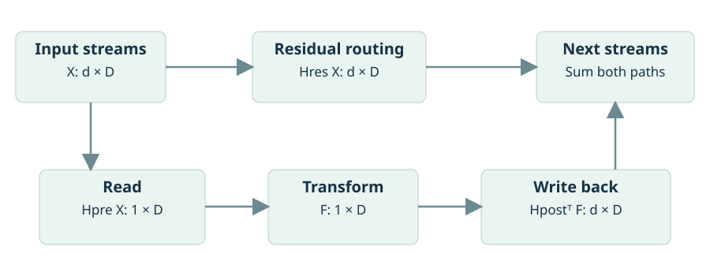
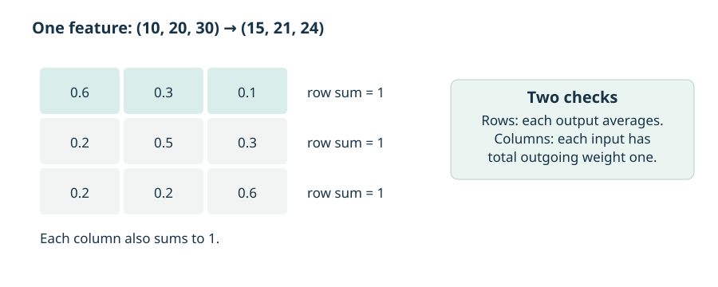
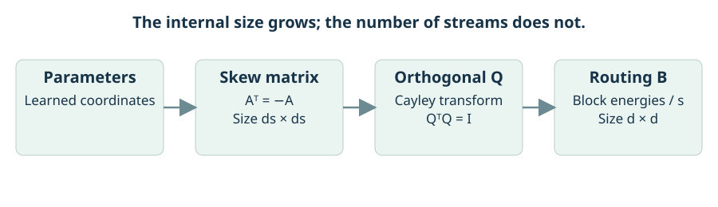
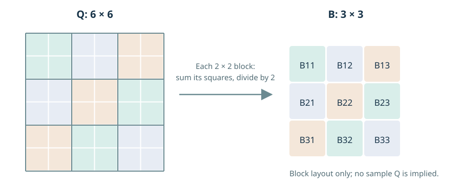

<!-- Generated from notes/pages/exact-residual-stream-mixing.html by npm run notes:export:readers. Edit the HTML source, not this export. -->

[]{#exact-residual-stream-mixing-through-generalized-orthostochastic-matrices}

Notebook / mHC

# Residual streams, exact mixing, and go-mHC

Start with a concrete routing problem, build a mixer that meets its constraints, and separate what the algebra guarantees from what experiments must establish.

Six connected learning units · Complete technical material · Illustrated reading edition

[]{#title-block-header}[]{#reading-guide}

Start with the question you have

## A connected route through the ideas {#reading-guide-title}

Read the six units in order for the full argument, or choose an entry point below. Each unit explains the question it answers before developing the original examples, derivations, and qualifications.

[**1. Start with the routing problem** --- See what a residual mixer does and how it fits beside the learned branch.](#unit-route)

[**2. Understand the constraint and its limits** --- Follow what row and column sums preserve---and what they do not.](#unit-constraint)

[**3. Build the mixer from orthogonal blocks** --- Trace how the construction makes a nonnegative, doubly stochastic matrix.](#unit-geometry)

[**4. Choose a representation and a cost** --- Compare parameterizations, their expressive reach, and their computational costs.](#unit-choice)

[**5. Interpret spectra and experimental evidence** --- Separate fixed-matrix spectral behavior from network-wide stability claims and reported experiments.](#unit-evidence)

[**6. Review the mathematics and test the construction** --- Check prerequisites, work through exercises, and consult the references.](#unit-reference)

Open the reference sections when useful. Diagrams sit beside the explanations that use them; select "Enlarge diagram" to inspect one. Existing section links continue to work.

**Keep the main distinctions in view**

$d$ counts residual streams: paths carrying feature vectors between layers. $D$ is the number of features in each stream. $s$ is the positive integer side length of each square internal block used by the construction.

The real square matrix $A$ is skew-symmetric: its transpose is its negative, $A^\top=-A$. The real square matrix $Q$ is orthogonal: $Q^\top Q=I$, where $I$ is the identity matrix of the same size as $Q$. Multiplying by $Q$ therefore preserves Euclidean vector lengths.

The final routing matrix $B$ has nonnegative entries, and every row and every column sums to one. A matrix with these properties is called *doubly stochastic*. For the residual-mixing step alone, each output stream is a weighted average of input streams. Row sums of one normalize those weights; column sums of one preserve the sum across streams, feature by feature. The separate learned layer transformation added afterward can change that sum. The [constraint unit](#unit-constraint) explains these conservation laws.

The symbol $B$ can also denote batch size in the original tensor-shape notation. There it counts examples in a batch; here, as a matrix, $B$ denotes the mixer. The surrounding notation distinguishes the two uses.

"Exact" refers to satisfying the row and column constraints algebraically by construction. It does not mean that the mixer preserves every vector's length, that finite-precision computation has zero error, or that optimization is guaranteed to find a useful mixer. Those algebraic constraints alone also do not establish stability of the full network. Its routing can depend on activations---the current layer's feature values.

Exact constraints do not imply that a chosen block size can represent every doubly stochastic matrix. The comparison discussed later uses fixed small factors in a Kronecker product, a way to form a larger matrix from smaller ones. With unrestricted real orthogonal matrices, varying the internal block size permits arbitrarily close approximation of any doubly stochastic matrix. This does not establish exact coverage at a chosen size or nesting of the families at every successive size.

Separately, a finite Cayley parameterization---the map from $A$ to $Q$ used here---reaches only part of the real orthogonal matrices. Different orthogonal matrices can produce the same routing matrix, so missing one does not necessarily exclude its mixer. The [geometry unit](#unit-geometry) explains the construction and these limits.

[]{#book-content}

## 1. Start with the routing problem {#unit-route}

A residual stream carries a feature vector from one layer to the next. With one stream, a residual layer keeps that vector and adds a learned correction. With several streams, the layer must also decide which old streams contribute to each new stream.

For one batch item and one token, collect the stream vectors into a matrix $X\in\mathbb{R}^{d\times D}$. Its $d$ rows are streams; its $D$ columns are feature coordinates. A residual-routing matrix $B\in\mathbb{R}^{d\times d}$ multiplies on the left, so $BX$ forms weighted combinations of streams while leaving the feature-coordinate axis unchanged. In this local calculation, the same routing matrix acts on every feature coordinate. In a layer whose routing is activation-dependent, this is the matrix realized for the current activations.

A Hyper-Connection layer has two additive paths. The residual path directly routes the existing streams. The learned branch reads a combination of streams, applies the usual layer transformation, then writes its output back to the streams. The doubly stochastic constraint discussed here applies to the residual-routing matrix. It does not automatically constrain the read and write maps.

For a numerical preview, take one feature with stream values $x=(10,20,30)^\top$ and use the matrix in the worked example. It gives $Bx=(15,21,24)^\top$: the first entry is $0.6(10)+0.3(20)+0.1(30)=15$, and the other rows give $21$ and $24$. The total remains $60$, although each stream\'s value changes. The next unit explains which matrix constraints make that sum conservation hold.

This is a **generic valid routing matrix**, not a claim that every go-mHC parameterization can produce this particular matrix. The example first shows what a mixer does; representational reach is a separate question.

{loading="eager"}

### The problem: how should residual streams mix?

A residual connection carries the layer input forward alongside a learned transformation. In its simplest form, the update is

$$x_{l+1}=x_l+\mathcal{F}(x_l,W_l),$$

Here $x_l$ is the state at layer $l$, $\mathcal{F}$ is the learned transformation, and $W_l$ denotes its parameters. The direct path means that information and gradients can pass across the layer without relying only on the transformation.

Hyper-Connections keep $d$ parallel residual streams. A larger $d$ gives the architecture more possible routes: for example, different streams can carry features that a later layer combines in different proportions. That is an opportunity for the model, not a guarantee of useful extra capacity. The learned routes and the task determine whether the additional paths help.

Unrestricted residual mixers can change the size of state components when layers are composed. A matrix may stretch some directions and shrink others. Backpropagation passes loss gradients through transposed layer Jacobians. A Jacobian is the derivative matrix that maps small input changes to output changes. These are possible sources of instability, not a claim that every unconstrained network has exploding or vanishing states or gradients.

Manifold-Constrained Hyper-Connections (mHC) target this concern by constraining the residual mixer to be doubly stochastic: its entries are nonnegative, and every row and column sums to one \[Xie et al., 2026\]. Finite iterative normalization can leave this constraint only approximately satisfied. The following guarantee assumes exact constraints.

Let $C=B_k\cdots B_1$ be a product of $k$ realized nonnegative doubly stochastic $d\times d$ residual matrices. Their product is also doubly stochastic. For one feature, let $v=(v_1,\ldots,v_d)^\top$ contain its real stream values, with Euclidean length $\|v\|_2=\sqrt{\sum_{j=1}^d v_j^2}$. Each output is a weighted average. Its square is at most the weighted average of the squared inputs. Summing over output rows $i$ and using the unit column sums gives

$$\|Cv\|_2^2
=\sum_{i=1}^d\left(\sum_{j=1}^d C_{ij}v_j\right)^2
\leq\sum_{i=1}^d\sum_{j=1}^d C_{ij}v_j^2
=\sum_{j=1}^d v_j^2
=\|v\|_2^2.$$

The all-ones vector $\mathbf{1}=(1,\ldots,1)^\top$ satisfies $C\mathbf{1}=\mathbf{1}$, so the bound is attained. The Euclidean operator norm, also called the largest singular value, is the largest ratio of output length to nonzero input length. It is therefore exactly one. This does not preserve every vector\'s length: differences between streams can shrink or, for $d>1$, even be erased. The proof treats the realized residual matrices as fixed. It does not bound the full layer Jacobian, which also includes derivatives of activation-dependent routes and of the learned branch.

The paper studied here proposes **go-mHC**, a direct parameterization of a family of exactly doubly stochastic matrices. Here, "exact" describes the mathematical construction, not error-free floating-point computation. Its design aims for a middle ground:

- more expressive than highly structured Kronecker-factorized mixers, which build a large matrix from smaller matrices by replacing each entry of one factor with that entry times another factor;
- less expensive than parameterizing arbitrary doubly stochastic matrices using all permutation matrices;
- exact by construction, rather than approximately satisfying the constraint after iterative normalization.

The construction uses generalized orthostochastic matrices \[Gutkin, 2013; Nechita et al., 2023\]. In the real-valued construction used here, each routing entry comes from summing squared entries of a square block of a larger orthogonal matrix, then dividing by the block\'s side length. An orthogonal matrix is a square matrix whose rows are mutually perpendicular and of unit length, as are its columns.

------------------------------------------------------------------------

### From residual connections to Hyper-Connections

A Hyper-Connection layer acts on a four-axis state tensor

$$\mathbf{x}_l\in\mathbb{R}^{d\times B\times L\times D},$$

where $d$ is the number of streams, $B$ is batch size, $L$ is sequence length, and $D$ is hidden-feature dimension. This scalar batch-size $B$ is distinct from the routing matrix $B$ in the worked example. The update is

$$\mathbf{x}_{l+1}
=
\mathcal{H}_{l}^{\mathrm{res}}\mathbf{x}_{l}
+
\left(\mathcal{H}_{l}^{\mathrm{post}}\right)^\top
\mathcal{F}\!\left(
\mathcal{H}_{l}^{\mathrm{pre}}\mathbf{x}_{l},
\mathbf{W}_l
\right).
\tag{1}$$

Matrix multiplication here contracts the stream axis and leaves batch, token, and feature axes in place. The displayed route-map sizes suppress batch and token indices; activation-dependent maps can differ between batch-token slices. The residual map $\mathcal{H}_{l}^{\mathrm{res}}\in\mathbb{R}^{d\times d}$ combines the $d$ stream rows independently at each batch item, token, and feature coordinate. Its output therefore still has shape $d\times B\times L\times D$.

The pre-map $\mathcal{H}_{l}^{\mathrm{pre}}\in\mathbb{R}^{1\times d}$ contracts those $d$ stream rows to one vector per batch item and token. The ordinary transformation $\mathcal{F}$, with learned parameters $\mathbf{W}_l$, acts on that single-stream tensor and returns shape $1\times B\times L\times D$. This shape does not require independent token processing: an attention transformation, for example, can combine information across token positions. Finally, $(\mathcal{H}_{l}^{\mathrm{post}})^\top$ has shape $d\times1$ and scales that output into contributions to all $d$ streams. The two terms on the right thus both have the state shape and can be added.

The three route maps have different jobs. $\mathcal{H}_{l}^{\mathrm{res}}$ mixes streams directly; $\mathcal{H}_{l}^{\mathrm{pre}}$ chooses what the transformation reads; $\mathcal{H}_{l}^{\mathrm{post}}$ chooses how its result is distributed. Only the residual map is the doubly stochastic mixer in this discussion.

When $d=1$ and all three maps equal the one-by-one identity $[1]$, the residual term is $x_l$. The pre-map leaves the input unchanged, and the post-map returns the transformation unchanged. Equation (1) then reduces to $x_{l+1}=x_l+\mathcal{F}(x_l,W_l)$, the usual residual update. This is an algebraic choice of operators in (1), not a claim that the sigmoid pre-route in (3) reaches one at finite input.

The pre- and post-routes may depend on the current activations. To describe their computation, suppress the batch and token indices and let $X_l\in\mathbb{R}^{d\times D}$ be one stream-feature slice. Flatten its entries into a row $z_l\in\mathbb{R}^{1\times dD}$ and apply RMS normalization. Its root-mean-square size is obtained by squaring the entries, averaging over the $dD$ coordinates, then taking the square root. RMSNorm uses this size to rescale the activations. The normalized row $\mathbf{x}'_l\in\mathbb{R}^{1\times dD}$ supplies the activation-dependent input for the route projections. The formulas are

$$\mathbf{x}'_l=\operatorname{RMSNorm}(z_l),
\tag{2}$$

$$\mathcal{H}_{l}^{\mathrm{pre}}
=
\sigma\!\left(
\alpha_l^{\mathrm{pre}}
\mathbf{x}'_l
\mathbf{W}_l^{\mathrm{pre}}
+
\mathbf{b}_l^{\mathrm{pre}}
\right),
\tag{3}$$

$$\mathcal{H}_{l}^{\mathrm{post}}
=
2\sigma\!\left(
\alpha_l^{\mathrm{post}}
\mathbf{x}'_l
\mathbf{W}_l^{\mathrm{post}}
+
\mathbf{b}_l^{\mathrm{post}}
\right).
\tag{4}$$

In (3)--(4), $\sigma(t)=1/(1+e^{-t})$ is the sigmoid for a real scalar input $t$, applied coordinatewise to each projection. The learned scalars $\alpha_l^{\mathrm{pre}}$ and $\alpha_l^{\mathrm{post}}$ scale the activation-dependent contributions. The learned weight matrices $\mathbf{W}_l^{\mathrm{pre}},\mathbf{W}_l^{\mathrm{post}}$ have shape $dD\times d$; the learned biases $\mathbf{b}_l^{\mathrm{pre}},\mathbf{b}_l^{\mathrm{post}}$ have shape $1\times d$. Thus the products produce one length-$d$ route for each batch-token slice. For finite real projection values, the pre-route entries lie in $(0,1)$. Multiplying the post sigmoid by two puts its entries in $(0,2)$. These ranges describe the exact sigmoid mathematics; floating-point evaluation may round to an endpoint. Neither route is constrained to sum to one. The factor of two changes the post-route\'s range, without making it a probability distribution.

The remaining design question is how to construct $\mathcal{H}_l^{\mathrm{res}}$ while enforcing the desired constraint.

------------------------------------------------------------------------

### A worked stream-mixing example

Take $d=3$ streams and the following doubly stochastic routing matrix:

$$B=
\begin{pmatrix}
0.6 & 0.3 & 0.1\\
0.2 & 0.5 & 0.3\\
0.2 & 0.2 & 0.6
\end{pmatrix}.$$

Each row sums to one, so each output stream is a weighted average of the inputs. Each column also sums to one, so the total contribution assigned from each input stream is one. If the incoming stream vectors are $x^{(1)},x^{(2)},x^{(3)}$, the first two outputs are

$$\begin{aligned}
\widetilde{x}^{(1)}&=0.6x^{(1)}+0.3x^{(2)}+0.1x^{(3)},\\
\widetilde{x}^{(2)}&=0.2x^{(1)}+0.5x^{(2)}+0.3x^{(3)}.
\end{aligned}$$

The third output is $\widetilde{x}^{(3)}=0.2x^{(1)}+0.2x^{(2)}+0.6x^{(3)}$. For the single-feature values $(10,20,30)^\top$, these three weighted sums are $(15,21,24)^\top$. Their sum is still $60$: summing the outputs groups each input value with its column sum, which is one. The mixer redistributes values without changing this aggregate. This statement concerns the residual routing operation, not the extra learned branch added by the full layer.

A permutation matrix instead routes each input wholly to one output. For example,

$$P=
\begin{pmatrix}
0&1&0\\
0&0&1\\
1&0&0
\end{pmatrix}$$

maps old stream 1 to new stream 3, old stream 2 to new stream 1, and old stream 3 to new stream 2. This is the cycle $1\to3,\;2\to1,\;3\to2$; applying it three times returns every stream to its starting position. An eigenvalue is a scalar by which a matrix scales a corresponding nonzero, possibly complex, vector. The characteristic polynomial of this matrix is $\lambda^3-1$, where $\lambda$ is the eigenvalue variable. Its roots are $1,e^{2\pi i/3},e^{-2\pi i/3}$, where $i^2=-1$. Two of these eigenvalues form a nonreal conjugate pair.

This spectrum illustrates a limitation of single Kronecker products of doubly stochastic $2\times2$ factors. Each factor has the form $\begin{pmatrix}a&1-a\\1-a&a\end{pmatrix}$, with $0\leq a\leq1$. It leaves $(1,1)^\top$ unchanged and scales $(1,-1)^\top$ by $2a-1$, so its eigenvalues are $1$ and $2a-1$, both real. Eigenvalues of a Kronecker product are products of factor eigenvalues, so a single such product has only real eigenvalues.

There is also a size issue: a product of $r$ binary factors has size $2^r\times2^r$, for a positive integer factor count $r$, never $3\times3$. To isolate the spectral obstruction at a matching size, keep the same three-cycle and add a fourth stream that stays fixed:

$$\widehat{P}=
\begin{pmatrix}
0&1&0&0\\
0&0&1&0\\
1&0&0&0\\
0&0&0&1
\end{pmatrix}.$$

This four-stream permutation matrix $\widehat{P}$ has the three eigenvalues of $P$ plus another $1$. Its nonreal pair prevents representation by a single Kronecker product of two doubly stochastic binary factors, despite their matching size. This limitation concerns that specific factorized form, not arbitrary doubly stochastic matrices, larger factors, or products of differently reindexed mixers across layers. Unit 5 develops the spectral argument further.

------------------------------------------------------------------------

## 2. Understand the constraint and its limits {#unit-constraint}

Let $d$ be the number of residual streams, and let $B\in\mathbb{R}^{d\times d}$ mix those streams. The entry $B_{ij}$ is the weight that input stream $j$ contributes to output stream $i$. A matrix is *doubly stochastic* when its entries are nonnegative and every row and every column sums to one.

The two sum conditions have different jobs. A row sum of one makes each output a convex combination of inputs: its weights are nonnegative and total one. A column sum of one says that each input\'s total weight across all outputs is one. Both conditions are needed for the conservation statements below.

For example, the matrix

$$B_{\mathrm{row}}=\begin{pmatrix}1&0\\1&0\end{pmatrix}$$

has row sums one, but its column sums are $2$ and $0$. Applied to $(2,10)^\top$, it gives $(2,2)^\top$: both outputs copy the first input, and the second input contributes nothing. Thus row normalization alone does not conserve the total across streams.

Write $\mathbf 1_d$ for the length-$d$ vector of ones and $c$ for any scalar. The row condition is $B\mathbf 1_d=\mathbf 1_d$; the column condition is $B^\top\mathbf 1_d=\mathbf 1_d$. Together, they imply for any real feature vector $x\in\mathbb{R}^d$:

$$\mathbf 1_d^\top Bx=\mathbf 1_d^\top x,
\qquad
B(c\mathbf 1_d)=c\mathbf 1_d.$$

The first identity uses the column condition: $\mathbf 1_d^\top B=\mathbf 1_d^\top$, so the sum of the feature across streams is unchanged. The second uses the row condition: each row combines the same constant $c$ with weights totalling one. Neither identity requires the feature values themselves to be nonnegative.

### Non-amplification is not preservation of every direction {#explanation-constraint-non-amplification-is-not-preservation-of-every-direction}

For two streams, complete averaging is the matrix

$$J=\frac12\begin{pmatrix}1&1\\1&1\end{pmatrix}.$$

It leaves $(1,1)^\top$ unchanged, but maps the contrast $(1,-1)^\top$ to zero. This matrix is exactly doubly stochastic, yet it erases the difference between the two streams. More generally, $J_d=\mathbf 1_d\mathbf 1_d^\top/d$ averages all $d$ streams; for $d\geq2$, it sends every vector $v\in\mathbb{R}^d$ with $\mathbf 1_d^\top v=0$ to zero. Thus a unit upper bound on amplification does not promise that every direction survives.

A matrix\'s singular values describe its Euclidean stretching factors along a suitable set of mutually perpendicular input directions. The Euclidean operator norm $\|B\|_2$ is the largest singular value: it measures the greatest possible ratio of Euclidean lengths. The standard induced-norm inequality bounds it using $\|B\|_1$, the maximum absolute column sum, and $\|B\|_\infty$, the maximum absolute row sum:

$$\|B\|_2\leq\sqrt{\|B\|_1\,\|B\|_\infty}=1.$$

There is also a matching lower bound: $B\mathbf 1_d=\mathbf 1_d$ means the normalized all-ones vector is unchanged, so its Euclidean length ratio is one. Therefore $\|B\|_2=1$. This says the largest singular value is one, not that every singular value is one; the averaging example above has zero singular values.

For a vector $x$, write $\|x\|_\infty=\max_j|x_j|$ for its largest entry magnitude and $\|x\|_1=\sum_j|x_j|$ for the sum of entry magnitudes. The induced $\ell_\infty$ norm measures the largest possible ratio $\|Bx\|_\infty/\|x\|_\infty$, and the induced $\ell_1$ norm measures the largest ratio $\|Bx\|_1/\|x\|_1$, over nonzero $x$. Each output row is a convex combination, so no output magnitude exceeds the largest input magnitude: $\|Bx\|_\infty\leq\|x\|_\infty$. For the $\ell_1$ bound, apply the triangle inequality and then use each column sum of one: $\sum_i|(Bx)_i|\leq\sum_{i,j}B_{ij}|x_j|=\sum_j|x_j|$. Hence $\|Bx\|_1\leq\|x\|_1$. These bounds concern the realized residual matrix and its products. They do not by themselves bound the full network Jacobian, which also includes the learned branch and any normalization or other transformations.

### What "exact" means in an implementation {#explanation-constraint-what-exact-means-in-an-implementation}

Exact-by-construction means the real-arithmetic formula satisfies the constraints. A floating-point implementation still incurs rounding and, where applicable, linear-solve errors. Check row- and column-sum residuals numerically; do not expect bitwise equality to one.

This construction avoids a separate finite-iteration normalization error that must be balanced against a stopping budget. It does not remove ordinary numerical error, which still needs to be measured.

{loading="eager"}

### Why constrain the residual mixer?

In Hyper-Connections, $\mathcal{H}_l^{\mathrm{res}}$ is the residual-stream mixing matrix at layer $l$. Without a constraint, it can be any learned matrix. That allows flexible routing, but gives no explicit control over how repeated residual mixing scales a direction.

To track this linear transport from layer $l$ to a deeper layer $L$, define the cumulative residual operator

$$P_{L\leftarrow l}
:=
\mathcal{H}_{L-1}^{\mathrm{res}}
\mathcal{H}_{L-2}^{\mathrm{res}}
\cdots
\mathcal{H}_{l}^{\mathrm{res}}.
\tag{5}$$

Here $L$ is the destination layer index, not the sequence length used earlier, and $L>l$. The rightmost matrix acts first. For two steps, $P_{l+2\leftarrow l}=\mathcal{H}_{l+1}^{\mathrm{res}}\mathcal{H}_{l}^{\mathrm{res}}$: the first mixer acts on the incoming state, then the next acts on its output. Each mixer can change that state\'s direction, so successive amplification or contraction is measured along the resulting directions. These effects can compound and contribute to exploding or vanishing gradients. The largest individual gains need not multiply to the product\'s largest gain. This product describes residual transport with its layer matrices fixed along the trajectory; it is not, by itself, the full derivative of an activation-dependent layer or of the network.

In particular, consider the residual-path map $f(X)=B(X)X$, where routing $B$ depends on the activation matrix $X\in\mathbb{R}^{d\times D}$, with $D$ features per stream. At a point where $B$ is differentiable, a perturbation $\Delta\in\mathbb{R}^{d\times D}$ changes both the state and the routing weights:

$$Df_X[\Delta]
=B(X)\Delta+\bigl(DB_X[\Delta]\bigr)X.$$

Here $Df_X[\Delta]$ is the first-order change in the output, and $DB_X[\Delta]\in\mathbb{R}^{d\times d}$ is the corresponding first-order change in the routing matrix. For fixed or frozen routing, $DB_X[\Delta]=0$ and the second term vanishes. With activation-dependent routing, it need not vanish. A learned read--transform--write branch contributes its own derivatives as well. So the product is useful for reasoning about residual routing, but its norm is not a general gradient-stability theorem.

mHC constrains residual mixing toward the Birkhoff polytope, the set $\mathsf{B}_d$ of nonnegative doubly stochastic $d\times d$ matrices, using finite Sinkhorn--Knopp normalization. A row-rescaling pass divides each row by its sum to make row sums one. A following column-rescaling pass does the same for columns. Each division requires a positive sum. Strictly positive starting entries are sufficient for the alternating passes to converge toward a doubly stochastic matrix in exact arithmetic; nonnegativity alone does not ensure convergence. Column scaling can disturb the row sums just set, so a finite number of passes need not satisfy both constraints. The formulation described here uses twenty iterations; that count is not a rule for every implementation.

This method has two practical concerns:

1.  the iterative projection may require specialized implementation for efficiency;
2.  a fixed finite iteration count need not produce an exactly doubly stochastic matrix, although some inputs can already satisfy both constraints exactly.

A small row- or column-sum violation at each layer can compound in a deep product. Exact parameterizations aim to remove this particular source of accumulated constraint error; they do not remove other numerical or optimization effects.

------------------------------------------------------------------------

### Stability and cumulative mixing

For a matrix $B$, the induced $\ell_\infty$ norm is its maximum absolute row sum, and the induced $\ell_1$ norm is its maximum absolute column sum. For nonnegative doubly stochastic $B$, both equal one:

$$\|B\|_\infty=\max_i\sum_j|B_{ij}|=1,
\qquad
\|B\|_1=\max_j\sum_i|B_{ij}|=1.$$

These norms describe the largest possible amplification measured in their respective vector norms, not a selected eigenvalue. The paper\'s forward and backward Amax Gain Magnitude (AGM) quantities apply those same maximum row- and column-sum calculations to the cumulative residual operator $P_{L\leftarrow l}$:

$$\operatorname{AGM}^{\mathrm{fwd}}
\left(
P_{L\leftarrow l}
\right)
:=
\max_i\sum_j\left|\left(P_{L\leftarrow l}\right)_{ij}\right|,
\tag{11}$$

and

$$\operatorname{AGM}^{\mathrm{bwd}}
\left(
P_{L\leftarrow l}
\right)
:=
\max_j\sum_i\left|\left(P_{L\leftarrow l}\right)_{ij}\right|,
\tag{12}$$

Thus forward AGM is the induced $\ell_\infty$ norm, while backward AGM is the induced $\ell_1$ norm. For frozen residual transport, backpropagation uses $P_{L\leftarrow l}^\top$; its maximum absolute row sum is the original operator\'s maximum absolute column sum. That is why the backward quantity uses columns.

AGM values are not themselves spectral radii or Euclidean operator norms. Together they do bound the largest singular value through the induced-norm inequality above. They do not give a positive lower bound on every singular value, nor a stability guarantee for the complete nonlinear network.

The reason exact residual products retain these values is closure under multiplication. Let $A,B\in\mathsf{B}_d$. Since $B\mathbf 1_d=\mathbf 1_d$ and $A\mathbf 1_d=\mathbf 1_d$,

$$(AB)\mathbf{1}_d
=
A(B\mathbf{1}_d)
=
A\mathbf{1}_d
=
\mathbf{1}_d.$$

For the column condition, use $(AB)^\top=B^\top A^\top$ and the same two constraints:

$$(AB)^\top\mathbf{1}_d
=
B^\top A^\top\mathbf{1}_d
=
B^\top\mathbf{1}_d
=
\mathbf{1}_d.$$

Each entry of $AB$ is a sum of products of nonnegative entries, so $AB$ is nonnegative as well. It follows that $AB\in\mathsf{B}_d$. Applying this argument repeatedly shows that if every residual mixer is exactly doubly stochastic, their ordered cumulative product is too. Its maximum absolute row and column sums---and therefore both AGM values---are exactly one.

This is why AGM does not distinguish exact residual-mixing methods such as go-mHC, mHC-lite, and KromHC: they share the row- and column-sum property relevant to these two quantities. Equal AGM does not mean equal dynamics or training stability. The methods can differ in spectra and singular values, in how their routing depends on activations and therefore affects the Jacobian, in their nonlinear branches, and in optimization. Equal AGM does not prove equal representational capacity or real-world training performance. For those comparisons, the paper turns to expressivity and convergence; the shared AGM values alone do not settle them.

------------------------------------------------------------------------

## 3. Build the mixer from orthogonal blocks {#unit-geometry}

We need a nonnegative matrix whose rows and columns sum to one. go-mHC constructs such a mixer indirectly. It first makes a real orthogonal matrix: its rows, and separately its columns, have unit length and are mutually perpendicular. It then converts the squared energy in each block into a routing weight. Here "energy" means a dimensionless sum of squared matrix entries, not a physical energy.

Let $d\geq1$ be the integer number of actual residual streams, and let $s\geq1$ be an integer internal block size. The construction uses $ds$ auxiliary coordinates. Its $ds\times ds$ orthogonal matrix is arranged as $d\times d$ blocks of size $s\times s$. These coordinates parameterize a mixer; they are not extra streams carried through the network. The block-energy map returns one weight per block, hence a $d\times d$ mixer.

### Why divide a block energy by its size? {#explanation-geometry-why-divide-a-block-energy-by-its-size}

When $s=1$, an orthogonal row has squared length one, so its squared entries already sum to one. For larger $s$, each block row contains $s$ rows of the larger orthogonal matrix. Orthogonality makes each of those rows have squared length one, so their combined squared energy is $s$, not one. Dividing every block energy by $s$ therefore makes the routing row sum to one. The block-column argument gives the same normalization for columns; the proof below shows both identities explicitly.

The final map discards information. The orthogonal matrix contains signs and relationships among internal coordinates, while the mixer retains only each block\'s total squared energy. Different orthogonal matrices can therefore yield the same mixer. Also, although the internal matrix preserves vector lengths, its block-energy image need not preserve the length of a stream vector; it is a nonnegative routing matrix, not an orthogonal transformation on the streams.

### Follow one parameter all the way to a mixer {#explanation-geometry-follow-one-parameter-all-the-way-to-a-mixer}

Take $d=2$, $s=1$, and choose the real skew-symmetric matrix below. Skew-symmetric means $A^\top=-A$: the diagonal is zero and opposite off-diagonal entries have opposite signs.

$$A=\begin{pmatrix}0&1/3\\-1/3&0\end{pmatrix}.$$

Here $I$ is the $2\times2$ identity matrix. The inverse needed for the Cayley transform is

$$(I+A)^{-1}=\frac{9}{10}\begin{pmatrix}1&-1/3\\1/3&1\end{pmatrix}.$$

Multiplying by $I-A$ gives

$$Q=(I-A)(I+A)^{-1}
=\begin{pmatrix}0.8&-0.6\\0.6&0.8\end{pmatrix}.$$

Each row has squared length $0.8^2+0.6^2=1$, and the row inner product is $0.8(0.6)+(-0.6)(0.8)=0$. Thus the rows are orthonormal. Since $s=1$, the block-energy map simply squares each entry:

$$B=\begin{pmatrix}0.64&0.36\\0.36&0.64\end{pmatrix}.$$

For the input feature vector $x=(2,10)^\top$, the outputs are $0.64(2)+0.36(10)=4.88$ and $0.36(2)+0.64(10)=7.12$. Their sum remains $12$ because each column of $B$ sums to one. The negative entry of $Q$ creates no negative routing weight: squaring removes its sign. This example computes the constraint through the construction, rather than projecting a candidate matrix numerically onto the constraint set.

### The Cayley chart has a boundary {#explanation-geometry-the-cayley-chart-has-a-boundary}

A real skew-symmetric matrix $A$ satisfies $A^\top=-A$. Let $I$ be the identity of the same square size and $v$ a real column vector of the matching dimension. Then $v^\top Av=0$, since this scalar equals its own negative after transposition. If $(I+A)v=0$, multiplying by $v^\top$ gives $\|v\|_2^2+v^\top Av=0$, hence $v=0$. Thus $I+A$ has no nonzero null vector and is invertible.

The finite Cayley parameters describe a chart: a coordinate map covering part, but not all, of the orthogonal matrices. Its outputs have determinant $+1$, because $I-A=(I+A)^\top$ gives $\det Q=\det(I-A)/\det(I+A)=1$. They cannot have eigenvalue $-1$, because rearranging the formula gives $I+Q=2(I+A)^{-1}$, which is invertible.

This restricts the orthogonal lifts, meaning auxiliary matrices $Q$ that produce a given mixer. It does not automatically restrict the mixers in the same way. The block map can send distinct lifts to the same mixer, so omitting one lift does not prove its mixer is unattainable by another lift. Flipping one row changes a lift\'s determinant sign without changing any squared block energy. Thus every unrestricted mixer has a determinant-$+1$ lift.

For $ds\geq2$, finite Cayley outputs are dense among determinant-$+1$ orthogonal matrices: every such matrix can be approximated arbitrarily closely. To see the mechanism, decompose it into two-dimensional rotations and fixed directions in an orthonormal basis. Any eigenvalues $-1$ occur in pairs and form rotation planes with angle $\pi$. Perturb those angles away from $\pi$. The resulting matrices remain orthogonal, approach the original matrix, and have no eigenvalue $-1$. Each then has the finite parameter $A=(I-Q)(I+Q)^{-1}$. Transposing this expression and using $Q^\top=Q^{-1}$ gives $A^\top=-A$, so the parameter is skew-symmetric. Since block energies vary continuously with the entries of $Q$, their mixers also approach the original mixer. For $ds=1$, the only mixer is $[1]$, obtained with $A=0$.

This proves approximation, not exact coverage by finite Cayley parameters. Construction, representable mixer family, and optimizer behavior remain distinct questions. Connectedness of a parameter space alone does not show that gradient descent reaches a target.

{loading="eager"}

### Orthostochastic matrices

A matrix $B\in\mathsf{B}_d$ is **orthostochastic** when it is obtained by squaring the entries of a real orthogonal matrix $Q\in\mathbb{R}^{d\times d}$. With row and column indices $1\leq i,j\leq d$, this means

$$B_{ij}=Q_{ij}^{\,2}.
\tag{6}$$

Here $\mathsf{B}_d$ denotes the set of $d\times d$ doubly stochastic matrices. Squares are nonnegative, so $B_{ij}\geq0$. The unit-length rows and columns of $Q$ give

$$\sum_j Q_{ij}^2=1
\quad\text{and}\quad
\sum_i Q_{ij}^2=1,$$

so the squared-entry matrix has unit row and column sums. For $d>2$, orthostochastic matrices form a proper, nonconvex subset of $\mathsf{B}_d$. They include permutation matrices, but do not fill the polytope\'s interior. For $d=2$, by contrast, they fill the doubly stochastic segment. Every such mixer has diagonal entries $t$ and off-diagonal entries $1-t$, with $0\leq t\leq1$. An orthogonal lift has rows $(\sqrt t,-\sqrt{1-t})$ and $(\sqrt{1-t},\sqrt t)$; squaring its entries gives that mixer.

The block construction generalizes this squared-entry idea. As the following definition shows, the block size controls the family of mixers available; it does not mean the resulting mixer ceases to be doubly stochastic.

------------------------------------------------------------------------

### Generalized orthostochastic matrices

{loading="eager"}

Let $Q\in\mathcal{Q}(ds)$ be an orthogonal $ds\times ds$ matrix; $\mathcal{Q}(ds)=O(ds)$ is the set of real orthogonal matrices of that size. Partition its rows and columns into $d$ consecutive groups of $s$. The block at block-row $i$ and block-column $j$ is $Q_{ij}\in\mathbb{R}^{s\times s}$.

For a real matrix $M$, its Frobenius norm squared is the sum of squares of all its entries. The block-energy map assigns each block its squared Frobenius norm divided by $s$. Here $k,r$ index the row and column within a block:

$$\Phi_{d,s}(Q)_{ij}
:=
\frac{1}{s}\lVert Q_{ij}\rVert_F^2
:=
\frac{1}{s}
\sum_{k=1}^{s}\sum_{r=1}^{s}(Q_{ij})_{kr}^2.
\tag{7}$$

Thus $\Phi_{d,s}(Q)_{ij}$ is the share, after normalization, of squared energy in block $Q_{ij}$. The normalization is forced by orthogonality: each block row contains $s$ rows of unit squared length, for total energy $s$.

#### Proposition: $\Phi_{d,s}(Q)$ is doubly stochastic

For every orthogonal $Q\in\mathcal{Q}(ds)$, the block-energy matrix belongs to $\mathsf{B}_d$.

##### Proof sketch

Fix block row $i$. Orthogonality of the rows, grouped into blocks, gives the following identity, where $I_s$ is the $s\times s$ identity matrix:

$$\sum_{j=1}^{d}Q_{ij}Q_{ij}^{\top}=I_s.$$

Taking the trace (the sum of diagonal entries) turns each product\'s trace into a squared Frobenius norm, and the identity matrix\'s trace is its dimension:

$$\sum_{j=1}^{d}\lVert Q_{ij}\rVert_F^2
=
\operatorname{tr}(I_s)
=s.$$

Now divide this block-row total by $s$, exactly as in the definition of $\Phi_{d,s}$:

$$\sum_{j=1}^{d}\Phi_{d,s}(Q)_{ij}
=
\frac{1}{s}\sum_{j=1}^{d}\lVert Q_{ij}\rVert_F^2
=1.$$

For a block column, orthogonality of the columns gives $\sum_i Q_{ij}^{\top}Q_{ij}=I_s$. Taking traces and dividing by $s$ gives $\sum_i\Phi_{d,s}(Q)_{ij}=1$. Each entry is nonnegative because it is a squared norm. These row sums, column sums, and nonnegative entries establish double stochasticity. When $s=1$, each block is a scalar, so equation (7) reduces to equation (6): ordinary orthostochastic matrices are precisely the $s=1$ case.

To state the asymptotic coverage result precisely, define the finite-size family

$$\mathcal O_{d,s}
:=
\{\Phi_{d,s}(Q):Q\in O(ds)\}.$$

Every such family lies inside $\mathsf{B}_d$. Nechita, Ouyang, and Szczepanek (2023) establish arbitrary-accuracy coverage through [Theorem 2.8](https://arxiv.org/html/2310.03436v2#S2.Thmtheorem8) and its [real-matrix extension in Section 4](https://arxiv.org/html/2310.03436v2#S4.Thmtheorem2). For the real orthogonal block family, this means

$$\overline{\bigcup_{s\geq1}\mathcal O_{d,s}}=\mathsf{B}_d.$$

The bar means closure: for every matrix in $\mathsf{B}_d$ and every positive tolerance, some block size and orthogonal matrix produce a mixer within that tolerance in Frobenius norm. This does not say that one finite $s$ represents every matrix exactly. Nor are these families asserted to grow monotonically at every successive block size.

They do nest when one size divides another. For a positive integer $k$, replace each block by $Q_{ij}\otimes I_k$. Here $I_k$ is the $k\times k$ identity; the Kronecker product $\otimes$ replaces each entry of $Q_{ij}$ with that entry times $I_k$. The whole lift remains orthogonal. Each block\'s squared norm gains a factor $k$, while the normalization becomes $ks$, so the mixer is unchanged. In particular, every block size includes the ordinary $s=1$ family. Asymptotic density concerns the union of sizes, not exact coverage at fixed size or a guarantee about every neighboring pair.

------------------------------------------------------------------------

### The go-mHC construction

go-mHC replaces repeated Sinkhorn row-and-column normalization with a direct map into a doubly stochastic family. It uses three stages: predict skew coordinates from the current activation, turn them into an orthogonal matrix, then take normalized block energies.

First, let $l$ index the layer and $D$ denote feature width. For one token, flatten the normalized activation $\mathbf{x}'_l$ from all $d$ streams into $z_l\in\mathbb{R}^{1\times dD}$. This flattening only gives the activation a convenient row-vector shape. Set $n=ds$, the dimension of the orthogonal lift, and $m=n(n-1)/2=ds(ds-1)/2$, the number of independent entries in a real skew-symmetric $n\times n$ matrix. This counts skew coordinates, not the dimension of the final mixer family. The learned parameters are a weight matrix $W_l^{\mathrm{res}}\in\mathbb{R}^{dD\times m}$, a bias row $b_l^{\mathrm{res}}\in\mathbb{R}^{1\times m}$, and scalar scale $\alpha_l^{\mathrm{res}}$. They predict the activation-dependent row $p_l\in\mathbb{R}^{1\times m}$ through the affine map used in [go-mHC Section 3.3](https://arxiv.org/html/2604.02309v1#S3.SS3):

$$p_l=\alpha_l^{\mathrm{res}}z_lW_l^{\mathrm{res}}+b_l^{\mathrm{res}}.$$

Choose a fixed ordering of the index pairs $1\leq a<b\leq n$. Let $\kappa(a,b)\in\{1,\ldots,m\}$ give each pair\'s position in that ordering. Place the $m$ entries of $p_l$ in the strict upper triangle, reflect them with a sign change into the lower triangle, and set the diagonal to zero:

$$(A_l)_{ab}=p_{l,\kappa(a,b)}\ (a<b),\qquad
(A_l)_{ba}=-(A_l)_{ab},\qquad
(A_l)_{aa}=0.
\tag{8}$$

This is the independent-coordinate map $A_l=\operatorname{skew}(p_l)$. It gives $A_l^\top=-A_l$ and $A_l\in\mathbb{R}^{ds\times ds}$ without redundant predicted entries. In this formulation, the skew matrix depends on the current activation through $z_l$ as well as on learned weights and bias. It is not just a fixed learned matrix.

Second, apply the Cayley transform, where $I$ denotes the $n\times n$ identity:

$$Q_l
:=
(I-A_l)(I+A_l)^{-1}.
\tag{9}$$

The inverse exists because $A_l$ is real and skew-symmetric. Indeed, for any real vector $v\in\mathbb{R}^{n}$, expanding the squared norm and using $v^\top A_lv=0$ gives

$$\lVert(I-A_l)v\rVert_2^2
=
\lVert v\rVert_2^2+\lVert A_lv\rVert_2^2.$$

If $(I-A_l)v=0$, this identity forces $v=0$, so $I-A_l$ is nonsingular; the same reasoning applies to $I+A_l$. Transposing equation (9) gives $Q_l^\top=(I-A_l)^{-1}(I+A_l)$. The matrices $I-A_l$ and $I+A_l$ commute because both are polynomials in $A_l$; their inverses also commute with these factors. Thus $Q_l^\top=Q_l^{-1}$ and hence $Q_l^\top Q_l=I$.

In implementation, inverse notation need not mean forming an explicit inverse. For the convention in equation (9), solve $(I+A_l)Q_l=I-A_l$, using the factors\' commutation. The result is orthogonal in exact arithmetic; a numerical implementation still has ordinary floating-point solve error. Invertibility also makes the solution a smooth function of the entries of the real skew matrix.

Third, take normalized block energies to obtain the residual-routing mixer $\mathcal{H}_l^{\mathrm{res}}$:

$$\mathcal{H}_l^{\mathrm{res}}
:=
\Phi_{d,s}(Q_l).
\tag{10}$$

The block-energy result proves that $\mathcal{H}_l^{\mathrm{res}}\in\mathsf{B}_d$ for every valid parameter value in exact arithmetic. In sequence, unconstrained activation-dependent affine coordinates give a skew matrix, the Cayley map gives an orthogonal lift, and its block energies give a doubly stochastic residual mixer:

$$\text{activation and learned parameters}
\longrightarrow
A_l^\top=-A_l
\longrightarrow
Q_l^\top Q_l=I
\longrightarrow
\mathcal{H}_l^{\mathrm{res}}\in\mathsf{B}_d.$$

This differs from iterative normalization. Sinkhorn starts with a candidate matrix and repeatedly rescales rows and columns toward the constraints; with a finite iteration count its result can retain a constraint error. go-mHC parameterizes a family whose outputs satisfy the constraints by construction, while restricting outputs to that family. The two methods thus differ both in how they enforce the constraints and in which matrices they can represent.

------------------------------------------------------------------------

## 4. Choose a representation and a cost {#unit-choice}

Once several methods all meet the same row and column constraints, "which method is stable?" is too coarse a question. Compare three things separately: the set of routing matrices each method can represent, the cost of constructing and applying one, and how readily optimization can find useful parameters. Exact row and column sums establish constraint satisfaction; they do not make two parameterizations equally expressive or equally cheap.

mHC-lite mixes deterministic routings (permutation matrices); a Kronecker construction composes smaller matrices into a structured larger one; go-mHC maps an internal orthogonal matrix to stream weights by aggregating block energies. Each has different representational restrictions despite satisfying the same constraints.

The factorial cost discussed below belongs to the learnable parameterization that assigns a component to every permutation. The Birkhoff--von Neumann theorem says every doubly stochastic matrix is some convex combination of permutation matrices; it does not require enumerating all permutations to prove or describe a particular target. Full enumeration is the implementation choice that incurs the factorial cost.

The block size $s$ changes the size of go-mHC's internal orthogonal matrix, from $d\times d$ when $s=1$ to $ds\times ds$. For $d=4$, its skew-symmetric generator has $ds(ds-1)/2$ independent coordinates: $6$, $28$, and $66$ for $s=1,2,3$. These are output coordinates, not the whole layer's trainable parameter count; the network that predicts them also has weights and biases.

Treat $s$ as a design choice to assess, not as a default quality score. A larger internal matrix can broaden the reachable family, but it costs more to construct and differentiate. Broader geometric coverage does not ensure a fixed optimizer, initialization, and training budget will find a better solution.

A fair practical comparison holds the task, stream count, precision, optimization budget, and hardware conditions fixed. Report constraint residuals and target-reconstruction error separately from elapsed time. A loss curve against optimization steps answers a different question from a loss curve against wall-clock time.

### Existing exact alternatives

#### mHC-lite: complete coverage at factorial cost

A permutation matrix $P_\pi$ has exactly one $1$ in each row and column, with zeros elsewhere; it routes each input stream to one output stream according to the permutation $\pi$. The Birkhoff--von Neumann theorem states that any doubly stochastic $d\times d$ routing matrix $B$ can be written as

$$B=\sum_{\pi\in S_d} w_\pi P_\pi,
\qquad w_\pi\geq 0,
\qquad \sum_{\pi\in S_d}w_\pi=1.$$

Here $S_d$ denotes the set of all permutations of $d$ streams, and $w_\pi$ is the weight assigned to permutation $\pi$. The weights form a convex mixture: each output routing matrix is an average of deterministic routings, with larger weights giving more influence to their corresponding permutations. Since every permutation is included, the set of such mixtures covers the entire Birkhoff polytope geometrically.

A full learnable enumeration allocates one coefficient for each of the

$$d!$$

permutations. [mHC-lite's softmax parameterization](https://arxiv.org/html/2601.05732v1#S3.SS2) predicts these coefficients from the activation. Softmax exponentiates its input scores, called logits, and divides each exponential by their sum. In exact arithmetic, finite logits give strictly positive coefficients. Every matrix entry is then positive because some included permutation has a one at that position. For $d\geq2$, these outputs lie in the relative interior of the polytope---the interior within its row/column constraint space---and cannot exactly attain a boundary matrix with a zero entry. They can approach that boundary as logit differences grow without bound. Row and column sums remain exactly one in this algebraic model because every permutation has those sums and the coefficients sum to one; numerical implementations can have floating-point residuals.

The source reports input-dependent projection parameter cost on the order of

$$\mathcal{O}(dC\cdot d!),$$

where $C$ is the feature width used by the projection (defined below; here it is the preceding chapter's $D$). Thus the theorem's complete representation and a finite-softmax parameterization's attainable outputs are not quite the same claim. Full enumeration is expressive but scales factorially in $d$.

#### KromHC: efficient factorization with restricted routing

KromHC builds a large mixer as a Kronecker product of smaller doubly stochastic factors. For $A\in\mathbb{R}^{m\times n}$ and $B\in\mathbb{R}^{p\times q}$, where the dimension pairs count rows and columns, $A\otimes B$ is an $mp\times nq$ block matrix. Its block in position $(i,j)$ is $A_{ij}B$, with $A_{ij}$ the entry in row $i$, column $j$ of $A$. If both factors are square and doubly stochastic, each row sum and column sum of their product factorizes into the product of the corresponding factor sums, hence is one; entries remain nonnegative. Exactness is preserved by this construction.

With several prescribed smaller factors, the product is not an arbitrary matrix in $\mathsf{B}_d$. In particular, a $2\times2$ doubly stochastic factor has the symmetric form $\begin{pmatrix}a&1-a\\1-a&a\end{pmatrix}$, where $a\in[0,1]$ is its first diagonal entry. Its real eigenvalues are $1$ and $2a-1$. The eigenvalues of a Kronecker product are pairwise products of factor eigenvalues, so repeated products of these binary factors still have only real eigenvalues. For a dimension-compatible obstruction, consider a permutation of four streams that cycles three and leaves the fourth fixed. Its three-cycle contributes two nonreal cube roots of one, so no product of two binary doubly stochastic factors can equal that permutation. This restriction does not apply to every factorization with larger factors.

go-mHC avoids factorial enumeration and offers a different family of exact mixers. Its comparison with a particular KromHC construction must still name the factor sizes and representation being compared; "more expressive" is not a universal ranking of all possible factorized families.

------------------------------------------------------------------------

### The role of the block size $s$

The positive integer $s$ sets the dimension of each block in the orthogonal matrix $Q$. The mixer has $d$ streams, each block of $Q$ is $s\times s$, and the full orthogonal matrix therefore has dimension $ds\times ds$. As in the preceding chapter, $B_{ij}=\lVert Q_{ij}\rVert_F^2/s$: the routing weight $B_{ij}$ is the sum of squared entries in block $Q_{ij}$, divided by $s$. The squared Frobenius norm $\lVert Q_{ij}\rVert_F^2$ denotes that sum; the division makes row and column totals one rather than $s$.

- **$s=1$:** blocks are scalars, giving ordinary orthostochastic matrices.
- **Finite larger $s$:** more orthogonal degrees of freedom contribute to each aggregated block energy and the generalized-orthostochastic family can cover more possibilities; this does not establish that every finite-size family contains the one at the next integer size.
- **As $s\to\infty$:** allowing different block sizes makes the union of these real block-energy families dense in the Birkhoff polytope: every target can be approximated arbitrarily closely at some sufficiently large size. This follows from [Nechita et al.'s Theorem 2.8](https://arxiv.org/html/2310.03436v2#S2.Thmtheorem8) together with its real-matrix embedding in [Proposition 4.2](https://arxiv.org/html/2310.03436v2#S4.Thmtheorem2). It does not imply that any fixed finite $s$ covers the whole polytope.

There is a second finite-parameterization qualification: go-mHC obtains $Q$ through one Cayley chart, the finite skew-matrix coordinates used in the preceding chapter. That chart covers orthogonal matrices without eigenvalue $-1$, not every orthogonal matrix. This is a limitation of the chosen coordinates for $Q$; it should not be confused with a proof that every omitted $Q$ would yield a new mixer after block-energy aggregation.

The paper uses $s=2$ as its principal default and compares it with $s=1$ and $s=3$.

#### Smaller $s$

Smaller $s$ reduces the generator size and its dense construction cost. A real skew-symmetric matrix of dimension $n$ has $n(n-1)/2$ independent entries, since its diagonal is zero and each off-diagonal pair is determined by one value. For $s=1$, $n=d$, so the generator has

$$\frac{d(d-1)}{2}$$

independent coordinates. At $d>2$, squared entries of orthogonal matrices form only the orthostochastic subset and do not cover the whole interior of $\mathsf{B}_d$.

#### Larger $s$

The reported comparison that $s=2$ covers a denser or larger spectral region than $s=1$ comes from the paper's toy-model spectral plots for $d=3$ and $d=4$ ([Figure 3](https://arxiv.org/html/2604.02309v1#S4.F3) and [Figure 4](https://arxiv.org/html/2604.02309v1#S4.F4)). It is not a finite-$s$ surjectivity theorem---a proof that every target matrix is reached. A spectral plot shows eigenvalues produced by tested matrices, not a proof of matrix-family containment or full polytope coverage. The observation supports trying a richer block size, but does not show that optimization will exploit it. Larger $s$ also makes the orthogonal matrix and its linear algebra more expensive.

------------------------------------------------------------------------

### Complexity trade-offs

For the counts below, $d$ is the number of streams and $C=D$ is the number of features per stream from the preceding chapter. The product $dC$ is the flattened activation width. The block size $s$ sets the go-mHC lift; $S$ is the number of Sinkhorn normalization rounds; and $K$ is the number of KromHC factors, with $i_k\geq2$ the integer stream dimension of factor $k$. KromHC's square factors must obey the fixed dimension condition $d=\prod_{k=1}^{K}i_k$. For example, a product of $K$ binary factors requires $d=2^K$.

#### Parameter counts

These are trainable parameter totals for the stated input-dependent projections and common pre/post-routing maps, not the number of independent degrees of freedom of a doubly stochastic matrix. Let $m=ds(ds-1)/2$, the number of independent skew-generator outputs for go-mHC, and let $R$ denote the number of dynamically predicted routing coordinates for a method: $d^2$ for mHC, $m$ for go-mHC, $d!$ for mHC-lite, and $\sum_{k=1}^{K}i_k!$ for KromHC. A dense affine predictor from the flattened $dC$-wide activation to $R$ outputs has $dCR$ weights and $R$ biases, totaling $(dC+1)R$. Each pre/post predictor has $d^2C$ weights, $d$ biases, and one scalar gate. Together with the residual predictor's scalar gate, these contribute $2(d^2C+d+1)+1=2d^2C+2d+3$. Thus the go-mHC residual predictor alone has $dCm+m+1$ parameters. Under this accounting, [the source's total counts](https://arxiv.org/html/2604.02309v1#S4.T1) are

$$\text{mHC}
=
(dC+1)d^2+2d^2C+2d+3,$$

$$\text{go-mHC}(s)
=
(dC+1)\frac{ds(ds-1)}{2}
+
2d^2C+2d+3,$$

$$\text{mHC-lite}
=
(dC+1)d!
+
2d^2C+2d+3,$$

$$\text{KromHC}
=
(dC+1)\sum_{k=1}^{K}(i_k!)
+
2d^2C+2d+3.$$

The routing-generator term for go-mHC counts predictor weights, not merely the $m$ output coordinates. With fixed $s$ and $C$, the output count $m=\Theta(s^2d^2)$ and the dense input projection multiplies it by $dC$, so this term grows as $\Theta(s^2d^3C)$. The source's looser $\mathcal{O}(s^2d^3C)$ description is consistent with this parameterization. This is cubic in stream count at fixed feature width and block size, while mHC-lite's projection has factorial dependence. These counts do not claim that the routing matrices themselves have that many intrinsic degrees of freedom.

#### FLOP complexity

Operation counts need a scope as well as a formula. The estimates here count scalar arithmetic for one example, with a dense projection from the flattened activation, dense matrix operations, and an explicitly materialized $d\times d$ mixer. They exclude the main stream transformation $\mathcal{F}$, optimizer work, and memory movement; batch or token count multiplies per-example costs. Big-O suppresses constants and implementation details. Under this common routing-pipeline convention, the key operations are as follows.

For go-mHC, predicting $m=ds(ds-1)/2$ generator coordinates costs $\mathcal{O}(dCm)$. A dense Cayley transform requires solving a linear system of dimension $ds$, costing $\mathcal{O}((ds)^3)$; this solve is not multiplied by feature width $C$. Extracting all block energies costs $\mathcal{O}(s^2d^2)$, and applying the resulting mixer to $C$ features costs $\mathcal{O}(Cd^2)$. Thus a shape-based estimate is

$$\mathrm{cost}_{\rm go}
=
\mathcal{O}\!\left(dCm+(ds)^3+s^2d^2+Cd^2\right).$$

At fixed $s$ and $C$, the projection and Cayley solve are both cubic in $d$. The source's [Table 2](https://arxiv.org/html/2604.02309v1#S4.T2) reports $\mathcal{O}(Cs^3d^3)$ for go-mHC. Its [Appendix B.6](https://arxiv.org/html/2604.02309v1#A2.SS6) carries $C$ through the construction estimates, but that is not an unavoidable feature-width multiplier on one dense Cayley solve. These reported estimates are retained as source accounting, separately from the shape-based routing costs here.

For comparison, a dense dynamic mHC projection to $d^2$ coordinates costs $\mathcal{O}(Cd^3)$; $S$ row/column normalization rounds cost $\mathcal{O}(Sd^2)$ on one $d\times d$ matrix; applying it adds $\mathcal{O}(Cd^2)$. The source reports $\mathcal{O}(CSd^2)$, but this is not the full analogous routing-pipeline cost: it omits the dense activation projection's cubic term. Nor does normalizing one mixer require repeating normalization for each feature.

For mHC-lite, predicting all permutation coefficients costs $\mathcal{O}(Cd\,d!)$. Forming their weighted sum costs $\mathcal{O}(d^2d!)$ if the permutation matrices are handled densely; a sparse or fused implementation can change this construction cost. Applying the final mixer adds $\mathcal{O}(Cd^2)$. The source's $\mathcal{O}(Cd^2d!)$ is a coarse estimate under its own accounting, not a decomposition of the activation projection, mixture construction, and routing application.

KromHC's source estimate is

$$\mathcal{O}\!\left(
C\log_{i_k}(d)i_k^2(i_k!)
+
Cd^2
\right).$$

The logarithm expresses the number of equal-sized factors only when all factor sizes are the same $i_k=i\geq2$, so $K=\log_i d$. For a general fixed factorization $d=\prod_{k=1}^{K}i_k$, the dense dynamic coefficient projection costs $\mathcal{O}(Cd\sum_{k=1}^{K}i_k!)$, as follows from [KromHC's flattened-input predictor shapes](https://arxiv.org/html/2601.21579v1#S4.SS3). Construction and application costs also depend on whether the mixer is materialized or applied as tensor factors. In the source's Appendix B.6, the $Cd^2$-scale term comes from its equal-factor product-construction estimate; it does not substitute for the dynamic projection term. Common pre/post predictors additionally cost $\mathcal{O}(Cd^2)$, already of the order of the application term in the shape-based estimates above. A single factor of size $d$ loses the factorization advantage and returns to the factorial mixture scale.

The broad trade-off is therefore conditional, not simply "fast versus slow":

- mHC-lite has complete geometric mixture coverage but a factorial full-enumeration parameterization; a finite softmax output is strictly positive in its mixture weights.
- KromHC can be economical for a chosen factorization, with exact constraints but a correspondingly restricted matrix family.
- mHC uses a lower-order normalization step in the stated table but requires iterative projection; the dynamic projection cost must be included for a full comparison.
- go-mHC satisfies the constraints directly, with a dense-lift construction whose routing projection and Cayley solve have cubic stream-count scaling at fixed $s,C$.

The source's nominal illustrative settings are

$$S=20,
\qquad
i_k=2,
\qquad
s\in\{1,2\}.$$

These are configuration choices, not universal constants. In particular, binary KromHC factors require $d=2^K$. Real runtime also depends on memory traffic, batch size, tensor layout, linear-solve implementation, and hardware parallelism.

------------------------------------------------------------------------

### Combining go-mHC and KromHC

[The paper proposes combining go-mHC with KromHC](https://arxiv.org/html/2604.02309v1#S4.SS2) to make larger local factor dimensions affordable without enumerating their permutations. Fix a factorization $d=\prod_{k=1}^{K}i_k$ and form the full mixer as a Kronecker product. Each square $i_k\times i_k$ factor can be generated by a generalized-orthostochastic block-energy map with positive integer block size $s_k$. Its orthogonal lift then has dimension $i_ks_k\times i_ks_k$. Each factor is doubly stochastic, so their product remains exactly doubly stochastic in the algebraic model and has dimension $d\times d$.

With the same flattened input and one scalar residual gate, the local generators predict $\sum_{k=1}^{K}i_ks_k(i_ks_k-1)/2$ coordinates instead of $\sum_{k=1}^{K}i_k!$ permutation coefficients. This replaces factorial coordinate growth with quadratic growth in each factor dimension at fixed block size; it is not a measured runtime advantage. It can make larger factors practical to investigate. At unchanged factor dimensions, however, replacing a full permutation mixture does not prove an enlarged local family: arbitrary nonnegative permutation weights already cover that local Birkhoff polytope.

The full mixer still has the global Kronecker restriction. With several smaller factors, it is a product-structured subset of $\mathsf{B}_d$, not an arbitrary doubly stochastic matrix. Actual cost, attainable matrices, and optimization behavior depend on the chosen factor sizes, block sizes, and implementation; no universal expressivity or runtime improvement follows from the proposal alone.

------------------------------------------------------------------------

## 5. Interpret spectra and experimental evidence {#unit-evidence}

For a fixed real linear mixer $B$, an eigenvector $v\neq 0$ is a nonzero, possibly complex vector preserved up to scaling: $Bv=\lambda v$. The scalar $\lambda$ is its eigenvalue. This description applies directly to eigenvectors, not to every input vector.

Applying the same mixer $n$ times, for a positive integer $n$, gives $B^n v=\lambda^n v$. A positive real eigenvalue preserves the mode's sign; $\lambda=1$ preserves it exactly. If $|\lambda|<1$, the mode decays, and $\lambda=0$ removes it after one application. A negative real eigenvalue also alternates the sign. A nonreal eigenvalue occurs with its conjugate for a real matrix. Together they describe rotation and scaling in suitable coordinates on a two-dimensional real invariant subspace. For an exact doubly stochastic mixer, eigenvalue magnitudes cannot exceed one. These are statements about iterating one fixed linear operator, not a complete nonlinear language model.

Here is a four-stream example that makes the obstruction for a particular Kronecker factorization explicit. Let $C_4$ cycle three streams and leave the fourth fixed:

$$C_4=\begin{pmatrix}
0&1&0&0\\
0&0&1&0\\
1&0&0&0\\
0&0&0&1
\end{pmatrix}.$$

The three-cycle contributes eigenvalues $e^{2\pi i/3}$ and $e^{4\pi i/3}$, while the cycle and fixed stream each contribute an eigenvalue $1$. A mixer $A\otimes B$ built from two $2\times2$ doubly stochastic factors has only real eigenvalues, so it cannot equal $C_4$. This is a limit of that specified factorization, not a theorem that every architecture containing small factors is unable to compute a cycle.

The synthetic experiment asks a different question: if inputs and outputs come from a known routing map, can optimization learn that transformation? Its loss can reflect target noise, a target outside the selected representable family, or an optimizer that fails to find a good point within the family. Reaching a noise floor on sampled tasks is evidence about those tasks; it proves neither universal representability nor easy optimization.

Keep three kinds of evidence separate. Nonnegativity and row/column identities follow algebraically from the construction. Spectral plots and reconstruction curves are finite observations under specific sampling and optimization procedures. Claims about language-model quality require language-model measurements and a suitably matched compute comparison.

### Spectral reach as an expressivity surrogate

The Birkhoff polytope $\mathsf{B}_d$ is the set of all $d\times d$ doubly stochastic matrices. Measuring what fraction of this matrix set a parameterization can produce is difficult. The paper instead examines **spectral reach**: the union of the eigenvalues of all matrices the parameterization can produce.

For method $\mathsf{M}$, let $\mathcal{P}_{\mathsf{M}}$ map its parameters to a residual mixer $H^{\mathrm{res}}$. An eigenvalue $\lambda\in\mathbb{C}$ belongs to its spectral reach if some nonzero vector $v$ satisfies

$$H^{\mathrm{res}}v=\lambda v,
\qquad v\neq 0,
\qquad H^{\mathrm{res}}=\mathcal{P}_{\mathsf{M}}(\cdots).
\tag{13}$$

The ambient comparison is the **Karpelevič region**, the region of possible eigenvalues for row-stochastic matrices of a given dimension. Here "stochastic" means entrywise nonnegative with every row summing to one. A doubly stochastic matrix also has every column summing to one, so it is a restricted case of a row-stochastic matrix. Its eigenvalues must therefore lie within that ambient region; a method's reachable points occupy only the subset allowed by its parameterization.

Eigenvalues help characterize what happens to modes under repeated application. They are not singular values and do not by themselves measure conditioning or gradient size. For example, $\|B\|_2$ denotes the largest singular value of $B$; every exact doubly stochastic mixer has $\|B\|_2=1$. Weighted averaging cannot increase Euclidean norm, while the all-ones vector is preserved. These give the upper bound and equality, respectively. A wider eigenvalue cloud consequently does not establish better conditioning, gradients, or optimizer performance. Nor does it establish that the method can produce every matrix: distinct matrices may share the same eigenvalues.

The plotted spectral reach is an optimized finite sample, not random draws from an initialization and not an exhaustive proof of coverage. Figures 3 and 4 illustrate $d=3$ and $d=4$, respectively. [Appendix A.5.1](https://arxiv.org/html/2604.02309v1#A1.SS5.SSS1) describes drawing $N=10^5$ complex target points $e_i$ in the square $|\Re e_i|,|\Im e_i|\leq 1$. Here $i$ indexes targets, and $\Re$ and $\Im$ denote real and imaginary parts. Routing parameters are optimized to place an eigenvalue near each target; all eigenvalues of the resulting mixers enter the histogram. Conceptually, the search minimizes distance from $e_i$ to the candidate mixer's eigenvalues. The resulting point cloud estimates what the search found; it does not identify the exact reachable set. Accessibility of an eigenvalue also does not mean every matrix having that eigenvalue is accessible.

#### Reported qualitative findings

With those limits in mind, the paper reports these qualitative findings. For $d=3$, block size $s=1$ covers substantial spectral area, including the real interval $[-1,1]$, but leaves a reported gap $\epsilon(s=1)$. Here $\epsilon(s)$ labels the illustrated spectral gap, not a defined bound on matrix approximation error. At $s=2$, the sampled region is larger and its reported gap is smaller:

$$\epsilon(s=2)<\epsilon(s=1).$$

For $d=4$, the reported comparison is that finite-iteration mHC can include points outside the desired doubly stochastic region; mHC-lite nearly fills the boundary-compatible region; KromHC occupies a highly restricted slice; and go-mHC with $s=1$ reaches a sizable but incomplete region, while $s=2$ reaches a larger, denser one. [Figure 4's caption](https://arxiv.org/html/2604.02309v1#S4.F4) says the mHC deviations are exaggerated using large-variance initial conditions. These are observations from the stated spectral search, not proofs of exact finite-$s$ coverage or a universal ranking of optimizers. The real-spectrum argument below concerns the selected binary-factor Kronecker construction; it should not be generalized to every possible larger-factor KromHC design.

------------------------------------------------------------------------

### Why Kronecker products have a spectral limitation

The Kronecker product combines two square matrices into a block matrix. If $A$ has eigenvalues $\lambda_i(A)$ and $B$ has eigenvalues $\lambda_j(B)$, indexed by $i$ and $j$, the eigenvalues of $A\otimes B$ are all pairwise products. The notation $\operatorname{spec}$ denotes the spectrum:

$$\operatorname{spec}(A\otimes B)=\{\lambda_i(A)\lambda_j(B)\}_{i,j}.$$

A $2\times2$ doubly stochastic matrix has the form $\begin{pmatrix}a&1-a\\1-a&a\end{pmatrix}$, where $0\leq a\leq1$. It preserves $(1,1)^\top$ and scales $(1,-1)^\top$ by $2a-1$. Its spectrum is therefore $\{1,\lambda\}$, with $\lambda=2a-1\in[-1,1]$. If two such factors have spectra $\{1,\lambda_A\}$ and $\{1,\lambda_B\}$, their Kronecker product has

$$\operatorname{spec}(A\otimes B)=\{1,\lambda_A,\lambda_B,\lambda_A\lambda_B\}.
\tag{14}$$

Every value is real and remains in $[-1,1]$. Repeating the construction with binary doubly stochastic factors continues to produce real eigenvalues. Such a construction cannot exactly represent a three-cycle, whose spectrum is $\{1,e^{2\pi i/3},e^{4\pi i/3}\}$. Here $i$ is the imaginary unit; the last two values are nonreal. The four-stream embedding above makes the dimension-compatible comparison explicit.

The distinction is modal, not a blanket label for the entire mixer. Under repeated application, a positive real eigenvalue scales its eigenmode without changing its sign; a negative one alternates its sign, with magnitude controlled by $|\lambda|$. A nonreal conjugate pair rotates and scales vectors in suitable coordinates on its real invariant plane. These complex modes can express oscillatory components, but they do not imply that the whole mixer is a literal stream cycle. "Diffusion-like" and "directed or advective" describe possible kinds of behavior, not a complete classification of every operator with a given spectrum.

------------------------------------------------------------------------

### Synthetic reconstruction experiment

The synthetic task isolates stream routing from language modeling. Let $d$ be the number of streams and $D$ the feature width. Write a dense activation matrix as $X\in\mathbb{R}^{d\times D}$: rows index streams and columns index features. A fixed target $T\in\mathsf{B}_d$ routes the streams, so $TX$ has the same shape as $X$. The paper considers targets $T_i$ and activation samples $X_j$, with $i$ indexing target maps and $j$ indexing inputs. Below, $T=T_i$ and $X=X_j$ denote one such pair. [Appendix A.4](https://arxiv.org/html/2604.02309v1#A1.SS4) says the default targets are generated by Sinkhorn row/column normalization of matrices sampled entrywise from Uniform(0,1). This is a target-sampling procedure, not uniform sampling of the Birkhoff polytope.

Noise is added to form the observed output $Y\in\mathbb{R}^{d\times D}$. Its noise matrix $\eta$ has the same shape, with each entry uniform on $[0,\epsilon]$, where $\epsilon>0$ is the noise amplitude. This scalar is distinct from the earlier spectral-gap label $\epsilon(s)$. For the population-loss derivation, assume the added noise is independent of the current input and prediction on a fresh example. Then

$$Y=TX+\eta.
\tag{15}$$

The learned model predicts $\widehat{Y}=B(X)X$, where the mixer $B(X)$ may depend on the activation matrix but is constrained to be doubly stochastic for each $X$. Following the per-output normalization in [Appendix B.1](https://arxiv.org/html/2604.02309v1#A2.SS1), write the population mean squared error as

$$\mathcal{L}=\frac{\mathbb{E}\lVert\widehat{Y}-Y\rVert_F^2}{dD}.$$

Here $\mathbb{E}$ averages over inputs and fresh noise, and the squared Frobenius norm $\lVert\cdot\rVert_F^2$ sums the squares of all matrix entries. Dividing by $dD$ averages over scalar outputs. The routing matrices and their eigenvalues are dimensionless; noise amplitude has the same units as activations, and MSE has squared activation units.

This objective separates routing error from the noise floor. Write $M(X)=B(X)-T$ and $R=M(X)X$ for the routing error. Both mixers are column-stochastic, so $\mathbf{1}_d^\top M(X)=0$. Here $\mathbf{1}_d$ and $\mathbf{1}_D$ are all-ones vectors of lengths $d$ and $D$. Expanding gives $\lVert R-\eta\rVert_F^2=\lVert R\rVert_F^2+\lVert\eta\rVert_F^2-2\sum_{a,b}R_{ab}\eta_{ab}$, where $a$ indexes rows and $b$ columns. The cross term vanishes even when routing depends on $X$: independence gives $\mathbb{E}[\eta\mid X]=\frac{\epsilon}{2}\mathbf{1}_d\mathbf{1}_D^\top$, while $\mathbf{1}_d^\top R=0$ makes the sum of routing errors zero for every input. Each noise entry has second moment $\mathbb{E}[\eta_{ab}^2]=\frac{1}{\epsilon}\int_0^\epsilon z^2\,dz=\epsilon^2/3$, where $z$ is the integration variable. Therefore

$$\mathcal{L}=\frac{\mathbb{E}\lVert(B(X)-T)X\rVert_F^2}{dD}+\frac{\epsilon^2}{3}.$$

If the learner can represent and recover $T$, the first term is zero and the minimum for this constrained predictor is $\epsilon^2/3$. This is the noise's second moment, not its variance $\epsilon^2/12$: the noise has a positive common mean that a doubly stochastic routing map cannot add to every stream while preserving the stream sums. An unconstrained predictor with an additive bias need not share this floor. For the reported $\epsilon=0.1$, $\epsilon^2/3\approx3.33\times10^{-3}$; this is arithmetic from the loss formula, not a separate measured result. The population floor need not be an exact lower bound on a finite sample's fitted training loss.

[Figure 6](https://arxiv.org/html/2604.02309v1#S5.F6) compares mHC-lite, KromHC, and go-mHC block sizes $s=1,2,3$ on a representative $d=4$ task. Its caption specifies learning rate $10^{-3}$, a batch-size setting of 64, dataset size 100, and $\epsilon=0.1$. The caption reports that mHC-lite and go-mHC with $s\geq2$ reach the theoretical floor, while go-mHC with $s=1$ reaches an intermediate loss and KromHC a higher loss. A larger $s$ does not guarantee lower loss for every target, initialization, or training budget.

The paper's abstract reports that go-mHC reaches the minimum theoretical loss on synthetic stream-mixing tasks and converges up to $10\times$ faster than compared parameterizations. Figure 6 plots loss against optimization iterations. [Appendix F.3](https://arxiv.org/html/2604.02309v1#A6.SS3) describes convergence in epochs, using arrival within 5% of each method's own final converged loss. That is not a common-loss-threshold comparison: a restricted method can converge quickly to a worse final loss. These are optimization-progress comparisons, not evidence for a wall-clock or per-step speedup. The headline is conditional on the reported synthetic setups, not a general convergence guarantee.

The abstract also reports validation in an approximately 30-million-parameter GPT-style language model. Such a model predicts each next token from preceding context; causally masked self-attention prevents access to later tokens. This language-model demonstration is distinct from learning a known linear routing target.

------------------------------------------------------------------------

### What is theoretically established, empirically observed, and still uncertain?

#### Theoretical or algebraic facts

These claims follow from the construction or the mathematical results stated in the paper:

1.  If $Q$ is orthogonal, its block-energy map $\Phi_{d,s}(Q)$ is doubly stochastic. Orthogonality fixes each block row's and column's total squared energy at $s$; the map divides by $s$, and squared norms are nonnegative.
2.  At $s=1$, the blocks are scalars, so generalized orthostochastic matrices reduce to ordinary orthostochastic matrices.
3.  Products of doubly stochastic matrices remain doubly stochastic: nonnegative entries are preserved, and multiplying by the all-ones vector on either side preserves the row and column sums.
4.  The generalized orthostochastic family is contained in $\mathsf{B}_d$. Nechita et al.'s [Theorem 2.8](https://arxiv.org/html/2310.03436v2#S2.Thmtheorem8) proves density of the union over block sizes for the complex-unitary family; [Proposition 4.2](https://arxiv.org/html/2310.03436v2#S4.Thmtheorem2) transfers approximation to real orthogonal blocks at doubled block size. Thus every doubly stochastic target can be approximated arbitrarily well when block size may grow. This does not prove full coverage at a fixed finite $s$, nesting at consecutive block sizes, or optimizer convergence in a chosen Cayley chart.
5.  Kronecker-product eigenvalues are pairwise products of factor eigenvalues, as shown above.

#### Experimental observations reported by the source

These are reported measurements, not consequences of the definitions:

1.  In the sampled low-dimensional spectral searches, larger $s$ reaches a denser region; the illustrated $s=2$ setting has a smaller gap than $s=1$.
2.  The tested go-mHC configurations with $s\geq2$ reach the synthetic task's stated noise floor, and the abstract reports up to $10\times$ faster convergence under its comparisons.
3.  The paper reports a GPT-style language-model demonstration around the 30-million-parameter scale. It must be read with its dataset, backbone, parameter-count, and evaluation definitions below, not as a general model-quality result.

#### Four important open or incomplete points

1.  **Finite-$s$ coverage bounds.**\
    The cited result gives arbitrarily accurate approximation when block size may grow, but no practical bound here on approximation error for fixed finite $d$ and $s$. The observed eigenvalue gap is not itself a bound on distance to every matrix in the polytope.

2.  **Representability and convergence are different questions.**\
    The paper refers to appendix proofs about coverage, path connectedness, and gradient stability, but those proofs are not reproduced here. Even a representable target may be hard for a particular optimizer to find; conversely, successful optimization on sampled targets cannot prove all targets are representable. At fixed finite $s$, the generalized family can remain a strict subset of $\mathsf{B}_d$.

3.  **Spectral reach is incomplete as an expressivity measure.**\
    A spectrum can expose a restriction such as the missing complex modes of the selected binary-factor construction. But different matrices can have the same spectrum, so a spectral cloud cannot establish full matrix-space coverage or the ability to realize every routing map with those eigenvalues.

4.  **Implementation and language-model evidence has limited scope.**\
    The paper reports that its implementation requires no custom CUDA kernels. That is an implementation choice, not a mathematical guarantee of lower runtime. [Section 5.2](https://arxiv.org/html/2604.02309v1#S5.SS2) and [Appendix G.1](https://arxiv.org/html/2604.02309v1#A7.SS1) describe a six-layer, six-head decoder-only Transformer with feature width $D=384$, trained on TinyStories. Section 5.2 also mentions character-level data. [Table 9 in Appendix G.4](https://arxiv.org/html/2604.02309v1#A7.SS4) shows that exact total parameter counts vary across mixers and block sizes, so this is not an equal-total-parameter comparison. Figure 9 and Appendix G.2 report similar loss curves among the constrained variants and more stable gradients than unconstrained HC, not a clear language-model loss advantage for go-mHC. Appendix G.1 reports AdamW training for 20,000 iterations on a single RTX 4090 GPU. Its prose gives an effective batch size of 128 sequences, whereas Table 5 lists total batch size 32; that accounting needs clarification for reproduction. These small demonstrations do not establish billion-parameter scalability, a universal GPU speedup, or superior end-task generalization. Complete outcomes, hardware accounting, and reproducibility details are not reproduced in this chapter and remain necessary for independent assessment.

------------------------------------------------------------------------

### Conclusion

go-mHC turns learned parameters into a residual mixer through a sequence of geometric maps:

$$\text{learned parameters}
\longrightarrow
\text{skew-symmetric generator}
\longrightarrow
\text{orthogonal block matrix}
\longrightarrow
\text{doubly stochastic stream mixer}.$$

The block-energy map $\Phi_{d,s}$ converts an orthogonal matrix into a valid doubly stochastic routing matrix exactly, without iterative Sinkhorn normalization. Exactness of the constraints is an algebraic guarantee; it does not mean that the parameterization spans every matrix at finite $s$.

The block size $s$ controls how much orthogonal structure is available before block energies are aggregated. At $s=1$, the family is restricted to ordinary orthostochastic matrices. Allowing larger block sizes supplies more lifting degrees of freedom and permits arbitrarily accurate approximation across the generalized family, while making the internal construction more costly. This is a trade-off between reachable routing behavior and computation, not a proof of nesting at consecutive block sizes or a guarantee that every larger block improves a trained model.

Compared with mHC-lite, go-mHC avoids enumerating all $d!$ permutation matrices. Compared with the selected small-factor KromHC construction, it permits a broader family of spectral and routing behavior. Compared with finite-step Sinkhorn-based mHC, its map is exact directly, while its computation has a separate cubic dependence on stream count at fixed block size and feature width. The central lesson is that residual-stream capacity depends both on the number of streams and on the geometry of the matrix family permitted to mix them.

## 6. Review the mathematics and test the construction {#unit-reference}

This reference unit revisits the mathematics behind stream mixing, then checks a small numerical case. We use $d$ for the number of streams and $D$ for the features in each stream. The construction also uses an integer block size $s\geq1$, an internal dimension $n=sd$, a routing matrix $B\in\mathbb{R}^{d\times d}$, and an orthogonal matrix $Q\in\mathbb{R}^{n\times n}$, divided into $s\times s$ blocks $Q_{ij}$. Here $i,j=1,\ldots,d$ label output and input streams. For a real matrix $M$, the squared Frobenius norm is $\lVert M\rVert_F^2=\sum_{a,b}M_{ab}^2$, where $a,b$ index its rows and columns. The block-energy map is $B=\Phi_{d,s}(Q)$, with $B_{ij}=\lVert Q_{ij}\rVert_F^2/s$.

The audit below makes the Cayley-transform implementation concrete. The expandable review recalls stochastic matrices and orthogonality; the exercises then ask you to use those facts. Open the part you need without restarting earlier chapters.

### A small numerical audit {#explanation-reference-a-small-numerical-audit}

The function takes a raw square matrix, extracts its skew-symmetric part $A$, maps $A$ to an orthogonal $Q$, then groups squared entries into $B$. Here $A^\top=-A$, $Q$\'s block rows are output streams, and its block columns are input streams. A linear solve computes the Cayley map without explicitly forming a matrix inverse. The example assumes positive integer `streams` and `block_size`, and finite real entries in `raw`; its shape check is not general input validation.

[]{#cb1}

    import numpy as np

    def residual_mixer(raw, streams, block_size):
        n = streams * block_size
        raw = np.asarray(raw, dtype=float)
        if raw.shape != (n, n):
            raise ValueError("raw must have shape (streams * block_size,) * 2")
        A = (raw - raw.T) / 2
        identity = np.eye(n)
        Q = np.linalg.solve((identity + A).T, (identity - A).T).T
        blocks = Q.reshape(streams, block_size, streams, block_size)
        B = np.sum(blocks * blocks, axis=(1, 3)) / block_size
        return Q, B

    A = np.array([[0, 1/3], [-1/3, 0]])
    Q, B = residual_mixer(A, streams=2, block_size=1)
    assert np.allclose(Q.T @ Q, np.eye(2))
    assert np.all(B >= 0)
    assert np.allclose(B.sum(axis=0), 1)
    assert np.allclose(B.sum(axis=1), 1)
    assert np.allclose(B, [[0.64, 0.36], [0.36, 0.64]])
    assert np.allclose(B @ [2, 10], [4.88, 7.12])

The solve line is right-sided: it computes $(I_n-A)(I_n+A)^{-1}$, where $I_n$ is the identity matrix. To see why the transpose trick works, `solve(M.T, R.T).T` returns a matrix $X$ satisfying $XM=R$, hence $X=RM^{-1}$ for nonsingular $M$. Here $M=I_n+A$ and $R=I_n-A$. The two Cayley factors commute, as shown in the prerequisite review, so reversing their product order gives the same value.

The reshape gives axes in the order output stream, output coordinate within its block, input stream, input coordinate within its block. Summing squared entries over axes `(1, 3)` therefore leaves one energy per output--input block. Dividing by `block_size` implements the factor $1/s$ in $\Phi_{d,s}$.

For this example, $Q=\begin{pmatrix}0.8&-0.6\\0.6&0.8\end{pmatrix}$. With $s=1$, block energies are entrywise squares, giving $B=\begin{pmatrix}0.64&0.36\\0.36&0.64\end{pmatrix}$. Thus $B(2,10)^\top=(4.88,7.12)^\top$: values are redistributed while their sum remains $12$. The assertions check orthogonality, nonnegativity, both unit-sum conditions, and this action; they do not measure training performance. These identities are exact in real arithmetic. Floating-point solves and summation introduce numerical error, so `allclose` checks tolerance-based agreement for this case rather than proving exact identities for every input.

A training implementation must separately check differentiation through the solve, numerical precision, and initialization. The identity case needs care. Fix a real skew-symmetric direction $K\in\mathbb{R}^{n\times n}$ and vary the real scalar $t$ through $A=tK$. Expanding $(I_n+tK)^{-1}=I_n-tK+O(t^2)$ gives $Q(tK)=I_n-2tK+O(t^2)$ as $t\to0$. Here $O(t^p)$ denotes a remainder whose norm is bounded by a constant times $|t|^p$ near zero, with $K$ fixed.

For off-diagonal blocks $i\ne j$, squaring $Q_{ij}(tK)=-2tK_{ij}+O(t^2)$ gives $B_{ij}(tK)=4t^2\lVert K_{ij}\rVert_F^2/s+O(t^3)$. Each diagonal block $K_{ii}$ is skew-symmetric, so its trace, the sum of its diagonal entries, is zero. Consequently $B_{ii}(tK)=1-4t\,\operatorname{tr}(K_{ii})/s+O(t^2)=1+O(t^2)$. The derivative of the block-energy mixer with respect to all skew coordinates is therefore zero at $A=0$, where $B=I_d$. For a differentiable routing generator, a differentiable loss depending on its parameters only through this mixer supplies no first-order parameter gradient at that identity output. Identity initialization is thus not automatically useful for learning this map. This is a local fact, not a claim that optimization gradients vanish everywhere or a prescription for training initialization.

**Mathematical prerequisites**

### Mathematical prerequisites

#### Doubly stochastic matrices

A square matrix $B\in\mathbb{R}^{d\times d}$ is **doubly stochastic** when its entries are nonnegative and every row and column sums to one. Let $\mathbf{1}\in\mathbb{R}^d$ be the all-ones vector. Together, entrywise nonnegativity and the two sum conditions can be written as

$$B\geq0,\qquad B\mathbf{1}=\mathbf{1},\qquad B^\top\mathbf{1}=\mathbf{1}.$$

The equalities alone do not guarantee nonnegativity, so they are equivalent to double stochasticity only with that condition included. The set of all such matrices is the **Birkhoff polytope**, denoted $\mathsf{B}_d$. A polytope is a bounded set defined by finitely many linear inequalities and equalities.

As a routing rule, each row gives a nonnegative weighted average of the inputs. Each column distributes one unit of total input weight across outputs. For any real stream vector $v\in\mathbb{R}^d$, the column-sum condition gives $\mathbf{1}^\top Bv=\mathbf{1}^\top v$. It conserves the signed sum for all $v$; when $v\geq0$ entrywise, this is also conservation of nonnegative mass and of $\lVert v\rVert_1$. For signed activations, it does not generally preserve the $\ell_1$ norm. Separately, the row-sum condition $B\mathbf{1}=\mathbf{1}$ preserves the constant direction; neither condition makes the full map the identity or preserves every individual feature value.

#### Permutation matrices and the Birkhoff--von Neumann theorem

A **permutation matrix** has exactly one entry equal to $1$ in every row and every column, with all other entries $0$. It represents deterministic routing: each input stream is sent to exactly one output stream, and each output receives exactly one input.

The Birkhoff--von Neumann theorem states that every doubly stochastic matrix is a convex combination of permutation matrices:

$$B=\sum_{\pi\in S_d}w_\pi P_\pi,\qquad w_\pi\geq0,\qquad \sum_{\pi\in S_d}w_\pi=1,$$

Here $S_d$ is the set of the $d!$ permutations, $P_\pi$ is the matrix associated with permutation $\pi$, and the weights $w_\pi$ form a convex combination because they are nonnegative and sum to one. This is an exact description, but explicitly assigning a learned component to every permutation scales factorially. At $d=8$, $8!=40{,}320$. This count explains the cost of that representation; it does not imply that all alternative representations have the same expressive range.

#### Orthogonal and skew-symmetric matrices

A real square matrix $Q\in\mathbb{R}^{n\times n}$ is **orthogonal** when $Q^\top Q=I_n$, with $I_n$ the identity. For every real vector $v\in\mathbb{R}^n$, it preserves Euclidean length because $\lVert Qv\rVert_2^2=v^\top Q^\top Qv=\lVert v\rVert_2^2$. A real matrix $A\in\mathbb{R}^{n\times n}$ is **skew-symmetric** when $A^\top=-A$. Its diagonal entries are zero, and entries below the diagonal are determined by those above; there are $n(n-1)/2$ independent coordinates. The audit instead supplies a full matrix with $n^2$ entries before antisymmetrization. Its symmetric part is discarded, so that raw input contains redundant values rather than only independent skew coordinates.

The Cayley transform maps a real skew-symmetric matrix to

$$Q=(I_n-A)(I_n+A)^{-1}.$$

Both $I_n+A$ and $I_n-A$ are nonsingular. For example, if $(I_n+A)v=0$, then taking the inner product with a real vector $v\in\mathbb{R}^n$ gives $\lVert v\rVert_2^2+v^\top Av=0$. Skew-symmetry gives $v^\top Av=-v^\top Av=0$, hence $v=0$. Replacing $A$ by $-A$ proves the other case. Transposition reverses product order, so $Q^\top=(I_n-A)^{-1}(I_n+A)$.

The factors commute because $(I_n-A)(I_n+A)=(I_n+A)(I_n-A)=I_n-A^2$; their inverses commute too. Thus

$$Q^\top Q=(I_n-A)^{-1}(I_n+A)(I_n-A)(I_n+A)^{-1}
=(I_n-A)^{-1}(I_n-A)(I_n+A)(I_n+A)^{-1}=I_n.$$

Also, $\det(I_n-A)=\det((I_n+A)^\top)=\det(I_n+A)$, so $\det Q=1$. Here $\det$ denotes determinant. The **special orthogonal group** $SO(n)$ consists of orthogonal matrices with determinant $+1$. It is path connected: any two of its matrices can be joined by a continuous path of orthogonal matrices with determinant $+1$, without crossing into the determinant $-1$ component containing reflections.

The Cayley formula gives coordinates for only part of $SO(n)$, not all of it. Since $I_n+Q=2(I_n+A)^{-1}$ is invertible, its output cannot have eigenvalue $-1$. This limitation concerns which $Q$ the chart reaches. It does not by itself show that a block-energy mixer is unreachable, because different orthogonal matrices can produce the same matrix of block energies.

------------------------------------------------------------------------

### Exercises

#### Exercise 1: Verify double stochasticity

Let $Q\in\mathbb{R}^{ds\times ds}$ be orthogonal and partitioned into $s\times s$ blocks $Q_{ij}$. Prove directly that

$$\Phi_{d,s}(Q)_{ij}:=\frac{1}{s}\lVert Q_{ij}\rVert_F^2$$

has row sums equal to one. **Hint.** Use the block-row identity

$$\sum_jQ_{ij}Q_{ij}^{\top}=I_s.$$

This is only the row-sum half of double stochasticity. For the full conclusion, also use the block-column identity $\sum_iQ_{ij}^{\top}Q_{ij}=I_s$ to obtain column sums, and use squared norms for nonnegativity.

#### Exercise 2: Recover ordinary orthostochasticity

Show that $s=1$ reduces equation (7) to

$$\Phi_{d,1}(Q)_{ij}=Q_{ij}^2.$$

Why is the resulting matrix doubly stochastic? Use both row and column norm identities for an orthogonal matrix, and note that squares are nonnegative.

#### Exercise 3: A three-cycle obstruction

Write the permutation matrix for the routing cycle

$$1\to 2\to 3\to 1.$$

Find its eigenvalues. Explain why a construction whose spectrum is restricted to real values cannot represent this cycle exactly.

#### Exercise 4: Compare growth rates

Compute

$$d^3\quad\text{and}\quad d!$$

for $d=4,6,8,10$. At what point does the practical difference become obvious?

------------------------------------------------------------------------

### References

- Dandachi, T., & Diggs-Galligan, S. (2026). *go-mHC: Direct Parameterization of Manifold-Constrained Hyper-Connections via Generalized Orthostochastic Matrices*. [arXiv:2604.02309](https://arxiv.org/abs/2604.02309).
- Gutkin, E. (2013). *On a multi-dimensional generalization of the notions of orthostochastic and unistochastic matrices*. *Journal of Geometry and Physics*, 74, 28--35. [doi:10.1016/j.geomphys.2013.06.009](https://doi.org/10.1016/j.geomphys.2013.06.009). This earlier generalization is distinct from the block-norm construction used here; [Nechita et al.\'s introduction](https://arxiv.org/html/2310.03436v2#S1) explains that Gutkin\'s version is generally stochastic rather than doubly stochastic.
- Nechita, I., Ouyang, Z., & Szczepanek, A. (2023). *Generalized unistochastic matrices*. [arXiv:2310.03436](https://arxiv.org/abs/2310.03436). Section 4 treats generalized $s$-orthostochastic matrices. Its Proposition 4.2, combined with Theorem 2.8, gives limiting coverage: allowing varying block sizes approximates any doubly stochastic matrix arbitrarily closely, not necessarily exactly at a fixed finite size.
- Xie, Z., Wei, Y., Cao, H., Zhao, C., Deng, C., Li, J., Dai, D., Gao, H., Chang, J., Yu, K., Zhao, L., Zhou, S., Xu, Z., Zhang, Z., Zeng, W., Hu, S., Wang, Y., Yuan, J., Wang, L., & Liang, W. (2026). *mHC: Manifold-Constrained Hyper-Connections*. [arXiv:2512.24880](https://arxiv.org/abs/2512.24880).
- Yang, Y., & Gao, J. (2026). *mHC-lite: You Don\'t Need 20 Sinkhorn-Knopp Iterations*. [arXiv:2601.05732](https://arxiv.org/abs/2601.05732).
- Zhou, W., Gu, Y., Iacovides, G., & Mandic, D. (2026). *KromHC: Manifold-Constrained Hyper-Connections with Kronecker-Product Residual Matrices*. [arXiv:2601.21579](https://arxiv.org/abs/2601.21579).
- Zhu, D., Huang, H., Huang, Z., Zeng, Y., Mao, Y., Wu, B., Min, Q., & Zhou, X. (2025a). *Hyper-Connections*. [arXiv:2409.19606](https://arxiv.org/abs/2409.19606).
