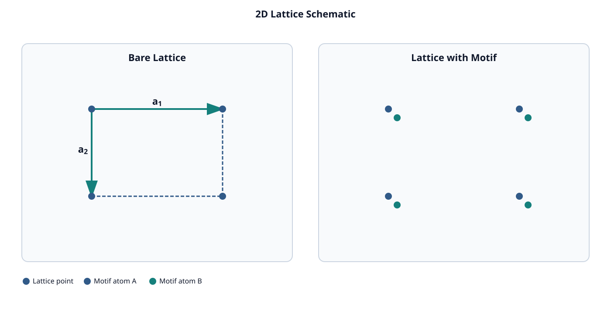
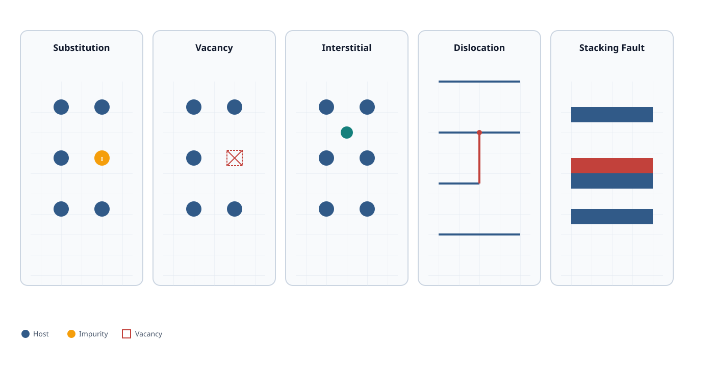
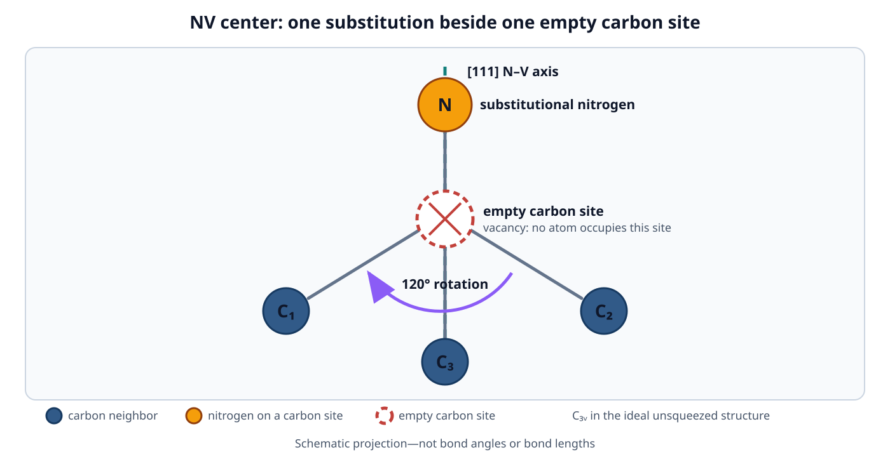
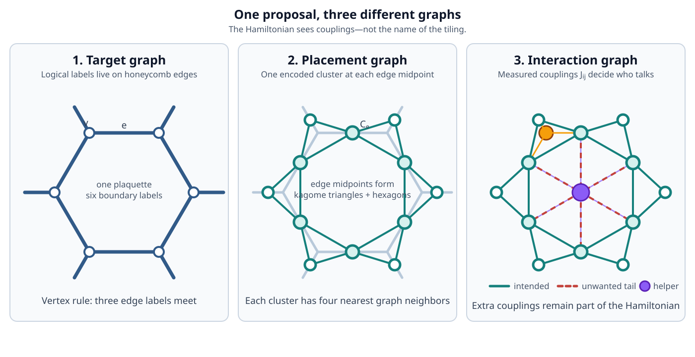
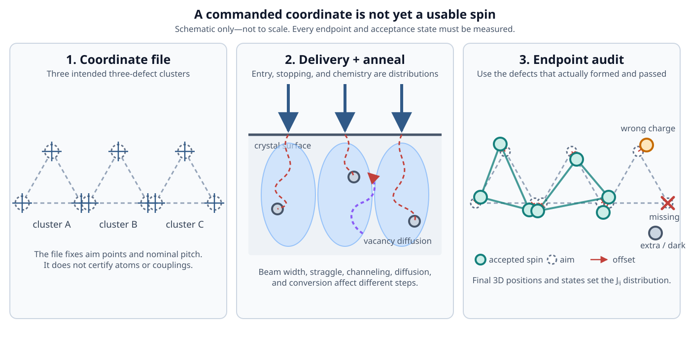
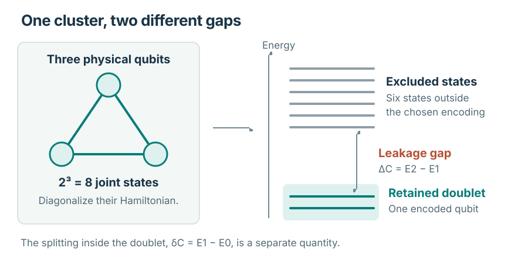
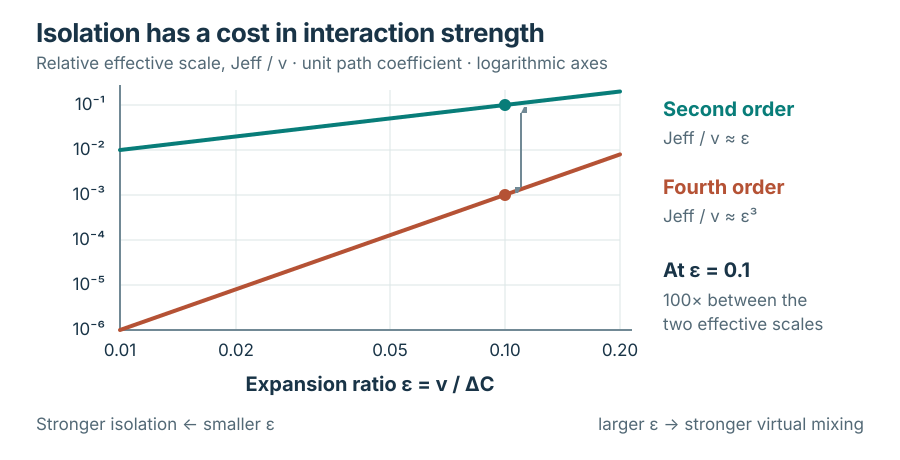
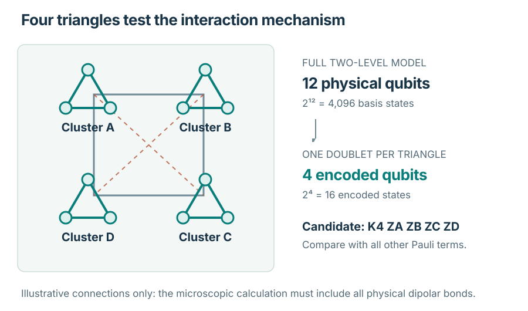

<!-- Generated from notes/pages/defects-to-topological-qubits.html by npm run notes:export:qubits. Edit the HTML source, not this export. -->

[]{#top}

Notebook / Quantum information

# Defect-engineered topological qubits

How scientists study individual spins in crystals and investigate whether they could store quantum information reliably.

Foundations · Three assessment units · Eight mathematical appendices · Illustrated reading edition. Experimental evidence is discussed in its stated context, through August 2026.

1.  01 / LOCAL --- **Defect spin** --- Prepare and control a physical quantum state.
2.  02 / ENCODED --- **Cluster qubit** --- Select two states from a larger system.
3.  03 / COLLECTIVE --- **Topological phase** --- Establish the interacting many-body model.
4.  04 / OPERATIONAL --- **Protected memory** --- Test errors, temperature, and storage time.

[]{#reading-guide}

Start with the question you have

## A clear route through a long subject {#reading-guide-title}

Read Chapters 1--4 first if quantum mechanics is new to you: they explain the states, measurements, entanglement, and noise used later. Chapters 5--11 move from crystal structure and defect-spin experiments to interactions and cluster encodings. Chapters 12--36 use that hardware vocabulary to build many-body models, explain fabrication requirements, and develop diagnostics. The three assessment units then compare the proposed memory with those physical and theoretical requirements. If you already know a stage, use the routes below to enter at the next one.

[**Build the foundations** --- Chapters 1--4 · States, measurement, entanglement, and noise.](#chapter-1-discrete-outcomes-in-the-sterngerlach-experiment)

[**Understand the physical hardware** --- Chapters 5--11 · Crystals, defects, interactions, and encoded clusters.](#chapter-5-translational-symmetry-and-defect-localization-in-a-crystal)

[**Connect the hardware to topology** --- Chapters 12--36 · Anyons, target Hamiltonians, fabrication, and diagnostics.](#chapter-12-winding-homotopy-and-topological-protection)

[**Assess the proposed architecture** --- Assessment I: proposal and limits; Assessment II: decisive tests; Assessment III: a worked four-cluster assessment.](#chapter-37-the-strongest-evidence-based-case)

In each assessment unit and appendix, begin with the main explanation in the chapter or appendix body. Expand **Detailed treatment** for its derivation or supporting evidence. Exercises appear with the material they test; work through them to check your understanding. Supporting material stays beside the concept it develops.

Chapter numbering: Assessment I contains material from former Chapters 37--38. Assessment II contains former Chapters 39--40. Assessment III develops Chapter 41. Original chapter and section links remain available. Chapter, section, and equation references in the supporting notes retain their original numbering.

**Keep the notation and energy scales in view**

+-----------------------------------+-------------------------------------------------------------------------------------------------------------------------------------------------------------------+------------------------------------------------------------------------------------------------------------------------------------------------------------------------------------------------------------------------------------------------------------------------------------------------------------------------------------+
| Symbol                            | Meaning                                                                                                                                                           | What to keep separate                                                                                                                                                                                                                                                                                                              |
+===================================+===================================================================================================================================================================+====================================================================================================================================================================================================================================================================================================================================+
| $H$, $H_C$                        | Hermitian energy operator for the full modeled system or cluster $C$.                                                                                             | Both have energy eigenvalues. Dividing either Hamiltonian by $h$ expresses its eigenvalues in ordinary-frequency units (hertz); dividing by $\hbar$ expresses them in angular-frequency units (radians per second).                                                                                                                |
+-----------------------------------+-------------------------------------------------------------------------------------------------------------------------------------------------------------------+------------------------------------------------------------------------------------------------------------------------------------------------------------------------------------------------------------------------------------------------------------------------------------------------------------------------------------+
| $\Delta_C$                        | Cluster leakage gap: for a retained lowest pair, the energy from its higher level to the lowest excluded level.                                                   | If $E_0\leq E_1<E_2$ are the lowest three eigenenergies of that cluster Hamiltonian, then $\Delta_C=E_2-E_1$. The pair\'s internal splitting is $E_1-E_0$, not the leakage gap. Other retained pairs need a locally specified separation.                                                                                          |
+-----------------------------------+-------------------------------------------------------------------------------------------------------------------------------------------------------------------+------------------------------------------------------------------------------------------------------------------------------------------------------------------------------------------------------------------------------------------------------------------------------------------------------------------------------------+
| $\Delta_{\mathrm{topo}}$          | Bulk many-body gap above a specified candidate ground-state sector of an interacting model.                                                                       | It is a collective excitation gap, not a cluster gap or the splitting within the sector. Its geometry, sector, and large-system convention must be stated; boundary excitations in an open sample are distinct.                                                                                                                    |
+-----------------------------------+-------------------------------------------------------------------------------------------------------------------------------------------------------------------+------------------------------------------------------------------------------------------------------------------------------------------------------------------------------------------------------------------------------------------------------------------------------------------------------------------------------------+
| $v$, $J$, $J_{\mathrm{eff}}$, $K$ | Locally defined microscopic or effective interaction coefficients, usually in energy units.                                                                       | State the operator each coefficient multiplies: its sign and normalization depend on that operator convention. A spectral gap comes from the full Hamiltonian and is not generally equal to one coefficient. Units are local; Chapter 41 uses $c$, $u$, and $K_4$ as ordinary-frequency coefficients in hertz.                     |
+-----------------------------------+-------------------------------------------------------------------------------------------------------------------------------------------------------------------+------------------------------------------------------------------------------------------------------------------------------------------------------------------------------------------------------------------------------------------------------------------------------------------------------------------------------------+
| $h$, $\hbar$, $\nu_E=E/h$         | $h$ is Planck\'s constant; $\hbar=h/(2\pi)$ is the reduced Planck constant. Both have units of joule-seconds. $\nu_E$ expresses energy $E$ as ordinary frequency. | $\nu_E$ is in hertz. The angular-frequency conversion is $\omega_E=E/\hbar=2\pi\nu_E$, in radians per second.                                                                                                                                                                                                                      |
+-----------------------------------+-------------------------------------------------------------------------------------------------------------------------------------------------------------------+------------------------------------------------------------------------------------------------------------------------------------------------------------------------------------------------------------------------------------------------------------------------------------------------------------------------------------+
| $T_2$, $\Gamma=1/T_2$             | $T_2$ is an exponential coherence-decay time in seconds; $\Gamma$ is its positive decay rate in inverse seconds.                                                  | The rate-associated comparison scales are energy $\hbar\Gamma$ and ordinary frequency $\Gamma/(2\pi)$. This is not an oscillation frequency or literal system energy. Spectral linewidth interpretations require the exponential-decay/Lorentzian convention.                                                                      |
+-----------------------------------+-------------------------------------------------------------------------------------------------------------------------------------------------------------------+------------------------------------------------------------------------------------------------------------------------------------------------------------------------------------------------------------------------------------------------------------------------------------------------------------------------------------+
| $P$                               | Orthogonal projector onto the retained subspace in the full state space.                                                                                          | For an $N$-dimensional full space, $P$ is $N\times N$ and obeys $P^2=P=P^\dagger$. The dagger denotes complex-conjugate transpose.                                                                                                                                                                                                 |
+-----------------------------------+-------------------------------------------------------------------------------------------------------------------------------------------------------------------+------------------------------------------------------------------------------------------------------------------------------------------------------------------------------------------------------------------------------------------------------------------------------------------------------------------------------------+
| $W$                               | Isometry from an $r$-dimensional retained space into the $N$-dimensional full space, where $r\leq N$.                                                             | $W$ is $N\times r$; its orthonormal columns span the subspace selected by $P$. Thus $W^\dagger W=I_r$ and $WW^\dagger=P$, where $I_r$ is the identity on the retained $r$-dimensional space. For one encoded qubit, $r=2$.                                                                                                         |
+-----------------------------------+-------------------------------------------------------------------------------------------------------------------------------------------------------------------+------------------------------------------------------------------------------------------------------------------------------------------------------------------------------------------------------------------------------------------------------------------------------------------------------------------------------------+
| $X,Y,Z$ or $\tau^\mu$             | Dimensionless Pauli operators on a specified two-state space, with eigenvalues $+1$ and $-1$.                                                                     | In $\tau^\mu$, $\mu$ labels the $x,y,z$ component. Identify whether the space is a physical defect doublet or an encoded cluster. Do not confuse Pauli operators with spin components normalized to $\pm\tfrac12$ or with physical angular momentum; define the basis and normalization before interpreting a coefficient.         |
+-----------------------------------+-------------------------------------------------------------------------------------------------------------------------------------------------------------------+------------------------------------------------------------------------------------------------------------------------------------------------------------------------------------------------------------------------------------------------------------------------------------------------------------------------------------+
| $\epsilon$                        | A locally defined dimensionless small parameter for an approximation.                                                                                             | Identify its numerator (the relevant coupling or coupling norm) and denominator (the relevant excitation gap) at each use. Smallness supports the stated perturbative regime; it is not by itself a device-error probability or a system-wide convergence guarantee. Device-error estimates also require noise and control models. |
+-----------------------------------+-------------------------------------------------------------------------------------------------------------------------------------------------------------------+------------------------------------------------------------------------------------------------------------------------------------------------------------------------------------------------------------------------------------------------------------------------------------------------------------------------------------+

Symbols can have different meanings in different chapters. Use the definition and units given where each symbol appears. For example, $\alpha$ can denote a dimensionless state amplitude or a dimensionless protocol cost. In Chapter 41, $c$, $u$, and $K_4$ are ordinary-frequency interaction coefficients in hertz; the corresponding energy coefficients are $hc$, $hu$, and $hK_4$.

For an exponential coherence model, let $C(t)$ be dimensionless interference contrast at time $t$ seconds. It decays as

$$C(t)=C(0)e^{-\Gamma t},
\qquad
\Gamma=\frac{1}{T_2},
\qquad
C(T_2)=\frac{C(0)}{e}.$$

Here $T_2$ is the coherence decay time, and $\Gamma$ has units of inverse seconds. These relations describe the stated exponential model, not every possible decay envelope.

For a single static coupling across the cluster leakage gap, an illustrative perturbative parameter is

$$\epsilon=\frac{|v|}{\Delta_C}
:=\frac{|v|/h}{\Delta_C/h}
\ll1.$$

Here $v$ is an energy-valued matrix element coupling the retained eigenstate of energy $E_1$ to the lowest excluded eigenstate of energy $E_2$. Their separation is the table\'s $\Delta_C=E_2-E_1>0$. Dividing both energies by $h$ leaves their dimensionless ratio unchanged. For multiple coupled states or links, identify the coupling norm and denominators used in the local calculation; this single ratio is not a universal convergence or device-error bound.

An isometry also lets us represent an operator on the smaller retained space. If $O$ acts on the full space, define its retained-space matrix and embed that matrix back into the full space by

$$O_{\mathrm{eff}}=W^\dagger O W,
\qquad
P O P=W O_{\mathrm{eff}}W^\dagger.$$

Here $O_{\mathrm{eff}}$ is an $r\times r$ matrix, $P=WW^\dagger$, and $W$ maps the retained space into the full space. This exact projection identity does not include every virtual-transition correction that may enter an effective Hamiltonian.

For a family of closed periodic samples with the same topology, one useful convention keeps the splitting within the candidate ground-state sector separate from the gap above it:

$$\Delta(L)=E_q(L)-E_{q-1}(L),
\qquad
\Delta_{\mathrm{topo}}:=\liminf_{L\rightarrow\infty}\Delta(L).$$

The energies $E_j(L)$, indexed by $j=0,1,\ldots$, are the many-body eigenenergies in nondecreasing order, repeating degenerate energies according to their multiplicity. The linear size $L$ is in metres; the lowest $q$ levels form the candidate ground-state sector, with $q$ fixed across this family. Thus $\Delta(L)$ is the finite-size gap above that sector, and $\Delta_{\mathrm{topo}}$ is the large-system bulk gap under this convention. The lower limit $\liminf$ is the limiting lower bound of these gaps as $L$ grows. A positive gap alone does not prove topological order. For open samples, distinguish bulk excitations from potentially low-energy boundary states.

A reliable unit check is to compare all energies in a common energy unit, or divide each by $h$ and compare all in hertz.

Temperature enters energy comparisons through thermal energy, not through the temperature number alone. For positive temperature $T$ in kelvin, Boltzmann\'s constant $k_B$ in joules per kelvin, and gap $\Delta_{\mathrm{topo}}$ in joules, define $\nu_T$ as thermal energy expressed in hertz:

$$\nu_T=\frac{k_BT}{h},
\qquad
\frac{\Delta_{\mathrm{topo}}}{k_BT}
:=\frac{\Delta_{\mathrm{topo}}/h}{\nu_T}.$$

The ratio is dimensionless and only expresses a unit-consistent energy comparison; it does not establish a lifetime or replace a thermal-noise model.

When comparing an interaction energy with coherence decay, keep each quantity\'s units explicit. Let $J_{\mathrm{eff}}$ be a real signed interaction-energy coefficient in joules, $T_2$ the coherence time in seconds, and $\Gamma=1/T_2$. Planck\'s constant is $h$ in joule-seconds, with $h=2\pi\hbar$. Then the denominator converts as

$$h=2\pi\hbar,
\qquad
\Gamma=\frac{1}{T_2},
\qquad
\frac{\hbar\Gamma}{h}=\frac{1}{2\pi T_2}.$$

Both $J_{\mathrm{eff}}/h$ and $\hbar\Gamma/h$ have units of hertz. Dividing the signed coefficient by the rate-associated energy scale gives

$$\frac{J_{\mathrm{eff}}}{\hbar\Gamma}
:=\frac{J_{\mathrm{eff}}/h}{(\hbar\Gamma)/h}
:=\frac{J_{\mathrm{eff}}/h}{1/(2\pi T_2)}
:=2\pi\left(\frac{J_{\mathrm{eff}}}{h}\right)T_2.$$

The product $(J_{\mathrm{eff}}/h)T_2$ is dimensionless and measures the signed interaction-frequency coefficient over one coherence time. For a comparison of interaction strength with decay, use $|J_{\mathrm{eff}}|$. Actual oscillation cycles depend on the energy differences generated by the specified Hamiltonian term; a coefficient alone need not equal an observable oscillation frequency. For example, a term $J_{\mathrm{eff}}Z$ with Pauli eigenvalues $\pm1$ has level separation $2|J_{\mathrm{eff}}|$.

[]{#book-content}

## Part I --- Foundations of quantum mechanics

### Foundations of Quantum Mechanics {#foundations-overview}

Quantum mechanics is the physical theory of atoms and the particles they are made of. Its predictions differ from those of classical physics in ways that experiments can check. The first example in this book is a beam of silver atoms sent through a specially shaped magnet. A model of the atoms as randomly oriented classical magnetic needles predicts a continuous spread of arrival points. The beam instead lands in two separate spots. Three ideas are needed to describe results like this: superposition, entanglement, and measurement.

### Superposition {#foundations-superposition}

One key idea in quantum mechanics is **superposition**. A quantum state can be a combination of simpler states, such as the states belonging to the possible results of a measurement. The combination is itself one well-defined state, not several ordinary states present at once. It tells us how likely each result is when we measure. For example, an electron's state can combine two energy levels. Measuring its energy then gives one level or the other, with probabilities set by the combination.

Superposition differs from ordinary uncertainty about a hidden value. A hidden value is a definite property that an object already has but that we do not know. A coin under a cup is an example: it already shows heads or tails. For a hidden value, the probability of any later result is an average. Each possible value contributes the probability it would give on its own, weighted by how likely that value is. The parts of a superposition do not combine this way. They can reinforce or cancel one another. Cancellation can make a result impossible even though each part on its own would allow it. Chapter 1 shows this happening for real atoms.

### Entanglement {#foundations-entanglement}

Another important concept is **entanglement**. It concerns two or more particles described together. Suppose two particles share one joint state that is pure, meaning it contains no added ordinary randomness about which state was prepared. The particles are entangled when no choice of a separate pure state for each particle reproduces that joint state.

Suitable choices of measurement on entangled particles reveal correlated results, even when the particles are far apart. For some entangled states and measurement choices, the correlations exceed a limit known as a Bell inequality. That limit holds for every description of one particular kind. In such a description, each particle carries its own predetermined answers to every measurement, and a measurement on one particle cannot affect the other. The measurement choices are also independent of those predetermined answers. Not every measurement choice gives correlated results. Correlated results alone also do not prove entanglement. Ordinary shared randomness, such as two sealed envelopes holding matching cards, correlates results too.

Experiments have confirmed these quantum correlations [\[R004\]](#ref-R004 "[R004] M. A. Nielsen and I. L. Chuang, Quantum Computation and
Quantum Information, 10th anniversary ed., Cambridge University Press,
2010. DOI: 10.1017/CBO9780511976667 ."). They still cannot be used to send a signal. Each experimenter alone sees random results. Their probabilities do not depend on which measurement the other experimenter chose. The correlation appears only when the two lists of results are brought together and compared. Bringing them together requires an ordinary message, which travels no faster than light.

### Measurement and Collapse {#foundations-measurement}

A **measurement** in quantum mechanics gives one result out of a fixed set of possible results, such as one of the two spots in the Stern--Gerlach experiment described below. The state gives the probability of each result. Usually it does not predict the result of a single run, although some preparations make one result certain. In the idealized model of measurement, the state is then updated to the one that matches the result. So repeating the same measurement straight away gives the same result again. This update is called *collapse*.

------------------------------------------------------------------------

Each of these ideas builds on the one before. Superposition explains how one state can give different results with definite probabilities. Entanglement extends that description to several particles at once. Measurement and collapse explain an effect that Chapter 1 demonstrates with three magnets in a row: measuring one property can change the results of a later measurement of another.

A beam of atoms can produce two separate spots on a detector. This part develops the quantum description needed to predict that result and understand experiments with individual atoms.

**In the arc:** Toolkit, before the arc. The arc is the book's four-stage argument: a single defect spin (Stage 01, from Part III), spins encoded in clusters (Stage 02), collective topological phases (Stage 03), and whether the device's numbers line up (Stage 04). This part supplies the quantum mechanics that every stage relies on.

------------------------------------------------------------------------

## Chapter 1 --- Discrete outcomes in the Stern--Gerlach experiment

In the Stern--Gerlach experiment, a beam of silver atoms travels through a magnetic field that varies with position. The field deflects the atoms according to their magnetic properties. If those properties behaved like randomly oriented classical magnetic needles, the deflections would span a continuous range. The observed beam instead separates into two branches.

Otto Stern and Walther Gerlach observed this splitting in 1922 [\[R038\]](#ref-R038 "[R038] W. Gerlach and O. Stern, “Der experimentelle Nachweis der
Richtungsquantelung im Magnetfeld,” Zeitschrift für Physik 9, 349–352
(1922). DOI: 10.1007/BF01326983 ."). We will idealize it as a measurement with two possible outcomes, each identified by the branch an atom follows. Repeating the experiment with the same preparation gives a fraction of atoms in each branch. The quantum model predicts the probabilities governing those fractions.

**Assumes:** complex numbers, vectors, and matrices; no prior knowledge of quantum mechanics.\
**Introduces:** the following concepts, each developed in the section linked after it:

- The *state ket* $|\psi\rangle$: a column of two complex numbers with norm one, representing a prepared state ([Complex amplitudes and interference](#complex-amplitudes-and-interference)).
- The *Born rule*: outcome probabilities are squared magnitudes of complex amplitudes computed from the state. It is first used for one magnet and stated in general in [The Born rule and projection](#the-born-rule-and-projection).
- *Superposition*: a state written as a weighted sum of basis states, with complex weights ([Basis states and superposition](#basis-states-and-superposition)).
- *Overall phase*: a common factor of magnitude one, which changes no measurement probability. *Relative phase*: the phase difference between two amplitudes, which can change probabilities through interference ([Overall and relative phase](#overall-and-relative-phase)).
- *Projective measurement*: an ideal measurement whose outcomes belong to mutually orthogonal subspaces. It returns one outcome and replaces the state by its normalized component in that outcome's subspace ([The Born rule and projection](#the-born-rule-and-projection)).
- *Observables*: measurable quantities, represented by Hermitian matrices whose eigenvalues are the possible readings ([Operators and observables](#operators-and-observables)).
- *Unitary evolution*: deterministic and reversible change of a state over time, which preserves the state's norm ([Unitary time evolution](#unitary-time-evolution)).

**Used later in:** Chapter 2 (kets, the Born rule, superposition, and relative phase for two atoms), Chapter 3 (Pauli operators and unitary evolution for one qubit), Chapter 5 (Hamiltonians, eigenstates, and eigenvalues of a crystal chain), and Chapters 12--13 (kets and unitary evolution).

### Complex amplitudes and interference

Choose the magnet\'s measurement axis as the $z$ axis and label its two outputs $z+$ and $z-$. Which output an atom takes is decided by an internal property of the atom. The next section identifies that property as spin. We describe this property alone. The atom\'s position and its other internal properties are left outside the model.

The description uses $\mathbb C^2$, the set of columns of two complex numbers. Two columns are added entry by entry. A column is multiplied by a complex number entry by entry. With these two operations $\mathbb C^2$ is a complex vector space, and its elements are called vectors. A vector here means such a column of complex numbers, not an arrow in ordinary space.

#### Complex numbers, magnitudes, and phases {#ch01-complex-numbers}

Every entry is a complex number, so we first fix notation. Write a complex number as

$$w = a + ib,$$

with real $a$ and $b$ and $i^2=-1$. The letter $w$ stands for a generic number; it has nothing to do with the $z$ axis. Its complex conjugate is $w^*=a-ib$. The squared magnitude of $w$ is the product of the two:

$$|w|^2 = w^* w = (a-ib)(a+ib) = a^2 + iab - iab - i^2 b^2 = a^2 + b^2.$$

The two cross terms cancel, and $-i^2b^2=+b^2$. So the squared magnitude is a sum of two real squares and is never negative. Its square root $|w|$ is the magnitude: the distance of $w$ from zero in the complex plane. For any two complex numbers $u$ and $v$, magnitudes multiply: $|uv|^2=(uv)^*(uv)=u^*u\,v^*v=|u|^2|v|^2$.

A complex number can also be described by its magnitude and an angle. Euler\'s formula defines a complex number of magnitude one for each real angle $\theta$, measured in radians:

$$e^{i\theta} = \cos\theta + i\sin\theta,
\qquad
|e^{i\theta}|^2 = \cos^2\theta + \sin^2\theta = 1.$$

Any nonzero complex number can be written as $w=|w|e^{i\theta}$. The angle $\theta$ is called the phase of $w$. Multiplying by $e^{i\theta}$ rotates a number about zero in the complex plane without changing its magnitude.

#### Pure states and probability amplitudes {#ch01-pure-states-and-amplitudes}

We start with the simplest kind of preparation, called a *pure state*. A pure state is described by a single vector of norm one. The norm of a column with entries $\alpha$ and $\beta$ is

$$\|\psi\| = \sqrt{|\alpha|^2+|\beta|^2}.$$

Here $\psi$ names the column, and $\alpha$ and $\beta$ are complex numbers. Requiring the norm to equal one is called *normalization*. A vector with norm one is *normalized*. Preparations that need more than one vector, called statistical mixtures, appear in [The Born rule and projection](#the-born-rule-and-projection).

The two entries $\alpha$ and $\beta$ are the coordinates of the vector in a fixed basis. A basis is a set of vectors from which every vector can be built as a weighted sum, in exactly one way. Our basis has two vectors, one for each output of the $z$ magnet, and is called the $z$ basis. The first entry belongs to output $z+$ and the second to $z-$. The next section writes these basis vectors out and checks the property, orthonormality, that makes them suitable.

These coordinates are called *probability amplitudes*, or simply amplitudes. An amplitude is not itself a probability: it is a complex number and can even be negative. The probability of an output is the squared magnitude of its amplitude:

$$P(z+) = |\alpha|^2,
\qquad
P(z-) = |\beta|^2.$$

Here $P(z+)$ is the probability that an atom prepared in this state leaves through output $z+$. This is the *Born rule* for the $z$ magnet. Its general form is stated in [The Born rule and projection](#the-born-rule-and-projection).

These numbers behave as probabilities must. Each is a squared magnitude, so neither is negative. In this ideal model every atom leaves through one of the two outputs, so the two probabilities must add to one. Normalization guarantees exactly that:

$$P(z+) + P(z-) = |\alpha|^2+|\beta|^2 = 1.$$

A worked example: take $\alpha=3/5$ and $\beta=4i/5$. Then $|\alpha|^2=9/25$ and $|\beta|^2=(-4i/5)(4i/5)=16/25$. The column is normalized, since $9/25+16/25=1$. About 36% of many identically prepared atoms leave through $z+$, and about 64% through $z-$.

In Dirac notation, the notation of Dirac\'s textbook [\[R040\]](#ref-R040 "[R040] P. A. M. Dirac, The Principles of Quantum Mechanics, 4th ed.,
Oxford University Press (1958; reissued 1981). ISBN: 978-0-19-852011-5.
Stable URL: Oxford
Academic ."), the state vector is written as a *ket*:

$$|\psi\rangle
=
\begin{pmatrix}
\alpha \\
\beta
\end{pmatrix}.$$

Here the ket is displayed as a column in the fixed $z$ basis. Its entries are the amplitudes for $z+$ and $z-$, in that order.

#### Which parts of the amplitudes matter {#ch01-phases-and-interference}

Two different columns can describe the same physical state. Multiply both amplitudes by the same number $e^{i\gamma}$, with $\gamma$ real. Such a common factor of magnitude one is called an *overall phase*. The Born probabilities do not change:

$$|e^{i\gamma}\alpha|^2 = |e^{i\gamma}|^2\,|\alpha|^2 = |\alpha|^2,
\qquad
|e^{i\gamma}\beta|^2 = |\beta|^2.$$

The first step uses $|uv|^2=|u|^2|v|^2$; the second uses Euler\'s formula. [Overall and relative phase](#overall-and-relative-phase) shows that the same cancellation happens for every measurement. Overall phase therefore carries no measurable information.

The amplitudes still carry more than the two $z$ probabilities. Compare the columns $(1/\sqrt2,\,1/\sqrt2)^T$ and $(1/\sqrt2,\,-1/\sqrt2)^T$. The superscript $T$ denotes transpose, turning each displayed row into a column. Both give probability one half for each $z$ output. They differ in their *relative phase*, the phase difference between the second amplitude and the first. It is $0$ for the first column and $\pi$ for the second, since $-1=e^{i\pi}$. No overall factor turns one column into the other, so they need not describe the same state. A magnet along a perpendicular axis tells them apart, as [Sequential measurements along perpendicular axes](#sequential-measurements-along-perpendicular-axes) shows.

Relative phase matters when one outcome receives contributions from both amplitudes. Measurements along other axes work this way. The amplitude for such an outcome is a sum $c_1+c_2$ of two complex contributions. Its probability is the squared magnitude of the sum:

$$|c_1+c_2|^2 = |c_1|^2 + |c_2|^2 + 2\operatorname{Re}(c_1^*c_2).$$

Here $\operatorname{Re}$ denotes the real part. The identity follows by expanding $(c_1+c_2)^*(c_1+c_2)$. The two cross terms $c_1^*c_2$ and $c_2^*c_1$ are complex conjugates of each other, so they add to twice their real part.

The last term is called the interference term, and it depends on the relative phase of $c_1$ and $c_2$. When it is positive, the contributions reinforce each other: constructive interference. When it is negative, they partly or fully cancel: destructive interference. For example, $c_1=1/2$ and $c_2=-1/2$ give probability $1/4+1/4-1/2=0$, although each contribution alone would give $1/4$. *Interference* means either effect. The $x$-axis magnet introduced two sections below shows both.

### Basis states and superposition

The internal angular momentum tracked by this two-state model is called spin. It is an internal property, distinct from the angular momentum of the atom\'s motion through the apparatus. A spin component is the angular momentum measured along a chosen axis. The magnet with measurement axis $z$ distinguishes the two possible values of that component.

The basis vectors represent preparations that give the corresponding output with certainty:

$$|z+\rangle
=
\begin{pmatrix} 1 \\ 0 \end{pmatrix},
\qquad
|z-\rangle
=
\begin{pmatrix} 0 \\ 1 \end{pmatrix}.$$

For example, $|z+\rangle$ has amplitudes $\alpha=1$ and $\beta=0$, so $P(z+)=1$ and $P(z-)=0$. In this basis the general pure-state vector is

$$|\psi\rangle = \alpha |z+\rangle + \beta |z-\rangle.$$

A weighted sum of basis vectors like this is called a *superposition* of them. When both $\alpha$ and $\beta$ are nonzero, the state is a superposition in the $z$ basis. The word depends on the basis: the next section writes $|z+\rangle$ itself as a superposition of two other basis vectors.

The coefficients are **complex amplitudes**, not directions in ordinary space. The atom does not point along two directions at once. Each amplitude has a **magnitude**, and every nonzero amplitude also has a **phase**. The squared magnitude gives the probability of the corresponding outcome. The phase does not change that probability, but it controls interference when amplitudes are added.

For example, suppose $|\alpha|^2=0.5$, a value chosen only for illustration. Normalization then forces $|\beta|^2=0.5$ as well. About half of many identically prepared atoms are found in the $z+$ output, and about half in $z-$. These two numbers do not fix the phases of $\alpha$ and $\beta$.

#### Inner products and orthonormal bases {#ch01-inner-products}

To compute amplitudes for other measurements, we need inner products. The conjugate transpose of a ket is written as a *bra*:

$$\langle\psi| = \begin{pmatrix} \alpha^* & \beta^* \end{pmatrix}.$$

The product of a bra with a ket is their *inner product*, a single complex number. Let $|\phi\rangle$ be a second ket with entries $\phi_1$ and $\phi_2$. Its inner product with $|\psi\rangle$ is the row-times-column product

$$\langle\phi|\psi\rangle = \phi_1^*\alpha + \phi_2^*\beta.$$

Swapping the two kets conjugates the result: $\langle\psi|\phi\rangle=\langle\phi|\psi\rangle^*$. The inner product is linear in its ket: $\langle\phi|\bigl(c|\psi\rangle\bigr)=c\langle\phi|\psi\rangle$ for any complex number $c$. The inner product of a ket with itself is its squared norm, $\|\psi\|^2=\langle\psi|\psi\rangle$. So normalization becomes

$$\langle\psi|\psi\rangle = |\alpha|^2 + |\beta|^2 = 1.$$

Two kets are *orthogonal* when their inner product is zero. A basis is *orthonormal* when each of its vectors has norm one and different vectors are orthogonal. Orthogonality alone is not enough. The columns $(2,0)^T$ and $(0,3)^T$ are orthogonal, but neither has norm one. The $z$ basis is orthonormal, as the column forms show:

$$\langle z+|z+\rangle=\langle z-|z-\rangle=1,
\qquad
\langle z+|z-\rangle=\langle z-|z+\rangle=0.$$

For example, $\langle z+|z-\rangle=1\cdot0+0\cdot1=0$.

Inner products give amplitudes. Take the bra of a normalized outcome vector and the ket of the prepared state. Their inner product is the amplitude for that outcome, and its squared magnitude is the Born probability. For the $z$ outputs this recovers the coordinates:

$$\langle z+|\psi\rangle = 1\cdot\alpha + 0\cdot\beta = \alpha,
\qquad
\langle z-|\psi\rangle = \beta.$$

The same recipe works for any measurement whose outcome vectors form an orthonormal basis. The next section applies it to a magnet along a different axis.

Our finite-dimensional complex vector space $\mathbb C^2$, equipped with this inner product, is a *Hilbert space*. We call it the *state space* of the spin.

### Sequential measurements along perpendicular axes

An ideal Stern--Gerlach filter is a magnet that separates the two outputs of a spin-component measurement, with a block placed across one output. Keeping only the atoms from the unblocked output is called *postselection*.

#### Two idealizing assumptions {#ch01-idealizing-assumptions}

First, we assume that each atom the filter keeps is left in the basis state matching its output. In other words, the measurement does not just report a result; it also resets the atom to the state for that result. One consequence: measuring the same axis a second time returns the same output every time. Real measurements can disturb the state in other ways, lose atoms, or misreport the output. The general rule for an ideal measurement is stated in [The Born rule and projection](#the-born-rule-and-projection). Imperfections are discussed in [Physical implementation of the 1922 experiment](#physical-implementation-of-the-1922-experiment).

Second, we assume the spin state does not change between magnets. This excludes any magnetic field acting on the spin in the gaps. It also excludes interactions with degrees of freedom the model does not track. [Unitary time evolution](#unitary-time-evolution) shows how the state changes when a field does act.

#### A magnet along a perpendicular axis {#ch01-x-basis}

Now rotate the measurement axis from $z$ to the perpendicular $x$ axis. The new magnet measures a different spin component. Label its outputs $x+$ and $x-$. In the two-state spin model, their basis vectors are

$$|x+\rangle = \frac{|z+\rangle + |z-\rangle}{\sqrt{2}},
\qquad
|x-\rangle = \frac{|z+\rangle - |z-\rangle}{\sqrt{2}}.$$

This relation between the two bases is part of the physical model for perpendicular spin measurements. Two requirements of the model fix it, apart from conventions. First, an atom prepared in $|z+\rangle$ or $|z-\rangle$ gives each $x$ output with probability one half. So each $x$ vector has amplitudes of magnitude $1/\sqrt2$ on both $z$ vectors. Second, $x+$ and $x-$ are distinct outputs of one magnet, so their vectors must be orthogonal. With equal magnitudes, orthogonality forces the relative phases of $|x+\rangle$ and $|x-\rangle$ to differ by $\pi$: a sign flip.

One choice remains: the relative phase inside $|x+\rangle$, here taken as zero. This choice is a convention that fixes which perpendicular direction we call $x$. A different choice, such as $(|z+\rangle+i|z-\rangle)/\sqrt2$, would describe another axis perpendicular to $z$.

Both vectors have unit norm, and their inner product vanishes. The bra of $|x\pm\rangle$ is $(\langle z+|\pm\langle z-|)/\sqrt2$, since its coefficients are real. Expand each product term by term and use the $z$-basis inner products found above:

$$\langle x+|x+\rangle
=
\frac12\bigl(\langle z+|z+\rangle + \langle z+|z-\rangle + \langle z-|z+\rangle + \langle z-|z-\rangle\bigr)
=
\frac12(1+0+0+1)
=
1,$$

$$\langle x+|x-\rangle
=
\frac12\bigl(\langle z+|z+\rangle - \langle z+|z-\rangle + \langle z-|z+\rangle - \langle z-|z-\rangle\bigr)
=
\frac12(1-0+0-1)
=
0.$$

The same expansion gives $\langle x-|x-\rangle=1$.

#### Interference in the x basis {#ch01-coherent-superposition}

The vanishing inner product has a direct measurement meaning. Prepare an atom in $|x-\rangle$ and send it into an $x$ magnet. Its amplitude for output $x+$ is $\langle x+|x-\rangle$. The $|z+\rangle$ term contributes $(1/\sqrt2)(1/\sqrt2)=1/2$. The $|z-\rangle$ term contributes $(1/\sqrt2)(-1/\sqrt2)=-1/2$. These equal and opposite contributions cancel, so $x+$ has probability zero. This is destructive interference: the case $c_1=1/2$, $c_2=-1/2$ of the first section. For the input $|x+\rangle$, the two contributions are $1/2$ and $1/2$, and they reinforce to give amplitude one.

The cancellation depends on the relative sign between the two $z$ terms of $|x-\rangle$. In this pure-state preparation, that sign is fixed. We assume that no untracked interaction changes or randomizes it before the measurement. A superposition whose relative phase stays fixed in this way is called a *coherent superposition*. Suppose instead the sign were random from atom to atom, equally often plus and minus. Half the atoms would then be in $|x+\rangle$ and half in $|x-\rangle$. The average probability of $x+$ would be one half, and the cancellation would not be seen.

The rule behind interference is about order. When two terms feed the same outcome, add their amplitudes first, then take the squared magnitude. Two distinct outcomes of one measurement, such as $z+$ and $z-$, follow a different rule. They exclude each other, so the probability of getting one or the other is the sum of their probabilities.

For that measurement, amplitudes of distinct outcomes do not combine. They multiply different, orthogonal basis vectors. No Born-rule expression for that measurement adds them into one amplitude. Adding them anyway gives a number with no probability meaning. For $|x-\rangle$, the $z$ amplitudes $1/\sqrt2$ and $-1/\sqrt2$ add to zero. Yet the atom is certain to leave through $z+$ or $z-$, with probability $1/2+1/2=1$.

The same rule gives the $x$-magnet probabilities for any state $|\psi\rangle=\alpha|z+\rangle+\beta|z-\rangle$. Apply the bras $\langle x\pm|=(\langle z+|\pm\langle z-|)/\sqrt2$ and use $\langle z+|\psi\rangle=\alpha$, $\langle z-|\psi\rangle=\beta$:

$$\langle x+|\psi\rangle=\frac{\alpha+\beta}{\sqrt2},
\qquad
\langle x-|\psi\rangle=\frac{\alpha-\beta}{\sqrt2}.$$

Squaring the magnitudes gives

$$P(x\pm)
=\frac12|\alpha\pm\beta|^2
=\frac12\bigl(|\alpha|^2+|\beta|^2\pm2\operatorname{Re}(\alpha^*\beta)\bigr)
=\frac12\pm\operatorname{Re}(\alpha^*\beta).$$

The middle step is the interference identity with $c_1=\alpha$ and $c_2=\pm\beta$. The last step uses normalization. The term $\operatorname{Re}(\alpha^*\beta)$ depends on the relative phase of $\alpha$ and $\beta$. The $z$ probabilities $|\alpha|^2$ and $|\beta|^2$ do not. This term is exactly what would be lost if the two contributions were treated as separate outcomes.

#### Three magnets in sequence {#ch01-three-magnets}

In step 1, pass a beam of atoms through a $z$-oriented magnet. Block the $z-$ output and retain the $z+$ output. Under the first idealizing assumption, each survivor is prepared in

$$|\psi_1\rangle = |z+\rangle.$$

A second $z$-oriented magnet would send every survivor to its $z+$ output. The amplitude is $\langle z+|z+\rangle=1$, so the probability is $1$.

In step 2, instead send the survivors through a perpendicular magnet and retain only its $x+$ output. The amplitude for passing this filter is often called a *transition amplitude*. Expand the bra and use the $z$-basis inner products:

$$\langle x+|z+\rangle
=
\frac{1}{\sqrt{2}}
\bigl(\langle z+|z+\rangle + \langle z-|z+\rangle\bigr)
=
\frac{1}{\sqrt{2}}(1+0)
=
\frac{1}{\sqrt{2}}.$$

The Born rule turns this amplitude into the passing probability:

$$P(x+\mid z+) = \Bigl|\frac{1}{\sqrt{2}}\Bigr|^2 = \frac12.$$

The notation $P(x+\mid z+)$ means the probability of output $x+$, given that the atom entered the magnet in state $|z+\rangle$. The vertical bar is read "given." When the input state is clear from context, as in $P(z+)$ above, we leave it out.

The expected surviving fraction is one half. Each retained atom, initially prepared in $z+$, now has the normalized state

$$|\psi_2\rangle = |x+\rangle = \frac{|z+\rangle + |z-\rangle}{\sqrt{2}}.$$

Two different numbers are in play here. The probability one half is the expected fraction of atoms passing the filter. The normalized state describes one atom, given that it has passed. Its norm is one even though only half the incoming atoms are expected to survive.

In step 3, measure the $z$ component of these survivors and count both outputs. The amplitudes follow from the same expansion, now applied to the $z$ components of $|x+\rangle$:

$$\langle z+|x+\rangle = \frac{1}{\sqrt2}\bigl(\langle z+|z+\rangle+\langle z+|z-\rangle\bigr) = \frac{1}{\sqrt{2}},
\qquad
\langle z-|x+\rangle = \frac{1}{\sqrt2}\bigl(\langle z-|z+\rangle+\langle z-|z-\rangle\bigr) = \frac{1}{\sqrt{2}},$$

so

$$P(z+\mid x+) = P(z-\mid x+) = \frac12.$$

Compare the start and the end of this sequence. After step 1 the $z$ outcome was certain. After selection at the second magnet, the retained state gives a certain $x$ result but two equally probable $z$ results. The intervening filter has changed the preparation.

This rules out one kind of description. Call a value *pre-existing* if the atom carries it before the measurement and the magnet merely reveals it. Suppose each atom carried pre-existing values for both the $z$ and $x$ components. Suppose also that the $x$ magnet read the $x$ value and left the $z$ value intact. Then every atom retained in step 2 would still carry its $z+$ value, and step 3 would give $z+$ with certainty. It does not. The sequence alone does not rule out models in which measurement disturbs pre-existing values.

#### Expected counts and their fluctuations {#ch01-expected-counts}

Expected counts make these probabilities concrete. Start from 100 atoms already prepared in $z+$. The expected count at the retained $x+$ output is $100\times\tfrac12=50$. Each survivor reaches a given final $z$ output with conditional probability one half. So each final output expects $50\times\tfrac12=25$ atoms.

The same 25 follows from the probability of the whole sequence. The probability of two successive outcomes is the probability of the first, times the conditional probability of the second given the first:

$$P(x+\text{ then }z\pm\mid z+)
=P(x+\mid z+)\,P(z\pm\mid x+)
=\frac12\cdot\frac12=\frac14,
\qquad
100\times\frac14=25.$$

Here "then" means two successive outcomes with no spin evolution in between. The two numbers answer different questions. One quarter is a fraction of the initial 100 atoms. One half is a fraction of the atoms that passed the middle filter.

Repeated runs fluctuate around the expected counts even when the ideal probabilities remain fixed. Suppose $N$ atoms are prepared and measured independently of each other. Each has the same probability $p$ of the counted event. The random count $N_{\mathrm{out}}$ then follows the binomial distribution:

$$\Pr(N_{\mathrm{out}}=n)
=\binom{N}{n}p^n(1-p)^{N-n},
\qquad n=0,1,\ldots,N.$$

Here $n$ is a possible count, and $\binom{N}{n}$ is the number of ways to choose which $n$ of the $N$ atoms give the event. The mean $\mathbb E$ and variance $\operatorname{Var}$ of the count are

$$\mathbb E[N_{\mathrm{out}}]=Np,
\qquad
\operatorname{Var}(N_{\mathrm{out}})=Np(1-p).$$

The standard deviation, the square root of the variance, sets the typical size of the fluctuations. For the middle filter, $N=100$ and $p=1/2$ give mean 50 and standard deviation $\sqrt{25}=5$. For one particular final output, counted relative to the initial 100 atoms, $p=1/4$ gives mean 25 and standard deviation $\sqrt{18.75}\approx4.3$. The two final counts are not independent of each other, because both come from the same survivors.

### Overall and relative phase

The two probabilities for a fixed magnet orientation generally do not specify the whole pure state. The $x$-basis example later in this section shows two states with identical $z$ probabilities that an $x$ magnet tells apart. First, though, we identify the part of a ket that no measurement can detect.

Multiply a normalized ket $|\psi\rangle$ by $e^{i\gamma}$, with $\gamma$ real. This changes the common phase of its amplitudes. Call the result $|\widetilde\psi\rangle$. For any normalized measurement ket $|a\rangle$, the probability of that outcome is unchanged:

$$|\widetilde\psi\rangle=e^{i\gamma}|\psi\rangle,
\qquad
\bigl|\langle a|\widetilde\psi\rangle\bigr|^2
=
\bigl|e^{i\gamma}\langle a|\psi\rangle\bigr|^2
=
|e^{i\gamma}|^2 \,\bigl|\langle a|\psi\rangle\bigr|^2
=
\bigl|\langle a|\psi\rangle\bigr|^2.$$

The first step uses linearity of the inner product in its ket. The second uses $|uv|^2=|u|^2|v|^2$, and the third uses $|e^{i\gamma}|^2=1$.

So $|\psi\rangle$ and $e^{i\gamma}|\psi\rangle$ are the same pure state, and this shared factor is the *overall phase*. The precise statement uses a *ray*: the one-dimensional complex subspace made of all complex multiples of a nonzero ket. A pure state corresponds to a ray. The normalized kets in that ray differ from each other only by an overall phase. Any of them represents the state equally well.

Changing one amplitude\'s phase while holding the other fixed can change a measurement probability. With the basis vectors fixed, the phase difference between two nonzero amplitudes is their *relative phase*. If $\alpha=|\alpha|e^{i\theta_1}$ and $\beta=|\beta|e^{i\theta_2}$, the relative phase is $\theta_2-\theta_1$. An overall phase adds the same $\gamma$ to both angles, so it leaves the relative phase unchanged. The previously defined states provide an example:

$$\frac{|z+\rangle + |z-\rangle}{\sqrt{2}} = |x+\rangle,
\qquad
\frac{|z+\rangle - |z-\rangle}{\sqrt{2}} = |x-\rangle.$$

Both states give equal probabilities for the two $z$-basis outcomes. Their second amplitudes differ by the factor $-1=e^{i\pi}$. So their relative phases differ by $\pi$ radians, half a turn. An $x$-basis measurement distinguishes them with certainty: the first state gives the plus outcome, and the second gives the minus outcome. In computing each overlap, the two contributions add or cancel according to this relative phase.

#### A continuously varying relative phase {#ch01-continuous-relative-phase}

The relative phase can take any value, not just $0$ and $\pi$. Consider the family of states

$$|\psi_\varphi\rangle
=\frac{|z+\rangle+e^{i\varphi}|z-\rangle}{\sqrt2},
\qquad
P(z+\mid\psi_\varphi)=P(z-\mid\psi_\varphi)=\frac12,$$

where $\varphi$ is a real relative phase in radians, with $0\leq\varphi<2\pi$. Every member of the family gives the same $z$ probabilities. The $x$ probabilities follow from $P(x\pm)=\tfrac12|\alpha\pm\beta|^2$, with $\alpha=1/\sqrt2$ and $\beta=e^{i\varphi}/\sqrt2$:

$$P(x+\mid\psi_\varphi)
=\frac14|1+e^{i\varphi}|^2
=\frac{1+\cos\varphi}{2}
=\cos^2(\varphi/2),
\qquad
P(x-\mid\psi_\varphi)
=\frac{1-\cos\varphi}{2}
=\sin^2(\varphi/2).$$

The middle step uses Euler\'s formula: $|1+e^{i\varphi}|^2=(1+\cos\varphi)^2+\sin^2\varphi=2+2\cos\varphi$. The last step uses the half-angle identities. Setting $\varphi=0$ gives $|x+\rangle$, with $P(x+)=1$. Setting $\varphi=\pi$ gives $|x-\rangle$, with $P(x+)=0$. In between, the $x$ probabilities vary continuously with the relative phase, while the $z$ probabilities never change.

### The Born rule and projection

The filters so far act on the two-dimensional spin space. The same description works for a pure-state system whose state space has any finite dimension $d$. In this chapter $d=2$; Chapter 2 uses $d=4$ for two atoms. Consider an ideal projective measurement with one normalized ket for each outcome. Write these kets as $|a_j\rangle$, with $j=1,\ldots,d$. They satisfy two separate conditions.

First, they are *orthonormal*:

$$\langle a_j|a_k\rangle=\delta_{jk},$$

where $\delta_{jk}$ equals 1 when $j=k$ and 0 otherwise. So each ket has norm one, and kets of distinct outcomes are orthogonal. Second, they are *complete*: every ket in the state space is a weighted sum of them. Together the two conditions say that the kets $\{|a_j\rangle\}$ form an orthonormal basis. Completeness is the condition that will make the outcome probabilities sum to one.

For a normalized input ket $|\psi\rangle$, the Born rule gives the probability of outcome $j$ as

$$P(j) = \bigl|\langle a_j|\psi\rangle\bigr|^2.$$

The input state is left implicit in $P(j)$. For the $z$ magnet, with $|a_1\rangle=|z+\rangle$ and $|a_2\rangle=|z-\rangle$, the rule reproduces $P(z+)=|\alpha|^2$ and $P(z-)=|\beta|^2$. Max Born proposed this probabilistic interpretation in 1926 [\[R037\]](#ref-R037 "[R037] M. Born, “Zur Quantenmechanik der Stoßvorgänge,” Zeitschrift
für Physik 37, 863–867 (1926). DOI: 10.1007/BF01397477 ."). He stated it for wavefunctions, a description of states as functions of position that this chapter does not use.

#### Projectors {#ch01-projectors}

To describe what a filter retains, we also need the part of the input that lies along the selected outcome ket. Write the outcome amplitude as $c_j=\langle a_j|\psi\rangle$. The orthogonal projector onto the one-dimensional subspace of $|a_j\rangle$ is

$$\Pi_j = |a_j\rangle\langle a_j|.$$

This is a ket times a bra: a column times a row, which gives a $d\times d$ matrix. Acting on the input ket, it retains the component along the selected ket and removes the orthogonal component:

$$\Pi_j|\psi\rangle
=|a_j\rangle\langle a_j|\psi\rangle
=c_j|a_j\rangle.$$

For the $z$ magnet, $|z+\rangle\langle z+|$ is the matrix with a single 1 in its top-left entry. It maps $\alpha|z+\rangle+\beta|z-\rangle$ to $\alpha|z+\rangle$.

The projector has two properties used below. Write $\dagger$ ("dagger") for the conjugate transpose. First, the projector is *self-adjoint*: it equals its own conjugate transpose. Second, it is *idempotent*: applying it twice does nothing beyond applying it once.

$$\Pi_j^\dagger=\Pi_j,
\qquad
\Pi_j^2
=|a_j\rangle\langle a_j|a_j\rangle\langle a_j|
=\Pi_j.$$

Self-adjointness holds because the conjugate transpose of a product reverses the order, $(XY)^\dagger=Y^\dagger X^\dagger$ for any matrices $X$ and $Y$ whose product is defined, and turns the ket $|a_j\rangle$ into the bra $\langle a_j|$ and back. Idempotence uses $\langle a_j|a_j\rangle=1$ in the middle of the product.

The squared norm of the retained component is the probability of passing the filter. The two properties give this in three steps:

$$\bigl\|\Pi_j|\psi\rangle\bigr\|^2
=\langle\psi|\Pi_j^\dagger\Pi_j|\psi\rangle
=\langle\psi|\Pi_j|\psi\rangle
=|c_j|^2=P(j).$$

The first step writes the squared norm as an inner product; the bra of $\Pi_j|\psi\rangle$ is $\langle\psi|\Pi_j^\dagger$. The second uses $\Pi_j^\dagger\Pi_j=\Pi_j\Pi_j=\Pi_j$. The third uses $\langle\psi|a_j\rangle\langle a_j|\psi\rangle=c_j^*c_j$. Equivalently, therefore,

$$P(j) = \langle\psi|\Pi_j|\psi\rangle.$$

Completeness can also be written with projectors. Let $I$ denote the identity operator on the state space: the $d\times d$ identity matrix. Because the outcomes form a complete set, the projectors add up to the identity:

$$\sum_j \Pi_j = I.$$

To see why, expand any ket as $|\psi\rangle=\sum_k c_k|a_k\rangle$, which completeness allows. Taking the inner product with $\langle a_j|$ and using orthonormality shows $c_j=\langle a_j|\psi\rangle$. Then $\sum_j\Pi_j|\psi\rangle=\sum_jc_j|a_j\rangle=|\psi\rangle$ for every ket. Multiplying the identity on the left by the input bra and on the right by its normalized ket shows that the probabilities sum to one:

$$\sum_j P(j)
=\sum_j\langle\psi|\Pi_j|\psi\rangle
=\langle\psi|\Bigl(\sum_j\Pi_j\Bigr)|\psi\rangle
=\langle\psi|I|\psi\rangle
=\langle\psi|\psi\rangle
=1.$$

#### The state after a selected outcome {#ch01-conditional-state}

Now condition on the observed outcome $j$, assuming it has nonzero probability. The ideal filter prepares the state represented by $|a_j\rangle$. The rule is to apply the projector and divide by the norm of the result:

$$|\psi_j\rangle
=
\frac{\Pi_j|\psi\rangle}{\sqrt{\langle\psi|\Pi_j|\psi\rangle}}
=
\frac{c_j|a_j\rangle}{|c_j|}
=
\frac{c_j}{|c_j|}\,|a_j\rangle
\qquad (c_j\neq0).$$

The denominator is the norm of the projected ket, $\sqrt{P(j)}=|c_j|$, not the probability itself. The factor $c_j/|c_j|$ has magnitude one. It is an overall phase, so $|\psi_j\rangle$ and $|a_j\rangle$ represent the same state. A zero-probability outcome has no conditional state defined by this formula, because the denominator would be zero.

The three-magnet sequence illustrates the rule. Write $\Pi_{x+}=|x+\rangle\langle x+|$ and $\Pi_{z\pm}=|z\pm\rangle\langle z\pm|$ for the projectors of the retained outputs. Apply the two filters in order to $|z+\rangle$, without normalizing in between:

$$\Pi_{x+}|z+\rangle=|x+\rangle\langle x+|z+\rangle=\frac{|x+\rangle}{\sqrt2},
\qquad
\Pi_{z\pm}\Pi_{x+}|z+\rangle
=\frac{|z\pm\rangle\langle z\pm|x+\rangle}{\sqrt2}
=\frac{|z\pm\rangle}{2}.$$

$$\bigl\|\Pi_{z\pm}\Pi_{x+}|z+\rangle\bigr\|^2=\frac14.$$

The squared norm of the unnormalized result is one quarter. That is the probability of the whole sequence, found earlier from conditional probabilities. Normalizing at any stage instead gives the state of an atom that has survived that far.

#### Outcomes that cover more than one dimension {#ch01-subspace-outcomes}

An outcome may instead correspond to a subspace of dimension greater than one. This happens when several orthonormal kets share one outcome. Let $j$ now label the distinct outcomes. Let $|a_{j,r}\rangle$, with $r=1,2,\ldots$, be an orthonormal basis of the subspace for outcome $j$. The subspaces for different outcomes are mutually orthogonal and together complete. The projector and the probability become

$$\Pi_j=\sum_r|a_{j,r}\rangle\langle a_{j,r}|,
\qquad
P(j)=\langle\psi|\Pi_j|\psi\rangle
=\sum_r\bigl|\langle a_{j,r}|\psi\rangle\bigr|^2.$$

The projector depends only on the subspace, not on which basis is chosen inside it. Completeness still reads $\sum_j\Pi_j=I$. The ideal update keeps the whole component within the selected subspace and normalizes it:

$$|\psi_j\rangle=\frac{\Pi_j|\psi\rangle}{\sqrt{P(j)}}
\qquad \bigl(P(j)>0\bigr).$$

The result is generally not a single predetermined basis ket. This update describes an ideal measurement that preserves the component within the selected subspace. That choice is an assumption, and it is part of the measurement model.

#### Measurements whose outcome is not recorded {#ch01-unread-measurements}

Suppose a measurement occurs but its outcome is not retained. Each atom then leaves in one of the conditional states $|\psi_j\rangle$, with probability $P(j)$, and we do not know which. A collection of preparations, each occurring with a known probability, is called a *statistical mixture*. Subsequent predictions must average over the possible conditional states with their outcome probabilities. In general, no single ket describes that ensemble. A density operator, introduced in Chapter 2, will represent this statistical mixture.

An unread measurement differs from no measurement. Here the intervening measurement has rank-one outcomes with orthonormal basis kets $\{|a_j\rangle\}$. Take a later rank-one outcome with normalized ket $|b\rangle$, and assume no evolution in between. The two predictions are

$$P_{\mathrm{unread}}(b)
=\sum_j
\bigl|\langle b|a_j\rangle\bigr|^2
\bigl|\langle a_j|\psi\rangle\bigr|^2,
\qquad
P_{\mathrm{no\ measurement}}(b)
=\Bigl|\sum_j
\langle b|a_j\rangle\langle a_j|\psi\rangle
\Bigr|^2.$$

The first averages the conditional probabilities $|\langle b|a_j\rangle|^2$, weighted by $P(j)$. The second is the Born rule for $|\psi\rangle$ itself, with $\sum_j|a_j\rangle\langle a_j|=I$ inserted between $\langle b|$ and $|\psi\rangle$. It adds amplitudes before squaring, so it keeps the interference terms. Take $|\psi\rangle=|x+\rangle$, an intermediate $z$ measurement, and $|b\rangle=|x+\rangle$:

$$P_{\mathrm{unread}}(x+)=\frac12\cdot\frac12+\frac12\cdot\frac12=\frac12,
\qquad
P_{\mathrm{no\ measurement}}(x+)=\Bigl|\frac12+\frac12\Bigr|^2=1.$$

Measuring $z$ and discarding the result removes the certainty of the $x$ outcome.

### Operators and observables

A filter labels an output channel. To describe a measured quantity, we must also assign a numerical reading to each channel. Write $\lambda_j$ for the real reading assigned to outcome $j$. For the $z$ magnet, for instance, we could assign $+1$ to $z+$ and $-1$ to $z-$. We use $\lambda_j$ because $a_j$ already labels the outcome kets $|a_j\rangle$.

#### From readings to an operator {#ch01-observable-construction}

Define an operator $A$ that multiplies each outcome component by its assigned reading. For rank-one outcomes it is

$$A:=\sum_j \lambda_j\Pi_j
=\sum_j \lambda_j|a_j\rangle\langle a_j|,
\qquad \lambda_j\in\mathbb R.$$

Acting on a general ket $\sum_jc_j|a_j\rangle$, it rescales each component by its reading:

$$A\sum_j c_j|a_j\rangle
=\sum_j \lambda_j c_j|a_j\rangle.$$

Like every matrix, $A$ is linear. For arbitrary kets $|u\rangle$ and $|v\rangle$ and arbitrary complex numbers $c_1$ and $c_2$, its action on superpositions satisfies

$$A\bigl(c_1|u\rangle + c_2|v\rangle\bigr)
=
c_1 A|u\rangle + c_2 A|v\rangle.$$

Linearity is what lets $A$ act on each component of a superposition separately.

In the orthonormal basis used here, the adjoint $A^\dagger$ is represented by the conjugate transpose. Taking the adjoint of the construction gives

$$A^\dagger
=\sum_j \lambda_j^*\Pi_j^\dagger
=\sum_j \lambda_j\Pi_j=A.$$

The first step conjugates each coefficient and takes the adjoint of each projector. The second uses two facts: each reading is real, so $\lambda_j^*=\lambda_j$, and each projector is self-adjoint. The result $A=A^\dagger$ is the Hermitian condition. In the ideal projective model, such an operator represents an *observable*: a quantity measured with those numerical outcomes.

Each outcome ket is an eigenvector of $A$, with its reading as eigenvalue:

$$A|a_j\rangle
=\sum_k \lambda_k|a_k\rangle\langle a_k|a_j\rangle
=\lambda_j |a_j\rangle.$$

Here $k$ is a summation index. Only the $k=j$ term survives, because $\langle a_k|a_j\rangle=0$ for $k\neq j$. The normalized ket $|a_j\rangle$ is called an eigenstate of $A$, and preparing it makes the reading $\lambda_j$ certain.

Reading the construction backwards recovers a measurement that resolves the distinct readings. The spectral theorem states that a Hermitian operator on a finite-dimensional space has real eigenvalues and a complete orthonormal eigenbasis [\[R004\]](#ref-R004 "[R004] M. A. Nielsen and I. L. Chuang, Quantum Computation and
Quantum Information, 10th anniversary ed., Cambridge University Press,
2010. DOI: 10.1017/CBO9780511976667 ."). The eigenvalues are the possible readings. For each distinct eigenvalue, the eigenvectors span a subspace called its *eigenspace*. Eigenspaces of distinct eigenvalues are orthogonal, and their projectors give the outcomes of that measurement.

The eigenspaces are fixed by $A$, but an eigenbasis need not be. If several basis kets share one eigenvalue, that reading corresponds to their whole eigenspace. Any orthonormal basis of that eigenspace is then an equally valid eigenbasis. The choice is not part of this measurement. Resolving separate basis kets within an eigenspace would give a finer measurement, not specified by $A$. So an observable and its ideal measurement are two views of the same data: the operator packages the readings, and the eigenspace projectors package the outcomes.

More general measurement procedures require a broader description than this projective one. An example is a detector that sometimes misreports the output. Their outcome probabilities are described by a positive operator-valued measure (POVM) [\[R004\]](#ref-R004 "[R004] M. A. Nielsen and I. L. Chuang, Quantum Computation and
Quantum Information, 10th anniversary ed., Cambridge University Press,
2010. DOI: 10.1017/CBO9780511976667 ."). A POVM specifies the probabilities, not the conditional state change; that requires an additional state-update rule.

#### The Pauli matrices {#ch01-pauli-matrices}

For the two-output magnets, first assign the dimensionless readings plus one and minus one to their respective outputs. The construction above then gives, in the fixed $z$ basis,

$$\sigma_z
=(+1)|z+\rangle\langle z+|+(-1)|z-\rangle\langle z-|
=\begin{pmatrix} 1 & 0 \\ 0 & 0 \end{pmatrix}
-\begin{pmatrix} 0 & 0 \\ 0 & 1 \end{pmatrix}
=\begin{pmatrix} 1 & 0 \\ 0 & -1 \end{pmatrix}.$$

For the $x$ magnet, compute the two projectors from the columns $|x\pm\rangle=(1,\pm1)^T/\sqrt2$. Each is a column times its conjugate-transpose row:

$$|x\pm\rangle\langle x\pm|
=\frac12\begin{pmatrix} 1 & \pm1 \\ \pm1 & 1 \end{pmatrix},
\qquad
\sigma_x
=|x+\rangle\langle x+|-|x-\rangle\langle x-|
=\begin{pmatrix} 0 & 1 \\ 1 & 0 \end{pmatrix}.$$

The resulting operators are the Pauli matrices

$$\sigma_z
=
\begin{pmatrix} 1 & 0 \\ 0 & -1 \end{pmatrix},
\qquad
\sigma_x
=
\begin{pmatrix} 0 & 1 \\ 1 & 0 \end{pmatrix}.$$

Both are Hermitian: their entries are real and each matrix equals its transpose. By construction, their eigenstates are exactly the states prepared by the corresponding filters:

$$\sigma_z |z\pm\rangle = \pm |z\pm\rangle,
\qquad
\sigma_x |x\pm\rangle = \pm |x\pm\rangle.$$

For example, $\sigma_x$ swaps the two entries of a column. Applied to $(1,1)^T/\sqrt2$, it returns the same column, so the eigenvalue is $+1$.

The Pauli matrices carry no units. A spin component, however, is an angular momentum, measured in joule-seconds. In the effective electronic spin-$1/2$ model of silver discussed in [Physical implementation of the 1922 experiment](#physical-implementation-of-the-1922-experiment), the two readings of any spin component are $+\hbar/2$ and $-\hbar/2$. Here $\hbar$ ("h-bar") is the reduced Planck constant, $\hbar=h/(2\pi)\approx1.055\times10^{-34}\ \mathrm{J\,s}$, where $h$ is Planck\'s constant. Scaling each Pauli matrix by $\hbar/2$ turns its readings $\pm1$ into these physical values. The physical component operators are

$$S_z = \frac{\hbar}{2}\sigma_z,
\qquad
S_x = \frac{\hbar}{2}\sigma_x.$$

An $S_z$ measurement therefore returns $+\hbar/2$ or $-\hbar/2$, in joule-seconds. The labels $z+$ and $z-$ denote the eigenstates for these respective readings.

#### Observables with no common eigenvector {#ch01-noncommuting-observables}

The two magnet orientations do not admit a common eigenbasis. In fact they share no eigenvector at all. This can be checked directly. Each Pauli matrix has two distinct eigenvalues, so its eigenvectors are exactly the nonzero multiples of its two eigenstates. Every eigenvector of $\sigma_z$ is therefore a multiple of $|z+\rangle$ or $|z-\rangle$, and has one zero entry. Every eigenvector of $\sigma_x$ is a multiple of $|x+\rangle$ or $|x-\rangle$, and has two nonzero entries. No vector is parallel to one of each.

An algebraic test reaches the same conclusion. The *commutator* of two operators $A$ and $B$ is

$$[A,B] \equiv AB - BA.$$

In the product $AB$, $B$ acts on a ket first and $A$ acts second. The commutator measures whether this order matters. When it is zero, the operators *commute*. For the two Pauli matrices, multiply both ways:

$$\sigma_z\sigma_x=
\begin{pmatrix}0&1\\-1&0\end{pmatrix},
\qquad
\sigma_x\sigma_z=
\begin{pmatrix}0&-1\\1&0\end{pmatrix}.$$

Their difference is nonzero, so the Pauli operators do not commute:

$$[\sigma_z,\sigma_x] \equiv \sigma_z\sigma_x - \sigma_x\sigma_z
=\begin{pmatrix}0&2\\-2&0\end{pmatrix}
\ne 0.$$

A standard result says two Hermitian operators commute exactly when they share one orthonormal eigenbasis [\[R004\]](#ref-R004 "[R004] M. A. Nielsen and I. L. Chuang, Quantum Computation and
Quantum Information, 10th anniversary ed., Cambridge University Press,
2010. DOI: 10.1017/CBO9780511976667 ."). Noncommutation therefore rules out a shared eigenbasis. Ruling out even one shared eigenvector takes one more step. Suppose a nonzero column $v$ satisfied $\sigma_zv=\mu v$ and $\sigma_xv=\nu v$, for numbers $\mu$ and $\nu$. Then $\sigma_z\sigma_xv=\nu\mu v$ and $\sigma_x\sigma_zv=\mu\nu v$, so $[\sigma_z,\sigma_x]v=0$. But

$$\det[\sigma_z,\sigma_x]=0\cdot0-2\cdot(-2)=4\neq0,$$

so the commutator is invertible and maps only the zero vector to zero. No such $v$ exists.

Consequently, no ket predicts both a certain $z$ outcome and a certain $x$ outcome. A certain outcome requires an eigenstate, and no ket is an eigenstate of both.

The three-magnet sequence shows this fact in operation. The intermediate filter replaces one certainty with the other. That replacement comes from the measurement\'s conditional state change, the normalized projection of [The Born rule and projection](#the-born-rule-and-projection). It does not come from multiplying observable matrices. The product $\sigma_z\sigma_x$ does not describe an $x$ measurement followed by a $z$ measurement.

The limits of the argument should be stated plainly. Noncommutation rules out a ket with certain values for both components. Neither noncommutation nor that sequence by itself rules out every model with pre-existing values, as defined in the previous sections. The sequence rules out a readout that leaves the original certainty undisturbed.

#### Expectation values {#ch01-expectation-values}

Repeated measurements on identically prepared atoms yield a distribution of readings. Its mean, called the *expectation value* of $A$ in the normalized state $|\psi\rangle$, can be computed from the ket:

$$\langle A\rangle_\psi = \langle\psi|A|\psi\rangle
=\Bigl\langle\psi\Bigl|\sum_j\lambda_j\Pi_j\Bigr|\psi\Bigr\rangle
=\sum_j\lambda_j\langle\psi|\Pi_j|\psi\rangle
= \sum_j \lambda_j P(j).$$

The second step inserts the construction of $A$. The third uses linearity. The last uses $P(j)=\langle\psi|\Pi_j|\psi\rangle$. The final sum is the ordinary mean: each reading weighted by its probability. A finite sample average estimates this mean. The mean need not be an allowed outcome of a single measurement.

For $|x+\rangle$, a measurement of $\sigma_z$ has readings $+1$ and $-1$, each with probability one half. Its expectation is

$$\langle\sigma_z\rangle_{x+}=(+1)\cdot\frac12+(-1)\cdot\frac12=0,$$

although an individual run never reports zero.

For a general state $|\psi\rangle=\alpha|z+\rangle+\beta|z-\rangle$, the expectations can be written in terms of the amplitudes:

$$\langle\sigma_z\rangle_\psi=|\alpha|^2-|\beta|^2,
\qquad
\langle\sigma_x\rangle_\psi
=\alpha^*\beta+\beta^*\alpha
=2\operatorname{Re}(\alpha^*\beta),
\qquad
\langle S_z\rangle_\psi
=\frac{\hbar}{2}\left(|\alpha|^2-|\beta|^2\right).$$

The first follows from the readings $\pm1$ with probabilities $|\alpha|^2$ and $|\beta|^2$. For the second, $\sigma_x$ swaps the entries, giving the column $(\beta,\alpha)^T$, and the row $(\alpha^*,\beta^*)$ multiplies it. The third scales the first by $\hbar/2$. The $z$ mean depends only on magnitudes. The $x$ mean depends on the relative phase, through the same term $\operatorname{Re}(\alpha^*\beta)$ that appeared in $P(x\pm)$; indeed $\langle\sigma_x\rangle_\psi=P(x+)-P(x-)$.

Hermiticity also guarantees that every expectation value is real. Let $q=\langle\psi|A|\psi\rangle$, a single complex number. The complex conjugate of a number equals its conjugate transpose, so

$$q^*
=\bigl(\langle\psi|A|\psi\rangle\bigr)^*
=\langle\psi|A^\dagger|\psi\rangle
=\langle\psi|A|\psi\rangle=q.$$

The second step reverses the order of the three factors and takes the conjugate transpose of each. The third uses $A=A^\dagger$.

### Unitary time evolution

A prepared atom can evolve before reaching the next filter. Suppose the tracked system is closed over that interval: interactions with untracked degrees of freedom can be neglected, while any prescribed applied field is included in its dynamics. Quantum mechanics models this evolution by a unitary operator $U$:

$$U^\dagger U = U U^\dagger = I.$$

Here $I$ is the identity on the state space. If $|\psi'\rangle =
U|\psi\rangle$, then

$$\langle\psi'|\psi'\rangle
=
\langle\psi|U^\dagger U|\psi\rangle
=
\langle\psi|\psi\rangle.$$

The first step uses the fact that the bra of $U|\psi\rangle$ is $\langle\psi|U^\dagger$. The evolved ket remains normalized, so it still gives a complete probability distribution for any subsequent ideal measurement.

Unitarity preserves inner products between any two states evolved by the same operator as well. With $|\phi'\rangle=U|\phi\rangle$,

$$\langle\phi'|\psi'\rangle
=\langle\phi|U^\dagger U|\psi\rangle
=\langle\phi|\psi\rangle.$$

In particular, orthogonal states stay orthogonal.

Unitarity does not preserve the probability of each individual outcome. For a fixed normalized outcome ket $|a\rangle$ and evolution $U(t)$ from time zero to time $t$,

$$\bigl\|U(t)|\psi(0)\rangle\bigr\|^2=1,
\qquad
P_a(t)=\bigl|\langle a|U(t)|\psi(0)\rangle\bigr|^2
\quad\text{need not equal}\quad
P_a(0).$$

The total probability stays one, while the individual outcome probabilities can shift. The example at the end of this section shows such a shift.

To determine the evolution, specify the system\'s energy operator $H$, called its Hamiltonian. It is Hermitian, with energy eigenvalues measured in joules. The law connecting this operator to the changing state is Schrödinger's equation [\[R041\]](#ref-R041 "[R041] E. Schrödinger, “Quantisierung als Eigenwertproblem (Vierte
Mitteilung),” Annalen der Physik 386, 109–139 (1926). DOI: 10.1002/andp.19263861802 ."):

$$i\hbar \frac{d}{dt}|\psi(t)\rangle = H|\psi(t)\rangle.$$

With time $t$ in seconds and $\hbar$ in joule-seconds, the differential operator on the left has the same energy units as the Hamiltonian. In the following unit check, square brackets denote units, not a commutator:

$$[\hbar\, d/dt] = (\mathrm{J\,s})(1/\mathrm{s}) = \mathrm{J} = [H].$$

#### Solving the equation for a constant Hamiltonian {#ch01-constant-hamiltonian}

When the Hamiltonian $H$ is constant in time, the equation can be solved in the energy eigenbasis. Because $H$ is Hermitian, the spectral theorem supplies orthonormal eigenkets $|E_n\rangle$ with real energies $E_n$. Expand the state in this basis, with time-dependent coefficients $d_n(t)$:

$$H|E_n\rangle=E_n|E_n\rangle,
\qquad
|\psi(t)\rangle=\sum_n d_n(t)|E_n\rangle.$$

Substitute the expansion into Schrödinger\'s equation and take the inner product with $\langle E_n|$. Each coefficient then obeys its own equation, written here with a dot for the time derivative:

$$i\hbar\,\dot d_n(t)=E_n d_n(t),
\qquad
\frac{d}{dt}\left(e^{iE_nt/\hbar}d_n(t)\right)=0.$$

The second equation follows from the first by the product rule. The derivative equals $e^{iE_nt/\hbar}\bigl(\dot d_n+(iE_n/\hbar)d_n\bigr)$, and the first equation makes the bracket vanish. So $e^{iE_nt/\hbar}d_n(t)$ stays at its initial value $d_n(0)$, which gives

$$d_n(t)=e^{-iE_nt/\hbar}d_n(0),
\qquad
U(t)=\sum_n e^{-iE_nt/\hbar}|E_n\rangle\langle E_n|
=e^{-iHt/\hbar}.$$

Each energy component keeps its magnitude while its phase turns at the rate $-E_n/\hbar$. The operator $U(t)$ collects these phase factors. The initial-value solution is therefore

$$|\psi(t)\rangle = U(t)\,|\psi(0)\rangle,
\qquad
U(t) = e^{-iHt/\hbar}.$$

The last equality in the sum formula evaluates the exponential of $-iHt/\hbar$ in the energy eigenbasis: apply the ordinary exponential to each $-iE_nt/\hbar$ and keep the eigenvectors. This agrees with the power series $e^X=I+X+X^2/2!+\cdots$ for any square matrix $X$. The exponent contains the dimensionless combination $Ht/\hbar$.

Since $H$ is Hermitian, $U(t)$ is unitary. Each energy is real, so the conjugate of $e^{-iE_nt/\hbar}$ is $e^{iE_nt/\hbar}$. Cross terms vanish because $\langle E_m|E_n\rangle=0$ for $m\neq n$:

$$U(t)^\dagger U(t)
=\sum_n e^{iE_nt/\hbar}e^{-iE_nt/\hbar}
|E_n\rangle\langle E_n|
=\sum_n|E_n\rangle\langle E_n|
=I.$$

The same calculation gives $UU^\dagger=I$. This exponential formula holds only for a constant Hamiltonian.

#### Example: a relative phase that grows with time {#ch01-phase-evolution-example}

Consider a Hamiltonian that gives the two $z$-basis states different energies:

$$H = \frac{\hbar\omega}{2}\sigma_z.$$

Here $\omega$ is a real angular frequency, measured in radians per second; take $\omega>0$. The eigenvalues of $H$ are $E_{z+}=+\hbar\omega/2$ and $E_{z-}=-\hbar\omega/2$, with eigenkets $|z\pm\rangle$. The energy gap between them is

$$E_{z+}-E_{z-}=\hbar\omega,$$

and $z+$ is the higher level. The zero of energy sits midway between the two levels, so their energies have opposite signs. The general solution, with these two energies, gives

$$U(t)=
\begin{pmatrix}
e^{-i\omega t/2}&0\\
0&e^{+i\omega t/2}
\end{pmatrix},
\qquad
U(t)|z\pm\rangle=e^{\mp i\omega t/2}|z\pm\rangle.$$

The two basis states therefore acquire phases at opposite rates. Starting with the state $|x+\rangle$ at $t=0$, apply $U(t)$ to each term:

$$|\psi(t)\rangle
=
\frac{e^{-i\omega t/2}|z+\rangle + e^{+i\omega
t/2}|z-\rangle}{\sqrt{2}}
=\frac{e^{-i\omega t/2}}{\sqrt2}
\left(|z+\rangle+e^{i\omega t}|z-\rangle\right).$$

Here $t$ is the delay between preparation and measurement. The factored form separates an overall phase, which has no effect, from the relative phase $\omega t$, which grows steadily.

Both amplitudes change with time through their phase factors. Their squared magnitudes remain one half, so the $z$-basis probabilities stay fixed. To detect the changing relative phase, measure in the $x$ basis. Expand $\langle x\pm|=(\langle z+|\pm\langle z-|)/\sqrt2$; each overlap adds the two phase-dependent contributions:

$$\langle x+|\psi(t)\rangle
=\frac12\left(e^{-i\omega t/2}+e^{+i\omega t/2}\right)
=\cos(\omega t/2),
\qquad
\langle x-|\psi(t)\rangle
=\frac12\left(e^{-i\omega t/2}-e^{+i\omega t/2}\right)
=-i\sin(\omega t/2).$$

Both steps use Euler\'s formula, which gives $e^{i\theta}+e^{-i\theta}=2\cos\theta$ and $e^{i\theta}-e^{-i\theta}=2i\sin\theta$, here with $\theta=\omega t/2$. The probabilities are

$$P(x+;t) = \bigl|\langle x+|\psi(t)\rangle\bigr|^2 = \cos^2\bigl(\omega
t/2\bigr),
\qquad
P(x-;t)=\sin^2(\omega t/2),
\qquad
P(x+;t)+P(x-;t)=1.$$

The notation $P(x+;t)$ means the probability of $x+$ for the state prepared as $|x+\rangle$ at time zero and measured after delay $t$. The $t$ after the semicolon labels the delay; it is not a condition on another outcome.

Thus the probability of the plus output oscillates as the delay $t$ changes, with period $2\pi/\omega$. At $t=0$ it is 1. At $t=\pi/\omega$ it is $\cos^2(\pi/2)=0$, and every atom leaves through $x-$. Throughout, the $z$ probabilities stay at one half each. A $z$ measurement therefore cannot detect this evolution. A measurement sensitive to the relative phase, such as the $x$ measurement, reveals it. This is the promised case in which unitary evolution changes an outcome probability.

### Physical implementation of the 1922 experiment

The original apparatus sent neutral silver atoms from a heated source through a narrow beam into an inhomogeneous magnetic field [\[R038\]](#ref-R038 "[R038] W. Gerlach and O. Stern, “Der experimentelle Nachweis der
Richtungsquantelung im Magnetfeld,” Zeitschrift für Physik 9, 349–352
(1922). DOI: 10.1007/BF01326983 .") [\[R039\]](#ref-R039 "[R039] B. Friedrich and D. Herschbach, “Stern and Gerlach: How a Bad
Cigar Helped Reorient Atomic Physics,” Physics Today 56(12), 53–59
(2003). DOI: 10.1063/1.1650229 ."). Inhomogeneous means that the field varies with position. The outgoing atoms left a deposit on a collecting plate. Their positions revealed two separated branches. The sequential filters used above are an idealized extension of that experiment.

#### The force that separates the branches {#ch01-magnetic-force}

The separation arises because an atom\'s internal magnetic state affects the force exerted by the field. Start from the energy of a magnetic moment in a field. The magnetic moment $\boldsymbol\mu$ describes the atom\'s coupling to the magnetic field and has units of joules per tesla. The field $\mathbf B(\mathbf r)$ at position $\mathbf r$ is measured in tesla. The magnetic potential energy is

$$E_{\mathrm{mag}}(\mathbf r)
=-\boldsymbol\mu\cdot\mathbf B(\mathbf r).$$

The force $\mathbf F$ is minus the gradient of the potential energy. The gradient $\boldsymbol\nabla$ is the vector of derivatives with respect to the three position coordinates. In an approximation that treats each resolved branch as a classical trajectory, with the moment held fixed while differentiating, this gives

$$\mathbf F \approx -\boldsymbol\nabla E_{\mathrm{mag}} = \boldsymbol\nabla(\boldsymbol\mu\cdot\mathbf B).$$

The scalar product $\boldsymbol\mu\cdot\mathbf B$ is an energy, in $(\mathrm{J/T})\cdot\mathrm{T}=\mathrm{J}$. Its spatial gradient divides by metres, giving $\mathrm{J/m}=\mathrm{N}$, the unit of force. In a uniform field the gradient vanishes and there is no force. That is why the field must vary with position. The two internal components experience different forces and can therefore reach distinguishable positions.

The trajectory approximation is reasonable when two conditions hold. The atom\'s spatial spread must be small compared with the distance over which the field gradient changes. The internal state of each branch must also stay matched to the local field direction, so that the branch has a definite energy $E_j(\mathbf r)$ at each position. The force on branch $j$ is then $\mathbf F_j\approx-\boldsymbol\nabla E_j(\mathbf r)$, and the formula above is the special case of a fixed moment. Which branch is deflected up and which down depends on the sign of the moment and the field geometry, not on the spin label alone.

#### From the observed splitting to spin {#ch01-spin-history-and-silver}

Stern and Gerlach published their result in 1922 [\[R038\]](#ref-R038 "[R038] W. Gerlach and O. Stern, “Der experimentelle Nachweis der
Richtungsquantelung im Magnetfeld,” Zeitschrift für Physik 9, 349–352
(1922). DOI: 10.1007/BF01326983 ."). Electron spin was proposed three years later, in 1925, by George Uhlenbeck and Samuel Goudsmit [\[R039\]](#ref-R039 "[R039] B. Friedrich and D. Herschbach, “Stern and Gerlach: How a Bad
Cigar Helped Reorient Atomic Physics,” Physics Today 56(12), 53–59
(2003). DOI: 10.1063/1.1650229 ."). The spin account is therefore a later explanation of the observed splitting.

In the modern account, ground-state silver has electronic angular-momentum quantum number one half. This number, written $j$, labels the total angular momentum of the atom\'s electrons. A quantum number $j$ allows $2j+1$ values of the angular-momentum component along a chosen axis. For $j=1/2$ that gives two values. In ground-state silver, this angular momentum is the spin of a single unpaired outer electron, with spin quantum number $s=1/2$; the orbital contribution is zero [\[R039\]](#ref-R039 "[R039] B. Friedrich and D. Herschbach, “Stern and Gerlach: How a Bad
Cigar Helped Reorient Atomic Physics,” Physics Today 56(12), 53–59
(2003). DOI: 10.1063/1.1650229 .").

The two allowed projections along the magnet axis supply the basis states of our two-dimensional model. This reduction neglects nuclear-spin structure and other atomic degrees of freedom when describing the resolved branches. The atom\'s position must be included as well if we want to explain how those branches form.

#### Spin and path described together {#ch01-spin-and-path}

To include position, describe the spin and the atom\'s path together by one *joint* ket. When the spin has its own ket $|s\rangle$ and the path has its own ket $|\phi\rangle$, the joint ket is written $|s\rangle\otimes|\phi\rangle$ and is called a *product* ket. The symbol $\otimes$ denotes the tensor product, developed in Chapter 2. Here we use only one property: it is linear in each factor. For any spin kets $|s_1\rangle$ and $|s_2\rangle$ and complex coefficients $a,b$, $(a|s_1\rangle+b|s_2\rangle)\otimes|\phi\rangle=a|s_1\rangle\otimes|\phi\rangle+b|s_2\rangle\otimes|\phi\rangle$, and likewise in the second factor.

Let $|\phi_0\rangle$ be the normalized incoming path state. Let $|\phi_+\rangle$ and $|\phi_-\rangle$ be the normalized outgoing paths of the two branches. In the ideal case the outgoing paths are fully separated, so $\langle\phi_+|\phi_-\rangle=0$.

The magnetic field directs the two internal basis components into different spatial paths. The separation of paths can be described by unitary evolution of the internal and spatial degrees of freedom together. Call that joint unitary $U_{\mathrm{SG}}$. Its Hamiltonian includes the atom\'s kinetic energy and the position-dependent magnetic energy above. The magnetic energy depends on both the spin component and the atom\'s position. In the ideal model its effect on each internal basis component is

$$U_{\mathrm{SG}}\bigl(|z\pm\rangle\otimes|\phi_0\rangle\bigr)=|z\pm\rangle\otimes|\phi_\pm\rangle.$$

An input containing just one of the internal basis components need not become entangled in this ideal model. For example, $|z+\rangle\otimes|\phi_0\rangle$ ends as $|z+\rangle\otimes|\phi_+\rangle$. That is still one spin ket times one path ket.

Now let both components be present coherently. By linearity, the input $(\alpha|z+\rangle+\beta|z-\rangle)\otimes|\phi_0\rangle$ evolves into

$$\left(\alpha|z+\rangle+\beta|z-\rangle\right)
\otimes|\phi_0\rangle
\ \xrightarrow{\ U_{\mathrm{SG}}\ }\
|\Psi\rangle
=\alpha|z+\rangle\otimes|\phi_+\rangle
+\beta|z-\rangle\otimes|\phi_-\rangle.$$

Each internal component is now associated with its own path. Can $|\Psi\rangle$ still be written as one spin ket times one path ket? Expand a general product $(a|z+\rangle+b|z-\rangle)\otimes(c|\phi_+\rangle+d|\phi_-\rangle)$, with arbitrary complex coefficients $a,b,c,d$. Arrange its four coefficients in a matrix, with spin labels $(z+,z-)$ as rows and path labels $(\phi_+,\phi_-)$ as columns:

$$C_{\mathrm{product}}=\begin{pmatrix}ac&ad\\bc&bd\end{pmatrix},
\qquad
\det C_{\mathrm{product}}=ac\cdot bd-ad\cdot bc=0.$$

The same arrangement for $|\Psi\rangle$ gives

$$C=\begin{pmatrix}\alpha&0\\0&\beta\end{pmatrix},
\qquad
\det C=\alpha\beta.$$

When both $\alpha$ and $\beta$ are nonzero, $\det C\neq0$, so $C$ cannot equal any product matrix. The resulting joint state then cannot be written as an internal ket times a spatial ket. This failure to factor is called entanglement and will be developed in the next chapter. If $\alpha$ or $\beta$ is zero, $\det C=0$ and the state is a product, as found above. Exact orthogonality of the paths is an idealization; linearly independent path kets already give the same conclusion. No statement about an individual detector outcome follows from this unitary equation.

After the paths separate, two kinds of device can act on them. A blocker placed across one path stops the atoms on it and lets the other path through. A detector placed on a path registers an atom\'s arrival there. Conditional on a selected output, the ideal spin-state update is the projection described earlier. This is an operational model of preparation and readout. It does not derive the occurrence of an individual detector outcome from unitary evolution.

#### Imperfect devices {#ch01-imperfections}

Real beams have finite width, and real devices can lose atoms or misidentify an output. The field direction can also be misaligned. A magnet measures the spin component along its field axis. If that axis is tilted away from the intended direction, the magnet measures the component along the tilted axis instead.

A simple model shows the size of this effect. Tilt the axis by an angle $\theta$, in radians, from $z$ toward $x$. The axis is then the unit vector $\mathbf n=(\sin\theta,0,\cos\theta)$. In the spin-one-half model, the dimensionless spin component along $\mathbf n$ is

$$\sigma_{\mathbf n}
=\cos\theta\,\sigma_z+\sin\theta\,\sigma_x
=\begin{pmatrix}\cos\theta&\sin\theta\\\sin\theta&-\cos\theta\end{pmatrix}.$$

This linear combination of component operators is part of the spin model. It does not follow merely from the existence of two outputs. The plus eigenket of $\sigma_{\mathbf n}$, and the probability of the plus output for an atom prepared in $|z+\rangle$, are

$$|n+\rangle
=\cos(\theta/2)|z+\rangle+\sin(\theta/2)|z-\rangle,
\qquad
\sigma_{\mathbf n}|n+\rangle=|n+\rangle,
\qquad
P(n+\mid z+)=|\langle n+|z+\rangle|^2
=\cos^2(\theta/2).$$

The eigenvalue equation can be checked with the angle-difference identities $\cos\theta\cos(\theta/2)+\sin\theta\sin(\theta/2)=\cos(\theta/2)$ and $\sin\theta\cos(\theta/2)-\cos\theta\sin(\theta/2)=\sin(\theta/2)$. At $\theta=0$ the tilted magnet is the $z$ magnet, and the probability is 1. At $\theta=\pi/2$ it is the $x$ magnet, and the probability is one half, as found earlier. For a small tilt, the probability of the intended certain outcome drops to about $1-\theta^2/4$. This is an ideal rotation of the measured axis; it does not model losses or detector errors.

Each of these effects requires changes to the preparation, evolution, or detector model before the ideal model\'s predictions are compared with counts. The Born rule remains the probability rule, but the ideal two-channel formulas alone need not describe the imperfect apparatus.

The two-component ket therefore captures a selected part of the atom\'s behavior. The filters already illustrate ways to prepare and read that part. Quantum computation needs more. It needs controlled operations on the state, and unwanted interactions kept sufficiently small over the required sequence. The state space does not supply these. Its dimension says which states and ideal measurements exist in principle. Whether a device can perform a given operation, and how well it is isolated, depends on its physical construction.

### Common conceptual errors

- For an outcome amplitude computed from a normalized state and a normalized measurement ket, use the squared magnitude $|c|^2 = c^*c$. Squaring the complex amplitude itself can give a negative or nonreal number.

- The column $(\alpha,\beta)^T$ gives coordinates in the fixed z basis. Choosing another coordinate basis generally changes the entries without changing the physical state.

- Rotating a measuring magnet changes the measurement: it changes which outcome kets apply. It does not change the incoming preparation. The state can still be expressed in the original basis, and the new outcome amplitudes follow from inner products with the new outcome kets.

- Equal probabilities in one basis do not establish equality of pure states. The two x-basis states have equal z-basis probabilities and are nevertheless distinguished by an x-oriented magnet. Overall phase is the freedom that leaves every measurement probability unchanged.

- An expectation value is a distribution\'s mean, estimated by repeated measurements. It need not be one of the values an individual measurement can report.

- **Postselection** keeps only runs with a chosen outcome, which must have nonzero probability. In the ideal model, the retained state is the projection onto that outcome\'s subspace, then **normalized** (rescaled to norm one) so that its probabilities again sum to one.

- A **unitary operator** (reversible, deterministic evolution) cannot do this selecting by itself. It cannot pick out one result or discard the others. For example, postselecting $z+$ takes both orthogonal inputs $|x+\rangle$ and $|x-\rangle$ to the same retained state:

  $$\Pi_{z+}|x+\rangle=\Pi_{z+}|x-\rangle
  =\frac{|z+\rangle}{\sqrt2},
  \qquad
  \frac{\Pi_{z+}|x\pm\rangle}
  {\bigl\|\Pi_{z+}|x\pm\rangle\bigr\|}
  =|z+\rangle.$$

  Here $\Pi_{z+}=|z+\rangle\langle z+|$. A unitary on the spin alone cannot do this. It preserves inner products, so it maps the orthogonal inputs ($\langle x+|x-\rangle=0$) to orthogonal outputs, never to the same output ($\langle z+|z+\rangle=1$).

- The **separation of spatial paths** comes earlier. It is a unitary step on spin and path together that splits the paths without any measurement or postselection.

- A Hermitian observable lists the possible readings and the outcome subspaces they belong to. A unitary operator describes closed-system evolution: it changes the state while preserving normalization and inner products. It can still change the probability of a given outcome. The two play different roles.

- The Pauli matrices are both Hermitian and unitary, so they can act as an observable or as an evolution step. State which role is intended.

- A numerical simulation can propagate the specified ket and evaluate Born probabilities for the chosen measurement. Computing these predictions does not reproduce the physical atom or its interaction with a detector.

- A two-dimensional state space does not say how a device is operated. Preparation, control, readout, and suppression of unwanted interactions are physical implementation details beyond the state space.

### Self-assessment

- **What specifies a pure-state experiment?** Give a normalized initial ket, with overall phase irrelevant. Specify the Hamiltonian for each closed-system evolution interval. For each ideal projective measurement, give the outcome projectors and their numerical readings. State which outcomes, if any, are retained for subsequent steps.

- **How is an outcome probability computed?** For outcome $j$ in an orthonormal measurement basis, the amplitude is $\langle a_j|\psi\rangle$. For the normalized input state, its squared magnitude gives $P(j) = |\langle
  a_j|\psi\rangle|^2$.

- **Why normalize in the $z$ basis?** The condition $|\alpha|^2 + |\beta|^2 = 1$ makes the probabilities of the two complete $z$-basis outcomes sum to one. It describes the ideal two-outcome measurement, in which every atom reaches one of the two outputs and none is lost.

- **Why require a Hermitian observable?** An ideal projective observable assigns real readings to mutually orthogonal, complete outcome subspaces. An operator $A$ constructed from those spectral data is Hermitian. A non-Hermitian operator cannot have both a real spectrum and a complete orthonormal eigenbasis, so it cannot represent an observable in this model.

- **How does evolution differ from postselection?** Closed-system unitary evolution preserves all inner products. An ideal filter instead selects an output. Conditional on that output having nonzero probability, the normalized projection describes the atoms retained for the next operation.

- **What follows the sequence $z+$, then $x+$, then $z$?** Prepare atoms in $|z+\rangle$ and retain the plus output of the perpendicular $x$ filter. Among those survivors, the final outcomes $z+$ and $z-$ each have probability one half; relative to the prepared atoms, each final output receives one quarter. If the intermediate $x$ measurement left the prepared $z+$ state unchanged, the final result would instead be certainly $z+$. The sequence demonstrates the change in preparation caused by this filter.

We can now follow a pure state through closed-system evolution and predict the outcomes of ideal filters, including the conditional state passed to the next step. The next chapter applies this framework to two atoms. Some joint pure states factor into one ket for each atom; others do not. Understanding the latter requires keeping the joint amplitudes together.

### Sources

- [\[R037\]](#ref-R037 "[R037] M. Born, “Zur Quantenmechanik der Stoßvorgänge,” Zeitschrift
  für Physik 37, 863–867 (1926). DOI: 10.1007/BF01397477 .") M. Born, "Zur Quantenmechanik der Stoßvorgänge," Zeitschrift für Physik 37, 863--867 (1926). DOI: [10.1007/BF01397477](https://doi.org/10.1007/BF01397477).

- [\[R038\]](#ref-R038 "[R038] W. Gerlach and O. Stern, “Der experimentelle Nachweis der
  Richtungsquantelung im Magnetfeld,” Zeitschrift für Physik 9, 349–352
  (1922). DOI: 10.1007/BF01326983 .") W. Gerlach and O. Stern, "Der experimentelle Nachweis der Richtungsquantelung im Magnetfeld," Zeitschrift für Physik 9, 349--352 (1922). DOI: [10.1007/BF01326983](https://doi.org/10.1007/BF01326983).

- [\[R039\]](#ref-R039 "[R039] B. Friedrich and D. Herschbach, “Stern and Gerlach: How a Bad
  Cigar Helped Reorient Atomic Physics,” Physics Today 56(12), 53–59
  (2003). DOI: 10.1063/1.1650229 .") B. Friedrich and D. Herschbach, "Stern and Gerlach: How a Bad Cigar Helped Reorient Atomic Physics," Physics Today 56(12), 53--59 (2003). DOI: [10.1063/1.1650229](https://doi.org/10.1063/1.1650229).

- [\[R040\]](#ref-R040 "[R040] P. A. M. Dirac, The Principles of Quantum Mechanics, 4th ed.,
  Oxford University Press (1958; reissued 1981). ISBN: 978-0-19-852011-5.
  Stable URL: Oxford
  Academic .") P. A. M. Dirac, The Principles of Quantum Mechanics, 4th ed., Oxford University Press (1958; reissued 1981). ISBN: 978-0-19-852011-5.

- [\[R041\]](#ref-R041 "[R041] E. Schrödinger, “Quantisierung als Eigenwertproblem (Vierte
  Mitteilung),” Annalen der Physik 386, 109–139 (1926). DOI: 10.1002/andp.19263861802 .") E. Schrödinger, "Quantisierung als Eigenwertproblem (Vierte Mitteilung)," Annalen der Physik 386, 109--139 (1926). DOI: [10.1002/andp.19263861802](https://doi.org/10.1002/andp.19263861802).

- [\[R004\]](#ref-R004 "[R004] M. A. Nielsen and I. L. Chuang, Quantum Computation and
  Quantum Information, 10th anniversary ed., Cambridge University Press,
  2010. DOI: 10.1017/CBO9780511976667 .") M. A. Nielsen and I. L. Chuang, Quantum Computation and Quantum Information: 10th Anniversary Edition, Cambridge University Press (2010). DOI: [10.1017/CBO9780511976667](https://doi.org/10.1017/CBO9780511976667).

------------------------------------------------------------------------

## Chapter 2 --- Nonfactorizable states of two two-level systems

Recording two coin tosses gives an ordered pair of results. With H for heads and T for tails, the four possibilities are HH, HT, TH, and TT.

If the coins are fair and tossed independently, each joint outcome has probability $1/4$. A preparation can also bias the coins or correlate them. Such preparations can realize any four nonnegative joint probabilities that sum to one.

Now replace the coins with two silver atoms of the kind studied in Chapter 1. Each atom is modeled by its two spin readings. The atoms are distinguished by where they are prepared or measured. We name the atoms $A$ and $B$. The names fix the order of every joint reading: the first label belongs to $A$, the second to $B$.

We first consider preparations described by a single state vector, the pure states of Chapter 1. In a fixed joint basis, the pair\'s vector has four complex coordinates, called the joint amplitudes.

The central question is whether the joint vector can be built from one state vector per atom. If it can, the joint vector is a *product* (a tensor product) of the two single-atom vectors, and each atom has its own state. If it cannot, the state is *entangled*: the pair\'s amplitudes cannot be split into a separate description of each atom.

The answer decides how we predict measurements on one atom alone. For a product state, that atom\'s own vector gives the predictions. For an entangled state, no such vector exists. This chapter builds the object that replaces it, the reduced density operator.

**Assumes:** Chapter 1 --- kets, the Born rule, superposition, and relative phase, now for one atom at a time. **Introduces:** the tensor product, product versus entangled states, the Schmidt decomposition, the density operator, the partial trace (the reduced state of one atom), separable states and the CHSH Bell inequality, and the dephasing channel in Kraus form. **Used later in:** the noise and decoherence models of Chapter 4, the encoded-qubit subspaces from Chapter 11 on, and Appendix B.

### Joint basis and tensor-product dimension

For each atom, write $0$ and $1$ for the Chapter 1 outcomes $z+$ and $z-$. A ket denotes a vector in the state space. So $|0\rangle\equiv|z+\rangle$ and $|1\rangle\equiv|z-\rangle$ form an orthonormal basis of each atom\'s two-dimensional state space.

#### Step 1: pair the basis vectors {#ch02-pairing-basis-vectors}

Pair each basis vector of $A$ with each basis vector of $B$. Each pair defines one joint basis vector:

$$|ij\rangle:=|i\rangle_A\otimes|j\rangle_B,
\qquad i,j\in\{0,1\}.$$

The symbol $\otimes$ (read \"tensor\") keeps track of the two factors. The first digit is the label for $A$, the second the label for $B$. Writing the kets side by side, as $|i\rangle_A|j\rangle_B$, is shorthand for the same tensor product; it is not a matrix product. In the order used throughout this chapter, the four joint basis vectors are

$$|00\rangle,\quad |01\rangle,\quad |10\rangle,\quad |11\rangle.$$

For example, $|01\rangle$ is the joint basis state that yields 0 on $A$ and 1 on $B$ with certainty when both atoms are measured in these bases.

The joint basis is orthonormal. The inner product of two joint basis vectors is the product of the single-atom inner products:

$$\langle ij|i'j'\rangle=\langle i|i'\rangle\,\langle j|j'\rangle=\delta_{ii'}\,\delta_{jj'}.$$

Here the Kronecker delta $\delta_{ii'}$ equals 1 if $i=i'$ and 0 otherwise.

A normalized pure state of the pair is a linear combination of these four vectors. Call its complex amplitudes $c_{ij}$:

$$|\psi\rangle_{AB}=\sum_{i,j=0}^{1}c_{ij}|ij\rangle,
\qquad
\sum_{i,j=0}^{1}|c_{ij}|^2=1,
\qquad
\Pr(i,j)=|c_{ij}|^2.$$

The Born rule of Chapter 1 carries over unchanged. The probability $\Pr(i,j)$ of reading $i$ on $A$ and $j$ on $B$ is the squared magnitude of the amplitude. Normalization makes the four probabilities sum to one.

The amplitudes also carry relative phases, which affect measurements in other bases. Chapter 1 already exhibited this effect: changing the sign between the $z+$ and $z-$ amplitudes changed the statistics of the transverse magnet.

#### Step 2: extend the pairing to all vectors {#ch02-bilinearity}

The pairing defines $\otimes$ only for basis vectors. To combine arbitrary single-atom vectors, we require $\otimes$ to be linear in each factor separately. This requirement is called *bilinearity*:

$$(\alpha|u\rangle+\beta|u'\rangle)\otimes|v\rangle
=\alpha\,|u\rangle\otimes|v\rangle+\beta\,|u'\rangle\otimes|v\rangle,$$

$$|u\rangle\otimes(\alpha|v\rangle+\beta|v'\rangle)
=\alpha\,|u\rangle\otimes|v\rangle+\beta\,|u\rangle\otimes|v'\rangle.$$

Here $\alpha$ and $\beta$ are complex numbers, $|u\rangle,|u'\rangle$ are vectors of $A$, and $|v\rangle,|v'\rangle$ are vectors of $B$.

The operation defined by the basis pairing and bilinearity is the *tensor product*. The joint state space is the set of all linear combinations of the four $|ij\rangle$. It is called the tensor product of the two single-atom spaces.

Applying bilinearity in both factors expands the product of any two single-atom vectors:

$$\Bigl(\sum_i a_i|i\rangle_A\Bigr)\otimes\Bigl(\sum_j b_j|j\rangle_B\Bigr)
=\sum_{i,j}a_i b_j\,|ij\rangle.$$

So each joint amplitude of a product vector is the product $a_ib_j$ of one amplitude from each atom. In columns, with the ordering above,

$$\begin{pmatrix}a_0\\a_1\end{pmatrix}
\otimes
\begin{pmatrix}b_0\\b_1\end{pmatrix}
=
\begin{pmatrix}a_0b_0\\a_0b_1\\a_1b_0\\a_1b_1\end{pmatrix}.$$

For instance, preparing $A$ in $\alpha|0\rangle+\beta|1\rangle$ and $B$ in $|0\rangle$ (so $b_0=1$, $b_1=0$) gives

$$(\alpha|0\rangle+\beta|1\rangle)\otimes|0\rangle
=\alpha|00\rangle+\beta|10\rangle.$$

Physical preparations are normalized: $|a_0|^2+|a_1|^2=1$ and $|b_0|^2+|b_1|^2=1$. Their product is then normalized too, because $\sum_{i,j}|a_ib_j|^2=\bigl(\sum_i|a_i|^2\bigr)\bigl(\sum_j|b_j|^2\bigr)=1$.

#### Dimension and local operators {#ch02-dimension-and-local-operators}

There is one joint basis vector for each pair of local basis vectors. If the state space of $A$ has dimension $d_A$ and that of $B$ has dimension $d_B$, their tensor product therefore has dimension $d_A d_B$. For the two atoms, this count gives the four basis vectors listed above.

The same counting works for larger systems: pairing a three-state system with a four-state system produces twelve joint basis vectors.

Operators combine in the same way. An operator $M_A$ on $A$ and an operator $N_B$ on $B$ give the joint operator $M_A\otimes N_B$. It acts on each joint basis vector factor by factor:

$$(M_A\otimes N_B)|ij\rangle=(M_A|i\rangle_A)\otimes(N_B|j\rangle_B).$$

Linearity then fixes its action on every joint vector. An operator on $A$ alone extends to the pair as $M_A\otimes I_B$, where $I_B$ is the identity on $B$. It transforms the $A$ factor of each joint basis vector and leaves the $B$ factor unchanged.

For example, Chapter 1\'s Pauli matrix $\sigma_x$ swaps the two basis vectors. From now on we write $X:=\sigma_x$ and $Z:=\sigma_z$. Applied to atom $A$ only,

$$(X_A\otimes I_B)|01\rangle=(X|0\rangle)\otimes|1\rangle=|11\rangle.$$

The four-dimensional space describes the pair. Each atom still has only two basis states. Product vectors fill only part of the joint space, because their amplitudes must have the form $a_ib_j$. The remaining joint vectors describe relations between the two atoms\' readings that no pair of single-atom vectors can produce; the next two sections make this precise.

### Product states

The tensor product of two single-atom vectors gives the simplest kind of pure joint state, a *product state*. Preparing each atom in its 0 basis state gives

$$|0\rangle_A\otimes|0\rangle_B = |00\rangle.$$

In this preparation, measuring $A$ gives 0 with certainty, as does measuring $B$. The two single-atom vectors together specify the entire joint state.

A product can also contain uncertainty in each reading. Prepare each atom in the transverse state $|x+\rangle$ of Chapter 1. We abbreviate the two transverse basis vectors as

$$|\pm\rangle\equiv|x\pm\rangle = \frac{|0\rangle\pm|1\rangle}{\sqrt{2}}.$$

Every single-atom amplitude of $|+\rangle$ is $1/\sqrt2$. The product rule $c_{ij}=a_ib_j$ therefore makes every joint amplitude $1/2$:

$$|+\rangle_A\otimes|+\rangle_B
= \frac{|00\rangle+|01\rangle+|10\rangle+|11\rangle}{2}.$$

Squaring each amplitude\'s magnitude gives probability $1/4$ for each pair of 0/1 readings. Each atom alone reads 0 or 1 with probability $1/2$. So each joint probability equals the product of the two individual probabilities, $1/4=(1/2)(1/2)$. In other words, the readings are independent.

A pure joint state is a product state when it can be written as one ket for $A$ tensored with one ket for $B$. Arrange its amplitudes in a $2\times2$ coefficient matrix $C$, with row index $i$ for $A$ and column index $j$ for $B$. For a product state, $c_{ij}=a_ib_j$. So $C$ is a column of $A$\'s amplitudes times a row of $B$\'s amplitudes:

$$C=\begin{pmatrix}c_{00}&c_{01}\\c_{10}&c_{11}\end{pmatrix}
=\begin{pmatrix}a_0\\a_1\end{pmatrix}\begin{pmatrix}b_0&b_1\end{pmatrix}
=\mathbf a\,\mathbf b^{\mathsf T}.$$

The row is an ordinary transpose $\mathbf b^{\mathsf T}$, not a conjugate transpose. Both $\mathbf a$ and $\mathbf b$ hold ket amplitudes; neither is turned into a bra.

This factorization makes the outcomes independent for every choice of separate measurement bases. Let $|m\rangle_A$ belong to any orthonormal basis of $A$, and $|n\rangle_B$ to any orthonormal basis of $B$. For a product state $|\psi_A\rangle\otimes|\psi_B\rangle$, the inner product factors as in Step 1:

$$\begin{aligned}
\Pr(m,n)
&=\left|\bigl(\langle m|_A\otimes\langle n|_B\bigr)
\bigl(|\psi_A\rangle\otimes|\psi_B\rangle\bigr)\right|^2\\
&=|\langle m|\psi_A\rangle|^2\,
|\langle n|\psi_B\rangle|^2
=\Pr_A(m)\Pr_B(n).
\end{aligned}$$

Here $\Pr_A(m)$ and $\Pr_B(n)$ are the probabilities each atom would give on its own.

The converse fails: independence in just one basis does not establish factorization. Probabilities reveal only the squared magnitudes of amplitudes. Relative phases can therefore still prevent the joint vector from being a product. An example is

$$|\zeta\rangle=\frac{|00\rangle+|01\rangle+|10\rangle-|11\rangle}{2}.$$

All four 0/1 probabilities equal $1/4$, exactly as for $|+\rangle|+\rangle$. So the 0/1 readings are independent. Yet the minus sign on $|11\rangle$ prevents a product factorization, as the next section proves. We must therefore test the amplitudes themselves.

### Entangled pure states

A simple state that fails this test is the equal superposition of the two matching joint basis states:

$$|\Phi^+\rangle_{AB}
=\frac{|0\rangle_A|0\rangle_B+|1\rangle_A|1\rangle_B}{\sqrt{2}}
=\frac{|00\rangle+|11\rangle}{\sqrt{2}}.$$

This particular superposition is called a Bell state. Each of its two amplitudes is $1/\sqrt2$, so each squared magnitude is $1/2$. Its two basis vectors are orthonormal, so the squared norm is the sum of these two squared magnitudes:

$$\langle\Phi^+|\Phi^+\rangle=\frac12+\frac12=1.$$

When both atoms are measured in the $\{|0\rangle,|1\rangle\}$ basis, the only possible results are 00 and 11, each with probability $1/2$. Either atom\'s result is uncertain, but the two recorded results agree on every trial.

To determine whether this pure state factors, suppose there were two single-atom vectors with complex coefficients such that

$$|\Phi^+\rangle=(a|0\rangle+b|1\rangle)_A\otimes(c|0\rangle+d|1\rangle)_B.$$

Bilinearity gives the four product amplitudes $ac$, $ad$, $bc$, and $bd$, corresponding respectively to $|00\rangle$, $|01\rangle$, $|10\rangle$, and $|11\rangle$. Equality with the Bell vector requires equality of each coefficient:

$$ac=\frac{1}{\sqrt2},\qquad ad=0,\qquad bc=0,\qquad bd=\frac{1}{\sqrt2}.$$

Since the first product is nonzero, both $a$ and $c$ must be nonzero. The condition $ad=0$ then implies $d=0$. But this makes $bd$ zero, contradicting its required value $1/\sqrt2$. Thus no complex coefficients $a,b,c,d$ can produce the proposed factorization.

A pure joint state is entangled when it has no product factorization. The Bell state is therefore entangled: its joint amplitudes cannot be supplied by two separate pure-state vectors.

This statement classifies the prepared state. It makes no claim about the state\'s history; an earlier interaction may have created the entanglement. Whether one laboratory can influence the other\'s measurement statistics is a separate question. The partial-trace section answers it using local state descriptions.

#### A test for two two-level atoms {#ch02-determinant-test}

The hand check asked whether the coefficient matrix $C$ has the product form $\mathbf a\mathbf b^{\mathsf T}$. A matrix of that form has rank at most one, because every row is a multiple of the same row $\mathbf b^{\mathsf T}$. Conversely, every nonzero matrix of rank one can be written as a column times a row. For a $2\times2$ matrix, rank at most one means zero determinant. So a normalized two-atom pure state is a product exactly when

$$\det C=c_{00}c_{11}-c_{01}c_{10}=0.$$

For the Bell state, $C=I/\sqrt2$, with $I$ the $2\times2$ identity, and $\det C=1/2\neq0$, confirming the hand check. For the state $|\zeta\rangle$ of the previous section,

$$C_\zeta=\frac12\begin{pmatrix}1&1\\1&-1\end{pmatrix},
\qquad
\det C_\zeta=\frac14\bigl(1\cdot(-1)-1\cdot1\bigr)=-\frac12\neq0.$$

So $|\zeta\rangle$ is entangled, even though its 0/1 readings are independent.

#### The Schmidt decomposition {#ch02-schmidt-decomposition}

The determinant test is special to two two-level systems. For larger systems we want a test that works in any dimension. The singular-value decomposition (SVD) of linear algebra supplies one.

Let $A$ have dimension $d_A$ and $B$ dimension $d_B$. Write a pure joint state as $|\Psi\rangle=\sum_{i,j}c_{ij}|i\rangle_A|j\rangle_B$, with $C$ the $d_A\times d_B$ matrix of the $c_{ij}$. The SVD factors this matrix as

$$C=U D V^\dagger,
\qquad
c_{ij}=\sum_{k=1}^{r}U_{ik}\,s_k\,V_{jk}^*.$$

Here $U$ (size $d_A\times d_A$) and $V$ (size $d_B\times d_B$) are unitary. $D$ is a $d_A\times d_B$ matrix whose only nonzero entries are the singular values, on its diagonal. The singular values are real and nonnegative. We keep only the nonzero ones, $s_1,\dots,s_r>0$. Their number $r$ is the rank of $C$, so $r\le\min(d_A,d_B)$.

Now build one local vector from each column of $U$ and each column of $V$:

$$|u_k\rangle_A=\sum_i U_{ik}|i\rangle_A,
\qquad
|v_k\rangle_B=\sum_j V_{jk}^*|j\rangle_B.$$

Note the complex conjugate in $|v_k\rangle$. The SVD contains $V^\dagger$, a conjugate transpose, whereas $C$ holds plain ket amplitudes for $B$. With these vectors, the joint state becomes the *Schmidt decomposition*:

$$|\Psi\rangle_{AB}=\sum_{k=1}^{r}s_k|u_k\rangle_A|v_k\rangle_B.$$

To check it, expand the right side in the joint basis. The coefficient of $|ij\rangle$ is $\sum_k U_{ik}s_kV_{jk}^*=c_{ij}$. The numbers $s_k$ are the *Schmidt coefficients*. The number of terms, $r$, is the *Schmidt rank*.

The columns of a unitary matrix are orthonormal. Hence the local vectors are orthonormal within each atom:

$$\langle u_k|u_\ell\rangle=\delta_{k\ell},
\qquad \langle v_k|v_\ell\rangle=\delta_{k\ell}.$$

Each term of the sum therefore couples one vector of $A$ with one vector of $B$. Different terms use orthogonal vectors on both sides. A measurement shows what this means. Measure $A$ in a basis containing the $|u_k\rangle$ and $B$ in a basis containing the $|v_k\rangle$. For $k,\ell\in\{1,\dots,r\}$, the probability of labels $(k,\ell)$ is $|\langle u_k|\langle v_\ell|\Psi\rangle|^2=s_k^2\,\delta_{k\ell}$. Outcomes on any additional basis vectors have probability zero. The two atoms always give matching labels, and label $k$ occurs with probability $s_k^2$.

Normalization fixes the overall size of the coefficients. Expanding the inner product and using orthonormality on both sides,

$$1=\langle\Psi|\Psi\rangle
=\sum_{k,\ell}s_k s_\ell\,\langle u_k|u_\ell\rangle\,\langle v_k|v_\ell\rangle
=\sum_{k=1}^{r}s_k^2.$$

The Schmidt rank settles entanglement. If $r=1$, the sum is the single product vector $|u_1\rangle|v_1\rangle$, with $s_1=1$. If $r\ge2$, no factorization exists, because a product vector has $C=\mathbf a\mathbf b^{\mathsf T}$ of rank one. So a pure state is entangled exactly when $r\ge2$. For two two-level atoms, $r\le2$, and $r=2$ exactly when $\det C\neq0$.

The Bell vector is already in Schmidt form. Its local vectors are $|u_1\rangle=|0\rangle$, $|u_2\rangle=|1\rangle$ for $A$ and $|v_1\rangle=|0\rangle$, $|v_2\rangle=|1\rangle$ for $B$. Its coefficients are equal, $s_1=s_2=1/\sqrt2$, and its rank is $r=2$.

Counting terms in an arbitrary expansion would not give this test. Even a product state can have several product-basis terms: $|+\rangle|+\rangle$ has four. The Schmidt rank instead counts nonzero singular values. Changing the local orthonormal bases multiplies $C$ on the left and on the right by unitary matrices. Such multiplications do not change the rank, so $r$ is the same in every choice of local bases.

### Density operators for pure and mixed states

So far, each preparation has been specified by a pure-state vector, such as $|\Phi^+\rangle$. Two common situations have no such vector, and both will recur throughout the book:

- **A randomized preparation.** A fair coin selects either $|00\rangle$ or $|11\rangle$ and the coin result is withheld. There is no single ket for the pair, because a ket describes one definite preparation, not a classical mixture of two.

- **Access to only part of a joint system.** A known Bell pair is prepared, but measurements are restricted to atom $A$. The pair has a joint ket, yet the accessible atom has no pure-state ket of its own. Merely placing a partner in another laboratory would not cause this if the joint state were a product.

Both situations can be described by a *density operator*. It is an operator on the state space of the specified system, and it yields the probabilities of all measurements on that system. We build it in three steps: pure states, then randomized preparations here, then parts of a joint system in the next section.

For a normalized pure state $|\psi\rangle$, the density operator is the outer product $\rho=|\psi\rangle\langle\psi|$. It is the orthogonal projector onto the line spanned by $|\psi\rangle$, like the projectors of Chapter 1. Its matrix is the column of amplitudes times its conjugate-transpose row. An overall phase cancels: $e^{i\gamma}|\psi\rangle$ gives $e^{i\gamma}e^{-i\gamma}|\psi\rangle\langle\psi|=\rho$. Expanding the outer product for the Bell pair gives

$$\rho_{AB}=|\Phi^+\rangle\langle\Phi^+|
=\frac12\left(
|00\rangle\langle00|+|00\rangle\langle11|
+|11\rangle\langle00|+|11\rangle\langle11|
\right).$$

Representing a density operator in a chosen basis gives its *density matrix*.

A randomized preparation is handled by averaging. Suppose a classical random choice prepares the normalized vector $|\psi_k\rangle$ with probability $p_k$, where $p_k\ge0$ and $\sum_kp_k=1$. The choice is not recorded. Such a collection of states and probabilities is called an *ensemble*. Its density operator averages the pure-state projectors with the probabilities as weights:

$$\rho=\sum_k p_k|\psi_k\rangle\langle\psi_k|.$$

For the coin example above, $\rho=\tfrac12|00\rangle\langle00|+\tfrac12|11\rangle\langle11|$. Compared with the Bell density operator, it lacks the two cross terms $|00\rangle\langle11|$ and $|11\rangle\langle00|$. A later section shows which measurements detect that difference.

#### Predictions from the trace {#ch02-trace-rule}

Predictions use the trace. The trace $\operatorname{Tr}M$ of an operator is the sum of the diagonal entries of its matrix. For two matrices whose products are defined,

$$\operatorname{Tr}(MN)=\sum_{i,j}M_{ij}N_{ji}=\operatorname{Tr}(NM).$$

This property is called cyclicity. It makes the trace the same in every orthonormal basis. A basis change replaces $M$ by $W^\dagger MW$ with $W$ unitary, and $\operatorname{Tr}(W^\dagger MW)=\operatorname{Tr}(MWW^\dagger)=\operatorname{Tr}M$. Cyclicity also gives a rule for outer products that is used repeatedly below:

$$\operatorname{Tr}\bigl(|x\rangle\langle y|\,M\bigr)=\langle y|M|x\rangle.$$

To see it, move the column $|x\rangle$ to the end. The product $\langle y|M|x\rangle$ is a $1\times1$ matrix, equal to its own trace.

Now consider a projective measurement. As in Chapter 1, outcome $m$ corresponds to a projector $\Pi_m$, with $\Pi_m^\dagger=\Pi_m$ and $\Pi_m^2=\Pi_m$. The projectors of all outcomes sum to the identity. The probability of recording $m$ is

$$\Pr(m)=\operatorname{Tr}(\rho\,\Pi_m).$$

For a pure state this is Chapter 1\'s Born rule. Put $\rho=|\psi\rangle\langle\psi|$ into the outer-product rule:

$$\operatorname{Tr}(|\psi\rangle\langle\psi|\,\Pi_m)
=\langle\psi|\Pi_m|\psi\rangle
=\|\Pi_m|\psi\rangle\|^2,
\qquad
\Pi_m=|m\rangle\langle m|
\ \Longrightarrow\
\Pr(m)=|\langle m|\psi\rangle|^2.$$

The norm form uses $\Pi_m^\dagger\Pi_m=\Pi_m$, as in Chapter 1. The last form holds when $\Pi_m$ projects onto a single normalized vector $|m\rangle$.

For a randomized preparation, the trace is linear in $\rho$. So the probability is the average of the pure-state probabilities, weighted by the $p_k$:

$$\rho=\sum_k p_k|\psi_k\rangle\langle\psi_k|
\quad\Longrightarrow\quad
\Pr(m)=\sum_k p_k\,\langle\psi_k|\Pi_m|\psi_k\rangle.$$

This is the ordinary rule for a two-stage random process: first the classical choice $k$, then the quantum outcome $m$.

Expectation values follow in the same way. An observable with readings $\mu_m$ is $M=\sum_m\mu_m\Pi_m$ (Chapter 1). Its mean reading is $\sum_m\mu_m\Pr(m)$, and linearity of the trace gives

$$\langle M\rangle=\operatorname{Tr}(\rho M).$$

#### What makes an operator a density operator {#ch02-valid-density-operators}

Every operator built from an ensemble has three properties. In the finite-dimensional state spaces considered here, these three properties define a valid density operator. Each one guarantees a feature of the predictions.

First, $\rho$ is *positive semidefinite*: $\langle\chi|\rho|\chi\rangle\ge0$ for every vector $|\chi\rangle$. For an ensemble, $\langle\chi|\rho|\chi\rangle=\sum_kp_k|\langle\chi|\psi_k\rangle|^2\ge0$. Positivity makes every outcome probability nonnegative. Using $\Pi_m=\Pi_m^2$ and cyclicity, $\operatorname{Tr}(\rho\Pi_m)=\operatorname{Tr}(\Pi_m\rho\Pi_m)$. Each diagonal entry of $\Pi_m\rho\Pi_m$ is a value of the form $\langle\chi|\rho|\chi\rangle$, with $|\chi\rangle$ the image under $\Pi_m$ of a basis vector, and is therefore nonnegative.

Second, $\rho$ is *Hermitian*: $\rho^\dagger=\rho$, where the adjoint is represented by the conjugate transpose. For an ensemble this holds term by term. Hermiticity makes every expectation value real. For Hermitian $M$, $\operatorname{Tr}(\rho M)^*=\operatorname{Tr}\bigl((\rho M)^\dagger\bigr)=\operatorname{Tr}(M\rho)=\operatorname{Tr}(\rho M)$.

Positivity in fact already implies Hermiticity, so the three properties are not logically independent. Split any operator as $\rho=H+iK$, with $H=(\rho+\rho^\dagger)/2$ and $K=(\rho-\rho^\dagger)/(2i)$. Both $H$ and $K$ are Hermitian, so $\langle\chi|H|\chi\rangle$ and $\langle\chi|K|\chi\rangle$ are real (Chapter 1). Positivity requires $\langle\chi|\rho|\chi\rangle=\langle\chi|H|\chi\rangle+i\langle\chi|K|\chi\rangle$ to be real for every $|\chi\rangle$. So $\langle\chi|K|\chi\rangle=0$ for every $|\chi\rangle$. Taking $|\chi\rangle$ to be each eigenvector of $K$ shows that all its eigenvalues vanish. Hence $K=0$ and $\rho=H$ is Hermitian. (The same conclusion is often reached through the polarization identity for complex vectors.)

Third, $\operatorname{Tr}\rho=1$. For an ensemble, each projector has trace $\langle\psi_k|\psi_k\rangle=1$, and the weights sum to one. Unit trace makes the probabilities of a complete measurement sum to one: $\sum_m\operatorname{Tr}(\rho\Pi_m)=\operatorname{Tr}(\rho I)=1$, where $I$ is the identity on the state space described by $\rho$.

Conversely, every operator with these properties is the density operator of some ensemble. Because $\rho$ is Hermitian, Chapter 1\'s spectral theorem gives an orthonormal eigenbasis $|w_j\rangle$ with real eigenvalues $q_j$:

$$\rho=\sum_{j=1}^{d}q_j|w_j\rangle\langle w_j|,
\qquad q_j=\langle w_j|\rho|w_j\rangle\ge0,
\qquad \sum_{j=1}^{d}q_j=\operatorname{Tr}\rho=1.$$

Here $d$ is the dimension of the state space. Positivity makes each $q_j$ nonnegative, and unit trace makes them sum to one. So $\rho$ describes the ensemble that prepares $|w_j\rangle$ with probability $q_j$. That ensemble is generally not the only one; the purity section returns to this point.

#### Pure and mixed density operators {#ch02-pure-or-mixed}

A density operator is *pure* when it equals $|\psi\rangle\langle\psi|$ for some normalized vector. Otherwise it is *mixed*. A pure density operator has rank 1 and satisfies $\rho^2=|\psi\rangle\langle\psi|\psi\rangle\langle\psi|=\rho$. A test that needs no guessed vector uses the eigenvalues. Since $\rho^2=\sum_jq_j^2|w_j\rangle\langle w_j|$,

$$\operatorname{Tr}(\rho^2)=\sum_{j=1}^{d}q_j^2
\le\sum_{j=1}^{d}q_j=1.$$

The inequality holds because $0\le q_j\le1$, so $q_j^2\le q_j$ for each $j$. Equality requires $q_j^2=q_j$, that is, every $q_j$ equal to 0 or 1. Unit trace then leaves exactly one eigenvalue equal to 1, so $\rho=|w\rangle\langle w|$ is pure.

So, for valid density operators, three conditions are equivalent descriptions of a pure state: rank 1, $\rho^2=\rho$, and $\operatorname{Tr}(\rho^2)=1$. The full Bell pair is pure in this description, since $\rho_{AB}=|\Phi^+\rangle\langle\Phi^+|$:

$$\operatorname{Tr}(\rho_{AB}^2)=1.$$

The same formalism accommodates pure states, randomized preparations, and states of subsystems. It does not record which preparation history produced a given operator. Equal density operators give equal predictions for every measurement on the system they describe. A preparation record, or access to a correlated partner, can provide additional information.

### Partial trace and reduced states

Now restrict measurements to atom $A$ of the Bell pair. We want an operator on $A$\'s two-dimensional state space that gives all predictions for those measurements. It is called the *reduced density operator* $\rho_A$. It is obtained from the joint density operator by the *partial trace* over $B$:

$$\rho_A=\operatorname{Tr}_B(\rho_{AB})
=\sum_{j}{}_B\langle j|\rho_{AB}|j\rangle_B
:=\sum_{j}\bigl(I_A\otimes\langle j|_B\bigr)\,\rho_{AB}\,\bigl(I_A\otimes|j\rangle_B\bigr).$$

Here $\{|j\rangle_B\}$ is any orthonormal basis of $B$, and $I_A$ is the identity on $A$\'s state space. The factor $I_A\otimes|j\rangle_B$ maps a vector $|\varphi\rangle$ of $A$ to $|\varphi\rangle\otimes|j\rangle$, and $I_A\otimes\langle j|_B$ is its adjoint. Each term is therefore an operator on $A$. The shorthand ${}_B\langle j|\rho_{AB}|j\rangle_B$ denotes the same term.

The partial trace restricts the description to measurements that use no result from $B$. It is a calculation. It requires no measurement or physical action on $B$ and changes neither atom.

#### Computing a partial trace {#ch02-computing-partial-trace}

The definition is simplest on a tensor product of operators. For an operator $X_A$ on $A$ and $Y_B$ on $B$, each term of the sum is $X_A\langle j|Y_B|j\rangle$. Summing over $j$ gives

$$\operatorname{Tr}_B(X_A\otimes Y_B)=\sum_jX_A\,\langle j|Y_B|j\rangle=X_A\operatorname{Tr}(Y_B).$$

Take $X_A=|i\rangle\langle i'|$ and $Y_B=|j\rangle\langle j'|$, whose trace is $\langle j'|j\rangle$. This gives the rule for one joint outer product:

$$\operatorname{Tr}_B\left(|ij\rangle\langle i'j'|\right)
=\langle j'|j\rangle\,|i\rangle\langle i'|
=\delta_{j'j}|i\rangle\langle i'|.$$

The factor $\delta_{j'j}$ is 1 if $j'=j$ and 0 otherwise, by orthonormality.

These outer products cover every case. The sixteen operators $|ij\rangle\langle i'j'|=|i\rangle\langle i'|\otimes|j\rangle\langle j'|$ form a basis for all operators on the pair. Any joint operator is a linear combination of them:

$$\rho_{AB}=\sum_{i,j,i',j'}\rho_{ij,i'j'}\,|i\rangle\langle i'|\otimes|j\rangle\langle j'|,
\qquad
\rho_{ij,i'j'}:=\langle ij|\rho_{AB}|i'j'\rangle.$$

The partial trace is linear, so applying the product rule term by term gives $\operatorname{Tr}_B\rho_{AB}$ for every joint operator. In matrix form, each entry of $\rho_A$ sums the joint entries whose $B$ labels agree on both sides:

$$(\rho_A)_{ii'}=\sum_j\rho_{ij,i'j},
\qquad
\rho_A=
\begin{pmatrix}
\rho_{00,00}+\rho_{01,01} & \rho_{00,10}+\rho_{01,11}\\
\rho_{10,00}+\rho_{11,01} & \rho_{10,10}+\rho_{11,11}
\end{pmatrix}.$$

Avoid a tempting shortcut. In the ordering $(|00\rangle,|01\rangle,|10\rangle,|11\rangle)$, the two $2\times2$ blocks along the diagonal of the joint matrix are labeled by $A$\'s value, not $B$\'s. Adding those blocks gives $\rho_B$, not $\rho_A$. For example, $\rho_{AB}=|01\rangle\langle01|$ has $\rho_A=|0\rangle\langle0|$, while adding its diagonal blocks gives $|1\rangle\langle1|$. Summing diagonal blocks gives $\rho_A$ only after reordering the basis as $(|00\rangle,|10\rangle,|01\rangle,|11\rangle)$.

#### The Bell pair seen from one atom {#ch02-bell-pair-one-atom}

Apply the outer-product rule to the four terms of the Bell density operator. The two cross terms, $|00\rangle\langle11|$ and $|11\rangle\langle00|$, have partner factors $|0\rangle_B\langle1|$ and $|1\rangle_B\langle0|$. Their traces are $\langle1|0\rangle=0$ and $\langle0|1\rangle=0$, so they contribute nothing. The two diagonal terms each have a partner factor of trace one. Keeping the prefactor $1/2$, this gives

$$\rho_A=\frac12\left(|0\rangle\langle0|+|1\rangle\langle1|\right)
=\frac{I_A}{2}.$$

Here $I_A$ denotes the identity on the state space of $A$; its matrix is the $2\times2$ identity. The prefactor $1/2$ multiplies every entry of that matrix. So the reduced density matrix has diagonal entries $1/2$ and off-diagonal entries 0.

This operator is proportional to the identity. For any normalized vector $|m\rangle$ of $A$, the outer-product rule gives $\operatorname{Tr}\bigl((I_A/2)|m\rangle\langle m|\bigr)=\langle m|m\rangle/2=1/2$. So atom $A$ gives equally likely outcomes in every orthonormal measurement basis. A state proportional to the identity is called *maximally mixed*.

To compute its purity, square first: $(I_A/2)^2=I_A/4$. The trace of $I_A$ is 2, the dimension of $A$. Hence

$$\operatorname{Tr}(\rho_A^2)=\operatorname{Tr}\left(\frac{I_A}{4}\right)=\frac24=\frac12.$$

This differs from the pure-state value of one. So no single vector for atom $A$ reproduces all its local statistics: any normalized ket $|\varphi\rangle$ would give the pure operator $|\varphi\rangle\langle\varphi|$, whose purity is 1. The same holds for $B$ by symmetry. The joint Bell state is pure even though each reduced state is mixed.

A classical fifty-fifty choice between $|0\rangle$ and $|1\rangle$ gives the same operator $I_A/2$ for one atom. It does not reproduce the full Bell pair and its joint measurement predictions.

#### Entangled pure states always have mixed parts {#ch02-schmidt-and-mixedness}

The Schmidt decomposition shows that this happens for every entangled pure state. Write $|\Psi\rangle=\sum_ks_k|u_k\rangle|v_k\rangle$. Its density operator is a double sum over terms $|u_k\rangle\langle u_\ell|\otimes|v_k\rangle\langle v_\ell|$. The partial trace replaces each $B$ factor by its trace $\langle v_\ell|v_k\rangle=\delta_{k\ell}$:

$$\begin{aligned}
\rho_A
&=\operatorname{Tr}_B\!\left[
\sum_{k,\ell}s_k s_\ell\,
|u_k\rangle\langle u_\ell|\otimes
|v_k\rangle\langle v_\ell|
\right]
=\sum_{k,\ell}s_k s_\ell\,
\langle v_\ell|v_k\rangle\,
|u_k\rangle\langle u_\ell|\\
&=\sum_k s_k^2\,|u_k\rangle\langle u_k|,
\qquad \operatorname{Tr}(\rho_A^2)=\sum_k s_k^4.
\end{aligned}$$

One nonzero Schmidt coefficient ($s_1=1$) gives a pure reduction. Two or more give a mixed reduction: the positive numbers $s_k^2$ sum to one, so their squares sum to less than one. Hence a pure joint state is entangled exactly when its reduced states are mixed.

This test applies only to pure joint states. For a mixed joint state, mixed reductions do not imply entanglement. The separable state $\rho_{\mathrm{cc}}$ of a later section is a counterexample.

#### Why the partial trace gives the correct local predictions {#ch02-local-predictions}

The reduced-state construction works for arbitrary joint states, not only for the Bell example. A measured quantity on $A$ is represented by a Hermitian operator $M_A$, called an observable. On the pair it becomes $M_A\otimes I_B$, and the trace rule gives its average over repeated preparations:

$$\langle M_A\rangle=\operatorname{Tr}_{AB}\!\left[\rho_{AB}(M_A\otimes
I_B)\right].$$

Subscripts on $\operatorname{Tr}$ now name the space whose trace is taken. The defining operational property of $\rho_A$ is that the same average can be calculated entirely within the first atom\'s state space:

$$\operatorname{Tr}_A(\rho_A M_A)
=\operatorname{Tr}_{AB}\!\left[\rho_{AB}(M_A\otimes I_B)\right].$$

To verify it, first write the entries of the extended observable: $\langle i'j'|(M_A\otimes I_B)|ij\rangle=(M_A)_{i'i}\,\delta_{j'j}$. Then expand the joint trace with the cyclicity formula $\operatorname{Tr}(PQ)=\sum P_{ab}Q_{ba}$:

$$\begin{aligned}
\operatorname{Tr}_{AB}\!\left[\rho_{AB}(M_A\otimes I_B)\right]
&=\sum_{i,j,i',j'}\rho_{ij,i'j'}\,(M_A)_{i'i}\,\delta_{j'j}
=\sum_{i,i'}\Bigl(\sum_j\rho_{ij,i'j}\Bigr)(M_A)_{i'i}\\
&=\sum_{i,i'}(\rho_A)_{ii'}(M_A)_{i'i}
=\operatorname{Tr}_A(\rho_A M_A).
\end{aligned}$$

The second step uses $\delta_{j'j}$ to set $j'=j$. The third uses the matrix formula for $\rho_A$.

Requiring agreement for every local observable determines the reduced density operator uniquely. Suppose a second Hermitian operator $\sigma_A$ also reproduced every average. Then $D=\rho_A-\sigma_A$ is Hermitian, and $\operatorname{Tr}(DM_A)=0$ for every Hermitian $M_A$. Choosing $M_A=D$ gives $\operatorname{Tr}(D^2)=0$, the sum of the squared eigenvalues of $D$. Every eigenvalue is therefore zero, so $D=0$.

A single measurement basis generally does not supply enough information. Measuring $A$ in the 0/1 basis reveals only the diagonal entries $(\rho_A)_{00}$ and $(\rho_A)_{11}$. For example, $I_A/2$ and $|+\rangle\langle+|=\tfrac12\begin{pmatrix}1&1\\1&1\end{pmatrix}$ have the same diagonal, so they give identical 0/1 statistics. A measurement in the $|\pm\rangle$ basis tells them apart: $I_A/2$ gives $+$ with probability $1/2$, and $|+\rangle\langle+|$ gives it with probability 1.

#### What an operation on the partner can and cannot change {#ch02-no-signalling}

The reduced state also sets the limit on communication through entanglement. Suppose the atoms no longer interact, and an operation is applied to $B$ alone. Two examples are a unitary evolution $U_B$, and a projective measurement of $B$ with projectors $\Pi_k^B$. After outcome $k$, Chapter 1\'s projection rule leaves the pair in $(I_A\otimes\Pi_k^B)\rho_{AB}(I_A\otimes\Pi_k^B)$, divided by its probability $p_k$. Averaging over all outcomes with weights $p_k$ cancels that division. Both examples then have the form

$$\rho_{AB}'=
\sum_k(I_A\otimes L_k)\,\rho_{AB}\,(I_A\otimes L_k^\dagger),
\qquad \sum_k L_k^\dagger L_k=I_B.$$

For the unitary there is one term, $L=U_B$, and $U_B^\dagger U_B=I_B$. For the measurement, $L_k=\Pi_k^B$, and $\sum_k\Pi_k^{B\dagger}\Pi_k^B=\sum_k\Pi_k^B=I_B$. The reduced state of $A$ after the operation is unchanged:

$$\begin{aligned}
\rho_A'
&=\sum_k\operatorname{Tr}_B\!\left[
(I_A\otimes L_k)\rho_{AB}(I_A\otimes L_k^\dagger)
\right]
=\operatorname{Tr}_B\!\left[
\rho_{AB}\Bigl(I_A\otimes\sum_k L_k^\dagger L_k\Bigr)
\right]\\
&=\operatorname{Tr}_B(\rho_{AB})=\rho_A.
\end{aligned}$$

The first equality moves $L_k$ from the left to the right inside the partial trace over $B$. This move is allowed only for operators acting on the traced factor. On a product term it reads $\operatorname{Tr}_B[X_A\otimes(L Y_B L^\dagger)]=X_A\operatorname{Tr}(LY_BL^\dagger)=X_A\operatorname{Tr}(Y_BL^\dagger L)$, by ordinary cyclicity on $B$. Linearity extends it to all terms. The condition $\sum_kL_k^\dagger L_k=I_B$ then removes the $L_k$ entirely.

So an operation confined to the partner, averaged over all its possible outcomes, leaves the first atom\'s reduced state unchanged. Local measurements on $A$ therefore cannot reveal which operation the partner chose. The section on quantum channels explains why this form covers every physical operation on $B$, so the conclusion is general.

Selecting trials by one particular partner outcome is different. Outcome $k$ occurs with probability $p_k$, and on those trials $A$ has the conditional state $\rho_{A|k}$:

$$\widetilde\rho_A^{(k)}=
\operatorname{Tr}_B\!\left[
(I_A\otimes L_k)\rho_{AB}(I_A\otimes L_k^\dagger)
\right],
\qquad p_k=\operatorname{Tr}_A\widetilde\rho_A^{(k)},
\qquad
\rho_{A|k}=\frac{\widetilde\rho_A^{(k)}}{p_k}
\quad(p_k>0).$$

The calculation above shows that these conditional states average back to the unconditional one: $\sum_{k:\,p_k>0}p_k\rho_{A|k}=\sum_k\widetilde\rho_A^{(k)}=\rho_A$. A conditional state exists only for outcomes of nonzero probability.

For example, measure $B$ of the Bell pair in the 0/1 basis. Since $(I_A\otimes|0\rangle\langle0|)|\Phi^+\rangle=|00\rangle/\sqrt2$, outcome 0 has $p_0=1/2$ and leaves $\rho_{A|0}=|0\rangle\langle0|$. Likewise $\rho_{A|1}=|1\rangle\langle1|$. Each conditional state differs from $I_A/2$, yet their equal-weight average is $I_A/2$.

The conditional statistics can only be seen by someone who knows which trials gave outcome $k$. The partner must therefore send that record of selected trials, by ordinary communication, to whoever analyzes $A$. Without the record, $A$\'s statistics are those of the average, $\rho_A$.

### Relative phase accessible only through joint measurements

The reduced state of one atom can be independent of a phase that still affects the pair\'s joint statistics. To see this, add a relative phase to the Bell pair:

$$|\Phi_\theta\rangle=\frac{|00\rangle+e^{i\theta}|11\rangle}{\sqrt2}.$$

Here $\theta$ is the relative phase between the two terms. It is a real, dimensionless angle, measured in radians. Replacing $\theta$ by $\theta+2\pi n$, for any integer $n$, gives the same vector, because $e^{2\pi in}=1$.

For a pure state the density operator is the outer product of the ket with itself, $\rho_\theta=|\Phi_\theta\rangle\langle\Phi_\theta|$. The bra carries the conjugate phase $e^{-i\theta}$. Expanding gives

$$\rho_\theta = \frac{1}{2}\left(|00\rangle\langle00| + e^{-i\theta}|00\rangle\langle11| + e^{i\theta}|11\rangle\langle00| + |11\rangle\langle11|\right).$$

Only the two *cross terms*, the coherence between $|00\rangle$ and $|11\rangle$, carry the phase $\theta$. Both vanish under $\operatorname{Tr}_B$, because their partner factors $|0\rangle\langle1|$ and $|1\rangle\langle0|$ have trace zero. The reduced state is therefore $\rho_A=I_A/2$ for every $\theta$. By symmetry, $\rho_B=I_B/2$ for every $\theta$ as well. Measurements on $A$ alone cannot determine the phase.

#### Which joint measurement reveals the phase {#ch02-correlations-reveal-phase}

Measurements on the pair can determine $\theta$ from repeated trials. Measure the atoms separately, each in a chosen basis, and give each outcome the reading $+1$ or $-1$. Call $A$\'s reading $s$ and $B$\'s reading $t$. The product $st$ is $+1$ when the readings agree and $-1$ when they differ. Its mean is called the *correlation* of the two measurements:

$$E:=\sum_{s,t=\pm1}st\,\Pr(s,t).$$

Suppose $A$ measures an observable $P$ and $B$ an observable $Q$, each with readings $\pm1$. Then $E=\langle P\otimes Q\rangle=\operatorname{Tr}[\rho(P\otimes Q)]$. The reason: $P\otimes Q$ acts on the product of $P$\'s eigenvector for $s$ and $Q$\'s eigenvector for $t$ by multiplying it by $st$. These products form an orthonormal joint basis, so $P\otimes Q$ is the observable whose readings are $st$.

For $A$, use $X$. For $B$, use either $X$ or a third Pauli matrix,

$$Y:=\begin{pmatrix}0&-i\\i&0\end{pmatrix},
\qquad
Y|0\rangle=i|1\rangle,
\qquad
Y|1\rangle=-i|0\rangle.$$

$Y$ is Hermitian, with eigenvalues $\pm1$ and eigenvectors $(|0\rangle\pm i|1\rangle)/\sqrt2$. Chapter 1 noted that a relative phase $i$ describes another axis perpendicular to $z$. This is the $y$ axis, perpendicular to both $z$ and $x$, and $Y=\sigma_y$ is its spin observable in units of $\hbar/2$.

Now compute the $X\otimes X$ correlation. This operator flips both labels: $(X\otimes X)|00\rangle=|11\rangle$ and $(X\otimes X)|11\rangle=|00\rangle$. So

$$\langle X\otimes X\rangle_\theta
=\frac12\bigl(\langle00|+e^{-i\theta}\langle11|\bigr)\bigl(|11\rangle+e^{i\theta}|00\rangle\bigr)
=\frac{e^{i\theta}+e^{-i\theta}}{2}=\cos\theta.$$

For $X\otimes Y$, the action is $(X\otimes Y)|00\rangle=i|11\rangle$ and $(X\otimes Y)|11\rangle=-i|00\rangle$. So

$$\langle X\otimes Y\rangle_\theta
=\frac12\bigl(\langle00|+e^{-i\theta}\langle11|\bigr)\bigl(i|11\rangle-ie^{i\theta}|00\rangle\bigr)
=\frac{i\left(e^{-i\theta}-e^{i\theta}\right)}{2}=\sin\theta.$$

The full outcome distribution for $X$ on both atoms follows from the projectors $(I\pm X)/2$. These are Chapter 1\'s $|x\pm\rangle\langle x\pm|$. Write the projector for reading $s$ as $(I+sX)/2$ and expand the product:

$$\Pr_\theta(s,t\mid X,X)
=\frac14\bigl\langle(I+sX)\otimes(I+tX)\bigr\rangle_\theta
=\frac14\bigl(1+s\langle X\otimes I\rangle_\theta+t\langle I\otimes X\rangle_\theta+st\cos\theta\bigr)
=\frac{1+st\cos\theta}{4}.$$

The single-atom terms vanish because $\langle X\otimes I\rangle_\theta=\operatorname{Tr}(\rho_AX)=\operatorname{Tr}(X)/2=0$, and likewise for $B$. At $\theta=0$ the $X$ readings always agree. At $\theta=\pi$ they always differ.

The cosine alone cannot tell $\theta$ from $-\theta$. The sine fixes that sign. Together the two correlations determine $\theta$ modulo $2\pi$.

A phase can thus change the correlations without changing either atom\'s individual outcome probabilities. Measuring both atoms in the original 0/1 basis misses it: those four probabilities are $1/2,0,0,1/2$ for every $\theta$. The measurement bases must instead combine $|00\rangle$ and $|11\rangle$, so that their amplitudes interfere.

### Correlation is not sufficient to establish entanglement

Joint statistics contain more information than local statistics. Yet even perfect correlation can arise from a randomized preparation of product states. Consider

$$\rho_{\mathrm{cc}}=\frac12|00\rangle\langle00|+\frac12|11\rangle\langle11|.$$

Measuring both atoms in the $0/1$ basis returns matching answers every time, exactly as $|\Phi^+\rangle$ does. A fair coin can prepare this density operator. It selects either the product state with both atoms at 0 or the product state with both at 1, and its result is not recorded. Written with single-atom density operators, the preparation reads

$$\rho_{\mathrm{cc}}
=\frac12\,|0\rangle\langle0|\otimes|0\rangle\langle0|
+\frac12\,|1\rangle\langle1|\otimes|1\rangle\langle1|.$$

More generally, one can randomly select a pair of local density operators and prepare their product. Any two-part state that admits such a preparation is called *separable*. Its density operator has the form

$$\rho_{AB}=\sum_k p_k\,\rho_A^{(k)}\otimes\rho_B^{(k)},
\qquad p_k\ge0,\quad \sum_kp_k=1.$$

The superscript $(k)$ labels a component of the mixture. Each factor is a valid density operator for its own atom, and the weights are classical probabilities.

The decomposition of $\rho_{\mathrm{cc}}$ above has this form. Its two components have $p_1=p_2=1/2$, with $\rho_A^{(1)}=\rho_B^{(1)}=|0\rangle\langle0|$ and $\rho_A^{(2)}=\rho_B^{(2)}=|1\rangle\langle1|$. So $\rho_{\mathrm{cc}}$ is separable.

A two-part state with no separable decomposition is entangled. For pure joint states this agrees with the earlier definition. A pure density operator cannot be written as a mixture of different states, so a separable pure state must itself be a product.

Local statistics do not separate the two candidates either. The partial trace of $\rho_{\mathrm{cc}}$ is $I_A/2$, the same as for the Bell pair. Unlike the Bell pair, $\rho_{\mathrm{cc}}$ is mixed as a whole: $\operatorname{Tr}(\rho_{\mathrm{cc}}^2)=1/4+1/4=1/2$.

#### A measurement that tells them apart {#ch02-transverse-comparison}

The Bell pair and $\rho_{\mathrm{cc}}$ have the same joint probabilities in the $0/1$ basis. Now measure both atoms in the transverse $|\pm\rangle$ basis. The Bell vector can be rewritten in that basis:

$$|\Phi^+\rangle=\frac{|++\rangle+|--\rangle}{\sqrt2}.$$

To check it, expand $|++\rangle$ and $|--\rangle$ with bilinearity. Each contains $|00\rangle$ and $|11\rangle$ with coefficient $+1/2$. The $|01\rangle$ and $|10\rangle$ terms have opposite signs and cancel. So the Bell pair gives matching transverse answers, $++$ or $--$, each with probability $1/2$. This is the $\theta=0$ case of $\Pr_\theta(s,t\mid X,X)$.

For $\rho_{\mathrm{cc}}$, each component $|00\rangle$ or $|11\rangle$ is a product. In each, an atom in $|0\rangle$ or $|1\rangle$ gives $+$ or $-$ with probability $1/2$, independently of its partner. Every transverse pair therefore has probability $(1/2)(1/2)=1/4$ in each component, and hence in the mixture:

$$\begin{array}{c|cccc}
\text{outcome} & ++ & +- & -+ & --\\
\hline
\Pr_{\Phi^+} & \tfrac12 & 0 & 0 & \tfrac12\\
\Pr_{\mathrm{cc}} & \tfrac14 & \tfrac14 & \tfrac14 & \tfrac14
\end{array}$$

The Bell pair still gives matching answers, whereas the mixture gives all four pairs of answers equally often. This distinguishes these two candidate states. The difference comes from the cross terms $|00\rangle\langle11|$ and $|11\rangle\langle00|$, which the Bell density operator has and $\rho_{\mathrm{cc}}$ lacks. Matching outcomes in the original basis alone cannot establish entanglement.

#### Local hidden-variable models {#ch02-local-hidden-variable-models}

The transverse measurement rules out one particular separable state. Bell tests ask a broader question. They compare correlations across several independently chosen local measurement settings.

A *local hidden-variable model* attributes the correlations to shared random information distributed before those choices. Label that information $\xi$. Each side then chooses a setting: $x$ for $A$ and $y$ for $B$. (These setting labels are not spin axes.) Conditional on $\xi$, each atom\'s outcome probabilities depend only on its own measurement setting.

Under those assumptions, the two outcomes are independent once $\xi$ is fixed, so their probabilities multiply. Averaging over $\xi$ gives the joint probabilities:

$$\Pr(s,t\mid x,y)
=\sum_\xi q_\xi\,
\Pr_A(s\mid x,\xi)\,\Pr_B(t\mid y,\xi),
\qquad q_\xi\ge0,
\qquad \sum_\xi q_\xi=1,
\qquad \Pr(\xi\mid x,y)=q_\xi.$$

Here $s$ and $t$ are the $\pm1$ readings. $\Pr_A(s\mid x,\xi)$ is the probability that $A$ reads $s$ at setting $x$ given $\xi$, and similarly for $B$. The weights $q_\xi$ are the probabilities of the values of $\xi$. The last equation states the remaining assumption: the shared information is statistically independent of the setting choices.

A continuous $\xi$ replaces the sum by an integral over a probability distribution. This factorization concerns probabilities. It is a different statement from the tensor-product factorization of a ket.

#### A Bell inequality and its quantum violation {#ch02-chsh-inequality}

Bell inequalities bound correlations allowed by such models [\[R042\]](#ref-R042 "[R042] A. Einstein, B. Podolsky, and N. Rosen, “Can
Quantum-Mechanical Description of Physical Reality Be Considered
Complete?”, Physical Review 47, 777–780 (1935)."); [\[R043\]](#ref-R043 "[R043] J. S. Bell, “On the Einstein Podolsky Rosen Paradox,” Physics
Physique Fizika 1, 195–200 (1964). DOI: 10.1103/PhysicsPhysiqueFizika.1.195 ."); [\[R044\]](#ref-R044 "[R044] R. F. Werner, “Quantum states with Einstein-Podolsky-Rosen
correlations admitting a hidden-variable model,” Physical Review A 40,
4277–4281 (1989). DOI: 10.1103/PhysRevA.40.4277 ."). A standard example, the CHSH inequality, uses two settings per side, $x,y\in\{0,1\}$. Combine the four correlations $E_{xy}$ as follows:

$$E_{xy}:=\sum_{s,t=\pm1}st\,\Pr(s,t\mid x,y),
\qquad
S:=E_{00}+E_{01}+E_{10}-E_{11},
\qquad |S|\le2.$$

The bound holds in every local hidden-variable model. First suppose each reading is fixed by $\xi$ and the local setting. Write those fixed readings as $s_0,s_1$ for $A$ and $t_0,t_1$ for $B$, each $\pm1$. Then

$$s_0t_0+s_0t_1+s_1t_0-s_1t_1
=s_0(t_0+t_1)+s_1(t_0-t_1)=\pm2.$$

Since $t_0$ and $t_1$ are each $\pm1$, one of $t_0+t_1$ and $t_0-t_1$ is zero and the other is $\pm2$. Averaging values of $\pm2$ over $\xi$ gives a number between $-2$ and $2$.

Now suppose the local responses are random given $\xi$. Replace each fixed reading by its mean given $\xi$, a number between $-1$ and $1$. Independence given $\xi$ makes each correlation the product of two such means. The combination is then linear in each of the four means separately. Its largest and smallest values therefore occur when every mean is $\pm1$, which is the fixed case again. So $|S|\le2$ in every such model.

Every separable state obeys the bound, because it is itself a local hidden-variable model. Take $\xi$ to be the component label $k$, with $q_\xi=p_k$. Then compute each atom\'s outcome probabilities from $\rho_A^{(k)}$ or $\rho_B^{(k)}$ alone.

Quantum mechanics predicts a larger value for the Bell state. Choose $A_0=Z$ and $A_1=X$ for $A$, and

$$B_0=\frac{Z+X}{\sqrt2},\qquad B_1=\frac{Z-X}{\sqrt2}$$

for $B$. From Chapter 1\'s matrices, $ZX+XZ=0$, so $B_0^2=B_1^2=(Z^2+X^2)/2=I$. Each $B_y$ is Hermitian and squares to $I$, so its readings are $\pm1$. The correlation for settings $x,y$ is $E_{xy}=\langle A_x\otimes B_y\rangle$. It needs four Bell-state averages:

$$\langle Z\otimes Z\rangle=\langle X\otimes X\rangle=1,
\qquad
\langle Z\otimes X\rangle=\langle X\otimes Z\rangle=0.$$

The first two hold because $Z\otimes Z$ and $X\otimes X$ each map $|\Phi^+\rangle$ to itself. The other two map $|\Phi^+\rangle$ to $\pm(|01\rangle-|10\rangle)/\sqrt2$, which is orthogonal to $|\Phi^+\rangle$. Expanding each $B_y$ by linearity then gives

$$E_{00}=E_{01}=E_{10}=\frac1{\sqrt2},
\qquad E_{11}=-\frac1{\sqrt2},
\qquad S_{\Phi^+}=\frac{4}{\sqrt2}=2\sqrt2.$$

For instance, $E_{11}=\bigl(\langle X\otimes Z\rangle-\langle X\otimes X\rangle\bigr)/\sqrt2=-1/\sqrt2$. The value $2\sqrt2\approx2.83$ is the ideal theoretical value for a perfect Bell state and perfect measurements. It exceeds the local bound of 2.

Bracketed tags mark the kind of support a claim has: \[Theory\] marks a result derived from a calculation or model, and \[Experiment\] marks a laboratory measurement.

\[Theory\] A violation, $|S|>2$, excludes these local models, provided the test\'s assumptions hold. The settings must be chosen independently of the shared information. Neither side\'s setting may influence the other side\'s outcome. The recorded trials must be a fair sample of all trials. If the atoms are also described by quantum theory, a violation certifies entanglement, because every separable state satisfies the bound.

Failure to violate one inequality does not establish separability. Some entangled mixed states even admit local hidden-variable models for every choice of local projective measurement. Entanglement therefore need not yield Bell nonlocality in that measurement scenario [\[R044\]](#ref-R044 "[R044] R. F. Werner, “Quantum states with Einstein-Podolsky-Rosen
correlations admitting a hidden-variable model,” Physical Review A 40,
4277–4281 (1989). DOI: 10.1103/PhysRevA.40.4277 .").

### Purity as a measure of mixedness

Purity measures how concentrated the eigenvalues of a density operator are. It is the dimensionless number $\operatorname{Tr}(\rho^2)=\sum_jq_j^2$, where the $q_j$ are the eigenvalues. In a state space of dimension $d$, its minimum is $1/d$, attained only by the maximally mixed state $I/d$. Its maximum is 1, attained exactly by pure states.

The maximum was established in the density-operator section: $\sum_jq_j^2\le1$, with equality only for pure states. Every mixed state in a finite-dimensional state space therefore satisfies

$$\operatorname{Tr}(\rho^2)<1.$$

The minimum follows from the Cauchy--Schwarz inequality, applied to the vectors $(q_1,\dots,q_d)$ and $(1,\dots,1)$:

$$1=\Bigl(\sum_{j=1}^{d}q_j\cdot1\Bigr)^2
\le\Bigl(\sum_{j=1}^{d}q_j^2\Bigr)\Bigl(\sum_{j=1}^{d}1^2\Bigr)
=d\sum_{j=1}^{d}q_j^2.$$

So $\operatorname{Tr}(\rho^2)\ge1/d$. Equality holds only when $(q_1,\dots,q_d)$ is proportional to $(1,\dots,1)$, that is, when every $q_j=1/d$. Then $\rho=\sum_j(1/d)|w_j\rangle\langle w_j|=I/d$. For one atom, $d=2$ and purity lies between $1/2$ and 1. The Bell reduction $I_A/2$ sits at the minimum.

Purity classifies the density operator without identifying its preparation history. Different ensembles, called ensemble decompositions, can give the same mixed density operator. The uniqueness above concerns the operator $I/d$, not the ensemble behind it. For one two-state atom, with $I$ the $2\times2$ identity,

$$\frac{I}{2}
=\frac12|0\rangle\langle0|+\frac12|1\rangle\langle1|
=\frac12|+\rangle\langle+|+\frac12|-\rangle\langle-|.$$

The second equality uses Chapter 1\'s matrices $|\pm\rangle\langle\pm|=\tfrac12\begin{pmatrix}1&\pm1\\\pm1&1\end{pmatrix}$; their off-diagonal entries cancel in the sum. The first decomposition describes a fair choice between the two original basis states. The second describes a fair choice between the two transverse basis states. With the choice record unavailable, these preparations give the same probabilities for every measurement on the atom alone.

Even complete knowledge of $\rho$ cannot distinguish these preparation procedures. A retained classical record or access to a correlated partner can supply additional information. In particular, a mixed reduced state of an entangled pair does not imply that the atom was prepared in some unknown local ket.

### Populations and coherences

To study how interference changes, return to one atom in the state

$$|+\rangle=\frac{|0\rangle+|1\rangle}{\sqrt2},
\qquad
\rho_+=|+\rangle\langle+|=\frac12
\begin{pmatrix}
1&1\\
1&1
\end{pmatrix}.$$

The matrix uses the ordered basis $(|0\rangle,|1\rangle)$. Write its entries as $\rho_{ij}:=\langle i|\rho|j\rangle$. The diagonal entries $\rho_{00}$ and $\rho_{11}$ are the probabilities of reading 0 and 1 in this basis. These probabilities are called *populations*. The off-diagonal entries $\rho_{01}$ and $\rho_{10}=\rho_{01}^*$ are called *coherences*; the second is the conjugate of the first because $\rho$ is Hermitian.

Coherences contribute to probabilities when a measurement combines the two basis states, as the transverse measurement does. To see how, take a measurement vector with an adjustable real phase $\varphi$:

$$|+_\varphi\rangle:=\frac{|0\rangle+e^{i\varphi}|1\rangle}{\sqrt2},
\qquad
\Pr(+_\varphi)
=\langle+_\varphi|\rho|+_\varphi\rangle
=\frac{\rho_{00}+\rho_{11}}2
+\operatorname{Re}\!\left(e^{i\varphi}\rho_{01}\right)
=\frac12+\operatorname{Re}\!\left(e^{i\varphi}\rho_{01}\right).$$

Setting $\varphi=0$ gives $|+\rangle$. The middle step expands the product into four terms. The two coherence terms are $e^{i\varphi}\rho_{01}$ and its complex conjugate $e^{-i\varphi}\rho_{10}$, which add to twice the real part. This is Chapter 1\'s interference term, now written with the density matrix. For $\rho_+$, $\rho_{01}=1/2$, and the probability is $(1+\cos\varphi)/2$.

So the populations fix the average value $1/2$, and the coherence sets how the probability varies with $\varphi$. The magnitude $|\rho_{01}|$ sets the size of the variation. The complex phase of $\rho_{01}$ shifts the $\varphi$ at which the maximum occurs. If $\rho_{01}=0$, the probability is $1/2$ for every $\varphi$: there is no interference. Populations and coherences always refer to a chosen basis.

An interaction can reduce these coherences even when it leaves the populations fixed. We first describe this effect directly as a map on the atom\'s density operator, then derive it from an interaction with an unobserved partner.

### A dephasing channel

Consider a noise model that preserves populations in the chosen basis and multiplies both coherences by a real parameter $\lambda$, with $0\le\lambda\le1$. Like populations and coherences, $\lambda$ is dimensionless. One way to produce this effect is a random phase flip, applied without retaining the choice. With probability $p_0=(1+\lambda)/2$ the atom is left alone. With probability $p_1=(1-\lambda)/2$ it is acted on by

$$Z=|0\rangle\langle0|-|1\rangle\langle1|
=\begin{pmatrix}1&0\\0&-1\end{pmatrix}.$$

This is Chapter 1\'s $\sigma_z$, now used as a unitary phase flip; $Z^\dagger Z=Z^2=I$, with $I$ the $2\times2$ identity. It leaves $|0\rangle$ unchanged and multiplies $|1\rangle$ by $-1$. So it reverses the sign between the two amplitudes; for example, $Z|+\rangle=|-\rangle$. Measuring the observable $Z$ and applying the unitary $Z$ are different procedures.

#### The action on a general state {#ch02-dephasing-action}

Write a general input density operator as

$$\rho=\begin{pmatrix}\rho_{00}&\rho_{01}\\\rho_{10}&\rho_{11}\end{pmatrix},
\qquad \rho_{10}=\rho_{01}^*,
\qquad \rho_{00}+\rho_{11}=1.$$

Here the populations $\rho_{00}$ and $\rho_{11}$ are nonnegative, and the coherence $\rho_{01}$ is complex. As required for any density operator, the matrix is positive semidefinite. Its two eigenvalues are therefore nonnegative, and so is their product, the determinant:

$$\det\rho=\rho_{00}\rho_{11}-|\rho_{01}|^2\ge0,
\qquad |\rho_{01}|^2\le\rho_{00}\rho_{11},
\qquad |\rho_{01}|\le\sqrt{\rho_{00}\rho_{11}}\le\frac12.$$

So the squared magnitude of the coherence cannot exceed the product of the populations. The last step uses $\rho_{00}\rho_{11}\le(\rho_{00}+\rho_{11})^2/4=1/4$. The state $\rho_+$ attains this bound.

Applying $Z$ to a pure state $|\psi\rangle$ gives $Z|\psi\rangle\langle\psi|Z^\dagger$. By linearity, it turns any density operator $\rho$ into $Z\rho Z$. Multiplying the matrices,

$$Z\rho Z=\begin{pmatrix}\rho_{00}&-\rho_{01}\\-\rho_{10}&\rho_{11}\end{pmatrix}.$$

The flip leaves the populations alone and reverses the sign of both coherences. Average the two possibilities with weights $p_0$ and $p_1$, as in the ensemble formula:

$$\mathcal E_\lambda(\rho)
:=p_0\,\rho+p_1\,Z\rho Z
=\begin{pmatrix}\rho_{00}&\lambda \rho_{01}\\\lambda \rho_{10}&\rho_{11}\end{pmatrix}.$$

Each population receives $(p_0+p_1)\rho_{ii}=\rho_{ii}$. Each coherence receives $(p_0-p_1)\rho_{01}=\lambda\rho_{01}$. So the populations remain unchanged and each coherence is multiplied by $\lambda$. Because $\lambda\le1$, the output still satisfies the positivity bound. Population-preserving noise of this kind is called *pure dephasing*.

#### Kraus operators {#ch02-kraus-operators}

The same map can be written as a sum of operator products, with the probabilities absorbed into the operators:

$$\mathcal E_\lambda(\rho)
=K_0\rho K_0^\dagger+K_1\rho K_1^\dagger,
\qquad
K_0=\sqrt{\frac{1+\lambda}{2}}\,I,
\qquad
K_1=\sqrt{\frac{1-\lambda}{2}}\,Z,
\qquad 0\le\lambda\le1.$$

Indeed, $K_0\rho K_0^\dagger=p_0\rho$ and $K_1\rho K_1^\dagger=p_1Z\rho Z$, since $Z^\dagger=Z$. The weighted operators $K_0$ and $K_1$ are called *Kraus operators*.

Each Kraus operator describes one branch of the random process. For input $\rho$, branch $k$ occurs with probability $\operatorname{Tr}(K_k\rho K_k^\dagger)=\operatorname{Tr}(K_k^\dagger K_k\rho)$. Here $K_0^\dagger K_0=p_0I$ and $K_1^\dagger K_1=p_1Z^2=p_1I$. Both are multiples of the identity, so the branch probabilities equal $p_0$ and $p_1$ for every input state. Their squared scalar prefactors are these probabilities. Adding the two products gives the *completeness relation*:

$$K_0^\dagger K_0+K_1^\dagger K_1=I.$$

Completeness makes the map preserve the trace of $\rho$, and hence total probability. For any Kraus operators $K_k$ satisfying the completeness relation, cyclicity gives

$$\operatorname{Tr}\mathcal E(\rho)
=\sum_k\operatorname{Tr}(K_k\rho K_k^\dagger)
=\operatorname{Tr}\!\Bigl[\rho\sum_k K_k^\dagger K_k\Bigr]
=\operatorname{Tr}\rho.$$

#### Quantum channels and complete positivity {#ch02-quantum-channels}

A *quantum channel* is a linear map on density operators that is completely positive and trace-preserving. Trace preservation was just shown. A map is *positive* if it sends every positive semidefinite operator to a positive semidefinite one, so its outputs give nonnegative probabilities.

Complete positivity asks more. Let the atom have an untouched partner $R$ of any dimension. Write $\operatorname{id}_R$ for the map that leaves every operator on $R$ unchanged. The map $\mathcal E$ is *completely positive* if $\mathcal E\otimes\operatorname{id}_R$, which acts on the atom alone, sends every positive joint operator to a positive one, for every such $R$.

The stronger condition matters when the input is entangled with a partner. Positivity alone does not guarantee it. The transpose map $\rho\mapsto\rho^{\mathsf T}$ is positive, since $\rho^{\mathsf T}$ has the same eigenvalues as $\rho$. Apply it to atom $A$ of the Bell pair. It replaces each $A$ factor $|i\rangle\langle i'|$ by $|i'\rangle\langle i|$, so

$$(\mathsf T\otimes\operatorname{id}_B)\bigl(|\Phi^+\rangle\langle\Phi^+|\bigr)
=\frac12\bigl(|00\rangle\langle00|+|10\rangle\langle01|+|01\rangle\langle10|+|11\rangle\langle11|\bigr).$$

For the vector $|\chi_-\rangle=(|01\rangle-|10\rangle)/\sqrt2$, this operator gives the quadratic form $-1/2$. A measurement with outcome $|\chi_-\rangle$ would then have a negative probability. So the transpose cannot describe a physical process on one atom, even though it is positive.

Every map in Kraus form is completely positive. Apply it to the atom inside any positive joint operator $\Omega$ of the atom and $R$, and test the output with any joint vector $|\chi\rangle$:

$$(\mathcal E\otimes\operatorname{id}_R)(\Omega)
=\sum_k(K_k\otimes I_R)\,\Omega\,(K_k^\dagger\otimes I_R),
\qquad
\langle\chi|(\mathcal E\otimes\operatorname{id}_R)(\Omega)|\chi\rangle
=\sum_k\langle\eta_k|\Omega|\eta_k\rangle\ge0.$$

Here $|\eta_k\rangle=(K_k^\dagger\otimes I_R)|\chi\rangle$, and $I_R$ is the identity on $R$. Each term is a quadratic form of the positive operator $\Omega$, so it is nonnegative. The argument works for every partner dimension.

A Kraus representation therefore guarantees complete positivity, and the completeness relation guarantees trace preservation. The sum of operator products above is a Kraus representation of a quantum channel [\[R045\]](#ref-R045 "[R045] K. Kraus, “General state changes in quantum theory,” Annals of
Physics 64, 311–335 (1971). DOI: 10.1016/0003-4916(71)90108-4 .").

Conversely, every quantum channel can be written in Kraus form. This is a standard result of the theory, not proved here. The partial-trace section used operators $L_k$ on $B$ with $\sum_kL_k^\dagger L_k=I_B$; these are Kraus operators of a channel on $B$. Its calculation thus shows that no channel on the partner changes the reduced state of $A$.

#### Dephasing a transverse state {#ch02-dephasing-transverse-state}

Apply the channel to the density operator of $|+\rangle$. Its coherence $1/2$ becomes $\lambda/2$:

$$\rho_+'=\frac12
\begin{pmatrix}1&\lambda\\\lambda&1\end{pmatrix}.$$

To find the output purity, square this matrix and sum its diagonal entries:

$$(\rho_+')^2=\frac14\begin{pmatrix}1+\lambda^2&2\lambda\\2\lambda&1+\lambda^2\end{pmatrix},
\qquad
\operatorname{Tr}[(\rho_+')^2]=\frac{2+2\lambda^2}{4}=\frac{1+\lambda^2}{2}.$$

The transverse fringe shows $\lambda$ directly. Put $\rho_{01}=\lambda/2$ into the interference formula of the previous section:

$$\Pr_{\rho_+'}(+_\varphi)=\frac{1+\lambda\cos\varphi}{2},
\qquad
\Pr_{\rho_+'}(+)=\frac{1+\lambda}{2},
\qquad
\Pr_{\rho_+'}(-)=\frac{1-\lambda}{2}.$$

As $\varphi$ varies, the probability swings between $(1-\lambda)/2$ and $(1+\lambda)/2$. The fringe visibility, (maximum − minimum)/(maximum + minimum), therefore equals $\lambda$.

At $\lambda=1$ the channel is the identity and the output stays pure. At $\lambda=0$ the coherences vanish, $\rho_+'=I/2$, and the fringe disappears. At the intermediate value $\lambda=1/2$,

$$\rho_+'=\begin{pmatrix}1/2&1/4\\1/4&1/2\end{pmatrix},
\qquad
\operatorname{Tr}[(\rho_+')^2]=\frac{1+1/4}{2}=\frac58.$$

If the two basis states are energy levels, energy relaxation changes their populations toward equilibrium through energy exchange with the surroundings. Such relaxation can also reduce coherence, as in the usual model of excited-state decay. In that model, with no thermal excitation, a survival probability multiplies the excited-level population, while its square root multiplies each coherence. This rule applies to mixed as well as pure input states. Chapter 4 works this out for the usual model of excited-state decay ([Measurement of phase coherence](#measurement-of-phase-coherence)).

Pure dephasing isolates coherence loss without population transfer; physical devices can exhibit both processes. A long-lived excited population alone does not establish a long coherence lifetime.

### Environmental transfer of phase information

The unobserved partner can be a collection of surrounding systems, such as nearby atoms or a radiation field. We call it the *environment*, $E$, and call the atom the *system*, $S$. Assume that $S$ and $E$ initially have a product state, with the environment in the normalized pure state $|e\rangle$. Treat the combination as closed, so that it evolves unitarily (Chapter 1).

Choose an interaction that leaves each system basis state unchanged while allowing the environment to respond differently to the two alternatives:

$$|0\rangle|e\rangle\longmapsto |0\rangle|e_0\rangle,
\qquad
|1\rangle|e\rangle\longmapsto |1\rangle|e_1\rangle.$$

The two resulting environment kets are normalized, but need not be orthogonal. A unitary with this action exists. Its two output vectors are orthonormal, because their system factors $|0\rangle$ and $|1\rangle$ are orthogonal.

Start the system in $|+\rangle$. Bilinearity splits the initial product into two terms, and the linear evolution acts on each:

$$|+\rangle|e\rangle=\frac{|0\rangle|e\rangle+|1\rangle|e\rangle}{\sqrt2}
\ \longmapsto\
|\Psi\rangle_{SE}=\frac{|0\rangle|e_0\rangle+|1\rangle|e_1\rangle}{\sqrt2}.$$

To predict measurements on the system alone, take the partial trace over $E$. First expand the joint density operator into its four terms:

$$|\Psi\rangle\langle\Psi|_{SE}
=\frac12\sum_{i,i'=0}^{1}|i\rangle\langle i'|\otimes|e_i\rangle\langle e_{i'}|.$$

The product rule for the partial trace replaces each environment factor by its trace, $\operatorname{Tr}(|e_i\rangle\langle e_{i'}|)=\langle e_{i'}|e_i\rangle$. The two diagonal terms ($i=i'$) contribute $\langle e_i|e_i\rangle=1$. The two cross terms contribute the overlaps. Define $\gamma:=\langle e_1|e_0\rangle$, the trace of the factor $|e_0\rangle\langle e_1|$. Then

$$\rho_S=\operatorname{Tr}_E|\Psi\rangle\langle\Psi|_{SE}=\frac12
\begin{pmatrix}
1&\langle e_1|e_0\rangle\\
\langle e_0|e_1\rangle&1
\end{pmatrix}
=\frac12
\begin{pmatrix}
1&\gamma\\
\gamma^*&1
\end{pmatrix}.$$

The upper off-diagonal entry is the initial coherence, one half, multiplied by the environment-state overlap; the lower entry is its complex conjugate. Identical kets $|e_0\rangle$ and $|e_1\rangle$ give an overlap of 1 and leave the system coherence unchanged. Orthogonal environment kets give zero overlap and hence zero local coherence.

In the orthogonal case the environment carries a perfectly distinguishable record of the two system basis alternatives, even if nobody reads it. A measurement on $E$ alone, in a basis containing $|e_0\rangle$ and $|e_1\rangle$, would predict with certainty the result of an immediate subsequent 0/1 measurement on $S$.

#### The overlap acts as a dephasing channel {#ch02-overlap-and-channel}

The same calculation works for any initial system state. The evolution turns $|i\rangle\langle i'|\otimes|e\rangle\langle e|$ into $|i\rangle\langle i'|\otimes|e_i\rangle\langle e_{i'}|$, and the partial trace gives $\langle e_{i'}|e_i\rangle\,|i\rangle\langle i'|$. By linearity, a general system density operator changes as

$$\rho=\begin{pmatrix}\rho_{00}&\rho_{01}\\\rho_{10}&\rho_{11}\end{pmatrix}
\ \longmapsto\
\rho_S'=\begin{pmatrix}\rho_{00}&\gamma\rho_{01}\\\gamma^*\rho_{10}&\rho_{11}\end{pmatrix}.$$

The populations are unchanged, and the coherence is multiplied by $\gamma$. By the Cauchy--Schwarz inequality, $|\gamma|\le1$. Write $\gamma=|\gamma|e^{i\phi}$ with $\phi$ real. For intermediate overlaps, the coherence magnitude is reduced by the factor $|\gamma|$, while the coherence\'s phase increases by $\phi$.

That phase shift has a sign worth noting. For a pure state $\alpha|0\rangle+\beta|1\rangle$ with both amplitudes nonzero, the coherence is $\rho_{01}=\alpha\beta^*$. Its phase is the negative of the relative phase of $\beta$ with respect to $\alpha$. So when the output is pure, the system\'s relative phase shifts by $-\phi$. When the output is mixed, it has no ket, and one speaks only of the phase of its coherence. A phase is undefined when its amplitude or coherence is zero.

Environment kets differing only by an overall phase, $|e_1\rangle=e^{i\phi'}|e_0\rangle$, give $\gamma=e^{-i\phi'}$. Then $|\gamma|=1$, and the coherence magnitude is preserved. Such kets represent the same environment state, yet they need not give $\gamma=1$.

A real, nonnegative overlap, $\gamma=\lambda$ with $0\le\lambda\le1$, gives exactly $\rho_S'=\mathcal E_\lambda(\rho)$. The environment model thus reproduces the dephasing channel of the preceding section. For the input $|+\rangle$, it gives the off-diagonal entry $\lambda/2$, matching $\rho_+'$.

*Decoherence* is the loss of a system\'s coherences, and hence of its interference, during evolution, caused by its interaction with an environment. The overlap calculation above is the reduced-state mechanism of environment-induced decoherence in this model.

Decoherence describes a change in interference during evolution. Pure and mixed classify states at a given time. A mixed state alone does not establish that decoherence occurred: classical randomization at preparation can produce mixedness without a subsequent coherence-loss process.

\[Theory\] A system that interacts with an environment is called an open system. Modeling the joint evolution and then using its reduced state for local predictions gives the standard open-system account of decoherence [\[R046\]](#ref-R046 "[R046] W. H. Zurek, “Decoherence, einselection, and the quantum
origins of the classical,” Reviews of Modern Physics 75, 715–775 (2003).
DOI: 10.1103/RevModPhys.75.715 ;
arXiv: quant-ph/0105127 ."); [\[R047\]](#ref-R047 "[R047] M. Schlosshauer, “Decoherence, the measurement problem, and
interpretations of quantum mechanics,” Reviews of Modern Physics 76,
1267–1305 (2005). DOI: 10.1103/RevModPhys.76.1267 ;
arXiv: quant-ph/0312059 ."). In the pure, initially uncorrelated model above, the combined state remains pure throughout its unitary evolution. If the two environment kets are not proportional, the resulting joint state is entangled.

The reason combines earlier results. The reduced state $\rho_S$ has determinant, eigenvalues, and purity

$$\det\rho_S=\frac{1-|\gamma|^2}{4},
\qquad
q_\pm=\frac{1\pm|\gamma|}{2},
\qquad
\operatorname{Tr}(\rho_S^2)=q_+^2+q_-^2=\frac{1+|\gamma|^2}{2}.$$

The Cauchy--Schwarz inequality gives $|\gamma|=1$ exactly when $|e_0\rangle$ and $|e_1\rangle$ are proportional. Otherwise $|\gamma|<1$, so $\rho_S$ is mixed. A pure joint state with a mixed reduction has Schmidt rank 2, so it is entangled. Proportional environment kets give a pure reduction and a product joint state, even though the system\'s phase can change.

The interaction changes the joint state; taking a partial trace merely calculates its local predictions. It performs no physical action on either system. Loss of local interference follows here from the environment overlaps, without assuming that the joint superposition collapses to one of its terms.

#### Limits of the calculation and the return of coherence {#ch02-recoherence}

This calculation explains the reduced state\'s coherence loss under the stated assumptions. It does not explain why an individual measurement has one recorded outcome or settle the interpretation of quantum measurement. Nor does it require the overlap to decrease forever: a finite environment can allow coherence to return.

A toy model shows how. Let the environment be a single two-level system that starts in $|e\rangle=|0\rangle_E$. Suppose the interaction leaves it alone when $S$ is in $|0\rangle$. When $S$ is in $|1\rangle$, it rotates the environment\'s amplitudes at angular frequency $\omega$, in radians per second. After a time $t$, in seconds,

$$|e_0(t)\rangle=|0\rangle_E,
\qquad
|e_1(t)\rangle=\cos(\omega t)|0\rangle_E+\sin(\omega t)|1\rangle_E,
\qquad
\gamma(t)=\cos(\omega t).$$

The coherence magnitude $|\gamma(t)|/2$ falls to zero at $\omega t=\pi/2$, when the environment kets are orthogonal. It returns to its full value $1/2$ at $\omega t=\pi$, with reversed sign ($\gamma=-1$). At $\omega t=2\pi$, $\gamma=1$ and the initial state is restored. This toy model illustrates the mathematics of returning coherence. It does not describe any particular laboratory environment.

### Experimental state reconstruction and limitations

The calculations above start from a specified density operator $\rho$. In the laboratory, the starting point is a preparation procedure and records such as detector clicks, voltages, or counts of emitted light.

To estimate an unknown density operator, one repeats the preparation and measures enough different settings to determine all its independent real parameters. This procedure is *quantum-state tomography*.

#### Counting what must be measured {#ch02-single-atom-tomography}

For a single two-state atom, count the parameters first. A Hermitian $2\times2$ matrix with unit trace is fixed by $\rho_{00}$ (then $\rho_{11}=1-\rho_{00}$) and by the real and imaginary parts of $\rho_{01}$. That is three real numbers.

Spin measurements along the three axes $x$, $y$, $z$ supply three numbers: the mean readings

$$m_j:=\Pr(+1\mid j)-\Pr(-1\mid j)=\operatorname{Tr}(\rho\,\sigma_j),
\qquad j\in\{x,y,z\},$$

with $\sigma_x=X$, $\sigma_y=Y$, and $\sigma_z=Z$. These three means determine $\rho$:

$$\rho=\frac12(I+m_xX+m_yY+m_zZ)
=\frac12
\begin{pmatrix}
1+m_z&m_x-i m_y\\
m_x+i m_y&1-m_z
\end{pmatrix},
\qquad m_x^2+m_y^2+m_z^2\le1.$$

Comparing entries gives $m_z=\rho_{00}-\rho_{11}$, $m_x=2\operatorname{Re}\rho_{01}$, and $m_y=-2\operatorname{Im}\rho_{01}$. The inequality is the positivity condition $\det\rho=(1-m_x^2-m_y^2-m_z^2)/4\ge0$. Chapter 3 pictures $(m_x,m_y,m_z)$ as the Bloch vector.

The three directions need not be $x$, $y$, $z$. The mean along any other spin direction is a fixed linear combination of $m_x$, $m_y$, $m_z$. Three linearly independent directions give three independent equations, which can be solved for the three means. In this sense, measurements along three independent spin directions suffice in the ideal calibrated model.

The same count works in any dimension $d$. There are $d$ real diagonal entries and two real numbers for each of the $d(d-1)/2$ entries above the diagonal. Unit trace removes one, leaving $d+d(d-1)-1=d^2-1$ independent real parameters.

Statistical analysis then produces an estimate with uncertainty, conditional on the detector calibration and the apparatus model.

Local tomography determines reduced states; reconstructing the pair also requires joint correlations. For the pair, $d=4$ and there are $4^2-1=15$ parameters. They are the coefficients of an expansion in products of Pauli matrices:

$$\rho_{AB}=\frac14\Bigl[
I_A\otimes I_B
+\sum_{j}m^A_j\,\sigma_j\otimes I_B
+\sum_{k}m^B_k\,I_A\otimes\sigma_k
+\sum_{j,k}t_{jk}\,\sigma_j\otimes\sigma_k
\Bigr],$$

$$m^A_j=\langle\sigma_j\otimes I_B\rangle,
\qquad m^B_k=\langle I_A\otimes\sigma_k\rangle,
\qquad t_{jk}=\langle\sigma_j\otimes\sigma_k\rangle,
\qquad 3+3+9=15.$$

Here $j$ and $k$ run over $x,y,z$. The six local means $m^A_j$ and $m^B_k$ come from local tomography. The nine correlations $t_{jk}$ require joint measurements, like $\langle X\otimes X\rangle$ and $\langle X\otimes Y\rangle$ in the relative-phase section. This is a parameter count; it does not claim that fifteen distinct apparatus settings are always required.

#### What tomography cannot check {#ch02-tomography-limitations}

Pooling trials assumes a reproducible preparation. If the apparatus drifts slowly, successive trials can sample different states, and the pooled estimate may conceal that variation.

Population can also enter levels outside the assumed two-dimensional space, an effect called leakage. A two-level density operator is then incomplete as a description of all trials. Let $\rho_{\mathrm{full}}$ be the normalized state on the larger space, and $P_2$ the projector onto the two selected levels. The leaked probability and the state of the retained trials are

$$p_{\mathrm{leak}}:=1-\operatorname{Tr}(P_2\rho_{\mathrm{full}}),
\qquad
\rho_{2|\mathrm{in}}=\frac{P_2\rho_{\mathrm{full}}P_2}{1-p_{\mathrm{leak}}}
\quad(p_{\mathrm{leak}}<1).$$

The normalized operator $\rho_{2|\mathrm{in}}$ describes only the trials that an ideal check finds inside the two levels. It does not describe all trials, and writing it down does not imply that such a check was performed.

Restrictions on allowed transitions, known as selection rules, can limit which states the apparatus prepares or detects. Missed detections can bias the recorded sample if their likelihood depends on the state or setting and this dependence is not accounted for.

The density-operator framework accommodates these effects by using an appropriate state space and measurement model. Tomography estimates a state within that model; it does not independently validate every modeling assumption or recover a unique preparation history.

\[Experiment\] A Bell test with electron spins in separated solid-state devices observed correlations that violated a Bell inequality. Its design addressed two major ways that a local explanation can evade a test. Unrepresentative detected samples give the detection loophole. Communication between the sites during a trial gives the locality loophole. The result remains conditional on the stated experimental assumptions [\[R048\]](#ref-R048 "[R048] B. Hensen et al., “Loophole-free Bell inequality violation
using electron spins separated by 1.3 kilometres,” Nature 526, 682–686
(2015). DOI: 10.1038/nature15759 ;
arXiv: 1508.05949 ."). Unlike matching $0/1$ outcomes, the observed violation excludes the relevant local hidden-variable models. It does not make correlation alone a criterion for entanglement.

#### Connecting the channel parameter to measured decay {#ch02-coherence-decay}

To study decoherence, laboratories measure how interference changes as the delay $t$ between preparation and readout increases. The dephasing section supplies the link. For an initially transverse state under pure dephasing, the fringe visibility equals $\lambda$. A visibility measured at each delay therefore estimates an effective $\lambda(t)$. The parameter $\lambda$ in our channel is an effective coherence factor for a specified experiment, rather than a universal constant.

A decay model may summarize the observations with a fitted time constant. Suppose the populations stay fixed, deterministic phase evolution is removed or refocused, and the decay is exponential. Then, for a specified protocol $\mathcal P$ of preparation, control, and readout,

$$\lambda_{\mathcal P}(t)=e^{-t/T_{\mathcal P}},
\qquad
\rho_{01}(t)=\lambda_{\mathcal P}(t)\,\rho_{01}(0).$$

Here $T_{\mathcal P}$ is that protocol\'s fitted coherence time. Under other assumptions the decay need not take this form; Chapter 4 derives specific cases.

That factor can depend on the delay, the applied control pulses, and the strength and frequency content of environmental fluctuations. Experiments commonly report a population-relaxation time $T_1$ and a coherence-decay time $T_2$. In an exponential model, the excited-level population $p_1(t)$ approaches its equilibrium value $p_1^{\mathrm{eq}}$ as $p_1(t)=p_1^{\mathrm{eq}}+[p_1(0)-p_1^{\mathrm{eq}}]e^{-t/T_1}$.

$T_2$ is often measured using pulses that refocus slowly varying phase shifts. The free-evolution decay time $T_2^*$ includes the spread of phase shifts across trials or members of an ensemble. Depending on the protocol, $T_{\mathcal P}$ above may be reported as $T_2$ or $T_2^*$. All these times have units of time, ordinarily seconds. They are protocol-dependent summaries of decay, not three universal replacements for the channel parameter; a single time constant may be inadequate when the decay is not exponential.

### Common conceptual errors

- Purity and entanglement answer different questions. Purity, $\operatorname{Tr}(\rho^2)$, is a property of one density operator. Entanglement is a property of a joint state with respect to a chosen split into parts $A$ and $B$: the joint state has no separable decomposition. A Bell pair is pure and entangled. The state $\rho_{\mathrm{cc}}$ is mixed and separable. The single-atom operator $I/2$ is mixed, but by itself specifies no partner or joint state whose entanglement could be assessed.

- Matching outcomes in one basis leave entanglement undecided. The separable state $\rho_{\mathrm{cc}}$ has perfect $0/1$ correlation. Entanglement requires the full joint state to have no separable decomposition; one matching outcome distribution cannot establish this.

- A mixed reduced state can accompany an exactly prepared pure Bell pair. Taking the partial trace gives the correct mixed description of either atom alone. Ignoring the partner changes the information used for predictions, without physically changing either atom.

- Mixedness need not result from decoherence. A fair coin selecting preparation of $|0\rangle$ or $|1\rangle$ gives $I/2$ when the coin record is unavailable, without requiring a coherence-loss process after preparation.

- In the population-preserving model above, an initially pure environment evolves differently for the two system basis alternatives. The resulting overlap multiplies the system\'s off-diagonal entry when local predictions are calculated. A smaller overlap magnitude therefore means less local interference, even though the joint state remains pure [\[R046\]](#ref-R046 "[R046] W. H. Zurek, “Decoherence, einselection, and the quantum
  origins of the classical,” Reviews of Modern Physics 75, 715–775 (2003).
  DOI: 10.1103/RevModPhys.75.715 ;
  arXiv: quant-ph/0105127 ."); [\[R047\]](#ref-R047 "[R047] M. Schlosshauer, “Decoherence, the measurement problem, and
  interpretations of quantum mechanics,” Reviews of Modern Physics 76,
  1267–1305 (2005). DOI: 10.1103/RevModPhys.76.1267 ;
  arXiv: quant-ph/0312059 ."). This reduced-state explanation neither requires a physical operation of "tracing out" the environment nor resolves the measurement problem.

- Pure dephasing preserves populations in its chosen basis while reducing coherences. Energy relaxation changes level populations through energy exchange and can also reduce coherence. Ideal models can isolate pure dephasing or relaxation; physical devices may combine them.

- A density operator does not uniquely specify an ensemble preparation. The operator $I/2$ is both a 50--50 mixture of $|0\rangle$ and $|1\rangle$ and a 50--50 mixture of $|+\rangle$ and $|-\rangle$. Measurements on the atom alone cannot distinguish these procedures, although an external preparation record can.

- A classical computer simulation calculates the amplitudes and measurement statistics of a Bell pair. Storing those numbers does not itself prepare the simulated entangled pair in the computer\'s hardware.

### Concept checks

- **Problem:** Determine the dimension of a composite system whose subsystems have dimensions 3 and 4.

  **Solution:** $3\times4=12$. Tensor-product dimensions multiply, because there is one joint basis vector for each pair of local basis vectors.

- **Problem:** Demonstrate that $|\Phi^+\rangle$ is not a product state.

  **Solution:** Suppose $|\Phi^+\rangle=(a|0\rangle+b|1\rangle)\otimes(c|0\rangle+d|1\rangle)$. Bilinearity gives the amplitudes $ac$, $ad$, $bc$, $bd$ on $|00\rangle$, $|01\rangle$, $|10\rangle$, $|11\rangle$. Matching them to the Bell state would require $ac=1/\sqrt2$, $ad=0$, $bc=0$, and $bd=1/\sqrt2$. The first condition implies $a,c\neq0$, so $d=0$, after which $bd$ cannot equal $1/\sqrt2$. Equivalently, the coefficient matrix $I/\sqrt2$ has determinant $1/2\neq0$.

- **Problem:** Identify the error in interpreting matching $0/1$ outcomes as sufficient evidence of entanglement.

  **Solution:** The separable mixture $\rho_{\mathrm{cc}}$ produces exactly the same joint outcome probabilities in that basis. Those data therefore cannot distinguish it from the Bell pair. Establishing entanglement requires evidence incompatible with every separable state, not merely a correlated outcome distribution.

- **Problem:** Explain why tracing out one subsystem of $|\Phi^+\rangle$ removes the cross terms.

  **Solution:** Each cross term has different, orthogonal basis kets on the partner subsystem. The partial trace multiplies the remaining system operator by their inner product, $\langle1|0\rangle=0$, or its conjugate. This removes the term from the reduced operator without changing the joint state.

- **Problem:** Show that applying $\mathcal
  E_{1/2}$ to the density operator of $|+\rangle$ gives a state with purity $5/8$.

  **Solution:** The channel multiplies the coherence $1/2$ by $\lambda=1/2$, so the output is $\begin{pmatrix}1/2&1/4\\1/4&1/2\end{pmatrix}$. Its square has diagonal entries $1/4+1/16=5/16$, so $\operatorname{Tr}[(\rho_+')^2]=5/8=(1+(1/2)^2)/2$.

- **Problem:** Identify the error in describing every mixed state as decohered.

  **Solution:** A fair coin selecting preparation of $|0\rangle$ or $|1\rangle$ gives $I/2$ when the selection record is ignored. No subsequent loss of coherence is needed to obtain that mixed density operator.

We can now distinguish factorization of a pure joint state from separability of a mixed one, and calculate the reduced state that predicts measurements on either part. The dephasing example adds a dynamical use of the same tools: joint evolution can reduce local interference through correlations with an unobserved environment. Chapter 3 turns to the experimental operations used to prepare, control, and measure a two-state system.

### Sources

- [\[R042\]](#ref-R042 "[R042] A. Einstein, B. Podolsky, and N. Rosen, “Can
  Quantum-Mechanical Description of Physical Reality Be Considered
  Complete?”, Physical Review 47, 777–780 (1935).") A. Einstein, B. Podolsky, and N. Rosen, "Can Quantum-Mechanical Description of Physical Reality Be Considered Complete?", Physical Review 47, 777--780 (1935). DOI: [10.1103/PhysRev.47.777](https://doi.org/10.1103/PhysRev.47.777).

- [\[R043\]](#ref-R043 "[R043] J. S. Bell, “On the Einstein Podolsky Rosen Paradox,” Physics
  Physique Fizika 1, 195–200 (1964). DOI: 10.1103/PhysicsPhysiqueFizika.1.195 .") J. S. Bell, "On the Einstein Podolsky Rosen Paradox," Physics Physique Fizika 1, 195--200 (1964). DOI: [10.1103/PhysicsPhysiqueFizika.1.195](https://doi.org/10.1103/PhysicsPhysiqueFizika.1.195).

- [\[R044\]](#ref-R044 "[R044] R. F. Werner, “Quantum states with Einstein-Podolsky-Rosen
  correlations admitting a hidden-variable model,” Physical Review A 40,
  4277–4281 (1989). DOI: 10.1103/PhysRevA.40.4277 .") R. F. Werner, "Quantum states with Einstein-Podolsky-Rosen correlations admitting a hidden-variable model," Physical Review A 40, 4277--4281 (1989). DOI: [10.1103/PhysRevA.40.4277](https://doi.org/10.1103/PhysRevA.40.4277).

- [\[R045\]](#ref-R045 "[R045] K. Kraus, “General state changes in quantum theory,” Annals of
  Physics 64, 311–335 (1971). DOI: 10.1016/0003-4916(71)90108-4 .") K. Kraus, "General state changes in quantum theory," Annals of Physics 64, 311--335 (1971). DOI: [10.1016/0003-4916(71)90108-4](https://doi.org/10.1016/0003-4916(71)90108-4).

- [\[R046\]](#ref-R046 "[R046] W. H. Zurek, “Decoherence, einselection, and the quantum
  origins of the classical,” Reviews of Modern Physics 75, 715–775 (2003).
  DOI: 10.1103/RevModPhys.75.715 ;
  arXiv: quant-ph/0105127 .") W. H. Zurek, "Decoherence, einselection, and the quantum origins of the classical," Reviews of Modern Physics 75, 715--775 (2003). DOI: [10.1103/RevModPhys.75.715](https://doi.org/10.1103/RevModPhys.75.715); arXiv: [quant-ph/0105127](https://arxiv.org/abs/quant-ph/0105127).

- [\[R047\]](#ref-R047 "[R047] M. Schlosshauer, “Decoherence, the measurement problem, and
  interpretations of quantum mechanics,” Reviews of Modern Physics 76,
  1267–1305 (2005). DOI: 10.1103/RevModPhys.76.1267 ;
  arXiv: quant-ph/0312059 .") M. Schlosshauer, "Decoherence, the measurement problem, and interpretations of quantum mechanics," Reviews of Modern Physics 76, 1267--1305 (2005). DOI: [10.1103/RevModPhys.76.1267](https://doi.org/10.1103/RevModPhys.76.1267); arXiv: [quant-ph/0312059](https://arxiv.org/abs/quant-ph/0312059).

- [\[R048\]](#ref-R048 "[R048] B. Hensen et al., “Loophole-free Bell inequality violation
  using electron spins separated by 1.3 kilometres,” Nature 526, 682–686
  (2015). DOI: 10.1038/nature15759 ;
  arXiv: 1508.05949 .") B. Hensen et al., "Loophole-free Bell inequality violation using electron spins separated by 1.3 kilometres," Nature 526, 682--686 (2015). DOI: [10.1038/nature15759](https://doi.org/10.1038/nature15759); arXiv: [1508.05949](https://arxiv.org/abs/1508.05949).

------------------------------------------------------------------------

## Part II --- Qubits and quantum information

How can a controllable two-level system store quantum information? These chapters follow a physical qubit through an experiment and examine what limits its reliability.

**In the arc:** Toolkit, before the arc: controlling and characterizing one physical qubit.

------------------------------------------------------------------------

## Chapter 3 --- Preparation, control, and measurement of a two-level quantum system

A quantum-control experiment requires three distinct operations: preparation, unitary control, and measurement. This chapter follows one two-level system through all three.

Preparation produces a known input state. Control then changes that state in a planned way. For an isolated system, control applies a calibrated, time-dependent Hamiltonian to the state. The resulting transformation is unitary: it is represented by a matrix $U$ satisfying $U^\dagger U=I$, so it preserves normalization (Chapter 1). Measurement couples the final state to a detector. The experimenter then assigns a classical result, 0 or 1, to the detector output.

The qubit uses a selected pair of energy levels. Call their energies $E_0$ and $E_1$, with $E_0<E_1$. The lowest-energy state of a system is called its ground state. The probability of finding the system in a given level is called the population of that level. To move population between the two levels, an experimenter applies an oscillating electromagnetic field, called a drive.

Population transfer is most efficient near resonance, provided the drive couples the selected levels. Chapter 1 showed that when two levels differ in energy by $\hbar\omega$, the relative phase between their amplitudes turns at the angular frequency $\omega$. A drive with angular frequency $\omega_{\mathrm d}$ is called resonant when it oscillates at that same rate:

$$\hbar\omega_{\mathrm d}=E_1-E_0=\hbar\omega_0 .$$

Here $\hbar$ is the reduced Planck constant from Chapter 1, in joule-seconds. The symbol $\omega_0$ is the transition angular frequency of the selected pair, in radians per second. Tuning the drive means setting $\omega_{\mathrm d}$ equal to $\omega_0$. The section on time-dependent pulses derives why a resonant drive transfers population efficiently and an off-resonant one does not.

The device also has energy levels besides the selected pair. A drive can connect a qubit level to one of these other levels as well. Suppose such an unwanted transition has an angular frequency far from $\omega_{\mathrm d}$, compared with the drive\'s strength and its spread of frequencies. A weak drive then barely excites it, and the drive addresses the selected pair preferentially.

This separation is not automatic, because distinct levels need not have distinct transition frequencies. Three equally spaced levels give a counterexample:

$$E_a=0,\qquad E_b=\hbar\omega,\qquad E_c=2\hbar\omega,
\qquad
\frac{E_b-E_a}{\hbar}=\frac{E_c-E_b}{\hbar}=\omega .$$

Here $E_a$, $E_b$, and $E_c$ are the three energies of an idealized spectrum, and $\omega>0$ is their common spacing divided by $\hbar$. A drive resonant with the $a\to b$ transition is equally resonant with $b\to c$. Whether the second transition actually responds also depends on how strongly the drive couples those two levels. The spectral separation must therefore be checked for each device.

When the separation is too small, the drive can move population from a qubit level into one of those non-qubit levels. A drive that is too strong, or tuned to the wrong frequency, can do the same.

Experiments contend with two prominent failure modes. The first is leakage: the drive leaves population in a level outside the selected pair. The second is readout error: the assigned outcome differs from the ideal measurement outcome. One cause is a detector that registers an event unrelated to the qubit, for example stray light reaching an optical detector. The section on operational requirements defines readout error with an explicit model.

**Assumes:** Chapter 1 --- kets, Pauli operators, unitary evolution, and the Born rule; Chapter 2 --- the $|0\rangle,|1\rangle$ labels and the density operator. **Introduces:** the three laboratory operations (prepare, control, measure), the rotation operators $R_j(\vartheta)$, the Ramsey interferometer sequence, the Bloch-sphere and Bloch-vector picture, gates versus the pulses that implement them, the rotating frame and the rotating-wave approximation, and the leakage and readout-error failure modes. **Used later in:** Chapter 4\'s coherence and fidelity measures (a fidelity is a number between 0 and 1 that measures how closely an actual state or operation matches the intended one), and every defect platform (Chapters 7--9) that drives a real spin.

### State preparation, phase control, and measurement

This chapter uses the labels $|0\rangle$ and $|1\rangle$ that Chapter 2 introduced for the Chapter 1 outcomes $z+$ and $z-$. The system is a spin-$1/2$ particle in a static magnetic field pointing along the $z$-axis.

$$|0\rangle=|z+\rangle,\qquad |1\rangle=|z-\rangle .$$

So $|0\rangle$ is the spin state with Pauli-$Z$ eigenvalue $+1$, and $|1\rangle$ is the state with eigenvalue $-1$. As columns,

$$|0\rangle=\begin{pmatrix}1\\0\end{pmatrix},
\qquad
|1\rangle=\begin{pmatrix}0\\1\end{pmatrix}.$$

Some laboratories swap the two labels. Provided all observables, state preparations, and measurement bases are relabeled consistently, this swap is a convention that leaves all predictions unchanged.

#### The Pauli matrices and the static Hamiltonian {#ch03-pauli-and-static-hamiltonian}

Chapter 1 introduced two Pauli matrices, $\sigma_x$ and $\sigma_z$. This chapter also needs a third, $\sigma_y$. The shorter names $X$, $Y$, and $Z$ denote the same three matrices:

$$X=\sigma_x=\begin{pmatrix}0&1\\1&0\end{pmatrix},\qquad
Y=\sigma_y=\begin{pmatrix}0&-i\\i&0\end{pmatrix},\qquad
Z=\sigma_z=\begin{pmatrix}1&0\\0&-1\end{pmatrix}.$$

Each matrix is Hermitian, dimensionless, and squares to the identity $I$, the matrix that leaves every state unchanged. Each has eigenvalues $+1$ and $-1$. For example, $Y$ maps the column $(1,i)^T$ to $(-i\cdot i,\;i\cdot1)^T=(1,i)^T$, so $(|0\rangle+i|1\rangle)/\sqrt2$ is its $+1$ eigenvector.

The static field gives the two spin states different energies. For an ideal spin-$1/2$, this chapter writes the Hamiltonian as

$$\widehat H_0=-\frac{\hbar\omega_0}{2}Z,
\qquad
E_0=-\frac{\hbar\omega_0}{2},\qquad
E_1=+\frac{\hbar\omega_0}{2},\qquad
E_1-E_0=\hbar\omega_0 .$$

The hat marks an energy operator; it keeps the Hamiltonian distinct from the Hadamard gate $H$ defined later. The constant $\omega_0>0$ is the transition angular frequency, in radians per second. Because $Z$ is diagonal, the eigenvectors of $\widehat H_0$ are $|0\rangle$ and $|1\rangle$, with the energies $E_0$ and $E_1$ listed above.

In this model $|0\rangle$ is therefore the ground state, as in Chapter 4. Chapter 1\'s example used $+\hbar\omega\sigma_z/2$, which put $z+$ higher. For a real spin, the ordering is set by the sign of its magnetic moment; a positive $\omega_0$ alone does not decide it. For a spin with a fixed magnetic moment, $\omega_0$ is proportional to the strength of the static field.

#### Rotation operators {#ch03-rotation-operators}

Control operations on a qubit are described as rotations. To see what is rotated, assign to a normalized pure state $|\psi\rangle$ the real three-component vector below. Here $A$ is any Hermitian observable:

$$\mathbf r=(\langle X\rangle,\langle Y\rangle,\langle Z\rangle),
\qquad
\langle A\rangle=\langle\psi|A|\psi\rangle .$$

Each component is an expectation value: the average of many repeated measurements of that Pauli observable (Chapter 1). This vector is called the Bloch vector. The section on parameterization derives its general form and shows that it has unit length for every pure state. For now, note two cases: $|0\rangle$ has $\mathbf r=(0,0,1)$, and $|1\rangle$ has $\mathbf r=(0,0,-1)$.

A rotation through an angle $\vartheta$ about axis $j$, where $j$ is $x$, $y$, or $z$, is represented by

$$R_j(\vartheta)=\exp\!\left(-\frac{i\vartheta\sigma_j}{2}\right).$$

Here $i^2=-1$, $\vartheta$ is a signed angle measured in radians, and $\sigma_j$ is the corresponding Pauli matrix. The matrices $R_j(\vartheta)$ are unitary. Each one turns the Bloch vector through $\vartheta$ about the $j$-axis, counterclockwise when viewed from the positive end of the axis. The parameterization section checks this claim.

The exponential of a matrix is defined by the power series $e^{A}=I+A+A^2/2!+\cdots$ (Chapter 1). It is not the exponential of each entry. The series simplifies because every Pauli matrix squares to the identity, so even powers equal $I$ and odd powers equal $\sigma_j$:

$$\sigma_j^2=I,\qquad
\sigma_j^{2k}=I,\qquad
\sigma_j^{2k+1}=\sigma_j,
\qquad k=0,1,2,\ldots$$

The exponent is $-i(\vartheta/2)\sigma_j$. A term of power $m$ carries the factor $(-i)^m$. For even $m=2k$ this factor is $(-1)^k$; for odd $m=2k+1$ it is $-i(-1)^k$. Grouping the even and odd terms gives the cosine and sine series:

$$\begin{aligned}
R_j(\vartheta)
&=I\sum_{k=0}^{\infty}
\frac{(-1)^k(\vartheta/2)^{2k}}{(2k)!}
-i\sigma_j\sum_{k=0}^{\infty}
\frac{(-1)^k(\vartheta/2)^{2k+1}}{(2k+1)!}\\
&=I\cos(\vartheta/2)-i\sigma_j\sin(\vartheta/2).
\end{aligned}$$

For the two axes this experiment needs, substitute $\sigma_y$ and $\sigma_z$. The $y$ case uses $-i\sigma_y=\begin{pmatrix}0&-1\\1&0\end{pmatrix}$. The $z$ case is diagonal, and Euler\'s formula $\cos x\mp i\sin x=e^{\mp ix}$, for a real angle $x$, combines each diagonal entry. Write $\phi$ for the signed $z$-rotation angle:

$$R_y(\vartheta)=
\begin{pmatrix}
\cos(\vartheta/2)&-\sin(\vartheta/2)\\
\sin(\vartheta/2)&\cos(\vartheta/2)
\end{pmatrix},
\qquad
R_z(\phi)=
\begin{pmatrix}
e^{-i\phi/2}&0\\
0&e^{i\phi/2}
\end{pmatrix}.$$

#### Why the half angle appears {#ch03-half-angle}

The matrix entries contain $\vartheta/2$, yet the Bloch vector turns through $\vartheta$. The factor $1/2$ sits in the exponent: the operator that generates the rotation is $\sigma_j/2$. A ket is a column of complex numbers, not an arrow in space, so it does not turn through any geometric angle. A simple case shows how the two angles relate. Apply $R_z(\vartheta)$ to $|0\rangle$:

$$R_z(\vartheta)|0\rangle=e^{-i\vartheta/2}|0\rangle .$$

The Bloch vector of $|0\rangle$ lies on the $z$-axis, which is the rotation axis, so it does not move. The ket changes only by the overall phase $e^{-i\vartheta/2}$, which Chapter 1 showed no measurement can detect.

Now take a full turn. Substitute $\vartheta=2\pi$ and then $\vartheta=4\pi$ into the closed form above:

$$R_j(2\pi)=I\cos\pi-i\sigma_j\sin\pi=-I,
\qquad
R_j(4\pi)=I\cos 2\pi-i\sigma_j\sin 2\pi=I .$$

A $2\pi$ rotation returns every Bloch vector to its starting point, but it multiplies every ket by $-1$. That sign multiplies the whole state of this one qubit, so it is an overall phase, and the physical state is unchanged. Only a $4\pi$ rotation restores the ket itself. A sign applied to only one component of a larger superposition would instead be a relative phase, which can be observed; the experiment below does not do that.

The matrices $R$ and $-R$ therefore produce the same Bloch-vector rotation. This two-to-one relation between rotation matrices and rotations of the Bloch vector is called the double cover.

#### The five-step Ramsey sequence {#ch03-ramsey-sequence}

Consider a phase-sensitive experiment consisting of five operations. It is called a Ramsey sequence.

1.  Prepare $|0\rangle$. Its Bloch vector points to the north pole, $(0,0,1)$.

2.  Rotate the state through $+\pi/2$ about the $y$-axis, by applying $R_y(\pi/2)$.

3.  Wait for a time $\tau$ with no drive. The state evolves freely under $\widehat H_0$ and accumulates a phase $\phi$. This free evolution is a rotation about the $z$-axis.

4.  Rotate the state through $-\pi/2$ about the $y$-axis, by applying $R_y(-\pi/2)$.

5.  Measure in the computational basis $\{|0\rangle,|1\rangle\}$.

**Step 2.** The first pulse acts on the column $(1,0)^T$, so only the first column of $R_y(\pi/2)$ survives. Both of its entries equal $\cos(\pi/4)=\sin(\pi/4)=1/\sqrt2$:

$$R_y(\pi/2)|0\rangle
=\begin{pmatrix}\cos(\pi/4)\\ \sin(\pi/4)\end{pmatrix}
=\frac{1}{\sqrt2}\begin{pmatrix}1\\1\end{pmatrix}
=\frac{|0\rangle+|1\rangle}{\sqrt{2}}.$$

This is the state $|+\rangle$ of Chapter 2, written $|x+\rangle$ in Chapter 1. Its Bloch vector points along $+x$: the pulse has turned the north pole a quarter turn toward $+x$.

**Step 3.** During the wait, the state evolves by Chapter 1\'s rule $U(\tau)=e^{-i\widehat H\tau/\hbar}$. Inserting $\widehat H_0$ gives a $z$-rotation:

$$U_0(\tau)=e^{-i\widehat H_0\tau/\hbar}
=e^{+i\omega_0\tau Z/2}=R_z(-\omega_0\tau),
\qquad \phi=-\omega_0\tau .$$

The size of $\phi$ grows in proportion to the waiting time $\tau$ and to $\omega_0$, which the field strength sets. The minus sign comes from choosing $|0\rangle$ as the lower level. The probabilities derived below depend only on $\cos^2(\phi/2)$, so the sign does not change them.

This description treats the two pulses as instantaneous rotations about fixed axes. A real drive defines its rotation axes relative to its own oscillation. The section on time-dependent pulses shows that the phase then becomes $\phi=-(\omega_0-\omega_{\mathrm d})\tau$. The algebra that follows holds for any value of $\phi$.

The matrix $R_z(\phi)$ is diagonal. It multiplies the $|0\rangle$ amplitude by $e^{-i\phi/2}$ and the $|1\rangle$ amplitude by $e^{i\phi/2}$:

$$R_z(\phi)R_y(\pi/2)|0\rangle
=\frac{e^{-i\phi/2}|0\rangle+e^{i\phi/2}|1\rangle}{\sqrt{2}}
=\frac{e^{-i\phi/2}}{\sqrt2}\left(|0\rangle+e^{i\phi}|1\rangle\right).$$

The factored form separates an overall phase from the relative phase $\phi$ between the two amplitudes.

A $Z$-basis measurement at this stage would not reveal $\phi$. The Born rule assigns each outcome the squared magnitude of its amplitude, and each phase factor has magnitude one:

$$\left|\frac{e^{-i\phi/2}}{\sqrt2}\right|^2
=\left|\frac{e^{i\phi/2}}{\sqrt2}\right|^2
=\frac12 .$$

The two populations are equal, one half each, whatever the value of $\phi$. The relative phase is still part of the state. It determines the expectation values $\langle X\rangle$ and $\langle Y\rangle$, as the parameterization section shows, but it does not affect $Z$-basis statistics.

**Step 4.** The closing pulse converts the relative phase into a population difference that a $Z$-basis measurement can resolve. Its matrix follows from $R_y(\vartheta)$ with $\cos(-\pi/4)=1/\sqrt2$ and $\sin(-\pi/4)=-1/\sqrt2$:

$$R_y(-\pi/2)=\frac{1}{\sqrt2}\begin{pmatrix}1&1\\-1&1\end{pmatrix}.$$

Apply it to the column from step 3. Each output amplitude is a sum of one contribution from the $|0\rangle$ component and one from the $|1\rangle$ component:

$$\begin{aligned}
|\psi_{\mathrm f}\rangle
:=R_y(-\pi/2)R_z(\phi)R_y(\pi/2)|0\rangle
&=\frac12
\begin{pmatrix}1&1\\-1&1\end{pmatrix}
\begin{pmatrix}e^{-i\phi/2}\\e^{i\phi/2}\end{pmatrix}\\
&=\frac12
\begin{pmatrix}
e^{-i\phi/2}+e^{i\phi/2}\\
-e^{-i\phi/2}+e^{i\phi/2}
\end{pmatrix}\\
&=\begin{pmatrix}\cos(\phi/2)\\i\sin(\phi/2)\end{pmatrix}.
\end{aligned}$$

The last line uses Euler\'s formula in the forms $e^{ix}+e^{-ix}=2\cos x$ and $e^{ix}-e^{-ix}=2i\sin x$, with $x=\phi/2$. In ket notation,

$$|\psi_{\mathrm f}\rangle
=\cos(\phi/2)|0\rangle+i\sin(\phi/2)|1\rangle.$$

**Step 5.** The Born rule assigns each basis outcome the squared magnitude of its amplitude, giving

$$P(0)=\cos^2(\phi/2),
\qquad
P(1)=\sin^2(\phi/2),
\qquad
P(0)+P(1)=1.$$

Adding two contributions before squaring is what Chapter 1 called interference. At $\phi=0$ the contributions add fully in the $|0\rangle$ amplitude and cancel in the $|1\rangle$ amplitude, so $P(0)=1$. At $\phi=\pi$ the roles swap, and $P(1)=1$. The final pulse therefore acts as an analyzer: it makes a phase visible as a population.

As a worked case, take $\phi=\pi/3$. The value is chosen only because it gives simple numbers. Then $\phi/2=\pi/6$, and the predicted probabilities are

$$P(0)=\cos^2(\pi/6)=\left(\frac{\sqrt3}{2}\right)^2=\frac34,
\qquad
P(1)=\sin^2(\pi/6)=\left(\frac12\right)^2=\frac14 .$$

#### Counts in repeated runs {#ch03-counting-statistics}

Each run of the sequence yields one outcome, 0 or 1. Probabilities show up only across repeated runs. Suppose the sequence is repeated 100 times, independently, with the same $\phi=\pi/3$. Let $N_0$ be the number of zeros and $N_1=100-N_0$ the number of ones.

Chapter 1 showed that such a count follows the binomial distribution. With $N$ independent trials, each of probability $p$, the mean is $Np$ and the variance is $Np(1-p)$. Here $N=100$ and $p=3/4$:

$$N_0\sim\operatorname{Binomial}(100,3/4),\qquad
\mathbb E[N_0]=100\cdot\frac34=75,\qquad
\operatorname{sd}(N_0)=\sqrt{100\cdot(3/4)\cdot(1/4)}=\sqrt{18.75}\approx 4.3.$$

Here $\mathbb E$ denotes the mean and $\operatorname{sd}$ the standard deviation, the square root of the variance. About 75 zeros and 25 ones are expected. The standard deviation measures the typical size of the run-to-run departure from 75: a set of 100 runs that gives 71 or 79 zeros is unremarkable.

Because $N_1=100-N_0$, the two counts fluctuate in opposite directions by the same amount. The estimated probability $N_0/100$ has standard deviation about $4.3/100\approx0.043$. These numbers are predictions of the ideal model, not measured data.

#### Why the sequence is called an interferometer {#ch03-ramsey-as-interferometer}

In optics, an interferometer splits a light beam onto two spatial paths. The paths acquire different phases. The interferometer then recombines them, so that the phase difference changes the output intensities. The Ramsey sequence has the same structure at the level of amplitudes:

- The two paths correspond to the two basis components, $|0\rangle$ and $|1\rangle$.

- Splitting corresponds to the first $\pi/2$ pulse, which gives both components amplitude magnitude $1/\sqrt2$.

- The phase difference between paths corresponds to the relative phase $\phi$ acquired during the wait.

- Recombination corresponds to the closing pulse, which makes each output amplitude a sum of contributions from both components.

- The output intensities correspond to the probabilities $P(0)$ and $P(1)$.

The correspondence stops at geometry. Nothing is separated in space: the two \"paths\" are components of a single spin\'s state vector, and the \"splitting\" is a rotation of that vector.

\[Experiment\] Two ingredients of this sequence have been demonstrated with single electron spins in semiconductor quantum dots, small regions of a semiconductor that confine a few electrons. The first is resonant control producing coherent oscillations of a single electron spin. Under a resonant drive, the probability of finding the spin in the other state rises and falls repeatedly as the drive duration increases; this oscillation is the signature of a coherent rotation [\[R052\]](#ref-R052 "[R052] F. H. L. Koppens, C. Buizert, K. J. Tielrooij, I. T. Vink, K.
C. Nowack, T. Meunier, L. P. Kouwenhoven, and L. M. K. Vandersypen,
“Driven Coherent Oscillations of a Single Electron Spin in a Quantum
Dot,” Nature 442, 766–771 (2006). "). The second is single-shot readout: each individual trial yields an outcome. It works by converting the spin state into a detectable charge signal, a change in the number of electrons on the dot that a nearby sensor records [\[R053\]](#ref-R053 "[R053] J. M. Elzerman, R. Hanson, L. H. Willems van Beveren, B.
Witkamp, L. M. K. Vandersypen, and L. P. Kouwenhoven, “Single-Shot
Read-Out of an Individual Electron Spin in a Quantum Dot,” Nature 430,
431–435 (2004)."). The section on operational requirements describes this conversion.

The preceding calculation describes an ideal system. The cited experiments provide concrete physical implementations of resonant control and of single-shot readout. They are not cited here as demonstrations of the five-step phase sequence itself.

### Parameterization of two-level states

Every pure state in this two-dimensional state space (its Hilbert space) can be written as

$$|\psi\rangle=\alpha|0\rangle+\beta|1\rangle,$$

where the complex amplitudes $\alpha$ and $\beta$ satisfy the normalization condition $|\alpha|^2+|\beta|^2=1$. A computational-basis measurement returns 0 with probability $|\alpha|^2$ and 1 with probability $|\beta|^2$.

A shared global phase has no observable effect. Recall from Chapter 1 that a ray is the set of all nonzero complex multiples of a nonzero ket, and that a pure state corresponds to a ray. For any real $\chi$, the kets $|\psi\rangle$ and $e^{i\chi}|\psi\rangle$ lie on the same ray and describe the same pure physical state. The relative phase between $\alpha$ and $\beta$ is observable when both amplitudes are nonzero. It is the quantity the Ramsey sequence converts into populations.

#### Two angles describe every pure state {#ch03-two-angles}

Two complex amplitudes contain four real numbers. Write each amplitude through its magnitude and its phase:

$$\alpha=a e^{i\chi_0},\qquad
\beta=b e^{i\chi_1},\qquad
a,b\geq0 .$$

The four real numbers are the magnitudes $a$ and $b$, and the phases $\chi_0$ and $\chi_1$, in radians. A zero amplitude has no defined phase, so its phase may be chosen arbitrarily. Normalization, $a^2+b^2=1$, fixes $b$ once $a$ is known. That removes one number.

Next, treat kets that differ only by a global phase as one and the same state. (Mathematicians call this step taking the quotient by the global phase.) Multiplying by $e^{-i\chi_0}$ makes the first amplitude real and nonnegative. The phases then enter only through their difference $\chi_1-\chi_0$. That removes a second number, and two remain.

Because $a$ and $b$ are nonnegative with $a^2+b^2=1$, there is exactly one angle $\theta$ in $[0,\pi]$ with $a=\cos(\theta/2)$ and $b=\sin(\theta/2)$. Both are nonnegative because $\theta/2$ lies in $[0,\pi/2]$. Call the phase difference $\varphi$:

$$a=\cos(\theta/2),\qquad
b=\sin(\theta/2),\qquad
\varphi=\chi_1-\chi_0\pmod{2\pi}.$$

The state is then represented by the polar angle $\theta$, with $0\leq\theta\leq\pi$, and the azimuthal angle $\varphi$, with $0\leq\varphi<2\pi$:

$$e^{-i\chi_0}|\psi\rangle
=|\psi(\theta,\varphi)\rangle
:=\cos(\theta/2)|0\rangle
+e^{i\varphi}\sin(\theta/2)|1\rangle.$$

The ket $|\psi(\theta,\varphi)\rangle$ is one representative of the ray: the one whose $|0\rangle$ amplitude is real and nonnegative.

The chapter uses five similar-looking angles, each with its own role. The angles $\theta$ and $\varphi$ locate a state. The angle $\vartheta$ specifies a rotation. The symbol $\phi$ is the Ramsey phase, and $\delta$, in the pulse section, is the phase of the drive. For example, after its first pulse and wait, the Ramsey state of step 3 equals $|\psi(\pi/2,\varphi)\rangle$ up to overall phase, with $\varphi=\phi\pmod{2\pi}$.

The angles $\theta$ and $\varphi$ are the standard spherical coordinates of a point on a unit sphere. A coordinate singularity is a point where the coordinates fail to label it uniquely. Here there are two, $\theta=0$ and $\theta=\pi$, and at both the azimuthal angle $\varphi$ is redundant. At $\theta=0$ the state is $|0\rangle$, because $e^{i\varphi}$ multiplies $\sin0=0$. At $\theta=\pi$ the ket is $e^{i\varphi}|1\rangle$. The ket changes with $\varphi$, but its ray does not.

#### The Bloch vector and the Bloch sphere {#ch03-bloch-vector}

The two angles connect to measurable quantities through the Pauli expectation values. These are the components of the Bloch vector introduced with the rotation operators:

$$\mathbf r=(\langle X\rangle,\langle Y\rangle,\langle Z\rangle).$$

To compute the components, apply each Pauli matrix to the column $(\alpha,\beta)^T$, then multiply by the row $(\alpha^*,\beta^*)$; the star denotes complex conjugation. $X$ swaps the entries, $Y$ gives $(-i\beta,\,i\alpha)^T$, and $Z$ flips the sign of $\beta$:

$$\begin{aligned}
\langle X\rangle
&=\alpha^*\beta+\beta^*\alpha
=2\operatorname{Re}(\alpha^*\beta),\\
\langle Y\rangle
&=-i\alpha^*\beta+i\beta^*\alpha
=2\operatorname{Im}(\alpha^*\beta),\\
\langle Z\rangle
&=|\alpha|^2-|\beta|^2.
\end{aligned}$$

Here $\operatorname{Re}$ and $\operatorname{Im}$ select the real and imaginary parts. For the $Y$ line, write $w=\alpha^*\beta$; then $-iw+iw^*=-i(w-w^*)=-i\cdot2i\operatorname{Im}w=2\operatorname{Im}w$.

Now substitute $\alpha=\cos(\theta/2)$ and $\beta=e^{i\varphi}\sin(\theta/2)$. The double-angle identities $2\sin(\theta/2)\cos(\theta/2)=\sin\theta$ and $\cos^2(\theta/2)-\sin^2(\theta/2)=\cos\theta$ give

$$\alpha^*\beta
=\cos(\theta/2)\sin(\theta/2)e^{i\varphi}
=\frac12\sin\theta\,e^{i\varphi},
\qquad
|\alpha|^2-|\beta|^2=\cos\theta .$$

Taking twice the real and imaginary parts of $\alpha^*\beta$ gives the first two components:

$$\mathbf r=
(\sin\theta\cos\varphi,\;\sin\theta\sin\varphi,\;\cos\theta).$$

The length of $\mathbf r$ is its Euclidean norm, $|\mathbf r|=\sqrt{r_x^2+r_y^2+r_z^2}$; the vector is dimensionless. Here $|\mathbf r|^2=\sin^2\theta(\cos^2\varphi+\sin^2\varphi)+\cos^2\theta=1$, so every pure two-level state sits on the surface of a unit sphere.

For an actual spin-$1/2$, Chapter 1\'s scaling of each Pauli matrix by $\hbar/2$ gives the average spin angular momentum $\langle\mathbf S\rangle=(\hbar/2)\mathbf r$. The vector $\mathbf r$ is a list of measurement averages. It is not a position, and it does not contain the entries of the ket.

The north pole ($\theta=0$) is $|0\rangle$ and the south pole ($\theta=\pi$) is $|1\rangle$.

The equator has $\theta=\pi/2$. The Bloch vector of $|+\rangle=(|0\rangle+|1\rangle)/\sqrt{2}$, with $\varphi=0$, points along $+x$; this is the same state as Chapter 1\'s $|x+\rangle$. The Bloch vector of $(|0\rangle+i|1\rangle)/\sqrt{2}$, with $\varphi=\pi/2$, points along $+y$; this is the $+1$ eigenvector of $Y$.

This sphere is the Bloch sphere. It is named after F. Bloch, whose 1946 analysis of nuclear induction treated the magnetization of a sample of spins as a vector moving in three dimensions [\[R049\]](#ref-R049 "[R049] F. Bloch, “Nuclear Induction,” Physical Review 70, 460–474
(1946). DOI: 10.1103/PhysRev.70.460 .").

#### Mixed states inside the sphere {#ch03-mixed-states-bloch-ball}

Chapter 2 described both pure and mixed states by a density operator $\rho$. It is a Hermitian, positive semidefinite matrix with unit trace, where the trace $\operatorname{Tr}$ is the sum of the diagonal entries. A pure state has $\rho=|\psi\rangle\langle\psi|$. A mixed state, such as the result of a randomized preparation, cannot be written that way. The Bloch vector extends to any $\rho$ through the trace formula for averages:

$$r_j=\operatorname{Tr}(\rho\sigma_j),\qquad j\in\{x,y,z\}.$$

For a pure state, $\operatorname{Tr}(|\psi\rangle\langle\psi|\sigma_j)=\langle\psi|\sigma_j|\psi\rangle$, so this agrees with the earlier definition.

The four matrices $I$, $X$, $Y$, and $Z$ form a basis of all $2\times2$ complex matrices, called the Pauli basis. A Hermitian matrix has real coefficients in this basis; call them $a_0,a_x,a_y,a_z$ for $\rho$. Two trace facts, which can be checked from the matrices, fix these coefficients. Each Pauli matrix has zero trace, and $\operatorname{Tr}(\sigma_j\sigma_k)=2\delta_{jk}$, where $j,k\in\{x,y,z\}$ and $\delta_{jk}$ is 1 for $j=k$ and 0 otherwise:

$$\begin{aligned}
\rho
&=a_0 I+a_xX+a_yY+a_zZ,\qquad a_0,a_x,a_y,a_z\in\mathbb R,\\
1=\operatorname{Tr}\rho&=2a_0,
\qquad r_j=\operatorname{Tr}(\rho\sigma_j)=2a_j,\\
\rho
&=\frac12\left(I+r_xX+r_yY+r_zZ\right)
=\frac12
\begin{pmatrix}
1+r_z&r_x-i r_y\\
r_x+i r_y&1-r_z
\end{pmatrix}.
\end{aligned}$$

In compact notation, a density operator $\rho$, covering both pure and mixed two-level states, decomposes as

$$\rho=\frac{1}{2}\left(I+\mathbf r\cdot\boldsymbol\sigma\right),$$

where $\boldsymbol\sigma=(X,Y,Z)$ and the dot product denotes $r_x X+r_y Y+r_z
Z$.

Each component of $\mathbf r$ can be estimated from repeated measurements. Let $P_j(\pm1)$ be the probabilities of the two outcomes when measuring $\sigma_j$. The projector onto its $+1$ eigenvector is $(I+\sigma_j)/2$, so the trace rule gives the ideal outcome probabilities

$$P_j(+1)=\frac{1+r_j}{2},\qquad
P_j(-1)=\frac{1-r_j}{2},\qquad
r_j=P_j(+1)-P_j(-1).$$

Measuring only $Z$ determines $r_z$ but not $r_x$ or $r_y$. Chapter 2\'s tomography measures along all three axes, which gives the full vector $\mathbf r$ and hence the full $\rho$.

For $\rho$ to be a valid positive semidefinite density operator of unit trace, the real Bloch vector must satisfy $|\mathbf r|\leq 1$. The reason is positivity, which requires both eigenvalues of $\rho$ to be nonnegative. A trial eigenvalue $\lambda$ must solve $\det(\rho-\lambda I)=0$:

$$\begin{aligned}
\det(\rho-\lambda I)
&=\frac14\left[(1-2\lambda)^2-r_z^2
-(r_x-i r_y)(r_x+i r_y)\right]\\
&=\frac14\left[(1-2\lambda)^2-|\mathbf r|^2\right].
\end{aligned}$$

The first line multiplies the diagonal entries, $\tfrac14[(1-2\lambda)+r_z][(1-2\lambda)-r_z]$, and subtracts the product of the off-diagonal entries. The second uses $(r_x-ir_y)(r_x+ir_y)=r_x^2+r_y^2$. Setting the bracket to zero gives the two eigenvalues:

$$\lambda_{\pm}=\frac{1\pm|\mathbf r|}{2},
\qquad
\rho\geq0\quad\Longleftrightarrow\quad|\mathbf r|\leq1 .$$

The eigenvalues sum to 1, as unit trace requires. The larger one, $\lambda_+$, is never negative. The smaller one, $\lambda_-$, is nonnegative exactly when $|\mathbf r|\leq1$. So the valid states fill the solid ball of radius one, often called the Bloch ball.

Chapter 2\'s purity also follows from the eigenvalues:

$$\operatorname{Tr}(\rho^2)
=\lambda_+^2+\lambda_-^2
=\frac{1+|\mathbf r|^2}{2}.$$

Pure states have purity 1, so they satisfy $|\mathbf
r|=1$ and therefore lie on the surface. Their smaller eigenvalue is then $\lambda_-=0$, which matches the rank-one form $|\psi\rangle\langle\psi|$.

Statistical mixtures with no single state vector have purity below 1. They satisfy $|\mathbf
r|<1$ and fill the interior. The maximally mixed state $I/2$ has $\mathbf r=0$. It sits at the center and has the minimum purity, $1/2$.

Laboratory noise can shift the direction of a Bloch vector and can also shrink its length. A direction shift occurs, for example, when an unrecorded change of $\omega_0$ during the Ramsey wait adds an extra $z$-rotation. Shrinking occurs under Chapter 2\'s pure-dephasing channel. That channel applies a phase flip $Z$ at random and multiplies each off-diagonal entry of $\rho$ by a real factor $\lambda$, with $0\leq\lambda\leq1$. (This $\lambda$ is Chapter 2\'s coherence factor, not an eigenvalue.)

$$\rho=\frac12
\begin{pmatrix}1+r_z&r_x-i r_y\\r_x+i r_y&1-r_z\end{pmatrix}
\ \longmapsto\
\rho'=\frac12
\begin{pmatrix}
1+r_z&\lambda(r_x-i r_y)\\
\lambda(r_x+i r_y)&1-r_z
\end{pmatrix},$$

$$\mathbf r'=(\lambda r_x,\lambda r_y,r_z),
\qquad
|+\rangle:\ (1,0,0)\longmapsto(\lambda,0,0).$$

The transverse components shrink by the factor $\lambda$, and $r_z$ is unchanged. For $\lambda<1$, the state $|+\rangle$ moves from the surface inward. The shortened state lies inside the sphere but remains a valid two-level state, because $|\mathbf r'|\leq|\mathbf r|\leq1$.

This channel does not shrink every Bloch vector. A $Z$ eigenstate, with $r_x=r_y=0$, stays pure. Other processes, such as relaxation toward $|0\rangle$, can even lengthen a short Bloch vector.

#### Rotations about any axis {#ch03-rotations-about-any-axis}

So far the sphere *locates* a state. It also gives a compact form for the operations that *move* one, generalizing the two rotations used in the Ramsey sequence to any axis. For any real unit vector $\mathbf
n=(n_x,n_y,n_z)$, define

$$\mathbf n\cdot\boldsymbol\sigma=n_x X+n_y Y+n_z Z.$$

The square of this matrix is the identity. Showing this needs the products of different Pauli matrices, which follow from multiplying the matrices:

$$X^2=Y^2=Z^2=I,\qquad
XY=-YX=iZ,\qquad
YZ=-ZY=iX,\qquad
ZX=-XZ=iY .$$

Expanding $(\mathbf n\cdot\boldsymbol\sigma)^2$ gives nine terms. The three squared terms give $(n_x^2+n_y^2+n_z^2)I=I$, because $\mathbf n$ has unit length. The six cross terms pair up, and each pair vanishes because different Pauli matrices anticommute ($XY+YX=0$, and so on):

$$\begin{aligned}
(n_xX+n_yY+n_zZ)^2
&=(n_x^2+n_y^2+n_z^2)I\\
&\quad+n_xn_y(XY+YX)+n_yn_z(YZ+ZY)
+n_zn_x(ZX+XZ)\\
&=I.
\end{aligned}$$

The series argument used for $R_j$ therefore applies unchanged with $\sigma_j$ replaced by $\mathbf n\cdot\boldsymbol\sigma$. Even powers give $I$, odd powers give $\mathbf n\cdot\boldsymbol\sigma$, and the two groups of terms form the cosine and sine series:

$$e^{-i\vartheta\mathbf n\cdot\boldsymbol\sigma/2}
=I\cos(\vartheta/2)-i(\mathbf n\cdot\boldsymbol\sigma)\sin(\vartheta/2).$$

Write $R_{\mathbf n}(\vartheta)$ for this matrix. Substituting $\vartheta=2\pi$ gives $I\cos\pi-i(\mathbf n\cdot\boldsymbol\sigma)\sin\pi=-I$, and $\vartheta=4\pi$ gives $I$, exactly as for the coordinate axes.

This unitary rotates the Bloch vector through $\vartheta$ about $\mathbf n$. The $z$-axis case shows it directly. Apply $R_z(\vartheta)$ to $|\psi(\theta,\varphi)\rangle$:

$$R_z(\vartheta)|\psi(\theta,\varphi)\rangle
=e^{-i\vartheta/2}\cos(\theta/2)|0\rangle+e^{i\vartheta/2}e^{i\varphi}\sin(\theta/2)|1\rangle
=e^{-i\vartheta/2}\,|\psi(\theta,\varphi+\vartheta)\rangle .$$

The two amplitudes acquire the phases $\mp\vartheta/2$, so their relative phase grows by the full $\vartheta$. Up to the overall phase $e^{-i\vartheta/2}$, the azimuth increases by $\vartheta$ while $\theta$ stays fixed. The Bloch vector has turned through $\vartheta$ about $z$. This is how half angles in the amplitudes produce a full angle on the sphere.

For a general axis, the same conclusion follows from the action on $\rho$. A unitary $U$ changes $\rho$ to $U\rho U^\dagger$, so it suffices to find $U(\mathbf r\cdot\boldsymbol\sigma)U^\dagger$. Abbreviate

$$A=\mathbf n\cdot\boldsymbol\sigma,\qquad
B=\mathbf r\cdot\boldsymbol\sigma,\qquad
U=cI-isA,\qquad
c=\cos(\vartheta/2),\quad s=\sin(\vartheta/2).$$

The product table gives two identities. The same expansion that showed $A^2=I$ gives $AB+BA=2(\mathbf n\cdot\mathbf r)I$. The relations $XY-YX=2iZ$ and their cyclic versions give the commutator $[A,B]=AB-BA$, where $\times$ is the ordinary cross product:

$$[A,B]=2i(\mathbf n\times\mathbf r)\cdot\boldsymbol\sigma,
\qquad
ABA=\bigl(2(\mathbf n\cdot\mathbf r)I-BA\bigr)A=2(\mathbf n\cdot\mathbf r)A-B .$$

Now multiply out $UBU^\dagger=(cI-isA)B(cI+isA)$ and use $c^2-s^2=\cos\vartheta$, $2s^2=1-\cos\vartheta$, and $2cs=\sin\vartheta$:

$$\begin{aligned}
UBU^\dagger
&=c^2B+s^2ABA-ics[A,B]\\
&=\left[
\mathbf r\cos\vartheta
+(\mathbf n\times\mathbf r)\sin\vartheta
+\mathbf n(\mathbf n\cdot\mathbf r)(1-\cos\vartheta)
\right]\cdot\boldsymbol\sigma .
\end{aligned}$$

Since $UIU^\dagger=I$, the output state again has the Bloch form:

$$U\rho U^\dagger=\frac12(I+\mathbf r'\cdot\boldsymbol\sigma),
\qquad
\mathbf r'=
\mathbf r\cos\vartheta
+(\mathbf n\times\mathbf r)\sin\vartheta
+\mathbf n(\mathbf n\cdot\mathbf r)(1-\cos\vartheta).$$

The expression for $\mathbf r'$ is Rodrigues\' formula for rotating a vector through $\vartheta$ about the unit axis $\mathbf n$, counterclockwise viewed from the tip of $\mathbf n$. The argument covers mixed states too, and a rotation preserves the length $|\mathbf r|$. The half angle in $c$ and $s$ appears squared or as the product $cs$, which is why $U$ and $-U$ give the same $\mathbf r'$: this is the double cover again.

### Quantum gates as target transformations

An intended operation on a two-level system is ideally the unitary map $U$ acting as

$$|\psi\rangle\mapsto U|\psi\rangle.$$

Up to a physically irrelevant overall phase, every such unitary represents a rotation of the Bloch vector. The argument takes four steps.

First, remove the phase. A unitary matrix has determinant of modulus one, so $\det U=e^{2i\chi}$ for some real $\chi$. Dividing $U$ by $e^{i\chi}$ divides its $2\times2$ determinant by $e^{2i\chi}$:

$$\det U=e^{2i\chi},\qquad
V=e^{-i\chi}U,\qquad
V^\dagger V=I,\qquad\det V=1 .$$

Second, diagonalize. A unitary matrix has an orthonormal basis of eigenvectors, and its eigenvalues have modulus one. Collect the eigenvectors of $V$ as the columns of a unitary matrix $Q$. Because the two eigenvalues multiply to $\det V=1$, they can be written $e^{-i\vartheta/2}$ and $e^{+i\vartheta/2}$ for a real $\vartheta$:

$$V=Q
\begin{pmatrix}e^{-i\vartheta/2}&0\\0&e^{i\vartheta/2}\end{pmatrix}
Q^\dagger
=Q\,e^{-i\vartheta Z/2}\,Q^\dagger
=e^{-i\vartheta A/2},
\qquad
A=QZQ^\dagger .$$

The last equality holds because conjugation preserves every power: $QZ^mQ^\dagger=(QZQ^\dagger)^m$ for each nonnegative integer $m$. It therefore transforms the exponential\'s power series term by term.

Third, identify the axis. The matrix $A$ inherits three properties from $Z$: it is Hermitian, it has zero trace, and it squares to the identity. A traceless Hermitian $2\times2$ matrix has the form $\begin{pmatrix}n_z&n_x-in_y\\n_x+in_y&-n_z\end{pmatrix}$ with real components $n_x,n_y,n_z$, which is $\mathbf n\cdot\boldsymbol\sigma$. The expansion above gives $A^2=|\mathbf n|^2I$, so $A^2=I$ forces $|\mathbf n|=1$:

$$A^\dagger=A,\qquad\operatorname{Tr}A=0,\qquad A^2=I
\quad\Longrightarrow\quad
A=\mathbf n\cdot\boldsymbol\sigma,\quad|\mathbf n|=1 .$$

Fourth, put the phase back:

$$U=e^{i\chi}\exp\!\left(-\frac{i\vartheta}{2}\mathbf
n\cdot\boldsymbol\sigma\right).$$

The factor $e^{i\chi}$ is a global phase. It cancels in $U\rho U^\dagger=V\rho V^\dagger$, so $U$ and $V$ transform every state identically. The angle and axis are not unique. For a fixed $V$, adding $4\pi$ to $\vartheta$ leaves the matrix unchanged, as does replacing $(\vartheta,\mathbf n)$ by $(-\vartheta,-\mathbf n)$. The choice of $\chi$ is itself modulo $\pi$; choosing $\chi+\pi$ changes $V$ to $-V$, equivalent to adding $2\pi$ to the rotation angle. When $V=\pm I$, every axis works.

Naming such a target transformation and drawing it as a box in a circuit diagram makes it a gate. The symbol fixes the intended map; the pulse or control procedure that implements it is specified separately.

The Pauli gates $X$, $Y$, and $Z$ correspond, up to global phase, to $\pi$ rotations about their respective axes. Substituting $\vartheta=\pi$ into the closed form shows this:

$$R_j(\pi)=I\cos(\pi/2)-i\sigma_j\sin(\pi/2)=-i\sigma_j ,
\qquad\text{so}\qquad \sigma_j=i\,R_j(\pi).$$

The Hadamard gate is

$$H=\frac{1}{\sqrt{2}}
\begin{pmatrix}1&1\\1&-1\end{pmatrix}.$$

It sends $|0\rangle$ to $|+\rangle$ and $|1\rangle$ to $|-\rangle$, where $|\pm\rangle$ are the two eigenvectors of $X$. Since $H^2=I$, it also sends $|+\rangle$ back to $|0\rangle$:

$$H|0\rangle=|+\rangle,\qquad
H|1\rangle=|-\rangle,\qquad
H|+\rangle=|0\rangle,\qquad
|\pm\rangle=\frac{|0\rangle\pm|1\rangle}{\sqrt2},
\qquad H^\dagger ZH=X .$$

This is what converting between the $Z$ and $X$ measurement bases means. Apply $H$ and then measure $Z$. Because $H$ is Hermitian, the outcome-0 amplitude is $\langle0|H|\psi\rangle=\langle+|\psi\rangle$. The statistics are therefore those of an $X$ measurement on the original state; the identity $H^\dagger ZH=X$ states the same fact for the observable.

The Hadamard gate is also a rotation, as every one-qubit unitary must be. Its matrix equals $(X+Z)/\sqrt2$, which is $\mathbf n_H\cdot\boldsymbol\sigma$ for the unit axis $\mathbf n_H$ halfway between $+x$ and $+z$. A $\pi$ rotation about that axis gives

$$H=\frac{X+Z}{\sqrt2},\qquad
\mathbf n_H=\frac{(1,0,1)}{\sqrt2},\qquad
R_{\mathbf n_H}(\pi)=-i\,\mathbf n_H\cdot\boldsymbol\sigma=-iH .$$

So $H=i\,R_{\mathbf n_H}(\pi)$. The phase $i$ also explains why $\det H=-1$ while every rotation exponential has determinant 1: $\det(iR)=i^2\det R=-1$.

A box labeled $H$ records only that target. A laboratory must build it from operations its hardware provides. One construction uses two rotations of the kind the Ramsey sequence used. Multiplying the matrices shows $XR_y(\pi/2)=H$, and $X=i\,R_x(\pi)$:

$$H=X\,R_y(\pi/2)=i\,R_x(\pi)\,R_y(\pi/2).$$

Read right to left: a $\pi/2$ rotation about $y$, then a $\pi$ rotation about $x$, reproduce $H$ up to the global phase $i$. The next section shows how a resonant pulse of chosen phase and duration produces each rotation.

The physical means of producing a rotation differ by platform. Laboratories synthesize $H$ with microwaves, optical fields, voltages, exchange couplings, frame updates, or combinations of these. A frame update is a $z$-rotation applied without any field: the controller redefines the phase reference of all later pulses instead.

### Time-dependent pulse implementation

A control Hamiltonian connects the target gate to its time-dependent implementation. In hardware, a transition is driven by an oscillating field. This section derives the effective Hamiltonian of such a drive in three steps: write the laboratory Hamiltonian, change to a frame that rotates with the drive, and drop terms that oscillate too fast to matter.

#### The laboratory Hamiltonian {#ch03-laboratory-drive}

Take one explicit drive model. A field oscillating at angular frequency $\omega_{\mathrm d}$ adds a term proportional to $X$ to the static Hamiltonian $\widehat H_0$. For a spin, this is a magnetic field oscillating along $x$:

$$\widehat H_{\mathrm{lab}}(t)
=-\frac{\hbar\omega_0}{2}Z
+\hbar\Omega\cos(\omega_{\mathrm d}t-\delta)X .$$

Here $t$ is time in seconds. The constant $\Omega$ is an angular frequency, in radians per second, proportional to the drive amplitude. The angle $\delta$, in radians, is the phase of the drive\'s oscillation. Real hardware couples in platform-specific ways; this model is chosen because it shows each step cleanly.

#### Step 1: the rotating frame {#ch03-rotating-frame}

Without a drive, the state precesses about $z$ at the rate $\omega_0$, as the Ramsey wait showed. The drive oscillates at a nearby rate $\omega_{\mathrm d}$. It is simpler to describe the state relative to a reference that itself turns about $z$ at $\omega_{\mathrm d}$. Define the rotating-frame state $|\psi_{\mathrm{rot}}\rangle$ by

$$|\psi_{\mathrm{lab}}(t)\rangle=W(t)|\psi_{\mathrm{rot}}(t)\rangle,
\qquad
W(t)=e^{+i\omega_{\mathrm d}tZ/2}=R_z(-\omega_{\mathrm d}t).$$

Insert this into the Schrödinger equation $i\hbar\,\tfrac{d}{dt}|\psi_{\mathrm{lab}}\rangle=\widehat H_{\mathrm{lab}}|\psi_{\mathrm{lab}}\rangle$. The product rule gives $i\hbar(\dot W|\psi_{\mathrm{rot}}\rangle+W|\dot\psi_{\mathrm{rot}}\rangle)=\widehat H_{\mathrm{lab}}W|\psi_{\mathrm{rot}}\rangle$, where the dot denotes a time derivative. Multiplying on the left by $W^\dagger$ gives a Schrödinger equation for $|\psi_{\mathrm{rot}}\rangle$ with a new Hamiltonian:

$$\widehat H_{\mathrm{rot}}
=W^\dagger\widehat H_{\mathrm{lab}}W
-i\hbar W^\dagger\dot W,
\qquad
-i\hbar W^\dagger\dot W=\frac{\hbar\omega_{\mathrm d}}{2}Z .$$

The second equation follows from $\dot W=(i\omega_{\mathrm d}Z/2)W$. The extra term cancels most of the static term: $-\hbar\omega_0Z/2+\hbar\omega_{\mathrm d}Z/2=-\hbar\Delta Z/2$, where $\Delta=\omega_0-\omega_{\mathrm d}$ is the detuning. The $Z$ term commutes with $W$ and is otherwise unchanged. The $X$ term rotates:

$$W^\dagger XW=e^{-i\omega_{\mathrm d}tZ}X=X\cos(\omega_{\mathrm d}t)+Y\sin(\omega_{\mathrm d}t).$$

The first equality moves $X$ to the right using $Xe^{iaZ}=e^{-iaZ}X$ for any real angle $a$, which holds because $XZ=-ZX$. The second expands the exponential and uses $ZX=iY$.

The drive term now contains products such as $\cos(\omega_{\mathrm d}t-\delta)\cos(\omega_{\mathrm d}t)$. With $a=\omega_{\mathrm d}t$, the product-to-sum identities $\cos(a-\delta)\cos a=\tfrac12[\cos\delta+\cos(2a-\delta)]$ and $\cos(a-\delta)\sin a=\tfrac12[\sin\delta+\sin(2a-\delta)]$ split each product into a constant part and a part oscillating at $2\omega_{\mathrm d}$:

$$\begin{aligned}
\widehat H_{\mathrm{rot}}(t)
&=-\frac{\hbar\Delta}{2}Z
+\frac{\hbar\Omega}{2}(\cos\delta\,X+\sin\delta\,Y)\\
&\quad+\frac{\hbar\Omega}{2}
\left[\cos(2\omega_{\mathrm d}t-\delta)X
+\sin(2\omega_{\mathrm d}t-\delta)Y\right].
\end{aligned}$$

#### Step 2: the rotating-wave approximation {#ch03-rotating-wave-approximation}

The bracket in the last line contains the counter-rotating terms. They oscillate at $2\omega_{\mathrm d}$, so their time average over one of their periods, $\pi/\omega_{\mathrm d}$, is exactly zero. Suppose $|\Omega|\ll\omega_{\mathrm d}$ and $|\Delta|\ll\omega_{\mathrm d}$, and any change of the pulse amplitude is slow compared with the drive oscillation. The state then changes very little during one such period, and the pushes from the fast terms nearly cancel over many periods. Dropping them is the rotating-wave approximation:

$$\widehat H_{\mathrm{RWA}}
=-\frac{\hbar\Delta}{2}Z
+\frac{\hbar\Omega}{2}(\cos\delta\,X+\sin\delta\,Y).$$

On resonance, $\Delta=0$, the $Z$ term disappears. For a pulse of constant amplitude and constant phase, what remains is the constant effective Hamiltonian

$$\widehat H_{\mathrm d}
=\frac{\hbar\Omega}{2}
\left(\cos\delta\,X+\sin\delta\,Y\right).$$

Here $\widehat H_{\mathrm d}$ is an energy operator, $\hbar$ is Planck's reduced constant in joule-seconds, $\Omega$ is an angular frequency in radians per second, and $\delta$ is the drive phase in radians. The product $\hbar\Omega$ has units of joules, as an energy must. The derivation shows where $\delta$ comes from: it is the phase of the laboratory oscillation, and in the rotating frame it sets the direction of the rotation axis in the $xy$-plane.

#### Rotation angle, Rabi oscillations, and the Ramsey pulses {#ch03-rabi-oscillations}

Applying the constant drive for a duration $t$, measured in seconds, gives Chapter 1\'s constant-Hamiltonian evolution:

$$U(t)=e^{-i\widehat H_{\mathrm d}t/\hbar}
=\exp\!\left[-\frac{i\Omega t}{2}
(\cos\delta\,X+\sin\delta\,Y)\right].$$

This is $R_{\mathbf n}(\vartheta)$ with axis $\mathbf n=(\cos\delta,\sin\delta,0)$. The resulting rotation angle is $\vartheta=\Omega t$, with the dimensionless units an exponent requires (radians are dimensionless):

$$[\Omega t]=(\mathrm{s}^{-1})(\mathrm{s})=1.$$

Setting $\delta=0$ rotates about the $x$-axis; setting $\delta=\pi/2$ rotates about the $y$-axis.

The angular frequency $\Omega$ is the rate at which the drive turns the Bloch vector. It is called the Rabi frequency. For fixed $\Omega$, the pulse duration $t$ sets the rotation angle. Starting from $|0\rangle$, use $(\cos\delta\,X+\sin\delta\,Y)|0\rangle=e^{i\delta}|1\rangle$ in the closed form of $R_{\mathbf n}$:

$$U(t)|0\rangle
=\cos(\Omega t/2)|0\rangle
-i e^{i\delta}\sin(\Omega t/2)|1\rangle,
\qquad
P(1;t)=\sin^2(\Omega t/2).$$

As the duration grows, the population of $|1\rangle$ rises and falls between 0 and 1. These are Rabi oscillations; they are the coherent oscillations of the experiment cited in the first section. A $\pi$ pulse transfers the population completely in this ideal model, and a $\pi/2$ pulse creates an equal superposition. For positive $\Omega$ their durations are

$$t_{\pi}=\frac{\pi}{\Omega},\qquad
t_{\pi/2}=\frac{\pi}{2\Omega}.$$

If a laboratory quotes the cyclic Rabi frequency $f_{\mathrm R}=\Omega/(2\pi)$ in hertz, the same $\pi$ pulse takes $1/(2f_{\mathrm R})$.

The two Ramsey pulses are both $\pi/2$ pulses; they differ only in drive phase. With $\delta=3\pi/2$, the axis is $(\cos\tfrac{3\pi}{2},\sin\tfrac{3\pi}{2},0)=(0,-1,0)$, and a rotation about $-y$ equals a negative rotation about $+y$:

$$U(t_{\pi/2};\delta=\pi/2)=R_y(\pi/2),
\qquad
U(t_{\pi/2};\delta=3\pi/2)=R_y(-\pi/2).$$

The negative rotation comes from reversing the drive axis, not from a negative duration.

A pulse is specified by four laboratory settings, and each sets one parameter of the rotation. The amplitude sets $\Omega$. The duration then sets the angle $\vartheta=\Omega t$. The phase sets the axis direction $\delta$. The frequency sets the detuning $\Delta$, which should be zero. The symbol $R_x(\pi/2)$ names only the transformation; the waveform that realizes it is these four settings, found by calibration.

A pulse whose amplitude varies in time is handled the same way if its phase stays fixed. Then the effective Hamiltonians at different times are all multiples of the same matrix $\cos\delta\,X+\sin\delta\,Y$. They commute, so their exponents simply add, and the rotation angle becomes the area under the amplitude curve:

$$\vartheta=\int_0^{t}\Omega(s)\,ds,
\qquad
U(t)
=\exp\!\left[-\frac{i\vartheta}{2}
\bigl(\cos\delta\,X+\sin\delta\,Y\bigr)\right].$$

Here $s$ is the integration variable and $\Omega(s)$ the instantaneous Rabi frequency. For a rectangular pulse, $\vartheta=\Omega t$ as before. If the phase also varies, the Hamiltonians at different times generally do not commute. The evolution is then the ordered product of many short-time steps, and a single exponential of this integrated-area form is generally insufficient.

#### The Ramsey phase in the rotating frame {#ch03-ramsey-rotating-frame}

The rotating frame also fixes what the Ramsey sequence measures. Retain the earlier idealization of instantaneous $R_y(\pi/2)$ and $R_y(-\pi/2)$ pulses; finite detuned pulses can introduce additional errors. The pulse axes are defined in the rotating frame, so the wait must be described there too. During the wait the drive is off, $\Omega=0$, and $\widehat H_{\mathrm{rot}}=-\hbar\Delta Z/2$ exactly:

$$U_{\mathrm{wait}}(\tau)=e^{+i\Delta\tau Z/2}=R_z(-\Delta\tau),
\qquad
\phi=-\Delta\tau=-(\omega_0-\omega_{\mathrm d})\tau,
\qquad
P(0)=\cos^2\!\left(\frac{\Delta\tau}{2}\right).$$

On exact resonance the phase vanishes and $P(0)=1$. A small detuning makes $P(0)$ oscillate as the wait $\tau$ grows, at the angular frequency $|\Delta|$. The Ramsey sequence therefore compares the qubit\'s frequency with the drive\'s frequency.

#### How strongly an off-resonant transition responds {#ch03-off-resonant-transitions}

The detuned Hamiltonian $\widehat H_{\mathrm{RWA}}$ quantifies the chapter intro\'s claim about weak, well-tuned drives. Write it as $(\hbar\Omega_{\mathrm{eff}}/2)\,\mathbf m\cdot\boldsymbol\sigma$. Here $\Omega_{\mathrm{eff}}=\sqrt{\Omega^2+\Delta^2}$, and $\mathbf m=(\Omega\cos\delta,\Omega\sin\delta,-\Delta)/\Omega_{\mathrm{eff}}$ is a unit vector. The evolution is a rotation about $\mathbf m$ at the rate $\Omega_{\mathrm{eff}}$. The amplitude to reach $|1\rangle$ from $|0\rangle$ is $-i\sin(\Omega_{\mathrm{eff}}t/2)(m_x+im_y)$, and $|m_x+im_y|^2=\Omega^2/\Omega_{\mathrm{eff}}^2$.

Apply this to an unwanted transition between two levels $a$ and $b$. Treat it as an isolated two-level system, driven by the same field with constant amplitude, starting in $a$, with other couplings neglected. Let $\Omega_{\mathrm u}$ be its Rabi frequency, and let $\Delta_{\mathrm u}=\omega_{ba}-\omega_{\mathrm d}$ be its detuning, where $\omega_{ba}$ is its transition angular frequency:

$$P_{a\to b}(t)
=\frac{\Omega_{\mathrm u}^{\,2}}
{\Omega_{\mathrm u}^{\,2}+\Delta_{\mathrm u}^{\,2}}
\sin^2\!\left(\frac{t}{2}
\sqrt{\Omega_{\mathrm u}^{\,2}+\Delta_{\mathrm u}^{\,2}}\right)
\leq\frac{\Omega_{\mathrm u}^{\,2}}
{\Omega_{\mathrm u}^{\,2}+\Delta_{\mathrm u}^{\,2}}
\approx\left(\frac{\Omega_{\mathrm u}}{\Delta_{\mathrm u}}\right)^2
\quad\text{when }|\Omega_{\mathrm u}|\ll|\Delta_{\mathrm u}|.$$

As an illustration, take $|\Omega_{\mathrm u}|=0.1\,|\Delta_{\mathrm u}|$. The transferred probability then never exceeds $1/101\approx1\%$. The ratio of coupling to detuning, not weakness alone, controls the suppression. A large detuning protects the unwanted transition; a drive strong enough that $\Omega_{\mathrm u}$ approaches $\Delta_{\mathrm u}$ removes the protection.

The same formula describes a badly tuned drive on the qubit itself. With $\Delta\neq0$, a pulse of duration $\pi/\Omega$ no longer transfers all the population. This idealized formula is not a general bound on leakage when several transitions are driven at once; that case requires the full multilevel Hamiltonian. A shaped pulse\'s spread of frequencies also matters.

\[Experiment\] Driven spin resonance has produced coherent rotations of a single electron spin in a quantum dot [\[R052\]](#ref-R052 "[R052] F. H. L. Koppens, C. Buizert, K. J. Tielrooij, I. T. Vink, K.
C. Nowack, T. Meunier, L. P. Kouwenhoven, and L. M. K. Vandersypen,
“Driven Coherent Oscillations of a Single Electron Spin in a Quantum
Dot,” Nature 442, 766–771 (2006). "). Experiments surveyed in a review of optically interfaced solid-state spins apply microwave or optical control to defect spins [\[R054\]](#ref-R054 "[R054] D. D. Awschalom, R. Hanson, J. Wrachtrup, and B. B. Zhou,
“Quantum Technologies with Optically Interfaced Solid-State Spins,”
Nature Photonics 12, 516–527 (2018). DOI: 10.1038/s41566-018-0232-2 ."). Spin resonance may be driven electrically or magnetically, depending on the platform. The microscopic coupling and calibration differ by platform. \[Proposal\] Using confined electron spins as qubits controlled in this way was proposed earlier [\[R051\]](#ref-R051 "[R051] D. Loss and D. P. DiVincenzo, “Quantum Computation with
Quantum Dots,” Physical Review A 57, 120–126 (1998). DOI: 10.1103/PhysRevA.57.120 ."); the section on physical degrees of freedom returns to that proposal.

### Operational requirements for a qubit

#### Preparing a known state {#ch03-preparation-methods}

Preparing a specified initial state with known reliability takes an explicit physical process. Several are in use.

The first is waiting for relaxation. Relaxation is the exchange of energy with the surroundings that moves population toward lower levels. At a temperature low enough that the surroundings rarely supply the energy $\hbar\omega_0$, waiting long enough leaves the system mostly in the ground state $|0\rangle$.

The second is optical pumping, which uses selective excitation and decay to accumulate population in a target state. In one simple pumping scheme, light is tuned so that it excites the system only out of the unwanted state. The excited system then decays, sometimes into the target state. The target state is not excited again, so population accumulates there over repeated cycles.

The third is reservoir-assisted loading, which transfers a particle from a nearby reservoir into an energetically selected state. The energies are arranged so that only the target state lies where a particle from the reservoir can enter it.

The fourth uses measurement. One can measure, then apply a conditional pulse: if the outcome is 1, a $\pi$ pulse moves the system to $|0\rangle$. Alternatively, one can drive an active reset sequence, combining pulses with a dissipative process or measurement to return the system to $|0\rangle$ faster than passive relaxation. Unitary pulses alone cannot reset an unknown state.

No method is perfect, so the residual error must be quantified. Let $\rho_{\mathrm{prep}}$ be the state actually produced when the target is $|0\rangle$. The probability that it fails an ideal check for $|0\rangle$ is

$$p_{\mathrm{prep}}
=1-\langle0|\rho_{\mathrm{prep}}|0\rangle
=1-\operatorname{Tr}(M_0\rho_{\mathrm{prep}})
=\frac{1-r_z^{(\mathrm{prep})}}{2}.$$

Here $M_0=|0\rangle\langle0|$ is the projector defined below, and $r_z^{(\mathrm{prep})}$ is the $z$-component of the prepared state\'s Bloch vector. The last equality uses the upper-left entry $(1+r_z)/2$ of the Bloch form of $\rho$, so it assumes the state stays within the two levels. As an illustration, $r_z^{(\mathrm{prep})}=0.98$ gives $p_{\mathrm{prep}}=0.01$. This preparation error is a property of the state, not of the detector.

#### The ideal measurement {#ch03-ideal-measurement}

An ideal computational-basis measurement is represented by the projectors

$$M_0=|0\rangle\langle0|,
\qquad
M_1=|1\rangle\langle1|.$$

A projector selects the component of a state belonging to one measurement outcome. For a pure state, $M_0$ keeps the $|0\rangle$ part, and its expectation value is the Born probability:

$$M_0\bigl(\alpha|0\rangle+\beta|1\rangle\bigr)=\alpha|0\rangle,
\qquad
P(0)=\langle\psi|M_0|\psi\rangle=|\alpha|^2 .$$

Recall from Chapter 2 that the trace $\operatorname{Tr}$ sums the diagonal elements of a matrix. For a density operator $\rho$, outcome $m$ occurs with probability

$$P(m)=\operatorname{Tr}(M_m\rho),
\qquad m\in\{0,1\}.$$

For a pure state, $\rho=|\psi\rangle\langle\psi|$, and this reduces to $\langle\psi|M_m|\psi\rangle$.

#### From detector record to assigned outcome {#ch03-readout-records}

Physical measurement instruments, by contrast, do not directly yield mathematical projectors or abstract indices $m$. Real instruments produce noisy records, such as discrete photon counts or continuous current, voltage, and charge-sensor traces.

A classifier maps that record to the classical value 0 or 1. A common classifier is a threshold. For example, if the integrated sensor signal exceeds a chosen cutoff, the trial is assigned 1; otherwise it is assigned 0. Noise spreads the records produced by each state, so the two spreads can overlap the cutoff. A readout error occurs when the assigned value differs from the outcome the ideal projective measurement would have produced. The ideal projective model leaves these errors out. Chapter 4 defines readout fidelity, a summary of how often the assignment is correct.

A simple model separates the ideal probabilities from the assignments. Let $p_0$ and $p_1$ be the ideal probabilities, and $q_0$ and $q_1$ the probabilities of each assigned value. Let $\varepsilon_0$ be the probability of assigning 1 when the ideal outcome is 0, and $\varepsilon_1$ the probability of assigning 0 when it is 1:

$$\begin{pmatrix}q_0\\q_1\end{pmatrix}
=
\begin{pmatrix}
1-\varepsilon_0&\varepsilon_1\\
\varepsilon_0&1-\varepsilon_1
\end{pmatrix}
\begin{pmatrix}p_0\\p_1\end{pmatrix},
\qquad q_0+q_1=p_0+p_1=1.$$

Apply it to the Ramsey sequence with symmetric errors, $\varepsilon_0=\varepsilon_1=\varepsilon$. Insert $p_0=\cos^2(\phi/2)$ and use $\cos^2(\phi/2)=(1+\cos\phi)/2$:

$$q_0=(1-\varepsilon)\cos^2(\phi/2)+\varepsilon\sin^2(\phi/2)
=\varepsilon+(1-2\varepsilon)\cos^2(\phi/2)
=\frac12\left[1+(1-2\varepsilon)\cos\phi\right].$$

The oscillation of $q_0$ with $\phi$ keeps its shape. For $0\leq\varepsilon\leq1/2$, its amplitude shrinks by the factor $1-2\varepsilon$; larger error probabilities also invert the oscillation. For an illustrative $\varepsilon=0.05$, the observed probability swings between 0.05 and 0.95 instead of 0 and 1, although the state itself evolved ideally. This model is transparent but limited: real readout errors need not be symmetric, and not every measurement imperfection is a classical relabeling of outcomes.

\[Experiment\] Energy-selective tunneling has been used to map a single electron's spin state to a charge transition detectable by a nearby sensor [\[R053\]](#ref-R053 "[R053] J. M. Elzerman, R. Hanson, L. H. Willems van Beveren, B.
Witkamp, L. M. K. Vandersypen, and L. P. Kouwenhoven, “Single-Shot
Read-Out of an Individual Electron Spin in a Quantum Dot,” Nature 430,
431–435 (2004)."). In this scheme the two spin states have different energies. The device is tuned so that only one of them lies at an energy from which the electron can tunnel out to a nearby reservoir. If the electron is in that state, it leaves the dot, and the dot\'s charge changes; that change is the charge transition. A nearby charge sensor registers it. If the electron is in the other state, it stays, and the sensor sees no change.

Optically interfaced solid-state defects use spin-dependent optical dynamics to initialize and infer spin states. For example, the two spin states can emit different amounts of light under the same illumination, and repeated optical excitation can drive the spin into one particular state. The relevant mechanisms and limitations vary strongly among centers [\[R054\]](#ref-R054 "[R054] D. D. Awschalom, R. Hanson, J. Wrachtrup, and B. B. Zhou,
“Quantum Technologies with Optically Interfaced Solid-State Spins,”
Nature Photonics 12, 516–527 (2018). DOI: 10.1038/s41566-018-0232-2 .").

#### The operational loop {#ch03-operational-loop}

The complete operational loop is therefore:

- Specify $|0\rangle$ and $|1\rangle$, the associated axis, and the conditions under which the two states remain isolated: the ranges of field, temperature, and drive strength over which other levels stay unpopulated.

- Prepare a known initial state and quantify the residual preparation error $p_{\mathrm{prep}}$.

- Calibrate pulse amplitude, phase, frequency, and duration to implement target gates. These settings fix $\Omega$, $\delta$, $\Delta$, and $\vartheta$.

- Allow the intended interaction Hamiltonian to act for a calibrated duration. It can be a single-system Hamiltonian, as in the Ramsey wait, where the qubit evolves under its own $\widehat H_0$. It can be a two-system coupling between two qubits, needed for two-qubit gates in later chapters. Or it can be a sensing interaction, in which the qubit couples to an external quantity to be measured; the Ramsey phase $\phi$, for instance, records the field through $\omega_0$.

- Rotate the desired measurement observable into the basis readable by the instrument.

- Acquire a detector record and classify it into an assigned outcome.

- Reset and repeat the experiment while verifying that the calibration has not drifted.

The rotation step has a precise meaning. Suppose the input state is $\rho$, the instrument reads only $Z$, and a unitary $U$ is applied just before readout. The measured average is then

$$\langle Z\rangle_{\mathrm{after}}
=\operatorname{Tr}(ZU\rho U^\dagger)
=\operatorname{Tr}(U^\dagger ZU\rho),$$

using the cyclic property of the trace, $\operatorname{Tr}(ABC)=\operatorname{Tr}(CAB)$ for compatible square matrices $A,B,C$. So the experiment measures the observable $U^\dagger ZU$ on the input. To measure a Pauli observable $A=\mathbf n\cdot\boldsymbol\sigma$ with $|\mathbf n|=1$, choose $U$ with $U^\dagger ZU=A$. The Ramsey closing pulse is an example. Multiplying the matrices gives

$$U=R_y(-\pi/2)
\quad\Longrightarrow\quad U^\dagger ZU=X,
\qquad
P(0\mid U)=\frac{1+\langle X\rangle_\rho}{2}.$$

The closing pulse therefore turns the $Z$ readout into an $X$ measurement. Before that pulse, the Ramsey state has $\langle X\rangle=\cos\phi$, and $(1+\cos\phi)/2=\cos^2(\phi/2)$ recovers $P(0)$.

#### What the word qubit claims {#ch03-what-makes-a-qubit}

A classical bit is a variable that takes the value 0 or 1. A single measurement result is a classical bit. Repeated results provide estimates of quantum probabilities. A measurement does not directly output the system's state vector or density operator.

A pair of levels together with this operational loop constitutes a qubit. The term expresses an operational claim rather than merely identifying a doublet (a pair of closely related levels) in a spectrum. Under specified operating conditions, the loop must meet stated performance targets. How well each step performs is a graded question, answered by error rates and fidelities (Chapter 4).

DiVincenzo organized the general requirements for physical quantum computation into five criteria [\[R050\]](#ref-R050 "[R050] D. P. DiVincenzo, “The Physical Implementation of Quantum Computation,” Fortschritte der Physik 48, 771–783 (2000). DOI: 10.1002/1521-3978(200009)48:9/11<771::AID-PROP771>3.0.CO;2-E ; arXiv: quant-ph/0002077 ."):

1.  A scalable physical system with well-characterized qubits. Scalable means more qubits can be added while keeping control. Well-characterized means the qubit\'s Hamiltonian parameters, such as $\omega_0$, are known. This matches the first step of the loop.

2.  The ability to initialize the state of the qubits to a simple fiducial state, that is, a standard reference state such as $|0\rangle$. This is the preparation step.

3.  Long relevant decoherence times. Decoherence, from Chapter 2, is the loss of the interference that relative phases produce. It must be slow compared with the operations. Chapter 4 quantifies it.

4.  A universal set of quantum gates: a set from which any unitary on the qubits can be built to good approximation. Arbitrary single-qubit rotations together with an entangling two-qubit gate form such a set, provided the qubits can be connected by these gates. An entangling gate can turn a product state into an entangled state.

5.  A qubit-specific measurement capability: reading out each qubit individually. This is the readout step.

Our single-qubit operational loop recasts the single-subsystem core of those requirements.

If isolation or readout is absent, the system still has two levels, but it does not satisfy these operational requirements for a qubit.

### Encoded information distributed across multiple devices

In some systems, the two relevant logical outcomes are not represented by two levels of a single device. Instead, they are represented by two patterns distributed across several devices. The subscript $L$ stands for \"logical\":

$$|0_L\rangle=|\text{pattern A}\rangle,
\qquad
|1_L\rangle=|\text{pattern B}\rangle.$$

For these to serve as a qubit, the two patterns must be normalized and orthogonal. Their span, the set of all superpositions $\alpha|0_L\rangle+\beta|1_L\rangle$, is then a two-dimensional subspace called the code subspace $\mathcal C$:

$$\langle j_L|k_L\rangle=\delta_{jk},\qquad j,k\in\{0,1\},
\qquad
\mathcal C=\operatorname{span}\{|0_L\rangle,|1_L\rangle\},
\qquad \dim\mathcal C=2.$$

Orthonormality alone gives no protection against errors. Quantum error-correcting codes select the pair of patterns so that specified physical errors can be detected or reversed. This capability is a property of the code and the selected error set, not a consequence of the notation $L$ [\[R055\]](#ref-R055 "[R055] E. Knill and R. Laflamme, “Theory of Quantum Error-Correcting
Codes,” Physical Review A 55, 900–911 (1997). DOI: 10.1103/PhysRevA.55.900 ;
arXiv: quant-ph/9604034 .").

#### A worked example: the three-qubit repetition code {#ch03-repetition-code}

The simplest textbook example uses three physical qubits. Write $|abc\rangle$ for the basis state with qubit 1 in $|a\rangle$, qubit 2 in $|b\rangle$, and qubit 3 in $|c\rangle$, extending Chapter 2\'s two-atom notation:

$$|0_L\rangle=|000\rangle,\qquad
|1_L\rangle=|111\rangle,\qquad
|\psi_L\rangle=\alpha|000\rangle+\beta|111\rangle,
\qquad |\alpha|^2+|\beta|^2=1 .$$

The codewords are orthonormal, so this is one encoded qubit. When $\alpha$ and $\beta$ are both nonzero, $|\psi_L\rangle$ is an entangled state of the three qubits, even though each codeword alone is a product state. In other codes the codewords themselves are entangled states of many components.

A code is designed against a specified error set, the list of physical errors it is meant to handle. Here the error set is $\{I,X_1,X_2,X_3\}$: no error, or a bit flip $X_j$ on one qubit $j$. Each flip moves the state out of $\mathcal C$. For example, $X_1|\psi_L\rangle=\alpha|100\rangle+\beta|011\rangle$, which is orthogonal to every codeword.

Detection means learning that such an error occurred without learning $\alpha$ or $\beta$. It uses two parity observables, $S_1=Z_1Z_2$ and $S_2=Z_2Z_3$, where $Z_j$ acts on qubit $j$ only. $S_1$ returns $+1$ if qubits 1 and 2 agree and $-1$ if they differ. Both codewords give $+1$ for both parities, so measuring them does not distinguish $|0_L\rangle$ from $|1_L\rangle$ and leaves the superposition intact. Each single flip gives a distinct pair of outcomes:

$$\begin{array}{c|cc}
\text{error}&S_1\text{ outcome}&S_2\text{ outcome}\\\hline
I&+1&+1\\
X_1&-1&+1\\
X_2&-1&-1\\
X_3&+1&-1
\end{array}$$

Reversing the error means applying the identified $X_j$ again, since $X_j^2=I$. This restores $|\psi_L\rangle$ exactly.

The protection holds only for the specified error set. A phase flip $Z_1$ gives $Z_1|\psi_L\rangle=\alpha|000\rangle-\beta|111\rangle$. This changes the logical relative phase, yet stays inside $\mathcal C$ and leaves both parity outcomes at $+1$. The code neither detects nor corrects it.

#### Counting devices versus counting encoded qubits {#ch03-counting-encoded-qubits}

The pair of patterns defines one encoded qubit. Several devices can therefore store one encoded qubit; in the example, three physical qubits store one. An individual device does not automatically constitute one encoded qubit.

Counting physical hardware is consequently not equivalent to counting encoded qubits. A controllable, resettable, and readable doublet is a candidate qubit.

A two-dimensional subspace distributed across several qubits is a candidate encoded qubit. A sequence of gates can also make ordinary qubits reproduce the amplitudes of another model system. For example, a program can make three qubits evolve as the encoded qubit of some code would. That is a computation performed on the existing hardware.

Such programming does not change the physical identity of the hardware: the device remains three ordinary qubits, each with its own leakage and readout errors. A demonstration that programmed qubits reproduce an encoded qubit\'s amplitudes shows what the program does. It does not show that the device has acquired a new physical degree of freedom.

### Physical degrees of freedom outside the selected subspace

A spin in a real device is not an isolated Pauli degree of freedom, that is, a system fully described by two levels and the three Pauli operators acting on them. The device also contains other parts, and each one affects the qubit:

- Orbital states: other spatial states of the electron, usually at higher energy. A drive or thermal energy can move population into them, which is leakage.

- Nearby spins: their magnetic fields add to the static field and shift $\omega_0$, often randomly. Random shifts of $\omega_0$ randomize the Ramsey phase (Chapter 4).

- Phonons: quantized vibrations of the crystal lattice (Chapter 5). They can absorb or supply the energy $\hbar\omega_0$ and so cause relaxation.

- Electromagnetic modes: the qubit can emit energy into them or absorb it from them. The drive itself is delivered through such modes.

- Control wiring or optical components: these deliver the drive, and with it any noise on the drive\'s amplitude and phase.

- A detector: its coupling must yield distinguishable readout signals without appreciably disrupting the earlier coherent evolution.

The states denoted by $|0\rangle$ and $|1\rangle$ are a selected pair within this larger state space. Leakage can then be stated exactly. Here consider the spin-bearing subsystem\'s internal levels, with its surroundings traced out. Let $\rho_{\mathrm{dev}}$ be its normalized state on that full multilevel space, and $I$ the identity on that space:

$$P_{\mathrm q}=|0\rangle\langle0|+|1\rangle\langle1|,
\qquad
p_{\mathrm{leak}}=\operatorname{Tr}\!\left[(I-P_{\mathrm q})\rho_{\mathrm{dev}}\right],
\qquad
\operatorname{Tr}(P_{\mathrm q}\rho_{\mathrm{dev}})=1-p_{\mathrm{leak}}.$$

Here $P_{\mathrm q}$ projects onto the qubit pair, and $p_{\mathrm{leak}}$ is the probability of finding the system outside it. One consequence: deleting the rows and columns of the other levels from $\rho_{\mathrm{dev}}$ leaves a $2\times2$ matrix with trace $1-p_{\mathrm{leak}}$, which is below 1 when leakage is present. If $p_{\mathrm{leak}}<1$, division by $1-p_{\mathrm{leak}}$ gives a valid qubit density operator conditioned on being in the pair at the time of the check. It does not establish that no earlier excursion occurred. If $p_{\mathrm{leak}}=1$, this conditioned state is undefined.

For an ideal spin-$1/2$ in a static magnetic field, the Hamiltonian is often written as $\widehat H_0=-\hbar\omega_0Z/2$, as in the first section. Its eigenvalues are $\mp\hbar\omega_0/2$, so the transition energy is $\hbar\omega_0$. A resonant field, with $\omega_{\mathrm d}=\omega_0$, drives transitions between the two levels, and free evolution under $\widehat H_0$ is the $z$-rotation $R_z(-\omega_0\tau)$.

In an actual solid, several effects modify this idealized model:

- Spin--orbit coupling links the spin to the electron\'s orbital motion. Electric fields and lattice distortion can then shift $\omega_0$, and they can also drive the spin.

- Hyperfine interactions are magnetic couplings between the electron spin and nearby nuclear spins. They shift $\omega_0$ by an amount that depends on the nuclear spins\' state.

- Charge motion, such as electrons hopping among nearby trapping sites, changes the local electric field. Through spin--orbit coupling, this shifts energy levels and $\omega_0$.

- Strain, a deformation of the crystal, shifts energy levels and their splittings.

- Higher-energy levels add transitions that a drive may reach, and their coupling to the qubit levels shifts the qubit energies.

A specific defect sets the point-group symmetry, meaning the set of rotations and reflections that map its atomic arrangement onto itself. That symmetry, with the defect\'s nominal electronic structure, constrains possible degeneracies and which transitions a field can drive; the actual Hamiltonian determines the energies and coupling strengths. The effective Hamiltonian parameters, such as $\omega_0$ and the Rabi frequency produced per unit drive amplitude, also depend on the host crystal environment, applied static and oscillating fields, local strain, and operating temperature.

\[Proposal\] Electron spins confined in quantum dots were proposed as physical qubits with controlled exchange interactions [\[R051\]](#ref-R051 "[R051] D. Loss and D. P. DiVincenzo, “Quantum Computation with
Quantum Dots,” Physical Review A 57, 120–126 (1998). DOI: 10.1103/PhysRevA.57.120 ."). Exchange is an effective coupling between two electron spins that arises when their wavefunctions overlap; gate voltages change the overlap and so switch the coupling on and off. \[Experiment\] Subsequent experiments demonstrated ingredients including single-spin readout and coherent single-spin rotations [\[R052\]](#ref-R052 "[R052] F. H. L. Koppens, C. Buizert, K. J. Tielrooij, I. T. Vink, K.
C. Nowack, T. Meunier, L. P. Kouwenhoven, and L. M. K. Vandersypen,
“Driven Coherent Oscillations of a Single Electron Spin in a Quantum
Dot,” Nature 442, 766–771 (2006). "); [\[R053\]](#ref-R053 "[R053] J. M. Elzerman, R. Hanson, L. H. Willems van Beveren, B.
Witkamp, L. M. K. Vandersypen, and L. P. Kouwenhoven, “Single-Shot
Read-Out of an Individual Electron Spin in a Quantum Dot,” Nature 430,
431–435 (2004)."). Demonstrating an individual ingredient provides evidence for that ingredient, but it does not by itself establish a fault-tolerant processor. A fault-tolerant processor keeps the error probability of a long computation below a target even though physical operations can err, provided the noise satisfies the chosen code and protocol\'s tolerances. It uses suitable error-correcting codes and correction procedures; later chapters treat it.

The same distinction applies to crystalline defects. \[Experiment\] Experiments surveyed in a review of optically active solid-state spins demonstrate initialization, microwave or optical manipulation, and optical interfaces in several material platforms [\[R054\]](#ref-R054 "[R054] D. D. Awschalom, R. Hanson, J. Wrachtrup, and B. B. Zhou,
“Quantum Technologies with Optically Interfaced Solid-State Spins,”
Nature Photonics 12, 516–527 (2018). DOI: 10.1038/s41566-018-0232-2 .").

Whether a particular defect serves as a useful qubit depends on several parameters. They include its charge state, meaning how many electrons it binds, which can change whether it has a spin and the spin\'s size. They also include temperature, magnetic field, collection efficiency (the fraction of emitted light that reaches the detector, which limits optical readout), nearby noise, and the exact protocol. Detecting a spin signal in a material is only the first step. A candidate defect qualifies as a qubit once each of these parameters has been measured and the operational loop meets specified performance targets under them.

### Common conceptual and experimental errors

- **Identifying any two levels as a qubit.** A transition can be too weak to drive, too broad to address selectively, or spectrally overlapping its neighbors. Control pulses can leak into a third state; the off-resonant transfer formula estimates an unwanted transition only when it can be treated as isolated. The two-level approximation holds only across stated ranges of energy, drive strength, temperature, and time.

- **Interpreting the Bloch sphere as ordinary physical space.** For a spin in a magnetic field the Bloch axes can align with physical spin components. For other encodings they are abstract coordinates fixed by the chosen basis, with no necessary direction in laboratory space. Examples are a superconducting circuit, a charge configuration, an orbital doublet, or a cluster encoding, in which two states of a group of coupled defects serve as the qubit, as considered in later chapters.

- **Reading a probability amplitude off a single shot.** One computational-basis measurement returns 0 or 1 without determining state amplitudes. Reconstructing the state through quantum tomography takes many identically prepared trials across several bases; it estimates the density operator $\rho$. Only if that state is pure, $\operatorname{Tr}(\rho^2)=1$ or equivalently $|\mathbf r|=1$, can amplitudes $\alpha$ and $\beta$ be recovered, and that further requires fixing a global-phase convention. Drift between trials can leave the reconstruction describing no state the experiment held steadily.

- **Equating relative phase with population.** The orthogonal states $|\pm\rangle=(|0\rangle\pm|1\rangle)/\sqrt{2}$ both give equal $Z$-basis probabilities of one half. Only an analyzer rotation such as the closing pulse of the five-step sequence makes their difference visible. Using the matrix of $R_y(-\pi/2)$, it sends $|+\rangle$ to $|0\rangle$ and $|-\rangle$ to $-|1\rangle$, so a $Z$ measurement then returns 0 for one and 1 for the other with certainty.

- **Equating a gate with its control waveform.** The symbol $R_x(\pi/2)$ names an ideal transformation. The laboratory applies a finite-duration pulse while unwanted Hamiltonian terms continue to act. These are all terms besides the intended control term: for example the detuning term $-\hbar\Delta Z/2$ of a slightly mistuned drive, the counter-rotating terms, and couplings to other levels. Calibration, leakage, drift, and noise therefore set how closely the implementation approaches the symbol.

- **Equating an encoded qubit with one physical doublet.** Several qubits can hold one encoded qubit with no new particle involved. A protective energy gap separates code states from higher-energy states reached by selected errors. It can suppress those transitions when thermal and perturbation energies are small compared with the gap; it does not prevent every error without measurement. The repetition-code example above specifies no such protecting Hamiltonian; it detects selected errors actively, by measuring parities. Active detection of selected errors without a protective energy gap is a property of the implementation and code structure.

### Conceptual checks

- **When do two levels form a qubit?** When the pair supports preparation, control, readout, and reset as a usable loop that meets specified performance targets while staying isolated under stated conditions. How well those steps perform is a graded question.

- **How many real parameters does a pure two-level state have?** Two. The amplitudes $\alpha$ and $\beta$ start with four real parameters. Normalization and the unobservable global phase remove one each, leaving the Bloch-sphere angles $\theta$ and $\varphi$.

- **Where does a mixed state lie on the Bloch sphere?** Inside it. Its density operator is $\rho=(I+\mathbf
  r\cdot\boldsymbol\sigma)/2$ with $|\mathbf r|<1$, because positivity requires the eigenvalues $(1\pm|\mathbf r|)/2$ to be nonnegative and purity below one requires $|\mathbf r|<1$. The maximally mixed state lies at the center.

- **What probability does the five-step sequence produce?** The analyzer produces the state $\cos(\phi/2)|0\rangle+i\sin(\phi/2)|1\rangle$. Applying the Born rule to the first amplitude gives $P(0)=\cos^2(\phi/2)$.

- **How many devices store $0_L$ and $1_L$?** The question has no fixed answer. The two distributed patterns $0_L$ and $1_L$ define one encoded qubit, whether they occupy three devices, as in the repetition code, or many. The term "encoded" identifies a selected two-dimensional subspace rather than the number of physical devices.

- **What does one computational-basis measurement reveal?** A single 0 or 1, without fixing $\alpha$ and $\beta$. Estimating the state takes many identically prepared runs across several bases. If the estimated state is pure, determining the amplitudes further requires adopting a global-phase convention.

A two-level system earns the name qubit once preparation, control, and measurement meet specified performance targets. Whether those targets are sufficient for a given task is a graded question. Assigning times and error rates to those operations is the task of the relaxation and dephasing analysis in Chapter 4.

### Sources

- [\[R049\]](#ref-R049 "[R049] F. Bloch, “Nuclear Induction,” Physical Review 70, 460–474
  (1946). DOI: 10.1103/PhysRev.70.460 .") F. Bloch, "Nuclear Induction," Physical Review 70, 460--474 (1946). DOI: [10.1103/PhysRev.70.460](https://doi.org/10.1103/PhysRev.70.460).

- [\[R050\]](#ref-R050 "[R050] D. P. DiVincenzo, “The Physical Implementation of Quantum Computation,” Fortschritte der Physik 48, 771–783 (2000). DOI: 10.1002/1521-3978(200009)48:9/11<771::AID-PROP771>3.0.CO;2-E ; arXiv: quant-ph/0002077 .") D. P. DiVincenzo, "The Physical Implementation of Quantum Computation," Fortschritte der Physik 48, 771--783 (2000). arXiv: [quant-ph/0002077](https://arxiv.org/abs/quant-ph/0002077); DOI: [10.1002/1521-3978(200009)48:9/11\<771::AID-PROP771\>3.0.CO;2-E](https://doi.org/10.1002/1521-3978(200009)48:9/11%3C771::AID-PROP771%3E3.0.CO;2-E).

- [\[R051\]](#ref-R051 "[R051] D. Loss and D. P. DiVincenzo, “Quantum Computation with
  Quantum Dots,” Physical Review A 57, 120–126 (1998). DOI: 10.1103/PhysRevA.57.120 .") D. Loss and D. P. DiVincenzo, "Quantum Computation with Quantum Dots," Physical Review A 57, 120--126 (1998). DOI: [10.1103/PhysRevA.57.120](https://doi.org/10.1103/PhysRevA.57.120).

- [\[R052\]](#ref-R052 "[R052] F. H. L. Koppens, C. Buizert, K. J. Tielrooij, I. T. Vink, K.
  C. Nowack, T. Meunier, L. P. Kouwenhoven, and L. M. K. Vandersypen,
  “Driven Coherent Oscillations of a Single Electron Spin in a Quantum
  Dot,” Nature 442, 766–771 (2006). ") F. H. L. Koppens, C. Buizert, K. J. Tielrooij, I. T. Vink, K. C. Nowack, T. Meunier, L. P. Kouwenhoven, and L. M. K. Vandersypen, "Driven Coherent Oscillations of a Single Electron Spin in a Quantum Dot," Nature 442, 766--771 (2006). DOI: [10.1038/nature05065](https://doi.org/10.1038/nature05065).

- [\[R053\]](#ref-R053 "[R053] J. M. Elzerman, R. Hanson, L. H. Willems van Beveren, B.
  Witkamp, L. M. K. Vandersypen, and L. P. Kouwenhoven, “Single-Shot
  Read-Out of an Individual Electron Spin in a Quantum Dot,” Nature 430,
  431–435 (2004).") J. M. Elzerman, R. Hanson, L. H. Willems van Beveren, B. Witkamp, L. M. K. Vandersypen, and L. P. Kouwenhoven, "Single-Shot Read-Out of an Individual Electron Spin in a Quantum Dot," Nature 430, 431--435 (2004). DOI: [10.1038/nature02693](https://doi.org/10.1038/nature02693).

- [\[R054\]](#ref-R054 "[R054] D. D. Awschalom, R. Hanson, J. Wrachtrup, and B. B. Zhou,
  “Quantum Technologies with Optically Interfaced Solid-State Spins,”
  Nature Photonics 12, 516–527 (2018). DOI: 10.1038/s41566-018-0232-2 .") D. D. Awschalom, R. Hanson, J. Wrachtrup, and B. B. Zhou, "Quantum Technologies with Optically Interfaced Solid-State Spins," Nature Photonics 12, 516--527 (2018). DOI: [10.1038/s41566-018-0232-2](https://doi.org/10.1038/s41566-018-0232-2).

- [\[R055\]](#ref-R055 "[R055] E. Knill and R. Laflamme, “Theory of Quantum Error-Correcting
  Codes,” Physical Review A 55, 900–911 (1997). DOI: 10.1103/PhysRevA.55.900 ;
  arXiv: quant-ph/9604034 .") E. Knill and R. Laflamme, "Theory of Quantum Error-Correcting Codes," Physical Review A 55, 900--911 (1997). DOI: [10.1103/PhysRevA.55.900](https://doi.org/10.1103/PhysRevA.55.900); arXiv: [quant-ph/9604034](https://arxiv.org/abs/quant-ph/9604034).

------------------------------------------------------------------------

## Chapter 4 --- Relaxation, dephasing, and fidelity in qubits

A qubit uses two energy levels of a physical system (Chapter 3). Call the lower level $|0\rangle$ and the upper level $|1\rangle$, with energies $E_0<E_1$. Such a two-level quantum system loses useful information through at least two distinct mechanisms.

The first is energy relaxation. A system in $|1\rangle$ drops to $|0\rangle$ and hands the energy difference $E_1-E_0$ to its surroundings. Chapter 2 called these surroundings the environment: nearby spins, vibrations of the host material, electromagnetic fields. Energy relaxation changes the populations, the probabilities of finding $|0\rangle$ or $|1\rangle$.

The second is dephasing. A superposition of $|0\rangle$ and $|1\rangle$ carries a relative phase between its two components (Chapter 1). Dephasing randomizes that relative phase between $|0\rangle$ and $|1\rangle$. It need not move any population, so it can proceed while the excited-state population stays high.

The two mechanisms change different observables, so each needs its own preparation, control, and measurement protocol. Energy relaxation shows up directly in a measurement in the basis $\{|0\rangle,|1\rangle\}$: the fraction of outcomes 1 falls. Dephasing is invisible to that measurement, because a relative phase leaves the probabilities of 0 and 1 unchanged (Chapter 3). Detecting it needs an analyzer pulse that converts phase into population. The result is an interference fringe, and dephasing shows as a loss of fringe contrast. A reported lifetime is meaningful only alongside the protocol and the measured observable.

This chapter works with a single two-level system, a controlled waiting interval, and measurements that separate the two failure mechanisms. It then defines the scores used to judge states, gates, readout, leakage, and encoded qubits.

**Assumes:** the density operator, populations/coherences, and quantum channels from Chapter 2, and the interferometer, rotation operators, and Bloch picture from Chapter 3. **Introduces:** the lifetimes $T_1$, $T_2$, $T_\phi$, and $T_2^*$, Ramsey and Hahn-echo sequences, noise filtering, four separate figures of merit --- state fidelity, average gate fidelity, readout fidelity, and leakage --- and logical lifetimes. **Used later in:** the platform benchmarks of Chapters 7--9 and every later claim about protection and error rates.

### Measurement of energy relaxation

The energy-relaxation protocol prepares $|1\rangle$, waits a time $t$ in seconds, and measures whether the system is still in $|1\rangle$. Repeated many times, the fraction of outcomes 1 estimates the excited-state population. A population is a probability, so it lies between 0 and 1.

In the language of Chapter 2, a population is a diagonal entry of the density operator $\rho$, the matrix that describes a quantum state, including statistical mixtures and coherence. Write $\rho_{jk}=\langle j|\rho|k\rangle$ in the ordered basis $(|0\rangle,|1\rangle)$. The excited-state population is then $\rho_{11}=\langle1|\rho|1\rangle$, and the ground-state population is $\rho_{00}=1-\rho_{11}$.

The simplest analysis makes two assumptions. First, the temperature is low enough that the environment almost never supplies the energy $E_1-E_0$ needed to re-excite the system. This requires the thermal energy $k_BT_{\mathrm{env}}$ to be much smaller than $E_1-E_0$. Here $k_B\approx1.38\times10^{-23}\ \mathrm{J\,K^{-1}}$ is Boltzmann\'s constant and $T_{\mathrm{env}}$ the environment\'s temperature in kelvin; the finite-temperature subsection below makes "almost never" quantitative.

Second, the decay rate is constant. A system still in $|1\rangle$ decays during any short interval $dt$ with probability $\Gamma_1\,dt$. The rate $\Gamma_1$, in inverse seconds, is the same at every moment of the wait and in every repetition. It does not depend on how long the system has already been excited.

Those assumptions give exponential decay. During $dt$, the population lost is the fraction $\Gamma_1\,dt$ of the population still present:

$$\frac{d\rho_{11}}{dt}=-\Gamma_1\rho_{11},
\qquad \Gamma_1=\frac{1}{T_1}.$$

The loss is proportional to what remains, not a fixed amount per interval. To solve the equation, multiply $\rho_{11}$ by $e^{\Gamma_1t}$. The product rule shows that this combination does not change in time:

$$\frac{d}{dt}\left(e^{\Gamma_1t}\rho_{11}(t)\right)
=e^{\Gamma_1t}\left(\frac{d\rho_{11}}{dt}+\Gamma_1\rho_{11}\right)=0
\quad\Longrightarrow\quad
e^{\Gamma_1t}\rho_{11}(t)=\rho_{11}(0).$$

The time constant of this population decay is $T_1=1/\Gamma_1$, the energy-relaxation time. Operationally, $T_1$ is defined by that same protocol --- prepare the excited state, wait, measure its population --- and a fit of the results to

$$\rho_{11}(t)=\rho_{11}(0)e^{-t/T_1}.$$

Over any interval of length $h$, the population is multiplied by the same factor $e^{-h/T_1}$, whatever the starting time. For example, after $t=T_1$ the population is $e^{-1}\approx0.37$ of its initial value, and after $2T_1$ it is $e^{-2}\approx0.14$.

#### Relaxation at finite temperature {#ch04-finite-temperature-relaxation}

At finite temperature the population generally decays toward a nonzero thermal equilibrium population rather than toward zero. The environment then occasionally supplies energy and excites $|0\rangle$ to $|1\rangle$. Let this happen at a constant upward rate $\Gamma_\uparrow$, while the downward rate is $\Gamma_\downarrow$. The excited population then loses by decay and gains by excitation of the ground population $1-\rho_{11}$:

$$\frac{d\rho_{11}}{dt}
=-\Gamma_\downarrow\rho_{11}
+\Gamma_\uparrow(1-\rho_{11}),
\qquad
\frac{1}{T_1}=\Gamma_\downarrow+\Gamma_\uparrow,
\qquad
\rho_{11}^{\mathrm{eq}}
=\frac{\Gamma_\uparrow}{\Gamma_\downarrow+\Gamma_\uparrow}.$$

The equilibrium population $\rho_{11}^{\mathrm{eq}}$ is the value at which gain and loss balance. Write $x(t)=\rho_{11}(t)-\rho_{11}^{\mathrm{eq}}$ for the excess over equilibrium. Substituting gives $dx/dt=-(\Gamma_\downarrow+\Gamma_\uparrow)x$, the same equation as before. The excess therefore decays exponentially:

$$\rho_{11}(t)=\rho_{11}^{\mathrm{eq}}
+\left[\rho_{11}(0)-\rho_{11}^{\mathrm{eq}}\right]e^{-t/T_1}.$$

$T_1$ is then the time constant of that approach to equilibrium, not a time to complete depopulation. When the environment is in thermal equilibrium, the two rates satisfy $\Gamma_\uparrow/\Gamma_\downarrow=e^{-(E_1-E_0)/k_BT_{\mathrm{env}}}$. For a hypothetical transition with $E_1-E_0=12\,k_BT_{\mathrm{env}}$, this ratio is $e^{-12}\approx6\times10^{-6}$, and $\rho_{11}^{\mathrm{eq}}=1/(1+e^{12})\approx6\times10^{-6}$. That is what "almost never re-excite" means.

In the limit $\Gamma_\uparrow\to0$, the equilibrium population goes to zero and the low-temperature formula returns. The rest of the chapter uses that limit. Where it speaks of the "initial excess," it means $\rho_{11}(0)-\rho_{11}^{\mathrm{eq}}$, which in this limit is just $\rho_{11}(0)$.

#### Relaxation on the Bloch sphere {#ch04-relaxation-on-the-bloch-sphere}

The Bloch sphere of Chapter 3 shows where this process acts. A qubit state has Bloch vector $\mathbf r=(r_x,r_y,r_z)$, and its $z$ component is fixed by the populations alone:

$$r_z=\langle\sigma_z\rangle=\rho_{00}-\rho_{11}=1-2\rho_{11}.$$

Here $\sigma_z$ is the Pauli operator written $Z$ in Chapters 2 and 3. The $z$ axis runs from $|1\rangle$ at $r_z=-1$ to $|0\rangle$ at $r_z=+1$. Its two ends are the two energy eigenstates, so it is the energy axis. Energy relaxation moves the $z$ component toward the $|0\rangle$ end. It also shrinks any transverse components, as the coherence calculation below shows. Bloch-equation treatments of solid-state qubits identify this process as relaxation along the energy axis [\[R058\]](#ref-R058 "[R058] G. Ithier et al., “Decoherence in a superconducting quantum
bit circuit,” Physical Review B 72, 134519 (2005). DOI: 10.1103/PhysRevB.72.134519 ;
arXiv: cond-mat/0508588 .").

A long $T_1$ therefore shows that the system keeps its excitation energy. Whether the relative phase prepared at $t=0$ stays measurable is a separate question, answered by the coherence measurements below.

### Measurement of phase coherence

A phase-coherence experiment prepares an equal superposition instead. This is the state $|x+\rangle$ from Chapter 1, written $|+\rangle$ in Chapters 2 and 3. It sits on the equator of the Bloch sphere from Chapter 3, and the rotation $R_y(\pi/2)$ prepares it from $|0\rangle$:

$$|x+\rangle=R_y(\pi/2)|0\rangle=\frac{|0\rangle+|1\rangle}{\sqrt{2}}.$$

For this state the decisive quantity is the off-diagonal density-matrix element $\rho_{01}=\langle0|\rho|1\rangle$, called a coherence (Chapter 2). It is a complex number. For a pure state $\alpha|0\rangle+\beta|1\rangle$, it is one amplitude times the complex conjugate of the other:

$$\rho_{01}=\alpha\beta^*,
\qquad
|\rho_{01}|=|\alpha||\beta|,
\qquad
\arg\rho_{01}=\arg\alpha-\arg\beta.$$

The phase formula applies only when $\alpha$ and $\beta$ are both nonzero; zero coherence has no defined phase. For nonzero coherence, the phase of $\rho_{01}$ records the relative phase between the $|0\rangle$ and $|1\rangle$ components. Its magnitude records how evenly the two amplitudes are balanced. For a normalized pure state the magnitude reaches its largest value, $1/2$, when $|\alpha|=|\beta|=1/\sqrt2$. For $|x+\rangle$, $\alpha=\beta=1/\sqrt2$ and $\rho_{01}=1/2$.

A statistical mixture of states with different relative phases averages their coherences. The complex numbers can partly cancel, reducing the coherence magnitude below the average of their magnitudes. This is how dephasing appears in the density operator.

The coherence is also the transverse part of the Bloch vector. Chapter 3 wrote $\rho=(I+r_x\sigma_x+r_y\sigma_y+r_z\sigma_z)/2$. Its upper off-diagonal entry is $\rho_{01}=(r_x-ir_y)/2$, so

$$r_x=2\operatorname{Re}\rho_{01},
\qquad
r_y=-2\operatorname{Im}\rho_{01},
\qquad
C=\sqrt{r_x^2+r_y^2}=2|\rho_{01}|.$$

Here $C$ is the length of the Bloch vector\'s projection onto the equatorial plane. The Ramsey section shows that interference experiments measure it as the contrast of a fringe, so $C$ is called the fringe contrast. For $|x+\rangle$, $C=1$. On the Bloch sphere, energy relaxation moves $r_z$ toward its equilibrium value, while dephasing shrinks $C$.

#### Free evolution of the coherence {#ch04-free-evolution-of-the-coherence}

Let $\omega=(E_1-E_0)/\hbar>0$ denote the angular transition frequency in radians per second; Chapter 3 wrote it $\omega_0$. Here $\hbar$ is Planck\'s reduced constant. Left alone, each energy eigenstate only acquires a phase, $|j\rangle\to e^{-iE_jt/\hbar}|j\rangle$. The coherence $\langle0|\rho|1\rangle$ collects the factor from $|0\rangle$ and the conjugate factor from $|1\rangle$:

$$\rho_{01}(t)
=e^{-iE_0t/\hbar}\rho_{01}(0)e^{+iE_1t/\hbar}
=\rho_{01}(0)e^{+i\omega t}.$$

So the coherence rotates in the complex plane at the transition frequency. In this ideal isolated system its magnitude stays fixed, and the Bloch vector simply precesses about the $z$ axis.

In the simplest memoryless model the coherence oscillates at the transition frequency while its magnitude decays exponentially:

$$\rho_{01}(t)=\rho_{01}(0)e^{+i\omega t}e^{-t/T_2}.$$

For this model and free-evolution protocol, $T_2$ is the time at which the coherence magnitude has decayed to $1/e$ of its initial value: $|\rho_{01}(T_2)|=e^{-1}|\rho_{01}(0)|$. It is the decay constant of an off-diagonal density-matrix element and is distinct from $T_1$, the decay constant of a diagonal element.

A memoryless stochastic process is called Markovian. Its future statistics depend on its present state, not additionally on its earlier history. This does not generally mean that its values in different intervals are independent. The simplest noise model here uses independent noise increments. Markovian noise is an assumption of the model. Whether it holds depends on the qubit together with its environment and the experimental conditions, not on the qubit alone.

Memorylessness alone does not make the decay exponential, because a memoryless process can still have rates that change in time. The model of this chapter therefore assumes more. Energy relaxation acts between the energy eigenstates with a constant rate. Pure dephasing, defined below, acts with its own constant rate, independently of energy relaxation. No drive or other process mixes the populations during the wait.

#### Two contributions to $T_2$ {#ch04-two-contributions-to-t2}

Two processes shrink $\rho_{01}$ in this model. The first is energy relaxation itself. Its effect on the whole density operator is the amplitude-damping channel, written with Chapter 2\'s Kraus operators. Let $\eta=e^{-t/T_1}$ be the probability that an excited system survives the wait:

$$K_0=\begin{pmatrix}1&0\\0&\sqrt\eta\end{pmatrix},
\qquad
K_1=\begin{pmatrix}0&\sqrt{1-\eta}\\0&0\end{pmatrix},
\qquad
K_0^\dagger K_0+K_1^\dagger K_1=I.$$

The operator $K_1$ describes a decay event: it maps $|1\rangle$ to $|0\rangle$. The operator $K_0$ describes the branch with no decay: it leaves $|0\rangle$ alone and multiplies the $|1\rangle$ component by $\sqrt\eta$. Apply the channel to Chapter 2\'s general qubit density operator, with populations $a,b$ and coherence $c$:

$$\rho(0)=\begin{pmatrix}a&c\\c^*&b\end{pmatrix},
\qquad
\rho(t)=K_0\rho(0)K_0^\dagger+K_1\rho(0)K_1^\dagger
=\begin{pmatrix}
a+(1-\eta)b&\sqrt\eta\,c\\
\sqrt\eta\,c^*&\eta b
\end{pmatrix}.$$

Reading off the entries gives

$$\rho_{11}(t)=e^{-t/T_1}\rho_{11}(0),
\qquad
\rho_{01}(t)=e^{-t/(2T_1)}\rho_{01}(0).$$

The populations reproduce the $T_1$ law, and the trace $a+b$ is conserved. The coherence picks up only one factor of $\sqrt\eta$. The no-decay branch shrinks only the $|1\rangle$ side of $\langle0|\rho|1\rangle$, and the decay branch adds ground-state population but no coherence. That single square root is why the exponent contains $2T_1$. The calculation holds for mixed as well as pure initial states. It leaves out free precession and additional phase noise. At finite temperature the upward rate also contributes, and the coherence decays at half the total rate $\Gamma_\downarrow+\Gamma_\uparrow$.

The second process is pure dephasing: loss of phase with no change of population. A typical source is a fluctuating transition frequency. For example, magnetic fields from nearby spins can shift a spin qubit\'s $\omega$ up and down without supplying the energy for a transition. Chapter 2\'s dephasing channel describes the effect: it keeps the populations and multiplies $\rho_{01}$ by a factor $\lambda$. With a constant rate, that factor is $\lambda(t)=e^{-t/T_\phi}$. Independent phase noise thus contributes a further factor $e^{-t/T_\phi}$, where $T_\phi$ is the time constant of dephasing beyond what energy relaxation already causes. It is called the pure-dephasing time. $T_\phi$ is usually not measured directly; it is computed from measured $T_1$ and $T_2$ with the relation below.

Assume the two processes are independent: each multiplies the coherence by its own factor, whatever the other does. Multiplying the independent decay factors gives

$$e^{-t/T_2}=e^{-t/(2T_1)}e^{-t/T_\phi},
\qquad
\boxed{\frac{1}{T_2}=\frac{1}{2T_1}+\frac{1}{T_\phi}}.$$

The boxed relation follows by comparing exponents. Rates add: the coherence-loss rate $1/T_2$ is the relaxation contribution $1/(2T_1)$ plus the pure-dephasing rate $1/T_\phi$.

Because $1/T_\phi\geq0$, the relation gives $1/T_2\geq1/(2T_1)$. Hence $T_2\leq 2T_1$ in this model. Equality, $T_2=2T_1$, holds only in the limit $1/T_\phi=0$, where energy relaxation alone sets $T_2$. Any finite $T_\phi$ gives $T_2<2T_1$. Even at equality, the relation says nothing about control pulses, readout, or computational performance. Each needs its own test: average gate fidelity for pulses, assignment fidelity for readout, and logical error rates for computation, all defined later in this chapter.

A long $T_1$ therefore leaves the value of $T_2$ open. The relation bounds $T_2$ from above by $2T_1$ but sets no lower bound: a large pure-dephasing rate $1/T_\phi$ can make $T_2$ arbitrarily short at fixed $T_1$. Excitation energy can then remain in the system after the relative phase has become unobservable.

### Ramsey dephasing from shot-to-shot detuning

Chapter 3 introduced a five-step interferometer. It prepares $|0\rangle$, applies $R_y(\pi/2)$, lets a phase $\phi$ accumulate as a rotation $R_z(\phi)$, applies $R_y(-\pi/2)$, and measures. It gave $P(0)=\cos^2(\phi/2)$. This section uses the same sequence, with the phase supplied by free evolution itself. It then asks what happens when the frequency that sets that phase differs between experimental repetitions.

#### The rotating frame and the detuning {#ch04-rotating-frame}

The pulses come from a control oscillator at angular frequency $\omega_{\mathrm d}$, set close to the transition frequency $\omega$. In the laboratory, a coherence rotates at $\omega$, as shown above. It is more convenient to measure phases relative to the oscillator. Work in a reference frame rotating with the control oscillator: at every moment, undo a rotation about the $z$ axis by the oscillator\'s accumulated angle. In Chapter 3\'s notation the rotating-frame state is

$$|\psi_{\mathrm{rot}}(t)\rangle=R_z(\omega_{\mathrm d}t)\,|\psi_{\mathrm{lab}}(t)\rangle .$$

Subtracting the mean energy changes only an overall phase. With that energy origin, laboratory free evolution under Chapter 3\'s $\widehat H_0=-\hbar\omega\sigma_z/2$ is $e^{-i\widehat H_0t/\hbar}=e^{+i\omega t\sigma_z/2}=R_z(-\omega t)$. Rotations about the same axis add their angles. In the rotating frame the free evolution is therefore

$$R_z(\omega_{\mathrm d}t)\,R_z(-\omega t)=R_z(\Delta t),
\qquad
\Delta=\omega_{\mathrm d}-\omega .$$

Call the residual mismatch, or detuning, the angular frequency $\Delta$ in radians per second. With this definition, $\Delta$ is positive when the oscillator lies above the transition. The opposite convention, $\omega-\omega_{\mathrm d}$, would flip the signs in the Hamiltonian and the ket phases below, but not the measured cosine fringe. In this rotating frame the residual Hamiltonian is the one that generates $R_z(\Delta t)=e^{-i\Delta t\sigma_z/2}$:

$$H=\frac{\hbar\Delta}{2}\sigma_z
=\begin{pmatrix}\hbar\Delta/2&0\\0&-\hbar\Delta/2\end{pmatrix}.$$

Here $H$ is the energy operator, $\hbar$ Planck\'s reduced constant in joule-seconds, and $\sigma_z$ the Pauli $z$ operator, with eigenvalue $+1$ on $|0\rangle$ and $-1$ on $|1\rangle$. The diagonal entries say that in this frame the two levels have energies $+\hbar\Delta/2$ and $-\hbar\Delta/2$. When the transition frequency differs from the oscillator frequency, the two levels therefore accumulate opposite phases. A radian is dimensionless, so $\Delta t$ is a dimensionless phase. On resonance, $\Delta=0$, and this free precession vanishes; relaxation and dephasing can still occur.

The coherence in this frame, including the decay of the previous section, is the laboratory formula with $\omega$ replaced by $\omega-\omega_{\mathrm d}=-\Delta$:

$$\rho_{01}^{\mathrm{rot}}(t)
=\rho_{01}^{\mathrm{rot}}(0)e^{-i\Delta t}e^{-t/T_2}.$$

The pulses are treated throughout as ideal and instantaneous.

#### The Ramsey sequence {#ch04-ramsey-sequence}

The pulse sequence below comes from Ramsey\'s separated-field spectroscopy [\[R056\]](#ref-R056 "[R056] N. F. Ramsey, “A Molecular Beam Resonance Method with
Separated Oscillating Fields,” Physical Review 78, 695–699 (1950). DOI: 10.1103/PhysRev.78.695 ."):

    |0> -- pi/2 -- free evolution for t -- -pi/2 -- measure

Written with Chapter 3\'s rotations, both $\pi/2$ pulses rotate about the $y$ axis, in opposite directions:

$$|0\rangle
\xrightarrow{R_y(\pi/2)}
\text{wait }t
\xrightarrow{R_y(-\pi/2)}
\text{measure in }\{|0\rangle,|1\rangle\}.$$

The first pulse implements

$$|0\rangle\longrightarrow |x+\rangle
=\frac{|0\rangle+|1\rangle}{\sqrt{2}}.$$

Free evolution under the residual Hamiltonian then applies $U(t)=e^{-iHt/\hbar}$. Because $H$ is diagonal, $U(t)$ is diagonal too, with the opposite phases found above:

$$U(t)=\begin{pmatrix}e^{-i\Delta t/2}&0\\0&e^{+i\Delta t/2}\end{pmatrix},
\qquad
|\psi(t)\rangle=U(t)|x+\rangle
=\frac{e^{-i\Delta t/2}|0\rangle+e^{+i\Delta t/2}|1\rangle}{\sqrt{2}}.$$

A measurement at this point would give 0 and 1 with probability $1/2$ each, whatever $\Delta t$. The second pulse converts the accumulated relative phase into a measurable population difference. The calculation is Chapter 3\'s, with $\phi=\Delta t$:

$$R_y(-\pi/2)|\psi(t)\rangle=\cos(\Delta t/2)|0\rangle+i\sin(\Delta t/2)|1\rangle.$$

With this pulse convention the ideal probability of outcome 0 is

$$P_0^{\mathrm{Ramsey}}(t)=\cos^2(\Delta t/2)=\frac{1+\cos(\Delta t)}{2}.$$

Two values check the formula. At $\Delta t=0$ no phase has accumulated, the second pulse undoes the first, and $P_0=1$. At $\Delta t=\pi$ the state has turned to the opposite side of the equator, and $P_0=0$. The result depends on the sign of the final pulse. Closing with $R_y(+\pi/2)$ instead gives $P_0=(1-\cos\Delta t)/2$, the same fringe shifted by half a period.

The analyzer works for any state, pure or mixed. The rotation $R_y(-\pi/2)$ turns the $+x$ direction of the Bloch sphere onto $+z$. So the value of $r_x$ before the pulse becomes $r_z$ after it, and the outcome probability $(1+r_z)/2$ becomes

$$P_0=\frac{1+r_x}{2}=\frac{1+C\cos(\Delta t)}{2}
\quad\text{for}\quad
\rho_{01}^{\mathrm{rot}}=\frac{C}{2}e^{-i\Delta t}.$$

The fringe swings between $(1-C)/2$ and $(1+C)/2$, so its contrast is $C=2|\rho_{01}|$. This is the fringe contrast of the coherence section.

If $\Delta$ takes the same value in every repetition, and the decay of the previous section is neglected, the Ramsey fringe oscillates indefinitely at full contrast.

#### Detuning that changes between repetitions {#ch04-shot-to-shot-detuning}

Now let the mismatch differ between repetitions. Write the detuning in one repetition as $\Delta+\delta$, where $\Delta$ is the fixed, intended part. The additional offset is a static random variable $\delta$ with mean zero and Gaussian standard deviation $\sigma_\delta$ in radians per second. "Static" means constant within one repetition, varying only between repetitions. Such an offset is also called quasistatic. In this chapter $\delta$ always denotes this frequency offset, not the drive phase $\delta$ of Chapter 3.

In one repetition the previous result holds with $\Delta$ replaced by $\Delta+\delta$: $P_0=\{1+\cos[(\Delta+\delta)t]\}/2$. The measured fringe is the average over many repetitions. That average needs the averaged phase factor $G(t)$:

$$p(\delta)=\frac{1}{\sqrt{2\pi}\,\sigma_\delta}
\exp\!\left(-\frac{\delta^2}{2\sigma_\delta^2}\right),
\qquad
G(t)=\left\langle e^{i\delta t}\right\rangle
=\int_{-\infty}^{\infty}p(\delta)e^{i\delta t}\,d\delta,
\qquad G(0)=1.$$

Here $p(\delta)$ is the Gaussian probability density, and angle brackets denote the average over repetitions. Averaging the phase factor over repetitions gives a differential equation for $G$. The Gaussian density satisfies $p'(\delta)=-(\delta/\sigma_\delta^2)\,p(\delta)$. Differentiate $G$ under the integral, replace $\delta p$ by $-\sigma_\delta^2p'$, and integrate by parts:

$$\begin{aligned}
G'(t)
&=i\int_{-\infty}^{\infty}\delta\,p(\delta)e^{i\delta t}\,d\delta
=-i\sigma_\delta^2\int_{-\infty}^{\infty}p'(\delta)e^{i\delta t}\,d\delta\\
&=-i\sigma_\delta^2\left(\Bigl[p(\delta)e^{i\delta t}\Bigr]_{-\infty}^{\infty}
-it\int_{-\infty}^{\infty}p(\delta)e^{i\delta t}\,d\delta\right)
=-\sigma_\delta^2t\,G(t).
\end{aligned}$$

The boundary term vanishes because $p(\delta)$ tends to zero as $\delta\to\pm\infty$. The equation $G'=-\sigma_\delta^2tG$ with $G(0)=1$ is solved by the same integrating-factor step as the $T_1$ equation:

$$\left\langle e^{i\delta t}\right\rangle
=e^{-\sigma_\delta^2t^2/2},
\qquad
\left\langle\cos[(\Delta+\delta)t]\right\rangle
=\operatorname{Re}\!\left[e^{i\Delta t}G(t)\right]
=e^{-\sigma_\delta^2t^2/2}\cos(\Delta t).$$

The oscillatory term then carries a Gaussian decay envelope:

$$P_0^{\mathrm{Ramsey}}(t)
=\frac{1+e^{-\sigma_\delta^2t^2/2}\cos(\Delta t)}{2}.$$

The envelope equals 1 at $t=0$. At $t=1/\sigma_\delta$ it has fallen to $e^{-1/2}\approx0.61$. Later it falls faster than any exponential, because the exponent grows as $t^2$.

The time parameter that writes this envelope as $e^{-(t/T)^2}$ is denoted $T_2^*$. Matching the exponents, $(t/T_2^*)^2=\sigma_\delta^2t^2/2$, gives

$$T_2^*=\frac{\sqrt{2}}{\sigma_\delta},
\qquad
P_0^{\mathrm{Ramsey}}(t)
=\frac{1+e^{-(t/T_2^*)^2}\cos(\Delta t)}{2}.$$

The dimensions check out: $(\mathrm{rad\,s^{-1}})^{-1}=\mathrm{s}$ since radians carry no physical dimension. The asterisk is part of the symbol, not multiplication of $T_2$ by something else. It marks decay that includes reversible shot-to-shot frequency variation. "Reversible" means that the offset $\delta$ is constant within each repetition, so a suitable pulse can undo the phase it produces. The Hahn echo of the next section does exactly that.

This envelope contains the offset alone. If energy relaxation and pure dephasing also act, the Ramsey contrast carries their factor $e^{-t/T_2}$ as well, and the worked example in the next section includes both. $T_2^*=\sqrt2/\sigma_\delta$ is the $1/e$ time of the whole Ramsey envelope only in this Gaussian-only model.

A short $T_2^*$ can therefore accompany a long $T_1$. The two numbers come from different observables. $T_1$ comes from the excited-state population after preparing $|1\rangle$. $T_2^*$ comes from the contrast of the Ramsey fringe after averaging over repetitions. The averaging washes out the fringe whenever repetitions have different frequencies, even if no repetition loses any energy. The hypothetical qubit of the next section has $T_1=1.00\ \mathrm{ms}$ and $T_2^*\approx2.25\ \mu\mathrm{s}$.

The same spread appears in a spectrum. The transition frequency itself varies from repetition to repetition, with standard deviation $\sigma_\delta$. A spectroscopic scan averaged over many repetitions therefore shows the transition as a line widened by this spread. This extra broadening is sometimes called inhomogeneous broadening, because different repetitions, or different members of an ensemble, have different frequencies. Homogeneous broadening is the width that would remain even if every repetition had the same frequency; it comes from the irreversible decay described by $T_2$.

The defining protocol for $T_2^*$ stays the Ramsey sequence above: prepare $|x+\rangle$, let it evolve freely, and measure the fringe after the analyzer pulse.

### Refocusing with a Hahn echo

A Hahn echo [\[R057\]](#ref-R057 "[R057] E. L. Hahn, “Spin Echoes,” Physical Review 80, 580–594 (1950).
DOI: 10.1103/PhysRev.80.580 .") inserts a $\pi$ pulse between two equal free-evolution intervals:

    |0> -- pi/2 -- free tau -- pi -- free tau -- -pi/2 -- measure

With the pulse axes specified, the sequence is

$$|0\rangle
\xrightarrow{R_y(\pi/2)}
\text{wait }\tau
\xrightarrow{R_x(\pi)}
\text{wait }\tau
\xrightarrow{R_y(-\pi/2)}
\text{measure in }\{|0\rangle,|1\rangle\}.$$

Let the total free-evolution time be $t=2\tau$, so each interval lasts $\tau$. The middle pulse turns the Bloch vector half a turn about the $x$ axis. Chapter 3\'s definition gives $R_x(\pi)=e^{-i\pi\sigma_x/2}=-i\sigma_x$. The factor $-i$ is an overall phase, and $\sigma_x$ swaps $|0\rangle$ and $|1\rangle$.

#### How the $\pi$ pulse cancels a static phase {#ch04-how-the-echo-cancels}

Follow one repetition with a detuning $\Delta+\delta$ that is constant throughout. Write $\theta=(\Delta+\delta)\tau$ for the phase produced in one interval. After the first pulse and the first wait, the state is

$$\frac{e^{-i\theta/2}|0\rangle+e^{+i\theta/2}|1\rangle}{\sqrt2}.$$

The $\pi$ pulse swaps the two components. The phase that was on $|0\rangle$ now sits on $|1\rangle$, and vice versa:

$$-i\,\frac{e^{+i\theta/2}|0\rangle+e^{-i\theta/2}|1\rangle}{\sqrt2}.$$

The second wait again multiplies $|0\rangle$ by $e^{-i\theta/2}$ and $|1\rangle$ by $e^{+i\theta/2}$. These factors now cancel the phases from the first wait:

$$-i\,\frac{|0\rangle+|1\rangle}{\sqrt2}=-i|x+\rangle .$$

The $\pi$ pulse flips the sign with which a static mismatch feeds the accumulated phase. Because the two levels have traded places, the phase accumulated in the first half is subtracted in the second half. The result does not depend on $\Delta+\delta$. The closing $R_y(-\pi/2)$ returns $|x+\rangle$ to $|0\rangle$, so the ideal echo gives $P_0=1$ in every repetition, whatever its offset. Decay therefore shows as a loss of this refocused contrast as $2\tau$ grows, not as a fringe.

The cancellation holds for every initial state, not just $|x+\rangle$. In operator form, $\sigma_x\sigma_z\sigma_x=-\sigma_z$, so the $\pi$ pulse reverses the sign of the free-evolution Hamiltonian. Let $U(\tau)=\exp[-i(\Delta+\delta)\tau\sigma_z/2]$ be free evolution for one interval:

$$R_x(\pi)\,\sigma_z\,R_x(\pi)^\dagger=-\sigma_z,
\qquad
U(\tau)\,R_x(\pi)=R_x(\pi)\,U(\tau)^\dagger,
\qquad
U(\tau)\,R_x(\pi)\,U(\tau)=R_x(\pi).$$

The last identity says that the whole wait--pulse--wait block acts like the $\pi$ pulse alone. A $y$-axis middle pulse, $R_y(\pi)$, cancels static detuning equally well. It leaves the opposite transverse state, $-|x-\rangle$ with $|x-\rangle=(|0\rangle-|1\rangle)/\sqrt2$, so the same analyzer then gives outcome 1 instead of 0. Phase cancellation and the final-label convention are separate questions.

A switching function summarizes the sign change. Let $s$ be the time since the first pulse. The switching function $y(s)$ equals $+1$ before the pulse ($0\leq s<\tau$) and $-1$ after it ($\tau<s\leq2\tau$). The relative phase that a static mismatch leaves at the end is the mismatch times the integral of $y$:

$$\phi_{\mathrm{echo}}
=(\Delta+\delta)\int_0^{2\tau}y(s)\,ds
=(\Delta+\delta)\left[\int_0^{\tau}ds-\int_{\tau}^{2\tau}ds\right]
=(\Delta+\delta)\cdot(\tau-\tau)=0.$$

For the Ramsey sequence, $y(s)=1$ throughout, and the same integral gives $(\Delta+\delta)t$, the phase of the previous section.

An ideal echo thus refocuses any mismatch that stays constant through one repetition. More generally, it cancels every frequency history whose $y$-weighted integral vanishes. A static offset is the simplest such history, not the only one. Energy relaxation remains unreversed: it changes populations, and reversing a phase does not restore lost energy. Rapidly varying noise and pulse errors are not generally cancelled. Noise survives to the extent that its weighted phase integral is nonzero, as the next section quantifies.

#### Worked example: three numbers from one qubit {#ch04-worked-ramsey-echo-example}

For a numerical example, take $\sigma_\delta/(2\pi)=100\ \mathrm{kHz}$. Dividing an angular frequency by $2\pi$ converts it to cycles per second. Then

$$\sigma_\delta=2\pi\times10^5\ \mathrm{s^{-1}},\qquad
T_2^*=\frac{\sqrt{2}}{2\pi\times10^5\ \mathrm{s^{-1}}}
\approx2.25\ \mu\mathrm{s}.$$

Give this hypothetical qubit also $T_1=1.00\ \mathrm{ms}$ and a Markovian phase-only time $T_\phi=100\
\mu\mathrm{s}$. Assume that the three mechanisms are independent and that the pulses are ideal and instantaneous. The boxed relation above then gives $T_2$ through its reciprocal:

$$\frac{1}{T_2}=\frac{1}{2\times1000\ \mu\mathrm{s}}+\frac{1}{100\ \mu\mathrm{s}}
=(0.0005+0.0100)\ \mu\mathrm{s}^{-1}
=0.0105\ \mu\mathrm{s}^{-1},
\qquad
T_2\approx95.2\ \mu\mathrm{s}.$$

Now compare three measurements at the same total free-evolution time $t=2\tau=10\ \mu\mathrm{s}$, so $\tau=5\ \mu\mathrm{s}$ for the echo. Normalized to their initial values, the Ramsey contrast $C_{\mathrm R}$ and the echo contrast $C_{\mathrm E}$ are

$$C_{\mathrm R}(t)=\exp\!\left[-\frac{t}{T_2}-\frac{\sigma_\delta^2t^2}{2}\right],
\qquad
C_{\mathrm E}(t)=e^{-t/T_2}.$$

The Ramsey contrast contains both factors. The echo removes the Gaussian factor, which comes from the static offset, and keeps the exponential one. At $t=10\ \mu\mathrm{s}$ the product $\sigma_\delta t$ is $2\pi\times10^5\ \mathrm{s^{-1}}\times10^{-5}\ \mathrm{s}=2\pi$, the standard deviation of the accumulated phase in radians. The quasistatic Ramsey factor is therefore

$$\exp\!\left[-\tfrac12\left(2\pi\right)^2\right]=e^{-2\pi^2}\approx2.7\times10^{-9}.$$

The exponent is kept exact here. Rounding $T_2^*$ to $2.25\ \mu\mathrm{s}$ first would give $e^{-(10/2.25)^2}\approx2.6\times10^{-9}$, because an exponentially small number is sensitive to rounding inside the exponent. This factor is one contribution to the Ramsey contrast, not the whole. An idealized echo, limited only by the stated exponential $T_2$, retains

$$e^{-10/95.2}\approx0.900$$

of its transverse contrast. The full Ramsey contrast is the product, $0.900\times2.7\times10^{-9}\approx2.4\times10^{-9}$. Over the same interval the excited population keeps $e^{-10/1000}\approx0.990$ of its initial excess, which in the low-temperature limit is its initial value.

+-------------------+----------------------------------------------------------------------------------------------------+---------------------------------------------------------+------------------------------+
| Measurement       | Protocol                                                                                           | Observable                                              | Value at $10\ \mu\mathrm{s}$ |
+===================+====================================================================================================+=========================================================+==============================+
| Ramsey            | $R_y(\pi/2)$, wait $10\ \mu\mathrm{s}$, $R_y(-\pi/2)$, measure                                     | fringe contrast $C_{\mathrm R}$                         | $\approx2.4\times10^{-9}$    |
+-------------------+----------------------------------------------------------------------------------------------------+---------------------------------------------------------+------------------------------+
| Hahn echo         | $R_y(\pi/2)$, wait $5\ \mu\mathrm{s}$, $R_x(\pi)$, wait $5\ \mu\mathrm{s}$, $R_y(-\pi/2)$, measure | refocused contrast $C_{\mathrm E}$                      | $\approx0.900$               |
+-------------------+----------------------------------------------------------------------------------------------------+---------------------------------------------------------+------------------------------+
| Energy relaxation | prepare $|1\rangle$, wait $10\ \mu\mathrm{s}$, measure                                             | excited population, as a fraction of the initial excess | $\approx0.990$               |
+-------------------+----------------------------------------------------------------------------------------------------+---------------------------------------------------------+------------------------------+

One qubit and one time interval thus yield three distinct numbers --- one for each observable and protocol --- all mutually consistent.

The exponential factor also shifts the Ramsey $1/e$ time slightly. With both factors present, the full Ramsey envelope reaches $1/e$ at the time $t_{1/e}^{\mathrm R}$ that makes the exponent equal to $-1$:

$$\frac{t_{1/e}^{\mathrm R}}{T_2}
+\frac{\sigma_\delta^2\,(t_{1/e}^{\mathrm R})^2}{2}=1.$$

For this qubit the positive root of this quadratic is $t_{1/e}^{\mathrm R}\approx2.22\ \mu\mathrm{s}$, slightly shorter than $T_2^*\approx2.25\ \mu\mathrm{s}$. The Gaussian parameter, the full-envelope crossing time, and $T_2$ are three different numbers, and a report names the one it gives.

#### Echo time and fitted envelopes {#ch04-echo-time-and-fitted-envelopes}

Define the echo time as the total free-evolution time $2\tau$ at which the echo contrast falls to $1/e$ of its initial value. In the exponential model above it equals $T_2$. When other noise or a nonexponential decay matters, it is a fitted echo time rather than the model parameter $T_2$, and the boxed relation does not apply to it automatically.

In many devices the echo time exceeds $T_2^*$ because the echo rejects frequency mismatch that stays approximately constant within one repetition. That ordering is not guaranteed. Noise from the $\pi$ pulse itself can make the echo result worse, and the next section shows that an echo is more sensitive than a Ramsey measurement to noise at certain frequencies.

A nonexponential envelope is fitted with a stretched exponential. Let $C(t)$ be the measured contrast at total free-evolution time $t\geq0$:

$$C(t)=C_0\exp[-(t/T)^n].$$

Here $C_0=C(0)$ is the dimensionless initial contrast, between 0 and 1. $T>0$ is the reported time in seconds, and $n>0$ is a dimensionless fit exponent. The exponent sets the shape: $n=1$ gives an exponential, as for $T_2$, and $n=2$ gives a Gaussian, as for $T_2^*$. For every $n$, $C(T)=C_0/e$. When $C_0>0$, $T$ is therefore the $1/e$ time. If $C_0=0$, the curve is identically zero and no decay time can be extracted. It is an exponential time constant only when $n=1$. A complete coherence-time claim states the pulse sequence, measured observable, envelope model, fitting convention, sample conditions, and uncertainty.

### Sequence-dependent filtering of frequency noise

The echo calculation assumed an offset that is constant through one repetition. Real offsets can drift during the sequence. Let $\delta\omega(s)$ denote a time-dependent fluctuation of the detuning at time $s$, in radians per second. With the convention $\Delta=\omega_{\mathrm d}-\omega$, a fluctuation of the transition frequency has the opposite sign. It generalizes the static detuning offset: the quasistatic case is $\delta\omega(s)=\delta$ throughout one repetition. With the switching function of the previous section, the accumulated phase is

$$\phi(t)=\int_0^t y(s)\delta\omega(s)\,ds.$$

For a Ramsey sequence, $y(s)=1$. For a Hahn echo, $y(s)=+1$ during the first half of the evolution and $-1$ during the second half.

Take first an offset that is constant through each whole repetition, with mean zero over repetitions. Since it does not oscillate, it is a zero-frequency offset. A zero-frequency offset feeds the Ramsey integral, giving $\phi=\delta\cdot t$, and cancels in the echo integral, giving $\phi=\delta\cdot(\tau-\tau)=0$. Noise that changes appreciably between the two halves generally survives the echo, in proportion to how unequal its two half-integrals are.

Additional pulses define further switching functions, because each $\pi$ pulse flips the sign of $y$. Each switching function weights noise at different frequencies differently, so it acts as a frequency-dependent noise filter. Filter-function theory gives the formal description of this sequence dependence, computing each sequence\'s sensitivity to noise at each frequency [\[R059\]](#ref-R059 "[R059] Ł. Cywiński, R. M. Lutchyn, C. P. Nave, and S. Das Sarma, “How
to enhance dephasing time in superconducting qubits,” Physical Review B
77, 174509 (2008). DOI: 10.1103/PhysRevB.77.174509 ;
arXiv: 0712.2225 .").

#### The filter-function formula {#ch04-filter-function-formula}

The formula needs two descriptions of the noise. Assume the noise is a real classical random process with zero mean and is stationary, meaning that its statistics do not change with time. The autocorrelation $R_\omega(u)$ measures how strongly the fluctuation at one moment is correlated with the fluctuation a time lag $u$ later. Its Fourier transform, the noise spectrum $S_\omega(\nu)$, measures how much of the fluctuation sits at angular frequency $\nu$:

$$R_\omega(u)=\left\langle\delta\omega(s+u)\,\delta\omega(s)\right\rangle,
\qquad
S_\omega(\nu)=\int_{-\infty}^{\infty}R_\omega(u)e^{-i\nu u}\,du .$$

The pulse sequence enters through the Fourier integral of its switching function:

$$Y_t(\nu)=\int_0^t y(s)e^{i\nu s}\,ds .$$

Squaring the phase integral and averaging gives a double integral of $y(s)y(s')R_\omega(s-s')$, where $s'$ is a second time variable. Writing $R_\omega$ as the inverse transform, $R_\omega(u)=(2\pi)^{-1}\int S_\omega(\nu)e^{i\nu u}\,d\nu$, splits the double integral into $Y_t(\nu)$ times its complex conjugate:

$$\langle\phi(t)^2\rangle
=\int_0^t\!\!\int_0^t y(s)y(s')R_\omega(s-s')\,ds\,ds'
=\frac{1}{2\pi}\int_{-\infty}^{\infty}S_\omega(\nu)\,|Y_t(\nu)|^2\,d\nu .$$

If the noise is also Gaussian, $\phi(t)$ is a zero-mean Gaussian variable. The averaged phase factor then follows from the Gaussian average derived in the Ramsey section, with $\langle\phi^2\rangle$ in place of $\sigma_\delta^2t^2$. Denote half the phase variance by $\chi(t)$ and the resulting coherence factor by $W(t)$:

$$\chi(t)=\frac12\langle\phi(t)^2\rangle
=\frac{1}{4\pi}\int_{-\infty}^{\infty}
S_\omega(\nu)\,|Y_t(\nu)|^2\,d\nu,
\qquad
W(t)=\left|\left\langle e^{i\phi(t)}\right\rangle\right|
=e^{-\chi(t)}.$$

The factor $W$ multiplies the coherence and hence the fringe contrast. The spectrum $S_\omega$ is a property of the qubit and its environment. The filter $|Y_t(\nu)|^2$ is a property of the pulse sequence. With radians dimensionless, $R_\omega$ has units $\mathrm{s^{-2}}$, $S_\omega$ has units $\mathrm{s^{-1}}$, and $Y_t$ has units $\mathrm{s}$, so $\chi$ is dimensionless. This is a two-sided spectrum convention; a one-sided spectrum needs a different prefactor. The step from variance to $W$ uses Gaussian statistics, not Markovianity. Energy relaxation contributes its own factor separately and is not included in $W$.

The static case checks the formula. A constant offset gives $\langle\phi^2\rangle=\sigma_\delta^2\left(\int_0^ty\,ds\right)^2$. For Ramsey this is $\sigma_\delta^2t^2$, so $W=e^{-\sigma_\delta^2t^2/2}$, the Gaussian envelope found earlier. For the echo it is 0, so $W=1$.

For the two sequences of this chapter the filters are

$$Y_t^{\mathrm R}(\nu)=\frac{e^{i\nu t}-1}{i\nu},
\qquad
|Y_t^{\mathrm R}(\nu)|^2
=\frac{4\sin^2(\nu t/2)}{\nu^2},$$

$$Y_t^{\mathrm E}(\nu)
=\frac{2e^{i\nu t/2}-1-e^{i\nu t}}{i\nu},
\qquad
|Y_t^{\mathrm E}(\nu)|^2
=\frac{16\sin^4(\nu t/4)}{\nu^2},$$

$$\lim_{\nu\to0}|Y_t^{\mathrm R}(\nu)|^2=t^2,
\qquad
\lim_{\nu\to0}|Y_t^{\mathrm E}(\nu)|^2=0.$$

Here $t$ is the total free-evolution time, and the superscripts R and E label Ramsey and Hahn echo. The echo integral splits into $\int_0^{t/2}$ minus $\int_{t/2}^t$, which gives its numerator. At low noise frequency the Ramsey filter tends to $t^2$, so slow noise passes in full. The echo filter tends to zero, so slow noise is rejected. The echo filter also vanishes at $\nu t=4\pi m$ for every nonzero integer $m$. At $\nu t=2\pi$ the comparison reverses: the Ramsey filter is zero, while the echo filter equals $16/\nu^2$. Noise concentrated near that frequency dephases an echo more than a Ramsey measurement.

The pulses change the measurement protocol, not the material. The spectrum $S_\omega$ belongs to the qubit and its environment; the filter $|Y_t|^2$ belongs to the sequence. A longer echo time under a new sequence therefore says the chosen pulse sequence rejects more of the noise relevant to that measurement. It does not show that $S_\omega$ became smaller. Whether the material itself became less noisy needs a comparison of matched protocols under matched conditions, as listed in the reporting section below.

### Fidelity between quantum states

Saying an experiment succeeded does not say how closely its final state matches the target. The next four sections define four separate scores. Each is a dimensionless number in $[0,1]$, but each compares a different pair of objects. A common mistake is to quote one where another is meant. They are:

- **State fidelity** --- how close an achieved *state* is to a target state (this section).

- **Average gate fidelity** --- how close an implemented *operation* is to a target unitary.

- **Readout assignment fidelity** --- how often the *classifier* reports the correct label.

- **Leakage** --- how much population leaves the two-level *subspace* entirely.

Begin with the first. State fidelity compares two density operators and returns a dimensionless number between 0 and 1.

Its formula uses the square root of a matrix. A positive-semidefinite matrix $A$ is a Hermitian matrix with no negative eigenvalues. Write it in terms of its eigenvalues and eigenvectors, then take the square root of each eigenvalue:

$$A=\sum_j a_j|a_j\rangle\langle a_j|,
\qquad a_j\geq0,
\qquad
\sqrt A=\sum_j\sqrt{a_j}\,|a_j\rangle\langle a_j|.$$

Here $a_j$ are the eigenvalues and $|a_j\rangle$ an orthonormal set of eigenvectors. The matrix $\sqrt A$ is the unique positive-semidefinite matrix whose square is $A$. It is not the matrix of entrywise square roots. Every density operator is positive semidefinite (Chapter 2), so every density operator has such a square root.

For states with density operators $\rho$ and $\sigma$, the fidelity is

$$F(\rho,\sigma)
=\left[\operatorname{Tr}\sqrt{\sqrt{\rho}\,\sigma\sqrt{\rho}}\right]^2,
\qquad 0\leq F\leq1.$$

Here $\sigma$ is a second density operator. Pauli matrices and the noise width $\sigma_\delta$ of the Ramsey section always carry a subscript, so they cannot be confused with it.

This expression follows the squared Uhlmann--Jozsa convention. Jozsa gives the mixed-state definition and its properties [\[R060\]](#ref-R060 "[R060] R. Jozsa, “Fidelity for Mixed Quantum States,” Journal of
Modern Optics 41, 2315–2323 (1994). DOI: 10.1080/09500349414552171 ."). Some authors call the unsquared square root "fidelity" instead, so every numerical report states its convention.

#### Fidelity to a pure target {#ch04-fidelity-to-a-pure-target}

Most targets are pure states. Write the target as a normalized ket $|\psi\rangle$ and its projector (Chapter 1) as $P_\psi=|\psi\rangle\langle\psi|$. The notation $F(|\psi\rangle,\rho)$ is shorthand for $F(P_\psi,\rho)$. When the target is the pure state $|\psi\rangle$, the expression reduces in three steps.

First, a projector is its own square root. Its eigenvalues are 1 and 0, and their square roots are again 1 and 0, so $\sqrt{P_\psi}=P_\psi$. Second, sandwiching $\rho$ between two copies of $P_\psi$ leaves a multiple of $P_\psi$:

$$P_\psi\rho P_\psi
=|\psi\rangle\langle\psi|\rho|\psi\rangle\langle\psi|
=f\,P_\psi,
\qquad
f=\langle\psi|\rho|\psi\rangle.$$

The number $f$ is real and nonnegative because $\rho$ is positive semidefinite. Third, $f P_\psi$ has eigenvalue $f$ on $|\psi\rangle$ and zero on every orthogonal vector. This includes $f=0$. Its square root therefore has eigenvalue $\sqrt f$ on the same eigenvector. Taking the trace, with $\operatorname{Tr}P_\psi=1$, and squaring gives

$$F(|\psi\rangle,\rho)
=\left[\operatorname{Tr}\left(\sqrt f\,P_\psi\right)\right]^2
=f
=\langle\psi|\rho|\psi\rangle.$$

This quantity is the probability that a projective test for $|\psi\rangle$ accepts the state $\rho$. The test is the two-outcome measurement with projectors $P_\psi$ and $I-P_\psi$. Chapter 2\'s rule $\Pr(m)=\operatorname{Tr}(\rho P_m)$ gives the acceptance probability $\langle\psi|\rho|\psi\rangle$.

A worked example shows what the number tracks. Take the target $|x+\rangle$. Let the achieved state have equal populations and a real coherence:

$$\rho_C=\frac12\begin{pmatrix}1&C\\C&1\end{pmatrix},
\qquad 0\leq C\leq1,$$

$$F(|x+\rangle,\rho_C)
=\frac12\begin{pmatrix}1&1\end{pmatrix}\rho_C\begin{pmatrix}1\\1\end{pmatrix}
=\frac{1+C}{2},
\qquad
F(|x+\rangle,I/2)=\frac12.$$

Here $C=2|\rho_{01}|$ is the fringe contrast defined in the coherence section. Both computational-basis populations equal $1/2$ for every $C$, so a measurement in $\{|0\rangle,|1\rangle\}$ cannot tell these states apart. The fidelity still falls from 1 at $C=1$ to $1/2$ for the maximally mixed state $I/2$ at $C=0$. The value is $1/2$ rather than 0 because $I/2$ still passes the test for $|x+\rangle$ half the time.

A fidelity report therefore names both objects being compared. State fidelity by itself characterizes no pulse, readout apparatus, or error-correcting code. For example, suppose a gate meant to do nothing instead applies a small unwanted rotation about the $z$ axis. Applied to $|0\rangle$, that rotation only multiplies the ket by an overall phase. The output\'s state fidelity with $|0\rangle$ stays exactly 1. The same gate rotates $|x+\rangle$ away from itself. A state fidelity measured only for input $|0\rangle$ hides this error. The next section averages over inputs to expose it.

### Average fidelity of a quantum operation

A quantum gate is an operation, not a state. Let $U$ denote the target unitary and $\mathcal{E}$ the operation the apparatus actually implements. Take $\mathcal{E}$ to be a quantum channel (Chapter 2) from density operators on a $d$-dimensional computational space to density operators on the same space. This setting excludes leakage; the leakage section below extends it.

For one pure input $|\psi\rangle$, the ideal output is $U|\psi\rangle$. The previous section\'s pure-target fidelity of the actual output is then

$$f_\psi=\langle\psi|U^\dagger\mathcal{E}(|\psi\rangle\langle\psi|)U|\psi\rangle .$$

For a $d$-dimensional computational space, the average gate fidelity averages this number over all pure inputs:

$$F_{\mathrm{avg}}(\mathcal{E},U)
=\int d\psi\,
\langle\psi|U^\dagger\mathcal{E}(|\psi\rangle\langle\psi|)U|\psi\rangle .$$

The integral runs uniformly over pure input states. The measure $d\psi$ is the uniform measure on pure states, also called the Haar measure. "Uniform" means that transforming every state by the same unitary leaves the measure unchanged, so no input direction is favored. The measure is dimensionless and normalized, $\int d\psi=1$, so $F_{\mathrm{avg}}$ is a weighted average. For a qubit, $d=2$, the pure states are the points on the surface of the unit Bloch sphere (Chapter 3). Write $dA$ for its surface-area element. The uniform measure is then surface area divided by the total area $4\pi$:

$$F_{\mathrm{avg}}=\frac{1}{4\pi}\oint f_\psi\,dA
\qquad(d=2).$$

Nielsen derives practical formulas for this average [\[R061\]](#ref-R061 "[R061] M. A. Nielsen, “A simple formula for the average gate fidelity
of a quantum dynamical operation,” Physics Letters A 303, 249–252
(2002). DOI: 10.1016/S0375-9601(02)01272-0 ;
arXiv: quant-ph/0205035 ."). The definition thus fixes both the assessed object --- a gate --- and the averaging procedure --- equal weighting over all pure input states.

#### Worked example: an unwanted rotation {#ch04-overrotation-example}

Return to the gate meant to do nothing, so $U=I$. Suppose it actually rotates the state by a small angle $\vartheta_{\mathrm e}$ about the $z$ axis, using Chapter 3\'s rotation operator:

$$V=R_z(\vartheta_{\mathrm e})=e^{-i\vartheta_{\mathrm e}\sigma_z/2},
\qquad
\mathcal{E}(\rho)=V\rho V^\dagger .$$

Write $r_z=\langle\psi|\sigma_z|\psi\rangle$ for the $z$ component of the input\'s Bloch vector. Expanding the exponential as $\cos(\vartheta_{\mathrm e}/2)I-i\sin(\vartheta_{\mathrm e}/2)\sigma_z$ gives $\langle\psi|V|\psi\rangle=\cos(\vartheta_{\mathrm e}/2)-ir_z\sin(\vartheta_{\mathrm e}/2)$. For a unitary channel the integrand is $|\langle\psi|V|\psi\rangle|^2$, so

$$f_\psi
=\cos^2(\vartheta_{\mathrm e}/2)+r_z^2\sin^2(\vartheta_{\mathrm e}/2).$$

Inputs on the $z$ axis, $|0\rangle$ and $|1\rangle$ with $r_z=\pm1$, give $f_\psi=1$, as found in the previous section. Inputs on the equator, $r_z=0$, give the lowest value $F_{\min}=\cos^2(\vartheta_{\mathrm e}/2)$. To average, note that every pure state satisfies $r_x^2+r_y^2+r_z^2=1$. The uniform measure treats the three axes alike, so each squared component averages to one third:

$$\int r_z^2\,d\psi=\frac13,
\qquad
F_{\mathrm{avg}}
=\cos^2(\vartheta_{\mathrm e}/2)+\frac13\sin^2(\vartheta_{\mathrm e}/2)
=1-\frac23\sin^2(\vartheta_{\mathrm e}/2).$$

For $\vartheta_{\mathrm e}=0.1$ rad, the average infidelity defined below is $r=1-F_{\mathrm{avg}}\approx1.67\times10^{-3}$. The worst inputs have infidelity $1-F_{\min}=\sin^2(0.05)\approx2.50\times10^{-3}$. For this error, $1-F_{\min}=\tfrac32 r$ at every angle.

The complementary quantity $r=1-F_{\mathrm{avg}}$ is the average gate infidelity. It is dimensionless and lies between 0 and 1. It equals the probability that the test for the ideal output rejects the actual output, averaged over uniformly random inputs. It is therefore not the failure probability for any particular input: in the example above, equatorial inputs fail more often than $r$. It serves as neither a coherence time nor a worst-case error bound.

#### Randomized benchmarking {#ch04-randomized-benchmarking}

\[Experiment\] Randomized benchmarking estimates an average error parameter while desensitizing the result to state-preparation and measurement errors under its modeling assumptions. The protocol applies a sequence of $m$ gates drawn at random from a fixed gate set. The set is usually the Clifford group: up to global phases, the finite set of gates that map every Pauli operator to plus or minus a Pauli operator. A final gate undoes the whole sequence in the ideal case, and readout checks whether the system returned to its initial state. Averaged over many random sequences, the return probability is fitted as

$$P_{\mathrm{return}}(m)=A\,p_{\mathrm{RB}}^{\,m}+B .$$

Here $A$ is a dimensionless fit amplitude and $B$ the baseline return probability. Under the modeling assumptions below, preparation and measurement errors enter these constants rather than the decay parameter $p_{\mathrm{RB}}$. That parameter characterizes the gate noise; this is how the result is desensitized. The standard analysis converts it to an average infidelity per gate, $r=(d-1)(1-p_{\mathrm{RB}})/d$. That conversion rests on three modeling assumptions. Each gate in the set has approximately the same error. The error does not change during the experiment. Errors in different gates are independent of one another. The equality is exact for a gate-independent channel; approximate gate independence makes it an estimate.

Interleaved benchmarking inserts a target gate after each random gate. Comparing the decay with and without it estimates that gate\'s contribution [\[R062\]](#ref-R062 "[R062] E. Magesan et al., “Efficient Measurement of Quantum Gate
Error by Interleaved Randomized Benchmarking,” Physical Review Letters
109, 080505 (2012). DOI: 10.1103/PhysRevLett.109.080505 ;
arXiv: 1203.4550 ."). Randomized benchmarking does not reconstruct the full noise channel. Coherent, correlated, time-dependent, and leakage errors may each need additional diagnostics. Coherent rotation errors can accumulate when the same gate is repeated, making repeated-gate sequences a useful diagnostic. Correlated errors between neighboring qubits can affect simultaneous benchmarks differently from separate ones, but identifying correlations may also require joint error statistics. Time-dependent errors can be probed by repeating the same benchmark at different times, for example over hours. Leakage needs the population measures of the leakage section below.

### Binary readout assignment fidelity

Readout ends in a classical decision. In single-shot readout, each preparation produces one measurement record. The classifier (Chapter 3) turns that one record into a label, 0 or 1, without averaging over repetitions.

For binary single-shot readout, the experiment repeatedly prepares $|0\rangle$ and $|1\rangle$, records the reported labels, and averages the two correct-assignment probabilities:

$$F_{\mathrm{RO}}
=\frac{P(\widehat{0}\mid0)+P(\widehat{1}\mid1)}{2}.$$

Here $P(\widehat{j}\mid j)$ is the conditional probability that the apparatus reports label $j$ after state $j$ was prepared. The hat marks a reported label, as distinct from a prepared state. This balanced assignment fidelity is one common definition of readout fidelity [\[R063\]](#ref-R063 "[R063] D. Keith et al., “Benchmarking high fidelity single-shot
readout of semiconductor qubits,” (2018). arXiv: 1811.03630 ."). For example, $P(\widehat0\mid0)=0.98$ and $P(\widehat1\mid1)=0.94$ give $F_{\mathrm{RO}}=(0.98+0.94)/2=0.96$.

Reporting the two conditional probabilities separately keeps any asymmetry between them visible instead of averaged away. In the example, prepared $|1\rangle$ states are misassigned with probability 0.06, three times as often as prepared $|0\rangle$ states. The single number 0.96 hides that difference.

#### The assignment matrix {#ch04-assignment-matrix}

The two error probabilities fit into one matrix. Write $\epsilon_0$ and $\epsilon_1$ for the probabilities of assigning the wrong label. To map true premeasurement populations to reported labels, these probabilities must exclude preparation errors:

$$\epsilon_0=P(\widehat1\mid0),
\qquad
\epsilon_1=P(\widehat0\mid1),
\qquad
A=\begin{pmatrix}
1-\epsilon_0&\epsilon_1\\
\epsilon_0&1-\epsilon_1
\end{pmatrix},$$

$$\begin{pmatrix}q_0\\q_1\end{pmatrix}
=A\begin{pmatrix}p_0\\p_1\end{pmatrix},
\qquad
F_{\mathrm{RO}}=1-\frac{\epsilon_0+\epsilon_1}{2}.$$

Here $p_0$ and $p_1$ are the true populations just before readout, and $q_0$ and $q_1$ are the probabilities of the two reported labels. Each column of $A$ sums to 1. In the example above, $\epsilon_0=0.02$ and $\epsilon_1=0.06$. This linear model assumes that the reported label depends only on the populations $p_0$ and $p_1$. A classifier that also responds to coherences needs a fuller measurement model.

The calibration rests on the preparations. If the nominal preparation of $|1\rangle$ sometimes leaves the system in $|0\rangle$, those shots can be reported as 0 and counted in the measured $\epsilon_1$. A score from nominal preparations absorbs any preparation errors the calibration procedure has not independently removed. Its uncorrected assignment matrix cannot in general map true premeasurement populations to labels. A report states whether the preparation error was measured by an independent method and removed. Either way, $F_{\mathrm{RO}}$ is neither Uhlmann state fidelity nor gate fidelity; it quantifies the accuracy of a classical assignment.

### Leakage from the computational subspace

The two qubit levels are a selected pair inside a larger set of levels (Chapter 3). Call the next level above $|1\rangle$ in the same device $|2\rangle$. A bit flip maps $|0\rangle$ to $|1\rangle$ inside the selected two-level system. Excitation to $|2\rangle$ leaves that two-level system. The two processes are distinct errors. A bit flip changes which computational state is occupied. Leakage moves population into a state that the two-level description does not contain.

Let $P$ be the projector onto the computational subspace spanned by $|0\rangle$ and $|1\rangle$, and let $Q=I-P$ project onto all other levels. For a state $\rho$, leakage is the population outside the computational subspace:

$$L(\rho)=\operatorname{Tr}(Q\rho)=1-\operatorname{Tr}(P\rho).$$

Leakage is dimensionless and lies between 0 and 1. For example, a state with populations 0.49, 0.49, and 0.02 in $|0\rangle$, $|1\rangle$, and $|2\rangle$ has $L=0.02$. Leakage separates population outside the computational subspace from errors confined within it.

The leakage $L(\rho)$ describes one state at one moment. A quantum channel $\mathcal E$ acting on all the levels also has transfer probabilities. Leakage transfers population from $P$ to $Q$, while seepage returns population from $Q$ to $P$ [\[R064\]](#ref-R064 "[R064] C. J. Wood and J. M. Gambetta, “Quantification and
characterization of leakage errors,” Physical Review A 97, 032306
(2018). DOI: 10.1103/PhysRevA.97.032306 ;
arXiv: 1704.03081 ."). One standard convention averages over maximally mixed inputs within each sector:

$$d_P=\operatorname{Tr}P=2,
\qquad d_Q=\operatorname{Tr}Q,
\qquad
\ell_{\mathrm{leak}}=\operatorname{Tr}\!\left[Q\,\mathcal E(P/d_P)\right],
\qquad
\ell_{\mathrm{seep}}=\operatorname{Tr}\!\left[P\,\mathcal E(Q/d_Q)\right].$$

Here $d_P$ and $d_Q$ are the dimensions of the two sectors, so $P/d_P$ and $Q/d_Q$ are maximally mixed states (Chapter 2) inside each sector. This convention needs a finite number of levels in $Q$. The numbers $\ell_{\mathrm{leak}}$ and $\ell_{\mathrm{seep}}$ are dimensionless probabilities per application of the channel. Dividing them by the application duration gives inverse-second quantities, not generally the constant transition rates of a continuous-time model. Neither equals the leakage population $L(\rho)$ of an arbitrary present state.

#### Postselected and unconditional scores {#ch04-postselection}

Some experiments detect leaked shots and discard them. This is called postselection. A score computed from the retained shots is a conditioned score. A score computed from all shots, with leaked shots counted as they are, is an unconditional score. Postselecting --- discarding leaked experimental outcomes --- can show a high fidelity on the retained data while the unconditional operation performs poorly.

For a state fidelity the two scores are related exactly. Ideal postselection keeps a shot with probability $p_{\mathrm{keep}}=1-L$. The retained state is the projected and renormalized state, as in Chapter 1\'s rule for the state after a selected outcome:

$$p_{\mathrm{keep}}=\operatorname{Tr}(P\rho)=1-L,
\qquad
\rho_{\mathrm{keep}}=\frac{P\rho P}{1-L},
\qquad L<1,$$

$$P|\psi\rangle=|\psi\rangle
\quad\Longrightarrow\quad
F(|\psi\rangle,\rho)
=\langle\psi|P\rho P|\psi\rangle
=(1-L)\,F(|\psi\rangle,\rho_{\mathrm{keep}}).$$

The second line needs a target $|\psi\rangle$ that lies entirely inside the computational subspace. For example, a retained-state fidelity of 0.999 with $L=0.02$ gives an unconditional state fidelity of $0.98\times0.999\approx0.979$. This product applies to one pure target state. For an average gate fidelity whose leakage depends on the input, the product must be taken input by input before averaging. The discarded fraction is therefore reported alongside the conditioned score.

The gate-fidelity formula of the previous section needs the same care. When leakage is possible, $\mathcal E_{\mathrm{full}}$ maps computational inputs to density operators on the full space, while $U$ acts only on the computational space. The target must then be written as a map into the full space:

$$W_{\mathrm{tar}}=\iota U,
\qquad
W_{\mathrm{tar}}^\dagger W_{\mathrm{tar}}=I_d,
\qquad
F_{\mathrm{avg}}^{\mathrm{uncond}}
=\int d\psi\,
\langle\psi|W_{\mathrm{tar}}^\dagger
\mathcal E_{\mathrm{full}}(|\psi\rangle\langle\psi|)
W_{\mathrm{tar}}|\psi\rangle .$$

Here $\iota$ embeds each computational ket as the same ket in the full space, $W_{\mathrm{tar}}$ is the ideal target including that embedding, and $I_d$ is the identity on the computational space. Conditioned data are different. When the retention probability depends on the input, discarding leaked shots and renormalizing produces a nonlinear map, not a channel. An input-independent nonzero retention probability is an exception. Formulas for unconditional benchmarking do not automatically apply to conditioned data.

A closed two-level system evolves by a unitary acting only on $|0\rangle$ and $|1\rangle$, so no population ever leaves the subspace. Without a stated computational-subspace boundary, a high in-subspace metric can falsely suggest closed two-level dynamics. The leaked shots that would contradict it may have been discarded or never measured.

### Logical lifetimes of encoded states

The information of interest is not always held in one physical two-level system. Chapter 3 described encoded states $|0_L\rangle$ and $|1_L\rangle$: two patterns distributed across several devices and chosen by an error-correcting code. A stated protocol then protects them.

Such a protocol has four parts, and a lifetime claim names each. The noise model states which physical errors are assumed and how often they occur. The control schedule states which gates and measurements are applied, and when. Syndrome extraction measures the information used to identify errors without directly measuring the encoded logical state. A decoder uses the measured syndrome to infer a correction or logical outcome. One round of syndrome extraction and correction is a correction cycle.

A logical lifetime is the decay time of a stated logical observable, or of a logical-state survival probability, under a stated noise model, control schedule, syndrome-extraction procedure, and decoder. The surface code is a widely studied code whose physical qubits sit on a two-dimensional grid, with each syndrome measurement involving only neighboring qubits. Experimental surface-code studies commonly report the closely related logical error probability per correction cycle [\[R065\]](#ref-R065 "[R065] Google Quantum AI and R. Acharya et al., “Suppressing quantum
errors by scaling a surface code logical qubit,” Nature 614, 676–681
(2023). DOI: 10.1038/s41586-022-05434-1 ;
arXiv: 2207.06431 ."). The term "logical lifetime" applies to the complete encoded experiment rather than to any one physical subsystem.

A logical lifetime has units of seconds, or units of cycles if the cycle duration is reported separately.

#### A survival lifetime {#ch04-survival-lifetime}

As a simple example, suppose each correction cycle lasts $\tau_c$ seconds and independently causes an absorbing logical failure with probability $p_L$. Absorbing means that after a failure the state counts as failed for the rest of the survival analysis. Surviving $N$ cycles requires $N$ independent successes, each with probability $1-p_L$. The survival probability after $N$ cycles is therefore

$$S(N)=(1-p_L)^N
=\exp\!\left[-\frac{N\tau_c}{T_L}\right],$$

which defines the logical lifetime $T_L$. Taking the logarithm of both forms and solving for $T_L$ gives

$$\ln S(N)=N\ln(1-p_L)=-\frac{N\tau_c}{T_L}
\quad\Longrightarrow\quad
T_L=-\frac{\tau_c}{\ln(1-p_L)} .$$

For a small failure probability, expand the logarithm as $-\ln(1-p_L)=p_L+p_L^2/2+\dots$:

$$T_L=\frac{\tau_c}{p_L}\left[1-\frac{p_L}{2}+O(p_L^2)\right]
\approx\frac{\tau_c}{p_L}
\quad\text{when }p_L\ll1.$$

The approximation is dimensionally consistent: seconds divided by a dimensionless probability per cycle gives seconds. The exact formula needs $\tau_c>0$ and $0<p_L<1$. At $p_L=0$ survival stays 1 and $T_L$ is infinite. At $p_L=1$ the state fails in the first cycle, and no finite decay time describes it. The exponential form also applies only at the cycle boundaries $t=N\tau_c$; it says nothing about the dynamics within one cycle.

For example, $\tau_c=1\ \mu\mathrm{s}$ and $p_L=0.01$ give $T_L=-(1\ \mu\mathrm{s})/\ln(0.99)\approx99.5\ \mu\mathrm{s}$. The approximation $\tau_c/p_L=100\ \mu\mathrm{s}$ is close.

A logical Pauli expectation under a symmetric Pauli channel decays with a different factor, so the observable and fitting model are stated explicitly. The simplest case to compute is a logical bit flip. Suppose each cycle independently applies the logical Pauli operator $X_L$ with probability $p_X$ and does nothing otherwise:

$$\mathcal E_L(\rho_L)
=(1-p_X)\rho_L+p_X X_L\rho_L X_L,
\qquad
X_LZ_LX_L=-Z_L .$$

Here $\rho_L$ is the encoded qubit\'s density operator. The logical Pauli operators $X_L$ and $Z_L$ act on $|0_L\rangle,|1_L\rangle$ as $\sigma_x$ and $\sigma_z$ act on $|0\rangle,|1\rangle$. Because $X_L$ flips the sign of $Z_L$, one cycle multiplies the expectation $\langle Z_L\rangle$ by $(1-p_X)\cdot1+p_X\cdot(-1)=1-2p_X$. After $N$ cycles, starting in $|0_L\rangle$,

$$\langle Z_L\rangle_N=(1-2p_X)^N,
\qquad
T_Z=-\frac{\tau_c}{\ln(1-2p_X)}
\approx\frac{\tau_c}{2p_X},
\qquad
P(0_L\mid N)=\frac{1+(1-2p_X)^N}{2},$$

The exact expressions are valid for $0<p_X<1/2$; the lifetime approximation additionally requires $p_X\ll1$. Here $T_Z$ is the exponential lifetime of $\langle Z_L\rangle$ and $P(0_L\mid N)$ is the probability of reading $0_L$ after $N$ cycles. Two differences from the survival law follow. First, the decay factor per cycle is $1-2p_X$ rather than $1-p_L$. At equal small probabilities the lifetime is therefore about half as long: $p_X=0.01$ and $\tau_c=1\ \mu\mathrm{s}$ give $T_Z\approx49.5\ \mu\mathrm{s}$, against $99.5\ \mu\mathrm{s}$ above. Second, an even number of flips restores the state, so the probability of reading $0_L$ approaches $1/2$ rather than 0. A reported logical lifetime without the observable and fitting model is incompletely defined.

\[Experiment\] Surface-code experiments report logical error per correction cycle and compare code distances. The code distance is the smallest number of distinct physical qubits on which a Pauli error can act nontrivially while changing the logical state without being detected; a larger distance needs more physical qubits. Under the conditions of one 2023 experiment, increasing the code distance from 3 to 5 improved the measured logical performance in 25-cycle experiments: the logical error per cycle fell modestly, from $(3.028\pm0.023)\%$ averaged over distance-3 codes to $(2.914\pm0.016)\%$ at distance 5, while it stayed finite [\[R065\]](#ref-R065 "[R065] Google Quantum AI and R. Acharya et al., “Suppressing quantum
errors by scaling a surface code logical qubit,” Nature 614, 676–681
(2023). DOI: 10.1038/s41586-022-05434-1 ;
arXiv: 2207.06431 .").

This result evidences scaling under active error correction. It leaves open whether the superconducting hardware hosts an emergent topological phase, which needs separate many-body evidence.

A long $T_L$ can come from several different mechanisms. An ordinary repetition code encodes the two basis states as strings of zeros or ones, without copying an arbitrary quantum state. Parity checks locate sufficiently sparse bit flips for a majority-vote correction; it corrects only one type of error, such as bit flips. A decoherence-free encoding stores the information in combinations of qubits that a particular collective noise leaves unchanged. For example, a magnetic-field fluctuation that couples equally along both spins\' quantization axes shifts the energies of $|01\rangle$ and $|10\rangle$ equally, so their relative phase is unaffected. Active correction repeatedly extracts syndromes and applies corrections, as in the surface-code experiment. A passive energy barrier requires thermally activated transitions between encoded states to pass through higher-energy configurations, making them less likely in a cold environment. Topological order is a many-body property of a phase. It can provide encoded low-energy states that local measurements cannot distinguish, up to finite-size corrections; later chapters develop it. The responsible mechanism is identified separately, since no single coherence time establishes a phase.

### Experimental definitions and reporting requirements

The idealized equations omit state-preparation error, measurement error, pulse distortion, drift, multiple decay rates, and finite sampling. Laboratory measurements therefore yield protocol-dependent fitted data, not context-independent values of $T_2$.

The table uses one more term. Here irreversible dephasing means coherence loss not recovered by the stated ideal Hahn-echo protocol. It can come from time-dependent frequency noise whose weighted phase does not cancel, and from energy relaxation. Failure of Hahn echo alone does not prove that no other control sequence could recover the phase. Reversible dephasing includes loss from a frequency offset that is fixed within each repetition, such as the quasistatic offset $\delta$. A Ramsey measurement contains both kinds, so $T_2^*$ alone cannot isolate the irreversible part.

+------------------+---------------------------------------------------------------------------------------------------------+-----------------------------------------------------------------+-------------------------------------------------------+
| Claimed quantity | Minimal protocol                                                                                        | Direct observable                                               | What it does not establish                            |
+==================+=========================================================================================================+=================================================================+=======================================================+
| $T_1$            | prepare excited state; vary delay; measure population                                                   | population approach to equilibrium                              | phase coherence, gate accuracy, or fault tolerance    |
+------------------+---------------------------------------------------------------------------------------------------------+-----------------------------------------------------------------+-------------------------------------------------------+
| $T_2^*$          | Ramsey/free induction: $R_y(\pi/2)$, wait $t$, $R_y(-\pi/2)$, measure                                   | fringe contrast versus free time                                | irreversible dephasing alone                          |
+------------------+---------------------------------------------------------------------------------------------------------+-----------------------------------------------------------------+-------------------------------------------------------+
| echo $T_2$       | $R_y(\pi/2)$, wait $\tau$, $R_x(\pi)$, wait $\tau$, $R_y(-\pi/2)$, measure in $\{|0\rangle,|1\rangle\}$ | refocused contrast versus $2\tau$                               | passive material protection or immunity to fast noise |
+------------------+---------------------------------------------------------------------------------------------------------+-----------------------------------------------------------------+-------------------------------------------------------+
| gate fidelity    | characterize a specified gate set and metric                                                            | tomography, randomized sequences, or another declared estimator | worst-case error, readout fidelity, or zero leakage   |
+------------------+---------------------------------------------------------------------------------------------------------+-----------------------------------------------------------------+-------------------------------------------------------+
| readout fidelity | prepare labels; construct assignment matrix                                                             | conditional classical outcome frequencies                       | premeasurement state fidelity                         |
+------------------+---------------------------------------------------------------------------------------------------------+-----------------------------------------------------------------+-------------------------------------------------------+

+------------------+----------------------------------------------------------------------+---------------------------------------------------------+----------------------------------------------------------+
| leakage          | resolve or infer levels outside the code space                       | population outside $P$, preferably with return dynamics | an ordinary bit/phase error rate                         |
+==================+======================================================================+=========================================================+==========================================================+
| logical lifetime | prepare encoded states; run full protocol; decode at varied duration | logical survival or observable decay                    | topological order or universal fault tolerance by itself |
+------------------+----------------------------------------------------------------------+---------------------------------------------------------+----------------------------------------------------------+

\[Experiment\] Ramsey and echo data are often analyzed with more than one envelope model because different noise spectra produce Gaussian, exponential, stretched-exponential, or oscillatory decay [\[R058\]](#ref-R058 "[R058] G. Ithier et al., “Decoherence in a superconducting quantum
bit circuit,” Physical Review B 72, 134519 (2005). DOI: 10.1103/PhysRevB.72.134519 ;
arXiv: cond-mat/0508588 ."); [\[R059\]](#ref-R059 "[R059] Ł. Cywiński, R. M. Lutchyn, C. P. Nave, and S. Das Sarma, “How
to enhance dephasing time in superconducting qubits,” Physical Review B
77, 174509 (2008). DOI: 10.1103/PhysRevB.77.174509 ;
arXiv: 0712.2225 ."). Selecting the model after inspecting the data can change the reported time.

The hypothetical qubit of the echo section shows the size of the effect. Its Ramsey envelope has a Gaussian factor and an exponential factor. The Gaussian parameter is $T_2^*\approx2.25\ \mu\mathrm{s}$. The time at which the full envelope reaches $1/e$ is $2.22\ \mu\mathrm{s}$. The exponential parameter is $T_2\approx95.2\ \mu\mathrm{s}$. All three describe the same data, so the report states which one it gives.

Residuals, confidence intervals, and the fitting window belong to the result even when an abbreviated presentation omits them. The fitting window is the range of times included in the fit. The residuals are the differences between the data and the fitted curve; a systematic pattern in them can signal a wrong envelope model. A confidence interval is constructed by a procedure that covers the true parameter with a stated probability in repeated experiments under the fitting model. It is not a probability distribution over parameter values.

Meaningful comparisons also need matched experimental conditions, apart from the variable being compared. The two measurements use the same temperature and the same magnetic field. A control-protocol comparison addresses the same qubit transition in the same sample. A material comparison identifies the sample difference and compares corresponding transitions. They use the same control power. They use the same pulse sequence, with the same number of refocusing pulses, unless the sequence itself is being compared. Both measure a single qubit, or both measure an ensemble. For example, two samples compared by their echo times at equal temperature and field, each with a single $\pi$ pulse and all other listed conditions matched, form a matched material comparison. One sample measured with one $\pi$ pulse against another measured with many does not.

Sequences with many refocusing $\pi$ pulses are called dynamical decoupling; each added pulse changes the filter of the previous section. A coherence time from many-pulse dynamical decoupling is not reported as an "intrinsic $T_2$" without qualification. The number can be correct while the description of what was measured is wrong.

### Common interpretation errors

- **Memory quality from $T_1$ alone.** $T_1$ constrains only energy relaxation. Slow frequency drift can give a short $T_2^*$ alongside a long $T_1$. The hypothetical qubit of the echo section has $T_1=1.00\ \mathrm{ms}$ but $T_2^*\approx2.25\ \mu\mathrm{s}$. In the Markovian relation, phase-only noise can dominate $1/T_2$: for the same qubit, $1/T_\phi=0.0100\ \mu\mathrm{s}^{-1}$ against $1/(2T_1)=0.0005\ \mu\mathrm{s}^{-1}$.

- **Echo-enhanced lifetime as passive protection.** Echo is an applied-control protocol that cancels phase from sufficiently slow fluctuations. Removing the pulse restores the Ramsey decay. Dynamical decoupling can work very well while providing no material energy barrier and no topological protection.

- **Fraction-valued fidelities as interchangeable.** State fidelity, average gate fidelity, postselected fidelity, readout assignment fidelity, and survival probability answer different questions. Even measurements under the same label may use squared or unsquared conventions. A complete report specifies the object, estimator, subspace, conditioning, and averaging distribution.

- **Negligible leakage from high in-subspace gate fidelity.** A reported gate metric may be conditioned on staying in the computational space, or it may be insensitive to rare excursions. $F_{\mathrm{avg}}$ and leakage are reported separately. Leakage can persist across cycles and produce correlated downstream errors [\[R064\]](#ref-R064 "[R064] C. J. Wood and J. M. Gambetta, “Quantification and
  characterization of leakage errors,” Physical Review A 97, 032306
  (2018). DOI: 10.1103/PhysRevA.97.032306 ;
  arXiv: 1704.03081 .").

- **A logical qubit outliving one physical qubit as fault tolerance.** The physical and logical comparisons must use matched tasks. Fault tolerance means controlled scaling of logical error as code resources grow below a threshold, including the effects of operations and measurements. The threshold is the physical error rate below which enlarging the code lowers the logical error rate. A single favorable lifetime can mark progress without demonstrating scalable error suppression. An encoded qubit can also be useful with entirely non-topological protection.

- **A single fitted time as a complete material characterization.** The noise spectrum and the pulse-dependent filter jointly determine coherence decay. Several features of the sample and setup change one or the other. Nearby spins produce magnetic fields that shift the transition frequency. Moving charges change local electric fields, which shift the transition frequency of qubits that respond to electric fields. Temperature influences the upward transition rate $\Gamma_\uparrow$, whose size also depends on the coupling to the environment, and can change how strongly environmental spins and charges fluctuate. Sample preparation determines which of these spins and charges are present. The control sequence sets the filter. The protocol is reported with the fitted time.

- **Physical-qubit times as a full account of encoded information, or a long encoded lifetime as a diagnosis of a phase.** $T_1$, $T_2$, $T_2^*$, physical-gate fidelity, physical readout fidelity, and physical leakage characterize a physical qubit and its controls. An encoded qubit instead has logical observables, logical gates, logical leakage, and a logical lifetime. A digital circuit that emulates a code can show logical behavior without an emergent many-body phase. Such a circuit applies gates and syndrome measurements to ordinary qubits; the protection comes from those applied operations, not from the system\'s energy operator (Chapter 3 made the same point about programming ordinary qubits). Passive robustness from an emergent topological phase is a property of the energy operator. It depends on several features together. The spectral gap is the energy separating the lowest-energy states, which hold the encoded information, from the next excited states. Locality means that the energy operator is a sum of terms, each acting only on nearby components. System size, temperature, and perturbations to the energy operator also matter. No single coherence time establishes it.

### Conceptual checks

- In the no-memory model represented by $$\frac{1}{T_2}=\frac{1}{2T_1}+\frac{1}{T_\phi},$$ $T_1$ is the population-relaxation time, $T_2$ is the coherence time, and $T_\phi$ is the pure-dephasing time. Because $T_\phi>0$, the pure-dephasing contribution $1/T_\phi$ is nonnegative. Therefore, $$T_2\leq 2T_1.$$ Equality requires $1/T_\phi=0$, the limit $T_\phi\to\infty$. Any finite $T_\phi$ gives $T_2<2T_1$.

- Consider a qubit with $T_1=5\
  \mathrm{ms}$ and Ramsey $T_2^*=2\
  \mu\mathrm{s}$, where $T_2^*$ is the inhomogeneous coherence time from Ramsey interferometry. The long $T_1$ alone does not make a good quantum memory. Population can relax slowly while quasistatic frequency noise --- detuning that barely changes during one measurement but varies between measurements --- rapidly suppresses phase coherence. Neither number establishes fault tolerance.

- Suppose the Ramsey fringe envelope falls to $1/e$ of its initial value at $3\
  \mu\mathrm{s}$, while the Hahn-echo contrast falls to $1/e$ at a total free-evolution time $2\tau=80\ \mu\mathrm{s}$. A Hahn echo is a pulse sequence that refocuses phase from sufficiently slow detuning fluctuations. The measurements are consistent with the conclusion that much of the Ramsey decay is refocusable on the echo timescale, as slow detuning noise would produce. They say nothing about passive protection. Both reported times are accompanied by the pulse sequences used and the fitted decay envelopes.

- Consider a gate whose retained shots have fidelity $0.999$ while $0.02$ of all shots occupy $|2\rangle$. Postselection keeps the fraction $1-0.02=0.98$ of the shots. Retained-shot fidelity is conditioned on excluding specified outcomes; leakage is population that leaves the intended computational subspace. Here the escaped population is leakage $L=0.02$, which the high retained-shot fidelity does not remove. If 0.999 is the state fidelity of the retained outputs with one pure target, the unconditional state fidelity is $0.98\times0.999\approx0.979$. Both quantities and the conditioning rule are reported.

- Readout fidelity differs from the fidelity of the quantum state before measurement. Balanced readout fidelity averages the two classical probabilities of correctly assigning the prepared basis states. State fidelity compares density operators, which represent quantum states. A readout fidelity that excludes preparation error therefore requires the preparation error to be characterized separately; otherwise $F_{\mathrm{RO}}$ contains both.

- Suppose an encoded state --- quantum information stored in a larger physical Hilbert space --- has a logical lifetime ten times the physical $T_2^*$ of its component qubits. The claim is complete only with the measured logical observable and the protocol used.

  That enhancement alone does not establish topological order, a many-body property of a topological phase. The improvement could come from echo, a decoherence-free subspace, active correction, postselection, or another encoding. Each leaves a different signature. Echo-based protection disappears when the refocusing pulses are removed. Decoherence-free protection depends on the noise being shared by the component qubits. Active-correction gains are tested by comparing otherwise matched protocols with and without syndrome-based correction or decoding. Corrections can be tracked by the decoder without being physically applied. Postselection shows up in the retained fraction, and the unconditional lifetime can be shorter. The reporting table above lists the protocol each claim needs. Demonstrating topological order needs independent many-body evidence.

These times and performance measures quantify distinct physical properties, so one cannot stand in for another. For example, the hypothetical qubit of the echo section keeps 0.990 of its excited population after $10\ \mu\mathrm{s}$, while its Ramsey contrast has fallen to about $2.4\times10^{-9}$: $T_1$ and $T_2^*$ describe different observables of the same qubit over the same interval. The next chapter examines how a crystal produces two levels to which these times can be assigned.

### Sources

- [\[R056\]](#ref-R056 "[R056] N. F. Ramsey, “A Molecular Beam Resonance Method with
  Separated Oscillating Fields,” Physical Review 78, 695–699 (1950). DOI: 10.1103/PhysRev.78.695 .") N. F. Ramsey, "A Molecular Beam Resonance Method with Separated Oscillating Fields," Physical Review 78, 695--699 (1950). DOI: [10.1103/PhysRev.78.695](https://doi.org/10.1103/PhysRev.78.695).

- [\[R057\]](#ref-R057 "[R057] E. L. Hahn, “Spin Echoes,” Physical Review 80, 580–594 (1950).
  DOI: 10.1103/PhysRev.80.580 .") E. L. Hahn, "Spin Echoes," Physical Review 80, 580--594 (1950). DOI: [10.1103/PhysRev.80.580](https://doi.org/10.1103/PhysRev.80.580).

- [\[R058\]](#ref-R058 "[R058] G. Ithier et al., “Decoherence in a superconducting quantum
  bit circuit,” Physical Review B 72, 134519 (2005). DOI: 10.1103/PhysRevB.72.134519 ;
  arXiv: cond-mat/0508588 .") G. Ithier et al., "Decoherence in a superconducting quantum bit circuit," Physical Review B 72, 134519 (2005). DOI: [10.1103/PhysRevB.72.134519](https://doi.org/10.1103/PhysRevB.72.134519); [arXiv:cond-mat/0508588](https://arxiv.org/abs/cond-mat/0508588).

- [\[R059\]](#ref-R059 "[R059] Ł. Cywiński, R. M. Lutchyn, C. P. Nave, and S. Das Sarma, “How
  to enhance dephasing time in superconducting qubits,” Physical Review B
  77, 174509 (2008). DOI: 10.1103/PhysRevB.77.174509 ;
  arXiv: 0712.2225 .") Ł. Cywiński, R. M. Lutchyn, C. P. Nave, and S. Das Sarma, "How to enhance dephasing time in superconducting qubits," Physical Review B 77, 174509 (2008). DOI: [10.1103/PhysRevB.77.174509](https://doi.org/10.1103/PhysRevB.77.174509); [arXiv:0712.2225](https://arxiv.org/abs/0712.2225).

- [\[R060\]](#ref-R060 "[R060] R. Jozsa, “Fidelity for Mixed Quantum States,” Journal of
  Modern Optics 41, 2315–2323 (1994). DOI: 10.1080/09500349414552171 .") R. Jozsa, "Fidelity for Mixed Quantum States," Journal of Modern Optics 41, 2315--2323 (1994). DOI: [10.1080/09500349414552171](https://doi.org/10.1080/09500349414552171).

- [\[R061\]](#ref-R061 "[R061] M. A. Nielsen, “A simple formula for the average gate fidelity
  of a quantum dynamical operation,” Physics Letters A 303, 249–252
  (2002). DOI: 10.1016/S0375-9601(02)01272-0 ;
  arXiv: quant-ph/0205035 .") M. A. Nielsen, "A simple formula for the average gate fidelity of a quantum dynamical operation," Physics Letters A 303, 249--252 (2002). DOI: [10.1016/S0375-9601(02)01272-0](https://doi.org/10.1016/S0375-9601(02)01272-0); [arXiv:quant-ph/0205035](https://arxiv.org/abs/quant-ph/0205035).

- [\[R062\]](#ref-R062 "[R062] E. Magesan et al., “Efficient Measurement of Quantum Gate
  Error by Interleaved Randomized Benchmarking,” Physical Review Letters
  109, 080505 (2012). DOI: 10.1103/PhysRevLett.109.080505 ;
  arXiv: 1203.4550 .") E. Magesan et al., "Efficient Measurement of Quantum Gate Error by Interleaved Randomized Benchmarking," Physical Review Letters 109, 080505 (2012). DOI: [10.1103/PhysRevLett.109.080505](https://doi.org/10.1103/PhysRevLett.109.080505); [arXiv:1203.4550](https://arxiv.org/abs/1203.4550).

- [\[R063\]](#ref-R063 "[R063] D. Keith et al., “Benchmarking high fidelity single-shot
  readout of semiconductor qubits,” (2018). arXiv: 1811.03630 .") D. Keith et al., "Benchmarking high fidelity single-shot readout of semiconductor qubits," arXiv:1811.03630 (2018). Stable URL: <https://arxiv.org/abs/1811.03630>.

- [\[R064\]](#ref-R064 "[R064] C. J. Wood and J. M. Gambetta, “Quantification and
  characterization of leakage errors,” Physical Review A 97, 032306
  (2018). DOI: 10.1103/PhysRevA.97.032306 ;
  arXiv: 1704.03081 .") C. J. Wood and J. M. Gambetta, "Quantification and characterization of leakage errors," Physical Review A 97, 032306 (2018). DOI: [10.1103/PhysRevA.97.032306](https://doi.org/10.1103/PhysRevA.97.032306); [arXiv:1704.03081](https://arxiv.org/abs/1704.03081).

- [\[R065\]](#ref-R065 "[R065] Google Quantum AI and R. Acharya et al., “Suppressing quantum
  errors by scaling a surface code logical qubit,” Nature 614, 676–681
  (2023). DOI: 10.1038/s41586-022-05434-1 ;
  arXiv: 2207.06431 .") Google Quantum AI and R. Acharya et al., "Suppressing quantum errors by scaling a surface code logical qubit," Nature 614, 676--681 (2023). DOI: [10.1038/s41586-022-05434-1](https://doi.org/10.1038/s41586-022-05434-1); [arXiv:2207.06431](https://arxiv.org/abs/2207.06431).

------------------------------------------------------------------------

## Part III --- Crystals and defects

We begin with a repeating arrangement of atoms. We then change a single site and examine how this affects an electron in the crystal.

**In the arc:** Stage 01 · LOCAL: what a single defect spin is and where it comes from.

------------------------------------------------------------------------

## Chapter 5 --- Translational symmetry and defect localization in a crystal

What does it mean for an atomic arrangement to repeat? This chapter is the book\'s first move from abstract quantum information to a physical host. It builds the simplest crystal: a one-dimensional chain of atoms. It finds the electron states that chain supports. It then changes one site and finds a localized state outside the band. Two inequivalent sites per repeating unit can open a gap. A defect can support a localized state inside that gap. That localized state is the seed of every defect qubit studied later.

**Assumes:** the Hamiltonian, eigenstates, and eigenvalues of Chapter 1; no solid-state background. **Introduces, one at a time and in this order:** the lattice and motif, tight-binding site states and hopping, the energy band, the band gap, a defect level bound inside the gap, Bloch waves, and phonons. Each term is defined where it first appears below. **Used later in:** the real defects of Chapter 6 onward --- this chain is the transparent model whose vocabulary those chapters reuse. **Watch:** a \"Bloch wave\" here is unrelated to the \"Bloch sphere\" of Chapter 3, and an in-gap energy level is *not* the same as a localized state until the wavefunction is checked.

### One-dimensional translational symmetry

Consider an ideal, infinite row of identical atoms, equally spaced by a distance $a>0$.

Choose one atom as the origin. Shift the *whole row* by the spacing $a$. Every atom lands on the site its neighbor held, so the shifted row coincides with the original. Repeating the shift in either direction gives the positions

$$\ldots,\; -2a,\; -a,\; 0,\; a,\; 2a,\; \ldots$$

These positions form the one-dimensional lattice $a\mathbb{Z}$. Here $\mathbb{Z}$ is the set of all integers, and $a$, measured in metres, is the lattice constant. The lattice is the set of translations that reproduce the ideal pattern. It records only *where* the pattern repeats, not *what* repeats.

What repeats is the *motif*: the small group of atoms attached to every lattice point. In the row above, the motif is one atom. A two-atom motif places two atoms in each repeated unit. The translation period is then the distance between equivalent units, which can be larger than the distance between nearest atoms.

{alt="A two-panel schematic separates lattice translation points from the repeated two-atom motif attached to each point." decoding="async" height="720" loading="eager" width="1400"}

The figure draws this distinction in two dimensions, where lattice and motif are easiest to tell apart. Its one-dimensional version appears later in this chapter. There two kinds of atom, $A$ and $B$, alternate along a line. Neighboring atoms are a distance $a$ apart, but the pattern repeats only every $2a$, and the motif is one $A$--$B$ pair. Until then the chain has a one-atom motif and the lattice $a\mathbb{Z}$.

In higher dimensions, two or three independent translation vectors play the role of $a$. The lattice again collects all translations that leave the ideal pattern unchanged.

Translation symmetry is a property of the geometry. The next sections place an electron on this fixed set of sites.

### Site states in a one-electron model

Now place one electron on the chain. Give each atom one *orbital*: a one-electron spatial state concentrated on that atom. Write $|n\rangle$ for the orbital on site $n$, where the integer $n$ labels the site.

Assume these site orbitals are orthonormal:

$$\langle m|n\rangle=\delta_{mn}.$$

The Kronecker delta $\delta_{mn}$ of Chapter 1 is one for the same site and zero for different sites. Assume also that the site orbitals form a basis. Then any one-electron state can be written

$$|\psi\rangle=\sum_n c_n|n\rangle,\qquad c_n=\langle n|\psi\rangle,$$

where the complex number $c_n$ is the amplitude on site $n$.

In this model, a position measurement asks which site the electron occupies. It is the projective measurement of Chapter 1 whose outcomes are the site labels $n$, with one projector $|n\rangle\langle n|$ per outcome. By the Born rule, outcome $n$ has probability

$$P(n)=|c_n|^2=|\langle n|\psi\rangle|^2,\qquad \sum_n P(n)=1$$

for a normalized state. An electron prepared in $|n\rangle$ gives outcome $n$ with certainty. That is what "localized on site $n$" means here: one basis vector, one certain position outcome.

The model keeps one electron, one orbital per site, and nuclei fixed at their lattice positions. Each simplification limits what later results can claim. With one electron, the model cannot describe how electrons repel one another, so it predicts nothing about which charge state a defect prefers. With one orbital per site, it cannot describe transitions between different kinds of orbital. Without spin, it makes no spin-resolved prediction; Chapter 6 takes up spin. With fixed nuclei, it ignores vibrations; the phonon section below restores them. Within these limits, the site probabilities $P(n)$ keep their ordinary meaning.

### Nearest-neighbor hopping

So far nothing connects one site to another. To connect them, give the Hamiltonian nonzero matrix elements between neighboring sites. Such a matrix element is called *hopping*. Under Schrödinger evolution it transfers amplitude: a state that starts entirely on site $n$ develops amplitude on sites $n\pm1$. That is what "the electron moves" means in the site basis. Only nearest neighbors are coupled in this model, so hopping between neighbors is the only way amplitude spreads.

Set the matrix element between neighbors to

$$\langle n+1|H_0|n\rangle=-t,\qquad t>0.$$

The reverse element $\langle n|H_0|n+1\rangle$ is its complex conjugate, as a Hermitian Hamiltonian requires; since $t$ is real, it is also $-t$. Choose every on-site energy $\langle n|H_0|n\rangle$ to be zero. This fixes the zero of energy and changes no energy difference.

The hopping $t$ has units of energy: joules, or electronvolts (eV), with exactly $1\ \mathrm{eV}=1.602176634\times10^{-19}\ \mathrm J$. In this chapter $t$ is a model parameter with no default value; in applications it is fitted to a fuller calculation or to measurements. Note that this $t$ is an energy, not the time $t$ of Chapter 1. Elapsed time is written $\tau$ in this chapter.

#### How does $t$ move amplitude? {#ch05-hopping-amplitude-equations}

Write Chapter 1\'s Schrödinger equation, $i\hbar\,d|\psi\rangle/d\tau=H_0|\psi\rangle$, in the site basis. Take its component along $\langle n|$. Only the two neighbors of site $n$ contribute:

$$i\hbar\frac{dc_n}{d\tau}=-t\bigl(c_{n-1}+c_{n+1}\bigr).$$

Here $c_n(\tau)$ is the amplitude on site $n$ at time $\tau$ in seconds, and $\hbar$ is the reduced Planck constant in joule-seconds. The rate of change of $c_n$ is $it/\hbar$ times the sum of the amplitudes on its two neighbors. (If $t$ is quoted in eV, convert it to joules before dividing by $\hbar$.)

For example, start with the electron on site $0$, so $c_n(0)=\delta_{n0}$. At $\tau=0$ the right-hand side is nonzero only for $n=\pm1$, where it equals $-t$. So $dc_{\pm1}/d\tau=-t/(i\hbar)=it/\hbar$ at that instant. For short times, $t\tau/\hbar\ll1$,

$$c_{\pm1}(\tau)\approx\frac{it\tau}{\hbar},
\qquad
P(\pm1,\tau)=|c_{\pm1}(\tau)|^2\approx\left(\frac{t\tau}{\hbar}\right)^2.$$

Probability flows onto the neighbors, growing quadratically at first, at a pace set by $t/\hbar$. A larger $t$ spreads the electron faster.

#### A finite ring and the tight-binding model {#ch05-ring-and-tight-binding}

For an exactly solvable finite version, take $N\geq3$ sites with periodic boundary conditions: site $N$ is identified with site $0$. The chain becomes a ring with no ends, on which every site has two distinct nearest neighbors. (With $N=2$, both "neighbors" of a site would be the same site, and the sum below would count one bond twice.) The Hamiltonian is

$$H_0=-t\sum_{n=0}^{N-1}\bigl(|n\rangle\langle n+1|+|n+1\rangle\langle n|\bigr),$$

where site indices are taken modulo $N$. So the term with $n=N-1$ couples site $N-1$ to site $0$. This nearest-neighbor form keeps the local geometry visible and still allows an exact calculation of the extended states.

It is the one-orbital tight-binding model [\[R067\]](#ref-R067 "[R067] J. C. Slater and G. F. Koster, “Simplified LCAO Method for the
Periodic Potential Problem,” Physical Review 94, 1498–1524 (1954). DOI: 10.1103/PhysRev.94.1498 ."). It describes an electron that stays mostly in one atomic orbital per site and moves only through small couplings between neighboring orbitals. A one-orbital approximation is justified when neighboring orbitals overlap little and couplings to other atomic orbitals are small compared with their energy separations. Mixing with those other orbitals can then be neglected.

With $t=0$, every $|n\rangle$ is an energy eigenstate with energy zero, and amplitude stays where it starts. With $t\neq0$, the Hamiltonian maps a site state onto its neighbors:

$$H_0|n\rangle=-t\bigl(|n-1\rangle+|n+1\rangle\bigr).$$

The result is not a multiple of $|n\rangle$, so $|n\rangle$ is not an eigenstate of $H_0$. A state of definite position is therefore not a state of definite energy. The energy eigenstates must be found separately; the next section finds them.

### Energy band of the uniform chain

Every site couples to its neighbors in the same way. So try a state whose amplitude changes by the same phase factor at each step:

$$|k\rangle=\frac{1}{\sqrt{N}}\sum_{n=0}^{N-1}e^{ikna}|n\rangle.$$

Here $k$, measured in inverse metres, is the lattice wavevector. The product $ka$ is the dimensionless phase change from one site to the next. Every amplitude has magnitude $1/\sqrt N$.

#### Which wavevectors fit on the ring? {#ch05-allowed-ring-wavevectors}

Going once around the ring returns to the starting site, so the amplitude must return to its starting phase:

$$e^{ikNa}=1.$$

Hence $k=2\pi m/(Na)$ for integer $m$. Two integers $m$ that differ by $N$ give identical phases $e^{ikna}$ on every site, so they describe the same state. Taking $m=0,1,\ldots,N-1$ lists each state once:

$$k_m=\frac{2\pi m}{Na},\qquad m=0,1,\ldots,N-1.$$

These $N$ states are orthonormal. The overlap of two of them is a sum over sites:

$$\langle k_{m'}|k_m\rangle
=\frac1N\sum_{n=0}^{N-1}e^{-ik_{m'}na}e^{ik_mna}
=\frac1N\sum_{n=0}^{N-1}e^{2\pi i(m-m')n/N}.$$

For $m=m'$ every term equals one, so the overlap is $N/N=1$. For $m\neq m'$, set $z=e^{2\pi i(m-m')/N}$. Then $z\neq1$, because $0<|m-m'|<N$, while $z^N=1$. The sum is a geometric series:

$$\sum_{n=0}^{N-1}z^n=\frac{1-z^N}{1-z}=0.$$

So $\langle k_{m'}|k_m\rangle=\delta_{mm'}$. The ring has $N$ sites, so its one-electron state space has dimension $N$. These $N$ orthonormal vectors therefore form a complete basis.

#### Applying the Hamiltonian to $|k\rangle$ {#ch05-hopping-action-on-k}

Apply $H_0$ to $|k\rangle$ one site state at a time, using $H_0|n\rangle=-t(|n-1\rangle+|n+1\rangle)$:

$$H_0|k\rangle
=-\frac{t}{\sqrt N}\sum_{n=0}^{N-1}e^{ikna}\bigl(|n-1\rangle+|n+1\rangle\bigr).$$

Now collect the coefficient of each site state $|j\rangle$. The term $|n+1\rangle$ equals $|j\rangle$ when $n=j-1$. The term $|n-1\rangle$ equals $|j\rangle$ when $n=j+1$. On the ring these indices are taken modulo $N$; for example, site $0$ receives amplitude from site $N-1$. This relabeling is legitimate because $e^{ikNa}=1$: shifting a site index by $N$ does not change $e^{ikna}$. So

$$\begin{aligned}
H_0|k\rangle
&=-\frac{t}{\sqrt N}\sum_{j=0}^{N-1}\bigl(e^{ik(j-1)a}+e^{ik(j+1)a}\bigr)|j\rangle\\
&=-t\bigl(e^{-ika}+e^{ika}\bigr)\frac{1}{\sqrt N}\sum_{j=0}^{N-1}e^{ikja}|j\rangle\\
&=-t\bigl(e^{ika}+e^{-ika}\bigr)|k\rangle.
\end{aligned}$$

Each neighbor contributes one phase factor, $e^{ika}$ or $e^{-ika}$. Euler\'s formula from Chapter 1 gives $e^{i\theta}+e^{-i\theta}=2\cos\theta$. Hence

$$H_0|k\rangle=-2t\cos(ka)|k\rangle.$$

Each $|k\rangle$ is an energy eigenstate. Its energy as a function of $k$ is called the dispersion relation:

$$E(k)=-2t\cos(ka).$$

#### Reading the band {#ch05-reading-the-band}

Since $E(k)$ depends on $k$ only through $\cos(ka)$, the states with $k$ and $-k$ have the same energy. They are still distinct, orthogonal states. The exceptions are $k=0$ and, for even $N$, $k=\pi/a$, where $k$ and $-k$ give the same phases on every site.

Why is $k=0$ the lowest state? The energy expectation of any state is a sum of one term per bond:

$$\langle\psi|H_0|\psi\rangle=-t\sum_{n}\bigl(c_n^*c_{n+1}+c_{n+1}^*c_n\bigr)
=-2t\sum_n\operatorname{Re}\bigl(c_n^*c_{n+1}\bigr).$$

Here $\operatorname{Re}$ denotes the real part. Because the sign in front is $-t$ with $t>0$, a bond lowers the energy when its two amplitudes are in phase and raises it when they are opposite. For $|k\rangle$, each of the $N$ bonds has $c_n^*c_{n+1}=e^{ika}/N$, giving $-2t\cos(ka)$ again. At $k=0$ all amplitudes are equal, every bond is in phase, and the energy reaches its minimum $-2t$. At $ka=\pi$ neighbors have opposite signs, and the energy reaches its maximum $+2t$. With the opposite sign convention, $+t$, this order would reverse.

Every distinct wavevector can be listed once in the interval $-\pi/a<k\leq\pi/a$. On a ring, all $N$ energies (counting degeneracies) lie in $[-2t,2t]$. Neighboring allowed wavevectors differ by $2\pi/(Na)$. The slope of the dispersion is bounded, $|dE/dk|=2ta|\sin(ka)|\leq2ta$, so neighboring allowed energies differ by at most

$$2ta\cdot\frac{2\pi}{Na}=\frac{4\pi t}{N}.$$

As the ring grows, its $N$ energies crowd together: every energy in $[-2t,2t]$ lies within $4\pi t/N$ of an allowed one.

The infinite chain is a different object, not just a very large ring. There every real $k$ in $-\pi/a<k\leq\pi/a$ is allowed, so every energy in $[-2t,2t]$ actually occurs. Its spectrum is the whole interval, whereas a finite ring has at most $N$ distinct energies, however close. This continuous interval of allowed energies is the *energy band*. Its total width is $4t$.

One caution about the infinite chain: a single $|k\rangle$ there cannot be normalized. Its amplitudes all have the same magnitude, so $\sum_n|c_n|^2$ over infinitely many sites diverges. The factor $1/\sqrt N$ belongs to the ring only. Normalized states of the infinite chain are superpositions of many wavevectors.

On the ring, each $|k\rangle$ eigenstate is *extended*: every site has the same probability,

$$\bigl|1/\sqrt{N}\bigr|^2=1/N.$$

This is a stationary state. Its probability distribution does not change in time, and it is spread evenly around the ring. It is not a lump circulating around the ring.

A superposition of many $|k\rangle$ states can instead be concentrated near one site; it is called a wavepacket. So an eigenbasis of uniform states still allows non-uniform prepared states. A wavepacket built from different energies is not an eigenstate. Such a packet changes in time, as the spreading example of the previous section showed. A superposition confined to one degenerate energy remains an eigenstate.

The label $k$ relies on translation symmetry. The next section changes the energy of one site, which breaks that symmetry. Its eigenstates then no longer carry a single exact wavevector.

### A single-site defect

Change only the on-site energy at site $0$, by a real amount $U$ measured in energy units:

$$H=H_0+U|0\rangle\langle0|.$$

Here $U$ is an energy shift, not the time-evolution operator $U(\tau)$ of Chapter 1. A negative $U$ lowers the energy of site $0$, which attracts the electron. A positive $U$ raises it, which repels the electron.

In this model the word "defect" means exactly this one changed on-site energy. A real defect is more complicated. For example, a *vacancy* is a lattice site whose atom is missing. Besides removing an orbital, it can shift neighboring positions, reshape orbitals, and alter couplings. Those vacancy effects belong to Chapter 6 and later sections.

For the bound-state calculation, move from the finite ring to an infinite chain. On the infinite chain, a decaying tail cannot wrap around the ring and meet itself, so the solution below is exact. The end of this section returns to the ring.

#### Guessing the form of a bound state {#ch05-bound-state-guess}

We look for a *bound state*: a normalizable eigenstate, $\sum_n|\psi_n|^2=1$, concentrated near site $0$. Two observations suggest its form. First, $H$ is unchanged by the reflection $n\to-n$, so look for a state symmetric about site $0$. Second, away from site $0$ the chain is uniform: every step looks like every other step. A state whose amplitude is multiplied by the same factor $\lambda$ at each step away from site $0$ respects that sameness. So try

$$\psi_n=\langle n|\psi\rangle=C\lambda^{|n|},\qquad |\lambda|<1.$$

Here $C$ is the amplitude on the defect site and $\lambda$ is the factor per step. The condition $|\lambda|<1$ makes the amplitudes shrink in both directions, so the two-sided geometric tail is square-summable. Normalization then fixes $|C|$, leaving no arbitrary overall scale. The next section shows that this guess loses no generality: every bound state of this model has this form.

**Away from the defect.** At a site $n\geq1$, the on-site shift does not act; only the two hopping terms do. The eigenvalue equation $\langle n|H|\psi\rangle=E\langle n|\psi\rangle$ reads

$$E\,C\lambda^n=-t\bigl(C\lambda^{n-1}+C\lambda^{n+1}\bigr).$$

Dividing by the nonzero tail amplitude $C\lambda^n$ leaves

$$E=-t\bigl(\lambda+\lambda^{-1}\bigr).\qquad\text{(i)}$$

Sites with $n\leq-1$ give the same equation by symmetry.

**At the defect.** At site $0$, the on-site shift contributes $UC$, and both neighbors carry amplitude $C\lambda$. So $EC=UC-t(C\lambda+C\lambda)$, or

$$E=U-2t\lambda.\qquad\text{(ii)}$$

Both equations must hold with the same $E$. Set their right-hand sides equal and move the $\lambda$ terms to one side:

$$U-2t\lambda=-t\lambda-t\lambda^{-1}
\quad\Longrightarrow\quad
U=2t\lambda-t\lambda-t\lambda^{-1}=t\bigl(\lambda-\lambda^{-1}\bigr).$$

This *defect condition* fixes $\lambda$ in terms of $U$ and $t$.

#### Solving the defect condition {#ch05-solving-defect-condition}

Multiply the defect condition by $\lambda\neq0$ to obtain a quadratic and its two roots:

$$t\lambda^2-U\lambda-t=0,
\qquad
\lambda_\pm=\frac{U\pm\sqrt{U^2+4t^2}}{2t},
\qquad
\lambda_+\lambda_-=-1.$$

The root product is the constant term divided by the leading coefficient, $-t/t$. So if one root has magnitude below one, the other has magnitude above one. Which one decays? Call the smaller magnitude $r$. Because $\sqrt{U^2+4t^2}>|U|$, it is

$$r=\frac{\sqrt{U^2+4t^2}-|U|}{2t}
=\frac{2t}{\sqrt{U^2+4t^2}+|U|}.$$

The second form follows by multiplying numerator and denominator by $\sqrt{U^2+4t^2}+|U|$, since $(\sqrt{U^2+4t^2}-|U|)(\sqrt{U^2+4t^2}+|U|)=4t^2$. For $U\neq0$ its denominator exceeds $2t$, so $0<r<1$. Exactly one root decays.

For $U<0$ the decaying root is $\lambda_+=r>0$. For $U>0$ it is $\lambda_-=-r<0$. Both cases read $\lambda=-\operatorname{sgn}(U)\,r$, where the sign function $\operatorname{sgn}(U)$ is $+1$ for $U>0$ and $-1$ for $U<0$. Substituting into (ii) gives the energy of the bound state, the *defect energy* $E_{\mathrm d}$:

$$E_{\mathrm d}=U+2t\operatorname{sgn}(U)\,r
=U+\operatorname{sgn}(U)\bigl(\sqrt{U^2+4t^2}-|U|\bigr)
=\operatorname{sgn}(U)\sqrt{U^2+4t^2},$$

using $\operatorname{sgn}(U)|U|=U$. In summary, for every nonzero $U$,

$$|\lambda|=\frac{\sqrt{U^2+4t^2}-|U|}{2t},
\qquad
E_{\mathrm d}=\operatorname{sgn}(U)\sqrt{U^2+4t^2}.$$

#### Where the level lies {#ch05-where-the-level-lies}

Since $U^2>0$, $\sqrt{U^2+4t^2}>\sqrt{4t^2}=2t$. So $|E_{\mathrm d}|>2t$: the defect level lies outside the band $[-2t,2t]$.

Take first an attractive shift, $U<0$. Then $E_{\mathrm d}<-2t$ lies below the clean-chain band. The root $\lambda=r$ is positive, so the amplitudes keep the same sign on both sides of site $0$.

For a repulsive shift, $U>0$, $E_{\mathrm d}>2t$ lies above the band. The root $\lambda=-r$ is negative, so $\lambda^{|n|}$ alternates sign from site to site while its magnitude decays.

The excluded case $U=0$ is the clean chain again. There the defect condition gives $\lambda=\lambda^{-1}$, so $\lambda=\pm1$. These do not decay, so there is no normalizable defect-localized state. A nonzero change at one site therefore creates a bound state outside the single clean-chain band. The next section shows it is the only one.

#### The localization length {#ch05-localization-length}

The amplitude magnitude $r^{|n|}$ decays exponentially with the distance $|n|a$ from the defect. Write it as

$$r^{|n|}=e^{|n|\ln r}=e^{-|n|a/\xi}
\quad\Longrightarrow\quad
\xi=-\frac{a}{\ln r}.$$

Here $\ln$ is the natural logarithm. Since $r<1$, $\ln r<0$ and $\xi>0$. The length $\xi$ is the *localization length*. It is the *amplitude* e-folding length: each further distance $\xi$ from the defect multiplies the amplitude envelope by $e^{-1}$. The probability $|\psi_n|^2$ falls twice as fast.

To express $\xi$ through $U$, define the dimensionless defect strength $x=|U|/(2t)$. Dividing the numerator and denominator of $r$ by $2t$ gives

$$r=\sqrt{1+x^2}-x=\frac{1}{\sqrt{1+x^2}+x},
\qquad
-\ln r=\ln\bigl(x+\sqrt{1+x^2}\bigr).$$

The right-hand side is the inverse hyperbolic sine, $\operatorname{arsinh}x=\ln\bigl(x+\sqrt{1+x^2}\bigr)$. Therefore

$$\xi=-\frac{a}{\ln|\lambda|}
=\frac{a}{\operatorname{arsinh}(|U|/2t)}.$$

#### Normalization and a worked example {#ch05-normalization-worked-example}

Normalization adds the central probability and the two equal tails. The tail sum $\sum_{n\geq1}r^{2n}$ is a geometric series with ratio $r^2<1$, equal to $r^2/(1-r^2)$:

$$1=\sum_{n=-\infty}^{\infty}|\psi_n|^2
=|C|^2\left(1+2\sum_{n=1}^{\infty}r^{2n}\right)
=|C|^2\left(1+\frac{2r^2}{1-r^2}\right)
=|C|^2\,\frac{1+r^2}{1-r^2}.$$

From $r=\sqrt{1+x^2}-x$, direct expansion gives $1-r^2=2xr$ and $1+r^2=2\sqrt{1+x^2}\,r$. So the probability on the defect site is

$$P(0)=|C|^2=\frac{1-r^2}{1+r^2}=\frac{x}{\sqrt{1+x^2}}=\frac{|U|}{\sqrt{U^2+4t^2}},
\qquad
P(n)=|C|^2r^{2|n|}.$$

For example, take $U=-t$. Then $x=1/2$ and $\sqrt{U^2+4t^2}=\sqrt5\,t$, so

$$E_{\mathrm d}=-\sqrt{5}\,t,\qquad
|\lambda|=\frac{\sqrt{5}-1}{2}\approx0.618,
\qquad
\xi=\frac{a}{\ln\bigl[(1+\sqrt5)/2\bigr]}\approx2.08a,
\qquad
|C|^2=\frac{1}{\sqrt{5}}.$$

The level lies about $0.236t$ below the band bottom. The amplitude shrinks by a factor of about $0.618$ per site. About $0.447$ of the total probability sits on the altered site. The two tails together hold exactly $1-1/\sqrt5\approx0.553$, so the total is exactly one. \[Theory\] These numbers follow from this chosen one-dimensional Hamiltonian; they predict nothing about diamond, sapphire, or another real host.

#### Weak and strong defects {#ch05-weak-and-strong-defects}

Two limits show how $U$ controls the state. Define the binding energy $\varepsilon_{\mathrm{bind}}$ as the distance of the level from the nearest band edge:

$$\varepsilon_{\mathrm{bind}}=|E_{\mathrm d}|-2t=\sqrt{U^2+4t^2}-2t.$$

For a weak defect, $|U|\ll t$, use $\sqrt{4t^2+U^2}\approx2t+U^2/(4t)$ and $\operatorname{arsinh}x\approx x$ for small $x$:

$$\varepsilon_{\mathrm{bind}}\approx\frac{U^2}{4t},\qquad
\xi\approx\frac{2ta}{|U|}.$$

The level sits just outside the band, and the state spreads over roughly $2t/|U|$ sites on each side. For a strong defect, $|U|\gg t$, use $r=1/(\sqrt{1+x^2}+x)\approx1/(2x)$:

$$|\lambda|\approx\frac{t}{|U|},\qquad
\xi\approx\frac{a}{\ln(|U|/t)},\qquad
P(0)\longrightarrow1.$$

Nearly all the probability then sits on the defect site. Both limits are asymptotic results of this one-band model, not formulas for real defects.

#### How large must a ring be? {#ch05-ring-versus-infinite-chain}

The exponential above solves the infinite chain exactly; on a finite ring it is only approximate. A ring state concentrated near site $0$ sends its tail both ways around the ring. The two tails meet on the far side, about $Na/2$ away, where the infinite-chain amplitude has fallen to $e^{-Na/(2\xi)}$ of its central value. The ring state approaches the infinite-chain state when this number is small, that is, when $Na\gg\xi$. For $U=-t$, with $\xi\approx2.08a$, a ring of $N=20$ sites gives $e^{-Na/(2\xi)}\approx0.008$.

### Evanescent states outside the energy band

The defect state had tails of the form $\lambda^{|n|}$. This section asks at which energies the clean chain allows such tails. A clean-chain solution whose amplitude decays exponentially in one direction, instead of oscillating with constant magnitude, is called *evanescent*. It is not a traveling wave: its envelope decays over a finite characteristic length, without ending at a sharp boundary.

Away from any defect, an eigenstate with energy $E$ obeys the clean-chain recurrence, the eigenvalue equation with no on-site term:

$$E\psi_n=-t\bigl(\psi_{n-1}+\psi_{n+1}\bigr).$$

Try $\psi_n=\lambda^n$ and multiply through by $\lambda^{1-n}$. This gives the host characteristic equation and its roots:

$$t\lambda^2+E\lambda+t=0,\qquad
\lambda_\pm=\frac{-E\pm\sqrt{E^2-4t^2}}{2t},\qquad
\lambda_+\lambda_-=1.$$

These are the host roots, not the roots of the defect condition. When the roots are distinct, every solution on one side of the defect is a combination of $\lambda_+^n$ and $\lambda_-^n$.

#### Inside the band: no decaying tails {#ch05-no-in-band-bound-state}

Suppose $|E|<2t$. Then $E^2-4t^2<0$, so the two roots are complex conjugates with product one. Both therefore have magnitude one. Writing $E=-2t\cos(ka)$ with real $k$, they are

$$\lambda_\pm=e^{\pm ika},\qquad |\lambda_\pm|=1.$$

These are the extended waves of the band, with the constant-magnitude factor $e^{ikna}$. No nonzero combination of two such oscillations has a finite probability sum on a half-chain. At the band edges $E=\pm2t$, the two roots merge into $\lambda=\mp1$. The solutions are then $(D_1+D_2n)(\mp1)^n$ with constants $D_1,D_2$: a constant or alternating pattern, or one that grows. None decays unless both constants vanish.

So in this model no bound state has its energy in the band. If a normalizable eigenstate had $|E|\leq2t$, its amplitudes would have to vanish on every site with $n\geq1$. The equation at $n=1$ would then force $\psi_0=0$, and by the same argument on the left, the whole state would vanish. This proof holds for this nearest-neighbor one-orbital model. It is not a universal exclusion of bound states embedded in more complicated continua.

#### Outside the band: decaying tails {#ch05-evanescent-below-above}

With $|E|>2t$, no real wavevector satisfies the dispersion relation. A complex wavevector does. Below the band, write $k=i\kappa$ with an inverse length $\kappa>0$. Above the band, write $k=\pi/a+i\kappa$. Using $\cos(i\kappa a)=\cosh(\kappa a)$, the dispersion relation and the site factor become, for $n\geq0$,

$$\begin{aligned}
E<-2t:&\quad k=i\kappa,\quad
 E=-2t\cosh(\kappa a),\quad
 e^{ikna}=e^{-\kappa na},\\
E>2t:&\quad k=\frac{\pi}{a}+i\kappa,\quad
 E=2t\cosh(\kappa a),\quad
 e^{ikna}=(-1)^n e^{-\kappa na}.
\end{aligned}$$

Each is an evanescent tail that decays to the right of the defect. Above the band, the tail also alternates in sign; this is the alternating tail of the repulsive defect. On the left side of the defect, the opposite sign of the imaginary part gives a tail that decays leftward. Comparing with the defect solution, $r=e^{-\kappa a}$, so

$$|E_{\mathrm d}|=2t\cosh(\kappa a),\qquad
|U|=2t\sinh(\kappa a),\qquad
\xi=\kappa^{-1}.$$

These satisfy $E_{\mathrm d}^2-U^2=4t^2$, as the formula for $E_{\mathrm d}$ requires.

#### What makes the level exist {#ch05-why-the-guess-was-general}

At any energy outside the band, the host roots are real with product one, so exactly one of them has magnitude below one. A normalizable state must use that decaying root on each side of site $0$. Its amplitudes are therefore $\psi_0\lambda^{|n|}$, which is exactly the form guessed in the previous section. So that guess lost no generality.

Each tail on its own solves the clean recurrence. Joining a right tail and a left tail at site $0$ imposes one more equation: the eigenvalue equation at site $0$. Without the defect, that equation reads $E=-2t\lambda$. Combined with $E=-t(\lambda+\lambda^{-1})$, it forces $\lambda=\lambda^{-1}$, which no decaying root satisfies. So the clean chain has no bound state at all. With $U\neq0$, the matching equation is the defect condition, whose single decaying root gives the single bound state at $E_{\mathrm d}$.

The defect therefore does not act as a *hard wall*, an infinitely high on-site energy that would exclude the electron from a site. It is a finite energy shift at one site. Together with the hopping, it supplies the matching condition that the two decaying tails need. The level appears where the uniform host has no real-$k$ extended solution.

In the one-band chain, every energy outside the band lies above or below the whole spectrum. A level there is separated from the band, but it is not inside a gap *between* two bands. A gap needs at least two bands. The next section obtains two bands by putting two different sites in each repeated unit.

### Formation of an energy gap

The single band above has no gap. This section opens one by making the repeated unit hold two inequivalent sites. It proceeds in five steps: the geometry, why the sites differ, the two-amplitude matrix that results, the spectral gap it produces, and the extra assumption needed before calling the two branches \"valence\" and \"conduction\" bands.

#### What geometry creates two bands? {#gap-repeated-two-site-model}

The model so far carries one orbital per repeated unit and one band. Keep the nearest-site spacing $a$, but let the sites alternate between two kinds, $A$ and $B$. Group one $A$ and the following $B$ into each repeated unit, a *cell*, labeled by an integer $j$. The site positions are

$$x_{j,A}=jb,\qquad x_{j,B}=jb+a,\qquad b=2a,\qquad j\in\mathbb Z.$$

This is the one-dimensional two-atom motif of the first section. The pattern repeats with period $b=2a$. Translation by $a$ carries every $A$ onto a $B$, so it is a symmetry only if the two kinds of site are equivalent.

#### What makes the two sites inequivalent? {#gap-site-inequivalence}

Give the $A$ sites on-site energy $+\Delta$ and the $B$ sites $-\Delta$, with $\Delta$ real. In Chapter 4, $\Delta$ was a detuning in angular-frequency units. Here it is an energy, so no factor $\hbar$ accompanies it. The offset represents different atoms or different local environments. When $\Delta\neq0$, translation by one site stops being a symmetry. Every nearest-neighbor hop keeps the same magnitude $t>0$. So the only new ingredient is the energy difference $2\Delta$ between the two sites of a cell. The calculation below shows that this difference alone opens the gap; the hopping pattern is unchanged.

#### Why do we need two amplitudes per cell? {#gap-two-amplitudes-matrix}

Write $\alpha_j$ and $\beta_j$ for the amplitudes on the $A$ and $B$ sites of cell $j$. Site $A_j$ has neighbors $B_j$ (inside its cell) and $B_{j-1}$ (in the previous cell). Site $B_j$ has neighbors $A_j$ and $A_{j+1}$. The eigenvalue equations for energy $E$ are

$$\begin{aligned}
E\alpha_j&=\Delta\alpha_j-t\bigl(\beta_j+\beta_{j-1}\bigr),\\
E\beta_j&=-\Delta\beta_j-t\bigl(\alpha_j+\alpha_{j+1}\bigr).
\end{aligned}$$

Translation by one cell is still a symmetry. So, as in the one-band chain, try amplitudes that change by the same phase from cell to cell. Now there are two kinds of site, so allow separate coefficients for them:

$$\alpha_j=A_k\,e^{ikjb},\qquad \beta_j=B_k\,e^{ikjb}.$$

Here $k$ is the crystal wavevector, and $A_k$, $B_k$ are the amplitudes within one cell. Both sites of a cell carry the same cell phase $e^{ikjb}$; this is a convention. Substitute and divide by $e^{ikjb}$. A neighbor in the previous cell contributes $e^{-ikb}$, and one in the next cell contributes $e^{ikb}$:

$$\begin{aligned}
EA_k&=\Delta A_k-t\bigl(1+e^{-ikb}\bigr)B_k,\\
EB_k&=-\Delta B_k-t\bigl(1+e^{ikb}\bigr)A_k.
\end{aligned}$$

Two unknowns give a two-by-two eigenvalue problem: one equation balances energy on an $A$ site, the other on a $B$ site. In the ordered basis $(A,B)$, acting on the column $(A_k,B_k)^T$, the matrix is

$$H(k)=
\begin{pmatrix}
\Delta & -t(1+e^{-ikb})\\
-t(1+e^{ikb}) & -\Delta
\end{pmatrix}.$$

The diagonal records the two on-site energies. Each off-diagonal entry has two terms: $1$ from the hop inside the cell, and $e^{\mp ikb}$ from the hop across the cell boundary. A convention that includes each site\'s position in its phase gives a different-looking matrix with the same eigenvalues.

A nonzero column solves the problem only when $\det[H(k)-EI_2]=0$, where $I_2$ is the two-by-two identity. Expand the determinant. The product of the off-diagonal entries is $t^2|1+e^{ikb}|^2$, and Chapter 1 showed $|1+e^{i\varphi}|^2=2+2\cos\varphi=4\cos^2(\varphi/2)$:

$$\begin{aligned}
0&=\det[H(k)-EI_2]\\
&=(\Delta-E)(-\Delta-E)-t^2(1+e^{-ikb})(1+e^{ikb})\\
&=E^2-\Delta^2-t^2\bigl[2+2\cos(kb)\bigr]\\
&=E^2-\Delta^2-4t^2\cos^2(kb/2).
\end{aligned}$$

Solving for $E$ gives two branches:

$$E_{\pm}(k)=\pm\sqrt{\Delta^2+4t^2\cos^2(kb/2)}.$$

#### What is the spectral gap? {#gap-energy-before-filling}

As in the one-site chain, take an interval holding each distinct wavevector once. The cell period is now $b$, so use $-\pi/b<k\le\pi/b$. The separation between the branches at a given $k$ is

$$E_+(k)-E_-(k)=2\sqrt{\Delta^2+4t^2\cos^2(kb/2)}\;\geq\;2|\Delta|.$$

The square root is smallest where $\cos^2(kb/2)$ is smallest. That is zero, at $kb/2=\pi/2$, the boundary $k=\pi/b$ of the interval. There the lower branch reaches $-|\Delta|$ and the upper branch reaches $+|\Delta|$. Over all $k$, the two branches cover

$$E_-\in\Bigl[-\sqrt{\Delta^2+4t^2},\,-|\Delta|\Bigr],\qquad
E_+\in\Bigl[\,|\Delta|,\,\sqrt{\Delta^2+4t^2}\Bigr].$$

No host state has an energy strictly between $-|\Delta|$ and $+|\Delta|$, at any wavevector. The width of this empty interval is

$$E_{\mathrm g}=2|\Delta|.$$

(A finite ring need not include $k=\pi/b$ exactly, so its states may stop slightly short of these edges.)

This energy gap is a spectral property: an interval with no host eigenstate, not a physical void in the crystal. With $\Delta=0$ the two branches touch, $E_{\mathrm g}=0$, leaving no internal interval separating a level from both bands. Indeed, with $\Delta=0$ the model is just the uniform chain described with a doubled cell.

#### When may the branches be called valence and conduction bands? {#gap-filling-assumption}

The labels add an assumption about occupation to the spectral gap. Consider many electrons, still noninteracting and without spin, at zero temperature, with one electron per two-site cell. This goes beyond the one-electron problem solved so far.

A ring of $N_{\mathrm{cells}}$ cells has $N_{\mathrm{cells}}$ allowed wavevectors, so each band holds $N_{\mathrm{cells}}$ states. Each spinless state holds at most one electron. At zero temperature the electrons fill the lowest-energy states first. So

$$N_{\mathrm e}=N_{\mathrm{cells}}\text{ electrons}
\quad\Longrightarrow\quad
\text{lower band full, upper band empty},$$

provided $\Delta\neq0$, so that every lower-band state lies below every upper-band state. The filled lower band is called the *valence band* and the empty upper band the *conduction band*. Let $E_{\mathrm v}$ be the upper edge of the valence band and $E_{\mathrm c}$ the lower edge of the conduction band. Then

$$E_{\mathrm v}=-|\Delta|,\qquad
E_{\mathrm c}=|\Delta|,\qquad
E_{\mathrm g}=E_{\mathrm c}-E_{\mathrm v}=2|\Delta|>0\quad(\Delta\neq0).$$

### Localized states within a band gap

The one-band defect produced a level outside the band. With two bands, a defect level can sit inside the gap, separated from both. This section shows how such a level arises and computes one exactly. It then separates three questions that are easy to confuse: whether a level lies in the gap, whether its state is localized, and what a wide gap does and does not provide. The guiding warning is that an energy in the gap does not by itself prove a localized state.

#### How does a defect level enter the gap? {#in-gap-level-from-decoupled-limit}

First turn off hopping, $t=0$, so every site stands independent and every site orbital is an eigenstate. Suppose one site\'s energy is changed to a bare value $\varepsilon_{\mathrm d}$ inside the gap, $-|\Delta|<\varepsilon_{\mathrm d}<|\Delta|$. That orbital is then an eigenstate with all its amplitude on the defect: perfect localization in this decoupled limit.

Restoring hopping lets the defect amplitude leak onto neighboring host sites, creating spatial tails. The coupled eigenvalue, written $E_{\mathrm d}$, generally differs from the bare $\varepsilon_{\mathrm d}$. In this two-band model $E_{\mathrm d}$ denotes a newly calculated defect energy; the one-band formula $\operatorname{sgn}(U)\sqrt{U^2+4t^2}$ no longer applies.

Those tails become traveling waves only if the host supports propagation at that energy. Between the two host bands, the perfect host has no propagating solution. At an in-gap energy, the host admits growing and decaying exponential tails, and a normalizable state uses the tail decaying away from the defect on each side. Matching the tails through the defect determines whether an in-gap eigenstate exists and fixes its energy. An in-gap bare level at $t=0$ does not by itself guarantee that a level remains in the gap after hopping is restored. The next two subsections do the matching.

#### How fast do tails decay inside the gap? {#ch05-gap-evanescent-tails}

Take $\Delta>0$; relabeling the two kinds of site arranges this. As in the one-band chain, continue the wavevector off the real axis, now as $k=\pi/b+i\kappa$ with $\kappa>0$. Using $\cos(\pi/2+y)=-\sin y$ and $\sin(iu)=i\sinh u$,

$$\cos\!\left(\frac{kb}{2}\right)
=\cos\!\left(\frac\pi2+\frac{i\kappa b}{2}\right)
=-i\sinh\!\left(\frac{\kappa b}{2}\right).$$

Its square is $-\sinh^2(\kappa b/2)$, so the two-band dispersion becomes

$$E^2=\Delta^2-4t^2\sinh^2\!\left(\frac{\kappa b}{2}\right),\qquad |E|<\Delta.$$

Every in-gap energy therefore has a decaying host solution. Solving for $\kappa$, and writing $z$ for the factor by which amplitudes change from one cell to the next,

$$\kappa=\frac2b\operatorname{arsinh}
 \!\left(\frac{\sqrt{\Delta^2-E^2}}{2t}\right),\qquad
z=e^{ikb}=-e^{-\kappa b},\qquad |z|<1.$$

The amplitude decay length of the tail is

$$\xi_{\mathrm{gap}}=\frac1\kappa
=\frac{b}{2\operatorname{arsinh}
 \bigl[\sqrt{\Delta^2-E^2}/(2t)\bigr]}.$$

As $E$ approaches either edge, $|E|\to\Delta$, so $\kappa\to0$ and $\xi_{\mathrm{gap}}\to\infty$. Near an edge, write $\delta=\Delta-|E|$ for the distance from that edge. When $\delta\ll\Delta$, $\Delta^2-E^2\approx2\Delta\delta$; when also $\sqrt{2\Delta\delta}\ll2t$, $\operatorname{arsinh}y\approx y$. Then

$$\xi_{\mathrm{gap}}\approx\frac{bt}{\sqrt{2\Delta\delta}}.$$

So, in this model, the closer a level lies to a band edge, the longer its tails. The shortest tails occur at mid-gap, $E=0$. These are the tails an in-gap state may use; whether such a state exists is the matching question that follows.

#### Matching the tails at a changed site {#ch05-in-gap-matching}

Use the two-site host above and change only the $A$ site in cell $0$, from $\Delta$ to $\Delta+U$. Its bare energy is $\varepsilon_{\mathrm d}=\Delta+U$. The eigenvalue equations become

$$(E-\Delta)\alpha_j
=-t(\beta_j+\beta_{j-1})+U\delta_{j0}\alpha_0,
\qquad
(E+\Delta)\beta_j=-t(\alpha_j+\alpha_{j+1}).$$

Here $\delta_{j0}$ is the Kronecker delta, so the $U$ term acts only in cell $0$. For an in-gap energy, $E+\Delta>0$, so the second equation can be solved for the $B$ amplitudes:

$$\beta_j=-\frac{t}{E+\Delta}\bigl(\alpha_j+\alpha_{j+1}\bigr).$$

Substituting into the first equation and multiplying by $E+\Delta$ gives one recurrence for the $A$ amplitudes alone. It plays the role that $E\psi_n=-t(\psi_{n-1}+\psi_{n+1})$ played in the one-band chain:

$$(E^2-\Delta^2)\alpha_j=t^2\bigl(\alpha_{j-1}+2\alpha_j+\alpha_{j+1}\bigr)+U(E+\Delta)\delta_{j0}\alpha_0.$$

As in the one-band case, a normalizable state must use the decaying factor $z$ on both sides: $\alpha_j=Cz^{|j|}$, with $C$ a normalization constant. Away from cell $0$ and at cell $0$ the recurrence gives

$$j\neq0:\quad E^2-\Delta^2=t^2\bigl(z+z^{-1}+2\bigr),
\qquad
j=0:\quad E^2-\Delta^2=2t^2(1+z)+U(E+\Delta).$$

The first is the host relation of the previous subsection. Subtracting the second from the first removes $E^2-\Delta^2$ and leaves the matching condition. With $z=-e^{-\kappa b}$, $z^{-1}-z=-2\sinh(\kappa b)$:

$$U(E+\Delta)=t^2\bigl(z^{-1}-z\bigr)=-2t^2\sinh(\kappa b).$$

Express $\sinh(\kappa b)=2\sinh(\kappa b/2)\cosh(\kappa b/2)$ through $E$, using $\sinh(\kappa b/2)=\sqrt{\Delta^2-E^2}/(2t)$ and $\cosh^2=1+\sinh^2$:

$$U(E+\Delta)
=-\sqrt{(\Delta^2-E^2)(\Delta^2+4t^2-E^2)},
\qquad -\Delta<E<\Delta.$$

This is the defect condition for an in-gap state. Keep its sign; squaring it would add spurious solutions. Two consequences follow. The right-hand side is negative and $E+\Delta>0$, so an in-gap state on a changed $A$ site requires $U<0$. Conversely, divide by $E+\Delta$. As $E$ runs from $-\Delta$ up to $\Delta$, the right-hand side then runs continuously from $-\infty$ up to $0$. So every $U<0$ meets it somewhere: in this model, every lowered $A$-site energy produces at least one in-gap bound state.

#### An exact in-gap example {#ch05-in-gap-worked-example}

Choose parameter ratios within the model:

$$\Delta>0,\qquad t=\frac\Delta2,\qquad
U=-\sqrt2\,\Delta.$$

At $t=0$ the changed site has bare energy $\varepsilon_{\mathrm d}=\Delta+U=(1-\sqrt2)\Delta\approx-0.41\Delta$, inside the gap. Now restore $t=\Delta/2$ and test $E_{\mathrm d}=0$ in the defect condition. The left side is $-\sqrt2\,\Delta^2$. The right side is $-\sqrt{\Delta^2\cdot2\Delta^2}=-\sqrt2\,\Delta^2$. They agree, so the coupled level sits exactly at mid-gap. Its tail parameters follow from $\sinh(\kappa b/2)=\Delta/(2t)=1$:

$$\kappa b=2\operatorname{arsinh}(1)=2\ln\bigl(1+\sqrt2\bigr),\qquad
z=-(\sqrt2-1)^2\approx-0.172.$$

The $A$ amplitude shrinks by a factor of about $5.8$ per cell and alternates in sign. With $t/(E+\Delta)=1/2$, the amplitudes are

$$\alpha_j=Cz^{|j|},\qquad
\beta_j=-\frac C2\bigl(z^{|j|}+z^{|j+1|}\bigr).$$

Summing the geometric series for the $A$ and $B$ sites,

$$\sum_{j=-\infty}^{\infty}
 \bigl(|\alpha_j|^2+|\beta_j|^2\bigr)
=|C|^2\,\frac{1+z^2+\tfrac12(1+z)^2}{1-z^2}=\sqrt2\,|C|^2,$$

so $|C|^2=2^{-1/2}\approx0.71$ is the probability on the changed site. The state is normalizable, and $|z|<1$ verifies its localization directly rather than inferring it from its energy. All numbers here are parameter choices within the Hamiltonian, not material or experimental data.

#### What do the edge separations establish? {#edge-separation-versus-localization}

Measure the energy separation of a defect level from each band edge:

$$\delta_{\mathrm v}=E_{\mathrm d}-E_{\mathrm v},\qquad
\delta_{\mathrm c}=E_{\mathrm c}-E_{\mathrm d}.$$

A band\'s *continuum* is its set of allowed energies; on an infinite crystal it is a continuous interval. For an in-gap one-electron level, both separations are positive. That establishes *spectral isolation*: the level\'s energy coincides with no energy in the valence or conduction continuum, so the defect state has no host state of equal energy to mix with. In the worked example, $\delta_{\mathrm v}=\delta_{\mathrm c}=\Delta$. Spectral isolation says nothing directly about the spatial size of the state. A short spatial envelope needs a separate wavefunction check.

#### How is spatial localization checked? {#spatial-localization-check}

Localization means that a normalizable eigenstate keeps most of its probability in a bounded region. The number of cells it occupies does not grow with sample size. One useful measure is the *participation number*. With site probabilities $p_n=|\psi_n|^2$ summing to one, it is

$$N_{\mathrm{part}}=\frac{1}{\sum_n p_n^2}.$$

It counts, roughly, how many sites the state occupies. Two checks: a state spread evenly over $N$ sites, $p_n=1/N$, gives $N_{\mathrm{part}}=N$; a state on one site, $p_n=\delta_{n0}$, gives $N_{\mathrm{part}}=1$. For the one-band defect state, $p_n=|C|^2r^{2|n|}$, and the same geometric-series step gives

$$N_{\mathrm{part}}=\frac{(1+r^2)^3}{(1-r^2)(1+r^4)}.$$

For $U=-t$ this is $5\sqrt5/3\approx3.73$ sites, whatever the length of the chain. A ring mode $|k\rangle$ instead has $N_{\mathrm{part}}=N$, growing with the ring. The participation number is a comparison tool to use alongside the wavefunction itself and a check of convergence with sample size, not a stand-alone proof.

A level very close to an edge can decay slowly and spread over many cells. In the model above, the decay length is set by the distance from the nearest edge, as $\xi_{\mathrm{gap}}$ shows, so a level farther from both edges decays faster. Real defects add other factors, so this is a tendency, not a rule. Either way, the wavefunction or spatial density must be calculated.

#### What if defect-host coupling moves the level into a band? {#in-gap-resonance-coupling}

Stronger defect-host coupling can shift a nominal defect level into a band. Its energy then overlaps a continuum, so host states of the same energy exist. The defect state mixes with them, and amplitude placed on the defect leaks away into the band over time. Such a state is called a *resonance*: it stays concentrated near the defect only for a finite lifetime and is not a normalizable bound eigenstate. This happens generically, that is, for typical parameter values, unless a symmetry or a fine-tuned coincidence prevents the mixing.

#### What do "shallow" and "deep" mean here? {#shallow-deep-defect-levels}

A level close to either band edge is called *shallow*. It is weakly separated from the continuum, so by the near-edge formula its envelope may extend over many cells. It can also respond to band carriers: electrons in conduction-band states, or *holes*, the empty states left in an otherwise filled valence band. A level far from both edges is called *deep*. "Deep" names its energy position inside the gap, not geometric depth below a surface. Either word still leaves charge stability, wavefunction character, and environmental coupling to be checked before calling the defect useful.

#### What advantage does a wide-gap host actually provide? {#wide-gap-not-qubit}

A wide-gap host offers a larger interval in which a defect level can stay separated from both continua. The two separations of an in-gap level add up to the gap:

$$\delta_{\mathrm v}+\delta_{\mathrm c}=E_{\mathrm g},\qquad
\min(\delta_{\mathrm v},\delta_{\mathrm c})\leq\frac{E_{\mathrm g}}2,$$

with equality when $E_{\mathrm d}=(E_{\mathrm v}+E_{\mathrm c})/2$, at mid-gap. So a larger $E_{\mathrm g}$ permits larger edge separations. It does not guarantee spectral isolation or localization: this arithmetic neither creates a state nor fixes its spatial extent.

\[Theory\] That interval is an opportunity for isolation, not a defect-generation mechanism: the gap creates no defect, spin, or qubit by itself. Candidate defects are still judged by charge-state stability, wavefunctions, lattice relaxation, optical transitions, and coupling to noise [\[R069\]](#ref-R069 "[R069] C. G. Van de Walle and J. Neugebauer, “First-principles calculations for defects and impurities: Applications to III-nitrides,” Journal of Applied Physics 95, 3851–3879 (2004)."); [\[R070\]](#ref-R070 "[R070] C. Freysoldt, B. Grabowski, T. Hickel, J. Neugebauer, G. Kresse, A. Janotti, and C. G. Van de Walle, “First-principles calculations for point defects in solids,” Reviews of Modern Physics 86, 253–305 (2014). DOI: 10.1103/RevModPhys.86.253 ."); [\[R071\]](#ref-R071 "[R071] J. R. Weber, W. F. Koehl, J. B. Varley, A. Janotti, B. B. Buckley, C. G. Van de Walle, and D. D. Awschalom, “Quantum computing with defects,” Proceedings of the National Academy of Sciences 107, 8513–8518 (2010).").

### Bloch waves in a periodic potential

The discrete chain was a stand-in for an electron moving through continuous space in a periodic potential. This section states the continuous-space result that the chain approximates. It covers what periodicity guarantees (Bloch\'s theorem), how the tight-binding chain mirrors that statement, and how the extended Bloch and Wannier states differ from the defect-bound state just constructed.

#### What does periodicity guarantee? {#bloch-theorem-claim}

For an ideal crystal, take a one-electron model in continuous space. Let $V(\mathbf r)$ be the potential energy of the electron at position $\mathbf r$, and let $\mathbf R$ be any lattice translation vector; both positions are in metres. The potential is periodic:

$$V(\mathbf r+\mathbf R)=V(\mathbf r)$$

for every lattice translation $\mathbf R$. For this ideal periodic one-electron Hamiltonian, Bloch\'s theorem gives an energy eigenbasis of functions of the form

$$\psi_{\ell\mathbf k}(\mathbf r)=e^{i\mathbf k\cdot\mathbf r}u_{\ell\mathbf k}(\mathbf r).$$

Here $\mathbf k$ is the crystal wavevector, in inverse metres, so $\mathbf k\cdot\mathbf r$ is dimensionless. The integer $\ell$ is the band index; it is written $\ell$ rather than $n$ because $n$ labels sites in this chapter. The cell-periodic factor repeats in every cell:

$$u_{\ell\mathbf k}(\mathbf r+\mathbf R)=u_{\ell\mathbf k}(\mathbf r).$$

Combining the two equations shows what the form means. Shifting by a lattice vector multiplies the eigenfunction by a fixed phase:

$$\psi_{\ell\mathbf k}(\mathbf r+\mathbf R)=e^{i\mathbf k\cdot\mathbf R}\psi_{\ell\mathbf k}(\mathbf r).$$

Such an eigenfunction is a Bloch wave, named for Felix Bloch\'s 1929 crystal-wave theorem; it shares only a name with a point on the two-level Bloch sphere [\[R066\]](#ref-R066 "[R066] F. Bloch, “Über die Quantenmechanik der Elektronen in Kristallgittern,” Zeitschrift für Physik 52, 555–600 (1929). DOI: 10.1007/BF01339455 .").

The theorem guarantees an eigenbasis adapted to the periodic symmetry. It does not say that every eigenfunction has one unique Bloch form. When several Bloch waves share one energy, any linear combination of them is also an eigenfunction, and such a combination need not have the Bloch form. The $k$ and $-k$ ring states above are an example.

The theorem also needs the periodicity. A defect breaks the translation symmetry, so the eigenstates of a crystal with a defect need not be Bloch waves; the bound state above is not one.

Two representations should not be confused. In the chain, the site amplitude $\psi_n=\langle n|\psi\rangle$ is normalized by $\sum_n|\psi_n|^2=1$. In continuous space, a normalized state in a finite volume obeys $\int|\psi(\mathbf r)|^2\,d^3r=1$. A value of $|\psi(\mathbf r)|^2$ is a probability per unit volume, not a site probability.

#### How does the chain approximate this statement? {#tight-binding-bloch-bridge}

The tight-binding state $|k\rangle$ is the discrete counterpart of a Bloch wave. Its site amplitudes obey $\langle n+1|k\rangle=e^{ika}\langle n|k\rangle$: a fixed phase from one cell to the next, as in the shifted-eigenfunction equation above.

Tight binding is one of two standard starting points. It begins from electrons bound in atomic orbitals and treats hopping between them as small. A *nearly-free-electron* description begins from the opposite limit. It starts from free electrons, whose eigenstates are plane waves $e^{i\mathbf k\cdot\mathbf r}$, and treats a weak periodic potential as a small correction. The two approximations are organized around these different limits. Periodicity is what enables the plane-wave-times-cell-periodic form in both; without periodicity, Bloch\'s theorem does not apply.

#### How are Wannier functions different from defect-bound states? {#wannier-versus-defect-bound}

Superpositions of Bloch waves across one band can form orbitals localized near individual cells, sometimes called Wannier functions. On the ring this is exact and simple. Superpose all $N$ ring modes with phases chosen to center the result on site $n$:

$$|w_n\rangle=\frac1{\sqrt N}
 \sum_{m=0}^{N-1}e^{-ik_mna}|k_m\rangle=|n\rangle.$$

The second equality follows from the same geometric sum used to prove orthogonality. So the Wannier orbitals of this band are the site orbitals themselves. They are localized, yet they are not energy eigenstates: as shown earlier, $H_0|w_n\rangle=-t(|w_{n-1}\rangle+|w_{n+1}\rangle)$ whenever $t\neq0$.

In general, whether a band has exponentially decaying Wannier functions depends on the band as a whole. An *obstruction* is a property of a band that prevents choosing the phases of its Bloch waves smoothly across all wavevectors while joining consistently at the boundaries of a complete wavevector period; such a band has no exponentially localized Wannier functions. The elementary chain here has no obstruction [\[R068\]](#ref-R068 "[R068] W. Kohn, “Analytic Properties of Bloch Waves and Wannier Functions,” Physical Review 115, 809–821 (1959). DOI: 10.1103/PhysRev.115.809 .").

A Wannier orbital represents states of a translation-invariant band. Translating it by one cell gives an equivalent orbital in the next cell, so no cell is singled out.

A defect-bound state is different. Its *envelope*, the smooth profile of amplitude magnitudes such as $e^{-|n|a/\xi}$, is centered on one particular site. Only broken translation symmetry can single out that site. Its localization is a property of the physical eigenstate created by the defect, not merely a change of basis within a perfect band.

### Nuclear vibrations and phonons

Every model so far held the nuclei fixed. Relaxing that assumption introduces phonons, the last ingredient needed before real defects. The questions below restore nuclear motion as a collective mode, quantize it into phonons, label the modes, and trace how phonons act back on a defect electron.

#### What was frozen in the electronic chain? {#nuclear-motion-collective-mode}

The electronic chain held nuclei at fixed equilibrium positions. A real crystal allows small displacements about those positions. The crystal\'s energy depends on the displacements. At equilibrium the forces vanish, so the first-order term of that energy is zero. The *harmonic approximation* keeps the next term, which is quadratic in the displacements, and drops the rest. Quadratic energy means forces proportional to displacement, as for springs.

Neighboring nuclei are coupled, so one nucleus cannot move independently. Instead the linear equations of motion have *normal modes*. In a normal mode, many nuclei oscillate at one common angular frequency $\omega$, in a definite relative phase. The direction in which the nuclei move in a mode is its *polarization*, for example along the chain or perpendicular to it. In the harmonic approximation each collective mode behaves like an independent harmonic oscillator. (A rigid shift of the whole crystal has zero frequency; it is not an oscillation and is excluded below.)

#### How does a collective mode become a phonon? {#oscillator-energy-quantization}

Describe one mode by a displacement coordinate $Q$ in metres, its momentum $P$ in kilogram-metres per second, an effective mass $M>0$ in kilograms, and an angular frequency $\omega>0$ in radians per second. Its Hamiltonian is a kinetic plus a quadratic potential energy:

$$H_{\mathrm{mode}}=\frac{P^2}{2M}+\frac12M\omega^2Q^2.$$

Quantizing this mode, as derived in the box below, gives the total oscillator energies

$$E_n=\hbar\omega\bigl(n+\tfrac12\bigr),\qquad n=0,1,2,\ldots.$$

Here $n$ is the *occupation number* of the mode, not a site label, and $\hbar$ is the reduced Planck constant of Chapter 1. Three quantities should be kept apart:

- The total energy of the mode is $E_n$.

- The lowest value, $E_0=\tfrac12\hbar\omega$, is the *zero-point energy*. Even the ground state keeps it, because the nuclei still have a quantum spread of positions.

- Raising $n$ by one adds $E_{n+1}-E_n=\hbar\omega\bigl(n+1+\tfrac12\bigr)-\hbar\omega\bigl(n+\tfrac12\bigr)=\hbar\omega$. That single added quantum is one *phonon*.

**Derivation: the energy ladder of one harmonic mode**

In quantum mechanics $Q$ and $P$ are Hermitian operators. A coordinate and its momentum obey the canonical commutation relation $[Q,P]=QP-PQ=i\hbar I$, where $I$ is the identity on the oscillator state space. Define the lowering operator $\hat a$; the hat distinguishes it from the lattice constant $a$:

$$\hat a=\sqrt{\frac{M\omega}{2\hbar}}\,Q+\frac{iP}{\sqrt{2M\hbar\omega}},\qquad
\hat a^\dagger=\sqrt{\frac{M\omega}{2\hbar}}\,Q-\frac{iP}{\sqrt{2M\hbar\omega}}.$$

The product of the two coefficients is $1/(2\hbar)$. Using $[Q,P]=i\hbar I$, the commutator and the product become

$$[\hat a,\hat a^\dagger]=I,\qquad
\hat a^\dagger\hat a=\frac{M\omega Q^2}{2\hbar}+\frac{P^2}{2M\hbar\omega}-\frac12 I.$$

The $-\tfrac12I$ comes from the cross terms $i(QP-PQ)/(2\hbar)=-\tfrac12I$. Multiplying by $\hbar\omega$ and comparing with $H_{\mathrm{mode}}$,

$$H_{\mathrm{mode}}=\hbar\omega\left(\hat a^\dagger\hat a+\frac12 I\right).$$

The commutator gives $[\hat a^\dagger\hat a,\hat a^\dagger]=\hat a^\dagger$. So if $\hat a^\dagger\hat a$ has eigenvalue $n$ on a state, it has eigenvalue $n+1$ on $\hat a^\dagger$ applied to that state. For any normalized oscillator state $|\phi\rangle$, $\langle\phi|\hat a^\dagger\hat a|\phi\rangle=\|\hat a|\phi\rangle\|^2\geq0$. Lowering reduces the eigenvalue by one, so the ladder must stop at a lowest state $|0\rangle$ with $\hat a|0\rangle=0$. Choose $|0\rangle$ normalized. Then

$$|n\rangle=\frac{(\hat a^\dagger)^n}{\sqrt{n!}}|0\rangle,\qquad
\hat a^\dagger\hat a|n\rangle=n|n\rangle,\qquad
H_{\mathrm{mode}}|n\rangle=\hbar\omega\left(n+\frac12\right)|n\rangle.$$

Here $|n\rangle$ is an oscillator occupation state, not an electronic site state. Inverting the definitions gives $Q=\sqrt{\hbar/(2M\omega)}\,(\hat a+\hat a^\dagger)$. Since $\langle n|\hat a\hat a^\dagger+\hat a^\dagger\hat a|n\rangle=(n+1)+n$, the spread of positions in state $|n\rangle$ is

$$\langle n|Q^2|n\rangle=\frac{\hbar}{2M\omega}(2n+1),$$

which stays positive even at $n=0$. That is the zero-point motion.

#### When are wavevector and branch labels needed? {#phonon-labels-q-branch}

A crystal holds many collective modes. Like the electron states, they can be labeled using translation symmetry. A mode\'s wavevector $\mathbf q$, in inverse metres, sets the phase change of the displacement pattern from one cell to the next. For the one-atom chain, its distinct values fit in $-\pi/a<q\leq\pi/a$. For the two-site chain of period $b=2a$, use $-\pi/b<q\leq\pi/b$.

At one $\mathbf q$ there can be several modes. They differ in polarization, or in how the atoms within a cell move relative to one another; in the two-atom chain, for example, $A$ and $B$ can move together or against each other. Each such family, followed across all $\mathbf q$, is a *branch*, labeled by the branch index $\nu$. The mode\'s angular frequency is $\omega_{\mathbf q\nu}>0$, in radians per second. Its total oscillator energy is

$$E_{\mathrm{mode}}=\hbar\omega_{\mathbf q\nu}\bigl(n_{\mathbf q\nu}+\tfrac12\bigr),$$

with nonnegative integer occupation $n_{\mathbf q\nu}$ and $\hbar$ in joule-seconds. As for one mode, creating or removing one excitation, $n_{\mathbf q\nu}\to n_{\mathbf q\nu}\pm1$, changes this energy by one phonon quantum, $\hbar\omega_{\mathbf q\nu}$.

#### How can phonons affect a defect electron? {#electron-phonon-effects}

Electronic energies depend on nuclear positions, coupling a defect electron to these modes. Three consequences follow.

**Sidebands.** One optical transition can appear with *sidebands*: extra absorption or emission lines displaced by phonon energies where the transition creates or removes vibrational quanta. Energy conservation fixes where they appear. Take a single-mode harmonic model with the same frequency $\omega$ in both electronic states. The mode is initially empty, as at low temperature. Let $E_{\mathrm{ZPL}}$ be the energy difference between the two electronic states when each is in its lowest vibrational level. If the transition leaves $p$ phonons in the mode, the photon of angular frequency $\omega_\gamma$ has energy

$$\text{emission: }\hbar\omega_\gamma=E_{\mathrm{ZPL}}-p\,\hbar\omega,
\qquad
\text{absorption: }\hbar\omega_\gamma=E_{\mathrm{ZPL}}+p\,\hbar\omega,
\qquad p=0,1,2,\ldots$$

The line with $p=0$ is the zero-phonon line. The sidebands are spaced by $\hbar\omega$. They lie on the low-energy side in emission and on the high-energy side in absorption. Emission requires $p\hbar\omega<E_{\mathrm{ZPL}}$, so the photon energy is positive. If the mode starts with quanta, the transition can also remove them, giving lines on the other side. Each mode adds its own spacing $\hbar\omega_{\mathbf q\nu}$. Energy conservation fixes where lines can appear, not how strong they are.

**Level shifts and dephasing.** The same coupling shifts a defect level as the nuclei fluctuate. Consider a superposition $c_0|0\rangle+c_1|1\rangle$ of two electronic states, here labeled $\alpha=0,1$. To first order in a mode displacement $Q$, their energies are

$$E_\alpha(Q)=E_\alpha(0)+g_\alpha Q,\qquad \alpha=0,1,$$

where $g_\alpha$, in energy per metre, is the slope of $E_\alpha$ with respect to $Q$. Each component\'s phase changes at the rate $-E_\alpha/\hbar$. So the vibrations add to the relative phase, the phase of $c_1/c_0$, the amount

$$\delta\phi(\tau)=-\frac1\hbar\int_0^\tau(g_1-g_0)\,Q(s)\,ds.$$

Here $s$ is the time variable in seconds. If both states shift equally, $g_1=g_0$, then $\delta\phi=0$: a common shift changes only the overall phase. If the vibrations affect the two components differently, they can change the relative phase. When $Q(s)$ fluctuates randomly from run to run, $\delta\phi$ does too, and averaging over runs reduces the electron\'s coherence. That is dephasing, as in Chapter 4; its occurrence and rate depend on $g_1-g_0$ and on how $Q$ fluctuates. This picture treats the vibration as a classical fluctuating coordinate and ignores transitions between the two states. Quantum mechanically, the vibrations can also become entangled with the electronic state and so distinguish its components, which reduces coherence as explained in Chapter 2.

**Nonradiative transitions.** A *nonradiative transition* changes the electronic state with no emitted photon. The released electronic energy must go somewhere. One route is multiphonon emission: when a single phonon carries much less energy than the electronic change, many phonons are created at once to carry it away. In a simplified harmonic model with unchanged mode frequencies, energy conservation with no photon reads $E_i-E_f=\sum_{\mathbf q,\nu}\hbar\omega_{\mathbf q\nu}\,\Delta n_{\mathbf q\nu}$. Here $E_i,E_f$ are the electronic energies at the initial and final equilibrium nuclear positions. The net occupation change $\Delta n_{\mathbf q\nu}$ is the final phonon number minus the initial number in each mode; it is positive for created phonons.

\[Theory\] Quantitative rates need three ingredients [\[R072\]](#ref-R072 "[R072] A. Alkauskas, Q. Yan, and C. G. Van de Walle, “First-principles theory of nonradiative carrier capture via multiphonon emission,” Physical Review B 90, 075202 (2014). DOI: 10.1103/PhysRevB.90.075202 ."). The first is the *potential-energy surfaces*: the energy of each electronic state as a function of all nuclear positions. The second is the vibrational modes. The third is the *electron-phonon matrix elements*: matrix elements, between electronic states, of the change in the Hamiltonian per unit nuclear displacement, which set how strongly a vibration drives a transition. No band diagram supplies these.

**Cooling.** Static nuclei are thus a model assumption rather than a property of laboratory crystals. Cooling lowers phonon occupation, but the nuclei keep their zero-point spread. To make this quantitative, let $k_{\mathrm B}$ be Boltzmann\'s constant and $T>0$ the absolute temperature in kelvin, with zero temperature treated as a limit. Their product $k_{\mathrm B}T$ is an energy, the typical thermal energy. In thermal equilibrium, occupation $n$ of one mode has probability proportional to the Boltzmann factor $y^n$, where $y=e^{-\hbar\omega/(k_{\mathrm B}T)}$. Normalizing with the geometric series gives probabilities $(1-y)y^n$, and their mean is

$$\overline n=\sum_{n=0}^\infty n(1-y)y^n=\frac{y}{1-y}
=\frac1{e^{\hbar\omega/(k_{\mathrm B}T)}-1}.$$

Averaging the box\'s result $\langle n|Q^2|n\rangle$ over these probabilities gives the thermal spread of the mode coordinate:

$$\langle Q^2\rangle_T=\frac{\hbar}{2M\omega}\bigl(2\overline n+1\bigr)
\;\xrightarrow{\;T\to0\;}\;\frac{\hbar}{2M\omega}>0.$$

As $T\to0$, $\overline n\to0$ but the spread does not vanish. Cooling removes thermal phonons; it never fixes the nuclei at single points. This result assumes harmonic modes in thermal equilibrium.

### Additional physics in real crystals

The chain isolates one mechanism. A defect can support an eigenstate at an energy outside the host continuum. At such an energy the host recurrence admits only exponentially growing or decaying solutions, so a normalizable state must use the decaying ones, and its tails decay exponentially.

That isolation rests on five simplifying choices: one electron, one orbital per site, static nuclei, nearest-neighbor hopping, and one scalar $U$. The first four approximate the host\'s Hamiltonian; a fuller calculation could in principle estimate their errors. The fifth limits the scope: it fixes which kind of defect the model can describe at all.

A real sample lies outside all five. It holds many electrons and nuclei with three-dimensional bonding, surfaces, strain, impurities, isotopes, fields, and finite temperature. The chain models one mechanism transparently; it predicts no particular material\'s defect properties. The calculation below adds the material details needed to study a real defect.

#### How is a real-material defect calculation built? {#real-material-calculation-sequence}

1.  **Specify the structure.** Choose the host\'s atomic species and equilibrium positions. Then introduce the defect, by removing, replacing, or adding atoms, so that both its local electronic and geometric effects can be computed.

2.  **Represent an isolated defect.** Place that structure in a *supercell*: a block of many host cells containing one defect, repeated periodically in all directions. The repetition makes the calculation tractable, because periodic methods like those of this chapter apply. But each defect now has periodic copies, called images, one supercell away, and they can interact. So the supercell size must be checked: repeat the calculation in larger supercells and confirm that the quantity of interest stops changing within the required accuracy.

3.  **Approximate the electronic structure.** Use an electronic-structure method to calculate the electronic states for the chosen nuclei. A common example is *density-functional theory* (DFT). DFT obtains ground-state properties from the electron density, the number of electrons per unit volume at each point, using an approximate expression for the electrons\' interaction energy. Its results are approximations, not direct measurements.

4.  **Relax the nuclei.** Compute the forces on the nuclei and move them until the forces vanish. The result is the equilibrium geometry for that charge state; different charge states generally relax differently.

5.  **Correct charged-cell artifacts.** A charged defect repeated periodically would give infinite total charge and infinite electrostatic energy. Calculations therefore add a uniform compensating background charge of opposite sign, which makes each supercell neutral. The defect still interacts electrostatically with its own images and with that artificial background. Finite-size corrections estimate and remove this spurious energy.

Only after this sequence can candidate energies and wavefunctions be interpreted. Approximate methods can misestimate the host band gap, shifting calculated defect levels relative to the band edges. The calculation therefore needs convergence checks, an appropriate charge treatment, and comparison with measurements or better methods where level placement matters. Reviews by Van de Walle and Neugebauer and by Freysoldt and collaborators give the fuller treatment of formation energies, charge corrections, chemical potentials, and transition levels [\[R069\]](#ref-R069 "[R069] C. G. Van de Walle and J. Neugebauer, “First-principles calculations for defects and impurities: Applications to III-nitrides,” Journal of Applied Physics 95, 3851–3879 (2004)."); [\[R070\]](#ref-R070 "[R070] C. Freysoldt, B. Grabowski, T. Hickel, J. Neugebauer, G. Kresse, A. Janotti, and C. G. Van de Walle, “First-principles calculations for point defects in solids,” Reviews of Modern Physics 86, 253–305 (2014). DOI: 10.1103/RevModPhys.86.253 ."). The next subsection defines those quantities.

#### Which "defect energy" is being discussed? {#energy-taxonomy}

The phrase "defect energy" covers physically different quantities. Keep the following questions separate.

- **Single-particle orbital energy:** An *independent-particle calculation* treats each electron as moving in an average field produced by the others, so the many-electron problem splits into one-electron problems; the chain of this chapter is an example. In such an approximate calculation, this energy labels one orbital. It organizes a spectrum without automatically giving an experimentally measurable addition or removal energy.

- **Thermodynamic charge-transition level:** The *formation energy* $F_q$ of a defect in charge state $q$ is the energy needed to create it in the host, with atoms and electrons taken from reservoirs. Here $q$ is the defect\'s charge in units of the elementary charge; positive $q$ means electrons have been removed. Those electrons go to a reservoir whose energy per electron is the electron chemical potential $\mu_{\mathrm e}$ (the energy cost of exchanging an electron with a reservoir). So $F_q$ depends linearly on $\mu_{\mathrm e}$:

  $$F_q(\mu_{\mathrm e})=C_q+q\mu_{\mathrm e},\qquad
  F_{q'}(\mu_{\mathrm e})=C_{q'}+q'\mu_{\mathrm e}.$$

  Here $C_q$ collects the relaxed total energy and the reservoir and correction terms at a fixed energy reference. The label $q'$ denotes a second charge state, with the corresponding constant $C_{q'}$. The charge-transition level, written $\varepsilon(q/q')$, is the value of $\mu_{\mathrm e}$ at which these charge states have equal formation energy:

  $$F_q(\varepsilon)=F_{q'}(\varepsilon)
  \quad\Longrightarrow\quad
  \varepsilon(q/q')=\frac{C_q-C_{q'}}{q'-q},
  \qquad q\neq q'.$$

  Moving the chemical potential across it changes which charge state is stable. The crossing is a stability boundary only if these two charge states have lower formation energy than every competing charge state there. This level comes from total-energy differences between relaxed charge states. It differs from the energy of an electron in a frozen orbital.

- **Vertical optical transition:** An optical event runs fast against nuclear rearrangement. Nuclei are at least about 1800 times heavier than electrons, so they barely move while the electronic state changes (the Franck--Condon principle). The transition therefore connects electronic states at nearly fixed nuclear geometry: the geometry held before the transition. Its energy can differ from a relaxed charge-transition level, which compares two separately relaxed geometries.

- **Zero-phonon optical transition:** This connects vibrational ground levels on the relevant electronic potential-energy surfaces, each at its own relaxed geometry. Phonon-assisted sidebands appear alongside whenever vibrational quanta participate, spaced as in the sideband equation above.

- **Spin excitation:** This changes the spin state within one electronic configuration; no charge or orbital occupation changes. Its energy therefore comes only from spin-dependent interactions, such as those with a magnetic field or between electron spins. These are usually weak compared with orbital energy differences, so a spin excitation often lies far below an optical transition.

**Worked model: vertical and zero-phonon energies in one vibrational coordinate**

Describe the nuclear geometry by one effective harmonic coordinate $Q$, with effective mass $M$. Let $g$ and $e$ denote the ground and excited electronic states, with equilibrium coordinates $Q_g$, $Q_e$ and local angular frequencies $\omega_g,\omega_e>0$. Their potential-energy surfaces, on one common energy reference, are

$$V_g(Q)=V_g(Q_g)+\frac12M\omega_g^2(Q-Q_g)^2,
\qquad
V_e(Q)=V_e(Q_e)+\frac12M\omega_e^2(Q-Q_e)^2.$$

A vertical absorption starts at the ground geometry $Q_g$ and keeps it. The zero-phonon energy connects the lowest vibrational levels, each lying $\tfrac12\hbar\omega$ above its surface\'s minimum:

$$E_{\mathrm{vert,abs}}=V_e(Q_g)-V_g(Q_g),
\qquad
E_{\mathrm{ZPL}}
=V_e(Q_e)-V_g(Q_g)+\frac\hbar2(\omega_e-\omega_g).$$

Subtracting, and using the excited-surface formula at $Q=Q_g$,

$$E_{\mathrm{vert,abs}}-E_{\mathrm{ZPL}}
=\frac12M\omega_e^2(Q_g-Q_e)^2-\frac\hbar2(\omega_e-\omega_g).$$

With equal frequencies, the difference is the energy the excited state releases by relaxing from $Q_g$ to $Q_e$. Otherwise the zero-point difference must be kept. The vertical value is a fixed-geometry electronic energy, not necessarily the observed peak. Both surfaces belong to one charge state, so this comparison is separate from the charge-transition level above.

These quantities can differ from one another. In density-functional theory, the Kohn--Sham construction replaces the interacting electrons with an auxiliary problem of noninteracting electrons, chosen to reproduce the same density. Its eigenvalues are therefore single-particle orbital energies of the first kind above. Most eigenvalues of that auxiliary problem are not measurable electron-addition or removal energies [\[R069\]](#ref-R069); [\[R070\]](#ref-R070). The main exception is the highest occupied eigenvalue of a finite system at fixed nuclear geometry. In exact density-functional theory, with the potential set to zero in vacuum far away, it equals minus the energy needed to remove one electron. Practical approximations need not satisfy this relation accurately. A bulk periodic calculation needs an energy reference before such a removal energy can be assigned.

Electron-electron interactions can further make the defect\'s many-electron state qualitatively different from a one-electron-in-one-orbital description.

#### How are these quantities connected to evidence? {#experiment-theory-joint-evidence}

\[Experiment\] Spectroscopy detects absorption and emission lines, phonon sidebands, ionization thresholds, and spin resonances. An *ionization threshold* is the smallest photon energy that moves an electron between the defect and a band, changing the defect\'s charge. Assigning a microscopic structure to a signal takes experiment together with electronic-structure calculation.

\[Theory\] A systematic defect search asks five questions, and each needs its own check [\[R071\]](#ref-R071 "[R071] J. R. Weber, W. F. Koehl, J. B. Varley, A. Janotti, B. B. Buckley, C. G. Van de Walle, and D. D. Awschalom, “Quantum computing with defects,” Proceedings of the National Academy of Sciences 107, 8513–8518 (2010)."). Is the host suitable? Are the charge and spin stable, meaning the desired charge state has the lowest formation energy over the relevant range of $\mu_{\mathrm e}$ and keeps the intended spin state? Are the relevant levels separated from the bands, meaning $\delta_{\mathrm v}$ and $\delta_{\mathrm c}$ are positive with margin? Are the transitions controllable, meaning applied fields or light can drive the needed transitions between chosen states? Is the environmental coupling tolerable, meaning the relaxation and dephasing of Chapter 4 are slow enough? No single calculated energy answers all of these.

#### What can a wide gap help with? {#wide-gap-three-benefits}

A wide gap is a large interval $E_{\mathrm g}$ between the bands. The gap supplies an interval, not a level: it places no defect level by itself. Within that limit it can help in three ways.

First, it provides more room to keep defect levels away from both band edges, which supports spectral isolation.

Second, in the independent-particle, fixed-nuclei picture, a transition between two defect levels inside the gap has a photon energy below $E_{\mathrm g}$, because both levels lie in the gap. It needs no excitation across the full host gap. In a wide-gap host the interval is large enough that such internal transitions can lie at visible or near-infrared photon energies. Whether a given defect has such a transition, and whether selection rules allow it, depends on that defect\'s states. Actual optical energies also depend on electron interactions and nuclear relaxation.

Third, it can suppress thermal exchange of carriers with the bands. The *activation energy* $E_{\mathrm a}>0$ is the minimum energy that must be supplied, for example by lattice vibrations, to move an electron or hole between the defect and a band. Recall that $k_{\mathrm B}T$ is the thermal energy. In the standard activated-process approximation, the exchange rate is

$$\Gamma(T)=\Gamma_0(T)\,e^{-E_{\mathrm a}/(k_{\mathrm B}T)},\qquad
\frac{E_{\mathrm a}}{k_{\mathrm B}T}\gg1
\quad\Longrightarrow\quad
\frac{\Gamma(T)}{\Gamma_0(T)}\ll1,$$

where $\Gamma$ is the rate in inverse seconds and $\Gamma_0$ a prefactor. So when $E_{\mathrm a}$ is large against $k_{\mathrm B}T$, thermal exchange with the bands is suppressed. This is an approximation for activated processes, not a general rate law. $E_{\mathrm a}$ also need not equal a single-particle edge separation, because nuclear relaxation, charge energies, and the actual transition path change the barrier.

The outcome that matters is how long the defect keeps its charge and spin. Thermal exchange competes with phonon-assisted and other nonradiative pathways. Level positions help constrain $E_{\mathrm a}$ and the transition energies. Selection rules decide which transitions are allowed. Environmental coupling sets how strongly phonons and fields drive the transitions that remain.

### Common conceptual errors

#### Does a line in a gap prove localization? {#error-gap-line-not-state}

A line drawn inside a gap hypothesizes an energy; it gives no evidence of a localized state. Localization needs the associated wavefunction or spatial density calculated, or a model supported by experiment. A near-edge state may extend widely, as the near-edge formula for $\xi_{\mathrm{gap}}$ shows. Apparent localization in a finite supercell may be an artifact of repeated images or imposed boundary conditions.

#### Does a wide host gap trap an electron? {#error-wide-gap-traps}

Not necessarily. The defect may contribute no well-isolated deep state at all. It may give only a shallow state close to a band edge, whose tails spread widely. It may give only a resonance embedded in a band, which is no gap state at all. Or its gap level may belong to a charge state that is energetically undesired at the relevant $\mu_{\mathrm e}$. The host gap supplies an available interval; the defect potential and charge physics determine what appears there.

#### Is the chain useless as an electronic-structure model? {#error-chain-model-status}

No. It is a deliberately simplified electronic-structure model. Its parameters $t$ and $U$, with its single basis orbital, omit much of a real material, and each omission removes a class of predictions:

- Without three-dimensional bonding and multiple orbitals, it cannot place levels for a real material.

- Without Coulomb repulsion and *screening* (the weakening of an electric field inside a material as other electrons rearrange), it cannot predict charge-state energies.

- Without spin and *spin-orbit coupling* (an interaction linking an electron\'s spin to its orbital motion), it cannot predict spin states or how they couple to orbitals.

- Without nuclear relaxation, it cannot predict optical line shapes or relaxed charge-transition levels.

Fitting it afterward does not make it predictive of a specific material. Its value is that it shows transparently how a forbidden energy produces exponential decay. A *forbidden energy* is an energy where the host has no propagating state: outside the band, or inside a gap. At such an energy the host admits both growing and decaying tails. A normalizable defect eigenstate, if one exists there, must use the decaying tails.

#### Is one in-gap orbital already a qubit? {#error-one-orbital-qubit}

No. A qubit needs two controllable states with initialization, gates, readout, and acceptable leakage and noise. Leakage, as in Chapter 2, is population escaping into states outside the two chosen ones. The orbital may be empty, doubly occupied, unstable, optically dark, or strongly phonon-coupled. *Optically dark* means it has no allowed optical transition that could prepare or read it. The operational definition from Chapter 3 still applies.

#### Are localization and isolation the same? {#error-localization-isolation}

No. Localization describes where the wavefunction concentrates in space. Isolation describes separation in energy or weakness of unwanted couplings. A localized state can still couple through electric fields, strain, phonons, photons, nuclear spins, or weak interactions with other defects. Whether a coupling is a control or a noise source depends on its source. A coupling driven deliberately by an applied, controlled field or light pulse is a control. The same coupling to an uncontrolled, fluctuating source, such as thermal phonons, stray fields, or randomly oriented nuclear spins, is noise. Which role each coupling plays depends on the application.

#### Are Bloch waves and Bloch-sphere points the same? {#error-bloch-terminology}

No. A Bloch wave is a crystal eigenstate labeled by crystal wavevector $\mathbf k$. A point on the Bloch sphere represents a state in a two-level quantum state space; the shared name does not make the concepts interchangeable.

A localized defect orbital is a microscopic electronic state. A defect spin becomes a physical qubit only after control and readout are demonstrated. That status differs from an encoded qubit and from topological order, both met in Chapter 4. It also differs from an *emergent quasiparticle*: a localized excitation of an interacting many-body system that behaves as an effective particle at low energy, with no counterpart among the individual microscopic constituents.

Periodic boundary conditions are a calculational convenience, not physical protection. The ring is a device for making the calculation finite and exact. It is not a mechanism that stabilizes any state, and its results describe a real crystal only where they no longer depend on the ring size.

### Verification exercises

Each exercise asks you to rebuild one step of the chapter\'s reasoning. Try the task first; the check that follows gives the key steps.

#### Can you recover the uniform-chain dispersion? {#exercise-nearest-neighbor-dispersion}

**Task.** Starting from $H_0|n\rangle=-t(|n-1\rangle+|n+1\rangle)$, apply $H_0$ to $|k\rangle$. Relabel the sum so that each term multiplies one $|j\rangle$, using $e^{ikNa}=1$ at the ring boundary. Then find the band edges.

**Check.** Each hop contributes a neighboring phase factor $e^{\pm ika}$; adding the two directions gives

$$-t(e^{ika}+e^{-ika})=-2t\cos(ka).$$

Therefore

$$H_0|k\rangle=-2t\cos(ka)|k\rangle.$$

Setting $\cos(ka)=\pm1$ gives the band edges $-2t$ and $+2t$. Every ring reaches the lower edge, at $k=0$; a ring with even $N$ also reaches the upper edge, at $k=\pi/a$. On the infinite chain, every energy between the two edges occurs.

#### Why must the defect ansatz decay? {#exercise-defect-normalizability}

**Task.** Explain why $|\lambda|<1$ is required, using the probability sum.

**Check.** In the localized-defect ansatz, $\lambda$ multiplies the amplitude from one site to the next away from the defect. The condition $|\lambda|<1$ shrinks the tail geometrically, so the infinite probability sum $|C|^2(1+2\sum_{n\geq1}|\lambda|^{2n})$ converges. With $|\lambda|\ge1$ each term is at least $|C|^2$, so the candidate has no finite total probability on the infinite chain and is not a localized eigenstate.

#### Where does the one-site defect energy lie? {#exercise-defect-energy-position}

**Task.** From $E=-t(\lambda+\lambda^{-1})$ and $E=U-2t\lambda$, derive the defect condition. Solve its quadratic, keep the root with $|\lambda|<1$, and find $E_{\mathrm d}$. Then show that the level lies outside the band.

**Check.** For nonzero $U$ the defect energy is

$$E_{\mathrm d}=\operatorname{sgn}(U)\sqrt{U^2+4t^2}.$$

Since $U^2>0$, $U^2+4t^2>4t^2$. The square root is increasing, so

$$\sqrt{U^2+4t^2}>2t.$$

Hence $|E_{\mathrm d}|>2t$ whenever $U\neq0$; the $U=0$ case restores the uniform chain instead of producing a defect.

#### What happens when the two site types become equivalent? {#exercise-two-site-gap}

**Task.** Set $\Delta=0$ in the two-site-cell dispersion and find the smallest separation between the branches.

**Check.** With $\Delta=0$, $E_\pm=\pm2t|\cos(kb/2)|$, and both branches reach zero at $k=\pi/b$, the edge of the $k$ interval. So $E_{\mathrm g}=0$ leaves no internal interval separating a level from both bands.

#### What is the precise implication of widening a host gap? {#exercise-wide-gap-implication}

**Task.** For a level inside the gap, relate $\delta_{\mathrm v}$ and $\delta_{\mathrm c}$ to $E_{\mathrm g}$, and find the largest possible value of the smaller one.

**Check.** $\delta_{\mathrm v}+\delta_{\mathrm c}=E_{\mathrm g}$, so the smaller separation is at most $E_{\mathrm g}/2$, reached at mid-gap. A wider host gap raises this ceiling: it allows both $\delta_{\mathrm v}$ and $\delta_{\mathrm c}$ to be larger at once. The gap only supplies that window. Whether a defect level exists, remains localized, keeps a stable charge or spin, supports an optical transition, or functions as a qubit requires separate wavefunction, energy, transition, and control evidence.

#### What cannot a band diagram tell you? {#exercise-band-diagram-limits}

Even correct level positions provide no wavefunctions, occupations, many-electron multiplets, lattice relaxation, transition matrix elements, or environmental couplings by themselves. Those missing pieces are why a real-material assignment combines calculation with measurements.

A localized orbital alone does not say whether a defect carries a spin. Chapter 6 examines that question for concrete atomic defects.

### Sources

- [\[R066\]](#ref-R066 "[R066] F. Bloch, “Über die Quantenmechanik der Elektronen in
  Kristallgittern,” Zeitschrift für Physik 52, 555–600 (1929). DOI: 10.1007/BF01339455 .") F. Bloch, "Über die Quantenmechanik der Elektronen in Kristallgittern," Zeitschrift für Physik 52, 555--600 (1929). DOI: [10.1007/BF01339455](https://doi.org/10.1007/BF01339455).

- [\[R067\]](#ref-R067 "[R067] J. C. Slater and G. F. Koster, “Simplified LCAO Method for the
  Periodic Potential Problem,” Physical Review 94, 1498–1524 (1954). DOI: 10.1103/PhysRev.94.1498 .") J. C. Slater and G. F. Koster, "Simplified LCAO Method for the Periodic Potential Problem," Physical Review 94, 1498--1524 (1954). DOI: [10.1103/PhysRev.94.1498](https://doi.org/10.1103/PhysRev.94.1498).

- [\[R068\]](#ref-R068 "[R068] W. Kohn, “Analytic Properties of Bloch Waves and Wannier
  Functions,” Physical Review 115, 809–821 (1959). DOI: 10.1103/PhysRev.115.809 .") W. Kohn, "Analytic Properties of Bloch Waves and Wannier Functions," Physical Review 115, 809--821 (1959). DOI: [10.1103/PhysRev.115.809](https://doi.org/10.1103/PhysRev.115.809).

- [\[R069\]](#ref-R069 "[R069] C. G. Van de Walle and J. Neugebauer, “First-principles
  calculations for defects and impurities: Applications to III-nitrides,”
  Journal of Applied Physics 95, 3851–3879 (2004).") C. G. Van de Walle and J. Neugebauer, "First-principles calculations for defects and impurities: Applications to III-nitrides," Journal of Applied Physics 95, 3851--3879 (2004). DOI: [10.1063/1.1682673](https://doi.org/10.1063/1.1682673).

- [\[R070\]](#ref-R070 "[R070] C. Freysoldt, B. Grabowski, T. Hickel, J. Neugebauer, G. Kresse, A. Janotti, and C. G. Van de Walle, “First-principles calculations for point defects in solids,” Reviews of Modern Physics 86, 253–305 (2014). DOI: 10.1103/RevModPhys.86.253 .") C. Freysoldt, B. Grabowski, T. Hickel, J. Neugebauer, G. Kresse, A. Janotti, and C. G. Van de Walle, "First-principles calculations for point defects in solids," Reviews of Modern Physics 86, 253--305 (2014). DOI: [10.1103/RevModPhys.86.253](https://doi.org/10.1103/RevModPhys.86.253).

- [\[R071\]](#ref-R071 "[R071] J. R. Weber, W. F. Koehl, J. B. Varley, A. Janotti, B. B.
  Buckley, C. G. Van de Walle, and D. D. Awschalom, “Quantum computing
  with defects,” Proceedings of the National Academy of Sciences 107,
  8513–8518 (2010).") J. R. Weber, W. F. Koehl, J. B. Varley, A. Janotti, B. B. Buckley, C. G. Van de Walle, and D. D. Awschalom, "Quantum computing with defects," Proceedings of the National Academy of Sciences 107, 8513--8518 (2010). DOI: [10.1073/pnas.1003052107](https://doi.org/10.1073/pnas.1003052107).

- [\[R072\]](#ref-R072 "[R072] A. Alkauskas, Q. Yan, and C. G. Van de Walle,
  “First-principles theory of nonradiative carrier capture via multiphonon
  emission,” Physical Review B 90, 075202 (2014). DOI: 10.1103/PhysRevB.90.075202 .") A. Alkauskas, Q. Yan, and C. G. Van de Walle, "First-principles theory of nonradiative carrier capture via multiphonon emission," Physical Review B 90, 075202 (2014). DOI: [10.1103/PhysRevB.90.075202](https://doi.org/10.1103/PhysRevB.90.075202).

------------------------------------------------------------------------

## Chapter 6 --- An empty lattice site does not imply a residual spin

A perfect crystal repeats one atomic arrangement everywhere. This chapter studies the places where that repetition breaks, and asks which of them can hold a usable spin.

Placing an atom of a different element on a site where a host atom would sit in a perfect crystal creates a substitutional defect. Putting an extra atom into a gap between regular lattice sites creates an interstitial defect. An empty lattice site next to a foreign atom can bind to it. The two then form one defect complex, whose electrons occupy shared orbitals.

Shifting atoms along an entire line of the crystal generates a dislocation. It is a separate geometric class from localized missing or added atoms.

Sorting defects by geometry comes first. Only then do we ask which defects carry an unpaired spin or can serve as a qubit. The worked example for that second step is a nitrogen atom next to a missing carbon atom in diamond. In this defect, four properties can be examined one at a time:

- its **charge**, the number of electrons it holds relative to the neutral atoms ([Charge and spin states of a vacancy](#charge-and-spin-states-of-a-vacancy));

- its **spin**, the total spin of those electrons ([Electron occupancy and the spin-triplet ground multiplet](#electron-occupancy-and-the-spin-triplet-ground-multiplet));

- the **strain** of the surrounding lattice, a deformation that shifts the defect\'s energy levels ([Static strain coupling](#static-strain-coupling));

- the **surrounding nuclei**, whose own spins couple magnetically to the defect\'s electrons ([Electron Zeeman and hyperfine interactions](#electron-zeeman-and-hyperfine-interactions)).

As in Chapter 2, the bracketed tag \[Theory\] marks a result derived from a calculation or model, and \[Experiment\] marks a laboratory measurement. The tag \[Theory/Experiment synthesis\] marks a conclusion that combines both kinds of support.

**Assumes:** the crystal lattice, in-gap defect levels, phonons, and charge-transition levels of Chapter 5; the spin operators and the count of $2j+1$ projections from Chapter 1; the tensor product of Chapter 2. **Introduces:** the structural-defect taxonomy (substitutional, vacancy, interstitial, dislocation, stacking fault), the nitrogen--vacancy complex, symmetry-adapted orbitals and representations, the spin-triplet ground state and zero-field splitting, the defect formation energy, and a working effective Hamiltonian. That Hamiltonian is one operator, written as a sum of energy terms that act on the defect\'s orbital and spin states: crystal field, spin--orbit coupling, spin--spin interaction, electron and nuclear Zeeman, hyperfine and quadrupole, and strain and phonon couplings. Each term has its own section below. **Used later in:** the platform chapters (7--9) and every defect-spin model afterward. **Watch:** an empty site does not by itself imply an unpaired spin --- geometry, charge, and occupancy are separate checks.

### Classification of structural defects

A perfect crystal repeats the same atomic arrangement in every unit cell, the repeating block of Chapter 5. A structural defect is a persistent local departure from that repetition: atoms are missing, added, replaced, or displaced. The defect can migrate; it is not merely a vibration about the ideal arrangement.

Thermal vibration is not a structural defect in this sense. In a vibration the atoms oscillate about their ideal positions. Those oscillations are phonons, and they are treated as excitations in [Dynamic strain and phonon coupling](#dynamic-strain-and-phonon-coupling).

The name "structural defect" records only atomic positions. It does not say whether the defect absorbs or emits light, whether it carries a spin, or whether it could hold a qubit. Each of those questions needs its own check, and the rest of this chapter supplies them.

A practical first sorting counts the dimensions over which the disruption extends. A *point defect* (zero-dimensional) is confined to about one lattice site. A *line defect* (one-dimensional) extends along a curve. A *planar defect* (two-dimensional) extends across a surface inside the crystal. The table lists the common kinds in that order.

The third column lists what changes for the electrons near each defect. Every entry there changes the potential energy that an electron feels near the site. A different valence changes how many electrons the atom contributes. A different size pushes or pulls the neighbors. A different electronegativity, the tendency of an atom to attract bonding electrons, moves charge toward or away from the site.

+------------------------------+--------------------------------------------------------------------------------------------------------------------------------------------------------+---------------------------------------------------------------------------------------------------------------------------------------------+-----------------------------------------------------------------------+
| Kind                         | What happened                                                                                                                                          | What the electrons often notice                                                                                                             | What not to assume                                                    |
+==============================+========================================================================================================================================================+=============================================================================================================================================+=======================================================================+
| Wrong atom on a lattice site | A host atom is replaced by a different element                                                                                                         | A different valence, size, electronegativity, and local potential                                                                           | That it leaves an unpaired spin. It may just donate or accept charge. |
+------------------------------+--------------------------------------------------------------------------------------------------------------------------------------------------------+---------------------------------------------------------------------------------------------------------------------------------------------+-----------------------------------------------------------------------+
| Empty site                   | A lattice site has no atom                                                                                                                             | Neighboring leftover bonds may sit in the gap and the neighbors may lean in                                                                 | That reconstruction has not paired every electron. Charge matters.    |
+------------------------------+--------------------------------------------------------------------------------------------------------------------------------------------------------+---------------------------------------------------------------------------------------------------------------------------------------------+-----------------------------------------------------------------------+
| Extra atom stuffed in        | An atom sits off the regular sites                                                                                                                     | Strong local squeeze and new bonds; the extra atom may wander                                                                               | That there is only one geometry or one charge.                        |
+------------------------------+--------------------------------------------------------------------------------------------------------------------------------------------------------+---------------------------------------------------------------------------------------------------------------------------------------------+-----------------------------------------------------------------------+
| Two defects bound together   | Nearby defects lock into one structural unit                                                                                                           | New symmetry, and new combinations of the leftover bonds that extend over both defects                                                      | That the pair is the sum of the two isolated level diagrams.          |
+------------------------------+--------------------------------------------------------------------------------------------------------------------------------------------------------+---------------------------------------------------------------------------------------------------------------------------------------------+-----------------------------------------------------------------------+
| A slipped line               | A one-dimensional line defect, characterized by its Burgers vector: the lattice vector by which a loop of lattice steps around the line fails to close | A messy core plus a long-range elastic field; sometimes a band of core states                                                               | That the whole line is one localized emitter.                         |
+------------------------------+--------------------------------------------------------------------------------------------------------------------------------------------------------+---------------------------------------------------------------------------------------------------------------------------------------------+-----------------------------------------------------------------------+
| A mis-stacked plane          | The usual stacking of planes is interrupted                                                                                                            | A local change of the layer sequence, electronic levels near the plane shifted relative to the bulk bands, and strain spread over the plane | That a sheet of electronic states is a point-like two-level system.   |
+------------------------------+--------------------------------------------------------------------------------------------------------------------------------------------------------+---------------------------------------------------------------------------------------------------------------------------------------------+-----------------------------------------------------------------------+

Occupation of individual sites defines the point defects. A *substitution* is a host atom replaced by a different atom at its regular site. A *vacancy* is an empty regular site. An *interstitial* is an atom at a position outside the regular lattice.

Two point defects close together can form a *defect complex*. The test is electronic, not a fixed distance. The pair counts as one complex when its electronic structure differs from the sum of the two isolated defects, so that the pair must be calculated as one system.

Whether the complex is also energetically bound is a separate question. It compares formation energies: the energy cost of creating a defect from the perfect crystal and from reservoirs of atoms and electrons, defined in [Defect formation energy](#defect-formation-energy). For defects $A$ and $B$,

$$\Delta E_{\mathrm{bind}}
=E_f(AB)-E_f(A)-E_f(B),
\qquad
\Delta E_{\mathrm{bind}}<0
\quad\text{for energetically favorable binding}.$$

Here $E_f(A)$ and $E_f(B)$ are the formation energies of the isolated defects, and $E_f(AB)$ is that of the combined complex. All three use the same atomic and electron reservoirs. Charge is conserved in the comparison: $q_{AB}=q_A+q_B$, where the subscripts identify the charges of the complex and the two isolated defects. A negative $\Delta E_{\mathrm{bind}}$ means the complex costs less than the two separate defects. Some sources define the binding energy with the opposite sign. This is an energy criterion only; it does not predict how many pairs form at a given temperature or how fast they assemble.

Some disruptions extend beyond a single site. A *dislocation* is a line along which one part of the crystal has slipped relative to another. Its Burgers vector $\mathbf b$ measures the slip. Take a closed loop of lattice steps that would return to its start in a perfect crystal. Repeat the same steps around the dislocation line. The loop now fails to close, and the vector from its end to its start is $\mathbf b$, which has both a length and a direction.

A *stacking fault* is a plane where the repeating sequence of atomic layers is interrupted. Across that plane, one layer sits at the wrong lateral position relative to the layer below. The lateral position of a layer relative to its neighbor is called its *registry*.

{decoding="async" height="720" loading="eager" width="1400"}

*A foreign atom on one lattice site and an empty lattice site are each localized to roughly one site, which is the defining character of a point defect. A dislocation perturbs atomic positions along an extended curve through the crystal, giving a line defect. A stacking fault changes the registry of atomic layers across an extended interface, giving a planar defect.*

The taxonomy says where the atoms are. It does not say what the electrons do. Electronic behavior follows from the quantum states that the host crystal and its defects support together: their energies and their spatial forms. Each defect class is therefore examined through its electronic states, as Chapter 5 did for the chain.

A point defect can show the following four behaviors. They are not mutually exclusive; which occur depends on the defect, its charge, and the chemical conditions.

- **Deep level.** The defect confines an electron to an orbital near the defect. Its energy level lies deep inside the band gap, the forbidden energy range between the valence and conduction bands (Chapter 5).

- **Shallow level.** Under other charge or chemical conditions, the same kind of defect can support only a weakly bound state. Its energy lies just inside the gap near a band edge. Its wavefunction is built mainly from states of the nearby conduction or valence band, with an envelope that spreads over many lattice sites.

- **Closed shell.** The defect\'s electrons pair completely, giving total spin zero. Such a defect has no spin to use, even if it has levels in the gap.

- **Nonradiative recombination.** The defect captures an electron from the conduction band and then a hole, the missing electron of a valence-band state. The electron fills the hole at the defect. The released energy goes into several lattice vibrations instead of a photon, so it leaves as heat rather than light. Chapter 5 called this a nonradiative transition by multiphonon emission.

An extended defect changes nearby electronic behavior in three separate ways. First, it can trap a moving electron or hole in states bound to its core. Second, its strain field distorts bond lengths around any point defect nearby, which shifts that point defect\'s levels. Third, it adds fluctuations to electrical or optical signals; for example, a charge that its core states trap and release changes the electric field at a nearby defect.

The dimension of a defect suggests a starting model: a localized orbital for a point defect, and states extended along the line or plane for an extended defect. Calculation or measurement then decides how the defect actually behaves electronically [\[R070\]](#ref-R070 "[R070] C. Freysoldt, B. Grabowski, T. Hickel, J. Neugebauer, G. Kresse, A. Janotti, and C. G. Van de Walle, “First-principles calculations for point defects in solids,” Reviews of Modern Physics 86, 253–305 (2014). DOI: 10.1103/RevModPhys.86.253 ."); [\[R073\]](#ref-R073 "[R073] G. Wolfowicz et al., “Quantum guidelines for solid-state spin
defects,” Nature Reviews Materials 6, 906–925 (2021).").

Two related things are not defects in this taxonomy. A uniform distortion of bond lengths belongs with elastic deformation, called strain. A quantized lattice vibration belongs with excitations: it is the phonon of Chapter 5. Both still matter for a defect, because electronic energies depend on atomic positions. Moving the atoms, either statically (strain) or in oscillation (phonons), therefore shifts defect energy levels and alters transition rates between those levels. [Static strain coupling](#static-strain-coupling) and [Dynamic strain and phonon coupling](#dynamic-strain-and-phonon-coupling) develop each mechanism.

### Charge and spin states of a vacancy

In diamond each carbon atom bonds to four neighbors. Removing one carbon atom therefore leaves four neighbors, each with one orbital that formerly formed a bond to the missing atom. These leftover orbitals are called *dangling-bond orbitals*. (In a lattice where each atom has three neighbors, a vacancy leaves three.) If one of the four neighbors is a nitrogen atom, three dangling bonds are carbon orbitals and one is a nitrogen orbital. That defect is the subject of the next sections.

Whether the dangling bonds carry spin depends on how many electrons occupy them and how those electrons pair. Two rules settle part of the question. Each orbital holds at most two electrons, and two electrons in the same orbital must have opposite spins (the Pauli exclusion principle). A set of orbitals in which every orbital holds two electrons is a *closed shell*, and its total spin is zero.

A counting rule follows. An odd number of electrons cannot all be paired, so their total spin is at least $1/2$. An even number of electrons can pair to total spin zero, but need not. When two electrons occupy two different orbitals of equal energy, they can also align their spins, as the NV center will show. An even count therefore leaves the spin to a calculation of the interacting electrons.

**Worked count.** Each of the four carbon neighbors contributes one electron to its dangling bond. The neutral diamond vacancy therefore holds four electrons in four dangling-bond orbitals. Four is even, so the counting rule alone does not fix its spin. Adding one electron gives five, an odd number, so that charge state must carry a total spin of at least $1/2$.

Two further processes change the occupancy after the atom is removed. In *reconstruction*, the neighboring atoms shift to new equilibrium positions, and some dangling bonds can pair up into new bonds. In *charge transfer*, electrons move into or out of the defect region whenever that lowers the total energy. Either process can leave every dangling-bond electron paired. The lowest-energy configuration often ends as a closed shell with total spin zero.

The *charge state* $q$ counts electrons in the defect region relative to the neutral reference, the number of electrons that the neutral atoms supply. In units of the elementary charge,

$$q=N_{\mathrm{ref}}-N_e,$$

where $N_{\mathrm{ref}}$ is the electron count of the neutral atoms and $N_e$ is the actual count. One extra electron gives $q=-1$; one missing electron gives $q=+1$. A defect $X$ in charge state $q$ is written $X^q$. For the vacancy $V$ this gives $V^0$, $V^-$, and $V^+$.

A vacancy holding one extra electron and the same vacancy missing one electron are therefore two different physical states. Each charge state has its own equilibrium structure, its own optical transitions, and its own total spin.

Specifying the vacancy geometry thus leaves the spin open until the electron occupancy is also specified. The worked count is an example: $V^0$ and $V^-$ share the same missing-site arrangement, though their relaxed neighboring positions can differ. Only $V^-$ is forced by electron counting to carry spin. The charge label identifies which occupancy is present, and so keeps physically distinct systems separate under their shared geometric picture.

### Nitrogen adjacent to a carbon vacancy

A concrete system for working through these ideas contains one nitrogen atom substituted for carbon in diamond, next to a missing carbon atom. This nitrogen--vacancy (NV) pair keeps a symmetry that can be analyzed exactly, as the next paragraphs do. Results obtained for this pair carry over to another impurity--vacancy complex only after separate checking.

The axis running from the nitrogen atom through the vacant site selects one preferred direction, usually one of the $[111]$ directions of diamond. The bracket notation lists the components of a direction along the three cubic axes of diamond\'s cubic unit cell. Thus $[111]$ is a body diagonal of the cube, with equal steps along all three axes.

With no applied strain, the three carbon atoms around the vacancy are equivalent to one another. Two kinds of operation map the structure onto itself. One is a $120^\circ$ rotation about the defect axis, together with its repeat, $240^\circ$. The other is reflection through any of three mirror planes; each plane contains the axis and one of the three carbon atoms.

The set of rotations and reflections that map the local structure onto itself is its *local point group*. For the nitrogen--vacancy pair it has six operations: the identity, the two rotations, and the three reflections. This group is called $C_{3v}$ [\[R074\]](#ref-R074 "[R074] M. W. Doherty, N. B. Manson, P. Delaney, F. Jelezko, J.
Wrachtrup, and L. C. L. Hollenberg, “The nitrogen-vacancy colour centre
in diamond,” Physics Reports 528, 1–45 (2013). DOI: 10.1016/j.physrep.2013.02.001 ;
arXiv: 1302.3288 ."); [\[R075\]](#ref-R075 "[R075] Á. Gali, “Ab initio theory of the nitrogen-vacancy center in
diamond,” Reviews of Modern Physics 91, 015004 (2019). DOI: 10.1103/RevModPhys.91.015004 ;
arXiv: 1906.00047 ."). In the name, $C_3$ says that the group contains a threefold rotation axis, and the subscript $v$ says that the mirror planes are "vertical": they contain that axis.

{decoding="async" height="720" loading="eager" width="1400"}

An ideal NV center places a substitutional nitrogen atom next to a missing carbon atom, with exact $C_{3v}$ symmetry and no externally imposed strain. The defect\'s own relaxed structure is part of this reference geometry. Three carbon neighbors point their dangling bonds into the empty site, around the line joining nitrogen to the vacancy. The projection records this neighborhood arrangement without representing bond lengths.

Every equation from here to [Static strain coupling](#static-strain-coupling) assumes this ideal geometry unless it says otherwise. A real center departs from it slightly, through strain and nearby defects. Those departures enter as the transverse term $E$ of the ground-state Hamiltonian and as the strain couplings.

Symmetry constrains the Hamiltonian in a definite way. If an operation maps the defect onto itself, it commutes with the Hamiltonian, and terms in the Hamiltonian respect the symmetries the defect keeps. Two consequences follow. First, the remaining geometry fixes which degeneracies (equal energies) can occur, as the next section shows. Second, symmetry can force some matrix elements to vanish.

A *matrix element* is the number $\langle f|O|i\rangle$: the inner product of a final state $|f\rangle$ with an operator $O$ applied to an initial state $|i\rangle$. It is the amplitude for $O$ to connect the two states. Symmetry does not fix the size of an energy separation or of a nonzero matrix element; those need a separate calculation.

A perturbation that removes one of the symmetries allows a degenerate level, and the corresponding spectroscopic line, to split. For example, when the three carbon atoms become inequivalent, the local pattern departs from $C_{3v}$, and the degeneracies associated with that point group can split.

### Symmetry-adapted combinations of the carbon orbitals

Let $|c_1\rangle$, $|c_2\rangle$, and $|c_3\rangle$ denote the three carbon dangling-bond orbitals directed toward the vacancy, numbered around the axis. Real orbitals on neighboring atoms overlap, so they are not automatically orthogonal. For this four-orbital model we use an orthonormalized localized basis, as Chapter 5 did for the chain:

$$\langle c_i|c_j\rangle=\delta_{ij}.$$

Here $\delta_{ij}$ equals one for the same orbital and zero for different orbitals.

The symmetry operations permute these orbitals. Two of them are enough to describe the whole group. $R$ is the $120^\circ$ rotation, which sends $|c_1\rangle\to|c_2\rangle\to|c_3\rangle\to|c_1\rangle$. $M$ is the mirror whose plane contains carbon 1; it keeps $|c_1\rangle$ and exchanges $|c_2\rangle$ and $|c_3\rangle$. Every operation of $C_{3v}$ is a product of $R$ and $M$.

#### How a set of states transforms {#ch06-representations}

We want combinations of the $|c_i\rangle$ that change as simply as possible under these operations. To describe how a set of states changes, fix a basis for it. Each operation $g$ then acts on the coefficients as a matrix $D(g)$. The matrices compose like the operations: $D(g_1g_2)=D(g_1)D(g_2)$. This assignment of matrices to operations is called a *representation* of the group.

A representation is *irreducible* when no change of basis splits its matrices into smaller independent blocks. $C_{3v}$ has three irreducible representations, named $A_1$, $A_2$, and $E$.

- $A_1$ and $A_2$ are one-dimensional: each operation multiplies the state by $+1$ or $-1$. In $A_1$ every operation gives $+1$; this is the *totally symmetric* representation, unchanged under every operation.

- $A_2$ gives $+1$ for the rotations and $-1$ for the mirrors. Only the mirrors distinguish $A_2$ from $A_1$.

- $E$ is two-dimensional: the operations mix two states with each other.

Convention: uppercase labels ($A_1$, $A_2$, $E$) name representations and many-electron states. Lowercase labels ($a_1$, $e$) name one-electron orbitals that transform that way. An "$a_1$ orbital" is nondegenerate in space; it is not a spin singlet.

#### Building the combinations {#ch06-building-combinations}

A rule produces the combinations. Apply the rotation repeatedly to $|c_1\rangle$; the images are $|c_1\rangle$, $|c_2\rangle$, and $|c_3\rangle$. Their sum is reproduced by every rotation. Subtracting the share of that sum contained in $|c_1\rangle$ leaves a combination with no totally symmetric part: $3|c_1\rangle-(|c_1\rangle+|c_2\rangle+|c_3\rangle)=2|c_1\rangle-|c_2\rangle-|c_3\rangle$. The remaining direction orthogonal to both is $|c_2\rangle-|c_3\rangle$. Normalizing gives the symmetry-adapted linear combinations

$$|a_C\rangle=\frac{|c_1\rangle+|c_2\rangle+|c_3\rangle}{\sqrt 3},$$

$$|e_x\rangle=\frac{2|c_1\rangle-|c_2\rangle-|c_3\rangle}{\sqrt 6},
\qquad
|e_y\rangle=\frac{|c_2\rangle-|c_3\rangle}{\sqrt 2}.$$

Check that they are orthonormal. With $\langle c_i|c_j\rangle=\delta_{ij}$, the inner product of two real combinations is the sum of the products of matching coefficients:

$$\begin{aligned}
\langle a_C|a_C\rangle&=\frac{1+1+1}{3}=1,\\
\langle e_x|e_x\rangle&=\frac{4+1+1}{6}=1,\\
\langle e_y|e_y\rangle&=\frac{1+1}{2}=1,\\
\langle a_C|e_x\rangle&=\frac{2-1-1}{\sqrt{18}}=0,\\
\langle a_C|e_y\rangle&=\frac{1-1}{\sqrt6}=0,\\
\langle e_x|e_y\rangle&=\frac{-1+1}{\sqrt{12}}=0.
\end{aligned}$$

The three combinations are thus an orthonormal basis of the same three-dimensional space as the $|c_i\rangle$. They are a change of basis, not extra orbitals.

#### How the combinations transform {#ch06-transformation-check}

Now apply $R$ and $M$. Substituting the permutations into the definitions gives

$$\begin{aligned}
R|a_C\rangle&=|a_C\rangle,\\
R|e_x\rangle
&=\frac{2|c_2\rangle-|c_3\rangle-|c_1\rangle}{\sqrt6}
=-\frac12|e_x\rangle+\frac{\sqrt3}{2}|e_y\rangle,\\
R|e_y\rangle
&=\frac{|c_3\rangle-|c_1\rangle}{\sqrt2}
=-\frac{\sqrt3}{2}|e_x\rangle-\frac12|e_y\rangle,\\
M|a_C\rangle&=|a_C\rangle,\qquad
M|e_x\rangle=|e_x\rangle,\qquad
M|e_y\rangle=-|e_y\rangle.
\end{aligned}$$

The second equality on each $R$ line can be checked by expanding the right side in the $|c_i\rangle$.

The equal-weight combination $|a_C\rangle$ is unchanged by the rotation and by the mirror, and hence by every operation of the group. It transforms as $A_1$: it is an $a_1$ orbital.

The pair $|e_x\rangle$, $|e_y\rangle$ does not transform one state at a time. On the coefficients of $(|e_x\rangle,|e_y\rangle)$ the two operations act as

$$D_E(R)=\begin{pmatrix}-\tfrac12&-\tfrac{\sqrt3}{2}\\ \tfrac{\sqrt3}{2}&-\tfrac12\end{pmatrix},
\qquad
D_E(M)=\begin{pmatrix}1&0\\0&-1\end{pmatrix}.$$

The columns of $D_E(R)$ are the coefficients of $R|e_x\rangle$ and $R|e_y\rangle$ above; the matrix is a rotation by $120^\circ$ in the plane of coefficients. The eigenvectors of $D_E(M)$ are $|e_x\rangle$ and $|e_y\rangle$, and $D_E(R)$ maps neither to a multiple of itself. So no single combination is reproduced by both operations, and the pair cannot be split. It forms the two-dimensional representation $E$: it is an $e$ pair.

#### Why the e pair shares one energy {#ch06-e-degeneracy}

Take any spin-independent Hamiltonian that commutes with $R$ and $M$. Restricted to the $e$ pair, it is a $2\times2$ Hermitian matrix $h$ with $D_E(g)\,h\,D_E(g)^{-1}=h$ for every operation $g$. Two steps fix $h$.

1.  Commuting with $D_E(M)=\mathrm{diag}(1,-1)$ flips the sign of the off-diagonal entries of $h$ and leaves the diagonal alone. So the off-diagonal entries must vanish: $h=\mathrm{diag}(h_{xx},h_{yy})$.

2.  A diagonal matrix commutes with $D_E(R)$ only if its two diagonal entries are equal, because the off-diagonal entries of $D_E(R)$ are nonzero. So $h_{xx}=h_{yy}$.

Hence $h=\epsilon_e\mathbb I$, with $\mathbb I$ the $2\times2$ identity: the two $e$ orbitals share one energy $\epsilon_e$ while the ideal $C_{3v}$ symmetry holds. The degeneracy follows from the full symmetry group, rotation and mirror together.

#### Adding the nitrogen orbital {#ch06-nitrogen-mixing}

The nitrogen dangling-bond orbital $|a_N\rangle$ points along the axis, toward the vacancy. Take it orthonormal to the carbon orbitals. The rotation leaves it unchanged, and so does every mirror, because every mirror plane contains the axis. It therefore also transforms as $A_1$. The three carbon orbitals and this nitrogen orbital form the *restricted basis* of the model: four dangling-bond orbitals and nothing else.

Symmetry decides which pairs of these orbitals the Hamiltonian can couple. The nitrogen orbital cannot couple to the $e$ pair. To see this, collect the couplings into the row $v=(\langle a_N|H|e_x\rangle,\langle a_N|H|e_y\rangle)$. Invariance under $R$ requires $v=v\,D_E(R)$. A $120^\circ$ rotation fixes no nonzero vector, so $v=0$. The same argument applies to $|a_C\rangle$. The two $A_1$ orbitals, by contrast, may couple, because they transform identically under every operation.

In the ordered basis $(|a_C\rangle,|a_N\rangle,|e_x\rangle,|e_y\rangle)$, the symmetry-allowed one-electron Hamiltonian is therefore

$$H_{\mathrm{orb}}=
\begin{pmatrix}
\epsilon_C&t&0&0\\
t^*&\epsilon_N&0&0\\
0&0&\epsilon_e&0\\
0&0&0&\epsilon_e
\end{pmatrix}.$$

Here $\epsilon_C$ and $\epsilon_N$ are the energies of the uncoupled $A_1$ orbitals, $t$ is their mixing energy (complex in general, with $t^*$ its conjugate), and $\epsilon_e$ is the common $E$ energy. The upper $2\times2$ block has eigenvalues $\mathcal E$ that solve $\det(h_A-\mathcal E\,\mathbb I)=0$:

$$\begin{aligned}
0&=(\epsilon_C-\mathcal E)(\epsilon_N-\mathcal E)-|t|^2,\\
\mathcal E_{a,\pm}
&=\frac{\epsilon_C+\epsilon_N}{2}
\pm\sqrt{\left(\frac{\epsilon_C-\epsilon_N}{2}\right)^2+|t|^2}.
\end{aligned}$$

Here $h_A$ is that upper block and $\mathcal E_{a,\pm}$ are its two eigenvalues. Three conclusions follow.

1.  The carbon and nitrogen $a_1$ orbitals mix into two $a_1$ levels. Call the lower one $a_1(1)$ and the higher one $a_1(2)$. Their energies are generally different. Symmetry permits the mixing, but it fixes neither $t$ nor the energies.

2.  The carbon $e$ pair stays doubly degenerate as long as ideal $C_{3v}$ symmetry holds. No orbital in this basis transforms as $E$ apart from the pair itself.

3.  The pattern of levels is two $a_1$ levels (each one-dimensional and totally symmetric) and one $e$ doublet.

Earlier text sometimes says only "an $a$ orbital". The subscript in $a_1$ records the mirror behavior as well. It is needed because a state that is unchanged by the rotation could still transform as $A_2$, and an $A_2$ orbital would not mix with $|a_C\rangle$.

    N substitution + neighboring vacancy
    |
    v
    C3v symmetry
    |
    +--------+--------+
    | |
    two a1 levels one e doublet

The sketch shows which levels exist, not their energies. It has no energy axis.

The intact symmetry fixes the allowed degeneracies and the allowed mixing among the four dangling-bond orbitals. It does not fix numerical energies. The true defect orbitals spread beyond the four dangling bonds into the surrounding lattice, so their energies must be calculated.

The overall energy scale comes from electronic-structure calculations [\[R070\]](#ref-R070 "[R070] C. Freysoldt, B. Grabowski, T. Hickel, J. Neugebauer, G. Kresse, A. Janotti, and C. G. Van de Walle, “First-principles calculations for point defects in solids,” Reviews of Modern Physics 86, 253–305 (2014). DOI: 10.1103/RevModPhys.86.253 ."). For NV$^{-}$, calculations place the two $a_1$ levels below the $e$ pair [\[R075\]](#ref-R075 "[R075] Á. Gali, “Ab initio theory of the nitrogen-vacancy center in
diamond,” Reviews of Modern Physics 91, 015004 (2019). DOI: 10.1103/RevModPhys.91.015004 ;
arXiv: 1906.00047 ."). Loss of the threefold rotation axis removes the requirement that the two states in the $e$ pair share one energy: the degeneracy argument above used commuting with $R$.

### Electron occupancy and the spin-triplet ground multiplet

The positions of the atoms leave open how many electrons occupy these orbitals. This section counts them for the negatively charged center and finds its total spin.

One term is needed first. A *multiplet* is the set of many-electron states that share one total spin $S$ and one spatial-symmetry label. For each orbital component, its $2S+1$ spin states differ in the spin projection $m_s$; the number $2S+1$ is the *spin multiplicity*. An orbital doublet supplies two such sets. The multiplets of a defect form a family of energy levels.

The negatively charged nitrogen-vacancy center, denoted NV$^{-}$, has $q=-1$. Its electrons in the four dangling-bond orbitals come from three sources. Each carbon neighbor contributes one. The nitrogen contributes two: it has five valence electrons, uses three in bonds to its carbon neighbors, and keeps two for its dangling bond. The negative charge adds one:

$$N_e=3\times1+2+1=6=2+2+2.$$

Here $N_e$ is the electron count in this four-orbital model. The final sum anticipates how the six electrons are distributed: two in each $a_1$ orbital and two in the $e$ pair.

Each orbital holds at most two electrons. For NV$^{-}$, the orbital ordering together with electron--electron interactions gives the six-electron ground configuration

$$a_1(1)^2a_1(2)^2e^2.$$

The labels $(1)$ and $(2)$ index the lower and higher $a_1$ orbital. Each superscript counts the electrons in that orbital or orbital pair; it is not a power. The superscripts add to six. The entry $e^2$ means that two electrons share the $e$ pair, which has four places: two orbitals, each with two spin directions.

Each occupied $a_1$ orbital holds two electrons with paired spins and forms a closed shell of total spin zero. The spin of NV$^{-}$ is therefore decided by the two electrons in the $e$ pair.

#### Spin states of two electrons {#ch06-two-electron-spin}

Two spin-$1/2$ electrons can combine their spins in four ways. Write $\uparrow$ and $\downarrow$ for the projections $+1/2$ and $-1/2$ of each electron, with electron 1 listed first. Write $|S,m_s\rangle$ for a state of total spin $S$ and total projection $m_s$. Then

$$\begin{aligned}
|1,+1\rangle&=|\uparrow\uparrow\rangle,\\
|1,0\rangle&=\frac{|\uparrow\downarrow\rangle
+|\downarrow\uparrow\rangle}{\sqrt2},\\
|1,-1\rangle&=|\downarrow\downarrow\rangle,\\
|0,0\rangle&=\frac{|\uparrow\downarrow\rangle
-|\downarrow\uparrow\rangle}{\sqrt2}.
\end{aligned}$$

The first three are unchanged when the two electrons\' labels are exchanged; they form the *triplet*, with $S=1$ and three projections. The last changes sign under the exchange; it is the *singlet*, with $S=0$. "Parallel spins" means total spin $1$. It does not mean that both electrons always point up: the triplet state $|1,0\rangle$ has opposite projections.

Electrons are identical particles of a kind (fermions) whose total state must change sign when the two electrons are exchanged. A triplet spin part is symmetric under exchange, so it must be paired with an antisymmetric orbital part. With one electron in each $e$ orbital, that orbital part is

$$\Phi_-=
\frac{|e_x\rangle_1|e_y\rangle_2
-|e_y\rangle_1|e_x\rangle_2}{\sqrt2}.$$

The subscripts 1 and 2 label the two electron coordinates; they do not make the electrons distinguishable. The singlet pairs instead with the symmetric orbital part $\Phi_+$, which has a plus sign.

#### Why the triplet lies lower {#ch06-exchange}

The antisymmetric orbital part $\Phi_-$ vanishes whenever the two electron coordinates coincide. Electrons in it are less often close together, so they repel each other less. A minimal calculation with one electron in each $e$ orbital makes this checkable:

$$\begin{aligned}
J&=\langle e_xe_y|V_C|e_xe_y\rangle,\\
K&=\langle e_xe_y|V_C|e_ye_x\rangle,\\
\mathcal E_T&=\epsilon_x+\epsilon_y+J-K,\\
\mathcal E_S&=\epsilon_x+\epsilon_y+J+K,\\
\mathcal E_S-\mathcal E_T&=2K.
\end{aligned}$$

Here $V_C=e^2/(4\pi\varepsilon_0|\mathbf r_1-\mathbf r_2|)$ is the Coulomb repulsion between the electrons at $\mathbf r_1$ and $\mathbf r_2$, with $e$ the elementary charge and $\varepsilon_0$ the vacuum permittivity. $J$ is its direct integral, the repulsion between the two orbital densities. $K$ is its exchange integral, which appears because the two orderings in $\Phi_\pm$ interfere. $\epsilon_x=\epsilon_y=\epsilon_e$ are the one-electron orbital energies. $\mathcal E_T$ and $\mathcal E_S$ are the triplet and singlet energies in this restricted calculation. For the Coulomb repulsion, $K$ is positive, so the triplet lies $2K$ below this singlet.

This is an illustration with one configuration. It omits the singlets with both electrons in the same $e$ orbital, and it does not replace the interacting many-electron calculation cited below.

#### The label of the ground multiplet {#ch06-term-label}

The orbital part $\Phi_-$ also has a definite symmetry. Under an operation that acts on $(|e_x\rangle,|e_y\rangle)$ by the matrix $D_E(g)$, the antisymmetric product is multiplied by $\det D_E(g)$. From the matrices above, $\det D_E(R)=\tfrac14+\tfrac34=+1$ and $\det D_E(M)=-1$. A factor $+1$ under rotations and $-1$ under mirrors is the $A_2$ pattern.

The ground multiplet therefore has total electron spin $S=1$ and spatial label $A_2$. It is conventionally labeled ${}^{3}A_2$: the superscript $3$ is the multiplicity $2S+1$, and $A_2$ is the spatial symmetry of the many-electron state.

That spin-triplet assignment rests on the charge state, the ordering of orbital energies, and the interacting many-electron problem [\[R074\]](#ref-R074 "[R074] M. W. Doherty, N. B. Manson, P. Delaney, F. Jelezko, J.
Wrachtrup, and L. C. L. Hollenberg, “The nitrogen-vacancy colour centre
in diamond,” Physics Reports 528, 1–45 (2013). DOI: 10.1016/j.physrep.2013.02.001 ;
arXiv: 1302.3288 ."); [\[R075\]](#ref-R075 "[R075] Á. Gali, “Ab initio theory of the nitrogen-vacancy center in
diamond,” Reviews of Modern Physics 91, 015004 (2019). DOI: 10.1103/RevModPhys.91.015004 ;
arXiv: 1906.00047 ."). \[Theory\]

The spin belongs to the occupied many-electron state, not to the geometry. The electron count constrains the possible spin states; orbital energies and electron--electron interactions determine which multiplet is lowest.

Two changes at fixed atomic geometry can therefore change the lowest multiplet. Adding or removing an electron changes the count. For example, the neutral center NV$^0$ has five electrons in these orbitals, an odd number, so its total spin must be half-integer and cannot be $S=1$. Interchanging two orbital energies changes which orbitals the electrons fill first. Either change can, but need not, produce a different lowest multiplet.

### Ground-state zero-field splitting

Spin convention for the rest of the chapter: spin operators are dimensionless. Chapter 1 wrote physical spin components, such as $S_z=\hbar\sigma_z/2$ in joule-seconds. Here the factor $\hbar$ is taken out:

$$\mathbf J_{\mathrm{spin}}=\hbar\mathbf S,
\qquad
S_z|S,m_s\rangle=m_s|S,m_s\rangle.$$

Here $\mathbf J_{\mathrm{spin}}$ is the physical spin angular momentum and $\mathbf S=(S_x,S_y,S_z)$ is this chapter\'s dimensionless spin operator. The scalar $S$ is the spin quantum number, and $m_s$ runs over $-S,-S+1,\ldots,S$: Chapter 1\'s count of $2j+1$ values.

For the ${}^3A_2$ ground triplet, $S=1$. Its three states are the three spin projections $m_s=+1,0,-1$ along the NV axis, taken as $z$. None of them is lowest by definition; an effective Hamiltonian decides their energies. Expressed in frequency units, it is

$$\frac{H_{\mathrm{gs}}}{h}
=D\!\left[S_z^2-\frac{S(S+1)}{3}\right]
+E\left(S_x^2-S_y^2\right)
+\frac{\mu_B}{h}\,\mathbf B\!\cdot\!\mathbf g\!\cdot\!\mathbf S.$$

$H_{\mathrm{gs}}$ carries units of energy. Division by $h$, Planck's constant, converts each contribution to an ordinary frequency in hertz; division by $\hbar$ would instead give an angular frequency in radians per second. $S_x$, $S_y$, and $S_z$ are the dimensionless operators for a spin-1 system.

$D$ and $E$ give zero-field-splitting frequencies in hertz; $D$ is the axial parameter and $E$ the transverse parameter. The magnetic contribution combines $\mu_B$, the Bohr magneton in joules per tesla, with $\mathbf B$, the magnetic field in tesla, and $\mathbf g$, the dimensionless electron $g$-tensor that encodes how strongly the electron spin responds along each direction. The axes $x$ and $y$ are the transverse principal axes of the splitting; choosing them that way is why the transverse part takes the single form $E(S_x^2-S_y^2)$.

#### The axial term on its own {#ch06-axial-term}

At zero magnetic field and with $E=0$, only the first term acts. For $S=1$, $S(S+1)=2$, and $S_z^2|m_s\rangle=m_s^2|m_s\rangle$. The three energies divided by $h$ are therefore

$$\begin{aligned}
m_s=0:&\quad D\left(0-\tfrac23\right)=-\tfrac23D,\\
m_s=\pm1:&\quad D\left(1-\tfrac23\right)=+\tfrac13D,\\
\text{separation}:&\quad \tfrac13D-\left(-\tfrac23D\right)=D.
\end{aligned}$$

The constant $-S(S+1)/3$ shifts all three levels equally. It makes the three energies sum to zero and changes no measured frequency.

The first term thus places the $m_s=0$ level apart from the $m_s=\pm1$ levels when no magnetic field is applied. *Zero-field splitting* means exactly this: the separation of the spin sublevels of one multiplet at zero applied magnetic field. For the NV ground triplet its axial part is $hD$, between $m_s=0$ and $m_s=\pm1$. Its microscopic origin, the interaction between the electron spins together with effects mediated by spin--orbit coupling, is developed in [Interactions between unpaired electron spins](#interactions-between-unpaired-electron-spins). The separate orbital splitting, which separates different orbital states, comes from the nonspherical neighboring environment ([Crystal-field splitting](#crystal-field-splitting)).

Transverse strain or another perturbation that makes the $x$ and $y$ directions inequivalent activates the second term. The third term describes the electron Zeeman interaction, the coupling of the applied magnetic field to the electron spin.

#### The full spin-1 matrices {#ch06-spin-one-matrices}

To include $E$ and the field, write the Hamiltonian as a matrix. In the ordered basis $(|+1\rangle,|0\rangle,|-1\rangle)$, where $|m\rangle$ abbreviates the projection state $|m_s=m\rangle$,

$$S_z=\begin{pmatrix}1&0&0\\0&0&0\\0&0&-1\end{pmatrix},
\qquad
S(S+1)=2,
\qquad
S_x^2-S_y^2=\frac12(S_+^2+S_-^2)
=\begin{pmatrix}0&0&1\\0&0&0\\1&0&0\end{pmatrix}.$$

Here $S_\pm=S_x\pm iS_y$ are the raising and lowering operators: they change $m_s$ by $\pm1$. For spin 1, $S_+|-1\rangle=\sqrt2|0\rangle$ and $S_+|0\rangle=\sqrt2|+1\rangle$, so $S_+^2|-1\rangle=2|+1\rangle$. Similarly $S_-^2|+1\rangle=2|-1\rangle$, which gives the last matrix.

Take a *g*-tensor that is axial, with positive component $g_\parallel$ along the NV axis, and a field $B_z$ along that axis. Define the Zeeman coefficient and the Zeeman frequency

$$\gamma_e=\frac{g_\parallel\mu_B}{h},
\qquad
\beta=\gamma_e B_z.$$

Here $\gamma_e$ is in hertz per tesla and $\beta$, in hertz, carries the sign of $B_z$. The Hamiltonian matrix and its eigenvalues are

$$\frac{H_{\mathrm{gs}}}{h}=
\begin{pmatrix}
D/3+\beta&0&E\\
0&-2D/3&0\\
E&0&D/3-\beta
\end{pmatrix},$$

$$\begin{aligned}
\mathcal E_0/h&=-2D/3,\\
0&=(D/3-\mathcal E/h)^2-\beta^2-E^2,\\
\mathcal E_\pm/h&=D/3\pm\sqrt{\beta^2+E^2}.
\end{aligned}$$

$\mathcal E_0$ is the energy of $|0\rangle$, which the matrix leaves uncoupled. $\mathcal E_\pm$ are the eigenvalues of the outer $2\times2$ block. Their eigenvectors are in general mixtures of $|+1\rangle$ and $|-1\rangle$, not exact projection states.

Two special cases show what each parameter does.

- **Zero field.** With $\beta=0$, the outer eigenvectors are $(|+1\rangle\pm|-1\rangle)/\sqrt2$, with energies $h(D/3\pm E)$. They are separated by $2h|E|$. A transverse term mixes $\pm1$ and splits them.

- **No transverse term.** With $E=0$, the matrix is diagonal in the projection states:

  $$\mathcal E_m/h=D(m^2-2/3)+\gamma_e B_zm,
  \qquad
  \nu_{0\leftrightarrow\pm1}=|D\pm\gamma_e B_z|.$$

  Here $m$ is the spin projection and $\nu_{0\leftrightarrow\pm1}$ is the positive frequency of the transition from $m_s=0$ to $m_s=\pm1$.

For NV$^{-}$ near room temperature, the axial splitting is approximately $D=2.87\ \mathrm{GHz}$ [\[R074\]](#ref-R074 "[R074] M. W. Doherty, N. B. Manson, P. Delaney, F. Jelezko, J.
Wrachtrup, and L. C. L. Hollenberg, “The nitrogen-vacancy colour centre
in diamond,” Physics Reports 528, 1–45 (2013). DOI: 10.1016/j.physrep.2013.02.001 ;
arXiv: 1302.3288 ."); [\[R076\]](#ref-R076 "[R076] M. W. Doherty, N. B. Manson, P. Delaney, and L. C. L.
Hollenberg, “The negatively charged nitrogen-vacancy centre in diamond:
the electronic solution,” New Journal of Physics 13, 025019 (2011). DOI: 10.1088/1367-2630/13/2/025019 ;
ar"). \[Experiment\] The units agree because multiplying $2.87\times10^9\ \mathrm{s^{-1}}$ by $h$ produces an energy:

$$hD\approx
(4.136\times10^{-15}\ \mathrm{eV\,s})
(2.87\times10^9\ \mathrm{s^{-1}})
\approx1.19\times10^{-5}\ \mathrm{eV}
=11.9\ \mu\mathrm{eV}.$$

Here $h$ is written in electronvolt-seconds. $hD$ is the energy needed to flip the spin projection from $0$ to $\pm1$ at zero field.

The ideal $C_{3v}$ model has $E=0$. A real center commonly carries a small transverse term. Its size depends on the local strain at each center. It is measured as the zero-field separation $2|E|$ between the two outer resonance lines (the zero-field case above).

The split triplet spectrum and its measured frequencies describe this Hamiltonian. A Hamiltonian, however, only gives levels; it does not by itself establish qubit operation, which the next section takes up.

The matrix also shows the role of the zero-field splitting. If $D=0$ and $E=0$, the matrix vanishes at $\mathbf B=0$. All three spin projections then share one energy until an applied magnetic field separates them.

### Requirements for a two-level qubit

Apply a field along the defect axis with $B_z>0$, and work in the regime

$$|E|\ll\gamma_e B_z<D.$$

The left inequality makes the transverse mixing negligible, so the eigenstates are, to good approximation, the projection states. The energies are then approximately those of the $E=0$ case. A magnetic field along the defect axis shifts the $m_s=+1$ level upward by $h\gamma_eB_z$ and the $m_s=-1$ level downward by the same amount; $m_s=0$ does not move. The right inequality keeps the $m_s=-1$ level above $m_s=0$ in this approximation. At finite $E$, the exact condition is $\sqrt{(\gamma_eB_z)^2+E^2}<D$, so the field must also stay clear of that crossing. The two microwave transitions from $m_s=0$ are approximately at

$$\nu_\pm=D\pm\gamma_e B_z.$$

**Worked numbers.** Take $g_\parallel\approx2$, close to the free-electron value $2.0023$. With $\mu_B/h\approx14.0\ \mathrm{GHz/T}$, this gives $\gamma_e\approx28\ \mathrm{GHz/T}$. At $B_z=10\ \mathrm{mT}$, $\gamma_eB_z\approx0.28\ \mathrm{GHz}$. Then $\nu_-\approx2.59\ \mathrm{GHz}$ and $\nu_+\approx3.15\ \mathrm{GHz}$. The upper bound of the regime requires $B_z\lesssim2.87/28\ \mathrm{T}\approx0.1\ \mathrm T$.

That separation supports a two-level working subspace with $|0\rangle=|m_s=0\rangle$ and $|1\rangle=|m_s=-1\rangle$. Either outer level could serve; this chapter uses $m_s=-1$, and $m_s=+1$ would work the same way at $\nu_+$. The unused level $m_s=+1$ stays outside the subspace. Population that reaches it is leakage, as defined in Chapter 3.

A resonant microwave magnetic field at $\nu_-$ drives transitions within this subspace. This is the drive of Chapter 3, with Rabi frequency $\Omega$ in radians per second. To leave $m_s=+1$ untouched, the drive must distinguish the two transitions:

$$\Delta\nu_{\mathrm{sep}}
=|\nu_+-\nu_-|=2|\gamma_e B_z|,
\qquad
\frac{\Omega}{2\pi}\ll\Delta\nu_{\mathrm{sep}}.$$

Here $\Delta\nu_{\mathrm{sep}}$ is the separation of the two transition frequencies in hertz, and $\Omega/2\pi$ converts the Rabi angular frequency to hertz. The inequality is a weak-drive selectivity condition. The pulse bandwidth and the measured linewidths must also fit inside the separation; the inequality is not a leakage bound for every pulse shape. In the worked numbers, $\Delta\nu_{\mathrm{sep}}\approx0.56\ \mathrm{GHz}$.

#### The optical transition {#ch06-optical-transition}

NV$^{-}$ also has a sharp optical transition between its triplet ground-state and excited-state families near $637\ \mathrm{nm}$, corresponding to approximately $1.945\ \mathrm{eV}$ [\[R074\]](#ref-R074 "[R074] M. W. Doherty, N. B. Manson, P. Delaney, F. Jelezko, J.
Wrachtrup, and L. C. L. Hollenberg, “The nitrogen-vacancy colour centre
in diamond,” Physics Reports 528, 1–45 (2013). DOI: 10.1016/j.physrep.2013.02.001 ;
arXiv: 1302.3288 ."). \[Experiment\] It is the zero-phonon transition of Chapter 5. To check the conversion, use the photon energy $E_\gamma=hc/\lambda_{\mathrm{opt}}$, where $c$ is the speed of light and $\lambda_{\mathrm{opt}}$ is the optical wavelength. The product $hc$ is about $1240$ electronvolt-nanometres, a convenient unit for optical wavelengths:

$$E_\gamma=\frac{hc}{\lambda_{\mathrm{opt}}}\approx\frac{1240\ \mathrm{eV\,nm}}{637\ \mathrm{nm}}
\approx1.95\ \mathrm{eV}.$$

With the more precise $hc=1239.84\ \mathrm{eV\,nm}$ the quotient is $1.946\ \mathrm{eV}$. The quoted $1.945\ \mathrm{eV}$ corresponds to $637.4\ \mathrm{nm}$, so the two values agree to the precision of the rounded wavelength "637 nm".

The optical energy is about $1.6\times10^5$ times the spin energy $hD\approx11.9\ \mu\mathrm{eV}$. The optical transition changes the orbital state. The microwave transition changes only the spin projection within one orbital state, which is why it needs so much less energy (Chapter 5).

#### Spin-selective optical cycling {#ch06-spin-selective-optics}

After optical excitation, the electrons return to the ground triplet by one of two routes. They can emit a photon directly. Or they can pass through intermediate singlet states (total spin $0$) without emitting a photon at that step. A nonradiative transition that changes the total spin, here from $S=1$ to $S=0$, is called *intersystem crossing*. It is possible because spin--orbit coupling ([Spin--orbit coupling](#spinorbit-coupling)) mixes spin and orbital states.

The rates of these steps depend on the starting spin level. In NV$^{-}$, the $m_s=\pm1$ levels cross into the singlets more often, and the singlet route preferentially returns to $m_s=0$. Repeated optical cycling therefore builds up population in one spin level, $m_s=0$. The same difference makes the fluorescence brightness report which spin level is occupied: a center in $m_s=0$ emits more photons during a readout pulse [\[R074\]](#ref-R074 "[R074] M. W. Doherty, N. B. Manson, P. Delaney, F. Jelezko, J. Wrachtrup, and L. C. L. Hollenberg, “The nitrogen-vacancy colour centre in diamond,” Physics Reports 528, 1–45 (2013). DOI: 10.1016/j.physrep.2013.02.001 ; arXiv: 1302.3288 ."). \[Experiment\]

Operating NV$^{-}$ as a laboratory qubit uses these effects in three steps.

1.  **Prepare.** First make sure the center is in the negative charge state; other charge states have different spin ([Defect formation energy](#defect-formation-energy)). Then pump optically into $m_s=0$.

2.  **Drive.** Rotate the spin within $\{|0\rangle,|1\rangle\}$ with resonant microwave pulses at $\nu_-$.

3.  **Read out.** Illuminate the center and count fluorescence photons. The two spin levels differ only in brightness, and the difference is judged from a finite number of detected photons, so efficient photon collection sets how well the two levels are distinguished.

The labels used so far describe different things. "Nitrogen--vacancy" records the atomic arrangement. "NV$^{-}$" adds the extra electron. "${}^{3}A_2$" labels the collective triplet ground multiplet. The pair $m_s=0,-1$ selects two spin projections of that multiplet. These descriptions are related but are not synonymous.

Two spectral levels therefore supply only a candidate computational subspace. They serve as a qubit only when four conditions hold: they can be initialized; they can be rotated coherently; they can be read out optically; and the charge state and the phase of superpositions survive through the operation. Without initialization, control, readout, and charge stability, the defect does not constitute an operational qubit.

### Defect formation energy

Evaluating the thermodynamic cost of a defect starts from two calculated total energies: the energy of a simulation cell that contains the defect and the energy of the matching cell of perfect crystal.

Their difference is not yet the cost. The defect cell may contain different atoms and a different number of electrons. Those atoms and electrons are taken from, or returned to, reservoirs, and the energy of that exchange is added. The result is the defect formation energy. For defect $X$ in charge state $q$ it is

$$E_f(X^q)=E_{\mathrm{tot}}(X^q)-E_{\mathrm{tot}}(\mathrm{bulk})
-\sum_i n_i\mu_i+q(E_F+E_{\mathrm{VBM}})+E_{\mathrm{corr}}.$$

Every additive term has units of energy, commonly electronvolts. The quantities inside the terms are of two kinds.

- **Energies.** $E_{\mathrm{tot}}(X^q)$ is the total energy of the simulation cell containing the defect, and $E_{\mathrm{tot}}(\mathrm{bulk})$ that of the perfect cell. $\mu_i$ is the *chemical potential* of species $i$: the energy per atom of the reservoir that supplies or receives atoms of that species, such as a solid or gas of the element. Its value depends on growth conditions and on the energy reference, and it can be negative. It is the atomic counterpart of the electron chemical potential of Chapter 5. $E_F$ is that electron chemical potential, measured upward from the valence-band maximum (the top of the valence band). $E_{\mathrm{VBM}}$ is the bulk valence-band maximum in a common aligned electronic-potential reference. This is a one-electron energy reference, not an absolute reference shared with the extensive total energies. $E_{\mathrm{corr}}$ is a finite-size correction, described below.

- **Integers.** $n_i$ is the number of atoms of species $i$ added to the cell, negative if atoms are removed. $q$ is the charge state defined in [Charge and spin states of a vacancy](#charge-and-spin-states-of-a-vacancy): positive when electrons are removed, negative when they are added.

#### Where the signs come from {#ch06-formation-signs}

The signs follow from bookkeeping of the reservoirs. Atoms added to the cell come out of their reservoir, lowering its energy by $\mu_i$ each; hence $-n_i\mu_i$. Charging changes the cell\'s electron count by $\Delta N_e=-q$ relative to the neutral composition. Each electron that leaves the cell enters the electron reservoir at energy $\mu_e=E_{\mathrm{VBM}}+E_F$. Collecting terms,

$$\begin{aligned}
E_f
&=\Delta E_{\mathrm{tot}}-\sum_i n_i\mu_i
-\mu_e\Delta N_e+E_{\mathrm{corr}}\\
&=\Delta E_{\mathrm{tot}}-\sum_i n_i\mu_i
+q(E_{\mathrm{VBM}}+E_F)+E_{\mathrm{corr}}.
\end{aligned}$$

Here $\Delta E_{\mathrm{tot}}=E_{\mathrm{tot}}(X^q)-E_{\mathrm{tot}}(\mathrm{bulk})$, and $\mu_e$ is the electron chemical potential in the aligned reference.

**Worked signs.** A carbon vacancy has $n_{\mathrm C}=-1$, so it contributes $+\mu_{\mathrm C}$: the removed atom joins its reservoir. Replacing one carbon with nitrogen has $n_{\mathrm C}=-1$ and $n_{\mathrm N}=+1$, contributing $+\mu_{\mathrm C}-\mu_{\mathrm N}$. The NV center removes two carbon atoms and adds one nitrogen, contributing $+2\mu_{\mathrm C}-\mu_{\mathrm N}$.

Publications write $n_i$ with different sign choices for atoms added or removed, so a calculation reports its choice directly [\[R070\]](#ref-R070 "[R070] C. Freysoldt, B. Grabowski, T. Hickel, J. Neugebauer, G. Kresse, A. Janotti, and C. G. Van de Walle, “First-principles calculations for point defects in solids,” Reviews of Modern Physics 86, 253–305 (2014). DOI: 10.1103/RevModPhys.86.253 .").

The simulation cell is repeated periodically, so a charged defect interacts with its own periodic images and with the uniform background charge that keeps the cell neutral overall. The cell\'s elastic distortion also interacts with its images. These spurious electrostatic and elastic interactions are artifacts of finite cell size, and $E_{\mathrm{corr}}$ adds the estimated removal of those artifacts. The leading electrostatic error grows as $q^2$ and falls inversely with the linear size of the cell. Common electrostatic schemes, such as the Makov--Payne correction and the Freysoldt--Neugebauer--Van de Walle correction, are reviewed in [\[R070\]](#ref-R070 "[R070] C. Freysoldt, B. Grabowski, T. Hickel, J. Neugebauer, G. Kresse, A. Janotti, and C. G. Van de Walle, “First-principles calculations for point defects in solids,” Reviews of Modern Physics 86, 253–305 (2014). DOI: 10.1103/RevModPhys.86.253 ."). A calculation also states whether the potential-alignment step, which places $E_{\mathrm{VBM}}$ in the common reference, is included in $E_{\mathrm{corr}}$.

The formation energy gives thermodynamic favorability for fixed chemical potentials and electron chemical potential. It does not predict several quantities that matter for qubits. Each needs its own calculation:

- **implantation yield**, the fraction of implanted ions that end as the intended defect: kinetic modeling of migration and reactions, with their energy barriers;

- **kinetic trapping**, a defect held in a higher-energy configuration because the barrier to the lower one cannot be crossed at the processing temperature: calculation of those barriers;

- **optical brightness**: excited-state calculations of radiative and nonradiative rates;

- **coherence**: models of the spin\'s coupling to nuclear spins, phonons, and other defects.

#### Charge-transition levels {#ch06-charge-transition-levels}

Separate the dependence on $E_F$. Collect all other contributions in the intercept $F_q=E_f(X^q;E_F=0)$. Then

$$\begin{aligned}
E_f(X^q;E_F)&=F_q+qE_F,\\
F_q+qE_F&=F_{q'}+q'E_F,\\
\varepsilon(q/q')&=\frac{F_q-F_{q'}}{q'-q}
\qquad(q\ne q').
\end{aligned}$$

The first line says that each charge state\'s formation energy is a straight line in $E_F$ with slope $q$. Raising $E_F$ lowers the lines of negative charge states. Here $q'$ is the second charge state, and $F_{q'}$ its intercept. The second line sets two lines equal, and the third solves for the crossing energy $\varepsilon(q/q')$, measured above the valence-band maximum. For example, the $0/-1$ crossing lies at $E_F=F_{-1}-F_0$.

A thermodynamic *charge-transition level* is such a crossing on the lowest envelope of all charge-state lines, with each charge state at its own relaxed geometry (Chapter 5\'s distinction from optical transitions at fixed geometry). Below the level one charge state has the lowest formation energy; above it, the other does. A crossing of two lines that lies above a third line is not an equilibrium transition. A comparison of two charge states at fixed atomic positions is a different quantity and must be labeled as such.

The $q(E_F+E_{\mathrm{VBM}})$ term adds the energy exchanged with the surrounding electron reservoir when electrons enter or leave. Including this term is what puts formation energies of different charge states on a common energy scale.

Moving $E_F$ across a transition level converts the defect between charge states. In equilibrium, several things set $E_F$. A *compensating impurity*, a donor or acceptor that supplies or removes electrons, pulls $E_F$ toward its own level. A surface has its own electronic states that exchange electrons with the region near it. A *gate*, an electrode held at a chosen voltage, shifts the bands near it relative to $E_F$.

Illumination works differently. It drives the system out of equilibrium: it ionizes defects and creates free carriers that defects capture. It can therefore convert charge states without a single equilibrium $E_F$ describing the result.

Any of these routes can convert one atomic geometry between a charge state that carries spin and one with a different spin, possibly zero; the counting rule of the vacancy section shows how. Not every charge transition removes the spin.

### Crystal-field splitting

A free atom has equal energy in every orientation. Its five $d$ orbitals, the orbitals with orbital angular-momentum quantum number $2$ (and so $2\cdot2+1=5$ projections), share one energy. Neighboring atoms introduce particular bond directions that break that rotational symmetry.

The neighbors act on an electron in two ways: through electrostatic attraction and repulsion, and through overlap of their electron clouds with the atom\'s orbitals. This surrounding arrangement lacks spherical symmetry. That nonspherical environment is called the *crystal field*. Its energy contribution is written with the Hamiltonian term $H_{\mathrm{CF}}$. In the simplest, purely electrostatic model,

$$H_{\mathrm{CF}}=\sum_{b}U_b(\mathbf r),$$

where $\mathbf r$ is the electron\'s position and $U_b(\mathbf r)$ is its potential energy due to neighbor $b$. Acting within the five $d$ orbitals $|d_m\rangle$, $H_{\mathrm{CF}}$ is a $5\times5$ matrix with entries $\langle d_m|H_{\mathrm{CF}}|d_{m'}\rangle$. Here $m,m'\in\{-2,-1,0,1,2\}$ label the orbital angular-momentum projections of the basis states.

Diagonalizing that matrix gives the orbital energies and the combinations of orbitals that have definite energy. Those combinations transform according to irreducible representations of the site\'s point group, and they carry its labels: $A$ (or $a$) for one-dimensional, $E$ (or $e$) for two-dimensional, and $T$ (or $t$) for three-dimensional representations.

With neighbors arranged into a perfectly spherical shell, the matrix would be a multiple of the identity. All five $d$ orbitals would then shift together and share one common energy.

Surrounding atoms at the corners of a tetrahedron or an octahedron instead separate the five equal-energy $d$-orbital states of a free atom into a twofold group and a threefold group. In octahedral coordination the groups are labeled $e_g$ (twofold) and $t_{2g}$ (threefold); in tetrahedral coordination they are $e$ and $t_2$. The elementary electrostatic model places them as follows, with the average orbital energy (the barycenter) set to zero:

$$\begin{array}{c|cc}
\text{coordination}&\text{twofold group}&\text{threefold group}\\ \hline
\text{octahedral}&\mathcal E(e_g)=\tfrac35\Delta_o&\mathcal E(t_{2g})=-\tfrac25\Delta_o\\
\text{tetrahedral}&\mathcal E(e)=-\tfrac35\Delta_t&\mathcal E(t_2)=\tfrac25\Delta_t
\end{array}$$

$$2\,\mathcal E_{\mathrm{twofold}}+3\,\mathcal E_{\mathrm{threefold}}=0.$$

Here $\Delta_o$ and $\Delta_t$ are the positive splittings between the two groups in the octahedral and tetrahedral models. In this model the twofold group lies higher for octahedral coordination and lower for tetrahedral coordination. The second line checks the barycenter: in the octahedral case, two states at $+\tfrac35\Delta_o$ and three at $-\tfrac25\Delta_o$ average to zero. Real covalent bonding and further distortions can require a fuller model. Tetrahedral or octahedral coordination together with the character of the bonding sets which group lies higher in energy.

A further distortion that lowers the symmetry can separate the members of an $E$ or $T$ family in energy.

Crystal-field splitting sets the energy separation among orbital states. Zero-field splitting separates the spin sublevels of one chosen orbital and spin multiplet. Both energy scales remain present when no external magnetic field is applied, but they differ greatly in size. For NV$^{-}$, the optical transition between orbital states is $1.945\ \mathrm{eV}$, while the spin-triplet zero-field splitting is $hD\approx11.9\ \mu\mathrm{eV}$, about five orders of magnitude smaller.

### Spin--orbit coupling

An electron moving through the electric field of a nucleus experiences, in its own rest frame, a magnetic field proportional to its velocity crossed with that electric field. The electron\'s spin magnetic moment couples to this motional magnetic field. A relativistic correction (Thomas precession) halves the result of this simple picture. For an electron in a spherically symmetric potential energy $V(r)$, the standard outcome is

$$H_{\mathrm{SO}}=\frac{1}{2m_e^2c^2}\,\frac{1}{r}\frac{dV}{dr}\;\mathbf L_{\mathrm{phys}}\cdot\mathbf S_{\mathrm{phys}},$$

where $m_e$ is the electron mass, $c$ the speed of light, $r$ the distance from the nucleus, and $\mathbf L_{\mathrm{phys}}$ and $\mathbf S_{\mathrm{phys}}$ the orbital and spin angular momenta in joule-seconds.

Treating a fixed set of levels as isolated replaces the radial factor by a single number. Here "isolated" means: keep only the chosen orbital states (project onto them, as described in [Combined effective Hamiltonian](#combined-effective-hamiltonian)), which is valid when those states are well separated in energy from all others. This gives the interaction as

$$H_{\mathrm{SO}}=\lambda_{\mathrm{SO}}\,\mathbf L\cdot\mathbf S,$$

where $\mathbf L$ and $\mathbf S$ are the orbital and spin angular momenta in units of $\hbar$, so they are dimensionless, and $\lambda_{\mathrm{SO}}$ is the coupling energy. The subscript distinguishes it from the optical wavelength $\lambda_{\mathrm{opt}}$. A realistic defect may require a tensorial coupling or a representation expressed in terms of the residual point-group symmetry.

This interaction carries the name spin--orbit term. Its size alone does not decide qubit properties. What matters is which states it connects: its matrix elements between the qubit states and other states, and the energy gaps to those states.

#### Degenerate and isolated orbital ground states {#ch06-quenching}

Two cases differ. In the first, the crystal field leaves several orbital states at the same lowest energy. Spin--orbit coupling can then shift those levels in first order, in direct proportion to $\lambda_{\mathrm{SO}}$, provided $\mathbf L$ has nonzero matrix elements within that degenerate set.

In the second case, the crystal field isolates one orbital ground state $|0_o\rangle$. For a nonmagnetic, time-reversal-symmetric orbital Hamiltonian, the orbital angular momentum is then *quenched*: its expectation value in that state is zero. The reason is short. A nondegenerate state of this orbital Hamiltonian can be chosen with a real wavefunction. The operator $\mathbf L=-i\,\mathbf r\times\nabla$ is purely imaginary. So $\langle0_o|\mathbf L|0_o\rangle$ is imaginary, yet it must be real because $\mathbf L$ is Hermitian; it is therefore zero. Quenching means zero matrix elements within the ground orbital, not that $\mathbf L$ vanishes on all states.

#### Second-order mixing with excited orbitals {#ch06-virtual-mixing}

Spin--orbit coupling still acts in the quenched case, by mixing the ground orbital with higher orbitals in intermediate steps of perturbation theory. Let $|p_o\rangle$, with $p\neq0$, be the excited orbital states, with energies $\mathcal E_{p,o}$. Second-order perturbation theory gives

$$\begin{aligned}
P&=|0_o\rangle\langle0_o|\otimes\mathbb I_S,
\qquad Q=\mathbb I-P,\\
P L_iP&=0,\qquad P H_{\mathrm{SO}}P=0,\\
H_{\mathrm{SO,eff}}^{(2)}
&=P H_{\mathrm{SO}}Q
(\mathcal E_{0,o}-QH_{\mathrm{orb}}Q)^{-1}
QH_{\mathrm{SO}}P\\
&=-\lambda_{\mathrm{SO}}^2
\sum_{p\ne0}\sum_{i,j}
\frac{\langle0_o|L_i|p_o\rangle
\langle p_o|L_j|0_o\rangle}
{\mathcal E_{p,o}-\mathcal E_{0,o}}\,S_iS_j.
\end{aligned}$$

Here $P$ keeps the ground orbital together with all its spin states, $Q$ keeps the excited orbitals, $\mathbb I_S$ is the identity on spin, and $\mathbb I$ is the identity on the orbital--spin space. $H_{\mathrm{orb}}$ is the orbital Hamiltonian without spin--orbit coupling, $\mathcal E_{0,o}$ is its ground-orbital energy, and $i,j$ label Cartesian components. The inverse is taken only within the excited subspace. The second line restates quenching. The expansion is valid when the spin--orbit matrix elements are small compared with the orbital gaps.

Write $\Lambda_{ij}=\sum_{p\ne0}\langle0_o|L_i|p_o\rangle\langle p_o|L_j|0_o\rangle/(\mathcal E_{p,o}-\mathcal E_{0,o})$, in inverse energy units. The result then has two parts that act on the spin alone.

- The term above is $-\lambda_{\mathrm{SO}}^2\sum_{ij}S_i\Lambda_{ij}S_j$: a quadratic spin form of the same type as the zero-field splitting (next section). It scales as coupling squared divided by an orbital gap.

- The same admixture of excited orbitals changes how the spin responds to a magnetic field. For a single electron, the standard result is $g_{ij}=g_e\delta_{ij}-2\lambda_{\mathrm{SO}}\Lambda_{ij}$, with $g_e\approx2.0023$ the free-electron value. This shift is first order in coupling divided by a gap.

Such mixing therefore has three separate consequences. It can make the $g$-factors direction dependent (the $g_{ij}$ shift). It can contribute to the zero-field splitting (the quadratic spin form). And it can produce spin-selective optical selection rules: orbital states acquire small admixtures of other spin states, so optical and nonradiative transitions acquire spin-dependent amplitudes, as in the intersystem crossing of the qubit section [\[R073\]](#ref-R073 "[R073] G. Wolfowicz et al., “Quantum guidelines for solid-state spin defects,” Nature Reviews Materials 6, 906–925 (2021)."); [\[R075\]](#ref-R075 "[R075] Á. Gali, “Ab initio theory of the nitrogen-vacancy center in diamond,” Reviews of Modern Physics 91, 015004 (2019). DOI: 10.1103/RevModPhys.91.015004 ; arXiv: 1906.00047 ."). \[Theory\] This mixing does not imply that spin--orbit coupling is the dominant source of the NV ground-state splitting.

Two consequences for qubits follow, each through this mixing. First, optical excitation can depend on spin orientation, because the mixing makes spin-changing optical and nonradiative transitions possible. Second, spin energies can depend on lattice motion: vibrations modulate the orbital states and gaps that enter $\Lambda_{ij}$, and the mixing passes that modulation on to the spin levels.

Spin--orbit mixing can thus enable control channels and can also couple the spin to lattice noise, meaning random fluctuations of the spin energies driven by lattice vibrations. Their strengths depend on the relevant matrix elements and energy gaps; no universal rule ties one to the other. If $\lambda_{\mathrm{SO}}=0$, both the first-order coupling and these virtual-mixing effects vanish. That removes the spin--orbit-mediated mechanisms only. It does not remove the electron spin--spin zero-field splitting, hyperfine noise, or spin--lattice mechanisms that do not pass through spin--orbit coupling.

### Interactions between unpaired electron spins

Each unpaired electron carries a magnetic moment, and the moments of two or more such electrons exert forces on one another: the magnetic dipole--dipole interaction. To describe its effect on one multiplet, keep only the $2S+1$ states of a fixed total spin $S$ (a projection, made precise in [Combined effective Hamiltonian](#combined-effective-hamiltonian)). Within that multiplet, the dipolar and spin--orbit-mediated effects are often represented by

$$H_{\mathrm{SS}}=\mathbf S\cdot\mathbf D_{\mathrm{ZFS}}\cdot\mathbf S,$$

where $\mathbf D_{\mathrm{ZFS}}$ is a zero-field-splitting tensor: a real symmetric $3\times3$ matrix with units of energy. Being real and symmetric makes the term Hermitian. The tensor encodes the energy cost of orienting the spin along different spatial axes at zero magnetic field.

Adding a multiple of the identity tensor only shifts all states of the multiplet together, because $S_x^2+S_y^2+S_z^2=S(S+1)\mathbb I$. The trace is therefore chosen to be zero. In principal axes, with $z$ along the defect axis,

$$\mathbf D_{\mathrm{ZFS}}
=h\begin{pmatrix}
-D/3+E&0&0\\
0&-D/3-E&0\\
0&0&2D/3
\end{pmatrix},$$

$$\begin{aligned}
\mathbf S\cdot\mathbf D_{\mathrm{ZFS}}\cdot\mathbf S
&=hD\left[\frac23S_z^2-\frac13(S_x^2+S_y^2)\right]
+hE(S_x^2-S_y^2)\\
&=hD\left[S_z^2-\frac{S(S+1)}3\mathbb I\right]
+hE(S_x^2-S_y^2).
\end{aligned}$$

Here $D$ and $E$ are the frequencies of the ground-state Hamiltonian, and $\mathbb I$ is the identity on the multiplet. The first line multiplies out the diagonal tensor. The second substitutes $S_x^2+S_y^2=S(S+1)\mathbb I-S_z^2$. The result is $h$ times the first two terms of $H_{\mathrm{gs}}/h$.

So $D$ is a frequency and $hD$ is the energy in the tensor. Under axial symmetry, orientation dependence collapses to a single axial parameter and $E=0$. This axial parameter is the same $D$ introduced for NV$^{-}$.

**Bookkeeping.** The tensor here is the spin-only form: it already contains both the dipolar part and the virtual spin--orbit part of the previous section. In an orbital-resolved model that keeps $H_{\mathrm{SO}}$ explicitly, the spin--spin term must contain only the electron dipolar interaction, and the projection is made afterward. Otherwise the spin--orbit contribution is counted twice. The same warning applies to a fitted $g$-tensor that already includes spin--orbit corrections.

Thus, the zero-field splitting of an integer-spin multiplet arises at zero applied magnetic field from interactions among the electrons: dipolar coupling and spin--orbit-mediated effects.

#### Half-integer spin and time reversal {#ch06-kramers}

Half-integer spin behaves differently. *Time reversal* $\Theta$ is the operation that reverses motion: it flips momenta and all angular momenta, including spins. It is antiunitary, meaning it also complex-conjugates amplitudes. A nonmagnetic Hamiltonian with no applied magnetic field commutes with $\Theta$; this is time-reversal symmetry. Absence of an applied field alone is not enough if magnetic order or another magnetic perturbation is present. For a system of half-integer total angular momentum, $\Theta^2=-\mathbb I$, and Kramers\' theorem follows:

$$\Theta H\Theta^{-1}=H,
\qquad \Theta^2=-\mathbb I
\quad\Longrightarrow\quad
H(\Theta|\psi\rangle)=\mathcal E\,\Theta|\psi\rangle,
\qquad \langle\psi|\Theta\psi\rangle=0.$$

Here $|\psi\rangle$ is an energy eigenstate with energy $\mathcal E$. Its time-reversed partner $\Theta|\psi\rangle$ has the same energy and is orthogonal to it. A half-integer spin therefore supports a twofold degeneracy, a *Kramers doublet*, at zero magnetic field when time-reversal symmetry remains intact, whatever the crystal field or strain. If nuclear spins are modeled too, the theorem applies to the total angular momentum of electrons and nuclei together.

An integer-spin multiplet has no such protection. Low enough symmetry can lift its degeneracy completely into nondegenerate levels. For the $S=1$ NV ground state, that requires $E\neq0$ or an applied field; with $E=0$ and no field, the $m_s=\pm1$ pair stays degenerate.

Symmetry protects a doublet against splitting, not against shifting. A Kramers doublet cannot be split by perturbations that respect time reversal, such as strain or an electric field, but those perturbations can shift both states together. A magnetic field breaks time reversal and permits splitting. The NV $m_s=\pm1$ pair is protected only by the axial $C_{3v}$ symmetry; transverse strain ($E\neq0$) or a field can split it. Long coherence calls for additional isolation beyond either degeneracy pattern.

### Electron Zeeman and hyperfine interactions

An applied magnetic field shifts electron spin energies in proportion to field strength and spin projection along the field, a contribution called the electron Zeeman term. As an energy,

$$H_Z=\mu_B\,\mathbf B\cdot\mathbf g\cdot\mathbf S=\mu_B\sum_{i,j}B_i\,g_{ij}\,S_j.$$

Here $i$ and $j$ are Cartesian indices, $g_{ij}$ are the entries of the $g$-tensor of the ground-state Hamiltonian, and dividing $H_Z$ by $h$ gives that Hamiltonian\'s third term. For a positive $g$ the electron\'s magnetic moment points opposite to its spin, which is why the sign is positive.

A localized electron spin couples magnetically to nearby nuclei carrying nonzero nuclear magnetic moments.

Label the nuclei by $n$. If nucleus $n$ has nuclear spin $\mathbf I_n$, a dimensionless operator like $\mathbf S$, with spin quantum number $I_n$, the magnetic moment of the electron senses the magnetic moment of that nucleus through the electron--nuclear coupling

$$H_{\mathrm{hf}}=\sum_n \mathbf S\cdot\mathbf A_n\cdot\mathbf I_n,$$

where $\mathbf A_n$ is the hyperfine tensor for that nucleus and has units of energy. A table that quotes hyperfine couplings in megahertz is quoting $\mathbf A_n/h$. The name hyperfine coupling denotes this magnetic interaction between an electron spin and a nuclear spin.

The hyperfine tensor combines two mechanisms. In the *contact* mechanism, electron spin density that overlaps the nuclear volume produces an approximately direction-independent shift. In the *dipolar* mechanism, the through-space magnetic field of the electron spin, spread over its orbital, produces a direction-dependent shift.

A third nuclear term is electric, not magnetic. Nuclei with spin quantum number $I_n\ge 1$ may also carry a nonspherical charge distribution, measured by an electric quadrupole moment $e\mathcal Q_n$ (a charge times an area). Its energy depends on its orientation in the traceless part of the local electric field gradient $V^{(n)}_{ij}=\partial^2\phi/\partial r_i\partial r_j-\delta_{ij}\nabla^2\phi/3$ at the nucleus, where $\phi$ is the electrostatic potential and $\nabla^2\phi$ is the sum of its three Cartesian second derivatives. In spin form,

$$H_Q=\sum_{n:\,I_n\ge1}\mathbf I_n\cdot\mathbf Q_n\cdot\mathbf I_n,
\qquad
\mathbf Q_n=\frac{e\mathcal Q_n}{2I_n(2I_n-1)}\,\mathbf V^{(n)}.$$

Here $\mathbf V^{(n)}$ is the traceless field-gradient tensor in volts per square metre, so $\mathbf Q_n$ is an energy tensor. The formula for $\mathbf Q_n$ applies only to $I_n\ge1$. Nuclei with $I_n=0$ or $I_n=1/2$ have no quadrupole term; their $\mathbf Q_n$ is defined as zero in sums over all nuclei.

The applied field also acts directly on each nuclear moment, through the nuclear Zeeman term

$$H_{\mathrm{nZ}}=-\sum_n g_{\mathrm N,n}\mu_N\,
\mathbf B\cdot\mathbf I_n.$$

Here $g_{\mathrm N,n}$ is the signed nuclear $g$-factor and $\mu_N$ is the nuclear magneton, about $1/1836$ of $\mu_B$. The sign is negative because a nuclear moment $g_{\mathrm N,n}\mu_N\mathbf I_n$ points along the spin when $g_{\mathrm N,n}>0$, and a moment $\boldsymbol\mu$ in a field has energy $-\boldsymbol\mu\cdot\mathbf B$.

#### Three uses of the hyperfine coupling {#ch06-nuclear-uses}

Nuclear spins add degrees of freedom beside the electron spin. Through the hyperfine term they serve three separate purposes.

1.  **Resolution.** The electron transition frequency depends on the nuclear state, so different nuclear configurations appear as separate spectral lines.

2.  **Memory.** A quantum state can be transferred to a nuclear spin and held there when that nuclear spin retains coherence long enough. Its weaker magnetic coupling can make it less sensitive to some noise sources than the electron spin.

3.  **Conditional gate.** A conditional gate acts on one spin in a way that depends on the state of another. A microwave pulse tuned to the line of one nuclear state selectively rotates the electron when its bandwidth and strength are small compared with the separation from the other nuclear-state line.

**Worked example of resolution.** Take one spin-$1/2$ nucleus with an axial coupling, and keep only the part of the hyperfine term that commutes with $S_z$ and $I_z$:

$$H_{\mathrm{hf}}\approx A_\parallel S_zI_z,
\qquad m_I=\pm\frac12.$$

$$\begin{aligned}
\mathcal E_{m_s,m_I}
&=hD(m_s^2-2/3)+g_\parallel\mu_B B_zm_s
+A_\parallel m_sm_I,\\
\nu_{0\leftrightarrow-1}(m_I)
&=D-\gamma_e B_z-\frac{A_\parallel}{h}m_I,\\
|\nu(+1/2)-\nu(-1/2)|&=\frac{|A_\parallel|}{h}.
\end{aligned}$$

Here $A_\parallel$ is the energy-valued axial hyperfine coefficient, $m_I$ the nuclear spin projection, and $\mathcal E_{m_s,m_I}$ the energy of the product state. The transition frequency is $(\mathcal E_{-1,m_I}-\mathcal E_{0,m_I})/h$. The nuclear Zeeman energy is omitted because it cancels when $m_I$ does not change. The single $\nu_-$ line thus splits into two lines separated by $|A_\parallel|/h$. This assumes negligible transverse mixing and $D-\gamma_eB_z>|A_\parallel|/(2h)$, so both transition gaps are positive. It illustrates resolution, not a full memory or gate protocol.

Host nuclei left uncontrolled shift the electron transition frequency according to their configuration. These configurations can remain nearly fixed over several measurements and change on longer timescales. The unknown shifts broaden the averaged resonance, and nuclear-spin dynamics can shorten phase coherence. Identified and driven nuclei give calibrated splittings and gate operations governed by the same hyperfine term [\[R073\]](#ref-R073 "[R073] G. Wolfowicz et al., “Quantum guidelines for solid-state spin defects,” Nature Reviews Materials 6, 906–925 (2021).").

If every nearby nucleus has $I=0$, those nuclei carry no magnetic moment for the electron to sense, so the hyperfine interaction vanishes.

### Static strain coupling

$\mathbf u(\mathbf r)$ gives the vector by which the lattice at position $\mathbf
r$ moves from its ideal site, measured in metres. Its derivatives $\partial u_i/\partial r_j$, with $i,j\in\{x,y,z\}$ the Cartesian components, measure how the displacement changes from place to place. For small distortions, meaning $|\partial u_i/\partial r_j|\ll1$, the dimensionless strain tensor is

$$\varepsilon_{ij}=\frac{1}{2}\left(\frac{\partial u_i}{\partial r_j}
+\frac{\partial u_j}{\partial r_i}\right).$$

This is the symmetric part of the displacement gradient. The full gradient also has an antisymmetric part:

$$\frac{\partial u_i}{\partial r_j}
=\varepsilon_{ij}+\Omega_{ij},
\qquad
\Omega_{ij}=\frac12\left(
\frac{\partial u_i}{\partial r_j}
-\frac{\partial u_j}{\partial r_i}\right).$$

Here $\Omega_{ij}$ is the dimensionless local-rotation tensor. A small rigid rotation of a region has $\Omega\neq0$ but zero strain, because it changes no distances. Static strain is therefore a time-independent field describing local stretching (the diagonal entries $\varepsilon_{xx},\varepsilon_{yy},\varepsilon_{zz}$) and shear (the off-diagonal entries) of the lattice.

A defect both creates a strain field around itself and responds to strain imposed from elsewhere. This section treats the response: how an imposed static strain shifts the defect\'s energy levels. Energy exchange with lattice vibrations is the topic of the next section.

To describe the response, keep only the defect\'s low-energy states, for example the NV ground triplet or an orbital doublet, and expand to first order in strain. This projection leaves a strain coupling built from operators $O_\alpha$ compatible with the symmetry remaining at the defect site:

$$H_\varepsilon=\sum_\alpha g_\alpha\varepsilon_\alpha O_\alpha.$$

The index $\alpha$ enumerates allowed strain--operator couplings, including the components of multidimensional channels and their repeated copies. $O_\alpha$ acts as a dimensionless, Hermitian orbital or spin operator within the projected states: for example, a Pauli matrix on an orbital doublet, or $S_z^2$ on the spin triplet. The strain coupling coefficient $g_\alpha$ is real and carries units of energy; it is unrelated to the $g$-tensor. Multiplying dimensionless strain by this energy scale yields a Hamiltonian term with units of energy. $H_\varepsilon$ is the strain-induced electronic energy term, and it vanishes when the strain vanishes.

$\varepsilon_\alpha$ combines Cartesian strain components into forms matched to the site symmetry:

$$\varepsilon_\alpha=\sum_{i,j}c_{\alpha ij}\,\varepsilon_{ij}.$$

The fixed numbers $c_{\alpha ij}$ are chosen so that each $\varepsilon_\alpha$ transforms according to one irreducible representation. For $C_{3v}$ with $z$ along the NV axis, the combinations are

$$A_1:\ \ \varepsilon_{zz},\quad \varepsilon_{xx}+\varepsilon_{yy};
\qquad
E:\ \ (\varepsilon_{xx}-\varepsilon_{yy},\ -2\varepsilon_{xy}),\quad(\varepsilon_{xz},\ \varepsilon_{yz}).$$

Each $A_1$ combination is unchanged by every operation. Each $E$ pair transforms like $(|e_x\rangle,|e_y\rangle)$; the sign of the second member depends on how the orbital basis is oriented.

The two kinds act differently in the ideal $C_{3v}$ setting. The $A_1$ combinations, which include strain $\varepsilon_{zz}$ along the principal defect axis (the N--V axis), preserve the symmetry. They can move the overall optical or spin transition energy; in the spin triplet they change $D$. They act on an orbital $E$ doublet as a multiple of the identity, so they shift its two states together and preserve the doublet degeneracy. The $E$ combinations, which include transverse strain perpendicular to the axis, lower the remaining site symmetry. They can split an orbital $E$ doublet, and in the spin triplet they can mix distinct spin projections, producing a nonzero $E$.

"Can" is deliberate. Lowering the symmetry permits a splitting; its size is a matrix element that may still be small. And no strain splits a Kramers doublet, because strain respects time reversal.

**Worked case.** Take an orbital $E$ doublet whose basis matches the strain $E$ channel, and let $\tau_x$ and $\tau_z$ be Pauli matrices on that doublet. To first order in strain,

$$H_E=(\mathcal E_E+c_A\varepsilon_A)\mathbb I_2
+c_E(\varepsilon_1\tau_z+\varepsilon_2\tau_x).$$

$$\mathcal E_{E,\pm}
=\mathcal E_E+c_A\varepsilon_A
\pm |c_E|\sqrt{\varepsilon_1^2+\varepsilon_2^2},
\qquad
\Delta\mathcal E_E
=2|c_E|\sqrt{\varepsilon_1^2+\varepsilon_2^2}.$$

Here $\mathcal E_E$ is the unstrained doublet energy, $\varepsilon_A$ an $A_1$ strain combination, $(\varepsilon_1,\varepsilon_2)$ an $E$ pair, and $c_A$, $c_E$ real coupling energies. $\mathbb I_2$ is the identity on the doublet, and $\Delta\mathcal E_E$ is its energy separation. The eigenvalues follow because $(\varepsilon_1\tau_z+\varepsilon_2\tau_x)^2=(\varepsilon_1^2+\varepsilon_2^2)\mathbb I_2$. The $A_1$ term shifts both states together; only the $E$ term splits them. This is not a Hamiltonian for a Kramers doublet, and it does not contain every allowed NV spin--strain operator.

The point group fixes which combinations of strain and defect operators can appear together. Numerical values of those allowed couplings come from measurement or from microscopic electronic-structure calculation [\[R077\]](#ref-R077 "[R077] P. Udvarhelyi, V. O. Shkolnikov, A. Gali, G. Burkard, and A.
Pályi, “Spin-strain interaction in nitrogen-vacancy centers in diamond,”
Physical Review B 98, 075201 (2018). DOI: 10.1103/PhysRevB.98.075201 ;
arXiv: 1712.02684 ."). \[Theory\]

Static strain thus contributes a fixed strain-dependent energy $H_\varepsilon$ to the model, evaluated separately from lattice vibrations. Setting $\varepsilon=0$ makes that term zero, so degeneracies that strain would split stay unsplit as far as this term is concerned. Other fields, nearby defects, and dynamic fluctuations can still shift or split levels.

### Dynamic strain and phonon coupling

Chapter 5 introduces phonons, which make the local deformation oscillate in time. Recall that a normal mode is a collective pattern in which many atoms oscillate at one frequency, and a phonon is one quantum of energy in that collective sinusoidal motion of the atoms. Here a single label $k$ stands for Chapter 5\'s wavevector and branch. Mode $k$ has angular frequency $\omega_k$, the oscillation rate in radians per second.

Two operators move a mode between its levels. The annihilation operator $b_k$ removes one quantum from that motion, and the creation operator $b_k^\dagger$ adds one. On a state $|n\rangle$ with $n$ quanta,

$$b|n\rangle=\sqrt n\,|n-1\rangle,
\qquad
b^\dagger|n\rangle=\sqrt{n+1}\,|n+1\rangle,$$

with the mode label dropped. The vacuum $|0\rangle$ is sent to zero by $b$. Combining the two rules gives $b^\dagger b|n\rangle=n|n\rangle$, so $b^\dagger b$ counts quanta. Chapter 5\'s energies $\hbar\omega(n+\tfrac12)$ become the first operator below, and the coupling to the defect is the second:

$$H_{\mathrm{ph}}=\sum_k\hbar\omega_k\left(b_k^\dagger b_k+\frac12\right),
\qquad
H_{\mathrm{def-ph}}=\sum_{k,\alpha}\kappa_{k\alpha}
(b_k+b_k^\dagger)O_\alpha,$$

$\kappa_{k\alpha}$ sets the energy scale for coupling of that vibrational motion to the defect. The operators $O_\alpha$ are the same Hermitian defect operators as in the static strain term. This form takes real normal-mode coordinates and real $\kappa_{k\alpha}$. With complex traveling-wave modes the coupling needs a conjugate coefficient,

$$H_{\mathrm{def-ph}}=
\sum_{k,\alpha}
\left(\kappa_{k\alpha}b_k
+\kappa_{k\alpha}^*b_k^\dagger\right)O_\alpha.$$

Defect operators and phonon operators act on different factors of the tensor-product state space (Chapter 2), so they commute.

#### Where the phonon coupling comes from {#ch06-strain-to-phonon}

Split the strain at the defect into its static part and a quantized fluctuating part, and insert it into the static coupling:

$$\begin{aligned}
\widehat\varepsilon_\alpha
&=\varepsilon_\alpha^{(0)}
+\sum_k\eta_{k\alpha}(b_k+b_k^\dagger),\\
\sum_\alpha g_\alpha\widehat\varepsilon_\alpha O_\alpha
&=\sum_\alpha g_\alpha\varepsilon_\alpha^{(0)}O_\alpha
+\sum_{k,\alpha}g_\alpha\eta_{k\alpha}
(b_k+b_k^\dagger)O_\alpha,\\
\kappa_{k\alpha}&=g_\alpha\eta_{k\alpha}.
\end{aligned}$$

Here $\widehat\varepsilon_\alpha$ is the strain operator, $\varepsilon_\alpha^{(0)}$ its static part, and $\eta_{k\alpha}$ the real, dimensionless zero-point strain amplitude of mode $k$ in channel $\alpha$. The first term on the right is $H_\varepsilon$; the second is $H_{\mathrm{def-ph}}$. The same defect operators thus appear in static and dynamic coupling; only their time behavior differs. This is the strain-mediated part of the defect--phonon coupling. Other local displacements or nonlinear couplings can add terms.

#### When a phonon drives a transition {#ch06-phonon-transitions}

A one-phonon transition between defect states $|i\rangle$ and $|f\rangle$ requires two conditions:

$$|\mathcal E_f-\mathcal E_i|=\hbar\omega_k,
\qquad
\left\langle f\left|
\sum_\alpha\kappa_{k\alpha}O_\alpha
\right|i\right\rangle\ne0.$$

Here $\mathcal E_i$ and $\mathcal E_f$ are the defect energies. The first condition is energy matching; finite linewidths broaden it. The second requires a nonzero matrix element of the mode\'s coupling operator. The distortion need not preserve the defect\'s symmetry. Its symmetry channel must instead connect the representations of $|i\rangle$ and $|f\rangle$, by the rule of [Selection rules imposed by residual symmetry](#selection-rules-imposed-by-residual-symmetry).

Relaxation and dephasing are different processes. Relaxation exchanges energy with the lattice and changes populations; its time constant is Chapter 4\'s $T_1$. Spin relaxation proceeds through three pathways: one-phonon emission or absorption; two-phonon Raman scattering, in which one phonon is absorbed and another emitted, their energy difference matching the spin transition; and thermal excitation to higher-energy states followed by decay. Which pathway carries most of the rate is set by the defect energy levels, the number of phonon modes available at each energy, and the temperature [\[R078\]](#ref-R078 "[R078] A. Norambuena, E. Muñoz, H. T. Dinani, A. Jarmola, P.
Maletinsky, D. Budker, and J. R. Maze, “Spin-lattice relaxation of
individual solid-state spins,” Physical Review B 97, 094304 (2018)."). \[Theory\]

Dephasing randomizes the relative phase of a superposition without necessarily exchanging energy. A coupling that is diagonal in the qubit states makes their energy difference fluctuate with the lattice motion, and that scrambles the phase (Chapter 4\'s pure dephasing).

Cooling lowers the number of thermally occupied phonons. For a mode of positive frequency at temperature $T$,

$$\overline n_k(T)=
\frac{1}{\exp(\hbar\omega_k/(k_{\mathrm B}T))-1},
\qquad
\Gamma_{\mathrm{abs}}\propto\overline n_k,
\qquad
\Gamma_{\mathrm{em}}\propto\overline n_k+1.$$

Here $\overline n_k$ is the mean thermal phonon number, $k_{\mathrm B}$ is Boltzmann\'s constant, and $\Gamma_{\mathrm{abs}}$ and $\Gamma_{\mathrm{em}}$ are one-phonon absorption and emission rates; the proportionality factors contain the coupling and the number of available modes. The factors come from the ladder rules: absorbing from $|n\rangle$ gives $|\sqrt n|^2=n$, and emitting gives $n+1$. As $T\to0$, $\overline n_k\to0$, so absorption stops but the emission factor stays $1$. Static strain persists at low temperature, and spontaneous phonon emission, emission with no thermal phonon present, remains possible whenever a lower-energy state and a matching mode exist.

Static strain describes a frozen displacement of atoms around the defect. Phonons describe quantized oscillations of atoms around their equilibrium positions. Both interact with the defect through matching residual-symmetry channels, as the expansion above shows. Removing the phonons from the model means deleting $H_{\mathrm{ph}}$ and the whole coupling $H_{\mathrm{def-ph}}$, with $b_k$ and $b_k^\dagger$ together; deleting only $b_k$ would leave a non-Hermitian term. What remains is $H_\varepsilon$ with its frozen-displacement energy, while all transitions driven by the oscillations disappear.

### Combined effective Hamiltonian

A *defect-state family* is the set of states of one charge state of a defect within chosen orbital and spin multiplets, for example the ground and first excited multiplets of NV$^{-}$. The contributions relevant to a defect-state family add up to the working Hamiltonian below. Every term is written as an energy; the frequency form $H_{\mathrm{gs}}/h$ is converted back by multiplying by $h$. This operator determines the modeled energies and dynamics.

$$H_{\mathrm{system}}=H_0+H_{\mathrm{CF}}+H_{\mathrm{SO}}+H_{\mathrm{SS}}+H_{Z,\mathrm{bare}}+H_{\mathrm{oZ}}
+H_{\mathrm{hf}}+H_Q+H_{\mathrm{nZ}}+H_\varepsilon+H_{\mathrm{ph}}+H_{\mathrm{def-ph}}.$$

The terms, in order, are the reference electronic Hamiltonian, the crystal field, spin--orbit coupling, the electron spin--spin dipolar interaction, the bare electron-spin and orbital Zeeman terms, the hyperfine coupling, the nuclear quadrupole term, the nuclear Zeeman term, static strain, the free phonons, and the defect--phonon coupling. In this orbital-resolved form $H_{\mathrm{SS}}$ contains only the dipolar part, since $H_{\mathrm{SO}}$ is kept explicitly. The sum is a selected working model. It omits, for instance, the optical field and the dissipative processes that optical pumping and readout require.

$H_0$ contains the spin-independent electronic reference terms: kinetic energy, the reference confining potential, and electron--electron Coulomb repulsion. It excludes the neighboring-potential contributions assigned to $H_{\mathrm{CF}}$. Solving the electronic problem supplies the orbital and multiplet reference energies; the coupling terms alone would not supply those energies.

Here $H_{Z,\mathrm{bare}}=\mu_B\,\mathbf B\cdot\mathbf g_{\mathrm{bare}}\cdot\mathbf S$, where $\mathbf g_{\mathrm{bare}}$ is the spin-response tensor before the explicitly retained spin--orbit effects. It is not the fitted ground-state tensor $\mathbf g$. In the simplest orbital-moment model, $H_{\mathrm{oZ}}=\mu_B\,\mathbf B\cdot\mathbf L$, with $\mathbf L$ the dimensionless electronic orbital angular momentum used in the spin--orbit term. Combining this orbital Zeeman coupling with $H_{\mathrm{SO}}$ produces the virtual $g$-shift derived above.

Projected onto one spin multiplet, such as the NV ground triplet, the same physics takes the spin-only form

$$H_{\mathrm{spin}}=\mathbf S\cdot\mathbf D_{\mathrm{ZFS}}\cdot\mathbf S+\mu_B\,\mathbf B\cdot\mathbf g\cdot\mathbf S
+\sum_n\left(\mathbf S\cdot\mathbf A_n\cdot\mathbf I_n+\mathbf I_n\cdot\mathbf Q_n\cdot\mathbf I_n-g_{\mathrm N,n}\mu_N\,\mathbf B\cdot\mathbf I_n\right)
+H_\varepsilon+H_{\mathrm{ph}}+H_{\mathrm{def-ph}}.$$

Here $\mathbf D_{\mathrm{ZFS}}$ and $\mathbf g$ already include the virtual spin--orbit contributions, so $H_{\mathrm{SO}}$ is not added again.

Residual symmetry decides which of these contributions act within a given defect-state family. Whether the defect then works as a qubit is a separate operational test, set out in [Requirements for a two-level qubit](#requirements-for-a-two-level-qubit).

Not every term contributes in every defect-state family. Residual symmetry can force a matrix element to vanish. Projection into a restricted set of states can reduce an orbital operator to zero, as quenching does to $\mathbf L$. An isotope may have $I=0$, eliminating its nuclear-spin terms.

Conversely, an interaction omitted from a simplified level diagram can dominate the experimentally observed linewidth. For example, the three-level diagram of the NV ground triplet leaves out $H_{\mathrm{hf}}$. Yet uncontrolled host nuclear spins give a distribution of transition frequencies, and that spread can set the width of the averaged resonance line.

Which terms appear, and between which states, depends on which orbitals and multiplets exist. Those follow from the defect geometry and charge state. The analysis therefore begins with defect geometry and charge state. First solve for the orbitals localized at the defect. Then build the interacting many-electron states from those orbitals.

Only then is the model projected into a selected spin or orbital manifold. A *manifold* here is a chosen set of states, such as one multiplet. Projection keeps the matrix of the Hamiltonian within that set:

$$P=\sum_{a=1}^{d}|\chi_a\rangle\langle \chi_a|,
\qquad
(H_{\mathrm{proj}})_{ab}
=\langle \chi_a|H_{\mathrm{system}}|\chi_b\rangle,
\qquad a,b=1,\ldots,d.$$

Here $|\chi_a\rangle$ are the $d$ orthonormal retained many-electron states, $P$ is the projector onto their span, and $H_{\mathrm{proj}}$ is the $d\times d$ retained matrix. A symmetry-forbidden matrix element appears as a literal zero in it. Direct projection differs from eliminating higher states that are visited only virtually; that elimination adds corrections such as the $\lambda_{\mathrm{SO}}^2$ term of the spin--orbit section, which must not be counted twice.

Starting from a spin Hamiltonian and working backward takes that projection as given. The geometric, electronic, and many-body analysis before it is what justifies it.

### Selection rules imposed by residual symmetry

Recall from [Symmetry-adapted combinations of the carbon orbitals](#symmetry-adapted-combinations-of-the-carbon-orbitals) that a representation assigns to each symmetry operation $g$ a matrix $D(g)$, and that the matrices compose like the operations. A character table lists, for each irreducible representation, the traces of those matrices.

Consider an initial state $|i\rangle$ that transforms under the remaining rotations and reflections of the defect according to the representation $\Gamma_i$. Consider a final state $|f\rangle$ that transforms according to $\Gamma_f$.

A perturbing defect operator $O$, such as an electric-dipole component coupled to an applied field or an orbital operator coupled to strain, transforms according to $\Gamma_O$. The transition amplitude produced by $O$ is the matrix element $\langle f|O|i\rangle$.

The selection rule states: $\langle f|O|i\rangle$ can differ from zero only when the product representation

$$\Gamma_f^*\otimes\Gamma_O\otimes\Gamma_i$$

contains the totally symmetric representation ($A_1$ in $C_{3v}$). In that condition, $\Gamma_f^*$ is the conjugate representation, with complex-conjugated matrices; it appears because $|f\rangle$ enters the amplitude as a bra. The symbol $\otimes$ denotes the tensor product of Chapter 2, applied to the representation matrices: $D(g)\otimes D'(g)$ for each $g$, with $D$ and $D'$ the two representations being combined. The totally symmetric representation stays unchanged under every remaining rotation and reflection.

#### Why the rule holds {#ch06-selection-rule-derivation}

Take the simplest case, in which an operation $g$, represented by the unitary operator $U_g$, multiplies each state and the operator by a phase:

$$\begin{aligned}
U_g|i\rangle&=d_i(g)|i\rangle,\qquad
U_g|f\rangle=d_f(g)|f\rangle,\\
U_gOU_g^\dagger&=d_O(g)O,\\
\langle f|O|i\rangle
&=\langle f|U_g^\dagger(U_gOU_g^\dagger)U_g|i\rangle\\
&=d_f(g)^*d_O(g)d_i(g)\langle f|O|i\rangle.
\end{aligned}$$

Here $d_i$, $d_f$, and $d_O$ are unit-modulus numbers describing one-dimensional transformation behavior. The third line inserts $U_g^\dagger U_g=\mathbb I$ twice. The last line uses the first two; the conjugate $d_f^*$ comes from the bra. If the product $d_f^*d_Od_i$ differs from one for even one operation, the amplitude equals a different multiple of itself and must be zero. For higher-dimensional representations, the analogous condition is that some component of the product representation is invariant.

**Mirror check.** Let $|i\rangle$ be even under a mirror, $|f\rangle$ odd, and $O$ even. The amplitude then equals its own negative, so it is zero.

**Two $C_{3v}$ examples.** These use the products $A_2\otimes A_2=A_1$, $E\otimes A_2=E$, and $E\otimes E=A_1\oplus A_2\oplus E$, where $\oplus$ lists the irreducible pieces of a product. The representations of $C_{3v}$ can be taken real, so $\Gamma^*=\Gamma$.

- From an $A_2$ state to an $A_1$ state with an $A_1$ operator: $A_1\otimes A_1\otimes A_2=A_2$. It contains no $A_1$, so the transition is forbidden.

- From an $A_2$ state to an $E$ state with an $E$ operator: $E\otimes E\otimes A_2=(A_1\oplus A_2\oplus E)\otimes A_2=A_2\oplus A_1\oplus E$. It contains $A_1$, so the transition is allowed by symmetry.

What the rule says is limited. The selection rule sets the transition amplitude exactly to zero whenever the ideal remaining symmetry forbids the transition, for as long as that symmetry is exact. When the product permits the transition, symmetry establishes only the possibility of a nonzero matrix element. The spatial overlap of wavefunctions, the coupling strength, and the lifetime require separate calculation. Permission is necessary, not sufficient.

Remaining symmetry fixes the locations of exact zeros and leaves numerical values undetermined. A deformation of the lattice (strain), a neighboring defect, or a surface can remove part of the remaining symmetry. States of different representations can then mix, and a matrix element that vanished under that symmetry can acquire a nonzero value.

### Experimental properties of fabricated defects

A fabricated sample holds many defect sites with slightly different neighboring atoms, strain fields, and charge surroundings, so measurements average over that spread of local defect environments.

\[Experiment\] Electron-paramagnetic resonance (EPR) applies microwaves at a fixed frequency and sweeps the magnetic field. Absorption occurs at the fields where a spin splitting equals $h$ times the microwave frequency. EPR thus detects transitions between electron-spin states, and records spin splittings together with the further hyperfine splitting produced by coupling between electronic and nuclear degrees of freedom. Photoluminescence records the measured spectrum of photon energies emitted after optical excitation.

Optically detected magnetic resonance (ODMR) combines the two. It records photoluminescence intensity while a microwave drive is swept in frequency. When the drive hits a spin resonance, population moves between spin levels of different brightness, and the fluorescence intensity changes. For NV$^{-}$ the result is a drop in fluorescence at $\nu_\pm$.

Stress spectroscopy and electric-field spectroscopy apply mechanical stress or a voltage along chosen directions and record how spectral lines shift and split. The pattern of these shifts with direction is fixed by the remaining point symmetry of the site; they are called symmetry-dependent shifts.

A level model gains support when spin splittings, hyperfine structure, optical transition energies, symmetry-dependent shifts, and many-electron calculations point to the same electronic structure. Each probes a different part of the model and has different errors, so agreement among all of them is hard to obtain by accident. That combined agreement carries more weight than any single spectral line [\[R073\]](#ref-R073 "[R073] G. Wolfowicz et al., “Quantum guidelines for solid-state spin
defects,” Nature Reviews Materials 6, 906–925 (2021)."); [\[R074\]](#ref-R074 "[R074] M. W. Doherty, N. B. Manson, P. Delaney, F. Jelezko, J.
Wrachtrup, and L. C. L. Hollenberg, “The nitrogen-vacancy colour centre
in diamond,” Physics Reports 528, 1–45 (2013). DOI: 10.1016/j.physrep.2013.02.001 ;
arXiv: 1302.3288 ."); [\[R075\]](#ref-R075 "[R075] Á. Gali, “Ab initio theory of the nitrogen-vacancy center in
diamond,” Reviews of Modern Physics 91, 015004 (2019). DOI: 10.1103/RevModPhys.91.015004 ;
arXiv: 1906.00047 .").

Atomic arrangement and strain change from one defect site to another. Replacement of an atom by another isotope with different nuclear spin and magnetic moment changes the strength of the electron--nuclear coupling.

For a given charge state, the *Fermi-level interval* is the range of $E_F$ in which that charge state has the lowest formation energy. Its boundaries are charge-transition levels or the edges of the host band gap. Extra chemical species left from growth or processing can shift the actual $E_F$ of the sample within these intervals, and so change which charge state is present. Termination of the crystal and contact to another material bend the electronic bands with position, so the stable charge state can also vary with depth.

Ion bombardment displaces atoms from lattice sites, leaving vacancies and interstitials together with larger damaged regions alongside the intended defect center. Annealing, heating the sample, makes defects mobile so they migrate and meet.

That motion sometimes assembles the intended pair. At other times it forms a *recombination center*: a defect that captures electrons and holes and lets them recombine without emitting light, the fourth point-defect behavior of the classification section. Such a center lacks the intended optical and spin behavior.

Lines along which one part of a crystal has slipped relative to another, and planes stacked in the wrong sequence, create lattice distortion that changes with position. They also introduce localized distributions of charge that support their own energy levels.

Ideal residual symmetry keeps only the undisturbed spatial symmetry operations as a reference for the energy levels. A weak distortion that lowers that symmetry can split previously degenerate spectral lines. It also mixes the former eigenstates into new superpositions.

Two applications use these couplings. First, strain can shift the photon energies of two emitters toward a common value (resonance), when the available tuning ranges permit it. Matching matters because it increases the overlap of their photon frequency spectra, improving two-photon interference. In a local linear approximation,

$$\begin{aligned}
\mathcal E_{\mathrm{opt},a}(\varepsilon_a)
&=\mathcal E_{\mathrm{opt},a}^{(0)}+s_a\varepsilon_a,\\
\mathcal E_{\mathrm{opt},b}(\varepsilon_b)
&=\mathcal E_{\mathrm{opt},b}^{(0)}+s_b\varepsilon_b,\\
\mathcal E_{\mathrm{opt},a}^{(0)}+s_a\varepsilon_a
&=\mathcal E_{\mathrm{opt},b}^{(0)}+s_b\varepsilon_b.
\end{aligned}$$

Here $\mathcal E_{\mathrm{opt},a}^{(0)}$ and $\mathcal E_{\mathrm{opt},b}^{(0)}$ are the unstrained optical transition energies of emitters $a$ and $b$, $\varepsilon_a$ and $\varepsilon_b$ are their local tuning strains, and $s_a$ and $s_b$ are signed energy shifts per unit strain. The last line is the resonance condition. It does not guarantee that the available strain can reach it. Equal energies also do not by themselves make the photons identical in linewidth, polarization, or time profile.

Second, hyperfine coupling gives access to a long-lived nuclear spin for storage, the memory use of the hyperfine section.

Reliable device fabrication still requires measuring the local distortion and fields and adding their measured strengths directly to the energy model.

The nitrogen-vacancy (NV) center, a nitrogen atom next to an empty lattice site, has unusually complete measured spin, optical, and charge behavior. Examples in this chapter are its zero-field splitting, its optical line, and its spin-selective optical cycle, with the reviews cited there. Those values describe this center specifically; each other vacancy complex needs its own measurement.

Reviews of candidate spin defects identify requirements that hold together [\[R073\]](#ref-R073 "[R073] G. Wolfowicz et al., “Quantum guidelines for solid-state spin
defects,” Nature Reviews Materials 6, 906–925 (2021)."). \[Theory/Experiment synthesis\]

1.  **Charge stability.** The charge remains in one stable state during operation, since a different charge state can have a different spin or optical response.

2.  **Usable energies.** Spin levels and photon-emitting transitions lie at usable energies, which control and detection equipment can reach.

3.  **Preparation and readout.** A procedure prepares the spin and converts its state into a measurable photon signal.

4.  **Phase stability.** Superpositions keep their relative phase, measured by the coherence time $T_2$ of Chapter 4, long enough for control.

5.  **Fabrication.** Processing fits with device fabrication and with optical confinement: structures such as waveguides or cavities that guide the emitted light.

A host material can meet several of those requirements durably and still fail persistently on one remaining requirement.

### Common conceptual errors

- Establishing a spin at a vacancy with a dangling electron requires determining the charge state and many-electron occupancy, because atomic reconstruction and charge transfer can form a closed electronic shell.

- Use as a qubit requires more than an electronic energy level within the host material\'s band gap. A single nondegenerate in-gap level supplies only one state; an orbital level can also carry distinct spin states. A pair of states functions as a qubit when it supports initialization, coherent control, and readout with acceptably small leakage and noise. Leakage is population that leaves the two-level subspace (Chapter 3).

- A color center and a spin-active center are defined by different properties. A color center absorbs or emits visible light; its total spin is a separate property and may be zero. A spin-active center carries nonzero spin and may operate without a useful optical cycle. NV$^{-}$ is both.

- Crystal-field splitting acts primarily on orbital states. Zero-field splitting separates the spin sublevels of one multiplet in the absence of an applied field, as defined in [Ground-state zero-field splitting](#ground-state-zero-field-splitting). Its origin is the electron spin--spin interaction together with spin--orbit-mediated effects ([Interactions between unpaired electron spins](#interactions-between-unpaired-electron-spins)).

- Static strain enters the relevant model as a time-independent deformation, while phonons enter as quantized dynamical modes of lattice motion. Both couple through related residual-symmetry channels, but their experimental signatures differ. Static strain shifts or splits lines by a fixed amount that persists at low temperature. Phonons produce temperature-dependent effects: relaxation ($T_1$), line broadening, and phonon sidebands.

- A slipped line is an extended defect with a line core and a long-range elastic field.

  A plane where the stacking order shifts extends across two dimensions and acts as a planar defect. The electronic states tied to such an extended defect can spread along the whole plane. If their energy lies in the band gap, they decay with distance perpendicular to the plane, as the localized chain state of Chapter 5 decays away from its defect.

- Collections of many-electron states linked by their spin and orbital structure are called multiplets, and determining their energies defines the multiplet spectrum. One-electron orbital diagrams from density-functional calculations give starting energies and symmetry labels for that problem. In its usual Kohn--Sham formulation, density-functional theory replaces the interacting electrons by an auxiliary noninteracting-electron problem with the same ground-state density.

  Four further effects set the spacings and orderings of the many-electron states. Exchange separates multiplets of different total spin, as the $2K$ triplet--singlet gap illustrates. Correlation, the mixing of several orbital configurations, shifts multiplet energies. Excited-state relaxation, the motion of atoms after excitation, lowers excited-state energies and separates vertical from zero-phonon transitions. Spin--orbit coupling splits and mixes multiplets. Quantitative assignment of optical and spin transitions therefore calls for a many-body treatment checked against experiment [\[R070\]](#ref-R070 "[R070] C. Freysoldt, B. Grabowski, T. Hickel, J. Neugebauer, G. Kresse, A. Janotti, and C. G. Van de Walle, “First-principles calculations for point defects in solids,” Reviews of Modern Physics 86, 253–305 (2014). DOI: 10.1103/RevModPhys.86.253 ."); [\[R075\]](#ref-R075 "[R075] Á. Gali, “Ab initio theory of the nitrogen-vacancy center in
  diamond,” Reviews of Modern Physics 91, 015004 (2019). DOI: 10.1103/RevModPhys.91.015004 ;
  arXiv: 1906.00047 .").

- The rotations and reflections that leave a local atomic arrangement unchanged make up its point group. Around a real defect, the operations that still survive form its residual local symmetry: $C_{3v}$ for an ideal NV center, or a smaller subgroup when strain or a nearby defect removes some operations. That residual symmetry forbids selected matrix elements through selection rules that hold for as long as the atomic positions preserve the symmetry.

  The two-dimensional intrinsically topologically ordered phases considered later offer a different kind of protection. They have *fractionalized excitations*, quasiparticles that cannot be created singly by a local operator and may carry fractional quantum numbers. On suitable system topologies, they have *degenerate sectors*, ground states that no local measurement can distinguish in the ideal topological limit. Their energies can differ slightly in a finite sample. These sectors are distinguished by *global measurements*, of operators extending along paths that wind around a hole or join suitable boundaries. Chapters 13--16 develop these ideas. Protection supplied by local symmetry concerns matrix elements at one site, while protection in such a phase concerns the global degeneracy and braiding of those emergent excitations.

  The word "topological" has a separate classical use. In the classical theory of ordered media, a dislocation carries a Burgers vector, and a defect in an ordered pattern with a continuous orientation (an order parameter) can carry a winding number. These invariants are why such defects are called topological defects. An ordinary vacancy carries neither, and a stacking fault is an interface with altered registry, not a carrier of such a charge. Quantum topological order with anyons and a protected logical qubit belongs to a separate many-body phenomenon that calls for its own evidence.

  Placing many structural defects in a regular array creates a lattice of microscopic degrees of freedom: the spin and orbital states of each defect. Showing that those degrees of freedom enter an emergent topological phase calls for writing down a specific many-body Hamiltonian and mapping its phase diagram.

### Conceptual checks

- **Check.** How does the cyclic permutation $c_1\to c_2\to c_3\to c_1$, which is the $120^\circ$ rotation $R$, act on $|a_C\rangle$, $|e_x\rangle$, and $|e_y\rangle$?

  **Answer.** The equal-weight sum $|a_C\rangle$ stays unchanged. The two $e$ combinations transform into linear combinations of one another, with the matrix

  $$\begin{pmatrix}R|e_x\rangle & R|e_y\rangle\end{pmatrix}
  =\begin{pmatrix}|e_x\rangle & |e_y\rangle\end{pmatrix}
  \begin{pmatrix}-\tfrac12&-\tfrac{\sqrt3}{2}\\ \tfrac{\sqrt3}{2}&-\tfrac12\end{pmatrix}.$$

  Applying the permutation three times returns every orbital to itself; correspondingly, the cube of this matrix is the identity.

- **Check.** Can a vacancy with dangling bonds have total spin zero?

  **Answer.** Yes. Electron count constrains the possible spin states, and an even count permits zero. Reconstruction and charge transfer can produce a closed electronic shell at an empty site.

- **Check.** What photon energy corresponds to a line at $637\ \mathrm{nm}$?

  **Answer.** With $hc\approx1240\ \mathrm{eV\,nm}$ and the wavelength in nanometres,

  $$E_\gamma=\frac{hc}{\lambda_{\mathrm{opt}}}
  \approx\frac{1240\ \mathrm{eV\,nm}}{637\ \mathrm{nm}}
  \approx1.95\ \mathrm{eV}.$$

- **Check.** What does $C_{3v}$ symmetry fix for the NV$^{-}$ dangling-bond orbitals, and what does it leave open?

  **Answer.** It organizes the residual-bond combinations into one-dimensional $a_1$ combinations and an $e$ doublet. It allows mixing only between the two $a_1$ orbitals. It specifies the $E$-symmetry strain channel that can lift the doublet degeneracy. It leaves the numerical energies undetermined.

- **Check.** At zero temperature, which of these can still change an NV spin level: a static strain $\varepsilon_{xx}-\varepsilon_{yy}\neq0$, phonon absorption, spontaneous phonon emission?

  **Answer.** The static strain can still shift or mix levels, because a static distortion need not vanish at zero temperature. Phonon absorption stops in thermal equilibrium, because $\overline n_k\to0$. Spontaneous emission remains possible, because its factor is $\overline n_k+1\to1$, provided a lower state, a matching mode, and a nonzero coupling matrix element exist.

- **Check.** Is the NV$^{-}$ ground state a spin doublet that functions as a qubit?

  **Answer.** No. The ground state is a spin triplet, ${}^3A_2$. The qubit uses the two-level subspace $m_s=0,-1$ of that triplet. That subspace functions as a qubit only after experimental work establishes five things:

  1.  preparation in a known spin state;

  2.  rotation of that spin with preserved phase;

  3.  measurement that distinguishes the two spin projections;

  4.  stabilization of the surrounding charge configuration during those steps;

  5.  confinement of evolution to the two chosen levels, with phase memory extending across gate durations.

Characterizing a lattice vacancy together with its neighbors gives the relaxed atomic positions and the wavefunctions trapped at the defect. Counting the electrons in those wavefunctions constrains the total spin; the many-electron calculation decides which multiplet is lowest.

The sizes of six couplings then set the splitting and mixing of the resulting levels: crystal field, spin--orbit, spin--spin, hyperfine, strain, and phonon couplings. Deciding whether a center in diamond meets the operational requirements for a qubit means testing those level structures against initialization, control, readout, and stability.

### Sources

- [\[R070\]](#ref-R070 "[R070] C. Freysoldt, B. Grabowski, T. Hickel, J. Neugebauer, G. Kresse, A. Janotti, and C. G. Van de Walle, “First-principles calculations for point defects in solids,” Reviews of Modern Physics 86, 253–305 (2014). DOI: 10.1103/RevModPhys.86.253 .") C. Freysoldt, B. Grabowski, T. Hickel, J. Neugebauer, G. Kresse, A. Janotti, and C. G. Van de Walle, "First-principles calculations for point defects in solids," Reviews of Modern Physics 86, 253--305 (2014). DOI: [10.1103/RevModPhys.86.253](https://doi.org/10.1103/RevModPhys.86.253).

- [\[R073\]](#ref-R073 "[R073] G. Wolfowicz et al., “Quantum guidelines for solid-state spin
  defects,” Nature Reviews Materials 6, 906–925 (2021).") G. Wolfowicz et al., "Quantum guidelines for solid-state spin defects," Nature Reviews Materials 6, 906--925 (2021). DOI: [10.1038/s41578-021-00306-y](https://doi.org/10.1038/s41578-021-00306-y).

- [\[R074\]](#ref-R074 "[R074] M. W. Doherty, N. B. Manson, P. Delaney, F. Jelezko, J.
  Wrachtrup, and L. C. L. Hollenberg, “The nitrogen-vacancy colour centre
  in diamond,” Physics Reports 528, 1–45 (2013). DOI: 10.1016/j.physrep.2013.02.001 ;
  arXiv: 1302.3288 .") M. W. Doherty, N. B. Manson, P. Delaney, F. Jelezko, J. Wrachtrup, and L. C. L. Hollenberg, "The nitrogen-vacancy colour centre in diamond," Physics Reports 528, 1--45 (2013). DOI: [10.1016/j.physrep.2013.02.001](https://doi.org/10.1016/j.physrep.2013.02.001); arXiv: [1302.3288](https://arxiv.org/abs/1302.3288).

- [\[R075\]](#ref-R075 "[R075] Á. Gali, “Ab initio theory of the nitrogen-vacancy center in
  diamond,” Reviews of Modern Physics 91, 015004 (2019). DOI: 10.1103/RevModPhys.91.015004 ;
  arXiv: 1906.00047 .") Á. Gali, "Ab initio theory of the nitrogen-vacancy center in diamond," Reviews of Modern Physics 91, 015004 (2019). DOI: [10.1103/RevModPhys.91.015004](https://doi.org/10.1103/RevModPhys.91.015004); arXiv: [1906.00047](https://arxiv.org/abs/1906.00047).

- [\[R076\]](#ref-R076 "[R076] M. W. Doherty, N. B. Manson, P. Delaney, and L. C. L.
  Hollenberg, “The negatively charged nitrogen-vacancy centre in diamond:
  the electronic solution,” New Journal of Physics 13, 025019 (2011). DOI: 10.1088/1367-2630/13/2/025019 ;
  ar") M. W. Doherty, N. B. Manson, P. Delaney, and L. C. L. Hollenberg, "The negatively charged nitrogen-vacancy centre in diamond: the electronic solution," New Journal of Physics 13, 025019 (2011). DOI: [10.1088/1367-2630/13/2/025019](https://doi.org/10.1088/1367-2630/13/2/025019); arXiv: [1008.5224](https://arxiv.org/abs/1008.5224).

- [\[R077\]](#ref-R077 "[R077] P. Udvarhelyi, V. O. Shkolnikov, A. Gali, G. Burkard, and A.
  Pályi, “Spin-strain interaction in nitrogen-vacancy centers in diamond,”
  Physical Review B 98, 075201 (2018). DOI: 10.1103/PhysRevB.98.075201 ;
  arXiv: 1712.02684 .") P. Udvarhelyi, V. O. Shkolnikov, A. Gali, G. Burkard, and A. Pályi, "Spin-strain interaction in nitrogen-vacancy centers in diamond," Physical Review B 98, 075201 (2018). DOI: [10.1103/PhysRevB.98.075201](https://doi.org/10.1103/PhysRevB.98.075201); arXiv: [1712.02684](https://arxiv.org/abs/1712.02684).

- [\[R078\]](#ref-R078 "[R078] A. Norambuena, E. Muñoz, H. T. Dinani, A. Jarmola, P.
  Maletinsky, D. Budker, and J. R. Maze, “Spin-lattice relaxation of
  individual solid-state spins,” Physical Review B 97, 094304 (2018).") A. Norambuena, E. Muñoz, H. T. Dinani, A. Jarmola, P. Maletinsky, D. Budker, and J. R. Maze, "Spin-lattice relaxation of individual solid-state spins," Physical Review B 97, 094304 (2018). DOI: [10.1103/PhysRevB.97.094304](https://doi.org/10.1103/PhysRevB.97.094304); arXiv: [1711.10280](https://arxiv.org/abs/1711.10280).

------------------------------------------------------------------------

## Part IV --- Defect-spin platforms

Several crystals contain defects whose electron spins can be prepared and measured. These chapters examine what experiments establish about their usefulness as qubits.

**In the arc:** Stage 01 · LOCAL: real crystal hosts for that spin, and what each has demonstrated.

------------------------------------------------------------------------

## Chapter 7 --- Nitrogen-vacancy centers in diamond

A diamond illuminated with a green laser can shine red from a single atomic-sized spot, with the rest of the crystal staying dark.

Diamond is a repeating three-dimensional pattern of carbon atoms. At the glowing spot that pattern has two changes side by side. One carbon position stands empty; an empty lattice position is called a vacancy. An adjacent carbon position holds a nitrogen atom instead of carbon.

This nitrogen-plus-vacancy pair is the nitrogen-vacancy center, or NV center, and it is the object studied in this chapter. In the form used for qubits, the defect holds one electron more than its own atoms supply. Nearby impurity atoms that give up electrons easily, called donors, provide that extra electron (section "Electron count and orbital occupancy" below).

The red light is not emitted by that one added electron on its own. Chapter 6 showed that the electrons bound at the defect form collective many-electron states. A photon is emitted when the defect as a whole drops from a higher many-electron state to a lower one.

**Assumes:** defect-spin structure and the effective spin Hamiltonian (Chapter 6). **Introduces:** the NV center\'s structure and symmetry, fluorescence and the optical zero-phonon line, the optical cycle that prepares and reads the spin, electron count and orbital occupancy, the split-vacancy group-IV centers and why inversion symmetry removes the linear Stark shift, microwave transitions among the triplet sublevels, the nitrogen hyperfine interaction, the four crystallographic orientations, tabulated benchmarks, and the characteristic spatial scales. **Used later in:** the diamond microscopic operators (Chapter 26) and every fabrication chapter. **Watch:** reported coherence numbers are protocol- and sample-specific; keep the measurement conditions attached to them.

### Structure of the nitrogen-vacancy center

Removing one carbon atom and placing a nitrogen atom on a neighboring carbon site creates the nitrogen--vacancy defect. The structure spans two neighboring lattice sites inside the crystal, so it is atomic in size.

The line from the nitrogen atom through the vacancy is the defect axis. Chapter 6 showed that it points along one of the $[111]$ body diagonals of diamond\'s cubic cell. Chapter 6 also listed the operations that map the defect onto itself: rotations by $120^\circ$ about the axis, and reflections through three mirror planes that contain the axis. A mirror operation reflects every atom through a plane, the way a mirror reflects an image. Together these operations form the point group $C_{3v}$.

None of these operations exchanges the nitrogen end of the axis with the vacancy end. The axis therefore has a distinct head and tail. This matters twice in this chapter. First, the axis fixes the direction $z$ along which the spin is quantized in the spin Hamiltonian below. Second, because no operation reverses the axis, symmetry allows the defect\'s electronic states to carry a permanent electric dipole moment along it. A permanent electric dipole moment measures fixed charge separation and has units of charge times distance. An electric field then shifts the optical frequency in proportion to the field. The section on split-vacancy centers derives this and contrasts it with defects that do have an axis-reversing symmetry.

Green light at 532 nm shone on this defect makes it glow red. Absorbing light of one color and re-emitting light of another color is called fluorescence. The red photons have a longer wavelength, and so less energy, than the green ones; the difference stays in the crystal as vibration.

A localized crystal defect that fluoresces in this way is called a color center. The word *center* refers to the fixed lattice site where the defect sits. The color is the observable laboratory color of the light it absorbs or re-emits.

The red emission spectrum has two parts. A broad band spreads over a wide range of wavelengths. A sharp emission peak sits near 637 nm. The next section explains both parts.

The sharp peak near 637 nm identifies a nitrogen-vacancy center that carries one specific net charge. That charge configuration, used in most applications, holds one extra electron and is written NV$^-$. Its lowest-energy group of electronic states, labeled ${}^3A_2$ in Chapter 6, contains three spin sublevels. They have total electronic spin $S=1$ and spin projections $m_s=-1,0,+1$ along the defect axis. A set of three sublevels with $S=1$ is called a spin triplet.

NV$^-$ has a spin-dependent optical response. Under the same green illumination, its red fluorescence is brighter when the defect starts in $m_s=0$ than when it starts in $m_s=\pm1$. The mechanism is explained in the next section. This brightness difference persists at room temperature, so the NV$^-$ spin can be read optically without cooling.

Two optical properties limit NV$^-$. First, its optical transition frequency shifts when the surrounding electric field changes. A change in an energy level or transition frequency caused by an electric field is called a Stark shift; for NV$^-$ it is linear in the field. Second, the sharp emission peak at 637 nm carries only a small share of the total emitted photons.

Identifying NV$^-$ by its absorption and emission colors does not by itself establish a usable qubit. Qubit operation needs three further physical processes (Chapter 3). Preparation sets the spin state. Control drives transitions among the three ground-state sublevels. Readout converts the resulting spin population into an optical signal.

### Optical zero-phonon line

Chapter 5 introduced phonons, the quanta of vibration of the crystal lattice. When an excited NV$^-$ center emits a photon, it can create phonons at the same moment. Energy is conserved, so the photon then carries the electronic energy difference minus the energy given to the phonons.

The number and energies of the created phonons vary from one emission event to the next. The photon energies therefore spread over a broad band on the low-energy, long-wavelength side. This broad band is called the phonon sideband. Most NV$^-$ emission falls in it.

Some emission events create no phonon at all. Such a photon carries the full energy difference between the two electronic states, so all of these photons have nearly the same energy. They form a sharp spectral feature called the zero-phonon line, or ZPL. Here *zero-phonon* specifies that no phonon is created or absorbed while the photon is emitted.

Two separate quantities describe the ZPL, and they should not be confused. One is the energy of each ZPL photon: always the full electronic energy difference. The other is the fraction of photons that land in the ZPL: for NV$^-$ this fraction is small. Let $\Gamma_{\mathrm{ZPL}}$, $\Gamma_{\mathrm{PSB}}$, and $\Gamma_{\mathrm{nr}}$ be the rates, in inverse seconds, at which the excited state decays by ZPL emission, by phonon-sideband emission, and without emitting any photon (nonradiatively). Then

$$w_{\mathrm{ZPL}}=
\frac{\Gamma_{\mathrm{ZPL}}}
{\Gamma_{\mathrm{ZPL}}+\Gamma_{\mathrm{PSB}}},
\qquad
\eta_{\mathrm{rad}}=
\frac{\Gamma_{\mathrm{ZPL}}+\Gamma_{\mathrm{PSB}}}
{\Gamma_{\mathrm{ZPL}}+\Gamma_{\mathrm{PSB}}+\Gamma_{\mathrm{nr}}}.$$

Here $w_{\mathrm{ZPL}}$ is the fraction of emitted photons that fall in the ZPL, often called the Debye--Waller factor. $\eta_{\mathrm{rad}}$ is the radiative quantum efficiency, the fraction of decays that produce any photon at all. A high ZPL fraction and a high total photon yield are separate requirements. The fraction of photons that a detector actually collects is smaller again, because of optical losses on the way.

The ZPL matters for linking distant defects with light. Some such links rely on two-photon interference; others use single-photon interference. In the two-photon case, one single photon enters each input of a balanced, 50:50 beam splitter at the same time. If they are indistinguishable, their quantum amplitudes interfere and the two photons leave through the same output port. Indistinguishable means the photons match in frequency, arrival time, polarization, and spatial mode.

Remote entanglement protocols normally select ZPL photons. A ZPL photon leaves no phonon behind. Its narrow spectrum can be matched to the ZPL photon of another emitter. A sideband photon is accompanied by phonons whose energy varies from event to event, so its own energy varies too. Those phonons can also leave a record in the crystal of which emitter produced the photon. Even ZPL photons interfere well only if the two emitters\' optical transitions are tuned to the same frequency.

A simple model shows how closely the frequencies must match. Model each emitted photon as a wavepacket that starts at $t=0$ and decays at rate $\Gamma$, the excited-state decay rate in inverse seconds. Emitter $j$ emits at angular optical frequency $\omega_j$ in radians per second. The normalized temporal amplitude of its photon is

$$\psi_j(t)=\sqrt{\Gamma}\,e^{-\Gamma t/2}e^{-i\omega_jt},
\qquad t\ge0,
\qquad
\int_0^\infty |\psi_j(t)|^2\,dt=\int_0^\infty\Gamma e^{-\Gamma t}\,dt=1.$$

The squared overlap of two such wavepackets measures how indistinguishable they are. It equals 1 for identical photons and 0 for fully distinguishable ones. The product $\psi_1^*(t)\psi_2(t)$ contains $\Gamma e^{-\Gamma t}$ times a phase that turns at the frequency difference, so

$$\left|\langle\psi_1\mid\psi_2\rangle\right|^2
=\left|\int_0^\infty
\Gamma e^{-\Gamma t}e^{-i(\omega_2-\omega_1)t}\,dt\right|^2
=\left|\frac{\Gamma}{\Gamma+i(\omega_2-\omega_1)}\right|^2
=\frac{\Gamma^2}{\Gamma^2+(\omega_2-\omega_1)^2}.$$

Equal frequencies give overlap 1. A mismatch equal to the decay rate, $|\omega_2-\omega_1|=\Gamma$, already halves the overlap to $1/2$. The model assumes synchronized emission, identical polarization and spatial modes, equal $\Gamma$, and no additional phase noise. Departures from these assumptions require a more general overlap calculation; frequency matching alone then need not give overlap 1. Under these assumptions the overlap equals the visibility of the two-photon interference.

For NV$^-$, the ZPL is at 637 nm, a photon energy of $hc/\lambda\approx1240\ \mathrm{eV\,nm}/637\ \mathrm{nm}\approx1.95$ eV (Chapter 6). Removing the additional electron leaves the neutral center, NV$^0$, with its ZPL at about 575 nm [\[R074\]](#ref-R074 "[R074] M. W. Doherty, N. B. Manson, P. Delaney, F. Jelezko, J.
Wrachtrup, and L. C. L. Hollenberg, “The nitrogen-vacancy colour centre
in diamond,” Physics Reports 528, 1–45 (2013). DOI: 10.1016/j.physrep.2013.02.001 ;
arXiv: 1302.3288 ."), about 2.16 eV.

The two charge states share the same atoms. The nitrogen atom and the empty lattice site stay in place. Only the number of bound electrons differs. A different electron number gives different many-electron energy levels, and therefore a different ZPL wavelength. The measured ZPL wavelength thus identifies the charge state of a center whose structure is already known.

#### The optical cycle: preparation and readout {#ch07-optical-cycle-preparation-and-readout}

Three groups of electronic states of NV$^-$ matter here [\[R074\]](#ref-R074 "[R074] M. W. Doherty, N. B. Manson, P. Delaney, F. Jelezko, J.
Wrachtrup, and L. C. L. Hollenberg, “The nitrogen-vacancy colour centre
in diamond,” Physics Reports 528, 1–45 (2013). DOI: 10.1016/j.physrep.2013.02.001 ;
arXiv: 1302.3288 ."). A group of related quantum states is called a manifold. The ground manifold ${}^3A_2$ is a spin triplet. The optically excited manifold ${}^3E$ is also a spin triplet. Between them in energy lie singlet states, which have total electronic spin $S=0$.

A 532-nm green photon carries $1240\ \mathrm{eV\,nm}/532\ \mathrm{nm}\approx2.33$ eV, more than the 1.95 eV of the ZPL. Excitation is resonant when the photon energy equals the transition energy. Green light is therefore non-resonant. The defect absorbs it anyway, into a broad absorption band above the ZPL, and the excess of about 0.38 eV goes into phonons. Non-resonant excitation works at room temperature and needs no laser tuning.

Room-temperature green illumination drives NV$^-$ through a repeating cycle. Each line below is one transition:

    3A2 ground triplet  --(532-nm green, non-resonant)------------->  3E excited triplet
    3E excited triplet  --(red fluorescence, keeps m_s)------------->  3A2 ground triplet
    3E excited triplet  --(intersystem crossing, faster for m_s = ±1)-->  singlets (S = 0)
    singlets            --(no red photon; lands mostly in m_s = 0)---->  3A2 ground triplet

The steps work as follows. Green illumination lifts population from ${}^3A_2$ to ${}^3E$. The optical transitions between the two triplets mostly preserve $m_s$. From ${}^3E$ the defect returns to the ground triplet in one of two ways. It can emit a red photon directly, keeping its $m_s$. Or it can pass without emitting light into the singlet states; a transition between states of different total spin is called intersystem crossing. The singlets then decay to ${}^3A_2$ without emitting a red photon.

Both indirect steps depend on the spin projection along the NV axis. Intersystem crossing out of ${}^3E$ is faster for $m_s=\pm1$ than for $m_s=0$. Decay out of the singlets lands preferentially in $m_s=0$. These two spin-dependent rates have two consequences: one prepares the spin, the other reads it.

**Preparation.** Under repeated green excitation, population accumulates in $m_s=0$, because return from the singlets favors that projection. A coarse two-population model makes this precise. Let $p_0$ be the population of $m_s=0$ in the ground triplet, so $1-p_0$ is the combined population of $m_s=\pm1$ (labeled $b$). Replace the whole optical cycle by two effective transfer rates, in inverse seconds: $k_{b\to0}$ from $m_s=\pm1$ into $m_s=0$, and $k_{0\to b}$ in the reverse direction. Both depend on the laser power and on the internal rates of the cycle. Then

$$\dot p_0=k_{b\to0}(1-p_0)-k_{0\to b}\,p_0,
\qquad
p_0^{(\mathrm{ss})}=\frac{k_{b\to0}}{k_{b\to0}+k_{0\to b}},
\qquad
p_0(t)=p_0^{(\mathrm{ss})}
+\left[p_0(0)-p_0^{(\mathrm{ss})}\right]
e^{-(k_{b\to0}+k_{0\to b})t}.$$

The dot denotes the time derivative. The steady state $p_0^{(\mathrm{ss})}$ follows from setting $\dot p_0=0$. The population approaches it exponentially, at the total rate $k_{b\to0}+k_{0\to b}$. Spin-selective intersystem crossing makes $k_{b\to0}$ large compared with $k_{0\to b}$, so $p_0^{(\mathrm{ss})}$ approaches 1. It stays below 1 whenever any reverse transfer exists. The model lumps the excited and singlet states into two rates; it is not the full level scheme.

**Readout.** During the first part of the illumination, before pumping has erased the initial spin, an NV starting in $m_s=0$ emits more red photons than one starting in $m_s=\pm1$. The $m_s=\pm1$ states detour more often through the dark singlets. Photon counting therefore measures populations. Let $\rho$ be the spin density matrix (Chapter 2) just before readout, and $p_m=\langle m|\rho|m\rangle$ the population of sublevel $m$. Let $K$ be the number of photons detected in a fixed early readout window. A calibration gives the mean count $c_0$ for a center prepared in $m_s=0$ and $c_1$ for one prepared in $m_s=\pm1$, with $c_0>c_1$. Then the mean count is

$$p_0+p_{+1}+p_{-1}=1,
\qquad
\mathbb E[K]=c_0\,p_0+c_1\,(p_{+1}+p_{-1}).$$

The readout cannot tell $m_s=+1$ from $m_s=-1$, because both are dim. It also sees only populations. Phase coherence between sublevels becomes visible only if a microwave pulse first converts it into population, like the analyzer pulse of Chapter 3.

Photon counts fluctuate. In a common approximation, the count from a center in sublevel $m$ follows a Poisson distribution, the distribution of the number of independent random events in a fixed window, with mean $c_m$:

$$\Pr(K=k\mid m)=e^{-c_m}\frac{c_m^{\,k}}{k!},
\qquad k=0,1,2,\ldots$$

When both means are small compared with one photon, the two distributions overlap strongly. Most repetitions then detect no photon whatever the spin, so one repetition cannot assign the spin state. Repeating the complete experiment---preparation, control, and readout---$N$ times estimates reproducibly prepared spin populations; it does not repeatedly measure one unknown initial state. For trials all prepared in the same sublevel $m$, a sum of $N$ independent conditional Poisson counts is again Poisson, with mean $Nc_m$. A mixture of initial sublevels need not give Poisson counts. To distinguish reproducible preparation in the bright state from preparation in a dim state, the two means differ by $N(c_0-c_1)$. The spread (standard deviation) of the bright-state sum is $\sqrt{Nc_0}$. Requiring the difference to exceed one spread gives

$$N(c_0-c_1)\gtrsim\sqrt{Nc_0}
\quad\Longrightarrow\quad
N\gtrsim\frac{c_0}{(c_0-c_1)^2}.$$

For illustration only, take $c_0=0.030$ and $c_1=0.021$ photons per repetition; these values are chosen to show the arithmetic and are not taken from the cited sources. Then $N\gtrsim0.030/(0.009)^2\approx370$ repetitions. Actual count rates depend on the collection optics.

Lengthening the readout window of a single repetition does not help in the same way. Every green cycle also pumps the spin toward $m_s=0$, so the initial spin information fades during the readout itself. Later photons describe the pumped state, not the initial one.

A single green laser thus does two jobs. It prepares the spin by accumulating population in $m_s=0$. It reads the spin statistically by mapping spin projection onto fluorescence brightness.

Chapter 4 defined the readout assignment fidelity, $F_{\mathrm{RO}}=[P(\widehat0\mid0)+P(\widehat1\mid1)]/2$: the average probability that one readout reports the prepared state correctly. Here $P(\widehat j\mid j)$ is the probability of reporting logical label $j$ when that label was prepared, for $j=0,1$; the hat marks the reported result. A readout that reaches high $F_{\mathrm{RO}}$ in one repetition is called single-shot. Room-temperature fluorescence counting is not single-shot, for the overlap reason just given.

Two approaches raise the readout fidelity, under experimental conditions separate from room-temperature counting. The first is resonant optical excitation at low temperature. There the spin-conserving ZPL transitions from $m_s=0$ and from $m_s=\pm1$ are narrow enough to be resolved, and a laser tuned to one of them makes one spin state bright and the other nearly dark. The second maps the electron spin state onto a nearby nuclear spin used as an auxiliary memory. The nuclear spin is far less disturbed by the optical cycle, so its state can be mapped back and read repeatedly. The cited sources do not give one NV$^-$ number for these gains; a concrete single-shot value for a related center (89% for SiV$^-$) appears later in this chapter.

The spin-selective singlet pathway is essential. Without it, green excitation would still generate red fluorescence, but with equal emission probability for each spin projection. The population would keep its initial distribution across $m_s=0$ and $m_s=\pm1$. The detected brightness would then report only the optical cycling, not $m_s$.

#### Charge conversion under illumination {#ch07-charge-conversion-under-illumination}

Repeated optical excitation can also change the defect\'s charge state. An absorbed photon can eject the extra electron into the conduction band of the crystal (Chapter 5), where it moves away. This process is photoionization, and it converts NV$^-$ into NV$^0$.

Light can also drive the reverse process, in which NV$^0$ captures an electron and returns to NV$^-$. Illumination at a shorter wavelength can return the extra electron to NV$^-$, but only with a probability below one per pulse. Wavelength alone does not fix the outcome. Both directions run at rates set by the wavelength, the intensity, and the electron donors and traps nearby [\[R074\]](#ref-R074 "[R074] M. W. Doherty, N. B. Manson, P. Delaney, F. Jelezko, J.
Wrachtrup, and L. C. L. Hollenberg, “The nitrogen-vacancy colour centre
in diamond,” Physics Reports 528, 1–45 (2013). DOI: 10.1016/j.physrep.2013.02.001 ;
arXiv: 1302.3288 .").

A two-state rate model describes the result. Let $q_-$ and $q_0$ be the probabilities of the NV$^-$ and NV$^0$ charge states. (The letter $q$ keeps them apart from the spin populations $p_m$.) Under a given illumination, let $k_{0\to-}$ be the recharge rate and $k_{-\to0}$ the ionization rate. Then

$$q_-+q_0=1,
\qquad
\dot q_-=k_{0\to-}(1-q_-)-k_{-\to0}\,q_-,
\qquad
q_-^{(\mathrm{ss})}=\frac{k_{0\to-}}{k_{0\to-}+k_{-\to0}}.$$

The steady-state probability of NV$^-$ is below one whenever ionization runs at all. Charge preparation is therefore probabilistic and protocol dependent. A full preparation sequence sets the charge state before it prepares the spin.

The characteristic NV$^-$ fluorescence can fade for two different reasons. In charge conversion, the electron leaves the defect for the surrounding lattice, and the center becomes NV$^0$. The NV$^-$ emission in the selected detection band then disappears, although NV$^0$ itself still fluoresces at shorter wavelengths. In spin relaxation, the charge stays fixed and the spin moves among the magnetic sublevels toward thermal equilibrium; this is the $T_1$ process of Chapter 4. The center keeps fluorescing, but the spin-dependent brightness difference is lost. The first channel changes the electron count. The second changes only the spin.

### Electron count and orbital occupancy

The structural label "NV" names only the arrangement: a nitrogen atom adjacent to a vacant lattice site. It leaves open how many electrons are localized on the defect. Each allowed value of that count defines a distinct electronic system, with its own levels, spin, and optical lines.

Chapter 6 called this electron count, measured relative to the neutral atoms, the charge state. NV$^-$ carries one additional electron. Chapter 6 showed that its six electrons fill the configuration $a_1(1)^2a_1(2)^2e^2$, which leaves two parallel spins in the $e$ pair. That configuration gives the $S=1$ ground state used in most sensing and qubit applications.

NV$^0$ has its own electronic levels and optical transitions, including the 575-nm ZPL, and a spin structure distinct from the triplet qubit. NV$^+$ remains generally optically dark under the usual experimental conditions.

Which charge state is stable depends on the surroundings. Chapter 6 gave the rule: the stable charge state has the lowest formation energy at the current electron chemical potential. That chemical potential is the energy at which the defect exchanges electrons with its surroundings. Several factors move that balance, each by its own mechanism [\[R074\]](#ref-R074 "[R074] M. W. Doherty, N. B. Manson, P. Delaney, F. Jelezko, J.
Wrachtrup, and L. C. L. Hollenberg, “The nitrogen-vacancy colour centre
in diamond,” Physics Reports 528, 1–45 (2013). DOI: 10.1016/j.physrep.2013.02.001 ;
arXiv: 1302.3288 .").

Nearby donors, such as nitrogen atoms sitting on carbon sites without a vacancy, give up electrons that the defect can capture; they favor NV$^-$. Nearby acceptors capture electrons; they favor the less negative charge states. The diamond surface can trap electrons and bend the electronic bands near it (Chapter 6), which changes the charge state of centers close to it. The optical power sets the rates of photoionization and recharge described in the previous section. Applied electrodes shift the local electron chemical potential with a voltage, which can move it across the level at which two charge states exchange stability. Which factor dominates depends on the sample and on how it is operated.

For this reason the qubit is always called NV$^-$, not just "NV": the geometric label leaves the electron number unspecified. The charge state belongs in the physical specification.

The same specificity applies to the group-IV defects discussed below. SiV, GeV, SnV, and PbV are the silicon-, germanium-, tin-, and lead-vacancy centers; the next section describes their structure. In this chapter, a *spin--photon charge state* means a charge state in which both a controllable spin qubit and an optical interface have been demonstrated. For these centers the established spin--photon charge states are SiV$^-$, GeV$^-$, and SnV$^-$. PbV$^-$ is at a less mature stage of study.

The neutral charge states, with charge 0, behave differently. Neutral SiV$^0$ forms a separate spin-triplet system with $S=1$ and emits on an optical line near 946 nm. Single-center qubit operation with neutral GeV$^0$ and neutral SnV$^0$ has a smaller published evidence base.

Charge-state stabilization is therefore a fabrication and operating condition for devices that use these centers [\[R082\]](#ref-R082 "[R082] C. Bradac, W. Gao, J. Forneris, M. E. Trusheim, and I.
Aharonovich, “Quantum nanophotonics with group IV defects in diamond,”
Nature Communications 10, 5625 (2019). DOI: 10.1038/s41467-019-13332-w .").

### Split-vacancy group-IV centers {#neutral-nitrogen-vacancy-centers}

A related family of defects uses one impurity atom $M$ from group IV of the periodic table, the column that contains carbon: silicon, germanium, tin, or lead. The impurity sits halfway between two missing carbon atoms on neighboring lattice sites:

    carbon lattice ... vacancy — M — vacancy ... carbon lattice
    ^ inversion center

The impurity with an empty site on either side along the axis gives the split-vacancy structure. Measure positions from the impurity at the midpoint. Inversion through that point sends every atom at position $\mathbf r$ to $-\mathbf r$. The split-vacancy structure is unchanged by this operation, so its midpoint is an inversion center.

The ideal split-vacancy geometry is also unchanged, to a good approximation in a real crystal, by rotations through multiples of $120^\circ$ about the defect axis, and by further rotations and reflections. Together with the inversion, these operations form the point group $D_{3d}$. (Chapter 6 defined a point group as the set of rotations and reflections that map a local structure onto itself.) The NV defect has point group $C_{3v}$, which contains no inversion: no operation exchanges its nitrogen end with its vacancy end.

#### Inversion symmetry and the linear Stark shift {#ch07-inversion-symmetry-and-the-linear-stark-shift}

Inversion symmetry makes the optical transition energy insensitive to a uniform electric field at linear order. "Linear order" means the part of the energy shift that is proportional to the field strength. The argument takes four steps. The symbols are chosen to avoid clashes with the spin-Hamiltonian parameters $E$ and $P$ used later: $\mathbf F$ is the electric field and $\mathcal E$ an energy.

**Step 1.** Let $\Pi$ be the inversion operator, which maps a wavefunction $\psi(\mathbf r)$ to $\psi(-\mathbf r)$ for every electron coordinate. Applying it twice changes nothing, so $\Pi^2=1$ and its eigenvalues are $\pi=\pm1$, called the parity. When the defect has an inversion center, $\Pi$ commutes with the Hamiltonian, and the energy eigenstates can be chosen with definite parity: $\Pi|a\rangle=\pi_a|a\rangle$.

**Step 2.** The electric-dipole operator is $\mathbf d=-e\sum_i\mathbf r_i$, a sum over electron positions, where $e$ is the elementary charge. Inversion sends every $\mathbf r_i$ to $-\mathbf r_i$, so

$$\Pi\,\mathbf d\,\Pi^{-1}=-\mathbf d.$$

**Step 3.** Take any two states $|a\rangle$ and $|b\rangle$ of definite parity. Insert $\Pi^{-1}\Pi=1$ on both sides of $\mathbf d$, and use $\Pi|b\rangle=\pi_b|b\rangle$ and $\langle a|\Pi^{-1}=\pi_a\langle a|$ (the operator $\Pi$ is unitary with real eigenvalues):

$$\langle a|\mathbf d|b\rangle
=\langle a|\Pi^{-1}\left(\Pi\mathbf d\Pi^{-1}\right)\Pi|b\rangle
=-\pi_a\pi_b\,\langle a|\mathbf d|b\rangle.$$

If the two states have the same parity, $\pi_a\pi_b=1$, and the matrix element equals its own negative. It must vanish. In particular every parity eigenstate has zero permanent dipole, $\mathbf d_a=\langle a|\mathbf d|a\rangle=\mathbf 0$. The same holds for every pair of states inside a degenerate manifold of one parity. Dipole matrix elements between states of opposite parity can survive; such allowed matrix elements let the optical transition emit light.

**Step 4.** In a uniform field $\mathbf F$, in volts per metre, the energy of a state $a$ expands as

$$\mathcal E_a(\mathbf F)=\mathcal E_a(\mathbf0)
-\mathbf d_a\cdot\mathbf F
-\frac12\,\mathbf F\cdot\boldsymbol\alpha_a\cdot\mathbf F+\cdots.$$

Here $\mathcal E_a(\mathbf 0)$ is the zero-field energy, $\mathbf d_a$ the permanent dipole, and $\boldsymbol\alpha_a$ the static polarizability tensor, which describes the dipole that the field itself induces. For a degenerate manifold of one parity the linear term is the matrix of $\mathbf d$ inside the manifold, which Step 3 also sets to zero. The optical transition frequency $f_{eg}$ between an excited state $e$ and a ground state $g$ is $[\mathcal E_e-\mathcal E_g]/h$, so it shifts by

$$\delta f_{eg}=
-\frac{(\mathbf d_e-\mathbf d_g)\cdot\mathbf F}{h}
-\frac{\mathbf F\cdot(\boldsymbol\alpha_e-\boldsymbol\alpha_g)\cdot\mathbf F}{2h}
+\cdots.$$

With an inversion center, Step 3 gives $\mathbf d_e=\mathbf d_g=\mathbf 0$, so the linear term vanishes. The quadratic term remains. For NV, whose point group has no inversion, $\mathbf d_e-\mathbf d_g$ need not vanish, and the linear Stark shift is present.

The practical gain is real but limited. Slowly changing electric fields from charge traps or surfaces now shift the optical line only through the quadratic term, which removes one cause of spectral wandering. Separate split-vacancy defects therefore tend to show a narrower spread of optical frequencies. Symmetry does not remove the quadratic term or coupling to strain. Nor does it remove linear response to small fluctuations around a nonzero static field: if a static field $\mathbf F_0$ is present, a small extra field $\delta\mathbf F$ changes the quadratic term by about $-\mathbf F_0\cdot(\boldsymbol\alpha_e-\boldsymbol\alpha_g)\cdot\delta\mathbf F/h$, which is linear in $\delta\mathbf F$. Matching two emitters therefore still requires selecting or tuning them.

#### Orbital doublets, spin--orbit branches, and phonons {#ch07-orbital-doublets-spin-orbit-branches-and-phonons}

The useful charge state is the negative one, written $M$V$^-$. Its ground manifold can be described by one unpaired spin with effective electronic spin $S=1/2$ that occupies one of two orbital states. Under $D_{3d}$ symmetry these two orbital states have the same energy; such a pair is called an orbital doublet. Two orbital states times two spin projections give four states in the ground manifold. The optically excited manifold has the same four-state structure. In symmetry labels, the ground orbital doublet is even under inversion (written $e_g$) and the excited orbital doublet is odd ($e_u$). By Step 3 above, this opposite parity is what lets the optical transition between them emit light.

Spin--orbit coupling, the interaction between electron spin and orbital motion (Chapter 6), splits each four-state manifold into two branches of two states each: a lower branch and an upper branch. Each branch is a Kramers doublet. Chapter 6 noted that a half-integer spin keeps such a twofold degeneracy at zero magnetic field as long as time-reversal symmetry holds. An applied magnetic field splits the lower ground-state doublet, and its two states, labeled $\uparrow$ and $\downarrow$, serve as the qubit. They form an *effective* spin-1/2: each is a spin--orbit mixture, so the NV spin-1 matrices do not apply to them.

Heavier impurity atoms generally have stronger spin--orbit coupling, so the gap between the lower and upper ground-state branches grows down the group. The group-IV review lists roughly 47 GHz for SiV$^-$, 170 GHz for GeV$^-$, and 0.85 THz for SnV$^-$ [\[R082\]](#ref-R082 "[R082] C. Bradac, W. Gao, J. Forneris, M. E. Trusheim, and I.
Aharonovich, “Quantum nanophotonics with group IV defects in diamond,”
Nature Communications 10, 5625 (2019). DOI: 10.1038/s41467-019-13332-w .").

Phonons can move the defect between the two branches. Going up requires absorbing a phonon of frequency $f_{\mathrm{orb}}$, the gap in hertz; coming down emits one. The mean number of thermal phonons in a mode of frequency $f$ at temperature $T$ is the Bose--Einstein occupation $\bar n$. In the simplest one-phonon model, the upward rate $\Gamma_\uparrow$ and downward rate $\Gamma_\downarrow$ are

$$\bar n(f_{\mathrm{orb}},T)=
\frac{1}{\exp\!\left(hf_{\mathrm{orb}}/k_BT\right)-1},
\qquad
\Gamma_\uparrow=\Gamma_0(f_{\mathrm{orb}})\,\bar n,
\qquad
\Gamma_\downarrow=\Gamma_0(f_{\mathrm{orb}})\,(\bar n+1).$$

Here $k_B$ is Boltzmann\'s constant. $\Gamma_0$ is the spontaneous one-phonon rate; it depends on the gap through the coupling matrix element and the number of phonon modes at that frequency. Write $x=hf_{\mathrm{orb}}/k_BT$. Then $\bar n=1/(e^x-1)$ and $\bar n+1=e^x/(e^x-1)$, so dividing the two rates gives

$$\frac{\Gamma_\uparrow}{\Gamma_\downarrow}
=\frac{\bar n}{\bar n+1}
=e^{-x}=\exp\!\left(-\frac{hf_{\mathrm{orb}}}{k_BT}\right),
\qquad
\bar n\simeq e^{-x}
\quad(x\gg1).$$

Now insert the gaps. Converting each gap to a temperature, $hf_{\mathrm{orb}}/k_B$, and evaluating $\bar n$ gives

$$\begin{aligned}
&\text{SiV}^-\ (47\ \mathrm{GHz}): && \frac{hf_{\mathrm{orb}}}{k_B}\simeq2.26\ \mathrm K, && \bar n(4\ \mathrm K)\simeq1.32, && \bar n(0.10\ \mathrm K)\simeq1.6\times10^{-10};\\
&\text{GeV}^-\ (170\ \mathrm{GHz}): && \frac{hf_{\mathrm{orb}}}{k_B}\simeq8.16\ \mathrm K, && \bar n(4\ \mathrm K)\simeq0.15;\\
&\text{SnV}^-\ (0.85\ \mathrm{THz}): && \frac{hf_{\mathrm{orb}}}{k_B}\simeq40.8\ \mathrm K, && \bar n(4\ \mathrm K)\simeq3.7\times10^{-5}.
\end{aligned}$$

At 4 K a SiV$^-$ phonon mode at the gap frequency holds more than one thermal phonon on average, so thermal occupation does not suppress upward hops. At 100 mK its occupation is about $10^{-10}$, and thermally driven hops are strongly suppressed. The SnV$^-$ gap gives a strongly suppressed thermal occupation already at 4 K. These are model numbers from the stated gaps and illustrative temperatures, not measurements.

A larger gap lowers the thermal occupation, exponentially when $hf_{\mathrm{orb}}\gg k_BT$. The upward rate also contains the gap-dependent prefactor $\Gamma_0(f_{\mathrm{orb}})$, so occupation alone does not determine how total rates compare between centers. Downward decay from an occupied upper branch keeps the spontaneous rate $\Gamma_0$ even at $T=0$. Suppressing upward hops benefits a qubit stored in the lower branch. This one-phonon model ignores two-phonon processes and does not by itself predict the spin $T_2$.

The same spin--orbit coupling complicates microwave control. Within each branch, spin--orbit coupling ties the spin direction to the orbital state. The two qubit states of the lower branch therefore differ in orbital character as well as in spin. An oscillating magnetic field acts on the spin but hardly on the orbital part, so the microwave matrix element between $\uparrow$ and $\downarrow$ is weak. Mixing by strain, or by orienting the magnetic field away from the defect axis, restores a usable microwave transition [\[R082\]](#ref-R082 "[R082] C. Bradac, W. Gao, J. Forneris, M. E. Trusheim, and I.
Aharonovich, “Quantum nanophotonics with group IV defects in diamond,”
Nature Communications 10, 5625 (2019). DOI: 10.1038/s41467-019-13332-w .").

The qubit frequency itself is set by the Zeeman splitting of the lower doublet, roughly $g_{\mathrm{eff}}\mu_B|\mathbf B|/h$, where $g_{\mathrm{eff}}$ is the doublet\'s effective $g$-factor and $\mu_B$ the Bohr magneton. It is not the orbital-gap frequency. A larger orbital gap does not raise the qubit frequency; it makes the mixing that enables microwave driving harder to obtain.

Inversion symmetry thus accounts for the stability of the optical line against linear electric-field shifts. It does not account for straightforward spin control. Without inversion symmetry, linear electric-field shifts return, as in NV. Even with inversion symmetry retained, several effects still move the levels. Strain shifts and mixes the orbital levels directly, through the strain coupling of Chapter 6. The quadratic Stark term remains. Nearby charges create local fields that act through that quadratic term, including the linear response around a static field described above. Fabrication damage adds both strain and charges. The cited sources do not rank these effects by size; their relative importance depends on the sample.

### Microwave transitions between spin-triplet sublevels

We now return to NV$^-$. A quantitative model of its ground-state spin shows how microwave pulses drive controlled transitions between selected spin levels, and so define an operational two-level system.

Let the NV symmetry axis define the $z$ direction. Let $S_x$, $S_y$, and $S_z$ be the dimensionless spin-1 matrices, with $S_z|m_s\rangle=m_s|m_s\rangle$ and $m_s\in\{-1,0,+1\}$. The nitrogen nuclear-spin operators $I_x$, $I_y$, $I_z$ are also dimensionless, with $I_z|m_I\rangle=m_I|m_I\rangle$. The Hamiltonian is written in frequency units by dividing the energy operator $H$ by Planck\'s constant $h$. A useful ground-state model is

$$\frac{H}{h}=
D S_z^2
+\gamma_e\mathbf B\cdot\mathbf S
+E(S_x^2-S_y^2)
+\mathbf S\cdot\mathbf A\cdot\mathbf I
-\gamma_n\mathbf B\cdot\mathbf I
+P I_z^2.$$

This Hamiltonian separates the principal interactions acting on the electronic and nuclear spins. Each coefficient is in hertz, or hertz per tesla:

- $D$ is the axial zero-field splitting in hertz. Chapter 6 wrote this term as $D[S_z^2-S(S+1)/3]$; the two forms differ by the constant $2D/3$, which shifts all three levels equally and changes no transition frequency.

- $\gamma_e$ is the electron gyromagnetic ratio in hertz per tesla, taken here as a positive magnitude so that $m_s=+1$ moves up in a positive $B_z$. It equals $g\mu_B/h$ for the nearly isotropic electron $g$-factor $g\approx2.003$: with $\mu_B/h\approx13.996$ GHz/T, $\gamma_e\approx28.0$ GHz/T. This is Chapter 6\'s Zeeman term $(\mu_B/h)\mathbf B\cdot\mathbf g\cdot\mathbf S$ with $\mathbf g$ replaced by a number. $\mathbf B$ is the magnetic field in tesla.

- $E$ is the transverse splitting parameter in hertz, produced by strain or an electric field perpendicular to the axis. It produces a zero-field separation of $2|E|$ between the upper two levels, as derived below. It is not an energy or an electric field.

- $\mathbf I$ is the nitrogen nuclear-spin operator, and $\mathbf A$ is the hyperfine tensor describing coupling between the electronic and nuclear spins. Chapter 6 gave $\mathbf A_k$ in energy units; here $\mathbf A$ means that tensor divided by $h$, in hertz.

- $\gamma_n$ is the nuclear gyromagnetic ratio in hertz per tesla, with its physical sign, which differs between $^{14}$N and $^{15}$N. The term $-\gamma_n\mathbf B\cdot\mathbf I$ is the nuclear Zeeman interaction.

- $P$ is the nuclear quadrupole coefficient in hertz, and $PI_z^2$ is the nuclear quadrupole interaction. It is present only when the nucleus has $I\ge1$.

The parameter $D$ is the zero-field splitting introduced in Chapter 6. Its dominant source is the magnetic dipole--dipole interaction between the two unpaired electron spins of the NV$^-$ ground triplet (Chapter 6, "Interactions between unpaired electron spins"). The defect\'s electron distribution and its symmetry make that interaction axial, so it separates $m_s=0$ from $m_s=\pm1$ before any external field is applied. It is a spin splitting, not the crystal-field splitting of Chapter 6, which separates orbital states.

At room temperature the separation between the $m_s=0$ level and the $m_s=\pm1$ levels corresponds to $D=2.87$ GHz, and the electron gyromagnetic ratio is $\gamma_e\approx28.0$ GHz/T [\[R074\]](#ref-R074 "[R074] M. W. Doherty, N. B. Manson, P. Delaney, F. Jelezko, J.
Wrachtrup, and L. C. L. Hollenberg, “The nitrogen-vacancy colour centre
in diamond,” Physics Reports 528, 1–45 (2013). DOI: 10.1016/j.physrep.2013.02.001 ;
arXiv: 1302.3288 ."). The value of $D$ shifts with temperature and strain; the section on residual decoherence returns to this.

The abundant nitrogen isotope in the NV$^-$ center is $^{14}$N, whose nucleus carries spin $I=1$. The rarer isotope in $^{15}$NV$^-$ carries spin $I=1/2$. Spin-1/2 nuclei have no electric quadrupole moment, so the quadrupole term vanishes. The algebra agrees: for $I=1/2$, $I_z^2=1/4$ for both projections, so $PI_z^2$ shifts every level equally and has no observable effect.

#### Diagonalizing the electron-spin Hamiltonian {#ch07-diagonalizing-the-electron-spin-hamiltonian}

To find the microwave frequencies, drop the nuclear terms and keep the field along $z$. Write $\delta=\gamma_eB_z$ for the axial Zeeman shift in hertz. Order the basis as $(|+1\rangle,|0\rangle,|-1\rangle)$. In this basis the needed spin matrices are

$$S_z=\begin{pmatrix}1&0&0\\0&0&0\\0&0&-1\end{pmatrix},
\qquad
S_x^2-S_y^2=\frac{S_+^2+S_-^2}{2}
=\begin{pmatrix}0&0&1\\0&0&0\\1&0&0\end{pmatrix},$$

where $S_\pm=S_x\pm iS_y$ raise or lower $m_s$ by one. The operator $S_\pm^2$ changes $m_s$ by two, so the $E$ term connects only $|+1\rangle$ and $|-1\rangle$. The Hamiltonian matrix is

$$\frac{H}{h}=
\begin{pmatrix}D+\delta&0&E\\0&0&0\\E&0&D-\delta\end{pmatrix}.$$

The middle row and column contain only zeros, so $|0\rangle$ is an eigenstate with eigenvalue $\nu_0=0$. The other two states form a $2\times2$ block. Its eigenvalues $\nu$ (in hertz) solve

$$(D+\delta-\nu)(D-\delta-\nu)-E^2=0
\;\Longleftrightarrow\;
(D-\nu)^2-\delta^2-E^2=0
\;\Longrightarrow\;
\nu_{\mathrm u,\mathrm l}=D\pm\sqrt{\delta^2+E^2}.$$

The labels u and l mark the upper and lower of the two levels. At zero field ($\delta=0$) the block is $\begin{pmatrix}D&E\\E&D\end{pmatrix}$, whose normalized eigenvectors and energies are

$$B_z=0:\qquad
|\psi_\pm\rangle=
\frac{|+1\rangle\pm|-1\rangle}{\sqrt{2}},
\qquad
\frac{\mathcal E_\pm}{h}=D\pm E.$$

So a nonzero $E$ mixes $|+1\rangle$ and $|-1\rangle$ equally and separates them by $2|E|$. The $m_s=\pm1$ levels are exactly degenerate at zero field only in the ideal axial model, with $E=0$ and hyperfine effects neglected.

Now set $E=0$ as well. The matrix is diagonal, and each basis state $|m_s\rangle$ is an eigenstate. Its energy $\mathcal E_{m_s}$, divided by $h$ so that it reads in hertz, is

$$\frac{\mathcal E_{m_s}}{h}=D m_s^2+\gamma_e B_zm_s .$$

Substituting the three values of $m_s$ gives $\mathcal E_0/h=0$, $\mathcal E_{+1}/h=D+\delta$, and $\mathcal E_{-1}/h=D-\delta$. A microwave transition from $|0\rangle$ to $|\pm1\rangle$ therefore has frequency

$$f_{0\rightarrow\pm1}=\frac{\mathcal E_{\pm1}-\mathcal E_0}{h}=D\pm\gamma_eB_z .$$

This holds in the axial electronic approximation: no transverse strain, no transverse magnetic field, and no resolved hyperfine structure. It also assumes $|\gamma_eB_z|<D$, so that both frequencies are positive; outside that range the frequencies are the absolute values. With $E\neq0$, the positive transition frequencies become $\left|D\pm\sqrt{\delta^2+E^2}\right|$ instead.

A worked example. At $B_z=10$ mT $=0.010$ T, the Zeeman shift is

$$\delta=(28.0\ \mathrm{GHz/T})(0.010\ \mathrm T)=0.280\ \mathrm{GHz}.$$

Adding and subtracting this shift from $D=2.87$ GHz gives the two microwave frequencies that connect $|0\rangle$ to the $m_s=\pm1$ sublevels:

$$f_{0\rightarrow +1}=2.870+0.280=3.150\ \mathrm{GHz},\qquad
f_{0\rightarrow -1}=2.870-0.280=2.590\ \mathrm{GHz}.$$

The $m_s=\pm1$ levels are not excited electronic states. They are the upper sublevels of the same ground triplet ${}^3A_2$, raised by $D$ and split by the field.

#### Selective pulses and the NV qubit {#ch07-selective-pulses-and-the-nv-qubit}

A microwave pulse tuned to one of these frequencies mostly drives that one spin-flip transition. It does not drive only that transition, because the other transition sees the same field, just detuned. Treating the unwanted transition in isolation gives a useful selectivity estimate, not the exact dynamics of all three driven levels. For a rectangular pulse in the two-level rotating-wave model of Chapter 3, its population-transfer probability after a pulse of duration $t$, starting in one of its two states, is

$$P_{\mathrm{off}}(t)=
\frac{\Omega^2}{\Omega^2+\Delta^2}
\sin^2\!\left(\frac{t}{2}\sqrt{\Omega^2+\Delta^2}\right)
\le \frac{\Omega^2}{\Omega^2+\Delta^2}.$$

Here $\Omega$ is the Rabi frequency on the unwanted transition and $\Delta$ its detuning from the drive, both angular frequencies in radians per second. The formula neglects relaxation. The bound is small when $|\Delta|\gg\Omega$.

Take the 10 mT example and drive $0\to-1$. The $0\to+1$ transition is then detuned by $\Delta/2\pi=3.150-2.590=0.560$ GHz. For an illustrative drive strength $\Omega/2\pi=10$ MHz, the bound is $10^2/(10^2+560^2)\approx3.2\times10^{-4}$. A pulse that is spectrally selective in this sense predominantly rotates the chosen pair and moves little population into the third state.

Choose $|0_L\rangle=|m_s=0\rangle$ and $|1_L\rangle=|m_s=-1\rangle$ as the computational, or logical, states. A resonant pulse with Rabi frequency $\Omega$ and drive phase $\varphi$ acts on them as Chapter 3\'s rotation. Starting from $|0_L\rangle$, after a duration $t$ the state is

$$|\psi(t)\rangle=
\cos\!\left(\frac{\Omega t}{2}\right)|0_L\rangle
-i e^{i\varphi}\sin\!\left(\frac{\Omega t}{2}\right)|1_L\rangle,
\qquad t_\pi=\frac{\pi}{\Omega}.$$

The squared amplitudes $\cos^2+\sin^2$ sum to one. A pulse of length $t_\pi$ swaps the two populations completely. This assumes an ideal resonant drive in the rotating-wave approximation, with negligible leakage and decoherence. (Chapter 3 called the drive phase $\delta$; here $\varphi$ is used because $\delta$ denotes the Zeeman shift.)

With this encoding, $|+1\rangle$ remains a physical level outside the chosen pair. Relative to this encoding it is a leakage level. Chapter 4 defined leakage as the population outside the computational subspace; here that is $L=p_{+1}$. Leakage matters for three reasons. Pulses calibrated for the pair do not act correctly on population in $|+1\rangle$. Fluorescence readout cannot distinguish $|+1\rangle$ from $|-1\rangle$, so leaked population is silently read as $|1_L\rangle$. And a two-level error model omits it.

The NV$^-$ spin works as a qubit because three separate operations are available, not merely because two energy levels can be identified. Preparation uses optical pumping into $m_s=0$. Control uses resonant microwave rotations. Readout uses spin-dependent fluorescence.

A magnetic field tilted away from the NV axis has a component $B_\perp$ perpendicular to it. Choose $x$ along that component. The added term $\gamma_eB_\perp S_x$ has matrix elements $\langle\pm1|S_x|0\rangle=1/\sqrt2$, so it couples $|0\rangle$ to both $|\pm1\rangle$. To lowest order in perturbation theory, the eigenstate that was $|0\rangle$ acquires a component of $|\pm1\rangle$ with population

$$p_{\pm1}\simeq\frac{(\gamma_eB_\perp)^2}{2\,(D\pm\delta)^2},
\qquad \gamma_eB_\perp\ll D\pm\delta .$$

For example, $B_z=10$ mT with $B_\perp=1$ mT gives $\gamma_eB_\perp=28$ MHz. The admixtures are then $28^2/(2\times3150^2)\approx4\times10^{-5}$ of $|+1\rangle$ and $28^2/(2\times2590^2)\approx6\times10^{-5}$ of $|-1\rangle$. The $E$ term mixes $|+1\rangle$ and $|-1\rangle$ in the same way, as derived above.

Because the nominal states are blended, a microwave pulse aimed at $|0\rangle\leftrightarrow|-1\rangle$ can move population into $|+1\rangle$. The amount depends on the pulse and on which eigenstates define the encoding. A two-level model that neglects this transfer omits its contribution to Chapter 4\'s gate error, $1-F_{\mathrm{avg}}$, where $F_{\mathrm{avg}}$ is the average gate fidelity.

### Hyperfine interaction with the adjacent nitrogen nucleus

Diamond carbon consists mainly of $^{12}$C, whose nucleus carries $I=0$. About 1.1% of natural diamond is $^{13}$C, whose nucleus carries $I=1/2$.

Growth enriched in $^{12}$C contains fewer surrounding magnetic nuclei. The ensemble of uncontrolled spins that perturbs the central electronic spin therefore becomes more dilute. A chosen neighboring $^{13}$C can also be addressed on its own and operated as a long-lived quantum memory [\[R074\]](#ref-R074 "[R074] M. W. Doherty, N. B. Manson, P. Delaney, F. Jelezko, J. Wrachtrup, and L. C. L. Hollenberg, “The nitrogen-vacancy colour centre in diamond,” Physics Reports 528, 1–45 (2013). DOI: 10.1016/j.physrep.2013.02.001 ; arXiv: 1302.3288 .").

#### Hyperfine lines in the microwave spectrum {#ch07-hyperfine-lines-in-the-microwave-spectrum}

The hyperfine term $\mathbf S\cdot\mathbf A\cdot\mathbf I$ splits each microwave line into several lines, one for each nuclear spin projection $m_I$. For the nitrogen nucleus on the defect axis, the hyperfine tensor is axial, $\mathbf A=\mathrm{diag}(A_\perp,A_\perp,A_\parallel)$ in hertz. With $S_\pm=S_x\pm iS_y$ and $I_\pm=I_x\pm iI_y$, the identity $S_xI_x+S_yI_y=(S_+I_-+S_-I_+)/2$ gives

$$\mathbf S\cdot\mathbf A\cdot\mathbf I
=A_\parallel S_z I_z
+\frac{A_\perp}{2}\left(S_+I_-+S_-I_+\right).$$

The second term flips the electron and nuclear spins in opposite directions. Such a flip-flop changes the electron energy by about $D$, which is gigahertz, while the hyperfine coefficients are far smaller. The flip-flop is therefore strongly off-resonant, and it can be dropped. This step is called the secular approximation. It fails near field values where two levels cross, which are excluded here.

With $E=0$ and the field along $z$, each level is labeled by $m_s$ and $m_I$, with energy

$$\frac{\mathcal E(m_s,m_I)}{h}
=Dm_s^2+\delta m_s+A_\parallel m_sm_I
-\gamma_nB_zm_I
+Pm_I^2 .$$

In this secular model a microwave pulse flips the electron spin but not the nucleus, so $m_I$ stays fixed. Assume $D>|\delta+A_\parallel m_I|$, so both electron-transition energy differences are positive. Subtract the $m_s=0$ energy from the $m_s=\pm1$ energy at the same $m_I$. The nuclear Zeeman and quadrupole terms are the same in both and cancel, leaving

$$f_{\pm,m_I}=D\pm\left(\delta+A_\parallel m_I\right),
\qquad m_I=-I,-I+1,\ldots,I .$$

The $^{14}$N nucleus ($I=1$, $m_I=-1,0,+1$) therefore splits each electron transition into three lines spaced by $|A_\parallel|$. The $^{15}$N nucleus ($I=1/2$) splits each into two. When those lines are resolved and the pulse\'s drive strength and bandwidth are much smaller than their separation, a pulse predominantly flips the electron for the matching nuclear state. That conditional action is what lets the nitrogen nucleus serve as a register.

An implanted atom contributes its own magnetic nucleus coupled to the defect electron:

+------------------------+------------------+-------------------------------------------------------------------------+
| nucleus                | nuclear spin $I$ | practical consequence                                                   |
+========================+==================+=========================================================================+
| $^{14}$N / $^{15}$N    | 1 / 1/2          | intrinsic NV hyperfine register; $^{14}$N also has quadrupole structure |
+------------------------+------------------+-------------------------------------------------------------------------+
| $^{29}$Si              | 1/2              | optional intrinsic SiV nuclear memory; spin-zero Si isotopes remove it  |
+------------------------+------------------+-------------------------------------------------------------------------+
| $^{73}$Ge              | 9/2              | supports a larger intrinsic register with a denser hyperfine spectrum   |
+------------------------+------------------+-------------------------------------------------------------------------+
| $^{117}$Sn, $^{119}$Sn | 1/2              | supports an isotope-selectable SnV hyperfine degree of freedom          |
+------------------------+------------------+-------------------------------------------------------------------------+
| $^{207}$Pb             | 1/2              | supports a possible intrinsic PbV nuclear degree of freedom             |
+------------------------+------------------+-------------------------------------------------------------------------+

The group-IV review summarizes these group-IV isotope spins together with their spin-zero alternatives [\[R082\]](#ref-R082 "[R082] C. Bradac, W. Gao, J. Forneris, M. E. Trusheim, and I.
Aharonovich, “Quantum nanophotonics with group IV defects in diamond,”
Nature Communications 10, 5625 (2019). DOI: 10.1038/s41467-019-13332-w .").

\[Experiment\] A nearby nuclear spin provides longer quantum-state storage and repetitive readout. The price is added spectral transitions that require calibration. Whether a nuclear spin helps or hurts depends on experimental control. Unresolved and uncontrolled couplings form a spin bath: a set of uncontrolled spins that perturbs the electron. Resolved and controllable couplings form a register: a set of addressable quantum degrees of freedom.

A particular $^{13}$C nucleus whose coupling is unresolved and uncontrolled adds to the bath. For such nuclei, isotopic purification improves coherence.

A nucleus with a distinct resonance frequency under active microwave or radio-frequency driving functions as a storage register. Purifying the carbon to $^{12}$C removes $^{13}$C nuclei of both kinds: the bath spins and any $^{13}$C that could have served as a storage register. The intrinsic nitrogen nucleus and the nucleus of an implanted group-IV atom are not affected by carbon purification; their isotopes are chosen separately (table above). Purification thus helps when the $^{13}$C nuclei act only as a bath, and removes a resource when a $^{13}$C register is wanted.

### Four crystallographic orientations and their experimental conditions

#### Four NV axis orientations {#ch07-four-nv-axis-orientations}

An NV center can form with its axis along any of four directions. Diamond\'s cubic cell has four body diagonals, the $\langle111\rangle$ family, and the nitrogen--vacancy axis lies along one of them (Chapter 6). As unit vectors in the cubic coordinates, one choice of the four directions is

$$\hat{\mathbf n}_1=\frac{(1,1,1)}{\sqrt3},\quad
\hat{\mathbf n}_2=\frac{(1,-1,-1)}{\sqrt3},\quad
\hat{\mathbf n}_3=\frac{(-1,1,-1)}{\sqrt3},\quad
\hat{\mathbf n}_4=\frac{(-1,-1,1)}{\sqrt3},
\qquad
\hat{\mathbf n}_i\cdot\hat{\mathbf n}_j=-\frac13\quad(i\ne j).$$

For example, $\hat{\mathbf n}_1\cdot\hat{\mathbf n}_2=(1-1-1)/3=-1/3$. Any two different axes therefore meet at $\arccos(-1/3)\approx109.5^\circ$, the tetrahedral bond angle of diamond. A sample without orientation control contains all four.

The four orientations respond differently to one applied field. Each NV quantizes its spin along its own axis, so only the field component along that axis enters the axial frequency formula. For orientation $j$,

$$B_{z,j}=\mathbf B\cdot\hat{\mathbf n}_j,
\qquad
f_{\pm,j}\simeq D\pm\gamma_eB_{z,j}.$$

Here $\mathbf B$ is the laboratory field vector and $B_{z,j}$ its projection on axis $j$. The formula neglects the mixing caused by the transverse part of the field, which is valid when $\gamma_e|\mathbf B|\ll D$. It also omits $E$ and hyperfine shifts.

A worked example: apply $B=10$ mT along $\hat{\mathbf n}_1$. Then

$$B_{z,1}=B,\qquad B_{z,2}=B_{z,3}=B_{z,4}=-\frac B3\approx-3.33\ \mathrm{mT}.$$

Orientation 1 gives the 2.590 and 3.150 GHz lines computed earlier. Each other orientation has $\gamma_eB_{z,j}\approx-0.093$ GHz, so its lines sit near 2.777 and 2.963 GHz. Three orientations then share the same frequencies. A field along one axis isolates that orientation spectrally but leaves the other three degenerate. A field direction with four different projection magnitudes gives four distinct pairs of lines.

For split-vacancy centers, inversion makes $+\hat{\mathbf n}$ and $-\hat{\mathbf n}$ describe the same structure. They therefore also have four axis classes, not eight.

#### Operating conditions for each center {#ch07-operating-conditions-for-each-center}

For NV$^-$, non-resonant green laser light excites the defect, microwaves rotate the electron spin, and the intensity of the emitted red light reports the spin state. Nuclear spins are driven separately. The nuclear magnetic moments used here are several thousand times smaller than an electron\'s, so their Zeeman shifts are much smaller. Hyperfine and quadrupole interactions also set their transition frequencies. Radio-frequency fields rotate $^{14}$N, $^{15}$N, or an individually resolved $^{13}$C nucleus by driving its lower-frequency transition.

NV operation proceeds at room temperature in ordinary laboratory conditions. Optical networking asks for more. Two-photon interference needs the two emitters\' ZPL photons to overlap in frequency to within about their linewidth, as the overlap formula in the ZPL section shows. Cooling to cryogenic temperature narrows the NV optical emission line to the range needed for this interference in a network link. The cited sources here do not quote the linewidth values.

Defects formed by a group-IV atom centered between two vacancies have inversion symmetry and orbital doublets. This structure sets two requirements that differ from NV. For optics, initialization and readout use lasers tuned to specific ZPL transitions, at cryogenic temperature where those transitions are narrow and resolved. For spin control, the weak microwave matrix element means control needs strain, a tilted magnetic field, or all-optical driving. In addition, the defect must be cold enough to suppress phonon hops between orbital branches.

SiV$^-$ responds to laser light tuned to its optical resonance. Tuning to the transition of one spin state makes that state fluoresce, which produces the readout signal. The excited state decays back to its starting spin state across many cycles, with only a small probability of leakage to the other spin state per cycle. That small leakage, repeated over many cycles, pumps population into the other, chosen spin state.

The SiV spin can be rotated in two ways. A microwave magnetic field can drive it directly. Alternatively, a pair of laser fields, both detuned from an excited state, can drive it together. Their frequency difference equals the spin transition frequency. When the detuning greatly exceeds the optical drive strengths, they move population between the two spin states with only small occupation of the excited state. This is called Raman control.

The SiV optical line is protected from linear electric-field shifts by inversion symmetry. That removes one source of spectral wandering, so separate emitters are easier to bring to closely matched frequencies. Residual strain still requires selecting or tuning them.

Near 4 K the lattice carries enough vibrational energy to move the defect between its two lower orbital branches, which lie only about 47 GHz apart. The occupation calculated above is $\bar n\approx1.3$. Each such hop randomizes the spin phase. Cooling the diamond to about 100 mK lowers $\bar n$ to about $10^{-10}$ and freezes out those resonant lattice vibrations.

The Carr--Purcell--Meiboom--Gill, or CPMG, sequence extends Chapter 4\'s Hahn echo from one refocusing $\pi$ pulse to a train of evenly spaced ones; CPMG-$n$ means $n$ pulses. One bulk-device SiV$^-$ experiment at about 100 mK reached $T_2^{\mathrm{CPMG\text{-}32}}\approx13$ ms, $T_1>1$ s, and 89% single-shot spin readout [\[R083\]](#ref-R083 "[R083] D. D. Sukachev et al., “Silicon-vacancy spin qubit in diamond:
a quantum memory exceeding 10 ms with single-shot state readout,”
Physical Review Letters 119, 223602 (2017). DOI: 10.1103/PhysRevLett.119.223602 ;
arXiv: 1708.08852 ."). Here 89% is the readout assignment fidelity of Chapter 4, achieved in one repetition.

These three performance values apply specifically to operation at about 100 mK.

GeV$^-$. This defect emits its sharp optical line near 602 nm. The spacing between its two ground-state orbital branches, about 170 GHz, exceeds the corresponding spacing in SiV$^-$ [\[R082\]](#ref-R082 "[R082] C. Bradac, W. Gao, J. Forneris, M. E. Trusheim, and I.
Aharonovich, “Quantum nanophotonics with group IV defects in diamond,”
Nature Communications 10, 5625 (2019). DOI: 10.1038/s41467-019-13332-w .").

Microwave rotations of the spin together with optical detection of the spin state have been achieved. \[Experiment\] In a millikelvin device, the free-precession (Ramsey) signal decayed in $T_2^*\approx1.43\ \mu$s. A single refocusing pulse (Hahn echo) extended the decay to roughly $0.44$ ms. A 32-pulse CPMG train extended it past 20 ms [\[R084\]](#ref-R084 "[R084] K. Senkalla, G. Genov, M. H. Metsch, P. Siyushev, and F.
Jelezko, “Germanium vacancy in diamond quantum memory exceeding 20 ms,”
Physical Review Letters 132, 026901 (2024). DOI: 10.1103/PhysRevLett.132.026901 ;
arXiv: 2308.09666 .").

The three numbers measure different things. Ramsey $T_2^*$ records dephasing during undisturbed precession. Each refocusing pulse cancels the part of the noise that changes slowly compared with the pulse spacing (Chapter 4). The value above 20 ms therefore describes coherence under active refocusing.

SnV$^-$. This defect emits its sharp optical line near 619 nm, and its two ground-state orbital branches are separated by about 0.85 THz. Because that spacing is much larger than in SiV$^-$, lattice vibrations at helium-like temperatures excite the defect across the gap far less often [\[R082\]](#ref-R082 "[R082] C. Bradac, W. Gao, J. Forneris, M. E. Trusheim, and I.
Aharonovich, “Quantum nanophotonics with group IV defects in diamond,”
Nature Communications 10, 5625 (2019). DOI: 10.1038/s41467-019-13332-w ."); the calculation above gives $\bar n\approx4\times10^{-5}$ at 4 K.

The large gap makes microwave control harder, as explained above. Static distortion of the crystal lattice mixes the spin--orbit states enough to give oscillator strength to magnetic transitions that are inactive in the undistorted defect. Oscillator strength is a dimensionless measure of how strongly a transition responds to an oscillating field. A transition with zero oscillator strength cannot be driven.

\[Experiment\] A strained SnV$^-$ device coupled to a superconducting microwave waveguide was operated near 50 mK [\[R085\]](#ref-R085 "[R085] I. Karapatzakis et al., “Microwave control of the tin-vacancy
spin qubit in diamond with a superconducting waveguide,” Physical Review
X 14, 031036 (2024). DOI: 10.1103/PhysRevX.14.031036 ."). With one refocusing pulse in a Hahn-echo sequence, it gave a coherence time of about $0.43$ ms with the magnetic field perpendicular to the defect axis, and 179 $\mu$s with the field parallel. With a 64-pulse CPMG sequence and the field parallel, it gave $T_2=10(1)$ ms. The notation $10(1)$ ms means $10\pm1$ ms: the uncertainty applies to the final digit.

The same work reported a single-pulse fidelity of about 99.1%, with asymmetric uncertainty of $+0.3/-2.3$ percentage points. Fidelity, as in Chapter 4, measures how closely the achieved operation matches the intended one, with 1 meaning perfect. This value describes that microwave pulse in that device; it is not a general gate-error benchmark.

These measurements characterize a single center operated with the stated pulse sequences. Array-level performance, such as the median over many centers, calls for separate characterization.

PbV$^-$ optical emission has been assigned to a configuration in which a lead atom sits between two missing carbon sites, the lead-vacancy member of the split-vacancy family. This configuration shows large spin--orbit splittings [\[R082\]](#ref-R082 "[R082] C. Bradac, W. Gao, J. Forneris, M. E. Trusheim, and I.
Aharonovich, “Quantum nanophotonics with group IV defects in diamond,”
Nature Communications 10, 5625 (2019). DOI: 10.1038/s41467-019-13332-w .").

Coherent spin initialization, gate operations, readout, and pairwise coupling for the lead-vacancy system remain at an earlier stage of demonstration than for NV$^-$, SiV$^-$, GeV$^-$, and SnV$^-$. Its larger spin--orbit splitting can strengthen thermal isolation, by the phonon-occupation argument above. The same splitting is expected to make microwave control in the lower doublet harder. The magnetic-dipole matrix element is more strongly suppressed, and strain, field orientation, and orbital mixing determine whether a usable microwave transition exists.

\[Proposal\] PbV$^-$ remains a candidate for experimental evaluation, with directly deployable qubit operation still to be demonstrated.

Optical contrast, phonon isolation, and microwave accessibility combine differently in each group-IV center. A quoted $T_2$ value is therefore tied to its temperature and pulse sequence. Change either, and the result is a distinct measurement.

### Tabulated properties and associated experimental conditions

The following rows collect published benchmarks. Each was obtained under particular temperatures, magnetic fields, samples, pulse sequences, and measurement definitions. Coherence times carry their pulse sequence as a label: $T_2^{\mathrm{echo}}$ for a Hahn echo and $T_2^{\mathrm{CPMG\text{-}n}}$ for an $n$-pulse CPMG train. The final column tests each result against a deliberately strict criterion: evidence for a scalable interacting array.

+-------------------+----------------------------------------------------------------------------------------------------------------------------------------------------------------------------+--------------------------------------------------------------------------------------------------------------------------------------------------------------------------------------------------------------------------------------------------------------------+---------------------------------------------------------------------------------------------------------------------------------------------------------------------------------------------------------------------------------------------+----------------------------------------------------------------------------------------------------------------------------------------------------------------------------------------------------------------+--------------------------------------------------------------------------------------------+
| center            | useful electronic/optical facts                                                                                                                                            | representative spin result and conditions                                                                                                                                                                                                                          | readout/control demonstrated                                                                                                                                                                                                                | demonstrated coupling                                                                                                                                                                                          | evidence for a scalable interacting array                                                  |
+===================+============================================================================================================================================================================+====================================================================================================================================================================================================================================================================+=============================================================================================================================================================================================================================================+================================================================================================================================================================================================================+============================================================================================+
| NV$^-$            | $S=1$; $D\approx 2.87$ GHz; 637-nm ZPL; weak ZPL fraction                                                                                                                  | $T_2^{\mathrm{echo}} = 1.8$ ms in an isotopically engineered bulk sample at room temperature under Hahn echo [\[R079\]](#ref-R079 "[R079] G. Balasubramanian et al., “Ultralong spin coherence time in                                                             | room-temperature optical preparation/fluorescence and microwave control; cryogenic resonant single-shot methods                                                                                                                             | two NV electron spins at about 25 nm were entangled at room temperature with dipolar coupling $4.93(5)$ kHz [\[R080\]](#ref-R080 "[R080] F. Dolde et al., “Room-temperature entanglement between single        | No. Pair and network-node demonstrations do not establish a uniform dense lattice          |
|                   |                                                                                                                                                                            | isotopically engineered diamond,” Nature Materials 8, 383–387 (2009).                                                                                                                                                                                              |                                                                                                                                                                                                                                             | defect spins in diamond,” Nature Physics 9, 139–143 (2013)."); remote NV registers later supported a teleported CNOT [\[R081\]](#ref-R081 "[R081] M. Iuliano et al., “Unconditionally teleported quantum gates |                                                                                            |
|                   |                                                                                                                                                                            | DOI: 10.1038/nmat2420 .")                                                                                                                                                                                                                                          |                                                                                                                                                                                                                                             | between remote solid-state qubit registers,” Nature Communications 17                                                                                                                                          |                                                                                            |
|                   |                                                                                                                                                                            |                                                                                                                                                                                                                                                                    |                                                                                                                                                                                                                                             | (2026). DOI: 10.1038/s41467-026-72818-6 .")                                                                                                                                                                    |                                                                                            |
+-------------------+----------------------------------------------------------------------------------------------------------------------------------------------------------------------------+--------------------------------------------------------------------------------------------------------------------------------------------------------------------------------------------------------------------------------------------------------------------+---------------------------------------------------------------------------------------------------------------------------------------------------------------------------------------------------------------------------------------------+----------------------------------------------------------------------------------------------------------------------------------------------------------------------------------------------------------------+--------------------------------------------------------------------------------------------+
| SiV$^-$           | $S=1/2$ Kramers branches; about 737-nm ZPL; strong ZPL emission and inversion symmetry [\[R082\]](#ref-R082 "[R082] C. Bradac, W. Gao, J. Forneris, M. E. Trusheim, and I. | $T_2^{\mathrm{CPMG\text{-}32}} \approx 13$ ms and $T_1 > 1$ s at about 100 mK in bulk diamond [\[R083\]](#ref-R083 "[R083] D. D. Sukachev et al., “Silicon-vacancy spin qubit in diamond:                                                                          | resonant optical initialization/readout, Raman and microwave control; 89% single-shot readout in that experiment [\[R083\]](#ref-R083 "[R083] D. D. Sukachev et al., “Silicon-vacancy spin qubit in diamond:                                | two SiV optical emitters coupled through one nanocavity showed superradiant/subradiant collective modes [\[R086\]](#ref-R086 "[R086] R. E. Evans et al., “Photon-mediated interactions between                 | No. The cavity experiment was a selected emitter pair, not a fabricated spin lattice       |
|                   | Aharonovich, “Quantum nanophotonics with group IV defects in diamond,”                                                                                                     | a quantum memory exceeding 10 ms with single-shot state readout,”                                                                                                                                                                                                  | a quantum memory exceeding 10 ms with single-shot state readout,”                                                                                                                                                                           | quantum emitters in a diamond nanocavity,” Science 362, 662–665 (2018).                                                                                                                                        |                                                                                            |
|                   | Nature Communications 10, 5625 (2019). DOI: 10.1038/s41467-019-13332-w .")                                                                                                 | Physical Review Letters 119, 223602 (2017). DOI: 10.1103/PhysRevLett.119.223602 ;                                                                                                                                                                                  | Physical Review Letters 119, 223602 (2017). DOI: 10.1103/PhysRevLett.119.223602 ;                                                                                                                                                           | DOI: 10.1126/science.aau4691 ;                                                                                                                                                                                 |                                                                                            |
|                   |                                                                                                                                                                            | arXiv: 1708.08852 .")                                                                                                                                                                                                                                              | arXiv: 1708.08852 .")                                                                                                                                                                                                                       | arXiv: 1807.04265 .")                                                                                                                                                                                          |                                                                                            |
+-------------------+----------------------------------------------------------------------------------------------------------------------------------------------------------------------------+--------------------------------------------------------------------------------------------------------------------------------------------------------------------------------------------------------------------------------------------------------------------+---------------------------------------------------------------------------------------------------------------------------------------------------------------------------------------------------------------------------------------------+----------------------------------------------------------------------------------------------------------------------------------------------------------------------------------------------------------------+--------------------------------------------------------------------------------------------+
| GeV$^-$           | $S=1/2$; about 602-nm ZPL; larger orbital splitting than SiV$^-$ [\[R082\]](#ref-R082 "[R082] C. Bradac, W. Gao, J. Forneris, M. E. Trusheim, and I.                       | $T_2^* \approx 1.43\ \mu$s, echo $\sim 0.44$ ms, CPMG-32 $> 20$ ms at millikelvin temperature [\[R084\]](#ref-R084 "[R084] K. Senkalla, G. Genov, M. H. Metsch, P. Siyushev, and F.                                                                                | optical spin readout and coherent microwave control                                                                                                                                                                                         | local hyperfine coupling is usable; no multi-GeV spin entangling result is used as evidence here                                                                                                               | No. Long coherence of one center says nothing about placement yield or coupling uniformity |
|                   | Aharonovich, “Quantum nanophotonics with group IV defects in diamond,”                                                                                                     | Jelezko, “Germanium vacancy in diamond quantum memory exceeding 20 ms,”                                                                                                                                                                                            |                                                                                                                                                                                                                                             |                                                                                                                                                                                                                |                                                                                            |
|                   | Nature Communications 10, 5625 (2019). DOI: 10.1038/s41467-019-13332-w .")                                                                                                 | Physical Review Letters 132, 026901 (2024). DOI: 10.1103/PhysRevLett.132.026901 ;                                                                                                                                                                                  |                                                                                                                                                                                                                                             |                                                                                                                                                                                                                |                                                                                            |
|                   |                                                                                                                                                                            | arXiv: 2308.09666 .")                                                                                                                                                                                                                                              |                                                                                                                                                                                                                                             |                                                                                                                                                                                                                |                                                                                            |
+-------------------+----------------------------------------------------------------------------------------------------------------------------------------------------------------------------+--------------------------------------------------------------------------------------------------------------------------------------------------------------------------------------------------------------------------------------------------------------------+---------------------------------------------------------------------------------------------------------------------------------------------------------------------------------------------------------------------------------------------+----------------------------------------------------------------------------------------------------------------------------------------------------------------------------------------------------------------+--------------------------------------------------------------------------------------------+
| SnV$^-$           | $S=1/2$; about 619-nm ZPL; ground orbital splitting $\sim 0.85$ THz [\[R082\]](#ref-R082 "[R082] C. Bradac, W. Gao, J. Forneris, M. E. Trusheim, and I.                    | Hahn echo $\sim 0.43$ ms (field perpendicular to the axis); CPMG-64 $10(1)$ ms (field parallel to the axis); near 50 mK in a strained, superconducting-waveguide device [\[R085\]](#ref-R085 "[R085] I. Karapatzakis et al., “Microwave control of the tin-vacancy | optical preparation/readout and strain-enabled microwave control; about 99.1% (+0.3/−2.3 percentage points) single-pulse fidelity in that device [\[R085\]](#ref-R085 "[R085] I. Karapatzakis et al., “Microwave control of the tin-vacancy | coupling to a nearby $^{13}$C was observed [\[R085\]](#ref-R085 "[R085] I. Karapatzakis et al., “Microwave control of the tin-vacancy                                                                          | No. Site-controlled creation exists, but a coherent interacting array has not been shown   |
|                   | Aharonovich, “Quantum nanophotonics with group IV defects in diamond,”                                                                                                     | spin qubit in diamond with a superconducting waveguide,” Physical Review                                                                                                                                                                                           | spin qubit in diamond with a superconducting waveguide,” Physical Review                                                                                                                                                                    | spin qubit in diamond with a superconducting waveguide,” Physical Review                                                                                                                                       |                                                                                            |
|                   | Nature Communications 10, 5625 (2019). DOI: 10.1038/s41467-019-13332-w .")                                                                                                 | X 14, 031036 (2024). DOI: 10.1103/PhysRevX.14.031036 .")                                                                                                                                                                                                           | X 14, 031036 (2024). DOI: 10.1103/PhysRevX.14.031036 .")                                                                                                                                                                                    | X 14, 031036 (2024). DOI: 10.1103/PhysRevX.14.031036 ."); photonic-interface work does not yet equal a two-SnV gate                                                                                            |                                                                                            |
+-------------------+----------------------------------------------------------------------------------------------------------------------------------------------------------------------------+--------------------------------------------------------------------------------------------------------------------------------------------------------------------------------------------------------------------------------------------------------------------+---------------------------------------------------------------------------------------------------------------------------------------------------------------------------------------------------------------------------------------------+----------------------------------------------------------------------------------------------------------------------------------------------------------------------------------------------------------------+--------------------------------------------------------------------------------------------+
| PbV$^-$ / SiV$^0$ | PbV$^-$: less mature group-IV optical center; SiV$^0$: distinct neutral $S=1$ center near 946 nm                                                                           | no directly comparable benchmark adopted                                                                                                                                                                                                                           | partial optical/spin functionality, platform dependent [\[R082\]](#ref-R082 "[R082] C. Bradac, W. Gao, J. Forneris, M. E. Trusheim, and I.                                                                                                  | no array-level coupling evidence adopted                                                                                                                                                                       | No; exploratory. Do not average these distinct charge states into the rows above           |
|                   |                                                                                                                                                                            |                                                                                                                                                                                                                                                                    | Aharonovich, “Quantum nanophotonics with group IV defects in diamond,”                                                                                                                                                                      |                                                                                                                                                                                                                |                                                                                            |
|                   |                                                                                                                                                                            |                                                                                                                                                                                                                                                                    | Nature Communications 10, 5625 (2019). DOI: 10.1038/s41467-019-13332-w .")                                                                                                                                                                  |                                                                                                                                                                                                                |                                                                                            |
+-------------------+----------------------------------------------------------------------------------------------------------------------------------------------------------------------------+--------------------------------------------------------------------------------------------------------------------------------------------------------------------------------------------------------------------------------------------------------------------+---------------------------------------------------------------------------------------------------------------------------------------------------------------------------------------------------------------------------------------------+----------------------------------------------------------------------------------------------------------------------------------------------------------------------------------------------------------------+--------------------------------------------------------------------------------------------+

\[Experiment\] The 2026 NV network experiment implemented an unconditional teleported controlled-NOT, or CNOT, operation between remote diamond registers. A CNOT is a two-qubit gate that flips the target qubit when the control qubit is in $|1\rangle$ and leaves it unchanged otherwise. The $^{13}$C nuclei served as data qubits, while the NV electron spins provided local logic, readout, and photonic entanglement [\[R081\]](#ref-R081 "[R081] M. Iuliano et al., “Unconditionally teleported quantum gates between remote solid-state qubit registers,” Nature Communications 17 (2026). DOI: 10.1038/s41467-026-72818-6 .").

This result demonstrates substantial system-level integration. The interaction was modular, however. It operated through measurement and feed-forward, meaning that measurement outcomes were used to determine subsequent operations. It was not a static nearest-neighbor interaction energy in a dense crystal array. Such a static nearest-neighbor interaction is a fixed term in the Hamiltonian that couples each site to the sites closest to it and acts continuously, without any measurement.

The two-SiV nanocavity experiment demonstrated a different kind of coupling. It observed coherent, photon-mediated collective optical states [\[R086\]](#ref-R086 "[R086] R. E. Evans et al., “Photon-mediated interactions between quantum emitters in a diamond nanocavity,” Science 362, 662–665 (2018). DOI: 10.1126/science.aau4691 ; arXiv: 1807.04265 ."). In that experiment, light confined in a shared cavity mode linked the optical transitions of selected emitters. The table calls the resulting states superradiant and subradiant: collective states that emit faster or slower than one emitter alone.

Neither result is a static array coupling. Establishing a deterministic two-spin gate, a uniform graph of couplings, or passive many-body order requires evidence beyond such coupling. A claim of an interaction should specify both the coupled physical quantities and the protocol under which the coupling operates.

A selected pair of levels of the NV electron\'s spin-1 ground triplet provides a physical two-level system used as a qubit. A collection of controlled electronic and nuclear spins functions as a processor register once a specific encoding of logical information into those spins is chosen.

Two remote registers connected through heralded photons form a quantum network. Heralding means that a measurement signal, such as a detector click, indicates successful generation of the desired photonic link. Failed attempts are discarded and repeated. Suppose each attempt takes a time $\tau_{\mathrm{att}}$ and succeeds independently with probability $p_{\mathrm{succ}}$. The index $N$ of the first successful attempt then follows a geometric distribution:

$$\Pr(N=n)=(1-p_{\mathrm{succ}})^{n-1}p_{\mathrm{succ}},
\qquad n=1,2,\ldots,
\qquad
\mathbb E[T_{\mathrm{herald}}]
=\tau_{\mathrm{att}}\,\mathbb E[N]
=\frac{\tau_{\mathrm{att}}}{p_{\mathrm{succ}}}.$$

Here $T_{\mathrm{herald}}$ is the waiting time for one heralded link. For illustration only, $p_{\mathrm{succ}}=10^{-4}$ and $\tau_{\mathrm{att}}=10\ \mu$s give a mean wait of 0.1 s; these are not values from the cited experiment. The model excludes resets, calibration, and failed charge checks unless they are included in $\tau_{\mathrm{att}}$.

The heralding wait is not the time needed to characterize a gate. Characterization collects $N_{\mathrm{samples}}$ accepted events at a measured accepted rate $R_{\mathrm{accepted}}$, which takes

$$T_{\mathrm{acq}}\simeq\frac{N_{\mathrm{samples}}}{R_{\mathrm{accepted}}}$$

plus calibration and other overhead. Neither time is the duration of one gate.

None of these observations establishes an emergent anyon, a topologically ordered medium, or a topologically protected logical qubit. Those are many-body concepts developed in Chapters 12--20. In brief, an anyon is a quasiparticle in two dimensions whose exchange behavior differs from that of bosons and fermions. A topologically ordered medium is a many-body phase that can have several locally indistinguishable ground states on suitable closed geometries, such as a torus. Their degeneracy becomes exact in the large-system limit, and global measurements distinguish them. Each would require evidence of collective behavior across many coupled sites.

### Three characteristic spatial scales

Color centers form through several fabrication routes. Impurity atoms can enter the lattice during growth by chemical vapor deposition, or CVD. Focused ion implantation shoots impurity ions into chosen spots, and annealing then heals the lattice. Annealing is controlled heating that lets vacancies move and defects form. Vacancies can also be created near dopants already in the crystal, so that complexes assemble. Femtosecond-laser processing writes vacancies locally.

After the centers form, nanopillars, waveguides, and photonic-crystal cavities improve photon collection or coupling to an optical cavity. Each fabrication step can also introduce strain, surface charge noise, or paramagnetic damage, meaning defects with unpaired spins. It can also cause spectral diffusion, a time-dependent fluctuation of the optical transition frequency [\[R082\]](#ref-R082 "[R082] C. Bradac, W. Gao, J. Forneris, M. E. Trusheim, and I. Aharonovich, “Quantum nanophotonics with group IV defects in diamond,” Nature Communications 10, 5625 (2019). DOI: 10.1038/s41467-019-13332-w .").

Three length scales describe where defects end up. Each belongs to a different stage of fabrication.

**Delivery resolution.** An ion beam or laser deposits energy at a chosen spot, called the defect-delivery site. The spatial precision of that spot is the delivery resolution.

**Final defect distribution.** Two separate processes spread defects away from the delivery site. First, an implanted ion scatters off lattice atoms along a random path before it stops. The resulting spread of stopping points is called ion straggle. Its size depends on the ion species and energy; the cited sources do not quote a value. Second, during annealing, vacancies diffuse and bind into complexes, which shifts where the final center forms. The final defect distribution is the spatial pattern that results from both processes.

**Coupling separation.** Two centers interact directly only if they are close enough. For direct magnetic coupling between two electron spins, the needed separation follows from the dipolar interaction, which Chapter 10 derives in full. For two spins with electron $g$-factor $g_e$ at separation $r$, the coupling scale and the secular coupling are

$$C(r)=\frac{\mu_0(g_e\mu_B)^2}{4\pi h r^3},
\qquad
J(r)=C(r)\left[
\hat{\mathbf n}_1\cdot\hat{\mathbf n}_2
-3(\hat{\mathbf n}_1\cdot\hat{\mathbf r})
(\hat{\mathbf n}_2\cdot\hat{\mathbf r})\right],
\qquad
\frac{H_{\mathrm{sec}}}{h}=J(r)\,S_{z_1}S_{z_2}.$$

Here $\mu_0$ is the vacuum permeability, $\hat{\mathbf r}$ the unit vector joining the two centers, and $\hat{\mathbf n}_1$, $\hat{\mathbf n}_2$ their quantization axes; $C$ and $J$ are in hertz. $S_{z_1}$ and $S_{z_2}$ are the two spins\' $S_z$ operators along their own axes. The secular form keeps only the part that survives when the two spins\' transitions are detuned from each other. It neglects flip-flop terms, so it does not automatically hold for resonant spins. The bracket is the angular factor. For parallel axes it becomes

$$\hat{\mathbf n}_1=\hat{\mathbf n}_2=\hat{\mathbf n}:\qquad
J(r)=C(r)\,(1-3\cos^2\theta),
\qquad
\cos\theta=\hat{\mathbf n}\cdot\hat{\mathbf r}.$$

At $\cos^2\theta=1/3$ the coupling vanishes. At $r=10$ nm, with $\mu_0/4\pi=10^{-7}$ N A$^{-2}$, $g_e\approx2.003$, $\mu_B\approx9.274\times10^{-24}$ J/T, and $h\approx6.626\times10^{-34}$ J s,

$$C(10\ \mathrm{nm})=\frac{10^{-7}\,(2.003\times9.274\times10^{-24})^2}{6.626\times10^{-34}\times(10^{-8})^3}\ \mathrm{Hz}\approx5.2\times10^{4}\ \mathrm{Hz}=52\ \mathrm{kHz}.$$

Because $C\propto r^{-3}$, tripling the distance divides the coupling by 27:

$$\frac{|J(10\ \mathrm{nm})|}{|J(30\ \mathrm{nm})|}
=\left(\frac{30}{10}\right)^3=27
\quad\text{for the same nonzero angular factor}.$$

The room-temperature NV pair in the table was about 25 nm apart, with a measured dipolar coupling of 4.93(5) kHz [\[R080\]](#ref-R080 "[R080] F. Dolde et al., “Room-temperature entanglement between single
defect spins in diamond,” Nature Physics 9, 139–143 (2013).").

The coupling sets the speed of a direct two-qubit gate. Encode each NV as $|0_L\rangle=|m_s=0\rangle$ and $|1_L\rangle=|m_s=-1\rangle$. On these states $S_z$ equals $0$ or $-1$, so $S_{z_1}S_{z_2}$ equals $+1$ on $|1_L1_L\rangle$ and $0$ on the other three logical states. Apart from each spin\'s own single-qubit phases, the evolution in the logical basis $(00,01,10,11)$ is

$$\frac{H_{\mathrm{int}}}{h}=J\,|11\rangle\langle11|,
\qquad
U(t)=\operatorname{diag}\!\left(1,1,1,e^{-i2\pi Jt}\right).$$

A controlled-Z, or CZ, gate multiplies $|11\rangle$ by $-1$; it is a standard entangling gate. Define the conditional-phase magnitude as $\phi_{\mathrm{cond}}=2\pi|J|t$. Reaching $\pi$ gives the same CZ gate for either sign of $J$:

$$\phi_{\mathrm{cond}}=2\pi|J|t=\pi
\;\Longrightarrow\;
t_{\mathrm{CZ}}=\frac{1}{2|J|},
\qquad
|J|=4.93\ \mathrm{kHz}\;\Longrightarrow\;
t_{\mathrm{CZ}}\simeq101\ \mu\mathrm s.$$

This is a model calculation from the cited coupling, not the gate duration or fidelity reported by that experiment. The source\'s coupling convention may differ from this encoding. Closer spacing shortens the gate: at 10 nm instead of 30 nm, with the same angular factor, $t_{\mathrm{CZ}}$ is 27 times shorter. The spins must stay coherent for $t_{\mathrm{CZ}}$, and any refocusing pulses must preserve the interaction rather than cancel it. Adequate coherence is necessary, but by itself it does not establish a high-fidelity gate.

Fabrication precision feeds directly into $J$. Write $J=C_*/r^3$, where $C_*$ collects the constants and a fixed nonzero angular factor. Differentiating gives the first-order error propagation

$$\frac{dJ}{dr}=-\frac{3C_*}{r^4}
\;\Longrightarrow\;
\frac{\delta J}{J}\simeq-3\,\frac{\delta r}{r},
\qquad
\frac{\sigma_J}{|J|}\simeq3\,\frac{\sigma_r}{r}
\quad(\sigma_r\ll r).$$

Here $\delta r$ is a small separation error, $\delta J$ the resulting coupling change, and $\sigma_r$, $\sigma_J$ the corresponding standard deviations. A 10% spread in separation gives about a 30% spread in coupling. Uncertainty in orientation adds separately, and it dominates near a zero of the angular factor. The sub-50-nm site-positioning result below is a delivery-resolution figure; it is not a measured pair-separation standard deviation and should not be inserted as $\sigma_r$.

A fourth fabrication quantity is not a length at all. Processed sites vary in charge state, orientation, optical transition frequency, and coherence class. The fraction of sites that meets all required values is called the usable-qubit yield. It is a dimensionless probability.

\[Experiment\] A 2025 SnV$^-$ study combined focused implantation, local laser annealing, and in-situ fluorescence feedback. It reported sub-50-nm site positioning, implantation doses as low as a Poisson mean of one implanted ion per site, and site-selective formation of individual SnV$^-$ emitters [\[R087\]](#ref-R087 "[R087] X. Cheng et al., “Laser activation of single group-IV colour
centres in diamond,” Nature Communications 16, 5124 (2025). DOI: 10.1038/s41467-025-60373-5 .").

A Poisson mean of one describes a random implantation process whose expected ion count is one per site. The number of ions $N$ that land at one site follows the Poisson distribution with mean $\mu$:

$$\Pr(N=n)=e^{-\mu}\frac{\mu^n}{n!},
\qquad
\mu=1:\quad
\Pr(0)=e^{-1}\approx0.37,\quad
\Pr(1)=e^{-1}\approx0.37,\quad
\Pr(N\ge2)=1-2e^{-1}\approx0.26.$$

About 37% of sites therefore receive no ion, and about 63% receive at least one. A nominally identical array thus contains sites with zero, one, or several ions.

Not every implanted ion becomes the intended center. The conversion yield $\eta_{\mathrm{conv}}$ is the probability that one implanted ion becomes an active center of the specified kind. The cited study estimated a total activation yield of about 13% [\[R087\]](#ref-R087 "[R087] X. Cheng et al., “Laser activation of single group-IV colour
centres in diamond,” Nature Communications 16, 5124 (2025). DOI: 10.1038/s41467-025-60373-5 ."):

$$\eta_{\mathrm{act}}=\frac{N_{\mathrm{emitters}}}{N_{\mathrm{implanted}}}
\approx\frac{43}{320}\approx0.13 .$$

Here $N_{\mathrm{emitters}}=43$ is the number of fluorescent emitters found and $N_{\mathrm{implanted}}\approx320$ the number of implanted ions. Their ratio $\eta_{\mathrm{act}}$ is the total activation fraction. The count includes both SnV$^-$ emitters and a second tin-related emitter type, so it is not the yield of isolated, fully characterized SnV$^-$ qubits.

The two random steps combine simply. If each implanted ion converts independently with probability $\eta_{\mathrm{conv}}$, the number $M$ of active centers at a site is again Poisson distributed, with the smaller mean $\mu\eta_{\mathrm{conv}}$. (Selecting each event of a Poisson count independently with a fixed probability gives another Poisson count.) Then

$$\Pr(M=1)=\mu\eta_{\mathrm{conv}}\,e^{-\mu\eta_{\mathrm{conv}}}
\le\frac1e\approx0.37,
\qquad
\Pr(M\ge1)=1-e^{-\mu\eta_{\mathrm{conv}}}.$$

The function $xe^{-x}$ peaks at $x=1$, so even the best fixed dose, $\mu\eta_{\mathrm{conv}}=1$, yields exactly one center at only about 37% of sites. This fixed-dose model does not describe feedback-stopped activation or deterministic ion counting.

The same study identified high-yield activation as an unresolved scaling problem. Sub-50-nm site registration is the study\'s site-positioning result. It does not demonstrate that every site contains exactly one mutually resonant and coherent SnV$^-$ center at a selected three-dimensional coordinate.

CVD growth generally provides high crystalline quality but random defect positions. Implantation provides mask-defined coordinates. It also introduces lattice damage and pays the conversion-yield and straggle penalties described above.

Laser feedback improves control over activation but does not establish an interacting array. The target is a specified defect Hamiltonian: the spin, optical, and coupling terms, like those in the NV Hamiltonian above, that each site and each pair should have. To realize it, fabrication must simultaneously satisfy requirements on position, orientation, charge state, optical frequency, and coherence.

Suppose these five criteria are met independently, with probabilities $y_1,\ldots,y_5$. Independence means that meeting one criterion does not change the odds of meeting another. The probability that a site meets all five is then the product

$$Y=\prod_{i=1}^{5}y_i,
\qquad
y_i=0.9\ \text{for all }i:\quad Y=0.9^5\approx0.59 .$$

Even 90% success on each criterion leaves 41% of sites unusable. Lower individual yields shrink the product quickly: five criteria at 0.5 give $0.5^5\approx0.03$. This limitation follows from elementary probability rather than from topological physics. If the criteria are correlated, the product rule no longer holds, and the joint yield must be measured directly.

### Residual spin-decoherence mechanisms

For NV$^-$, several decoherence and control-error channels have concrete physical origins [\[R074\]](#ref-R074 "[R074] M. W. Doherty, N. B. Manson, P. Delaney, F. Jelezko, J.
Wrachtrup, and L. C. L. Hollenberg, “The nitrogen-vacancy colour centre
in diamond,” Physics Reports 528, 1–45 (2013). DOI: 10.1016/j.physrep.2013.02.001 ;
arXiv: 1302.3288 ."). Each acts on the spin in its own way.

The $^{13}$C nuclear spins form a bath. Each nucleus adds a small magnetic field at the defect, and the sum differs between repetitions and drifts in time, so the electron precesses at a fluctuating frequency. Neutral substitutional nitrogen atoms, which sit on carbon sites without a vacancy, each carry an unpaired electron spin; their flips produce fluctuating magnetic fields at the NV. Ionized donors need not carry that electron spin. Shallow defects, meaning NV centers close to the diamond surface, also couple to unpaired spins at the surface in the same way.

Drift of the applied magnetic field shifts the transition frequencies through the Zeeman term $\gamma_eB_z$. Changes in temperature and strain shift $D$ itself, and so both transition frequencies. Errors in microwave amplitude change the Rabi frequency $\Omega$ and therefore the rotation angle $\Omega t$. Optical spectral diffusion, the wandering of the optical transition frequency, degrades optical protocols. Charge conversion to NV$^0$ removes the qubit altogether.

Isotopic purification removes much of the $^{13}$C bath. It leaves surface effects and noise from the control electronics in place.

For negatively charged group-IV centers, inversion symmetry removes the linear electric-field sensitivity of the optical transitions, as derived in the split-vacancy section. The remaining sensitivity to strain, higher-order Stark shifts, local charges, and fabrication damage stays finite. The cited sources here do not give one number for its size.

A principal low-temperature limitation of these defects is scattering of orbital states by lattice vibrations. A phonon is absorbed or emitted, and the defect moves between its lower and upper orbital branches. This transfers population or destroys coherence between orbital states. Cooling lowers the thermal phonon occupation $\bar n$. A larger spin--orbit gap lowers that occupation at a given temperature, as the calculation showed. The upward rate also depends on the gap-dependent coupling prefactor $\Gamma_0$. A larger gap does not remove spontaneous downward decay from an occupied upper branch.

Mechanical deformation applied for tuning shifts energy levels and mixes orbitals. That mixing changes which optical and microwave transitions carry oscillator strength, and where they appear in frequency [\[R082\]](#ref-R082 "[R082] C. Bradac, W. Gao, J. Forneris, M. E. Trusheim, and I.
Aharonovich, “Quantum nanophotonics with group IV defects in diamond,”
Nature Communications 10, 5625 (2019). DOI: 10.1038/s41467-019-13332-w ."); [\[R083\]](#ref-R083 "[R083] D. D. Sukachev et al., “Silicon-vacancy spin qubit in diamond:
a quantum memory exceeding 10 ms with single-shot state readout,”
Physical Review Letters 119, 223602 (2017). DOI: 10.1103/PhysRevLett.119.223602 ;
arXiv: 1708.08852 ."); [\[R084\]](#ref-R084 "[R084] K. Senkalla, G. Genov, M. H. Metsch, P. Siyushev, and F.
Jelezko, “Germanium vacancy in diamond quantum memory exceeding 20 ms,”
Physical Review Letters 132, 026901 (2024). DOI: 10.1103/PhysRevLett.132.026901 ;
arXiv: 2308.09666 ."); [\[R085\]](#ref-R085 "[R085] I. Karapatzakis et al., “Microwave control of the tin-vacancy
spin qubit in diamond with a superconducting waveguide,” Physical Review
X 14, 031036 (2024). DOI: 10.1103/PhysRevX.14.031036 ."). Selection rules, as in Chapter 6, specify which transitions are allowed or suppressed by the symmetries and matrix elements of the system; strain relaxes them.

Packing centers close together brings in processes that a single isolated center does not show. Each has its own mechanism. Implanting many ions accumulates damage that degrades the crystal around every center. Overlapping optical lines of neighboring centers complicate addressing them separately by frequency. The driving field varies in strength across the array, so one pulse rotates different centers by different angles. Magnetic coupling between neighboring spins provides a controllable interaction, but uncontrolled neighbors also contribute fluctuating background fields. Confinement in a thin photonic membrane places every center near the surface, which increases coupling to surface charge and surface spins.

\[Speculation\] A defect that performs best in a pristine bulk sample may perform less well after the fabrication required for coupling and individual addressing. Measurements on fabricated ensembles and arrays are required to determine the actual performance ordering.

### Common analytical errors

- A reported value of $T_2$ acquires meaning only together with the pulse sequence that produced it. $T_2^*$ records free-induction decay under inhomogeneous broadening. Hahn-echo $T_2^{\mathrm{echo}}$ records decay after one refocusing pulse. $T_2^{\mathrm{CPMG\text{-}n}}$ records decay under a train of $n$ refocusing pulses. Each probes a distinct combination of noise spectrum and control. A many-body gate requires compatibility between the decoupling sequence and the interaction, and that compatibility sets whether a CPMG-protected memory time applies during the gate.

- An optical interface requires specification beyond vacuum wavelength. The relevant spectral quantities are the fraction of emission in the sharp zero-phonon line, the homogeneous linewidth, and slow wandering of the line center. The homogeneous linewidth is the intrinsic width set by population decay and optical phase decoherence, excluding slow wandering of the line center. The relevant efficiency quantities are the probability that an excitation yields a photon and the collection loss along the detection path. Stability of the charge configuration matters as well. Cavity cooperativity quantifies the strength of coherent emitter--cavity coupling relative to dissipative losses. An optical line that is narrow in bulk diamond can broaden after nanofabrication.

- Every reported defect requires its charge and isotope designation, because those designations fix distinct level structures. NV$^0 \ne$ NV$^-$, and SiV$^0 \ne$ SiV$^-$. A $^{73}$GeV center has a different hyperfine state space from a GeV center containing a spin-zero germanium isotope.

- Scaling from one center to $N$ centers requires characterizing the full array. A single-center coherence time gives one sample. Array operation depends on the distributions of coherence, transition frequency, charge stability, and coupling strength across all sites. Pairwise entanglement validates the control protocol for that measured pair; lattice-scale operation requires additional characterization of uniformity and crosstalk across the array.

- Remote links and local lattice couplings draw on different physical mechanisms. Heralded photonic links, cavity-mediated optical modes, direct magnetic dipole interactions, and hyperfine interactions each impose distinct requirements for range, timing, and auxiliary control. A teleported gate implements a quantum coupling operation through photonic measurement and feedforward, with operational overhead specific to that photonic process.

- The NV and group-IV results in this chapter establish physical qubits, memories, and network primitives in small registers. Emergent topological order in an array of diamond color centers would require measurements of long-range entanglement or topological ground-state degeneracy (Chapters 12--20), and those measurements are absent from the experiments cited here.

### Conceptual checks

- **Charge-state notation for NV centers.** "NV" denotes a nitrogen atom occupying a carbon lattice site next to an empty lattice site. The charge superscript specifies the electron count around that vacancy complex. The electron count sets the spin and optical level structure used for qubit operation. NV$^-$ carries the extra electron that yields the standard $S = 1$ qubit, while NV$^0$ and NV$^+$ hold different electron counts and therefore exhibit different spin and optical spectra.

- **Microwave transition frequencies at $B_z = 10$ mT.** The Zeeman interaction couples the spin to the magnetic field. In the axial model it shifts each sublevel\'s energy divided by $h$ by $\gamma_eB_zm_s$: it moves $m_s=+1$ up, moves $m_s=-1$ down, and leaves $m_s=0$ unchanged, so the $\pm1$ levels split by $2\gamma_eB_z$ in frequency units. For the axial field $B_z = 10$ mT, the magnitude of each $\pm1$ level\'s frequency shift is $$(28.0\ \mathrm{GHz/T})(0.010\ \mathrm T) = 0.280\ \mathrm{GHz}.$$ With $E=0$, no transverse field, and hyperfine effects neglected, the two microwave transition frequencies from $|0\rangle$ are $D \pm \gamma_e B_z$, where $D$ is the zero-field splitting and $\gamma_e$ is the electron gyromagnetic ratio. The resulting frequencies are $$2.87 + 0.28 = 3.15\ \mathrm{GHz}$$ and $$2.87 - 0.28 = 2.59\ \mathrm{GHz}.$$ Thus, the two frequencies are $3.150$ GHz and $2.590$ GHz.

- **Temperature dependence of SiV$^-$ operation.** SiV$^-$ denotes a silicon atom at the midpoint between two vacant lattice sites, a position that is not itself a regular lattice site, with one additional trapped electron. Near 4 K, thermal lattice vibrations drive population transfer between the nearby orbital branches, about 47 GHz apart, and that transfer shortens spin coherence. Cooling to about 100 mK suppresses that phonon process. The reported $T_2^{\mathrm{CPMG\text{-}32}} \approx 13$ ms, $T_1 > 1$ s, and 89% single-shot readout were measured under that colder condition. Here $T_2$ is the spin-coherence time under the stated 32-pulse sequence, $T_1$ is the longitudinal spin-relaxation time, and single-shot readout is the determination of the spin state from one measurement attempt.

- **Interpretation of a 10 ms CPMG result.** The 10 ms value is the SnV$^-$ result described earlier: $T_2=10(1)$ ms under a 64-pulse CPMG sequence, near 50 mK, with the field parallel to the defect axis, in one strained device [\[R085\]](#ref-R085 "[R085] I. Karapatzakis et al., “Microwave control of the tin-vacancy
  spin qubit in diamond with a superconducting waveguide,” Physical Review
  X 14, 031036 (2024). DOI: 10.1103/PhysRevX.14.031036 ."). CPMG denotes the Carr--Purcell--Meiboom--Gill dynamical-decoupling sequence, in which a train of refocusing pulses applied to the spin suppresses specified dephasing noise. The 10 ms value is the coherence time measured while those refocusing pulses were applied, so it quantifies storage under active decoupling. A many-body gate gets that full 10 ms budget only when its pulse timing remains compatible with the CPMG refocusing pulses.

- **Scope of direct two-NV dipolar entanglement.** A direct dipolar interaction is the magnetic coupling between two spin dipole moments. Experiments using this interaction have established coherent coupling and entanglement for a selected pair of NV centers at room temperature. Controlled yield and uniformity for a large array remain unestablished in those experiments.

- **Limitations of sub-50-nm site registration.** A defect-delivery site is the spot where an ion beam or laser deposits energy to create a defect. Site registration specifies the measured location of that spot. A scalable interacting array requires occupancy, charge state, resonance frequency, coherence, and designed coupling as independent requirements alongside sub-50-nm registration. The cited SnV study, concerning tin-vacancy centers, identified high-yield activation as an unresolved problem.

NV$^-$ provides mature room-temperature spin control. Its optical interface, the mechanism that couples the spin qubit to optical photons, is comparatively difficult, because only a small fraction of its emission falls in the ZPL. The negatively charged group-IV centers are vacancy defects containing a group-IV impurity atom and possessing inversion symmetry. They emit a larger share of their light into the ZPL, and that line is free of linear Stark shifts. They generally require cryogenic operation, because phonons drive transitions between their lower and upper orbital branches.

The charge state and isotope are both part of the device specification. Direct dipolar coupling, hyperfine coupling between electron and nuclear spins, cavity-mediated coupling through a confined optical mode, and remote photonic coupling have all been demonstrated in limited settings.

No cited result involving a single center, a pair of centers, a cavity, a network, or site placement establishes a scalable interacting diamond array.

### Sources

- [\[R074\]](#ref-R074 "[R074] M. W. Doherty, N. B. Manson, P. Delaney, F. Jelezko, J. Wrachtrup, and L. C. L. Hollenberg, “The nitrogen-vacancy colour centre in diamond,” Physics Reports 528, 1–45 (2013). DOI: 10.1016/j.physrep.2013.02.001 ; arXiv: 1302.3288 .") M. W. Doherty, N. B. Manson, P. Delaney, F. Jelezko, J. Wrachtrup, and L. C. L. Hollenberg, "The nitrogen-vacancy colour centre in diamond," Physics Reports 528, 1--45 (2013). DOI: [10.1016/j.physrep.2013.02.001](https://doi.org/10.1016/j.physrep.2013.02.001).

- [\[R079\]](#ref-R079 "[R079] G. Balasubramanian et al., “Ultralong spin coherence time in
  isotopically engineered diamond,” Nature Materials 8, 383–387 (2009).
  DOI: 10.1038/nmat2420 .") G. Balasubramanian et al., "Ultralong spin coherence time in isotopically engineered diamond," Nature Materials 8, 383--387 (2009). DOI: [10.1038/nmat2420](https://doi.org/10.1038/nmat2420).

- [\[R080\]](#ref-R080 "[R080] F. Dolde et al., “Room-temperature entanglement between single
  defect spins in diamond,” Nature Physics 9, 139–143 (2013).") F. Dolde et al., "Room-temperature entanglement between single defect spins in diamond," Nature Physics 9, 139--143 (2013). DOI: [10.1038/nphys2545](https://doi.org/10.1038/nphys2545).

- [\[R081\]](#ref-R081 "[R081] M. Iuliano et al., “Unconditionally teleported quantum gates
  between remote solid-state qubit registers,” Nature Communications 17
  (2026). DOI: 10.1038/s41467-026-72818-6 .") M. Iuliano et al., "Unconditionally teleported quantum gates between remote solid-state qubit registers," Nature Communications 17 (2026). DOI: [10.1038/s41467-026-72818-6](https://doi.org/10.1038/s41467-026-72818-6).

- [\[R082\]](#ref-R082 "[R082] C. Bradac, W. Gao, J. Forneris, M. E. Trusheim, and I.
  Aharonovich, “Quantum nanophotonics with group IV defects in diamond,”
  Nature Communications 10, 5625 (2019). DOI: 10.1038/s41467-019-13332-w .") C. Bradac, W. Gao, J. Forneris, M. E. Trusheim, and I. Aharonovich, "Quantum nanophotonics with group IV defects in diamond," Nature Communications 10, 5625 (2019). DOI: [10.1038/s41467-019-13332-w](https://doi.org/10.1038/s41467-019-13332-w).

- [\[R083\]](#ref-R083 "[R083] D. D. Sukachev et al., “Silicon-vacancy spin qubit in diamond:
  a quantum memory exceeding 10 ms with single-shot state readout,”
  Physical Review Letters 119, 223602 (2017). DOI: 10.1103/PhysRevLett.119.223602 ;
  arXiv: 1708.08852 .") D. D. Sukachev et al., "Silicon-vacancy spin qubit in diamond: a quantum memory exceeding 10 ms with single-shot state readout," Physical Review Letters 119, 223602 (2017). DOI: [10.1103/PhysRevLett.119.223602](https://doi.org/10.1103/PhysRevLett.119.223602).

- [\[R084\]](#ref-R084 "[R084] K. Senkalla, G. Genov, M. H. Metsch, P. Siyushev, and F.
  Jelezko, “Germanium vacancy in diamond quantum memory exceeding 20 ms,”
  Physical Review Letters 132, 026901 (2024). DOI: 10.1103/PhysRevLett.132.026901 ;
  arXiv: 2308.09666 .") K. Senkalla, G. Genov, M. H. Metsch, P. Siyushev, and F. Jelezko, "Germanium vacancy in diamond quantum memory exceeding 20 ms," Physical Review Letters 132, 026901 (2024). DOI: [10.1103/PhysRevLett.132.026901](https://doi.org/10.1103/PhysRevLett.132.026901); arXiv: [2308.09666](https://arxiv.org/abs/2308.09666).

- [\[R085\]](#ref-R085 "[R085] I. Karapatzakis et al., “Microwave control of the tin-vacancy
  spin qubit in diamond with a superconducting waveguide,” Physical Review
  X 14, 031036 (2024). DOI: 10.1103/PhysRevX.14.031036 .") I. Karapatzakis et al., "Microwave control of the tin-vacancy spin qubit in diamond with a superconducting waveguide," Physical Review X 14, 031036 (2024). DOI: [10.1103/PhysRevX.14.031036](https://doi.org/10.1103/PhysRevX.14.031036).

- [\[R086\]](#ref-R086 "[R086] R. E. Evans et al., “Photon-mediated interactions between
  quantum emitters in a diamond nanocavity,” Science 362, 662–665 (2018).
  DOI: 10.1126/science.aau4691 ;
  arXiv: 1807.04265 .") R. E. Evans et al., "Photon-mediated interactions between quantum emitters in a diamond nanocavity," Science 362, 662--665 (2018). DOI: [10.1126/science.aau4691](https://doi.org/10.1126/science.aau4691); arXiv: [1807.04265](https://arxiv.org/abs/1807.04265).

- [\[R087\]](#ref-R087 "[R087] X. Cheng et al., “Laser activation of single group-IV colour
  centres in diamond,” Nature Communications 16, 5124 (2025). DOI: 10.1038/s41467-025-60373-5 .") X. Cheng et al., "Laser activation of single group-IV colour centres in diamond," Nature Communications 16, 5124 (2025). DOI: [10.1038/s41467-025-60373-5](https://doi.org/10.1038/s41467-025-60373-5).

------------------------------------------------------------------------

## Chapter 8 --- Chromium and other defects in corundum

Ruby is a hard, transparent, red crystal of aluminum and oxygen. In ruby, chromium atoms replace a small fraction of the aluminum atoms. Light absorption by those chromium atoms gives the crystal its red color.

The aluminum-oxygen crystal itself, with chemical formula $\mathrm{Al_2O_3}$, is called corundum. This chapter uses the name sapphire for any corundum crystal that is not ruby. That single definition covers both common uses of the word. As a gem, sapphire is corundum in which atoms other than chromium replace aluminum. The replacing species and its charge determine the absorption spectrum, so the gem appears colorless, blue, yellow, or another color. In engineering, sapphire often means high-purity corundum with no intended impurity, used for windows, watch crystals, and microwave resonators. Intentionally doped engineering crystals, such as Ti:sapphire, also use the name. Ruby and sapphire therefore share one host crystal and differ only in the impurities it contains.

Impurities in corundum have a long technical record. The first operating laser, built in 1960, used ruby. Early masers also used ruby. A maser amplifies microwaves by stimulated emission: an incoming photon prompts an excited ion to emit into the same electromagnetic mode, with the same frequency, direction, and polarization. This process preserves the phase coherence of the stimulating field; an individual photon does not have a definite phase. Corundum in which titanium replaces aluminum, called titanium-doped sapphire, still serves in many laboratories as a laser crystal whose output wavelength can be tuned over a broad range. Corundum impurities have thus supplied useful optical and microwave behavior for more than sixty years.

Gemological grading sorts corundum crystals mainly by color. A qubit is judged by something else: three operations on one individual quantum system. Initialization prepares a known state. Coherent rotation drives the system into a chosen superposition. Readout measures which state the system is in. All three are already demonstrated with the nitrogen-vacancy (NV) center in diamond (Chapter 7): a nitrogen atom on a carbon site next to an empty carbon site.

The central question of this chapter follows. Why are defects in diamond, rather than the long-established impurities in corundum, routinely initialized, coherently rotated, and read out as individual quantum systems?

Claims below carry bracketed tags that state their support. As in Chapter 2, \[Experiment\] marks a laboratory measurement and \[Theory\] marks a result derived from a calculation or model. \[Proposal\] marks a suggested future research program. \[Speculation\] marks a claim with no microscopic implementation or test behind it.

**Assumes:** defect-spin structure (Chapter 6) with the NV center as the reference platform (Chapter 7); relaxation, dephasing, and $T_2^*$ (Chapter 4). **Introduces:** corundum, ruby, and sapphire; the $\text{Cr}^{3+}$ ground-state spin structure, Kramers doublets, and clock transitions; optical and microwave energy scales; microwave losses and the nuclear-spin environment; collective spin--cavity coupling; other transition-metal impurities and oxygen vacancies; and a comparison with diamond defects. **Used later in:** the comparative platform assessment (Chapter 9) and host-choice questions in the assessments. **Watch:** gem-quality color grades nothing about qubit suitability --- initialization, coherent control, and readout are separate tests.

### Corundum, ruby, and sapphire

Corundum is built from oxygen ions, $\mathrm{O^{2-}}$, and aluminum ions, $\mathrm{Al^{3+}}$. The oxygen ions form an approximately hexagonal close-packed stack. Each flat layer is a sheet of touching spheres, and each layer nests in the hollows of the layer below. The direction perpendicular to these layers is the crystal's $c$-axis. It is the crystal's threefold symmetry axis, and it serves as the $z$-axis of every spin model in this chapter.

Close packing leaves gaps between the oxygen ions, called interstitial sites. Two kinds occur. A tetrahedral site lies between four oxygen ions. An octahedral site lies between six oxygen ions placed at the corners of an octahedron. A close-packed stack of $N_{\mathrm O}$ oxygen ions contains $N_{\mathrm O}$ octahedral sites. The aluminum ions fill two thirds of these octahedral sites and none of the tetrahedral sites.

Charge neutrality fixes the two-thirds fraction. Each aluminum ion carries charge $+3$ and each oxygen ion $-2$, so two aluminum ions balance three oxygen ions:

$$2(+3)+3(-2)=0
\quad\Longrightarrow\quad
\frac{N_{\mathrm{Al}}}{N_{\mathrm O}}=\frac{2}{3},
\quad\text{that is, }\mathrm{Al_2O_3}.$$

Here $N_{\mathrm{Al}}$ is the number of aluminum ions. With one octahedral site per oxygen ion, the ratio $2/3$ is also the filled fraction of octahedral sites. The remaining third stays empty in a regular pattern.

Ruby forms when chromium ions take the place of some aluminum ions on these existing aluminum sites. An impurity that occupies a host atom's site is called substitutional (Chapter 6). The chromium does not enter an empty interstitial site.

Chromium substitutes readily for aluminum because both elements commonly carry a $+3$ charge. The exchange therefore keeps the crystal electrically neutral. An impurity with a different charge would upset that balance. The crystal would then need compensating charge, supplied by electrons or holes, or by a second defect carrying the opposite excess charge, such as a vacancy or another impurity, nearby or elsewhere. Such a defect is called charge-compensating. Chromium can occupy an aluminum site without necessarily requiring one.

Because chromium sits on an aluminum site, six oxygen ions surround it at the corners of an octahedron. The octahedron is slightly distorted along the $c$-axis. Chapter 6 called the electric field and orbital overlap of such neighbors the crystal field. The crystal field sets the chromium energy levels in two steps, at two very different energy scales.

In the first step, the nearly octahedral arrangement splits the chromium $d$ orbitals into groups separated by about an electron-volt. Absorbing visible light lifts electrons between these groups, and this absorption makes ruby red.

In the second step, the small distortion along the $c$-axis, acting through spin--orbit coupling between spin and orbital motion, makes the energy of the chromium electron spins depend weakly on their orientation, even at zero applied magnetic field. Orientation here means the spin projection $m$ along the $c$-axis. The resulting energy differences are tens of microelectron-volts, smaller than the optical scale by a factor of about $10^4$. The next section derives this splitting.

The ground state of the chromium ion has total spin $S=3/2$. A spin $S$ has $2S+1$ projections, so $S=3/2$ gives four spin states, $m=-3/2,-1/2,+1/2,+3/2$. Microwave fields drive transitions among these four lowest spin states. Detecting such microwave-driven transitions between electron-spin levels, through the microwave power the sample absorbs, is called electron spin resonance (ESR), also known as electron paramagnetic resonance (EPR).

Optical pumping of the chromium ions supplied the gain of the first laser. Pumping means illuminating the crystal strongly so that many ions are lifted into excited electronic states. When more ions occupy an upper level than a lower one, the crystal has a population inversion. A passing photon resonant with that transition is then more likely to cause stimulated emission than to be absorbed, so the light is amplified.

Ruby and sapphire repeat the same local environment throughout the crystal. A crystal with many equivalent sites provides many copies of the same defect. A qubit device needs more than copies. It needs a register: a set of quantum degrees of freedom that are each addressable, meaning that each can be driven and measured individually without disturbing the others (Chapter 7). Building a register requires identifying a single site and demonstrating control of it.

At the chromium concentrations used in a ruby laser, a focused laser spot or a resonator field reaches many ions at once. A collection of nominally identical emitters or spins measured together is called an ensemble. Diluting the chromium until a spot holds one ion creates a different problem. One ion emits little light, and its signal can fall below the noise floor. The noise floor is the level of random fluctuation that the detector records with no ion present, from background light, detector dark counts, and amplifier noise.

Sapphire also supports microwave resonators with exceptionally low loss, meaning that stored microwave energy decays slowly; a later section quantifies this. Low loss is a property of the host material, not of any defect in it. A defect becomes a usable qubit only through single-site initialization, manipulation, and readout. Corundum defects must therefore meet the same operational criteria that diamond defects already satisfy.

### Ground-state spin structure of $\text{Cr}^{3+}$ {#ground-state-spin-structure-of-3}

Chromium has atomic number 24, so a neutral chromium atom has 24 electrons. A chromium atom that gives up three electrons to bonding becomes the ion $\text{Cr}^{3+}$, with 21 electrons. Eighteen of them fill closed shells with the same structure as the argon atom, and closed shells have total spin zero. The remaining three electrons occupy the outer $3d$ shell. The configuration is written $[\mathrm{Ar}]\,3d^3$, and only these three outer electrons determine the ground-state spin.

The octahedral crystal field splits the five $3d$ orbitals into a lower group of three and an upper group of two. Each of the three electrons occupies a different orbital of the lower group. Their spins then align parallel because of exchange energy. Exchange energy is the reduction in Coulomb repulsion between electrons with parallel spins. The Pauli principle forces two such electrons into a spatially antisymmetric state, which keeps them farther apart on average. Chapter 6 used the same mechanism for the parallel spins of the NV center's ground state.

Three parallel spin-$1/2$ electrons give total spin $S=3/2$. The four allowed spin projections along the $c$-axis are

$$m=-3/2,-1/2,+1/2,+3/2.$$

Here $m$ is the electron-spin projection that Chapter 7 wrote as $m_s$.

Spectroscopists label this ground configuration with the term symbol ${}^{4}A_2$. The general form is ${}^{2S+1}\Gamma$; Chapter 6 used ${}^{3}A_2$ for the NV center. The superscript is the spin multiplicity $2S+1$, here $4$ for $S=3/2$ and its four spin projections. The letter $\Gamma$ names the symmetry type of the orbital part. The letter $A$ denotes a one-dimensional symmetry type, so the orbital part of the state is unique: a single orbital ground configuration, with no remaining orbital degeneracy. The letter $E$, used in the next section, denotes a two-dimensional type. The subscript $2$ distinguishes between two different one-dimensional types and does not count electrons. The superscript in $\text{Cr}^{3+}$ is unrelated: it gives the ion's charge.

An applied magnetic field shifts the energies of the four spin levels through the Zeeman interaction (Chapter 6), the coupling between the electron magnetic moment and the field. Even without an applied field, the four levels do not all have the same energy. They form two distinct pairs. Chapter 6 called this remaining separation the zero-field splitting. Spectrometers measure it directly as the energy difference between spin states at zero applied magnetic field.

The zero-field splitting arises in two steps. The crystal field is electrostatic and acts only on the electrons' orbital motion, so by itself it cannot distinguish spin projections. Spin--orbit coupling links spin to orbital motion. The ${}^{4}A_2$ orbital state is nondegenerate, so its orbital angular momentum is quenched. Spin--orbit coupling then acts only by mixing in small amounts of higher orbital states, a second-order effect (Chapter 6). Through that mixing, the distortion of the oxygen octahedron along the $c$-axis becomes an energy cost that depends on the spin's orientation relative to the $c$-axis [\[R088\]](#ref-R088 "[R088] V. K. Sewani, R. J. Stöhr, R. Kolesov, H. H. Vallabhapurapu, T. Simmet, A. Morello, and A. Laucht, “Spin thermometry and spin relaxation of optically detected Cr3+ ions in Al2O3 (ruby),” Physical Review B 102, 104114 (2020). DOI: 10."). The size and sign of this cost are measured spectroscopically. This chapter does not derive them from the geometry of the distortion.

An effective Hamiltonian for the four ground states collects the Zeeman and zero-field effects. Take the $z$-axis along the $c$-axis, with $x$ and $y$ spanning the perpendicular plane. The spin operators $S_x,S_y,S_z$ are dimensionless $4\times4$ spin-$3/2$ matrices with $S_z|m\rangle=m|m\rangle$; the physical angular momentum is $\hbar\mathbf S$, where $\hbar=h/(2\pi)$ is the reduced Planck constant and $h$ is Planck's constant. The applied magnetic-field components $B_x,B_y,B_z$ are in tesla. The Bohr magneton $\mu_B$, in joules per tesla, converts field into magnetic energy. The dimensionless numbers $g_\parallel$ and $g_\perp$ are the components of the $g$-tensor (Chapter 6) parallel and perpendicular to the $c$-axis. The parameter $D$ sets the energy scale of the distortion. Unlike the frequency-valued NV parameter $D$ of Chapters 6--7, this $D$ is an energy, in joules, because $H$ below is an energy operator rather than $H/h$.

With these quantities, the effective ground-state Hamiltonian is

$$H=g_\perp\mu_B(B_xS_x+B_yS_y)+g_\parallel\mu_B B_zS_z
+D\left[S_z^2-\frac{S(S+1)}{3}\right].$$

The terms containing $\mu_B$ form the Zeeman interaction. They give the energy of the spin's magnetic moment in the applied field, with different strengths along and across the $c$-axis. The last term is the zero-field splitting. It gives the energy cost of orienting the spin along the $c$-axis, set by the distorted oxygen cage. The constant $S(S+1)/3$ shifts all four energies equally and has no observable effect. The model describes only processes whose energies stay within the four orientations of the $S=3/2$ ground-state manifold; optical excitation leaves it.

#### Zero-field energies and Kramers doublets {#ch08-zero-field-doublets}

At zero field only the last term remains. It contains $S_z^2$, so it is diagonal in the $|m\rangle$ basis. With $S=3/2$, the constant is $S(S+1)/3=(3/2)(5/2)/3=5/4$. The eigenvalue for state $|m\rangle$ is therefore

$$E_m=D\left(m^2-\frac54\right).$$

Substituting the four projections gives

$$E_{\pm3/2}=D\left(\frac94-\frac54\right)=D,\qquad E_{\pm1/2}=D\left(\frac14-\frac54\right)=-D.$$

For ruby, $D<0$. The $|\pm3/2\rangle$ pair is therefore lower in energy. With $h$ as Planck's constant, the frequency separation between the two doublets is

$$\nu_0=\frac{E_{\pm1/2}-E_{\pm3/2}}{h}=\frac{-2D}{h}\simeq 11.493\ \text{GHz}$$

This is the measured splitting [\[R088\]](#ref-R088 "[R088] V. K. Sewani, R. J. Stöhr, R. Kolesov, H. H. Vallabhapurapu, T. Simmet, A. Morello, and A. Laucht, “Spin thermometry and spin relaxation of optically detected Cr3+ ions in Al2O3 (ruby),” Physical Review B 102, 104114 (2020). DOI: 10."); [\[R089\]](#ref-R089 "[R089] Z. Velluire-Pellat, E. Maréchal, C. Feuillet-Palma, and N. Bergeal, “Spin-photon interaction between a ruby crystal and a high-critical-temperature superconducting microwave cavity,” Communications Physics 8, 236 (2025). DOI: 10.1038"). Equivalently, $D/h\simeq-5.7465$ GHz. The observed doublet gap is $2|D|$, not $|D|$.

Each pair stays degenerate at zero field: $|+3/2\rangle$ and $|-3/2\rangle$ have the same energy, as do $|+1/2\rangle$ and $|-1/2\rangle$. The four states therefore form two degenerate doublets rather than four separate levels. The reason is time-reversal symmetry. Time reversal is the operation that reverses all velocities and all spins. With no magnetic field, the Hamiltonian is unchanged by this reversal, so the energy of projection $+m$ equals the energy of $-m$. Chapter 6 stated the consequence for half-integer spin. The short argument follows, for the four electronic spin states with nuclear spins neglected.

Quantum mechanics represents time reversal by an antiunitary operator $\Theta$. For state vectors $u,v$ and a complex coefficient $\alpha$, antiunitary means that $\Theta$ complex-conjugates numbers, $\Theta(\alpha u)=\alpha^*\Theta u$, and conjugates inner products, $\langle\Theta u|\Theta v\rangle=\langle v|u\rangle$. On spin states it acts as

$$\Theta|S,m\rangle=(-1)^{S-m}|S,-m\rangle,
\qquad \Theta^2=(-1)^{2S}\mathbb I=-\mathbb I\quad\text{for }S=3/2.$$

Here $\mathbb I$ is the identity on the four spin states. Suppose $H$ commutes with $\Theta$, and let $|\psi\rangle$ be a normalized eigenstate with real energy $E$. Then the reversed state has the same energy:

$$H\Theta|\psi\rangle=\Theta H|\psi\rangle=E\,\Theta|\psi\rangle.$$

It is also orthogonal to $|\psi\rangle$. Apply the inner-product rule with $u=\Theta\psi$ and $v=\psi$, then use $\Theta^2=-\mathbb I$:

$$\langle\psi|\Theta\psi\rangle
=\langle\Theta^2\psi|\Theta\psi\rangle
=-\langle\psi|\Theta\psi\rangle
\quad\Longrightarrow\quad
\langle\psi|\Theta\psi\rangle=0.$$

Every energy level therefore holds at least two orthogonal states, called a Kramers doublet. The argument needs $\Theta^2=-\mathbb I$, which holds only for half-integer spin. For integer spin, such as the NV center's $S=1$, $\Theta^2=+\mathbb I$ and no such degeneracy is guaranteed. A magnetic field changes sign under time reversal, so an applied field removes this protection.

#### Thermal population of the doublets {#ch08-thermal-population}

The doublet gap can be compared with thermal energy. Boltzmann's constant $k_B$ converts temperature into thermal energy, in joules per kelvin. The temperature at which $k_BT$ equals the gap energy $h\nu_0$ is

$$\frac{h\nu_0}{k_B}
=\frac{(6.62607\times10^{-34}\ \text{J s})(11.493\times10^9\
\text{s}^{-1})}
{1.380649\times10^{-23}\ \text{J K}^{-1}}
\approx0.552\ \text{K}.$$

The numerator is an energy in joules, because joule-seconds times inverse seconds gives joules. Dividing by joules per kelvin leaves kelvin.

The population of the upper doublet follows from the Boltzmann distribution. In thermal equilibrium at temperature $T$, a state of energy $E$ is occupied with probability proportional to $e^{-E/(k_BT)}$. Measure energies from the lower doublet, and write the gap as $\Delta=h\nu_0=-2D>0$. Each doublet holds two states, so

$$Z=2+2e^{-\Delta/(k_BT)},
\qquad
P_{\mathrm L}=\frac{2}{Z},
\qquad
P_{\mathrm U}=\frac{2e^{-\Delta/(k_BT)}}{Z}.$$

Here $P_{\mathrm L}$ and $P_{\mathrm U}$ are the total probabilities of the lower and upper doublets, and $Z$ normalizes them to sum to one. The factors of two cancel in the ratio:

$$\frac{P_{\mathrm U}}{P_{\mathrm L}}=e^{-\Delta/(k_BT)},
\qquad
P_{\mathrm U}=\frac{1}{1+e^{\Delta/(k_BT)}}.$$

Two worked values show the scale. At $T=0.5$ K, $\Delta/(k_BT)=0.552/0.5\approx1.10$, so $P_{\mathrm U}/P_{\mathrm L}\approx0.33$ and $P_{\mathrm U}\approx0.25$: a quarter of the ions are still in the upper doublet. At $T=0.1$ K, $\Delta/(k_BT)\approx5.5$, so $P_{\mathrm U}\approx0.004$. Cooling to temperatures well below approximately $0.5\ \text{K}$ is therefore needed to make the thermal population of the upper doublet small. These numbers are ideal zero-field equilibrium predictions, not measurements.

Even complete cooling does not prepare a qubit state. As $T\to0$, the ions occupy the lower doublet, split equally between its two degenerate states:

$$\rho_{T\to0}
=\frac12\left(
|3/2\rangle\langle3/2|
+|-3/2\rangle\langle-3/2|
\right),
\qquad \operatorname{Tr}(\rho_{T\to0}^2)=\frac12.$$

Here $\rho$ is the density operator of Chapter 2. A purity $\operatorname{Tr}\rho^2$ below one marks a mixed state. Cooling alone thus leaves an equal mixture within the lower doublet, not one prepared state. Selecting one state requires splitting the doublet, for example with an applied field, or optical pumping.

Operation of a ruby laser at room temperature establishes the existence of an optical excitation and emission cycle. It does not establish that the ground-state spin is predominantly initialized in its lowest-energy doublet.

#### Applied fields, microwave transitions, and clock transitions {#ch08-fields-and-clock-transitions}

A magnetic field directed along the $c$-axis, so that $B_x=B_y=0$, adds Zeeman energy proportional to the spin projection. The Hamiltonian therefore remains diagonal in the $|m\rangle$ basis:

$$E_m=D\left(m^2-\frac54\right)+g_\parallel\mu_B B_zm.$$

This field lifts each zero-field doublet. Distinct levels can still cross at particular fields. Write $a=g_\parallel\mu_BB_z$ for the Zeeman energy per unit of $m$. Then

$$E_{3/2}-E_{-1/2}
=\left(D+\frac{3a}{2}\right)-\left(-D-\frac{a}{2}\right)
=2D+2a,$$

which vanishes at $a=-D$, a positive energy because $D<0$. At that field the levels $|3/2\rangle$ and $|-1/2\rangle$ cross. An applied magnetic field breaks time-reversal symmetry and generally separates all four levels, but particular fields still produce crossings.

A microwave field drives transitions between these levels. Its oscillating magnetic field $\mathbf B_1$ couples to the spin through the same Zeeman form. To see which transitions it drives, use the raising and lowering operators $S_\pm=S_x\pm iS_y$, which change $m$ by $\pm1$:

$$S_\pm|m\rangle
=\sqrt{S(S+1)-m(m\pm1)}\,|m\pm1\rangle.$$

A microwave field along $x$, perpendicular to the $c$-axis, couples through $g_\perp\mu_BB_1S_x$, where $B_1$ is its instantaneous magnetic-field component. Since $S_x=(S_++S_-)/2$, it connects $|m\rangle$ only to $|m\pm1\rangle$, with matrix element

$$\langle m+1|S_x|m\rangle
=\frac12\sqrt{S(S+1)-m(m+1)}.$$

With $S(S+1)=15/4$, the squared matrix elements set the relative transition strengths before population and field factors:

$$|\langle m+1|S_x|m\rangle|^2
=\begin{cases}
3/4,&m=-3/2,\\
1,&m=-1/2,\\
3/4,&m=1/2.
\end{cases}$$

A microwave field along the $c$-axis couples through $S_z$, which is diagonal and cannot drive any transition. This is the microwave selection rule: between states of definite projection $|m\rangle$, flips have appreciable strength only when the projection changes by one unit, $\Delta m=\pm1$. The 11.493 GHz zero-field line consists of the $|\pm3/2\rangle\leftrightarrow|\pm1/2\rangle$ transitions.

Tilting the applied field away from the $c$-axis changes this picture. Let the field make angle $\theta$ with the $c$-axis, $\mathbf B=B(\sin\theta,0,\cos\theta)$, with magnitude $B$ in tesla. Define two Zeeman energies: $a=g_\parallel\mu_B B\cos\theta$ for the component along the axis and $b=g_\perp\mu_B B\sin\theta$ for the component across it. In the ordered basis $(|3/2\rangle,|1/2\rangle,|-1/2\rangle,|-3/2\rangle)$ the spin matrices are

$$S_z=\frac12\begin{pmatrix}
3&0&0&0\\0&1&0&0\\0&0&-1&0\\0&0&0&-3
\end{pmatrix},
\qquad
S_x=\frac12\begin{pmatrix}
0&\sqrt3&0&0\\\sqrt3&0&2&0\\
0&2&0&\sqrt3\\0&0&\sqrt3&0
\end{pmatrix}.$$

The entries of $S_x$ are the matrix elements computed above. The Hamiltonian $H=bS_x+aS_z+D(S_z^2-5/4)$ becomes

$$H=\begin{pmatrix}
D+3a/2&\sqrt3 b/2&0&0\\
\sqrt3 b/2&-D+a/2&b&0\\
0&b&-D-a/2&\sqrt3 b/2\\
0&0&\sqrt3 b/2&D-3a/2
\end{pmatrix}.$$

The transverse Zeeman term $g_\perp\mu_B(B_xS_x+B_yS_y)$, here $bS_x$, places nonzero entries off the diagonal. These entries couple states whose projections differ by one. For an axial field, $b=0$ and the matrix is diagonal again. For a tilted field, each energy eigenstate becomes a superposition of several $|m\rangle$ states, so it no longer has a definite projection. The transition strengths redistribute accordingly. For eigenstates $|\phi_a\rangle$ and $|\phi_b\rangle$, the strength follows from $\langle\phi_b|\mu_B\mathbf B_1\cdot\mathbf g\cdot\mathbf S|\phi_a\rangle$ rather than from the $\Delta m$ rule. This matrix uses this chapter's sign convention, $D<0$; published matrices written in other conventions must be translated before comparison.

As $B$ varies at fixed $\theta$, the eigenvalues of this matrix bend. At particular tilt angles and field magnitudes, a transition frequency $\nu$ between two eigenstates can pass through an extremum as a function of field magnitude. Such an operating point is called a clock transition. At the clock field $B_c$ the first derivative vanishes:

$$\nu(B_c+\delta B)
=\nu(B_c)+\nu'(B_c)\,\delta B
+\frac12\nu''(B_c)(\delta B)^2+\cdots,
\qquad \nu'(B_c)=0.$$

Here $\delta B$ is a small change in field magnitude at fixed direction, and primes denote derivatives with respect to $B$. The frequency shift is then quadratic in $\delta B$, so small fluctuations of the field magnitude shift the frequency far less than at an ordinary operating point. This chapter does not quote a clock-point field and angle for ruby. Finding them requires diagonalizing the matrix above with measured values of $D$, $g_\parallel$, and $g_\perp$.

The protection has limits. The vanishing derivative is a derivative along one direction in field space. A general small vector fluctuation $\delta\mathbf B$ shifts the frequency by

$$\delta\nu=\nabla_{\mathbf B}\nu\cdot\delta\mathbf B
+O(|\delta\mathbf B|^2),$$

where $\nabla_{\mathbf B}\nu$ collects the derivatives of $\nu$ with respect to the three field components. A clock point at fixed direction guarantees only that the component of $\nabla_{\mathbf B}\nu$ along the field vanishes. The frequency is insensitive, to first order, to small changes of field magnitude along that fixed direction. Fluctuations that tilt the field can still shift it to first order, as can strain and electric-field noise. Protection against all field components would require $\nabla_{\mathbf B}\nu=0$.

Frequency stability matters because a superposition of two levels accumulates relative phase at their transition frequency. If the frequency wanders by $\delta\nu(t)$, the relative phase acquires an error

$$\delta\phi(t)=2\pi\int_0^t\delta\nu(t')\,dt'.$$

The fluctuations differ from one repetition of an experiment to the next, and from one spin to another. The accumulated phases therefore spread out, and this magnetic-field-induced phase spreading washes out interference: it is the dephasing of Chapter 4. A clock transition suppresses the field-magnitude contribution to $\delta\nu$ and so can lengthen the coherence time $T_2$. As in Chapter 4, $T_2$ is the timescale over which a coherent superposition retains its relative phase. The existence of a clock transition does not itself constitute a measurement of $T_2$; only a coherence experiment measures it.

Using the ion as a qubit means choosing two of its four levels, for example $|3/2\rangle$ and $|1/2\rangle$. At zero field the $|-3/2\rangle\leftrightarrow|-1/2\rangle$ transition has the same frequency, so an applied field is needed to address one pair alone. The two chosen states span the qubit subspace: the two-dimensional space of their superpositions. The other two levels remain physically accessible. A control pulse, relaxation, or the transverse-field mixing above can move population into them. Chapter 2 called this leakage and measured it with the projector $P_2$ onto the selected levels:

$$P_2=|0\rangle\langle0|+|1\rangle\langle1|,
\qquad
p_{\mathrm{leak}}=1-\operatorname{Tr}(P_2\rho_{\mathrm{full}}).$$

Here $|0\rangle$ and $|1\rangle$ are the two chosen orthonormal spin eigenstates, and $\rho_{\mathrm{full}}$ is the normalized four-level density operator. Describing the ion as an ideal two-level atom sets $p_{\mathrm{leak}}=0$ by assumption. A device model must instead estimate the leakage of each operation.

### Optical and microwave energy scales

The chromium ion absorbs red light in addition to microwaves. At cryogenic temperature, the absorption spectrum shows two sharp optical lines near 693.6 nm and 692.2 nm [\[R088\]](#ref-R088 "[R088] V. K. Sewani, R. J. Stöhr, R. Kolesov, H. H. Vallabhapurapu, T. Simmet, A. Morello, and A. Laucht, “Spin thermometry and spin relaxation of optically detected Cr3+ ions in Al2O3 (ruby),” Physical Review B 102, 104114 (2020). DOI: 10."). These are the R lines: R1 at 693.6 nm and R2 at 692.2 nm. The same sharp lines dominate ruby's red emission, called R-line fluorescence.

A photon of vacuum wavelength $\lambda$ has energy

$$E_{\mathrm{opt}}=\frac{hc_0}{\lambda},
\qquad
hc_0\simeq1239.84\ \mathrm{eV\,nm},$$

where $c_0$ is the speed of light in vacuum, written with a subscript to avoid confusion with the $c$-axis. The two lines therefore have photon energies

$$E_{\mathrm{opt}}(693.6\ \mathrm{nm})\simeq1.788\ \mathrm{eV},
\qquad
E_{\mathrm{opt}}(692.2\ \mathrm{nm})\simeq1.791\ \mathrm{eV}.$$

The cited paper separately quotes the second line as approximately 1.792 eV. That quoted energy is not the correctly rounded conversion of its printed 692.2 nm wavelength.

The R lines end on excited states derived from a term labeled ${}^{2}E$. By the term-symbol rule of the previous section, the superscript $2=2S+1$ means $S=1/2$, and $E$ denotes a two-dimensional orbital symmetry type. The term therefore contains $2\times2=4$ states. Spin--orbit coupling and the trigonal distortion split them into two excited Kramers doublets, which R088 names $\bar E$ and $2\bar A$. Each R line connects the ground manifold to one of these two doublets. Which ground sublevel a laser excites depends on the laser frequency and polarization.

The numerical transition energies identify the optical energy scale. The ${}^{2}E$ label specifies the excited-state term needed for comparison with the spectroscopy literature.

The R lines change the total spin from $S=3/2$ to $S=1/2$. The leading optical process is electric-dipole absorption, in which the light's electric field couples to the electrons' positions. That coupling does not act on spin. Its matrix element between states of different total spin therefore vanishes, which is the spin selection rule $\Delta S=0$. The R lines violate this leading-order rule, so they are called spin-forbidden. They still occur because spin--orbit coupling mixes a small amount of $S=3/2$ character into the ${}^{2}E$ states, which gives the transition a small nonzero amplitude. Lattice vibrations, the phonons of Chapter 5, do not lift the spin rule by themselves. They shape the transition's vibronic structure, such as the weaker sidebands in which a phonon is created together with the photon.

Resonant optical excitation can distinguish resolved ground-state sublevels, because the R lines are narrow. A laser tuned to an isolated sublevel-to-excited-state transition preferentially excites ions in that sublevel. Those ions then fluoresce. Part of the fluorescence is phonon-assisted: a phonon carries away some energy, so the photon emerges at a longer wavelength than the laser, and a filter can separate it from scattered laser light. In the unsaturated limit, fluorescence intensity is proportional to the population of the addressed sublevel, multiplied by absorption and collection factors. Comparing intensities at different laser frequencies, or before and after a microwave pulse, therefore gives relative sublevel populations once transition-dependent factors and optical-pumping effects are accounted for. Recording luminescence while scanning the laser frequency in this way is called photoluminescence excitation (PLE) spectroscopy.

Repeated resonant excitation can also move population out of the addressed sublevel, when excited ions decay back into other sublevels. This optical pumping initializes the ensemble. These processes enable ensemble optical initialization and ensemble detection of magnetic resonance. They do not automatically provide single-shot measurement, which determines one ion's spin state in a single attempt, of an individual chromium spin.

The optical and microwave energy scales differ for the reason given in the previous section. The oxygen coordination environment first separates orbital terms on the electron-volt scale. The smaller local distortion, acting on the spin only through second-order spin--orbit mixing, then leaves a residual gigahertz-scale splitting within the ground term. Numerically, the zero-field microwave transition energy is

$$E_{\mathrm{MW}}=h\nu_0
=(4.135667\times10^{-15}\ \mathrm{eV\,s})
(11.493\times10^9\ \mathrm{s}^{-1})
\simeq47.53\ \mu\mathrm{eV},$$

and the ratio of the two scales is

$$\frac{E_{\mathrm{opt}}}{E_{\mathrm{MW}}}\simeq\frac{1.8\ \mathrm{eV}}{47.53\times10^{-6}\ \mathrm{eV}}
\simeq3.8\times10^4.$$

Optical transitions involve an energy of approximately $1.8\ \text{eV}$, whereas microwave transitions involve energies of tens of microelectron-volts.

The two kinds of transition differ in both energy and selection rules. Microwave transitions stay inside the $S=3/2$ ground manifold and, for states of definite projection driven by a transverse field, obey $\Delta m=\pm1$. Optical R-line transitions leave that manifold, change $S$, and depend on laser frequency and polarization. They are different transitions of one multilevel ion, not equivalent descriptions of a single two-level atom. A complete model must include both sets of selection rules and the leakage channels of the four-level ground state.

### Microwave losses and the nuclear-spin environment

Sapphire is transparent over a broad optical range, mechanically hard, and chemically stable. It is also an exceptional microwave dielectric. A dielectric is an electrical insulator that an electric field polarizes without driving a current through it. Exceptional here means that sapphire absorbs very little of a microwave field passing through it.

A high-purity sapphire disk can trap a microwave field near its rim. Sapphire's permittivity exceeds that of the surrounding vacuum, so a wave meeting the curved boundary at a grazing angle undergoes total internal reflection. Repeated reflections guide the wave around the circumference. When a whole number of wavelengths fits around the rim, the wave returns in phase with itself and builds up. This resonant electromagnetic mode is called a whispering-gallery mode.

The resonator quality factor $Q$ measures how slowly a resonator loses energy. Let $U$ be the stored energy, $P_{\mathrm{loss}}=-dU/dt$ the power lost, and $\omega_c=2\pi f$ the angular resonance frequency for a resonance frequency $f$. Then

$$Q=\frac{\omega_c U}{P_{\mathrm{loss}}}=\frac{2\pi U}{\Delta U_{\mathrm{cycle}}},$$

where $\Delta U_{\mathrm{cycle}}$ is the energy lost in one oscillation period; the second form holds for weak damping. In words, $Q$ is the stored energy divided by the energy lost per radian of oscillation. Rearranging gives a differential equation for $U$ and its solution:

$$\frac{dU}{dt}=-\frac{\omega_c}{Q}U
\quad\Longrightarrow\quad
U(t)=U(0)e^{-t/\tau_E},
\qquad \tau_E=\frac{Q}{\omega_c}=\frac{Q}{2\pi f}.$$

The time $\tau_E$ is the energy-decay time. A large $Q$ describes low loss in the host sapphire resonator. It is not a measurement of the coherence time of an impurity spin.

\[Experiment\] At about 100 mK, energy stored in a high-purity sapphire whispering-gallery resonator leaks slowly enough to give microwave $Q$ values in the $10^8$--$10^9$ range [\[R090\]](#ref-R090 "[R090] W. G. Farr, D. L. Creedon, M. Goryachev, K. Benmessai, and M.
E. Tobar, “Ultrasensitive microwave spectroscopy of paramagnetic
impurities of sapphire crystals at millikelvin temperatures,” Physical
Review B 88, 224426 (2013). DOI: 10"). For an 11 GHz mode with $Q=2\times10^9$, the energy-decay time is

$$\tau_E=\frac{2\times10^9}{2\pi(11\times10^9\ \mathrm{s}^{-1})}
\simeq2.9\times10^{-2}\ \mathrm s\approx29\ \text{ms}.$$

The field amplitude $A$ decays half as fast, because the stored energy is proportional to $|A|^2$:

$$U\propto|A|^2
\quad\Longrightarrow\quad
A(t)=A(0)e^{-t/(2\tau_E)}.$$

The amplitude decay time is therefore about 58 ms. A quoted resonator lifetime should state whether it refers to energy or amplitude.

The chromium electron spin also feels the magnetic moments of nearby nuclei. A nucleus has a nuclear spin quantum number $I$, the nuclear analog of $S$, with $2I+1$ projections. A nucleus with $I=0$ has no magnetic moment. Natural aluminum consists essentially entirely of ${}^{27}\text{Al}$, which has nuclear spin $I=5/2$; it is aluminum's only stable isotope. Oxygen's dominant isotope, ${}^{16}\text{O}$, has $I=0$. Every aluminum site in corundum therefore carries a nuclear magnetic moment, two atoms out of every five in $\mathrm{Al_2O_3}$.

Every substitutional chromium ion thus sits among many host nuclear spins. Chapter 7 called unresolved, uncontrolled couplings to such spins a spin bath. Here the bath consists of ${}^{27}\text{Al}$ nuclei whose magnetic fluctuations can perturb the electron spin, and it is called a nuclear-spin bath.

Diamond differs in exactly this respect. Its dominant isotope ${}^{12}\text{C}$ has $I=0$, and diamond can be isotopically enriched further in ${}^{12}\text{C}$ [\[R074\]](#ref-R074 "[R074] M. W. Doherty, N. B. Manson, P. Delaney, F. Jelezko, J. Wrachtrup, and L. C. L. Hollenberg, “The nitrogen-vacancy colour centre in diamond,” Physics Reports 528, 1–45 (2013). DOI: 10.1016/j.physrep.2013.02.001 ; arXiv: 1302.3288 ."); [\[R079\]](#ref-R079 "[R079] G. Balasubramanian et al., “Ultralong spin coherence time in
isotopically engineered diamond,” Nature Materials 8, 383–387 (2009).
DOI: 10.1038/nmat2420 ."). An enriched diamond host contains only a small residual density of nuclear spins. Corundum's density of nuclear spins is fixed by its composition. Measured by the density of nuclear magnetic moments around the defect, corundum's nuclear environment is far stronger than that of isotopically enriched diamond.

The chromium nucleus itself can be chosen to carry no spin. Natural ${}^{52}\text{Cr}$, the dominant chromium isotope at about 84% of natural chromium, has $I=0$. By contrast ${}^{53}\text{Cr}$, about 10% of natural chromium, has $I=3/2$ [\[R088\]](#ref-R088 "[R088] V. K. Sewani, R. J. Stöhr, R. Kolesov, H. H. Vallabhapurapu, T. Simmet, A. Morello, and A. Laucht, “Spin thermometry and spin relaxation of optically detected Cr3+ ions in Al2O3 (ruby),” Physical Review B 102, 104114 (2020). DOI: 10."); [\[R090\]](#ref-R090 "[R090] W. G. Farr, D. L. Creedon, M. Goryachev, K. Benmessai, and M.
E. Tobar, “Ultrasensitive microwave spectroscopy of paramagnetic
impurities of sapphire crystals at millikelvin temperatures,” Physical
Review B 88, 224426 (2013). DOI: 10"). In natural ruby, roughly one chromium ion in ten therefore carries its own nuclear spin. Isotopic enrichment of the chromium source in ${}^{52}\text{Cr}$ reduces that fraction; an ideally pure source would remove the chromium ion's own nuclear spin from every ion.

Aluminum offers no such option. It has no stable spin-zero isotope, so the aluminum nuclear-spin bath cannot be eliminated by isotopic purification.

The bath acts on the chromium spin in two distinct ways. The first is static. The magnetic coupling between the electron spin and a nuclear spin, called the hyperfine interaction (Chapter 6), shifts the electron's energy by an amount that depends on the nuclear projection. The resulting splitting or broadening of spectral lines is called hyperfine structure. Summed over the aluminum nuclei $j$ around one chromium ion, the coupling has the form

$$H_{\mathrm{hf}}
=\sum_j\sum_{\alpha,\beta\in\{x,y,z\}}
A_j^{\alpha\beta}S_\alpha I_{j,\beta}.$$

Here $I_{j,\beta}$ is a dimensionless component of nuclear spin $j$, and $A_j^{\alpha\beta}$ is an electron--nuclear coupling tensor in energy units that depends on the nucleus's position relative to the chromium ion.

The second effect is time-dependent. Nuclear spins flip and precess, so their hyperfine shift of the electron's transition frequency changes in time. A time-dependent fluctuation $\delta\nu(t)$ of a transition frequency is called spectral diffusion (Chapter 7). Its effect on a superposition is the phase error $\delta\phi(t)$ of the previous section, averaged over noise realizations:

$$L(t)=\left\langle
\exp\left[-i2\pi\int_0^t\delta\nu(t')\,dt'\right]
\right\rangle.$$

The magnitude $|L(t)|$ equals one when no dephasing has occurred and falls toward zero as the relative phase is randomized. The complex factor itself can also contain a coherent phase shift. The two displayed expressions form an illustrative model. They are not a complete bath Hamiltonian or a numerical prediction of ruby's $T_2$. Interactions among the nuclei also matter, and so does the nuclear quadrupole interaction: nuclei with $I\geq1$, such as $I=5/2$, couple to local electric-field gradients.

Hyperfine coupling and spectral diffusion both remain present even in a perfectly grown crystal. A spin model that omits the aluminum nuclear spins can still describe the zero-field splitting and the Zeeman pattern. It cannot predict the aluminum bath's contributions to hyperfine broadening, spectral diffusion, or coherence decay in actual corundum.

### Experimental measurements on ruby

A laser spot focused on ruby illuminates a volume holding many chromium ions. The optical signal averages over that volume, so the resulting measurement is an ensemble measurement. It must not be interpreted as control or readout of one isolated spin, even when the averaged numbers look favorable.

\[Experiment\] Sewani and co-workers studied a ruby crystal with a nominal chromium concentration of 0.005% in a dilution refrigerator, a cryostat that reaches millikelvin temperatures [\[R088\]](#ref-R088 "[R088] V. K. Sewani, R. J. Stöhr, R. Kolesov, H. H. Vallabhapurapu, T. Simmet, A. Morello, and A. Laucht, “Spin thermometry and spin relaxation of optically detected Cr3+ ions in Al2O3 (ruby),” Physical Review B 102, 104114 (2020). DOI: 10."). They detected spin transitions through optically detected magnetic resonance, or ODMR: microwave-driven spin transitions observed as changes in the resonant optical signal described in the previous section. Three results matter here.

The first result is a temperature. Under 15 nW continuous resonant excitation, they inferred a ruby temperature of $143\pm7\ \text{mK}$ [\[R088\]](#ref-R088 "[R088] V. K. Sewani, R. J. Stöhr, R. Kolesov, H. H. Vallabhapurapu, T. Simmet, A. Morello, and A. Laucht, “Spin thermometry and spin relaxation of optically detected Cr3+ ions in Al2O3 (ruby),” Physical Review B 102, 104114 (2020). DOI: 10."). The spin itself served as the thermometer: the optically measured populations of the ground-state levels were compared with the Boltzmann distribution derived earlier. For scale, the ideal zero-field ratio at 143 mK is $P_{\mathrm U}/P_{\mathrm L}=e^{-0.552/0.143}\approx0.021$.

The second result is a relaxation time. The spin-lattice relaxation time $T_1$ is the characteristic time over which spin-state populations, once pushed away from thermal equilibrium, return toward it by exchanging energy with lattice vibrations. A separate all-optical pulsed experiment measured it [\[R088\]](#ref-R088 "[R088] V. K. Sewani, R. J. Stöhr, R. Kolesov, H. H. Vallabhapurapu, T. Simmet, A. Morello, and A. Laucht, “Spin thermometry and spin relaxation of optically detected Cr3+ ions in Al2O3 (ruby),” Physical Review B 102, 104114 (2020). DOI: 10."). An initialization pulse of about 1 µW pushed the populations away from equilibrium. The sample then relaxed in the dark for a variable time, and a short optical pulse read out how far the populations had returned. The longest relaxation time measured was $T_1=3.67\pm0.35\ \text{s}$. It was reported at a reading of 20 mK on the refrigerator's mixing chamber, its coldest stage. A refrigerator reading is not automatically the temperature of the illuminated ruby, and these pulsed conditions differ from the 15 nW continuous conditions of the thermometry.

The third result is the ODMR signal itself: the microwave-driven transitions appeared as changes in the optical signal [\[R088\]](#ref-R088 "[R088] V. K. Sewani, R. J. Stöhr, R. Kolesov, H. H. Vallabhapurapu, T. Simmet, A. Morello, and A. Laucht, “Spin thermometry and spin relaxation of optically detected Cr3+ ions in Al2O3 (ruby),” Physical Review B 102, 104114 (2020). DOI: 10.").

Their measurement was confocal. A confocal microscope focuses the laser to a small spot and passes the collected light through a pinhole placed at an image of that spot, which rejects light from outside the focal region. The collection area was approximately $1\ \mu\text{m}^2$, which contains many ions rather than a single ion. The number of ions also depends on the probed depth $\ell$: for a chromium number density $n_{\mathrm{Cr}}$ and area $A$, it is $N\simeq n_{\mathrm{Cr}}A\ell$.

A percentage alone is not a number density. For illustration only, suppose 0.005% denotes the fraction $x_{\mathrm{Cr}}$ of aluminum sites occupied by chromium. The aluminum-site number density $n_{\mathrm{Al}}$ in corundum is about $4.7\times10^{22}$ sites per cubic centimetre, so

$$n_{\mathrm{Cr}}=x_{\mathrm{Cr}}\,n_{\mathrm{Al}}
\approx(5\times10^{-5})(4.7\times10^{22}\ \mathrm{cm^{-3}})
\approx2.4\times10^{18}\ \mathrm{cm^{-3}}
\approx2\times10^{6}\ \mu\mathrm{m^{-3}}.$$

Each cubic micrometre of probed volume would then hold about two million chromium ions. The paper identified coherence-time measurement as future work.

The study did not report Ramsey fringes, Hahn-echo $T_2$, single-qubit gates, single-shot readout, or two-ion entanglement. Ramsey and Hahn-echo measurements are the pulse protocols of Chapter 4. A Ramsey sequence characterizes phase coherence during free precession. A Hahn echo adds a refocusing pulse that cancels selected sources of dephasing, namely slow or static frequency offsets.

The distinction between $T_1$ and $T_2$ prevents the incorrect substitution of a population-relaxation time for a phase-coherence time. Chapter 4 derived their relation for an effective two-level system whose noise has negligible memory (Markovian) and whose decays are exponential:

$$p_e(t)-p_e^{\mathrm{eq}}
=\bigl[p_e(0)-p_e^{\mathrm{eq}}\bigr]e^{-t/T_1},
\qquad
|\rho_{01}(t)|=|\rho_{01}(0)|e^{-t/T_2},$$

$$\frac1{T_2}=\frac1{2T_1}+\frac1{T_\phi}
\quad\Longrightarrow\quad T_2\leq2T_1.$$

Here $p_e$ is the upper-state population, $p_e^{\mathrm{eq}}$ its equilibrium value, $\rho_{01}$ the coherence between the two states, and $T_\phi$ the pure-dephasing time. A long $T_1$ bounds $T_2$ only from above: $T_1=3.67$ s allows at most $T_2\approx7.3$ s. It sets no lower bound, because a short $T_\phi$ makes $T_2$ short whatever $T_1$ is. The relation is a model. It should not be applied automatically to the four-level ruby relaxation data, to non-exponential noise, or to coherence protected by pulse sequences.

A seconds-long $T_1$ at millikelvin temperature is favorable, but phase coherence may decay much more rapidly. Four mechanisms could shorten measured phase-coherence signals in ruby; the work cited here quantified none of them. The aluminum nuclear spins cause spectral diffusion, as described in the previous section. Chromium--chromium magnetic dipolar interactions shift each ion's frequency by an amount that depends on its randomly placed neighbors and on their spin flips; the section on common analytical errors estimates their scale. Magnetic-field noise shifts the frequency through the Zeeman terms; a clock transition suppresses only the first-order field-magnitude contribution at fixed direction. Inhomogeneous strain varies the local distortion, and with it $D$, from ion to ion, which spreads transition frequencies across an ensemble. Static strain differences primarily shorten ensemble free-induction $T_2^*$, rather than necessarily shortening one ion's homogeneous $T_2$.

#### Collective coupling of a spin ensemble to a cavity {#ch08-ensemble-cavity-coupling}

A microwave resonator, or cavity, is a structure that stores microwave energy in an oscillating field at a resonance frequency. Spins placed in that field can exchange energy with it. A superconductor conducts without resistance below a transition temperature $T_c$. A high-$T_c$ superconductor is a material with a comparatively high transition temperature: far above that of conventional superconductors such as niobium, near 9 K, and for some such materials above 77 K, the boiling point of liquid nitrogen.

\[Experiment\] A 2025 experiment placed a 0.05% ruby sample on a 5.5 GHz high-$T_c$ superconducting resonator and measured ensemble spin--photon coupling from 30 mK to 16 K [\[R089\]](#ref-R089 "[R089] Z. Velluire-Pellat, E. Maréchal, C. Feuillet-Palma, and N. Bergeal, “Spin-photon interaction between a ruby crystal and a high-critical-temperature superconducting microwave cavity,” Communications Physics 8, 236 (2025). DOI: 10.1038"). The sample contained an estimated $2.6\times10^{15}$ spins.

The zero-field transition lies at 11.493 GHz, so a static magnetic field must shift one ruby transition to the 5.5 GHz cavity frequency. Near that field the spins and the cavity exchange energy. Two angular rates, in inverse seconds, describe the exchange. The collective coupling $\bar\Omega$ is the rate at which the spin ensemble, acting as one collective mode, exchanges energy with the cavity field. The spin linewidth parameter $\gamma_s$ describes phenomenological damping of the collective spin response, including ensemble broadening. In the cited paper's response function, $\gamma_s$ enters as the angular half-width, so the corresponding full width of the spin line in ordinary frequency is $\gamma_s/\pi$. Values quoted in hertz are $\bar\Omega/2\pi$ and $\gamma_s/2\pi$.

At 65 mK, the fit to one ruby transition gave a collective coupling $\bar\Omega/2\pi\approx21\ \text{MHz}$ and an ensemble spin-linewidth parameter $\gamma_s/2\pi\approx44\ \text{MHz}$ [\[R089\]](#ref-R089 "[R089] Z. Velluire-Pellat, E. Maréchal, C. Feuillet-Palma, and N. Bergeal, “Spin-photon interaction between a ruby crystal and a high-critical-temperature superconducting microwave cavity,” Communications Physics 8, 236 (2025). DOI: 10.1038"). The 44 MHz figure includes ensemble broadening from differences between spins. It is not an independently measured single-spin $T_2$.

The ratio comparing coherent exchange with dissipative losses is called cooperativity. In the convention used here,

$$C=\frac{\bar\Omega^2}{\kappa\gamma_s},
\qquad \kappa=\frac{\omega_c}{Q},
\qquad
\frac{\bar\Omega}{\gamma_s}\simeq\frac{21}{44}\simeq0.48.$$

Here $\kappa$ is the cavity's energy-loss rate, $\omega_c$ its angular resonance frequency, and $Q$ the quality factor of this superconducting cavity, not of the sapphire whispering-gallery resonators above. The factors of $2\pi$ cancel in the ratio. The cooperativity was approximately 15, and the coupling did not satisfy the strict strong-coupling condition $\bar\Omega>\gamma_s$ [\[R089\]](#ref-R089 "[R089] Z. Velluire-Pellat, E. Maréchal, C. Feuillet-Palma, and N. Bergeal, “Spin-photon interaction between a ruby crystal and a high-critical-temperature superconducting microwave cavity,” Communications Physics 8, 236 (2025). DOI: 10.1038").

Both statements hold together because $C$ is a product of two ratios, $C=(\bar\Omega/\gamma_s)(\bar\Omega/\kappa)$. With $\bar\Omega/\gamma_s\approx0.48$, a cooperativity of 15 in this convention requires $\bar\Omega/\kappa\approx31$. The cavity loses energy slowly compared with the coupling, while the spins lose coherence faster than the coupling. Other papers define $C$ or the linewidths with extra factors of two or four, so cooperativities should be compared only within one convention.

Strong coupling matters because of what happens to an excitation. If $\bar\Omega$ were large compared with both loss rates, energy passed to the spins would return to the cavity in phase and slosh back and forth several times before decaying. That in-phase return is coherent re-emission. In this experiment $\bar\Omega<\gamma_s$: spin damping removed coherence before a full exchange cycle completed, too rapidly for a photon to be coherently re-emitted.

Why is a collective coupling so much larger than a single spin's? Consider the ideal case of $N$ identical two-level spins coupled to one cavity mode, with at most one excitation shared among them. Let $|i\rangle$ be the state with spin $i$ excited and all other spins and the cavity in their lower states. Let $|1_c\rangle$ be the state with one cavity photon and all spins in their lower states. The coupling Hamiltonian is

$$\frac{H_{\mathrm{int}}}{\hbar}
=\sum_{i=1}^N\left(
\Omega_i|i\rangle\langle1_c|
+\Omega_i^*|1_c\rangle\langle i|
\right),
\qquad
G=\sqrt{\sum_i|\Omega_i|^2}.$$

Here $\Omega_i$ is the complex angular coupling of spin $i$, which depends on the cavity field at its position, and $G$ is the collective angular coupling. Acting on the photon state gives

$$H_{\mathrm{int}}|1_c\rangle=\hbar\sum_i\Omega_i|i\rangle=\hbar G|B\rangle,
\qquad
|B\rangle=\frac1G\sum_i\Omega_i|i\rangle,
\qquad \langle B|B\rangle=1.$$

The normalized state $|B\rangle$ is called the bright state. It is the one spin superposition that the cavity photon couples to, and it couples with strength $G$. For equal couplings $\Omega_i=\Omega_1$, with the overall phase chosen to make $\Omega_1$ real and positive,

$$|B\rangle=\frac1{\sqrt N}\sum_i|i\rangle,
\qquad G=\sqrt N\,\Omega_1.$$

The coupling grows as $\sqrt N$, not $N$, because the bright state is normalized. It has $N$ terms of amplitude $1/\sqrt N$, each coupling with $\Omega_1$, and these sum to $N\cdot\Omega_1/\sqrt N=\sqrt N\,\Omega_1$.

Every superposition orthogonal to the bright state is invisible to the cavity:

$$|D\rangle=\sum_i d_i|i\rangle,
\qquad \sum_i\Omega_i^*d_i=0
\quad\Longrightarrow\quad
\langle1_c|H_{\mathrm{int}}|D\rangle=0.$$

These $N-1$ orthogonal states are called dark states; their coefficients are $d_i$. They have no direct coupling to the cavity. Unequal spin frequencies or spin--spin interactions can still move an excitation from the dark states into the bright state over time.

Real ensembles depart from this ideal in two ways. The cavity field varies across the sample, so the couplings $\Omega_i$ differ. And at finite temperature the spins are only partly polarized, which reduces the coupling. Let $p_a$ and $p_b$ be the thermal probabilities of the two levels of the selected transition, out of the four levels with energies $E_r$. In a weak-excitation, linear-response model with the same thermal level probabilities at every site,

$$p_a(T)=\frac{e^{-E_a/(k_BT)}}{\sum_{r=1}^4e^{-E_r/(k_BT)}},
\qquad
\bar\Omega^2(T)
=|p_a(T)-p_b(T)|\sum_i|\Omega_i|^2,$$

$$\Omega_{\mathrm{rms}}
=\sqrt{\frac1N\sum_i|\Omega_i|^2},
\qquad
\frac{\bar\Omega}{\sqrt N}
=\sqrt{|p_a-p_b|}\,\Omega_{\mathrm{rms}}.$$

The quantity $\Omega_{\mathrm{rms}}$ is a root-mean-square coupling, not an arithmetic average. A per-spin coupling extracted as $\bar\Omega/\sqrt N$ therefore combines this root-mean-square value with a polarization factor.

The authors used the square-root relation in reverse [\[R089\]](#ref-R089 "[R089] Z. Velluire-Pellat, E. Maréchal, C. Feuillet-Palma, and N. Bergeal, “Spin-photon interaction between a ruby crystal and a high-critical-temperature superconducting microwave cavity,” Communications Physics 8, 236 (2025). DOI: 10.1038"). They divided the measured collective interaction by the square root of the number of spins in their averaging convention, to obtain the interaction strength belonging to one spin averaged over the crystal:

$$\frac{\Omega_{\mathrm{eff},1}}{2\pi}
=\frac{\bar\Omega/(2\pi)}{\sqrt N}
=\frac{21\times10^6\ \mathrm{Hz}}{\sqrt{2.6\times10^{15}}}
\simeq0.41\ \mathrm{Hz}.$$

Here $\Omega_{\mathrm{eff},1}$ is an effective per-spin angular coupling, not a directly measured coupling of a selected ion. Dividing by $N$ itself would give about $8\times10^{-9}$ Hz; the $\sqrt N$ division is the one consistent with the bright-state result. That averaging procedure gave approximately 0.41 Hz over all spins, or 1.25 Hz when only the spins in the high-field region of the mode were counted. That region is the part of the sample where the cavity's vacuum microwave field, the field scale of its zero-point fluctuations, is at least 10% of its maximum. Fewer spins are counted there, and the inferred effective per-spin coupling is larger.

These results establish collective exchange of energy between the spin ensemble and the cavity field. The measurements do not provide strong coupling between individually selected neighboring spins. The measured 21 MHz rate includes the $\sqrt N$ growth from the participating spins, so it is not the coupling of one defect. Attributing the full 21 MHz to one spin would contradict the same paper's model, which places the single-spin coupling in the hertz range because collective enhancement from the large spin population accounts for the observed megahertz rate.

When the coupling is large compared with the losses, the cavity and the bright spin mode form two new hybrid modes. In a lossless model with cavity angular frequency $\omega_c$ and bright-mode angular frequency $\omega_s$, the single-excitation Hamiltonian in the basis $(|1_c\rangle,|B\rangle)$ and its characteristic equation are

$$\frac{H_{\mathrm{one\ excitation}}}{\hbar}
=\begin{pmatrix}\omega_c&G\\G&\omega_s\end{pmatrix},
\qquad
(\omega_c-\omega)(\omega_s-\omega)-G^2=0.$$

Solving this quadratic for $\omega$ gives the two hybrid eigenfrequencies

$$\omega_\pm
=\frac{\omega_c+\omega_s}{2}
\pm\sqrt{\left(\frac{\omega_c-\omega_s}{2}\right)^2+G^2}.$$

As the applied field tunes $\omega_s$ through $\omega_c$, the two frequencies approach each other but never cross. Their minimum separation occurs at resonance:

$$\omega_c=\omega_s
\quad\Longrightarrow\quad
\omega_+-\omega_-=2G.$$

This avoided crossing of two resonance branches is called an anticrossing. With $G=\bar\Omega$ and $\bar\Omega/2\pi=21$ MHz, the ideal lossless separation would be $2\bar\Omega/2\pi=42$ MHz. That is a consequence of the model, not a measured doublet. With $\gamma_s>\bar\Omega$, damping broadens both branches, and the measured response need not resolve two separate peaks. The measurement also drove the cavity with a microwave tone, at an average occupation of about $2\times10^6$ photons [\[R089\]](#ref-R089 "[R089] Z. Velluire-Pellat, E. Maréchal, C. Feuillet-Palma, and N. Bergeal, “Spin-photon interaction between a ruby crystal and a high-critical-temperature superconducting microwave cavity,” Communications Physics 8, 236 (2025). DOI: 10.1038"). A single photon appears only in the single-excitation model, not in the measured cavity occupation.

### Other transition-metal impurities

Sapphire also hosts other transition-metal ions that replace aluminum in the lattice. A transition metal is an element whose atom, or at least one of its ions, has a partly filled $d$ shell, as chromium's does. These ions can settle into several charge states, depending on growth conditions and on charge compensation. An ion whose charge differs from $\mathrm{Al^{3+}}$, such as $\text{V}^{2+}$, needs compensating charge, as described in the first section. Each charge state and compensation arrangement sets its own electronic levels and optical transitions. Different impurity histories therefore produce substantially different electronic and optical systems.

The table uses terms defined earlier: the R lines are the sharp red $\text{Cr}^{3+}$ lines near 693 nm, and EPR, ESR, and ODMR are the spin-resonance methods of the preceding sections. Two further terms need definitions first. Vibronic means involving an electronic and a vibrational change together. In vibronic gain, light is amplified by an electronic transition that also creates lattice vibrations, which spreads the gain over a broad band of wavelengths. A qubit lifecycle is the full sequence of initialization, coherent control, and readout acting on the same physical degree of freedom.

+----------------------------------------------------------+-----------------------------------------------------------------------------------------------------------------------------------------------------------------------------------------------------------------------+---------------------------------------------------------------------------------------------------------------------------------------+
| Species in sapphire                                      | Established behavior                                                                                                                                                                                                  | Relevance to defect-qubit operation                                                                                                   |
+==========================================================+=======================================================================================================================================================================================================================+=======================================================================================================================================+
| $\text{Cr}^{3+}$, $S=3/2$                                | Ruby R-line fluorescence, laser/maser gain, EPR/ODMR, seconds-scale $T_1$ at mK, ensemble cavity coupling [\[R088\]](#ref-R088 "[R088] V. K. Sewani, R. J. Stöhr, R. Kolesov, H. H. Vallabhapurapu,                   | Best-characterized candidate, but the complete set of modern single-center coherent-control capabilities is absent                    |
|                                                          | T. Simmet, A. Morello, and A. Laucht, “Spin thermometry and spin                                                                                                                                                      |                                                                                                                                       |
|                                                          | relaxation of optically detected Cr3+ ions in Al2O3 (ruby),” Physical                                                                                                                                                 |                                                                                                                                       |
|                                                          | Review B 102, 104114 (2020). DOI: 10."); [\[R089\]](#ref-R089 "[R089] Z. Velluire-Pellat, E. Maréchal, C. Feuillet-Palma, and N.                                                                                      |                                                                                                                                       |
|                                                          | Bergeal, “Spin-photon interaction between a ruby crystal and a                                                                                                                                                        |                                                                                                                                       |
|                                                          | high-critical-temperature superconducting microwave cavity,”                                                                                                                                                          |                                                                                                                                       |
|                                                          | Communications Physics 8, 236 (2025). DOI: 10.1038")                                                                                                                                                                  |                                                                                                                                       |
+----------------------------------------------------------+-----------------------------------------------------------------------------------------------------------------------------------------------------------------------------------------------------------------------+---------------------------------------------------------------------------------------------------------------------------------------+
| $\text{Fe}^{3+}$, $S=5/2$                                | EPR and microwave transitions in nominally pure sapphire; useful or parasitic in frequency standards [\[R090\]](#ref-R090 "[R090] W. G. Farr, D. L. Creedon, M. Goryachev, K. Benmessai, and M.                       | Demonstrated ensemble spectroscopy, not optical single-spin initialization/readout                                                    |
|                                                          | E. Tobar, “Ultrasensitive microwave spectroscopy of paramagnetic                                                                                                                                                      |                                                                                                                                       |
|                                                          | impurities of sapphire crystals at millikelvin temperatures,” Physical                                                                                                                                                |                                                                                                                                       |
|                                                          | Review B 88, 224426 (2013). DOI: 10")                                                                                                                                                                                 |                                                                                                                                       |
+----------------------------------------------------------+-----------------------------------------------------------------------------------------------------------------------------------------------------------------------------------------------------------------------+---------------------------------------------------------------------------------------------------------------------------------------+
| $\text{V}^{2+}$, $S=3/2$, ${}^{51}\text{V}$ with $I=7/2$ | Eight-line hyperfine structure resolved by whispering-gallery ESR [\[R090\]](#ref-R090 "[R090] W. G. Farr, D. L. Creedon, M. Goryachev, K. Benmessai, and M.                                                          | Multiple spin and hyperfine levels, but substantial nuclear-spin complexity and no demonstrated qubit lifecycle                       |
|                                                          | E. Tobar, “Ultrasensitive microwave spectroscopy of paramagnetic                                                                                                                                                      |                                                                                                                                       |
|                                                          | impurities of sapphire crystals at millikelvin temperatures,” Physical                                                                                                                                                |                                                                                                                                       |
|                                                          | Review B 88, 224426 (2013). DOI: 10")                                                                                                                                                                                 |                                                                                                                                       |
+----------------------------------------------------------+-----------------------------------------------------------------------------------------------------------------------------------------------------------------------------------------------------------------------+---------------------------------------------------------------------------------------------------------------------------------------+
| $\text{Ti}^{3+}$, $3d^1$                                 | Broad vibronic gain underlying the tunable Ti:sapphire laser; laser tuning over approximately 660--986 nm was demonstrated in [\[R091\]](#ref-R091 "[R091] P. F. Moulton, “Spectroscopic and laser characteristics of | Excellent classical gain medium; broad electron--phonon optical transitions are not evidence of a narrow spin--photon qubit interface |
|                                                          | Ti:Al2O3,” Journal of the Optical Society of America B 3, 125–133                                                                                                                                                     |                                                                                                                                       |
|                                                          | (1986). DOI: 10.1364/JOSAB.3.000125 ."); the broader 650--1100 nm range often quoted describes the material's gain band, not that paper's demonstrated tuning endpoints                                               |                                                                                                                                       |
+----------------------------------------------------------+-----------------------------------------------------------------------------------------------------------------------------------------------------------------------------------------------------------------------+---------------------------------------------------------------------------------------------------------------------------------------+
| Co, Ni, Mn and other ions                                | Optical absorption/EPR reported under charge-state- and growth-dependent conditions                                                                                                                                   | A spectroscopic line identifies a candidate species but does not establish a scalable defect center                                   |
+----------------------------------------------------------+-----------------------------------------------------------------------------------------------------------------------------------------------------------------------------------------------------------------------+---------------------------------------------------------------------------------------------------------------------------------------+

The vanadium entry shows how a nuclear spin appears in a spectrum. The isotope ${}^{51}\text{V}$ has nuclear spin $I=7/2$, so its nuclear projection $m_I$ takes $2I+1=8$ values. In an axial high-field secular approximation, transverse hyperfine terms that mix projections are neglected, leaving $H_{\mathrm{hf}}\simeq AS_zI_z$, where $A$ is the axial hyperfine coupling energy. Consider an electron transition with $\Delta m=+1$ that leaves $m_I$ unchanged and has positive transition energy for all eight nuclear projections. It then occurs at

$$\nu(m_I)=\nu_e+\frac{A}{h}m_I,
\qquad
m_I=-\frac72,-\frac52,\ldots,+\frac72,$$

where $\nu_e$ is the electron transition frequency without hyperfine coupling. Each nuclear projection gives its own line, so there are $2I+1=8$ lines. This counts the lines. It does not set their spacing or imply that they have equal intensities.

\[Experiment\] Farr and co-workers detected native $\text{Fe}^{3+}$, $\text{Cr}^{3+}$, and $\text{V}^{2+}$ impurities at parts-per-billion to parts-per-million concentrations in high-purity sapphire near 115 mK, using 8--19 GHz whispering-gallery spectroscopy [\[R090\]](#ref-R090 "[R090] W. G. Farr, D. L. Creedon, M. Goryachev, K. Benmessai, and M.
E. Tobar, “Ultrasensitive microwave spectroscopy of paramagnetic
impurities of sapphire crystals at millikelvin temperatures,” Physical
Review B 88, 224426 (2013). DOI: 10"). Native means present without deliberate doping. The same study supplied the $10^8$--$10^9$ quality factors quoted in the previous section; about 100 mK is the round figure given there for the resonator measurements, and 115 mK is the sample temperature quoted for this impurity spectroscopy.

This sensitivity carries two physical consequences. Dilute spins couple measurably to microwave modes. And nominally pure sapphire already contains uncontrolled spin species.

A catalog of impurity species is not a catalog of operational qubits. A spectroscopic line identifies a candidate species present in the crystal. It does not demonstrate initialization, coherent rotation, or readout of an individual spin.

### Oxygen vacancies

Removing an $\text{O}^{2-}$ ion from corundum leaves an unoccupied oxygen lattice site, an oxygen vacancy, written $V_{\mathrm O}$. Its charge is counted relative to the perfect lattice, as Chapter 6 counted defect charge states. The removed ion carried two units of negative charge. With no electrons left behind, the empty site therefore carries a net charge of $+2$ relative to the perfect lattice. Each electron trapped at the vacancy cancels one unit:

$$V_{\mathrm O}^{2+}\ (\text{no trapped electrons}),
\qquad
V_{\mathrm O}^{+}\ (\text{one}),
\qquad
V_{\mathrm O}^{0}\ (\text{two}).$$

The superscript on $V_{\mathrm O}$ is this charge relative to the lattice, not the chemical charge of the removed $\text{O}^{2-}$ ion.

The nominally neutral vacancy $V_{\mathrm O}^{0}$, which traps two electrons, is called an $F$ center. In the literature, this term denotes a specific defect species with that two-electron occupancy. Removing one electron from the same vacancy produces an $F^+$ center, also denoted $V_{\mathrm O}^+$, with one remaining electron.

Aggregates of neighboring vacancies are labelled $F_2$, $F_2^+$, and so forth. The subscript counts the vacancies in the aggregate; it is neither a spin multiplicity nor an electron count. Historical assignments of these aggregate labels to particular spectral features can depend on sample-processing conditions.

\[Experiment\] Aluminum oxide crystals that have been exposed to radiation or heated in an oxygen-poor atmosphere contain missing oxygen atoms that trap electrons. The $F$ center, which traps two electrons, absorbs light near 6.1 eV and gives off light near 3.0 eV. The $F^+$ center, which traps one electron, absorbs near 4.8 and 5.4 eV and gives off light near 3.8 eV [\[R092\]](#ref-R092 "[R092] K. H. Lee and J. H. Crawford Jr., “Luminescence of the F
center in sapphire,” Physical Review B 19, 3217–3221 (1979). DOI: 10.1103/PhysRevB.19.3217 ."); [\[R095\]](#ref-R095 "[R095] B. D. Evans and M. Stapelbroek, “Optical properties of the \(F^+\) center in crystalline Al2O3,”
Physical Review B 18, 7089–7098 (1978).").

The $F$-center emission lifetime was measured as $36\pm4\ \text{ms}$ [\[R092\]](#ref-R092 "[R092] K. H. Lee and J. H. Crawford Jr., “Luminescence of the F
center in sapphire,” Physical Review B 19, 3217–3221 (1979). DOI: 10.1103/PhysRevB.19.3217 ."). This is very long: strong electric-dipole-allowed optical transitions often decay within nanoseconds. Spin conservation alone does not guarantee a fast optical transition, so a long lifetime by itself does not identify which selection rule suppresses emission. For this center, the lifetime is consistent with a relaxed transition in which the electron spin must flip [\[R092\]](#ref-R092 "[R092] K. H. Lee and J. H. Crawford Jr., “Luminescence of the F
center in sapphire,” Physical Review B 19, 3217–3221 (1979). DOI: 10.1103/PhysRevB.19.3217 ."). Relaxed refers to the excited state after the surrounding ions have moved to new equilibrium positions in response to the changed electron distribution. Emission starts from that relaxed geometry, which is one reason it appears at a lower energy (3.0 eV) than the absorption (6.1 eV).

The spin flip involves the two trapped electrons. Two spin-$1/2$ electrons can combine into a singlet, with total spin zero, or a triplet, with total spin one:

$$|S=0,m=0\rangle
=\frac{|\uparrow\downarrow\rangle-|\downarrow\uparrow\rangle}{\sqrt2},$$

$$|S=1,m=1\rangle=|\uparrow\uparrow\rangle,
\quad
|S=1,m=0\rangle
=\frac{|\uparrow\downarrow\rangle+|\downarrow\uparrow\rangle}{\sqrt2},
\quad
|S=1,m=-1\rangle=|\downarrow\downarrow\rangle.$$

The arrows give each electron's spin projection, and $S$ and $m$ are the total spin and total projection. These are spin factors only. The full two-electron state must be antisymmetric under exchange of the electrons, so a triplet spin factor requires the two electrons to occupy different spatial orbitals. The singlet and triplet configurations of the $F$ center's two electrons are both involved in its luminescence. Emission from a triplet configuration to a singlet changes $S$, so it is forbidden by the $\Delta S=0$ rule of the optical section and proceeds slowly. That is the spin flip the millisecond lifetime points to.

\[Theory\] Calculations using a hybrid density functional reproduce the principal absorption and emission assignments. They also distinguish transitions in which the electron stays localized at the vacancy from transitions involving band edges [\[R093\]](#ref-R093 "[R093] C. Wilhelmer, M. E. Turiansky, D. Waldhör, L. Cvitkovich, C.
G. Van de Walle, and T. Grasser, “Optical properties of vacancies in
aluminum oxide (alpha-Al2O3) from first principles,” Physical Review
Materials 9, 096202 (2025). DOI: 1"). Density-functional theory (Chapter 5) computes electronic structure from the electron density. Local and semilocal approximations evaluate the exchange-correlation energy from the density, and in semilocal versions also its gradient, at each point separately. Exact exchange is the exchange energy computed from the electron orbitals themselves. It couples pairs of points at different positions, which makes it nonlocal. A hybrid density functional combines components of local or semilocal density-functional theory with a fraction of this nonlocal exact exchange. The mixture typically reduces the band-gap underestimate of semilocal functionals, one instance of the gap errors of approximate methods noted in Chapter 5.

Matching calculated optical energies to measured absorption and emission energies checks the spectroscopic assignment. Agreement between measured and calculated optical energies does not establish qubit operation.

The $F^+$ center has one unpaired trapped electron, so it carries a net magnetic moment. A defect with such an unpaired electron spin is called paramagnetic, and it can be observed by EPR in suitable samples.

The optical single-defect spin-qubit route considered here needs a complete operational sequence. One center must be identified as a single emitter. Its spin must be initialized optically and spin-selectively. It must be rotated coherently. Its single-center $T_2$ must be measured. And it must be read out in a single shot.

The identification step uses photon antibunching: a suppression of simultaneous photon detections. An ideal single-photon emitter emits at most one photon per excitation cycle, whereas several independent emitters can emit simultaneously. For stationary emission, antibunching is quantified by the zero-delay second-order correlation

$$g^{(2)}(0)=\lim_{\Delta t\to0}\frac{\langle n_{\Delta t}(n_{\Delta t}-1)\rangle}{\langle n_{\Delta t}\rangle^2},
\qquad
\text{ideal single-photon emitter: }g^{(2)}(0)=0,$$

$$\text{independent, equally bright ideal emitters:}
\qquad g^{(2)}(0)=1-\frac1{N_{\mathrm{em}}}.$$

Here $n_{\Delta t}$ is the number of photons detected in a time window of duration $\Delta t$, the brackets average over many windows, and $N_{\mathrm{em}}$ counts the emitters. The limit distinguishes a zero-delay correlation from counts integrated over a finite window, which can include successive excitation cycles. A measured value below one half thus excludes two or more equally bright emitters in the ideal model. Photon antibunching is therefore commonly used as evidence of emission from an individual quantum emitter. Background light, unequal brightness, and detector timing can blur this criterion, and antibunching says nothing by itself about spin control.

The literature survey made for this book, through 24 August 2026, located no peer-reviewed report that demonstrated an isolated oxygen-vacancy center in bulk sapphire with all of the following capabilities: photon antibunching tied to that center, spin-selective optical initialization, coherent single-spin rotations, a measured single-center $T_2$, and single-shot readout.

The available literature establishes measurements averaged over many defects, such as absorption, luminescence, and EPR, together with calculations of defect properties for color-center spectroscopy and theoretical modeling [\[R092\]](#ref-R092 "[R092] K. H. Lee and J. H. Crawford Jr., “Luminescence of the F
center in sapphire,” Physical Review B 19, 3217–3221 (1979). DOI: 10.1103/PhysRevB.19.3217 ."); [\[R093\]](#ref-R093 "[R093] C. Wilhelmer, M. E. Turiansky, D. Waldhör, L. Cvitkovich, C.
G. Van de Walle, and T. Grasser, “Optical properties of vacancies in
aluminum oxide (alpha-Al2O3) from first principles,” Physical Review
Materials 9, 096202 (2025). DOI: 1"); [\[R095\]](#ref-R095 "[R095] B. D. Evans and M. Stapelbroek, “Optical properties of the \(F^+\) center in crystalline Al2O3,”
Physical Review B 18, 7089–7098 (1978)."). The complete operational sequence required for a single-defect qubit has not been demonstrated.

Several processing handles control the vacancies. Three of them create vacancies. Irradiation with energetic particles knocks oxygen atoms off their sites. Growth in an oxygen-poor atmosphere builds the crystal with oxygen missing. Annealing, which is controlled heating, drives oxygen out of an existing crystal. A fourth handle modifies vacancies already present. Illumination moves electrons onto or off the vacancies, shifting their charge state, and it lets vacancies cluster together into aggregates. Each of these handles adjusts how many vacancies of each kind sit in the crystal.

The vacancy-creation steps knock host atoms out of place and leave different atomic surroundings from site to site. The vacancy centers also need ultraviolet excitation, at approximately 4.8--6.1 eV according to the absorption energies above. Ultraviolet light often suffers higher loss in nanophotonic structures. For subwavelength scatterers in the Rayleigh regime, the scattering cross section grows as $1/\lambda^4$ at short wavelength; waveguide surface-roughness loss also depends on the geometry and roughness spectrum and need not obey that law. Ultraviolet light is also less compatible with many biological samples and conventional optical fibers. Visible or near-infrared excitation generally has lower loss and broader compatibility in those settings.

Oxygen vacancies are called deep defects in a wide-band-gap material. Chapter 5 defined the band gap as an energy range with no electron states of the perfect crystal, between the filled valence band and the empty conduction band. Corundum's gap is wide, roughly 9 eV. A defect level is deep when it lies far from both band edges compared with thermal energy, so its electrons stay bound instead of escaping into the bands. That electronic assignment does not define a device architecture.

### Chromium implantation and spatial control

Bulk ruby growth spreads chromium atoms through the crystal at a uniform average concentration with random positions. Ion implantation instead accelerates chromium ions into the crystal surface, and the ion energy sets their depth range. The implanted area is chosen in one of two ways. A focused ion beam (FIB) concentrates the ions into a small spot and steers it across the surface. A mask, a patterned layer on the surface, blocks the beam everywhere except at chosen openings.

\[Experiment\] Chromium implanted into sapphire at 150 keV, followed by annealing at 1450 °C, produced substitutional ruby-like R-line luminescence in a thin implanted layer [\[R094\]](#ref-R094 "[R094] T. M. Hensen, M. J. A. de Dood, and A. Polman, “Luminescence quantum efficiency and local optical density of states in thin film ruby made by ion implantation,” Journal of Applied Physics 88, 5142–5147 (2000)."). Fluence is the number of implanted ions per unit surface area. The demonstrated fluences were ensemble-scale, $6\times10^{14}$ to $4\times10^{15}\ \text{cm}^{-2}$, and the reported internal optical efficiency was approximately 50% under those processing conditions [\[R094\]](#ref-R094 "[R094] T. M. Hensen, M. J. A. de Dood, and A. Polman, “Luminescence quantum efficiency and local optical density of states in thin film ruby made by ion implantation,” Journal of Applied Physics 88, 5142–5147 (2000).").

A count shows what ensemble-scale means. Take a comparison area of 1 µm², which is not a claim about the paper's beam spot. With fluence $\mathcal F$ and area $A$, the nominal number of implanted ions is

$$N_{\mathrm{impl}}=\mathcal F A,
\qquad
1\ \mu\mathrm m^2=10^{-8}\ \mathrm{cm}^2
\quad\Longrightarrow\quad
N_{\mathrm{impl}}\simeq6\times10^6
\ \text{to}\ 4\times10^7.$$

Millions of ions per square micrometre form an ensemble, not a single-ion placement.

Internal optical efficiency is the fraction of excited chromium ions that return to the ground state by emitting light rather than by nonradiative processes. With radiative and nonradiative decay rates $\Gamma_{\mathrm{rad}}$ and $\Gamma_{\mathrm{nr}}$,

$$\eta_{\mathrm{int}}
=\frac{\Gamma_{\mathrm{rad}}}
{\Gamma_{\mathrm{rad}}+\Gamma_{\mathrm{nr}}}.$$

The approximately 50% figure is this optical branching ratio. It is not a single-ion implantation yield, a detector efficiency, or a placement fidelity.

That experiment shows implanted chromium turning optically active after annealing. The longer-term goal in this book is a designed interaction graph. An interaction graph is the set of interacting defects, as nodes, together with their pairwise couplings, as edges, each coupling with a known strength, sign, and dependence on spin direction. Chapter 25 develops it.

Building a nanometre-scale interaction graph by implantation requires managing five problems. The first is the high annealing temperature, 1450 °C in the experiment above. The second is collision straggle: each implanted ion scatters randomly off target atoms as it slows down, so final positions spread statistically around the aimed point. The third is the leftover lattice damage from those collisions. The fourth is selection of the charge state, since only $\text{Cr}^{3+}$ has the spin structure described in this chapter. The fifth is motion of the chromium by diffusion during the anneal, which blurs the placement further.

No sapphire result located for this chapter combined three capabilities. The first is deterministic registration of a single implanted ion, meaning that its position is known after implantation. The second is verified optical and spin behavior of that one chromium center. The third is controllable coupling between two chromium centers.

Diamond implantation also exhibits straggle and surface noise. Surface noise is the fluctuating electric and magnetic field from charges and spins at the crystal surface, which perturbs defects implanted close to it (Chapter 7). Even so, single-defect verification has been demonstrated many times in diamond [\[R074\]](#ref-R074 "[R074] M. W. Doherty, N. B. Manson, P. Delaney, F. Jelezko, J. Wrachtrup, and L. C. L. Hollenberg, “The nitrogen-vacancy colour centre in diamond,” Physics Reports 528, 1–45 (2013). DOI: 10.1016/j.physrep.2013.02.001 ; arXiv: 1302.3288 .").

Chromium implantation is a materials-processing result. The sharp red R-line emission is the spectral signature of $\text{Cr}^{3+}$ on an aluminum site, so the emission from the thin implanted layer is consistent with chromium ions occupying aluminum sites, at least for the ions that emit. That layer-averaged optical signal does not determine the exact occupied sites or the fraction of ions on them. Nor does it demonstrate coherent interaction between two selected ions. The work is therefore not a demonstration of deterministic defect placement.

### Comparison with diamond defects

A direct comparison rests on capabilities demonstrated together, in one system under stated experimental conditions. It does not assemble hypothetical optimum features from separate experiments. The first table compares criteria; the second sorts individual claims by the strength of their evidence.

+-----------------------------------+----------------------------------------------------------------------------------------------------------------------------------------------------------------------------------------------------------------------------------------------------------------------------------------------------+-----------------------------------------------------------------------------------------------------------------------------------------------------------------------------------------------------------------------+----------------------------------------------------------------------------------------------------------------------------------------------------+
| Criterion                         | Sapphire/corundum evidence                                                                                                                                                                                                                                                                         | Diamond reference point                                                                                                                                                                                               | Consequence for a selected-neighbor qubit register                                                                                                 |
+===================================+====================================================================================================================================================================================================================================================================================================+=======================================================================================================================================================================================================================+====================================================================================================================================================+
| Single-defect identification      | Ruby and vacancy work reviewed here is predominantly ensemble spectroscopy; no intrinsic-sapphire demonstration combining single-emitter antibunching with spin control was located in the reviewed work [\[R088\]](#ref-R088 "[R088] V. K. Sewani, R. J. Stöhr, R. Kolesov, H. H. Vallabhapurapu, | Single NV centers support room-temperature confocal fluorescence, ODMR, initialization and coherent control; mature review in [\[R074\]](#ref-R074 "[R074] M. W. Doherty, N. B. Manson, P. Delaney, F. Jelezko, J.    | Diamond decisively ahead                                                                                                                           |
|                                   | T. Simmet, A. Morello, and A. Laucht, “Spin thermometry and spin                                                                                                                                                                                                                                   | Wrachtrup, and L. C. L. Hollenberg, “The nitrogen-vacancy colour centre                                                                                                                                               |                                                                                                                                                    |
|                                   | relaxation of optically detected Cr3+ ions in Al2O3 (ruby),” Physical                                                                                                                                                                                                                              | in diamond,” Physics Reports 528, 1–45 (2013). DOI: 10.1016/j.physrep.2013.02.001 ;                                                                                                                                   |                                                                                                                                                    |
|                                   | Review B 102, 104114 (2020). DOI: 10."); [\[R092\]](#ref-R092 "[R092] K. H. Lee and J. H. Crawford Jr., “Luminescence of the F                                                                                                                                                                     | arXiv: 1302.3288 .")                                                                                                                                                                                                  |                                                                                                                                                    |
|                                   | center in sapphire,” Physical Review B 19, 3217–3221 (1979). DOI: 10.1103/PhysRevB.19.3217 ."); [\[R095\]](#ref-R095 "[R095] B. D. Evans and M. Stapelbroek, “Optical properties of the \(F^+\) center in crystalline Al2O3,”                                                                      |                                                                                                                                                                                                                       |                                                                                                                                                    |
|                                   | Physical Review B 18, 7089–7098 (1978).")                                                                                                                                                                                                                                                          |                                                                                                                                                                                                                       |                                                                                                                                                    |
+-----------------------------------+----------------------------------------------------------------------------------------------------------------------------------------------------------------------------------------------------------------------------------------------------------------------------------------------------+-----------------------------------------------------------------------------------------------------------------------------------------------------------------------------------------------------------------------+----------------------------------------------------------------------------------------------------------------------------------------------------+
| Coherence                         | Cr ruby: $T_1=3.67\pm0.35$ s at mK; that study did not measure $T_2$ [\[R088\]](#ref-R088 "[R088] V. K. Sewani, R. J. Stöhr, R. Kolesov, H. H. Vallabhapurapu,                                                                                                                                     | Single NV Hahn-echo $T_2=1.8$ ms at room temperature in isotopically purified bulk diamond [\[R079\]](#ref-R079 "[R079] G. Balasubramanian et al., “Ultralong spin coherence time in                                  | Values are not directly comparable; sapphire's needed single-spin $T_2$ datum is absent                                                            |
|                                   | T. Simmet, A. Morello, and A. Laucht, “Spin thermometry and spin                                                                                                                                                                                                                                   | isotopically engineered diamond,” Nature Materials 8, 383–387 (2009).                                                                                                                                                 |                                                                                                                                                    |
|                                   | relaxation of optically detected Cr3+ ions in Al2O3 (ruby),” Physical                                                                                                                                                                                                                              | DOI: 10.1038/nmat2420 .")                                                                                                                                                                                             |                                                                                                                                                    |
|                                   | Review B 102, 104114 (2020). DOI: 10.")                                                                                                                                                                                                                                                            |                                                                                                                                                                                                                       |                                                                                                                                                    |
+-----------------------------------+----------------------------------------------------------------------------------------------------------------------------------------------------------------------------------------------------------------------------------------------------------------------------------------------------+-----------------------------------------------------------------------------------------------------------------------------------------------------------------------------------------------------------------------+----------------------------------------------------------------------------------------------------------------------------------------------------+
| Optical interface                 | Narrow ruby R lines and ensemble resonant readout near 693 nm at cryogenic temperature [\[R088\]](#ref-R088 "[R088] V. K. Sewani, R. J. Stöhr, R. Kolesov, H. H. Vallabhapurapu,                                                                                                                   | Single-NV spin--photon entanglement and remote-node components have been demonstrated [\[R074\]](#ref-R074 "[R074] M. W. Doherty, N. B. Manson, P. Delaney, F. Jelezko, J.                                            | Sapphire has spectroscopy, not a demonstrated single-spin network node                                                                             |
|                                   | T. Simmet, A. Morello, and A. Laucht, “Spin thermometry and spin                                                                                                                                                                                                                                   | Wrachtrup, and L. C. L. Hollenberg, “The nitrogen-vacancy colour centre                                                                                                                                               |                                                                                                                                                    |
|                                   | relaxation of optically detected Cr3+ ions in Al2O3 (ruby),” Physical                                                                                                                                                                                                                              | in diamond,” Physics Reports 528, 1–45 (2013). DOI: 10.1016/j.physrep.2013.02.001 ;                                                                                                                                   |                                                                                                                                                    |
|                                   | Review B 102, 104114 (2020). DOI: 10.")                                                                                                                                                                                                                                                            | arXiv: 1302.3288 .")                                                                                                                                                                                                  |                                                                                                                                                    |
+-----------------------------------+----------------------------------------------------------------------------------------------------------------------------------------------------------------------------------------------------------------------------------------------------------------------------------------------------+-----------------------------------------------------------------------------------------------------------------------------------------------------------------------------------------------------------------------+----------------------------------------------------------------------------------------------------------------------------------------------------+
| Microwave interface               | Very high-$Q$ sapphire resonators and collective coupling; 2025 ruby device had a 21 MHz collective coupling versus a 44 MHz ensemble spin-linewidth parameter (both quoted as rate/$2\pi$) [\[R089\]](#ref-R089 "[R089] Z. Velluire-Pellat, E. Maréchal, C. Feuillet-Palma, and N.                | Diamond spin ensembles and single NVs couple to microwave structures; single-defect control is routine [\[R074\]](#ref-R074 "[R074] M. W. Doherty, N. B. Manson, P. Delaney, F. Jelezko, J.                           | Sapphire excels as a resonator, not yet as a register of individually coupled defects                                                              |
|                                   | Bergeal, “Spin-photon interaction between a ruby crystal and a                                                                                                                                                                                                                                     | Wrachtrup, and L. C. L. Hollenberg, “The nitrogen-vacancy colour centre                                                                                                                                               |                                                                                                                                                    |
|                                   | high-critical-temperature superconducting microwave cavity,”                                                                                                                                                                                                                                       | in diamond,” Physics Reports 528, 1–45 (2013). DOI: 10.1016/j.physrep.2013.02.001 ;                                                                                                                                   |                                                                                                                                                    |
|                                   | Communications Physics 8, 236 (2025). DOI: 10.1038"); [\[R090\]](#ref-R090 "[R090] W. G. Farr, D. L. Creedon, M. Goryachev, K. Benmessai, and M.                                                                                                                                                   | arXiv: 1302.3288 .")                                                                                                                                                                                                  |                                                                                                                                                    |
|                                   | E. Tobar, “Ultrasensitive microwave spectroscopy of paramagnetic                                                                                                                                                                                                                                   |                                                                                                                                                                                                                       |                                                                                                                                                    |
|                                   | impurities of sapphire crystals at millikelvin temperatures,” Physical                                                                                                                                                                                                                             |                                                                                                                                                                                                                       |                                                                                                                                                    |
|                                   | Review B 88, 224426 (2013). DOI: 10")                                                                                                                                                                                                                                                              |                                                                                                                                                                                                                       |                                                                                                                                                    |
+-----------------------------------+----------------------------------------------------------------------------------------------------------------------------------------------------------------------------------------------------------------------------------------------------------------------------------------------------+-----------------------------------------------------------------------------------------------------------------------------------------------------------------------------------------------------------------------+----------------------------------------------------------------------------------------------------------------------------------------------------+
| Placement                         | Random bulk doping; ensemble Cr implantation and activation after 1450 °C anneal [\[R094\]](#ref-R094 "[R094] T. M. Hensen, M. J. A. de Dood, and A. Polman, “Luminescence                                                                                                                         | Implantation, delta doping, nanofabrication, and registration all demonstrated, with nonzero yield/straggle limitations [\[R074\]](#ref-R074 "[R074] M. W. Doherty, N. B. Manson, P. Delaney, F. Jelezko, J.          | Neither is perfect; sapphire lacks the single-center end-to-end evidence                                                                           |
|                                   | quantum efficiency and local optical density of states in thin film ruby                                                                                                                                                                                                                           | Wrachtrup, and L. C. L. Hollenberg, “The nitrogen-vacancy colour centre                                                                                                                                               |                                                                                                                                                    |
|                                   | made by ion implantation,” Journal of Applied Physics 88, 5142–5147                                                                                                                                                                                                                                | in diamond,” Physics Reports 528, 1–45 (2013). DOI: 10.1016/j.physrep.2013.02.001 ;                                                                                                                                   |                                                                                                                                                    |
|                                   | (2000).")                                                                                                                                                                                                                                                                                          | arXiv: 1302.3288 .")                                                                                                                                                                                                  |                                                                                                                                                    |
+-----------------------------------+----------------------------------------------------------------------------------------------------------------------------------------------------------------------------------------------------------------------------------------------------------------------------------------------------+-----------------------------------------------------------------------------------------------------------------------------------------------------------------------------------------------------------------------+----------------------------------------------------------------------------------------------------------------------------------------------------+
| Density and selected interactions | Cr--Cr effects and collective $\sqrt N$ enhancement exist, but chosen pairwise coherent gates were not located [\[R089\]](#ref-R089 "[R089] Z. Velluire-Pellat, E. Maréchal, C. Feuillet-Palma, and N.                                                                                             | Dipolar-coupled NV pairs and multi-spin registers have been coherently controlled [\[R074\]](#ref-R074 "[R074] M. W. Doherty, N. B. Manson, P. Delaney, F. Jelezko, J.                                                | Ensemble interaction does not define an individually addressable interaction graph                                                                 |
|                                   | Bergeal, “Spin-photon interaction between a ruby crystal and a                                                                                                                                                                                                                                     | Wrachtrup, and L. C. L. Hollenberg, “The nitrogen-vacancy colour centre                                                                                                                                               |                                                                                                                                                    |
|                                   | high-critical-temperature superconducting microwave cavity,”                                                                                                                                                                                                                                       | in diamond,” Physics Reports 528, 1–45 (2013). DOI: 10.1016/j.physrep.2013.02.001 ;                                                                                                                                   |                                                                                                                                                    |
|                                   | Communications Physics 8, 236 (2025). DOI: 10.1038")                                                                                                                                                                                                                                               | arXiv: 1302.3288 .")                                                                                                                                                                                                  |                                                                                                                                                    |
+-----------------------------------+----------------------------------------------------------------------------------------------------------------------------------------------------------------------------------------------------------------------------------------------------------------------------------------------------+-----------------------------------------------------------------------------------------------------------------------------------------------------------------------------------------------------------------------+----------------------------------------------------------------------------------------------------------------------------------------------------+
| Temperature                       | Optical ruby operation is possible at room temperature, but the strongest quantum-spin characterization here used millikelvin temperatures: a $143\pm7$ mK inferred ruby temperature [\[R088\]](#ref-R088 "[R088] V. K. Sewani, R. J. Stöhr, R. Kolesov, H. H. Vallabhapurapu,                     | NV spin initialization, control and readout operate at room temperature; high-quality optical networking usually uses cryogenics [\[R074\]](#ref-R074 "[R074] M. W. Doherty, N. B. Manson, P. Delaney, F. Jelezko, J. | The consequence depends on the application, but sapphire does not show NV-like room-temperature qubit operation                                    |
|                                   | T. Simmet, A. Morello, and A. Laucht, “Spin thermometry and spin                                                                                                                                                                                                                                   | Wrachtrup, and L. C. L. Hollenberg, “The nitrogen-vacancy colour centre                                                                                                                                               |                                                                                                                                                    |
|                                   | relaxation of optically detected Cr3+ ions in Al2O3 (ruby),” Physical                                                                                                                                                                                                                              | in diamond,” Physics Reports 528, 1–45 (2013). DOI: 10.1016/j.physrep.2013.02.001 ;                                                                                                                                   |                                                                                                                                                    |
|                                   | Review B 102, 104114 (2020). DOI: 10.") and 65 mK cavity-coupling data, with ESR spectra also recorded at 186 mK [\[R089\]](#ref-R089 "[R089] Z. Velluire-Pellat, E. Maréchal, C. Feuillet-Palma, and N.                                                                                           | arXiv: 1302.3288 .")                                                                                                                                                                                                  |                                                                                                                                                    |
|                                   | Bergeal, “Spin-photon interaction between a ruby crystal and a                                                                                                                                                                                                                                     |                                                                                                                                                                                                                       |                                                                                                                                                    |
|                                   | high-critical-temperature superconducting microwave cavity,”                                                                                                                                                                                                                                       |                                                                                                                                                                                                                       |                                                                                                                                                    |
|                                   | Communications Physics 8, 236 (2025). DOI: 10.1038")                                                                                                                                                                                                                                               |                                                                                                                                                                                                                       |                                                                                                                                                    |
+-----------------------------------+----------------------------------------------------------------------------------------------------------------------------------------------------------------------------------------------------------------------------------------------------------------------------------------------------+-----------------------------------------------------------------------------------------------------------------------------------------------------------------------------------------------------------------------+----------------------------------------------------------------------------------------------------------------------------------------------------+
| Host spin bath                    | Unavoidable dense ${}^{27}\text{Al}$, $I=5/2$                                                                                                                                                                                                                                                      | ${}^{12}\text{C}$, $I=0$, can be isotopically enriched [\[R074\]](#ref-R074 "[R074] M. W. Doherty, N. B. Manson, P. Delaney, F. Jelezko, J.                                                                           | Diamond has a fundamental materials advantage: its host can be made nearly free of nuclear spins, whereas aluminum has no stable spin-zero isotope |
|                                   |                                                                                                                                                                                                                                                                                                    | Wrachtrup, and L. C. L. Hollenberg, “The nitrogen-vacancy colour centre                                                                                                                                               |                                                                                                                                                    |
|                                   |                                                                                                                                                                                                                                                                                                    | in diamond,” Physics Reports 528, 1–45 (2013). DOI: 10.1016/j.physrep.2013.02.001 ;                                                                                                                                   |                                                                                                                                                    |
|                                   |                                                                                                                                                                                                                                                                                                    | arXiv: 1302.3288 ."); [\[R079\]](#ref-R079 "[R079] G. Balasubramanian et al., “Ultralong spin coherence time in                                                                                                       |                                                                                                                                                    |
|                                   |                                                                                                                                                                                                                                                                                                    | isotopically engineered diamond,” Nature Materials 8, 383–387 (2009).                                                                                                                                                 |                                                                                                                                                    |
|                                   |                                                                                                                                                                                                                                                                                                    | DOI: 10.1038/nmat2420 .")                                                                                                                                                                                             |                                                                                                                                                    |
+-----------------------------------+----------------------------------------------------------------------------------------------------------------------------------------------------------------------------------------------------------------------------------------------------------------------------------------------------+-----------------------------------------------------------------------------------------------------------------------------------------------------------------------------------------------------------------------+----------------------------------------------------------------------------------------------------------------------------------------------------+

+-----------------------------------------------------------------+-------------------------------------------------------+-----------------------------------------+----------------------------------------------------------------------------------------------+-------------------------------------------------------------------------------------------------------------------------------------------------------------------------------------------+
| Claim                                                           | Status                                                | Platform                                | Evidence                                                                                     | Reference                                                                                                                                                                                 |
+=================================================================+=======================================================+=========================================+==============================================================================================+===========================================================================================================================================================================================+
| Optical population readout, ODMR and seconds-long $T_1$         | Experimentally demonstrated                           | Cr:ruby ensemble, dilution refrigerator | Resonant PLE/ODMR and all-optical relaxation                                                 | [\[R088\]](#ref-R088 "[R088] V. K. Sewani, R. J. Stöhr, R. Kolesov, H. H. Vallabhapurapu,                                                                                                 |
|                                                                 |                                                       |                                         |                                                                                              | T. Simmet, A. Morello, and A. Laucht, “Spin thermometry and spin                                                                                                                          |
|                                                                 |                                                       |                                         |                                                                                              | relaxation of optically detected Cr3+ ions in Al2O3 (ruby),” Physical                                                                                                                     |
|                                                                 |                                                       |                                         |                                                                                              | Review B 102, 104114 (2020). DOI: 10.")                                                                                                                                                   |
+-----------------------------------------------------------------+-------------------------------------------------------+-----------------------------------------+----------------------------------------------------------------------------------------------+-------------------------------------------------------------------------------------------------------------------------------------------------------------------------------------------+
| Coherent strong coupling of one Cr spin to one cavity photon    | Not demonstrated                                      | Cr:ruby                                 | Inferred average single-spin coupling in hertz; collective mode failed $\bar\Omega>\gamma_s$ | [\[R089\]](#ref-R089 "[R089] Z. Velluire-Pellat, E. Maréchal, C. Feuillet-Palma, and N.                                                                                                   |
|                                                                 |                                                       |                                         |                                                                                              | Bergeal, “Spin-photon interaction between a ruby crystal and a                                                                                                                            |
|                                                                 |                                                       |                                         |                                                                                              | high-critical-temperature superconducting microwave cavity,”                                                                                                                              |
|                                                                 |                                                       |                                         |                                                                                              | Communications Physics 8, 236 (2025). DOI: 10.1038")                                                                                                                                      |
+-----------------------------------------------------------------+-------------------------------------------------------+-----------------------------------------+----------------------------------------------------------------------------------------------+-------------------------------------------------------------------------------------------------------------------------------------------------------------------------------------------+
| Trace transition-metal spins couple to sapphire microwave modes | Experimentally demonstrated                           | Fe, Cr, V ensembles                     | Avoided crossings and ESR/hyperfine spectra                                                  | [\[R090\]](#ref-R090 "[R090] W. G. Farr, D. L. Creedon, M. Goryachev, K. Benmessai, and M.                                                                                                |
|                                                                 |                                                       |                                         |                                                                                              | E. Tobar, “Ultrasensitive microwave spectroscopy of paramagnetic                                                                                                                          |
|                                                                 |                                                       |                                         |                                                                                              | impurities of sapphire crystals at millikelvin temperatures,” Physical                                                                                                                    |
|                                                                 |                                                       |                                         |                                                                                              | Review B 88, 224426 (2013). DOI: 10")                                                                                                                                                     |
+-----------------------------------------------------------------+-------------------------------------------------------+-----------------------------------------+----------------------------------------------------------------------------------------------+-------------------------------------------------------------------------------------------------------------------------------------------------------------------------------------------+
| Oxygen vacancies are optically active deep defects              | Experimentally demonstrated and theoretically modeled | $F$, $F^+$ in alpha-alumina             | Ensemble absorption/luminescence plus hybrid-DFT assignments                                 | [\[R092\]](#ref-R092 "[R092] K. H. Lee and J. H. Crawford Jr., “Luminescence of the F                                                                                                     |
|                                                                 |                                                       |                                         |                                                                                              | center in sapphire,” Physical Review B 19, 3217–3221 (1979). DOI: 10.1103/PhysRevB.19.3217 ."); [\[R093\]](#ref-R093 "[R093] C. Wilhelmer, M. E. Turiansky, D. Waldhör, L. Cvitkovich, C. |
|                                                                 |                                                       |                                         |                                                                                              | G. Van de Walle, and T. Grasser, “Optical properties of vacancies in                                                                                                                      |
|                                                                 |                                                       |                                         |                                                                                              | aluminum oxide (alpha-Al2O3) from first principles,” Physical Review                                                                                                                      |
|                                                                 |                                                       |                                         |                                                                                              | Materials 9, 096202 (2025). DOI: 1")                                                                                                                                                      |
+-----------------------------------------------------------------+-------------------------------------------------------+-----------------------------------------+----------------------------------------------------------------------------------------------+-------------------------------------------------------------------------------------------------------------------------------------------------------------------------------------------+
| Oxygen vacancy is an optically readable single spin qubit       | No supporting demonstration located                   | Sapphire $V_O$                          | Required antibunching/control/readout sequence absent from located literature                | [\[R092\]](#ref-R092 "[R092] K. H. Lee and J. H. Crawford Jr., “Luminescence of the F                                                                                                     |
|                                                                 |                                                       |                                         |                                                                                              | center in sapphire,” Physical Review B 19, 3217–3221 (1979). DOI: 10.1103/PhysRevB.19.3217 ."); [\[R093\]](#ref-R093 "[R093] C. Wilhelmer, M. E. Turiansky, D. Waldhör, L. Cvitkovich, C. |
|                                                                 |                                                       |                                         |                                                                                              | G. Van de Walle, and T. Grasser, “Optical properties of vacancies in                                                                                                                      |
|                                                                 |                                                       |                                         |                                                                                              | aluminum oxide (alpha-Al2O3) from first principles,” Physical Review                                                                                                                      |
|                                                                 |                                                       |                                         |                                                                                              | Materials 9, 096202 (2025). DOI: 1")                                                                                                                                                      |
+-----------------------------------------------------------------+-------------------------------------------------------+-----------------------------------------+----------------------------------------------------------------------------------------------+-------------------------------------------------------------------------------------------------------------------------------------------------------------------------------------------+
| Implanted chromium can be optically activated                   | Experimentally demonstrated, ensemble                 | Cr-implanted sapphire                   | R-line luminescence after high-temperature anneal                                            | [\[R094\]](#ref-R094 "[R094] T. M. Hensen, M. J. A. de Dood, and A. Polman, “Luminescence                                                                                                 |
|                                                                 |                                                       |                                         |                                                                                              | quantum efficiency and local optical density of states in thin film ruby                                                                                                                  |
|                                                                 |                                                       |                                         |                                                                                              | made by ion implantation,” Journal of Applied Physics 88, 5142–5147                                                                                                                       |
|                                                                 |                                                       |                                         |                                                                                              | (2000).")                                                                                                                                                                                 |
+-----------------------------------------------------------------+-------------------------------------------------------+-----------------------------------------+----------------------------------------------------------------------------------------------+-------------------------------------------------------------------------------------------------------------------------------------------------------------------------------------------+
| Deterministic interacting array of sapphire defects             | No supporting demonstration located                   | Any sapphire center                     | No selected pair gates, array calibration, or many-body Hamiltonian validation located       | [\[R088\]](#ref-R088 "[R088] V. K. Sewani, R. J. Stöhr, R. Kolesov, H. H. Vallabhapurapu,                                                                                                 |
|                                                                 |                                                       |                                         |                                                                                              | T. Simmet, A. Morello, and A. Laucht, “Spin thermometry and spin                                                                                                                          |
|                                                                 |                                                       |                                         |                                                                                              | relaxation of optically detected Cr3+ ions in Al2O3 (ruby),” Physical                                                                                                                     |
|                                                                 |                                                       |                                         |                                                                                              | Review B 102, 104114 (2020). DOI: 10."); [\[R089\]](#ref-R089 "[R089] Z. Velluire-Pellat, E. Maréchal, C. Feuillet-Palma, and N.                                                          |
|                                                                 |                                                       |                                         |                                                                                              | Bergeal, “Spin-photon interaction between a ruby crystal and a                                                                                                                            |
|                                                                 |                                                       |                                         |                                                                                              | high-critical-temperature superconducting microwave cavity,”                                                                                                                              |
|                                                                 |                                                       |                                         |                                                                                              | Communications Physics 8, 236 (2025). DOI: 10.1038"); [\[R090\]](#ref-R090 "[R090] W. G. Farr, D. L. Creedon, M. Goryachev, K. Benmessai, and M.                                          |
|                                                                 |                                                       |                                         |                                                                                              | E. Tobar, “Ultrasensitive microwave spectroscopy of paramagnetic                                                                                                                          |
|                                                                 |                                                       |                                         |                                                                                              | impurities of sapphire crystals at millikelvin temperatures,” Physical                                                                                                                    |
|                                                                 |                                                       |                                         |                                                                                              | Review B 88, 224426 (2013). DOI: 10"); [\[R091\]](#ref-R091 "[R091] P. F. Moulton, “Spectroscopic and laser characteristics of                                                            |
|                                                                 |                                                       |                                         |                                                                                              | Ti:Al2O3,” Journal of the Optical Society of America B 3, 125–133                                                                                                                         |
|                                                                 |                                                       |                                         |                                                                                              | (1986). DOI: 10.1364/JOSAB.3.000125 ."); [\[R092\]](#ref-R092 "[R092] K. H. Lee and J. H. Crawford Jr., “Luminescence of the F                                                            |
|                                                                 |                                                       |                                         |                                                                                              | center in sapphire,” Physical Review B 19, 3217–3221 (1979). DOI: 10.1103/PhysRevB.19.3217 ."); [\[R093\]](#ref-R093 "[R093] C. Wilhelmer, M. E. Turiansky, D. Waldhör, L. Cvitkovich, C. |
|                                                                 |                                                       |                                         |                                                                                              | G. Van de Walle, and T. Grasser, “Optical properties of vacancies in                                                                                                                      |
|                                                                 |                                                       |                                         |                                                                                              | aluminum oxide (alpha-Al2O3) from first principles,” Physical Review                                                                                                                      |
|                                                                 |                                                       |                                         |                                                                                              | Materials 9, 096202 (2025). DOI: 1"); [\[R094\]](#ref-R094 "[R094] T. M. Hensen, M. J. A. de Dood, and A. Polman, “Luminescence                                                           |
|                                                                 |                                                       |                                         |                                                                                              | quantum efficiency and local optical density of states in thin film ruby                                                                                                                  |
|                                                                 |                                                       |                                         |                                                                                              | made by ion implantation,” Journal of Applied Physics 88, 5142–5147                                                                                                                       |
|                                                                 |                                                       |                                         |                                                                                              | (2000).")                                                                                                                                                                                 |
+-----------------------------------------------------------------+-------------------------------------------------------+-----------------------------------------+----------------------------------------------------------------------------------------------+-------------------------------------------------------------------------------------------------------------------------------------------------------------------------------------------+
| Sapphire defects realize topological order                      | Speculation                                           | Sapphire defect lattice                 | No microscopic implementation or phase diagnostic                                            | ---                                                                                                                                                                                       |
+-----------------------------------------------------------------+-------------------------------------------------------+-----------------------------------------+----------------------------------------------------------------------------------------------+-------------------------------------------------------------------------------------------------------------------------------------------------------------------------------------------+

A chromium ion in ruby carries an electronic spin with magnetic sublevels that microwaves can address. It is a physical spin: the spin of one actual defect. An encoded qubit is different. Its information is spread over several physical spins by an encoding, so that no single spin holds it (Chapter 4; Chapter 11 builds one from three spins). Calibrated coherent interaction between two selected chromium spins, in which the quantum state of one controls the evolution of the other, would constitute a coupled-qubit primitive: the basic building block of two-qubit operations.

A macroscopic spin ensemble coupled to a cavity is a third kind of object. Through collective magnetic coupling, the ensemble contributes one bright collective spin mode, a single collective degree of freedom. Its coupling to the cavity produces two hybrid spin--photon modes, as derived in the measurements section, and damping decides whether they can be resolved.

None of these three structures is a topological object by existence alone. A physical spin becomes part of an encoded qubit only with an explicit encoding. A coupled pair becomes an emergent anyon only in a suitable many-body phase. An anyon is a particle-like excitation of a two-dimensional many-body phase whose exchange with another anyon can change the joint quantum state by more than a sign (Part VI). Braiding means moving anyons around one another so that these exchanges act as operations. A collective ensemble mode is not a realization of topological order, which is a many-body phase with properties such as a ground-state degeneracy that depends on the topology of the system (Chapter 12). Each claim requires its own encoding, braiding, or ground-state-degeneracy evidence. Verifying a many-body phase needs thermodynamic and correlation measurements.

The cavity anticrossing reported in 2025 shows hybridized spin--photon modes from collective magnetic coupling [\[R089\]](#ref-R089 "[R089] Z. Velluire-Pellat, E. Maréchal, C. Feuillet-Palma, and N. Bergeal, “Spin-photon interaction between a ruby crystal and a high-critical-temperature superconducting microwave cavity,” Communications Physics 8, 236 (2025). DOI: 10.1038"). It is evidence for a collective hybrid spin--photon system and not for a topological material.

### Common analytical errors

A long longitudinal relaxation time $T_1$, which characterizes the decay of spin-state populations toward thermal equilibrium, must not be interpreted as a long transverse coherence time $T_2$, which characterizes the loss of relative phase coherence. In the ruby measurement, population placed in an upper spin sublevel of the ground state, not an optically excited state, took seconds to relax. Relative phase can wash out much faster in such systems. The relation $1/T_2=1/(2T_1)+1/T_\phi$ of the measurements section shows that $T_1$ bounds $T_2$ only from above. An array proposal therefore needs direct phase measurements on the proposed defect species, at the proposed density, temperature, and device geometry. These include Ramsey measurement of free-induction decay, spin-echo measurement that refocuses slow frequency wander, and error measurement of driven gates.

When $N$ similar spins couple to one electromagnetic mode, the bright-state calculation of the measurements section gives a collective coupling larger by approximately $\sqrt N$ than the single-spin coupling. The remaining orthogonal superpositions form dark modes with no direct coupling to that mode. The result is exact for identical spins with equal couplings in the single-excitation model. With a nonuniform field the bright state is weighted by the individual couplings, and spectral disorder can mix bright and dark states. Consequently, the measured collective coupling of 21 MHz cannot be assigned to a single spin. The ruby model placed average single-spin coupling in the hertz range [\[R089\]](#ref-R089 "[R089] Z. Velluire-Pellat, E. Maréchal, C. Feuillet-Palma, and N. Bergeal, “Spin-photon interaction between a ruby crystal and a high-critical-temperature superconducting microwave cavity,” Communications Physics 8, 236 (2025). DOI: 10.1038"). Selecting one addressed ion also remains unavailable. The ensemble also shows a spread of spin-transition frequencies, called inhomogeneous broadening (Chapter 4).

Optical color does not by itself establish spin readout. An absorption band shows electronic transitions that take up light. Luminescence shows that part of the excitation energy comes back out as light. Confirmation of a readout-capable emitter calls for five separate tests. Single-photon antibunching supports identification of one individual emitter, subject to the qualifications in the vacancy section. A spin-dependent change in optical signal shows that the light reports the spin state; this is the test that makes optical readout possible, and the others support it. Stable repeated optical cycling shows that the emitter survives many excitations without changing its spin, so enough photons can be collected. Photon indistinguishability, meaning identical frequency, timing, and polarization from one emission to the next, is needed when photons from separate emissions must interfere, as in optical links. A stable charge state shows that the defect does not switch into a different, dark configuration.

Sapphire carries a large microwave quality factor $Q=\omega_cU/P_{\mathrm{loss}}$, defined in the section on microwave losses, and that low loss makes it an excellent resonator substrate. The same sensitivity makes unwanted paramagnetic impurities at parts-per-billion concentrations experimentally detectable [\[R090\]](#ref-R090 "[R090] W. G. Farr, D. L. Creedon, M. Goryachev, K. Benmessai, and M.
E. Tobar, “Ultrasensitive microwave spectroscopy of paramagnetic
impurities of sapphire crystals at millikelvin temperatures,” Physical
Review B 88, 224426 (2013). DOI: 10"). Resonator performance and qubit performance must therefore be assessed independently. Low microwave loss in the host says nothing about coherence, control, or readout of a defect qubit placed there.

A random increase in defect density is not equivalent to controlled fabrication. Raising the chromium number density $n_{\mathrm{Cr}}$ shortens the typical distance between chromium ions,

$$r_{\mathrm{typ}}\sim n_{\mathrm{Cr}}^{-1/3},$$

where $r_{\mathrm{typ}}$ is a typical separation rather than an exact mean. This one change has four separate consequences, each with its own mechanism. Nearby chromium ions form Cr pairs, coupled pairs that act as new centers with their own spectra. Excitation energy transfers from one ion to a nearby one through the dipole--dipole interaction of their optical transitions. Each spin's magnetic field shifts its neighbors' transition frequencies by amounts that depend on their random positions, which broadens the line; this is dipolar broadening. And the chromium ion is larger than the aluminum ion it replaces, so each one strains the lattice around it, and more ions produce more local strain.

The dipolar scale can be estimated. Two electron spins at separation $r_{12}$, along the unit vector $\hat{\mathbf r}_{12}$, interact through

$$H_{12}^{\mathrm{dip}}
=\frac{\mu_0(g\mu_B)^2}{4\pi r_{12}^3}
\left[
\mathbf S_1\cdot\mathbf S_2
-3(\mathbf S_1\cdot\hat{\mathbf r}_{12})
(\mathbf S_2\cdot\hat{\mathbf r}_{12})
\right].$$

Here $\mu_0$ is the vacuum permeability, $g$ an assumed isotropic $g$-factor, and $\mathbf S_1,\mathbf S_2$ dimensionless electron-spin vectors. For $g=2$, the prefactor divided by $h$ is about $52\ \mathrm{MHz\,nm^3}/r_{12}^3$. As an illustration, take the hypothetical density $n_{\mathrm{Cr}}\approx2.4\times10^{18}\ \mathrm{cm^{-3}}$ worked out in the measurements section. Then $r_{\mathrm{typ}}\approx7.5$ nm, and the prefactor is about $52/7.5^3\approx0.12$ MHz, multiplied by spin factors of order one. A tenfold increase in density multiplies this scale by ten. The bracket shows that the sign and size of the interaction depend on the direction of the pair relative to the spins, so random positions give random couplings. This Hamiltonian accounts for magnetic dipolar interactions, including dipolar broadening, not for every optical or strain effect listed above.

Concentration therefore leaves the interaction graph, defined in the implantation section, unspecified. A designed Hamiltonian calls for calibrated values of three properties of the couplings. The coupling sign says whether an interaction favors parallel or antiparallel spins. The anisotropy says how its strength depends on the spin directions relative to the line joining the pair, as in the dipolar bracket above. The connectivity says which pairs are coupled at all. Many nearby spins at random positions supply none of these calibrations.

A theoretically calculated vacancy spectrum does not by itself establish a qubit platform. Match between first-principles calculations and measured optical bands supports assignment of a spectral feature to a particular defect [\[R093\]](#ref-R093 "[R093] C. Wilhelmer, M. E. Turiansky, D. Waldhör, L. Cvitkovich, C.
G. Van de Walle, and T. Grasser, “Optical properties of vacancies in
aluminum oxide (alpha-Al2O3) from first principles,” Physical Review
Materials 9, 096202 (2025). DOI: 1"). Construction of a qubit platform additionally requires measured fabrication yield, measured distribution of coherence times, measured readout fidelity, and measured two-qubit gate performance.

### Evidence-supported assessment

\[Experiment\] Sapphire's demonstrated capabilities are real, but each is an ensemble or materials result rather than a single-defect demonstration. Sapphire hosts impurity ions carrying nonzero magnetic moments, called paramagnetic dopants, observed by ensemble spectroscopy [\[R090\]](#ref-R090 "[R090] W. G. Farr, D. L. Creedon, M. Goryachev, K. Benmessai, and M.
E. Tobar, “Ultrasensitive microwave spectroscopy of paramagnetic
impurities of sapphire crystals at millikelvin temperatures,” Physical
Review B 88, 224426 (2013). DOI: 10"). Chromium ions emit spectrally narrow optical lines, measured on ensembles [\[R088\]](#ref-R088 "[R088] V. K. Sewani, R. J. Stöhr, R. Kolesov, H. H. Vallabhapurapu, T. Simmet, A. Morello, and A. Laucht, “Spin thermometry and spin relaxation of optically detected Cr3+ ions in Al2O3 (ruby),” Physical Review B 102, 104114 (2020). DOI: 10."). At low temperature, chromium spin populations return to equilibrium over long times, giving seconds-long spin-relaxation times measured on an ensemble [\[R088\]](#ref-R088 "[R088] V. K. Sewani, R. J. Stöhr, R. Kolesov, H. H. Vallabhapurapu, T. Simmet, A. Morello, and A. Laucht, “Spin thermometry and spin relaxation of optically detected Cr3+ ions in Al2O3 (ruby),” Physical Review B 102, 104114 (2020). DOI: 10."). Sapphire microwave cavity modes lose energy exceptionally slowly; this is a host-resonator property, not a measurement of defect-spin coherence [\[R090\]](#ref-R090 "[R090] W. G. Farr, D. L. Creedon, M. Goryachev, K. Benmessai, and M.
E. Tobar, “Ultrasensitive microwave spectroscopy of paramagnetic
impurities of sapphire crystals at millikelvin temperatures,” Physical
Review B 88, 224426 (2013). DOI: 10"). Optical and microwave fields read out large groups of spins, which is ensemble readout [\[R088\]](#ref-R088 "[R088] V. K. Sewani, R. J. Stöhr, R. Kolesov, H. H. Vallabhapurapu, T. Simmet, A. Morello, and A. Laucht, “Spin thermometry and spin relaxation of optically detected Cr3+ ions in Al2O3 (ruby),” Physical Review B 102, 104114 (2020). DOI: 10."); [\[R089\]](#ref-R089 "[R089] Z. Velluire-Pellat, E. Maréchal, C. Feuillet-Palma, and N. Bergeal, “Spin-photon interaction between a ruby crystal and a high-critical-temperature superconducting microwave cavity,” Communications Physics 8, 236 (2025). DOI: 10.1038"). Vacancy defects created by radiation exposure absorb and emit light as color centers, studied on ensembles and by calculation [\[R092\]](#ref-R092 "[R092] K. H. Lee and J. H. Crawford Jr., “Luminescence of the F
center in sapphire,” Physical Review B 19, 3217–3221 (1979). DOI: 10.1103/PhysRevB.19.3217 ."); [\[R093\]](#ref-R093 "[R093] C. Wilhelmer, M. E. Turiansky, D. Waldhör, L. Cvitkovich, C.
G. Van de Walle, and T. Grasser, “Optical properties of vacancies in
aluminum oxide (alpha-Al2O3) from first principles,” Physical Review
Materials 9, 096202 (2025). DOI: 1"). Chromium introduced by ion bombardment emits light after annealing, shown for an implanted layer [\[R094\]](#ref-R094 "[R094] T. M. Hensen, M. J. A. de Dood, and A. Polman, “Luminescence quantum efficiency and local optical density of states in thin film ruby made by ion implantation,” Journal of Applied Physics 88, 5142–5147 (2000).").

These capabilities are substantial components of masers, sensors, frequency standards, ensemble memories, and hybrid-resonator experiments.

For the specific objective of a dense and controllable architecture of interacting defects, the evidence available as of 24 August 2026 does not make sapphire competitive with diamond in demonstrated end-to-end qubit capability. Five demonstrations are missing. The following order is a useful research sequence, not a strict dependency for every implementation.

Spin-selective optical readout from a single center comes first in this sequence, because the proposed optical single-center tests need a way to find one center and read its state. Modern measurements of single-center $T_2$ and gate fidelities come next; they decide whether a center can hold and process quantum information long enough to be useful. Deterministic and verified defect placement is needed before centers can be arranged at chosen separations. Coherent gates between selected sapphire defects require individual control and characterized coupling, but can also be studied in naturally occurring pairs. Scalable nanophotonic integration around those defects, meaning waveguides and cavities that collect their light efficiently, can support the earlier tests as well as later arrays.

A further disadvantage comes from the material itself. Aluminum nuclei are present in every lattice cell, so the unavoidable ${}^{27}\text{Al}$ nuclear-spin bath provides a source of magnetic noise and dephasing. No processing step removes it.

This assessment does not prove that such an architecture is impossible. \[Proposal\] A credible program for establishing sapphire as a defect-qubit platform would first demonstrate one identified $\text{Cr}^{3+}$ or $F^+$ center. It would then measure four properties of that center, each in its own experiment.

The first property is the free-induction decay time $T_2^*$, measured by a Ramsey experiment (Chapter 4). It includes the effect of frequency variation from trial to trial, and across centers when several are averaged. A spread of frequencies is not itself a time, but a noise model converts one into the other. Chapter 4 showed that quasistatic Gaussian detuning with angular standard deviation $\sigma$ gives $T_2^*=\sqrt2/\sigma$. In ordinary frequency, with standard deviation $\sigma_\nu=\sigma/2\pi$ in hertz, the same calculation reads

$$\delta\nu\sim\mathcal N(0,\sigma_\nu^2),
\qquad
L(t)=\left\langle e^{-i2\pi\delta\nu t}\right\rangle
=e^{-2\pi^2\sigma_\nu^2t^2}
=e^{-(t/T_2^*)^2},$$

$$T_2^*=\frac{1}{\sqrt2\,\pi\sigma_\nu}.$$

Here $\mathcal N(0,\sigma_\nu^2)$ denotes a zero-mean Gaussian distribution and $L(t)$ is the coherence factor of the nuclear-spin section. For example, a spread $\sigma_\nu=1$ MHz gives $T_2^*\approx225$ ns. The formula holds only for this Gaussian quasistatic model; other line shapes convert differently.

The second property is the Hahn-echo coherence time $T_2$, the decay time measured after one refocusing pulse cancels static frequency offsets (Chapter 4). The third is optical-cycling behavior: whether repeated photon scattering preserves the spin state, which sets how many photons a readout can collect. The fourth is charge-state stability: whether the defect keeps its charge under illumination.

The next requirement would be the creation and spectral resolution of a registered pair. A registered pair means two defects with verified placement or identity. Their coherent coupling must exceed both transition linewidths.

An array-level Hamiltonian proposal would become evidence-based only after the single-center and registered-pair milestones described above had been achieved. The book's eventual target is Fibonacci-like order: a topological phase whose anyons obey the Fibonacci fusion rules of Part VII (Chapter 15). \[Speculation\] Extrapolating directly from ruby ensemble measurements to Fibonacci-like order omits all of these necessary intermediate demonstrations.

### Quantitative and conceptual checks

- Explain the four ground-state spin levels of $\text{Cr}^{3+}$ in ruby.

  The ion has the configuration $[\mathrm{Ar}]\,3d^3$. Exchange aligns the three outer $d$ electrons, giving total spin $S=3/2$, so the allowed spin projections are $m=\pm3/2,\pm1/2$. The distorted arrangement of neighboring oxygen ions, acting on the spin through spin--orbit mixing, splits these four states into two pairs separated by $h\nu_0=-2D$, with $\nu_0\approx11.493$ GHz. Reversal of all spins and momenta leaves the zero-field energy unchanged. For half-integer spin, this time-reversal symmetry keeps the members of each pair degenerate as Kramers doublets.

- An 11.493 GHz zero-field splitting corresponds to an equivalent temperature of about 0.55 K, obtained by equating the photon energy to the thermal energy.

  The zero-field splitting is the transition-frequency separation present without an applied magnetic field. Its thermal-energy equivalent is

  $$h\nu_0/k_B=(6.62607\times10^{-34}\ \text{J
  s})(11.493\times10^9\ \text{s}^{-1})/(1.380649\times10^{-23}\ \text{J
  K}^{-1})\approx0.552\ \text{K}.$$

  Thus, the 11.493 GHz splitting corresponds to only about half a kelvin. The Boltzmann ratio $P_{\mathrm U}/P_{\mathrm L}=e^{-h\nu_0/(k_BT)}$ is about 0.33 at 0.5 K and about 0.004 at 0.1 K. Making the upper doublet nearly empty in thermal equilibrium therefore requires operation well below 0.5 K.

- Treating the 3.67 s $T_1$ as a coherence result confuses two distinct decay processes. The cited time describes how long excess population in the upper spin sublevels of the ground state takes to relax toward thermal equilibrium. Coherence describes how long a superposition phase survives.

  $T_1$ measures population relaxation. Magnetic-field fluctuations and other phase noise can destroy the superposition phase well before the population relaxes. In the two-level model, $1/T_2=1/(2T_1)+1/T_\phi$, so $T_2$ can be much shorter than $T_1$ but not longer than $2T_1$. The cited millikelvin ruby study did not measure $T_2$.

- The 21 MHz ruby-cavity result is not a single-spin coupling. The cavity mode interacted simultaneously with a macroscopic spin ensemble, so the fitted collective coupling reports their joint interaction strength.

  Approximately $2.6\times10^{15}$ spins shared the electromagnetic mode. Here $\bar\Omega$ is the collective angular coupling rate and $\gamma_s$ the ensemble spin-linewidth parameter, both quoted as rate/$2\pi$. The measured 21 MHz value is the collective rate enhanced by $\sqrt N$, and $21\ \text{MHz}/\sqrt{2.6\times10^{15}}\approx0.41$ Hz is the paper's inferred average coupling per spin; it gave 1.25 Hz for the subset within the high-field mode volume. In the ideal lossless model, the full anticrossing gap would be $2\bar\Omega/2\pi\approx42$ MHz. Even this collective rate did not satisfy $\bar\Omega>\gamma_s$, since $21/44\approx0.48$.

- Classifying an $F^+$ center as a qubit from paramagnetism plus luminescence alone leaves the qubit evidence missing. A magnetic resonance signal shows an unpaired electron, and emitted light shows an optical transition. Qubit operation requires demonstrated preparation, microwave-driven rotation, and readout of the spin state.

  Isolation with coherent control, spin-dependent readout, stability, and measured error rates still lacks reported measurements in this material. The red optical absorption of a large collection of chromium ions describes ensemble color. Ensemble color leaves the single-qubit operations of initialization, coherent rotation, and readout of one spin undemonstrated.

- Name the physical property where sapphire has the most direct measured support for defect arrays, and name the missing measurement that most limits its use for defect arrays.

  Microwave fields decay unusually slowly in sapphire because its dielectric loss is extremely low. Whispering-gallery resonators reach $Q$ values of $10^8$--$10^9$ at about 100 mK [\[R090\]](#ref-R090 "[R090] W. G. Farr, D. L. Creedon, M. Goryachev, K. Benmessai, and M.
  E. Tobar, “Ultrasensitive microwave spectroscopy of paramagnetic
  impurities of sapphire crystals at millikelvin temperatures,” Physical
  Review B 88, 224426 (2013). DOI: 10"), and $Q=2\times10^9$ at 11 GHz gives an energy-decay time of about 29 ms. Dielectric absorption alone would limit the quality factor to $Q\leq1/(p\tan\delta)$, where $\tan\delta=\epsilon''/\epsilon'$ is the weak-loss dielectric loss tangent. Here $\epsilon'$ is the real permittivity, $\epsilon''$ its positive dissipative part, and $p\leq1$ is the fraction of the mode's electric-field energy inside the sapphire. A $Q$ near $10^9$ with $p$ near one therefore bounds $\tan\delta$ at about $10^{-9}$ or below; this bound is derived from the quoted $Q$, not separately measured here. The most limiting gap is single-center evidence: demonstrations of an isolated single defect operated as a qubit, and of a controlled coupling between two chosen defects, remain sparse beside the corresponding demonstrations in diamond.

The measurements support a chromium ion in ruby with four spin levels in the ground state, a splitting near 11.5 GHz, and a seconds-long $T_1$ that does not establish $T_2$. The operational comparison therefore continues to favor diamond. Chapter 9 checks the same operational criteria in silicon carbide. Silicon carbide, like diamond and corundum, has a wide band gap in the sense defined in Chapter 5, but a band gap alone leaves qubit performance untested.

### Sources

- [\[R088\]](#ref-R088 "[R088] V. K. Sewani, R. J. Stöhr, R. Kolesov, H. H. Vallabhapurapu, T. Simmet, A. Morello, and A. Laucht, “Spin thermometry and spin relaxation of optically detected Cr3+ ions in Al2O3 (ruby),” Physical Review B 102, 104114 (2020). DOI: 10.") V. K. Sewani, R. J. Stöhr, R. Kolesov, H. H. Vallabhapurapu, T. Simmet, A. Morello, and A. Laucht, "Spin thermometry and spin relaxation of optically detected Cr3+ ions in Al2O3 (ruby)," Physical Review B 102, 104114 (2020). DOI: [10.1103/PhysRevB.102.104114](https://doi.org/10.1103/PhysRevB.102.104114).

- [\[R089\]](#ref-R089 "[R089] Z. Velluire-Pellat, E. Maréchal, C. Feuillet-Palma, and N.
  Bergeal, “Spin-photon interaction between a ruby crystal and a
  high-critical-temperature superconducting microwave cavity,”
  Communications Physics 8, 236 (2025). DOI: 10.1038") Z. Velluire-Pellat, E. Maréchal, C. Feuillet-Palma, and N. Bergeal, "Spin-photon interaction between a ruby crystal and a high-critical-temperature superconducting microwave cavity," Communications Physics 8, 236 (2025). DOI: [10.1038/s42005-025-02159-1](https://doi.org/10.1038/s42005-025-02159-1).

- [\[R090\]](#ref-R090 "[R090] W. G. Farr, D. L. Creedon, M. Goryachev, K. Benmessai, and M.
  E. Tobar, “Ultrasensitive microwave spectroscopy of paramagnetic
  impurities of sapphire crystals at millikelvin temperatures,” Physical
  Review B 88, 224426 (2013). DOI: 10") W. G. Farr, D. L. Creedon, M. Goryachev, K. Benmessai, and M. E. Tobar, "Ultrasensitive microwave spectroscopy of paramagnetic impurities of sapphire crystals at millikelvin temperatures," Physical Review B 88, 224426 (2013). DOI: [10.1103/PhysRevB.88.224426](https://doi.org/10.1103/PhysRevB.88.224426).

- [\[R091\]](#ref-R091 "[R091] P. F. Moulton, “Spectroscopic and laser characteristics of
  Ti:Al2O3,” Journal of the Optical Society of America B 3, 125–133
  (1986). DOI: 10.1364/JOSAB.3.000125 .") P. F. Moulton, "Spectroscopic and laser characteristics of Ti:Al2O3," Journal of the Optical Society of America B 3, 125--133 (1986). DOI: [10.1364/JOSAB.3.000125](https://doi.org/10.1364/JOSAB.3.000125).

- [\[R092\]](#ref-R092 "[R092] K. H. Lee and J. H. Crawford Jr., “Luminescence of the F
  center in sapphire,” Physical Review B 19, 3217–3221 (1979). DOI: 10.1103/PhysRevB.19.3217 .") K. H. Lee and J. H. Crawford Jr., "Luminescence of the F center in sapphire," Physical Review B 19, 3217--3221 (1979). DOI: [10.1103/PhysRevB.19.3217](https://doi.org/10.1103/PhysRevB.19.3217).

- [\[R093\]](#ref-R093 "[R093] C. Wilhelmer, M. E. Turiansky, D. Waldhör, L. Cvitkovich, C.
  G. Van de Walle, and T. Grasser, “Optical properties of vacancies in
  aluminum oxide (alpha-Al2O3) from first principles,” Physical Review
  Materials 9, 096202 (2025). DOI: 1") C. Wilhelmer, M. E. Turiansky, D. Waldhör, L. Cvitkovich, C. G. Van de Walle, and T. Grasser, "Optical properties of vacancies in aluminum oxide (alpha-Al2O3) from first principles," Physical Review Materials 9, 096202 (2025). DOI: [10.1103/5kvl-hktd](https://doi.org/10.1103/5kvl-hktd).

- [\[R094\]](#ref-R094 "[R094] T. M. Hensen, M. J. A. de Dood, and A. Polman, “Luminescence
  quantum efficiency and local optical density of states in thin film ruby
  made by ion implantation,” Journal of Applied Physics 88, 5142–5147
  (2000).") T. M. Hensen, M. J. A. de Dood, and A. Polman, "Luminescence quantum efficiency and local optical density of states in thin film ruby made by ion implantation," Journal of Applied Physics 88, 5142--5147 (2000). DOI: [10.1063/1.1314322](https://doi.org/10.1063/1.1314322).

- [\[R074\]](#ref-R074 "[R074] M. W. Doherty, N. B. Manson, P. Delaney, F. Jelezko, J.
  Wrachtrup, and L. C. L. Hollenberg, “The nitrogen-vacancy colour centre
  in diamond,” Physics Reports 528, 1–45 (2013). DOI: 10.1016/j.physrep.2013.02.001 ;
  arXiv: 1302.3288 .") M. W. Doherty, N. B. Manson, P. Delaney, F. Jelezko, J. Wrachtrup, and L. C. L. Hollenberg, "The nitrogen-vacancy colour centre in diamond," Physics Reports 528, 1--45 (2013). DOI: [10.1016/j.physrep.2013.02.001](https://doi.org/10.1016/j.physrep.2013.02.001).

- [\[R079\]](#ref-R079 "[R079] G. Balasubramanian et al., “Ultralong spin coherence time in
  isotopically engineered diamond,” Nature Materials 8, 383–387 (2009).
  DOI: 10.1038/nmat2420 .") G. Balasubramanian et al., "Ultralong spin coherence time in isotopically engineered diamond," Nature Materials 8, 383--387 (2009). DOI: [10.1038/nmat2420](https://doi.org/10.1038/nmat2420).

- [\[R095\]](#ref-R095 "[R095] B. D. Evans and M. Stapelbroek, “Optical properties of the \(F^+\) center in crystalline Al2O3,”
  Physical Review B 18, 7089–7098 (1978).") B. D. Evans and M. Stapelbroek, "Optical properties of the $F^+$ center in crystalline Al2O3," Physical Review B 18, 7089--7098 (1978). DOI: [10.1103/PhysRevB.18.7089](https://doi.org/10.1103/PhysRevB.18.7089).

------------------------------------------------------------------------

## Chapter 9 --- Silicon carbide and related defect-spin platforms

Silicon carbide (SiC) is a semiconductor manufactured at industrial scale for devices such as electric-vehicle inverters, and it is available as large wafers.

Remove one silicon atom and one neighboring carbon atom from the crystal. The bonds that pointed into the two empty sites are broken, and electrons are left in orbitals localized around the gap. Chapter 6 showed that an empty site does not by itself guarantee a spin. The charge state fixes the electron number; the orbital energies and electron interactions determine whether those electrons pair up. In the neutral ground state of this defect they do not: the total spin quantum number is $S=1$, the same ground-state spin as the NV center of Chapter 7.

That spin can be addressed in the laboratory. Here "addressed" means three things: light prepares the spin in a known state, microwaves rotate it, and light or charge signals read it out. The section [Single-spin control](#single-spin-control) works through each step.

This adjacent pair of missing atoms belongs to the same vacancy family as the defects in diamond. Its setting differs: the host crystal is grown and processed by the semiconductor industry.

The silicon-carbide platform already supports wafer processing, ion implantation, etching, electronic integration, and optical waveguides. This chapter examines how effectively those technologies support defect-spin systems and compares them with other material platforms.

The comparison asks one question of every host. Can many spins be placed, distinguished, coupled, tuned, and measured together under one set of operating conditions? The first section defines these five array requirements. The longest reported memory time alone does not answer the question.

The chapter works through silicon carbide in detail. It then measures four alternatives against the same five requirements. Hexagonal boron nitride offers atomically thin sheets. Rare-earth-doped crystals offer very long-lived quantum memories. Silicon offers the most mature semiconductor-processing platform. Oxides form a broad class of candidate hosts. Each host combines physical properties with fabrication capabilities in its own way, so the right choice depends on which combination a device needs.

Diamond, treated in Chapter 7, serves as the benchmark. Among color-center hosts it has the most mature single-defect and small-register evidence. For every other host, the comparison asks whether it matches that evidence and whether it adds an array capability that diamond lacks.

**Assumes:** vacancy defects (Chapters 5--6) and the NV benchmark (Chapter 7). **Introduces:** single-defect quality versus array performance, the silicon-carbide divacancy, single-spin control and crosstalk, interaction topology in a defect array, and a survey of hexagonal boron nitride, rare-earth-ion, silicon, and wide-gap oxide platforms. **Used later in:** the competitor-platform and host-choice discussions (33, 37--41). **Watch:** industrial wafer maturity is not the same as demonstrated array-scale coherent coupling.

### Single-defect quality and array performance

Four properties characterize one defect spin.

Initialization prepares a known quantum state, for example the spin level $m_s=0$, where $m_s$ is the spin projection quantum number.

Coherent control changes that state by a chosen unitary operation. A unitary operator $U$ satisfies $U^\dagger U=I$, where $U^\dagger$ is its conjugate transpose and $I$ is the identity. It therefore preserves the length of every state vector, and applying $U^\dagger$ undoes it.

Coherence is the persistence of the relative phase between the components of a superposition. Chapter 4 measured it with the transverse coherence time $T_2$.

Readout infers the state from an experimental signal, such as a count of emitted photons.

An array asks for more. Five further requirements concern many spins at once:

- **Placed.** Defects of the required type and charge state form at selected sites, and fabrication leaves the properties of neighboring defects intact.

- **Distinguished.** A control pulse aimed at one spin does not also drive its neighbors.

- **Coupled.** Selected pairs of spins interact with designed strengths, and unwanted interactions are negligible for the intended operation.

- **Tuned.** Each site's transition frequencies and couplings can be set to their intended values.

- **Measured.** Each spin gives a measurable signal.

Results of the two kinds do not substitute for each other. A long-lived memory in a device geometry that cannot host coupled neighbors stays a memory result. A patterned grid of optical emitters whose identities and spin properties are unknown stays a fabrication result. Both achievements matter.

Ten high-quality but isolated spins illustrate the distinction. "Isolated" means that each spin sits far enough from the others for their mutual interaction to be negligible. As single spins they can be excellent. As an interacting array they lack demonstrated coherent links. Their placement, addressability, tuning, and joint readout remain separate questions, each needing its own test.

The chapter therefore tracks two performance categories. They are qualitative labels rather than numerical figures of merit: no formula combines their ingredients into one number.

- $Q_{\mathrm{single}}$ is the quality of initialization, coherent control, coherence, and readout for one defect;

- $Q_{\mathrm{array}}$ is placement yield, interaction reproducibility, addressability, routing (delivering control and readout signals to every site), and compatibility with fabrication.

Array performance obeys a bottleneck rule: $Q_{\mathrm{array}}$ is limited by its weakest required operation. This is a logical rule, not an equation. A device that fails one requirement cannot operate as an array, however well it meets the others.

Two examples show the rule at work. A long $T_2$ cannot replace a missing two-spin interaction: the spins keep their states, but nothing lets one state influence another. Atomic-scale placement cannot replace an unavailable readout mechanism: the spins sit at the right sites, but their states cannot be learned.

The rule also forbids assembling a device from record values. Values obtained from different samples, temperatures, and pulse sequences do not describe a realizable device operating under one set of conditions.

Consider ranking hosts by longest published memory time. The top entry would be a nuclear-spin coherence of about six hours in a europium-doped crystal, described in [Rare-earth-ion-doped crystals](#rare-earth-ion-doped-crystals) [\[R101\]](#ref-R101 "[R101] M. Zhong, M. P. Hedges, R. L. Ahlefeldt, et al., “Optically
addressable nuclear spins in a solid with a six-hour coherence time,”
Nature 517, 177–180 (2015)."). The local arrays considered here, however, need designed nearest-neighbor interactions: controlled couplings between sites that are adjacent in the intended layout. Without them, that coherence result does not establish such an array.

### Adjacent vacancy defects in silicon carbide

A vacancy is an unoccupied atomic site in an otherwise ordered crystal lattice. Two silicon-carbide vacancy defects appear in this chapter.

The first is a missing silicon atom next to a missing carbon atom, in the neutral charge state. It is written $(V_{\mathrm{Si}}V_{\mathrm C})^0$. The letter $V$ marks a vacancy, the subscript names the missing atom, and the superscript 0 is the charge of the whole pair. The adjacent vacancy pair is called a divacancy.

The second is a single missing silicon atom that carries one extra electron. It is written $V_{\mathrm{Si}}^-$, and its superscript is the charge of this silicon vacancy.

In SiC the atoms occupy two interleaved sets of sites. Silicon atoms fill one set and carbon atoms the other. Each set repeats on its own and is called a sublattice, like the $A$ and $B$ sites of Chapter 5. The divacancy empties one site on each sublattice.

{decoding="async" height="720" loading="eager" width="1400"}

*Ruby contains chromium substituted on an aluminum site within an oxygen coordination cage. The silicon-carbide divacancy consists of adjacent unoccupied sites, one on the silicon sublattice and one on the carbon sublattice.*

The neutral divacancy has electronic spin $S=1$, where $S$ is the total spin quantum number. Its spin projection $m_s$ along the defect axis takes the three values $-1,0,+1$. The silicon vacancy commonly used in 4H-SiC has $S=3/2$, so its projection takes four values.

Silicon carbide grows in several polytypes. Polytypes share the same chemical composition but stack their atomic layers in different periodic sequences. The common wafer polytype considered here is 4H-SiC, whose stacking sequence repeats every four layers.

Within one polytype, sites of the same chemical type can still differ in their surroundings. Such sites are called inequivalent. Different stacking sequences and inequivalent lattice sites give a defect different optical and spin spectra.

This structural variety has two consequences. It widens the choice of operating frequencies. It also multiplies the number of defect configurations that must be identified and controlled.

A statement that a device holds "a spin in SiC" therefore leaves three things unspecified: the charge state, the crystal stacking, and the lattice site. Each of them shifts the spectrum that a control pulse must address.

### Single-spin control

Take one spin-1 divacancy in 4H-SiC and let $z$ point along its defect axis. Chapter 6 introduced the ground-state spin Hamiltonian. In frequency units it reads

$$\frac{H}{h}
=
D\!\left(S_z^2-\frac{S(S+1)}{3}\right)
+E(S_x^2-S_y^2)
+\gamma_e\mathbf B\cdot\mathbf S.$$

In this expression $H$ is the energy operator in joules and $h$ is Planck's constant in joule-seconds, so $H/h$ is in hertz. $D$ and $E$ are the axial and transverse zero-field-splitting frequencies in hertz. Zero-field splitting is the energy splitting between spin sublevels in the absence of an applied magnetic field. $\mathbf B$ is the magnetic field in tesla.

$S_x,S_y,S_z$ are dimensionless spin operators, the components of the vector $\mathbf S$. They are related to the physical angular momentum $\mathbf s$ by

$$\mathbf s=\hbar\mathbf S,\qquad
\mathbf S^2=S(S+1)\,I,$$

where $\hbar=h/2\pi$ and $I$ is the identity. For $S=1$ these operators act on a three-dimensional space, so they are not the Pauli matrices. The subtracted constant $S(S+1)/3$ stands for that number times $I$.

The last term is the electron Zeeman energy. An electron spin carries the magnetic-moment operator $\boldsymbol\mu_e=-g\mu_B\mathbf S$. Here $g$ is the dimensionless electron $g$-factor, treated as a single isotropic number, and $\mu_B$ is the Bohr magneton of Chapter 6, an energy per tesla. A moment in a field has energy $-\boldsymbol\mu_e\cdot\mathbf B$, so

$$H_Z=-\boldsymbol\mu_e\cdot\mathbf B=+g\mu_B\,\mathbf B\cdot\mathbf S,
\qquad
\gamma_e=\frac{g\mu_B}{h}.$$

The two minus signs cancel, which is why the Hamiltonian carries $+\gamma_e$. In this chapter $\gamma_e$ is the positive Zeeman-frequency coefficient in hertz per tesla, called the electron gyromagnetic ratio. The electron $g$-factor is near 2, so $\gamma_e\approx28\
\mathrm{GHz\,T^{-1}}$. One tesla equals $10^4$ gauss (G), so this is also $2.8\ \mathrm{MHz\,G^{-1}}$.

#### From the Hamiltonian to the two microwave frequencies {#ch9-divacancy-transition-frequencies}

Write the Hamiltonian as a matrix in the basis of spin projections $|m\rangle$, with $m=m_s\in\{+1,0,-1\}$. Two operator facts are needed. The raising and lowering operators $S_\pm$ change $m$ by one unit:

$$S_z|m\rangle=m|m\rangle,\qquad
S_{\pm}=S_x\pm iS_y,\qquad
S_{\pm}|m\rangle
=\sqrt{S(S+1)-m(m\pm1)}\,|m\pm1\rangle .$$

The transverse term can be rewritten with them:

$$S_x^2-S_y^2=\frac{S_+^2+S_-^2}{2}.$$

So the $E$ term changes $m$ by two units. In a spin-1 system it can only connect $|+1\rangle$ with $|-1\rangle$.

Now take the field along the axis, $\mathbf B=B_z\hat{\mathbf z}$, where $\hat{\mathbf z}$ is the unit vector along the defect axis. In the ordered basis $(|+1\rangle,|0\rangle,|-1\rangle)$ the Hamiltonian is

$$\frac{H}{h}
=\begin{pmatrix}
D/3+\gamma_e B_z & 0 & E\\
0 & -2D/3 & 0\\
E & 0 & D/3-\gamma_e B_z
\end{pmatrix}.$$

The diagonal comes from two pieces. The axial term $D(S_z^2-2/3)$ gives $D/3$ for $m=\pm1$ and $-2D/3$ for $m=0$. The Zeeman term gives $\gamma_eB_zm$. The corner entries use $S_+^2|-1\rangle=\sqrt2\cdot\sqrt2\,|+1\rangle=2|+1\rangle$, so $\langle+1|E(S_+^2+S_-^2)/2|-1\rangle=E$.

First set $E=0$. The matrix is then diagonal. Let $\varepsilon_m$ be the energy of $|m\rangle$ divided by $h$, in hertz. A microwave field drives a transition when its frequency equals the gap between two such levels:

$$\varepsilon_0=-\frac{2D}{3},\qquad
\varepsilon_{\pm1}=\frac{D}{3}\pm\gamma_e B_z,
\qquad
\nu_{\pm}=|\varepsilon_{\pm1}-\varepsilon_0|
=|D\pm\gamma_e B_z|.$$

Relative to $DS_z^2$, the axial Hamiltonian subtracts the same constant $2D/3$ from every level. This changes only where zero energy lies. The unequal values $D/3$ and $-2D/3$ still differ by $D$. Chapter 7 omitted the common subtraction, and the transition gaps are identical.

When both outer levels lie above $|0\rangle$, that is when $D>\gamma_e|B_z|$, the absolute values can be dropped. The microwave transition frequencies from $m_s=0$ to $m_s=\pm1$ are then

$$\nu_\pm=D\pm\gamma_e B_z.$$

The axial field moves the two transitions in opposite directions, by equal amounts.

Now restore $E$. It mixes only the outer pair, so only the two-by-two corner block needs diagonalizing. Subtract $D/3$ from that block and call its eigenvalue $\lambda$:

$$\det\!\begin{pmatrix}
\gamma_e B_z-\lambda & E\\
E & -\gamma_e B_z-\lambda
\end{pmatrix}
=\lambda^2-(\gamma_e B_z)^2-E^2=0 .$$

The two roots $\lambda=\pm\sqrt{(\gamma_eB_z)^2+E^2}$ give the outer levels and their transition frequencies:

$$\varepsilon_{\mathrm{hi,lo}}
=\frac{D}{3}\pm\sqrt{(\gamma_e B_z)^2+E^2},
\qquad
\nu_{\mathrm{hi,lo}}
=\left|D\pm\sqrt{(\gamma_e B_z)^2+E^2}\right|.$$

The labels "hi" and "lo" name the upper and lower outer level. When $E\neq0$ their eigenstates are mixtures of $|+1\rangle$ and $|-1\rangle$, not pure spin projections. Expanding the square root for small $E$ shows the size of the correction:

$$\sqrt{(\gamma_e B_z)^2+E^2}
=\gamma_e|B_z|
+\frac{E^2}{2\gamma_e|B_z|}
+O\!\left(\frac{E^4}{\gamma_e^3|B_z|^3}\right).$$

The correction is small only when $|E|\ll\gamma_e|B_z|$. Being small compared with $D$ is not enough: at $B_z=0$ the outer pair is still split by $2|E|$. The simple approximation $\nu_\pm\approx D\pm\gamma_eB_z$ therefore uses the following conditions and stays away from the level crossing:

$$\mathbf B=B_z\hat{\mathbf z},\qquad
|E|\ll\gamma_e|B_z|,\qquad
D>\gamma_e|B_z|.$$

For nonzero $E$, both outer levels lie above $|0\rangle$ only if $D>\sqrt{(\gamma_eB_z)^2+E^2}$. The lower outer level crosses it when these quantities become equal. Beyond the crossing, its measured transition frequency is the absolute gap $\left|D-\sqrt{(\gamma_eB_z)^2+E^2}\right|$, never a negative number. At $E=0$ this reduces to $|D-\gamma_e|B_z||$.

#### A worked example: the PL6 center {#ch9-pl6-worked-example}

Divacancies in inequivalent lattice configurations emit light at different wavelengths. Their photoluminescence (PL) lines are labeled by number, and PL6 is one specific divacancy optical line. A PL6 center is a divacancy that emits on that line.

A 2024 SiC-on-insulator experiment measured a PL6 center with $D=1340.4\pm1.3\
\mathrm{MHz}$ and a field slope of $2.82\pm0.02\
\mathrm{MHz\,G^{-1}}$, while coherently controlling the implanted single spin at room temperature [\[R099\]](#ref-R099 "[R099] H. Hu, Y. Zhou, A. Yi, et al., “Room-temperature waveguide
integrated quantum register in a semiconductor photonic platform,”
Nature Communications 15, 10256 (2024)."). SiC-on-insulator is a thin SiC film bonded onto an insulating layer. The slope is $\gamma_e$ expressed per gauss: $2.82\ \mathrm{MHz\,G^{-1}}$ equals $28.2\ \mathrm{GHz\,T^{-1}}$, consistent with $g$ near 2. The same study reports a transverse parameter $E=6.95\pm1.82\ \mathrm{MHz}$ for one of its PL6 centers [\[R099\]](#ref-R099 "[R099] H. Hu, Y. Zhou, A. Yi, et al., “Room-temperature waveguide
integrated quantum register in a semiconductor photonic platform,”
Nature Communications 15, 10256 (2024).").

Take $B_z=5.0\ \mathrm{mT}=50\ \mathrm G$ as a stipulated design value. The Zeeman shift is

$$\gamma_e B_z
=(2.82\ \mathrm{MHz\,G^{-1}})(50\ \mathrm G)
=141\ \mathrm{MHz}.$$

The units check out because $\mathrm{MHz/G}\times\mathrm
G=\mathrm{MHz}$. Adding and subtracting this shift from the measured $D$ gives the two transition frequencies:

$$\nu_-\approx(1340.4-141)\ \mathrm{MHz}=1199.4\ \mathrm{MHz}\approx1.199\ \mathrm{GHz},\qquad
\nu_+\approx(1340.4+141)\ \mathrm{MHz}=1481.4\ \mathrm{MHz}\approx1.481\ \mathrm{GHz}.$$

Now check the three conditions. The field is axial by choice. $D=1340.4\ \mathrm{MHz}$ exceeds 141 MHz, so both outer levels lie above $|0\rangle$. With the reported central value of $E$, the exact shift is $\sqrt{141^2+6.95^2}\approx141.171\ \mathrm{MHz}$. The 0.171 MHz correction is smaller than the 1.3 MHz uncertainty quoted for $D$, so neglecting $E$ is safe at this precision.

These frequencies are central-value estimates. The ± intervals keep the definitions used by the source, and this chapter does not combine them into an error bar for $\nu_\pm$.

#### Choosing two levels as the qubit {#ch9-divacancy-qubit-levels}

A qubit needs two levels, and the divacancy ground state has three. One possible encoding keeps $m_s=0$ and $m_s=-1$:

$$m_s\in\{-1,0,+1\},\qquad
|0\rangle_e:=|m_s=0\rangle,\qquad
|1\rangle_e:=|m_s=-1\rangle,\qquad
\mathcal H_{e,\mathrm{qubit}}
=\operatorname{span}\{|0\rangle_e,|1\rangle_e\}.$$

The subscript $e$ marks the electron qubit, and $\mathcal H_{e,\mathrm{qubit}}$ is the two-dimensional space it spans. A microwave tone at $\nu_-$ can selectively drive $|0\rangle_e\leftrightarrow|1\rangle_e$ if its bandwidth and Rabi frequency are much smaller than the separation from $\nu_+$, approximately $2\gamma_eB_z=282\ \mathrm{MHz}$ here. The spin-projection encoding also neglects the small $E$-induced mixing discussed above. The unused level $|+1\rangle$ is a leakage state (Chapter 3): population that reaches it has left the qubit. This encoding is one choice, not the only one for every divacancy or silicon-vacancy configuration.

#### Initialization, rotation, and readout {#ch9-initialize-rotate-read}

Initialization uses light. As for the NV center in Chapter 6, an excited electron can return to the ground state through intermediate states, with probabilities that depend on its spin level. Repeating the excite-and-decay cycle therefore accumulates population in one spin level. This is optical pumping (Chapter 3).

Rotation uses microwaves. A microwave tone near one transition then drives Rabi oscillations, which are coherent oscillations of the spin-state population under resonant driving (Chapter 3).

Readout uses one of two routes. In spin-dependent fluorescence, the amount of emitted light depends on the spin state. In spin-to-charge conversion, the spin state is mapped onto the defect's charge state, which is then measured.

The steps can also be scored together. One cited experiment quotes 80.8% for initialization, charge conversion, and readout combined; the experimental section below gives the details [\[R097\]](#ref-R097 "[R097] C. P. Anderson, E. O. Glen, C. Zeledon, et al., “Five-second
coherence of a single spin with single-shot readout in silicon carbide,”
Science Advances 8, eabm5912 (2022).").

\[Experiment\] Each of these operations has been demonstrated for SiC color centers, mostly divacancies and including PL6 divacancies, although the record values come from different devices rather than one room-temperature dense array [\[R096\]](#ref-R096 "[R096] D. J. Christle, A. L. Falk, P. Andrich, et al., “Isolated
electron spins in silicon carbide with millisecond coherence times,”
Nature Materials 14, 160–163 (2015)."); [\[R097\]](#ref-R097 "[R097] C. P. Anderson, E. O. Glen, C. Zeledon, et al., “Five-second
coherence of a single spin with single-shot readout in silicon carbide,”
Science Advances 8, eabm5912 (2022)."); [\[R098\]](#ref-R098 "[R098] C. Babin, R. Stöhr, N. Morioka, et al., “Fabrication and
nanophotonic waveguide integration of silicon carbide colour centres
with preserved spin-optical coherence,” Nature Materials 21, 67–73
(2022)."); [\[R099\]](#ref-R099 "[R099] H. Hu, Y. Zhou, A. Yi, et al., “Room-temperature waveguide
integrated quantum register in a semiconductor photonic platform,”
Nature Communications 15, 10256 (2024).").

An implanted PL6 divacancy can therefore be spectrally selected and coherently controlled. "Spectrally selected" means driven at its own transition frequency while transitions at other frequencies stay undriven. That result raises $Q_{\mathrm{single}}$. It leaves open which defects occupy neighboring sites and how they interact.

### Site-selective control and crosstalk

Addressability means controlling one selected site without appreciably affecting another. Spectral addressing achieves it by giving neighboring sites different transition frequencies. A pulse tuned to one site is then off resonance for the other.

A note on units. In this chapter the Rabi frequency $\Omega$ and the detuning $\Delta$ are ordinary (cyclic) frequencies in hertz. Chapter 3 wrote the Rabi frequency, and Chapter 4 the detuning, as angular frequencies in radians per second. The angular versions are

$$\Omega_{\mathrm{ang}}=2\pi\Omega,\qquad
\Delta_{\mathrm{ang}}=2\pi\Delta .$$

Formulas from those chapters must be converted before the numbers below are inserted.

Take, as a design condition rather than a reported array result, local strain or a magnetic-field gradient separating the transition frequencies of two neighboring sites by $\Delta=20\ \mathrm{MHz}$. Define the detuning as the neighbor's transition frequency minus the drive frequency. Drive the target site on resonance with cyclic-frequency Rabi rate $\Omega=2\
\mathrm{MHz}$.

#### How long a π pulse lasts {#ch9-pi-pulse-duration}

A resonant $\pi$ pulse transfers the population completely between the two driven levels. Call the selected levels $|g\rangle$ and $|e\rangle$. In the frame rotating with the drive, and after the rotating-wave approximation of Chapter 3, a constant resonant drive has the effective Hamiltonian

$$\frac{H_{\mathrm{rot}}}{h}=\frac{\Omega}{2}X,
\qquad
X=|e\rangle\langle g|+|g\rangle\langle e| .$$

The operator $X$ swaps the two levels. Let $t$ be the elapsed time in seconds. Because $H_{\mathrm{rot}}/h$ is in hertz, the evolution operator $e^{-iH_{\mathrm{rot}}t/\hbar}$ becomes $\exp[-i2\pi(H_{\mathrm{rot}}/h)t]$. Using $X^2=I$, as for Chapter 3's rotations,

$$U(t)=\exp\!\left[-i2\pi\frac{H_{\mathrm{rot}}}{h}t\right]
=\cos(\pi\Omega t)\,I-i\sin(\pi\Omega t)\,X .$$

Applied to $|g\rangle$, this gives the state and the excited population $P_e$:

$$U(t)|g\rangle
=\cos(\pi\Omega t)|g\rangle
-i\sin(\pi\Omega t)|e\rangle,
\qquad
P_e(t)=\sin^2(\pi\Omega t).$$

The squared magnitudes of the two amplitudes sum to one, as they must. The population first reaches 1 when $\pi\Omega t=\pi/2$:

$$t_\pi=\frac{1}{2\Omega}
=\frac{1}{4\times10^6\ \mathrm{s^{-1}}}
=250\ \mathrm{ns}.$$

In Chapter 3's angular notation the same condition reads $\Omega_{\mathrm{ang}}t_\pi=\pi$.

#### What the pulse does to the neighbor {#ch9-off-resonant-neighbor}

The neighboring spin then sits off resonance. Assume the pulse reaches it with the same amplitude $\Omega$. Its transition is detuned by $\Delta$, which adds a diagonal term to its rotating-frame Hamiltonian:

$$\frac{H_{\mathrm{rot}}}{h}=\frac{\Delta Z+\Omega X}{2},
\qquad
Z=|e\rangle\langle e|-|g\rangle\langle g| .$$

Here $X$ and $Z$ are the Pauli operators of the neighbor's selected transition. Squaring the bracket removes the cross terms, because $ZX=-XZ$ and $Z^2=X^2=I$:

$$(\Delta Z+\Omega X)^2
=\Delta^2 I+\Omega^2 I+\Delta\Omega(ZX+XZ)
=(\Delta^2+\Omega^2)I .$$

So $(\Delta Z+\Omega X)/R$ squares to the identity, with $R$ defined below. The exponential then has the same cosine-plus-sine form as before:

$$R=\sqrt{\Delta^2+\Omega^2},\qquad
U(t)=\cos(\pi Rt)\,I
-i\sin(\pi Rt)\,\frac{\Delta Z+\Omega X}{R}.$$

$R$ is called the generalized Rabi frequency. Only the $X$ part moves population from $|g\rangle$ to $|e\rangle$. The unintended transfer probability $p_{\mathrm{xtalk}}$ is therefore

$$\langle e|U(t)|g\rangle
=-i\frac{\Omega}{R}\sin(\pi Rt),
\qquad
p_{\mathrm{xtalk}}(t)
=\frac{\Omega^2}{\Delta^2+\Omega^2}\sin^2(\pi Rt).$$

The prefactor caps the probability at every time; it is the envelope of the oscillation. Where $\Omega$ is small compared with $\Delta$, the envelope reduces to $(\Omega/\Delta)^2$:

$$p_{\mathrm{xtalk}}(t)
\leq\frac{\Omega^2}{\Delta^2+\Omega^2}
=\frac{(\Omega/\Delta)^2}{1+(\Omega/\Delta)^2}
\simeq\left(\frac{\Omega}{\Delta}\right)^2
\quad\text{when }|\Omega/\Delta|\ll1.$$

For the design numbers, $\Omega/\Delta=0.1$. The envelope and the exact value at the end of the target's $\pi$ pulse are

$$p_{\mathrm{xtalk}}(t)\leq\frac{1}{101}\approx9.90\times10^{-3}\approx10^{-2},
\qquad
p_{\mathrm{xtalk}}(t_\pi)
=\frac{1}{101}\sin^2\!\left(\frac{\pi\sqrt{101}}{2}\right)
\approx6.06\times10^{-5}.$$

The second value uses $\pi Rt_\pi=(\pi/2)\sqrt{1+\Delta^2/\Omega^2}$. It is small only because the neighbor happens to be near the end of an oscillation cycle at $t_\pi$. A slightly different pulse length or drive strength moves it anywhere up to the envelope. The envelope, about 1%, is therefore the honest error scale for these two frequencies.

Both numbers are calculated model values, not measured array errors. The model assumes a rectangular pulse, equal drive amplitude at both sites, the rotating-wave approximation, no decoherence, and no interaction between the sites during the pulse. Pulse shaping, unequal amplitudes, or decoherence change the prediction.

This unwanted transfer is crosstalk: an intended operation on one spin also perturbs another spin. It arises because the drive's frequency selectivity is incomplete: $\Omega$ is not negligible compared with $\Delta$.

#### A phase error survives when population transfer is small {#ch9-neighbor-phase-error}

Population transfer is only one kind of crosstalk. The off-resonant drive also shifts the neighbor's transition frequency. The eigenvalues of $H_{\mathrm{rot}}/h$ are $\pm R/2$ instead of the undriven $\pm|\Delta|/2$. Expanding $R=|\Delta|\sqrt{1+\Omega^2/\Delta^2}\approx|\Delta|+\Omega^2/(2|\Delta|)$ gives the leading shifts. Following each level continuously from its undriven state gives an effective diagonal Hamiltonian $H_{\mathrm{eff}}$ with correction

$$\delta\!\left(\frac{H_{\mathrm{eff}}}{h}\right)
\simeq\frac{\Omega^2}{4\Delta}Z,
\qquad
\delta\nu_{\mathrm{ac}}\simeq\frac{\Omega^2}{2\Delta}.$$

Here $\delta\nu_{\mathrm{ac}}$ is the drive-induced shift of the neighbor's transition frequency, called the ac Stark shift. It uses the same signed detuning and requires $|\Omega/\Delta|\ll1$. Over the target's $\pi$ pulse it adds an extra relative phase $\delta\phi_{\mathrm{ac}}$, defined as the ground-state amplitude phase minus the excited-state amplitude phase, compared with undriven evolution:

$$\delta\phi_{\mathrm{ac}}
\simeq2\pi\,\delta\nu_{\mathrm{ac}}\,t_\pi
=\frac{\pi\Omega}{2\Delta}
\approx0.157\ \mathrm{rad}
\quad\text{for }\Omega=2\ \mathrm{MHz},\ \Delta=20\ \mathrm{MHz}.$$

This phase matters when the neighbor holds a superposition. It is first order in $\Omega/\Delta$, whereas the population envelope is second order. It is a calculated value from the design numbers, not a measured array error.

#### The cost of faster gates and larger detuning {#ch9-addressing-trade-off}

Raising $\Omega$ shortens the gate, since $t_\pi=1/(2\Omega)$. At fixed $\Delta$ it also raises the off-resonant excitation envelope $\Omega^2/(\Omega^2+\Delta^2)$ and the phase error $\pi\Omega/(2\Delta)$. The exact transfer probability at one particular time is not a monotonic function of $\Omega$, which is why the envelope is the quantity to design against.

Increasing $\Delta$ improves site selection, but reproducible gradients or local tuning become necessary. A magnetic gradient shows the scale. A signed field difference $\delta B$ between two sites shifts $\nu_-$ by $-\gamma_e\,\delta B$. For a frequency separation $|\Delta|=20\ \mathrm{MHz}$, the required magnitude is $|\delta B|=20/2.82\approx7.1\ \mathrm G=0.71\ \mathrm{mT}$. If the sites were 10 nm apart, an illustrative spacing, this field difference would require a gradient of about $7\times10^4\ \mathrm{T\,m^{-1}}$.

Detuning also changes how the sites interact. The section [Interaction topology in a defect array](#interaction-topology-in-a-defect-array) shows that large detuning suppresses spin exchange between the sites even when the bare coupling is unchanged.

#### Coupling must beat the linewidth {#ch9-coupling-versus-linewidth}

Controlling sites one by one still leaves the interaction to be established. A two-spin coupling frequency $J$, in hertz, must be large in magnitude compared with the relevant spectral linewidth. Its dynamical rate $2\pi|J|$ must also exceed the applicable decoherence rate in inverse seconds.

A linewidth and a coherence time are linked in the simplest model. Let $\rho_{01}$ be the off-diagonal density-matrix coherence of Chapter 4, decaying exponentially:

$$|\rho_{01}(t)|=|\rho_{01}(0)|e^{-\Gamma_2 t},
\qquad
\Gamma_2=\frac{1}{T_2},\qquad
\Delta\nu_{\mathrm{hom}}=\frac{\Gamma_2}{\pi}
=\frac{1}{\pi T_2}.$$

Here $\Gamma_2$ is a decay rate in inverse seconds. $\Delta\nu_{\mathrm{hom}}$ is the full width at half maximum, in hertz, of the resulting Lorentzian resonance line, called the homogeneous linewidth. The conversion assumes exponential decay and a weak probe. Inhomogeneous disorder, slow spectral wandering, pulse-sequence filtering, and power broadening break it. A width measured under strong driving, or a coherence time protected by many pulses, cannot be converted into the other with this formula.

Chapter 10 computes the magnetic dipole--dipole coupling between two defect spins. It then compares that coupling with the relevant linewidths and decoherence rates, which turns "scalable" into a condition that can be checked.

#### The electron--nuclear register and the 64-site pattern {#ch9-register-and-site-yield}

The implanted object described above is a physical defect-spin qubit. In the 2024 experiment it was paired with a nearby $^{13}\mathrm
C$ nucleus. Carbon-13 makes up about 1.1% of natural carbon, and its nucleus has spin quantum number $I=1/2$; the abundant $^{12}$C has $I=0$ (Chapter 7). This nuclear $I$ is a quantum number, not the identity operator used earlier.

The hyperfine interaction of Chapter 6 couples the electron spin to that nucleus. The electron's transition frequency then depends on the nuclear state, so a gate on one spin can be conditioned on the other. A set of coupled quantum degrees of freedom that can store and process information together is called a quantum register. With the electron encoding chosen above,

$$\mathcal H_{\mathrm{register}}
=\mathcal H_{e,\mathrm{qubit}}\otimes\mathcal H_n,
\qquad
\dim\mathcal H_{\mathrm{register}}=2\times2=4 .$$

Here $\mathcal H_n$ is the two-dimensional space of the spin-1/2 nucleus. The full physical space of the spin-1 electron and the nucleus has dimension $3\times2=6$; the two extra states contain the leakage level $|+1\rangle$.

The same experiment implanted defects through an $8\times8$ mask, giving 64 nominal sites; the experimental section below describes it [\[R099\]](#ref-R099 "[R099] H. Hu, Y. Zhou, A. Yi, et al., “Room-temperature waveguide
integrated quantum register in a semiconductor photonic platform,”
Nature Communications 15, 10256 (2024)."). Patterning 64 sites changes how many fabricated sites exist. It does not change what kind of qubit each site holds, and it does not guarantee that a site holds one.

A simple model shows why the count of sites is not the count of qubits. Let $y_i$ be the probability that site $i$ contains exactly the required active defect in the required charge state. If sites succeed independently,

$$N_{\mathrm{nominal}}=8\times8=64,\qquad
P_{\mathrm{all}}=\prod_{i=1}^{64}y_i,
\qquad
y_i=y\ \text{for all sites}
\ \Longrightarrow\
P_{\mathrm{all}}=y^{64}.$$

$N_{\mathrm{nominal}}$ counts mask sites, and $P_{\mathrm{all}}$ is the probability that all 64 succeed. For a hypothetical common yield $y=0.9$, $P_{\mathrm{all}}=0.9^{64}\approx1.2\times10^{-3}$. No measured value of $y$ is implied, and bright optical spots do not supply one. Independence is itself an assumption: correlated implantation damage or shared charge environments would invalidate the product. Even a fully occupied pattern says nothing yet about the interactions between sites.

### Interaction topology in a defect array

Consider an illustrative array of spin-1 divacancies with parallel defect axes. Label the defects by $i=1,\dots,N$, where $N$ is their number. The vector $\mathbf S_i=(S_i^x,S_i^y,S_i^z)$ collects the dimensionless spin operators of site $i$, in a common coordinate frame. Each of them acts on site $i$ only: in the full many-spin space it is tensored with the identity on every other site (Chapter 2). A minimal many-spin Hamiltonian, in frequency units, is

$$\frac{H_{\mathrm{array}}}{h}
=
\sum_i \frac{H_i}{h}
+
\sum_{i<j}J_{ij}\,\mathbf S_i\cdot\mathbf S_j
+
\frac{H_{\mathrm{drive}}}{h}.$$

The first sum contains one single-defect Hamiltonian per site. $H_i$ is the Hamiltonian of the section [Single-spin control](#single-spin-control), written with site $i$'s own parameters and operators:

$$\frac{H_i}{h}
=D_i\!\left((S_i^z)^2-\frac{S(S+1)}{3}\right)
+E_i\left((S_i^x)^2-(S_i^y)^2\right)
+\gamma_e\mathbf B_i\cdot\mathbf S_i .$$

Here $D_i$ and $E_i$ are the site's axial and transverse splitting frequencies, and $\mathbf B_i$ is its magnetic field. The parameters carry a site label because local strain and local fields differ from site to site. This is what makes spectral addressing possible.

The second sum couples pairs. $J_{ij}$ is a coupling frequency in hertz between sites $i$ and $j$, and the restriction $i<j$ counts each pair once. The book's notation table lists $J$ as an interaction energy; in this chapter $J$ always means that energy divided by $h$:

$$\mathcal E_{ij}=hJ_{ij},\qquad
\omega_{J,ij}=2\pi J_{ij}.$$

Here $\mathcal E_{ij}$ is the pair's interaction-energy coefficient in joules and $\omega_{J,ij}$ the corresponding angular frequency.

The third term, $H_{\mathrm{drive}}$, contains the coherent controls acting on the ground-state spins: microwave, electric, and strain terms, and any optical effect that has been reduced to an effective ground-spin term.

The model has a limited domain. It describes only coherent evolution of the ground-state spins. Optical initialization and readout pass through excited electronic states, and they involve spontaneous decay and measurement. A Hermitian Hamiltonian generates a unitary evolution, and a unitary cannot send every initial state to the same final state, so no term in this Hamiltonian can reset a spin. Preparation, decoherence, and readout are separate operations outside it.

#### What the isotropic coupling simplifies {#ch9-isotropic-coupling}

The scalar product $\mathbf S_i\cdot\mathbf S_j=S_i^xS_j^x+S_i^yS_j^y+S_i^zS_j^z$ gives all three components the same coefficient. Such a coupling is called isotropic, or Heisenberg-type. Rotating both spins together leaves it unchanged, so it has no preferred direction in space. Real defect interactions generally do have preferred directions, so the isotropic scalar product is a simplified stand-in for the real interaction.

#### How real couplings depend on distance and orientation {#ch9-coupling-distance-dependence}

Magnetic dipolar coupling is the energy of one spin's magnetic moment in the magnetic field produced by the other. It varies with the orientation of the spins and their displacement. Chapter 10 derives it. For two electron spins with the same isotropic $g$, the result is

$$\frac{H_{ij}^{\mathrm{dip}}}{h}
=C_{ij}\left[
\mathbf S_i\cdot\mathbf S_j
-3(\mathbf S_i\cdot\hat{\mathbf r}_{ij})
(\mathbf S_j\cdot\hat{\mathbf r}_{ij})
\right],
\qquad
C_{ij}=\frac{\mu_0(g\mu_B)^2}{4\pi h\,r_{ij}^3}.$$

Here $\mathbf r_{ij}$ is the displacement from site $i$ to site $j$, $r_{ij}$ its length in metres, and $\hat{\mathbf r}_{ij}$ its unit direction. $\mu_0$ is the vacuum permeability, and $C_{ij}$ is the dipolar coefficient in hertz. The second term inside the bracket carries the orientation dependence; it is why the dipolar coupling is not isotropic.

Write $C(r)$ for the same dipolar coefficient as a function of separation $r$, with the site labels omitted. With $g=2$, the constants combine to $\mu_0(g\mu_B)^2/(4\pi h)\approx52\ \mathrm{MHz\,nm^3}$. So $C\approx52\ \mathrm{MHz}$ at $r=1\ \mathrm{nm}$ and $C\approx52\ \mathrm{kHz}$ at $r=10\ \mathrm{nm}$. The cube law also fixes how sensitive the coupling is to position errors:

$$C(2r)=\frac{C(r)}{8},\qquad
\frac{\delta C}{C}\simeq-3\,\frac{\delta r}{r}
\quad\text{for }|\delta r|\ll r .$$

Here $\delta r$ is a small error in the separation and $\delta C$ the resulting change in coefficient, at fixed orientation. A 10% uncertainty in the final separation gives about a 30% uncertainty in the dipolar coupling. Anisotropic $g$-tensors modify the isotropic moment model, while spread-out wavefunctions modify the point-dipole approximation at short range.

Exchange coupling has a different origin. When the localized wavefunctions of two defects overlap, electron interactions and the Pauli principle can give different energies to different total-spin states. In the isotropic bilinear approximation this produces an interaction of the $J_{ij}\,\mathbf S_i\cdot\mathbf S_j$ form; more general spin-1 interactions can contain additional terms. The resulting spin-dependent energy splitting is called the exchange energy. Each defect wavefunction decays exponentially away from its center, as the in-gap state of Chapter 5 did. The overlap, and with it the exchange coupling, therefore falls off rapidly as the separation grows, roughly as

$$|J^{\mathrm{ex}}_{ij}|\propto e^{-r_{ij}/\xi},$$

up to slowly varying prefactors. Here $J^{\mathrm{ex}}_{ij}$ is the exchange coupling frequency and $\xi$ its effective decay length, set by how tightly the defects bind their electrons. This is an envelope estimate; orbital interference can add faster variation.

Cavity-mediated and phonon-mediated interactions follow a third rule. A shared electromagnetic or vibrational mode couples to every defect it overlaps. The coupling therefore follows the spatial shape of the relevant electromagnetic or vibrational mode, not the distance between the defects.

#### The interaction graph {#ch9-interaction-graph}

An interaction graph represents defects as vertices and coupled pairs as edges. The physically relevant graph lists every coupled site pair, including couplings the design did not intend. Physical geometry alone does not fix this graph. The positions of two optical spots in an image do not determine $J_{ij}$, because $J_{ij}$ depends steeply on the exact separation and orientation.

#### Why detuning suppresses exchange {#ch9-detuning-and-exchange}

Return to spectral addressing. Detuning the sites apart has a side effect on their interaction. To see it, split the scalar product into two parts:

$$\mathbf S_i\cdot\mathbf S_j
=S_i^zS_j^z
+\frac12\left(S_i^+S_j^-+S_i^-S_j^+\right),
\qquad
S_i^{\pm}=S_i^x\pm iS_i^y .$$

The longitudinal term $S_i^zS_j^z$ shifts energies according to the spin projections but moves nothing. The ladder terms lower the projection on one site and raise it on the other. They move one unit of spin excitation between the sites, a process called a flip-flop.

Take two sites, each with selected qubit levels. Consider the two states with exactly one site excited: $|10\rangle$, with site $i$ excited, and $|01\rangle$, with site $j$ excited. In this pair of states, after subtracting a common energy,

$$\frac{H_{\mathrm{pair}}}{h}
=\begin{pmatrix}
\delta_{ij}/2 & g_{ij}\\
g_{ij} & -\delta_{ij}/2
\end{pmatrix},
\qquad
g_{ij}=\left\langle10\left|\frac{H_{\mathrm{int}}}{h}\right|01\right\rangle .$$

Here $\delta_{ij}$ is site $i$'s transition frequency minus site $j$'s, in hertz. $H_{\mathrm{int}}$ is the interaction-energy operator, and $g_{ij}$ is its flip-flop matrix element, taken real by a choice of basis phases. The two-state model assumes negligible leakage and no decoherence; any unequal diagonal interaction shifts must be included in $\delta_{ij}$.

This matrix has exactly the form of the driven neighbor in the previous section, with $\Delta\to\delta_{ij}$ and $\Omega\to2g_{ij}$. The same calculation gives the probability that the excitation moves from site $i$ to site $j$:

$$P_{10\to01}(t)
=\frac{4g_{ij}^2}{\delta_{ij}^2+4g_{ij}^2}
\sin^2\!\left(\pi t\sqrt{\delta_{ij}^2+4g_{ij}^2}\right).$$

The two limits show the trade-off. Without detuning the excitation swaps completely; with large detuning it barely moves:

$$\delta_{ij}=0:
\quad P_{10\to01}(t)=\sin^2(2\pi g_{ij}t),
\qquad
t_{\mathrm{swap}}=\frac{1}{4|g_{ij}|};$$

$$|\delta_{ij}|\gg|g_{ij}|:
\quad P_{10\to01}(t)\leq
\frac{4g_{ij}^2}{\delta_{ij}^2+4g_{ij}^2}
\simeq\frac{4g_{ij}^2}{\delta_{ij}^2}.$$

The matrix element $g_{ij}$ is not automatically equal to $J_{ij}$; the spin operators must be evaluated in the chosen qubit levels. For spin-1/2 sites, with $\mathbf S=\boldsymbol\sigma/2$, where $\boldsymbol\sigma$ is the vector of Pauli matrices, the isotropic model gives $g_{ij}=J_{ij}/2$. For spin-1 divacancies restricted to $m_s=0$ and $-1$, each ladder operator contributes a factor $\sqrt2$, so $g_{ij}=\tfrac12J_{ij}\cdot\sqrt2\cdot\sqrt2=J_{ij}$. Neither statement claims that real divacancy interactions are isotropic.

The conclusion separates two quantities. Large detuning suppresses resonant spin exchange, even when the bare coupling $J_{ij}$ is unchanged: a field gradient detunes the transitions without moving the defects or reshaping their wavefunctions. Sites with unequal detunings therefore undergo unequal effective exchange operations, even when their bare couplings are equal. The longitudinal term is not suppressed by detuning and needs a separate analysis. Strain or other tuning can also change the bare coupling by changing the wavefunctions; that is an additional mechanism, not a consequence of frequency separation.

Without detuning, the same pulse drives both sites. With large detuning, each site can be driven alone, but their exchange is suppressed. Addressability and coupling therefore pull the design in opposite directions.

#### Five maps that specify an array {#ch9-five-array-maps}

A complete array proposal specifies five mappings. Each answers a question that the Hamiltonian above leaves open, and most of them take the output of an earlier one as input.

**Site map**: intended position $\rightarrow$ actual active defect and charge state. Fabrication does not guarantee one active defect per site, so this map must be measured. Every other map starts from it.

**Spectrum map**: actual defect $\rightarrow$ optical and microwave transition frequencies. It supplies each site's $H_i$: its $D_i$, $E_i$, local field, and optical lines.

**Control map**: control line or beam $\rightarrow$ addressed subset and crosstalk. It depends on the spectrum map, because spectral addressing works only when neighboring frequencies differ by much more than $\Omega$.

**Interaction map**: geometry $\rightarrow J_{ij}$, including unwanted edges. It depends on the site map, because $J_{ij}$ depends steeply on the actual separation and orientation.

**Measurement map**: physical signal $\rightarrow$ inferred local or collective observable. It states what a photon count or a current reveals, and about which spins.

Leaving out any one of these maps leaves a major part of device operation unspecified.

### Experimentally demonstrated silicon-carbide capabilities

\[Experiment\] Individual neutral divacancies in high-purity 4H-SiC have been optically isolated and coherently controlled. In the same work, ensemble Hahn-echo coherence exceeded $1\
\mathrm{ms}$ at low temperature [\[R096\]](#ref-R096 "[R096] D. J. Christle, A. L. Falk, P. Andrich, et al., “Isolated
electron spins in silicon carbide with millisecond coherence times,”
Nature Materials 14, 160–163 (2015)."). A Hahn echo (Chapter 4) is a pulse sequence that refocuses reversible dephasing. "Ensemble" means that many spins were measured together, so this time describes the material rather than one isolated spin.

\[Experiment\] In isotopically purified 4H-SiC at $5\
\mathrm K$, a single divacancy reached $T_2=5.3\pm1.3\ \mathrm s$ using up to 16,384 dynamical-decoupling pulses [\[R097\]](#ref-R097 "[R097] C. P. Anderson, E. O. Glen, C. Zeledon, et al., “Five-second
coherence of a single spin with single-shot readout in silicon carbide,”
Science Advances 8, eabm5912 (2022)."). Isotopic purification lowers the concentration of the spin-carrying isotopes $^{29}$Si and $^{13}$C, whose fluctuating magnetic fields dephase the electron. Dynamical decoupling uses repeated control pulses to suppress selected environmental noise, in the same way that one echo pulse cancels slow noise.

The same experiment reported an end-to-end spin-to-charge readout fidelity of $80.8\pm0.6\%$ [\[R097\]](#ref-R097 "[R097] C. P. Anderson, E. O. Glen, C. Zeledon, et al., “Five-second
coherence of a single spin with single-shot readout in silicon carbide,”
Science Advances 8, eabm5912 (2022)."). Here readout fidelity is the probability of correctly inferring the prepared state, in the sense of Chapter 4's readout assignment fidelity. "End-to-end" means that the score includes initialization and charge conversion as well as the final measurement.

The operating conditions qualify every part of that result. The five-second figure is a decoupling-protected, fitted coherence time of an isolated spin at 5 K. It is not a bare Hahn echo, not at room temperature, and not in a dense implanted array. Nor is it automatically the coherence time that governs an interaction gate, which runs its own pulse sequence (Chapter 4).

Fabrication adds a separate test, which SiC passes unusually well. \[Experiment\] Implanted $V_{\mathrm{Si}}^-$ centers retained nearly lifetime-limited optical emission and high spin coherence in etched nanophotonic waveguides, with control of nearby nuclear spins [\[R098\]](#ref-R098 "[R098] C. Babin, R. Stöhr, N. Morioka, et al., “Fabrication and
nanophotonic waveguide integration of silicon carbide colour centres
with preserved spin-optical coherence,” Nature Materials 21, 67–73
(2022).").

Lifetime-limited emission has an optical linewidth close to the minimum set by the excited-state lifetime. Chapter 4's relation between relaxation and dephasing, applied to the optical transition, shows why such a minimum exists:

$$\frac{1}{T_{2,\mathrm{opt}}}
=\frac{1}{2T_{1,\mathrm{opt}}}+\Gamma_{\phi,\mathrm{opt}},
\qquad
\Delta\nu_{\mathrm{opt}}
=\frac{1}{\pi T_{2,\mathrm{opt}}}
=\frac{1}{2\pi T_{1,\mathrm{opt}}}
+\frac{\Gamma_{\phi,\mathrm{opt}}}{\pi}.$$

Here $T_{1,\mathrm{opt}}$ is the excited-state population lifetime, $T_{2,\mathrm{opt}}$ the coherence time of the optical transition, $\Gamma_{\phi,\mathrm{opt}}$ the extra optical pure-dephasing rate, and $\Delta\nu_{\mathrm{opt}}$ the full optical linewidth in hertz. The lifetime term cannot be removed. Setting the dephasing to zero gives the lifetime limit:

$$\Gamma_{\phi,\mathrm{opt}}=0
\quad\Longrightarrow\quad
\Delta\nu_{\mathrm{opt}}=\frac{1}{2\pi T_{1,\mathrm{opt}}}.$$

"Nearly lifetime-limited" therefore means that optical dephasing is small compared with lifetime broadening in the etched device. The post-etch linewidth alone does not measure how much dephasing etching added; that requires a pre-etch comparison. The formula assumes exponential decay and no other broadening. These optical quantities are distinct from the ground-spin coherence time $T_2$.

\[Experiment\] In 2024, selective carbon implantation through an $8\times8$ mask of 100-nm-diameter holes created a designed PL6 array in SiC-on-insulator [\[R099\]](#ref-R099 "[R099] H. Hu, Y. Zhou, A. Yi, et al., “Room-temperature waveguide
integrated quantum register in a semiconductor photonic platform,”
Nature Communications 15, 10256 (2024)."). In ion implantation, ions are accelerated into the crystal; the mask lets them enter only through its holes.

The same study integrated an electron--nuclear register into a waveguide. It reported ambient-condition entangled-state fidelities of 0.89 and 0.88 for an unintegrated and a waveguide-integrated register, respectively [\[R099\]](#ref-R099 "[R099] H. Hu, Y. Zhou, A. Yi, et al., “Room-temperature waveguide
integrated quantum register in a semiconductor photonic platform,”
Nature Communications 15, 10256 (2024)."). The two registers were different devices, so the pair is not a before-and-after comparison on one register.

These two numbers use the unsquared (root) Uhlmann fidelity $f$ defined in the source. Chapter 4 uses the squared convention $F$. The two are related by

$$f(\rho,\rho_{\mathrm{tar}})
=\operatorname{Tr}\sqrt{\sqrt{\rho}\,\rho_{\mathrm{tar}}\sqrt{\rho}},
\qquad
F(\rho,\rho_{\mathrm{tar}})=f(\rho,\rho_{\mathrm{tar}})^2 .$$

Here $\rho$ is the measured density operator and $\rho_{\mathrm{tar}}$ the ideal target density operator. For a pure target, $F$ is Chapter 4's overlap. Converted to Chapter 4's convention, the reported values become

$$0.89^2\approx0.792,\qquad
0.88^2\approx0.774 .$$

Neither number is a readout score like the 80.8% above. Together these results cover materials processing, spin control, and photonic integration in unusual breadth.

\[Experiment\] The electronic readout route also advanced in 2025: room-temperature photoelectrical magnetic-resonance readout of a single $V_{\mathrm{Si}}^-$ spin produced a signal-to-noise ratio 1.7--2 times that of optical detection in the same study [\[R104\]](#ref-R104 "[R104] T. Nishikawa, N. Morioka, H. Abe, et al., “Coherent
photoelectrical readout of single spins in silicon carbide at room
temperature,” Nature Communications 16, 3405 (2025)."). Photoelectrical magnetic resonance detects spin-dependent electrical signals under optical excitation: the light-driven current through the device depends on the spin state. The factor 1.7--2 is a ratio of two signal-to-noise values, not a readout fidelity. This result makes integrated charge collection look feasible, while parallel high-fidelity readout of a coupled array remains to be shown.

None of these experiments produced the required interacting electron-spin lattice. Three facts separate them from one.

First, the mask fixes only where ions enter. The mask pitch and defect-activation statistics, meaning the chance that an implanted ion ends up as an active defect, do not fix nanometer-accurate final defect coordinates.

Second, one optically bright location may contain zero, one, or several relevant defects.

Third, the 2024 entanglement was between one defect electron and a nearby nuclear spin. It was not between selected electron defects across the $8\times8$ pattern [\[R099\]](#ref-R099 "[R099] H. Hu, Y. Zhou, A. Yi, et al., “Room-temperature waveguide
integrated quantum register in a semiconductor photonic platform,”
Nature Communications 15, 10256 (2024).").

SiC leads the industrially processable optical defect hosts because several necessary technologies coexist in one material system. Commercial wafers, ion implantation through masks, etched nanophotonic waveguides, SiC-on-insulator films, and electrical readout have all been shown with SiC spin defects. The cited evidence does not demonstrate a dense, designed, coherently interacting electron-defect lattice in these optical hosts; small coupled registers and electrical silicon-qubit devices are different achievements.

SiC therefore has substantial $Q_{\mathrm{single}}$, and several components of $Q_{\mathrm{array}}$ have been demonstrated. Controlled electron--electron interaction edges remain the outstanding component.

### Atomically thin hexagonal boron nitride

Hexagonal boron nitride, abbreviated hBN, is a layered crystal of boron and nitrogen. Its layers can be separated down to a single atomic sheet. In a monolayer or few-layer sheet, every defect lies within a few atomic layers of a surface. An electrostatic gate, a resonator, or a potential neighboring defect can then sit very close to it.

This closeness helps. Couplings that weaken with distance can be strong between defects in one plane, so planar interaction graphs become accessible. Light emitted by the defect also reaches integrated photonic structures directly.

The same closeness hurts. Atoms and molecules adsorbed on the surface sit just as close to the defect. Their fluctuating charges and spins add noise.

\[Experiment\] Single carbon-related hBN defects showed room-temperature optically detected magnetic resonance: the fluorescence changed when a microwave tone hit the spin. Optically detected magnetic resonance, or ODMR (Chapter 6), identifies spin transitions through microwave-induced changes in fluorescence.

In the reported material only 27 of more than 400 investigated isolated defects showed a measurable signal, which the source estimates as about 5% [\[R100\]](#ref-R100 "[R100] H. L. Stern, Q. Gu, J. Jarman, et al., “Room-temperature
optically detected magnetic resonance of single defects in hexagonal
boron nitride,” Nature Communications 13, 618 (2022). DOI: 10.1038/s41467-022-28169-z ."). The exact denominator is not given here. Since it exceeds 400, the fraction is at most $27/400\approx6.8\%$; the approximate 5% is the source's own estimate. It is the fraction with detectable ODMR at the source's fixed field strength and orientation, not a measured yield of spin-defect formation.

The saturated linewidths were about 35 MHz [\[R100\]](#ref-R100 "[R100] H. L. Stern, Q. Gu, J. Jarman, et al., “Room-temperature
optically detected magnetic resonance of single defects in hexagonal
boron nitride,” Nature Communications 13, 618 (2022). DOI: 10.1038/s41467-022-28169-z ."). A linewidth is the full width of a resonance in frequency. "Saturated" means measured at a drive power high enough that the signal no longer grows with power. Such power also broadens the line, so 35 MHz is not the bare homogeneous linewidth and not a direct measure of coherence time.

The microscopic structures and spin multiplicities were not uniquely established. The spin multiplicity is the number of spin sublevels, $2S+1$.

Selected individual sites therefore behave promisingly, while defect yield and microscopic identity stay poorly controlled. Chemical identity, uniformity, lifetime, and yield each need independent demonstration before the thin host can carry an array.

### Rare-earth-ion-doped crystals

Some crystals are doped with rare-earth ions such as Eu$^{3+}$, Er$^{3+}$, and Yb$^{3+}$. Doping is the intentional incorporation of impurity ions into a host crystal.

The active electrons of a rare-earth ion sit in its partly filled $4f$ shell. That shell lies inside the filled $5s$ and $5p$ shells, which extend farther from the nucleus. The closed outer shells screen the $4f$ electrons from the electric fields of neighboring ions.

Screening has a direct consequence. Lattice vibrations and fluctuating nearby charges shift the $4f$ energy levels only weakly, reducing this source of dephasing. Magnetic noise and other processes can still limit coherence. The optical transitions can therefore be extremely narrow, and the spin coherence times can be extremely long under suitable conditions.

\[Experiment\] $^{151}\mathrm{Eu}^{3+}:\mathrm{Y_2SiO_5}$ reached $370\pm60$ minutes of hyperfine coherence at $2\ \mathrm K$ with dynamical decoupling [\[R101\]](#ref-R101 "[R101] M. Zhong, M. P. Hedges, R. L. Ahlefeldt, et al., “Optically
addressable nuclear spins in a solid with a six-hour coherence time,”
Nature 517, 177–180 (2015)."). That is $6.2\pm1.0$ hours, the six-hour figure quoted earlier. Hyperfine coherence refers to coherence between states split by interactions involving electronic and nuclear magnetic moments.

\[Experiment\] A single $^{171}\mathrm{Yb}^{3+}$ ion in a YVO$_4$ nanophotonic cavity showed an optical linewidth below 1 MHz, spin coherence beyond 30 ms, and conditional single-shot readout above 95% [\[R102\]](#ref-R102 "[R102] J. M. Kindem, A. Ruskuc, J. G. Bartholomew, et al., “Control
and single-shot readout of an ion embedded in a nanophotonic cavity,”
Nature 580, 201–204 (2020)."). The source attributes the narrow lines and long coherence to optical and spin transitions whose frequencies are, to first order, insensitive to magnetic-field fluctuations [\[R102\]](#ref-R102 "[R102] J. M. Kindem, A. Ruskuc, J. G. Bartholomew, et al., “Control
and single-shot readout of an ion embedded in a nanophotonic cavity,”
Nature 580, 201–204 (2020).").

Conditional single-shot readout is a state measurement performed in one experimental trial, with the quoted fidelity conditioned on the specified experimental acceptance criteria. Trials that fail the criteria are discarded before the score is computed. The criteria themselves are specified in the source and are not reproduced here. The conditioning changes what the number means:

$$F_{\mathrm{cond}}=P(\widehat b=b\mid A),\qquad
p_A=P(A),\qquad
P(\widehat b=b,\ A)=p_A F_{\mathrm{cond}} .$$

Here $b$ is the prepared state label, $\widehat b$ the label the measurement assigns, and $A$ the event that a trial is accepted. $F_{\mathrm{cond}}$ is the probability of a correct assignment among accepted trials, and $p_A$ is the probability that a trial is accepted. The product is the probability that a trial is both accepted and correct. A conditional score above 95% is therefore not directly comparable with an unconditional score such as SiC's 80.8%.

These measurements establish strong performance as quantum-memory and network nodes.

Three properties work against a dense local interaction Hamiltonian.

First, placement. Dopant ions enter the crystal during growth at whichever host sites they happen to occupy. Dilute dopants are therefore usually distributed randomly in space, as the comparison table below records.

Second, interaction strength. At dilute concentration the typical distance between ions is large, so couplings that fall off with distance are weak. Random spacing also makes them unequal from pair to pair.

Third, temperature. Operation is generally cryogenic, at kelvin-scale temperatures; the europium result above was obtained at 2 K.

The first two properties drive the conclusion. Cryogenic operation is a cost that rare-earth crystals share with several other hosts.

Spectral multiplexing distinguishes ions by transition frequency within one optical mode. It can identify many ions without producing a designed nearest-neighbor lattice: it tells ions apart but neither places nor couples them.

A long memory then increases $Q_{\mathrm{single}}$ without improving $Q_{\mathrm{array}}$. For rare-earth systems, the principal bottleneck is the interaction map rather than the coherence time.

### Silicon spin-qubit platforms

Silicon is the strongest alternative to an exclusively optical-defect approach, in which light initializes, reads, and links the spins. Its case rests on three properties.

The first is a quiet nuclear environment. Natural silicon contains about 4.7% $^{29}$Si, its only stable isotope with a nuclear spin. Isotopically enriched $^{28}\mathrm{Si}$, in which magnetic isotopes are strongly reduced, provides a low-noise nuclear environment.

The second is processing. Silicon is the material of the integrated-circuit industry. Its electronic-processing infrastructure is therefore more developed than that of any other host in this chapter.

The third is atomic placement of donors. A donor is an impurity atom with one more valence electron than the host atom it replaces. Phosphorus has five valence electrons and silicon four, so a phosphorus atom on a silicon site holds a fifth, weakly bound electron with spin 1/2.

Scanning-tunneling-microscope hydrogen lithography can place phosphorus donors on selected lattice sites. A silicon surface is first covered with a single layer of hydrogen atoms. The sharp tip of a scanning tunneling microscope then removes hydrogen from chosen sites. A phosphorus-bearing gas reacts only at the exposed sites, where the phosphorus is incorporated.

#### Valleys and direction-dependent exchange {#ch9-silicon-valleys}

Chapter 5 introduced the dispersion relation $E(\mathbf k)$: the energy of an electron state as a function of its crystal wave vector $\mathbf k$. In silicon, the lowest conduction-band energy occurs at six equivalent wave vectors related by the crystal's symmetry. A valley is one such minimum of $E(\mathbf k)$.

A donor electron's state is a superposition of components from these valleys. Each component carries a Bloch phase factor $e^{i\mathbf k_\mu\cdot\mathbf r}$, where $\mathbf k_\mu$ is the wave vector of valley $\mu$ and $\mathbf r$ is position in the crystal.

The exchange energy of two donors comes from the overlap of their wavefunctions, as described in the interaction-topology section. That overlap contains products of valley components from the two donors. For donors displaced by $\mathbf R$, such a product carries an interference factor

$$\operatorname{Re}\!\left[
e^{i\mathbf k_\mu\cdot\mathbf R}
e^{-i\mathbf k_\nu\cdot\mathbf R}
\right]
=\cos\!\left[(\mathbf k_\mu-\mathbf k_\nu)\cdot\mathbf R\right].$$

Here $\mathbf k_\mu$ and $\mathbf k_\nu$ are the wave vectors of two valleys in inverse metres, $\mathbf R$ is in metres, and $\operatorname{Re}$ takes the real part. The cosine depends on the direction of $\mathbf R$, not only its length. Rotating a displacement of fixed length can turn the interference from constructive to destructive.

Interference between these valley components therefore causes the exchange energy of two nearby donors to depend strongly on the direction of their displacement as well as on their separation. This is called a valley effect. The cosine is one interference factor, not the full silicon exchange law: the donor envelope wavefunctions, all relevant valleys, and the two-electron calculation also contribute.

\[Experiment/Theory\] Atomic-scale imaging and modeling show that aligning donors along favorable crystallographic directions reduces, without removing, exchange variability [\[R103\]](#ref-R103 "[R103] B. Voisin, J. Bocquel, A. Tankasala, et al., “Valley
interference and spin exchange at the atomic scale in silicon,” Nature
Communications 11, 6124 (2020).").

#### Electrical strength, optical weakness {#ch9-silicon-optical-interface}

Gate-defined silicon spin qubits hold electrons with voltages on nearby metal gates rather than with an impurity atom. They already support electrically controlled two-qubit logic. These devices are not color centers.

A color center is an optically active point defect whose electronic transitions can provide spin initialization or readout. Optical readout works best with a spin-selective cycling transition. In an ideal cycling transition the excited state decays back to the same spin state it was excited from; small leakage can occur in practice. The excite-and-emit cycle can then repeat many times while approximately preserving the spin. If only the selected spin state is bright under the drive, the emitted photons reveal that state. Standard phosphorus-donor nodes lack a naturally bright cycling optical transition.

Compare silicon with an optical defect lattice, meaning an array of optically addressed color centers such as SiC divacancies. Silicon platforms carry three extra costs.

First, the conventional architectures considered here generally use millikelvin operation, which means a dilution refrigerator. This is a typical operating choice, not a fundamental limit on every silicon spin qubit.

Second, they require elaborate gate stacks and charge reservoirs: each qubit needs nearby electrodes and a supply of electrons to load and sense it.

Third, without a bright cycling transition they lack a direct optical interface for linking spins by photons.

Where the goal is a programmable electrical spin Hamiltonian rather than a spin--photon network, silicon is the preferred material.

Drop the optical-interface requirement and silicon has the strongest $Q_{\mathrm{array}}$ case in this chapter. If that requirement is retained, the absence of a cycling optical transition is the bottleneck.

### Wide-gap oxide hosts

"Oxide" denotes a broad material class covering chemically and structurally distinct hosts such as MgO, ZnO, TiO$_2$, Y$_2$O$_3$, and many others.

Candidate spin systems include transition-metal defects, oxygen vacancies, and rare-earth dopants. Rare-earth oxides therefore overlap with the rare-earth-ion systems discussed above.

"Wide-gap" refers to the band gap of Chapter 5: the energy range with no extended host electron states between the valence and conduction bands. A defect can have localized levels inside this gap. A wide gap leaves room for those levels to lie far from both band edges. Thermal energy then rarely moves electrons between the defect and the bands, which helps keep the charge state stable. Below the gap, photons cannot directly excite electrons from the valence band to the conduction band. Other absorption mechanisms can remain, but a defect's optical transitions can lie in a transparent range of the host.

\[Theory/Experiment\] Reviews identify low nuclear-spin abundance, large band gaps, and mature thin-film processing as useful search criteria [\[R073\]](#ref-R073 "[R073] G. Wolfowicz et al., “Quantum guidelines for solid-state spin
defects,” Nature Reviews Materials 6, 906–925 (2021)."). Low nuclear-spin abundance means few spin-carrying nuclei and hence little magnetic noise, as for enriched silicon. The same reviews emphasize charge-state stability, optical cycling, and reproducible defect formation as independent requirements [\[R073\]](#ref-R073 "[R073] G. Wolfowicz et al., “Quantum guidelines for solid-state spin
defects,” Nature Reviews Materials 6, 906–925 (2021).").

As of the evidence surveyed here, four capabilities have not yet coincided in one wide-gap oxide: deterministic single-spin placement, a high-fidelity optical lifecycle, preserved coherence after nanofabrication, and a demonstrated controlled interaction graph. Their individual status differs.

Placement: the identity, charge state, activation, and placement of quantum-active defects are host-specific [\[R073\]](#ref-R073 "[R073] G. Wolfowicz et al., “Quantum guidelines for solid-state spin
defects,” Nature Reviews Materials 6, 906–925 (2021)."). No general deterministic method appears in the evidence surveyed here.

Optical lifecycle, meaning optical initialization, control, and readout of one spin: some oxides offer excellent emitters or microwave-addressed ensembles, but rarely the complete single-spin sequence.

Coherence: isolated or ensemble coherence exists in selected systems [\[R073\]](#ref-R073 "[R073] G. Wolfowicz et al., “Quantum guidelines for solid-state spin
defects,” Nature Reviews Materials 6, 906–925 (2021)."). Its preservation after nanofabrication is not documented in the evidence surveyed here.

Interaction graph: no controlled interaction graph is documented in the evidence surveyed here.

A given oxide may meet some of these requirements; which one fails first depends on the host. Oxides therefore constitute a broad discovery space awaiting a first validated interacting-array platform.

### Comparative assessment

The following matrix evaluates the hosts specifically as platforms for interacting arrays. Each row names a host and a representative spin. The "Coherence evidence" column reports only what the cited experiment measured under its stated conditions. The ratings state comparative judgments, with no hidden numerical data behind them.

Two reading notes. In the SiC row, both coherence values belong to the neutral divacancy; $V_{\mathrm{Si}}^-$ results appear in the photonics column. "Nanometer-registered" means that each defect's final position is known, relative to the crystal and to its neighbors, to about a nanometer or better. The precision needed to predict $J_{ij}$ depends on separation and the allowed error. At fixed orientation, a 1% error in separation changes a dipolar coefficient by about 3%; at 10 nm, that positional error is 0.1 nm, not 1 nm.

+---------------------------------------------------------------------------+-------------------------------------------------------------------------------------------------------------------------------------+----------------------------------------------------------------------------------------------------------------------------------------------------------------------------------------------------------------------------------------------------+------------------------------------------------------------------------------------------------------------------------------------------------------------------------------------------------------------------------------------------------------------+--------------------------------------------------------------------------------------------------------------------------------------------------------------------------------------------------+-----------------------------------------------------------------------------------------------------------------------------------------+------------------------------------------------------------------------------------------------------------------------------------------------------------------------------------------------------+
| Host and representative spin                                              | Native/engineered coupling route                                                                                                    | Placement and yield                                                                                                                                                                                                                                | Coherence evidence                                                                                                                                                                                                                                         | Photonics and readout                                                                                                                                                                            | Maturity and typical temperature                                                                                                        | Platform assessment                                                                                                                                                                                  |
+===========================================================================+=====================================================================================================================================+====================================================================================================================================================================================================================================================+============================================================================================================================================================================================================================================================+==================================================================================================================================================================================================+=========================================================================================================================================+======================================================================================================================================================================================================+
| 4H-SiC: neutral divacancy, $V_{\mathrm{Si}}^-$                            | Nearby nuclear hyperfine demonstrated; electron dipolar/exchange at short range; cavity, strain, and electrical mediation plausible | Implantation, masks, annealing, commercial wafers; designed $8\times8$ PL6 pattern demonstrated, but not a nanometer-registered interacting electron array [\[R099\]](#ref-R099 "[R099] H. Hu, Y. Zhou, A. Yi, et al., “Room-temperature waveguide | Neutral divacancy: $>1$ ms ensemble Hahn echo at low temperature [\[R096\]](#ref-R096 "[R096] D. J. Christle, A. L. Falk, P. Andrich, et al., “Isolated                                                                                                    | Near-infrared optical transitions, spin-to-charge readout, waveguides and SiC-on-insulator integration [\[R097\]](#ref-R097 "[R097] C. P. Anderson, E. O. Glen, C. Zeledon, et al., “Five-second | Highest combined materials/device maturity here; room-temperature control exists, best resonant optical/readout records often cryogenic | Most complete combination of optical and wafer-processing capabilities considered here; activation statistics, final position, spectral disorder, and controlled electron--electron edges still open |
|                                                                           |                                                                                                                                     | integrated quantum register in a semiconductor photonic platform,”                                                                                                                                                                                 | electron spins in silicon carbide with millisecond coherence times,”                                                                                                                                                                                       | coherence of a single spin with single-shot readout in silicon carbide,”                                                                                                                         |                                                                                                                                         |                                                                                                                                                                                                      |
|                                                                           |                                                                                                                                     | Nature Communications 15, 10256 (2024).")                                                                                                                                                                                                          | Nature Materials 14, 160–163 (2015)."); single-spin $5.3\pm1.3$ s at 5 K with isotopic purification and up to 16,384-pulse decoupling [\[R097\]](#ref-R097 "[R097] C. P. Anderson, E. O. Glen, C. Zeledon, et al., “Five-second                            | Science Advances 8, eabm5912 (2022)."); [\[R098\]](#ref-R098 "[R098] C. Babin, R. Stöhr, N. Morioka, et al., “Fabrication and                                                                    |                                                                                                                                         |                                                                                                                                                                                                      |
|                                                                           |                                                                                                                                     |                                                                                                                                                                                                                                                    | coherence of a single spin with single-shot readout in silicon carbide,”                                                                                                                                                                                   | nanophotonic waveguide integration of silicon carbide colour centres                                                                                                                             |                                                                                                                                         |                                                                                                                                                                                                      |
|                                                                           |                                                                                                                                     |                                                                                                                                                                                                                                                    | Science Advances 8, eabm5912 (2022).")                                                                                                                                                                                                                     | with preserved spin-optical coherence,” Nature Materials 21, 67–73                                                                                                                               |                                                                                                                                         |                                                                                                                                                                                                      |
|                                                                           |                                                                                                                                     |                                                                                                                                                                                                                                                    |                                                                                                                                                                                                                                                            | (2022)."); [\[R099\]](#ref-R099 "[R099] H. Hu, Y. Zhou, A. Yi, et al., “Room-temperature waveguide                                                                                               |                                                                                                                                         |                                                                                                                                                                                                      |
|                                                                           |                                                                                                                                     |                                                                                                                                                                                                                                                    |                                                                                                                                                                                                                                                            | integrated quantum register in a semiconductor photonic platform,”                                                                                                                               |                                                                                                                                         |                                                                                                                                                                                                      |
|                                                                           |                                                                                                                                     |                                                                                                                                                                                                                                                    |                                                                                                                                                                                                                                                            | Nature Communications 15, 10256 (2024).")                                                                                                                                                        |                                                                                                                                         |                                                                                                                                                                                                      |
+---------------------------------------------------------------------------+-------------------------------------------------------------------------------------------------------------------------------------+----------------------------------------------------------------------------------------------------------------------------------------------------------------------------------------------------------------------------------------------------+------------------------------------------------------------------------------------------------------------------------------------------------------------------------------------------------------------------------------------------------------------+--------------------------------------------------------------------------------------------------------------------------------------------------------------------------------------------------+-----------------------------------------------------------------------------------------------------------------------------------------+------------------------------------------------------------------------------------------------------------------------------------------------------------------------------------------------------+
| hBN: boron vacancy and carbon-related spins                               | Short-range exchange/dipolar interactions are geometrically accessible in 2D; resonator coupling possible                           | Transfer, growth, irradiation and local writing are available; microscopic identity and reproducible spin-active yield remain weak                                                                                                                 | Room-temperature single-defect ODMR; about 5% ODMR-active fraction (fixed field) in one \>400-defect survey and roughly 35 MHz saturated (power-broadened) linewidth [\[R100\]](#ref-R100 "[R100] H. L. Stern, Q. Gu, J. Jarman, et al., “Room-temperature | Bright visible emitters and easy planar integration; spectral and photodynamic variability substantial [\[R100\]](#ref-R100 "[R100] H. L. Stern, Q. Gu, J. Jarman, et al., “Room-temperature     | Rapidly developing, room-temperature demonstrations                                                                                     | High-potential planar platform, but not yet a reproducible many-spin component library                                                                                                               |
|                                                                           |                                                                                                                                     |                                                                                                                                                                                                                                                    | optically detected magnetic resonance of single defects in hexagonal                                                                                                                                                                                       | optically detected magnetic resonance of single defects in hexagonal                                                                                                                             |                                                                                                                                         |                                                                                                                                                                                                      |
|                                                                           |                                                                                                                                     |                                                                                                                                                                                                                                                    | boron nitride,” Nature Communications 13, 618 (2022). DOI: 10.1038/s41467-022-28169-z .")                                                                                                                                                                  | boron nitride,” Nature Communications 13, 618 (2022). DOI: 10.1038/s41467-022-28169-z .")                                                                                                        |                                                                                                                                         |                                                                                                                                                                                                      |
+---------------------------------------------------------------------------+-------------------------------------------------------------------------------------------------------------------------------------+----------------------------------------------------------------------------------------------------------------------------------------------------------------------------------------------------------------------------------------------------+------------------------------------------------------------------------------------------------------------------------------------------------------------------------------------------------------------------------------------------------------------+--------------------------------------------------------------------------------------------------------------------------------------------------------------------------------------------------+-----------------------------------------------------------------------------------------------------------------------------------------+------------------------------------------------------------------------------------------------------------------------------------------------------------------------------------------------------+
| Rare-earth crystals: Eu:YSO, Yb:YVO$_4$, Er:YSO                           | Weak direct ion--ion coupling; cavity-mediated and spectral-multiplexed links are natural                                           | Dopants are usually dilute and spatially random; individual ions selected spectrally or by cavity overlap                                                                                                                                          | Eu nuclear hyperfine $370\pm60$ min at 2 K with decoupling [\[R101\]](#ref-R101 "[R101] M. Zhong, M. P. Hedges, R. L. Ahlefeldt, et al., “Optically                                                                                                        | Exceptional narrow optical lines; single-ion cavity readout \>95% conditional fidelity [\[R102\]](#ref-R102 "[R102] J. M. Kindem, A. Ruskuc, J. G. Bartholomew, et al., “Control                 | Mature memories and emerging nanophotonics; usually kelvin-scale                                                                        | Strong capabilities for memory and network applications; less natural for a dense prescribed local interaction graph                                                                                 |
|                                                                           |                                                                                                                                     |                                                                                                                                                                                                                                                    | addressable nuclear spins in a solid with a six-hour coherence time,”                                                                                                                                                                                      | and single-shot readout of an ion embedded in a nanophotonic cavity,”                                                                                                                            |                                                                                                                                         |                                                                                                                                                                                                      |
|                                                                           |                                                                                                                                     |                                                                                                                                                                                                                                                    | Nature 517, 177–180 (2015)."); single Yb spin \>30 ms in a cavity [\[R102\]](#ref-R102 "[R102] J. M. Kindem, A. Ruskuc, J. G. Bartholomew, et al., “Control                                                                                                | Nature 580, 201–204 (2020).")                                                                                                                                                                    |                                                                                                                                         |                                                                                                                                                                                                      |
|                                                                           |                                                                                                                                     |                                                                                                                                                                                                                                                    | and single-shot readout of an ion embedded in a nanophotonic cavity,”                                                                                                                                                                                      |                                                                                                                                                                                                  |                                                                                                                                         |                                                                                                                                                                                                      |
|                                                                           |                                                                                                                                     |                                                                                                                                                                                                                                                    | Nature 580, 201–204 (2020).")                                                                                                                                                                                                                              |                                                                                                                                                                                                  |                                                                                                                                         |                                                                                                                                                                                                      |
+---------------------------------------------------------------------------+-------------------------------------------------------------------------------------------------------------------------------------+----------------------------------------------------------------------------------------------------------------------------------------------------------------------------------------------------------------------------------------------------+------------------------------------------------------------------------------------------------------------------------------------------------------------------------------------------------------------------------------------------------------------+--------------------------------------------------------------------------------------------------------------------------------------------------------------------------------------------------+-----------------------------------------------------------------------------------------------------------------------------------------+------------------------------------------------------------------------------------------------------------------------------------------------------------------------------------------------------+
| Silicon: P donors or gate-defined electron spins                          | Electrically tunable exchange is strong; capacitive and resonator links available                                                   | CMOS gates plus STM donor placement can approach lattice-site precision; exchange remains sensitive to valley phase and interfaces [\[R103\]](#ref-R103 "[R103] B. Voisin, J. Bocquel, A. Tankasala, et al., “Valley                               | Long coherence in enriched $^{28}$Si is established, but values depend strongly on electron versus nucleus, ensemble versus single device, and pulse sequence [\[R073\]](#ref-R073 "[R073] G. Wolfowicz et al., “Quantum guidelines for solid-state spin   | Excellent electrical readout/control; standard donor architecture lacks a bright cycling optical interface                                                                                       | Most mature semiconductor control stack; generally dilution-refrigerator temperatures                                                   | Strongest electrical programmable-array platform; less suited to an optical color-center route                                                                                                       |
|                                                                           |                                                                                                                                     | interference and spin exchange at the atomic scale in silicon,” Nature                                                                                                                                                                             | defects,” Nature Reviews Materials 6, 906–925 (2021).")                                                                                                                                                                                                    |                                                                                                                                                                                                  |                                                                                                                                         |                                                                                                                                                                                                      |
|                                                                           |                                                                                                                                     | Communications 11, 6124 (2020).")                                                                                                                                                                                                                  |                                                                                                                                                                                                                                                            |                                                                                                                                                                                                  |                                                                                                                                         |                                                                                                                                                                                                      |
+---------------------------------------------------------------------------+-------------------------------------------------------------------------------------------------------------------------------------+----------------------------------------------------------------------------------------------------------------------------------------------------------------------------------------------------------------------------------------------------+------------------------------------------------------------------------------------------------------------------------------------------------------------------------------------------------------------------------------------------------------------+--------------------------------------------------------------------------------------------------------------------------------------------------------------------------------------------------+-----------------------------------------------------------------------------------------------------------------------------------------+------------------------------------------------------------------------------------------------------------------------------------------------------------------------------------------------------+
| Wide-gap oxides: oxygen vacancies, transition-metal or rare-earth dopants | Dipolar/exchange possible in principle; oxide electronics and strain offer mediators                                                | Thin-film processing is mature for some hosts, but quantum-active defect identity, charge state, activation and placement are host-specific [\[R073\]](#ref-R073 "[R073] G. Wolfowicz et al., “Quantum guidelines for solid-state spin             | Isolated or ensemble coherence exists in selected systems; no transferable "oxide value" is meaningful [\[R073\]](#ref-R073 "[R073] G. Wolfowicz et al., “Quantum guidelines for solid-state spin                                                          | Some excellent emitters or microwave ensembles, rarely a complete single-spin lifecycle                                                                                                          | Fragmented; temperatures range from ambient sensing to cryogenic spectroscopy                                                           | Discovery portfolio, not presently a validated interacting-array platform                                                                                                                            |
|                                                                           |                                                                                                                                     | defects,” Nature Reviews Materials 6, 906–925 (2021).")                                                                                                                                                                                            | defects,” Nature Reviews Materials 6, 906–925 (2021).")                                                                                                                                                                                                    |                                                                                                                                                                                                  |                                                                                                                                         |                                                                                                                                                                                                      |
+---------------------------------------------------------------------------+-------------------------------------------------------------------------------------------------------------------------------------+----------------------------------------------------------------------------------------------------------------------------------------------------------------------------------------------------------------------------------------------------+------------------------------------------------------------------------------------------------------------------------------------------------------------------------------------------------------------------------------------------------------------+--------------------------------------------------------------------------------------------------------------------------------------------------------------------------------------------------+-----------------------------------------------------------------------------------------------------------------------------------------+------------------------------------------------------------------------------------------------------------------------------------------------------------------------------------------------------+
| Diamond baseline: NV and group-IV vacancies                               | Dipolar/exchange, nuclear registers, and strong nanophotonic interfaces                                                             | Implantation and delta doping mature but deterministic nanometer-scale coupled arrays remain difficult                                                                                                                                             | Platform-leading single-node demonstrations, with defect- and temperature-dependent trade-offs [\[R073\]](#ref-R073 "[R073] G. Wolfowicz et al., “Quantum guidelines for solid-state spin                                                                  | Most mature color-center networking evidence; nanofabrication and surfaces can degrade performance                                                                                               | Mature, spanning room-temperature NV control to cryogenic group-IV optics                                                               | Benchmark rather than automatic winner; SiC offers stronger wafer/electronics integration, not yet stronger end-to-end coupled-array evidence                                                        |
|                                                                           |                                                                                                                                     |                                                                                                                                                                                                                                                    | defects,” Nature Reviews Materials 6, 906–925 (2021).")                                                                                                                                                                                                    |                                                                                                                                                                                                  |                                                                                                                                         |                                                                                                                                                                                                      |
+---------------------------------------------------------------------------+-------------------------------------------------------------------------------------------------------------------------------------+----------------------------------------------------------------------------------------------------------------------------------------------------------------------------------------------------------------------------------------------------+------------------------------------------------------------------------------------------------------------------------------------------------------------------------------------------------------------------------------------------------------------+--------------------------------------------------------------------------------------------------------------------------------------------------------------------------------------------------+-----------------------------------------------------------------------------------------------------------------------------------------+------------------------------------------------------------------------------------------------------------------------------------------------------------------------------------------------------+

The matrix keeps two claims separate that are often run together:

- \[Experiment\] single-defect quality: SiC, rare-earth ions, silicon, diamond, and now hBN all contain individually controllable quantum systems, although the depth of evidence and operating conditions differ substantially.

- \[Experiment synthesis\] array suitability: none of these hosts has demonstrated a dense, designed, coherently interacting defect lattice. This is a summary of what the cited experiments have not shown, not a proposal. A single new demonstration would overturn it.

The right material follows from the device architecture. For an optically addressable interacting-defect program, SiC and diamond are the two primary platforms. They rank first because they have the most complete sets of demonstrated ingredients: single-spin control, optical interfaces, nuclear registers, and fabrication processes. Neither ranks first because of a coupled array. Deterministic nanometer-scale coupled arrays remain difficult in diamond and undemonstrated in SiC.

SiC suits programs where monolithic wafer electronics and photonics dominate the requirements. hBN is a high-risk planar alternative. Rare-earth crystals suit cavity-mediated or spectral architectures better than short-range lattices, and selected oxides remain discovery targets.

For an entirely electrical exchange-coupled array, silicon leads. This ordering stays open to revision: a convincing two-dimensional hBN placement-and-yield result or a deterministic rare-earth implantation method could change the comparative assessment.

### Common analytical errors

- Combining independent record values does not characterize a single device. A five-second spin-coherence time $T_2$ was measured in SiC at 5 K using up to 16,384 control pulses [\[R097\]](#ref-R097 "[R097] C. P. Anderson, E. O. Glen, C. Zeledon, et al., “Five-second
  coherence of a single spin with single-shot readout in silicon carbide,”
  Science Advances 8, eabm5912 (2022)."). A room-temperature implanted array was reported separately [\[R099\]](#ref-R099 "[R099] H. Hu, Y. Zhou, A. Yi, et al., “Room-temperature waveguide
  integrated quantum register in a semiconductor photonic platform,”
  Nature Communications 15, 10256 (2024)."), as was a nanophotonic linewidth measurement [\[R098\]](#ref-R098 "[R098] C. Babin, R. Stöhr, N. Morioka, et al., “Fabrication and
  nanophotonic waveguide integration of silicon carbide colour centres
  with preserved spin-optical coherence,” Nature Materials 21, 67–73
  (2022)."). These results were obtained from different devices and cannot be combined into the specification of one device.

- A fabricated pattern does not establish the final defect positions. A lithographic aperture constrains the nominal ion trajectory during implantation. Several later processes then move or change the defect. Collision straggle, the statistical spread of implanted-ion trajectories, scatters the stopping points. Vacancies diffuse, and annealing rearranges them. The charge state can convert. One site can end up holding several defects. Consequently, observing an optical spot at every mask location does not determine the atomic coordinates of the associated defects.

- Addressability does not establish coupling. Spectral addressability is the ability to distinguish and control sites through differences in their transition frequencies. Resolving two sites spectrally shows that the controls can distinguish them. It does not determine the pairwise coupling $J_{ij}$, demonstrate coherent exchange of quantum states, or establish entanglement.

- A high defect density does not necessarily produce a useful interaction graph. For defects placed at random with $n$ defects per unit volume, the typical spacing is of order $n^{-1/3}$. The dipolar coefficient therefore grows in proportion to density:

  $$r\sim n^{-1/3}
  \quad\Longrightarrow\quad
  C\propto\frac{1}{r^3}\propto n .$$

  The same scaling applies to intended and unintended dipolar pairs, so raising the density strengthens both together. Short-range exchange follows its exponential envelope rather than this linear density law; its relative sensitivity depends on the ratio of spacing to decay length. Higher density can also bring more implantation damage, spectral crowding, and charge noise. The physical interactions in the crystal are therefore not restricted to the edges specified by the intended design.

- A long memory time does not imply fast processing. Rare-earth nuclear spins can exhibit extraordinary coherence [\[R101\]](#ref-R101 "[R101] M. Zhong, M. P. Hedges, R. L. Ahlefeldt, et al., “Optically
  addressable nuclear spins in a solid with a six-hour coherence time,”
  Nature 517, 177–180 (2015)."), while their direct local interactions remain weak. An operational array requires a favorable ratio of the gate or coupling rate to the error rate. Here the error rate means the rate at which coherence is lost during the operation, $1/T_{2,\mathrm{op}}$, where $T_{2,\mathrm{op}}$ is the coherence time that applies under that operation's pulse sequence. A large $T_2$ alone is insufficient, because the gate duration also depends on the coupling:

  $$t_g=\frac{c_g}{|J|},\qquad
  \frac{t_g}{T_{2,\mathrm{op}}}
  =\frac{c_g}{|J|\,T_{2,\mathrm{op}}}\ll1,\qquad
  \frac{\mathcal C(t_g)}{\mathcal C(0)}
  =e^{-t_g/T_{2,\mathrm{op}}} .$$

  Here $t_g$ is the duration of an interaction-based gate and $c_g$ a dimensionless timing factor that depends on the protocol. $\mathcal C(t)$ is the magnitude of the phase coherence in an exponential-decay model, distinct from the dipolar coefficient $C$; the exponential is retained coherence, not a general gate-fidelity formula. A weak coupling makes $t_g$ long, and no coherence time helps unless it exceeds $t_g$ by a wide margin. The flip-flop swap of the interaction section is one concrete case, with $t_g=t_{\mathrm{swap}}=1/(4|g_{ij}|)$.

- A two-dimensional host does not by itself provide a complete qubit platform. Hexagonal boron nitride (hBN) provides geometric access to defects in an atomically thin material. It does not automatically provide controlled chemical identity, uniformity, lifetime, or fabrication yield. The reported optically detected magnetic resonance (ODMR) evidence for single carbon-related defects also documents substantial variability [\[R100\]](#ref-R100 "[R100] H. L. Stern, Q. Gu, J. Jarman, et al., “Room-temperature
  optically detected magnetic resonance of single defects in hexagonal
  boron nitride,” Nature Communications 13, 618 (2022). DOI: 10.1038/s41467-022-28169-z ."). ODMR is the optical measurement of spin-dependent changes produced by resonant microwave excitation.

- Semiconductor compatibility does not imply that a fabrication process is qualified. Silicon carbide (SiC) can support electronics and photonics. Still, every implantation, etching, oxidation, metallization, and annealing step must be evaluated for its effects on charge stability and spin-optical coherence. Establishing compatibility therefore requires systematic process development and testing.

- Coupled qubits do not automatically realize a new phase of matter. This book's goal, developed from Chapter 12 on, is a topological qubit protected by a collective state of many coupled spins. Even a perfect SiC or silicon spin array would initially constitute an ordinary interacting quantum system.

  A many-body phase is a collective state characterized by properties not reducible to isolated constituents. The relevant kind is gapped: an energy gap separates its lowest states from all excitations, so small perturbations cannot easily excite it. Its signatures include nonlocal observables, quantities that can only be measured by combining operators on many sites spread over a region. The host material alone does not imply that such a phase exists; the coupling pattern and strengths must produce it.

### Required operation rates

The preceding sections each produced one condition on rates. This section collects them and gives each a number.

Let $J$ denote the frequency associated with a desired coupling, in hertz. Couplings can be negative, so the comparisons use $|J|$. Let $\Gamma_2=1/T_{2,\mathrm{op}}$ denote the effective decoherence rate during an operation, in inverse seconds. It is an exponential decay rate, not an oscillation frequency; $T_{2,\mathrm{op}}$ is the compatible coherence time defined above.

Let $\sigma_J$ be the standard deviation of coupling disorder. It must be measured relative to the intended coupling map, so that deliberately unequal target couplings do not count as disorder. For the $M$ required interaction edges, labeled $e=1,\dots,M$,

$$\delta J_e=J_e-J_e^{\mathrm{target}},\qquad
\overline{\delta J}=\frac1M\sum_{e=1}^{M}\delta J_e,\qquad
\sigma_J^2=\frac1M\sum_{e=1}^{M}
(\delta J_e-\overline{\delta J})^2 .$$

Here $J_e$ is the actual coupling frequency and $J_e^{\mathrm{target}}$ the designed coupling frequency of edge $e$, $\delta J_e$ its unwanted deviation, and the bar an average over edges. A systematic offset $\overline{\delta J}$ is not captured by $\sigma_J$ and must be reported separately if it is not calibrated away.

Let $\Omega$ be the control (Rabi) rate in hertz. Let $\Delta_{\rm addr}$ be the smallest absolute frequency separation, in hertz, between the addressed transition and any unwanted transition. A useful operating regime then requires

$$2\pi|J|\gg\Gamma_2,\qquad
|J|\gg\sigma_J,\qquad
\Gamma_2\ll2\pi\Omega,\qquad
\Omega\ll\Delta_{\rm addr}.$$

The factors of $2\pi$ convert ordinary frequencies into angular frequencies, which have the same units as a decay rate. Equivalently, compare every coefficient with the ordinary frequency $\Gamma_2/(2\pi)$.

The symbol "$\gg$" becomes a number once an error budget is chosen. The illustrations below use 1% per operation and the simple models of this chapter; they are calculations, not measured requirements.

**Coupling versus decoherence.** Use the resonant flip-flop swap, with real matrix element $g$ in hertz, which takes $t_{\mathrm{swap}}=1/(4|g|)$. The coherence lost during it is $1-e^{-t_{\mathrm{swap}}/T_{2,\mathrm{op}}}\approx t_{\mathrm{swap}}/T_{2,\mathrm{op}}=1/(4|g|T_{2,\mathrm{op}})$. Keeping this at most 1% is ensured by $|g|\,T_{2,\mathrm{op}}\geq25$. For an illustrative $T_{2,\mathrm{op}}=1\ \mathrm{ms}$ that means $|g|\geq25\ \mathrm{kHz}$, the same order as the dipolar coefficient at 10 nm computed earlier. The coefficient and the actual swap matrix element need not be equal.

**Coupling versus disorder.** Suppose the swap is timed for the target coupling, but the actual flip-flop matrix element is $g_{\mathrm{actual}}=(1+\epsilon)g_{\mathrm{target}}$, where $\epsilon$ is the signed fractional error. With no detuning or decoherence, the transfer probability becomes

$$\sin^2\!\left[\frac{\pi}{2}(1+\epsilon)\right]
=\cos^2\!\left(\frac{\pi\epsilon}{2}\right)
\approx1-\left(\frac{\pi\epsilon}{2}\right)^2 .$$

The exact 1% transfer-error bound near $\epsilon=0$ is $\sin^2(\pi\epsilon/2)\leq0.01$, or $|\epsilon|\leq(2/\pi)\arcsin(0.1)\approx0.0638$. The quadratic approximation gives $\pi|\epsilon|/2\leq0.1$. Uncalibrated coupling errors must therefore stay below about 6% of the target coupling.

**Control versus decoherence.** A $\pi$ pulse lasts $t_\pi=1/(2\Omega)$, so the exponential model gives a lost-coherence fraction $1-e^{-t_\pi/T_{2,\mathrm{op}}}\approx t_\pi/T_{2,\mathrm{op}}=\Gamma_2/(2\Omega)$ when the loss is small. For $\Omega=2\ \mathrm{MHz}$ and an illustrative $T_{2,\mathrm{op}}=1\ \mathrm{ms}$, this is approximately $2.5\times10^{-4}$, not a general gate-infidelity estimate.

**Control versus addressing.** The off-resonant envelope is approximately $(\Omega/\Delta_{\rm addr})^2$, about 1% at $\Omega/\Delta_{\rm addr}=0.1$. The phase angle has magnitude approximately $\pi\Omega/(2\Delta_{\rm addr})$, or 0.157 rad at the same ratio. Its first-order scaling does not by itself make it a stricter fidelity requirement: an uncompensated pure phase rotation gives worst-case state infidelity $\sin^2(\delta\phi_{\mathrm{ac}}/2)\approx0.0062$ for that angle, which is also second order in the ratio.

Together the conditions say three things. The desired interaction must act much faster than decoherence. The intended coupling must exceed its disorder-induced variation. Control must be faster than decoherence but slower than the frequency separation needed for selective addressing. A full gate also needs its protocol-dependent duration to be much shorter than the coherence time that applies during it.

What does the evidence say about each host? The cited results do not establish simultaneous satisfaction of these rate conditions and the placement, yield, and readout requirements in a large designed interacting-defect array. For each host the comparison matrix names the requirement that remains undemonstrated:

- SiC: controlled electron--electron interaction edges and nanometer registration.

- Diamond: deterministic nanometer-scale coupled arrays.

- hBN: reproducible spin-active yield and microscopic identity.

- Rare-earth crystals: a dense prescribed local interaction graph, given weak and spatially random couplings.

- Silicon: a direct optical interface, if the architecture needs one.

- Oxides: a first validated interacting-array platform.

Several of these missing items are placement, yield, or interface requirements rather than rate inequalities. Failure to demonstrate a condition and a demonstration that the condition fails are different claims. The next several chapters quantify these conditions, starting with the coupling $J$ in Chapter 10.

### Conceptual checks

- The host with the longest reported $T_2$ is not necessarily the best array platform. Placement, coupling, addressability, readout, yield, and mutually compatible operating conditions remain independent bottlenecks. The array-level performance label $Q_{\mathrm{array}}$ is limited by the weakest required operation.

- SiC's principal array-level advantage is the coexistence of optically addressable spins with several industrial capabilities. Commercial wafers supply large starting material. Ion implantation supplies site selection, the input to the site map. Electronics supply electrical control and readout. Mechanics, meaning mechanical device structures fabricated in the same material, adds another integrable element. Monolithic photonics supplies on-chip routing of light.

- For the cited PL6 center, a 5.0 mT magnetic field produces microwave transition frequencies of approximately 1.199 GHz and 1.481 GHz. The center value is the measured zero-field splitting $D=1340.4\ \mathrm{MHz}$. Using the electron gyromagnetic ratio $\gamma_e$ and an axial magnetic field $B_z$,

  $$\gamma_e B_z=(2.82\ \mathrm{MHz\,G^{-1}})(50\ \mathrm G)=141\
  \mathrm{MHz},$$

  so

  $$\nu_\pm\approx D\pm\gamma_eB_z=(1340.4\pm141)\ \mathrm{MHz}.$$

  The approximation holds because the field is axial, $|E|\ll\gamma_e|B_z|$, and $D>\gamma_e|B_z|$; the exact gap given earlier confirms that this example is far from the crossing.

- Treating the $8\times8$ optical-spot pattern as an interaction graph is not justified. The pattern does not determine nanometer-registered electron coordinates, and the entanglement reported in 2024 was electron--nuclear entanglement rather than entanglement along selected electron--electron edges.

- Silicon can outrank SiC when the intended platform is an all-electrical, exchange-coupled, programmable spin array and a direct optical interface is unnecessary.

- Under the stated design assumptions, the off-resonant excitation envelope is about $10^{-2}$. With a control rate $\Omega=2\ \mathrm{MHz}$ and detuning $\Delta=20\
  \mathrm{MHz}$,

  $$p_{\mathrm{xtalk}}\leq\frac{\Omega^2}{\Omega^2+\Delta^2}\simeq(\Omega/\Delta)^2=(1/10)^2=10^{-2}.$$

  This value is not a measured array error. It is the scale of population crosstalk set by the drive rate and detuning alone. The probability at a particular pulse duration oscillates below it, and the neighbor also acquires a phase error of about 0.157 rad.

### Sources

- [\[R096\]](#ref-R096 "[R096] D. J. Christle, A. L. Falk, P. Andrich, et al., “Isolated
  electron spins in silicon carbide with millisecond coherence times,”
  Nature Materials 14, 160–163 (2015).") D. J. Christle, A. L. Falk, P. Andrich, et al., "Isolated electron spins in silicon carbide with millisecond coherence times," Nature Materials 14, 160--163 (2015). DOI: [10.1038/nmat4144](https://doi.org/10.1038/nmat4144).

- [\[R097\]](#ref-R097 "[R097] C. P. Anderson, E. O. Glen, C. Zeledon, et al., “Five-second
  coherence of a single spin with single-shot readout in silicon carbide,”
  Science Advances 8, eabm5912 (2022).") C. P. Anderson, E. O. Glen, C. Zeledon, et al., "Five-second coherence of a single spin with single-shot readout in silicon carbide," Science Advances 8, eabm5912 (2022). DOI: [10.1126/sciadv.abm5912](https://doi.org/10.1126/sciadv.abm5912); arXiv: [2110.01590](https://arxiv.org/abs/2110.01590).

- [\[R098\]](#ref-R098 "[R098] C. Babin, R. Stöhr, N. Morioka, et al., “Fabrication and
  nanophotonic waveguide integration of silicon carbide colour centres
  with preserved spin-optical coherence,” Nature Materials 21, 67–73
  (2022).") C. Babin, R. Stöhr, N. Morioka, et al., "Fabrication and nanophotonic waveguide integration of silicon carbide colour centres with preserved spin-optical coherence," Nature Materials 21, 67--73 (2022). DOI: [10.1038/s41563-021-01148-3](https://doi.org/10.1038/s41563-021-01148-3).

- [\[R099\]](#ref-R099 "[R099] H. Hu, Y. Zhou, A. Yi, et al., “Room-temperature waveguide
  integrated quantum register in a semiconductor photonic platform,”
  Nature Communications 15, 10256 (2024).") H. Hu, Y. Zhou, A. Yi, et al., "Room-temperature waveguide integrated quantum register in a semiconductor photonic platform," Nature Communications 15, 10256 (2024). DOI: [10.1038/s41467-024-54606-2](https://doi.org/10.1038/s41467-024-54606-2).

- [\[R100\]](#ref-R100 "[R100] H. L. Stern, Q. Gu, J. Jarman, et al., “Room-temperature
  optically detected magnetic resonance of single defects in hexagonal
  boron nitride,” Nature Communications 13, 618 (2022). DOI: 10.1038/s41467-022-28169-z .") H. L. Stern, Q. Gu, J. Jarman, et al., "Room-temperature optically detected magnetic resonance of single defects in hexagonal boron nitride," Nature Communications 13, 618 (2022). DOI: [10.1038/s41467-022-28169-z](https://doi.org/10.1038/s41467-022-28169-z).

- [\[R101\]](#ref-R101 "[R101] M. Zhong, M. P. Hedges, R. L. Ahlefeldt, et al., “Optically
  addressable nuclear spins in a solid with a six-hour coherence time,”
  Nature 517, 177–180 (2015).") M. Zhong, M. P. Hedges, R. L. Ahlefeldt, et al., "Optically addressable nuclear spins in a solid with a six-hour coherence time," Nature 517, 177--180 (2015). DOI: [10.1038/nature14025](https://doi.org/10.1038/nature14025).

- [\[R102\]](#ref-R102 "[R102] J. M. Kindem, A. Ruskuc, J. G. Bartholomew, et al., “Control
  and single-shot readout of an ion embedded in a nanophotonic cavity,”
  Nature 580, 201–204 (2020).") J. M. Kindem, A. Ruskuc, J. G. Bartholomew, et al., "Control and single-shot readout of an ion embedded in a nanophotonic cavity," Nature 580, 201--204 (2020). DOI: [10.1038/s41586-020-2160-9](https://doi.org/10.1038/s41586-020-2160-9); arXiv: [1907.12161](https://arxiv.org/abs/1907.12161).

- [\[R103\]](#ref-R103 "[R103] B. Voisin, J. Bocquel, A. Tankasala, et al., “Valley
  interference and spin exchange at the atomic scale in silicon,” Nature
  Communications 11, 6124 (2020).") B. Voisin, J. Bocquel, A. Tankasala, et al., "Valley interference and spin exchange at the atomic scale in silicon," Nature Communications 11, 6124 (2020). DOI: [10.1038/s41467-020-19835-1](https://doi.org/10.1038/s41467-020-19835-1).

- [\[R073\]](#ref-R073 "[R073] G. Wolfowicz et al., “Quantum guidelines for solid-state spin
  defects,” Nature Reviews Materials 6, 906–925 (2021).") G. Wolfowicz, F. J. Heremans, C. P. Anderson, et al., "Quantum guidelines for solid-state spin defects," Nature Reviews Materials 6, 906--925 (2021). DOI: [10.1038/s41578-021-00306-y](https://doi.org/10.1038/s41578-021-00306-y).

- [\[R104\]](#ref-R104 "[R104] T. Nishikawa, N. Morioka, H. Abe, et al., “Coherent
  photoelectrical readout of single spins in silicon carbide at room
  temperature,” Nature Communications 16, 3405 (2025).") T. Nishikawa, N. Morioka, H. Abe, et al., "Coherent photoelectrical readout of single spins in silicon carbide at room temperature," Nature Communications 16, 3405 (2025). DOI: [10.1038/s41467-025-58629-1](https://doi.org/10.1038/s41467-025-58629-1).

------------------------------------------------------------------------

## Part V --- Interacting defect systems

What happens when nearby defect spins interact? We first study a pair, then ask how three spins can store quantum information with reduced sensitivity to some kinds of noise.

**In the arc:** Stage 02 · ENCODED: coupling spins and hiding a qubit in a cluster.

------------------------------------------------------------------------

## Chapter 10 --- Interactions between two defect spins

Two magnetic moments held at separate positions interact through their magnetic fields, with no particles exchanged. The displacement vector joining them sets the geometry. Its length sets the overall strength of the interaction. The orientation of the moments relative to that vector sets the sign and modifies the strength. For some orientations the interaction vanishes.

Dipole--dipole coupling here means the energy of one magnetic moment sitting in the magnetic field generated by the other. This chapter computes that energy for two electron spins in a crystal. It then tests whether the resulting coupling can drive coherent evolution.

A coupling frequency settles nothing on its own. It has to be compared with the linewidth of the transitions it acts on. A linewidth is the frequency width of a resonance line. Chapter 9 showed that, in the simplest model, it is set by how fast the phase coherence of the transition decays. If the coupling is much smaller than the linewidth, coherence is lost before the coupling has changed the state appreciably. Feasibility therefore comes from comparing the coupling with the relevant linewidths and decoherence rates, and this chapter makes that comparison with numbers.

The mechanisms appear in the following order. The magnetic dipole--dipole coupling comes first; it needs only two localized moments. Direct exchange appears when the electron wavefunctions of the two defects overlap. Superexchange arises when an electron hops between the defects only virtually. Three further couplings are carried by a third object that both defects touch: a cavity photon, a lattice vibration, or a nuclear spin. The electric dipole--dipole interaction follows. An experiment on a pair of NV centers then tests the magnetic formula against a measurement.

**Assumes:** spins and the Bloch picture (Chapter 3), coherence times (Chapter 4), defect-spin structure (Chapter 6), and the flip-flop and linewidth criteria of Chapter 9. **Introduces (in this order):** the magnetic dipole--dipole coupling and its distance/orientation dependence, direct exchange and superexchange, photon-, phonon-, and nuclear-mediated couplings, the electric dipole--dipole interaction, and an experimental NV-pair benchmark. **Used later in:** the three-spin encoding (Chapter 11) and every architecture chapter. **Watch:** a coupling in megahertz settles nothing on its own --- it must be compared with the relevant linewidths and decoherence rates.

### Magnetic field of a localized moment

A magnetic moment is a vector that records the strength and orientation of a magnetic source. The classical model is a small loop of electric current. The moment of a flat loop points perpendicular to the loop, and its magnitude is the current times the enclosed area.

Call the first magnetic moment $\boldsymbol\mu_1$, and let the second moment be displaced from it by $\mathbf r$. Define $r$ as the magnitude of $\mathbf r$, measured in metres, and define $\hat{\mathbf r}=\mathbf r/r$ as the unit vector directed from the first moment to the second.

#### Where the dipole field comes from {#ch10-dipole-field-origin}

A magnetic field $\mathbf B$ can be written as the curl of a second vector field $\mathbf A$, called the vector potential: $\mathbf B=\nabla\times\mathbf A$. Here $\nabla$ is the spatial derivative operator; its cross product gives the curl. Far from a small current loop, $\mathbf A$ is dominated by a single term. It is the first nonzero term when the potential of the loop is expanded in powers of (loop size)/$r$:

$$\mathbf A_1(\mathbf r)=\frac{\mu_0}{4\pi}\,\frac{\boldsymbol\mu_1\times\mathbf r}{r^3}.$$

Here $\mu_0\approx1.2566\times10^{-6}\ \mathrm{N\,A^{-2}}$ is the vacuum permeability. Keeping only this leading term is the far-field approximation. It is accurate when the separation $r$ is much larger than the size of the current distribution. For an electron spin bound to a defect, that size is the extent of the electron\'s wavefunction. In this limit every localized current distribution with the same moment produces the same field, so the internal details of the source drop out.

The curl follows from the vector identity $\nabla\times(\boldsymbol\mu\times\mathbf F)=\boldsymbol\mu(\nabla\cdot\mathbf F)-(\boldsymbol\mu\cdot\nabla)\mathbf F$, which holds for a constant vector $\boldsymbol\mu$. Take $\mathbf F=\mathbf r/r^3$. Its divergence $\nabla\cdot\mathbf F$ vanishes everywhere except at $r=0$, so only the directional derivative remains:

$$(\boldsymbol\mu_1\cdot\nabla)\frac{\mathbf r}{r^3}
=\frac{\boldsymbol\mu_1}{r^3}-\frac{3(\boldsymbol\mu_1\cdot\mathbf r)\,\mathbf r}{r^5}.$$

Changing the sign and writing $\mathbf r=r\hat{\mathbf r}$ gives the magnetic field produced by the first moment at the position of the second:

$$\mathbf B_1(\mathbf r)=\frac{\mu_0}{4\pi r^3}
\left[3(\boldsymbol\mu_1\!\cdot\!\hat{\mathbf
r})\hat{\mathbf r}-\boldsymbol\mu_1\right].$$

The field falls off as $1/r^3$. Its direction depends on where the second moment sits. Along the direction of $\boldsymbol\mu_1$ the bracket equals $2\boldsymbol\mu_1$. In the plane perpendicular to $\boldsymbol\mu_1$ it equals $-\boldsymbol\mu_1$.

#### Energy of the second moment {#ch10-dipole-energy}

A moment $\boldsymbol\mu_2$ in a field $\mathbf B_1$ has energy $-\boldsymbol\mu_2\cdot\mathbf B_1$. Inserting the field and distributing the dot product gives

$$H_{dd}=-\boldsymbol\mu_2\cdot\mathbf B_1
=-\frac{\mu_0}{4\pi r^3}\left[3(\boldsymbol\mu_1\!\cdot\!\hat{\mathbf r})(\boldsymbol\mu_2\!\cdot\!\hat{\mathbf r})-\boldsymbol\mu_1\!\cdot\!\boldsymbol\mu_2\right]
=\frac{\mu_0}{4\pi r^3}
\left[
\boldsymbol\mu_1\!\cdot\!\boldsymbol\mu_2
-3(\boldsymbol\mu_1\!\cdot\!\hat{\mathbf r})
(\boldsymbol\mu_2\!\cdot\!\hat{\mathbf r})
\right].$$

This is the magnetic dipole--dipole Hamiltonian. A Hamiltonian is an energy operator, and $H_{dd}$ denotes the dipole--dipole contribution, in joules. The field of one moment decreases as $1/r^3$, and the energy is the product of the other moment with that field. The coupling therefore has the same $1/r^3$ dependence.

A classical example shows the orientation dependence. Take two equal, parallel moments $\boldsymbol\mu_1=\boldsymbol\mu_2=\mu\hat{\mathbf u}$, where $\mu$ is their common magnitude and $\hat{\mathbf u}$ their common direction. Let $\beta$ be the angle between $\hat{\mathbf u}$ and $\hat{\mathbf r}$. Then $\boldsymbol\mu_1\cdot\boldsymbol\mu_2=\mu^2$ and $\boldsymbol\mu_i\cdot\hat{\mathbf r}=\mu\cos\beta$, so

$$E_{dd}=\frac{\mu_0\mu^2}{4\pi r^3}\left(1-3\cos^2\beta\right),
\qquad
\cos\beta=\hat{\mathbf u}\cdot\hat{\mathbf r}.$$

Here $E_{dd}$ is the classical interaction energy for moments held in these prescribed directions. Moments lined up along the line joining them ($\beta=0$) give a factor $-2$ and lower the energy. Moments side by side ($\beta=90^\circ$) give $+1$ and raise it. At $\cos^2\beta=1/3$ the energy is zero. This is the sense in which the interaction vanishes for some orientations. The quantum version of this zero appears in the section on the quantization axis below.

The whole result assumes that the moments are localized and far enough apart for the far-field approximation to apply. If the electronic wavefunctions overlap, the $1/r^3$ law is not a general theorem. Overlapping electronic orbitals produce a distinct interaction, discussed below, which the point-dipole formula does not represent.

### Magnetic coupling between two electron spins

Electron spin is a quantum-mechanical angular momentum that carries a magnetic moment. Let $\mathbf S$ denote the spin angular-momentum operator, measured in joule-seconds, and let $\hbar=h/(2\pi)$ denote the reduced Planck constant, where $h$ is Planck\'s constant.

Define the dimensionless spin operator as $\mathbf s=\mathbf S/\hbar$. Chapters 6, 7 and 9 wrote these dimensionless spin matrices as $\mathbf S$; this chapter calls them $\mathbf s$ and keeps $\mathbf S$ for the operator with units. For a spin-1/2, $\mathbf s=\boldsymbol\sigma/2$, where $\boldsymbol\sigma$ is the vector of Pauli matrices.

The magnetic moment of the electron spin is

$$\boldsymbol\mu=-g\mu_B\mathbf s.$$

Here $\mu_B$ is the Bohr magneton, the natural unit of electron magnetic moment, measured in $\mathrm{J\,T^{-1}}$. The dimensionless electron $g$-factor converts spin into moment in units of $\mu_B$; it is about 2 for an electron. It is the same $g$ that appeared in the Zeeman term of Chapter 6, where it could be a direction-dependent tensor; here it is taken as a single number. The minus sign comes from the electron\'s negative charge. A circulating negative charge produces a magnetic moment pointing opposite to its angular momentum, so $\boldsymbol\mu$ is antiparallel to $\mathbf s$.

Substitute $\boldsymbol\mu_1=-g\mu_B\mathbf s_1$ and $\boldsymbol\mu_2=-g\mu_B\mathbf s_2$ into $H_{dd}$. Every term contains one factor from each moment, so the two minus signs multiply to $(-g\mu_B)^2=(g\mu_B)^2$. Factoring out Planck\'s constant $h$ then gives

$$\boxed{
H_{dd}=h\,d(r)
\left[
\mathbf s_1\!\cdot\!\mathbf s_2
-3(\mathbf s_1\!\cdot\!\hat{\mathbf r})
(\mathbf s_2\!\cdot\!\hat{\mathbf r})
\right]},
\qquad
d(r)=\frac{\mu_0(g\mu_B)^2}{4\pi h r^3}.$$

The boxed $H_{dd}$ is still an energy, in joules. Dividing it by $h$ gives the same operator in frequency units: $H_{dd}/h=d(r)[\dots]$ is measured in hertz.

The quantity $d(r)$ is the characteristic dipolar coupling coefficient, in hertz. It sets the overall scale of the interaction and its $1/r^3$ distance dependence. The angular structure sits in the bracket, which depends on the direction $\hat{\mathbf r}$ and on which spin components act. Chapter 9 called the same coefficient $C(r)$.

#### The numerical coefficient {#ch10-dipolar-number}

Using $g=2.0023$, $\mu_B=9.2740101\times10^{-24}\
\mathrm{J\,T^{-1}}$, $h=6.62607015\times10^{-34}\
\mathrm{J\,s}$, and $\mu_0/(4\pi)=1.0000\times10^{-7}\ \mathrm{N\,A^{-2}}$, the CODATA constants give [\[R105\]](#ref-R105 "[R105] E. Tiesinga, P. J. Mohr, D. B. Newell, and B. N. Taylor,
“CODATA recommended values of the fundamental physical constants,”
NIST/CODATA database (2022 adjustment, accessed 2026), stable URL:
https://physics.nist.gov/cuu/Constants/ .")

$$\begin{aligned}
(g\mu_B)^2&=(1.85694\times10^{-23}\ \mathrm{J\,T^{-1}})^2=3.4482\times10^{-46}\ \mathrm{J^2\,T^{-2}},\\
\frac{\mu_0(g\mu_B)^2}{4\pi}&=3.4482\times10^{-53}\ \mathrm{J\,m^3},\\
\frac{\mu_0(g\mu_B)^2}{4\pi h}&=\frac{3.4482\times10^{-53}\ \mathrm{J\,m^3}}{6.62607\times10^{-34}\ \mathrm{J\,s}}
=5.2040\times10^{-20}\ \mathrm{Hz\,m^3}.
\end{aligned}$$

One cubic metre is $10^{27}$ cubic nanometres, so

$$5.2040\times10^{-20}\ \mathrm{Hz\,m^3}
=5.2040\times10^{7}\ \mathrm{Hz\,nm^3}
=52.04\ \mathrm{MHz\,nm^3},
\qquad
d(r)=\frac{52.04\ \mathrm{MHz\,nm^3}}{r^3}
=52.04\ \mathrm{MHz}\left(\frac{1\ \mathrm{nm}}{r}\right)^3.$$

Dimensional analysis checks the second line of the calculation. The unit of $\mu_0(g\mu_B)^2$ is $\mathrm{N\,A^{-2}\,J^2\,T^{-2}}$. A tesla is $\mathrm{N\,A^{-1}\,m^{-1}}$, so this becomes $\mathrm{J^2\,m^2\,N^{-1}}=\mathrm{J\,m^3}$, using $\mathrm{N}=\mathrm{J\,m^{-1}}$. Dividing by $r^3$ leaves joules. Division by $h$, measured in joule-seconds, gives $\mathrm{s^{-1}}=\mathrm{Hz}$, with no residual factor of nanometres. For example, at $r=10\ \mathrm{nm}$ the factor $(1\ \mathrm{nm}/r)^3$ is $10^{-3}$, so $d=52.04\ \mathrm{kHz}$.

#### Two benchmark linewidths {#ch10-benchmark-linewidths}

To judge these numbers we need linewidths to compare them with. This chapter uses two assumed benchmarks. They rest on assumed coherence times, not on measured performance records for a specific platform. The noisy benchmark assumes a free-induction coherence time $T_2^*=1\ \mathrm{\mu s}$, and the quiet benchmark assumes $T_2^*=100\ \mathrm{\mu s}$. The free-induction coherence time $T_2^*$ of Chapter 4 characterizes phase loss without refocusing pulses.

A coherence time becomes a linewidth only once the shape of the decay is specified. Assume exponential phase decay, with coherence envelope $C(t)=e^{-t/T_2^*}$ for waiting time $t\geq0$. The line shape $L(\nu)$ seen by a weak probe at frequency $\nu$ is the real part of the Fourier transform of this envelope:

$$L(\nu)\propto
\operatorname{Re}\int_0^\infty
e^{-t/T_2^*}\,e^{2\pi i(\nu-\nu_0)t}\,dt
=\operatorname{Re}\frac{1}{1/T_2^*-2\pi i(\nu-\nu_0)}
=\frac{T_2^*}{1+[2\pi T_2^*(\nu-\nu_0)]^2}.$$

Here $\nu_0$ is the line centre, and all frequencies are in hertz. This shape is a Lorentzian. It falls to half its peak value when $2\pi T_2^*|\nu-\nu_0|=1$. The full width at half maximum is twice that offset:

$$|\nu-\nu_0|=\frac{1}{2\pi T_2^*}
\quad\Longrightarrow\quad
\Delta\nu^*=\frac{1}{\pi T_2^*}.$$

This is the relation Chapter 9 quoted for a homogeneous line, now derived. It gives $1/(\pi\times10^{-6}\ \mathrm s)=318\ \mathrm{kHz}$ for the noisy benchmark and $3.18\ \mathrm{kHz}$ for the quiet one. Two cautions apply. First, $T_2^*$ includes static frequency disorder that a refocusing pulse could remove (Chapter 4\'s inhomogeneous broadening). So $\Delta\nu^*$ is a free-induction linewidth, not a homogeneous one. Second, the conversion holds only for exponential decay.

The ratio $d/\Delta\nu^*$ is the test, for the following reason. A coupling of frequency $d$ turns a phase at the rate $2\pi d$. By the time $t=T_2^*$ it has turned the phase by

$$2\pi d\,T_2^*=2\,\frac{d}{\Delta\nu^*}.$$

If $d/\Delta\nu^*\ll1$, the coupling has barely acted when coherence is gone. If $d/\Delta\nu^*\gg1$, it acts many times over first. The spectrum tells the same story. The coupling can split a transition into lines separated by a scale of order $d$, depending on orientation and selected levels (the conditional shift derived below). Well-resolved lines generally need a separation comparable to or greater than their width; this is not a sharp bound on what a spectral fit can distinguish.

#### The coefficient at six separations {#ch10-dipolar-table}

The following table lists the characteristic coefficient for two pointlike electron spins with $g\approx2$. The third column gives $1/d$, a reference time in seconds: the duration of one cycle at frequency $d$. It is not a universal gate time; the next section shows how it relates to the time needed to swap an excitation. The last two columns give $d/\Delta\nu^*$ for the two benchmarks just defined. The entries leave out the angular factor and the matrix elements belonging to any particular spin transition, where a matrix element is the amplitude with which an operator connects two selected quantum states.

+----------------+--------------+----------------------+----------------------------------+----------------------------------+
| Separation $r$ | $d(r)$       | Reference time $1/d$ | Noisy benchmark: $d/\Delta\nu^*$ | Quiet benchmark: $d/\Delta\nu^*$ |
+================+=============:+=====================:+=================================:+=================================:+
| 1 nm           | 52.04 MHz    | 19.2 ns              | 163                              | 16,300                           |
+----------------+--------------+----------------------+----------------------------------+----------------------------------+
| 2 nm           | 6.505 MHz    | 154 ns               | 20.4                             | 2,044                            |
+----------------+--------------+----------------------+----------------------------------+----------------------------------+
| 5 nm           | 416.3 kHz    | 2.40 µs              | 1.31                             | 131                              |
+----------------+--------------+----------------------+----------------------------------+----------------------------------+
| 10 nm          | 52.04 kHz    | 19.2 µs              | 0.163                            | 16.3                             |
+----------------+--------------+----------------------+----------------------------------+----------------------------------+
| 20 nm          | 6.505 kHz    | 154 µs               | 0.0204                           | 2.04                             |
+----------------+--------------+----------------------+----------------------------------+----------------------------------+
| 50 nm          | 416.3 Hz     | 2.40 ms              | 0.00131                          | 0.131                            |
+----------------+--------------+----------------------+----------------------------------+----------------------------------+

Reading the 10-nm row shows why a bare coupling number is not enough. There $d=52.04\ \mathrm{kHz}$. Against the quiet linewidth of 3.18 kHz the ratio is 16.3, so the coupling clears the linewidth. Against the noisy linewidth of 318 kHz the ratio is 0.163, so the coupling sits inside the linewidth: before coherence is lost it turns the phase by only about $2\times0.163\approx0.33$ rad. The same 52 kHz coupling thus passes one test and fails the other. A quoted coupling of 52 kHz therefore leaves gate feasibility open until it is compared with a linewidth measured under the same conditions.

At separations of 1--2 nm, the point-dipole calculation stays a useful reference, but the electronic wavefunctions may overlap. The exchange interaction treated below can then grow significantly, so a model with point-dipole coupling alone is incomplete.

At 50 nm the magnetic interaction is still nonzero: $d=416.3\ \mathrm{Hz}$. Its ratio is 0.131 against the quiet linewidth and 0.00131 against the noisy one, so neither free-induction benchmark resolves it. A ratio of one would need $\Delta\nu^*\leq416\ \mathrm{Hz}$. For exponential decay that means $T_2^*\geq1/(\pi\times416.3\ \mathrm{Hz})\approx765\ \mathrm{\mu s}$, or a refocused protocol whose coherence lasts as long. Whether the 50-nm coupling is usable therefore turns on whether such coherence and control are available.

From here on, every interaction in this chapter is written as $H/h$ and measured in hertz; $H$ itself remains an energy. When two defects $i$ and $j$ have a coherent matrix element $J_{ij}$, the symbol $J_{ij}$ denotes the frequency that actually connects the selected states. Different spin components or transition directions can carry different values.

### Orientation relative to the quantization axis

An applied magnetic field defines a quantization axis: the axis that spin projections are measured against. Call this axis $z$, and let $\theta$ be the angle between $\hat{\mathbf r}$ and $z$.

#### The model and why fast terms drop out {#ch10-secular-model}

The calculation below uses a specific model. Both defects share the quantization axis $z$. Each has a selected transition, at frequencies $f_1$ and $f_2$ in hertz, with $f_1\approx f_2$ and $f_i\gg d$. These frequencies are set by the Zeeman splitting, which is the field-induced separation between spin-energy levels, possibly together with a zero-field splitting, which is the separation that persists without a field (Chapter 6). For spins larger than 1/2, the operators below are restricted to the two selected levels. Every dipolar transition out of that pair-state subspace, and every term changing total projection within it, must be off resonance by much more than its matrix element. A large splitting alone does not guarantee this.

That last condition is not automatic. At zero field a spin-1 defect with zero-field splitting $D$ has $m_s=\pm1$ at the same energy. Two such defects then have equal energies for $|m_1,m_2\rangle=|-1,0\rangle$ and $|0,+1\rangle$, which a term raising both spins connects. That term would survive even with $D\gg d$. Defects with different local axes need their full tensor matrix elements, not one common $\theta$.

Why do some terms drop out? Let $|a\rangle$ and $|b\rangle$ be states of the uncoupled pair, with energies $E_a$ and $E_b$. Work in the frame where each state\'s own phase rotation is removed, as in the rotating frame of Chapter 4. A coupling matrix element $\mathcal V_{ab}$, in hertz, then acquires a time dependence:

$$\mathcal V_{ab}(t)=\mathcal V_{ab}\exp\!\left[2\pi i\,\frac{E_a-E_b}{h}\,t\right].$$

If $|E_a-E_b|/h\gg|\mathcal V_{ab}|$, this factor rotates many times before the coupling can move appreciable amplitude. Its leading contributions from successive rotations cancel. For an isolated off-resonant pair, the amplitude transferred stays of order $|\mathcal V_{ab}|\,h/|E_a-E_b|\ll1$ however long one waits. Small virtual energy shifts can still accumulate phase. A term with $E_a=E_b$ does not rotate, and its effect accumulates. The leading secular approximation keeps resonant or sufficiently near-resonant terms.

#### Deriving the secular coupling {#ch10-secular-derivation}

The raising and lowering operators are $s^\pm=s^x\pm is^y$. They change the projection $m$ of one spin by $\pm1$. Choose the $x$ axis so that $\hat{\mathbf r}=(\sin\theta,0,\cos\theta)$. Abbreviate the pair of exchange operators as

$$F=s_1^+s_2^-+s_1^-s_2^+ .$$

$F$ lowers one spin\'s projection and raises the other\'s, so it leaves the total $m_1+m_2$ unchanged. In the model above, only terms that keep $m_1+m_2$ fixed connect states of nearly equal energy. A term that changes $m_1+m_2$ by one or two costs roughly one or two transition frequencies, which is much larger than $d$.

Now expand the two products in the dipolar bracket. The scalar product splits into a longitudinal part and the exchange part, as in Chapter 9:

$$\mathbf s_1\cdot\mathbf s_2=s_1^zs_2^z+\tfrac12F .$$

The projected product contains three kinds of term:

$$(\mathbf s_1\cdot\hat{\mathbf r})(\mathbf s_2\cdot\hat{\mathbf r})
=\sin^2\theta\,s_1^xs_2^x+\cos^2\theta\,s_1^zs_2^z
+\sin\theta\cos\theta\,(s_1^xs_2^z+s_1^zs_2^x).$$

The last group changes $m_1+m_2$ by one and is dropped. The first term is $s_1^xs_2^x=\tfrac14(s_1^++s_1^-)(s_2^++s_2^-)$. Of its four products, $s_1^+s_2^+$ and $s_1^-s_2^-$ change $m_1+m_2$ by two and are dropped, leaving $(s_1^xs_2^x)_{\mathrm{sec}}=\tfrac14F$. Collecting the surviving terms:

$$\frac{H_{dd}^{\mathrm{sec}}}{h}
=d(r)\left[(1-3\cos^2\theta)\,s_1^zs_2^z+\left(\tfrac12-\tfrac34\sin^2\theta\right)F\right].$$

Since $\tfrac12-\tfrac34\sin^2\theta=-\tfrac14+\tfrac34\cos^2\theta=-\tfrac14(1-3\cos^2\theta)$, both terms share one factor:

$$\frac{H_{dd}^{\mathrm{sec}}}{h}
=d(r)\,A(\theta)
\left[s_1^z s_2^z-\frac14(s_1^+s_2^-+s_1^-s_2^+)\right],
\qquad
A(\theta)=1-3\cos^2\theta .$$

This surviving part is the secular interaction: the piece that remains observable in the high-field or large-splitting limit, because the other terms average away. $A(\theta)$ is its angular factor. If the two transition frequencies also differ by much more than the coupling, the $F$ term rotates at $f_1-f_2$ and is suppressed in turn. The leading interaction is then the $s_1^zs_2^z$ term alone.

#### The conditional frequency shift {#ch10-conditional-shift}

The first term shifts one spin\'s transition frequency by an amount that depends on the state of the other. Let $m_i$ be the eigenvalue of $s_i^z$. This term contributes the pair energy

$$\frac{E_{dd}(m_1,m_2)}{h}=d(r)A(\theta)\,m_1m_2 .$$

Suppose spin 1 makes the transition $m_1\to m_1'$. Its frequency shifts by $\delta\nu_1(m_2)=d(r)A(\theta)(m_1'-m_1)m_2$, which depends on the state $m_2$ of spin 2. Switching spin 2 from $m_2$ to $m_2'$ moves the line by

$$\delta\nu_1(m_2')-\delta\nu_1(m_2)=d(r)A(\theta)(m_1'-m_1)(m_2'-m_2).$$

For two spin-1/2 particles both differences are one, so the line moves by $d A$. For two NV centers using $m_s=0$ and $-1$, both differences are $-1$ and the product is again one. When flip-flops are suppressed and spin 2 can be treated as having a fixed projection, spin 1\'s transition appears as two possible lines separated by $|dA|$, one for each state of spin 2. At resonance, flip-flops mix the pair states and the spectrum must instead be found from the full secular Hamiltonian.

#### Flip-flop exchange of one excitation {#ch10-flip-flop}

The second term, $F$, lowers one spin\'s projection and raises the other\'s. Chapter 9 called this a flip-flop: it moves one quantum of spin excitation from one defect to the other. Because the excitation leaves one transition and enters the other, energy is conserved only when the two transition frequencies are equal. That equality is the resonance condition.

To follow the flip-flop, label each defect\'s two selected states $|0\rangle$ and $|1\rangle$, with $|1\rangle$ the excited one. A two-defect ket $|ab\rangle$ lists defect 1 first. The flip-flop acts in the subspace with exactly one excitation, spanned by $|10\rangle$ (defect 1 excited) and $|01\rangle$ (defect 2 excited). At resonance, and after removing an energy common to both states, the secular Hamiltonian restricted to this subspace is

$$H/h=j\,(|10\rangle\langle01|+|01\rangle\langle10|),
\qquad
j=-\frac{d(r)A(\theta)}{4}\,\langle01|F|10\rangle .$$

Here $j$ is the flip-flop matrix element, measured in hertz and made real by a choice of basis phases. Chapter 9 called it $g_{ij}$; this chapter reserves $g$ for the $g$-factor and for mediator couplings. Its size depends on which levels are selected:

$$\begin{array}{c|c|c}
\text{selected states}&\langle01|F|10\rangle&j\\\hline
|0\rangle=|\downarrow\rangle,\ |1\rangle=|\uparrow\rangle\ \ (\text{spin-}1/2)&1&-dA/4\\
|0\rangle=|m_s=0\rangle,\ |1\rangle=|m_s=-1\rangle\ \ (\text{aligned NV})&2&-dA/2
\end{array}$$

For an electron spin-1/2 in a field along $z$, $|\downarrow\rangle$ is the lower state because its magnetic moment points along the field. Each ladder operator has matrix element one. In that row $s_1^-s_2^+$ transfers the excitation; in the NV row it is $s_1^+s_2^-$. For a spin-1, $\langle0|s^+|-1\rangle=\sqrt2$, and the two factors of $\sqrt2$ give 2, as in Chapter 9.

#### How long a swap takes {#ch10-swap-time}

This Hamiltonian moves population coherently between $|10\rangle$ and $|01\rangle$. Write $X_{\mathrm{sub}}=|10\rangle\langle01|+|01\rangle\langle10|$ and let $I_{\mathrm{sub}}$ be the identity on the subspace. Since $X_{\mathrm{sub}}^2=I_{\mathrm{sub}}$, the power series of the exponential splits into even and odd parts, exactly as for the Pauli $X$ in Chapter 9:

$$U(t)=e^{-iHt/\hbar}=e^{-2\pi i\,jt\,X_{\mathrm{sub}}}
=\cos(2\pi jt)\,I_{\mathrm{sub}}-i\sin(2\pi jt)\,X_{\mathrm{sub}} .$$

Applied to $|10\rangle$, this gives the state and the transfer probability $P_{10\to01}$:

$$U(t)|10\rangle=\cos(2\pi jt)|10\rangle-i\sin(2\pi jt)|01\rangle,
\qquad
P_{10\to01}(t)=\sin^2(2\pi jt).$$

The transfer is complete when $2\pi|j|t=\pi/2$. A complete excitation swap therefore requires

$$t_{\mathrm{swap}}=\frac{1}{4|j|}.$$

At that moment $|10\rangle$ has become $-i\,\mathrm{sgn}(j)|01\rangle$, where $\mathrm{sgn}(j)$ is $+1$ for positive $j$ and $-1$ for negative $j$. The extra phase means that this excitation swap is not, by itself, the phase-free two-qubit SWAP gate.

As a worked case take $r=10\ \mathrm{nm}$ and $A=1$. For two spin-1/2 particles $|j|=d/4$, so $t_{\mathrm{swap}}=1/d\approx19.2\ \mathrm{\mu s}$, the value in the $1/d$ column. For two aligned NV centers $|j|=d/2$, so $t_{\mathrm{swap}}=1/(2d)\approx9.61\ \mathrm{\mu s}$. Both cases assume resonance and a common axis. This is why the $1/d$ column is a reference time rather than a universal gate time.

Resonance matters quantitatively. If the two transitions differ by $\delta$ in hertz, including any local shifts, the subspace Hamiltonian gains diagonal entries $\pm\delta/2$. Chapter 9 solved exactly this matrix:

$$\frac{H_{\mathrm{sub}}}{h}
=\begin{pmatrix}\delta/2&j\\j&-\delta/2\end{pmatrix},
\qquad
P_{10\to01}(t)=
\frac{4j^2}{\delta^2+4j^2}
\sin^2\!\left(\pi t\sqrt{\delta^2+4j^2}\right).$$

The largest transfer probability is $4j^2/(\delta^2+4j^2)$. A mismatch $|\delta|\gg2|j|$ therefore suppresses the transfer even if both lines were infinitely narrow. Resonance and narrow lines are separate requirements.

#### A rough time budget {#ch10-time-budget}

The swap is useful only if it finishes before coherence is lost. Let $T_2$ be the coherence time measured with refocusing (Chapter 4). The requirement $t_{\mathrm{swap}}\ll T_2$ becomes

$$\frac{T_2}{t_{\mathrm{swap}}}=4|j|\,T_2\gg1 .$$

This gate condition is rough. It assumes exponential decay, and it leaves out relaxation during the gate, pulse errors, residual detuning, and leakage out of the selected levels. Chapter 9 turned the \"$\gg$\" into a number: a sufficient rounded condition for coherence loss below 1% during the swap is $4|j|T_2\geq100$. Resolving the interaction spectrally, as opposed to running the swap, generally needs $|j|$ to exceed the relevant linewidth.

#### Why refocusing removes noise but keeps the coupling {#ch10-refocusing-keeps-coupling}

Pulse sequences can hold back slowly varying single-spin noise while keeping a selected two-spin interaction. Consider a Hahn echo applied to both selected qubits at once: a $\pi$ pulse on each qubit halfway through the evolution. Define $Z_i|0\rangle=|0\rangle$ and $Z_i|1\rangle=-|1\rangle$. A pulse about the qubit\'s $x$ axis interchanges these levels and reverses $Z_i$. A frequency error and the entangling part of the longitudinal interaction respond differently:

$$-\frac{\delta\nu_1}{2}Z_1\;\to\;+\frac{\delta\nu_1}{2}Z_1,
\qquad
Z_1Z_2\;\to\;(-Z_1)(-Z_2)=Z_1Z_2 .$$

Here $\delta\nu_1$ is a slowly varying transition-frequency error of qubit 1, in hertz. The relative phase it adds in the first half, $2\pi\delta\nu_1\tau$ for a half-interval $\tau$, is removed in the second half. The two-qubit term keeps its sign, so its phase keeps growing. For a genuine spin-1/2, the pulse also sends $s_i^z\to-s_i^z$. For an NV qubit using $m_s=0,-1$, it instead sends $s_i^z\to-I_i-s_i^z$, where $I_i$ is the identity on those two levels. The projected $s_1^zs_2^z$ contains constant and single-qubit terms, but its entangling $Z_1Z_2$ part is unchanged. The flip-flop $F$, restricted to the selected levels, is also unchanged under simultaneous qubit pulses because they exchange its two transfer operators. For a carefully designed gate, $T_2$ rather than $T_2^*$ may therefore determine the available coherent evolution time. Pulse sequences still leave relaxation, pulse errors, and some fluctuating couplings unremoved.

#### The magic angle {#ch10-magic-angle}

The angular factor is $A=-2$ when the displacement vector lies along $z$ and $+1$ when it lies in the transverse plane. It is zero when $\cos^2\theta=1/3$, at the magic angle

$$\theta_m=\cos^{-1}(1/\sqrt3)\approx54.7^\circ.$$

The magic angle is the orientation at which the secular angular factor vanishes. The supplementary angle $125.3^\circ$ is also a zero; it describes the same pair with $\hat{\mathbf r}$ reversed, which leaves the coupling unchanged.

On a lattice, pairs at the same separation can point in different directions relative to $z$. They then have different $\theta$ and different $A(\theta)$. A pair along $z$ has secular coupling $-2d$. A pair at the same distance in the transverse plane has $+d$. A pair at $54.7^\circ$ has none. In the interaction graph of Chapter 9, where defects are vertices and coupled pairs are edges, equal-length edges can therefore carry couplings of different magnitudes and signs.

Near the magic angle, the dropped nonsecular terms and small orientation errors matter. A small signed angular error $\delta\theta$, in radians, leaves a residual factor

$$A(\theta_m+\delta\theta)=A'(\theta_m)\,\delta\theta+O(\delta\theta^2)=2\sqrt2\,\delta\theta+O(\delta\theta^2),$$

since $A'(\theta)=6\sin\theta\cos\theta$ and $\sin\theta_m\cos\theta_m=\sqrt2/3$. A 1° error (0.0175 rad) leaves $|A|\approx0.049$, about 5% of the transverse value. A zero secular factor also does not make the full interaction vanish. The tensor $I_3-3\hat{\mathbf r}\hat{\mathbf r}^{\mathsf T}$ behind the dipolar bracket has eigenvalues $1,1,-2$ for every direction; $I_3$ is the three-dimensional identity and $\mathsf T$ denotes transpose. At the magic angle only its secular projection is zero. If the relevant level splitting is not much larger than $d$, the secular approximation stops being justified altogether.

### Direct exchange from overlapping orbitals

When two localized electronic wavefunctions overlap, a further interaction arises because electrons are indistinguishable. Electrons are fermions: the two-electron wavefunction changes sign when the particle labels are exchanged, positions and spins together. As a result, different spin configurations can carry different Coulomb energies. The chain of reasoning has three links.

First, the two-electron state factors into a spatial part and a spin part. The spin singlet (total spin 0, Chapters 6--7) changes sign when the two spins are exchanged. The three triplet states (total spin 1) do not. Second, the total must change sign, so the singlet must be paired with a spatial part that keeps its sign, and a triplet with a spatial part that changes sign. Third, a spatial part that changes sign under $\mathbf x\leftrightarrow\mathbf x'$ vanishes when the two electrons are at the same point. In the triplet the electrons therefore avoid each other, and their Coulomb repulsion is smaller. The spin state fixes the spatial symmetry, and the spatial symmetry fixes the Coulomb energy.

#### The exchange integral {#ch10-exchange-integral}

To make this quantitative, let $\phi_i(\mathbf x)$ and $\phi_j(\mathbf x)$ denote two normalized localized orbitals. Take them orthogonal, $\langle\phi_i|\phi_j\rangle=0$, as an illustrative case. Orthogonality is a statement about the integral of the product; the two envelopes can still overlap point by point. The two spatial combinations are

$$\Psi_\pm(\mathbf x,\mathbf x')=
\frac{\phi_i(\mathbf x)\phi_j(\mathbf x')
\pm\phi_j(\mathbf x)\phi_i(\mathbf x')}{\sqrt2}.$$

$\Psi_+$ accompanies the singlet and $\Psi_-$ a triplet. The electrons repel through the Coulomb energy $e^2/(4\pi\epsilon|\mathbf x-\mathbf x'|)$. Here $e$ is the elementary charge and $\epsilon=\epsilon_0\epsilon_r$ is the permittivity of the host material: $\epsilon_0$ is the vacuum permittivity in $\mathrm{F\,m^{-1}}$ and $\epsilon_r$ the dimensionless relative permittivity. Expanding the expectation value of the repulsion in $\Psi_\pm$ gives four integrals. Two have each orbital paired with itself; they are equal and give $V_D$. Two have the orbital labels crossed; they are equal and give $K_{ij}^{\mathrm{dir}}$. The result is

$$V_D=\iint d^3x\,d^3x'\,
|\phi_i(\mathbf x)|^2
\frac{e^2}{4\pi\epsilon|\mathbf x-\mathbf x'|}
|\phi_j(\mathbf x')|^2,
\qquad
K_{ij}^{\mathrm{dir}}=
\iint d^3x\,d^3x'\,
\phi_i^*(\mathbf x)\phi_j(\mathbf x)
\frac{e^2}{4\pi\epsilon|\mathbf x-\mathbf x'|}
\phi_j^*(\mathbf x')\phi_i(\mathbf x'),$$

$$E_S=V_D+K_{ij}^{\mathrm{dir}},\qquad E_T=V_D-K_{ij}^{\mathrm{dir}}.$$

$V_D$ is the ordinary Coulomb energy between the two charge clouds, the same for every spin state. $K_{ij}^{\mathrm{dir}}$ is the Coulomb matrix element in which the orbital labels are crossed, in joules. It is called the direct exchange integral, named for the direct overlap of the orbitals. It is real. For a positive permittivity it is also nonnegative, because it is the Coulomb self-energy of the complex \"charge distribution\" $\phi_i^*\phi_j$.

The energy difference can be written as a spin operator. Total spin $\mathbf s_1+\mathbf s_2$ squares to $S(S+1)$, with $S=0$ for the singlet and $S=1$ for the triplet, and each spin-1/2 has $\mathbf s_i^2=3/4$. Hence

$$\mathbf s_1\cdot\mathbf s_2
=\frac12\left[(\mathbf s_1+\mathbf s_2)^2-\mathbf s_1^2-\mathbf s_2^2\right]
=\begin{cases}-3/4,&\text{singlet},\\ \ \ 1/4,&\text{triplet}.\end{cases}$$

A frequency operator $c+J\,\mathbf s_i\cdot\mathbf s_j$, with coefficients $c,J$ in hertz, gives the triplet a frequency higher than the singlet by $J(1/4+3/4)=J$, or an energy difference $hJ$. Matching this to $E_T-E_S$:

$$\frac{H_{\mathrm{dir}}}{h}=c+J_{ij}^{\mathrm{dir}}\,\mathbf s_i\cdot\mathbf s_j,
\qquad
hJ_{ij}^{\mathrm{dir}}=E_T-E_S=-2K_{ij}^{\mathrm{dir}}.$$

Here $c$ is a state-independent frequency and $J_{ij}^{\mathrm{dir}}$ the exchange coefficient in hertz. Because $K_{ij}^{\mathrm{dir}}\geq0$, this bare term has $J_{ij}^{\mathrm{dir}}\leq0$ and favours the triplet sector, whose spin correlation $\mathbf s_i\cdot\mathbf s_j$ is positive. The triplet includes parallel-spin states, but also the symmetric state with opposite projections. Chapter 6 invoked the same effect for the two electrons in the NV $e$ orbitals. Real defect orbitals are generally not orthogonal, which adds overlap-dependent normalization; orbital mixing and hopping (next section) add terms of either sign. So the sign of the net coupling between two real defects is material-specific even though the bare integral is nonnegative. The virtual mechanisms treated later need no overlap of the defect orbitals themselves.

#### How fast direct exchange falls with distance {#ch10-exchange-range}

Let each orbital envelope decay with the localization length $\xi$ of Chapter 5: the amplitude falls by $e^{-1}$ for each further distance $\xi$ from its center. At a point between two centers a distance $r$ apart, the two distances to the centers add up to $r$. The product $\phi_i^*(\mathbf x)\phi_j(\mathbf x)$ is therefore about $e^{-r/\xi}$ everywhere along the line joining them. This is why the overlap of the orbitals is approximately proportional to $e^{-r/\xi}$. For two identical normalized hydrogenic $1s$ orbitals of decay length $\xi$, it is exactly $e^{-r/\xi}(1+r/\xi+r^2/(3\xi^2))$.

The integrand of $K_{ij}^{\mathrm{dir}}$ contains two such overlap products, one at $\mathbf x$ and one at $\mathbf x'$. Each contributes $e^{-r/\xi}$, so direct exchange commonly scales as a polynomial in $r/\xi$ multiplying $e^{-2r/\xi}$. The polynomial comes from the size of the region where the overlap is largest and from the Coulomb factor; its form depends on orbital shape. The prefactor, orbital-orientation dependence, and precise exponent are material-specific. Chapter 9 wrote the same envelope as $e^{-r/\xi}$ with $\xi$ standing for the decay length of the coupling itself; measured in the amplitude localization length, that decay length is $\xi/2$.

\[Numerics\] Atomistic calculations for several diamond spin-center pairs found exchange larger than magnetic dipolar coupling below roughly 3 nm for NV pairs, with strong crystallographic and defect-orientation dependence [\[R107\]](#ref-R107 "[R107] V. R. Kortan, C. Şahin, and M. E. Flatté, “Nanometer-scale
exchange interactions between spin centers in diamond,” Physical Review
B 93, 220402(R) (2016). DOI: 10.1103/PhysRevB.93.220402 ;
arXiv: 1603.03485 ."). This is a calculated trend rather than a demonstrated, reproducible NV--NV gate: stronger interaction comes with stronger sensitivity to placement errors.

That sensitivity follows from the two range laws. Let $\delta r$ be a small radial placement error, and hold the angular and orbital prefactors fixed. Chapter 9 derived the dipolar result; the exponential gives the second:

$$\frac{\delta d}{d}\approx-3\,\frac{\delta r}{r},
\qquad
J_{\mathrm{exp}}(r)=J_0e^{-2r/\xi}
\quad\Longrightarrow\quad
\frac{\delta J_{\mathrm{exp}}}{J_{\mathrm{exp}}}\approx-2\,\frac{\delta r}{\xi}.$$

Here $J_{\mathrm{exp}}$ is an illustrative exchange coefficient with fixed prefactor $J_0$. The ratio of the two sensitivities is $2r/(3\xi)$. The exponential law describes the regime of small overlap, where $r$ is several times $\xi$, so this ratio exceeds one there. At $r=6\xi$, for instance, a placement error changes the exchange coupling four times more, in fractional terms, than the dipolar coupling. Real atomistic exchange adds polynomial and crystallographic variation, so this compares the displayed laws, not a full fabrication model.

Neglecting orbital overlap removes the direct-exchange term while the dipolar term remains. Direct exchange and magnetic dipole coupling are distinct physical mechanisms.

### Superexchange through virtual charge hopping

Here a site means one localized orbital, belonging to one defect, that can hold at most two electrons of opposite spin. Consider two sites that are half-filled, meaning one electron on each.

Let $t$, measured in joules, be the amplitude for an electron to hop between them. This is the hopping energy of Chapter 5\'s chain, not a time. Let $U$, also measured in joules, be the energy cost of placing two electrons on the same site, and assume $U>0$ and $|t|\ll U$. This $U$ is unrelated to the evolution operator $U(t)$.

Why is hopping blocked? Moving an electron onto the occupied site creates a doubly occupied state whose energy is $U$ above the starting configuration. Since $U\gg|t|$, the hop cannot happen as a real, lasting process: the low-energy subspace contains only one electron per site. A doubly occupied state can still enter as a virtual intermediate state: an intermediate configuration that contributes perturbatively without becoming a populated long-lived state.

The spin dependence comes from the Pauli principle. Two electrons in the same orbital must have opposite spins and form a singlet. A triplet pair therefore cannot make the virtual hop at all. Only the singlet can, so only the singlet energy is changed.

#### The two-by-two calculation {#ch10-superexchange-derivation}

Let $|S\rangle$ be the singlet with one electron per site. Let $|D_+\rangle$ be the symmetric combination of the two doubly occupied configurations, both electrons on site 1 or both on site 2. Choose orbital phases so that $t$ is real. Hopping connects $|S\rangle$ only to $|D_+\rangle$. The matrix element has magnitude $2|t|$: either electron can hop toward the other, giving four paths of amplitude $t$, and the two normalization factors $1/\sqrt2$ reduce the sum to $2t$. With a suitable choice of basis phases, the singlet energy matrix $H_S$ in the basis $(|S\rangle,|D_+\rangle)$, divided by $h$, is

$$\frac{H_S}{h}=\begin{pmatrix}0&-2t/h\\-2t/h&U/h\end{pmatrix}.$$

The lower energy eigenvalue $E$ of $H_S$, in joules, solves $E^2-UE-4t^2=0$. Call it $E_S$. Expanding the square root for $|t|\ll U$:

$$E_S=\frac{U-\sqrt{U^2+16t^2}}{2}
=\frac{U}{2}\left[1-\left(1+\frac{8t^2}{U^2}+\dots\right)\right]
=-\frac{4t^2}{U}+O\!\left(\frac{t^4}{U^3}\right).$$

This is the second-order perturbation-theory result: minus the squared coupling, $(2t)^2$, divided by the energy cost $U$ of the virtual state. The triplet energy stays $E_T=0$. Second-order perturbation theory therefore lowers the singlet energy relative to the triplet energy by $E_T-E_S\approx4t^2/U$. Using $\mathbf s_1\cdot\mathbf s_2=-3/4$ for the singlet and $1/4$ for the triplet, both energies are reproduced by

$$\frac{H_{\mathrm{eff}}}{h}
=\frac{4t^2}{hU}\left(\mathbf s_1\cdot\mathbf s_2-\frac14\right).$$

The singlet gets $-4t^2/(hU)$ and the triplet gets zero. Dropping the spin-independent constant $-1/4$ gives the superexchange Hamiltonian

$$\frac{H_{\mathrm{SE}}}{h}=J_{\mathrm{SE}}\,\mathbf s_1\cdot\mathbf s_2,
\qquad J_{\mathrm{SE}}\approx\frac{4t^2}{hU}.$$

Here $J_{\mathrm{SE}}$ is a frequency in hertz; $hJ_{\mathrm{SE}}$ is the corresponding energy. For complex hopping, replace $t^2$ by $|t|^2$. $J_{\mathrm{SE}}>0$ favours the singlet, the opposite tendency to the bare direct-exchange term. Hopping that is forbidden as a real low-energy process can thus still generate an effective spin--spin interaction, with magnitude set by the energy cost of the virtual doubly occupied state.

This virtual-hopping mechanism is superexchange, distinct from direct exchange.

Because the microscopic mechanism is virtual charge hopping, if $t\propto e^{-r/\xi}$, then the superexchange scale decreases approximately as $t^2\propto e^{-2r/\xi}$.

#### Superexchange through a bridge {#ch10-bridge}

With an explicit bridge orbital participating, for example on an atom between the defects, the electron reaches the other defect in two hops. Let $t_1$ and $t_2$ be the hopping amplitudes from each defect to the bridge. The effective defect-to-defect hopping is then proportional to the product $t_1t_2$, so the effective interaction contains products of the hopping amplitudes from each defect to the bridge: $J_{\mathrm{SE}}\propto t_1^2t_2^2$.

Each of these amplitudes depends on how the orbitals point at one another, so bond angles and bridge chemistry can outweigh the direct defect-to-defect distance. \"Outweigh\" means that they change $J_{\mathrm{SE}}$ by more. As a worked case, suppose a change of bond angle halves $t_1$. Then $J_{\mathrm{SE}}$ falls by a factor of 4. Under an $e^{-2r/\xi}$ law the same factor would need the separation to grow by $\xi\ln2\approx0.69\,\xi$. If symmetry makes one amplitude zero, that path contributes nothing at any separation.

Real defects can have several orbitals per site. Hund coupling is the energy lowering of two electrons in different orbitals of the same site when their spins are parallel; it is the on-site version of the exchange effect above. With several orbitals the virtual hop can place the electron in an empty orbital of the neighbour. That intermediate state is cheaper when its spin is parallel to the electron already there, which can favour parallel alignment. The filling, meaning which orbitals are occupied, decides which intermediate states are allowed and what each costs; those costs are the denominators. Systems with multiple orbitals, Hund coupling, or different electronic filling can therefore change the numerical factor and sign, as Anderson's original analysis shows [\[R108\]](#ref-R108 "[R108] P. W. Anderson, “Antiferromagnetism. Theory of superexchange
interaction,” Physical Review 79, 350–356 (1950). DOI: 10.1103/PhysRev.79.350 ."). If $U$ is not large compared with $t$, the low-energy spin-only description is no longer the appropriate starting point.

### Photon-mediated interactions

Two optical transition dipoles interact through the electromagnetic field, where an optical transition dipole is the electric-dipole matrix element connecting two emitter states. Two terms need defining first. The near field is the region of separations much smaller than $\lambda/(2\pi)$, where $\lambda$ is the optical wavelength; for the 637-nm vacuum wavelength of the NV line (Chapter 7) it is about 100 nm, and it is shorter inside a crystal, where light travels more slowly. A coherent interaction is one that shifts energies or exchanges an excitation reversibly, as opposed to one that makes the emitters decay.

In empty three-dimensional space, the coherent near-field interaction scales as $1/r^3$. The reason is that at such short distances the field of an oscillating dipole has the same form as the static field of an electric dipole. That field has the same angular structure as the magnetic dipole field above and falls as $1/r^3$; the electric version is treated later in this chapter.

The field travels at the speed of light $c$, so it reaches a distance $r$ after a delay $r/c$. This delay is called retardation. For a field oscillating at the optical frequency, the delay appears as a phase factor $e^{ikr}$ with wave number $k=2\pi/\lambda$. The full field of an oscillating dipole has the form

$$\mathbf E(\mathbf r)\propto e^{ikr}\left[\frac{\mathbf c_3}{r^3}+\frac{k\,\mathbf c_2}{r^2}+\frac{k^2\,\mathbf c_1}{r}\right],$$

where $\mathbf c_1,\mathbf c_2,\mathbf c_3$ depend only on the dipole orientation and on $\hat{\mathbf r}$. For $kr\ll1$ the $1/r^3$ term dominates. Once the separation becomes comparable to the optical wavelength, retardation adds terms proportional to $1/r^2$ and $1/r$. The factor $e^{ikr}=\cos kr+i\sin kr$ makes them oscillate with distance.

The electromagnetic field also generates collective radiative decay. A coherent level shift must therefore be compared with the optical homogeneous linewidth. That linewidth contains the radiative decay rate of the excited state, the extra dynamical dephasing rate (Chapter 9 combined the two into the optical linewidth), and any collective decay. It excludes static ensemble variation. A static difference between the two emitters\' frequencies is a fixed mismatch $\delta$, which enters the resonance condition of the previous sections, not a loss of coherence.

#### Coupling through a cavity mode {#ch10-cavity-coupling}

A resonator replaces free-space distance dependence with dependence on a cavity-mode profile. Let $a$ annihilate one cavity photon and $a^\dagger$ create one. Let $\sigma_i^+$ raise emitter $i$ from its lower to its upper optical state and $\sigma_i^-$ lower it. Let $f_i$ be the emitter frequencies, $f_c$ the cavity frequency, and $g_i$ the emitter--cavity coupling frequency, all in hertz; $g_i$ may be complex. In the rotating-wave model, where only energy-conserving exchanges are kept,

$$\frac{H}{h}=f_c\,a^\dagger a+\sum_{i=1}^2 f_i\,\sigma_i^+\sigma_i^-+\sum_{i=1}^2\left(g_i\,\sigma_i^+a+g_i^*\,a^\dagger\sigma_i^-\right).$$

Let $\Delta_i=f_i-f_c$ be the detuning of emitter $i$ from the cavity, in hertz. Chapter 4 used an angular detuning; here the detuning is a cyclic frequency, and its sign matters.

Start with the cavity empty and one excitation in the system. Three states are then involved: $|e_1\rangle$ (emitter 1 excited, no photon), $|e_2\rangle$ (emitter 2 excited, no photon), and $|c\rangle$ (both emitters lower, one photon). In this basis

$$\frac{H}{h}=
\begin{pmatrix}
f_1&0&g_1\\
0&f_2&g_2\\
g_1^*&g_2^*&f_c
\end{pmatrix}.$$

Eliminate the photon amplitude from the eigenvalue equation, with eigenvalue $E$ in hertz and amplitudes $(c_1,c_2,c_c)$. The third row gives

$$c_c=\frac{g_1^*c_1+g_2^*c_2}{E-f_c}.$$

Substituting into the first row gives

$$\left(f_1+\frac{|g_1|^2}{E-f_c}\right)c_1+\frac{g_1g_2^*}{E-f_c}\,c_2=E\,c_1 ,$$

and the second row gives the same with labels 1 and 2 swapped. The eigenvalues of interest lie close to $f_1\approx f_2$. Replacing $E-f_c$ by $\Delta_1$ in the first row and by $\Delta_2$ in the second would give a non-Hermitian matrix when $\Delta_1\neq\Delta_2$. Averaging the two denominators restores Hermiticity and is correct to this order. The result is an effective two-emitter Hamiltonian:

$$\frac{H_{\mathrm{eff}}}{h}
=\sum_{i=1}^2(f_i+\delta f_i)\,\sigma_i^+\sigma_i^-
+J_{12}^{\mathrm{cav}}\,\sigma_1^+\sigma_2^-
+J_{12}^{\mathrm{cav}*}\,\sigma_1^-\sigma_2^+,
\qquad
\delta f_i=\frac{|g_i|^2}{\Delta_i},$$

$$J_{12}^{\mathrm{cav}}=\frac{g_1g_2^*}{2}
\left(\frac{1}{\Delta_1}+\frac{1}{\Delta_2}\right).$$

For real $g_i$ this is the effective interaction scale $J_{12}^{\mathrm{cav}}\approx(g_1g_2/2)(1/\Delta_1+1/\Delta_2)$. The coherent approximation requires $|\Delta_i|\gg|g_i|$. The simple inherited-loss estimate below also assumes $|\Delta_i|\gg\kappa/(2\pi)$, where $\kappa$ is the cavity energy-decay rate defined below. Then $|c_c|$ stays small and the initially empty cavity stays only virtually occupied. The single-emitter shifts $\delta f_i$ come from the same elimination and belong in the resonance condition; quoting the off-diagonal term alone hides them.

There is no universal $1/r^n$ law in this case, since $g_i$ follows the cavity electric-field amplitude at each defect position. The cavity mode profile, not Euclidean distance alone, sets the spatial range of this cavity-mediated coupling.

The same elimination gives the inherited loss. Let $\kappa$ be the cavity energy-decay rate, in $\mathrm{s^{-1}}$: the mean photon number decays as $e^{-\kappa t}$, and the cavity line has full width $\kappa/(2\pi)$ in hertz. Starting with emitter $i$ excited, the photon amplitude is about $g_i^*/\Delta_i$, so the virtual photon population is $|g_i/\Delta_i|^2$. That population leaks out of the cavity at rate $\kappa$. Cavity elimination therefore also contributes loss of order $|g_i/\Delta_i|^2\kappa$, in $\mathrm{s^{-1}}$.

Coherent operation therefore needs the coherent rate $2\pi|J_{12}^{\mathrm{cav}}|$, in radians per second, to exceed both the emitter coherence-decay rate and the cavity-induced decay rate. This is an order-of-magnitude comparison, not an exact linewidth threshold. A coherence-decay rate $\gamma_2$ gives a Lorentzian full width $\gamma_2/\pi$; a population-decay contribution $\Gamma$ gives $\Gamma/(2\pi)$ when no extra dephasing is present. A nonzero $J_{12}^{\mathrm{cav}}$ alone is not enough.

\[Experiment\] Two SiV centers coupled to a common diamond nanocavity exhibited spectrally resolved superradiant and subradiant optical states [\[R086\]](#ref-R086 "[R086] R. E. Evans et al., “Photon-mediated interactions between
quantum emitters in a diamond nanocavity,” Science 362, 662–665 (2018).
DOI: 10.1126/science.aau4691 ;
arXiv: 1807.04265 ."). Superradiant and subradiant states are collective emitter states with enhanced and suppressed radiative decay, respectively. This observation demonstrates coherent photon-mediated interaction between the emitters, which is a weaker claim than a high-fidelity gate between long-lived ground-state spin qubits.

Where the large-detuning condition fails, the cavity becomes a real populated mediator rather than a virtual one. A result reported only as $g_1g_2/\Delta$, without quoting the cavity decay rate $\kappa$, temperature, and emitter linewidth, leaves the performance estimate incomplete.

### Phonon-mediated interactions

Strain measures how a solid is locally stretched or sheared. Chapter 6 defined it from the displacement field $\mathbf u(\mathbf r)$, the vector by which the lattice at position $\mathbf r$ moves from its ideal site. With $k,l$ labeling Cartesian directions and $u_k,r_l$ their vector components, strain is the symmetric part of the displacement gradient, a dimensionless tensor:

$$\varepsilon_{kl}=\frac12\left(\frac{\partial u_k}{\partial r_l}+\frac{\partial u_l}{\partial r_k}\right).$$

The strain symbol $\varepsilon$ is distinct from the permittivity $\epsilon$ used in the Coulomb and electric formulas.

A defect whose orbital or spin energy changes with strain couples locally to the strain field as an elastic dipole. To first order the energy change is linear in the strain:

$$\Delta E=\sum_{k,l}P_{kl}\,\varepsilon_{kl}.$$

The tensor $P_{kl}$, in joules, is the elastic dipole tensor; sign conventions differ between texts. It has a second role. The same tensor describes the forces the defect exerts on its neighbours: pairs of equal and opposite forces, called a force dipole. A defect therefore both creates a strain field (as a source) and responds to strain (as a receiver). Chapter 6\'s strain coupling $H_\varepsilon$ is the operator form of this energy, with different coefficients for different defect states.

#### Why the static interaction falls as 1/r³ {#ch10-elastic-range}

Count the powers of $r$ step by step, for an isotropic three-dimensional bulk solid. In this scaling argument, $u$ and $\varepsilon$ denote displacement and strain components, $P_1,P_2$ represent components of the two defects\' elastic dipole tensors, and $E_{12}$ is their interaction energy. The proportionality suppresses the elastic moduli and angular contractions:

$$\underbrace{u\propto\frac1r}_{\text{point force}}
\;\longrightarrow\;
\underbrace{u\propto\frac{\partial}{\partial r}\frac1r\propto\frac1{r^2}}_{\text{force dipole (source)}}
\;\longrightarrow\;
\underbrace{\varepsilon\propto\frac{\partial u}{\partial r}\propto\frac1{r^3}}_{\text{strain at receiver}}
\;\longrightarrow\;
E_{12}\propto\frac{P_1P_2}{r^3}.$$

The displacement from a single point force falls off approximately as $1/r$. A force dipole is two opposite forces a short distance apart. Their two $1/r$ fields almost cancel, and the remainder is a derivative of $1/r$, which falls as $1/r^2$. The receiver responds to strain, which is one more derivative, giving $1/r^3$. Multiplying by the receiver\'s tensor $P_2$ gives the energy. These two derivatives, one at the source and one at the receiver, turn the $1/r$ displacement law into a static elastic-dipole interaction typically scaling as $1/r^3$.

\[Theory\] A 2024 lattice treatment derived this $1/r^3$ phonon-mediated law for NV centers and identified a quadrupole--quadrupole spin structure [\[R111\]](#ref-R111 "[R111] J. J. Nakane, K. Tahara, K. Kutsuki, and A. Yamakage,
“Phonon-mediated spin-spin interaction: A general theory and application
to diamond nitrogen vacancy centers,” Physical Review B 110, 064428
(2024)."). A spin quadrupole operator is a symmetrized product of two spin components with its scalar part removed, such as $s^xs^y+s^ys^x$ or, for spin 1, $(s^z)^2-\tfrac23 I$, where $I$ is the identity on the spin space. It is analogous to the traceless second-order moment of a charge distribution. At zero magnetic field, time-reversal symmetry forbids a strain term linear in a spin component: strain is unchanged by time reversal, whereas spin changes sign. For a spin-1 defect such as NV, the spin-dependent strain coupling then involves quadratic spin operators, and the mediated interaction multiplies a quadrupole operator of one spin by one of the other. Field-dependent strain corrections need not obey this zero-field restriction. Crystal anisotropy, surfaces, and nanobeams can alter both the interaction tensor and the distance power law.

#### Coupling through a shared mechanical mode {#ch10-mechanical-mode}

A quantum of lattice vibration is a phonon (Chapters 5--6). A quantized mechanical mode is a vibration shared by both defects. Let $b$ annihilate one quantum of that vibration and $b^\dagger$ create one, and let $f_m$ be the mode frequency in hertz.

The cavity result carries over only if each selected defect transition exchanges energy with the mode through the same kind of term:

$$\frac{H_{\mathrm{int}}^{\mathrm{ph}}}{h}
=\sum_{i=1}^2\left(g_i^{\mathrm{ph}}\sigma_i^+b+g_i^{\mathrm{ph}*}b^\dagger\sigma_i^-\right).$$

Here $\sigma_i^\pm$ raise and lower the selected transition of defect $i$, $g_i^{\mathrm{ph}}$ is the defect--mode coupling frequency, and $\Delta_i^{\mathrm{ph}}=f_i-f_m$ is the corresponding detuning, all in hertz. Let $\kappa_m$ be the mode energy-decay rate in $\mathrm{s^{-1}}$ and $\bar n$ its thermal occupation, defined below. In the dispersive regime, $|\Delta_i^{\mathrm{ph}}|\gg|g_i^{\mathrm{ph}}|\sqrt{\bar n+1}$ and $|\Delta_i^{\mathrm{ph}}|\gg\kappa_m/(2\pi)$, defect-induced changes in the mode occupation are small and the exchange proceeds virtually. Thermal phonons may still be present. Eliminating the mode exactly as for the cavity gives

$$J_{12}^{\mathrm{ph}}\approx
\frac{g_1^{\mathrm{ph}}g_2^{\mathrm{ph}*}}{2}
\left(\frac{1}{\Delta_1^{\mathrm{ph}}}+\frac{1}{\Delta_2^{\mathrm{ph}}}\right).$$

Many strain couplings instead shift the energy of a level without exchanging excitations with the mode. Such a longitudinal coupling gives a different result. Let $Z_i$ be the Pauli operator of defect $i$ ($Z_i|0\rangle=|0\rangle$, $Z_i|1\rangle=-|1\rangle$), and $\lambda_i$ a real coupling frequency. Write $\Lambda=\lambda_1Z_1+\lambda_2Z_2$, which commutes with $b$. Completing the square,

$$\frac{H}{h}=f_m b^\dagger b+\Lambda\,(b+b^\dagger)
=f_m B^\dagger B-\frac{\Lambda^2}{f_m},
\qquad
B=b+\frac{\Lambda}{f_m}.$$

Here $B$ is the spin-dependent displaced mode annihilation operator, and $I$ below is the identity on the two-qubit space.

Since $Z_i^2=I$ on that space, $\Lambda^2=(\lambda_1^2+\lambda_2^2)I+2\lambda_1\lambda_2Z_1Z_2$. The spin--spin part is therefore

$$\frac{H_{\mathrm{eff}}}{h}\supset-\frac{2\lambda_1\lambda_2}{f_m}\,Z_1Z_2 .$$

This is a conditional shift, not an exchange, and its denominator is the mode frequency rather than a detuning. It is a textbook contrast, not a claim about the microscopic coupling in any cited proposal. The coupling model must be specified before a formula is quoted.

In a waveguide or structured mechanical system, the waveguide Green function---the response at one position to a localized source at another---sets the interaction range, not Euclidean distance alone.

#### Thermal occupation and inherited noise {#ch10-mode-noise}

A single ideal mechanical mode can connect distant sites, but its decay rate $\kappa_m$ and thermal occupation

$$\bar n=[\exp(hf_m/k_BT)-1]^{-1}$$

introduce noise. Here $f_m$ is the mechanical-mode frequency, $k_B$ is Boltzmann's constant, and $T$ is temperature. The two limits show when the mode is thermally empty:

$$\bar n\approx
\begin{cases}
\exp[-hf_m/(k_BT)],&hf_m\gg k_BT,\\
k_BT/(hf_m),&hf_m\ll k_BT,
\end{cases}
\qquad
\bar n\ll1\ \text{requires}\ hf_m\gg k_BT.$$

The ratio $hf_m/(k_BT)$ compares the energy of one phonon with the thermal energy. For an illustrative mode at $f_m=1\ \mathrm{GHz}$, $hf_m/k_B\approx48\ \mathrm{mK}$, so the mode is thermally empty only well below 48 mK. Detuning does not empty the mode; small thermal occupation and small virtual admixture are separate requirements.

Where the solid departs from isotropy, the bulk $1/r^3$ law need not apply. The same damped mode that mediates $J_{12}^{\mathrm{ph}}$ adds noise even when it is thermally empty. The coupling gives a virtual-mode admixture of order $|g_i^{\mathrm{ph}}/\Delta_i^{\mathrm{ph}}|^2$. Emission of a phonon by the defect carries the weight $\bar n+1$: spontaneous emission plus emission stimulated by the mode\'s thermal population. Absorption by the defect carries the weight $\bar n$. Multiplying these weights by the admixture and the mode damping rate $\kappa_m$ gives, for a weakly damped mode, the induced defect rates

$$\Gamma_{i,\downarrow}^{\mathrm{ind}}\approx\left|\frac{g_i^{\mathrm{ph}}}{\Delta_i^{\mathrm{ph}}}\right|^2\kappa_m(\bar n+1),
\qquad
\Gamma_{i,\uparrow}^{\mathrm{ind}}\approx\left|\frac{g_i^{\mathrm{ph}}}{\Delta_i^{\mathrm{ph}}}\right|^2\kappa_m\bar n .$$

$\Gamma_{i,\downarrow}^{\mathrm{ind}}$ is the induced loss rate of defect $i$\'s excitation and $\Gamma_{i,\uparrow}^{\mathrm{ind}}$ the induced excitation rate, both in $\mathrm{s^{-1}}$. Their sum is a population-relaxation rate $1/T_1$, and Chapter 4\'s relation $1/T_2=1/(2T_1)+1/T_\phi$ turns half of it into a coherence-decay rate:

$$\Gamma_{i,2}^{\mathrm{ind}}
=\frac{\Gamma_{i,\downarrow}^{\mathrm{ind}}+\Gamma_{i,\uparrow}^{\mathrm{ind}}}{2}
\approx\frac{\kappa_m}{2}\left|\frac{g_i^{\mathrm{ph}}}{\Delta_i^{\mathrm{ph}}}\right|^2(2\bar n+1).$$

This is where the factor $2\bar n+1$ comes from: $\bar n+1$ for emission plus $\bar n$ for absorption. Without the admixture factor, $\kappa_m(2\bar n+1)$ is the noise scale of the mode itself, not the noise inherited by a defect. These formulas cover the inherited relaxation channels only, not every thermal dephasing process or every strain-coupling model.

\[Proposal\] A quasi-one-dimensional diamond waveguide linking SiV centers through propagating phonons has been quantitatively analysed, including state emission and reabsorption [\[R109\]](#ref-R109 "[R109] M.-A. Lemonde et al., “Phonon networks with silicon-vacancy
centers in diamond waveguides,” Physical Review Letters 120, 213603
(2018). DOI: 10.1103/PhysRevLett.120.213603 ;
arXiv: 1801.01904 ."). This result proposes a network architecture; it is not evidence that a many-defect phonon bus already outperforms dipolar links.

### Nuclear-spin-mediated interactions

An electron defect can couple to a nearby nuclear spin through a hyperfine tensor $\mathbf A$, measured in hertz, connecting the electron spin $\mathbf s$ to the nuclear spin $\mathbf I$:

$$H_{\mathrm{hf}}/h=\mathbf s\cdot\mathbf A\cdot\mathbf I.$$

This is Chapter 6\'s hyperfine term in frequency units: there the tensor was an energy, here $\mathbf A$ is that energy divided by $h$. Both $\mathbf s$ and $\mathbf I$ are dimensionless, with $I_z|m_I\rangle=m_I|m_I\rangle$, where $m_I$ is the nuclear spin projection. The hyperfine interaction couples electronic and nuclear magnetic degrees of freedom, so a nucleus can serve as a mediator as well as a quantum memory.

#### How a nucleus carries an interaction {#ch10-nuclear-path}

Two electrons coupled off-resonantly to the same nucleus exchange virtual nuclear-spin flips, generating an electron--electron interaction. A minimal model shows the mechanism. Take two spin-1/2 electrons with the same transition frequency $f_e$ and one spin-1/2 nucleus with transition frequency $f_N$. Each frequency is the energy of the upper spin state minus the lower, divided by $h$. This example takes the uncoupled Hamiltonian to be $H_0/h=f_e(s_1^z+s_2^z)+f_N I_z$, so the up-projection states are the upper ones. A nucleus with the opposite Zeeman sign requires the corresponding signed energy mismatch instead. Keep only the transverse part of each hyperfine coupling, which flips spins; the longitudinal part shifts energies and must be included in the mismatch if appreciable:

$$\frac{V_{\perp}}{h}=\sum_{i=1}^2\frac{A_{i\perp}}{2}\left(s_i^+I^-+s_i^-I^+\right),
\qquad
\delta_N=f_e-f_N,
\qquad
|\delta_N|\gg|A_{i\perp}|.$$

Here $A_{i\perp}$ is a real transverse hyperfine component of electron $i$, in hertz, and $s_i^\pm$, $I^\pm$ are spin-1/2 ladder operators. $\delta_N$ is the detuning of the virtual nuclear transition: the frequency mismatch of the combined flip in which one electron goes down and the nucleus goes up.

Follow one path, with the nucleus initially down ($\Downarrow$). Start from $|\uparrow\downarrow,\Downarrow\rangle$: electron 1 up, electron 2 down. The term $s_1^-I^+$ flips electron 1 down and the nucleus up, reaching $|\downarrow\downarrow,\Uparrow\rangle$ with amplitude $A_{1\perp}/2$. That intermediate state lies lower in energy by $h\delta_N$. The term $s_2^+I^-$ then flips electron 2 up and the nucleus back down, reaching $|\downarrow\uparrow,\Downarrow\rangle$ with amplitude $A_{2\perp}/2$. The electrons have exchanged their excitation and the nucleus is back where it started. The cavity elimination applies unchanged: product of the two amplitudes divided by the energy mismatch. So

$$J_N^{(\Downarrow)}=\frac{(A_{1\perp}/2)(A_{2\perp}/2)}{\delta_N}=\frac{A_{1\perp}A_{2\perp}}{4\delta_N},
\qquad
J_N^{(\Uparrow)}=-J_N^{(\Downarrow)}.$$

The symbols $J_N^{(\Downarrow)}$ and $J_N^{(\Uparrow)}$ are the electron excitation-exchange matrix elements, in hertz, for the two indicated initial nuclear states.

With the nucleus initially up, the path runs through $|\uparrow\uparrow,\Downarrow\rangle$, which lies higher by $h\delta_N$; the denominator becomes $-\delta_N$ and the sign flips. In general the electron--electron interaction scale is

$$J_N\sim A_{1\perp}A_{2\perp}/\delta_N,$$

where $A_{i\perp}$ is a transverse hyperfine component and $\delta_N$ is the detuning of the virtual nuclear transition. The exact numerical factors depend on the selected energy levels; the model above is one elementary case. It already shows that the sign of the coupling depends on the nuclear state, so the mediator must be initialized.

#### Distance dependence {#ch10-nuclear-range}

The hyperfine tensor has two parts (Chapter 6). The dipolar part is the electron spin\'s magnetic dipole field acting on the nuclear moment, so it falls off as $1/r_i^3$, where $r_i$ is the distance between electron $i$ and the nucleus. At fixed detuning, the product of two such terms can therefore scale as $1/(r_1^3r_2^3)$. The contact part (Fermi-contact interaction) is proportional to the electron spin density at the nucleus. It is nonzero only where the electron wavefunction reaches the nucleus, and that wavefunction decays exponentially, so contact hyperfine coupling stays short-ranged. No single scaling law in terms of the electron--electron separation alone covers both cases.

The reverse architecture---dipolar-coupled NV electrons mediating an interaction between their nuclear memories---is theoretically developed [\[R110\]](#ref-R110 "[R110] A. Bermudez, F. Jelezko, M. B. Plenio, and A. Retzker,
“Electron-mediated nuclear-spin interactions between distant
nitrogen-vacancy centers,” Physical Review Letters 107, 150503
(2011)."). \[Proposal\] This proposal illustrates a hierarchy of mediators without providing experimental evidence for a nuclear bus connecting arbitrary defects.

Nuclear spins can hold memory long but generally couple slowly. The mediated $J_N$ must nevertheless be evaluated from the hyperfine components and detuning, not inferred from memory lifetime. The control budget is the comparison of that coupling with every linewidth contribution and control time it must beat. Three items belong in it for a nuclear mediator. Mediator initialization: the model above shows that the coupling\'s sign depends on the nuclear state, so the nucleus must be prepared first. Spectral crowding: many nuclei with nearby frequencies make it hard to involve one nucleus without involving its neighbours. Electron back-action: whenever an electron changes state, its hyperfine field shifts the nuclear frequency and can dephase the nuclear memory.

Dropping the off-resonance assumption turns the nucleus into a real dynamical participant rather than a virtual mediator, and the product-of-hyperfine-couplings estimate stops being the right starting point.

### Electric dipole--dipole interactions

Beyond magnetic moments, some defect states carry a state-dependent electric dipole moment $\mathbf p$, measured in coulomb-metres. This chapter writes it as $\mathbf p$ because $d$ already denotes the magnetic coefficient $d(r)$ in hertz. In an isotropic dielectric of permittivity $\epsilon=\epsilon_0\epsilon_r$, the electrostatic interaction energy is

$$\frac{H_{ee}}{h}=\frac{1}{4\pi\epsilon h r^3}
\left[\mathbf p_1\cdot\mathbf p_2
-3(\mathbf p_1\cdot\hat{\mathbf r})(\mathbf p_2\cdot\hat{\mathbf
r})\right].$$

That interaction shares the angular tensor and $1/r^3$ near-field dependence of magnetic dipole coupling; the derivation is the same with $\mu_0/(4\pi)$ replaced by $1/(4\pi\epsilon)$. The material constants and moments differ: the electric interaction contains the permittivity $\epsilon$ rather than $\mu_0$, and electric dipole moments rather than magnetic moments.

#### A reference scale {#ch10-electric-scale}

The debye is a unit of dipole moment: $1\ \mathrm{D}=3.33564\times10^{-30}\ \mathrm{C\,m}$. For an illustrative upper scale, take two 1-debye dipoles in a dielectric of relative permittivity $\epsilon_r=5.7$, close to the static value for diamond. The angular factor is the electric bracket divided by the product of the two dipole magnitudes; it is dimensionless. Define the reference coefficient $c_e(r)$, in hertz, by setting that factor to one:

$$c_e(r)=\frac{(1\ \mathrm{D})^2}{4\pi\epsilon_0\epsilon_r h r^3}.$$

With $1/(4\pi\epsilon_0)=8.98755\times10^{9}\ \mathrm{N\,m^2\,C^{-2}}$ the numbers are

$$\begin{aligned}
\frac{(1\ \mathrm{D})^2}{4\pi\epsilon_0}&=(3.33564\times10^{-30}\ \mathrm{C\,m})^2\times8.98755\times10^{9}\ \mathrm{N\,m^2\,C^{-2}}=1.0000\times10^{-49}\ \mathrm{J\,m^3},\\
c_e(r)\,r^3&=\frac{1.0000\times10^{-49}\ \mathrm{J\,m^3}}{5.7\times6.62607\times10^{-34}\ \mathrm{J\,s}}=2.6477\times10^{-17}\ \mathrm{Hz\,m^3}\approx26.5\ \mathrm{GHz\,nm^3}.
\end{aligned}$$

So $c_e(r)\approx26.5\ \mathrm{GHz\,nm^3}/r^3$, and at 10 nm that estimate gives 26.5 MHz. Two remarks qualify the phrase \"upper scale\". The 1-debye moments are a deliberately generous assumed value, not a measured bound. And the dimensionless angular factor can reach magnitude 2, for dipoles aligned along $\hat{\mathbf r}$, so $H_{ee}/h$ is not in general equal to $c_e$.

#### Projecting the dipoles onto a qubit {#ch10-electric-qubit}

For diagonal permanent dipoles, only the part that differs between the qubit states can couple the qubits. Let $\mathbf p_i^{(0)}$ and $\mathbf p_i^{(1)}$ be the permanent dipoles of defect $i$ in its states $|0\rangle$ and $|1\rangle$, and assume off-diagonal dipole matrix elements are absent in this example. With the Pauli operator $Z_i$ and the identity $I_i$, the dipole operator on the qubit is

$$\mathbf p_i=\bar{\mathbf p}_i\,I_i-\frac{\Delta\mathbf p_i}{2}\,Z_i,
\qquad
\bar{\mathbf p}_i=\frac{\mathbf p_i^{(0)}+\mathbf p_i^{(1)}}{2},
\qquad
\Delta\mathbf p_i=\mathbf p_i^{(1)}-\mathbf p_i^{(0)}.$$

Check: on $|0\rangle$, $Z_i=+1$ gives $\bar{\mathbf p}_i-\Delta\mathbf p_i/2=\mathbf p_i^{(0)}$; on $|1\rangle$ it gives $\mathbf p_i^{(1)}$. Inserting both operators into $H_{ee}/h$ and collecting terms gives

$$\frac{H_{ee}}{h}=c_0I+b_1Z_1+b_2Z_2+J_{ZZ}^{(e)}Z_1Z_2,
\qquad
J_{ZZ}^{(e)}=
\frac{\Delta\mathbf p_1\cdot\Delta\mathbf p_2
-3(\Delta\mathbf p_1\cdot\hat{\mathbf r})(\Delta\mathbf p_2\cdot\hat{\mathbf r})}
{16\pi\epsilon_0\epsilon_r h r^3}.$$

Here $I=I_1\otimes I_2$ is the pair identity, $c_0$ is a state-independent frequency, and $b_i$ are single-qubit frequency coefficients, all in hertz. Since $Z_i$ has eigenvalues $\pm1$, the local term $b_iZ_i$ shifts the $|0\rangle\to|1\rangle$ transition by $-2b_i$. The $16\pi$ arises from $4\pi$ times the two factors of $1/2$ in $\Delta\mathbf p_i/2$. Only $J_{ZZ}^{(e)}$ couples the qubits. What a measurement sees is the conditional shift: how much one defect\'s transition frequency changes when the other flips. With $E_{ab}$ the energy of pair state $|ab\rangle$, the single-defect terms cancel and

$$\frac{E_{00}-E_{01}-E_{10}+E_{11}}{h}=4J_{ZZ}^{(e)} .$$

Where the two qubit states of each defect differ in electric dipole moment by only 0.01 D, each defect contributes a factor 0.01 relative to the 1-D reference. The state-dependent product therefore drops by $0.01\times0.01=10^{-4}$. With angular factor one, the conditional shift at 10 nm is $4|J_{ZZ}^{(e)}|\approx26.5\ \mathrm{MHz}\times10^{-4}=2.65\ \mathrm{kHz}$. The coefficient of $Z_1Z_2$ is four times smaller, $|J_{ZZ}^{(e)}|\approx0.662\ \mathrm{kHz}$. In general, a state-dependent moment below one debye scales the megahertz-scale estimate down by the product of the reductions in the two moments. This diagonal permanent-dipole example does not apply to off-diagonal optical transition dipoles, which need a different projected operator.

These dipole moments are assumed values for illustration, not measured NV values.

#### Electric response of spin levels {#ch10-electric-susceptibility}

In the orbital-singlet spin levels considered here, electric response is inherited through admixture. Admixture means that a perturbation mixes a small amplitude of another state into an eigenstate. Orbital mixing, together with spin--orbit or spin--spin interactions, can give a spin level a small electric response; strain can modify that mixing. Strain itself is not an electronic state that can be mixed into a spin level. Optical orbital transitions couple much more strongly, at the price of faster decay.

The NV electric and strain response, including its symmetry, is reviewed in [\[R074\]](#ref-R074 "[R074] M. W. Doherty, N. B. Manson, P. Delaney, F. Jelezko, J.
Wrachtrup, and L. C. L. Hollenberg, “The nitrogen-vacancy colour centre
in diamond,” Physics Reports 528, 1–45 (2013). DOI: 10.1016/j.physrep.2013.02.001 ;
arXiv: 1302.3288 ."). A Stark shift is a change of a transition frequency caused by an electric field (Chapter 7). Fluctuating nearby charges produce fluctuating Stark shifts, which broaden the line into a Stark linewidth. Useful electric coupling must exceed the Stark linewidth from charge-noise-induced frequency shifts while staying inside the computational subspace.

The same dipole difference sets both the control response and the noise sensitivity. A field $\mathbf E$ adds the energy $H_E=-\mathbf p\cdot\mathbf E$, so a small field change $\delta\mathbf E_i$ at defect $i$ shifts its transition frequency by

$$\delta\nu_i=-\frac{\Delta\mathbf p_i\cdot\delta\mathbf E_i}{h}.$$

The formula does not distinguish an intended control field from an unwanted noise field. A large electric susceptibility therefore strengthens electrical control and simultaneously sensitizes the qubit to unwanted electric fields. This assumes a linear permanent-dipole response; where symmetry forbids a linear shift, a higher-order susceptibility takes its place.

### Experimental benchmark for an NV pair

Dipolar-coupled NV centers provide a direct experimental benchmark. \[Experiment\] A pair separated by $25\pm2\ \mathrm{nm}$ showed a measured effective dipolar coupling of $4.93\pm0.05\
\mathrm{kHz}$, and refocused optimal-control sequences produced electron-spin entanglement with reported fidelity above 0.82 at room temperature [\[R106\]](#ref-R106 "[R106] F. Dolde et al., “High-fidelity spin entanglement using
optimal control,” Nature Communications 5, 3371 (2014).").

The point-dipole coefficient at 25 nm is

$$d(25\ \mathrm{nm})=\frac{52.04\ \mathrm{MHz\,nm^3}}{(25\ \mathrm{nm})^3}=\frac{52.04\ \mathrm{MHz}}{15\,625}=3.33\ \mathrm{kHz}.$$

The measured value is larger by the ratio $4.93/3.33\approx1.48$. In the common-axis secular model the coefficient multiplying $s_1^zs_2^z$ is $dA(\theta)$, and $|A|$ ranges from 0 to 2, so a factor of 1.48 lies inside the allowed range. If the two NV axes coincided, $|A|=1.48$ would correspond to $\cos^2\theta=0.827$, or $\theta\approx24.6^\circ$. The experiment\'s two NV axes did not coincide, however, and the $\pm2$-nm uncertainty alone moves $d$ between 2.64 and 4.28 kHz. So this is a consistency check, not a determination of the geometry. An orientation or transition-matrix-element factor of order unity brings the measured value into agreement with magnetic dipolar coupling.

The measured 4.93 kHz is a longitudinal interaction coefficient, not a resonant flip-flop matrix element or a universal conditional line separation. In that experiment the two NV transitions differed by about 30 MHz, which suppresses flip-flops (see the mismatch formula above), and the entangling sequence used the conditional phase of the longitudinal $s_1^zs_2^z$ term, with each $z$ axis along its own NV symmetry axis. The qubit states were $m_s=+1,-1$, not the $0,-1$ pair used in the earlier illustration. Their projection differences have magnitude 2, so the conditional transition separation is $4\times4.93\ \mathrm{kHz}\approx19.7\ \mathrm{kHz}$. The entangling evolution lasted $1/(8\times4.93\ \mathrm{kHz})\approx25.4\ \mathrm{\mu s}$ [\[R106\]](#ref-R106 "[R106] F. Dolde et al., “High-fidelity spin entanglement using
optimal control,” Nature Communications 5, 3371 (2014).").

Spin echo and control engineering were therefore central to the experiment. The reference period of the 4.93-kHz coefficient is $1/(4.93\ \mathrm{kHz})\approx0.2\ \mathrm{ms}$; it is not the gate duration. Compared with this chapter\'s benchmark linewidths, that coefficient has ratio $4.93/318\approx0.016$ against the noisy one and $4.93/3.18\approx1.55$ against the quiet one. These are characteristic coefficient-to-linewidth ratios, not a substitute for the selected-level gate-time calculation. A free-induction coherence time much shorter than 25.4 µs would obscure the entangling phase. Free-induction noise would otherwise have obscured the interaction in this experiment, which uncontrolled evolution under a 4.93 kHz coupling alone could not reveal. The echo removes static single-spin shifts while keeping the entangling longitudinal term, as shown earlier, and so extends the usable time from $T_2^*$ toward $T_2$.

\[Experiment\] Millisecond-scale Hahn-echo coherence---up to 1.8 ms at room temperature in a specially isotopically engineered, low-spin-bath diamond sample---has been reported for single NV centers [\[R079\]](#ref-R079 "[R079] G. Balasubramanian et al., “Ultralong spin coherence time in
isotopically engineered diamond,” Nature Materials 8, 383–387 (2009).
DOI: 10.1038/nmat2420 ."). A Hahn echo is a refocusing sequence suppressing slowly varying phase noise (Chapter 4). That coherence time stays with its specially prepared sample rather than transferring to dense implanted arrays. In such arrays four mechanisms act separately. Implantation damages the crystal around each implanted defect. Nearby surfaces add their own noise sources. Unwanted paramagnetic defects, meaning other defects with unpaired spins, add magnetic noise. Inter-defect frequency disorder makes nominally identical defects resonate at different frequencies. These mechanisms can limit coherence, usable-pair fabrication yield, or both; a fixed inter-defect detuning alone need not shorten a single defect\'s refocused $T_2$. The sources cited here do not rank them.

+--------------------+--------------------------------------------------------------+---------------------------------------------------------------------------------------------------------------------------------------------------------------------+--------------------------------------------------------------------------------------------------------------------------------------------------+
| Mechanism          | Range or placement law                                       | Evidence level relevant here                                                                                                                                        | Coherent-use comparison                                                                                                                          |
+====================+==============================================================+=====================================================================================================================================================================+==================================================================================================================================================+
| Magnetic dipole    | $1/r^3$, angular tensor                                      | Two-NV gates and entanglement demonstrated [\[R106\]](#ref-R106 "[R106] F. Dolde et al., “High-fidelity spin entanglement using                                     | $j$ versus spin linewidth, $1/T_2$, pulse error                                                                                                  |
|                    |                                                              | optimal control,” Nature Communications 5, 3371 (2014).")                                                                                                           |                                                                                                                                                  |
+--------------------+--------------------------------------------------------------+---------------------------------------------------------------------------------------------------------------------------------------------------------------------+--------------------------------------------------------------------------------------------------------------------------------------------------+
| Direct exchange    | roughly exponential; atomistic orientation dependence        | Diamond-pair dominance below about 3 nm is numerical [\[R107\]](#ref-R107 "[R107] V. R. Kortan, C. Şahin, and M. E. Flatté, “Nanometer-scale                        | $J^{\mathrm{dir}}$ (hertz) versus dephasing, leakage, placement disorder                                                                         |
|                    |                                                              | exchange interactions between spin centers in diamond,” Physical Review                                                                                             |                                                                                                                                                  |
|                    |                                                              | B 93, 220402(R) (2016). DOI: 10.1103/PhysRevB.93.220402 ;                                                                                                           |                                                                                                                                                  |
|                    |                                                              | arXiv: 1603.03485 .")                                                                                                                                               |                                                                                                                                                  |
+--------------------+--------------------------------------------------------------+---------------------------------------------------------------------------------------------------------------------------------------------------------------------+--------------------------------------------------------------------------------------------------------------------------------------------------+
| Superexchange      | $J_{\mathrm{SE}}\approx4t^2/(hU)$; hopping often exponential | General mechanism established; defect implementation is material-specific [\[R108\]](#ref-R108 "[R108] P. W. Anderson, “Antiferromagnetism. Theory of superexchange | $J_{\mathrm{SE}}$ (hertz) versus charge/orbital noise and validity gap $U/h$                                                                     |
|                    |                                                              | interaction,” Physical Review 79, 350–356 (1950). DOI: 10.1103/PhysRev.79.350 .")                                                                                   |                                                                                                                                                  |
+--------------------+--------------------------------------------------------------+---------------------------------------------------------------------------------------------------------------------------------------------------------------------+--------------------------------------------------------------------------------------------------------------------------------------------------+
| Free-space optical | near $1/r^3$, retarded oscillatory tail                      | Collective optical effects are platform-specific                                                                                                                    | coherent shift versus optical linewidth and collective decay                                                                                     |
+--------------------+--------------------------------------------------------------+---------------------------------------------------------------------------------------------------------------------------------------------------------------------+--------------------------------------------------------------------------------------------------------------------------------------------------+
| Cavity photon      | cavity mode profile, not a simple power                      | Two-SiV coherent optical interaction demonstrated [\[R086\]](#ref-R086 "[R086] R. E. Evans et al., “Photon-mediated interactions between                            | $2\pi|J_{12}^{\mathrm{cav}}|$ versus emitter dephasing and induced loss $|g_i/\Delta_i|^2\kappa$                                                 |
|                    |                                                              | quantum emitters in a diamond nanocavity,” Science 362, 662–665 (2018).                                                                                             |                                                                                                                                                  |
|                    |                                                              | DOI: 10.1126/science.aau4691 ;                                                                                                                                      |                                                                                                                                                  |
|                    |                                                              | arXiv: 1807.04265 .")                                                                                                                                               |                                                                                                                                                  |
+--------------------+--------------------------------------------------------------+---------------------------------------------------------------------------------------------------------------------------------------------------------------------+--------------------------------------------------------------------------------------------------------------------------------------------------+
| Static strain      | often $1/r^3$ for bulk elastic dipoles                       | Single-defect response established [\[R074\]](#ref-R074 "[R074] M. W. Doherty, N. B. Manson, P. Delaney, F. Jelezko, J.                                             | shift versus strain disorder and spectral diffusion                                                                                              |
|                    |                                                              | Wrachtrup, and L. C. L. Hollenberg, “The nitrogen-vacancy colour centre                                                                                             |                                                                                                                                                  |
|                    |                                                              | in diamond,” Physics Reports 528, 1–45 (2013). DOI: 10.1016/j.physrep.2013.02.001 ;                                                                                 |                                                                                                                                                  |
|                    |                                                              | arXiv: 1302.3288 ."); NV pair interaction derived [\[R111\]](#ref-R111 "[R111] J. J. Nakane, K. Tahara, K. Kutsuki, and A. Yamakage,                                |                                                                                                                                                  |
|                    |                                                              | “Phonon-mediated spin-spin interaction: A general theory and application                                                                                            |                                                                                                                                                  |
|                    |                                                              | to diamond nitrogen vacancy centers,” Physical Review B 110, 064428                                                                                                 |                                                                                                                                                  |
|                    |                                                              | (2024).")                                                                                                                                                           |                                                                                                                                                  |
+--------------------+--------------------------------------------------------------+---------------------------------------------------------------------------------------------------------------------------------------------------------------------+--------------------------------------------------------------------------------------------------------------------------------------------------+
| Phonon bus         | mechanical Green function/mode profile                       | Bulk NV theory [\[R111\]](#ref-R111 "[R111] J. J. Nakane, K. Tahara, K. Kutsuki, and A. Yamakage,                                                                   | $2\pi|J_{12}^{\mathrm{ph}}|$ versus induced rate $\tfrac{\kappa_m}{2}|g_i^{\mathrm{ph}}/\Delta_i^{\mathrm{ph}}|^2(2\bar n+1)$ and spin dephasing |
|                    |                                                              | “Phonon-mediated spin-spin interaction: A general theory and application                                                                                            |                                                                                                                                                  |
|                    |                                                              | to diamond nitrogen vacancy centers,” Physical Review B 110, 064428                                                                                                 |                                                                                                                                                  |
|                    |                                                              | (2024)."); SiV waveguide proposal [\[R109\]](#ref-R109 "[R109] M.-A. Lemonde et al., “Phonon networks with silicon-vacancy                                          |                                                                                                                                                  |
|                    |                                                              | centers in diamond waveguides,” Physical Review Letters 120, 213603                                                                                                 |                                                                                                                                                  |
|                    |                                                              | (2018). DOI: 10.1103/PhysRevLett.120.213603 ;                                                                                                                       |                                                                                                                                                  |
|                    |                                                              | arXiv: 1801.01904 .")                                                                                                                                               |                                                                                                                                                  |
+--------------------+--------------------------------------------------------------+---------------------------------------------------------------------------------------------------------------------------------------------------------------------+--------------------------------------------------------------------------------------------------------------------------------------------------+
| Nuclear bus        | product of hyperfine couplings                               | Closely related electron-mediated nuclear scheme proposed [\[R110\]](#ref-R110 "[R110] A. Bermudez, F. Jelezko, M. B. Plenio, and A. Retzker,                       | $J_N$ versus nuclear/electron decoherence and control time                                                                                       |
|                    |                                                              | “Electron-mediated nuclear-spin interactions between distant                                                                                                        |                                                                                                                                                  |
|                    |                                                              | nitrogen-vacancy centers,” Physical Review Letters 107, 150503                                                                                                      |                                                                                                                                                  |
|                    |                                                              | (2011).")                                                                                                                                                           |                                                                                                                                                  |
+--------------------+--------------------------------------------------------------+---------------------------------------------------------------------------------------------------------------------------------------------------------------------+--------------------------------------------------------------------------------------------------------------------------------------------------+
| Electric dipole    | near-field $1/(\epsilon r^3)$, angular tensor                | Electric susceptibility established; pair gate is defect-specific [\[R074\]](#ref-R074 "[R074] M. W. Doherty, N. B. Manson, P. Delaney, F. Jelezko, J.              | state-dependent shift versus Stark linewidth and leakage                                                                                         |
|                    |                                                              | Wrachtrup, and L. C. L. Hollenberg, “The nitrogen-vacancy colour centre                                                                                             |                                                                                                                                                  |
|                    |                                                              | in diamond,” Physics Reports 528, 1–45 (2013). DOI: 10.1016/j.physrep.2013.02.001 ;                                                                                 |                                                                                                                                                  |
|                    |                                                              | arXiv: 1302.3288 .")                                                                                                                                                |                                                                                                                                                  |
+--------------------+--------------------------------------------------------------+---------------------------------------------------------------------------------------------------------------------------------------------------------------------+--------------------------------------------------------------------------------------------------------------------------------------------------+

The mechanisms in this table resist ranking by coupling magnitude alone. The useful figure of merit is the ratio of coupling to linewidth. For quantum logic, a 10 MHz orbital interaction against a 100 MHz optical linewidth has ratio $10\ \mathrm{MHz}/100\ \mathrm{MHz}=0.1$. A 10 kHz spin interaction against an effective linewidth of 100 Hz, stated for a specified refocusing protocol, has ratio $10\ \mathrm{kHz}/100\ \mathrm{Hz}=100$. The first is therefore weaker for logic, in the sense of a less favourable ratio, even though its bare coupling is a thousand times larger. The 100-Hz figure is a stated effective linewidth, not one derived from an echo time: a nonexponential echo envelope has no universal $1/(\pi T_2)$ conversion.

Two coherently coupled defect spins are two interacting physical qubits. Projecting several such spins onto a two-level subspace or doublet instead forms one encoded qubit.

Either construction still falls short of topological order. Anyons, introduced in Chapters 13--15, are particle-like excitations whose exchange properties differ from those of ordinary bosons and fermions. Emergent anyons arise as collective excitations of many interacting constituents. The gapped topological phases considered in this book require three ingredients. The first is a many-body Hamiltonian, coupling many defects rather than one pair. The second is a gapped phase: a state of matter whose lowest states are separated from excitations by an energy gap that stays finite as the system grows. The third is nonlocal observables that distinguish global states invisible to local probes. An example is a product of operators along a closed loop winding around the system that cannot be shrunk to a point. Measurements on a few sites cannot distinguish those global states; this does not mean that every smaller loop lacks locally measurable information. An interaction graph sharing the geometry of a theoretical model does not supply these ingredients.

### Common technical errors

- Do not report an angular frequency $\Omega$, measured in $\mathrm{rad\,s^{-1}}$, as though it were a cyclic frequency $f$, measured in hertz. They satisfy $\Omega=2\pi f$. This chapter consistently uses $H/h$ and hertz, and compares a coupling $J$ with a decay rate through $2\pi|J|$.

- Do not interpret $52.04\ \mathrm{MHz\,nm^3}$ as the coupling for every transition. The observable secular coupling also contains the angular factor $A(\theta)$ and transition matrix elements. At the magic angle, the secular term vanishes even though $d(r)$ remains finite.

- Do not classify every indirect interaction as superexchange. Superexchange specifically arises from virtual charge hopping. Virtual cavity photons produce photon-mediated coupling, and virtual phonons produce phonon-mediated coupling. Matching second-order mathematical forms still leaves the microscopic noise mechanisms distinct.

- Do not eliminate a cavity or mechanical mode and report only $g_1g_2/\Delta$. The same elimination produces frequency shifts $|g_i|^2/\Delta_i$ and inherited loss of order $|g_i/\Delta_i|^2\kappa$. Quoting the coherent term without $\kappa$, temperature, and emitter linewidth leaves the performance budget incomplete.

- Do not select the largest available $J$ without considering uniformity and control. Very short-range exchange can exceed dipolar coupling while varying strongly among nominally identical pairs: its fractional placement sensitivity is $2/\xi$ per unit length, against $3/r$ for the dipolar coupling. A target Hamiltonian can therefore favor a weaker but more predictable interaction edge.

- Do not combine the best coherence measured in one sample with the smallest defect spacing achieved in another and treat the result as an integrated-device demonstration. A valid feasibility analysis must evaluate coupling, linewidth, fabrication yield, addressability, and temperature under the same fabrication conditions. Addressability is the ability to drive one defect without driving its neighbours (Chapter 9, [Site-selective control and crosstalk](#site-selective-control-and-crosstalk)). Combining results from different papers can bound the possibilities without proving the performance of an integrated device.

### Conceptual checks

- **Magnetic dipolar coupling as a function of separation.** A localized magnetic dipole is a source confined to a finite region of space. Far from that region, at separation $r$, its magnetic field scales as the dipole moment divided by $r^3$. The second dipole contributes an interaction energy proportional to the scalar product of its moment with that field, giving a magnetic dipolar coupling scaling as $1/r^3$.

- **Effect of doubling the electron-spin separation.** Let $d$ denote the magnetic dipolar coupling strength between two electron spins, with distance dependence $$d(r)\propto 1/r^3,$$ so doubling the separation gives $d(2r)=d(r)/8$. For an electron-spin $g$-factor $g\approx2$, the corresponding coupling is 52.04 MHz at 1 nm and 6.505 MHz at 2 nm.

- **Why a bare coupling number misleads: $d\approx52\ \mathrm{kHz}$ as a coherence criterion.** Coherent dynamics and gate viability turn on more than the coupling strength. The relevant matrix element is the Hamiltonian matrix element connecting the selected states. It must be compared with the linewidth and coherence decay appropriate to the protocol in use. For a free-induction experiment that is $\Delta\nu^*$, which includes any unrefocused static disorder. For a refocused gate it is set by the refocused $T_2$, measured under a refocusing sequence. Relaxation, detuning disorder, and control errors each add to the budget separately. For example, the 52.04 kHz coupling at 10 nm sits inside a noisy linewidth of 318 kHz (ratio 0.163) yet clears a quiet linewidth of 3.18 kHz (ratio 16.3); at 50 nm the 416.3 Hz coupling clears neither.

- **Zero of the secular angular factor.** The secular approximation keeps interaction terms conserving energy to leading order and drops rapidly oscillating nonsecular terms. Its angular factor satisfies $$1-3\cos^2\theta=0$$ when $\cos^2\theta=1/3$, so that $$\theta=\cos^{-1}(1/\sqrt{3})\approx54.7^\circ.$$ Near this angle the retained secular contribution vanishes, so the terms dropped by the secular truncation, together with any small angular tilt (residual factor $2\sqrt2\,\delta\theta$), can dominate the residual coupling.

- **Distinction between direct exchange and superexchange.** Direct exchange needs spatially overlapping orbitals: fermionic antisymmetry, the sign change of a fermionic many-body wavefunction under exchange of two identical fermions, splits the Coulomb energy by spin configuration. Its bare coefficient is $hJ^{\mathrm{dir}}=-2K^{\mathrm{dir}}$, which favours the triplet sector and falls as a polynomial times $e^{-2r/\xi}$. Superexchange instead proceeds by virtual hopping through energetically forbidden charge configurations. In the simplest model its characteristic scale is $4t^2/(hU)$ in hertz, where $t$ is the hopping amplitude and $U$ is the energy cost of the intermediate charge configuration; it favours the singlet with negative spin correlation. Its range follows $t^2$, which through a bridge is set by the defect-to-bridge hops and bond angles rather than by the defect-to-defect distance. Its dependence on $U$ also makes it sensitive to charge noise: for small changes and real $t$, $\delta J_{\mathrm{SE}}/J_{\mathrm{SE}}\approx2\,\delta t/t-\delta U/U$, so a 1% fluctuation of $U$ at fixed hopping changes $J_{\mathrm{SE}}$ by approximately 1% in the opposite direction. Treating the two as equivalent gets the interaction-range law, the noise assumptions, and the placement tolerances wrong.

- **Cavity loss belongs in any $J_{12}^{\mathrm{cav}}$ report.** $J_{12}^{\mathrm{cav}}$ is a cavity-mediated coherent interaction between emitters 1 and 2. The emitter positions enter through the local cavity-mode coupling amplitudes $g_i$, so the interaction follows no universal $1/r^n$ distance law. The cavity loss rate $\kappa$ also contributes induced decay $$|g_i/\Delta_i|^2\kappa,$$ where $\Delta_i=f_i-f_c$ is the detuning of emitter $i$ from the cavity mode. A gate needs the coherent rate $2\pi|J_{12}^{\mathrm{cav}}|$ to exceed the induced decay and emitter dephasing rates; a nonzero shift alone does not qualify.

Chapter 11 puts this chapter\'s results to work. The coefficient $d(r)$, the angular tensor, and the exchange constants become the couplings of a small-cluster Hamiltonian: the Hamiltonian restricted to a finite set of interacting degrees of freedom, here three spins. That chapter then tests whether its spectrum holds an isolated low-energy doublet: two low-energy states separated from the rest by an energy gap. The doublet would store one encoded qubit. The gap is the minimum energy needed for a real excitation from the doublet into an excluded state; lower-energy or static perturbations can still cause virtual admixture.

### Sources

- [\[R105\]](#ref-R105 "[R105] E. Tiesinga, P. J. Mohr, D. B. Newell, and B. N. Taylor,
  “CODATA recommended values of the fundamental physical constants,”
  NIST/CODATA database (2022 adjustment, accessed 2026), stable URL:
  https://physics.nist.gov/cuu/Constants/ .") E. Tiesinga, P. J. Mohr, D. B. Newell, and B. N. Taylor, "CODATA recommended values of the fundamental physical constants," NIST/CODATA database (2022 adjustment, accessed 2026), https://physics.nist.gov/cuu/Constants/ .

- [\[R106\]](#ref-R106 "[R106] F. Dolde et al., “High-fidelity spin entanglement using
  optimal control,” Nature Communications 5, 3371 (2014).") F. Dolde et al., "High-fidelity spin entanglement using optimal control," Nature Communications 5, 3371 (2014). DOI: [10.1038/ncomms4371](https://doi.org/10.1038/ncomms4371). arXiv:1309.4430.

- [\[R107\]](#ref-R107 "[R107] V. R. Kortan, C. Şahin, and M. E. Flatté, “Nanometer-scale
  exchange interactions between spin centers in diamond,” Physical Review
  B 93, 220402(R) (2016). DOI: 10.1103/PhysRevB.93.220402 ;
  arXiv: 1603.03485 .") V. R. Kortan, C. Şahin, and M. E. Flatté, "Nanometer-scale exchange interactions between spin centers in diamond," Physical Review B 93, 220402(R) (2016). DOI: [10.1103/PhysRevB.93.220402](https://doi.org/10.1103/PhysRevB.93.220402). arXiv:1603.03485.

- [\[R108\]](#ref-R108 "[R108] P. W. Anderson, “Antiferromagnetism. Theory of superexchange
  interaction,” Physical Review 79, 350–356 (1950). DOI: 10.1103/PhysRev.79.350 .") P. W. Anderson, "Antiferromagnetism. Theory of superexchange interaction," Physical Review 79, 350--356 (1950). DOI: [10.1103/PhysRev.79.350](https://doi.org/10.1103/PhysRev.79.350).

- [\[R086\]](#ref-R086 "[R086] R. E. Evans et al., “Photon-mediated interactions between
  quantum emitters in a diamond nanocavity,” Science 362, 662–665 (2018).
  DOI: 10.1126/science.aau4691 ;
  arXiv: 1807.04265 .") R. E. Evans et al., "Photon-mediated interactions between quantum emitters in a diamond nanocavity," Science 362, 662--665 (2018). DOI: [10.1126/science.aau4691](https://doi.org/10.1126/science.aau4691). arXiv:1807.04265.

- [\[R109\]](#ref-R109 "[R109] M.-A. Lemonde et al., “Phonon networks with silicon-vacancy
  centers in diamond waveguides,” Physical Review Letters 120, 213603
  (2018). DOI: 10.1103/PhysRevLett.120.213603 ;
  arXiv: 1801.01904 .") M.-A. Lemonde et al., "Phonon networks with silicon-vacancy centers in diamond waveguides," Physical Review Letters 120, 213603 (2018). DOI: [10.1103/PhysRevLett.120.213603](https://doi.org/10.1103/PhysRevLett.120.213603). arXiv:1801.01904.

- [\[R110\]](#ref-R110 "[R110] A. Bermudez, F. Jelezko, M. B. Plenio, and A. Retzker,
  “Electron-mediated nuclear-spin interactions between distant
  nitrogen-vacancy centers,” Physical Review Letters 107, 150503
  (2011).") A. Bermudez, F. Jelezko, M. B. Plenio, and A. Retzker, "Electron-mediated nuclear-spin interactions between distant nitrogen-vacancy centers," Physical Review Letters 107, 150503 (2011). DOI: [10.1103/PhysRevLett.107.150503](https://doi.org/10.1103/PhysRevLett.107.150503). arXiv:1107.2617.

- [\[R074\]](#ref-R074 "[R074] M. W. Doherty, N. B. Manson, P. Delaney, F. Jelezko, J.
  Wrachtrup, and L. C. L. Hollenberg, “The nitrogen-vacancy colour centre
  in diamond,” Physics Reports 528, 1–45 (2013). DOI: 10.1016/j.physrep.2013.02.001 ;
  arXiv: 1302.3288 .") M. W. Doherty et al., "The nitrogen-vacancy colour centre in diamond," Physics Reports 528, 1--45 (2013). DOI: [10.1016/j.physrep.2013.02.001](https://doi.org/10.1016/j.physrep.2013.02.001). arXiv:1302.3288.

- [\[R079\]](#ref-R079 "[R079] G. Balasubramanian et al., “Ultralong spin coherence time in
  isotopically engineered diamond,” Nature Materials 8, 383–387 (2009).
  DOI: 10.1038/nmat2420 .") G. Balasubramanian et al., "Ultralong spin coherence time in isotopically engineered diamond," Nature Materials 8, 383--387 (2009). DOI: [10.1038/nmat2420](https://doi.org/10.1038/nmat2420).

- [\[R111\]](#ref-R111 "[R111] J. J. Nakane, K. Tahara, K. Kutsuki, and A. Yamakage,
  “Phonon-mediated spin-spin interaction: A general theory and application
  to diamond nitrogen vacancy centers,” Physical Review B 110, 064428
  (2024).") J. J. Nakane, K. Tahara, K. Kutsuki, and A. Yamakage, "Phonon-mediated spin-spin interaction: A general theory and application to diamond nitrogen vacancy centers," Physical Review B 110, 064428 (2024). DOI: [10.1103/PhysRevB.110.064428](https://doi.org/10.1103/PhysRevB.110.064428).

------------------------------------------------------------------------

## Chapter 11 --- Encoding a qubit in three spins subject to noise

This chapter studies a cluster: three spin-$1/2$ objects close enough that every pair interacts through exchange. Exchange is an interaction whose energy depends on the relative orientation of two spins (Chapter 10).

The three spins can fluctuate independently. Environmental perturbations, such as magnetic-field variations and temperature changes, can flip one spin. Such a flip can corrupt information stored in that single physical spin.

Strong exchange among the three spins reshapes the cluster\'s energy spectrum. In a parameter range derived below, two states lie lowest. Every other state lies higher by at least a fixed energy, set by the exchange energy $J$ and the field-coupling energy $b$ defined in the first section. Reaching any of those states requires supplying that energy to the cluster.

The construction does not change the noise acting on each physical spin. That noise is a coupling between each spin and its environment, written explicitly as a system--bath term in the section on decoherence-free behavior. What the construction changes is where the information is stored: in the two lowest states of the cluster, not in any one spin.

The sections below identify those two states and calculate how physical operators act on them. They then test which noise the encoding resists and which it does not.

**Assumes:** density operators, noise channels, dephasing, and environment-induced decoherence (Chapter 2); Bloch-sphere rotations and the Rabi frequency (Chapter 3); two-spin interactions (Chapter 10). **Introduces:** the two lowest states of three exchange-coupled spins, the encoded qubit and its leakage gap, projection of physical operators into the encoded subspace, decoherence-free and noiseless-subsystem behavior, and exchange-only control. **Used later in:** Chapter 22, which derives the second-order couplings between clusters that this chapter only estimates; Chapter 24, which uses such clusters as the encoded building blocks of a proposed architecture; and Chapter 30, which compares how one perturbation projects into different encodings. **Watch:** every protection statement here holds for a named noise model only. The same code is immune to collective longitudinal noise and unprotected against independent noise on each spin.

### Spectrum and low-energy states of three spins

Take three physical spin-$1/2$ objects labeled $1,2,3$. Each has two eigenstates of its spin component along the applied-field direction, written with up and down arrows. A basis of the three-spin state space consists of the eight products such as $|\uparrow\downarrow\uparrow\rangle$, where the arrows give spins 1, 2, 3 in order. The state space is therefore eight-dimensional, by Chapter 2\'s tensor-product rule $2\times2\times2=8$.

The qubit will not be stored in two of these eight product states. It will be stored in a two-dimensional low-energy subspace whose basis states are superpositions of product states. This section derives that subspace and writes its two basis states, $|\tilde0\rangle$ and $|\tilde1\rangle$, explicitly.

Call the interacting three-spin system a cluster. Near the end of the projection section, several clusters are coupled weakly, and each cluster is replaced by an effective two-level system. Chapter 22 develops that coupling in full.

Let $\mathbf
S_i=(S_i^x,S_i^y,S_i^z)$ be the dimensionless spin operator at site $i$, with $S_i^z$ eigenvalues $\pm 1/2$. This is the operator written $\mathbf s_i$ in Chapter 10; the physical angular momentum is $\hbar\mathbf S_i$. Each $\mathbf S_i$ acts on site $i$ only and is extended by identities on the other two sites (Chapter 2).

The cluster Hamiltonian, the energy operator of the cluster, has two terms:

$$H_C=J\sum_{i<j}\mathbf S_i\cdot\mathbf S_j-bS_{\mathrm{tot}}^z,\qquad
S_{\mathrm{tot}}^z=\sum_{i=1}^3S_i^z.$$

The first term is Heisenberg exchange. For each pair $i<j$ it contains $\mathbf S_i\cdot\mathbf
S_j=S_i^xS_j^x+S_i^yS_j^y+S_i^zS_j^z$. This dot product is unchanged when both spins are rotated together, so the interaction is called isotropic, or rotationally invariant. The coefficient $J$ is the exchange energy, taken equal for all three pairs. Antiferromagnetic exchange has $J>0$; it favors lower total spin, as the energies below show.

The second term couples the total longitudinal spin $S_{\mathrm{tot}}^z$ to a uniform field along $z$. The field-coupling coefficient $b$ is defined by this term, with $b>0$: it lowers the energy of states with larger $S_{\mathrm{tot}}^z$. For an electron, the sign of its magnetic moment decides which field direction makes $b$ positive; the model needs only $b>0$.

Both $J$ and $b$ are energies, so every term in $H_C$ has energy units. Experiments often quote the corresponding frequencies $J/h$ and $b/h$ in hertz, with $h$ Planck's constant.

#### Total spin sorts the eight states {#ch11-total-spin-sectors}

The total spin operator is $\mathbf S_{\mathrm{tot}}=\mathbf S_1+\mathbf S_2+\mathbf S_3$. Its square $\mathbf S_{\mathrm{tot}}^2$ and its component $S_{\mathrm{tot}}^z$ commute with each other and with $H_C$. They therefore have common eigenstates $|S,m\rangle$:

$$\mathbf S_{\mathrm{tot}}^2|S,m\rangle=S(S+1)|S,m\rangle,\qquad
S_{\mathrm{tot}}^z|S,m\rangle=m|S,m\rangle.$$

Here $S$ is the total-spin quantum number and $m$ is the total magnetization. The value of $m$ runs from $-S$ to $S$ in steps of one, so each copy of a spin-$S$ multiplet contains $2S+1$ states.

The allowed values of $S$ follow from adding the spins one at a time. Spins 1 and 2 combine to total spin 0 (one state, the singlet) or 1 (three states, the triplet). Adding spin 3 to the singlet gives $S=1/2$. Adding it to the triplet gives $S=1/2$ or $S=3/2$. In compact notation,

$$\left(\frac12\otimes\frac12\right)\otimes\frac12
=(0\oplus1)\otimes\frac12
=\frac12\oplus\frac12\oplus\frac32,
\qquad 2+2+4=8.$$

The fractions here label total-spin sectors; they are not numbers being multiplied. The symbol $\otimes$ means combining two spins, and $\oplus$ lists orthogonal sectors side by side.

The dimension count checks. There are two $S=1/2$ sectors, called doublets, with two states each ($m=\pm1/2$). There is one $S=3/2$ sector, called the quartet, with four states ($m=\pm1/2,\pm3/2$). Together they hold all eight states.

#### The two encoded states {#ch11-encoded-states}

Restrict attention to total magnetization $m=+1/2$. Three product states have two spins up and one down: $|\uparrow\downarrow\uparrow\rangle$, $|\downarrow\uparrow\uparrow\rangle$, and $|\uparrow\uparrow\downarrow\rangle$. Each of the three sectors contributes one $m=+1/2$ state. The two that come from the doublets are

$$\begin{aligned}
|\tilde 0\rangle
&=\frac{|\uparrow\downarrow\uparrow\rangle-|\downarrow\uparrow\uparrow\rangle}{\sqrt2},\\
|\tilde 1\rangle
&=\frac{|\uparrow\downarrow\uparrow\rangle+|\downarrow\uparrow\uparrow\rangle-2|\uparrow\uparrow\downarrow\rangle}{\sqrt6}.
\end{aligned}$$

Their structure is clearest in spins 1 and 2. Write the pair singlet and two of the pair triplet states as

$$|s\rangle=\frac{|\uparrow\downarrow\rangle-|\downarrow\uparrow\rangle}{\sqrt2},
\quad |t_0\rangle=\frac{|\uparrow\downarrow\rangle+|\downarrow\uparrow\rangle}{\sqrt2},
\quad |t_+\rangle=|\uparrow\uparrow\rangle.$$

Regrouping the product states then gives

$$|\tilde0\rangle=|s\rangle|\uparrow\rangle_3,
\qquad
|\tilde1\rangle=\sqrt{\frac13}\,|t_0\rangle|\uparrow\rangle_3
              -\sqrt{\frac23}\,|t_+\rangle|\downarrow\rangle_3,$$

where the last factor is spin 3. In $|\tilde 0\rangle$, spins 1 and 2 form a singlet, their total-spin-zero state. In $|\tilde 1\rangle$, spins 1 and 2 lie entirely in the triplet, meaning their total spin is one; that triplet combines with spin 3 to give total spin $1/2$.

Normalization and orthogonality follow from the product-basis coefficients. For each norm, add the squared coefficients. For the overlap, multiply matching coefficients and add:

$$\langle\tilde0|\tilde0\rangle=\frac{1^2+(-1)^2}{2}=1,\qquad
\langle\tilde1|\tilde1\rangle=\frac{1^2+1^2+(-2)^2}{6}=1,\qquad
\langle\tilde0|\tilde1\rangle=\frac{1\cdot1+(-1)\cdot1+0\cdot(-2)}{\sqrt2\,\sqrt6}=0.$$

The overlap also vanishes for a structural reason. The state $|\tilde0\rangle$ lies entirely in the singlet of spins 1 and 2, and $|\tilde1\rangle$ lies entirely in their triplet. Singlet and triplet states are orthogonal.

#### Checking that both states have total spin one half {#ch11-total-spin-check}

A short matrix calculation confirms the label $S=1/2$. It needs one identity for a pair of spins. Expanding $(\mathbf S_i+\mathbf S_j)^2=\mathbf S_i^2+\mathbf S_j^2+2\mathbf S_i\cdot\mathbf S_j$, with $\mathbf S_i^2=\tfrac34 I$ for spin one-half, gives $\mathbf S_i\cdot\mathbf S_j=\tfrac12[s(s+1)-\tfrac32]$ on a pair state of total spin $s$. That is $-3/4$ on the singlet ($s=0$) and $+1/4$ on each triplet state ($s=1$).

Let $\Pi_{ij}$ be the swap operator, which exchanges the states of spins $i$ and $j$. It has eigenvalue $-1$ on the pair singlet and $+1$ on the triplet. Both sides of

$$\mathbf S_i\cdot\mathbf S_j=\frac12\Pi_{ij}-\frac14I$$

therefore agree on the singlet and on all three triplet states. Those four states span the pair\'s space, so the identity holds as an operator equation. Here $I$ is the identity.

Now expand the total spin. Operators at different sites commute, so $\mathbf S_i\cdot\mathbf S_j=\mathbf S_j\cdot\mathbf S_i$, and each pair appears twice:

$$\mathbf S_{\mathrm{tot}}^2
=\sum_i\mathbf S_i^2+2\sum_{i<j}\mathbf S_i\cdot\mathbf S_j
=\frac94I+\sum_{i<j}\left(\Pi_{ij}-\frac12I\right)
=\frac34I+\Pi_{12}+\Pi_{23}+\Pi_{13}.$$

In the ordered basis $(|\uparrow\downarrow\uparrow\rangle,|\downarrow\uparrow\uparrow\rangle,|\uparrow\uparrow\downarrow\rangle)$ of the $m=+1/2$ sector, each swap is a permutation matrix. For example, $\Pi_{12}$ exchanges the first two basis states and fixes the third:

$$\Pi_{12}=\begin{pmatrix}0&1&0\\1&0&0\\0&0&1\end{pmatrix},
\quad
\Pi_{23}=\begin{pmatrix}0&0&1\\0&1&0\\1&0&0\end{pmatrix},
\quad
\Pi_{13}=\begin{pmatrix}1&0&0\\0&0&1\\0&1&0\end{pmatrix}.$$

Their sum is the matrix with every entry equal to one. That matrix equals $3|q_+\rangle\langle q_+|$, where $|q_+\rangle$ is the equal superposition:

$$|q_+\rangle=\frac{|\uparrow\downarrow\uparrow\rangle+|\downarrow\uparrow\uparrow\rangle+|\uparrow\uparrow\downarrow\rangle}{\sqrt3},
\qquad
\mathbf S_{\mathrm{tot}}^2\big|_{m=1/2}=\frac34I_3+3|q_+\rangle\langle q_+|.$$

Here $I_3$ is the identity on the three-state sector. The state $|q_+\rangle$ has eigenvalue $3/4+3=15/4=\tfrac32\cdot\tfrac52$, so it is the $m=+1/2$ member of the quartet. Every vector orthogonal to $|q_+\rangle$, meaning every vector whose three coefficients add to zero, has eigenvalue $3/4=\tfrac12\cdot\tfrac32$ and hence $S=1/2$. The coefficients of $|\tilde0\rangle$ add to $1-1+0=0$, and those of $|\tilde1\rangle$ to $1+1-2=0$.

#### Energies of all eight states {#ch11-cluster-energies}

The same expansion gives the exchange energy. Solving it for the pair sum yields the total-spin identity

$$\sum_{i<j}\mathbf S_i\cdot\mathbf S_j
=\frac12\left(\mathbf S_{\mathrm{tot}}^2-\sum_i \mathbf S_i^2\right)
=\frac12\left(\mathbf S_{\mathrm{tot}}^2-\frac94I\right).$$

On a state $|S,m\rangle$, the operator $H_C$ therefore acts as the number

$$E(S,m)=\frac J2\left[S(S+1)-\frac94\right]-bm.$$

For $S=1/2$, the bracket is $3/4-9/4=-3/2$, so the pair sum equals $-3/4$. For $S=3/2$, it is $15/4-9/4=3/2$, so the pair sum equals $+3/4$:

$$E\!\left(\tfrac12,m\right)=-\frac{3J}{4}-bm
  \quad\left(m=\pm\tfrac12;\ \text{two copies}\right),
\qquad
E\!\left(\tfrac32,m\right)=\frac{3J}{4}-bm
  \quad\left(m=\pm\tfrac12,\pm\tfrac32\right).$$

Both encoded states have $S=1/2$ and $m=+1/2$. They consequently have the same energy,

$$E_L=E\!\left(\tfrac12,\tfrac12\right)=-\frac{3J}{4}-\frac b2.$$

The two states therefore span a two-dimensional eigenspace of $H_C$: every superposition $\alpha|\tilde0\rangle+\beta|\tilde1\rangle$ is also an eigenstate with energy $E_L$.

A note on words. Later chapters call a cluster\'s two-state ground level the cluster doublet, meaning simply a level with two states. That use differs from the total-spin doublets above: the encoded pair takes one state from each of the two $S=1/2$ doublets.

#### When the pair is the isolated ground pair {#ch11-ground-pair-conditions}

The pair is lowest, and separated from all other states, only in a range of $J$ and $b$. Two competitors matter. The $m=-1/2$ members of the two doublets lie $b$ above $E_L$, so they are higher only if $b>0$. The lowest quartet state, $m=+3/2$ (all spins up), lies $3J/2-b$ above $E_L$, so it is higher only if $b<3J/2$. The conditions are

$$J>0,\qquad 0<b<\frac{3J}{2}.$$

At $b=0$, all four $S=1/2$ states share the lowest energy, so the ground level has four states, not two. At $b=3J/2$, the $m=+3/2$ quartet state reaches $E_L$. Above that value it becomes the ground state.

Antiferromagnetic exchange is necessary, though not sufficient. If $J<0$, the exchange is ferromagnetic. Writing $J=-|J|$, the quartet energies become $-3|J|/4-bm$ and the doublet energies $+3|J|/4-bm$. The quartet now lies lower in energy. Its $m=+3/2$ member is the ground state, and the encoded pair lies $3|J|/2+b$ above it. The pair is then an excited level with lower states available, not the ground-state sector, for every $b>0$.

Isolation in energy is not yet a qubit. A useful qubit also requires controls that act within this pair and measurements that distinguish its states. The next section lists the requirements.

### Definition of the encoded qubit

An encoded qubit is a chosen two-dimensional subspace of a larger state space into which quantum information is deliberately mapped. The mapping can be written as a linear map $W$ from an abstract qubit, with basis $|0\rangle,|1\rangle$, into the eight-dimensional cluster space:

$$W=|\tilde0\rangle\langle0|+|\tilde1\rangle\langle1|,
\qquad W^\dagger W=I_2,
\qquad
W(\alpha|0\rangle+\beta|1\rangle)
  =\alpha|\tilde0\rangle+\beta|\tilde1\rangle.$$

Here $\alpha,\beta$ are complex amplitudes with $|\alpha|^2+|\beta|^2=1$, and $I_2$ is the $2\times2$ identity. The condition $W^\dagger W=I_2$ says that $W$ preserves inner products, so a normalized logical state becomes a normalized cluster state. A map with this property is called an isometry. The cluster state carries the same amplitudes as the logical state, now attached to three-spin superpositions.

"Encoded" specifies where the information resides. Protection is a separate property, which this chapter tests one noise model at a time.

Many constructions qualify as encodings. The three-qubit repetition code of Chapter 3 stores logical 0 and 1 as $|000\rangle$ and $|111\rangle$; Appendix G treats it as a stabilizer code. Any two energy levels of a molecule, assigned the values 0 and 1, also form an encoded qubit. The exchange-coupled pair of this chapter is a third example. In each case information is intentionally assigned to the selected subspace.

The retained basis states are denoted by $|\tilde
0\rangle$ and $|\tilde
1\rangle$. The other six members of a complete orthonormal basis lie outside the code. Population of their span is called leakage. Once the cluster has leaked, the logical amplitudes $\alpha,\beta$ no longer describe its full state.

Two low-energy eigenstates become a computational system only when four separate conditions hold:

1.  **Control.** Physical operations on the three spins must act inside the code as the intended $2\times2$ operations. The projection section computes this for exchange.

2.  **Readout.** Some measurement must distinguish $|\tilde0\rangle$ from $|\tilde1\rangle$. The section on local distinguishability gives one such observable.

3.  **Low leakage.** The probability of finding the cluster outside the code must stay much less than one over the operating time. The leakage section turns this into conditions on energies.

4.  **Specified noise response.** The encoding becomes protective only after its response to a named noise model has been established. The decoherence-free and noiseless-subsystem sections do this for two models.

### Leakage gap and energetic isolation

Leaving the code costs energy. A perturbation that moves the cluster out of the pair must supply at least the excitation energy of the nearest excluded state. This section names the excluded states, defines that minimum energy, and states when a perturbation of a given size causes little leakage.

Define the projectors

$$P=|\tilde0\rangle\langle\tilde0|+|\tilde1\rangle\langle\tilde1|,\qquad
Q=I-P,$$

where $I$ is the identity operator on the full eight-dimensional three-spin space. The projector $P$ maps any state to its component in the encoded subspace. The complementary projector $Q$ maps it to the component outside. They satisfy $P^2=P$, $Q^2=Q$, and $PQ=0$; in terms of the isometry, $P=WW^\dagger$. The range of $Q$, written $\operatorname{ran}Q$, is the six-dimensional excluded subspace.

For an exactly degenerate pair at energy $E_L$, the minimum excitation energy into the excluded subspace is

$$\Delta_{\mathrm{leak}}=\min_{|a\rangle\in\operatorname{ran}Q}(E_a-E_L).$$

Here $|a\rangle$ runs over the six energy eigenstates in the excluded subspace, and $E_a$ is the energy of each. When every excluded eigenstate lies above $E_L$, this quantity is the leakage gap: the energetic separation from states outside the encoded subspace. It says nothing about noise acting within the pair.

If the pair has a small internal splitting, measure the leakage gap from the higher state of the pair to the nearest excluded level. This keeps the qubit's own splitting out of the leakage gap.

#### The gap of the equal-exchange cluster {#ch11-equal-exchange-gap}

The six excluded states and their excitation energies above $E_L$ follow from $E(S,m)$:

$$\begin{aligned}
E\!\left(\tfrac12,-\tfrac12\right)-E_L&=b
  &&\text{(two states, one from each doublet)},\\
E\!\left(\tfrac32,\tfrac32\right)-E_L&=\tfrac{3J}{2}-b,\\
E\!\left(\tfrac32,\tfrac12\right)-E_L&=\tfrac{3J}{2},\\
E\!\left(\tfrac32,-\tfrac12\right)-E_L&=\tfrac{3J}{2}+b,\\
E\!\left(\tfrac32,-\tfrac32\right)-E_L&=\tfrac{3J}{2}+2b.
\end{aligned}$$

For $b>0$, the last three lie above the second. Only two candidates compete: the $m=-1/2$ partners at $b$, and the polarized quartet state ($m=+3/2$) at $3J/2-b$. Therefore,

$$\boxed{\Delta_{\mathrm{leak}}=\min\left(b,\frac{3J}{2}-b\right)},\qquad
0<b<\frac{3J}{2}.$$

At $b=0$, the opposite-magnetization partners are degenerate with the chosen pair, leaving the fixed-$m$ subspace without energetic isolation. Increasing $b$ raises those partners relative to the encoded pair and lowers the polarized quartet state. Eventually the polarized quartet becomes the nearest excluded state.

The two excitation energies, $b$ and $3J/2-b$, are equal at $b=3J/4$, where both equal $3J/4$. Written piecewise, the gap rises and then falls:

$$\Delta_{\mathrm{leak}}(b)
  =\begin{cases}
     b,&0<b\le3J/4,\\
     3J/2-b,&3J/4\le b<3J/2,
   \end{cases}
\qquad
\max_{0<b<3J/2}\Delta_{\mathrm{leak}}(b)=\frac{3J}{4}.$$

This optimum belongs to the model at fixed $J$; it is not a measured device operating point.

#### How large a perturbation the gap tolerates {#ch11-gap-tolerance}

A perturbation $V$, an energy operator, connects a code state $|\ell\rangle$ to an excluded state $|a\rangle$ through a matrix element $v=\langle a|V|\ell\rangle$, also expressed in energy units. The ratio $|v|/\Delta_{\mathrm{leak}}$ is then dimensionless. Whether a small ratio means little leakage depends on how the perturbation varies in time. Four cases follow.

**Static perturbation.** Take one code level and one excluded level an energy $\Delta>0$ above it, coupled by a constant $v$. Start in the code level and switch the coupling on. The probability $p_{\mathrm{leak}}$ of finding the excluded level at time $t$ is

$$H_{\mathrm{two\ levels}}
  =\begin{pmatrix}0&v^*\\v&\Delta\end{pmatrix},
\qquad
p_{\mathrm{leak}}(t)
  =\frac{4|v|^2}{\Delta^2+4|v|^2}
     \sin^2\!\left(\frac{t\sqrt{\Delta^2+4|v|^2}}{2\hbar}\right)
  \le4\left(\frac{|v|}{\Delta}\right)^2.$$

This is Chapter 3\'s detuned Rabi formula with $\hbar\Omega_{\mathrm u}=2|v|$ and $\hbar\Delta_{\mathrm u}=\Delta$, where $\hbar=h/2\pi$ is the reduced Planck constant. The leakage probability oscillates but never exceeds $4|v|^2/\Delta^2$. Since every excluded level has $\Delta\ge\Delta_{\mathrm{leak}}$, the condition $|v|/\Delta_{\mathrm{leak}}\ll1$ keeps static mixing small. A valid low-energy description requires this ratio to be small. This is a two-level calculation, not a leakage estimate for the full cluster.

**Resonant perturbation.** Let $E_\ell$ and $E_a$ be the code and excluded energies. Consider the two-level perturbation $V(t)=v e^{-i\omega t}|a\rangle\langle\ell|+v^*e^{i\omega t}|\ell\rangle\langle a|$, with $\omega=(E_a-E_\ell)/\hbar$. Here $v$ is the resonant Fourier coupling energy. In the frame rotating with it (Chapter 3), the bare energy difference disappears. After subtracting a common energy,

$$H_{\mathrm{rot}}=
\begin{pmatrix}0&v^*\\v&0\end{pmatrix},\qquad
p_{\mathrm{leak}}(t)=\sin^2\!\left(\frac{|v|t}{\hbar}\right).$$

Full transfer occurs at $t=\pi\hbar/(2|v|)$, however small $|v|$ is compared with $\Delta_{\mathrm{leak}}$. So a small ratio $|v|/\Delta_{\mathrm{leak}}$ does not prevent leakage by noise or control that has spectral weight at a leakage frequency. The protection also requires that such resonant components be negligible over the intended operating time.

**Drive.** A control field meant to act within the code oscillates at angular frequency $\omega_{\mathrm d}$. For each leakage transition from a code level $\ell$ to an excluded level $a$, its detuning and the off-resonance condition are

$$\delta_{a\ell}=\frac{E_a-E_\ell}{\hbar}-\omega_{\mathrm d},
\qquad \frac{|v_{a\ell}|}{\hbar|\delta_{a\ell}|}\ll1.$$

Here $v_{a\ell}$ is the drive\'s resonant Fourier coupling for that transition, in energy units. For a linearly oscillating drive, it is half the peak off-diagonal matrix element in the rotating-wave approximation. Chapter 3\'s Rabi frequency $\Omega$ is an angular frequency in rad/s, so $\hbar\Omega$ is an energy; a laboratory\'s cyclic Rabi frequency is $f_{\mathrm R}=\Omega/2\pi$ in hertz. A resonant control field with angular Rabi rate $\Omega$ on the code therefore needs roughly $\hbar\Omega/\Delta_{\mathrm{leak}}\ll 1$. That estimate assumes leakage coupling energies are comparable to $\hbar\Omega$ and the leakage detunings are of order $\Delta_{\mathrm{leak}}/\hbar$; it fails if $\omega_{\mathrm d}$ matches a leakage frequency. The condition is unnecessary when a selection rule makes the relevant leakage matrix element vanish exactly, a separate argument given in the section on selection rules.

**Thermal occupation.** Suppose, as an extra assumption, that the cluster is in thermal equilibrium at temperature $T$. This assumption does not describe a driven or optically reset cluster. Excluded states are then populated with Boltzmann weights. With $\beta=1/(k_{\mathrm B}T)$, the excluded population is

$$p_Q=\frac{\sum_{a\in\operatorname{ran}Q}
                    e^{-\beta(E_a-E_L)}}
               {2+\sum_{a\in\operatorname{ran}Q}
                    e^{-\beta(E_a-E_L)}}
  \le 3e^{-\beta\Delta_{\mathrm{leak}}}.$$

Here $k_{\mathrm B}$ is Boltzmann\'s constant, $T$ is in kelvin, and the sum runs over the six excluded eigenstates. The two code states each contribute weight one, giving the 2 in the denominator. The bound uses a denominator of at least 2 and a numerator of at most six terms, each at most $e^{-\beta\Delta_{\mathrm{leak}}}$. Thermal leakage is therefore small when $k_{\mathrm B}T\ll\Delta_{\mathrm{leak}}$.

A spectral gap suppresses transitions only for perturbations that can produce them. Noise within the encoded pair remains possible. A perturbation that shifts $|\tilde0\rangle$ and $|\tilde1\rangle$ by different amounts changes their relative phase. When that shift fluctuates, the qubit dephases (Chapter 2), even though no population leaves the code. A pair can thus be perfectly isolated in energy and still dephase; energetic isolation is not isolation from the environment.

### Projection of physical operators into the encoded subspace

A physical operation acts on all eight states. Its effect on the qubit is the part that starts and ends inside the code. Projecting the operation produces its effective two-by-two matrix on the encoded pair.

The encoded Pauli operators are

$$\begin{aligned}
\bar
Z&=|\tilde0\rangle\langle\tilde0|-|\tilde1\rangle\langle\tilde1|,\\
\bar
X&=|\tilde0\rangle\langle\tilde1|+|\tilde1\rangle\langle\tilde0|,\\
\bar
Y&=-i|\tilde0\rangle\langle\tilde1|+i|\tilde1\rangle\langle\tilde0|.
\end{aligned}$$

On the code they act as Chapter 1\'s Pauli matrices act on a qubit. On every excluded state they give zero.

#### Exact projection and its first-order use {#ch11-exact-projection}

For any physical operator $O$, the operator $POP$ keeps only the matrix elements between code states. It is still an operator on the eight-dimensional space, equal to zero on the excluded states. Its $2\times2$ matrix in the code basis is

$$O_L=W^\dagger OW,\qquad POP=WO_LW^\dagger.$$

Projection itself is exact. $POP$ reproduces every matrix element $\langle\psi|O|\phi\rangle$ with $|\psi\rangle,|\phi\rangle$ in the code. An approximation enters only when $POP$ replaces $O$ in the dynamics. Let $\lambda$ be a dimensionless parameter tracking perturbation strength. If $O$ is a small perturbation $\lambda V$ added to a gapped Hamiltonian that preserves the code, keeping $\lambda PVP$ gives the first-order effective Hamiltonian. Excluded-state amplitudes can already appear at first order; their virtual corrections to code energies enter at second order and are treated at the end of this section.

Any operator on the code can be expanded in $P$, which acts as the identity there, and the three encoded Pauli operators:

$$O_{\mathrm{eff}}=POP=c_0P+c_x\bar X+c_y\bar Y+c_z\bar Z.$$

The four coefficients come from the four matrix elements of $O$ in the ordered basis $\{|\tilde0\rangle,|\tilde1\rangle\}$. Write $O_{ab}=\langle\tilde a|O|\tilde b\rangle$ with $a,b\in\{0,1\}$. The right-hand side has the matrix $\begin{pmatrix}c_0+c_z&c_x-ic_y\\c_x+ic_y&c_0-c_z\end{pmatrix}$, and matching entries gives

$$c_0=\frac{O_{00}+O_{11}}2,\quad
c_x=\frac{O_{01}+O_{10}}2,\quad
c_y=\frac{O_{10}-O_{01}}{2i},\quad
c_z=\frac{O_{00}-O_{11}}2.$$

For Hermitian $O$ the coefficients are real. When $O$ is an energy operator, they are energies.

#### Projected exchange {#ch11-projected-exchange}

Apply this to each pair interaction, using the swap form $\mathbf S_i\cdot\mathbf S_j=\tfrac12\Pi_{ij}-\tfrac14I$ from the first section. Collect the code states as the columns of a $3\times2$ matrix in the ordered basis $(|\uparrow\downarrow\uparrow\rangle,|\downarrow\uparrow\uparrow\rangle,|\uparrow\uparrow\downarrow\rangle)$:

$$M=\begin{pmatrix}
  1/\sqrt2&1/\sqrt6\\
  -1/\sqrt2&1/\sqrt6\\
  0&-2/\sqrt6
\end{pmatrix},\qquad M^\dagger M=I_2,
\qquad
A_{ij}=M^\dagger\left(\frac12\Pi_{ij}-\frac14I_3\right)M.$$

The $2\times2$ matrix $A_{ij}$ is the exchange of pair $ij$ in the code basis.

Start with pair 12. The swap $\Pi_{12}$ exchanges the first two entries of a column, so it maps $|\tilde0\rangle$ to $-|\tilde0\rangle$ and $|\tilde1\rangle$ to $|\tilde1\rangle$. Hence $\mathbf S_1\cdot\mathbf S_2$ takes the diagonal values $-3/4$ on $|\tilde0\rangle$ (singlet) and $+1/4$ on $|\tilde1\rangle$ (triplet), with no off-diagonal element. The coefficient formulas give $c_0=(-3/4+1/4)/2=-1/4$ and $c_z=(-3/4-1/4)/2=-1/2$.

Pair 23 mixes the two states. The swap $\Pi_{23}$ exchanges $|\uparrow\downarrow\uparrow\rangle$ and $|\uparrow\uparrow\downarrow\rangle$ and fixes $|\downarrow\uparrow\uparrow\rangle$. Applying it to the columns of $M$ and taking overlaps gives

$$\langle\tilde0|\Pi_{23}|\tilde0\rangle=\frac12,\qquad
\langle\tilde1|\Pi_{23}|\tilde0\rangle=\frac{-1-2}{\sqrt{12}}=-\frac{\sqrt3}2,\qquad
\langle\tilde1|\Pi_{23}|\tilde1\rangle=\frac{-2+1-2}{6}=-\frac12.$$

Halving these and subtracting $1/4$ on the diagonal gives $A_{23}$. Pair 13 is the same calculation with $\Pi_{13}$, which fixes $|\uparrow\downarrow\uparrow\rangle$ and swaps the other two basis states:

$$A_{12}=\begin{pmatrix}-3/4&0\\0&1/4\end{pmatrix},\qquad
A_{23}=\begin{pmatrix}0&-\sqrt3/4\\-\sqrt3/4&-1/2\end{pmatrix},
\qquad
A_{13}=\begin{pmatrix}0&\sqrt3/4\\\sqrt3/4&-1/2\end{pmatrix}.$$

The off-diagonal signs of $A_{23}$ and $A_{13}$ are opposite because spins 1 and 2 enter $|\tilde0\rangle$ with opposite signs. Exchanging spin 3 with spin 2 or with spin 1 therefore produces off-diagonal elements of opposite sign. In terms of the encoded operators, the three projections are

$$\begin{aligned}
P(\mathbf S_1\cdot\mathbf S_2)P
&= -\frac14P-\frac12\bar Z,\\
P(\mathbf S_2\cdot\mathbf S_3)P
&= -\frac14P+\frac14\bar Z-\frac{\sqrt3}{4}\bar X,\\
P(\mathbf S_1\cdot\mathbf S_3)P
&= -\frac14P+\frac14\bar Z+\frac{\sqrt3}{4}\bar X.
\end{aligned}$$

As a check, $A_{12}+A_{23}+A_{13}=-\tfrac34I_2$. Equal exchanges therefore cancel every logical Pauli term, consistent with the degenerate energy $E_L$.

#### Exchange as a logical Hamiltonian {#ch11-logical-hamiltonian}

Suppose the three pairwise exchange coefficients $J_{12},J_{23},J_{13}$ can be tuned independently. The cluster Hamiltonian becomes

$$H_C=\sum_{i<j}J_{ij}\,\mathbf S_i\cdot\mathbf S_j-bS_{\mathrm{tot}}^z.$$

The earlier Hamiltonian is the special case $J_{12}=J_{23}=J_{13}=J$. For pulsed control the $J_{ij}$ depend on time, while $b$ is held fixed here. Multiply each $A_{ij}$ by $J_{ij}$ and add $-b/2$ from the field term, since $S_{\mathrm{tot}}^z=1/2$ on the code. The projection into the encoded pair is

$$PH_CP=E_{\mathrm{off}}P+h_x\bar X+h_z\bar Z,$$

where

$$E_{\mathrm{off}}=-\frac{J_{12}+J_{23}+J_{13}}4-\frac b2,\quad
h_x=\frac{\sqrt3}{4}(J_{13}-J_{23}),\quad
h_z=\frac{J_{13}+J_{23}-2J_{12}}4.$$

All three coefficients have energy units. The coefficients $h_x$ and $h_z$ are logical energies, not field components or angular frequencies.

The term $E_{\mathrm{off}}P$ shifts both logical states equally, so it contributes no relative logical phase. The Pauli terms are what independent tuning buys. The coefficient $h_z$ measures how $J_{12}$ differs from the average of $J_{13}$ and $J_{23}$. The coefficient $h_x$ measures the difference $J_{13}-J_{23}$. Unequal couplings thus split and mix the code states, which is exactly what control requires. No $\bar Y$ term appears, because every $A_{ij}$ is a real matrix.

#### Rotation axis and angle {#ch11-exchange-rotations}

For couplings held constant over a time $t$, the logical evolution follows from Chapter 3\'s rotation formula. Let $X,Z$ be the $2\times2$ matrices of $\bar X,\bar Z$, and let $r=\sqrt{h_x^2+h_z^2}>0$, an energy. Because $(h_xX+h_zZ)^2=r^2I_2$, the exponential series splits into cosine and sine parts:

$$U_L(t)=e^{-iE_{\mathrm{off}}t/\hbar}
  \left[
  I_2\cos\!\left(\frac{rt}{\hbar}\right)
  -i\frac{h_xX+h_zZ}{r}
      \sin\!\left(\frac{rt}{\hbar}\right)
  \right].$$

Here $U_L$ is the evolution restricted to the code. Comparing it with Chapter 3\'s rotation $R_{\mathbf n}(\vartheta)=I\cos(\vartheta/2)-i(\mathbf n\cdot\boldsymbol\sigma)\sin(\vartheta/2)$ identifies the axis and angle:

$$\mathbf n=\frac{(h_x,0,h_z)}{r},\qquad
\vartheta=\frac{2rt}{\hbar}.$$

The common phase $e^{-iE_{\mathrm{off}}t/\hbar}$ is unobservable. The coefficients $h_x$ and $h_z$ therefore rotate the encoded state on the Bloch sphere, Chapter 3\'s representation of a two-level quantum state, about an axis in its $xz$-plane.

Switching on one positive pair exchange at a time gives three different axes. Pair 12 alone gives $\mathbf n=(0,0,-1)$. Pair 23 alone gives $\mathbf n=(-\sqrt3/2,0,1/2)$, and pair 13 alone gives $\mathbf n=(\sqrt3/2,0,1/2)$. These axes are $120^\circ$ apart, so no two are parallel. Combinations give other axes; for example, $J_{23}=0$ and $J_{13}=2J_{12}>0$ make $h_z=0$, a pure $x$ rotation.

Combining noncommuting rotations in pulse sequences generates rotations about the third axis, $y$, which no single exchange setting supplies. Write $R_\alpha(\vartheta)=e^{-i\vartheta\sigma_\alpha/2}$ with $\sigma_\alpha\in\{X,Y,Z\}$. Conjugating by a $z$ rotation turns $X$ into $Y$:

$$R_z\!\left(\frac\pi2\right)X
  R_z\!\left(-\frac\pi2\right)=Y,
\qquad
R_z\!\left(\frac\pi2\right)R_x(\vartheta)
  R_z\!\left(-\frac\pi2\right)=R_y(\vartheta).$$

The rightmost pulse acts first. The first identity is the case $\theta=\pi/2$ of $e^{-i\theta Z/2}Xe^{i\theta Z/2}=X\cos\theta+Y\sin\theta$. The second follows by applying the first to every term of the exponential series of $R_x$. Pair 12 rotates about $-z$; a rotation by $2\pi-\theta$ about $-z$ equals a rotation by $\theta$ about $+z$ up to an overall sign, so positive pulse durations suffice.

The algebraic reason is that the exchange matrices do not commute: $[A_{12},A_{23}]=i\sqrt3\,Y/4$. Two exchange settings therefore generate a direction that neither contains.

This is the central exchange-only control principle proposed for three-spin qubits [\[R114\]](#ref-R114 "[R114] D. P. DiVincenzo, D. Bacon, J. Kempe, G. Burkard, and K. B.
Whaley, “Universal quantum computation with the exchange interaction,”
Nature 408, 339–342 (2000)."). It was later demonstrated in semiconductor quantum dots [\[R115\]](#ref-R115 "[R115] E. A. Laird, J. M. Taylor, D. P. DiVincenzo, C. M. Marcus, M. P. Hanson, and A. C. Gossard, “Coherent spin manipulation in an exchange-only qubit,” Physical Review B 82, 075403 (2010). DOI: 10.1103/PhysRevB.82.075403 ; arXiv: 1005.0273 .").

#### Energetic isolation with unequal exchange {#ch11-unequal-gap}

Unequal couplings split the code pair, so the gap formula derived for equal exchange must be recomputed. Write $A=J_{12}+J_{23}+J_{13}$. Each $\mathbf S_i\cdot\mathbf S_j$ is rotationally invariant, so it still commutes with total spin, and the sectors survive.

The levels follow sector by sector. Within the $m=+1/2$ code, the two levels are $E_{\mathrm{off}}\pm r$. Exchange also commutes with $S_{\mathrm{tot}}^-$, which maps the code onto the $m=-1/2$ partners. Those partners therefore have the same exchange levels, with the opposite field term $+b/2$. The quartet consists of states symmetric under every swap, on which each $\mathbf S_i\cdot\mathbf S_j=1/4$. Hence

$$E_{L,\pm}=-\frac A4-\frac b2\pm r,
\qquad
E_{m=-1/2,\min}=-\frac A4+\frac b2-r,
\qquad E_{\mathrm{quartet},\min}=\frac A4-\frac{3b}{2}.$$

Here $E_{L,\pm}$ are the two code levels, $E_{m=-1/2,\min}$ is the lower partner level, and $E_{\mathrm{quartet},\min}$ is the polarized quartet state. Measuring from the upper code level $E_{L,+}$, as the definition requires,

$$\Delta_{\mathrm{leak}}^{\mathrm{unequal}}
  =\min\!\left(b-2r,\ \frac A2-b-r\right),
\qquad 2r<b<\frac A2-r.$$

The inequality states when the fixed-$m$ pair remains the two lowest levels. Equal exchange gives $A=3J$ and $r=0$, which recovers $\min(b,3J/2-b)$. A pulse that switches couplings off can make $A$ small and violate the inequality. Ideal exchange still keeps the state in the code, by the symmetry argument that follows. The pair then lacks a positive excitation gap to every excluded state, even if some transition energy differences remain nonzero.

\[Theory\] Isotropic exchange commutes with both $\mathbf S_{\mathrm{tot}}^2$ and $S_{\mathrm{tot}}^z$, and so does the uniform field. The code is exactly the joint eigenspace $S=1/2$, $m=+1/2$ of these two operators. The evolution $U(t)$ is a product of short steps generated by such Hamiltonians, so it commutes with both operators too. It therefore cannot move a state out of that eigenspace:

$$[H(t),\mathbf S_{\mathrm{tot}}^2]=[H(t),S_{\mathrm{tot}}^z]=0
\quad\text{for every }t
\quad\Longrightarrow\quad Q\,U(t)P=0.$$

Here $H(t)$ contains only isotropic pair exchange and a uniform longitudinal field. Ideal exchange pulses, of any shape and duration, therefore leave this encoded pair uncoupled from the quartet and from the $m=-1/2$ states. Real systems can open leakage channels through anisotropic interactions, field gradients, and coupling to higher orbital or defect levels. These can break the spin symmetries or connect to levels omitted from the eight-state model. Timing errors in an otherwise isotropic pulse are different. They give a wrong logical rotation, a control error, but cannot cause leakage unless the pulse also contains a symmetry-breaking component or couples to omitted levels.

#### Several clusters {#ch11-several-clusters}

For several nearby clusters, the full Hamiltonian is

$$H=\sum_C H_C+\lambda\sum_{\langle C,D\rangle}V_{CD}.$$

Here, $C$ and $D$ (and below $E$) label clusters, and $H_C$ is the strong interaction within cluster $C$. $V_{CD}$ is an energy operator acting on the six spins of neighboring clusters $C$ and $D$; the sum over $\langle C,D\rangle$ counts each neighboring pair once. The dimensionless parameter $\lambda$ tracks the order in the weak coupling between clusters. Weak means $\lambda\|V_{CD}\|\ll\Delta_{\mathrm{leak}}$, where $\|V\|$ is the operator norm: the largest absolute eigenvalue of a Hermitian $V$, in energy units.

If every $H_C$ has a well-isolated pair, the large microscopic state space may admit an effective description containing one two-level system per cluster. This reduction works when four conditions hold. The selected states are controllable and readable. Excluded states remain weakly populated. Projected interactions have the operator form the target model requires. Fabrication reproducibly generates the assumed spectrum.

For the projection of multiple clusters, let $P_C$ project cluster $C$ onto its selected pair, extended by identities on all other clusters. Define $P_{\mathrm{all}}=\prod_C P_C$, the projector onto states with every cluster in its code, and $Q_{\mathrm{all}}=I-P_{\mathrm{all}}$. To first order in $\lambda$, the effective Hamiltonian is the projection

$$\begin{aligned}
H_{\mathrm{eff}}^{(1)}=P_{\mathrm{all}}HP_{\mathrm{all}}
={}&\sum_C(P_CH_CP_C)\prod_{D\ne C}P_D\\
&+\lambda\sum_{\langle C,D\rangle}
  \bigl[(P_CP_D)V_{CD}(P_CP_D)\bigr]
  \prod_{E\ne C,D}P_E.
\end{aligned}$$

The spectator factors $\prod P_D$ and $\prod P_E$ record that the other clusters are also in their codes. Once the description is restricted to the product code, they act as identities and may be dropped.

Each projected pair interaction can be expanded in products $\bar\sigma_C^\mu\bar\sigma_D^\nu$, where $\mu,\nu\in\{0,x,y,z\}$, $\bar\sigma^0=P$, and $\bar\sigma^{x,y,z}=\bar X,\bar Y,\bar Z$ of that cluster.

A worked case shows that the projected form can differ from the microscopic one. Let clusters couple only through their third spins, by isotropic exchange of energy $j$: $V_{CD}=j\,\mathbf S_{C,3}\cdot\mathbf S_{D,3}$, with $\mathbf S_{C,3}$ physical spin 3 of cluster $C$. The components $S^x$ and $S^y$ change a cluster\'s magnetization by one unit, so they map the $m=+1/2$ code outside itself, and their projections vanish. For $S_3^z$, spin 3 is up in $|\tilde0\rangle$, so $\langle\tilde0|S_3^z|\tilde0\rangle=1/2$. In $|\tilde1\rangle$, $\langle\tilde1|S_3^z|\tilde1\rangle=(\tfrac12+\tfrac12-4\cdot\tfrac12)/6=-1/6$, and the off-diagonal element is $(\tfrac12-\tfrac12)/\sqrt{12}=0$. Hence

$$P_CS_{C,3}^{x}P_C=P_CS_{C,3}^{y}P_C=0,
\qquad
P_CS_{C,3}^{z}P_C=\frac16P_C+\frac13\bar Z_C,$$

$$(P_CP_D)V_{CD}(P_CP_D)
  =j\left[
     \frac1{36}P_CP_D
     +\frac1{18}(\bar Z_CP_D+P_C\bar Z_D)
     +\frac19\bar Z_C\bar Z_D
   \right].$$

A microscopic Heisenberg coupling thus becomes, at first order, a logical $\bar Z_C\bar Z_D$ coupling plus single-cluster terms and a constant. It does not become a logical Heisenberg coupling. In the full Hamiltonian this term is multiplied by $\lambda$.

#### Virtual transitions and second-order corrections {#ch11-virtual-corrections}

First-order projection drops processes in which the coupling takes the clusters out of their codes and back. The operator $QVP$ is the part of the coupling that starts in the code and ends outside it: $QVP|\psi\rangle$ is the excluded component produced from a code state $|\psi\rangle$. Applied twice, the coupling makes a round trip from the code to an excluded state and back. Chapter 22 calls the excluded state in such a round trip virtual: it appears midway through the process, but an energy measurement at the end does not find the system there.

The leading correction can be derived in a few steps; Chapter 22 gives the full treatment. Write $H=H_0+\lambda V$ with $H_0=\sum_CH_C$, $V=\sum_{\langle C,D\rangle}V_{CD}$, and, only within this multicluster derivation, $P=P_{\mathrm{all}}$ and $Q=Q_{\mathrm{all}}$. Assume equal exchange in every cluster, so $H_0P=E_0P$ with $E_0$ the summed code energy. Assume every excluded state lies at least $\Delta>0$ above $E_0$; for identical clusters, $\Delta=\Delta_{\mathrm{leak}}$.

Split an eigenstate, $H|\psi\rangle=E|\psi\rangle$, into $P|\psi\rangle$ and $Q|\psi\rangle$. Since $H_0$ does not connect $P$ and $Q$, the $Q$ part of the eigenvalue equation reads

$$\left(QH_0Q-EQ\right)Q|\psi\rangle
   =-\lambda QVP|\psi\rangle-\lambda QVQ|\psi\rangle.$$

The last term is of order $\lambda^2$, because $Q|\psi\rangle$ is itself of order $\lambda$. To lowest order, drop it and replace $E$ by $E_0$. Define $R=(QH_0Q-E_0Q)^{-1}$ on the excluded subspace, the inverse of the excitation energies. Then

$$Q|\psi\rangle=-\lambda RQVP|\psi\rangle+O(\lambda^2).$$

Substitute this into the $P$ part, $PH|\psi\rangle=EP|\psi\rangle$. The code component then obeys $H_{\mathrm{eff}}P|\psi\rangle=EP|\psi\rangle$ with

$$H_{\mathrm{eff}}=E_0P+\lambda PVP
   -\lambda^2PVQRQVP
   +O\!\left(\frac{\lambda^3\|V\|^3}{\Delta^2}\right).$$

Every excitation energy is at least $\Delta$, so $R$ is positive with largest eigenvalue at most $1/\Delta$. Two consequences follow. The second-order term $\delta H^{(2)}=-\lambda^2PVQRQVP$ is negative semidefinite, so virtual excursions lower code energies. Its size is bounded:

$$\|\delta H^{(2)}\|
   \le\frac{\lambda^2\|QVP\|^2}{\Delta}
   \le\frac{\lambda^2\|V\|^2}{\Delta}.$$

Each virtual round trip supplies two coupling factors and one inverse excitation energy. Virtual transitions into the subspace selected by $Q$, meaning temporary occupation of states outside the encoded subspace, therefore generate corrections of characteristic scale $\lambda^2\|V\|^2/\Delta_{\mathrm{leak}}$. When estimating one link\'s correction, $\|V\|$ means the norm of that link\'s coupling; the norm of the total $V$ generally grows with the number of clusters. The expansion assumes $\lambda\|V\|/\Delta\ll1$.

If individual clusters are not energetically isolated, the expansion is not controlled unless the coupling is smaller still or symmetry forbids it. A zero gap invalidates the inverse-energy derivation. The product projector alone therefore does not establish a valid low-energy description. A nonzero $QVP$ allows leakage and generates virtual corrections in this weak static-coupling expansion. Whether population actually leaves the code also depends on the time dependence and spectral content of the coupling, as the leakage section showed. The relevant small parameter is a coupling matrix element divided by $\Delta_{\mathrm{leak}}$.

### Decoherence-free behavior under collective longitudinal noise

Encoding alone does not imply protection. Protection must be demonstrated for a specific interaction between the system and its environment. This section and the next work through two such interactions.

Return now to one equal-exchange cluster, with $H_C$ as in the spectrum section and $P,Q$ its two-state code and complement projectors. Suppose it couples to its environment, called the bath, through

$$H_{SB}=S_{\mathrm{tot}}^z\otimes B_z.$$

Here $B_z$ is an otherwise unspecified Hermitian bath operator, acting on the bath only, and $\otimes$ denotes the tensor product between system and bath operators (Chapter 2). Because $S_{\mathrm{tot}}^z$ is dimensionless, $B_z$ has energy units and absorbs the coupling strength. Despite its letter, it is a bath operator, not a magnetic field in tesla.

This coupling is collective: all three spins couple to the same bath operator with equal strength. It describes, for example, a fluctuating field component along $z$ that is identical at the three sites. The per-spin noise mentioned in the introduction is the more general case treated at the end of this section.

Both code states have $m=+1/2$, so $S_{\mathrm{tot}}^z$ multiplies each by $1/2$. This is stronger than a statement about the projection, because $S_{\mathrm{tot}}^z$ does not move a code state out of the code at all:

$$S_{\mathrm{tot}}^zP=\frac12P,\qquad\text{hence}\qquad
PS_{\mathrm{tot}}^zP=\frac12P,\quad QS_{\mathrm{tot}}^zP=0.$$

The bath coupling is therefore identical for $|\tilde0\rangle$ and $|\tilde1\rangle$: the collective longitudinal term $S_{\mathrm{tot}}^z\otimes B_z$ acts on either code state as $\tfrac12B_z$ on the bath. Let $H_B$ be the bath\'s own energy operator, assumed time-independent, and let $I_{\mathrm{logical}}$ be the identity on the code. Within the code, the joint evolution of cluster and bath is

$$U_{\mathrm{code+bath}}(t)
=e^{-iE_Lt/\hbar}\,
  I_{\mathrm{logical}}\otimes
  \exp\!\left[-\frac{it}{\hbar}\left(H_B+\frac12B_z\right)\right].$$

The bath evolves in the same way whichever code state the cluster occupies. Chapter 2 showed that a coherence is multiplied by the overlap of the environment states correlated with the two basis states. Here those environment states are identical, the overlap stays one, and the logical coherence is unchanged. This interaction therefore cannot entangle the logical qubit with the bath or change its relative phase. A common scalar phase on both states is the special case of a classical field, or of a bath prepared in an eigenstate of $H_B+\tfrac12B_z$.

A subspace on which every relevant noise operator acts as a scalar is a decoherence-free subspace for that noise model [\[R112\]](#ref-R112 "[R112] P. Zanardi and M. Rasetti, “Noiseless quantum codes,” Physical
Review Letters 79, 3306–3309 (1997). DOI: 10.1103/PhysRevLett.79.3306 ."). Written out, let the system--bath coupling be $\sum_\alpha E_\alpha\otimes B_\alpha$, with system operators $E_\alpha$ and bath operators $B_\alpha$. A subspace with projector $P$ is decoherence-free for that model if

$$E_\alpha P=c_\alpha P\quad\text{for every }\alpha,$$

with each $c_\alpha$ a number. This implies $PE_\alpha P=c_\alpha P$, so the noise has no logical effect, and $QE_\alpha P=0$, so it causes no leakage. The cluster\'s own Hamiltonian must also keep the subspace invariant; here $H_CP=E_LP$. In the example above there is one noise operator, $E=S_{\mathrm{tot}}^z$, with $c=1/2$.

\[Theory\] The qualification by noise model is essential: the term does not imply immunity to all sources of decoherence. The relevant noise operators must be identified, and each must be shown to act as a scalar on the code.

#### Independent noise breaks the condition {#ch11-independent-noise}

Now let each spin couple to its own bath operator, through the interaction $\sum_i S_i^z\otimes B_i$. The $B_1,B_2,B_3$ are Hermitian bath operators with energy units. They may differ, for example because each spin sits in a different local environment. The collective case is $B_1=B_2=B_3=B_z$.

Project each single-spin operator with the coefficient formulas. For spin 1, $S_1^z$ gives $+1/2$ on $|\uparrow\downarrow\uparrow\rangle$ and $|\uparrow\uparrow\downarrow\rangle$, and $-1/2$ on $|\downarrow\uparrow\uparrow\rangle$. Weighting by the code coefficients gives

$$\langle\tilde0|S_1^z|\tilde0\rangle=\frac{\tfrac12-\tfrac12}{2}=0,\qquad
\langle\tilde1|S_1^z|\tilde1\rangle=\frac{\tfrac12-\tfrac12+4\cdot\tfrac12}{6}=\frac13,\qquad
\langle\tilde0|S_1^z|\tilde1\rangle=\frac{\tfrac12+\tfrac12}{\sqrt{12}}=\frac1{2\sqrt3}.$$

The same steps for spins 2 and 3 give

$$\begin{aligned}
PS_1^zP&=\frac16P-\frac16\bar Z+\frac{1}{2\sqrt3}\bar X,\\
PS_2^zP&=\frac16P-\frac16\bar Z-\frac{1}{2\sqrt3}\bar X,\\
PS_3^zP&=\frac16P+\frac13\bar Z.
\end{aligned}$$

Adding the three lines recovers $PS_{\mathrm{tot}}^zP=\tfrac12P$. With separate bath operators, the projected interaction is, with $I_B$ the bath identity,

$$\begin{aligned}
&(P\otimes I_B)\left(\sum_i S_i^z\otimes B_i\right)(P\otimes I_B)\\
&\quad=\frac16P\otimes(B_1+B_2+B_3)
  +\frac{1}{2\sqrt3}\bar X\otimes(B_1-B_2)
  +\frac16\bar Z\otimes(2B_3-B_1-B_2).
\end{aligned}$$

The first term acts equally on both code states. The other two act on the logical qubit. The $\bar X$ term mixes $|\tilde0\rangle$ and $|\tilde1\rangle$, and the $\bar Z$ term gives them different phases. Both vanish when the three bath operators are equal. They generally survive when the bath operators differ, because distinct bath operators $B_i$ can distinguish the different spatial spin patterns of the two code states. The pair is therefore not a decoherence-free subspace for independent noise of the form $\sum_i S_i^z\otimes B_i$.

Single-spin operators also have parts outside the code. For example, $\langle q_+|S_1^z|\tilde0\rangle=1/\sqrt6$, which couples the code to the quartet state of the same magnetization.

An environment that couples approximately identically to all three spins does not replace this calculation. The residual differences $B_1-B_2$ and $2B_3-B_1-B_2$ set the remaining logical noise.

### Noiseless subsystem under fully collective noise

For fully collective noise, the system--bath interaction can contain all three total-spin components:

$$H_{SB}=\sum_{\alpha=x,y,z}S_{\mathrm{tot}}^\alpha\otimes B_\alpha.$$

Every spin sees the same three bath operators $B_x,B_y,B_z$, each Hermitian with energy units. The transverse components $S_{\mathrm{tot}}^x$ and $S_{\mathrm{tot}}^y$ rotate the total spin away from $z$ and change $m$ by one unit. A collective transverse rotation therefore moves a code state to $m=-1/2$, outside the fixed-$m$ pair. This pair does not form a decoherence-free subspace for the full interaction. A larger structure still protects the information.

#### The four-state sector as logical times gauge {#ch11-logical-gauge}

Take the whole $S=1/2$ sector: the four states of both doublets. Call its projector $P_{1/2}$ and its state space $\mathcal H_{1/2}$. Construct the $m=-1/2$ partner of each code state with the total lowering operator:

$$|\ell,+\rangle=|\tilde\ell\rangle,\qquad
|\ell,-\rangle=S_{\mathrm{tot}}^-|\ell,+\rangle,
\qquad S_{\mathrm{tot}}^\pm=S_{\mathrm{tot}}^x\pm iS_{\mathrm{tot}}^y,
\quad \ell\in\{0,1\}.$$

Applying $S_{\mathrm{tot}}^-=S_1^-+S_2^-+S_3^-$ to each product state and collecting terms gives the two partner states explicitly:

$$|0,-\rangle=\frac{|\uparrow\downarrow\downarrow\rangle-|\downarrow\uparrow\downarrow\rangle}{\sqrt2}=|s\rangle|\downarrow\rangle_3,
\qquad
|1,-\rangle=\frac{2|\downarrow\downarrow\uparrow\rangle-|\uparrow\downarrow\downarrow\rangle-|\downarrow\uparrow\downarrow\rangle}{\sqrt6}.$$

Both are normalized, as expected: for total spin $S$, lowering from $m$ multiplies by $\sqrt{S(S+1)-m(m-1)}$, which equals 1 for $S=m=1/2$. These are the two additional states of the $S=1/2$ sector that the fixed-$m$ code leaves out.

The label $\ell$ records which doublet a state belongs to: the one built on the singlet of spins 1 and 2, or the one built on their triplet. The sign $\pm$ records the magnetization. Identify each state with a product of a logical factor and a gauge factor:

$$|\ell,\pm\rangle\longleftrightarrow
   |\ell\rangle_{\mathrm{logical}}\otimes|\pm\rangle_{\mathrm{gauge}},
\qquad\text{so}\qquad
\mathcal H_{1/2}\cong \mathbb C^2_{\mathrm{logical}}\otimes\mathbb
C^2_{\mathrm{gauge}}.$$

This factorization separates a logical two-dimensional space from a gauge two-dimensional space. Here $|+\rangle_{\mathrm{gauge}}$ and $|-\rangle_{\mathrm{gauge}}$ are the magnetization states $m=\pm1/2$; $|+\rangle_{\mathrm{gauge}}$ is not the logical $X$ eigenstate written $|+\rangle$ in Chapter 2.

#### Collective operators act on the gauge factor only {#ch11-collective-action}

Three facts fix the action of the collective spin. First, $S_{\mathrm{tot}}^z|\ell,\pm\rangle=\pm\tfrac12|\ell,\pm\rangle$. Second, $S_{\mathrm{tot}}^-|\ell,+\rangle=|\ell,-\rangle$ by construction, and $S_{\mathrm{tot}}^+|\ell,-\rangle=|\ell,+\rangle$. The latter holds because $S_{\mathrm{tot}}^+S_{\mathrm{tot}}^-=\mathbf S_{\mathrm{tot}}^2-(S_{\mathrm{tot}}^z)^2+S_{\mathrm{tot}}^z$ equals $3/4-1/4+1/2=1$ on $|\ell,+\rangle$. Third, within the $S=1/2$ sector, $S_{\mathrm{tot}}^+$ annihilates $|\ell,+\rangle$ and $S_{\mathrm{tot}}^-$ annihilates $|\ell,-\rangle$, since $|m|$ cannot exceed $1/2$ there.

None of these operations changes $\ell$. In matrix form, with $\sigma_{\mathrm{gauge}}^\alpha$ the ordinary Pauli matrices on the gauge factor,

$$S_{\mathrm{tot}}^\alpha\big|_{\mathcal H_{1/2}}
   =I_{\mathrm{logical}}\otimes\frac12\sigma_{\mathrm{gauge}}^\alpha,
\qquad
H_{SB}\big|_{\mathcal H_{1/2}\otimes\mathcal H_B}
  =I_{\mathrm{logical}}\otimes
     \sum_{\alpha=x,y,z}\frac12\sigma_{\mathrm{gauge}}^\alpha\otimes B_\alpha.$$

Here $\mathcal H_B$ is the bath\'s state space. Collective spin operators act on the gauge factor and leave the logical factor unchanged. The joint evolution under $H_{SB}$ therefore has the form $I_{\mathrm{logical}}\otimes(\text{operator on gauge and bath})$. Information stored in the first factor is consequently a noiseless subsystem [\[R113\]](#ref-R113 "[R113] E. Knill, R. Laflamme, and L. Viola, “Theory of quantum error
correction for general noise,” Physical Review Letters 84, 2525–2528
(2000)."). \[Theory\] The second factor is called a gauge spin; its state can change, and can become entangled with the bath, without erasing the logical information.

The fixed-$m$ code and the four-state sector have different projectors:

$$P_{1/2}\big|_{\mathcal H_{1/2}}
  =I_{\mathrm{logical}}\otimes I_{\mathrm{gauge}},
\qquad
P\big|_{\mathcal H_{1/2}}
  =I_{\mathrm{logical}}\otimes|+\rangle\langle+|_{\mathrm{gauge}}.$$

A collective transverse rotation moves a state out of $P$ while keeping it in $P_{1/2}$. Relative to the fixed-$m$ code this is leakage; relative to the noiseless subsystem it corrupts nothing.

The gauge orientations need not have equal energy. Equal exchange gives all four states of the sector the exchange energy $-3J/4$, but the field term splits the two magnetizations by $b$:

$$H_C\big|_{\mathcal H_{1/2}}
=I_{\mathrm{logical}}\otimes
  \left(-\frac{3J}{4}I_{\mathrm{gauge}}
        -\frac b2\sigma_{\mathrm{gauge}}^z\right).$$

The logical label stays degenerate, while the gauge orientations are degenerate only at $b=0$. A noiseless subsystem does not require a degenerate gauge spectrum.

This construction handles collective longitudinal noise and the transverse components in the full interaction. It remains conditional on the coupling being genuinely collective; the independent-noise calculation of the previous section applies here as well.

Three equal-exchange spins have a four-dimensional $S=1/2$ sector, so selecting two of its states needs a stated reason. Three are available: fix the magnetization, as the field $b$ does for $P$; add another mechanism that splits the sector; or keep all four states and use the noiseless-subsystem interpretation. In every case the two partner states $|0,-\rangle$ and $|1,-\rangle$ carry the gauge degree of freedom and must remain in the description, because collective transverse noise reaches them.

### Exchange-only control

An exchange-only qubit uses controllable pairwise exchange interactions in place of separately addressed single-spin rotations [\[R114\]](#ref-R114 "[R114] D. P. DiVincenzo, D. Bacon, J. Kempe, G. Burkard, and K. B.
Whaley, “Universal quantum computation with the exchange interaction,”
Nature 408, 339–342 (2000)."); [\[R115\]](#ref-R115 "[R115] E. A. Laird, J. M. Taylor, D. P. DiVincenzo, C. M. Marcus, M. P. Hanson, and A. C. Gossard, “Coherent spin manipulation in an exchange-only qubit,” Physical Review B 82, 075403 (2010). DOI: 10.1103/PhysRevB.82.075403 ; arXiv: 1005.0273 ."). The projection section showed that tunable $J_{12},J_{23},J_{13}$ produce rotations about axes in the $xz$-plane, and that pulse sequences combine them into rotations about any axis.

This describes the available control operations. Whether the encoding also reduces noise is a separate argument. The two previous sections made it for collective longitudinal and fully collective noise, and showed that it fails for independent noise.

Exchange also fits the noiseless subsystem. Each $\mathbf S_i\cdot\mathbf S_j$ is unchanged by a common rotation of all spins, so it commutes with every collective spin operator. The partner states therefore inherit the code-state matrix elements:

$$\langle\ell',-|\mathbf S_i\cdot\mathbf S_j|\ell,-\rangle
=\langle\ell',+|S_{\mathrm{tot}}^+(\mathbf S_i\cdot\mathbf S_j)S_{\mathrm{tot}}^-|\ell,+\rangle
=\langle\ell',+|(\mathbf S_i\cdot\mathbf S_j)S_{\mathrm{tot}}^+S_{\mathrm{tot}}^-|\ell,+\rangle
=\langle\ell',+|\mathbf S_i\cdot\mathbf S_j|\ell,+\rangle.$$

The last step uses $S_{\mathrm{tot}}^+S_{\mathrm{tot}}^-=1$ on $|\ell,+\rangle$, shown above. Matrix elements between $+$ and $-$ states vanish because exchange conserves $S_{\mathrm{tot}}^z$. Hence, with the matrices $A_{ij}$ of the projection section,

$$(\mathbf S_i\cdot\mathbf S_j)\big|_{\mathcal H_{1/2}}=A_{ij}\otimes I_{\mathrm{gauge}}.$$

Exchange pulses act on the logical factor of the three-spin noiseless subsystem with the same matrices, whatever the gauge orientation.

Not every spin--spin interaction is exchange. In this chapter\'s dimensionless notation, Chapter 10\'s magnetic dipolar coupling between spins $i$ and $j$ is

$$H_{dd}=h\,d(r)
\left[
\mathbf S_i\!\cdot\!\mathbf S_j
-3(\mathbf S_i\!\cdot\!\hat{\mathbf r})
(\mathbf S_j\!\cdot\!\hat{\mathbf r})
\right].$$

Here $\hat{\mathbf r}$ is the unit vector joining the two spins, $r$ is their distance, and $d(r)$ is the dipolar coefficient in hertz. The second term depends on how the spins point relative to the fixed direction $\hat{\mathbf r}$. It changes when both spins are rotated together, so magnetic dipolar coupling is anisotropic. It does not commute with $\mathbf S_{\mathrm{tot}}$, and it can connect the code to excluded states, which isotropic exchange cannot. A spin--spin interaction therefore need not supply isotropic exchange. Project every physical interaction using its actual operator form and compare it with the interaction required by the encoding.

### Symmetry-based selection rules

Two mechanisms limit leakage, and they work differently. An energy gap suppresses off-resonant transitions by the ratio of the coupling to the energy mismatch; in the static two-level example above, the leakage probability stays below $4|v|^2/\Delta^2$. A symmetry can instead make a leakage matrix element exactly zero.

Let $G$ be a Hermitian operator that commutes with $H_C$, such as $\mathbf S_{\mathrm{tot}}^2$ or $S_{\mathrm{tot}}^z$. Such a $G$ is called a symmetry generator, and the eigenstates of $H_C$ can be labeled by its eigenvalues. Take two such states, $G|a\rangle=g_a|a\rangle$ and $G|b\rangle=g_b|b\rangle$. If a perturbation $V$ also commutes with $G$, then

$$(g_a-g_b)\langle a|V|b\rangle
  =\langle a|GV-VG|b\rangle
  =\langle a|[G,V]|b\rangle=0.$$

The first equality uses $\langle a|G=g_a\langle a|$, valid because $G$ is Hermitian. When $g_a\ne g_b$, the matrix element $\langle a|V|b\rangle$ must vanish. When $g_a=g_b$, the argument says nothing. For a symmetry with several generators, such as all rotations, $V$ must commute with the entire symmetry action, not just one generator.

This statement is a selection rule: it forbids a transition matrix element between sectors with different labels. Here it is called symmetry protection of leakage. It differs from decoherence-free protection, in which a noise operator acts on every code state as the same number. Both use symmetry, but only the selection rule concerns leakage matrix elements.

In the model considered here, isotropic exchange preserves total spin, while the longitudinal field preserves total magnetization. These symmetries can forbid some leakage transitions. A perturbation commuting with $S_{\mathrm{tot}}^z$ cannot connect the $m=+1/2$ code to $m=-1/2$ states. A rotation-invariant perturbation cannot connect the code to the quartet.

These symmetries leave the logical splitting unprotected. Both encoded states carry the same labels, $S=1/2$ and $m=+1/2$, so the selection rule forbids nothing between them. Unequal exchange respects both symmetries, yet $\langle\tilde0|\mathbf S_2\cdot\mathbf S_3|\tilde1\rangle=-\sqrt3/4\ne0$. Small changes $\delta J_{ij}$ away from equal exchange add, at first order in the $\delta J_{ij}$, the logical terms

$$\delta H_L=\frac{\sqrt3}{4}(\delta J_{13}-\delta J_{23})\,\bar X
+\frac{\delta J_{13}+\delta J_{23}-2\delta J_{12}}{4}\,\bar Z.$$

This is the $h_x,h_z$ result applied to the differences.

A protection claim must therefore name three things. The first is the symmetry. The second is the symmetry representation carried by the code, meaning the labels of its states; here both $|\tilde0\rangle$ and $|\tilde1\rangle$ have $S=1/2$ and $m=+1/2$. The third is the way the actual perturbation transforms under the symmetry.

If the perturbation does not commute with $G$, the corresponding matrix element need not vanish. Anisotropy, field gradients, and orbital mixing commonly break the relevant symmetry assumptions.

### Local distinguishability and absence of topological order

The two encoded states occupy three nearby spins, and a local pair observable distinguishes them. In particular, $\mathbf S_1\cdot\mathbf S_2$ has different projected values in $|\tilde0\rangle$ and $|\tilde1\rangle$:

$$\langle\tilde0|\mathbf S_1\cdot\mathbf S_2|\tilde0\rangle=-\frac34,
\qquad
\langle\tilde1|\mathbf S_1\cdot\mathbf S_2|\tilde1\rangle=\frac14,
\qquad
\Pi_{\mathrm{singlet},12}=\frac14I-\mathbf S_1\cdot\mathbf S_2,
\qquad
P\Pi_{\mathrm{singlet},12}P=|\tilde0\rangle\langle\tilde0|.$$

The operator $\Pi_{\mathrm{singlet},12}$ projects spins 1 and 2 onto their singlet: it equals 1 on the singlet and 0 on the triplet. Restricted to the code, it is the projector onto $|\tilde0\rangle$. An ideal measurement of whether spins 1 and 2 form a singlet therefore reads the logical state. This is a statement about the model, not a claim that a particular color-center device can perform that measurement.

The same local observable makes the degeneracy fragile. Change the exchange of pair 12 by a small energy $\delta J_{12}$, so $\delta H=\delta J_{12}\,\mathbf S_1\cdot\mathbf S_2$. At first order the code states shift by their diagonal values:

$$\delta E_0=-\frac34\delta J_{12},\qquad
\delta E_1=\frac14\delta J_{12},\qquad
\delta E_1-\delta E_0=\delta J_{12}.$$

Unequal local exchange consequently splits the states at first order, by the full size of the exchange error.

These local exchange operations do not establish anyon transport or a topologically protected braiding operation. An engineered geometric phase, if a specified control protocol implemented one, would not establish topological order either.

The logical operators therefore have support on three nearby spins, and the degeneracy is not set by the topology of a macroscopic surface. This construction is an encoding, not topological order.

Topological order, when present, is a property of an entire many-body phase (Chapters 12--20). Its information sits in a nonlocal code space. In a gapped phase with short-range interactions and well-separated encoded regions, operators acting on a bounded region act on that code space almost as numbers:

$$P_{\mathrm{top}}O_{\mathrm{loc}}P_{\mathrm{top}}
=c_O P_{\mathrm{top}}+\varepsilon_O,
\qquad
\|\varepsilon_O\|\le C_Oe^{-L/\xi}.$$

Here $P_{\mathrm{top}}$ projects onto the topological code space. The operator $O_{\mathrm{loc}}$ has bounded support that does not enclose or join encoded regions, $c_O$ is its common scalar value, and $\varepsilon_O$ is the non-scalar remainder. $L$ is the system size or the separation of encoded regions, $\xi$ is a correlation length of the phase, and $C_O$ is a size-independent bound coefficient with the units of the operator. In an exact ideal code, $\varepsilon_O=0$. In such finite gapped topological systems, $\varepsilon_O$ is generally exponentially small in $L$ rather than zero. Small local perturbations therefore cannot read the encoded information or split the code-space degeneracy at first order, apart from such exponentially small terms.

The cluster fails this test. Its projection $P(\mathbf S_1\cdot\mathbf S_2)P=-\tfrac14P-\tfrac12\bar Z$ has a logical part of size $1/2$, not an exponentially small one.

In a topological phase, the information can be carried by excitations that can be transported over a large lattice. Such excitations are later called anyons: quasiparticles in two dimensions whose exchange behavior differs from that of bosons and fermions (Chapters 13--15).

The present cluster is finite. Its three physical spins are ordinary qubits, and the pair selected by $P$ is one encoded qubit. Controlled evolution that reproduces a target model constitutes emulation. Digital emulation applies a sequence of discrete gates whose product approximates the target evolution. Analog emulation engineers a physical Hamiltonian that approximates the target Hamiltonian directly. Chapter 20 returns to emulation. Either way, such a finite construction has no emergent many-body phase.

### Relation to color-center experiments and proposals

The exact Heisenberg triangle is an instructional model. Color-center hardware differs from it in several ways. NV electron states are spin-1, not spin-$1/2$. Nuclear memories have spin $1/2$ or higher. Dipolar and hyperfine couplings are anisotropic. Optical reset, strain, and imperfect spatial placement add further effects.

Selecting two of the three levels of a spin-1 center, such as the $m_s=0$ and $m_s=+1$ levels of the NV ground state (Chapter 7), can define an effective physical qubit. That selection does not turn magnetic dipolar coupling between centers into isotropic exchange.

A literature search through August 2026 is most informative with explicit inclusion criteria. A direct realization of the model derived here would require four things:

1.  \(i\) at least three deliberately used spins associated with color centers;

2.  \(ii\) strong static interactions within each cluster, meaning intracluster exchange large enough that the cluster spectrum, rather than intercluster couplings, drives, or noise, determines the low-energy states;

3.  \(iii\) two logical levels isolated in the spectrum, meaning $\Delta_{\mathrm{leak}}$ much larger than static leakage matrix elements and, when thermal equilibrium is relevant, $k_{\mathrm B}T$, with negligible drive and noise components resonant with allowed leakage transitions;

4.  \(iv\) pair interactions projected into the encoded space.

The related literature falls into four categories.

Encoded center--nuclear registers have been demonstrated. \[Experiment\] Reiserer et al. encoded a diamond-network memory in two nearby ${}^{13}\mathrm C$ spins whose antiparallel states suppress phase shifts shared by both spins during repeated NV optical operations [\[R116\]](#ref-R116 "[R116] A. Reiserer, N. Kalb, M. S. Blok, K. J. M. van Bemmelen, D. J. Twitchen, M. Markham, T. H. Taminiau, and R. Hanson, “Robust quantum-network memory using decoherence-protected subspaces of nuclear spins,” Physical Review X 6, 021040 (2016). DOI: 10.1103/PhysRevX.6.021040 ; arXiv: 1603.01602 .").

The mechanism is the two-spin version of the decoherence-free argument above. In a model where both nuclear spins see the same frequency shift, the phase a product state acquires is proportional to its total magnetization $m_1+m_2$. That total is zero for both $|\uparrow\downarrow\rangle$ and $|\downarrow\uparrow\rangle$. Neither antiparallel state acquires the shared phase, so their relative phase is unchanged.

Cramer et al. encoded a qubit across three ${}^{13}\mathrm C$ spins and repeatedly extracted and corrected error syndromes using an NV ancilla [\[R117\]](#ref-R117 "[R117] J. Cramer, N. Kalb, M. A. Rol, B. Hensen, M. S. Blok, M. Markham, D. J. Twitchen, R. Hanson, and T. H. Taminiau, “Repeated quantum error correction on a continuously encoded qubit by real-time feedback,” Nature Communications 7, 11526 (2016). DOI: 10.1038/ncomms11526 ; arXiv: 1508.01388 .").

These systems are encoded clusters associated with color centers. Their protection arises respectively from a decoherence-free subspace and active error correction. The three-center exchange model instead relies on a ground-state doublet: the two lowest states of the cluster Hamiltonian, $|\tilde0\rangle$ and $|\tilde1\rangle$, separated from all other states by $\Delta_{\mathrm{leak}}$.

Spin-pair encodings have produced high-performance experimental memories. \[Experiment\] Bartling et al. used pairs of ${}^{13}\mathrm C$ nuclei near NV nodes as antiparallel spin-pair qubits, reported intrinsic dephasing times exceeding one minute, and entangled two such encoded qubits [\[R118\]](#ref-R118 "[R118] H. P. Bartling, M. H. Abobeih, B. Pingault, M. J. Degen, S. J. H. Loenen, C. E. Bradley, J. Randall, M. Markham, D. J. Twitchen, and T. H. Taminiau, “Entanglement of spin-pair qubits with intrinsic dephasing times exceeding a minute,” Physical Review X 12, 011048 (2022). DOI: 10.1103/PhysRevX.12.011048 ; arXiv: 2103.07961 .").

The statement "exceeding one minute" applies to those measured nuclear-spin pairs and experimental protocols, not to arbitrary color-center clusters. These results provide strong evidence for noise-selective encoding: an encoding chosen so that one specified noise, here a phase shift shared by both spins, acts identically on both code states. They do not establish passive many-body topological protection.

Large local registers and coupled color centers have been demonstrated. \[Experiment\] A ten-qubit diamond register combined one NV electron, its nitrogen nucleus, and eight ${}^{13}\mathrm C$ nuclei under gate-based control [\[R119\]](#ref-R119 "[R119] C. E. Bradley, J. Randall, M. H. Abobeih, R. C. Berrevoets, M. J. Degen, M. A. Bakker, M. Markham, D. J. Twitchen, and T. H. Taminiau, “A ten-qubit solid-state spin register with quantum memory up to one minute,” Physical Review X 9, 031045 (2019). DOI: 10.1103/PhysRevX.9.031045 ; arXiv: 1905.02094 .").

Separately, two NV electron spins have been entangled through their direct dipolar interaction [\[R106\]](#ref-R106 "[R106] F. Dolde et al., “High-fidelity spin entanglement using
optimal control,” Nature Communications 5, 3371 (2014)."). The first system is a programmable register, while the second is an interacting pair.

These systems meet only subsets of the four criteria. On the descriptions given here, the mapping is as follows:

- The spin-pair memories of Reiserer et al. and Bartling et al. each store a qubit in two nuclear spins and suppress shared phase noise. Bartling\'s pairs also use dipolar coupling to reduce sensitivity to differential fields; rapid bath fluctuations further reduce dephasing. These mechanisms do not establish the three-spin Heisenberg spectrum or its projected exchange interactions required by (ii)--(iv).

- The three-spin code of Cramer et al. meets (i) by spin count. Its protection is active correction rather than a static spectral gap, so (ii)--(iv) are not addressed.

- The ten-qubit register meets (i) by spin count. Its qubits are operated by gates, not encoded in the low-energy pair of an interacting cluster, so (ii)--(iv) are not addressed.

- The dipolar NV pair has two electron spins, so it does not meet (i), and its coupling is anisotropic dipolar interaction rather than isotropic exchange.

Together, these papers report no low-energy encoded qubit formed from three color centers.

Architectures using multiple NV centers in decoherence-free subspaces have also been proposed. \[Proposal\] Yun et al. proposed geometric gates in a decoherence-free subspace using NV centers coupled through cavity-mediated interactions [\[R120\]](#ref-R120 "[R120] M.-R. Yun, F.-Q. Guo, L.-L. Yan, E. Liang, Y. Zhang, S.-L. Su, C. X. Shan, and Y. Jia, “Parallel-path implementation of nonadiabatic geometric quantum gates in a decoherence-free subspace with nitrogen-vacancy centers,” Physical Review A 105, 012611 (2022). DOI: 10.1103/PhysRevA.105.012611 .").

This proposal uses a color-center decoherence-free subspace. Its logical space and gate operations are engineered with drives and a mediator, here the shared cavity through which the NV centers interact. It does not demonstrate that a fabricated, strongly coupled NV triangle naturally realizes the spectrum and projected exchange interactions derived above.

The resulting literature assessment is limited but specific. Existing work includes encoded qubits constructed from spins near color centers, coupled color centers, and proposals for multi-center decoherence-free-subspace gates. Among the sources identified here, no experiment or proposal simultaneously establishes the sequence "three deliberately positioned color-center electronic spins $\rightarrow$ static exchange-dominated isolated doublet $\rightarrow$ projected exchange-only qubit."

Each step has its own test. The first needs evidence that three specific centers were placed and identified as the cluster. The second needs a measured spectrum with two lowest levels separated by a $\Delta_{\mathrm{leak}}$ larger than static leakage-coupling matrix elements and, when thermal equilibrium is relevant, the thermal scale, with isotropic exchange dominating the anisotropic couplings. Drives and noise must not appreciably populate allowed leakage transitions over the operating time. The third needs logical rotations produced by tuning pair exchanges, as in the projected Hamiltonian $PH_CP$.

This conclusion is a search result, not a proof that no such paper exists. The complete three-step sequence, demonstrated in one color-center system, is the missing element that a defect-cluster proposal must establish independently. Semiconductor quantum-dot results cannot establish it, because they concern a different physical system.

### Common conceptual and modeling errors

Two low-energy levels form a protected qubit only after the noise model and leakage channels have been analyzed. The leakage gap controls transitions out of the code. Noise whose projection contains $\bar Z$ shifts the two code states differently and causes dephasing within the code, which the gap does not prevent.

The additional two states in the $S=1/2$ sector must remain in the model. Selecting two of its four states requires fixed magnetization, another splitting mechanism, or the noiseless-subsystem interpretation.

Projecting onto $P$ while permanently neglecting $Q$ omits both leakage and virtual processes. A virtual process is a round trip from the code through an excluded state and back. The operator $QVP$, the coupling from code states to excluded states, allows leakage and generates virtual corrections bounded by $\lambda^2\|QVP\|^2/\Delta_{\mathrm{leak}}\le\lambda^2\|V\|^2/\Delta_{\mathrm{leak}}$.

A spin interaction is not necessarily exchange. Magnetic dipolar coupling is anisotropic, hyperfine coupling connects unlike spins, and optical and strain-mediated interactions introduce driven dynamics and loss. Project each interaction from its actual physical operator.

A decoherence-free subspace is defined for specified noise operators, each of which must act on the code as a scalar. Independent fields, coupling mismatch, relaxation, optical back-action, and control errors remain possible and require separate analysis.

Active error correction and a static energy gap are distinct mechanisms. Repeated syndrome extraction can increase a logical lifetime, and that protection ends if the correction cycle stops. A leakage gap is a static property of the energy spectrum and needs no cycle. The two can coexist in one device.

Local pair correlations distinguish the two states, so the cluster is a finite encoded object rather than an anyon or a topological encoding. The section on local distinguishability gives the calculation.

### Verification exercises

Each exercise asks you to rebuild one step of the chapter\'s reasoning. Try the task first; the check that follows gives the key steps.

#### Are the two encoded states orthonormal? {#ch11-exercise-orthonormality}

**Task.** Using the product-basis coefficients of $|\tilde0\rangle$ and $|\tilde1\rangle$, compute both norms and their overlap.

**Check.** The norms are separate sums of squared coefficients: $(1+1)/2=1$ and $(1+1+4)/6=1$. For the overlap, multiply matching coefficients. The first basis state contributes $(1/\sqrt2)(1/\sqrt6)=1/\sqrt{12}$, the second $(-1/\sqrt2)(1/\sqrt6)=-1/\sqrt{12}$, and the third $0\cdot(-2/\sqrt6)=0$:

$$\langle\tilde0|\tilde1\rangle=\frac{1}{\sqrt{12}}(1-1+0)=0.$$

The same result follows from structure. On spins 1 and 2, $|\tilde0\rangle$ is purely singlet and $|\tilde1\rangle$ is purely triplet, and the singlet channel of the first two spins is orthogonal to their triplet channel.

#### What sets the equal-exchange leakage gap? {#ch11-exercise-leakage-gap}

**Task.** From $E(S,m)$, find the excitation energies above $E_L$ of the nearest excluded states, and the field range in which the gap is positive.

**Check.** Both energies are measured from $E_L$. The $m=-1/2$ partners lie $b$ above it, and the lowest quartet member, $m=+3/2$, lies $3J/2-b$ above it. The other quartet members lie higher. The leakage gap is the smaller of these two excitation energies, $\Delta_{\mathrm{leak}}=\min\bigl(b,3J/2-b\bigr)$, for $0<b<3J/2$.

At $b=0$, the opposite-magnetization partners have the same energy as the chosen pair, and the fixed-$m$ encoding ceases to be energetically isolated. At $b=3J/2$, the polarized quartet state reaches the pair.

#### Why can collective longitudinal noise not distinguish the code states? {#ch11-exercise-collective-noise}

**Task.** Evaluate $S_{\mathrm{tot}}^z$ on the code.

**Check.** Both $|\tilde0\rangle$ and $|\tilde1\rangle$ have $m=+1/2$, so $S_{\mathrm{tot}}^zP=\tfrac12P$ and the projected total magnetization is $PS_{\mathrm{tot}}^zP=\frac12 P$. The operator acts as the scalar $1/2$ throughout the range of $P$, which is the decoherence-free condition for $S_{\mathrm{tot}}^z\otimes B_z$.

#### What does independent longitudinal noise do? {#ch11-exercise-independent-noise}

**Task.** For noise of the form $\sum_i S_i^z\otimes
B_i$, with independent bath operators in place of the common $S_{\mathrm{tot}}^z\otimes B_z$, identify the logical terms.

**Check.** The projection gives $\tfrac1{2\sqrt3}\bar X\otimes(B_1-B_2)+\tfrac16\bar Z\otimes(2B_3-B_1-B_2)$ plus a term proportional to $P$. These logical terms vanish only if $B_1=B_2$ and $2B_3=B_1+B_2$, that is, only for equal bath operators. Whenever the bath operators differ in either combination, the encoded pair fails the decoherence-free condition for this noise.

#### How large is the splitting from one exchange error? {#ch11-exercise-local-splitting}

**Task.** Add $\delta J_{12}\,\mathbf S_1\cdot\mathbf S_2$ to equal exchange and compute the first-order splitting of the code.

**Check.** The diagonal values $-3/4$ and $+1/4$ give shifts $-\tfrac34\delta J_{12}$ and $\tfrac14\delta J_{12}$, so the splitting has magnitude $|\delta J_{12}|$: first order in the local error, with no suppression.

#### Why does equal exchange produce no logical term? {#ch11-exercise-equal-exchange-cancels}

**Task.** Add the three matrices $A_{12}$, $A_{23}$, $A_{13}$.

**Check.** The diagonal entries give $-\tfrac34+0+0=-\tfrac34$ and $\tfrac14-\tfrac12-\tfrac12=-\tfrac34$, and the off-diagonal entries cancel, $0-\tfrac{\sqrt3}4+\tfrac{\sqrt3}4=0$. The sum is $-\tfrac34I_2$, so $h_x=h_z=0$ when all $J_{ij}$ are equal.

### Sources

- [\[R112\]](#ref-R112 "[R112] P. Zanardi and M. Rasetti, “Noiseless quantum codes,” Physical
  Review Letters 79, 3306–3309 (1997). DOI: 10.1103/PhysRevLett.79.3306 .") P. Zanardi and M. Rasetti, "Noiseless quantum codes," Physical Review Letters 79, 3306--3309 (1997). DOI: [10.1103/PhysRevLett.79.3306](https://doi.org/10.1103/PhysRevLett.79.3306).

- [\[R113\]](#ref-R113 "[R113] E. Knill, R. Laflamme, and L. Viola, “Theory of quantum error
  correction for general noise,” Physical Review Letters 84, 2525–2528
  (2000).") E. Knill, R. Laflamme, and L. Viola, "Theory of quantum error correction for general noise," Physical Review Letters 84, 2525--2528 (2000). DOI: [10.1103/PhysRevLett.84.2525](https://doi.org/10.1103/PhysRevLett.84.2525). arXiv:quant-ph/9908066.

- [\[R114\]](#ref-R114 "[R114] D. P. DiVincenzo, D. Bacon, J. Kempe, G. Burkard, and K. B.
  Whaley, “Universal quantum computation with the exchange interaction,”
  Nature 408, 339–342 (2000).") D. P. DiVincenzo, D. Bacon, J. Kempe, G. Burkard, and K. B. Whaley, "Universal quantum computation with the exchange interaction," Nature 408, 339--342 (2000). DOI: [10.1038/35042541](https://doi.org/10.1038/35042541). arXiv:quant-ph/0005116.

- [\[R115\]](#ref-R115 "[R115] E. A. Laird, J. M. Taylor, D. P. DiVincenzo, C. M. Marcus, M. P. Hanson, and A. C. Gossard, “Coherent spin manipulation in an exchange-only qubit,” Physical Review B 82, 075403 (2010). DOI: 10.1103/PhysRevB.82.075403 ; arXiv: 1005.0273 .") E. A. Laird, J. M. Taylor, D. P. DiVincenzo, C. M. Marcus, M. P. Hanson, and A. C. Gossard, "Coherent spin manipulation in an exchange-only qubit," Physical Review B 82, 075403 (2010). DOI: [10.1103/PhysRevB.82.075403](https://doi.org/10.1103/PhysRevB.82.075403). arXiv:1005.0273.

- [\[R116\]](#ref-R116 "[R116] A. Reiserer, N. Kalb, M. S. Blok, K. J. M. van Bemmelen, D. J. Twitchen, M. Markham, T. H. Taminiau, and R. Hanson, “Robust quantum-network memory using decoherence-protected subspaces of nuclear spins,” Physical Review X 6, 021040 (2016). DOI: 10.1103/PhysRevX.6.021040 ; arXiv: 1603.01602 .") A. Reiserer, N. Kalb, M. S. Blok, K. J. M. van Bemmelen, D. J. Twitchen, M. Markham, T. H. Taminiau, and R. Hanson, "Robust quantum-network memory using decoherence-protected subspaces of nuclear spins," Physical Review X 6, 021040 (2016). DOI: [10.1103/PhysRevX.6.021040](https://doi.org/10.1103/PhysRevX.6.021040). arXiv:1603.01602.

- [\[R117\]](#ref-R117 "[R117] J. Cramer, N. Kalb, M. A. Rol, B. Hensen, M. S. Blok, M. Markham, D. J. Twitchen, R. Hanson, and T. H. Taminiau, “Repeated quantum error correction on a continuously encoded qubit by real-time feedback,” Nature Communications 7, 11526 (2016). DOI: 10.1038/ncomms11526 ; arXiv: 1508.01388 .") J. Cramer, N. Kalb, M. A. Rol, B. Hensen, M. S. Blok, M. Markham, D. J. Twitchen, R. Hanson, and T. H. Taminiau, "Repeated quantum error correction on a continuously encoded qubit by real-time feedback," Nature Communications 7, 11526 (2016). DOI: [10.1038/ncomms11526](https://doi.org/10.1038/ncomms11526). arXiv:1508.01388.

- [\[R118\]](#ref-R118 "[R118] H. P. Bartling, M. H. Abobeih, B. Pingault, M. J. Degen, S. J. H. Loenen, C. E. Bradley, J. Randall, M. Markham, D. J. Twitchen, and T. H. Taminiau, “Entanglement of spin-pair qubits with intrinsic dephasing times exceeding a minute,” Physical Review X 12, 011048 (2022). DOI: 10.1103/PhysRevX.12.011048 ; arXiv: 2103.07961 .") H. P. Bartling, M. H. Abobeih, B. Pingault, M. J. Degen, S. J. H. Loenen, C. E. Bradley, J. Randall, M. Markham, D. J. Twitchen, and T. H. Taminiau, "Entanglement of spin-pair qubits with intrinsic dephasing times exceeding a minute," Physical Review X 12, 011048 (2022). DOI: [10.1103/PhysRevX.12.011048](https://doi.org/10.1103/PhysRevX.12.011048). arXiv:2103.07961.

- [\[R119\]](#ref-R119 "[R119] C. E. Bradley, J. Randall, M. H. Abobeih, R. C. Berrevoets, M. J. Degen, M. A. Bakker, M. Markham, D. J. Twitchen, and T. H. Taminiau, “A ten-qubit solid-state spin register with quantum memory up to one minute,” Physical Review X 9, 031045 (2019). DOI: 10.1103/PhysRevX.9.031045 ; arXiv: 1905.02094 .") C. E. Bradley, J. Randall, M. H. Abobeih, R. C. Berrevoets, M. J. Degen, M. A. Bakker, M. Markham, D. J. Twitchen, and T. H. Taminiau, "A ten-qubit solid-state spin register with quantum memory up to one minute," Physical Review X 9, 031045 (2019). DOI: [10.1103/PhysRevX.9.031045](https://doi.org/10.1103/PhysRevX.9.031045). arXiv:1905.02094.

- [\[R106\]](#ref-R106 "[R106] F. Dolde et al., “High-fidelity spin entanglement using
  optimal control,” Nature Communications 5, 3371 (2014).") F. Dolde et al., "High-fidelity spin entanglement using optimal control," Nature Communications 5, 3371 (2014). DOI: [10.1038/ncomms4371](https://doi.org/10.1038/ncomms4371). arXiv:1309.4430.

- [\[R120\]](#ref-R120 "[R120] M.-R. Yun, F.-Q. Guo, L.-L. Yan, E. Liang, Y. Zhang, S.-L. Su, C. X. Shan, and Y. Jia, “Parallel-path implementation of nonadiabatic geometric quantum gates in a decoherence-free subspace with nitrogen-vacancy centers,” Physical Review A 105, 012611 (2022). DOI: 10.1103/PhysRevA.105.012611 .") M.-R. Yun, F.-Q. Guo, L.-L. Yan, E. Liang, Y. Zhang, S.-L. Su, C. X. Shan, and Y. Jia, "Parallel-path implementation of nonadiabatic geometric quantum gates in a decoherence-free subspace with nitrogen-vacancy centers," Physical Review A 105, 012611 (2022). DOI: [10.1103/PhysRevA.105.012611](https://doi.org/10.1103/PhysRevA.105.012611).

------------------------------------------------------------------------

## Part VI --- Topology and anyons

Some properties survive continuous changes to a system. We begin with simple examples of this idea, then examine what changes when identical particles exchange positions in two dimensions.

**In the arc:** Stage 03 · COLLECTIVE: the target physics --- topology, braids, and anyons --- in the abstract.

## Chapter 12 --- Winding, homotopy, and topological protection

Remove one point from the plane and watch what happens to closed loops drawn in what remains. We call this space the **punctured plane**:

$$X=\mathbb R^2\setminus\{\mathbf p\}.$$

Here $\mathbb R^2$ is the plane, and $\mathbf p$ is the removed point, called the **puncture**. The symbol $\setminus$ means "with this point taken out."

A closed loop in $X$ is a continuous path that starts and ends at the same place and never touches the puncture. Formally it is a continuous map from a circle into $X$. The next sections use an equivalent description: a curve traced as a parameter runs from $0$ to $1$, with equal start and end points.

Many shapes qualify as loops: a circle, a polygon, an irregular curve, or a curve that wraps several times around the puncture. Each loop has a **winding number**. It is the integer counting the loop\'s net turns around the puncture: counterclockwise turns minus clockwise turns.

A loop may be reshaped continuously, provided it stays closed and never touches the puncture. Such reshaping changes the shape. It never changes the winding number.

Only three events can change the winding number. The curve passes through the puncture, the curve is opened, or the curve is cut and rejoined elsewhere. Each event permits a change; none guarantees one.

Winding is a **global** label: it belongs to the whole loop. A short piece of the loop does not determine how the rest closes around the puncture. So no short piece fixes the winding number.

Later in the chapter a many-particle quantum system stores a bit in a **nonlocal** label. In the ideal encoding, no measurement or disturbance confined to a sufficiently small region can read or change that label within the protected low-energy subspace. Local disturbances can still create excitations outside that subspace. The chapter builds that idea from the classical loop and then states where the loop picture stops applying.

**Assumes:** kets, projectors, observables, and unitary evolution (Chapter 1); tensor products and entanglement (Chapter 2); the energy gap (Chapter 5); the encoded-subspace projectors $P$ and $Q$ and symmetry protection (Chapter 11). **Introduces:** the punctured plane and winding number, homotopy of closed loops, nonlocal encoding and why it resists local errors, global sectors and loop operators, local indistinguishability, and topological order in many-body systems. **Used later in:** the exchange and braid chapters (13--15) and the lattice models (16--18). **Watch:** the classical-loop picture is an analogy --- genuine topological order is a many-body property, not merely a winding integer.

### Continuous deformations and permitted operations

Start with one closed loop drawn in the punctured plane. Any shape will do: a circle, a triangle, an irregular curve, or a curve wrapping several times around the missing point. These are examples of possible loops. As this section shows, they cannot all be reshaped into one another.

Now allow the loop to be moved and reshaped. A reshaping is a continuous process, so it passes through a whole sequence of curves. Call each of them an **intermediate curve**. Three rules must hold for every intermediate curve:

- it stays in the punctured plane, so it never passes through the missing point;

- it stays closed: its start and end remain joined;

- it changes continuously: no part of it is cut and rejoined elsewhere, and no part jumps.

A **deformation** is a continuous one-parameter family of curves, each obeying the three rules. The definition constrains the family, not any particular shape within it. The next section states precisely what "continuous" means here.

Each rule forbids one kind of event. We call these the three **singular events**, and the chapter uses this one list throughout:

- *passage through the puncture*: an intermediate curve touches the missing point;

- *opening*: the curve stops being closed;

- *cutting and rejoining*: the curve jumps discontinuously from one shape to another.

To **contract** a loop means to deform it, obeying the rules, until it shrinks to a single point. A loop that can be contracted is **contractible**. A loop that admits no contraction is **noncontractible**.

The winding number decides contractibility. A loop with winding number zero can be contracted to a point. A loop with nonzero winding number cannot. The next section proves the second claim; the homotopy section proves the first.

Here is the idea for a circle that goes once around the puncture. To contract it, the intermediate curves must eventually become small. A small closed curve near an ordinary point does not go around the puncture. So, somewhere along the way, an intermediate curve would have to pass across the missing point. The first rule forbids that.

A loop winding twice around the puncture lies in a third class. Reshaping changes its geometry freely, but its winding number stays two. In general each integer labels its own class of loops.

The three rules carry the whole classification. Suppose cutting were allowed. A circle around the puncture could then be cut open, pulled off to one side, and rejoined there. Suppose instead that passage through the missing point were allowed. The circle could then simply slide across it. Either relaxation merges all the classes into one.

So whether a property survives deformation is always relative. It depends on the space: here, the plane with one point removed. It also depends on which transformations count as permitted: here, deformations obeying the three rules.

The missing point plays no other role. It is simply the one point every intermediate curve must avoid. That exclusion is what the word puncture means.

Schematically:

    w = 0                          w = 1

    closed contractible loop       closed noncontractible loop
    (drawn: not enclosing •)       (drawn: enclosing • once)

    • = missing point

The drawing shows simple loops, which do not cross themselves. For those, "not enclosing" the point means winding zero, and "enclosing" it once counterclockwise means winding one. A general loop may cross itself. It can go once counterclockwise and once clockwise around the point and still have winding zero. So the labels that matter are "net winding zero" and "net winding one."

The $w=0$ loop contracts while staying clear of the missing point. The $w=1$ loop has no contraction that avoids it.

### Definition and calculation of winding number

Put the missing point at Cartesian coordinates

$$\mathbf p=(a,b).$$

Here $a$ and $b$ are lengths along two perpendicular axes. Trace the loop with the parameterized curve

$$\mathbf r(t)=(x(t),y(t)), \qquad 0\leq t\leq 1.$$

The parameter $t$ marks position along the loop and carries no units. Closure means

$$\mathbf r(0)=\mathbf r(1).$$

Avoiding the puncture means

$$\mathbf r(t)\neq\mathbf p$$

for every $t$.

#### The unwrapped angle {#ch12-unwrapped-angle}

We track the direction from the puncture to the moving point $\mathbf r(t)$. Write the displacement from the puncture as a distance times a unit vector:

$$\mathbf r(t)-\mathbf p=\rho(t)\bigl(\cos\theta(t),\,\sin\theta(t)\bigr),
\qquad
\rho(t)=\|\mathbf r(t)-\mathbf p\|>0.$$

Here $\|\cdot\|$ is ordinary Euclidean length, so $\rho(t)$ is the distance from the puncture, a length. It is positive because the loop avoids the puncture. The angle $\theta(t)$ is in radians.

At a single $t$, this equation fixes $\theta(t)$ only up to adding a whole multiple of $2\pi$. The **unwrapped angle** is the choice that varies continuously with $t$. To build it, pick one allowed value of $\theta(0)$. Then advance $t$ in steps small enough that the direction turns by less than half a turn per step. At each step take the allowed value nearest the previous one. Once $\theta(0)$ is chosen, continuity leaves no other choice.

Unlike a protractor reading, the unwrapped angle does not snap back from $2\pi$ to $0$. After one counterclockwise turn it has grown by $2\pi$; after two turns, by $4\pi$.

The net revolution count is then

$$w=\frac{\theta(1)-\theta(0)}{2\pi}.$$

Angles are dimensionless, so $w$ is dimensionless too.

#### Why the count is a whole number {#ch12-why-w-is-an-integer}

Closure says $\mathbf r(1)=\mathbf r(0)$. So the left side of the displacement equation is the same at $t=0$ and $t=1$. The right sides must agree too. Comparing lengths and then directions gives

$$\rho(1)=\rho(0),\qquad
\cos\theta(1)=\cos\theta(0),\qquad
\sin\theta(1)=\sin\theta(0).$$

Two angles with the same cosine and the same sine differ by a whole number of turns. Therefore

$$\theta(1)-\theta(0)=2\pi w, \qquad w\in\mathbb Z.$$

Here $\mathbb Z$ is the set of integers. Counterclockwise winding counts positive and clockwise counts negative.

The result does not depend on the starting choice. For an integer $n$, replacing $\theta(0)$ by $\theta(0)+2\pi n$ shifts the whole function by $2\pi n$, and the difference $\theta(1)-\theta(0)$ is unchanged.

That integer $w$ is the loop\'s **winding number** about the puncture: its net revolution count. Length and curvature play no part in it.

#### Worked examples {#ch12-winding-examples}

Take a circle of radius $\rho_0>0$ centered on the puncture, where $\rho_0$ is a length:

$$x(t)=a+\rho_0\cos(2\pi t), \qquad y(t)=b+\rho_0\sin(2\pi t).$$

Its displacement is $\rho_0(\cos 2\pi t,\sin 2\pi t)$. Comparing with the displacement equation, the distance is constant, $\rho(t)=\rho_0$, and the direction angle grows linearly:

$$\theta(t)=2\pi t.$$

So

$$w=\frac{2\pi-0}{2\pi}=1.$$

Run the circle backward by replacing $t$ with $1-t$. The angle becomes $\theta(t)=2\pi(1-t)$. It falls from $2\pi$ to $0$, so $w=-1$.

Traverse the circle twice by replacing $2\pi t$ with $4\pi t$. Then $\theta(t)=4\pi t$ and $w=2$.

Now move a circle of the same radius off to one side. Shift its center a distance $D$ to the right of the puncture, with $D>\rho_0$ so the puncture lies outside the circle:

$$x(t)=a+D+\rho_0\cos(2\pi t),
\qquad
y(t)=b+\rho_0\sin(2\pi t),
\qquad
D>\rho_0>0.$$

The horizontal displacement $x-a=D+\rho_0\cos(2\pi t)$ is at least $D-\rho_0$, which is positive. So the direction from the puncture always points into the right half-plane. Its angle therefore stays between $-\pi/2$ and $\pi/2$, where the arctangent gives it continuously:

$$\theta(t)=\arctan\!\left(
\frac{\rho_0\sin(2\pi t)}{D+\rho_0\cos(2\pi t)}
\right),
\qquad
\theta(0)=\theta(1)=0,
\qquad
w=0.$$

The direction swings up, back down, below, and back to its start, for net zero change. This circle travels once around its own center, yet it winds zero times around the puncture.

#### A formula from the coordinates {#ch12-winding-integral}

For many loops, $w$ can be computed directly from $x(t)$ and $y(t)$. The formula needs the loop to be **piecewise continuously differentiable**. That means the loop splits into finitely many pieces, and on each piece the derivatives $\dot x(t)$ and $\dot y(t)$ exist and are continuous. A dot is differentiation with respect to $t$. Circles and polygons qualify; a polygon\'s pieces are its sides.

On one smooth piece, abbreviate the displacement coordinates as

$$u=x-a=\rho\cos\theta,
\qquad
v=y-b=\rho\sin\theta,
\qquad
\rho=\sqrt{u^2+v^2}>0.$$

Here $u$, $v$, and $\rho$ are lengths, and all are functions of $t$. On a smooth piece, $\rho$ and $\theta$ are differentiable as well. Differentiate with the product rule:

$$\dot u=\dot\rho\cos\theta-\rho\dot\theta\sin\theta,
\qquad
\dot v=\dot\rho\sin\theta+\rho\dot\theta\cos\theta.$$

Now form $u\dot v-v\dot u$. The two terms containing $\dot\rho$ are $\rho\dot\rho\cos\theta\sin\theta$ and $-\rho\dot\rho\sin\theta\cos\theta$, which cancel. What remains is

$$u\dot v-v\dot u
=\rho^2\dot\theta(\cos^2\theta+\sin^2\theta)
=\rho^2\dot\theta,
\qquad
u^2+v^2=\rho^2.$$

Dividing the two gives the rate at which the unwrapped angle grows. Integrating that rate gives the total angle change:

$$\frac{u\dot v-v\dot u}{u^2+v^2}=\dot\theta,
\qquad
\frac{1}{2\pi}\int_0^1\dot\theta\,dt
=\frac{\theta(1)-\theta(0)}{2\pi}=w.$$

Substituting back $u=x-a$ and $v=y-b$:

$$w=\frac{1}{2\pi}\int_0^1
\frac{[x(t)-a]\,\dot y(t)-[y(t)-b]\,\dot x(t)}
{[x(t)-a]^2+[y(t)-b]^2}\,dt.$$

For a loop made of several smooth pieces, compute the integral on each piece and add the results. Numerator and denominator each have units of length squared, so the integrand and $w$ are dimensionless. The unwrapped-angle definition remains valid for every continuous loop, including loops for which this integral is unavailable.

Check the formula on the centered circle. Its derivatives are

$$\dot x(t)=-2\pi\rho_0\sin(2\pi t),\qquad
\dot y(t)=2\pi\rho_0\cos(2\pi t).$$

The numerator becomes

$$\rho_0\cos(2\pi t)\cdot2\pi\rho_0\cos(2\pi t)
-\rho_0\sin(2\pi t)\cdot\bigl(-2\pi\rho_0\sin(2\pi t)\bigr)
=2\pi\rho_0^2\bigl[\cos^2(2\pi t)+\sin^2(2\pi t)\bigr]
=2\pi\rho_0^2.$$

The denominator is $\rho_0^2$, so the integrand is $2\pi$ at every $t$:

$$w=\frac{1}{2\pi}\int_0^1 2\pi\,dt=1.$$

Stretch this circle into an ellipse centered on the puncture. Its circumference and curvature change, but the winding number stays one, because no intermediate curve touches the puncture. The integer keeps the global fact --- the loop still goes around once --- and drops the geometric detail.

#### Why a deformation cannot change the winding number {#ch12-winding-invariance}

Describe a deformation as a family of loops $\mathbf r_s(t)$. The dimensionless parameter $s$ runs from $0$ (the initial loop) to $1$ (the final loop). "Continuous" means that $\mathbf r_s(t)$ depends continuously on the pair $(t,s)$ together. Write $w(s)$ for the winding number of the loop at stage $s$.

The argument has two steps. First, two loops that stay close to each other have the same winding number. Second, a continuous family moves in small steps, each of which keeps the winding number.

*Step 1: nearby loops.* Take two closed loops $\mathbf r$ and $\tilde{\mathbf r}$, both avoiding the puncture, with unwrapped angles $\theta$, $\tilde\theta$ and winding numbers $w$, $\tilde w$. Suppose that at every $t$ the two points are closer to each other than $\mathbf r(t)$ is to the puncture:

$$\|\tilde{\mathbf r}(t)-\mathbf r(t)\|<\|\mathbf r(t)-\mathbf p\|
\quad\text{for every } t
\qquad\Longrightarrow\qquad
\tilde w=w.$$

To see why, note that the straight segment from $\mathbf r(t)$ to $\tilde{\mathbf r}(t)$ cannot contain the puncture. Every point of that segment lies closer to $\mathbf r(t)$ than $\mathbf p$ does. So the directions from the puncture to $\mathbf r(t)$ and to $\tilde{\mathbf r}(t)$ are never exactly opposite. Opposite directions would put the puncture on the segment.

Let $\varphi(t)=\tilde\theta(t)-\theta(t)$ be the angle between the two directions. Choose $\tilde\theta(0)$ so that $-\pi<\varphi(0)<\pi$. The function $\varphi$ is continuous. It never reaches $\pm\pi$, since that would mean opposite directions. So it stays strictly between $-\pi$ and $\pi$ for all $t$. Subtracting the two winding definitions gives

$$2\pi(\tilde w-w)
=[\tilde\theta(1)-\tilde\theta(0)]-[\theta(1)-\theta(0)]
=\varphi(1)-\varphi(0),
\qquad
|\varphi(1)-\varphi(0)|<2\pi.$$

So $|\tilde w-w|<1$. Both are integers, hence $\tilde w=w$.

*Step 2: small steps.* The parameter pairs $(t,s)$ fill the closed unit square. A continuous function on a closed square reaches its minimum. The distance to the puncture is never zero, so its minimum is positive:

$$\delta=\min_{0\leq t\leq 1,\ 0\leq s\leq 1}
\|\mathbf r_s(t)-\mathbf p\|>0.$$

Here $\delta$ is the smallest clearance between any intermediate curve and the puncture, a length. Continuity on the closed square is also uniform. So there is a step size $\eta>0$ such that stages closer than $\eta$ in $s$ have points closer than $\delta$ at every $t$. Step 1 then applies to every pair of such stages, so they share a winding number. Walk from $s=0$ to $s=1$ in steps shorter than $\eta$. No step changes $w$, so

$$w(s)=w(0)\quad\text{for every } 0\leq s\leq 1.$$

Put briefly: $w(s)$ is a continuous function of $s$ that takes only integer values. An integer-valued function cannot move from $1$ to $0$ without passing through nonintegers, so it is constant. The proof never used derivatives. It holds for every continuous deformation.

In particular, a loop with nonzero winding number cannot be contracted. A contraction would end at a single point, a constant loop, and a constant loop has winding number zero.

#### Which hypotheses the argument needs {#ch12-which-hypotheses}

The argument used three hypotheses: the family is continuous, every intermediate loop is closed, and every intermediate loop avoids the puncture. These are the three rules. To change $w$, at least one must fail, through one of the three singular events.

- *Opening* removes closure. An open arc can sweep any real angle, so $\theta(1)-\theta(0)$ need not be a multiple of $2\pi$.

- *Passage through the puncture* removes avoidance. At the instant of contact $\rho=0$ and the direction is undefined. The argument then gives no relation between the winding numbers before and after.

- *Cutting and rejoining* removes continuity. Step 2 needs neighboring stages to be close, and a jump breaks that.

A singular event permits a change; it does not force one. For example, push one arc of a loop onto the puncture and pull it straight back on the same side. The loop touched the puncture, yet its winding number is unchanged.

### Local and global geometric information

Examine only one short piece of a loop with nonzero winding. Call it a segment: the part of the curve traced while $t$ runs from $t_0$ to $t_1$. Measurements on the segment alone give its length and its curvature.

The **tangent vector** $(\dot x(t),\dot y(t))$ points along the direction of motion at $t$. The **curvature** $\kappa$ measures how fast the tangent direction turns per unit length travelled along the curve. For a curve with continuous second derivatives and a nonzero tangent vector,

$$\ell_{[t_0,t_1]}=
\int_{t_0}^{t_1}\sqrt{\dot x(t)^2+\dot y(t)^2}\,dt,
\qquad
\kappa(t)=
\frac{|\dot x(t)\ddot y(t)-\dot y(t)\ddot x(t)|}
{[\dot x(t)^2+\dot y(t)^2]^{3/2}}.$$

Here $\ell_{[t_0,t_1]}$ is the segment\'s arc length, with length units. Two dots mean the second derivative with respect to $t$. The curvature has units of inverse length. The power $3/2$ in the denominator converts turning per unit $t$ into turning per unit arc length. So $\kappa$ does not depend on how fast the curve is traced. For the circle of radius $\rho_0$, the formula gives $\kappa=1/\rho_0$ everywhere. At a sharp polygon corner the tangent jumps, and no curvature value is assigned there.

Neither number reveals the winding. Neither says whether the rest of the curve closes around the puncture.

A property is **local** when a bounded neighborhood decides it. Curvature at a point is local. So is a sharp nondifferentiable bend: smoothing the bend changes only a short segment.

A **global** property depends on the whole object or on how it sits in the full space. Winding is global: no bounded segment carries the completed loop\'s winding number.

The integral formula may look local, because its integrand at $t$ uses only the curve near $t$. But integrating over a segment gives only that segment\'s angle change, which can be any real number. Only the integral over the whole closed loop is forced to be a multiple of $2\pi$.

A concrete case shows this. The upper half of the centered circle, from $t=0$ to $t=1/2$, changes the angle by $\pi$. Close it along the lower half: the angle changes by another $\pi$, and $w=1$. Close it instead by a route that stays above the puncture. Go straight out to distance $2\rho_0$, follow a half circle of radius $2\rho_0$ clockwise over the top, and come straight back in. That route changes the angle by $-\pi$, and $w=0$. The same segment belongs to loops with different winding numbers.

The table sorts four questions about a loop. "Local" and "global" are as defined above. "Geometric" means that some permitted deformation changes the answer. "Topological" means that no permitted deformation does.

+-----------------------------------------+----------------------+-------------------------------------------------------------------------------------------------------------------+
| Question                                | Kind of information  | Changed by                                                                                                        |
+=========================================+======================+===================================================================================================================+
| What is the loop's length?              | geometric, global    | ordinary stretching                                                                                               |
+-----------------------------------------+----------------------+-------------------------------------------------------------------------------------------------------------------+
| What is its curvature here?             | geometric, local     | smoothing nearby                                                                                                  |
+-----------------------------------------+----------------------+-------------------------------------------------------------------------------------------------------------------+
| Does it pass through this point?        | geometric, local     | moving one segment                                                                                                |
+-----------------------------------------+----------------------+-------------------------------------------------------------------------------------------------------------------+
| What is its winding about the puncture? | topological, global  | no permitted deformation; only a singular event (passage through the puncture, opening, or cutting and rejoining) |
+-----------------------------------------+----------------------+-------------------------------------------------------------------------------------------------------------------+

Deformation changes most geometric features and preserves selected discrete information. **Topology** studies the distinctions that survive a specified class of allowed transformations. So the permitted operations decide what counts, not the visual look of a lattice or device.

The same caution applies to physical structures. A lattice or device is described by coordinates and by its **connectivity**: which sites are linked to which. A honeycomb, a ring, or a drilled device has nontrivial connectivity. A ring, for instance, contains loops that wind around its hole, just as the punctured plane does. Such loops make a winding-type label possible. Whether any physical quantity actually keeps that label depends on which operations the physics permits, which the drawing does not show.

### Nonlocal encoding and protection mechanisms

Loops that can be deformed into one another form one class. The next section names these classes *homotopy classes*. Two of them can store a classical bit. The stored *logical value* is the bit value, $0$ or $1$. Assign $0$ to loops with $w=0$ and $1$ to loops with $w=1$.

No permitted deformation changes $w$, so none flips this bit. That holds for deformations confined to a short segment and for deformations of the whole loop.

A violation of the rules, however, can be local. Take a loop with an arc passing close to the puncture. A change confined to a small disk around the puncture can push that arc across it, while the rest of the loop stays fixed. Cutting a curve is also a local act. Within the rules nothing flips the bit, but the rules forbid these events by definition.

Nothing in the classification assigns an energy or a cost to a singular event. Any physical cost must come from an additional dynamical model, specifying forces, energies, or noise. Forbidding an operation by definition is not a physical energy barrier. This is one limit of the analogy.

Filling in the puncture changes the space to the ordinary plane, where every loop can contract. This also removes the winding-based distinction, by changing the space rather than deforming a loop within it.

Knots show a similar pattern in three dimensions. Let $S^1$ denote the circle, used as the parameter space of a closed curve. An **embedding** of $S^1$ is a continuous closed curve that never meets itself. A **knot** is an embedded closed curve in three-dimensional space. Here we consider smooth knots.

Reshape a smooth knot smoothly while keeping it embedded at every stage. Strands may not pass through one another, and the string may not be cut. This reshaping extends to a continuous deformation of the surrounding space through invertible continuous maps, called an **ambient isotopy**. The class of knots reachable this way is the **knot type**. The **unknot** is the knot type of a plain circle.

Knot type survives ambient isotopy because the rules forbid strand crossing and cutting. The size of the reshaped region plays no role. In particular, reshaping confined to a small section cannot turn a knotted loop into the unknot, just as a permitted deformation cannot change a winding number.

The rules differ in one respect. Loops in the punctured plane are arbitrary continuous maps and may cross themselves. A knot must never cross itself, since one self-crossing strand pass can untie it. Both invariants belong to the whole curve, not to any segment.

The quantum goal is a **protected quantum bit**. It is a qubit whose two logical states are stored in a global label that sufficiently small local disturbances can neither read nor change within the encoded subspace in the ideal limit. The section on quantum topological order makes "neither read nor change" precise.

The local-versus-global split supplies one ingredient of such a qubit. Much else does not carry over from the loop.

A quantum label must resist being read, not only being changed. A local probe that could learn the label would destroy superpositions of the two logical states. A classical bit has no superpositions to lose.

A classical loop is also a single definite curve. It has no superposition of winding numbers and no relative phase. Recall from Chapter 2 that an entangled state of several parts cannot be written as a product of single-part states. A loop carries no entanglement. Its winding number supplies no mechanism by which a quantum label would resist being read or changed.

So the chapter keeps only the loop\'s lesson --- global labels resist local changes --- and recasts it below in quantum operators.

Here is the property sought. A storage scheme has a **protection mechanism** when the action of every sufficiently small local disturbance, projected into the encoded subspace, leaves the stored global label unchanged in the ideal limit. For the loop, every permitted deformation qualifies. For the quantum systems below, the region must fit inside a patch containing no noncontractible loop. Its size must stay fixed while the system grows; it must remain much smaller than the shortest noncontractible path across the system.

Defeating that protection takes something other than one small disturbance. Three routes are possible:

- many local errors whose combined effect runs along a *noncontractible path*, one that cannot shrink to a point without crossing a hole;

- one *excitation* --- a localized disturbance carrying energy above the lowest-energy state --- carried along such a path;

- a perturbation strong enough to close the *energy gap* and destroy the phase. Recall from Chapters 5 and 11 that the gap is the energy separating the lowest-energy states from all others. A phase is defined later in this chapter.

The first two routes are measured by distance: the number of local steps, or the length of the path. The third is measured by energy. A longer path need not cost more energy.

\[Theory\] The toric code of Chapter 16 shows this [\[R030\]](#ref-R030 "[R030] Alexei Kitaev, “Fault-tolerant quantum computation by
anyons,” Annals of Physics 303, 2–30 (2003). DOI: 10.1016/S0003-4916(02)00018-0 ;
arXiv: quant-ph/9707021 ."). In that model a simple chain of local errors, called an error string, creates one excitation at each of its two ends. Lengthening the string moves the ends without adding energy. After $d$ steps the string closes along a noncontractible path around the system, the ends meet and disappear, and the stored label has changed. The energy after $k$ steps is

$$E(k)-E(0)=
\begin{cases}
0, & k=0\ \text{or}\ k=d,\\
2\varepsilon, & 1\leq k\leq d-1,
\end{cases}
\qquad
E_{\mathrm b}=\max_{0\leq k\leq d}\,[E(k)-E(0)]=2\varepsilon.$$

Here $E(k)$ is the energy after the integer number $k$ of steps, with $0\leq k\leq d$. $E(0)$ is the initial ground energy, $\varepsilon>0$ is the energy of one end excitation, and the integer $d\geq2$ is the number of steps needed to close the simple string. The highest energy above $E(0)$ reached along this path is $E_{\mathrm b}$, the *energy barrier* of the path. It is $2\varepsilon$, whatever the value of $d$. This is an analytic model example, not an experimental estimate.

So an extended logical error requires many local steps. Their probability and the time they take depend on the model and its noise. Path length alone does not imply a growing energy barrier.

Making extended errors necessary does not make them impossible. Each of the following channels needs its own estimate, made in Chapter 16 and in the later assessment chapters:

- *Accumulation.* Local errors keep occurring at some rate per unit time. Over a long storage time, many of them can line up into a chain.

- *Boundaries.* In a device with edges, an error chain can run from one edge to another. That path may be much shorter than a loop around the whole system.

- *Thermal excitations.* At nonzero temperature the surroundings can supply the energy to create a pair of excitations. As the toric-code example shows, the pair may then move apart without further energy cost.

- *Residual splitting.* In a finite device the logical states can have slightly different energies; this chapter\'s local-indistinguishability section shows why. A nonzero difference makes their relative phase drift.

- *Correlated noise.* A disturbance that acts on many sites at once is not confined to a small region. The protection argument does not cover it.

- *Preparation and readout.* Protection concerns storage. Initializing and measuring the label use separate operations with their own errors.

Protection therefore lowers the rate of logical errors; it does not make that rate zero.

In the ideal projected limit, no single sufficiently small local event changes a protected label. An extended logical failure instead requires a sequence of events or a large disturbance. The *rate* of failure, its probability per unit time, then depends on how such sequences arise. It depends on how many steps the sequence needs (path length), and on how much energy each step costs compared with the thermal energy (gap and temperature). It also depends on where shortcuts exist (boundaries) and on how accurately the operations are performed (control).

The correspondence between the classical picture and the quantum one, developed in the rest of the chapter:

    classical loop                         quantum many-body system
    --------------                         ------------------------
    permitted local deformation            local operator or local noise
    winding number                         nonlocal quantum label
    singular event (passage through        extended error or gap-closing event
    the puncture, opening, cutting)
    winding-number measurement             measurement of a loop operator (this
                                           chapter) or of a topological charge
                                           (Chapter 14)

Names alone protect nothing. Protection comes from a property of the quantum state: within the encoded subspace in the ideal limit, a sufficiently small local probe can neither read nor change the global label. The section on quantum topological order states this property, called local indistinguishability, as an equation and derives its consequences.

### Homotopy between closed loops

Take an initial loop $\mathbf r_0(t)$ and a final loop $\mathbf r_1(t)$. A deformation between them is a family of intermediate closed loops, each avoiding the puncture, varying without jumps.

Such a family is called a **homotopy**. Write it as one function of two parameters:

$$\mathbf H(t,s), \qquad 0\leq t\leq 1,\quad 0\leq s\leq 1.$$

Here $t$ runs along each loop and $s$ runs across the deformation from start to finish; both are dimensionless. The function must be continuous in the pair $(t,s)$ together, as a map from the unit square into $X$. The ends of the deformation are the given loops:

$$\mathbf H(t,0)=\mathbf r_0(t),\qquad
\mathbf H(t,1)=\mathbf r_1(t).$$

Each intermediate curve stays closed:

$$\mathbf H(0,s)=\mathbf H(1,s).$$

Each avoids the puncture:

$$\mathbf H(t,s)\neq \mathbf p$$

for every $t$ and $s$.

Two loops joined by a homotopy are **homotopic** in the punctured plane. The **homotopy class** of a loop is the set of all loops homotopic to it.

Homotopic loops share their winding number. Fixing $s$ picks out one intermediate loop, $\mathbf r_s(t)=\mathbf H(t,s)$. The homotopy is therefore exactly the family $\mathbf r_s$ of the previous section. The two-step argument given there shows $w(s)=w(0)$ for every $s$, so $\mathbf r_0$ and $\mathbf r_1$ have the same winding number.

Changing $w$ takes a singular event --- passage through the puncture, opening, or cutting and rejoining --- and each violates one of the conditions above.

#### Free and based loops {#ch12-base-points}

The conditions above let the start point $\mathbf H(0,s)$ move during the deformation. Such a homotopy is called *free*.

Sometimes all loops are required to start and end at one chosen point $\mathbf r_*\neq\mathbf p$, the **base point**. A *based* homotopy keeps the start point fixed throughout:

$$\mathbf H(0,s)=\mathbf H(1,s)=\mathbf r_*\quad\text{for every } s.$$

In the punctured plane both kinds of class are labeled by the same integer. In richer spaces the two classifications can differ.

#### Equal winding implies homotopic {#ch12-equal-winding-implies-homotopic}

So far we know that homotopic loops have equal winding numbers. The converse also holds: two loops with equal winding numbers are homotopic. We prove it by deforming every loop with winding number $w$ into one standard loop.

Let the base point $\mathbf r_*$ lie at distance $R_*=\|\mathbf r_*-\mathbf p\|>0$ from the puncture, in direction angle $\theta_*$. A loop starting at $\mathbf r_*$ can be written in distance-and-angle form:

$$\mathbf r(t)=\mathbf p+
\rho(t)\bigl(\cos\theta(t),\sin\theta(t)\bigr),
\qquad
\rho(t)>0,
\qquad
\theta(0)=\theta_*,
\qquad
\theta(1)=\theta_*+2\pi w.$$

Here $\rho(t)$ is the loop\'s distance from the puncture and $\theta(t)$ is its unwrapped angle. First make the distance constant. Blend $\rho(t)$ into $R_*$ as $s$ runs from $0$ to $1$:

$$\mathbf H_{\mathrm{rad}}(t,s)=\mathbf p+
\bigl[(1-s)\rho(t)+sR_*\bigr]
\bigl(\cos\theta(t),\sin\theta(t)\bigr).$$

The blended distance is a weighted average of two positive numbers, so it stays positive. This family never hits the puncture. It ends at the loop $\mathbf p+R_*(\cos\theta(t),\sin\theta(t))$.

Next make the angle advance at a uniform rate. Blend $\theta(t)$ into the linear angle $\theta_*+2\pi wt$:

$$\theta_s(t)=(1-s)\theta(t)+s(\theta_*+2\pi wt),
\qquad
\mathbf H_{\mathrm{ang}}(t,s)=\mathbf p+
R_*\bigl(\cos\theta_s(t),\sin\theta_s(t)\bigr).$$

Every intermediate loop stays at distance $R_*$, so it avoids the puncture. Each stays closed, because $\theta_s(1)-\theta_s(0)=(1-s)2\pi w+s\,2\pi w=2\pi w$. The family ends at the standard loop

$$\mathbf r_w(t)=\mathbf p+
R_*\bigl(\cos(\theta_*+2\pi wt),
\sin(\theta_*+2\pi wt)\bigr).$$

This is the circle of radius $R_*$ traversed $w$ times. Both families start at $\mathbf r_*$ for every $s$: the blended distance at $t=0$ is $R_*$, and $\theta_s(0)=\theta_*$. Performing the radial family and then the angular one deforms the loop into $\mathbf r_w$ with the base point fixed.

Any two loops with winding $w$ both reach $\mathbf r_w$. Run the second deformation backward to join them. For $w=0$ the standard loop is $\mathbf r_0(t)=\mathbf r_*$, a single point. So every loop with winding zero is contractible, as claimed in the first section.

For free loops, drop the requirements $\rho(0)=R_*$ and $\theta(0)=\theta_*$. The same two families still keep every intermediate loop closed and clear of the puncture; only the start point now moves. So free loops are classified by the same integer.

Winding number therefore labels the homotopy classes of closed loops in the punctured plane, one integer per class. Each integer occurs, as the standard loops $\mathbf r_w$ show.

Richer spaces need more. In the plane with two punctures, for example, a loop can have winding zero about each puncture and still be noncontractible. One invariant found does not finish a classification.

### Global sectors and nonlocal loop operators

Each integer $w$ labels one homotopy class: all $w=1$ loops in one class, all $w=0$ loops in another, and so on. Permitted deformations stay inside a class. Crossing between classes takes a singular event.

A **sector** is the set of configurations or quantum states sharing one value of a global label. Sectors sort states by label and ignore geometric shape. Three separate questions arise about any sectors:

- Does the label define a decomposition of the states? Any label does, by definition.

- Do specified operations preserve that decomposition? This must be checked operation by operation.

- Does the label give protection? That requires the stronger property of the next section, stated for the lowest-energy states.

For a quantum system, recall the **Hilbert space** $\mathcal H$ from Chapter 1. It is the complex vector space of states together with its inner product $\langle\phi|\chi\rangle$. For many particles it is built from single-particle spaces by tensor products (Chapter 2).

A global label $q$ is typically the eigenvalue of a Hermitian observable that acts on the whole system. Recall from Chapter 1 that commuting observables share an eigenbasis. If several commuting observables are used, $q$ is the list of their eigenvalues. The sector $\mathcal H_q$ is the corresponding eigenspace. Eigenspaces of a Hermitian operator for distinct eigenvalues are orthogonal, so the sectors are *mutually orthogonal* subspaces.

Let $\Pi_q$ be the orthogonal projector onto $\mathcal H_q$, in the projector notation of Chapter 1. In a finite-dimensional lattice model,

$$\Pi_q\Pi_{q'}=\delta_{qq'}\Pi_q,
\qquad
\sum_q\Pi_q=I,
\qquad
|\psi\rangle=\sum_q|\psi_q\rangle,
\qquad
|\psi_q\rangle=\Pi_q|\psi\rangle.$$

Here $\delta_{qq'}$ is the Kronecker delta, equal to one if $q=q'$ and zero otherwise. $I$ is the identity on $\mathcal H$. The vector $|\psi_q\rangle$ is the component of $|\psi\rangle$ in sector $q$; it is generally not normalized. The first relation says distinct sectors are orthogonal. The second says the sectors together cover every state. Orthogonality makes the squared norms add:

$$\langle\psi|\psi\rangle
=\sum_q\langle\psi_q|\psi_q\rangle.$$

These relations are what it means for the Hilbert space to split as a *direct sum* of mutually orthogonal sectors:

$$\mathcal H=\bigoplus_q \mathcal H_q.$$

The decomposition alone says nothing about which physical operations keep a state inside one sector. It also says nothing about whether superpositions across sectors can be made coherently.

#### Loop operators {#ch12-loop-operators}

In lattice models a **loop operator** $W(C)$ acts on the sites along a closed path $C$. We take $W(C)$ to be Hermitian, so it is an observable. It ties to a sector through an eigenvalue equation:

$$W(C)|\psi_q\rangle=w_q|\psi_q\rangle.$$

Here $w_q$ is the real eigenvalue belonging to sector $q$. Measuring $W(C)$ on a state in that sector returns $w_q$ with certainty. The measured value therefore reports the corresponding component of the sector label; it need not distinguish sectors with the same $w_q$. Loop operators on different paths need not commute. When several are used to label sectors simultaneously, a commuting family must be chosen.

A **local constraint** is a condition that involves only a few neighboring sites. A short contractible loop --- one that shrinks to a point --- encloses a small patch. Its loop operator can typically be built from the local constraints inside that patch.

A **torus** is the surface obtained from a rectangle by gluing its opposite edges together. Walking off the right edge brings you back on the left; that wrap-around direction is *periodic*. A loop running once around a periodic direction cannot shrink to a point, just as a loop around the puncture cannot. Neither can a loop around an interior hole cut in a planar sample. The measured value of such a noncontractible loop reports on the whole system rather than on any small patch.

\[Theory\] Kitaev\'s toric-code model realizes this correspondence exactly in its ideal form [\[R030\]](#ref-R030 "[R030] Alexei Kitaev, “Fault-tolerant quantum computation by
anyons,” Annals of Physics 303, 2–30 (2003). DOI: 10.1016/S0003-4916(02)00018-0 ;
arXiv: quant-ph/9707021 ."). Its spins sit on the edges of a square lattice on a torus. Its *local checks* are operators on the few spins around one vertex or one face, each reporting whether a local constraint is satisfied. On the torus the ideal model has four exactly degenerate ground states, and its noncontractible loop operators distinguish them. Chapter 16 derives all of this.

The four ground states form two encoded qubits. Hold the label of one fixed and look at the other. Its encoded states $|0_{\mathrm L}\rangle$ and $|1_{\mathrm L}\rangle$ are orthonormal. One noncontractible loop operator, $\bar Z$, reads them. A second, $\bar X$, running along a path that crosses the first once, swaps them:

$$\bar Z|0_{\mathrm L}\rangle=|0_{\mathrm L}\rangle,
\qquad
\bar Z|1_{\mathrm L}\rangle=-|1_{\mathrm L}\rangle,
\qquad
\bar X|0_{\mathrm L}\rangle=|1_{\mathrm L}\rangle,
\qquad
\bar X|1_{\mathrm L}\rangle=|0_{\mathrm L}\rangle.$$

Both are Hermitian with eigenvalues $\pm1$, like the encoded Pauli operators of Chapter 11. They anticommute:

$$\bar X\,\bar Z=-\bar Z\,\bar X.$$

So loop operators do two different jobs. Measuring $\bar Z$ distinguishes the encoded states. Applying $\bar X$ transforms one into the other. These two are not a commuting pair, so they cannot serve together as simultaneous sector labels.

A loop eigenvalue on the full Hilbert space is not automatically fixed under local operations. In the toric code, a single-spin operator on a spin of $C$ can anticommute with $W(C)$ and so flip its eigenvalue. That same operator also creates excitations. The resulting state lies outside the lowest-energy states. Protection is a statement about those lowest-energy states, made precise in the next section. A local error can leave them, and a long sequence of further errors can bring the system back in a different logical state.

The toric code thus mirrors winding-number classification in the punctured plane. Whether a given loop operator yields a working topological phase still needs its own demonstration.

#### Sectors from ordinary symmetry {#ch12-symmetry-sectors}

Sectors also arise from ordinary symmetries or conservation laws. Take total particle-number parity. Let $N$ be the total number of particles. Its parity is $(-1)^N$: $+1$ for even $N$, $-1$ for odd. If the dynamics never changes $N$ by an odd number, the two parity values label two sectors. Such a label is useful without being topological.

Telling the two cases apart takes three further checks:

- what enforces the sectors --- a symmetry of the Hamiltonian, an imposed constraint, or topology;

- whether any local measurement distinguishes them;

- whether they survive generic local perturbations.

Suppose local operations change the label. The sectors still define a decomposition, but they do not by themselves protect against those operations. Suppose generic local perturbations close the gap or break the enforcing symmetry. Then the energy separation or the selection rule that kept the sectors apart disappears with them.

### Quantum topological order in many-body systems

We now leave classical loops and turn to quantum systems of many particles, such as spins on a lattice. The system has a Hamiltonian $H$ (Chapter 1): the Hermitian operator whose eigenvalues are the allowed energies. For a sample of linear size $L$, a length, order the energy eigenvalues as

$$E_1(L)\leq E_2(L)\leq E_3(L)\leq\cdots.$$

The eigenstates of lowest energy are the **ground states**. Suppose the lowest $g$ energy eigenstates, with $g\geq2$, lie close together and well below the rest. Their span is called the **ground-state manifold** $\mathcal G\subseteq\mathcal H$, a $g$-dimensional low-energy subspace; with finite splitting, only its lowest-energy vectors are exact ground states. "Manifold" is the customary name; here it simply means this subspace. Two energy differences describe it:

$$\delta E(L)=E_g(L)-E_1(L),
\qquad
\Delta(L)=E_{g+1}(L)-E_g(L).$$

The *splitting* $\delta E$ is the spread of energies inside $\mathcal G$. The *gap* $\Delta$ is the minimum energy difference between a state in $\mathcal G$ and the next state above it. Both have energy units. An encoding of the kind discussed here wants, as the sample grows,

$$\delta E(L)\longrightarrow0,
\qquad
\Delta(L)\geq\Delta_{\min}>0\ \text{for all large } L.$$

Here $\Delta_{\min}$ is a fixed positive energy: the gap does not shrink toward zero. In an exactly solvable model $\delta E$ can be exactly zero. In a weakly perturbed finite device it can be small but nonzero, while $\Delta$ stays open. These are desired diagnostics for this encoding. Not every topological phase has several ground states on every geometry. Also, $\Delta$ is a spectral gap, not a thermal energy barrier.

A **local operator** $O_{\mathcal R}$ acts only on the particles inside a region $\mathcal R$, and as the identity on all others. "Small" here has a precise meaning. The region must fit inside a contractible patch, one containing no noncontractible loop, whose diameter stays fixed as $L$ grows. A **local observable** is a Hermitian local operator.

The **statistics** of an observable in a state is the probability distribution of its measurement outcomes, given by the Born rule (Chapter 1). Its mean is the expectation value $\langle\psi|O|\psi\rangle$.

#### Local indistinguishability {#ch12-local-indistinguishability}

Choose an orthonormal basis $|\psi_1\rangle,\dots,|\psi_g\rangle$ of $\mathcal G$, so $\langle\psi_j|\psi_k\rangle=\delta_{jk}$. Here $j,k$ range from $1$ to $g$, and $\delta_{jk}$ is one when $j=k$ and zero otherwise. We want to say that no local measurement can tell the ground states apart. A first guess is equal expectation values:

$$\langle\psi_j|O_{\mathcal R}|\psi_j\rangle=\langle\psi_k|O_{\mathcal R}|\psi_k\rangle
\quad\text{for all } j,k.$$

This is too weak. A chain of $n\geq2$ spins shows why. Let $Z_j$ be the Pauli $Z$ operator on spin $j$, acting as the identity on the others. Its eigenstates on one spin are $|0\rangle$ (eigenvalue $+1$) and $|1\rangle$ (eigenvalue $-1$). Take the Hamiltonian $-J\sum_{j=1}^{n-1}Z_jZ_{j+1}$ with a positive energy $J$. Each term is lowest when neighbors agree. So the two ground states are all spins $|0\rangle$, written $|0\rangle^{\otimes n}$, and all spins $|1\rangle$, written $|1\rangle^{\otimes n}$. This is a simple *ferromagnet*.

Use instead the orthonormal ground-state basis of two "cat" states:

$$|\mathrm{cat}_{\pm}\rangle
=\frac{|0\rangle^{\otimes n}\pm|1\rangle^{\otimes n}}{\sqrt{2}},
\qquad
\langle\mathrm{cat}_{+}|Z_j|\mathrm{cat}_{+}\rangle
=\langle\mathrm{cat}_{-}|Z_j|\mathrm{cat}_{-}\rangle=0,
\qquad
Z_j|\mathrm{cat}_{+}\rangle=|\mathrm{cat}_{-}\rangle.$$

The expectation values are equal: each is $\tfrac12(1-1)=0$. In fact every operator acting on fewer than all $n$ spins has equal expectation values in the two cat states. The cross terms between $|0\rangle^{\otimes n}$ and $|1\rangle^{\otimes n}$ vanish, because an untouched spin contributes $\langle0|1\rangle=0$.

Yet $Z_j$ sends $|0\rangle^{\otimes n}$ to itself and $|1\rangle^{\otimes n}$ to its negative, so it turns $|\mathrm{cat}_+\rangle$ into $|\mathrm{cat}_-\rangle$. A single-spin operator converts one ground state into the other. The off-diagonal element $\langle\mathrm{cat}_-|Z_j|\mathrm{cat}_+\rangle=1$ reveals this, while the diagonal elements hide it.

The correct condition therefore covers every pair of basis states, including off-diagonal pairs. \[Theory\] In an ideal gapped topologically ordered system, matrix elements of an operator $O_{\mathcal R}$ supported within a small region $\mathcal R$ approximately satisfy

$$\langle \psi_j|O_{\mathcal R}|\psi_k\rangle
= c_O\,\delta_{jk}+\text{finite-size corrections}.$$

Here $c_O$ is a number that depends on the operator but not on $j$. It has the same units as $O_{\mathcal R}$, and it is real when $O_{\mathcal R}$ is Hermitian. The diagonal case $j=k$ says every ground state gives the same expectation value, $\langle\psi_j|O_{\mathcal R}|\psi_j\rangle=c_O$, up to the corrections. That is the first guess above. The off-diagonal case $j\neq k$ adds that matrix elements connecting two different ground states vanish in the ideal limit, with small corrections allowed in finite systems. The ferromagnet fails this second part.

With the projector $P$ onto $\mathcal G$, as in Chapter 11, the same statement reads $PO_{\mathcal R}P\approx c_OP$. In many gapped models the corrections fall exponentially in $L/\xi_{\mathrm{prot}}$ [\[R123\]](#ref-R123 "[R123] M. B. Hastings and X.-G. Wen, “Quasi-adiabatic
continuation of quantum states: The stability of topological
ground-state degeneracy and emergent gauge invariance,” Physical Review
B 72, 045141 (2005). DOI: 10.1103/PhysRevB.72.045141 "); [\[R015\]](#ref-R015 "[R015] C. Nayak, S. H. Simon, A. Stern, M. Freedman, and S. Das
Sarma, “Non-Abelian Anyons and Topological Quantum Computation,” Reviews
of Modern Physics 80, 1083–1159 (2008). DOI: 10.1103/RevModPhys.80.1083 ;
arXiv: 0707.1889 ."). For such model families a bound of the following form holds:

$$\left\|P O_{\mathcal R}P-c_OP\right\|
\leq A_{\mathcal R}\,\|O_{\mathcal R}\|\,
e^{-L/\xi_{\mathrm{prot}}}.$$

Here $\|M\|$ is the *operator norm* of $M$: the largest length of $M|v\rangle$ over unit vectors $|v\rangle$. For a Hermitian operator it is the largest absolute eigenvalue. Every ground-state matrix-element correction, $|\langle\psi_j|O_{\mathcal R}|\psi_k\rangle-c_O\delta_{jk}|$, is at most the left side. $A_{\mathcal R}$ is a dimensionless prefactor that depends on the model and the region but stays bounded as $L$ grows. Both sides have the units of $O_{\mathcal R}$.

In the exponent, $L$ is the length of the shortest noncontractible path, or of the shortest path between boundaries. $\xi_{\mathrm{prot}}$ is a model-dependent decay length. It is related to, but need not equal, the **correlation length** $\xi$, which sets how far ordinary local correlations reach. Both $L$ and $\xi_{\mathrm{prot}}$ are lengths, keeping the exponent dimensionless as it must be. This exponential form is illustrative for model families that have such a bound, not a theorem for every gapped Hamiltonian.

Now take the exact limit, with the corrections set to zero, and see what follows. Expand two arbitrary states of $\mathcal G$ in the basis:

$$|\phi\rangle=\sum_{j=1}^{g}\alpha_j|\psi_j\rangle,
\qquad
|\chi\rangle=\sum_{k=1}^{g}\beta_k|\psi_k\rangle.$$

The complex numbers $\alpha_j$ and $\beta_k$ are the amplitudes; a star denotes complex conjugation. Insert the expansions and use the matrix-element relation:

$$\langle\phi|O_{\mathcal R}|\chi\rangle
=\sum_{j,k}\alpha_j^*\beta_k
\langle\psi_j|O_{\mathcal R}|\psi_k\rangle
=c_O\sum_j\alpha_j^*\beta_j
=c_O\langle\phi|\chi\rangle.$$

Inside $\mathcal G$, the local operator acts as the number $c_O$ times the identity. In projector form:

$$P=\sum_{j=1}^{g}|\psi_j\rangle\langle\psi_j|,
\qquad
P O_{\mathcal R}P=c_OP.$$

Two consequences follow. Take $|\chi\rangle$ orthogonal to $|\phi\rangle$; then $\langle\chi|O_{\mathcal R}|\phi\rangle=0$. So, within $\mathcal G$, the operator cannot rotate an encoded state toward any other encoded state. Take $|\chi\rangle=|\phi\rangle$ normalized; then the expectation value is $c_O$, whatever the amplitudes.

The second consequence extends to complete outcome statistics. Let $\Pi_m^{(\mathcal R)}$ project onto outcome $m$ of a projective measurement made inside $\mathcal R$. It is itself a local operator, so the relation applies to it:

$$P\Pi_m^{(\mathcal R)}P=c_mP,
\qquad
\Pr(m\mid\phi)
=\langle\phi|\Pi_m^{(\mathcal R)}|\phi\rangle=c_m.$$

The probability $c_m$ of outcome $m$ is the same for every normalized encoded state. A local measurement therefore learns nothing about which encoded state is present. This is the precise sense of "cannot read."

The same relation limits what a weak local perturbation does to stored information. Let $H_0$ be the unperturbed Hamiltonian, with an exactly degenerate ground manifold at energy $E_{\mathcal G}$. Add a weak Hermitian local perturbation $V_{\mathcal R}$. To first order, meaning keeping terms linear in $V_{\mathcal R}$, its action inside $\mathcal G$ is $PV_{\mathcal R}P$, as in Chapter 11. Write the first-order effective Hamiltonian as $H_{\mathrm{eff}}^{(1)}$:

$$P H_0P=E_{\mathcal G}P,
\qquad
P V_{\mathcal R}P=v_{\mathcal R}P,
\qquad
H_{\mathrm{eff}}^{(1)}
=P(H_0+V_{\mathcal R})P
=(E_{\mathcal G}+v_{\mathcal R})P.$$

Here $v_{\mathcal R}$ is the common first-order energy shift, the constant $c_O$ for $O=V_{\mathcal R}$. Evolving for a time $\tau$, in seconds, gives the first-order effective unitary $U_{\mathrm{eff}}^{(1)}(\tau)$:

$$U_{\mathrm{eff}}^{(1)}(\tau)
=e^{-i(E_{\mathcal G}+v_{\mathcal R})\tau/\hbar}\,
I_{\mathcal G}.$$

Here $i$ is the imaginary unit, $\hbar$ is the reduced Planck constant, and $I_{\mathcal G}$ is the identity on $\mathcal G$. The exponent is dimensionless. Every encoded state acquires the same phase, which is unobservable (Chapter 1). To first order, the perturbation performs no logical operation. This is the precise sense of "cannot change."

In a finite system the corrections can be nonzero. The projected perturbation can then differ slightly from a multiple of $P$, and that difference can split the ground-state energies by a small $\delta E$. This is the residual splitting listed among the failure channels earlier in the chapter.

The relation does not forbid

$$Q V_{\mathcal R}P\neq0,
\qquad
Q=I-P.$$

Here $Q$ projects onto the states outside $\mathcal G$, and $I$ is the identity on the full space. A nonzero $QV_{\mathcal R}P$ is a leakage coupling, as in Chapter 11. It moves the system out of the ground manifold by creating excitations. Not every local perturbation has one, but nothing above rules it out. Higher-order virtual processes, real excitations, and finite-size corrections each require their own analysis.

So, within the ground-state manifold, a sufficiently small local operator can neither resolve nor mix the logical states in the ideal limit. These are the two operations a stored bit must resist. Finite systems can have small residual matrix elements, bounded above. Local errors can still create excitations; the gap and the error-control scheme determine how those are handled. The distinction remains between three things: local leakage, an extended logical error, and destruction of the phase.

#### Topological order {#ch12-topological-order}

In the ideal limit, telling the ground states apart takes an operator reaching across the sample, such as a noncontractible loop operator. Beyond the finite-size effects already described, two different processes can defeat protection:

- the perturbation becomes strong enough to close the gap $\Delta$, so $\mathcal G$ is no longer separated from the other states;

- local errors create excitations, and a long sequence of them stretches across the sample and returns the system to $\mathcal G$ in a different logical state. Higher-order virtual processes can also assemble an extended logical operation without leaving excitations at the end.

To name this property we need the idea of a phase. A **gapped quantum phase** is a class of local Hamiltonians whose ground states can be connected by changing the Hamiltonian continuously without closing the gap. A property shared by every member of the class is a property of the phase.

The property found above has three parts, understood in the large-system ideal limit. The phase has degenerate ground states separated by a gap. No sufficiently small local operator can distinguish or mix them within their subspace. That structure persists throughout the phase. In the setting of this chapter, this is **quantum topological order**: order carried by the ground states and the Hamiltonian, not by any visible hole in the device.

Ordinary order is different. It is detected by a **local order parameter**: the expectation value of an operator on a small region that takes different values in different ordered states. The ferromagnet is an example. Its ground states $|0\rangle^{\otimes n}$ and $|1\rangle^{\otimes n}$ give $\langle Z_j\rangle=+1$ and $-1$. A single-spin measurement tells them apart.

Topologically ordered ground states give no local order parameter, by local indistinguishability. Their order lies in their entanglement. A gapped ground state is **long-range entangled** when its phase cannot be connected to a product-state phase without closing the gap. No symmetry restriction is imposed on that path. A fixed number of layers of bounded-range local unitary operations cannot remove this phase-level obstruction (Chapter 2). The number of layers must stay fixed as the system grows. The ferromagnet fails this: its ground state $|0\rangle^{\otimes n}$ is already a product state.

The setting relevant here is two-dimensional gapped phases with *intrinsic* topological order, meaning order that does not rely on any symmetry. There, every state in $\mathcal G$ is long-range entangled. Foundational work tied this organization to ground-state degeneracy that depends on the topology of the surface, and to robustness against local disorder [\[R122\]](#ref-R122 "[R122] X.-G. Wen and Q. Niu, “Ground-state degeneracy of the
fractional quantum Hall states in the presence of a random potential and
on high-genus Riemann surfaces,” Physical Review B 41, 9377–9396 (1990).
DOI: 10.1103/PhysRevB.41.9377 .").

Such phases host *pointlike excitations*: localized lumps of energy above the ground state that can move, of an unusual kind called anyons, defined below. Exactly solvable models demonstrate how nonlocal loop operators and these excitations can realize topological order [\[R030\]](#ref-R030 "[R030] Alexei Kitaev, “Fault-tolerant quantum computation by
anyons,” Annals of Physics 303, 2–30 (2003). DOI: 10.1016/S0003-4916(02)00018-0 ;
arXiv: quant-ph/9707021 ."). Reviews [\[R015\]](#ref-R015 "[R015] C. Nayak, S. H. Simon, A. Stern, M. Freedman, and S. Das
Sarma, “Non-Abelian Anyons and Topological Quantum Computation,” Reviews
of Modern Physics 80, 1083–1159 (2008). DOI: 10.1103/RevModPhys.80.1083 ;
arXiv: 0707.1889 ."); [\[R124\]](#ref-R124 "[R124] X.-G. Wen, “Colloquium: Zoo of quantum-topological phases
of matter,” Reviews of Modern Physics 89, 041004 (2017). DOI: 10.1103/RevModPhys.89.041004 ;
arXiv: 1610.03911 .") describe the broader formalism and its qualifications.

In two dimensions, pointlike excitations can have exchange or mutual-braiding behavior beyond that of ordinary bosons and fermions. Mutual braiding means taking one excitation around another. Such excitation types are called **anyons**; some have bosonic or fermionic self-exchange but nontrivial braiding with other types. An anyon is not an electron on a fancier path. It is an emergent excitation whose exchange and fusion properties the many-body state determines. Chapter 13 develops exchange.

#### Practical diagnostics {#ch12-practical-diagnostics}

For a two-dimensional gapped phase intended to store quantum information, check the following. Each item names what to verify and why it matters.

- *A local many-body Hamiltonian.* The Hamiltonian is a sum of terms, each acting on a few nearby sites, as made precise below. Locality is what makes "local noise" and "local operator" meaningful.

- *An energy gap above the lowest-energy states.* This is $\Delta(L)\geq\Delta_{\min}>0$ from above. The gap keeps weak perturbations from freely mixing $\mathcal G$ with excited states.

- *Ground states that are locally indistinguishable in a large system.* This is the matrix-element relation above, with corrections shrinking as $L$ grows. It is what prevents local reading and mixing.

- *Nonlocal operators that distinguish or transform global sectors.* These are the noncontractible loop operators, such as $\bar Z$ and $\bar X$. They provide the readout and the logical operations.

- *Excitations with a conserved type and, in appropriate phases, unusual exchange and fusion behavior.* Each excitation carries a type, its topological charge (Chapter 14). Operations supported strictly inside a region cannot change its total topological charge, though they can create pairs or fuse excitations within it. Fusion is what happens when two excitations are brought together; see Chapter 14.

- *Stability of the phase under sufficiently weak local perturbations that do not close the gap.* Without stability, the properties above would hold only for one fine-tuned Hamiltonian. The stability result is described in the experimental section below.

A local Hamiltonian in the finite-range lattice setting has the form

$$H=\sum_{\alpha}h_{\alpha},
\qquad
\operatorname{diam}(\operatorname{supp}h_{\alpha})\leq r_0,
\qquad
\|h_{\alpha}\|\leq J.$$

Each $h_{\alpha}$ is a Hermitian interaction term labeled by $\alpha$. Its *support* $\operatorname{supp}h_{\alpha}$ is the set of sites it acts on, and $\operatorname{diam}$ is the largest distance between two of those sites. The interaction range $r_0$ is a fixed length. The bound $J$ is a fixed energy limiting each term\'s operator norm. As the sample grows, $r_0$, $J$, and the number of terms touching any one site all stay bounded. This describes finite-range lattice models, not every system with long-range interactions.

Test any claim of topological protection against four separate criteria:

- the geometry, including the actual lengths, angles, coordinates, and shape;

- the classical invariant that remains unchanged under the permitted continuous deformations;

- the global quantum sectors, meaning the quantum labels that no sufficiently small local operation can change within the ground-state manifold;

- the presence of quantum topological order rather than only nontrivial geometry, a global conserved quantity, or a programmed simulation.

A loop with winding $w=1$ carries a classical invariant. A quantum state picked out by a nonlocal loop measurement occupies a global quantum sector.

Robust local indistinguishability together with long-range entanglement makes a phase a candidate for quantum topological order. A logical qubit stored in its sectors is a **topological encoding**.

A circuit on ordinary physical qubits that prepares the model state is a **digital emulation**. It goes beyond emulation only where the hardware\'s own equilibrium Hamiltonian produces the phase.

Classical invariant, quantum sector, topological order, topological encoding, and digital emulation mark successive claims of increasing strength. Passing one leaves the next to be demonstrated.

### Limitations of the classical-loop analogy

Classical winding and quantum topological order both separate local reshaping from changes of a global label. A classical loop is one geometric configuration traced by one definite curve.

A topologically ordered ground state is a coherent superposition of many microscopic configurations, entangled across the system. Its order lives in the wavefunction together with the Hamiltonian that stabilizes it. No lattice diagram exhibits it by itself.

The loop\'s protection is a rule: singular events are forbidden by definition. A quantum memory has no such rule. Its protection must come from energies, gaps, and noise processes, and those allow extended errors at some nonzero rate.

A physical hole earns its place in a topological code where logical operators run on noncontractible paths around it. Drilling that hole into an ordinary magnet creates geometry without creating topological order.

Arranging defect centers around an empty site likewise establishes a geometry. The required quantum order comes only from the interactions among those centers and the many-body state they produce.

### Experimental evidence and finite-system limitations

A laboratory system is a finite sample or processor. It has boundaries, disorder, imperfect controls and detectors, and nonzero temperature. Its interactions may have long-range tails rather than a strict finite range. Exact mathematical phase labels belong to idealized infinite systems. The laboratory reaches them through finite-size diagnostics.

Evidence therefore accumulates in stages, each checking one layer of the idealization.

Two measurement terms appear in the results below. For a pure state of the whole system, the *entanglement entropy* of a region measures its entanglement with the rest. In a two-dimensional gapped topologically ordered ground state, large simply connected regions with smooth boundaries have a universal negative constant contribution in addition to boundary-dependent terms. Entropy combinations that cancel those local boundary terms isolate the **topological entanglement entropy**, usually reported as the positive magnitude of that contribution. **Anyon interferometry** compares excitation paths that differ by winding around other excitations. Their interference probes the resulting braiding phase, or more generally the braiding transformation, developed in Chapter 13.

\[Experiment\] Superconducting-qubit processors have prepared a toric-code ground state using a circuit, measured topological entanglement entropy, and simulated anyon interferometry [\[R125\]](#ref-R125 "[R125] K. J. Satzinger et al., “Realizing topologically ordered
states on a quantum processor,” Science 374, 1237–1241 (2021). DOI: 10.1126/science.abi8378 ;
arXiv: 2104.01180 ."). These results demonstrate controlled preparation and probing of a topological model state. A circuit-prepared state shows what the processor can enact. Whether the processor material hosts the phase at equilibrium is a separate measurement, which the circuit result leaves open.

Three more terms appear in the next result. *Frustrated* dynamics arise from interaction constraints that cannot all be satisfied at once. A *string observable* is a product of single-site operators along an open path; its value probes nonlocal correlations along that path, not just an ordinary correlation between its ends. A *spin-liquid regime* is a regime in which the spins form no ordered pattern at low temperature while remaining strongly entangled.

\[Experiment\] Programmable Rydberg-atom arrays have implemented frustrated dynamics and measured nonlocal string observables consistent with a toric-code-type spin-liquid regime [\[R126\]](#ref-R126 "[R126] G. Semeghini et al., “Probing topological spin liquids on a
programmable quantum simulator,” Science 374, 1242–1247 (2021)."). This is analog quantum-simulation evidence for the engineered model: the dynamics follows the target Hamiltonian. Long-lived passive protection is a further claim, testable by lifetime measurements under perturbation.

\[Theory\] For an ideal local Hamiltonian, stability results keep the topological ground-state structure intact over an appropriate range of weak local perturbations, short of a phase transition [\[R123\]](#ref-R123 "[R123] M. B. Hastings and X.-G. Wen, “Quasi-adiabatic
continuation of quantum states: The stability of topological
ground-state degeneracy and emergent gauge invariance,” Physical Review
B 72, 045141 (2005). DOI: 10.1103/PhysRevB.72.045141 "). The theorem assumes weak local perturbations of an ideal Hamiltonian. Temperature, loss, drive errors, long-range couplings, and gap-closing perturbations fall outside those hypotheses. Finite devices face them separately.

For defect-engineered matter the evidence sequence runs:

- fabricate and characterize the defects;

- establish the intended microscopic couplings;

- derive or measure the effective many-body Hamiltonian;

- show a gapped regime and nonlocal sector structure;

- demonstrate local indistinguishability or equivalent diagnostics;

- create, move, and identify the predicted excitations;

- test robustness as size, disorder, temperature, and evolution time are varied.

A regular defect pattern completes the first step and part of the second. Calling the pattern topological jumps ahead: steps three through seven still need their own measurements.

### Common conceptual errors

- **Equating a visually suggestive graph with a topological invariant.** A honeycomb, kagome lattice, ring, or punctured device can have nontrivial geometry. The same graph supports a trivial product state under one Hamiltonian and a topologically ordered state under another; the interactions decide.

- **Equating one robust number with quantum topological order.** Winding is robust under the classical rules. Entanglement, excitation statistics, an energy gap, and quantum coherence belong to the quantum system. The classical invariant and quantum topological order answer different questions.

- **Equating a conserved global quantity with topological protection.** A symmetry can divide a Hilbert space into sectors. Recall the symmetry protection of Chapter 11: a perturbation that commutes with the symmetry has zero matrix elements between different symmetry sectors. That selection rule fails once a perturbation breaks the symmetry. Intrinsic topological order instead rests on local indistinguishability, which needs no symmetry. So when a generic local symmetry-breaking perturbation removes the protection, the mechanism is symmetry protection rather than intrinsic topological order. Symmetry protection remains useful for engineering, with a mechanism of its own.

- **Equating an encoding with an emergent phase.** Several physical spins can encode one logical qubit, and a surface-code patch can use nonlocal logical operators. Those constructions concern the code space. An emergent topologically ordered ground state concerns the hardware Hamiltonian. Report active error correction, digital state preparation, and passive Hamiltonian protection as separate mechanisms.

- **Equating a simulation with the simulated material.** A programmable device can reproduce the amplitudes, string observables, or braiding protocol of a topological model. These are genuine experimental achievements [\[R125\]](#ref-R125 "[R125] K. J. Satzinger et al., “Realizing topologically ordered
  states on a quantum processor,” Science 374, 1237–1241 (2021). DOI: 10.1126/science.abi8378 ;
  arXiv: 2104.01180 ."); [\[R126\]](#ref-R126 "[R126] G. Semeghini et al., “Probing topological spin liquids on a
  programmable quantum simulator,” Science 374, 1242–1247 (2021)."). They establish properties of the prepared state or simulated dynamics under the stated controls. The underlying superconducting circuits or atoms still require evidence of intrinsic anyonic matter.

- **Equating topology with error-free operation.** Topology suppresses particular local transitions between sectors. Leakage outside the modeled Hilbert space, readout errors, thermal population, correlated disturbances, fabrication failures, and control faults remain separate channels that the architecture must address. A noncontractible logical error can still be assembled from many ordinary local errors.

- **Conflating different meanings of "defect."** An atomic vacancy in diamond is a microscopic crystal defect. A vortex is a classical defect of an order parameter. An anyon is an emergent quantum excitation. A puncture or boundary in an error-correcting code is also called a defect. The shared word hides different physical objects that may interact within one architecture.

### Verification exercises

- **Effect of a smooth deformation on a loop.** Smoothly deforming a circle into an ellipse without touching the puncture changes its length and curvature. It preserves its winding number $w$, the integer counting net oriented turns around the puncture.

- **Invariance of the winding number.** Along a continuous family of closed loops that avoids the puncture, $w$ varies continuously. Since $w$ is integer-valued, continuity makes it constant: every loop in the deformation has the initial loop\'s winding number.

- **Consequence of passing through the puncture.** At the instant of contact the direction from the puncture is undefined, so the invariance argument gives no relation between the winding numbers before and after; $w$ can change, though it need not. If passage through the puncture is allowed as a deformation rule, the formerly distinct winding classes can be connected.

- **Limits of a global quantum sector as evidence for topological order.** A global quantum sector is a subspace labeled by a global quantum number; local inspection may or may not distinguish its states from other sectors. Such a sector can arise from an ordinary symmetry or an imposed code constraint. Evidence for topological order additionally needs the relevant many-body phase, locally indistinguishable ground states, nonlocal operators, a suitable gap, and stability.

- **Failure of local indistinguishability.** Let $O_{\mathcal R}$ be a bounded operator with finite norm, supported in a small region $\mathcal R$. Here "leading-order" means matrix-element terms that do not vanish as $L$ grows. For the model families satisfying the exponential bound above, the finite-size correction is at most $A_{\mathcal R}\|O_{\mathcal R}\|e^{-L/\xi_{\mathrm{prot}}}$. Suppose the leading-order elements are not of the form $c_O\delta_{jk}$. Then a local probe reads or mixes the global labels, and the logical bit loses its nonlocal storage. Such a nonvanishing deviation violates local indistinguishability; it is not covered by that finite-size bound.

- **Distinction between digital emulation and emergence.** Digital emulation uses controlled quantum gates to prepare a model state or its evolution. Emergence occurs when the hardware\'s physical many-body Hamiltonian produces the low-energy phase and its excitations.

The next chapter moves from one loop around one puncture to particles moving in two dimensions. A particle\'s *worldline* is its path through space and time together. For indistinguishable particles, the windings and exchanges of these worldlines form *braids* --- topological classes of intertwined worldlines, defined in Chapter 13. In some systems braids implement noncommuting operations, whose results depend on order, on a space of several degenerate quantum states.

### Sources

- [\[R121\]](#ref-R121 "[R121] N. D. Mermin, “The topological theory of defects in
  ordered media,” Reviews of Modern Physics 51, 591–648 (1979). DOI: 10.1103/RevModPhys.51.591 .") N. D. Mermin, "The topological theory of defects in ordered media," Reviews of Modern Physics 51, 591--648 (1979). DOI: [10.1103/RevModPhys.51.591](https://doi.org/10.1103/RevModPhys.51.591).

- [\[R122\]](#ref-R122 "[R122] X.-G. Wen and Q. Niu, “Ground-state degeneracy of the
  fractional quantum Hall states in the presence of a random potential and
  on high-genus Riemann surfaces,” Physical Review B 41, 9377–9396 (1990).
  DOI: 10.1103/PhysRevB.41.9377 .") X.-G. Wen and Q. Niu, "Ground-state degeneracy of the fractional quantum Hall states in the presence of a random potential and on high-genus Riemann surfaces," Physical Review B 41, 9377--9396 (1990). DOI: [10.1103/PhysRevB.41.9377](https://doi.org/10.1103/PhysRevB.41.9377).

- [\[R030\]](#ref-R030 "[R030] Alexei Kitaev, “Fault-tolerant quantum computation by
  anyons,” Annals of Physics 303, 2–30 (2003). DOI: 10.1016/S0003-4916(02)00018-0 ;
  arXiv: quant-ph/9707021 .") A. Yu. Kitaev, "Fault-tolerant quantum computation by anyons," Annals of Physics 303, 2--30 (2003). DOI: [10.1016/S0003-4916(02)00018-0](https://doi.org/10.1016/S0003-4916(02)00018-0); arXiv: [quant-ph/9707021](https://arxiv.org/abs/quant-ph/9707021).

- [\[R123\]](#ref-R123 "[R123] M. B. Hastings and X.-G. Wen, “Quasi-adiabatic
  continuation of quantum states: The stability of topological
  ground-state degeneracy and emergent gauge invariance,” Physical Review
  B 72, 045141 (2005). DOI: 10.1103/PhysRevB.72.045141 ") M. B. Hastings and X.-G. Wen, "Quasi-adiabatic continuation of quantum states: The stability of topological ground-state degeneracy and emergent gauge invariance," Physical Review B 72, 045141 (2005). DOI: [10.1103/PhysRevB.72.045141](https://doi.org/10.1103/PhysRevB.72.045141); arXiv: [cond-mat/0503554](https://arxiv.org/abs/cond-mat/0503554).

- [\[R015\]](#ref-R015 "[R015] C. Nayak, S. H. Simon, A. Stern, M. Freedman, and S. Das
  Sarma, “Non-Abelian Anyons and Topological Quantum Computation,” Reviews
  of Modern Physics 80, 1083–1159 (2008). DOI: 10.1103/RevModPhys.80.1083 ;
  arXiv: 0707.1889 .") C. Nayak, S. H. Simon, A. Stern, M. Freedman, and S. Das Sarma, "Non-Abelian anyons and topological quantum computation," Reviews of Modern Physics 80, 1083--1159 (2008). DOI: [10.1103/RevModPhys.80.1083](https://doi.org/10.1103/RevModPhys.80.1083); arXiv: [0707.1889](https://arxiv.org/abs/0707.1889).

- [\[R124\]](#ref-R124 "[R124] X.-G. Wen, “Colloquium: Zoo of quantum-topological phases
  of matter,” Reviews of Modern Physics 89, 041004 (2017). DOI: 10.1103/RevModPhys.89.041004 ;
  arXiv: 1610.03911 .") X.-G. Wen, "Colloquium: Zoo of quantum-topological phases of matter," Reviews of Modern Physics 89, 041004 (2017). DOI: [10.1103/RevModPhys.89.041004](https://doi.org/10.1103/RevModPhys.89.041004); arXiv: [1610.03911](https://arxiv.org/abs/1610.03911).

- [\[R125\]](#ref-R125 "[R125] K. J. Satzinger et al., “Realizing topologically ordered
  states on a quantum processor,” Science 374, 1237–1241 (2021). DOI: 10.1126/science.abi8378 ;
  arXiv: 2104.01180 .") K. J. Satzinger et al., "Realizing topologically ordered states on a quantum processor," Science 374, 1237--1241 (2021). DOI: [10.1126/science.abi8378](https://doi.org/10.1126/science.abi8378); arXiv: [2104.01180](https://arxiv.org/abs/2104.01180).

- [\[R126\]](#ref-R126 "[R126] G. Semeghini et al., “Probing topological spin liquids on a
  programmable quantum simulator,” Science 374, 1242–1247 (2021).") G. Semeghini et al., "Probing topological spin liquids on a programmable quantum simulator," Science 374, 1242--1247 (2021). DOI: [10.1126/science.abi8794](https://doi.org/10.1126/science.abi8794); arXiv: [2104.04119](https://arxiv.org/abs/2104.04119).

------------------------------------------------------------------------

## Chapter 13 --- Exchange of two identical particles

Place two identical particles at distinct positions in a flat plane. Move them so that each ends where the other began. The final arrangement looks exactly like the initial one. Identical particles carry no observable labels, so no measurement of the final positions can reveal that a swap took place.

The path between the two arrangements still carries information. One particle can pass around the other clockwise or counterclockwise. It can also circle the other several times before settling. Each choice ends in the same arrangement but records a different history.

Chapter 12 supplies the tool for keeping that record. A closed loop in the punctured plane has a winding number: the net count of its turns around the missing point. The number can change only if the loop passes through that point. Here the other particle plays the role of the missing point. Seen from one particle, its partner is a point that its path may not touch, because the two may not collide.

In the plane, a particle cannot get from one side of its partner to the other side except by going around it. There is no third direction in which it could step over. So the turns it makes around its partner cannot be removed by smoothly reshaping the path, and the history keeps its winding. In three-dimensional space a path can step over its partner, and the winding can be undone. The comparison section below works out that difference.

Quantum mechanics lets this history act on the state. For quantum particles forbidden to occupy the same point, the possibilities are nested. In the simplest case the exchange multiplies the whole state by a phase factor of magnitude one. Two special values of that factor, $+1$ and $-1$, are the familiar ones; the plane also allows every other phase. When several distinct quantum states share the same particle positions, the exchange can instead act on that space of states as a unitary matrix. The chapter develops these cases in that order, from the familiar exchange signs through the matrix-valued case.

**Assumes:** kets and unitary evolution (Chapter 1) and the winding-number idea (Chapter 12). **Introduces:** worldlines and braids, the braid group, the boson/fermion/abelian-anyon exchange phases, and the non-abelian case where exchange acts as a matrix on a degenerate fusion space. **Used later in:** the fusion algebra of Chapter 14 and every anyon chapter after it; the braid-group formalism returns in Appendix C. **Watch:** a braid records a *history*, not just the start and end positions --- the whole chapter turns on that distinction.

### Worldline representation

A snapshot of positions says where the particles are, not how they got there. To keep the path, follow each particle through time. The curve a particle traces through space and time is its **worldline**. The object of interest in this chapter is the whole set of worldlines from start to end: the history of the configuration, not any single-time snapshot.

A full picture of that history needs three axes: two for the plane and one for time. The diagrams below draw only two. The horizontal axis is the $x$ coordinate, and the vertical axis is time, increasing upward. The $y$ coordinate is dropped, so each diagram is a projection of the true history.

In a projection, two worldlines appear to cross whenever the particles have the same $x$ at the same time. The particles have not met: at that instant their $y$ coordinates differ. So the drawing must also record which particle has the smaller $y$ at each apparent crossing. Imagine viewing the plane edge-on from the side of negative $y$. The particle with smaller $y$ is then nearer and is drawn in front. In the diagrams, the middle character of each crossing shows which strand is in front.

Work out one exchange explicitly. Start with one particle at $(-1,0)$ and the other at $(1,0)$, in some unit of length. Rotate the pair counterclockwise by half a turn about the origin. Halfway through, the particle that started on the left sits at $(0,-1)$ and the other at $(0,1)$. So in a counterclockwise exchange the particle moving rightward passes at smaller $y$ and is drawn in front. In a clockwise exchange the halfway positions are reversed, and the leftward-moving particle is drawn in front.

    time
     ^    \ /                 \ /
     |     /                   \
     |    / \                 / \
     |  counterclockwise     clockwise
     |  (rightward strand    (leftward strand
     |   in front)            in front)
     +---------------------------------> x

The crossing records that one particle moved around the other while both remained in the plane. The two particles never touched. With collisions forbidden, one worldline can never pass through another.

Many different motions produce essentially the same history. Two histories count as **equivalent** when one diagram deforms continuously into the other while three conditions hold throughout: the worldlines never touch, the start and end positions stay fixed, and each worldline keeps moving forward in time. Crossings can slide, and pairs of opposite crossings can appear or cancel. A crossing cannot simply switch which strand is in front by letting the particles pass through each other. The equivalence class under these deformations is the invariant this chapter studies.

Allowing collisions would destroy that invariant. If one worldline could pass through another, a strand in front could be moved behind. A counterclockwise exchange could then be deformed into a clockwise one, and the record of how the particles moved around each other would be lost. Keeping collisions forbidden preserves that record.

### Comparison with three spatial dimensions

Watch the displacement from one particle to the other. In the plane this displacement is a nonzero two-dimensional vector. It lives in the punctured plane of Chapter 12, with the origin removed because the particles may not coincide. One particle making a full turn around the other is a loop of the displacement with winding number one, and Chapter 12 showed that such a loop cannot be shrunk away.

In three-dimensional space the displacement is a nonzero three-dimensional vector, and its direction is a point on a sphere. A loop of directions running once around the sphere\'s equator can be slid up over the pole and shrunk to a point. During the slide the displacement never passes through zero, so the particles never collide. Physically, the moving particle lifts its path over its partner. A double exchange can therefore be undone continuously in three dimensions.

What survives in three or more dimensions depends on assumptions, which we now state:

- the particles are identical point particles;

- no two of them ever occupy the same point;

- they move in ordinary space $\mathbb R^d$ with $d\geq 3$, with no holes or obstacles;

- the exchange acts on the quantum state by a rule that depends only on the deformation class of the path, and performing two paths in succession composes their actions.

Under these assumptions, the only record that survives deformation is the final permutation: which starting position each particle, followed by a temporary label, ends in. Winding counts wash out. The third assumption drives this conclusion. With $d\geq 3$ there is always room to lift one path over another, so every winding can be removed.

In the plane the lift is impossible, so clockwise and counterclockwise exchanges stay distinct. Repeating the same neighboring exchange twice makes one particle circle the other once. That full turn cannot be deformed into the trivial history, in which nothing moves, while collisions stay forbidden.

The surface\'s global topology matters, not only its dimension. On a closed surface such as a sphere, a path can slide around the back of the surface. There, a double exchange of two particles can be undone without a collision. Surfaces with holes or handles allow still other possibilities. Everything below assumes the flat plane, or a region of it with no holes.

Leinaas and Myrheim traced this enlarged set of possibilities to the topology of the space of allowed particle configurations. That space is the set of all arrangements of the particles, with coincident positions removed and with arrangements that differ only by relabeling counted as one. \[Theory\] [\[R127\]](#ref-R127 "[R127] J. M. Leinaas and J. Myrheim, “On the theory of identical
particles,” Il Nuovo Cimento B 37, 1–23 (1977). DOI: 10.1007/BF02727953 .") Their analysis shows that, for identical particles in the plane, one pair of endpoints admits many inequivalent connecting paths, each carrying its own exchange history. The configuration-space section below defines this space precisely.

### Bosonic exchange statistics

Identical start and end arrangements still leave room for the quantum state to change. To say how, attach temporary labels 1 and 2 to the two particles. Each particle has its own state space, and the pair lives in their tensor product (Chapter 2). The swap operator $P_{12}$ exchanges the two factors:

$$P_{12}\bigl(|u\rangle\otimes|v\rangle\bigr)=|v\rangle\otimes|u\rangle,$$

where $|u\rangle$ and $|v\rangle$ are any single-particle kets. Swapping twice restores the original order, so $P_{12}^2=I$, where $I$ is the identity on the two-particle space.

Before using the swap, separate the statistical contribution. Physically moving particles also produces dynamical phases that depend on energy and elapsed time, and geometric phases that can depend on the path\'s shape. The **exchange factor** is the part left when these non-statistical contributions are set aside: the part fixed by the topology of the history alone. The section on adiabatic transport shows how these parts separate.

In the simplest case, a counterclockwise exchange leaves every amplitude unchanged, multiplying the whole state by $+1$. For ordinary particles, exchanging them amounts to swapping their labels. For the pair state $|\Psi\rangle$, this law reads $P_{12}|\Psi\rangle=|\Psi\rangle$. A state with this property is called symmetric.

This exchange law defines a **boson**. Photons are an example. Two bosons can occupy the same single-particle state $|\phi\rangle$. The reason takes one line: the product $|\phi\rangle\otimes|\phi\rangle$ is unchanged by the swap, so it already obeys the bosonic law, and nothing excludes it.

Why are $+1$ and $-1$ the only ordinary exchange factors? Consider $N$ particles with temporary labels $1,\ldots,N$. A **label permutation** reassigns which particle carries which label. The neighboring transposition $p_i$ swaps labels $i$ and $i+1$. Suppose this swap multiplies the state by a number $u_i$. The number has magnitude one, because the state stays normalized. Swapping twice restores the labels, so the two factors must multiply to one:

$$p_i^2=1,
\qquad
|u_i|=1,
\qquad
u_i^2=1
\quad\Longrightarrow\quad
u_i\in\{+1,-1\}.$$

Here $1$ in $p_i^2=1$ is the identity permutation. The two solutions are the bosonic factor $+1$ and the fermionic factor $-1$. The argument covers exchange laws that act by a single number, as ordinary bosons and fermions do. Label transpositions still square to the identity in the plane. Physical exchange histories do not: a double exchange is a full winding, so nothing forces its statistical factor to square to one. The plane keeps $+1$ as an allowed exchange law and admits further possibilities, developed below.

### Fermionic exchange statistics

A second exchange law multiplies the state by $-1$. After the same counterclockwise exchange, every amplitude changes sign. For labeled two-particle states this reads $P_{12}|\Psi\rangle=-|\Psi\rangle$, and such a state is called antisymmetric.

This exchange law defines a **fermion**. Electrons are an example; Chapter 10 used their sign change under label exchange to derive the exchange interaction.

The sign has a sharp consequence. Try to put two fermions into the same single-particle state $|\phi\rangle$. The product $|\phi\rangle\otimes|\phi\rangle$ is unchanged by the swap, yet the fermionic law demands that the swap flip its sign. A vector equal to its own negative is zero. The same conclusion follows by projecting onto the antisymmetric states with $\mathcal A_-=(I-P_{12})/2$:

$$\mathcal A_-\bigl(|\phi\rangle\otimes|\phi\rangle\bigr)
=\frac{|\phi\rangle\otimes|\phi\rangle-|\phi\rangle\otimes|\phi\rangle}{2}
=0.$$

The zero vector cannot be normalized, so it describes no physical state. This is the **Pauli exclusion principle**: two fermions cannot share the same single-particle quantum state. Here the single-particle state includes spin and every other internal degree of freedom. Two electrons can share one orbital if their spin states differ, because their complete single-particle states then differ.

Three separate statements now follow, and it helps to keep them apart.

First, under the assumptions listed for three or more dimensions, $+1$ and $-1$ are the only exchange factors that act by a single number. This is the transposition argument of the boson section.

Second, both laws remain available in the plane. A particle confined to two dimensions can be an ordinary boson or an ordinary fermion.

Third, the plane allows more. Its double exchange is a winding that cannot be removed, so the square of the exchange factor need not be one. The values $+1$ and $-1$ become two special cases of a continuous family of exchange laws, the subject of the next section.

### Abelian anyonic exchange phase

Let $\theta$ be a real angle, measured in radians. Only its value modulo $2\pi$ matters, since $\theta$ and $\theta+2\pi$ give the same factor. In the plane, a counterclockwise exchange can multiply the state by a phase with any such angle, not only $0$ or $\pi$:

$$e^{i\theta}.$$

A clockwise exchange is the counterclockwise one run backward in time, so its factor must undo $e^{i\theta}$. It is therefore the inverse, $e^{-i\theta}$. Because $|e^{i\theta}|=1$, this inverse equals the complex conjugate. The bosonic value $+1$ corresponds to $\theta = 0$, and the fermionic value $-1$ corresponds to $\theta = \pi$.

Wilczek named this general case the **anyon**, since the exchange phase can take any angular value. \[Theory\] [\[R128\]](#ref-R128 "[R128] F. Wilczek, “Quantum mechanics of fractional-spin
particles,” Physical Review Letters 49, 957–959 (1982). DOI: 10.1103/PhysRevLett.49.957 .") The name records the physical claim that exchange produces a phase with values beyond $\pm 1$.

Phase factors are numbers, and numbers multiply in any order. So when every exchange acts by a phase, the order of the exchanges does not affect the final state. Only the net number of exchanges matters, counterclockwise counted positive and clockwise negative. Exchange laws whose operations commute in this way are called **Abelian**, after the mathematician Niels Henrik Abel, whose name is attached to commutative groups. Exchange by a phase is **Abelian anyonic statistics**: the one-dimensional exchange representation, made precise later in this chapter. Bosons and fermions sit inside it as the two familiar phase values.

Counting exchanges keeps the histories distinct. One neighboring exchange contributes $e^{i\theta}$. Carrying one particle completely around the other takes two successive exchanges in the same sense. Each multiplies the state by $e^{i\theta}$, so together they give

$$e^{i\theta}\cdot e^{i\theta}=e^{i2\theta}.$$

A single exchange and a full winding are always topologically distinct histories. Whether their quantum actions differ depends on $\theta$. For a boson both factors equal $1$. For a fermion the full winding gives $(-1)^2=1$, the same as no motion at all. For other values of $\theta$ the two factors differ.

Even then, a factor multiplying the whole state of an isolated system cannot be seen: Chapter 1 showed that an overall phase leaves every probability unchanged. Such a phase shows up experimentally only when two paths are compared, most directly through interference. \[Theory\] [\[R128\]](#ref-R128 "[R128] F. Wilczek, “Quantum mechanics of fractional-spin
particles,” Physical Review Letters 49, 957–959 (1982). DOI: 10.1103/PhysRevLett.49.957 ."); [\[R129\]](#ref-R129 "[R129] Y.-S. Wu, “General theory for quantum statistics in two
dimensions,” Physical Review Letters 52, 2103–2106 (1984). DOI: 10.1103/PhysRevLett.52.2103 .")

An ideal two-path interferometer shows how. Send a probe anyon into an equal superposition of two paths, with orthonormal path states $|L\rangle$ and $|R\rangle$. Let the two paths differ by $m$ exchanges with other anyons of the same type, counted with sign. For example, $m=2$ if path $R$ encircles one such anyon counterclockwise and path $L$ does not. Let $\phi$ be any further relative phase the experimenter controls, such as one set by a path-length difference. After the paths, the probe is in the state

$$|\Psi\rangle
=\frac{|L\rangle+e^{i(\phi+m\theta)}|R\rangle}{\sqrt2}.$$

Recombine the paths and ask for the symmetric output $|+\rangle_{\mathrm{path}}=(|L\rangle+|R\rangle)/\sqrt2$. The Born rule gives its probability:

$$P_+
=\left|{}_{\mathrm{path}}\langle+|\Psi\rangle\right|^2
=\frac{\left|1+e^{i(\phi+m\theta)}\right|^2}{4}
=\frac{1+\cos(\phi+m\theta)}{2}.$$

The last step uses $|1+e^{i\alpha}|^2=2+2\cos\alpha$ for real $\alpha$, from Chapter 1. Scanning $\phi$ traces out an interference fringe, and the statistical phase $m\theta$ shifts that fringe. A phase that was invisible on one isolated final state thus becomes measurable. This ideal model assumes that the two paths stay coherent, return the anyons to the same arrangement, and leave no record in other degrees of freedom of which path was taken.

### The braid group

Two particles offer only one neighboring pair, so the order in which different pairs are exchanged cannot be tested. Three particles are the smallest case where order can matter. Place them on a line at three slots, numbered 1, 2, 3 from left to right. The numbers name positions, not particles. To follow the particles, give them temporary letters a, b, c, starting in slots 1, 2, 3.

Compare two histories. In the first, exchange the pair in slots 1 and 2 counterclockwise, then the pair in slots 2 and 3 counterclockwise. In the second, perform the same two exchanges in the opposite order. Time runs upward, so the earlier exchange is drawn lower. Every crossing has `/` as its middle character: the rightward-moving strand is in front, which marks each exchange as counterclockwise.

    first slots 1,2, then slots 2,3:

    time
     ^   1   2   3       slots at the end
     |   |    \ /
     |   |     /         later: slots 2 and 3 exchange
     |   |    / \
     |    \ /    |
     |     /     |       earlier: slots 1 and 2 exchange
     |    / \    |
     |   1   2   3       slots at the start
     |   a   b   c       temporary letters
     +-----------------> x

    first slots 2,3, then slots 1,2:

    time
     ^   1   2   3       slots at the end
     |    \ /    |
     |     /     |       later: slots 1 and 2 exchange
     |    / \    |
     |   |    \ /
     |   |     /         earlier: slots 2 and 3 exchange
     |   |    / \
     |   1   2   3       slots at the start
     |   a   b   c       temporary letters
     +-----------------> x

Trace the letters. In the first history, the first exchange gives the order b, a, c, and the second gives b, c, a. In the second history the order goes a, c, b and then c, a, b. The particle that started in slot 1 ends in slot 3 in one history and in slot 2 in the other. The two histories therefore differ before any matrices enter.

A **braid** on $N$ strands is such a worldline history, considered up to the deformations of the worldline section: strands never touch, ends stay fixed, and time runs forward along every strand. Two braids compose by stacking: draw one, then draw the other above it, so that its motion happens later. The **trivial braid**, written $1$, has $N$ straight vertical strands: nothing moves. Running a braid backward in time gives its inverse, because a motion followed by its reversal deforms to straight strands. With stacking as the product, the set of all braids on $N$ strands forms a group, the **braid group**, denoted by $B_N$.

Products of braids are written in the same order as products of operators acting on kets: the later braid stands on the left. So $b_1b_2$ means "first $b_2$, then $b_1$." This choice makes the matrices assigned later multiply in the correct order.

Every braid can be built from elementary exchanges. For $1\leq i\leq N-1$, the **generator** $\sigma_i$ is the counterclockwise exchange of the strands currently in slots $i$ and $i+1$. (Here $i$ is an index, not the imaginary unit.) In this notation the first history above is $\sigma_2\sigma_1$ and the second is $\sigma_1\sigma_2$.

The inverse $\sigma_i^{-1}$ is the same exchange run backward, which is the clockwise exchange of the same two slots. Stacking an exchange and its reversal gives a history in which one particle goes halfway around the other and comes back. That history deforms to straight strands:

$$\sigma_i\sigma_i^{-1} = \sigma_i^{-1}\sigma_i = 1.$$

This equation is the definition of the inverse, with $1$ the trivial braid; it is not a further assumption.

Different words in the generators can describe the same braid. Two rules account for all such coincidences. The first concerns exchanges of pairs that share no strand. When $|i-j|\geq 2$, the slot pairs $i,i+1$ and $j,j+1$ are disjoint. The two exchanges can be slid past each other in time without any strands meeting, so they commute:

$$\sigma_i\sigma_j = \sigma_j\sigma_i
\quad\text{when }|i-j|\ge 2,\qquad 1\leq i,j\leq N-1.$$

The second rule concerns three neighboring strands, in slots $i$, $i+1$, and $i+2$, with $1\leq i\leq N-2$:

$$\sigma_i\sigma_{i+1}\sigma_i
=
\sigma_{i+1}\sigma_i\sigma_{i+1}.$$

Trace both sides with letters a, b, c starting in the three slots, reading each word from right to left. On the left: a passes in front of b, then a passes in front of c, then b passes in front of c. On the right: b passes in front of c, then a passes in front of c, then a passes in front of b. Both sides end in the order c, b, a. They contain the same three crossings, with the same strand in front at each. Only the time order of the crossings differs.

A slide connects the two sides. Strand c passes behind both a and b. In the plane, c can travel leftward along a route at larger $y$ than the other two particles occupy when they cross each other. The crossing of a and b can therefore be moved from before c passes to after it without any two particles meeting. The slide changes the drawing but not the braid class.

These two rules are complete. Every equality between words in the generators follows from them together with the definition of the inverse; this is Emil Artin\'s presentation of the braid group. The generators $\sigma_1,\ldots,\sigma_{N-1}$ and the two relations therefore form the complete **presentation** used here. The list deliberately contains no relation $\sigma_i^2 = 1$. Nothing in the two rules shortens $\sigma_i^2$, and indeed $\sigma_i^2\neq 1$ in $B_N$: a full winding is not the trivial braid.

That missing relation carries the two-dimensional physics. Because $\sigma_i^2$ is not the trivial braid, a double exchange keeps its winding, and clockwise and counterclockwise exchanges remain distinct. A braid therefore preserves winding information alongside the final permutation. Imposing $\sigma_i^2=1$ would identify $\sigma_i$ with $\sigma_i^{-1}$ and collapse the braid group onto the ordinary permutation group used for identical-particle exchanges in three dimensions; the concept checks prove this.

Neighboring exchanges need not commute: $\sigma_1\sigma_2\neq\sigma_2\sigma_1$, as the letter trace above showed. Each still exchanges only its own neighboring pair.

The braid group records which histories are topologically distinct. Whether a given quantum system tells two distinct braids apart is a separate question. Bosons are the simplest counterexample: for them $\sigma_i$ and $\sigma_i^2$ both act as $1$.

### Configuration space of identical particles

Braids record the collision-free histories of identical particles: each braid class stands for one family of motions that deform into one another.

The rest of this section makes that picture precise in three steps: the space of allowed arrangements, the loops traced in it, and the linear action a loop can carry. Its result is that every braid matrix later in the book is the action of one class of such loops. A reader willing to accept that result may skip to the next section.

For $N$ point-like objects in the plane, an ordered list of positions is

$$(\mathbf r_1,\ldots,\mathbf r_N)\in(\mathbb R^2)^N,$$

where $\mathbf r_j = (x_j,y_j)$ has units of length. The set of configurations containing at least one collision is

$$\Delta = \{(\mathbf r_1,\ldots,\mathbf r_N):\mathbf r_j=\mathbf r_k
\text{ for at least one }j\ne k\}.$$

Exchange paths keep every object at a distinct position, so the collision set $\Delta$ stays excluded. For identical objects, permuting the temporary labels leaves the physical configuration unchanged. Treating all relabelings of a list as one arrangement gives the **configuration space**, the space of physically distinct allowed arrangements,

$$\mathcal C_N(\mathbb R^2)
=
\frac{(\mathbb R^2)^N\setminus\Delta}{S_N},$$

where $S_N$ is the group of all permutations of $N$ labels. The fraction notation means that lists differing only by a permutation count as one point. We abbreviate $\mathcal C_N(\mathbb R^2)$ as $\mathcal C_N$.

A motion that starts and ends at the same physical arrangement traces a **loop** in $\mathcal C_N$. In ordered coordinates, such a loop starts at a list $(\mathbf r_1,\ldots,\mathbf r_N)$ and ends at a relabeling of the same list, because particles may have traded places.

Two loops share a class when one deforms continuously into the other through loops that stay inside $\mathcal C_N$ throughout. In ordered coordinates, every intermediate path stays in $(\mathbb R^2)^N\setminus\Delta$, so no two particles ever meet, and keeps the same start and end. This is the worldline deformation rule of the first section, restated for arrangements.

Fix a starting arrangement $c_0$. Loops based at $c_0$ compose by performing one after the other. Their deformation classes, with this composition, form the **fundamental group** of $\mathcal C_N$ at $c_0$, written $\pi_1(\mathcal C_N,c_0)$. Chapter 12 met the simplest example: for the punctured plane, the classes are labeled by the winding number.

#### Worked example: two particles {#two-particle-configuration-space-worked-example}

Replace the two positions by their midpoint and their relative displacement:

$$\mathbf R=\frac{\mathbf r_1+\mathbf r_2}{2},
\qquad
\mathbf q=\mathbf r_1-\mathbf r_2
=r(\cos\varphi,\sin\varphi),
\qquad r>0.$$

Here $\mathbf R$ is the midpoint, $\mathbf q$ is the displacement from particle 2 to particle 1, $r$ is its length, and $\varphi$ is its direction angle, tracked continuously as in Chapter 12. This $\varphi$ is a geometric angle; it is not the statistical angle $\theta$. The condition $r>0$ is the no-collision rule. Swapping the labels sends $\mathbf q$ to $-\mathbf q$, which is a rotation of the direction by $\pi$:

$$(\mathbf r_1,\mathbf r_2)\longmapsto(\mathbf r_2,\mathbf r_1)
\quad\Longrightarrow\quad
\mathbf q\longmapsto-\mathbf q,
\qquad
\varphi\sim\varphi+\pi.$$

The symbol $\sim$ means "describes the same arrangement as." Since the labels are not physical, the angle is periodic with period $\pi$, not $2\pi$. The midpoint can move anywhere and the length $r$ can change freely without causing a collision, so neither carries any winding. Only the angle does:

$$\mathcal C_2(\mathbb R^2)
\cong\mathbb R^2\times(0,\infty)
\times\bigl(\mathbb R/\pi\mathbb Z\bigr),
\qquad
\pi_1\!\left(\mathcal C_2(\mathbb R^2)\right)
\cong\mathbb Z\cong B_2.$$

Here $\mathbb R/\pi\mathbb Z$ is the circle of angles taken modulo $\pi$, $\mathbb Z$ is the integers under addition, and $\cong$ means "matches one-to-one, with the structure preserved." A loop is labeled by the net change of $\varphi$ in units of $\pi$, an integer $n=\Delta\varphi/\pi$. One counterclockwise exchange has $n=1$: the displacement makes half a turn and the particles trade places. Two exchanges make a full turn of $\mathbf q$, which is winding number one in Chapter 12\'s sense:

$$\sigma_1:\ \Delta\varphi=\pi,
\qquad
\sigma_1^2:\ \Delta\varphi=2\pi,
\qquad
\sigma_1^n:\ \Delta\varphi=n\pi .$$

Clockwise exchanges have negative $n$. An even $n=2w$ makes $w$ full turns and returns each labeled particle to its own start. An odd $n$ ends with the labels swapped, which is still a closed loop because the labels are not physical. In this two-particle case, the half turn of $\mathbf q$ is the bridge from Chapter 12\'s winding number to an exchange of unlabeled particles.

In three dimensions the direction of $\mathbf q$ is a point on a sphere, with opposite points identified. A half turn, one exchange, still cannot be shrunk to nothing. A full turn can be slid over the pole and shrunk. So two exchanges equal no exchange, and the only loop classes are "no exchange" and "one exchange": the permutation group $S_2$.

#### General number of particles

For $N$ particles the same comparison holds:

$$\pi_1\!\left(\mathcal C_N(\mathbb R^2),c_0\right)\cong B_N,
\qquad
\pi_1\!\left(\mathcal C_N(\mathbb R^d)\right)\cong S_N
\quad(d\geq3).$$

Here $\mathcal C_N(\mathbb R^d)$ is the configuration space built in the same way in $d$-dimensional space. The base point $c_0$ changes nothing essential, because loops at different base points give matching groups, so we drop it from the notation from now on. \[Theory\] [\[R127\]](#ref-R127 "[R127] J. M. Leinaas and J. Myrheim, “On the theory of identical
particles,” Il Nuovo Cimento B 37, 1–23 (1977). DOI: 10.1007/BF02727953 ."); [\[R129\]](#ref-R129 "[R129] Y.-S. Wu, “General theory for quantum statistics in two
dimensions,” Physical Review Letters 52, 2103–2106 (1984). DOI: 10.1103/PhysRevLett.52.2103 .") This equation establishes the relation between collision-free exchange paths and braids.

The reason for the first identification is direct. A loop in $\mathcal C_N(\mathbb R^2)$ is a set of $N$ worldlines that never touch and start and end at the same arrangement. Drawn in spacetime, it is a braid. Deforming the loop inside $\mathcal C_N$ deforms the braid by exactly the allowed moves. The braid group was introduced by Emil Artin, and its identification with this fundamental group is a standard theorem of topology. In three or more dimensions the extra room removes every winding, as in the two-particle case, and only the permutation survives.

#### From loops to unitary representations

The physics enters at the last step. Carrying the state around such a loop can return it changed. A one-dimensional statistical representation assigns a scalar phase. A representation on a larger internal state space can instead assign a unitary matrix. As in the boson section, ordinary energy-dependent phases and non-statistical geometric phases are set aside: what follows is the statistical part of the change.

Two demands pin down what that change can be. It must depend only on the loop\'s braid class, since deformable loops describe the same history. And performing two loops in succession must multiply their changes in the same order. A rule meeting both is a **unitary representation** of $B_N$: a map sending each braid class to a unitary operator so that stacking braids multiplies operators.

Formally, a loop lifts to a path in a simply connected covering space: a space whose projection keeps separate copies of an arrangement for different path classes. Although the projected path closes, the lifted endpoint can lie in a different copy. The braid class labels this change of copy, and the representation supplies its statistical operator. This covering-space description is not needed below.

\[Theory\] [\[R127\]](#ref-R127 "[R127] J. M. Leinaas and J. Myrheim, “On the theory of identical
particles,” Il Nuovo Cimento B 37, 1–23 (1977). DOI: 10.1007/BF02727953 ."); [\[R129\]](#ref-R129 "[R129] Y.-S. Wu, “General theory for quantum statistics in two
dimensions,” Physical Review Letters 52, 2103–2106 (1984). DOI: 10.1103/PhysRevLett.52.2103 .")

Every braid matrix later in the book therefore implements the linear action belonging to one loop class in configuration space. Both ingredients of $\mathcal C_N$ matter. Dropping the identification of relabeled arrangements restores unphysical particle labels: an exchange would then not be a closed loop at all. Allowing collisions would let loops pass through coincident positions, so every winding could be undone and the fundamental group would collapse to the trivial group.

### A two-dimensional matrix representation of three-strand braids

A **representation** assigns a matrix to each braid so that stacking braids corresponds to multiplying matrices. Writing $\rho(b)$ for the matrix assigned to a braid $b$ gives the composition law

$$\rho(b_1 b_2) = \rho(b_1)\rho(b_2),
\qquad
\rho(1)=I,
\qquad
\rho(b^{-1})=\rho(b)^{-1}.$$

Here $1$ is the trivial braid and $I$ is the identity matrix on the chosen state space. For invertible matrices, the second and third equations follow from the first. Operator products act on a ket from right to left, matching the braid convention: the braid "first $b_2$, then $b_1$" acts as $\rho(b_1)\rho(b_2)$. The symbol $\rho$ names the representation; it has no relation to the density operator of Chapters 2--3.

Recall from Chapter 1 the two kinds of phase. An overall phase of a closed, isolated system can pass unobserved. A relative phase between distinct alternatives shows up in interference.

Three strands give the smallest test of noncommutativity, as the braid-group section showed. Take a two-dimensional state space with orthonormal basis kets $|0\rangle$ and $|1\rangle$ and the Pauli matrices of Chapter 1,

$$Z = \begin{pmatrix} 1 & 0 \\ 0 & -1 \end{pmatrix},\qquad
X = \begin{pmatrix} 0 & 1 \\ 1 & 0 \end{pmatrix}.$$

They satisfy $Z^2=X^2=I$ and anticommute, $ZX=-XZ$, as direct multiplication confirms. To build exchange matrices from them, recall the Pauli exponential from Chapter 3. For any matrix $P$ with $P^2=I$ and any real angle $\alpha$,

$$e^{-i\alpha P}=I\cos\alpha-iP\sin\alpha .$$

The proof splits the power series of the exponential into even powers, where $P^{2k}=I$, and odd powers, where $P^{2k+1}=P$, for nonnegative integers $k$. At $\alpha=\pi/4$, $\cos\alpha=\sin\alpha=1/\sqrt2$, so $e^{-i\pi P/4}=(I-iP)/\sqrt2$. Now assign

$$A \equiv \rho(\sigma_1) = e^{-i\pi Z/4}
= \frac{I-iZ}{\sqrt2}
= \frac{1}{\sqrt{2}}\begin{pmatrix} 1-i & 0 \\ 0 & 1+i
\end{pmatrix},$$

$$B \equiv \rho(\sigma_2) = e^{-i\pi X/4}
= \frac{I-iX}{\sqrt2}
= \frac{1}{\sqrt{2}}\begin{pmatrix} 1 & -i \\ -i & 1
\end{pmatrix}.$$

The imaginary unit satisfies $i^2 =
-1$. Each matrix is unitary: its inverse equals its conjugate transpose. For example, $A^\dagger A=(I+iZ)(I-iZ)/2=(I+Z^2)/2=I$, and the same steps give $B^\dagger B = I$. Here $\dagger$ denotes the conjugate transpose.

Multiplying in the two possible orders gives

$$AB = \frac12\begin{pmatrix}
1-i & -1-i \\
1-i & 1+i
\end{pmatrix},\qquad
BA = \frac12\begin{pmatrix}
1-i & 1-i \\
-1-i & 1+i
\end{pmatrix}.$$

By the braid convention, the first history of the braid-group section is $\sigma_2\sigma_1$ and the second is $\sigma_1\sigma_2$:

$$\text{first }\sigma_1\text{, then }\sigma_2
\quad\longmapsto\quad BA,
\qquad
\text{first }\sigma_2\text{, then }\sigma_1
\quad\longmapsto\quad AB.$$

The matrices differ. Apply both to $|0\rangle$. Each result is the first column of the corresponding matrix, and both share the factor $(1-i)/\sqrt2=e^{-i\pi/4}$:

$$AB|0\rangle
=e^{-i\pi/4}\,\frac{|0\rangle+|1\rangle}{\sqrt2},
\qquad
BA|0\rangle
=e^{-i\pi/4}\,\frac{|0\rangle-i|1\rangle}{\sqrt2}.$$

The common factor $e^{-i\pi/4}$ has magnitude one and is an overall phase. What distinguishes the two states is the relative phase on $|1\rangle$: $1$ in the first, $-i$ in the second.

A measurement of $X$ detects that difference. Its outcomes are the eigenvalues $+1$ and $-1$, with eigenkets $|\pm\rangle=(|0\rangle\pm|1\rangle)/\sqrt2$ (Chapter 1). The Born rule gives the probability of outcome $+1$:

$$P(+\mid AB)=|\langle+|AB|0\rangle|^2
=\left|e^{-i\pi/4}\right|^2=1,$$

$$P(+\mid BA)=|\langle+|BA|0\rangle|^2
=\left|e^{-i\pi/4}\,\frac{1-i}{2}\right|^2=\frac12.$$

Outcome $+1$, with post-measurement ket $|+\rangle$, is certain after $AB$ and has probability $1/2$ after $BA$. In this ideal algebraic model, the two operation orders are therefore experimentally distinguishable.

Noncommutativity alone does not qualify the pair as a braid representation; the braid-group relation must hold as well. For three strands that relation is $\sigma_1\sigma_2\sigma_1=\sigma_2\sigma_1\sigma_2$, so the matrices must satisfy $ABA=BAB$. Expanding with $A=(I-iZ)/\sqrt2$ and $B=(I-iX)/\sqrt2$:

$$\begin{aligned}
(I-iZ)^2&=I-2iZ-Z^2=-2iZ,\\
(I-iZ)X(I-iZ)
&=X-i(ZX+XZ)-ZXZ=2X,\\
ABA
&=\frac{(I-iZ)^2-i(I-iZ)X(I-iZ)}{2\sqrt2}
=\frac{-2iZ-2iX}{2\sqrt2}
=-\frac{i}{\sqrt2}(X+Z).
\end{aligned}$$

The first line uses $Z^2=I$. The second uses $ZX+XZ=0$ and $ZXZ=-XZ^2=-X$. The third writes the middle factor as $I-iX$, which splits the triple product into the two pieces just computed. The same steps with $X$ and $Z$ interchanged give $BAB=-i(Z+X)/\sqrt2$, which is the same matrix. Direct calculation therefore gives

$$ABA = BAB = -\frac{i}{\sqrt{2}}
\begin{pmatrix} 1 & 1 \\ 1 & -1 \end{pmatrix}.$$

This identity is the three-strand braid relation, so $A$ and $B$ define a representation of $B_3$.

Matrices of this form describe exchanges of **Ising anyons**, a standard anyon type whose exchanges act by noncommuting matrices (called non-Abelian, as the next section explains); Chapter 14 gives their fusion rules. "Ising-type" means equal to the Ising exchange matrices after one change of basis and one overall phase, applied to both generators alike. If $S$ is a unitary basis change and $\alpha$ a real angle,

$$A'=e^{i\alpha}SAS^\dagger,
\qquad
B'=e^{i\alpha}SBS^\dagger,
\qquad
A'B'A'=B'A'B'.$$

The braid relation survives because both sides acquire the same factor $e^{3i\alpha}$ and the same conjugation by $S$. Rephasing the generators separately, $A\to e^{i\alpha}A$ and $B\to e^{i\beta}B$, with another real angle $\beta$, multiplies the two sides by $e^{i(2\alpha+\beta)}$ and $e^{i(\alpha+2\beta)}$, which agree only when $\alpha=\beta$ modulo $2\pi$. For instance, the common phase $e^{i\pi/8}$ turns the eigenvalues $e^{\mp i\pi/4}$ of $A$ into $e^{-i\pi/8}$ and $e^{3i\pi/8}$, the exchange phases usually quoted for Ising anyons. Up to these basis and common-phase conventions, the pair forms an Ising-type two-dimensional braid representation.

\[Theory\] [\[R015\]](#ref-R015 "[R015] C. Nayak, S. H. Simon, A. Stern, M. Freedman, and S. Das
Sarma, “Non-Abelian Anyons and Topological Quantum Computation,” Reviews
of Modern Physics 80, 1083–1159 (2008). DOI: 10.1103/RevModPhys.80.1083 ;
arXiv: 0707.1889 ."); [\[R134\]](#ref-R134 "[R134] D. A. Ivanov, “Non-Abelian statistics of half-quantum
vortices in p-wave superconductors,” Physical Review Letters 86, 268–271
(2001). DOI: 10.1103/PhysRevLett.86.268 ;
arXiv: cond-mat/0005069 .") The matrices serve here as an algebraic model: loading them into a pulse sequencer reproduces their algebra without creating Ising anyons.

The pair therefore satisfies $AB\neq BA$ together with $ABA=BAB$. The first relation records noncommutativity and the second records the braid constraint. A valid example needs both.

### Four classes of exchange action

The four cases met so far are nested rather than separate. Bosons and fermions are special cases of the phase law. The matrix case is different in kind.

A **one-dimensional representation** assigns scalar exchange factors. This describes the statistical action, not the dimension of the particles\' full physical state space. Each neighboring exchange then has one complex value of unit magnitude. For a boson it is

$$\rho(\sigma_i) = +1.$$

For a fermion,

$$\rho(\sigma_i) = -1.$$

For an anyon whose exchange action is only a phase,

$$\rho(\sigma_i) = e^{i\theta}.$$

Why one angle $\theta$ for every neighboring pair, rather than a separate angle for each? Write $z_i=\rho(\sigma_i)$. Numbers commute, so the braid relation $z_iz_{i+1}z_i=z_{i+1}z_iz_{i+1}$ becomes

$$z_i^2z_{i+1}=z_{i+1}^2z_i .$$

Divide both sides by $z_iz_{i+1}$, which is nonzero because each factor has magnitude one. The result is $z_i=z_{i+1}$. Repeating the step along the row shows that all generators share one factor:

$$\rho(\sigma_i)=e^{i\theta}
\quad\text{for every }i,
\qquad
\theta\in\mathbb R/(2\pi\mathbb Z).$$

Here $\mathbb R/(2\pi\mathbb Z)$ means angles taken modulo $2\pi$. For two particles there is only one generator, so no comparison is needed. Bosons and fermions sit at the special values $\theta = 0$ and $\theta = \pi$.

A relation that fails in the braid group can still hold for a particular representation. The double exchange is not trivial in $B_N$, yet bosons and fermions both assign it the number one:

$$\sigma_i^2\ne1\quad\text{in }B_N,
\qquad
\rho_{\mathrm{boson}}(\sigma_i^2)
=\rho_{\mathrm{fermion}}(\sigma_i^2)=1.$$

Here $\rho_{\mathrm{boson}}$ and $\rho_{\mathrm{fermion}}$ are the representations with $\theta=0$ and $\theta=\pi$, and the $1$ on the left is the trivial braid.

In a one-dimensional statistical representation, every exchange acts by a scalar phase. Reordering exchanges multiplies the same phases in a different order, and a product of numbers does not depend on the order. Every pair of complex phase factors commutes.

The three-strand example works differently. The same particle positions support a two-dimensional state space, and the two neighboring exchanges act as matrices satisfying

$$AB \ne BA.$$

When exchange acts by matrices on a state space of dimension greater than one, with at least one noncommuting pair, the exchange statistics are called **non-Abelian**. The adjective classifies the representation only: it says how exchanges compose, not what electric charge the particles carry. Electric charge is determined by coupling to electromagnetic fields. The particle paths still avoid collision.

Demonstrating this property takes at least two operations whose order can be compared, hence at least three strands as in the preceding calculation. A single exchange matrix on its own carries no such test. Candidate matrices must also satisfy the braid relations and be unitary, and the matrices $A$ and $B$ meet both requirements.

Non-Abelian statistics therefore describes a representation of $B_N$, with the matrices as its values, rather than a phase belonging to one isolated exchange.

### Degenerate fusion spaces at fixed particle positions

The two-dimensional state space of the preceding example belongs to fixed particle positions. The basis states $|0\rangle$ and $|1\rangle$ are distinct quantum states with the particles in the same places. For the exchange matrices to be the whole story, these states must also have the same energy. Distinct quantum states with the same energy are called **degenerate**. If their energies differed, waiting would add a relative phase between them, and that phase would mix with the braid action; the adiabatic section quantifies this.

Where can several states at the same positions come from? One source is the collective label of a group of anyons. Surround a group with a loop and measure from outside, without resolving what is inside. The result is a label called the group\'s **total charge**, or residual label: the type of single excitation the group looks like from far away. Chapter 14 develops this label as topological charge.

    a   a
     \ /
      |
      ?

In this diagram, each upper leg marked `a` is one anyon of type $a$. The two legs merge into one, and the question mark stands for the pair\'s total charge.

For the anyon type behind the matrices $A$ and $B$, a pair has two possible total charges. It can look like no excitation at all, called the vacuum, or like one residual fermion-like excitation. This is a preview of one example, which Chapter 14 states as the Ising fusion rule. It is not a rule for every anyon type.

A single isolated pair with a fixed total charge has only one state, so it carries no qubit. The two-dimensional space needs a third anyon. Take three anyons of this type, and fix the total charge of all three to equal the type of one anyon. The first pair\'s own charge, called the **intermediate charge**, can still take either value. Each value combines with the third anyon to give the same fixed total. That gives $1+1=2$ states:

    a   a   a
     \ /    |
      x     |
       \   /
        \ /
         c

Here `x` is the intermediate charge of the first pair and `c` is the fixed total charge of all three. One can take $|0\rangle$ to be the state with `x` equal to the vacuum and $|1\rangle$ the state with `x` equal to the residual excitation. In this basis, exchanging the first pair multiplies each basis state by a phase that depends on its label `x`, which is why $A$ is diagonal; Chapter 14 derives these phases.

The first pair can be in a superposition of its two intermediate charges. A measurement of the first pair\'s charge then gives one outcome, with a probability set by the squared magnitude of that outcome\'s amplitude.

Fix the particle positions and the overall total charge. Each allowed assignment of intermediate charges is one basis state, and these orthonormal basis states span the **fusion space**. (In some anyon models a given combination can occur in more than one way; each way then contributes its own basis state.) Combining particles thus has a quantum consequence even without motion: the system has several distinct states at the same particle positions.

The dimension of the fusion space counts states. It does not by itself make them degenerate. Equal energies require a Hamiltonian that treats the states alike, with the anyons far enough apart that local couplings cannot tell the states apart. The adiabatic section turns this into conditions.

This chapter needs only the existence of those multiple basis states, on which the matrices $A$ and $B$ act. The next chapter introduces the charge labels in full, with the tree diagrams, like the one above, that organize them and the $F$-matrices that convert between different tree groupings and support explicit braid representations.

If transport follows just one isolated, nondegenerate eigenstate, each closed braid contributes at most a phase. Finite splitting alone does not remove the other states or force this one-state description; the adiabatic section gives the timing condition for retaining the encoded space. Keeping degeneracy while dropping the braid relations leaves a degenerate subspace without exchange statistics.

### Adiabatic transport and holonomy

So far exchanges have been abstract. In a material, the anyons would be **quasiparticles**: particle-like excitations of a system of many interacting constituents, discussed further in the next section. To move them, an experiment changes control parameters, for example the positions of local potentials that pin each quasiparticle in place. Collect these parameters in a vector $\boldsymbol\lambda$. The **Hamiltonian** $H(\boldsymbol\lambda)$, the operator that sets the system energies and time evolution (Chapter 1), then depends on them.

Moving the parameters around a closed path $C$, so that $\boldsymbol\lambda(\tau_b)=\boldsymbol\lambda(0)$, returns the pinning potentials to their starting arrangement. Here $\tau_b$ is the duration of the braid. Along the way the quasiparticles follow the potentials and trace worldlines. The braid class of the parameter path is defined as the braid class of those worldlines.

Assume that at every point of the path the lowest energy level of $H$ contains $D$ degenerate states, with common energy $E_0(t)$ at time $t$. These states span the **low-energy subspace**. The **energy gap** is the energy difference between that level and the nearest state outside it. Because the system has many interacting constituents, this is a many-body energy gap.

Motion is **adiabatic** when the parameters change slowly enough, compared with the time scale set by the gap, that the state stays inside the instantaneous low-energy subspace. The adiabatic theorem of quantum mechanics makes "slowly enough" precise; a working criterion appears below. Varying the parameters slowly around a closed path, while keeping the system inside a degenerate low-energy subspace, lets the state acquire a matrix-valued geometric transformation. The following steps show how.

Choose at each time an orthonormal basis $|a(t)\rangle$, $a=1,\ldots,D$, of the low-energy subspace, varying smoothly with $t$. Expand the state in it, pulling out a common phase factor:

$$H(t)|a(t)\rangle=E_0(t)|a(t)\rangle,
\qquad
|\Psi(t)\rangle
=e^{-\frac{i}{\hbar}\int_0^tE_0(t')\,dt'}
\sum_{a=1}^{D}c_a(t)|a(t)\rangle.$$

Here $H(t)$ is short for $H(\boldsymbol\lambda(t))$, $\hbar$ is the reduced Planck constant in J s, and the $c_a(t)$ are dimensionless amplitudes. The exponential is the **dynamical phase**. It accumulates with elapsed time at a rate set by the energy, just as for any energy eigenstate under unitary evolution (Chapter 1).

Insert this form into the Schrödinger equation $i\hbar\,d|\Psi\rangle/dt=H|\Psi\rangle$. Differentiating the dynamical phase produces $E_0|\Psi\rangle$, which cancels the right-hand side, because $H$ acting on low-energy states gives $E_0$. Two terms remain: one from $\dot c_a$ and one from the turning basis kets $|\dot a\rangle$, where a dot means $d/dt$. Project onto $\langle b(t)|$, with $b=1,\ldots,D$. This keeps only the components inside the subspace, which is the adiabatic approximation:

$$\dot c_b(t)
=-\sum_{a=1}^{D}\langle b(t)|\dot a(t)\rangle\, c_a(t),
\qquad
\Gamma_{ba}(t)=\langle b(t)|\dot a(t)\rangle,
\qquad
\dot{\mathbf c}(t)=-\Gamma(t)\,\mathbf c(t).$$

Here $\mathbf c$ is the column of amplitudes and $\Gamma$ is a $D\times D$ matrix with units of $\mathrm{s}^{-1}$. It records how the basis states turn as the parameters move, not how much energy they have. Differentiating the orthonormality condition $\langle b|a\rangle=\delta_{ba}$, where $\delta_{ba}$ equals one for $b=a$ and zero otherwise, gives $\langle\dot b|a\rangle+\langle b|\dot a\rangle=0$, that is, $\Gamma^\dagger=-\Gamma$. Then $d(\mathbf c^\dagger\mathbf c)/dt=-\mathbf c^\dagger(\Gamma^\dagger+\Gamma)\mathbf c=0$, so the transport preserves the norm of the amplitudes. Over the whole braid the solution is a unitary matrix:

$$\mathbf c(\tau_b)=U_{\mathrm{geom}}(C)\,\mathbf c(0),
\qquad
U_{\mathrm{geom}}(C)
=\mathcal T\exp\!\left[-\int_0^{\tau_b}\Gamma(t)\,dt\right],
\qquad
U_{\mathrm{geom}}^\dagger U_{\mathrm{geom}}=I_D.$$

The symbol $\mathcal T$ denotes time ordering. Divide the braid into short intervals of length $dt$; over each, the amplitudes are multiplied by $I_D-\Gamma(t)\,dt$; multiply these factors with later intervals on the left. An ordinary exponential would not do, because the matrices $\Gamma$ at different times need not commute. $I_D$ is the identity on the subspace. For a closed path the final basis must be matched to the initial one; with that choice, $U_{\mathrm{geom}}(C)$ is the geometric part of the evolution, called the **holonomy**. It depends on the path taken through parameter space, but not on how fast the path is traversed, provided the motion stays adiabatic.

In an ideal topological phase, the holonomy depends on the path only through the braid class $b_C$ of the quasiparticle worldlines, up to one scalar phase. \[Theory\] [\[R015\]](#ref-R015 "[R015] C. Nayak, S. H. Simon, A. Stern, M. Freedman, and S. Das
Sarma, “Non-Abelian Anyons and Topological Quantum Computation,” Reviews
of Modern Physics 80, 1083–1159 (2008). DOI: 10.1103/RevModPhys.80.1083 ;
arXiv: 0707.1889 .") The full evolution within the low-energy subspace then has the schematic form

$$U_{\mathrm{low}}(C)
=
\exp\!\left[-\frac{i}{\hbar}\int_0^{\tau_b}E_0(t)\,dt\right]
 e^{i\chi(C)}\rho(b_C).$$

The first factor is the dynamical phase. In the second, $e^{i\chi(C)}$, $\chi(C)$ is a real geometric phase angle in radians that can depend on the shape of the path. A charged quasiparticle moving in a magnetic field, for example, picks up such a phase. The third, $\rho(b_C)$, is the statistical operator of this chapter: the representation matrix of the braid class. The two scalar factors multiply every state of the subspace equally, so they leave relative phases within it unchanged. They must still be removed or calibrated before a measured transformation is compared with $\rho$.

Slow motion and large separation translate into physical inequalities. Each protects a different part of this ideal picture.

The speed limit comes from the gap. Motion that is too fast can push amplitude into states outside the low-energy subspace. A standard working diagnostic for a smooth protocol is

$$\epsilon_{\mathrm{ad}}
\equiv
\max_{t,a,m}
\frac{\hbar\left|\langle m(t)|\dot H(t)|a(t)\rangle\right|}
{\left[E_m(t)-E_0(t)\right]^2}
\ll1,
\qquad
\tau_b\ll\tau_{\mathrm{noise}}.$$

Here $|a(t)\rangle$ runs over the low-energy states, $|m(t)\rangle$ over the states outside the subspace, $E_m(t)$ is the energy of $|m(t)\rangle$, and $\dot H=dH/dt$. The numerator has units $(\mathrm{J\,s})(\mathrm{J/s})=\mathrm{J}^2$, matching the denominator, so $\epsilon_{\mathrm{ad}}$ is dimensionless. It compares how fast the Hamiltonian changes with the square of the gap. It is a diagnostic, not a universal error bound: the smoothness of the protocol, its endpoints, the number of coupled states, and the error tolerance also matter.

The time limit comes from everything else. **Decoherence**, the loss of phase information to uncontrolled surroundings (Chapter 4), and stray quasiparticles wandering through the region both damage the state, on a time scale $\tau_{\mathrm{noise}}$. The braid must finish well within it, which is the second condition above. So the motion stays slow enough to avoid exciting states across the many-body energy gap, yet finishes before decoherence or stray quasiparticle motion damages the state.

Separation protects the degeneracy. Let $d_{\min}$ be the smallest distance between any two quasiparticles at positions $\mathbf r_j$. Recall from Chapter 12 that the correlation length $\xi$ is the characteristic distance over which local correlations decay. Local couplings between quasiparticles split the energies within the low-energy subspace by an amount bounded by some $\delta E(t)\geq 0$. In many gapped models this splitting falls exponentially with $d_{\min}/\xi$, so spacing much larger than $\xi$ keeps it small. The splitting adds a relative dynamical phase between the encoded states, which must stay small over the braid:

$$d_{\min}\equiv\min_{j\ne k}|\mathbf r_j-\mathbf r_k|,
\qquad
\frac{d_{\min}}{\xi}\gg1,
\qquad
\frac{1}{\hbar}\int_0^{\tau_b}\delta E(t)\,dt\ll1.$$

For a constant positive bound $\delta E>0$, define the relative-phase error scale $\delta\phi$, in radians. It bounds the magnitude of the splitting-induced phase:

$$\delta\phi=\frac{\delta E\,\tau_b}{\hbar},
\qquad
\delta\phi\ll1
\quad\Longleftrightarrow\quad
\tau_b\ll\frac{\hbar}{\delta E}.$$

The three conditions define a window. The braid must be slow compared with the gap scale, so that $\epsilon_{\mathrm{ad}}\ll1$, but fast compared with both $\hbar/\delta E$ and $\tau_{\mathrm{noise}}$. The gap to states outside the subspace and the much smaller splitting inside it play opposite roles. As an illustration of the arithmetic only, a splitting $\delta E=h\times 1\ \mathrm{kHz}$, with $h=2\pi\hbar$, gives $\hbar/\delta E=1/(2\pi\times10^3\ \mathrm{s^{-1}})\approx0.16\ \mathrm{ms}$, so the braid would have to be much shorter than that. Later chapters convert these requirements into energy, length, and timing budgets.

A braid operator and a statistical angle are dimensionless, while laboratory time runs in seconds and energy gaps in joules or electronvolts. The inequalities governing a given device therefore depend on its specific Hamiltonian; braid topology alone supplies no numbers.

When the conditions fail, the result departs from the ideal holonomy in specific ways. Fast motion can leave amplitude in excited states outside the subspace. The operation restricted to the subspace is then no longer the holonomy, and it is not even unitary there. Insufficient separation leaves a finite splitting, which adds uncontrolled relative dynamical phases and may spoil the intended topological action.

### Emergent quasiparticles and microscopic defects

An **emergent quasiparticle** is an excitation of an interacting many-body Hamiltonian that behaves as an effective particle at low energy. It has no counterpart among the microscopic constituents taken individually. A phonon, a quantized lattice vibration (Chapter 5), is a familiar example; it is a collective vibration, not a microscopic constituent.

Braiding needs more. The excitation must be localized, so that it has a position that can be carried around another one. An **emergent anyon** is the narrower case of a localized quasiparticle whose exchanges realize a nontrivial braid representation in an effectively two-dimensional **topological phase**. In this chapter a topological phase means a gapped many-body phase with the quantum topological order of Chapter 12. On suitable spatial topologies, it has several lowest-energy states that local measurements cannot distinguish in the ideal limit; their labels are nonlocal.

A diamond defect is a microscopic imperfection with electronic and nuclear degrees of freedom. Its electronic state is localized around the defect, typically over a small cluster of atomic sites (Chapters 5--7); that is what point-like confinement means here. Point-like confinement and qubit encodings qualify it as a controllable microscopic object. Anyon status additionally requires exchange behavior with the braid statistics described above.

Diamond defects could still enter as microscopic building blocks of a two-dimensional Hamiltonian whose collective excitations are anyons. Tracing the path from those ingredients to an emergent topological phase is most of the engineering problem.

Fractional quantum Hall devices supply evidence consistent with Abelian anyonic statistics. Their setting needs one definition first. In the ideal single-particle orbital description, a perpendicular magnetic field organizes the motion of electrons confined to a plane into discrete, highly degenerate energy levels called **Landau levels**. Each Landau level offers a fixed number of orbitals per unit area for each spin direction, $n_\Phi$. The **filling factor** $\nu$ compares the electron density with it:

$$n_{\Phi}=\frac{e|B_{\perp}|}{h},
\qquad
\nu\equiv\frac{n_e}{n_{\Phi}}
=\frac{n_e h}{e|B_{\perp}|}.$$

Here $n_e$ is the number of electrons per unit area, $e>0$ the elementary charge, $B_\perp$ the perpendicular magnetic field, and $h$ Planck\'s constant. The ratio $e|B_\perp|/h$ has units of inverse area, so $\nu$ is dimensionless. At $\nu=1/3$, a spin-polarized electron system has, on average, one electron per three orbitals of the lowest Landau level. The value is not a probability or a phase angle. In the Laughlin state, the standard interaction-stabilized Hall phase at this filling, interactions among these electrons produce a phase whose quasiparticles are expected to be Abelian anyons [\[R133\]](#ref-R133 "[R133] A. Stern, “Anyons and the quantum Hall effect—a
pedagogical review,” Annals of Physics 323, 204–249 (2008). DOI: 10.1016/j.aop.2007.10.008 ;
arXiv: 0711.4697 .").

For the elementary quasiparticle of this Laughlin $\nu=1/3$ state, choose the magnetic-field orientation so that its counterclockwise statistical angle is positive. The exchange angle $\theta_{\mathrm{ex}}$ and full-winding angle $\theta_{\mathrm{wind}}$ are then

$$\theta_{\mathrm{ex}}=\frac{\pi}{3},
\qquad
\theta_{\mathrm{wind}}=2\theta_{\mathrm{ex}}=\frac{2\pi}{3}
\pmod{2\pi},
\qquad
\rho(\sigma_i)=e^{i\pi/3},
\qquad
\rho(\sigma_i^2)=e^{2i\pi/3}.$$

Reversing the orientation of the braid complex-conjugates these factors.

\[Experiment\] Two experiments probed this state. In the collider measurement, two streams of quasiparticles from separate sources meet at a narrow constriction that acts as a beam splitter. Correlations between current fluctuations in the outgoing channels depend on the exchange statistics of the colliding quasiparticles. At filling factor $\nu = 1/3$, these measurements reported correlations consistent with fractional exchange statistics.

In the electronic Fabry--Pérot interferometer, quasiparticles travel along the edge of the sample and can pass a central region on either of two paths, which together encircle it. When one quasiparticle is added inside, the relative loop encloses one additional anyon: one full counterclockwise winding contributes $m=2$ in the ideal interferometer formula. Removing that quasiparticle gives the opposite statistical phase shift. The actual sign also depends on the loop orientation, and the interference pattern shifts. That experiment reported a statistical phase associated with quasiparticle braiding. The collider analysis is compared with the exchange angle $\theta_{\mathrm{ex}}$, and the interferometer phase with the full-winding angle $\theta_{\mathrm{wind}}$.

[\[R130\]](#ref-R130 "[R130] H. Bartolomei et al., “Fractional statistics in anyon
collisions,” Science 368, 173–177 (2020). DOI: 10.1126/science.aaz5601 ;
arXiv: 2006.13157 ."); [\[R131\]](#ref-R131 "[R131] J. Nakamura, S. Liang, G. C. Gardner, and M. J. Manfra,
“Direct observation of anyonic braiding statistics,” Nature Physics 16,
931–936 (2020). DOI: 10.1038/s41567-020-1019-1 ;
arXiv: 2006.14115 .") Both experiments probe collective excitations of an interacting electron system, not software labels attached to ordinary particles. Extracting a statistical angle from an interference or correlation signal still depends on models and device details. An interferometer\'s total phase also contains non-statistical contributions. So "evidence consistent with" describes the outcome more accurately than a claim of direct braid-matrix observation.

A physical anyon is therefore an excitation of a many-body phase, not a renamed microscopic defect.

### Emulated braids and hardware realizations

A programmable processor can reproduce braid algebra without anyons. It first prepares an **encoded state**: a state of many physical qubits confined to a chosen subspace, the code space, which represents fewer logical qubits. Chapter 11 built one such encoded qubit from the two low-energy states of a three-spin cluster. A **logical gate** is an operation whose effect on the code space equals a chosen matrix, such as $A$ or $B$. The processor can then apply gates whose logical action realizes a braid representation.

An **emulated braid** is a braid implemented through a designed sequence of gates, measurements, or code deformations rather than by adiabatic transport of persistent quasiparticle eigenstates of the hardware Hamiltonian. A quasiparticle eigenstate here means an excitation that is an energy eigenstate, or lies in a degenerate energy eigenspace, of the hardware\'s own Hamiltonian. Under a fixed, isolated Hamiltonian, such a state changes only by a phase as time passes, so the hardware itself keeps the quasiparticle in existence between operations.

\[Experiment\] In 2023, a superconducting processor implemented a generalized stabilizer code and a unitary protocol for projective Ising-type graph defects, testing fusion and non-Abelian exchange effects. [\[R132\]](#ref-R132 "[R132] M. B. Andersen et al. (Google Quantum AI and Collaborators),
“Non-Abelian braiding of graph vertices in a superconducting processor,”
Nature 618, 264–269 (2023).") Each term needs a gloss. A **stabilizer code** is a code space defined as the set of states left unchanged by a list of commuting check operators, each a product of Pauli matrices on a few qubits; Chapter 16 develops stabilizer codes. Here the checks were arranged on a graph, and the graph defects were special vertices of that graph whose exchanges behave like those of Ising anyons. "Projective" refers to a projective representation: the exchange matrices obey the composition law $\rho(b_1b_2)=\rho(b_1)\rho(b_2)$ only up to an overall phase factor. This is the distinction between an exact representation and a physical holonomy drawn in the adiabatic section.

The paper reports that gates deformed the stabilizer graph to move its defects; the mobile objects did not persist as quasiparticle eigenstates throughout Hamiltonian evolution. The procedure substantively emulates braid physics while leaving open whether the processor material occupies a non-Abelian topological phase.

In a defect-engineered platform, realizing a braid matrix with programmed microwave pulses demonstrates control of the encoded state space. Confirming an emergent excitation spectrum takes a separate measurement of the many-body excitations themselves.

A stronger claim starts from the material or effective analog Hamiltonian supporting the relevant phase and its localized excitations, with exchanges implementing the braid representation inside the low-energy subspace. An analog Hamiltonian is one that the hardware\'s own interactions realize continuously in time, rather than through a gate sequence. It is effective when it describes only the low-energy behavior of the full microscopic Hamiltonian. The low-energy subspace is the one defined in the adiabatic section. \[Proposal\] Engineered defect arrays could be designed toward this objective.

\[Speculation\] Defect positions on a planar lattice, or drawn crossing paths between them, acquire anyonic meaning only together with such a Hamiltonian and its measured excitation spectrum.

A programmed braid and an emergent anyon thus name distinct physical achievements, even when the same matrix describes both.

### Distinct physical and computational concepts

One experiment can involve several of the following descriptions at once. Each is a separate claim, and each needs its own evidence.

A **physical defect qubit** is a controlled microscopic degree of freedom, such as a defect spin. Its two basis states are states of that one object, for example two spin states.

An **encoded qubit** is a two-dimensional subspace selected inside the joint state space of several physical degrees of freedom. For two physical qubits, one choice takes the logical basis states $|0_L\rangle=|01\rangle$ and $|1_L\rangle=|10\rangle$. A logical superposition $\alpha|0_L\rangle+\beta|1_L\rangle$, with complex amplitudes $\alpha,\beta$ satisfying $|\alpha|^2+|\beta|^2=1$, is entangled when both amplitudes are nonzero (Chapter 2), so neither qubit alone holds the logical information. The three-anyon fusion space above is another example: its basis states describe the anyons jointly.

An **emulated braid** is a protocol whose logical gates reproduce a braid representation on an encoded state space.

An **emergent quasiparticle** is an excitation of the many-body Hamiltonian. It is an anyon only if its physical exchanges exhibit the required braid statistics.

**Topological order** is a property of a many-body phase, as defined in Chapter 12, rather than of an individual gate sequence. A phase with topological order is what this chapter calls a topological phase; the two terms are used interchangeably.

Establishing one description leaves the next to be shown separately. An emulated braid on an encoded qubit says nothing yet about emergent quasiparticles, and an emergent quasiparticle is not an anyon until its exchange statistics are established.

### Common conceptual errors

- **Incorrect claim: Only bosons and fermions exist.** This conclusion assumes the permutation classification that applies to point particles in ordinary space of three or more dimensions. That classification records exchanges only by the resulting permutation of particle positions. In the plane, however, the fundamental group of the collision-free configuration space of identical particles---the space of allowed arrangements with coincident positions excluded and relabelings identified---is the braid group $B_N$. The braid group retains information about how particle trajectories wind around one another. [\[R127\]](#ref-R127 "[R127] J. M. Leinaas and J. Myrheim, “On the theory of identical
  particles,” Il Nuovo Cimento B 37, 1–23 (1977). DOI: 10.1007/BF02727953 ."); [\[R129\]](#ref-R129 "[R129] Y.-S. Wu, “General theory for quantum statistics in two
  dimensions,” Physical Review Letters 52, 2103–2106 (1984). DOI: 10.1103/PhysRevLett.52.2103 .")

- **Incorrect claim: Every two-dimensional excitation is an anyon.** Ordinary bosons and fermions can also exist in two dimensions. The particle statistics are determined by the exchange representation, which assigns a phase or operator to each allowed exchange.

- **Incorrect claim: Every exchange phase other than $\pm1$ is non-Abelian.** A scalar exchange factor $e^{i\theta}$ defines Abelian statistics at every value of $\theta$, because numbers commute. Non-Abelian statistics requires a state space of dimension greater than one, with braid operators that fail to commute.

- **Incorrect claim: If $AB$ and $BA$ are different matrices, then $A$ and $B$ automatically define valid braids.** Noncommuting matrices qualify only if two further conditions hold. First, they must satisfy the braid relations; for three strands this is $ABA=BAB$. Second, they must be unitary, $A^\dagger A=B^\dagger B=I$, so that quantum-state norms and probabilities are preserved. The matrices used in the worked example satisfy both requirements.

- **Incorrect claim: A full winding is equivalent to one exchange.** One exchange of neighboring objects is represented by the braid-group generator $\sigma_i$. Moving one object completely around the other corresponds to two successive exchanges and is represented by $\sigma_i^2$. For an Abelian anyon, whose exchange operation is a scalar phase, the two successive phases multiply, $e^{i\theta}\cdot e^{i\theta}=e^{i2\theta}$, so the corresponding factors are $e^{i\theta}$ and $e^{i 2\theta}$, respectively. The two histories are topologically distinct for every $\theta$, although for bosons both factors equal one.

- **Incorrect claim: A quasiparticle is a small constituent particle.** A quasiparticle is a collective low-energy excitation of a many-body system. It can serve as an effective particle while arising from the coordinated motion of many constituents. Its identity depends on the system's Hamiltonian, which specifies its dynamics, and on the many-body phase realized by that Hamiltonian.

- **Incorrect claim: Executing the required unitary operators proves that the associated particles are emergent.** A conventional processor can compile the operators $A$ and $B$ exactly. Such an implementation demonstrates an emulated braid representation. Emergent anyons additionally require that the representation arise physically from exchanging quasiparticle excitations supported by the system's many-body phase.

- **Incorrect claim: Topological protection is perfect.** Topological protection is an ideal low-energy property: the encoded operation, up to an overall phase, depends only on the topological class of a trajectory, fixed by which windings and orderings of exchanges occurred, and not on its detailed geometric shape. Finite separation, finite temperature, disorder, nonadiabatic motion, leakage, measurement error, and stray quasiparticles can all damage a braid.

\[Theory\] [\[R015\]](#ref-R015 "[R015] C. Nayak, S. H. Simon, A. Stern, M. Freedman, and S. Das
Sarma, “Non-Abelian Anyons and Topological Quantum Computation,” Reviews
of Modern Physics 80, 1083–1159 (2008). DOI: 10.1103/RevModPhys.80.1083 ;
arXiv: 0707.1889 ."); [\[R030\]](#ref-R030 "[R030] Alexei Kitaev, “Fault-tolerant quantum computation by
anyons,” Annals of Physics 303, 2–30 (2003). DOI: 10.1016/S0003-4916(02)00018-0 ;
arXiv: quant-ph/9707021 .") Topological protection suppresses the specified local errors under the specified conditions; the remaining error mechanisms need separate treatment.

### Concept checks

- **Explain why exchange in two spatial dimensions can be richer than exchange in three spatial dimensions.**

  In the plane, the deformation classes of collision-free loops in the configuration space of identical particles form the braid group. Consequently, a double exchange need not be continuously deformable to the trivial path. The exchange history can therefore retain winding information that is absent from the corresponding permutation description in ordinary space of three or more dimensions.

- **Show that imposing $\sigma_i^2=1$ reduces the braid group to the permutation group.**

  Send each braid to the permutation of slots it produces. Each generator goes to a neighboring transposition:

  $$q:B_N\longrightarrow S_N,
  \qquad
  q(\sigma_i)=s_i=(i\ \ i+1).$$

  Here $s_i$ swaps slots $i$ and $i+1$, and $q$ forgets windings while keeping the endpoint permutation. The transpositions $s_1,\ldots,s_{N-1}$ generate $S_N$. A standard theorem gives the complete list of relations they satisfy:

  $$s_i^2=1,
  \qquad
  s_i s_j=s_j s_i\quad(|i-j|\geq2),
  \qquad
  s_i s_{i+1}s_i=s_{i+1}s_i s_{i+1}.$$

  The last two are exactly the braid relations; the first is the extra square relation. Adding $\sigma_i^2=1$ to the presentation of $B_N$ therefore reproduces the presentation of $S_N$, so the resulting group is $S_N$:

  $$B_N\Big/
  \left\langle\!\left\langle
  \sigma_1^2,\ldots,\sigma_{N-1}^2
  \right\rangle\!\right\rangle
  \cong S_N.$$

  The double angle brackets denote the smallest normal subgroup containing all generator squares: the squares themselves, every conjugate $g\sigma_i^2g^{-1}$ with $g$ in $B_N$, their inverses, and all products of these. Dividing by it sets all of them equal to the trivial braid. The new relation makes a double exchange trivial, identifies clockwise and counterclockwise exchanges, and removes winding information. Only the permutation of the final particle positions remains. Observing that one double exchange disappears would not by itself show that the quotient is exactly $S_N$; the comparison of presentations does.

- **State the relation among a boson, a fermion, and an Abelian anyon.**

  All three have one-dimensional exchange representations. Their exchange factors are, respectively, $+1$, $-1$, and the general phase $e^{i\theta}$. Bosons and fermions are the special cases $\theta = 0$ and $\theta = \pi$.

- **Determine what fails when $AB\neq BA$ but $ABA\neq BAB$.**

  The matrices do not represent the braid group. The condition $AB\neq BA$ establishes noncommutativity, but noncommutativity alone does not define particle statistics. The words $\sigma_1\sigma_2\sigma_1$ and $\sigma_2\sigma_1\sigma_2$ describe histories that deform into each other: the same three crossings, with one slid past the third strand. A representation must therefore assign them the same matrix, which is the three-strand braid relation $ABA=BAB$.

- **State the defining feature of a non-Abelian anyon.**

  Braids act as unitary matrices on a degenerate state space of dimension greater than one, meaning a space of distinct quantum states with the same energy, and at least some braid operations do not commute.

- **Assess whether a gate sequence implementing $A$ and $B$ establishes the existence of emergent anyons.**

  It establishes an emulated braid representation, which leaves emergence open. Emergence additionally requires exchangeable quasiparticle excitations produced by the many-body Hamiltonian.

This chapter has assembled worldlines, the trajectories of particles in spacetime; the allowed exchange laws; the braid group that classifies ordered exchanges; a worked pair of noncommuting matrices; and the fusion space on which those matrices act. That space is spanned by the allowed intermediate charges of a group of anyons, at fixed positions and fixed total charge. The next chapter builds it from fusion rules, using fusion trees: branching diagrams, like the three-anyon diagram above, that record the order in which charges are combined.

### Sources

- [\[R127\]](#ref-R127 "[R127] J. M. Leinaas and J. Myrheim, “On the theory of identical
  particles,” Il Nuovo Cimento B 37, 1–23 (1977). DOI: 10.1007/BF02727953 .") J. M. Leinaas and J. Myrheim, "On the theory of identical particles," Il Nuovo Cimento B 37, 1--23 (1977). DOI: [10.1007/BF02727953](https://doi.org/10.1007/BF02727953).

- [\[R128\]](#ref-R128 "[R128] F. Wilczek, “Quantum mechanics of fractional-spin
  particles,” Physical Review Letters 49, 957–959 (1982). DOI: 10.1103/PhysRevLett.49.957 .") F. Wilczek, "Quantum mechanics of fractional-spin particles," Physical Review Letters 49, 957--959 (1982). DOI: [10.1103/PhysRevLett.49.957](https://doi.org/10.1103/PhysRevLett.49.957).

- [\[R129\]](#ref-R129 "[R129] Y.-S. Wu, “General theory for quantum statistics in two
  dimensions,” Physical Review Letters 52, 2103–2106 (1984). DOI: 10.1103/PhysRevLett.52.2103 .") Y.-S. Wu, "General theory for quantum statistics in two dimensions," Physical Review Letters 52, 2103--2106 (1984). DOI: [10.1103/PhysRevLett.52.2103](https://doi.org/10.1103/PhysRevLett.52.2103).

- [\[R015\]](#ref-R015 "[R015] C. Nayak, S. H. Simon, A. Stern, M. Freedman, and S. Das
  Sarma, “Non-Abelian Anyons and Topological Quantum Computation,” Reviews
  of Modern Physics 80, 1083–1159 (2008). DOI: 10.1103/RevModPhys.80.1083 ;
  arXiv: 0707.1889 .") C. Nayak, S. H. Simon, A. Stern, M. Freedman, and S. Das Sarma, "Non-Abelian anyons and topological quantum computation," Reviews of Modern Physics 80, 1083--1159 (2008). DOI: [10.1103/RevModPhys.80.1083](https://doi.org/10.1103/RevModPhys.80.1083); arXiv: [0707.1889](https://arxiv.org/abs/0707.1889).

- [\[R030\]](#ref-R030 "[R030] Alexei Kitaev, “Fault-tolerant quantum computation by
  anyons,” Annals of Physics 303, 2–30 (2003). DOI: 10.1016/S0003-4916(02)00018-0 ;
  arXiv: quant-ph/9707021 .") A. Yu. Kitaev, "Fault-tolerant quantum computation by anyons," Annals of Physics 303, 2--30 (2003). DOI: [10.1016/S0003-4916(02)00018-0](https://doi.org/10.1016/S0003-4916(02)00018-0); arXiv: [quant-ph/9707021](https://arxiv.org/abs/quant-ph/9707021).

- [\[R130\]](#ref-R130 "[R130] H. Bartolomei et al., “Fractional statistics in anyon
  collisions,” Science 368, 173–177 (2020). DOI: 10.1126/science.aaz5601 ;
  arXiv: 2006.13157 .") H. Bartolomei et al., "Fractional statistics in anyon collisions," Science 368, 173--177 (2020). DOI: [10.1126/science.aaz5601](https://doi.org/10.1126/science.aaz5601); arXiv: [2006.13157](https://arxiv.org/abs/2006.13157).

- [\[R131\]](#ref-R131 "[R131] J. Nakamura, S. Liang, G. C. Gardner, and M. J. Manfra,
  “Direct observation of anyonic braiding statistics,” Nature Physics 16,
  931–936 (2020). DOI: 10.1038/s41567-020-1019-1 ;
  arXiv: 2006.14115 .") J. Nakamura, S. Liang, G. C. Gardner, and J. M. Manfra, "Direct observation of anyonic braiding statistics," Nature Physics 16, 931--936 (2020). DOI: [10.1038/s41567-020-1019-1](https://doi.org/10.1038/s41567-020-1019-1).

- [\[R132\]](#ref-R132 "[R132] M. B. Andersen et al. (Google Quantum AI and Collaborators),
  “Non-Abelian braiding of graph vertices in a superconducting processor,”
  Nature 618, 264–269 (2023).") M. B. Andersen et al. (Google Quantum AI and Collaborators), "Non-Abelian braiding of graph vertices in a superconducting processor," Nature 618, 264--269 (2023). DOI: [10.1038/s41586-023-05954-4](https://doi.org/10.1038/s41586-023-05954-4); arXiv: [2210.10255](https://arxiv.org/abs/2210.10255).

- [\[R133\]](#ref-R133 "[R133] A. Stern, “Anyons and the quantum Hall effect—a
  pedagogical review,” Annals of Physics 323, 204–249 (2008). DOI: 10.1016/j.aop.2007.10.008 ;
  arXiv: 0711.4697 .") A. Stern, "Anyons and the quantum Hall effect---a pedagogical review," Annals of Physics 323, 204--249 (2008). DOI: [10.1016/j.aop.2007.10.008](https://doi.org/10.1016/j.aop.2007.10.008); arXiv: [0711.4697](https://arxiv.org/abs/0711.4697).

- [\[R134\]](#ref-R134 "[R134] D. A. Ivanov, “Non-Abelian statistics of half-quantum
  vortices in p-wave superconductors,” Physical Review Letters 86, 268–271
  (2001). DOI: 10.1103/PhysRevLett.86.268 ;
  arXiv: cond-mat/0005069 .") D. A. Ivanov, "Non-Abelian statistics of half-quantum vortices in p-wave superconductors," Physical Review Letters 86, 268--271 (2001). DOI: [10.1103/PhysRevLett.86.268](https://doi.org/10.1103/PhysRevLett.86.268); arXiv: [cond-mat/0005069](https://arxiv.org/abs/cond-mat/0005069).

------------------------------------------------------------------------

## Chapter 14 --- Fusion and topological charge

Picture a small region of a two-dimensional surface that contains two particles. An observer outside the region cannot resolve what happens inside it. The observer can still ask one coarse question: what kind of excitation does the region look like as a whole? The region might look empty. It might instead look like a single excitation of some definite type. The answer to this question is called the region\'s **charge**.

Rearranging the particles inside the region, with nothing crossing its boundary, does not change that answer. The charge has the same value before and after every such internal rearrangement. It is a label of the region as a whole, not of the particles\' positions.

Chapter 13 showed that exchanging two such particles can act as a matrix on a space of several quantum states that all share the same particle positions. This chapter identifies what distinguishes those states: the charges carried by different groups of the particles.

The chapter first builds a multiplication table that lists how charge labels combine. It then introduces two operations on the resulting states. An $F$-move changes which particles are grouped together in the bookkeeping. An $R$-move exchanges two particles.

**Assumes:** sectors (Chapter 12) and exchange acting as a matrix on a degenerate space of states (Chapter 13). **Introduces, in this order:** topological charge; fusion rules and their coefficients $N_{ab}^{c}$; fusion spaces and fusion trees; the $F$-move (regrouping); antiparticles; quantum dimension; the $R$-move (exchange); and the consistency conditions those data must satisfy. Each term is defined where it first appears. **Used later in:** Fibonacci anyons (Chapter 15), string nets (Chapter 18), chirality (Chapter 19), and the defect-cluster architecture chapters of Part IX (Chapters 22--26); the same $F$- and $R$-data are re-derived categorically in Appendices D--E. **Watch:** a fusion coefficient counts *states*, not probabilities; the amplitudes come later from the $F$- and $R$-matrices.

### Topological charge as a locally invariant label

The particles in this chapter are quasiparticles. A **quasiparticle** is an emergent particle-like excitation of a many-body system: a localized disturbance of many interacting constituents that moves and combines like a particle (Chapter 13).

Draw a closed loop on the surface around several quasiparticles. The effective theory of this chapter describes one kind of measurement made from outside the loop: a measurement of the **total charge** enclosed. Its result is a single label for the whole interior. It does not report where the quasiparticles sit or how they are arranged.

Possible charge values are written with symbols such as $a$, $b$, and $c$. Each symbol stands for one possible label of the same kind; $b$ is simply another possible value besides $a$.

A region containing no residual excitation is assigned the distinguished label $1$, called the vacuum charge. The symbol $1$ is a charge label rather than an ordinary numerical value. Charge labels are not added like numbers. They are combined by an operation called fusion, defined in the next section. The vacuum gets the name $1$ because fusing it with any charge $a$ gives back $a$, just as multiplying a number by one gives back that number.

In this effective theory, every physical operation confined strictly inside the loop conserves the enclosed total charge. Such an operation may move quasiparticles, rearrange them, or bring them close together. None of these changes the total. Changing the total requires transporting charge across the loop.

To state this as an equation, call the enclosed region $\Omega$. Let $\Pi_a^{\Omega}$ be the projector onto the states in which the region\'s total charge is $a$ (projectors were introduced in Chapter 1). Let $O_{\mathrm{int}}$ be an allowed operation supported strictly inside the boundary of $\Omega$. Then

$$\Pi_b^{\Omega}\,O_{\mathrm{int}}\,\Pi_a^{\Omega}=0,
\qquad a\ne b.$$

In words: start from a state with total charge $a$, apply the interior operation, and the result has no component with a different total charge $b$.

A **perturbation** is any small unwanted change to the system, such as a stray field or a control error. Suppose a perturbation acts only in one small region. If that region lies wholly inside the loop, the perturbation is an interior operation, so the enclosed total is conserved. If it lies wholly outside the loop, the charge is unchanged too. A perturbation that straddles the loop can instead transport charge across the boundary and change the enclosed total.

The enclosed charge therefore depends only on what the loop encloses, not on the loop\'s shape or on where the quasiparticles sit inside it. This is the same kind of robustness as the winding number of Chapter 12. For this reason the label is often called a **topological charge**. Throughout this chapter, charge denotes this collective label of an enclosed region.

An **isolated system** is one with nothing crossing its outer boundary: no quasiparticles enter or leave, and no outside operation reaches in. Applied to that outer boundary, the conservation law says that an isolated system with total charge $a$ keeps that label. It never acquires a different total charge $b$.

A smaller loop drawn inside a sample is different. Moving a quasiparticle across that loop can change the charge it encloses. This transport can be an ordinary local process near the boundary, and the total charge of the full isolated sample does not change. \"Confined inside the loop\" and \"local\" are therefore different conditions.

Chapter 12 defined a **sector** as a set of states that share one global label which permitted local operations leave fixed. Here each value of the enclosed total charge labels one sector of the region\'s states. The equation above says that operations inside the loop never connect states from two different sectors.

### Fusion of two charge labels

Now take two separate regions, one with total charge $a$ and one with total charge $b$. Draw a larger loop around both, and treat them as one region. What is the total charge of the combined region?

The labels $a$ and $b$ do not fix the answer. Each label describes how one region looks from outside on its own. The combined total also depends on the joint state of the two regions, and the two separate labels leave that joint state open. Chapter 13 met an example: two anyons of the same type can jointly look like no excitation, or like one residual excitation. So charges $a$ and $b$ can admit several possible total charges.

A list records which totals are possible. As an illustration, suppose that $a$ and $b$ can combine to a total $c_1$ in exactly one way, to a total $c_2$ in two independent ways, and to nothing else. This is written

$$a\times b=c_1+2\,c_2.$$

Read the right side as a list of entries, not as arithmetic. The entry $c_1$ means \"total $c_1$, available in one way.\" The entry $2\,c_2$ means \"total $c_2$, available in two independent ways.\" The plus sign separates the alternatives. \"Independent ways\" means orthogonal quantum states that share the same total; the Ising section below makes this precise as the dimension of a vector space.

The general form of this list is the fusion product:

$$a\times b=\sum_c N_{ab}^{c}\,c.$$

The sum runs over all charge labels $c$. Each term $N_{ab}^{c}\,c$ is a formal entry meaning \"total $c$, in $N_{ab}^{c}$ ways.\" It is not a number multiplied by a charge. In the illustration, $N_{ab}^{c_1}=1$, $N_{ab}^{c_2}=2$, and every other coefficient is zero.

The quantity $N_{ab}^{c}$ is a nonnegative integer called a **fusion coefficient**. The value zero means that total charge $c$ is forbidden. The value one means that there is one independent way for $a$ and $b$ to have total charge $c$. The value two means that there are two independent ways to obtain the same externally visible total charge $c$.

Combining two charges in this sense is called **fusion**. Fusion assigns a total charge to the composite region formed by the two. It describes a property of the pair; the quasiparticles persist where they are.

The plus sign lists the possible results of measuring the combined region\'s total charge. Each measurement gives exactly one of the listed values. The listed results are not all realized at once.

The plus sign also does not describe a statistical mixture. Chapter 1 defined a statistical mixture as a collection of preparations, each occurring with a known probability. \"Total $c_1$ with probability $1/2$, total $c_2$ with probability $1/2$\" is a mixture. It describes one particular preparation. The fusion rule $a\times b=c_1+2\,c_2$ instead holds for every pair of charges $a$ and $b$, including a pair prepared with total $c_1$ for certain. It says which totals are possible, not how likely each one is.

Which value a measurement gives, and with what probability, depends on how the state was prepared. Two situations must be kept apart. For an isolated pair, the total charge is a sector label in the sense of the previous section. No allowed operation on the pair can then create or detect a coherent superposition of two different totals. Such a pair can still have an uncertain total in the classical sense, as a mixture.

A pair can have an uncertain total charge coherently when it is part of a larger system whose overall total charge is fixed. Compensating charge then sits elsewhere in that system. The Ising section below works through such a four-particle example. The $F$-move section then computes outcome probabilities from amplitudes.

A fusion product therefore lists allowed total charges. The prepared state and its charge probabilities must be specified separately.

### Fusion rules of the Ising model

The first concrete example is the **Ising anyon theory**. An anyon theory is a finite list of charge labels, together with rules for fusing them and, later in this chapter, for exchanging them. The Ising anyon theory has three charge labels: $1$, $\psi$, and $\sigma$. Its name comes from the two-dimensional Ising model of magnetism: at that model\'s critical point, its basic fields obey the same fusion rules. This chapter uses only the anyon theory. The \"Ising-type\" braid matrices of Chapter 13 belong to it, as the $R$-move section shows.

Two notational warnings apply. Here $\psi$ names a charge label, not a state vector $|\psi\rangle$ as in earlier chapters. Likewise $\sigma$ names a charge label, not the braid generator $\sigma_i$ of Chapter 13.

Fusion with the vacuum charge leaves every charge unchanged:

$$1\times1=1,\qquad
1\times\psi=\psi,\qquad
1\times\sigma=\sigma.$$

The remaining fusion products are

$$\psi\times\psi=1,\qquad
\psi\times\sigma=\sigma,\qquad
\sigma\times\sigma=1+\psi.$$

The relation $\psi\times\psi=1$ states that two $\psi$ charges have vacuum total charge. The relation $\psi\times\sigma=\sigma$ states that combining $\psi$ with $\sigma$ gives total charge $\sigma$. The order of the two factors does not matter in this theory: $\sigma\times\psi$ lists the same total as $\psi\times\sigma$.

The final relation gives two $\sigma$ charges a choice of total charge: $1$ or $\psi$.

Each relation encodes fusion coefficients. A total written without a number in front has coefficient one; that number is conventionally omitted. A total that does not appear has coefficient zero. For example, $\sigma\times\sigma=1+\psi$ means

$$N_{\sigma\sigma}^{1}=1,\qquad
N_{\sigma\sigma}^{\psi}=1,\qquad
N_{\sigma\sigma}^{\sigma}=0.$$

The same fusion rules can be represented as a table. The row gives the first charge, the column gives the second, and each entry lists the allowed total charges:

+----------+----------+----------+----------+
| $\times$ | $1$      | $\psi$   | $\sigma$ |
+==========+==========+==========+==========+
| $1$      | $1$      | $\psi$   | $\sigma$ |
+----------+----------+----------+----------+
| $\psi$   | $\psi$   | $1$      | $\sigma$ |
+----------+----------+----------+----------+
| $\sigma$ | $\sigma$ | $\sigma$ | $1+\psi$ |
+----------+----------+----------+----------+

No entry of the table is empty: every pair of Ising charges has at least one allowed total. The entry for $\sigma\times\sigma$ lists two totals. Each of the other eight entries lists one. Each allowed total occurs with coefficient one.

A fusion coefficient counts independent fusion states. It is not a probability.

All nonzero fusion coefficients in the Ising theory equal one. The theory is therefore called **multiplicity-free**: each allowed total has exactly one fusion channel, and each forbidden total has none.

The \"independent ways\" now get a vector space. The vector space of ways in which charges $a$ and $b$ can have total charge $c$ is denoted by

$$V_{ab}^{c},\qquad \dim V_{ab}^{c}=N_{ab}^{c}.$$

This space is called a **fusion space**; Chapter 13 introduced the term for the states that remain once positions and the total are fixed. Its dimension equals the corresponding fusion coefficient. For two $\sigma$ charges, $V_{\sigma\sigma}^{1}$ and $V_{\sigma\sigma}^{\psi}$ are each one-dimensional. The space $V_{\sigma\sigma}^{\sigma}$ is zero-dimensional and therefore represents a forbidden channel.

The absence of this channel is part of the defining fusion data. Suppose one proposed $N_{\sigma\sigma}^{\sigma}=1$ instead. Two $\sigma$ charges could then also have total charge $\sigma$, and the rule would read

$$\sigma\times\sigma=1+\psi+\sigma.$$

The bottom-right entry of the table would change from $1+\psi$ to $1+\psi+\sigma$, and $V_{\sigma\sigma}^{\sigma}$ would become one-dimensional. The resulting fusion table would not be the Ising table.

#### Worked example: an uncertain pair charge inside a larger system {#ch14-uncertain-pair-charge}

Take four $\sigma$ charges in a row and require the total charge of all four to be the vacuum $1$. Group them into a left pair (particles 1 and 2) and a right pair (particles 3 and 4). By $\sigma\times\sigma=1+\psi$, each pair has total $1$ or $\psi$.

The two pair totals must themselves fuse to the overall total $1$. The table allows $1\times1=1$ and $\psi\times\psi=1$. It forbids the mixed case, because $1\times\psi=\psi$. So exactly two configurations survive: both pairs $1$, or both pairs $\psi$.

Write the state in which both pairs have total $1$ as $\big|((\sigma\sigma)_1(\sigma\sigma)_1)_1\big\rangle$. Each subscript gives the total charge of the parenthesized group just before it. A general normalized state of the four charges is

$$|\Phi\rangle
=s\,\big|((\sigma\sigma)_1(\sigma\sigma)_1)_1\big\rangle
+t\,\big|((\sigma\sigma)_\psi(\sigma\sigma)_\psi)_1\big\rangle,
\qquad |s|^2+|t|^2=1,$$

where $s$ and $t$ are complex amplitudes. By the Born rule of Chapter 1, a measurement of the left pair\'s total charge gives the probabilities

$$P_{12}(1)=|s|^2,
\qquad P_{12}(\psi)=|t|^2.$$

The left pair\'s charge is uncertain whenever both $s$ and $t$ are nonzero. Yet the overall total is $1$ in both terms, because the right pair always carries the same charge as the left pair. The coherent superposition therefore lies inside one sector of the whole system: the sector of total charge $1$. It is not a superposition of different total charges of an isolated pair.

### Diagrammatic representation of a fusion vertex

A basis vector in $V_{ab}^{c}$ can be represented by a trivalent vertex, meaning a vertex with three incident edges. Diagrams in this chapter are read from top to bottom: the incoming charges enter at the top, and their total charge exits at the bottom.

    a   b
     \ /
      |
      c

When $N_{ab}^{c}=1$, this picture specifies the single basis vector of $V_{ab}^{c}$, up to a phase factor. When $N_{ab}^{c}>1$, the space has several orthonormal basis vectors, and the picture must say which one is meant. A multiplicity label $\mu=1,\ldots,N_{ab}^{c}$ is then placed beside the vertex:

    a   b
     \ /
      •  μ
      |
      c

The fusion channel is then specified by the complete tuple $(a,b;c,\mu)$, rather than by $c$ alone. If the label were omitted, several independent states with the same total charge would be drawn, incorrectly, as a single vector. The Ising theory never needs $\mu$, because it is multiplicity-free.

Three or more charges are represented by a sequence of pairwise fusions. The resulting diagram is called a **fusion tree**. Its top edges, the external edges, carry the individual charges. Its internal edges carry intermediate charges: the totals of the groups fused so far. Its bottom edge, the root, carries the total charge of all the particles.

Selecting a label for every internal edge, together with any required multiplicity labels, selects one basis state. The internal-edge labels alone select the state only when every relevant fusion coefficient is zero or one.

A fusion tree is bookkeeping. It records which pair is grouped first. That ordering carries no claim that the particles collided, or moved, in a temporal sequence.

### Three-particle fusion bases

Consider three Ising $\sigma$ charges in a row, constrained to have total charge $\sigma$. Their states form the fusion space $V_{\sigma\sigma\sigma}^{\sigma}$. The fusion table gives its dimension in two ways.

In the left-associated basis, the left pair is fused first. Its intermediate charge $x$ can be $1$ or $\psi$, by $\sigma\times\sigma=1+\psi$. Either intermediate result then fuses with the third $\sigma$ to produce total charge $\sigma$, because $1\times\sigma=\sigma$ and $\psi\times\sigma=\sigma$:

    Left pairing:  ((σ σ)_x σ)_σ

    σ   σ   σ
     \ /    |
      x     |
       \   /
        \ /
         σ

    x = 1 or ψ

The left pairing therefore contains two orthonormal basis states, one for $x=1$ and one for $x=\psi$.

Alternatively, the right pair can be fused first. Its intermediate charge $y$ can likewise be $1$ or $\psi$, and either fuses with the first $\sigma$ to total charge $\sigma$:

    Right pairing:  (σ (σ σ)_y)_σ

    σ   σ   σ
    |    \ /
    |     y
     \   /
      \ /
       σ

    y = 1 or ψ

These two trees share external charges and total charge. They define two orthonormal bases of one two-dimensional vector space, $V_{\sigma\sigma\sigma}^{\sigma}$.

This is the space on which the three-strand braid matrices of Chapter 13 act. There, the exchange of particles 1 and 2 and the exchange of particles 2 and 3 were represented by $2\times2$ matrices $A$ and $B$ that do not commute. The $R$-move section below derives those exchanges from the data of this chapter.

The total-charge constraint matters. Suppose the same three $\sigma$ charges were required to have total $1$ instead. No tree would qualify, because $1\times\sigma$ and $\psi\times\sigma$ both give only $\sigma$. That space is zero-dimensional. Changing the total-charge constraint generally changes the space.

### The $F$-move as a change of fusion basis

The following diagram represents a change of pairing rather than motion of the particles:

    σ   σ   σ               σ   σ   σ
     \ /    |               |    \ /
      x     |     -->       |     y
       \   /                 \   /
        \ /                   \ /
         σ                     σ

This change of pairing is called an $F$-move. A distinct operation introduced later, the $R$-move, exchanges particle positions.

The notation works as follows. For outer charges $a$, $b$, $c$ (left to right) with total charge $d$, the $F$-move is a matrix written $F^{abc}_{d}$. Its rows are labelled by the intermediate charge of the left-pairing tree. Its columns are labelled by the intermediate charge of the right-pairing tree. For three $\sigma$ charges with total $\sigma$, all four labels equal $\sigma$, and the matrix is $F^{\sigma\sigma\sigma}_{\sigma}$. In this worked example, a bare $F$ abbreviates this particular block, with rows and columns ordered $(1,\psi)$.

Let $|x\rangle_L$ denote the left-pairing basis state whose first pair has charge $x$. Let $|y\rangle_R$ denote the right-pairing basis state whose last pair has charge $y$. Both sets are orthonormal. Thus $|\psi\rangle_L$ is the specific three-particle state whose first pair has charge $\psi$. The $F$-move is the basis transformation

$$|x\rangle_L=\sum_{y\in\{1,\psi\}}
\left[F^{\sigma\sigma\sigma}_{\sigma}\right]_{xy}|y\rangle_R.$$

One freedom must be fixed before the entries can be written. Each vertex space used here is one-dimensional, so its basis vector is fixed only up to a phase factor. Multiplying it by $e^{i\theta}$, with $\theta$ real, gives an equally valid normalized basis vector. In this multiplicity-free example, a **gauge** is a choice of these phases at every fusion vertex. Different gauges change some entries of $F$ by phase factors, without changing any physical prediction. The section on general $F$-moves makes this precise.

In a standard gauge for Ising anyons,

$$F^{\sigma\sigma\sigma}_{\sigma}
=\frac{1}{\sqrt 2}
\begin{pmatrix}
1&1\\
1&-1
\end{pmatrix},$$

where the rows correspond to $x=(1,\psi)$ and the columns correspond to $y=(1,\psi)$ [\[R015\]](#ref-R015 "[R015] C. Nayak, S. H. Simon, A. Stern, M. Freedman, and S. Das
Sarma, “Non-Abelian Anyons and Topological Quantum Computation,” Reviews
of Modern Physics 80, 1083–1159 (2008). DOI: 10.1103/RevModPhys.80.1083 ;
arXiv: 0707.1889 ."); [\[R023\]](#ref-R023 "[R023] P. Bonderson, K. Shtengel, and J. K. Slingerland,
“Interferometry of Non-Abelian Anyons,” Annals of Physics 323, 2709–2755
(2008). DOI: 10.1016/j.aop.2008.01.012 ;
arXiv: 0707.4206 ."). This is the same matrix as the Hadamard gate $H$ of Chapter 3. The explicit basis transformation is

$$|1\rangle_L=\frac{|1\rangle_R+|\psi\rangle_R}{\sqrt2},
\qquad
|\psi\rangle_L=\frac{|1\rangle_R-|\psi\rangle_R}{\sqrt2}.$$

#### Probabilities from the $F$-matrix {#ch14-probabilities-from-the-f-matrix}

Suppose the first two charges are prepared with definite fusion channel $x=1$, so the state is $|1\rangle_L$. Now measure the total charge of the last two charges instead. This measurement projects the state onto one of the right-pairing basis states, $|1\rangle_R$ or $|\psi\rangle_R$. The amplitude for outcome $y$ is the coefficient of $|y\rangle_R$ in the expansion of the state. Because the right-pairing basis is orthonormal, that coefficient is an entry of $F$:

$${}_R\langle y|1\rangle_L=\left[F^{\sigma\sigma\sigma}_{\sigma}\right]_{1y}.$$

The amplitudes are therefore $1/\sqrt2$ for $y=1$ and $1/\sqrt2$ for $y=\psi$.

By the Born rule, which assigns a measurement probability equal to the squared magnitude of the corresponding amplitude, each result has probability $1/2$. The amplitudes satisfy the normalization condition

$$\left|\frac{1}{\sqrt2}\right|^2+
\left|\frac{1}{\sqrt2}\right|^2=1.$$

These probabilities are determined by the $F$-matrix together with the prepared state. The fusion table lists only the available channels. A general state with total $\sigma$ shows the role of the preparation. Write it with complex amplitudes $s$ and $t$, and substitute the basis transformation:

$$|\Phi\rangle=s|1\rangle_L+t|\psi\rangle_L,
\qquad |s|^2+|t|^2=1,$$

$$|\Phi\rangle
=\frac{s+t}{\sqrt2}|1\rangle_R
+\frac{s-t}{\sqrt2}|\psi\rangle_R,$$

$$P_R(1)=\frac{|s+t|^2}{2},
\qquad
P_R(\psi)=\frac{|s-t|^2}{2}.$$

Here $P_R(c)$ is the probability that the last pair has charge $c$. The case $s=1,\ t=0$ reproduces the two probabilities of $1/2$. The case $s=t=1/\sqrt2$ gives $P_R(1)=1$ and $P_R(\psi)=0$. The fusion rule $\sigma\times\sigma=1+\psi$ still allows both charges for the last pair; this particular state never shows $\psi$ there.

#### Why $F$ must be unitary {#ch14-unitarity-of-f}

The matrix $F$ has real entries and is symmetric. Its conjugate transpose $F^\dagger$ therefore equals $F$ itself, and direct multiplication gives

$$F^\dagger F
=\frac12
\begin{pmatrix}1&1\\1&-1\end{pmatrix}
\begin{pmatrix}1&1\\1&-1\end{pmatrix}
=\frac12
\begin{pmatrix}2&0\\0&2\end{pmatrix}
=I,$$

where $I$ is the $2\times2$ identity matrix. A matrix with $F^\dagger F=I$ is unitary.

Unitarity is not an accident of this example. Both fusion-tree bases are orthonormal, and the matrix relating two orthonormal bases is always unitary. If it were not, squared coordinate magnitudes could not serve consistently as Born probabilities in both bases.

A unitary change of coordinates also preserves inner products between states.

The consequence is precise. For the same state and the same physical measurement, probabilities computed in the left basis and in the right basis agree. Measuring the first pair and measuring the last pair are different measurements, however, and can have different distributions. The state $|1\rangle_L$ gives first-pair charge $1$ with certainty, but last-pair charge $1$ only with probability $1/2$.

An $F$-move is therefore a unitary change of basis within a fixed fusion space, leaving particle positions in place.

#### How coordinates transform {#ch14-coordinates-under-an-f-move}

The expansion above transforms basis kets. Calculations usually track a state\'s coordinates instead. Write one state $|\Phi\rangle$ in both bases, with coefficient columns $\boldsymbol\ell=(\ell_1,\ell_\psi)^{\mathsf T}$ and $\boldsymbol r=(r_1,r_\psi)^{\mathsf T}$, where $\mathsf T$ denotes transpose:

$$|\Phi\rangle
=\sum_x \ell_x|x\rangle_L
=\sum_y r_y|y\rangle_R.$$

Substitute the expansion of each $|x\rangle_L$ into the left sum. Collecting the coefficient of each $|y\rangle_R$ gives

$$r_y=\sum_x F_{xy}\,\ell_x,
\qquad
\boldsymbol r=F^{\mathsf T}\boldsymbol\ell,
\qquad
\boldsymbol\ell=(F^{\mathsf T})^{-1}\boldsymbol r,$$

where $\mathsf T$ denotes the transpose. Coordinates transform with the transpose because the rows of $F$ label left-basis kets. For the Ising block, $F^{\mathsf T}=F$, and the product above shows $F^2=I$, so $F^{-1}=F$. Then $\boldsymbol r=F\boldsymbol\ell$. As a check, $\boldsymbol\ell=(1,0)^{\mathsf T}$ gives $\boldsymbol r=(1/\sqrt2,1/\sqrt2)^{\mathsf T}$, the amplitudes found above.

### Antiparticles and the vacuum channel

A charge label is **simple** when it cannot be written as a sum of other charge types. In the Ising theory, $1$, $\psi$, and $\sigma$ are simple. The combination $1+\psi$ that two $\sigma$ charges can hold is not simple: it is a list of two simple alternatives. The theories in this book also take the vacuum $1$ to be simple.

Each simple charge $a$ has a partner $\bar a$, called its **antiparticle** or its **dual**. The pair can fuse to the vacuum, and the vacuum channel occurs exactly once:

$$N_{a\bar a}^{1}=1,
\qquad
N_{ab}^{1}=\delta_{b,\bar a}.$$

Here $a$ and $b$ are simple charges, and $\bar a$ is the unique dual of $a$. The Kronecker symbol $\delta_{b,\bar a}$ equals one when $b=\bar a$ and zero otherwise. The second equation says that $\bar a$ is the only simple charge that can fuse with $a$ to vacuum.

\"Fuse to vacuum\" means that the pair\'s total charge is $1$. A region enclosing both then looks, from outside, like a region with no residual excitation. The two quasiparticles still exist where they are.

The vacuum channel occurring exactly once is not a special case. It follows from duality in the setting used here, where charge types and the vacuum are simple. Other fusion channels of the same pair can still have coefficients greater than one.

A charge can be its own antiparticle. The Ising table shows this twice. The entry $\sigma\times\sigma$ contains $1$ once, so $\bar\sigma=\sigma$. The entry $\psi\times\psi=1$ gives $\bar\psi=\psi$.

A physical fusion experiment can give probabilistic outcomes while every fusion coefficient $N_{ab}^{c}$ is zero or one. The coefficient counts basis states, and the prepared state supplies the amplitudes. The value $N_{ab}^{c}=2$ instead means two orthogonal states sharing the external labels $a,b,c$. A multiplicity label must then join the description before amplitudes enter.

Every simple charge needs its antiparticle, for two separate reasons. First, without $\bar a$, charge $a$ could not fuse with any partner to vacuum. A pair containing $a$ could then never be created from the vacuum or returned to it. Second, the categorical framework of Appendix D requires a dual for every simple charge. A theory missing one falls outside that framework.

### Associativity and dimension counting

Three charges $a$, $b$, $c$ can be grouped two ways: fuse the first pair first (left-associated), or fuse the last pair first (right-associated). Both must describe the same space of states. Counting that space each way gives a consistency check on the fusion coefficients, before any phases or matrices enter.

Write $V_{abc}^{d}$ for the fusion space of the three external charges $a,b,c$ with total charge $d$. Here $d$ is a charge label. It is unrelated to the quantum dimension $d_a$ defined in the next section.

The count uses two constructions from earlier chapters. The direct sum $\oplus$ (Chapter 12) assembles a space from alternative subspaces, such as sectors. The tensor product $\otimes$ (Chapter 2) describes two choices made together. Their dimensions follow two rules:

$$\dim\!\left(\bigoplus_e W_e\right)=\sum_e\dim W_e,
\qquad
\dim(U\otimes W)=(\dim U)(\dim W).$$

Here $U$, $W$, and $W_e$ are finite-dimensional vector spaces, and $e$ indexes the alternative summands.

In the left-associated tree, first choose an intermediate charge $e$ for the first pair. A state then needs a state of the first vertex, in $V_{ab}^{e}$, together with a state of the second vertex, in $V_{ec}^{d}$. Choices made together give a tensor product. Different values of $e$ are alternatives, which give a direct sum. The left-associated fusion space therefore decomposes as

$$V_{abc}^{d}\cong
\bigoplus_e V_{ab}^{e}\otimes V_{ec}^{d}.$$

The symbol $\cong$ means that the two sides are isomorphic: a linear bijection identifies them. They are not literally the same construction. The same fusion space has the right-associated decomposition, with intermediate charge $f$ for the last pair:

$$V_{abc}^{d}\cong
\bigoplus_f V_{bc}^{f}\otimes V_{af}^{d}.$$

Applying the two dimension rules, with $\dim V_{ab}^{e}=N_{ab}^{e}$, turns each decomposition into a count:

$$\dim V_{abc}^{d}=\sum_e N_{ab}^{e}N_{ec}^{d},
\qquad
\dim V_{abc}^{d}=\sum_f N_{bc}^{f}N_{af}^{d}.$$

Both sums give the dimension of the same vector space, so they must be equal. This requirement gives an integer consistency condition on the fusion table before any phases are assigned:

$$\sum_e N_{ab}^{e}N_{ec}^{d}
=
\sum_f N_{bc}^{f}N_{af}^{d}.$$

Coefficients violating this equation admit no phase assignment that renders the fusion rules associative. The reason is that a phase choice multiplies basis vectors by unit-magnitude factors. It never changes how many basis vectors a space has. If the two counts differ, no invertible square matrix, and so no $F$-move, can relate the two descriptions.

For three $\sigma$ charges with total charge $\sigma$, the left-associated dimension is

$$N_{\sigma\sigma}^{1}N_{1\sigma}^{\sigma}
+
N_{\sigma\sigma}^{\psi}N_{\psi\sigma}^{\sigma}
+
N_{\sigma\sigma}^{\sigma}N_{\sigma\sigma}^{\sigma}
=
(1)(1)+(1)(1)+(0)(0)
=2.$$

The right-associated calculation fuses the last pair first:

$$N_{\sigma\sigma}^{1}N_{\sigma1}^{\sigma}
+
N_{\sigma\sigma}^{\psi}N_{\sigma\psi}^{\sigma}
+
N_{\sigma\sigma}^{\sigma}N_{\sigma\sigma}^{\sigma}
=
(1)(1)+(1)(1)+(0)(0)
=2.$$

Both counts equal $2$, the dimension found by drawing trees in the three-particle section. The Ising fusion table therefore passes this consistency test.

For $n$ charges, the construction is repeated. External edges record the $n$ individual charges, internal edges record intermediate charges, and the root records the total charge. The number of admissible edge labelings, including vertex multiplicities, equals the dimension of the fusion space with fixed total charge.

A charge is called **non-Abelian** when fusing it with some charge can give more than one total, as $\sigma\times\sigma=1+\psi$ does. Fusion spaces with a fixed total can then have dimension greater than one. Chapter 13 used the same adjective for exchanges that act as noncommuting matrices; such matrices need exactly these spaces. The $R$-move section shows that Ising $\sigma$ exchanges are non-Abelian in that sense too.

This multiplicity of internal labelings is how non-Abelian charges can store information. Even when the total charge is fixed, several distinct internal fusion states can remain. They share the same particle positions and are orthogonal. For example, the states $|1\rangle_L$ and $|\psi\rangle_L$ of three $\sigma$ charges can serve as the two basis states of a qubit.

A local measurement enclosing only one separated particle cannot determine the complete internal fusion pattern. Such a measurement sees only the total charge of its own region. In every state of $V_{\sigma\sigma\sigma}^{\sigma}$, that charge is $\sigma$. The measurement therefore returns the same statistics for every state of the fusion space. Chapter 12 called this local indistinguishability. Specialized to a fusion space with fixed charges, it reads

$$P_{\mathrm{fus}}\,O_j\,P_{\mathrm{fus}}
=c_{O_j}\,P_{\mathrm{fus}}
\quad\text{in the ideal topological limit}.$$

Here $P_{\mathrm{fus}}$ projects onto the fusion space with fixed, separated external charges and fixed total charge. $O_j$ is an observable supported near particle $j$ and no other particle. $c_{O_j}$ is a number that depends on the observable but not on the encoded state. An observable whose region encloses two particles is different: it can measure their fusion channel, as in the $F$-move section.

Chapter 2 introduced bracketed tags for the kind of support a claim has: \[Theory\] marks a result derived from a calculation or model, and \[Experiment\] marks a laboratory measurement. \[Theory\] In an ideal topological phase, operations supported far from one another act on this nonlocal fusion space according to the theory's data, up to corrections caused by finite separation and unwanted excitations [\[R015\]](#ref-R015 "[R015] C. Nayak, S. H. Simon, A. Stern, M. Freedman, and S. Das
Sarma, “Non-Abelian Anyons and Topological Quantum Computation,” Reviews
of Modern Physics 80, 1083–1159 (2008). DOI: 10.1103/RevModPhys.80.1083 ;
arXiv: 0707.1889 ."); [\[R017\]](#ref-R017 "[R017] A. Kitaev, “Anyons in an Exactly Solved Model and Beyond,”
Annals of Physics 321, 2–111 (2006). DOI: 10.1016/j.aop.2005.10.005 ;
arXiv: cond-mat/0506438 .").

The dimension identity above belongs to the effective theory; a fabricated device needs separate experimental confirmation. Associativity of fusion therefore imposes a numerical identity on the fusion coefficients at the level of dimensions. A table that fails the identity has no consistent three-charge fusion space.

### Quantum dimensions and fusion-space growth

Fusion spaces grow as charges are added. This section first counts that growth for Ising $\sigma$ charges, then defines the growth rate in general.

Let $g_m^c$ be the dimension of the fusion space of $m$ $\sigma$ charges in a row with total charge $c$. Here $m$ is a nonnegative integer. With no particles, the total is the vacuum in exactly one way:

$$g_m^c=\dim V_{\sigma^{\times m}}^{c},
\qquad
(g_0^1,g_0^\psi,g_0^\sigma)=(1,0,0),$$

where $V_{\sigma^{\times m}}^{c}$ denotes the $m$-particle fusion space with total charge $c$.

Now add one more $\sigma$ at the right end. A state of $m+1$ charges with total $c$ consists of a state of the first $m$ charges with some total $b$, followed by a fusion of $b$ with the new $\sigma$ to $c$. That last step can happen in $N_{b\sigma}^{c}$ ways. Summing over $b$ and reading the Ising table gives

$$g_{m+1}^c=\sum_b g_m^bN_{b\sigma}^c,
\qquad
g_{m+1}^1=g_m^\sigma,
\qquad
g_{m+1}^\psi=g_m^\sigma,
\qquad
g_{m+1}^\sigma=g_m^1+g_m^\psi.$$

Iterating from $m=0$ gives $(0,0,1)$ for one particle, $(1,1,0)$ for two, $(0,0,2)$ for three, and $(2,2,0)$ for four. The pattern continues:

$$(g_{2n}^1,g_{2n}^\psi,g_{2n}^\sigma)
=(2^{n-1},2^{n-1},0),\qquad n\ge1,$$

$$(g_{2n+1}^1,g_{2n+1}^\psi,g_{2n+1}^\sigma)
=(0,0,2^n),\qquad n\ge0.$$

For $2n$ Ising $\sigma$ charges constrained to have total charge $1$, the fusion-space dimension is therefore $2^{n-1}$, for $n=1,2,3,\ldots$: two charges give one state, four give two, six give four, and the pattern continues. The empty system has one state and is not covered by this formula. An odd number of $\sigma$ charges cannot have total $1$.

Each two added charges double the count. Per particle, this is an average factor of $\sqrt2$, since $(\sqrt2)^2=2$. Precisely,

$$\frac{g_{2n+2}^1}{g_{2n}^1}=2,
\qquad
\lim_{n\to\infty}(g_{2n}^1)^{1/(2n)}
=\lim_{n\to\infty}2^{(n-1)/(2n)}
=\sqrt2.$$

The factor is an average over pairs of steps. A single added $\sigma$ does not multiply the vacuum-sector count by $\sqrt2$, because odd particle counts have no vacuum states at all.

The **quantum dimension** $d_a$ of a charge $a$ is this asymptotic growth factor per added charge $a$. The count above gives $d_\sigma=\sqrt2$. Quantum dimensions are positive, dimensionless numbers. They are not energies, distances, probabilities, or ordinary local dimensions.

The quantum dimensions are not chosen freely. For a unitary theory, they are fixed by the fusion rules as the positive numbers satisfying

$$d_a d_b=\sum_c N_{ab}^{c}d_c,
\qquad d_1=1.$$

This equation has an exact weighted-count interpretation. Suppose a collection has $g^x$ states with total charge $x$. Define its weighted count as $Q=\sum_x g^x d_x$, summing over all total charges. The equation implies that appending a charge $a$ multiplies $Q$ by $d_a$. Appending $a$ and then $b$ therefore gives a factor $d_a d_b$. Grouping those two charges first instead gives $N_{ab}^{c}$ alternatives of total $c$, each contributing $d_c$. The weighted counts agree. Raw counts in a fixed total-charge sector need not have these consecutive-step ratios, as the even/odd Ising example shows.

Applying these relations to the Ising fusion table, $\psi\times\psi=1$ gives $d_\psi^2=1$. Positivity therefore requires $d_\psi=1$. Similarly, $\sigma\times\sigma=1+\psi$ gives

$$d_\sigma^2=d_1+d_\psi=2,
\qquad d_\sigma=\sqrt2,$$

in agreement with the direct count.

#### The quantum dimension as an eigenvalue {#ch14-quantum-dimension-as-an-eigenvalue}

The same equations can be written with matrices. Define the fusion matrix $N_a$ by its entry in row $c$ and column $b$: $(N_a)^c{}_{b}=N_{ab}^{c}$. Collect the quantum dimensions in the column $\boldsymbol d=(d_b)_b$, with one entry per simple charge. The defining equation then says that $\boldsymbol d$ is an eigenvector of the transposed fusion matrix, with eigenvalue $d_a$:

$$(\boldsymbol d^{\mathsf T}N_a)_b
=\sum_c d_cN_{ab}^{c}
=d_a d_b,
\qquad
N_a^{\mathsf T}\boldsymbol d=d_a\boldsymbol d.$$

For the Ising $\sigma$, with charges ordered $(1,\psi,\sigma)$,

$$N_\sigma=
\begin{pmatrix}0&0&1\\0&0&1\\1&1&0\end{pmatrix},
\qquad
N_\sigma\begin{pmatrix}1\\1\\\sqrt2\end{pmatrix}
=\sqrt2\begin{pmatrix}1\\1\\\sqrt2\end{pmatrix}.$$

This matrix is symmetric, so $N_\sigma^{\mathsf T}=N_\sigma$. Its eigenvalues are $\sqrt2$, $-\sqrt2$, and $0$.

The **spectral radius** of a matrix is the largest absolute value among its eigenvalues. The quantum dimension $d_a$ equals the spectral radius of $N_a$. This is the Perron--Frobenius characterization, and it makes $d_a$ a consequence of the fusion table, not a fitted parameter [\[R017\]](#ref-R017 "[R017] A. Kitaev, “Anyons in an Exactly Solved Model and Beyond,”
Annals of Physics 321, 2–111 (2006). DOI: 10.1016/j.aop.2005.10.005 ;
arXiv: cond-mat/0506438 ."); [\[R016\]](#ref-R016 "[R016] E. C. Rowell and Z. Wang, “Mathematics of Topological
Quantum Computing,” Bulletin of the American Mathematical Society 55,
183–238 (2018). DOI: 10.1090/bull/1605 ; arXiv: 1705.06206 .").

A short argument shows why. Let $\Lambda=\operatorname{diag}(d_b)$ be the diagonal matrix of the positive quantum dimensions. Each column of $\Lambda N_a\Lambda^{-1}$ sums to $d_a$:

$$\sum_c(\Lambda N_a\Lambda^{-1})^c{}_{b}
=\frac{1}{d_b}\sum_c d_cN_{ab}^{c}
=d_a.$$

All entries of $\Lambda N_a\Lambda^{-1}$ are nonnegative. Its largest absolute column sum, the matrix norm $\|\cdot\|_1$, is therefore $d_a$. No eigenvalue can exceed this norm in absolute value. The matrix $\Lambda N_a\Lambda^{-1}$ has the same eigenvalues as $N_a$, so

$$\|\Lambda N_a\Lambda^{-1}\|_1=d_a,
\qquad
\operatorname{spr}(N_a)\le d_a,
\qquad
\operatorname{spr}(N_a)=d_a,$$

where $\operatorname{spr}$ denotes the spectral radius. Equality holds because $d_a$ is itself an eigenvalue. Another eigenvalue can have the same absolute value: for $N_\sigma$, $-\sqrt2$ does. That second eigenvalue reflects the even/odd pattern of the counts above.

The value $\sqrt2$ cannot count states in an ordinary local vector space, whose dimensions are integers. Instead, $d_\sigma$ characterizes asymptotic growth.

#### Quantum dimension one means Abelian fusion {#ch14-abelian-and-non-abelian-dimensions}

In a unitary fusion theory, a charge with $d_a=1$ is Abelian. The argument uses two facts. In such a theory, a charge and its dual have equal quantum dimension. The vacuum channel of $a\times\bar a$ occurs exactly once. The defining equation applied to $a$ and $\bar a$ then gives

$$d_{\bar a}=d_a=1,
\qquad
1=d_a d_{\bar a}
=\sum_cN_{a\bar a}^{c}d_c
=1+\sum_{c\ne1}N_{a\bar a}^{c}d_c.$$

Each remaining term is nonnegative, because the coefficients are nonnegative and every $d_c$ is positive. The remaining sum is zero, so each of its terms vanishes:

$$N_{a\bar a}^{c}=0\quad(c\ne1),
\qquad
a\times\bar a=1,
\qquad
N_aN_{\bar a}=I.$$

The last equation follows from the associativity identity: fusing with $\bar a$ and then with $a$ counts the same states as fusing with $a\times\bar a=1$. Here $I$ is the identity matrix on the simple charge labels. Two nonnegative integer matrices whose product is the identity must be permutation matrices. Fusion with $a$ therefore sends each simple charge to exactly one simple charge, in exactly one way. That is the precise fusion meaning of \"Abelian.\" Exchanges of such charges act on one-dimensional spaces, so they act by phases.

A charge with $d_a>1$ instead supports non-Abelian growth of its fusion spaces.

The total quantum dimension is

$$\mathcal D=\sqrt{\sum_a d_a^2},$$

where the sum extends over all simple charges. For the Ising theory, $\mathcal D=\sqrt{1+1+2}=2$. Like $d_a$, it is a positive dimensionless number. This chapter does not use $\mathcal D$ again. It reappears in Chapter 19 for doubled theories, as the normalization of the toric-code $S$ matrix in Appendix D, and in the topological entanglement entropy $\gamma=\ln\mathcal D$ used in Assessment II.

Thus $d_\sigma=\sqrt2$ reads as an asymptotic growth rate, not as a count of local on-site levels: local Hilbert-space dimensions take integer values.

### General $F$-moves with fusion multiplicities

The Ising matrix above is one specific block, $F^{\sigma\sigma\sigma}_{\sigma}$. Other theories, and other external labels in the same theory, have their own blocks. The Fibonacci theory of Chapter 15 has a single nontrivial charge $\tau$, with fusion rule $\tau\times\tau=1+\tau$.

Ising and Fibonacci are both multiplicity-free (each fusion coefficient is $0$ or $1$), so their fusion-tree bases need no vertex multiplicity labels. Their allowed intermediate charges and their $F$ entries still depend on the theory and on the external labels. Not every $F$-matrix is the Ising Hadamard matrix, and not every block is $2\times2$. In the Ising theory, for example, $F^{\sigma\sigma\psi}_{1}$ is a $1\times1$ block: the only allowed intermediate charges are $e=\psi$ on the left and $f=\sigma$ on the right.

The general form below also covers theories in which some $N_{ab}^{c}>1$, so that a vertex carries an extra label. A reader focused on multiplicity-free examples can skip those labels, but should keep the convention stated after the equation.

Let $a,b,c$ be three incoming charges with total charge $d$. In the left-associated tree, let $e$ denote the intermediate charge, let $\mu$ label an orthonormal basis of $V_{ab}^{e}$, and let $\nu$ label an orthonormal basis of $V_{ec}^{d}$. In the right-associated tree, let $f$ denote the intermediate charge, let $\alpha$ label an orthonormal basis of $V_{bc}^{f}$, and let $\beta$ label an orthonormal basis of $V_{af}^{d}$. The labels run over

$$\mu=1,\ldots,N_{ab}^{e},\qquad
\nu=1,\ldots,N_{ec}^{d},\qquad
\alpha=1,\ldots,N_{bc}^{f},\qquad
\beta=1,\ldots,N_{af}^{d}.$$

A zero coefficient means that there are no corresponding terms. The general basis transformation is

$$\big|((ab)_e c)_d;\mu,\nu\big\rangle
=
\sum_{f,\alpha,\beta}
\left[F^{abc}_{d}\right]_{(e,\mu,\nu)(f,\alpha,\beta)}
\big|(a(bc)_f)_d;\alpha,\beta\big\rangle.$$

This equation defines the $F$-matrix convention used in this chapter. The row index $(e,\mu,\nu)$ labels a left-tree ket, and the column index $(f,\alpha,\beta)$ labels a right-tree ket. Other sources may use the inverse transformation, take a complex conjugate, or arrange the labels differently. Such alternatives are equivalent provided that the convention is stated and applied consistently.

Setting $a=b=c=d=\sigma$ recovers the Ising example. Every vertex space is then zero- or one-dimensional, so $\mu,\nu,\alpha,\beta$ each take only the value $1$ and can be dropped. Renaming $e$ as $x$ and $f$ as $y$ gives exactly the $2\times2$ expansion of the $F$-move section.

As in that section, coordinate columns transform with the transpose: $\boldsymbol r=F^{\mathsf T}\boldsymbol\ell$. For a unitary $F$, the inverse of the transpose is the entrywise complex conjugate, $(F^{\mathsf T})^{-1}=F^{*}$. The Ising block is real and symmetric, so these distinctions vanish there. For complex or nonsymmetric blocks they do not, and formulas from the Ising example must not be reused without them.

An $F$-move remains a change of basis and does not exchange particle positions. Its individual matrix entries depend on the basis chosen in each vertex space.

A **fusion-vertex gauge** is a choice of orthonormal basis in every vertex space $V_{ab}^{c}$. When $N_{ab}^{c}>1$, that basis can be changed by any unitary matrix, not only by phase factors. In a multiplicity-free space the gauge reduces to a phase choice, as in the Ising example.

In the multiplicity-free case the effect is easy to compute. Write $|ab;c\rangle$ for the basis vector of $V_{ab}^{c}$, and rephase each one by a unit-magnitude number $\zeta_{ab}^{c}$. A left tree contains the vertices $(ab\to e)$ and $(ec\to d)$. A right tree contains $(bc\to f)$ and $(af\to d)$. Substituting the rephased kets into the general transformation gives

$$|ab;c\rangle'=\zeta_{ab}^{c}|ab;c\rangle,
\qquad |\zeta_{ab}^{c}|=1,
\qquad
\left[F^{abc}_{d}\right]'_{ef}
=\frac{\zeta_{ab}^{e}\,\zeta_{ec}^{d}}
       {\zeta_{bc}^{f}\,\zeta_{af}^{d}}
\left[F^{abc}_{d}\right]_{ef}.$$

The numerator holds the two left-tree phases, and the denominator the two right-tree phases. Primes denote the rephased data.

Rephasing a vertex basis therefore changes the individual $F$-symbols. It does not change closed-process probabilities, consistency relations, or physically defined interference signals. A **closed process** starts from a physically specified state, for example pairs created from the vacuum. It ends with a physically specified measurement, for example whether the pairs fuse back to the vacuum. Its probabilities never refer to a basis choice.

An individual gauge-dependent matrix entry is therefore not itself an observable. Observable probabilities, and amplitudes between fixed physical preparation and detection states, are gauge-independent. The $R$-move section shows what a gauge change does to exchange matrices.

### The $R$-move as particle exchange

An $R$-move exchanges two neighboring particles. This chapter uses the convention of Chapter 13: the basic exchange is counterclockwise, like the braid generator $\sigma_i$. For a counterclockwise exchange of charges $a$ and $b$ in total channel $c$, the $R$-move is the unitary map

$$R^{ab}_{c}:V_{ab}^{c}\longrightarrow V_{ba}^{c}.$$

The map ends in $V_{ba}^{c}$ because, after the exchange, $b$ stands to the left of $a$. Diagrammatically, an $R$-move contains a crossing rather than a change of pairing. In the drawing below, the crossing `X` stands for the counterclockwise exchange. A plain-text picture cannot show which strand passes in front, so the direction is fixed by the convention just stated:

    a   b
     \ /
      X      counterclockwise exchange
     / \
    b   a
     \ /
      c

The $R$-move represents an actual braid and is distinct from an $F$-move.

In a multiplicity-free theory each vertex space is one-dimensional, so each allowed $R^{ab}_{c}$ is a single phase. In the same standard Ising gauge used above,

$$R^{\sigma\sigma}_{1}=e^{-i\pi/8},
\qquad
R^{\sigma\sigma}_{\psi}=e^{3i\pi/8}$$

for the counterclockwise convention [\[R015\]](#ref-R015 "[R015] C. Nayak, S. H. Simon, A. Stern, M. Freedman, and S. Das
Sarma, “Non-Abelian Anyons and Topological Quantum Computation,” Reviews
of Modern Physics 80, 1083–1159 (2008). DOI: 10.1103/RevModPhys.80.1083 ;
arXiv: 0707.1889 ."); [\[R023\]](#ref-R023 "[R023] P. Bonderson, K. Shtengel, and J. K. Slingerland,
“Interferometry of Non-Abelian Anyons,” Annals of Physics 323, 2709–2755
(2008). DOI: 10.1016/j.aop.2008.01.012 ;
arXiv: 0707.4206 ."). These values are taken from the cited references, not derived here. They describe one chirality of the Ising theory; the fusion table alone does not determine them. Reversing the direction of exchange applies the inverse phases, which are their complex conjugates.

#### Exchange matrices for three $\sigma$ charges {#ch14-exchange-matrices-for-three-sigma}

In the left-pairing basis, particles 1 and 2 fuse directly, with channel $x$. Exchanging them therefore multiplies $|x\rangle_L$ by $R^{\sigma\sigma}_{x}$. With coordinates ordered $(|1\rangle_L,|\psi\rangle_L)$, this exchange is represented by the diagonal matrix

$$B_{12}=
\begin{pmatrix}
R^{\sigma\sigma}_{1}&0\\
0&R^{\sigma\sigma}_{\psi}
\end{pmatrix}
=u\begin{pmatrix}1&0\\0&i\end{pmatrix},
\qquad
u=e^{-i\pi/8}.$$

The second form uses $R^{\sigma\sigma}_{\psi}/R^{\sigma\sigma}_{1}=e^{3i\pi/8}/e^{-i\pi/8}=e^{i\pi/2}=i$. The number $u$ is a shared, dimensionless exchange phase.

Particles 2 and 3 do not fuse directly in the left-pairing basis. To exchange them, the calculation takes three steps:

1.  Convert the coordinates to the right-pairing basis: $\boldsymbol r=F^{\mathsf T}\boldsymbol\ell$.

2.  In that basis, particles 2 and 3 fuse directly, with channel $y$. Their exchange multiplies $|y\rangle_R$ by $R^{\sigma\sigma}_{y}$. In right-basis coordinates it is the diagonal matrix $D_R=\operatorname{diag}(R^{\sigma\sigma}_{1},R^{\sigma\sigma}_{\psi})$, which has the same entries as $B_{12}$.

3.  Convert back to left-basis coordinates with $(F^{\mathsf T})^{-1}$.

Multiplying the three steps, with the rightmost acting first, gives

$$B_{23}=(F^{\mathsf T})^{-1}D_RF^{\mathsf T}
=F^{*}D_RF^{\mathsf T}
\quad\text{for unitary }F.$$

For the Ising block, $F$ is real and $F^{\mathsf T}=F=F^{-1}$, and $D_R=B_{12}$. The general formula therefore reduces to

$$B_{23}=F\,B_{12}\,F^{-1}
=\frac{u}{2}
\begin{pmatrix}1&1\\1&-1\end{pmatrix}
\begin{pmatrix}1&0\\0&i\end{pmatrix}
\begin{pmatrix}1&1\\1&-1\end{pmatrix}
=\frac{u}{2}
\begin{pmatrix}1+i&1-i\\1-i&1+i\end{pmatrix}.$$

Because $F$ mixes the two fusion channels and the two $R$ phases are different, $B_{12}$ and $B_{23}$ do not commute. Multiplying in both orders and subtracting gives

$$B_{12}B_{23}-B_{23}B_{12}
=u^2\begin{pmatrix}0&-i\\i&0\end{pmatrix}\ne0.$$

This provides the explicit mechanism for a non-Abelian braid action.

The difference shows up in a measurement. Start from $|1\rangle_L$ and apply the two exchanges in both orders, with the rightmost operator acting first:

$$B_{12}B_{23}|1\rangle_L
=\frac{|1\rangle_L+|\psi\rangle_L}{\sqrt2},
\qquad
B_{23}B_{12}|1\rangle_L
=\frac{|1\rangle_L-i|\psi\rangle_L}{\sqrt2}.$$

Now measure the charge of the last pair. Converting each state with $\boldsymbol r=F\boldsymbol\ell$ gives right-basis coordinates $(1,0)$ for the first state and $\big((1-i)/2,(1+i)/2\big)$ for the second. The probabilities of finding the vacuum are

$$P_R(1\mid B_{12}B_{23}|1\rangle_L)=1,
\qquad
P_R(1\mid B_{23}B_{12}|1\rangle_L)=\frac12.$$

Here $P_R(1\mid\Phi)$ is the probability that the last pair has vacuum charge in the normalized state $|\Phi\rangle$. The two orders give different measurement statistics. This is the ordering test of Chapter 13, now written in fusion-tree notation. It is a calculation in the ideal theory, not a laboratory result.

The link to Chapter 13 is exact. Chapter 13\'s basis kets $|0\rangle$ and $|1\rangle$ correspond to $|1\rangle_L$ and $|\psi\rangle_L$. Its matrices $A=e^{-i\pi Z/4}$ and $B=e^{-i\pi X/4}$ then satisfy

$$B_{12}=e^{i\pi/8}A,
\qquad
B_{23}=e^{i\pi/8}B,
\qquad
B_{12}B_{23}B_{12}
=B_{23}B_{12}B_{23}
=e^{-i\pi/8}F.$$

So $A$ and $B$ are these two exchanges up to an overall phase. The braid relation holds, and the $F$-matrix reappears as the product.

A braid involving particles that are not adjacent fusion partners generally requires both operations: $F$ regroups the fusion tree to bring the pair together, and $R$ then performs the exchange. Regrouping alone performs no exchange. The matrix $B_{23}$ is the simplest example.

Equal $R$ phases would remove this effect. If $R^{\sigma\sigma}_{1}=R^{\sigma\sigma}_{\psi}$, then $D_R$ would be a multiple of $I$. Both $B_{12}$ and $B_{23}$ would collapse to the same global phase, so the two operations would commute. The non-Abelian action on this two-dimensional fusion space would disappear with the fusion table unchanged.

#### What a gauge change does to exchange data {#ch14-gauge-and-exchange-data}

Rephasing vertex bases as in the general $F$-move section also changes $R$-symbols:

$$(R^{ab}_{c})'=\frac{\zeta_{ab}^{c}}{\zeta_{ba}^{c}}\,R^{ab}_{c}.$$

In a multiplicity-free channel with identical charges, $a=b$, the two factors cancel. A vertex rephasing therefore cannot change the scalar $R^{aa}_{c}$. In particular, the Ising values $R^{\sigma\sigma}_{1}$ and $R^{\sigma\sigma}_{\psi}$ are gauge-independent, while entries of $F$ are not.

Braid matrices transform by a change of basis. Rephase an orthonormal basis as $|j\rangle'=e^{i\theta_j}|j\rangle$, with real phases $\theta_j$. A braid matrix element $B_{jk}=\langle j|B|k\rangle$ then becomes

$$B'_{jk}=e^{-i\theta_j}B_{jk}e^{i\theta_k},
\qquad
|B'_{jk}|^2=|B_{jk}|^2.$$

The magnitudes of matrix elements survive rephasing; their phases need not. Under a general unitary basis change, which is needed when $N_{ab}^{c}>1$, entries mix, and physical states and measurement operators must be transformed together. Probabilities, and amplitudes between fixed physical preparation and detection states, do not change.

### Coherence conditions for fusion and braiding data

Four charges can be regrouped through different sequences of $F$-moves. Two sequences of moves are **equivalent** when they start at the same fusion tree, end at the same fusion tree, and involve the same braid of the particles. For pure regroupings, the particles do not move at all. Equivalent sequences must define the same linear map. Otherwise a state\'s coordinates would depend on the bookkeeping route.

To write this requirement, treat $F$ and $R$ as maps between composite objects, following Appendix E. Write $a\otimes b$ for charges $a$ and $b$ considered together, before any total is chosen. It decomposes into the alternatives listed by $a\times b$. The reassociation map and the exchange map are

$$\mathcal A_{a,b,c}:(a\otimes b)\otimes c
\longrightarrow a\otimes(b\otimes c),
\qquad
\mathcal R_{a,b}:a\otimes b\longrightarrow b\otimes a.$$

In the ket-expansion convention above, the coordinate matrices of these maps in each fixed-total block are $(F^{abc}_{d})^{\mathsf T}$ and $R^{ab}_{c}$, respectively. Appendix E writes the maps as $\alpha$ and $\beta$; this chapter avoids those letters, which already label multiplicities. Below, $\mathrm{id}_a$ is the identity map on charge $a$, and $\circ$ composes maps with the rightmost applied first.

Four charges admit five groupings. Two routes lead from $((a\otimes b)\otimes c)\otimes d$ to $a\otimes(b\otimes(c\otimes d))$. One route uses two reassociations, the other uses three. Requiring both to give the same map is the **pentagon equation**:

$$\mathcal A_{a,b,c\otimes d}\circ\mathcal A_{a\otimes b,c,d}
=(\mathrm{id}_a\otimes\mathcal A_{b,c,d})
\circ\mathcal A_{a,b\otimes c,d}
\circ(\mathcal A_{a,b,c}\otimes\mathrm{id}_d).$$

Exchange and regrouping must also fit together. The **hexagon equations** compare two equivalent ways of moving charges past a fused pair. The first moves $a$ past the pair $b\otimes c$ in one step. The right side does the same by exchanging $a$ with $b$ and then with $c$, with regroupings in between:

$$\mathcal R_{a,b\otimes c}
=\mathcal A^{-1}_{b,c,a}
\circ(\mathrm{id}_b\otimes\mathcal R_{a,c})
\circ\mathcal A_{b,a,c}
\circ(\mathcal R_{a,b}\otimes\mathrm{id}_c)
\circ\mathcal A^{-1}_{a,b,c}.$$

The second moves a fused pair $a\otimes b$ past a single charge $c$:

$$\mathcal R_{a\otimes b,c}
=\mathcal A_{c,a,b}
\circ(\mathcal R_{a,c}\otimes\mathrm{id}_b)
\circ\mathcal A^{-1}_{a,c,b}
\circ(\mathrm{id}_a\otimes\mathcal R_{b,c})
\circ\mathcal A_{a,b,c}.$$

These equations constrain $F$ and $R$ jointly. They apply to equivalent bookkeeping routes for a specified braid, not to all trajectories that share endpoints. Appendix E writes their component forms in $F$- and $R$-symbols. One consequence has already been checked above: the Ising exchange matrices satisfy the braid relation $B_{12}B_{23}B_{12}=B_{23}B_{12}B_{23}$.

These coherence equations ensure that a complicated diagram has a unique value independent of the intermediate bookkeeping choices [\[R022\]](#ref-R022 "[R022] G. Moore and N. Seiberg, “Classical and Quantum Conformal
Field Theory,” Communications in Mathematical Physics 123, 177–254
(1989). DOI: 10.1007/BF01238857 ."). If the pentagon or hexagon equations fail, a larger diagram does not have a well-defined value, because different evaluation routes give different results.

At this point you have the complete computational data. The fusion rules, the vacuum, the duals, and coherent $F$-moves specify a **fusion category**. Coherent $R$-moves add braiding, giving a **braided fusion category**. Braiding is optional: without it there are no $R$-moves, and the structure is still a fusion category. This chapter uses unitary data throughout: orthonormal bases and unitary $F$- and $R$-maps.

Appendix D defines these structures precisely and uses the toric code as its worked example. Appendix E writes the pentagon and hexagon equations in components. The vocabulary of Appendix D adds no new operations; it renames objects already in hand. Charge types are called simple objects, fusion is the tensor product, the vacuum is the unit object, the $F$-moves form the associator, and antiparticles are dual objects. The property that every composite decomposes into a finite direct sum of simple charges, as $\sigma\times\sigma=1+\psi$ does, is called semisimplicity.

A complete bosonic two-dimensional anyon theory needs one more condition. A charge is **transparent** when winding any other charge fully around it leaves every state unchanged. Braiding is **nondegenerate** when the vacuum is the only transparent charge. A braided fusion category with unitarity and nondegenerate braiding is a **unitary modular tensor category**: the standard structure for a complete bosonic two-dimensional anyon theory [\[R017\]](#ref-R017 "[R017] A. Kitaev, “Anyons in an Exactly Solved Model and Beyond,”
Annals of Physics 321, 2–111 (2006). DOI: 10.1016/j.aop.2005.10.005 ;
arXiv: cond-mat/0506438 ."); [\[R016\]](#ref-R016 "[R016] E. C. Rowell and Z. Wang, “Mathematics of Topological
Quantum Computing,” Bulletin of the American Mathematical Society 55,
183–238 (2018). DOI: 10.1090/bull/1605 ; arXiv: 1705.06206 ."). Nondegeneracy is a further condition. It is not a consequence of the integer fusion table.

The same fusion coefficients $N_{ab}^{c}$ can admit inequivalent but internally consistent choices of $F$- and $R$-data. Here \"inequivalent\" means that no gauge change relates them. Fusion rules are necessary input but do not uniquely characterize the theory [\[R016\]](#ref-R016 "[R016] E. C. Rowell and Z. Wang, “Mathematics of Topological
Quantum Computing,” Bulletin of the American Mathematical Society 55,
183–238 (2018). DOI: 10.1090/bull/1605 ; arXiv: 1705.06206 .").

The Ising theory with reversed chirality is the textbook example. It keeps the fusion coefficients and the $F$ block, which is real, and complex conjugates the exchange phases:

$$N_{ab}^{c,\mathrm{rev}}=N_{ab}^{c},
\qquad
F_{\sigma}^{\sigma\sigma\sigma,\mathrm{rev}}
=F_{\sigma}^{\sigma\sigma\sigma},
\qquad
R_{1}^{\sigma\sigma,\mathrm{rev}}=e^{i\pi/8},
\qquad
R_{\psi}^{\sigma\sigma,\mathrm{rev}}=e^{-3i\pi/8}.$$

The superscript $\mathrm{rev}$ marks the reversed theory, with the counterclockwise convention held fixed. By the gauge rule above, $R^{\sigma\sigma}_{c}$ cannot be changed by rephasing, so the two theories are inequivalent. Performing the clockwise exchange in the original theory produces the same numbers, but that is a different operation within one theory. The reversed theory is a different theory. Chapter 19 develops chirality and its reversal.

### Operational evidence in laboratory systems

The preceding symbols define an effective theory. A laboratory system instead consists of a finite sample, control mechanisms, detectors, unwanted excitations, boundaries, and a microscopic Hamiltonian.

No instrument reads $N$, $F$, or $R$ directly in one step. A detector returns outcomes of particular measurements, such as counts, currents, or phases. Fusion-category data are therefore inferred by comparing many such measurements with the predictions of candidate tables.

\[Experiment\] Evidence for fusion data must be based on operationally distinguishable outcomes. Two outcomes are **operationally distinguishable** when an available detector records them as different results. A total-charge measurement on a pair of $\sigma$ charges that reports either $1$ or $\psi$ separates two outcomes in this sense. Two states that differ only by an overall phase are not distinguishable: every measurement gives them identical statistics. Two gauge choices for the same state are not distinguishable either.

Relevant procedures include creating or identifying excitations, combining spatial regions, measuring total charge, and showing that the observed channels agree with a consistent fusion rule.

Interferometry provides one possible method for measuring charge. A **probe** is a test quasiparticle sent past the region whose charge is wanted. Its path splits into two branches that pass on opposite sides of the region. Together, the two branches encircle the region once. The resulting winding map is called **monodromy**. In a fixed, multiplicity-free fusion channel of the probe and enclosed charge, it multiplies their joint-state amplitude by a phase. If several channels contribute, it acts on their fusion state and can entangle the probe with the enclosed system. Recombining the branches converts this channel-dependent action into measurable interference counts [\[R023\]](#ref-R023 "[R023] P. Bonderson, K. Shtengel, and J. K. Slingerland,
“Interferometry of Non-Abelian Anyons,” Annals of Physics 323, 2709–2755
(2008). DOI: 10.1016/j.aop.2008.01.012 ;
arXiv: 0707.4206 .").

A full counterclockwise winding consists of two successive exchanges. For charges $a$ and $b$ in total channel $c$, the winding map and its Ising values are

$$M_{ab}^{c}=R_{c}^{ba}\circ R_{c}^{ab}
:V_{ab}^{c}\longrightarrow V_{ab}^{c},
\qquad
M_{\sigma\sigma}^{1}=e^{-i\pi/4},
\qquad
M_{\sigma\sigma}^{\psi}=e^{3i\pi/4}
=-e^{-i\pi/4}.$$

Here the first $R$ exchanges $a$ and $b$, and the second exchanges the resulting ordered pair back. For a $\sigma$ probe winding around an enclosed $\sigma$, $c$ is the total charge of probe and enclosed charge together. The two channels give factors of opposite sign. In the ideal theory, a winding-dependent interference signal can therefore distinguish the two channels. These are theoretical channel eigenvalues, not predicted detector probabilities for any particular interferometer.

A single spectral peak or degeneracy is insufficient to reconstruct $N$, the full set of fusion coefficients (the fusion table), and still less sufficient to determine $F$ and $R$. A **spectral peak** is a maximum in a measured spectrum, such as absorption against frequency. For a resolved transition, its frequency identifies an energy difference between levels. Not every spectral peak represents such a transition. A degeneracy is a count of states that share one energy. Neither says which charges combine to which totals.

\[Experiment\] Evidence for an $F$-matrix requires comparison of incompatible fusion-tree measurements. Two projective measurements are **incompatible** when they have no common orthonormal basis of states with definite results for both. In the three-$\sigma$ space above, measuring the first pair\'s charge and measuring the last pair\'s charge are incompatible. The state $|1\rangle_L$ gives a definite first-pair result, but last-pair results $1$ and $\psi$ with probability $1/2$ each.

The comparison also requires enough phase coherence to recover amplitudes rather than only the set of allowed outcomes. Basis-state inputs reveal only the magnitudes $|F_{xy}|^2$, which all equal $1/2$ here. They cannot detect the minus sign in $F$. Its effect appears for superposition inputs with a fixed preparation-phase reference, not as an independently observable gauge-dependent entry. By the general-state formula of the $F$-move section, $s=t=1/\sqrt2$ gives $P_R(1)=1$, whereas $s=-t=1/\sqrt2$ gives $P_R(1)=0$. Preparing such inputs requires the relative phase between $|1\rangle_L$ and $|\psi\rangle_L$ to stay stable throughout the measurement.

Evidence for $R$ requires controlled exchanges, or an operationally equivalent braid, together with measurements of channel-dependent phases. For Ising $\sigma$ charges, one such gauge-independent quantity is $R^{\sigma\sigma}_{\psi}/R^{\sigma\sigma}_{1}=i$. Multiple operation sequences should satisfy the braid and coherence relations within the measured uncertainty.

\[Theory\] Even exact agreement with a limited set of matrices establishes the effective operations tested, and those alone. A claim of emergent anyons requires three further things. First, the excitations must arise from a many-body phase: a collective state of many interacting constituents (Chapter 12), not from one or a few engineered objects. Second, they must be deconfined over the relevant length scale. An excitation is **deconfined** when the energy needed to separate it from its partners stops growing once they are far apart, so it can be moved as an independent particle. This must hold at least over the separations used in the experiment. Third, the measured data must be stable under allowed local perturbations.

Chapter 12 described topological protection: errors confined to a small region cannot change the stored global label. A claim of topological protection must also bound errors from processes outside that mechanism. These include non-topological processes, thermal excitation of stray quasiparticles, finite-size splitting, and control faults. **Finite-size splitting** is the small energy difference between fusion states that remains when quasiparticles are only finitely far apart. It makes the stored states acquire different phases over time. These are physical requirements beyond the fusion and braiding algebra [\[R015\]](#ref-R015 "[R015] C. Nayak, S. H. Simon, A. Stern, M. Freedman, and S. Das
Sarma, “Non-Abelian Anyons and Topological Quantum Computation,” Reviews
of Modern Physics 80, 1083–1159 (2008). DOI: 10.1103/RevModPhys.80.1083 ;
arXiv: 0707.1889 ."); [\[R017\]](#ref-R017 "[R017] A. Kitaev, “Anyons in an Exactly Solved Model and Beyond,”
Annals of Physics 321, 2–111 (2006). DOI: 10.1016/j.aop.2005.10.005 ;
arXiv: cond-mat/0506438 .").

### Digital emulation, defects, and emergent anyons

A digital processor can emulate an $F$-move. Encode the two Ising fusion-tree states in one ordinary qubit: $|1\rangle_L$ as the qubit state $|0\rangle$, and $|\psi\rangle_L$ as $|1\rangle$. The Ising $F$-matrix equals the Hadamard gate $H$ of Chapter 3. Applying $H$ to the qubit therefore maps left-basis coordinates $\boldsymbol\ell$ to right-basis coordinates $\boldsymbol r=F\boldsymbol\ell$. A measurement in the qubit\'s $\{|0\rangle,|1\rangle\}$ basis afterward reproduces the statistics of measuring the last pair\'s charge. Such an implementation is a digital emulation of an $F$-move.

Defect spins can do the same. A defect spin is the spin of electrons bound to a crystal defect, such as the nitrogen-vacancy centers of Chapter 7. A collection of coupled defect spins can encode a two-dimensional subspace, as Chapter 11 encoded a qubit in three spins. The $F$-move is then a gate on that subspace.

Both constructions operate on ordinary local degrees of freedom. Emergent $\sigma$ anyons and topological order need the many-body phase evidence described above.

A third kind of object lies between these cases. An **extrinsic defect** is imposed on a topological phase from outside, for example by a designed change in the Hamiltonian along a line or at a point. Its position is set by that imposed design and can be moved by changing the design. It is not an excitation of the uniform phase. Extrinsic defects can carry nontrivial **projective** fusion and braiding properties: their exchange operations compose correctly only up to overall phase factors. They must be distinguished from **intrinsic** quasiparticles, which are excitations of the phase itself and propagate freely within the host phase [\[R021\]](#ref-R021 "[R021] M. Barkeshli, P. Bonderson, M. Cheng, and Z. Wang,
“Symmetry Fractionalization, Defects, and Gauging of Topological
Phases,” Physical Review B 100, 115147 (2019). DOI: 10.1103/PhysRevB.100.115147 ;
arXiv: 1410.4540 ."). The same algebra can occur in several physical settings, and experimental evidence from the hardware determines which setting is realized.

Assigning an anyonic label such as $\sigma$ to a defect-spin energy level states a hypothesis. It does not establish the physical claim. Three further steps are needed. The proposed microscopic Hamiltonian must be shown to produce a gapped many-body phase. Its low-energy excitations must be shown to be emergent quasiparticles. Combining and exchanging those excitations must produce outcomes that obey consistent fusion and braiding data. Later chapters examine whether this more demanding physical requirement is plausible.

A programmed braid and an emergent anyon therefore remain distinct claims. Chapter 13 drew this distinction for exchange. The same evidence requirement applies to fusion: reproducing the $F$-moves on encoded qubits does not show that the hardware hosts the corresponding excitations, just as reproducing the $R$-moves does not. Chapter 20 returns to this distinction.

### Common conceptual errors

- Interpreting "$+$" as a prepared quantum superposition is incorrect. In a fusion rule, "$+$" denotes the allowed total-charge sectors. A quantum state can be specified only with additional preparation information. For a pair, coherent amplitudes for its possible charges are normally described within a larger system whose total charge stays fixed, as in the four-$\sigma$ example.

- Interpreting $N_{ab}^{c}$ as a probability is incorrect. The fusion multiplicity $N_{ab}^{c}$ is the integer dimension of the space of fusion channels in which charges $a$ and $b$ combine to total charge $c$. Probabilities instead follow from normalized state amplitudes together with a specified measurement protocol.

- Interpreting quantum dimension as the number of states at a single site is incorrect. Quantum dimension characterizes the asymptotic growth of fusion-space dimension as the number of charges increases. Thus, $d_\sigma=\sqrt2$ cannot be the dimension of a finite local vector space.

- Not every basis transformation is a braid. An $F$-move changes the grouping, or parenthesization, of a fusion tree without exchanging the spatial positions of charges. An $R$-move exchanges two charges. Braiding nonadjacent fusion partners generally requires both $F$- and $R$-moves.

- The total-charge constraint cannot be omitted. Three $\sigma$ charges constrained to have total charge $\sigma$ form the two-dimensional example discussed above. A different total-charge constraint generally produces a different fusion space; with total $1$, the space is empty.

- Multiplicity labels cannot be omitted in a general theory. The statement that an internal-edge label completely specifies a fusion-tree basis state is valid only when all relevant fusion multiplicities satisfy $N_{ab}^{c}\le1$. If a fusion vertex has multiplicity greater than one, an additional vertex label is required to distinguish the independent fusion channels.

- Gauge-dependent matrix entries are not themselves observables. Here, a gauge choice is a choice of orthonormal basis in each fusion-vertex space; in a multiplicity-free space it reduces to a choice of phases. Changing it changes individual $F$- and $R$-symbols, which are the matrix elements associated with reassociation and exchange operations, apart from scalar identical-charge values $R^{aa}_{c}$ in multiplicity-free channels. With higher multiplicity, an identical-charge exchange matrix can change by unitary conjugation. By contrast, probabilities for closed processes (defined in the section on general $F$-moves), consistency relations, and physically defined interference signals are gauge invariant, meaning that they do not depend on this basis choice.

- Fusion rules do not uniquely determine a topological phase. The same fusion coefficients $N_{ab}^{c}$ can admit inequivalent sets of consistent $F$- and $R$-data. Fusion rules are therefore necessary input, but they are not a complete specification of the phase [\[R016\]](#ref-R016 "[R016] E. C. Rowell and Z. Wang, “Mathematics of Topological
  Quantum Computing,” Bulletin of the American Mathematical Society 55,
  183–238 (2018). DOI: 10.1090/bull/1605 ; arXiv: 1705.06206 .").

- Labels used in a simulator must not be identified automatically with material excitations. A quantum circuit can reproduce fusion-space algebra accurately even when every underlying carrier is an ordinary physical qubit, meaning a physical two-level quantum system. Such a construction is a simulation rather than, by itself, evidence for emergent material excitations.

- Algebraic data do not establish the existence of a microscopic energy gap. A consistent set of $F$- and $R$-tables does not prove that a proposed defect Hamiltonian realizes those data. Such a realization additionally requires a gapped many-body phase, appropriate excitations, and stability under realistic perturbations. A phase is gapped when, as in Chapter 12, an energy gap separates its lowest-energy states from all excitations.

### Verification exercises

- The equation $N_{ab}^{c}=2$ states that there are two linearly independent fusion channels in which charges $a$ and $b$ combine to total charge $c$. A multiplicity label is therefore required to distinguish them.

- Both pairings of three Ising $\sigma$ charges with total charge $\sigma$ have dimension two. For the left pairing, $$N_{\sigma\sigma}^{1}N_{1\sigma}^{\sigma}+N_{\sigma\sigma}^{\psi}N_{\psi\sigma}^{\sigma}=1+1=2.$$ The right pairing gives the same sum when it is applied to the last pair. The two fusion trees therefore provide two different bases for the same two-dimensional fusion space.

- A fusion tree records the organization of successive fusion operations. Its external edges specify the initial charges, its internal edges specify intermediate charges, its vertices may carry multiplicity labels, and its root specifies the total charge.

- Both fusion-tree bases are orthonormal, so the matrix $F$ relating them must be unitary. If it were not, squared coordinate magnitudes could not serve as Born probabilities---the probabilities obtained from squared state amplitudes---in both bases. For the same state and the same physical measurement, the two bases would then give disagreeing probabilities.

- An $F$-move changes the pairing of charges without exchanging their positions. An $R$-move exchanges neighboring charges within a specified fusion channel.

- Reproducing an $F$-matrix with defect-spin qubits demonstrates an encoded operation. Emergent anyons need independent evidence for both a many-body topological phase and its emergent excitations.

Fusion rules list the allowed outcomes, an $F$-move regroups three charges, and an $R$-move exchanges two charges. The next chapter applies this machinery to a single nontrivial charge $\tau$ with the Fibonacci fusion rule $\tau\times\tau=1+\tau$. Its fusion spaces can be counted as for $\sigma$. Let $g_m^c$ now count the states of $m$ $\tau$ charges with total $c$. Appending one $\tau$ gives

$$g_{m+1}^{1}=g_m^{\tau},
\qquad
g_{m+1}^{\tau}=g_m^{1}+g_m^{\tau}.$$

Starting from $(g_0^1,g_0^\tau)=(1,0)$, the vacuum-sector counts for $m=2,3,4,5,6$ are $1,1,2,3,5$. Each is the sum of the two before it, so the fusion-space dimensions generate the Fibonacci numbers. Chapter 15 carries out the analysis.

### Sources

- [\[R015\]](#ref-R015 "[R015] C. Nayak, S. H. Simon, A. Stern, M. Freedman, and S. Das
  Sarma, “Non-Abelian Anyons and Topological Quantum Computation,” Reviews
  of Modern Physics 80, 1083–1159 (2008). DOI: 10.1103/RevModPhys.80.1083 ;
  arXiv: 0707.1889 .") C. Nayak, S. H. Simon, A. Stern, M. Freedman, and S. Das Sarma, "Non-Abelian Anyons and Topological Quantum Computation," Reviews of Modern Physics 80, 1083--1159 (2008). DOI: [10.1103/RevModPhys.80.1083](https://doi.org/10.1103/RevModPhys.80.1083); [arXiv:0707.1889](https://arxiv.org/abs/0707.1889).

- [\[R017\]](#ref-R017 "[R017] A. Kitaev, “Anyons in an Exactly Solved Model and Beyond,”
  Annals of Physics 321, 2–111 (2006). DOI: 10.1016/j.aop.2005.10.005 ;
  arXiv: cond-mat/0506438 .") A. Kitaev, "Anyons in an Exactly Solved Model and Beyond," Annals of Physics 321, 2--111 (2006). DOI: [10.1016/j.aop.2005.10.005](https://doi.org/10.1016/j.aop.2005.10.005); [arXiv:cond-mat/0506438](https://arxiv.org/abs/cond-mat/0506438).

- [\[R023\]](#ref-R023 "[R023] P. Bonderson, K. Shtengel, and J. K. Slingerland,
  “Interferometry of Non-Abelian Anyons,” Annals of Physics 323, 2709–2755
  (2008). DOI: 10.1016/j.aop.2008.01.012 ;
  arXiv: 0707.4206 .") P. Bonderson, K. Shtengel, and J. K. Slingerland, "Interferometry of Non-Abelian Anyons," Annals of Physics 323, 2709--2755 (2008). DOI: [10.1016/j.aop.2008.01.012](https://doi.org/10.1016/j.aop.2008.01.012); [arXiv:0707.4206](https://arxiv.org/abs/0707.4206).

- [\[R016\]](#ref-R016 "[R016] E. C. Rowell and Z. Wang, “Mathematics of Topological
  Quantum Computing,” Bulletin of the American Mathematical Society 55,
  183–238 (2018). DOI: 10.1090/bull/1605 ; arXiv: 1705.06206 .") E. C. Rowell and Z. Wang, "Mathematics of Topological Quantum Computing," Bulletin of the American Mathematical Society 55, 183--238 (2018). DOI: [10.1090/bull/1605](https://doi.org/10.1090/bull/1605); [arXiv:1705.06206](https://arxiv.org/abs/1705.06206).

- [\[R022\]](#ref-R022 "[R022] G. Moore and N. Seiberg, “Classical and Quantum Conformal
  Field Theory,” Communications in Mathematical Physics 123, 177–254
  (1989). DOI: 10.1007/BF01238857 .") G. Moore and N. Seiberg, "Classical and Quantum Conformal Field Theory," Communications in Mathematical Physics 123, 177--254 (1989). DOI: [10.1007/BF01238857](https://doi.org/10.1007/BF01238857).

- [\[R021\]](#ref-R021 "[R021] M. Barkeshli, P. Bonderson, M. Cheng, and Z. Wang,
  “Symmetry Fractionalization, Defects, and Gauging of Topological
  Phases,” Physical Review B 100, 115147 (2019). DOI: 10.1103/PhysRevB.100.115147 ;
  arXiv: 1410.4540 .") M. Barkeshli, P. Bonderson, M. Cheng, and Z. Wang, "Symmetry Fractionalization, Defects, and Gauging of Topological Phases," Physical Review B 100, 115147 (2019). DOI: [10.1103/PhysRevB.100.115147](https://doi.org/10.1103/PhysRevB.100.115147); [arXiv:1410.4540](https://arxiv.org/abs/1410.4540).

------------------------------------------------------------------------

## Part VII --- Fibonacci anyons

The preceding chapter introduced fusion rules, which specify the possible outcomes when topological charges combine. Here we study the Fibonacci fusion rule in detail.

**In the arc:** Stage 03 · COLLECTIVE: the specific anyon theory the architecture aims for.

------------------------------------------------------------------------

## Chapter 15 --- Two fusion outcomes for a pair of Fibonacci anyons

Chapter 14 described an anyon theory first by its fusion rules: the list of total charges that two charges can have together. This chapter studies the simplest theory in which a charge has two possible totals with itself. Call that charge $\tau$ (the Greek letter tau). Two $\tau$ charges together have total charge either the vacuum or another $\tau$:

$$\tau\times\tau=1+\tau.$$

This equation is the Fibonacci fusion rule. The symbol $1$ is Chapter 14's vacuum charge: the label of a region that carries no net topological charge. The vacuum outcome therefore means that the pair, seen from outside, carries no charge at all. In that channel the two $\tau$ charges can annihilate, that is, disappear into the vacuum when brought together.

The plus sign is not ordinary addition. As in Chapter 14, it lists the alternative results of measuring the pair's total charge. Each measurement returns either $1$ or $\tau$, one outcome per measurement. Which outcome occurs, and with what probability, depends on how the pair was prepared.

The chapter builds on this rule in three steps. First, the rule alone fixes how many fusion states a collection of $\tau$ charges has; the counts are Fibonacci numbers. Second, the particular $F$- and $R$-data of the theory turn exchanges of three $\tau$ charges into explicit $2\times2$ unitary matrices acting on a qubit. Third, products of these matrices come arbitrarily close to any desired gate. The last sections separate this ideal theory from what laboratories have built.

**Assumes:** Chapter 14 --- fusion rules, fusion spaces and trees, and the $F$- and $R$-moves. **Introduces:** the single Fibonacci rule $\tau\times\tau=1+\tau$, the Fibonacci growth of fusion-space dimension and the golden-ratio quantum dimension, the three-anyon qubit and its braid matrices, and why braiding these anyons is computationally universal. **Used later in:** string nets (Chapter 18), chirality (Chapter 19), and the defect-array architecture (Chapter 24). **Watch:** this is one specific anyon theory instantiating Chapter 14\'s general framework --- the $F$- and $R$-symbols here are particular numbers, not new definitions.

### Self-duality and fusion channels

The Fibonacci theory has only two topological-charge labels: the vacuum $1$ and the nontrivial charge $\tau$.

The vacuum is the identity element of fusion. Fusing any charge $a$ with the vacuum leaves it unchanged:

$$1\times a=a\times1=a.$$

Here $a$ stands for either label, $1$ or $\tau$. Two consequences follow. A single $\tau$ always has charge $\tau$; there is nothing to choose. Any fusion that involves the vacuum also has exactly one outcome. The only fusion with more than one possible outcome is therefore the fusion of two $\tau$ charges.

Chapter 14 defined the antiparticle $\bar a$ of a charge $a$ as the partner whose fusion with $a$ contains the vacuum. The antiparticle of $\tau$ cannot be $1$, because $1\times\tau=\tau$ does not contain the vacuum. Only one label is left, so $\bar\tau=\tau$: the charge $\tau$ is its own antiparticle. A charge with this property is called self-dual.

Self-duality requires the vacuum to appear in $\tau\times\tau$, and the rule shows that it does. The Ising charges $\sigma$ and $\psi$ of Chapter 14 are self-dual in the same sense.

The two terms on the right-hand side of the rule are two fusion channels, the term Chapter 14 introduced for Ising anyons. Each channel is one allowed total charge of the pair. The two channel states are orthogonal, so a total-charge measurement tells them apart with certainty. They are not pieces of a divided particle. In the Fibonacci theory, the channels of $\tau\times\tau$ are exactly $1$ and $\tau$.

### Counting fusion histories

Line up $n$ charges $\tau$ in a fixed order. Fuse them one at a time from left to right. After each step, the charges fused so far have an intermediate total charge. With only two labels, that total is either $1$ or $\tau$.

Adding one more $\tau$ changes the intermediate total according to the fusion rule. An old total $1$ must become $\tau$, because $1\times\tau=\tau$. An old total $\tau$ can become either $1$ or $\tau$, because $\tau\times\tau=1+\tau$.

    old total add τ new total
    1 ------> τ
    τ ------> 1 or τ

The list of intermediate totals, one after each step, is called a fusion history. A fusion history is the labeling of one fusion tree from Chapter 14: the tree that fuses the charges from left to right, with the intermediate totals written on its internal edges. Every fusion coefficient of this theory is $0$ or $1$. Each valid history therefore labels exactly one basis state of the many-particle fusion space, and counting histories counts dimensions.

Take three charges as a worked case. The first $\tau$ alone has total $\tau$. Adding the second gives total $1$ or $\tau$. Adding the third turns a total $1$ into $\tau$, and a total $\tau$ into $1$ or $\tau$. The three valid histories are

$$(\tau,1,\tau),\qquad(\tau,\tau,1),\qquad(\tau,\tau,\tau).$$

One history ends in the vacuum and two end in $\tau$. Each added $\tau$ can branch a history, so the number of histories grows with the number of charges.

To count in general, let $A_n$ be the number of fusion histories of $n$ copies of $\tau$ that end with total charge $1$. Let $B_n$ be the number that end with total charge $\tau$. Here $n\ge1$. Adding another $\tau$ gives

$$A_{n+1}=B_n,
\qquad
B_{n+1}=A_n+B_n.$$

The first equation counts the single route to the vacuum. Only an old total $\tau$ can combine with the new $\tau$ to give $1$. The second equation counts both routes to $\tau$: from an old total $1$, or from an old total $\tau$. Together with a starting value, the fusion rule therefore fixes both sequences completely.

For one $\tau$, there is no history with total charge $1$ and one history with total charge $\tau$. Therefore,

$$(A_1,B_1)=(0,1).$$

For two $\tau$ charges,

$$A_2=B_1=1,
\qquad
B_2=A_1+B_1=1.$$

For three, the recurrence reproduces the hand count above:

$$A_3=B_2=1,
\qquad
B_3=A_2+B_2=2.$$

Continuing through seven anyons gives the following counts:

+-----------------------------+------------------+---------------------+-----------------+
| Number $n$ of $\tau$ anyons | total $1$: $A_n$ | total $\tau$: $B_n$ | sum of sectors  |
+============================:+=================:+====================:+================:+
| 2                           | 1                | 1                   | 2               |
+-----------------------------+------------------+---------------------+-----------------+
| 3                           | 1                | 2                   | 3               |
+-----------------------------+------------------+---------------------+-----------------+
| 4                           | 2                | 3                   | 5               |
+-----------------------------+------------------+---------------------+-----------------+
| 5                           | 3                | 5                   | 8               |
+-----------------------------+------------------+---------------------+-----------------+
| 6                           | 5                | 8                   | 13              |
+-----------------------------+------------------+---------------------+-----------------+
| 7                           | 8                | 13                  | 21              |
+-----------------------------+------------------+---------------------+-----------------+

The two count columns contain the sequences $1,1,2,3,5,8,\ldots$ and $1,2,3,5,8,13,\ldots$. In each sequence, every entry is the sum of the two entries before it.

These are the Fibonacci numbers. Define them by $F_0=0$, $F_1=1$, and $F_{n+1}=F_n+F_{n-1}$ for $n\ge1$. Then, for $n\ge1$,

$$A_n=F_{n-1},\qquad B_n=F_n.$$

Both sides obey the same recurrence and agree at $n=1$, where $(A_1,B_1)=(F_0,F_1)=(0,1)$. The table therefore follows from the fusion rule alone [\[R135\]](#ref-R135 "[R135] S. Trebst, M. Troyer, Z. Wang, and A. W. W. Ludwig, “A
short introduction to Fibonacci anyon models,” Progress of Theoretical
Physics Supplement 176, 384–407 (2008). DOI: 10.1143/PTPS.176.384 ;
arXiv: 0902.3275 ."). The theory is named after this Fibonacci growth of its fusion spaces.

#### Why the sum column is not one state space {#ch15-sectors-not-one-space}

The final column adds the dimensions of two different total-charge sectors. It is the dimension of their direct sum, the space whose vectors are pairs of one vector from each sector. It is not the dimension of a single space that a computation can use.

The reason is the rule from Chapter 14 that operations confined to a region cannot change its total charge. Apply this to an isolated collection of $\tau$ charges, with no charge carried across its boundary. Every operation on the collection, including every braid of its charges, then maps each total-charge sector into itself. No such operation can prepare a superposition of total charge $1$ with total charge $\tau$. None can detect a relative phase between the two sectors either.

A restriction of this kind is called a superselection rule, and the sectors it separates are superselection sectors. A computation therefore fixes the total charge of the collection and works inside one sector.

The rule has a stated scope. Bringing an anyon across the boundary can change the region's charge. Inside a larger fixed-charge collection, a sub-block of anyons also need not keep its own charge when braids cross the block's boundary. The section on leakage returns to this case.

### Matrix recurrence, Fibonacci growth, and quantum dimension

The recurrence can be written with a $2\times2$ matrix. Chapter 14 defined the fusion matrix of a charge $a$ by $(N_a)^c{}_b=N_{ab}^{c}$. For $a=\tau$, in the ordered charge basis $(1,\tau)$, it is

$$N_\tau
=
\begin{pmatrix}
0&1\\
1&1
\end{pmatrix}.$$

The top row says that $\tau$ fused with $1$ never gives $1$, while $\tau$ fused with $\tau$ gives $1$ once. The bottom row says that both fusions give $\tau$ once.

Collect the two counts into a column $\mathbf c_n$. Multiplying by $N_\tau$ performs one step of the recurrence:

$$\mathbf c_n=
\begin{pmatrix}A_n\\B_n\end{pmatrix},
\qquad
N_\tau\mathbf c_n=\begin{pmatrix}B_n\\A_n+B_n\end{pmatrix}=\mathbf c_{n+1},
\qquad
\mathbf c_1=\begin{pmatrix}0\\1\end{pmatrix}.$$

Repeating the step gives $\mathbf c_n=N_\tau^{\,n-1}\mathbf c_1$. The powers of $N_\tau$ therefore generate the Fibonacci numbers.

The same counts are dimensions of fusion spaces. Following Chapter 14's convention, let $V_{a_1\cdots a_n}^{c}$ denote the complex vector space of fusion states in which the charges $a_1,\ldots,a_n$, written below, have fixed total charge $c$, written above. Let $\tau^n$ denote $n$ copies of $\tau$; it is a list of labels, not an ordinary numerical power. Because each valid labeling of a fusion tree is one basis vector, for $n\ge1$

$$\dim V_{\tau^n}^{1}=F_{n-1},\qquad
\dim V_{\tau^n}^{\tau}=F_n.$$

#### Exponential growth from the eigenvectors of the fusion matrix {#ch15-growth-from-eigenvectors}

To see how fast these dimensions grow, diagonalize $N_\tau$. Its eigenvalues $\lambda$ solve the characteristic equation

$$\det(\lambda I-N_\tau)
=\det\begin{pmatrix}\lambda&-1\\-1&\lambda-1\end{pmatrix}
=\lambda^2-\lambda-1=0,$$

where $I$ is the $2\times2$ identity matrix. The two roots are $(1\pm\sqrt5)/2$. The positive root is

$$\varphi=\frac{1+\sqrt5}{2}\approx1.618.$$

The number $\varphi$ is the golden ratio. Two identities follow from the equation it solves and are used throughout the chapter. Since $\varphi^2=\varphi+1$, dividing by $\varphi$ gives $\varphi^{-1}=\varphi-1\approx0.618$. Dividing instead by $\varphi^2$ gives $1=\varphi^{-1}+\varphi^{-2}$.

The product of the two roots equals the constant term of the quadratic, $-1$. The negative root is therefore

$$\lambda_+=\varphi,
\qquad
\lambda_-=-\varphi^{-1}\approx-0.618,
\qquad
N_\tau\begin{pmatrix}1\\\lambda_\pm\end{pmatrix}
=\begin{pmatrix}\lambda_\pm\\1+\lambda_\pm\end{pmatrix}
=\lambda_\pm\begin{pmatrix}1\\\lambda_\pm\end{pmatrix}.$$

The last equality uses $1+\lambda_\pm=\lambda_\pm^2$, which is the characteristic equation again. So $(1,\lambda_\pm)$ are the two eigenvectors.

Next, write the starting column as a combination of the eigenvectors. Since $\varphi-\lambda_-=\varphi+\varphi^{-1}=\sqrt5$,

$$\begin{pmatrix}0\\1\end{pmatrix}
=\frac{1}{\sqrt5}
\left[
\begin{pmatrix}1\\\varphi\end{pmatrix}
-\begin{pmatrix}1\\\lambda_-\end{pmatrix}
\right].$$

Applying $N_\tau^{\,n-1}$ multiplies each eigenvector by its eigenvalue $n-1$ times:

$$\mathbf c_n=
\frac{1}{\sqrt5}
\left[
\varphi^{n-1}\begin{pmatrix}1\\\varphi\end{pmatrix}
-\lambda_-^{n-1}\begin{pmatrix}1\\\lambda_-\end{pmatrix}
\right].$$

The second entry is $B_n=F_n$. Reading it off gives a closed formula for the Fibonacci numbers, together with its large-$n$ behavior:

$$F_n=\frac{\varphi^n-(-\varphi^{-1})^n}{\sqrt5},
\qquad
\lim_{n\to\infty}\frac{F_{n+1}}{F_n}=\varphi,
\qquad
A_n\sim\frac{\varphi^n}{\varphi\sqrt5},
\qquad
B_n\sim\frac{\varphi^n}{\sqrt5}.$$

Here $\sim$ means that the ratio of the two sides tends to one. The reason is the size of the second term relative to the first. Their ratio has magnitude $|\lambda_-/\varphi|^n=\varphi^{-2n}$, and $\varphi^{-2}\approx0.382<1$, so it shrinks to zero.

A check at $n=3$: $\varphi^3\approx4.236$ and $\varphi^{-3}\approx0.236$, so $F_3=(\varphi^3+\varphi^{-3})/\sqrt5=2$. A check of the approximation at $n=7$: $\varphi^7/\sqrt5\approx29.03/2.236\approx12.98$, against the exact $B_7=13$.

The fusion-space dimensions therefore grow exponentially, as a constant times $\varphi^n$. The constant is $1/(\varphi\sqrt5)$ for total charge $1$ and $1/\sqrt5$ for total charge $\tau$. In this context the golden ratio is the asymptotic growth rate of the fusion-space dimension.

#### Quantum dimension of $\tau$ {#ch15-quantum-dimension}

Chapter 14 defined the quantum dimension $d_a$ of a charge $a$ as the positive number compatible with the fusion coefficients $N_{ab}^{c}$. Recall that $N_{ab}^{c}$ is the multiplicity of charge $c$ in the fusion of $a$ and $b$. The defining relation is

$$d_a d_b=\sum_c N_{ab}^{c}d_c.$$

Set $d_1=1$. Applying this relation to $\tau\times\tau=1+\tau$ gives

$$d_\tau^2=1+d_\tau.$$

This is the characteristic equation of $N_\tau$ again. Its solutions are $(1\pm\sqrt5)/2$. A unitary fusion theory selects the positive solution:

$$d_\tau=\varphi=\frac{1+\sqrt5}{2}\approx1.618.$$

Chapter 14 identified this choice with the Perron--Frobenius eigenvalue of the fusion matrix. For a matrix with nonnegative entries such as $N_\tau$ (here $N_\tau^2$ already has all entries positive), this is the eigenvalue of largest absolute value. It is also the only eigenvalue with an eigenvector whose entries are all positive. For $N_\tau$ that eigenvector is $(1,\varphi)=(d_1,d_\tau)$, and the eigenvalue is $\varphi$. The other eigenvector, $(1,-\varphi^{-1})$, has a negative entry.

Therefore $\varphi$ has three equivalent interpretations. It is the largest eigenvalue of $N_\tau$. It is the limit of $F_{n+1}/F_n$. It is the quantum dimension of $\tau$.

Quantum dimension is dimensionless and need not be an integer. It characterizes the asymptotic growth of a nonlocal fusion space rather than the number of local energy levels [\[R135\]](#ref-R135 "[R135] S. Trebst, M. Troyer, Z. Wang, and A. W. W. Ludwig, “A
short introduction to Fibonacci anyon models,” Progress of Theoretical
Physics Supplement 176, 384–407 (2008). DOI: 10.1143/PTPS.176.384 ;
arXiv: 0902.3275 ."); [\[R015\]](#ref-R015 "[R015] C. Nayak, S. H. Simon, A. Stern, M. Freedman, and S. Das
Sarma, “Non-Abelian Anyons and Topological Quantum Computation,” Reviews
of Modern Physics 80, 1083–1159 (2008). DOI: 10.1103/RevModPhys.80.1083 ;
arXiv: 0707.1889 ."). In particular, a single $\tau$ does not possess "1.618 states."

### Channel-dependent phases under exchange

The fusion histories above label states of the whole collection, not of separate particles. Each $\tau$, examined alone, has charge $\tau$ and nothing more. What distinguishes one history from another is the set of collective fusion outcomes. In the ideal theory these states have equal energy, so they span a degenerate state space: the fusion space.

Chapter 13 showed that exchanging particles can act on such a degenerate space as a unitary matrix. Chapter 14 gave the recipe for that matrix, with two cases.

In the first case, the exchanged pair is fused directly in the current basis, with a definite channel $c$. The exchange then multiplies the state by the phase $R_c^{\tau\tau}$ that belongs to that channel. Different channels can receive different phases.

In the second case, the pair is not fused directly. An $F$-move first changes the basis to one in which the pair does fuse directly. The channel phases are applied in that basis. The inverse basis change then returns to the original basis. The section on braid matrices writes this product out for three anyons.

The two cases generally do not commute. A basis change followed by unequal channel phases is a different operation from the same steps in another order. Exchanges of different neighboring pairs therefore rotate the encoded state in different ways.

Repeated exchanges compose these rotations into a large set. For the Fibonacci theory, this set comes arbitrarily close to every gate required for quantum computation. The density section below states this claim precisely, together with its limits.

The same data set the standard for identifying the theory in a physical system. Take an engineered Hamiltonian, that is, an energy operator designed for a real device. It earns identification with the Fibonacci theory only by reproducing both the fusion spaces and the braiding data.

A single number is not enough. Suppose a measured ratio of two energies, or of two level counts, equals $1.618$. That matches $\varphi$, but it tests neither the fusion spaces nor the braid matrices. Adequate evidence would include fixed-charge state counts $F_{n-1}$ and $F_n$, and fusion outcomes after controlled exchanges that match the matrices below. One example is the pair of probabilities $\varphi^{-2}$ and $\varphi^{-1}$ derived in the braid section. Chapter 14's section on operational evidence lists what such measurements require.

A claim of passive protection asks for more. Passive protection means that local perturbations have a suppressed effect on the nonlocally encoded information, without active error correction, in the sense of Chapter 12. A gap helps prevent excitations but does not by itself protect the encoded states. Passive protection also requires these fusion and braiding data to arise as the low-energy physics of a gapped two-dimensional many-body phase.

### Three-anyon qubit encoding

Consider three $\tau$ anyons with total charge fixed to $\tau$. Since $B_3=2$, this sector is two-dimensional and can encode one logical qubit:

$$\begin{aligned}
|0_L\rangle&=|((\tau\tau)_1\tau)_\tau\rangle,\\
|1_L\rangle&=|((\tau\tau)_\tau\tau)_\tau\rangle.
\end{aligned}$$

The subscript on a parenthesized group denotes that group's total charge. These two states are the histories $(\tau,1,\tau)$ and $(\tau,\tau,\tau)$ from the counting section. The logical qubit is encoded in whether the first pair fuses to $1$ or to $\tau$. The total charge of all three anyons stays fixed at $\tau$.

A general logical state is a superposition inside this one sector:

$$|\psi_L\rangle=\alpha|0_L\rangle+\beta|1_L\rangle,
\qquad |\alpha|^2+|\beta|^2=1,
\qquad P(1)=|\alpha|^2,
\qquad P(\tau)=|\beta|^2.$$

Here $\alpha$ and $\beta$ are complex amplitudes. $P(1)$ and $P(\tau)$ are the Born-rule probabilities (Chapter 1) of the two results when the first pair's total charge is measured. This superposition is allowed because both basis states have the same total charge $\tau$. The superselection rule forbids only superpositions of different total charges.

Each individual particle keeps local topological charge $\tau$. The logical information therefore resides in the pair outcome rather than on any single anyon.

#### A four-anyon encoding with vacuum total charge {#ch15-four-anyon-encoding}

Four $\tau$ anyons with total charge $1$ also provide a two-dimensional fusion space, because $A_4=2$. To see the two states, fuse the first pair and the second pair separately. The two pair totals must then fuse to the vacuum. A mixed assignment, $(1,\tau)$ or $(\tau,1)$, has total $\tau$ and is excluded. The two pair totals must therefore be equal:

$$\begin{aligned}
|0_L^{(4)}\rangle
&=|((\tau\tau)_1(\tau\tau)_1)_1\rangle,\\
|1_L^{(4)}\rangle
&=|((\tau\tau)_\tau(\tau\tau)_\tau)_1\rangle.
\end{aligned}$$

The superscript $(4)$ distinguishes this encoding from the three-anyon one.

This four-anyon encoding is often preferred to the three-anyon encoding with total charge $\tau$. The reason is that each encoded block has vacuum total charge. Seen from outside, such a block carries no topological charge at all. It can be created from the vacuum: two $\tau$ pairs created from the vacuum each start in channel $1$, which is the state $|0_L^{(4)}\rangle$. A three-anyon block instead carries a net charge $\tau$ that must be supplied and kept track of.

The three-anyon encoding with total charge $\tau$ is the smallest example, so the following calculation uses it.

The total-charge constraint matters. Without it, three $\tau$ anyons have one state in the vacuum sector and two states in the total-$\tau$ sector. Their direct sum has dimension three:

$$\dim\!\left(V_{\tau\tau\tau}^{1}\oplus
V_{\tau\tau\tau}^{\tau}\right)
=A_3+B_3=1+2=3.$$

The qubit uses only the two states of the total-$\tau$ sector. The vacuum-sector state lies in a different superselection sector, so coherence between it and the qubit states is unavailable as a computational degree of freedom. A two-anyon pair, by contrast, has one state in each total-charge sector. On its own it therefore supplies no fixed-charge qubit.

### Braid matrices for the first and second pairs

This section derives one concrete result. Braiding the three anyons is a purely topological operation, yet it acts on the encoded qubit as an ordinary $2\times2$ unitary matrix. The two neighboring braids give matrices that do not commute. The recipe is the one built in Chapter 14. Exchanging the pair that is fused first is the diagonal $R$-matrix. Exchanging the other pair is the same $R$ conjugated by the recoupling matrix $F$. Everything below is that recipe with the Fibonacci numbers filled in.

Adopt the convention of Ref. [\[R135\]](#ref-R135 "[R135] S. Trebst, M. Troyer, Z. Wang, and A. W. W. Ludwig, “A
short introduction to Fibonacci anyon models,” Progress of Theoretical
Physics Supplement 176, 384–407 (2008). DOI: 10.1143/PTPS.176.384 ;
arXiv: 0902.3275 ."): fusion trees point downward, basis channels are ordered as $(1,\tau)$, and the positive braid generator is the review's right-handed exchange with time directed upward. Define the two exchange phases

$$r_1=e^{4\pi i/5},\qquad r_\tau=e^{-3\pi i/5}.$$

These are the values of $R_1^{\tau\tau}$ and $R_\tau^{\tau\tau}$ in this convention. Each has magnitude one. They also satisfy $r_\tau^2=e^{-6\pi i/5}=e^{4\pi i/5}=r_1$, which is used later.

#### Exchanging the first pair {#ch15-first-pair}

As in Chapter 13, $\sigma_i$ denotes the positive exchange of anyons $i$ and $i+1$, and $\rho$ is the matrix representation of exchanges on the fusion space. In the logical basis, anyons 1 and 2 are fused first, with channel $1$ in $|0_L\rangle$ and $\tau$ in $|1_L\rangle$. Exchanging them therefore multiplies each basis state by its channel phase:

$$\rho(\sigma_1)=R
=
\begin{pmatrix}
r_1&0\\
0&r_\tau
\end{pmatrix}.$$

#### The recoupling matrix {#ch15-recoupling-matrix}

To exchange anyons 2 and 3, the basis must first be changed so that those two anyons fuse first. The two bases of the three-anyon space are

$$|((\tau\tau)_x\tau)_\tau\rangle,
\qquad
|(\tau(\tau\tau)_y)_\tau\rangle,
\qquad x,y\in\{1,\tau\}.$$

The first is the logical basis, in which anyons 1 and 2 fuse first with channel $x$. In the second, anyons 2 and 3 fuse first with channel $y$. In the adopted gauge, the matrix that connects them is

$$F
=
\begin{pmatrix}
\varphi^{-1}&\varphi^{-1/2}\\
\varphi^{-1/2}&-\varphi^{-1}
\end{pmatrix},
\qquad
\varphi=\frac{1+\sqrt5}{2}.$$

Two symbols now share the letter $F$. The subscripted $F_n$ is a Fibonacci number. The unsubscripted $F=F^{\tau\tau\tau}_\tau$ is this $2\times2$ recoupling matrix.

Chapter 14 defined the $F$-matrix by expanding each left-pairing basis ket in the right-pairing basis: $|x\rangle_L=\sum_y[F]_{xy}|y\rangle_R$. Suppose a state has coordinates $\mathbf c$ (a column) in the left pairing. Its coordinates in the right pairing are then $F^{\mathsf T}\mathbf c$, where ${}^{\mathsf T}$ is the transpose. The matrix above is symmetric, so $F^{\mathsf T}=F$, and multiplying the coordinate column by $F$ converts it to the right pairing.

Converting back requires $F^{-1}$. To check that $F$ is its own inverse, name its entries $f=\varphi^{-1}$ and $g=\varphi^{-1/2}$. These are temporary real numbers, not charge labels. The identity $1=\varphi^{-1}+\varphi^{-2}$ from the growth section gives

$$f^2+g^2=\varphi^{-2}+\varphi^{-1}=1,
\qquad
F^2=
\begin{pmatrix}f&g\\g&-f\end{pmatrix}
\begin{pmatrix}f&g\\g&-f\end{pmatrix}
=
\begin{pmatrix}f^2+g^2&fg-gf\\gf-fg&g^2+f^2\end{pmatrix}
=I.$$

Symmetry alone would not give this result. It needs both the normalization $f^2+g^2=1$ and the minus sign in the lower-right entry, which cancels the cross terms. Since $F$ is real, symmetric and its own inverse, it also satisfies $F^\dagger F=I$: it is unitary, as Chapter 14 requires. This shortcut is special to this gauge. A general $F$-matrix is neither symmetric nor its own inverse.

#### Exchanging the second pair {#ch15-second-pair}

The exchange of anyons 2 and 3 now takes three steps on a coordinate column $\mathbf c$. First, multiply by $F$ to reach the right pairing. Second, multiply by $R$: in the right pairing, anyons 2 and 3 fuse directly with channel $y$, so their exchange multiplies channel $y$ by $R_y^{\tau\tau}$. Third, multiply by $F^{-1}=F$ to return to the logical basis. Matrices act right to left, so $\rho(\sigma_2)=FRF$. Because $F=F^{-1}$, this agrees with the forms $F^{-1}RF$ and $FRF^{-1}$ used in Chapter 14.

Multiplying out in two stages:

$$FR=\begin{pmatrix}fr_1&gr_\tau\\gr_1&-fr_\tau\end{pmatrix},
\qquad
FRF=\begin{pmatrix}
f^2r_1+g^2r_\tau&fg(r_1-r_\tau)\\
fg(r_1-r_\tau)&g^2r_1+f^2r_\tau
\end{pmatrix}.$$

Substituting $f^2=\varphi^{-2}$, $g^2=\varphi^{-1}$ and $fg=\varphi^{-3/2}$ gives

$$\rho(\sigma_2)=FRF
=
\begin{pmatrix}
\varphi^{-2}r_1+\varphi^{-1}r_\tau &
\varphi^{-3/2}(r_1-r_\tau)\\
\varphi^{-3/2}(r_1-r_\tau)&
\varphi^{-1}r_1+\varphi^{-2}r_\tau
\end{pmatrix}.$$

Both braid matrices are unitary. Here ${}^\dagger$ is the conjugate transpose. Since $|r_1|=|r_\tau|=1$, $R^\dagger R=I$. Using $F^\dagger=F$ and $F^2=I$,

$$(FRF)^\dagger(FRF)
=FR^\dagger FFRF
=FR^\dagger RF
=FF
=I.$$

#### Fusion probabilities after one braid {#ch15-fusion-probabilities}

Apply this braid once to $|0_L\rangle$. The result is the first column of $\rho(\sigma_2)$:

$$\rho(\sigma_2)|0_L\rangle
=u|0_L\rangle+v|1_L\rangle,
\qquad
u=\varphi^{-2}r_1+\varphi^{-1}r_\tau,
\qquad
v=\varphi^{-3/2}(r_1-r_\tau).$$

Both $u$ and $v$ are nonzero, so the braid creates a coherent superposition of the two fusion channels of the first pair. Now fuse the first pair and measure its charge. By the Born rule, the probability of each outcome is the squared magnitude of its amplitude: $P(1)=|u|^2$ and $P(\tau)=|v|^2$.

Each amplitude is a sum of two complex terms. For any complex numbers $z$ and $w$, $|z+w|^2=|z|^2+|w|^2+2\operatorname{Re}(zw^*)$, where ${}^*$ is complex conjugation and $\operatorname{Re}$ is the real part. The last term is the interference (cross) term. Here it depends on the relative phase of the two exchange phases:

$$r_1r_\tau^*=e^{7\pi i/5},
\qquad
\operatorname{Re}(r_1r_\tau^*)
=\cos(7\pi/5)=-\cos(2\pi/5)=-\frac{1}{2\varphi}.$$

The last value follows from the standard value $\cos(\pi/5)=\varphi/2$ and the double-angle formula: $\cos(2\pi/5)=2\cos^2(\pi/5)-1=\varphi^2/2-1=(\varphi-1)/2=\varphi^{-1}/2$. Now evaluate both probabilities:

$$\begin{aligned}
P(1)=|u|^2
&=\varphi^{-4}+\varphi^{-2}
+2\varphi^{-3}\operatorname{Re}(r_1r_\tau^*)\\
&=\varphi^{-4}+\varphi^{-2}-\varphi^{-4}
=\varphi^{-2},\\
P(\tau)=|v|^2
&=\varphi^{-3}\left[2-2\operatorname{Re}(r_1r_\tau^*)\right]\\
&=\varphi^{-3}(2+\varphi^{-1})
=\varphi^{-1}.
\end{aligned}$$

The last step uses $2+\varphi^{-1}=2+(\varphi-1)=\varphi+1=\varphi^2$. The result is

$$P(1)=\varphi^{-2}\approx0.382,\qquad P(\tau)=\varphi^{-1}\approx0.618.$$

These probabilities sum to one because $\varphi^{-2}+\varphi^{-1}=1$. This identity provides their normalization.

The interference term matters. Without it, $P(1)$ would be $\varphi^{-4}+\varphi^{-2}\approx0.528$. The relative phase of $r_1$ and $r_\tau$ cancels exactly the $\varphi^{-4}$ part.

The values apply only to this initial state, this braid, and this measurement. They are not universal probabilities for arbitrary encounters between two $\tau$ anyons.

#### The two braids do not commute {#ch15-noncommuting-braids}

The commutator $[X,Y]=XY-YX$ measures how far two matrices are from commuting. Because $R$ is diagonal, the diagonal entries of $[R,FRF]$ cancel. Each off-diagonal entry of $FRF$ gets multiplied by the difference of the two phases, $\pm(r_1-r_\tau)$:

$$[R,FRF]
=\varphi^{-3/2}(r_1-r_\tau)^2
\begin{pmatrix}0&1\\-1&0\end{pmatrix}
\ne0.$$

The result is nonzero because $r_1\ne r_\tau$. Therefore

$$\rho(\sigma_1)\rho(\sigma_2)\neq\rho(\sigma_2)\rho(\sigma_1).$$

Neighboring exchanges do not commute on this two-dimensional fusion space. This is the smallest explicit demonstration of non-Abelian statistics in the Fibonacci theory.

Suppose instead that the two channel phases were equal, $r_1=r_\tau$. Then $R$ would be proportional to the identity and would represent only a global phase. The matrix $FRF$ would be the same global phase, the commutator above would vanish, and the neighboring braid generators would commute.

The noncommutation therefore requires both ingredients. The recoupling move mixes the fusion channels, which makes $fg\ne0$. The unequal exchange phases convert that mixing into a nontrivial transformation.

### Consistency and gauge dependence of the $F$- and $R$-symbols

For three $\tau$ anyons with total charge $\tau$, the two fusion bases are, as above,

$$|((\tau\tau)_x\tau)_\tau\rangle,
\qquad
|(\tau(\tau\tau)_y)_\tau\rangle,$$

where $x,y\in\{1,\tau\}$. The matrix $F^{\tau\tau\tau}_\tau$ transforms between these two parenthesizations. In the gauge adopted above, it is the matrix $F$ already used.

Every other allowed $F$-move of this theory acts on a one-dimensional space, so it is a single number. For example, three $\tau$ charges with total $1$ allow only intermediate charge $\tau$ in either pairing, because $1\times\tau=\tau$ cannot give the vacuum. Unitarity makes each such number a phase. Rephasing the vertex basis vectors, which is Chapter 14's gauge freedom, can change some scalar $F$-symbols. For $F^{\tau\tau\tau}_1$, however, the vertex phases cancel, so its value cannot be changed this way. The consistent Fibonacci data give this scalar the value one. The remaining scalar moves are chosen to equal one in the adopted gauge. This gauge choice changes no probability and no closed-diagram value, so the braid results of this chapter do not depend on it.

The pentagon equation is the consistency condition requiring every sequence of $F$-moves between two parenthesizations of four charges to give the same result. It expresses associativity of fusion at the level of fusion-space basis transformations.

The scalar $R_c^{\tau\tau}$ is the phase associated with the chosen handed exchange of two $\tau$ charges whose combined charge is $c$. In the present convention,

$$R_1^{\tau\tau}=e^{4\pi i/5},\qquad
R_\tau^{\tau\tau}=e^{-3\pi i/5}.$$

The hexagon equations impose compatibility between recoupling transformations and braiding. Together, the fusion rules, unitary $F$-symbols, and $R$-symbols define the braid representation used here [\[R135\]](#ref-R135 "[R135] S. Trebst, M. Troyer, Z. Wang, and A. W. W. Ludwig, “A
short introduction to Fibonacci anyon models,” Progress of Theoretical
Physics Supplement 176, 384–407 (2008). DOI: 10.1143/PTPS.176.384 ;
arXiv: 0902.3275 ."); [\[R015\]](#ref-R015 "[R015] C. Nayak, S. H. Simon, A. Stern, M. Freedman, and S. Das
Sarma, “Non-Abelian Anyons and Topological Quantum Computation,” Reviews
of Modern Physics 80, 1083–1159 (2008). DOI: 10.1103/RevModPhys.80.1083 ;
arXiv: 0707.1889 .").

#### What a gauge change alters, and what it leaves fixed {#ch15-what-gauge-changes}

The individual matrix entries displayed above are not convention-independent observables. Write an exchange as $R|a,b;c\rangle=R_c^{ab}|b,a;c\rangle$, where $a,b$ are the exchanged charges and $c$ is their total. Rephase each vertex ket by a real angle $\beta_{ab}^{c}$ of our choosing. The exchange symbol then changes as follows:

$$\begin{aligned}
|a,b;c\rangle'&=e^{i\beta_{ab}^{c}}|a,b;c\rangle,\\
(R_c^{ab})'&=e^{i(\beta_{ab}^{c}-\beta_{ba}^{c})}R_c^{ab},\\
(R_c^{\tau\tau})'&=R_c^{\tau\tau}.
\end{aligned}$$

The second line follows by applying the exchange to the rephased ket: the input carries $e^{i\beta_{ab}^{c}}$, and rewriting the output in rephased kets removes $e^{i\beta_{ba}^{c}}$. When the two exchanged charges are identical, as for two $\tau$ charges, the two angles are the same and cancel. (Writing fusion maps instead of kets reverses the sign of the exponent but not this cancellation.)

So vertex rephasing changes individual $F$-symbols and the matrix entries of recoupled braids such as $FRF$. It does not change the scalars $r_1$ and $r_\tau$ for exchanging two identical $\tau$ charges in a fixed channel. Closed-diagram values and consistently computed probabilities are gauge invariant. This freedom is a gauge freedom in the sense introduced in the previous chapter. A matrix representation must therefore be accompanied by its basis order, fusion-tree orientation, gauge choice, and braid orientation.

A whole braid word does not escape this dependence. A braid word $w$ is a fixed sequence of exchanges, such as $\sigma_1\sigma_2\sigma_1$. Let $D$ be the unitary change between two orthonormal fusion bases. Its matrix transforms like that of a single exchange, while its trace $\operatorname{tr}$ and its spectrum $\operatorname{spec}$ (set of eigenvalues) do not change:

$$\rho'(w)=D^{\dagger}\rho(w)D,
\qquad
\operatorname{tr}\rho'(w)=\operatorname{tr}\rho(w),
\qquad
\operatorname{spec}\rho'(w)=\operatorname{spec}\rho(w).$$

The braid matrices above give a worked case. Since $FRF=FRF^{-1}$, the matrix $\rho(\sigma_2)$ has the same eigenvalues $\{r_1,r_\tau\}$ and the same trace $r_1+r_\tau$ as $\rho(\sigma_1)$, although its entries look completely different. This statement concerns the choice of basis. Discarding an overall phase, which no probability detects, is a separate matter.

#### Handedness and the mirror theory {#ch15-handedness-and-mirror}

Reversing braid handedness replaces $R$ by $R^{-1}=R^\dagger$. For phases this is complex conjugation, as Chapter 13 found for a clockwise exchange.

The mirror theory has the same fusion rules and the complex-conjugate $F$- and $R$-data. It describes what the same anyons would look like in a mirror. A reflection of the plane turns every counterclockwise exchange into a clockwise one, and so conjugates every exchange phase. Passing to the mirror theory therefore complex-conjugates the braiding data. In the real gauge used here, $F$ is unchanged and only $r_1$ and $r_\tau$ are conjugated.

A theory that is not equivalent to its own mirror is called chiral: it has a built-in handedness. The Fibonacci theory with the data above is chiral. Chapter 19 develops chirality and its reversal.

Complex-conjugate phases in two references can therefore mean two different things. A reference may simply define the positive exchange with the opposite handedness. Then the conjugate phases describe the same theory. If orientation and handedness are fixed and the phases are still conjugate, the references describe the mirror theory. That is a different braided theory, not a vertex-gauge change.

A theory and its mirror have the same fusion-space dimensions and the same universality properties. Chirality-sensitive closed-diagram amplitudes can differ between them. The one-braid probabilities computed above do not tell them apart: conjugating both phases leaves $\operatorname{Re}(r_1r_\tau^*)$ unchanged. That agreement does not make the two theories physically indistinguishable.

Comparisons between references should therefore use the same braid words after matching basis conventions, or basis-invariant quantities such as the spectra and traces of those words. Fusion probabilities and closed-diagram amplitudes can also be compared when their preparation and measurement conventions are matched. A closed-diagram (link) amplitude is the amplitude of a complete process that creates anyons from the vacuum, braids them, and fuses them all back to the vacuum. Isolated signs or matrix entries should not be compared.

### Density and braid universality

For $n$ anyons, the braid generators obey the two relations introduced in Chapter 13:

$$\sigma_i\sigma_{i+1}\sigma_i
=\sigma_{i+1}\sigma_i\sigma_{i+1},
\qquad
\sigma_i\sigma_j=\sigma_j\sigma_i\quad (|i-j|\ge2).$$

The $F$- and $R$-data map these abstract generators to unitary matrices $\rho(\sigma_i)$ acting on a fixed-total-charge fusion space.

#### Checking the braid relation on the qubit matrices {#ch15-braid-relation-check}

For three anyons only the first relation applies, with $i=1$. The matrices $R$ and $FRF$ satisfy it exactly in this gauge:

$$\rho(\sigma_1)\rho(\sigma_2)\rho(\sigma_1)
=\rho(\sigma_2)\rho(\sigma_1)\rho(\sigma_2)
=r_1F.$$

To check it, first simplify the entries of $FRF$. Two facts suffice: $2\cos(\pi/5)=\varphi$ and $2\cos(2\pi/5)=\varphi^{-1}$, both obtained in the braid-matrix section. Also $-e^{i\theta}=e^{i(\theta\pm\pi)}$ for any real angle $\theta$. The off-diagonal entry comes first, because the others reuse it:

$$\begin{aligned}
(r_1-r_\tau)r_\tau&=r_1r_\tau-r_\tau^2=e^{i\pi/5}-e^{4\pi i/5}=e^{i\pi/5}+e^{-i\pi/5}=\varphi,\\
\varphi^{-1}r_1+\varphi^{-2}r_\tau&=\varphi^{-1}(r_1-r_\tau)+r_\tau=r_\tau^*+r_\tau=2\cos(3\pi/5)=-\varphi^{-1},\\
r_1\left(\varphi^{-2}r_1+\varphi^{-1}r_\tau\right)&=r_1\left(r_1-r_\tau^*\right)=e^{-2\pi i/5}+e^{2\pi i/5}=\varphi^{-1}.
\end{aligned}$$

The first line gives $r_1-r_\tau=\varphi r_\tau^*$, because $r_\tau^{-1}=r_\tau^*$. The second and third lines use $\varphi^{-2}=1-\varphi^{-1}$ to rewrite each diagonal entry, then the first line. Together:

$$FRF=
\begin{pmatrix}
\varphi^{-1}r_1^*&\varphi^{-1/2}r_\tau^*\\
\varphi^{-1/2}r_\tau^*&-\varphi^{-1}
\end{pmatrix}.$$

Multiplying by the diagonal $R$ on both sides multiplies entry $(j,k)$ by the $j$th and $k$th phases. The three distinct entries become $r_1^2\varphi^{-1}r_1^*=\varphi^{-1}r_1$, $r_1r_\tau\varphi^{-1/2}r_\tau^*=\varphi^{-1/2}r_1$, and $r_\tau^2(-\varphi^{-1})=-\varphi^{-1}r_1$. So $R(FRF)R=r_1F$. For the other ordering, $(FRF)R(FRF)=F\,[R(FRF)R]\,F=r_1F^3=r_1F$, using $F^2=I$.

The previous section showed that these matrices do not commute. A nonzero commutator and the braid relation are compatible. Neither fact alone proves the density property that follows.

#### The density theorem {#ch15-density-statement}

\[Theory\] For the Fibonacci theory's data, the resulting braid representations are dense, up to a physically irrelevant overall phase, in the unitary transformations on the fixed-charge computational fusion spaces. In particular, the two three-anyon matrices above generate a dense set of single-qubit rotations.

One qubit is not enough for computation. Chapter 3 noted that a universal gate set needs, besides single-qubit rotations, an entangling two-qubit gate: a gate that can turn a product state of two qubits into an entangled state. Suitable braids involving the anyons of several encoded qubits can approximate such entangling operations. This property is the mathematical basis of braid universality [\[R015\]](#ref-R015 "[R015] C. Nayak, S. H. Simon, A. Stern, M. Freedman, and S. Das
Sarma, “Non-Abelian Anyons and Topological Quantum Computation,” Reviews
of Modern Physics 80, 1083–1159 (2008). DOI: 10.1103/RevModPhys.80.1083 ;
arXiv: 0707.1889 ."); [\[R136\]](#ref-R136 "[R136] M. H. Freedman, M. Larsen, and Z. Wang, “A modular functor
which is universal for quantum computation,” Communications in
Mathematical Physics 227, 605–622 (2002). DOI: 10.1007/s002200200645 ;
arXiv: quant-ph/0001108 .").

Numerical compilation algorithms explicitly construct braid words that approximate specified target gates [\[R137\]](#ref-R137 "[R137] L. Hormozi, G. Zikos, N. E. Bonesteel, and S. H. Simon,
“Topological quantum compiling,” Physical Review B 75, 165310 (2007).
DOI: 10.1103/PhysRevB.75.165310 ;
arXiv: quant-ph/0610111 .").

Density has a precise meaning. Fix one fixed-total-charge fusion space, such as the two-dimensional space $V_{\tau\tau\tau}^{\tau}$ of the three-anyon qubit. Let $U$ be any target unitary acting on that same space; for the three-anyon qubit it is a $2\times2$ matrix. Choose any tolerance $\varepsilon>0$. Then there is a finite braid word $w$ such that

$$\min_{\alpha\in\mathbb R}\left\|\rho(w)-e^{i\alpha}U\right\|_{\mathrm{op}}<\varepsilon,
\qquad
\|M\|_{\mathrm{op}}=\max_{\langle\psi|\psi\rangle=1}\left\|M|\psi\rangle\right\|.$$

Here $M$ is any operator on the chosen fusion space, and $|\psi\rangle$ is a normalized vector in it. The norm $\|\cdot\|_{\mathrm{op}}$ is the operator norm of Chapter 12: the largest length of $M|\psi\rangle$ over these unit vectors. The factor $e^{i\alpha}$ is a global phase, which changes no probability. The tolerance $\varepsilon$ is dimensionless. A gate on a smaller code inside a larger space needs one extra step, given in the leakage section.

This definition promises approximation by some finite braid word. It leaves open whether a single exchange suffices, and how short the shortest suitable word is.

This density property is conventionally called universality. The term means specifically the ability to approximate the relevant unitary transformations. It leaves two further questions separate: which braids serve as valid computational gates, and whether a laboratory realization constitutes a complete quantum computer.

The fusion rule alone establishes Fibonacci growth and, in a unitary theory, fixes $d_\tau$. Braid universality needs more. The universality result depends on the particular consistent and unitary $F/R$ data of the braided category.

The fusion rules by themselves form an algebra of labels called a fusion ring. A fusion ring contains no exchange phases, so on its own it defines no braid representation.

### Leakage outside the computational subspace

The three-anyon qubit uses the whole fixed-charge space $V_{\tau\tau\tau}^{\tau}$. With several logical qubits this is no longer true. For encodings containing several logical qubits, the full fixed-charge fusion space is generally larger than the selected tensor-product computational subspace.

#### A six-anyon example {#ch15-six-anyon-example}

Take six $\tau$ anyons with total charge $1$. Divide them into two blocks of three. The code requires each block to have total charge $\tau$, so that each block is one three-anyon qubit.

Count the full space by block charges. The two block charges must fuse to the vacuum, so they must be equal, as in the four-anyon encoding. Both blocks can have charge $\tau$, with $B_3$ states each. Both blocks can instead have charge $1$, with $A_3$ states each. In either case the final fusion of the two blocks to the vacuum has one channel. Hence

$$\begin{aligned}
\dim V_{\tau^6}^{1}&=F_5=5,\\
\dim\mathcal H_{\mathrm{comp}}&=B_3^2=2^2=4,\\
5&=\underbrace{B_3^2}_{\text{both blocks have charge }\tau}
+\underbrace{A_3^2}_{\text{both blocks have charge }1}
=4+1.
\end{aligned}$$

Here $\mathcal H_{\mathrm{comp}}$ is the chosen two-qubit computational subspace. The count $F_5=5$ agrees with $A_6$ in the table. The fifth state has both blocks in charge $1$. It has the correct global charge, so the superselection rule does not exclude it. It lies outside the code.

A braid that moves an anyon from one block into the other can change the block charges while keeping the global charge. If it does not preserve the chosen subspace, it can populate the fifth state.

#### Measuring leakage {#ch15-leakage-definition}

This transition out of the computational subspace is called leakage, as in Chapter 4. Let $P_{\mathrm{comp}}$ be the orthogonal projector onto the code, and let $I$ be the identity on the full fixed-charge fusion space. For a normalized code input $|\psi\rangle$ and a braid word $w$, the leakage $L(w;\psi)$ is the probability of ending outside the code:

$$P_{\mathrm{comp}}^2=P_{\mathrm{comp}}
=P_{\mathrm{comp}}^{\dagger},
\qquad
L(w;\psi)=
\left\|(I-P_{\mathrm{comp}})\rho(w)|\psi\rangle\right\|^2,
\qquad
P_{\mathrm{comp}}|\psi\rangle=|\psi\rangle,
\quad \langle\psi|\psi\rangle=1.$$

This is Chapter 4's leakage $\operatorname{Tr}(Q\rho)$ with $Q=I-P_{\mathrm{comp}}$, evaluated on the pure output state. (In that formula $\rho$ was a density matrix; here $\rho(w)$ is the braid representation.) A braid leaks no amplitude from any code input exactly when it maps the code into itself:

$$\text{No leakage for every code input}
\quad\Longleftrightarrow\quad
(I-P_{\mathrm{comp}})\rho(w)P_{\mathrm{comp}}=0.$$

Universality does not imply that every braid is leakage-free [\[R015\]](#ref-R015 "[R015] C. Nayak, S. H. Simon, A. Stern, M. Freedman, and S. Das
Sarma, “Non-Abelian Anyons and Topological Quantum Computation,” Reviews
of Modern Physics 80, 1083–1159 (2008). DOI: 10.1103/RevModPhys.80.1083 ;
arXiv: 0707.1889 ."); [\[R137\]](#ref-R137 "[R137] L. Hormozi, G. Zikos, N. E. Bonesteel, and S. H. Simon,
“Topological quantum compiling,” Physical Review B 75, 165310 (2007).
DOI: 10.1103/PhysRevB.75.165310 ;
arXiv: quant-ph/0610111 .").

#### How density controls leakage in the ideal theory {#ch15-density-controls-leakage}

In the ideal theory, braids never change the global charge, so they never leave the fixed-charge sector. They can still leak into states such as the fifth state above. Density also controls this leakage. In the ideal theory, universal compilation can suppress leakage to arbitrary accuracy, in the following sense.

Let $U_{\mathrm{comp}}$ be the desired logical gate on the code. Extend it to a unitary $\widetilde U$ on the full fixed-charge space by choosing any unitary $U_\perp$ on the orthogonal complement of the code. Then apply the density theorem to $\widetilde U$:

$$\widetilde U=U_{\mathrm{comp}}\oplus U_{\perp},
\qquad
\min_{\alpha\in\mathbb R}
\left\|\rho(w)-e^{i\alpha}\widetilde U\right\|_{\mathrm{op}}
<\varepsilon
\quad\Longrightarrow\quad
\left\|(I-P_{\mathrm{comp}})\rho(w)P_{\mathrm{comp}}\right\|_{\mathrm{op}}
<\varepsilon,
\qquad
L(w;\psi)<\varepsilon^2.$$

The middle implication has one reason. The extension $\widetilde U$ sends code inputs back into the code, so $(I-P_{\mathrm{comp}})\widetilde UP_{\mathrm{comp}}=0$. Therefore $(I-P_{\mathrm{comp}})\rho(w)P_{\mathrm{comp}}=(I-P_{\mathrm{comp}})\left[\rho(w)-e^{i\alpha}\widetilde U\right]P_{\mathrm{comp}}$, which contains only the approximation error. Projectors do not increase lengths, so its operator norm is below $\varepsilon$. Squaring a length below $\varepsilon$ gives the leakage bound.

The extension must be made on a full fixed-charge space to which the cited density theorem applies. A matrix defined only on the code cannot be subtracted from the larger physical braid matrix. This statement concerns the ideal theory only. In a physical device, amplitude can also leave the ideal fusion space altogether, for example through unwanted extra anyons. The theorem says nothing about that kind of leakage.

If the additional fusion states are omitted from the analysis, a braid can appear to act correctly on the intended logical states even though it transfers amplitude outside the computational subspace. An error estimate that ignores this leakage is therefore incomplete.

#### Initialization and fusion measurement {#ch15-initialization-and-readout}

Braids supply the gates, but a complete computer also requires initialization and fusion measurement. Initialization prepares a known starting state. One way is to create anyons in pairs from the vacuum, so that each pair starts in channel $1$, as in $|0_L^{(4)}\rangle$. Fusion measurement reads out the result. It determines the total charge of a chosen pair, $1$ or $\tau$, and so measures the logical qubit in the basis of the encoding. The probabilities $P(1)$ and $P(\tau)$ of the braid section are the statistics of such a measurement. Neither operation is a braid, so the density theorem does not provide them.

### Relation to laboratory systems

The preceding equations define an ideal topological theory rather than a specific material realization. This section compares that theory with proposed and reported physical systems.

A fractional quantum Hall state can form when electrons confined to a plane, in a strong perpendicular magnetic field, organize into a gapped many-body state. Such phases have characteristic filling factors $\nu$, which Chapter 13 mentioned for $\nu=1/3$. The filling factor is the number of electrons per magnetic flux quantum, the fixed unit in which magnetic flux through the plane is counted. Read and Rezayi proposed a family of such states labeled by an integer $k$, the number of electrons in the clusters from which their trial states are built. The value $k=3$ is the three-electron-cluster member. It is not an anyon count from the table above.

\[Theory\] The $k=3$ Read--Rezayi fractional quantum Hall state was proposed to support a non-Abelian sector related to these anyons [\[R139\]](#ref-R139 "[R139] N. Read and E. Rezayi, “Beyond paired quantum Hall states:
Parafermions and incompressible states in the first excited Landau
level,” Physical Review B 59, 8084–8092 (1999). DOI: 10.1103/PhysRevB.59.8084 ;
arXiv: cond-mat/9809384 ."). A Hall plateau is a range of magnetic field over which the measured Hall resistance stays at a quantized value. Observation of a Hall plateau at a compatible filling would not, by itself, determine the complete fusion and braiding data.

In the literature surveyed through August 2026, intrinsic Fibonacci exchange and fusion have not been established in a defect crystal.

\[Experiment\] In 2024, Xu and collaborators used 27 superconducting transmon qubits to prepare and manipulate a digital representation of a Fibonacci Levin--Wen string-net state. A transmon is a superconducting circuit operated as a qubit. A Levin--Wen string-net state is a lattice state built from the $F$-data of a fusion theory; Chapter 18 develops it. The team applied circuits representing creation, fusion, and braiding and measured signatures consistent with the target model [\[R138\]](#ref-R138 "[R138] S. Xu et al., “Non-Abelian braiding of Fibonacci anyons with a
superconducting processor,” Nature Physics 20, 1469–1475 (2024).").

This result constitutes a substantial laboratory demonstration of compiled string-net operations. Its anyonic excitations were created and moved by the programmed gate sequence; they were actively driven defects of the gate sequence. Here "defect" means a localized excitation of the encoded state, not a crystal defect of the kind studied in Parts III--V. These excitations were not passively emergent, mobile quasiparticles of a static transmon Hamiltonian.

The implemented string-net target was doubled Fibonacci order, defined in the next section. Its operations were compiled gates acting on ordinary physical qubits [\[R138\]](#ref-R138 "[R138] S. Xu et al., “Non-Abelian braiding of Fibonacci anyons with a
superconducting processor,” Nature Physics 20, 1469–1475 (2024).").

A second experiment used a different anyon theory. Its group $S_3$ is the six-element group of permutations of three objects, the smallest group whose elements do not all commute. The $S_3$ quantum double is the anyon theory of a lattice model built from this group, in the same family as the toric code of Chapter 16. Its charge labels are built from the group. It is non-Abelian, but it is a different theory from Fibonacci, with different fusion and braid data.

\[Experiment\] A 2026 trapped-ion experiment prepared a 54-qubit state of the $S_3$ quantum double and demonstrated a universal gate set by combining braiding with fusion [\[R140\]](#ref-R140 "[R140] C. F. B. Lo et al., “Universal gates from braiding and fusing
anyons on quantum hardware,” Nature 655, 591–597 (2026)."). In a trapped-ion processor, each qubit is stored in internal levels of a single ion held by electromagnetic fields. The number 54 counts these hardware qubits.

This experiment provides a relevant control case. Its anyons were digitally encoded, and its topological order was $S_3$, not Fibonacci. The phrase "universal anyon computation" therefore does not uniquely identify the underlying anyon theory.

A processor executing an $F$ gate simulates an algebraic basis transformation. Establishing an equilibrium Fibonacci phase or passive topological memory requires more. It requires evidence of emergent excitations in a gapped phase, together with measured fusion and braiding data.

### Distinct meanings of Fibonacci implementations

"Fibonacci" can name four different things. They are distinct algebraic or physical notions, not four successive stages.

**Encoded Fibonacci qubit.** Information is stored in a fixed-charge fusion space of $\tau$ anyons, as in the three- and four-anyon encodings above. This is a statement about the algebra, whatever carries it.

**Emergent Fibonacci anyons.** These are quasiparticles of a gapped two-dimensional many-body phase. Their adiabatic exchanges, slow enough not to excite states outside their low-energy fusion space, realize the Fibonacci braid representation. The theory they realize is the two-charge chiral theory $\{1,\tau\}$ of this chapter, or its mirror. This is what "chiral Fibonacci" means.

**Doubled Fibonacci.** A Levin--Wen model takes only fusion data as input: the fusion rules and the $F$-symbols, with no $R$-symbols. The anyon theory that emerges from it is a mathematical construction on the input called its Drinfeld center. Because the Fibonacci theory is modular in Chapter 14's sense, its Drinfeld center is two independent copies: the Fibonacci theory and its mirror. Each charge is a pair $(a,b)$, with $a$ from the Fibonacci copy and $b$ from the mirror copy.

The doubled theory is nonchiral. Exchanging the roles of the two copies maps the theory onto its own mirror, so it has no net handedness. Its complete charge set and topological order are larger than those of the two-object chiral theory [\[R018\]](#ref-R018 "[R018] M. A. Levin and X.-G. Wen, “String-Net Condensation: A
Physical Mechanism for Topological Phases,” Physical Review B 71, 045110
(2005)."). The quantum dimension of a pair is the product $d_ad_b$. With Chapter 14's total quantum dimension $\mathcal D=\sqrt{\sum_a d_a^2}$, the theoretical values are

$$\mathcal A_{\mathrm{dbl}}
=\{(1,1),(\tau,1),(1,\tau),(\tau,\tau)\},
\qquad
\bigl(d_{(1,1)},d_{(\tau,1)},d_{(1,\tau)},d_{(\tau,\tau)}\bigr)
=(1,\varphi,\varphi,\varphi^2),$$

$$\mathcal D_{\mathrm{Fib}}=\sqrt{1+\varphi^2}\approx1.902,
\qquad
\mathcal D_{\mathrm{dbl}}
=\sqrt{1+2\varphi^2+\varphi^4}
=1+\varphi^2\approx3.618.$$

Here $\mathcal A_{\mathrm{dbl}}$ is the four-charge set of doubled Fibonacci. The second $\tau$ in a pair is a label of the mirror copy. It does not denote a different antiparticle of the self-dual $\tau$. The doubled theory has three nontrivial charges where the chiral theory has one, and $\mathcal D_{\mathrm{dbl}}=\mathcal D_{\mathrm{Fib}}^2$.

**Fibonacci-like digital simulation.** Ordinary hardware qubits encode fusion labels, while programmed gates implement $F$, $R$, or string operators. Such a simulation can test the algebra without providing intrinsic quasiparticles or passive protection [\[R138\]](#ref-R138 "[R138] S. Xu et al., “Non-Abelian braiding of Fibonacci anyons with a
superconducting processor,” Nature Physics 20, 1469–1475 (2024).").

Doubled Fibonacci is a genuine topological order distinct from the chiral Fibonacci theory. It contains computationally useful Fibonacci-type sectors, such as the charges $(\tau,1)$. A digital simulation is scientifically useful for testing circuits and measurement protocols. The four meanings differ in which physical system carries the topological order, and in what mechanism, if any, supplies protection.

### Common conceptual errors

- **Inferring universality from $\tau\times\tau=1+\tau$ alone.**

  The fusion rule determines state counting but does not determine braid phases. Pentagon- and hexagon-consistent unitary $F/R$ data are essential. Without the braid data, Fibonacci growth remains, but no density theorem follows.

- **Interpreting $d_\tau=1.618\ldots$ as a local degeneracy.**

  A single anyon does not have "1.618 states." Quantum dimension describes the asymptotic growth of a nonlocal fusion space. The appearance of $\varphi$ in a spectrum does not by itself demonstrate the required fusion spaces.

- **Combining distinct total-charge sectors as one encoding space.**

  The sum $A_n+B_n$ does not automatically define one coherent Hilbert space available for encoding. The boundary charge must be fixed before logical states are counted. Otherwise, the count refers to a direct sum of superselection sectors rather than a qubit.

- **Quoting matrices without their conventions.**

  Changes in basis phases, basis order, or braid handedness alter the displayed matrices, and the mirror theory conjugates them. Compare the same braid words after matching basis conventions, or compare basis-invariant quantities such as their spectra and traces. Fusion probabilities and closed-diagram amplitudes can also be compared when their preparation and measurement conventions are matched. Isolated signs should not be compared.

- **Equating braid universality with a fault-tolerant device.**

  \[Theory\] Ideal adiabatic braids are insensitive to small path deformations when the anyons remain separated in a gapped phase [\[R015\]](#ref-R015 "[R015] C. Nayak, S. H. Simon, A. Stern, M. Freedman, and S. Das
  Sarma, “Non-Abelian Anyons and Topological Quantum Computation,” Reviews
  of Modern Physics 80, 1083–1159 (2008). DOI: 10.1103/RevModPhys.80.1083 ;
  arXiv: 0707.1889 .").

  Real systems can nevertheless suffer several kinds of error. Heat can create unwanted anyon pairs (thermal anyon creation). A stray quasiparticle can wander in and change a charge (quasiparticle poisoning). Anyons at finite separation can have fusion channels with slightly different energies, so unwanted phases can build up (finite-separation splitting). Moving anyons too fast can excite states above the gap (diabatic transitions). Control errors and faulty readout add to these.

  Universality and protection answer different questions. Universality says which gates can be approximated. Protection, in the sense of Chapter 12, describes how the logical effects of local perturbations shrink as the relevant protection length increases. In model families with an exponential local-indistinguishability bound, corrections to logical matrix elements are bounded by a model-dependent prefactor times $e^{-L/\xi_{\mathrm{prot}}}$, where $L$ is, for example, the anyon separation and $\xi_{\mathrm{prot}}$ is a model-dependent length. A device tests this protection by measuring how the relevant splittings or logical error contributions decrease with this length. The bound does not make every physical error rate exponential; thermal, control, and readout errors require separate assessment.

- **Ignoring leakage in multi-qubit encodings.**

  The physical fusion space can contain states outside the computational tensor product, such as the fifth state of the six-anyon example. A compilation procedure must control leakage as well as gate error [\[R137\]](#ref-R137 "[R137] L. Hormozi, G. Zikos, N. E. Bonesteel, and S. H. Simon,
  “Topological quantum compiling,” Physical Review B 75, 165310 (2007).
  DOI: 10.1103/PhysRevB.75.165310 ;
  arXiv: quant-ph/0610111 .").

- **Treating a circuit implementation as evidence of emergence.**

  A processor that executes an $F$ gate has simulated an algebraic transformation. It has not thereby acquired an equilibrium Fibonacci phase or passive topological memory.

- **Classifying every non-Abelian platform as Fibonacci.**

  Ising anyons, finite-group quantum doubles, and Fibonacci anyons have different fusion and braid data. "Non-Abelian" describes a broad class rather than a specific model.

### Exercises and answers

- **Derive the recurrence relations $A_{n+1}=B_n$ and $B_{n+1}=A_n+B_n$ from the fusion rule.**

  Only a previous total charge $\tau$ can fuse with a new $\tau$ to produce $1$, so $A_{n+1}=B_n$. A new total charge $\tau$ can arise from either a previous $1$ or a previous $\tau$, so $B_{n+1}=A_n+B_n$.

- **Find the positive solution of $d_\tau^2=1+d_\tau$.**

  Solving the quadratic gives $(1\pm\sqrt5)/2$. Unitarity selects the positive root,

  $$\varphi=\frac{1+\sqrt5}{2}.$$

  The same quadratic is the characteristic equation of $N_\tau$.

- **Identify where the logical information is stored in the three-anyon encoding.**

  It is stored in whether the first pair has fusion channel $1$ or $\tau$, while the total charge of all three anyons remains fixed at $\tau$.

- **Determine the consequence of equal channel phases in $R$.**

  If the channel phases are equal, $R$ is a global phase on the two-dimensional space. Then $FRF$ is the same global phase, neighboring braids commute, and the non-Abelian action disappears.

- **Show that one braid $\sigma_2$ applied to $|0_L\rangle$ gives first-pair charge $\tau$ with probability $\varphi^{-1}$.**

  The amplitude is $v=\varphi^{-3/2}(r_1-r_\tau)$. Its squared magnitude is $\varphi^{-3}\left[2-2\cos(7\pi/5)\right]=\varphi^{-3}(2+\varphi^{-1})=\varphi^{-3}\varphi^2=\varphi^{-1}$.

- **Count the states outside a two-qubit code built from six $\tau$ anyons with total charge $1$.**

  The full space has dimension $A_6=5$. The code, with both three-anyon blocks of charge $\tau$, has dimension $B_3^2=4$. One state, with both blocks of charge $1$, lies outside the code.

- **State what cannot be concluded from the fusion rule alone.**

  The fusion rule establishes Fibonacci growth and, in a unitary theory, $d_\tau=\varphi$. It does not provide the braid phases or establish the density theorem. A fusion ring is not a braid representation.

- **Assess whether the 27-transmon experiment created intrinsic chiral Fibonacci matter.**

  The experiment digitally implemented a doubled-Fibonacci string-net state and associated operations on ordinary qubits. That implementation does not establish intrinsic chiral-Fibonacci matter [\[R138\]](#ref-R138 "[R138] S. Xu et al., “Non-Abelian braiding of Fibonacci anyons with a
  superconducting processor,” Nature Physics 20, 1469–1475 (2024).").

The next chapter turns to a simpler non-universal phase, the toric code, and shows how local Hamiltonian terms produce anyons and nonlocal logical sectors.

### Sources

- [\[R135\]](#ref-R135 "[R135] S. Trebst, M. Troyer, Z. Wang, and A. W. W. Ludwig, “A
  short introduction to Fibonacci anyon models,” Progress of Theoretical
  Physics Supplement 176, 384–407 (2008). DOI: 10.1143/PTPS.176.384 ;
  arXiv: 0902.3275 .") S. Trebst, M. Troyer, Z. Wang, and A. W. W. Ludwig, "A short introduction to Fibonacci anyon models," Progress of Theoretical Physics Supplement 176, 384--407 (2008). DOI: [10.1143/PTPS.176.384](https://doi.org/10.1143/PTPS.176.384). arXiv: [0902.3275](https://arxiv.org/abs/0902.3275).

- [\[R015\]](#ref-R015 "[R015] C. Nayak, S. H. Simon, A. Stern, M. Freedman, and S. Das
  Sarma, “Non-Abelian Anyons and Topological Quantum Computation,” Reviews
  of Modern Physics 80, 1083–1159 (2008). DOI: 10.1103/RevModPhys.80.1083 ;
  arXiv: 0707.1889 .") C. Nayak, S. H. Simon, A. Stern, M. Freedman, and S. Das Sarma, "Non-Abelian anyons and topological quantum computation," Reviews of Modern Physics 80, 1083--1159 (2008). DOI: [10.1103/RevModPhys.80.1083](https://doi.org/10.1103/RevModPhys.80.1083). arXiv: [0707.1889](https://arxiv.org/abs/0707.1889).

- [\[R136\]](#ref-R136 "[R136] M. H. Freedman, M. Larsen, and Z. Wang, “A modular functor
  which is universal for quantum computation,” Communications in
  Mathematical Physics 227, 605–622 (2002). DOI: 10.1007/s002200200645 ;
  arXiv: quant-ph/0001108 .") M. H. Freedman, M. Larsen, and Z. Wang, "A modular functor which is universal for quantum computation," Communications in Mathematical Physics 227, 605--622 (2002). DOI: [10.1007/s002200200645](https://doi.org/10.1007/s002200200645). arXiv: [quant-ph/0001108](https://arxiv.org/abs/quant-ph/0001108).

- [\[R137\]](#ref-R137 "[R137] L. Hormozi, G. Zikos, N. E. Bonesteel, and S. H. Simon,
  “Topological quantum compiling,” Physical Review B 75, 165310 (2007).
  DOI: 10.1103/PhysRevB.75.165310 ;
  arXiv: quant-ph/0610111 .") L. Hormozi, G. Zikos, N. E. Bonesteel, and S. H. Simon, "Topological quantum compiling," Physical Review B 75, 165310 (2007). DOI: [10.1103/PhysRevB.75.165310](https://doi.org/10.1103/PhysRevB.75.165310). arXiv: [quant-ph/0610111](https://arxiv.org/abs/quant-ph/0610111).

- [\[R018\]](#ref-R018 "[R018] M. A. Levin and X.-G. Wen, “String-Net Condensation: A
  Physical Mechanism for Topological Phases,” Physical Review B 71, 045110
  (2005).") M. A. Levin and X.-G. Wen, "String-net condensation: A physical mechanism for topological phases," Physical Review B 71, 045110 (2005). DOI: [10.1103/PhysRevB.71.045110](https://doi.org/10.1103/PhysRevB.71.045110). arXiv: [cond-mat/0404617](https://arxiv.org/abs/cond-mat/0404617).

- [\[R138\]](#ref-R138 "[R138] S. Xu et al., “Non-Abelian braiding of Fibonacci anyons with a
  superconducting processor,” Nature Physics 20, 1469–1475 (2024).") S. Xu et al., "Non-Abelian braiding of Fibonacci anyons with a superconducting processor," Nature Physics 20, 1469--1475 (2024). DOI: [10.1038/s41567-024-02529-6](https://doi.org/10.1038/s41567-024-02529-6). Stable article: [nature.com/articles/s41567-024-02529-6](https://www.nature.com/articles/s41567-024-02529-6).

- [\[R139\]](#ref-R139 "[R139] N. Read and E. Rezayi, “Beyond paired quantum Hall states:
  Parafermions and incompressible states in the first excited Landau
  level,” Physical Review B 59, 8084–8092 (1999). DOI: 10.1103/PhysRevB.59.8084 ;
  arXiv: cond-mat/9809384 .") N. Read and E. Rezayi, "Beyond paired quantum Hall states: Parafermions and incompressible states in the first excited Landau level," Physical Review B 59, 8084--8092 (1999). DOI: [10.1103/PhysRevB.59.8084](https://doi.org/10.1103/PhysRevB.59.8084). arXiv: [cond-mat/9809384](https://arxiv.org/abs/cond-mat/9809384).

- [\[R140\]](#ref-R140 "[R140] C. F. B. Lo et al., “Universal gates from braiding and fusing
  anyons on quantum hardware,” Nature 655, 591–597 (2026).") C. F. B. Lo et al., "Universal gates from braiding and fusing anyons on quantum hardware," Nature 655, 591--597 (2026). DOI: [10.1038/s41586-026-10709-y](https://doi.org/10.1038/s41586-026-10709-y). Stable article: [nature.com/articles/s41586-026-10709-y](https://www.nature.com/articles/s41586-026-10709-y).

------------------------------------------------------------------------

## Part VIII --- Topological lattice models

This part examines how local spin interactions and lattice paths produce global topological behavior. Its first model, the toric code of Chapter 16, has a topologically ordered phase in the sense of Chapter 12. Chapter 16 calls that phase the $\mathbb Z_2$ topological phase and explains the name. The part then distinguishes a calculation or controlled simulation of such a phase from a physical material that realizes it.

**In the arc:** Stage 03 · COLLECTIVE: how such phases arise from local interactions on a lattice.

------------------------------------------------------------------------

## Chapter 16 --- Local stabilizer checks and encoded information

Take a square lattice and identify its opposite sides. Leaving through the right side brings you back through the left side, and leaving through the top brings you back through the bottom. The resulting surface is a torus.

Each edge of the lattice carries one spin-$1/2$. A spin-$1/2$ is a two-level system: its states are vectors in $\mathbb C^2$ with basis $|0\rangle,|1\rangle$ (Chapters 1--3). Each edge therefore holds one qubit.

Each vertex and each face of the lattice gets its own operator, built from Pauli operators on the nearby edges. Each such operator has only two eigenvalues, $+1$ and $-1$. We call these operators checks. Outcome $+1$ means that the constraint attached to that vertex or face is satisfied. Outcome $-1$ means that it is violated.

A violated check marks an excitation: a place where the state departs from the lowest-energy configuration. When the checks are used as energy penalties, each violation costs a fixed amount of energy. The list of all check outcomes therefore shows where the excitations sit.

An unwanted operation on a qubit is called an error. Call an edge flipped when an error has acted on its qubit. A check responds only to flipped edges that touch its own vertex or face.

Some arrangements of flipped edges violate no check at all. A closed loop of $Z$ errors along lattice edges is the basic example. Such a loop may wind around the torus, so that it cannot be shrunk to a point while staying on the surface. It is then a noncontractible cycle, in the sense of Chapter 12.

Whether the flipped edges form such a winding loop is a global question. Local checks cannot answer it.

This chapter calls the lattice model the toric code. Its qubits sit on edges, and its vertex and face checks are defined below. The same checks serve two purposes. Used as energy penalties, they define a Hamiltonian. Used as measurements, they define a quantum code. A quantum code is a chosen subspace of the many-qubit Hilbert space in which information is stored, like the encoded subspace of Chapter 11. Here it is the set of states for which every check gives $+1$.

A color-center spin can supply one physical qubit when two levels are selected and controlled, as for the nitrogen-vacancy (NV) center in diamond of Chapter 7. Assigning one defect to each drawn edge does not by itself produce the required checks or an energy gap.

**Assumes:** Pauli operators (Chapter 1), contractible and noncontractible loops and local indistinguishability (Chapter 12), the abelian-anyon exchange phase (Chapter 13), and fusion spaces (Chapter 14). **Introduces:** the toric code on a torus --- vertex and face checks, string operators, the four-dimensional ground space, the noncontractible logical loop operators, syndromes (the list of check outcomes) and decoding (inferring a correction from that list), and passive (Hamiltonian) versus active (measured) protection. **Used later in:** string nets (Chapter 18), digital preparation (Chapter 21), and the protection-limit and measurement chapters (31, 36); the stabilizer machinery is formalized in Appendix G. **Watch:** a check reports a *local* violation, but whether the logical information changed is a *global* question about noncontractible loops --- keep the two separate.

### Eight-qubit periodic lattice

Consider a $2\times 2$ square grid with opposite sides identified. The coordinates $x,y\in\{0,1\}$ are evaluated modulo $2$, so $x=2$ means $x=0$.

Let $h_{x,y}$ denote the horizontal edge from $(x,y)$ to $(x+1,y)$. Let $v_{x,y}$ denote the vertical edge from $(x,y)$ to $(x,y+1)$. The letter $v$ with two subscripts always names a vertical edge. From the face section on, a bare $v$ names a vertex. A generic edge is written $\ell$.

The lattice contains four vertices, four square faces, four horizontal edges, and four vertical edges. Because each edge carries one qubit, the Hilbert space is the tensor product of eight copies of $\mathbb C^2$. Its dimension is $2^8=256$.

A planar representation of this periodic patch is

                h00               h10
     (0,0) ----------> (1,0) ----------> (0,0)
       |                 |                 |
       |v00              |v10           periodic
       v                 v                 v
     (0,1) ----------> (1,1) ----------> (0,1)
                h01               h11
       |                 |
       |v01              |v11
       v                 v
     (0,0)             (1,0)   (bottom = top)

Repeated vertices in the drawing mark periodic identifications, not extra sites. For example, the vertex drawn at the right end of the top row is $(0,0)$ again. The edge $h_{1,0}$ therefore runs from $(1,0)$ back to $(0,0)$.

Why not a smaller patch? A $1\times
1$ periodic patch has one vertex, one horizontal edge, and one vertical edge. The horizontal edge that leaves the vertex to the right is the same edge that arrives from the left. That vertex cannot display four distinct incident edges.

The $2\times
2$ patch is the smallest one in which every vertex has four distinct incident edges. It still contains two independent noncontractible cycles. One is the horizontal loop through $h_{0,0}$ and $h_{1,0}$, which goes once around the $x$ direction. The other is the vertical loop through $v_{0,0}$ and $v_{0,1}$, which goes once around the $y$ direction.

This construction is therefore already a lattice on a torus rather than a crystal. The eight spins label lattice edges. They are not eight nitrogen-vacancy centers that acquire topology merely by being placed near one another.

If periodicity is removed, the lattice acquires a boundary. Interior vertices and faces keep the four-edge checks defined below. Checks on the boundary can touch fewer edges, and a designer must choose which kind of boundary check to use. The number of encoded qubits then depends on that choice, so it can differ from the torus value derived later in this chapter. Any difference comes from the global topology and the boundary conditions, not from the local rules. This chapter does not compute a planar count, because that count requires specifying the patch and its boundary checks.

### Vertex stabilizer operators

Each vertex $(x,y)$ touches four edges. Two are horizontal: $h_{x,y}$ leaves toward $x+1$, and $h_{x-1,y}$ arrives from $x-1$. Two are vertical: $v_{x,y}$ leaves toward $y+1$, and $v_{x,y-1}$ arrives from $y-1$.

The vertex operator is the product of Pauli $X$ operators on these four edges. For the vertex at $(x,y)$, it is

$$A_{x,y}=X_{h_{x,y}}X_{h_{x-1,y}}X_{v_{x,y}}X_{v_{x,y-1}},$$

where $X_\ell$ is the Pauli $X$ operator acting on the qubit of edge $\ell$ and the identity on all other qubits. Every index is evaluated modulo $2$.

For example, at $(0,0)$ the indices $x-1$ and $y-1$ both become $1$:

$$A_{0,0}=X_{h_{0,0}}X_{h_{1,0}}X_{v_{0,0}}X_{v_{0,1}}.$$

This four-edge product is called the star operator, after the shape of the four edges around a vertex.

Its eigenvalues follow from two facts. Each $X_\ell$ is Hermitian and satisfies $X_\ell^2=I$. Factors on different edges act on different qubits, so they commute. Hence $A_{x,y}$ is Hermitian and $A_{x,y}^2=I$. If $A_{x,y}|\psi\rangle=a|\psi\rangle$ with $|\psi\rangle\neq0$, then $|\psi\rangle=A_{x,y}^2|\psi\rangle=a^2|\psi\rangle$, so $a=\pm1$.

A star eigenvalue $+1$ satisfies the vertex check; $-1$ marks a violated vertex constraint.

Any two stars commute because every factor in both is $X$. On an edge they share, $X$ commutes with $X$. On every other edge, the factors act on different qubits. Commuting Hermitian operators can be diagonalized in a common basis. Consequently, all star operators can be assigned simultaneous definite eigenvalues.

The face checks below use $Z$ instead of $X$. The next section shows why that choice matters.

### Face stabilizer operators

Each square face is bounded by four edges: its bottom, right, top, and left edges.

The face operator is the product of Pauli $Z$ operators on these four edges. For the square with lower-left corner at $(x,y)$, it is

$$B_{x,y}=Z_{h_{x,y}}Z_{v_{x+1,y}}Z_{h_{x,y+1}}Z_{v_{x,y}},$$

where $Z_\ell$ is the Pauli $Z$ operator acting on edge $\ell$. The indices are again evaluated modulo $2$. For example,

$$B_{0,0}=Z_{h_{0,0}}Z_{v_{1,0}}Z_{h_{0,1}}Z_{v_{0,0}}.$$

This four-edge product is the plaquette operator. The argument used for stars applies unchanged, since $Z_\ell^2=I$: its eigenvalues are $\pm1$. A plaquette eigenvalue $+1$ satisfies the face check; $-1$ marks a violated face constraint.

From here on, $v$ denotes a vertex and $p$ denotes a face. We write $A_v=A_{x,y}$ when vertex $v$ has coordinates $(x,y)$. We write $B_p=B_{x,y}$ when face $p$ has lower-left corner $(x,y)$.

Stars are products of $X$, whereas plaquettes are products of $Z$. This distinction determines the local algebra of the model. The rule that decides it is the single-qubit relation $XZ=-ZX$ (Chapter 1).

To compare $A_vB_p$ with $B_pA_v$, move the factors of one operator past those of the other, one edge at a time. Factors on different edges commute. On an edge that both operators touch, the pair $X$, $Z$ contributes one factor $-1$, while a matching pair contributes none.

On this $2\times2$ patch, every star shares exactly two edges with every plaquette. For example, $A_{0,0}$ and $B_{0,0}$ share $h_{0,0}$ and $v_{0,0}$. Two shared edges give two minus signs, which cancel, so $A_{0,0}B_{0,0}=B_{0,0}A_{0,0}$.

Now change one factor. Replace the $Z$ on $h_{0,0}$ in $B_{0,0}$ by $X$, and call the result $\widetilde B_{0,0}$. On $h_{0,0}$ the star and the modified operator now both act with $X$, which gives no sign. On $v_{0,0}$ they still act with $X$ and $Z$, which gives one sign. One uncanceled minus sign remains:

$$A_{0,0}B_{0,0}=B_{0,0}A_{0,0},
\qquad
A_{0,0}\widetilde B_{0,0}=-\widetilde B_{0,0}A_{0,0}.$$

Anticommuting checks cannot have simultaneous definite eigenvalues, as the commutation section shows. This one-factor replacement therefore breaks the toric code's commuting-check algebra.

If instead all four $Z$ factors of a plaquette were replaced by $X$, commutation would survive. Call that operator $B'_p=\prod_{\ell\in\partial p}X_\ell$, where $\partial p$ is the set of four boundary edges of face $p$. Every factor of $B'_p$ and of every star is $X$, so they commute with no sign bookkeeping at all.

What changes is the set of constraints. Every check would then be $X$-type. A single $X$ error commutes with every such check, so no check would ever report it. The toric code pairs $X$-type stars with $Z$-type plaquettes. Stars then respond to $Z$ errors, and plaquettes respond to $X$ errors. This division is part of the model's defining operator algebra.

### Pair creation and transport around a plaquette

Let $|\psi_0\rangle$ be a state for which every star and every plaquette has eigenvalue $+1$. Call such a state a code state, and call the set of all code states the codespace. It is the simultaneous $+1$ eigenspace of all the checks.

An operator that leaves every code state unchanged is called a stabilizer of the code. Every star and every plaquette is a stabilizer, and so is any product of them.

Apply $Z$ to the single edge $h_{0,0}$. This edge joins the vertices $(0,0)$ and $(1,0)$. It therefore appears, as an $X$ factor, in exactly two stars: $A_{0,0}$ and $A_{1,0}$.

Because $XZ=-ZX$ on that edge, $Z_{h_{0,0}}$ anticommutes with these two stars. It commutes with the other two stars, which do not contain $h_{0,0}$. It commutes with every plaquette, because $Z$ commutes with $Z$. The anticommutation changes the star outcome:

$$A_{0,0}\bigl(Z_{h_{0,0}}|\psi_0\rangle\bigr)
=-Z_{h_{0,0}}A_{0,0}|\psi_0\rangle
=-\bigl(Z_{h_{0,0}}|\psi_0\rangle\bigr).$$

The new state is an eigenstate of $A_{0,0}$ with eigenvalue $-1$. The same calculation applies to $A_{1,0}$. The eigenvalues of these two stars change from $+1$ to $-1$.

The same reasoning covers any set of edges. Let $E$ be a set of edges and let $Z(E)=\prod_{\ell\in E}Z_\ell$ be the product of $Z$ over those edges. Let $d_E(v)$ be the number of edges of $E$ that touch vertex $v$. Each touching edge contributes one minus sign, so

$$A_v Z(E)=(-1)^{d_E(v)}Z(E)A_v,
\qquad
A_v Z(E)|\psi\rangle
=(-1)^{d_E(v)}a_v Z(E)|\psi\rangle,$$

where $|\psi\rangle$ is any state with $A_v|\psi\rangle=a_v|\psi\rangle$ and $a_v\in\{+1,-1\}$ is its initial star outcome. A star outcome flips exactly when an odd number of the acted-on edges touch its vertex.

The resulting violated vertices are called $e$ anyons. Recall from Chapter 12 that an anyon is an emergent, localized excitation in two dimensions whose exchange and braiding behavior can go beyond that of bosons and fermions. The braiding of these particular excitations is computed later in this chapter.

The label $e$ denotes a violated star; violated plaquettes receive a different label below.

Next apply $Z_{v_{1,0}}$. Edge $v_{1,0}$ joins $(1,0)$ and $(1,1)$. It flips the star at $(1,0)$ a second time, which restores its eigenvalue to $+1$. It flips the star at $(1,1)$ once, so a new violation appears there. The second operation has transported one member of the pair from $(1,0)$ to $(1,1)$.

Edge $h_{0,1}$ joins $(0,1)$ and $(1,1)$. Applying $Z_{h_{0,1}}$ moves the travelling endpoint to $(0,1)$. Edge $v_{0,0}$ joins $(0,0)$ and $(0,1)$, the two remaining violated vertices. Applying $Z_{v_{0,0}}$ therefore removes both.

The sets of violated vertices after each step are

$$\{(0,0),(1,0)\}
\longrightarrow
\{(0,0),(1,1)\}
\longrightarrow
\{(0,0),(0,1)\}
\longrightarrow
\varnothing .$$

The product of the four operations is one plaquette operator:

$$Z_{h_{0,0}}Z_{v_{1,0}}Z_{h_{0,1}}Z_{v_{0,0}}=B_{0,0}.$$

Since $B_{0,0}|\psi_0\rangle=|\psi_0\rangle$, the completed square leaves every check unchanged. The intermediate states contain an excitation pair; the full closed path is itself a stabilizer.

If the sequence stops after three edges, two $e$ anyons remain, at $(0,0)$ and $(0,1)$. The third step moved one endpoint; it did not remove the other. The state still carries excitation energy, computed in the energy section below, and has not returned to the codespace.

A different result is obtained if the string closes by running around a periodic direction instead of around one square. Start again from $|\psi_0\rangle$ and apply $Z_{h_{0,0}}$, creating $e$ anyons at $(0,0)$ and $(1,0)$. Then apply $Z_{h_{1,0}}$. Edge $h_{1,0}$ runs from $(1,0)$ to $(2,0)=(0,0)$, so it also joins the two violated vertices.

When the endpoints meet, they annihilate, and every local check again has eigenvalue $+1$. The applied product $Z_{h_{0,0}}Z_{h_{1,0}}$ is a closed loop that runs once around the $x$ direction. It is noncontractible, meaning that it cannot be continuously reduced to a point on the torus.

Such a loop is not a product of plaquette operators; the logical-operator section proves this. The local checks therefore detect no excitation, even though the loop implements a nontrivial logical operation on the encoded information.

### Direct- and dual-lattice string operators

The two examples generalize. Call the grid's ordinary edges the direct lattice, to distinguish it from the dual lattice introduced below. A path $\gamma$ along direct-lattice edges defines a $Z$-string operator:

$$W_e(\gamma)=\prod_{\ell} Z_\ell^{\,c_\ell(\gamma)},
\qquad
c_\ell(\gamma)=\bigl(\text{number of traversals of }\ell\bigr)\bmod 2 .$$

The exponent $c_\ell(\gamma)\in\{0,1\}$ records whether the path uses edge $\ell$ an odd number of times. Using an edge twice applies $Z_\ell^2=I$, which is the same as not using it. For a simple path, which uses each edge at most once, $W_e(\gamma)$ is just the product of $Z$ over the path's edges.

Apply the counting rule $A_vZ(E)=(-1)^{d_E(v)}Z(E)A_v$ to a simple path. At each interior vertex, the path uses two of the four incident edges, so the two signs cancel. At each endpoint, the path uses one incident edge and flips the corresponding star eigenvalue. These endpoint excitations are the $e$ anyons described above.

The dual lattice is obtained by placing a dual vertex at the center of every face. Two dual vertices are joined by a dual edge when their faces share an original edge, so each dual edge crosses exactly one original edge. A dual path $\gamma^*$ is a sequence of dual edges.

Write $\ell\perp\gamma^*$ for the original edges $\ell$ crossed by the dual edges of $\gamma^*$, counted with the same parity rule. The associated $X$-string operator is

$$W_m(\gamma^*)=\prod_{\ell\perp\gamma^*}X_\ell .$$

Plaquettes respond to an $X$ string by the mirror image of the star rule. Let $F$ be the set of crossed edges and $X(F)=\prod_{\ell\in F}X_\ell$. Then

$$B_p X(F)=(-1)^{|F\cap\partial p|}X(F)B_p ,$$

where $|F\cap\partial p|$ counts the crossed edges that lie on the boundary of face $p$. A dual path enters and leaves each interior face through two of its boundary edges, so those signs cancel. An endpoint face is crossed once.

This operator therefore flips the plaquette checks at the two endpoint faces of the dual path. The resulting violated faces are called $m$ anyons. For example, $X_{h_{0,1}}$ is a one-step dual string. Edge $h_{0,1}$ is the top edge of face $(0,0)$ and the bottom edge of face $(0,1)$, so $X_{h_{0,1}}$ creates $m$ anyons on those two faces.

Star checks detect $e$ excitations, and plaquette checks detect $m$ excitations. An open $Z$ string creates $e$ excitations at its endpoints, while an open $X$ string creates $m$ excitations at its endpoints. The letters abbreviate "electric" and "magnetic", which are historical names; in this chapter they mean only "violated star" and "violated plaquette".

An $e$ sits on a vertex and an $m$ sits on a face, so the two never occupy literally the same point. A nearby $e$ and $m$, treated together as one excitation region, have composite charge $\varepsilon=e\times
m$. This is fusion in the sense of Chapter 14: the total charge seen from outside a region enclosing both.

A Pauli $Y$ error on one edge does not define a third independent excitation species. With the Chapter 3 convention, $Y=iXZ$. A $Y$ on one edge therefore applies both an $X$ and a $Z$ there. Its $Z$ part violates the two stars at the edge's endpoints, and its $X$ part violates the two faces on either side.

For example, $Y_{h_{0,0}}$ violates the stars at $(0,0)$ and $(1,0)$ and the faces $(0,0)$ and $(0,1)$. It contributes to both the star and the plaquette syndromes, and it needs no additional syndrome type.

### Commutation of the stabilizer checks

Each star $A_v$ and each plaquette $B_p$ is Hermitian and squares to the identity. Its only possible eigenvalues are therefore $+1$ and $-1$, as shown for stars above.

Any two stars commute because they contain only Pauli $X$ operators. Any two plaquettes commute because they contain only Pauli $Z$ operators.

A star and a plaquette share either no edge or two edges. The reason is geometric: a face boundary passing through a vertex enters along one incident edge and leaves along another. On larger lattices, a star and a distant plaquette share no edge. On the $2\times2$ patch, every pair shares two.

On one shared edge, the Pauli operators satisfy $XZ=-ZX$. When two edges are shared, the two minus signs cancel:

$$A_vB_p=(-1)^2B_pA_v=B_pA_v.$$

Every check therefore commutes with every other check, so all check outcomes can be specified simultaneously.

These checks are the stabilizers of the model. In the sense defined above, each acts as the identity on every code state, that is, each has eigenvalue $+1$ on those states.

If a star and a plaquette shared only one edge, they would anticommute: $A_vB_p=-B_pA_v$. They could not then have simultaneously definite eigenvalues. Suppose $A_v|\psi\rangle=a|\psi\rangle$ and $B_p|\psi\rangle=b|\psi\rangle$ with $|\psi\rangle\neq0$. Then $A_vB_p|\psi\rangle=ab|\psi\rangle$, while $-B_pA_v|\psi\rangle=-ab|\psi\rangle$. Equality would force $ab=0$, which is impossible for $a,b=\pm1$.

A Hamiltonian containing both operators would then not be a sum of commuting penalties.

### Energetic penalties for violated checks

When the checks are implemented as persistent energy penalties, the lattice Hamiltonian is

$$H_{\rm TC}=-J_e\sum_v A_v-J_m\sum_p B_p,$$

where $J_e>0$ and $J_m>0$ are coupling constants. Pauli products are dimensionless, so each coefficient $J$, and hence $H_{\rm TC}$, must carry units of energy. The minus signs mean that an outcome $+1$ lowers the energy.

A check operator is not itself a projector because its eigenvalues are $\pm 1$. The projectors onto its two eigenspaces are

$$P^{\pm}_{v}=\frac{I\pm A_v}{2},\qquad
P^{\pm}_{p}=\frac{I\pm B_p}{2}.$$

These two projectors add to $I$, and their difference is $A_v$. Eliminating $P_v^+$ gives $A_v=I-2P_v^-$, so each star term becomes

$$-J_eA_v=-J_eI+2J_eP_v^- ,$$

and each plaquette term becomes $-J_mB_p=-J_mI+2J_mP_p^-$. Let $N_v$ and $N_p$ denote the numbers of vertices and faces. Summing all terms, the Hamiltonian can be written as

$$H_{\rm TC}=E_0I+2J_e\sum_v P^-_v+2J_m\sum_p P^-_p,
\qquad
E_0=-J_eN_v-J_mN_p,$$

where $I$ is the identity on the whole lattice Hilbert space. A violated star raises the energy by $2J_e$, and a violated plaquette raises it by $2J_m$.

On a closed torus, either species must occur in pairs. Every edge touches exactly two vertices, so the product of all stars contains each $X_\ell$ twice. Since $X_\ell^2=I$, that product is the identity. Every edge also borders exactly two faces, which gives the same result for plaquettes:

$$\prod_v A_v=I,\qquad \prod_p B_p=I.$$

In a joint eigenstate of all checks, the product of all star outcomes therefore equals $+1$. The number of outcomes equal to $-1$ must be even, and the same holds for plaquettes. The energy eigenvalues $E$ are therefore

$$E-E_0=2J_e n_e+2J_m n_m,
\qquad n_e,n_m\in\{0,2,4,\ldots\},
\qquad
\Delta=4\min(J_e,J_m),$$

where $n_e$ and $n_m$ count the violated stars and plaquettes. They cannot exceed $N_v$ and $N_p$; the displayed set records only that they are even.

The smallest nonzero count of either species is two. The minimum pair-creation energy is therefore $4J_e$ for $e$ excitations or $4J_m$ for $m$ excitations. The three-edge string of the previous section, which left two $e$ anyons, has energy $E_0+4J_e$.

The quantity $\Delta$ is the energy gap of the ideal closed-torus Hamiltonian: the energy difference between the ground space and the lowest excited states (Chapter 5 introduced energy gaps). For a system of many interacting qubits, this difference is called the many-body gap. It differs from the cost $2J$ of a single violation, because single violations cannot occur alone.

The model is therefore a commuting-projector Hamiltonian: it is a sum of local projector penalties whose terms all commute. The exact solution and the interpretation of violated checks as anyons are due to Kitaev [\[R030\]](#ref-R030 "[R030] Alexei Kitaev, “Fault-tolerant quantum computation by
anyons,” Annals of Physics 303, 2–30 (2003). DOI: 10.1016/S0003-4916(02)00018-0 ;
arXiv: quant-ph/9707021 .").

A diamond crystal does not intrinsically realize $H_{\rm TC}$. The four-body products must be engineered directly, approximated through effective interactions, or compiled into digital operations. Without those interactions, a system of eight or eight thousand spins remains a collection of ordinary spins rather than this energy model.

### Four-dimensional ground space

The ground space is where the encoded qubits live, so its dimension sets how many logical qubits the code holds. The energy formula above shows that a state has the lowest energy $E_0$ exactly when $n_e=n_m=0$. A ground state of $H_{\rm TC}$ therefore satisfies

$$A_v|\psi\rangle=|\psi\rangle,
\qquad
B_p|\psi\rangle=|\psi\rangle$$

for every vertex and every face. The ground space is the codespace. Call it $\mathcal H_0$; Chapter 12 wrote the ground space of a general model as $\mathcal G$.

The $2\times 2$ torus has eight written checks, but these checks are not all independent. The pairing argument of the energy section already gave two relations, $\prod_vA_v=I$ and $\prod_pB_p=I$. Since each $A_v^2=I$, the first relation says that any one star equals the product of the other three. A state that satisfies three star checks automatically satisfies the fourth.

These are the only relations. To see this, take any set $U$ of vertices and multiply their stars:

$$\prod_{v\in U}A_v=\prod_{\ell\in\delta U}X_\ell ,$$

where $\delta U$ is the set of edges with exactly one endpoint in $U$. An edge with both endpoints in $U$ appears twice and cancels. The lattice is connected, so $\delta U$ is empty only when $U$ is empty or contains every vertex. The all-star product is therefore the only nonempty product of stars equal to $I$. The same argument on the connected dual lattice applies to plaquettes.

No mixed relation exists either. A product of stars is a pure $X$ product, and a product of plaquettes is a pure $Z$ product. On each edge their product acts as $I$, $X$, $Z$, or $XZ$. It equals $I$ only if the $X$ part and the $Z$ part are each the identity.

Thus three stars and three plaquettes are independent. Writing $r$ for the number of independent checks,

$$r=(N_v-1)+(N_p-1)=3+3=6.$$

#### Why each independent check halves the dimension {#ch16-why-independent-checks-halve-the-dimension}

Six independent binary constraints acting on eight qubits leave a ground-space dimension of $2^{8-6}$. That subtraction needs a reason, because an arbitrary two-valued observable need not split a Hilbert space into equal halves. For commuting Pauli products, the projector onto the ground space supplies it.

Let $S_1,\ldots,S_r$ be the independent checks. Each $(I+S_j)/2$ projects onto the $+1$ eigenspace of $S_j$. Because the checks commute, the product of these projectors projects onto the states that satisfy all of them:

$$P_0=\prod_{j=1}^{r}\frac{I+S_j}{2}
=\frac{1}{2^r}\sum_{S\in\mathcal S}S .$$

Expanding the product gives one term for each subset of the $r$ checks. The term is the product of the checks in that subset. These $2^r$ products form the set $\mathcal S$, called the stabilizer group. Independence makes them all different. The pure $X$/$Z$ structure proved above also rules out a product equal to $-I$.

The dimension of a subspace equals the trace of its projector (Chapter 1). Every element of $\mathcal S$ other than $I$ is a tensor product containing at least one $X$, $Z$, or $XZ$ factor. Each of those single-qubit matrices has trace zero, and the trace of a tensor product is the product of the traces. Only the identity term survives. With $n$ physical qubits, $\operatorname{Tr}I=2^n$, so

$$\dim\mathcal H_0=\operatorname{Tr}P_0
=\frac{\operatorname{Tr}I}{2^r}
=2^{n-r},
\qquad
\dim \mathcal H_0=2^{8-6}=4.$$

Equivalently, the patch encodes $k=n-r=8-6=2$ logical qubits. For the ideal Hamiltonian on a torus, the fourfold degeneracy is exact.

Treating all eight checks as independent would incorrectly predict $2^{8-8}=1$: a one-dimensional codespace with zero logical qubits. That count is wrong because the two global products of checks equal the identity. A one-dimensional space still contains a state; it simply stores no information.

#### Surfaces with more handles {#ch16-surfaces-with-more-handles}

More generally, the toric code has $4^g$ ground states on a closed orientable surface of genus $g$; a torus has $g=1$ [\[R030\]](#ref-R030 "[R030] Alexei Kitaev, “Fault-tolerant quantum computation by
anyons,” Annals of Physics 303, 2–30 (2003). DOI: 10.1016/S0003-4916(02)00018-0 ;
arXiv: quant-ph/9707021 ."). The genus counts handles: a sphere has $g=0$, and a torus has one handle.

The count follows from the same bookkeeping. Cover a connected, closed, orientable surface with $N_v$ vertices, $N_\ell$ edges, and $N_p$ faces, with one qubit per edge. Euler's theorem for surfaces states $N_v-N_\ell+N_p=2-2g$. The argument above again finds exactly two relations among the checks. Hence

$$r=N_v+N_p-2,
\qquad
k=N_\ell-r
=N_\ell-N_v-N_p+2
=2g,
\qquad
\dim\mathcal H_0=2^{2g}=4^g .$$

For the $2\times2$ patch, $4-8+4=0=2-2g$ gives $g=1$, as it should. A surface with boundaries needs a different constraint count.

#### An explicit ground state {#ch16-an-explicit-ground-state}

One of the four basis states can be constructed explicitly. Recall from Chapter 2 that $Z|0\rangle=|0\rangle$. Every plaquette is a product of $Z$'s, so the all-zero state $|0\rangle^{\otimes 8}$ already satisfies $B_p=+1$ for every face. It does not satisfy the star checks, so we average it over products of stars.

Choose one vertex $v_0$ and leave its star out. Its star is not needed, because it equals the product of the other three. The normalized state is

$$|\psi_{00}\rangle
=\frac{1}{\sqrt8}\prod_{v\ne v_0}(I+A_v)|0\rangle^{\otimes8}
=\frac{1}{\sqrt8}\sum_{S\in\mathcal S_A}S|0\rangle^{\otimes8},$$

where $\mathcal S_A$ is the eight-element set of products of the three retained stars. Each element is an $X$ product, so it flips a set of bits. Distinct elements flip distinct sets, by the $\delta U$ argument above. The eight vectors $S|0\rangle^{\otimes8}$ are therefore orthonormal computational-basis states, and the squared norm of their sum is $8$. This fixes the factor $1/\sqrt8$.

The state satisfies every check. For a retained star, $A_v(I+A_v)=A_v+I$ because $A_v^2=I$, so $A_v$ leaves the state unchanged. The omitted star is the product of the retained ones, so it also leaves the state unchanged. Each plaquette commutes with every star and fixes the input:

$$B_p\prod_{v\ne v_0}(I+A_v)|0\rangle^{\otimes8}
=\prod_{v\ne v_0}(I+A_v)B_p|0\rangle^{\otimes8}
=\prod_{v\ne v_0}(I+A_v)|0\rangle^{\otimes8}.$$

Which edges are flipped in each term? The star $A_{0,0}$, for instance, turns $|0\rangle^{\otimes8}$ into the state with $|1\rangle$ on $h_{0,0}$, $h_{1,0}$, $v_{0,0}$, $v_{0,1}$. In general the flipped edges form a set $\delta U$, which is a closed configuration on the dual lattice. The resulting state is an equal superposition of closed dual-lattice configurations with trivial winding parity, a notion defined precisely in the next section.

The other three basis states are built in the next section, by applying operators that wind around the torus.

### Noncontractible logical loop operators

On the eight-edge patch, two $Z$ loops that wind around the torus and cannot be contracted to a point are

$$\bar Z_x=Z_{h_{0,0}}Z_{h_{1,0}},\qquad
\bar Z_y=Z_{v_{0,0}}Z_{v_{0,1}}.$$

The loop $\bar Z_x$ runs once around the $x$ direction along row $y=0$; it is the closed string of the pair-creation section. The loop $\bar Z_y$ runs once around the $y$ direction along column $x=0$.

Two $X$ loops that cross them once can be chosen as

$$\bar X_x=X_{h_{0,0}}X_{h_{0,1}},\qquad
\bar X_y=X_{v_{0,0}}X_{v_{1,0}}.$$

Each is a closed dual-lattice string. $\bar X_x$ crosses the two horizontal edges of column $x=0$, so its dual loop runs around the $y$ direction and crosses $\bar Z_x$ once. $\bar X_y$ crosses the two vertical edges of row $y=0$ and crosses $\bar Z_y$ once.

Each closed loop commutes with every star and every plaquette. A closed direct-lattice loop touches every vertex an even number of times, so the star rule gives no net sign. For example, $\bar Z_x$ shares two edges with $A_{0,0}$ and $A_{1,0}$ and none with the other stars. A closed dual loop crosses every face boundary an even number of times, which gives the same result for $\bar X$ loops and plaquettes.

Commuting with every check means that these operators map code states to code states. If $|\psi\rangle\in\mathcal H_0$, then $A_v\bar Z_x|\psi\rangle=\bar Z_xA_v|\psi\rangle=\bar Z_x|\psi\rangle$, and likewise for every other check.

Matching pairs are $\bar X_x$ with $\bar Z_x$, and $\bar X_y$ with $\bar Z_y$. Each matching pair shares one edge ($h_{0,0}$ and $v_{0,0}$, respectively) and therefore anticommutes; for example,

$$\bar X_x\bar Z_x=-\bar Z_x\bar X_x.$$

Mismatched pairs share an even number of edges, zero on this patch, so they commute. Each of the four operators also squares to $I$. These relations are exactly the Pauli algebra of two encoded qubits. The operators $\bar Z_x,\bar X_x$ act like $Z,X$ on the first logical qubit, and $\bar Z_y,\bar X_y$ act like $Z,X$ on the second.

The loop $\bar Z_x$ is not a product of plaquettes, as promised earlier. The operator $\bar X_x$ commutes with every plaquette, and hence with every product of plaquettes. It anticommutes with $\bar Z_x$. So $\bar Z_x$ cannot equal such a product, and it is not a stabilizer.

#### Four encoded basis states {#ch16-four-encoded-basis-states}

The state $|\psi_{00}\rangle$ is a $+1$ eigenstate of both $\bar Z_x$ and $\bar Z_y$. The proof is the plaquette calculation above: each $\bar Z$ is a $Z$ product, so it commutes with the stars and fixes $|0\rangle^{\otimes8}$. Applying the logical $X$ operators generates the other three basis states:

$$|\psi_{ab}\rangle=\bar X_x^{\,a}\bar X_y^{\,b}|\psi_{00}\rangle,
\qquad a,b\in\{0,1\},$$

$$\bar Z_x|\psi_{ab}\rangle=(-1)^a|\psi_{ab}\rangle,
\qquad
\bar Z_y|\psi_{ab}\rangle=(-1)^b|\psi_{ab}\rangle.$$

The bits $a$ and $b$ are the two logical bits in the $Z$ basis. The eigenvalues follow from the anticommutation of matching pairs and the commutation of mismatched pairs. The four states have different pairs of eigenvalues of the Hermitian operators $\bar Z_x,\bar Z_y$, so they are orthogonal. The $\bar X$ operators are unitary, so each state is normalized.

The ground space is four-dimensional, which means it has four orthonormal basis states. It contains continuously many normalized encoded states:

$$|\Psi\rangle=\sum_{a,b\in\{0,1\}}c_{ab}|\psi_{ab}\rangle,
\qquad
\sum_{a,b}|c_{ab}|^2=1,$$

where the $c_{ab}$ are complex amplitudes.

The wrapping products are logical operators: they act on the encoded information while every check still reads $+1$. A logical $X$ flips a $Z$-basis bit; for example, $\bar X_x$ maps $|\psi_{0b}\rangle$ to $|\psi_{1b}\rangle$.

A logical $Z$ instead changes a relative phase. It leaves $|\psi_{00}\rangle$ itself unchanged, but it changes superpositions:

$$\bar Z_x\frac{|\psi_{00}\rangle+|\psi_{10}\rangle}{\sqrt2}
=\frac{|\psi_{00}\rangle-|\psi_{10}\rangle}{\sqrt2}.$$

The input and output superpositions are orthogonal encoded states. A nontrivial logical Pauli operator therefore need not change every state, but it maps some encoded states to orthogonal ones.

#### Local indistinguishability {#ch16-local-indistinguishability-on-the-patch}

Chapter 12 stated local indistinguishability as $PO_{\mathcal R}P=c_OP$: an operator confined to a small region acts on the ground space as a multiple of the identity. Here "small" must mean too small to contain a loop that winds around the torus.

For the ideal $L\times L$ torus code, where $L\ge2$ is the number of cells in each periodic direction, a sufficient condition is

$$P_0 O P_0=c_O P_0
\qquad
\text{if }|\operatorname{supp}(O)|<L .$$

Here $P_0$ projects onto $\mathcal H_0$, $\operatorname{supp}(O)$ is the set of qubits on which $O$ acts, and $c_O$ is a number independent of the encoded state. The condition is sufficient, not necessary: larger regions that contain no winding loop can also satisfy the identity.

On the $2\times2$ patch, $L=2$. The guarantee then covers only one-qubit operators. The ground space contains four orthonormal states that no such local operator can distinguish. A local operator in this sense cannot measure the eigenvalue of a wrapping operator. It also cannot transform one encoded state into another. The two-qubit wrapping operators above lie deliberately outside this guarantee.

#### Winding parity and code distance {#ch16-winding-parity-and-code-distance}

On an $L\times L$ lattice, with $L\ge2$ cells in each periodic direction, coordinates run from $0$ to $L-1$ and edge indices are evaluated modulo $L$. The counts generalize directly:

$$n=2L^2,
\qquad N_v=N_p=L^2,
\qquad r=2L^2-2,
\qquad k=n-r=2.$$

Here $n$ counts physical edge qubits, $N_v$ and $N_p$ count vertices and faces, $r$ counts independent checks, and $k$ counts logical qubits. These are exact combinatorial counts, not hardware-resource estimates. A larger torus does not store more logical qubits. It makes the logical operators longer.

The weight of a Pauli product is the number of qubits on which it acts with $X$, $Y$, or $Z$ rather than $I$. The code distance $d$ is the minimum weight of a Pauli product that commutes with every check but is not proportional to a stabilizer, that is, the lightest nontrivial logical operator.

The straight loop $\bar Z_x=\prod_{j=0}^{L-1}Z_{h_{j,0}}$ has weight $L$. So $d\le L$. Showing $d\ge L$ requires a way to tell when a closed loop winds.

A set $C$ of direct-lattice edges is closed when every vertex touches an even number of its edges. Write this as $\partial C=\varnothing$, where $\partial C$ is the set of odd-degree vertices. Call the horizontal edges $h_{j,0},\ldots,h_{j,L-1}$ column $j$; they all run from vertex column $j$ to vertex column $j+1$. Define the winding parity $a$ of a closed $C$ as the parity of the number of its edges in column $0$.

The parity is the same for every column. Take the vertices of vertex column $j$ and add up how many edges of $C$ touch each of them. Every term is even, because $C$ is closed. Vertical edges inside the vertex column are counted twice. What remains are the edges of columns $j-1$ and $j$, so their numbers are equal modulo 2. Define $b$ the same way using vertical edges in one row.

Equivalently, $a=1$ exactly when $Z(C)$ anticommutes with $\bar X_x=\prod_jX_{h_{0,j}}$, the $X$ product on column $0$. Likewise $b=1$ exactly when it anticommutes with $\bar X_y=\prod_jX_{v_{j,0}}$. On the $2\times2$ patch these are the operators displayed above.

Adding the boundary of one face does not change $(a,b)$. A face's two horizontal edges lie in the same column, and its two vertical edges lie in the same row. Two closed edge sets that differ by the boundaries of a set of faces are said to be in the same $\mathbb Z_2$ homology class. Here $\mathbb Z_2$ means that edges are counted modulo 2, as in $Z_\ell^2=I$.

This differs from Chapter 12's homotopy, which asks whether one loop can be continuously shrunk. Homology classifies sets of edges up to adding face boundaries, and a set may contain several loops. The winding parities are a complete label of the class. Every closed edge set $C$ can be written as

$$C=\partial\mathcal F\oplus a\gamma_x\oplus b\gamma_y,
\qquad a,b\in\{0,1\},
\qquad
Z(C)=\Bigl(\prod_{p\in\mathcal F}B_p\Bigr)\bar Z_x^{\,a}\bar Z_y^{\,b}.$$

Here $\oplus$ is exclusive-or of edge sets: an edge present in both sets disappears, because $Z_\ell^2=I$. The set $\mathcal F$ is a set of faces, and $\partial\mathcal F$ is the set of edges that border an odd number of those faces. Multiplying the plaquettes of $\mathcal F$ cancels each shared interior edge and leaves $Z(\partial\mathcal F)$. The loops $\gamma_x$ and $\gamma_y$ are the edge sets of $\bar Z_x$ and $\bar Z_y$.

A dimension count proves this decomposition. Treat edge sets as vectors over the two-element field $\{0,1\}$ with addition modulo 2. Closed sets form a space of dimension $N_\ell-(N_v-1)$. The reason is that the endpoint sets $\partial E$ of a connected lattice fill the $(N_v-1)$-dimensional space of vertex sets of even size. Face boundaries form a space of dimension $N_p-1$. Closed sets modulo face boundaries therefore form a space of dimension $N_\ell-N_v-N_p+2=2$. The loops $\gamma_x$ and $\gamma_y$ span it, because their parities $(1,0)$ and $(0,1)$ are independent.

Now take any Pauli product, ignoring an overall phase, and split it into its $X$ part on an edge set $F$ and its $Z$ part on an edge set $E$:

$$P=i^q X(F)Z(E),
\qquad
\operatorname{wt}(P)=|E\cup F| .$$

Here $q$ is an integer and $\operatorname{wt}$ is the weight; an edge in both sets carries a $Y$ up to phase. By the star rule, $P$ commutes with every star exactly when $E$ is closed. By the plaquette rule, it commutes with every plaquette exactly when $F$ is closed as a dual-lattice set.

If both closed sets have trivial winding parities, the decomposition writes $P$ as a product of checks up to phase, so it acts only by an overall phase on the codespace. Otherwise at least one set has a nonzero parity in some direction. A nonzero parity $a$ requires at least one horizontal edge in each of the $L$ columns, and similarly for the other cases. Therefore

$$\operatorname{wt}(P)\ge L
\quad\text{for every nontrivial logical Pauli},
\qquad
\operatorname{wt}(\bar Z_x)=L,
\qquad d=L .$$

The distance is the minimum number of single-edge Pauli errors that act nontrivially on the encoded information while leaving all checks satisfied. It is a minimum over all logical Pauli types, not only the two loops printed above.

The distance sets what errors are guaranteed to be caught or fixed:

$$\operatorname{wt}(P)<d\ \Longrightarrow\
P\text{ is detectable or acts trivially on the code},
\qquad
t=\left\lfloor\frac{d-1}{2}\right\rfloor .$$

Here $P$ is a Pauli error, and $t$ is the largest number of unknown single-qubit Pauli errors that is always correctable. Some light errors produce no violated check and are still harmless, because they are stabilizers. For the $2\times2$ patch, $d=2$ and $t=0$. Every single-qubit Pauli error is detected, but a single error cannot always be corrected; the decoding section shows a concrete ambiguity.

For sufficiently weak local perturbations that preserve the many-body gap, topological-order stability theorems imply that local indistinguishability persists and that the splitting among the four sectors is exponentially small in system size, subject to the locality assumptions of those theorems \[Theory\] [\[R142\]](#ref-R142 "[R142] S. Bravyi, M. B. Hastings, and S. Michalakis, “Topological
quantum order: stability under local perturbations,” Journal of
Mathematical Physics 51, 093512 (2010). DOI: 10.1063/1.3490195 ; arXiv: 1001.0344 ."). Those assumptions are perturbations that are short-ranged, bounded in strength, and weak compared with the gap. After perturbation, indistinguishability holds approximately, in the slightly modified low-energy space, rather than exactly. The size $L$ here counts lattice cells; the physical length is $L$ times the lattice spacing.

If the many-body gap closes, these theorems no longer apply. Local perturbations can then mix the sectors at a scale that need not vanish as $L$ increases.

### Abelian fusion and braiding phases

The model has four charge types: $1$, $e$, $m$, and $\varepsilon$. Their fusion rules are

$$e\times e=1,\qquad m\times m=1,\qquad
e\times m=\varepsilon,$$

$$e\times\varepsilon=m,\qquad
m\times\varepsilon=e,\qquad
\varepsilon\times\varepsilon=1,$$

where $1$ denotes the vacuum, meaning that no excitation remains. The first rule restates the pair-creation section: two $e$ anyons brought together by a $Z$ string annihilate. Every pair of charges has exactly one fusion outcome.

Recall from Chapter 14 that the fusion space $V_{ab}^{c}$ is the space of states of charges $a$ and $b$ with total charge $c$, and that its dimension is the fusion coefficient $N_{ab}^{c}$. For toric-code charges at fixed positions inside a region with no holes (a simply connected region), the same holds for any number of charges:

$$\dim V_{a_1\cdots a_n}^{\,c}
=
\begin{cases}
1,&c=a_1\times\cdots\times a_n,\\
0,&c\ne a_1\times\cdots\times a_n,
\end{cases}$$

where $n$ is the number of charges, $a_i$ is charge $i$ for $i=1,\ldots,n$, and $c$ is their total charge, with $a_i,c\in\{1,e,m,\varepsilon\}$. Every allowed fusion space is one-dimensional, so there is no multidimensional basis on which local braiding could act by mixing states. Local braids therefore act by scalar phases. This statement concerns the local fusion space. The torus's global winding degrees of freedom are separate: transport around a handle of the torus can act by the noncommuting logical operators found above.

#### Closed braids and the mutual phase {#ch16-closed-braids-and-the-mutual-phase}

The string operators nevertheless have nontrivial algebra. A $Z$ string and an $X$ string that cross once share exactly one edge, so

$$W_eW_m=-W_mW_e.$$

An anticommutator compares two orderings of operators. A braiding phase is a statement about a closed physical motion applied to a specified state. The following calculation connects the two.

Take a contractible direct-lattice loop $C$ and let $\mathcal R_C$ be the set of faces it encloses. Multiplying the enclosed plaquettes cancels every interior edge and leaves the loop:

$$W_e(C)=\prod_{p\in\mathcal R_C}B_p,
\qquad
W_e(C)|\psi_0\rangle=|\psi_0\rangle .$$

Moving an $e$ once around $C$ applies $W_e(C)$: create an $e$ pair, carry one member around the loop, and annihilate it with its partner. On the ground state this does nothing. Now place an $m$ inside the loop. Use a dual string $\gamma^*$ with one endpoint inside $C$ and the other outside, so it crosses $C$ once:

$$|\psi_m\rangle=W_m(\gamma^*)|\psi_0\rangle,
\qquad
W_e(C)|\psi_m\rangle
=-W_m(\gamma^*)W_e(C)|\psi_0\rangle
=-|\psi_m\rangle .$$

On the $2\times2$ patch, take $C$ to be the boundary of face $(0,0)$, so $W_e(C)=B_{0,0}$. The string $X_{h_{0,1}}$ places one $m$ on face $(0,0)$ and one on face $(0,1)$. Then $B_{0,0}X_{h_{0,1}}|\psi_0\rangle=-X_{h_{0,1}}|\psi_0\rangle$.

Transporting an $e$ once around an $m$ therefore multiplies the wavefunction by $-1$. This is a full braid, one particle going completely around the other, not a single exchange of identical particles (Chapter 13 distinguished the two). Thus $e$ and $m$ have mutual full-braid phase $-1$.

Individually, $e$ and $m$ have bosonic exchange statistics: exchanging two identical $e$'s, or two identical $m$'s, gives phase $+1$. Neither is a semion, a particle whose self-exchange phase is $\pm i$. Their composite $\varepsilon$ is a fermion [\[R030\]](#ref-R030 "[R030] Alexei Kitaev, “Fault-tolerant quantum computation by
anyons,” Annals of Physics 303, 2–30 (2003). DOI: 10.1016/S0003-4916(02)00018-0 ;
arXiv: quant-ph/9707021 .").

The fermion sign follows from a standard relation for Abelian charges with a unique fusion outcome. Exchanging two $\varepsilon$'s exchanges their two $e$ parts, exchanges their two $m$ parts, and in addition carries one $e$ once around one $m$. Writing $e^{i\theta_a}$ for the exchange phase of two identical charges $a$ (Chapter 13) and $M_{ab}$ for the full-braid phase of $a$ around $b$,

$$e^{i\theta_{a\times b}}=e^{i\theta_a}e^{i\theta_b}M_{ab},
\qquad
e^{i\theta_\varepsilon}=(+1)(+1)(-1)=-1 .$$

These anyons are Abelian because each local braid multiplies the state by a scalar phase. Non-Abelian anyons act with noncommuting matrices on a fusion space of dimension greater than one.

The toric code exhibits topological order, but braiding its anyons does not provide universal quantum computation.

The term "Abelian" does not imply that braiding has no observable effect. The mutual phase $-1$ is nontrivial and measurable. A state and its negative give identical measurement probabilities, so the phase must be measured as a relative phase. One compares a branch in which the braid happens with a branch in which it does not.

Under ideal coherent control, let an extra control qubit $a$, called an ancilla, decide whether the full braid $U$ is applied to the anyon state $|\chi\rangle$, where $U|\chi\rangle=-|\chi\rangle$:

$$|+\rangle_a|\chi\rangle
\xrightarrow{\,\mathrm{controlled}\text{-}U\,}
\frac{|0\rangle_a|\chi\rangle+|1\rangle_a U|\chi\rangle}{\sqrt2}
=|-\rangle_a|\chi\rangle,
\qquad
|\pm\rangle_a=\frac{|0\rangle_a\pm|1\rangle_a}{\sqrt2}.$$

Measuring the ancilla in the $|\pm\rangle$ basis gives $-$ with certainty, whereas a trivial braid would give $+$. This is an ideal textbook interference scheme, not a description of a specific experiment. The phase remains a single scalar and therefore cannot implement the matrix-valued braids associated with a non-Abelian fusion space.

Topological order does not imply non-Abelian anyons.

### Syndrome endpoints and decoding

Suppose unwanted $Z$ errors occur on a set of edges $E$. The corresponding error operator is

$$Z(E)=\prod_{\ell\in E}Z_\ell .$$

By the star rule, a star check returns $-1$ exactly at the boundary $\partial E$, defined here as the set of vertices incident on an odd number of errored edges.

The list of violated checks is called the syndrome. A decoder is a classical algorithm that receives the syndrome and chooses a correction. The decoder sees the endpoints rather than the full error path, so it must infer a recovery operation.

A decoder selects a recovery chain $R$, a set of edges with the same boundary as $E$, and applies $Z(R)$. After recovery, the net operator acts on the symmetric difference $E\oplus R$, because applying $Z$ twice to an edge gives the identity. Boundaries also combine by exclusive-or, so the residual chain is closed:

$$Z(R)Z(E)=Z(E\oplus R),
\qquad
\partial(E\oplus R)=\partial E\oplus\partial R=\varnothing .$$

The decomposition of the previous section classifies the result by its winding parities $(a,b)$, which label its $\mathbb Z_2$ homology class. On the codespace the plaquette factors act as the identity, so

$$Z(E\oplus R)\big|_{\mathcal H_0}
=\bar Z_x^{\,a}\bar Z_y^{\,b}\big|_{\mathcal H_0}.$$

There are two possible outcomes:

- If $(a,b)=(0,0)$, the homology class is trivial. Then $E\oplus R$ is a boundary of faces, a product of plaquettes, and the correction succeeded up to a stabilizer.

- Otherwise the class is nontrivial. The residual operator implements a logical $\bar Z$ operation, which changes a general encoded state without leaving any violated check.

Containing a winding loop is not the same as a nontrivial class. Two parallel winding loops can cancel. The displayed checks give

$$B_{0,0}B_{1,0}
=
\bigl(Z_{h_{0,0}}Z_{h_{1,0}}\bigr)
\bigl(Z_{h_{0,1}}Z_{h_{1,1}}\bigr).$$

Each parenthesized factor is a noncontractible horizontal loop. The two vertical edges $v_{0,0}$ and $v_{1,0}$ appear in both plaquettes and cancel. The two plaquettes form a strip around the torus whose boundary is the pair of loops. The product is a stabilizer and acts trivially on the codespace.

The analogous process for $X$ errors uses plaquette syndromes and recovery chains on the dual lattice, and it can produce logical $\bar X$ failures. A general Pauli error $Y=iXZ$ contributes to both syndromes. Dennis and collaborators formulated this error-chain description and related it to statistical-mechanical decoding [\[R141\]](#ref-R141 "[R141] E. Dennis, A. Kitaev, A. Landahl, and J. Preskill,
“Topological quantum memory,” Journal of Mathematical Physics 43,
4452–4505 (2002). DOI: 10.1063/1.1499754 ; arXiv: quant-ph/0110143 .").

A vanishing syndrome is therefore not sufficient evidence of successful correction. Both a harmless trivial-class residual and a damaging nontrivial-class residual have no endpoints.

The eight-qubit patch shows the ambiguity with a single error. Suppose the actual error is on edge $h_{0,0}$, and the decoder chooses the other edge with the same endpoints:

$$E=\{h_{0,0}\},\qquad R=\{h_{1,0}\},
\qquad
\partial E=\partial R=\{(0,0),(1,0)\},
\qquad
Z(R)Z(E)=\bar Z_x .$$

The two parallel edges have the same endpoints because of periodicity, so both explain the syndrome equally well. Together they form a wrapping loop. After recovery the syndrome is empty, yet the net operation is the logical $\bar Z_x$. This is why the distance-two patch cannot correct even one arbitrary error.

The decoder cannot measure the hidden parities $(a,b)$ directly. It must infer the most probable class of error and recovery from a noise model and the observed syndrome. A decoder that merely pairs and cancels observed defects, without weighing which homology class results, can apply a recovery that leaves a nontrivial class and changes the encoded information.

### Passive Hamiltonian protection and active syndrome extraction

The same stabilizer checks support two physically different architectures.

In passive Hamiltonian protection, the terms $-J_eA_v$ and $-J_mB_p$ remain continuously present in the device Hamiltonian. Leaving the ground space then requires energy.

At low temperature, a thermal environment must supply this energy to create an anyon pair. Chapter 4 gave the ratio of upward to downward thermal rates for an environment in equilibrium at temperature $T$. For one pair-creation transition and its reverse,

$$\frac{\Gamma_\uparrow}{\Gamma_\downarrow}
=\exp\!\left(-\frac{\Delta E}{k_B T}\right),
\qquad
\Delta E=4J_e\ \text{or}\ 4J_m .$$

Here $\Gamma_\uparrow$ is the pair-creation rate and $\Gamma_\downarrow$ the pair-annihilation rate, both in inverse seconds, and $k_B$ is Boltzmann's constant. "Low temperature" means $k_BT\ll\Delta E$, where pair creation is exponentially suppressed. This ratio is not an absolute rate or a logical lifetime; those also depend on how the environment couples to the qubits and on how anyons move.

A many-body gap also supports stability against sufficiently weak local perturbations \[Theory\] [\[R142\]](#ref-R142 "[R142] S. Bravyi, M. B. Hastings, and S. Michalakis, “Topological
quantum order: stability under local perturbations,” Journal of
Mathematical Physics 51, 093512 (2010). DOI: 10.1063/1.3490195 ; arXiv: 1001.0344 .").

This constitutes genuine Hamiltonian protection only if the physical system actually realizes the required interactions and occupies their gapped phase.

The two-dimensional toric code is not a self-correcting quantum memory. A self-correcting memory is one whose passive storage time grows without bound as the system grows, at fixed nonzero temperature. Here, after a pair has been created, either pointlike anyon can move across the lattice without increasing the number of excitations.

Consider the logical-string process: create an anyon pair, move one member once around the torus, and let it annihilate with its partner. Apply $Z$ one edge at a time along a straight wrapping loop of $L$ edges, and let $E(\ell)$ be the energy after $\ell$ edges. Every unfinished string has two endpoints, and the final edge removes both:

$$E(\ell)-E_0=
\begin{cases}
0,&\ell=0\ \text{or}\ \ell=L,\\
4J_e,&1\le\ell\le L-1,
\end{cases}
\qquad
E_{\mathrm b}=\max_{0\le\ell\le L}\bigl(E(\ell)-E_0\bigr)=4J_e .$$

The quantity $E_{\mathrm b}$ is the energy barrier of the process, as defined in Chapter 12; that chapter's single-end energy $\varepsilon$ is $2J_e$ here. The corresponding $X$-string barrier is $4J_m$. These are exact ideal-model barriers for this process. They are not lifetime claims for every possible environment.

The maximum energy encountered along a logical-string process therefore remains of order $J_e$ or $J_m$. It does not increase with $L$.

At nonzero temperature, thermal kicks can make an existing anyon hop between neighboring sites without changing the excitation count, and hence at no energy cost. Its motion is a random walk, called diffusion. If the completed pair trajectory has odd winding parity in either periodic direction, its residual chain implements a nontrivial logical operation. Consequently, increasing the lattice size without bound does not increase the passive lifetime without bound \[Theory\] [\[R143\]](#ref-R143 "[R143] R. Alicki, M. Fannes, and M. Horodecki, “On thermalization
in Kitaev’s 2D model,” Journal of Physics A: Mathematical and
Theoretical 42, 065303 (2009). DOI: 10.1088/1751-8113/42/6/065303 ;
arXiv: 0810.4584 ."); [\[R144\]](#ref-R144 "[R144] B. M. Terhal, “Quantum error correction for quantum
memories,” Reviews of Modern Physics 87, 307–346 (2015). DOI: 10.1103/RevModPhys.87.307 ;
arXiv: 1302.3428 ."). The cited thermalization analysis establishes this at fixed nonzero temperature under its standard local thermal-noise model in the Markovian weak-coupling approximation.

The gap suppresses pair creation by making pairs energetically costly.

The gap does not localize pairs after they have been created.

In active syndrome extraction, hardware repeatedly measures the star and plaquette operators. It usually uses additional ancilla qubits, each of which collects one check outcome through a gate circuit and is then measured. Classical software compares measurement rounds and infers space-time error chains. It then either applies a physical correction or updates a Pauli frame. A Pauli frame is a record, kept in software, of Pauli corrections that are owed but not applied to the hardware; later measurement results are reinterpreted using that record.

In this architecture, the checks need not appear as energy terms in the data-qubit Hamiltonian. Measurements can themselves be wrong. A wrong outcome looks like a violation that appears in one round and disappears in the next. Time therefore becomes an additional decoding direction, and a single round with an apparently consistent syndrome is insufficient [\[R141\]](#ref-R141 "[R141] E. Dennis, A. Kitaev, A. Landahl, and J. Preskill,
“Topological quantum memory,” Journal of Mathematical Physics 43,
4452–4505 (2002). DOI: 10.1063/1.1499754 ; arXiv: quant-ph/0110143 ."); [\[R145\]](#ref-R145 "[R145] S. Krinner et al., “Realizing repeated quantum error
correction in a distance-three surface code,” Nature 605, 669–674
(2022). DOI: 10.1038/s41586-022-04566-8 ;
arXiv: 2112.03708 .").

A static $H_{\rm TC}$ with thermally occupied energy levels is an analog many-body model. A circuit may prepare a toric-code wavefunction without making $H_{\rm TC}$ the equilibrium Hamiltonian of the hardware.

Repeated stabilizer measurement is active quantum error correction even when no four-body energy penalty exists.

The phase of matter whose ground states and anyons match those of the toric code is called the $\mathbb Z_2$ topological phase. The name reflects arithmetic modulo 2: two identical strings cancel, and each charge fused with itself gives the vacuum. Evidence for a robust emergent $\mathbb Z_2$ topological phase in a material is stronger than evidence from preparing a state or implementing a short digital braid.

For a passive realization, eight defect spins assigned to the eight edges of a diagram remain eight defect spins unless the star interactions, plaquette interactions, and a many-body gap are shown to exist. For an active code, the corresponding requirement is demonstrated check-measurement circuits and decoding.

Passive and active strategies can be combined, but they have different error models. Passive energy penalties modify transition energies. Active correction obtains syndrome information at the cost of control, measurement, and decoding resources. Either architecture counts as a toric-code implementation only if the physical realization is specified.

### Physical requirements for laboratory implementations

The ideal square-lattice Hamiltonian uses weight-four Pauli products: each check acts nontrivially on four qubits. Candidate hardware usually supplies one- or two-body interactions. Implementing the commuting-projector model therefore needs one of several routes. These are direct multiqubit terms, perturbative effective terms, extra constraints, or digital sequences. Each route has its own energy scales and control errors.

For a defect array, assigning one defect spin to each edge is only the initial hardware specification. For the passive defect-engineered material proposed in this book, the star and plaquette constraints and a many-body gap must still be demonstrated \[Proposal\]. A diamond device with well-controlled single-spin coherence is physically distinct from this lattice model.

\[Experiment\] Satzinger and collaborators prepared and characterized a toric-code ground state using 31 superconducting qubits, measured a topological entanglement signature, and performed anyon operations [\[R125\]](#ref-R125 "[R125] K. J. Satzinger et al., “Realizing topologically ordered
states on a quantum processor,” Science 374, 1237–1241 (2021). DOI: 10.1126/science.abi8378 ;
arXiv: 2104.01180 ."). These results provide strong evidence that a programmable processor can synthesize and probe the state. They do not show that the processor's native equilibrium material realizes a passive toric-code Hamiltonian.

\[Experiment\] Repeated stabilizer extraction has been demonstrated in planar surface-code devices. Surface codes use boundaries rather than a periodic torus but retain the same local check algebra. The torus's fourfold degeneracy does not carry over to such planar patches. Krinner and collaborators operated a distance-three surface code with 17 physical qubits through repeated correction cycles [\[R145\]](#ref-R145 "[R145] S. Krinner et al., “Realizing repeated quantum error
correction in a distance-three surface code,” Nature 605, 669–674
(2022). DOI: 10.1038/s41586-022-04566-8 ;
arXiv: 2112.03708 ."). This result demonstrates active syndrome extraction and decoding rather than thermally passive storage.

\[Experiment\] A trapped-ion processor has also prepared toric-code topological order using measurement and feed-forward under periodic connectivity [\[R146\]](#ref-R146 "[R146] M. Iqbal et al., “Topological order from measurements and
feed-forward on a trapped ion quantum computer,” Communications Physics
7, 205 (2024). DOI: 10.1038/s42005-024-01698-3 ;
arXiv: 2302.01917 ."). Feed-forward means that later operations are chosen according to earlier measurement results. In this case, the preparation protocol supplied the required resource. Turning off the controls does not leave an autonomous topological material.

For defect-engineered crystals, the toric code is therefore a benchmark rather than an automatic consequence of arranging defects. A convincing realization would require spectroscopy or dynamical measurements establishing four things: the intended effective terms, a separated low-energy manifold, nonlocal ground-state sectors, and controlled string excitations. Long coherence times for individual defects, entanglement among a few neighboring defects, or a software-defined stabilizer graph address different physical questions.

### Common conceptual errors

- A stabilizer should not be identified with its projector. The operators $A_v$ and $B_p$ have eigenvalues $\pm 1$. The projectors onto their $+1$ eigenspaces are $(I+A_v)/2$ and $(I+B_p)/2$. This distinction affects the interpretation of Hamiltonian coefficients: a violation costs $2J$, not $J$.

- The global stabilizer relations must be included in the constraint count. Treating all eight checks on eight qubits as independent would incorrectly predict a one-dimensional codespace, $2^{8-8}=1$, with zero logical qubits. Because two products of checks equal the identity, only six constraints are independent. They leave a four-dimensional codespace and two logical qubits.

- A vanishing syndrome does not prove that correction succeeded. A residual chain with trivial winding parities is a harmless stabilizer, and one with nontrivial winding parities is a damaging logical operator. Both have no endpoints. Decoding must infer the $\mathbb Z_2$ homology class rather than merely cancel observed defects.

- An energy gap does not imply a self-correcting memory. The two-dimensional toric code has a finite pair-creation cost but no energy barrier that increases with system size [\[R143\]](#ref-R143 "[R143] R. Alicki, M. Fannes, and M. Horodecki, “On thermalization
  in Kitaev’s 2D model,” Journal of Physics A: Mathematical and
  Theoretical 42, 065303 (2009). DOI: 10.1088/1751-8113/42/6/065303 ;
  arXiv: 0810.4584 ."); [\[R144\]](#ref-R144 "[R144] B. M. Terhal, “Quantum error correction for quantum
  memories,” Reviews of Modern Physics 87, 307–346 (2015). DOI: 10.1103/RevModPhys.87.307 ;
  arXiv: 1302.3428 ."). Passive suppression is useful, but it does not provide indefinite thermal protection.

- Abelian braiding is not physically trivial. The mutual phase $-1$ is topological and measurable as a relative phase. Because it is a scalar rather than a matrix, however, it cannot implement the matrix-valued braids of a non-Abelian fusion space.

- Digital state preparation is not equivalent to emergent topological order. A gate sequence can produce the exact wavefunction and reproduce the anyon algebra. Emergent topological order additionally requires a local physical Hamiltonian for which that sector is robust low-energy physics.

- A torus demonstration should not be interpreted as a direct device layout. The torus provides mathematically simple boundary conditions, whereas laboratory devices usually use planar patches with boundaries. Boundaries alter the ground-state degeneracy and the geometry of logical operators while preserving the local star and plaquette algebra in the interior.

- A diamond defect array is not automatically a toric-code realization. Assigning one defect to each edge specifies only a hardware arrangement. A passive realization needs four-body check interactions and a many-body gap; an active code needs measured checks and decoding. Without these, the crystal remains a collection of ordinary qubits.

### Verification exercises

- **Commutation of star and plaquette checks.** A star operator $A_v$ is a stabilizer check formed from Pauli $X$ operators on the edges incident on vertex $v$, whereas a plaquette operator $B_p$ is formed from Pauli $Z$ operators around plaquette $p$. Checks of the same type commute because every factor has the same Pauli type. A star and a plaquette share either zero edges or two edges. Because $X$ and $Z$ anticommute on each shared edge, each overlap contributes one minus sign. The number of such signs is even, so their product is $+1$, and the star and plaquette commute.

- **Number of logical qubits on the eight-edge torus.** The eight edges support $n=8$ physical qubits. There are six independent stabilizer generators: three independent stars and three independent plaquettes. The remaining checks are constrained by the relations $\prod_v A_v=I$ and $\prod_p B_p=I$, where $I$ is the identity operator. Thus the stabilizer rank is $r=6$. For a stabilizer code, the number of encoded logical qubits is $k=n-r$, so $k=n-r=8-6=2$. The ground-state subspace therefore has dimension $2^2=4$, with four orthonormal basis states $|\psi_{ab}\rangle$.

- **Creation of $e$ and $m$ anyon pairs.** An anyon here is a localized topological excitation identified by a violated stabilizer check. An open direct-lattice $Z$ string, defined as a product of Pauli $Z$ operators along a path on the original lattice, flips the star checks at the two endpoints and creates a pair of $e$ anyons. An open dual-lattice $X$ string, defined as a product of Pauli $X$ operators on the original edges crossed by a path on the dual lattice, flips the endpoint plaquette checks and creates a pair of $m$ anyons.

- **Failure of decoding based only on a vanished syndrome.** A syndrome is the set of violated stabilizer-check outcomes. After decoding, the residual string is closed and therefore produces no syndrome. If its winding parities are both zero, it is a boundary of faces and corresponds to a stabilizer. If either parity is one, it has nontrivial $\mathbb Z_2$ homology and is a logical operator. A residual made of two parallel wrapping loops has parities zero and is harmless. Consequently, a vanished syndrome does not by itself imply successful recovery.

- **Abelian character of the anyons.** Fusion specifies the total topological charge obtained by combining anyons. The fusion outcomes are unique, so each allowed local fusion space---the state space associated with fixed anyons in a region without holes and a fixed total charge---is one-dimensional. Local braiding therefore multiplies the state by a phase, such as $-1$, rather than mixing a vector of fusion amplitudes. Abelian means that each braid acts as a scalar. The phase $-1$ is such a scalar, and it is nontrivial. The torus's global logical degrees of freedom are a separate matter.

- **Insufficiency of the many-body gap for self-correction.** A many-body gap is the energy separation between the ground-state subspace and the lowest excited states. A self-correcting memory would additionally require an error-process energy barrier that increases with the linear system size $L$. Once an anyon pair exists, either anyon can move without increasing the number of excitations. The energy barrier along a path that wraps around the system therefore remains $4J_e$ or $4J_m$, where $J_e$ and $J_m$ set the excitation-energy scales, and does not grow with $L$.

Local commuting checks define a code subspace whose remaining labels are nonlocal. When the checks are implemented by the positive-coupling Hamiltonian above, that subspace is the gapped ground space. Open string operators create anyons at their endpoints.

Closed strings with trivial winding parities are stabilizers, whereas closed strings with nontrivial winding parities are logical operators.

Crossings between string operators produce the braiding phase. A many-body gap alone does not provide a scalable finite-temperature memory.

Active extraction, in which stabilizer syndromes are repeatedly measured and decoded, is distinct from passive protection by a Hamiltonian. The one-dimensional local fusion spaces establish that these anyons are Abelian.

The subsequent lattice model obtains related order from two-body honeycomb bonds rather than four-spin checks.

### Sources

- [\[R030\]](#ref-R030 "[R030] Alexei Kitaev, “Fault-tolerant quantum computation by
  anyons,” Annals of Physics 303, 2–30 (2003). DOI: 10.1016/S0003-4916(02)00018-0 ;
  arXiv: quant-ph/9707021 .") A. Yu. Kitaev, "Fault-tolerant quantum computation by anyons," Annals of Physics 303, 2--30 (2003). DOI: [10.1016/S0003-4916(02)00018-0](https://doi.org/10.1016/S0003-4916(02)00018-0). arXiv: [quant-ph/9707021](https://arxiv.org/abs/quant-ph/9707021).

- [\[R125\]](#ref-R125 "[R125] K. J. Satzinger et al., “Realizing topologically ordered
  states on a quantum processor,” Science 374, 1237–1241 (2021). DOI: 10.1126/science.abi8378 ;
  arXiv: 2104.01180 .") K. J. Satzinger et al., "Realizing topologically ordered states on a quantum processor," Science 374, 1237--1241 (2021). DOI: [10.1126/science.abi8378](https://doi.org/10.1126/science.abi8378). arXiv: [2104.01180](https://arxiv.org/abs/2104.01180).

- [\[R141\]](#ref-R141 "[R141] E. Dennis, A. Kitaev, A. Landahl, and J. Preskill,
  “Topological quantum memory,” Journal of Mathematical Physics 43,
  4452–4505 (2002). DOI: 10.1063/1.1499754 ; arXiv: quant-ph/0110143 .") E. Dennis, A. Kitaev, A. Landahl, and J. Preskill, "Topological quantum memory," Journal of Mathematical Physics 43, 4452--4505 (2002). DOI: [10.1063/1.1499754](https://doi.org/10.1063/1.1499754). arXiv: [quant-ph/0110143](https://arxiv.org/abs/quant-ph/0110143).

- [\[R142\]](#ref-R142 "[R142] S. Bravyi, M. B. Hastings, and S. Michalakis, “Topological
  quantum order: stability under local perturbations,” Journal of
  Mathematical Physics 51, 093512 (2010). DOI: 10.1063/1.3490195 ; arXiv: 1001.0344 .") S. Bravyi, M. B. Hastings, and S. Michalakis, "Topological quantum order: stability under local perturbations," Journal of Mathematical Physics 51, 093512 (2010). DOI: [10.1063/1.3490195](https://doi.org/10.1063/1.3490195). arXiv: [1001.0344](https://arxiv.org/abs/1001.0344).

- [\[R143\]](#ref-R143 "[R143] R. Alicki, M. Fannes, and M. Horodecki, “On thermalization
  in Kitaev’s 2D model,” Journal of Physics A: Mathematical and
  Theoretical 42, 065303 (2009). DOI: 10.1088/1751-8113/42/6/065303 ;
  arXiv: 0810.4584 .") R. Alicki, M. Fannes, and M. Horodecki, "On thermalization in Kitaev's 2D model," Journal of Physics A: Mathematical and Theoretical 42, 065303 (2009). DOI: [10.1088/1751-8113/42/6/065303](https://doi.org/10.1088/1751-8113/42/6/065303). arXiv: [0810.4584](https://arxiv.org/abs/0810.4584).

- [\[R144\]](#ref-R144 "[R144] B. M. Terhal, “Quantum error correction for quantum
  memories,” Reviews of Modern Physics 87, 307–346 (2015). DOI: 10.1103/RevModPhys.87.307 ;
  arXiv: 1302.3428 .") B. M. Terhal, "Quantum error correction for quantum memories," Reviews of Modern Physics 87, 307--346 (2015). DOI: [10.1103/RevModPhys.87.307](https://doi.org/10.1103/RevModPhys.87.307). arXiv: [1302.3428](https://arxiv.org/abs/1302.3428).

- [\[R145\]](#ref-R145 "[R145] S. Krinner et al., “Realizing repeated quantum error
  correction in a distance-three surface code,” Nature 605, 669–674
  (2022). DOI: 10.1038/s41586-022-04566-8 ;
  arXiv: 2112.03708 .") S. Krinner et al., "Realizing repeated quantum error correction in a distance-three surface code," Nature 605, 669--674 (2022). DOI: [10.1038/s41586-022-04566-8](https://doi.org/10.1038/s41586-022-04566-8). arXiv: [2112.03708](https://arxiv.org/abs/2112.03708).

- [\[R146\]](#ref-R146 "[R146] M. Iqbal et al., “Topological order from measurements and
  feed-forward on a trapped ion quantum computer,” Communications Physics
  7, 205 (2024). DOI: 10.1038/s42005-024-01698-3 ;
  arXiv: 2302.01917 .") M. Iqbal et al., "Topological order from measurements and feed-forward on a trapped ion quantum computer," Communications Physics 7, 205 (2024). DOI: [10.1038/s42005-024-01698-3](https://doi.org/10.1038/s42005-024-01698-3). arXiv: [2302.01917](https://arxiv.org/abs/2302.01917).

------------------------------------------------------------------------

## Chapter 17 --- Bond-directional interactions on the honeycomb lattice

Place a spin-$1/2$ at every vertex of a honeycomb lattice. Each site touches three nearest-neighbor bonds. In the plane, these three bonds point along three directions $120^\circ$ apart. Every bond of the lattice is parallel to one of them, so the bonds fall into three families. Call the families $x$, $y$, and $z$.

These labels are names, not Cartesian axes: three bonds in a plane cannot be mutually perpendicular. Each label selects a spin component, as the next paragraph explains.

Each bond couples a single spin component, selected by its label. The two spins on an $x$-type bond interact through their $x$ components only. A $y$-type bond couples only the $y$ components, and a $z$-type bond only the $z$ components. Every spin therefore takes part in three interactions at once, each involving a different component of that spin.

An interaction whose spin component follows the bond label is called a compass interaction. Write $\sigma_i^\alpha$ for the Pauli operator of component $\alpha\in\{x,y,z\}$ at site $i$. It is dimensionless; the spin component of Chapter 1 is $S_i^\alpha=(\hbar/2)\sigma_i^\alpha$. A bond of type $\alpha$ between sites $i$ and $j$ contributes the energy

$$-J_\alpha\,\sigma_i^\alpha\sigma_j^\alpha .$$

The coupling $J_\alpha$ is a real number with units of energy. When $J_\alpha>0$, the bond energy is lowest when the product $\sigma_i^\alpha\sigma_j^\alpha$ equals $+1$, that is, when the two $\alpha$ components agree. Summing this term over every bond gives the Kitaev Hamiltonian $H_K$, written out in the second section.

The compass interaction differs from the Heisenberg interaction $J_{\rm H}\,\boldsymbol\sigma_i\cdot\boldsymbol\sigma_j=J_{\rm H}(\sigma_i^x\sigma_j^x+\sigma_i^y\sigma_j^y+\sigma_i^z\sigma_j^z)$. That interaction couples all three components on every bond, with one coefficient $J_{\rm H}$.

No spin state minimizes all three bonds at a site together when their couplings are nonzero. For a classical spin vector the obstacle is geometric. Pointing the vector along $x$ to satisfy the $x$ bond leaves no length for the $y$ and $z$ components.

For quantum spins the obstacle is an operator identity. Take two bonds that share site $i$: an $\alpha$ bond to site $j$ and a $\beta$ bond to site $k$, with $\alpha\neq\beta$. Their bond operators are

$$K_\alpha=\sigma_i^\alpha\sigma_j^\alpha,
\qquad K_\beta=\sigma_i^\beta\sigma_k^\beta,
\qquad K_\alpha K_\beta=-K_\beta K_\alpha .$$

The minus sign has a single source. The two operators overlap only at site $i$, where $\sigma_i^\alpha$ and $\sigma_i^\beta$ anticommute. Suppose a nonzero state $|\psi\rangle$ were an eigenvector of both, with eigenvalues $\lambda_\alpha,\lambda_\beta\in\{+1,-1\}$. Then

$$\lambda_\alpha\lambda_\beta|\psi\rangle
=K_\alpha K_\beta|\psi\rangle
=-K_\beta K_\alpha|\psi\rangle
=-\lambda_\alpha\lambda_\beta|\psi\rangle .$$

This forces $\lambda_\alpha\lambda_\beta=0$, which no pair of eigenvalues $\pm1$ satisfies. So no state has definite values on both bonds, and none reaches both bond minima at once when both couplings are nonzero. Chapter 1 used the same argument for $\sigma_z$ and $\sigma_x$ on one spin. A competition between energy terms that cannot be minimized together is called frustration.

**Assumes:** Pauli operators and the absence of a common eigenvector for different Pauli components (Chapter 1), tensor products (Chapter 2), Bloch waves (Chapter 5), time reversal (Chapter 6), the Ising and Fibonacci fusion data (Chapters 14--15), and the toric code (Chapter 16). **Introduces:** bond-directional (compass) interactions and frustration, the conserved flux on each hexagonal plaquette, fermion modes and the Majorana-fermion representation with its gauge constraint, the gapless and gapped regions of the phase diagram, the Chern number, and the time-reversal-breaking route to Ising topological order. **Used later in:** Chapter 23 (perturbative gadgets), which reuses the fourth-order loop coefficient derived here; Chapter 25 (target, placement, and interaction graphs), which cites this model as the honeycomb precedent and relies on its Ising-versus-Fibonacci distinction; and Chapter 26 (microscopic operators supported by diamond), which compares the operators a diamond defect array supplies with those a topological Hamiltonian needs. **Watch:** exact solvability needs two ingredients. The conserved plaquette fluxes split the problem into sectors; the Majorana representation then makes the Hamiltonian quadratic inside each sector. Track the fluxes first, then the Majorana bookkeeping.

### Conserved flux on a single hexagonal plaquette

Frustration alone does not make a model solvable. What makes this model special is the way the bond labels are arranged. This section shows that the arrangement produces one conserved six-spin operator for every hexagon.

Label the six sites of one hexagon clockwise by $1,2,\ldots,6$. Let the bond types around its perimeter be

            1
         y /   \ z
          6     2
        x |     | x
          5     3
         z \   / y
            4

    perimeter sequence: (1,2)=z, (2,3)=x, (3,4)=y,
                        (4,5)=z, (5,6)=x, (6,1)=y

Each vertex also has one bond extending away from the hexagon. The type of this outward bond is the missing member of $\{x,y,z\}$ at that vertex. The outward bond types at sites $1$ through $6$ are therefore $x,y,z,x,y,z$.

Build the loop operator by one rule: at each site of the hexagon, take the Pauli component named by that site\'s outward bond. The outward types $x,y,z,x,y,z$ give the plaquette operator

$$W_p=\sigma_1^x\sigma_2^y\sigma_3^z
\sigma_4^x\sigma_5^y\sigma_6^z .$$

The subscript $p$ names the plaquette, that is, the hexagon. Every hexagon of the lattice has its own $W_p$, built by the same rule.

Two facts about $W_p$ follow from Pauli algebra. First, its six factors act on different sites, so they commute, and each factor is Hermitian. Their product is therefore Hermitian, so $W_p$ is an observable. Second, each factor squares to the identity $I$. Hence

$$W_p^2=I .$$

Any eigenvalue $w$ of $W_p$ must therefore satisfy $w^2=1$. A measurement of $W_p$ returns either $w_p=+1$ or $w_p=-1$. This binary eigenvalue is called the flux through the hexagon.

The name comes from gauge theory. The Majorana section will rewrite $W_p$ as a product of six signs $\pm1$, one on each bond of the hexagon. In a lattice gauge theory, a product of bond variables around a closed loop is called the flux through that loop. Here the bond variables take values in the two-element group $\mathbb Z_2=\{+1,-1\}$, so $w_p$ is a $\mathbb Z_2$ gauge flux. It describes a collective pattern of the six spins. It is not a magnetic flux: no applied magnetic field threads the plaquette.

#### Why the flux is conserved {#ch17-why-the-flux-is-conserved}

Flux conservation follows from how the bond terms move past the loop operator. Start with the $z$-bond term on sites $1$ and $2$,

$$K_{12}=\sigma_1^z\sigma_2^z.$$

At site $1$, $\sigma^z$ anticommutes with the $\sigma^x$ factor in $W_p$, contributing one minus sign. At site $2$, it anticommutes with the $\sigma^y$ factor, contributing a second. Moving $K_{12}$ through $W_p$ therefore produces two minus signs, which cancel:

$$K_{12}W_p=(-1)^2W_pK_{12}=W_pK_{12}.$$

The same count works for every perimeter bond. Take a perimeter bond $(i,j)$ of type $\alpha$. At both $i$ and $j$, the $W_p$ factor names the outward bond, and the outward bond is never the perimeter bond itself. So both factors differ from $\alpha$, and each anticommutes with $\sigma^\alpha$:

$$\left(\sigma_i^\alpha\sigma_j^\alpha\right)W_p
=(-1)(-1)\,W_p\left(\sigma_i^\alpha\sigma_j^\alpha\right)
=W_p\left(\sigma_i^\alpha\sigma_j^\alpha\right).$$

Outward bonds need a separate check. An outward bond joins a hexagon site $i$ to a site outside the hexagon. At $i$, the bond term carries the same component as the $W_p$ factor, so the two commute. At the outside site, $W_p$ acts as the identity. No minus sign arises, so every outward bond term commutes with $W_p$.

Bonds that touch no site of the hexagon act on other spins and commute trivially. Every bond term therefore commutes with $W_p$, whatever its coefficient. The Hamiltonian $H_K$ is a sum of such terms, so

$$[H_K,W_p]=0.$$

An operator that commutes with the Hamiltonian is conserved: its eigenvalue does not change under the time evolution $e^{-iH_Kt/\hbar}$. Every plaquette flux is therefore conserved in the ideal model [\[R017\]](#ref-R017 "[R017] A. Kitaev, “Anyons in an Exactly Solved Model and Beyond,”
Annals of Physics 321, 2–111 (2006). DOI: 10.1016/j.aop.2005.10.005 ;
arXiv: cond-mat/0506438 .").

The bond labeling is part of the Hamiltonian rather than a graphical convention. To see this, replace the $x$ coupling on bond $(2,3)$ by a Heisenberg coupling $J_{\rm H}\,\boldsymbol\sigma_2\cdot\boldsymbol\sigma_3$. The $W_p$ factors at sites $2$ and $3$ are $\sigma_2^y$ and $\sigma_3^z$. The $xx$ part still anticommutes at both ends, so it commutes with $W_p$. The $yy$ part anticommutes only at site $3$, and the $zz$ part only at site $2$. Each of these two parts anticommutes with $W_p$, and an operator $A$ that anticommutes with $W_p$ has $[A,W_p]=2AW_p$. Hence

$$\left[J_{\rm H}\,\boldsymbol\sigma_2\cdot\boldsymbol\sigma_3,\;W_p\right]
=2J_{\rm H}\left(\sigma_2^y\sigma_3^y+\sigma_2^z\sigma_3^z\right)W_p\neq0 .$$

With this one isotropic bond, the flux of this hexagon is no longer conserved.

#### Plaquette operators commute; single spins flip two fluxes {#ch17-plaquettes-commute-and-spins-flip-fluxes}

Different plaquette operators commute with one another. Two hexagons either share no site or share exactly one bond $(i,j)$. At the shared site $i$, three bonds meet: the shared one and two others. Each hexagon contains one of the two others, and its $W_p$ factor at $i$ names the bond it does not contain. So the two hexagons use different Pauli components at $i$, which anticommute. The same holds at $j$. Two minus signs cancel, so $[W_p,W_{p'}]=0$ for every pair of plaquettes $p,p'$.

Commuting Hermitian operators have a common orthonormal eigenbasis. Let $|\mathbf w\rangle$ be a simultaneous eigenstate of all plaquette operators, with eigenvalues $\mathbf w=\{w_p\}$.

A single spin operator $\sigma_i^\alpha$ does not commute with every $W_p$. Site $i$ belongs to three hexagons. The $\alpha$ bond at $i$ borders two of them. In those two, the $W_p$ factor at $i$ is a different component, which anticommutes with $\sigma_i^\alpha$. In the third hexagon, the $\alpha$ bond is the outward bond, so the factor is $\sigma_i^\alpha$ itself and commutes. For either of the two hexagons $p$ adjacent to the $\alpha$ bond,

$$W_p\,\sigma_i^\alpha|\mathbf w\rangle
=-\sigma_i^\alpha W_p|\mathbf w\rangle
=-w_p\,\sigma_i^\alpha|\mathbf w\rangle .$$

So $\sigma_i^\alpha|\mathbf w\rangle$ is again a flux eigenstate, with exactly those two $w_p$ reversed.

On a closed periodic lattice, the surface of a torus, every bond borders two plaquettes. There the product of all plaquette operators is the identity:

$$\prod_pW_p=I,
\qquad
\prod_pw_p=(-1)^{N_v}=+1 .$$

Each site lies in three hexagons and supplies $\sigma^x$, $\sigma^y$, and $\sigma^z$ once each. The product of the three at one site is a phase times $I$, and tracking these phases over the whole lattice gives exactly $I$. Here $N_v$ counts the plaquettes with $w_p=-1$, which must therefore be even.

This is the precise sense in which flux excitations appear in pairs: their total number is even. It does not mean that two particular plaquettes stay bound together. A short string operator in the toric code of Chapter 16 creates its two anyons the same way, at the two ends of the string. On an open patch with a boundary, the constraint changes, because the boundary hexagons are incomplete.

### Bond-dependent Kitaev Hamiltonian

Let $\langle ij\rangle_\alpha$ denote a nearest-neighbor bond of type $\alpha$. Summing the compass bond energy over all bonds gives the Kitaev honeycomb Hamiltonian

$$H_K=-J_x\sum_{\langle ij\rangle_x}\sigma_i^x\sigma_j^x
-J_y\sum_{\langle ij\rangle_y}\sigma_i^y\sigma_j^y
-J_z\sum_{\langle ij\rangle_z}\sigma_i^z\sigma_j^z .$$

The couplings $J_x,J_y,J_z$ are real numbers with units of energy. The Pauli products are dimensionless, so each term in the Hamiltonian, and $H_K$ itself, carries units of energy.

This convention uses Pauli operators. Some papers write the same model with dimensionless spin operators $s_i^\alpha=S_i^\alpha/\hbar=\sigma_i^\alpha/2$. Then $J\sigma_i^\alpha\sigma_j^\alpha=4J\,s_i^\alpha s_j^\alpha$, so their exchange constants are four times larger for the same physics. State the convention before comparing numbers.

#### Sign conventions {#ch17-sign-conventions}

The standard phase diagram takes $J_\alpha\geq 0$. Other sign patterns reduce to this case. Describing the reduction needs one more term. The honeycomb sites split into two sets, sublattice A and sublattice B, such that every bond joins an A site to a B site.

Now rotate every spin on sublattice B by $\pi$ about the $z$ axis. This is the unitary $\sigma^z$ on each such site, and $\sigma^z\sigma^x\sigma^z=-\sigma^x$, $\sigma^z\sigma^y\sigma^z=-\sigma^y$, $\sigma^z\sigma^z\sigma^z=\sigma^z$. Every $x$ and $y$ bond has exactly one rotated end. The rotation therefore sends $J_x\to-J_x$ and $J_y\to-J_y$ and leaves $J_z$ unchanged. Rotations about $x$ or $y$ flip the other two pairs of signs.

A single sign flip can also be absorbed. The argument uses the bond signs of the Majorana section and is completed there. Open boundaries and finite samples need separate analysis.

This Hamiltonian is the compass interaction written out: each bond selects its own component, unlike the Heisenberg form $J_{\rm H}\,\boldsymbol\sigma_i\cdot\boldsymbol\sigma_j$, which couples all three components on every bond.

The Hamiltonian contains only two-body bond terms, with no direct six-spin plaquette coupling. The loop operator is still conserved, because each bond term meets either zero or two anticommuting factors of $W_p$, as shown in the previous section.

#### Flux sectors {#ch17-flux-sectors}

All the $W_p$ commute with $H_K$ and with one another. All these operators are Hermitian, so they can be diagonalized together. The energy eigenbasis can therefore be chosen to consist of simultaneous eigenstates of every plaquette operator:

$$H_K|E,\mathbf w\rangle=E|E,\mathbf w\rangle,
\qquad W_p|E,\mathbf w\rangle=w_p|E,\mathbf w\rangle .$$

Here $E$ is an energy eigenvalue and $\mathbf w$ is the full list of plaquette eigenvalues. One complete allowed assignment $\mathbf w$ is called a flux sector.

The statement concerns a basis. If two states from different flux sectors have the same energy, their superposition is still an energy eigenstate, but it has no definite flux. What is guaranteed is that an eigenbasis of definite-flux states exists.

Fixing the fluxes reduces the problem but does not solve it. Inside one flux sector, $H_K$ still acts on a space whose dimension grows exponentially with the number of spins. The Majorana representation of the next section supplies the second ingredient.

On a torus the plaquette labels are not independent. The previous section showed $\prod_pw_p=+1$, so only $N_p-1$ of the $N_p$ plaquette signs can be chosen freely. Two further labels record the gauge flux around the two noncontractible directions of the torus. A Wilson loop is a loop operator that wraps such a direction. Exact state counting must respect these labels and the global constraint; the Majorana section completes the count. For the local physics, what matters is that $\{w_p\}$ is conserved.

For the translationally invariant model, the ground state has $w_p=+1$ on every plaquette, the sector conventionally called flux-free [\[R017\]](#ref-R017 "[R017] A. Kitaev, “Anyons in an Exactly Solved Model and Beyond,”
Annals of Physics 321, 2–111 (2006). DOI: 10.1016/j.aop.2005.10.005 ;
arXiv: cond-mat/0506438 ."); [\[R148\]](#ref-R148 "[R148] M. Hermanns, I. Kimchi, and J. Knolle, “Physics of the Kitaev Model: Fractionalization, Dynamic Correlations, and Material Connections,” Annual Review of Condensed Matter Physics 9, 17–33 (2018). DOI: 10.1146/annurev-conmatphys-033117-053934 ; arXiv: 1705.01740 ."). Kitaev obtains this from a theorem of Lieb on the energy-minimizing flux for fermions hopping on a lattice; his own numerical study suggested the same answer [\[R017\]](#ref-R017 "[R017] A. Kitaev, “Anyons in an Exactly Solved Model and Beyond,”
Annals of Physics 321, 2–111 (2006). DOI: 10.1016/j.aop.2005.10.005 ;
arXiv: cond-mat/0506438 ."). A theorem about hopping fermions applies because, as the next section shows, $H_K$ becomes a hopping problem in each flux sector.

\[Theory\] The term "flux-free" specifies the plaquette eigenvalues; it does not imply a trivial excitation spectrum. The remaining spectrum can be gapless or topological.

Chapter 16 built topology from explicit four-spin stabilizers. A defect array does not naturally supply such terms. The dipole--dipole coupling computed in Chapter 10, like exchange or mediated couplings, acts on two spins at a time. The honeycomb model shows that strictly local two-body spin interactions can still be enough. Their collective effect produces flux sectors, fractionalized quasiparticles (excitations that carry only part of a spin\'s quantum numbers), and topological order.

\[Theory\] This holds exactly for this special Hamiltonian. It does not imply that an arbitrary honeycomb-shaped array is topological. Such an array needs its own evidence before any topological claim follows [\[R017\]](#ref-R017 "[R017] A. Kitaev, “Anyons in an Exactly Solved Model and Beyond,”
Annals of Physics 321, 2–111 (2006). DOI: 10.1016/j.aop.2005.10.005 ;
arXiv: cond-mat/0506438 ."); [\[R148\]](#ref-R148 "[R148] M. Hermanns, I. Kimchi, and J. Knolle, “Physics of the Kitaev Model: Fractionalization, Dynamic Correlations, and Material Connections,” Annual Review of Condensed Matter Physics 9, 17–33 (2018). DOI: 10.1146/annurev-conmatphys-033117-053934 ; arXiv: 1705.01740 .").

### Majorana-fermion representation and gauge constraint

The payoff of this section is a single fact. Once the fluxes are fixed, the interacting spin problem becomes free fermions hopping through a fixed pattern of signs, and that problem diagonalizes directly. Reaching it takes three moves. First, rewrite each spin using four auxiliary operators. Second, notice that this over-counts states, and impose a constraint that removes the excess. Third, show that the bond terms then reduce to fixed $\pm1$ signs, leaving a free-fermion Hamiltonian. The auxiliary operators are bookkeeping, not new particles.

#### Fermion modes and Majorana operators {#ch17-fermion-modes-and-majorana-operators}

The auxiliary operators are built from fermion modes. A fermion mode is a two-state system labeled by an occupation number $n\in\{0,1\}$: the empty state $|0\rangle$ and the occupied state $|1\rangle$. Its annihilation operator $a=|0\rangle\langle1|$ empties the mode, and the creation operator $a^\dagger=|1\rangle\langle0|$ fills it. They obey

$$a^2=0,
\qquad
\{a,a^\dagger\}\equiv aa^\dagger+a^\dagger a=I,
\qquad
n=a^\dagger a .$$

The bracket $\{A,B\}=AB+BA$ is the anticommutator. The rule $a^2=0$ says a mode cannot be emptied twice. Operators belonging to different modes are also taken to anticommute; this sign rule encodes the exchange antisymmetry of fermions met in Chapter 10.

Split $a$ into two Hermitian parts:

$$\gamma_1=a+a^\dagger,
\qquad
\gamma_2=-i\left(a-a^\dagger\right),
\qquad
a=\frac{\gamma_1+i\gamma_2}{2}.$$

In the basis $(|0\rangle,|1\rangle)$ these are familiar matrices: $\gamma_1=X$ and $\gamma_2=Y$, the Pauli matrices $\sigma_x$ and $\sigma_y$. Hence

$$\gamma_r^\dagger=\gamma_r,
\qquad
\gamma_r^2=I,
\qquad
\gamma_1\gamma_2=-\gamma_2\gamma_1 .$$

An operator $\gamma$ with

$$\gamma^\dagger=\gamma,\qquad \gamma^2=I$$

is called a Majorana operator. Distinct Majorana operators in one system anticommute. Two Majorana operators make one fermion mode, so each Majorana counts as half a mode. Here these operators are calculational variables that solve the many-spin problem; they are not electrons split into physical halves.

#### Four Majorana operators per spin {#ch17-four-majoranas-per-spin}

Begin with the first move. At each site $i$, introduce four Majorana operators,

$$b_i^x,\quad b_i^y,\quad b_i^z,\quad c_i .$$

Each is Hermitian and squares to $I$. Any two distinct ones anticommute, including operators on different sites. Represent the physical spin operators as

$$\sigma_i^\alpha=i b_i^\alpha c_i.$$

Check that each has the properties of a Pauli operator. It is Hermitian: $(ib_i^\alpha c_i)^\dagger=-ic_ib_i^\alpha=ib_i^\alpha c_i$, using $c_ib_i^\alpha=-b_i^\alpha c_i$. It squares to the identity: $(ib_i^\alpha c_i)^2=-b_i^\alpha c_ib_i^\alpha c_i=b_i^\alpha b_i^\alpha c_ic_i=I$. Operators on different sites commute: $\sigma_i^\alpha$ and $\sigma_j^\beta$ with $i\neq j$ share no Majorana, and passing one past the other moves two Majoranas past two others, a sign $(-1)^4=+1$.

Second move: remove the over-counting. Four Majorana operators pair into two fermion modes, so they act on a $2\times2=4$-dimensional space. One spin-$1/2$ has only two states. An explicit $4\times4$ representation makes this concrete. With $X,Y,Z$ the Pauli matrices and $\otimes$ the tensor product of Chapter 2, take

$$b^x=X\otimes I,\qquad b^y=Y\otimes I,\qquad b^z=Z\otimes X,\qquad c=Z\otimes Y .$$

The $Z$ factors in the last two make them anticommute with the first two. All four are Hermitian, square to $I$, and anticommute pairwise, as direct multiplication confirms. Multiplying out the spin operators gives

$$\sigma^x=Y\otimes Y,\qquad
\sigma^y=-X\otimes Y,\qquad
\sigma^z=-I\otimes Z .$$

Now define the constraint operator at site $i$,

$$D_i=b_i^x b_i^y b_i^z c_i .$$

In the explicit representation, $D=-Z\otimes Z$. Its $+1$ eigenspace is spanned by $|01\rangle$ and $|10\rangle$, so it is two-dimensional. Name these two states $|{\uparrow}\rangle\equiv|01\rangle$ and $|{\downarrow}\rangle\equiv|10\rangle$. On this subspace the three operators above act exactly as the Pauli matrices $X$, $Y$, and $Z$. The physical subspace is therefore the set of states with

$$D_i|\Psi_{\rm phys}\rangle=|\Psi_{\rm phys}\rangle
\quad\text{for every site } i .$$

This is a condition on states, not an operator identity $D_i=I$ on the enlarged space. Why $+1$ and not $-1$? Multiply two spin operators at one site, suppressing the site index:

$$\sigma^x\sigma^y=(ib^xc)(ib^yc)=-b^xcb^yc=b^xb^y=iD\,(ib^zc)=iD\,\sigma^z .$$

A spin-$1/2$ requires $\sigma^x\sigma^y=i\sigma^z$. That holds exactly where $D=+1$. On the $D=-1$ subspace the product has the opposite sign, which describes a spin of the wrong handedness. Cyclic permutations of $x,y,z$ give the other two Pauli products.

The constraint is also compatible with the spin operators. $D_i$ contains all four Majoranas at site $i$. Moving one of them through $D_i$ passes it by the other three, a sign $(-1)^3=-1$. The spin operator $\sigma_i^\alpha$ contains two of them, so it picks up $(-1)^2=+1$:

$$[D_i,\sigma_i^\alpha]=0 .$$

Operators on other sites pass all four Majoranas of $D_i$ and also commute. Spin operators therefore never take a state out of the physical subspace.

The same sign count shows what $D_i$ does. It is Hermitian with $D_i^2=I$, and conjugation by it flips every Majorana at site $i$:

$$D_i\gamma D_i=-\gamma
\quad\text{for}\quad
\gamma\in\{b_i^x,b_i^y,b_i^z,c_i\}.$$

Changing the signs of all four Majorana operators at one site leaves every physical spin operator unchanged, since each contains two of them. This redundancy is a local $\mathbb Z_2$ gauge freedom, meaning that distinct auxiliary-variable descriptions correspond to the same physical spin state. It is not an additional experimentally controllable degree of freedom.

#### Bond terms become fixed signs {#ch17-bonds-become-fixed-signs}

Third move: reduce the bonds to fixed signs. Orient every bond from its sublattice-A end $i$ to its sublattice-B end $j$. For an $\alpha$ bond, define the link operator

$$\hat u_{ij}=i b_i^\alpha b_j^\alpha,
\qquad \hat u_{ji}=-\hat u_{ij}.$$

The hat marks an operator. Below, $u_{ij}$ without a hat denotes one of its eigenvalues. Substitute $\sigma=ibc$ into one bond term and reorder:

$$\begin{aligned}
\sigma_i^\alpha\sigma_j^\alpha
&=(ib_i^\alpha c_i)(ib_j^\alpha c_j)\\
&=-b_i^\alpha c_i b_j^\alpha c_j\\
&=b_i^\alpha b_j^\alpha c_i c_j\\
&=-i\hat u_{ij}c_i c_j,\\
-J_\alpha\sigma_i^\alpha\sigma_j^\alpha
&=iJ_\alpha\hat u_{ij}c_i c_j.
\end{aligned}$$

The second line multiplies $i\cdot i=-1$. The third moves $c_i$ past $b_j^\alpha$, one anticommutation, which flips the sign. The fourth replaces $b_i^\alpha b_j^\alpha$ by $-i\hat u_{ij}$. Reversing the orientation flips the signs of both $\hat u_{ij}$ and $c_ic_j$, so the bond energy does not depend on the convention. Summing over bonds,

$$H_K=i\sum_{\langle ij\rangle_\alpha}J_\alpha \hat u_{ij}c_i c_j ,$$

with $i$ on sublattice A in each term. The link operators behave as classical signs because

$$\hat u_{ij}^{\dagger}=\hat u_{ij},\quad
\hat u_{ij}^2=I,\quad
[\hat u_{ij},c_\ell]=0,\quad
[\hat u_{ij},\hat u_{mn}]=0,
\quad [\hat u_{ij},H_K]=0 .$$

Here $\ell$, $m$, and $n$ label arbitrary sites. Each property follows from counting anticommutations:

- Squaring gives $\hat u_{ij}^2=-b_i^\alpha b_j^\alpha b_i^\alpha b_j^\alpha=b_i^\alpha b_i^\alpha b_j^\alpha b_j^\alpha=I$, so the eigenvalues are $u_{ij}=\pm1$.

- A matter Majorana $c_\ell$ passes the two $b$\'s in $\hat u_{ij}$ with two minus signs, so it commutes with $\hat u_{ij}$.

- Each $b_i^\alpha$ belongs to exactly one link, the $\alpha$ bond at site $i$. Two different links therefore share no Majorana, even when they meet at a site, and commute.

- Every term of $H_K$ is a link operator times two $c$\'s, so each $\hat u_{ij}$ commutes with $H_K$.

Every $\hat u_{ij}$ is therefore conserved, and all of them can be replaced by fixed eigenvalues $u_{ij}=\pm1$. With all the signs fixed, $H_K$ is quadratic in the $c$ Majorana operators: a free-fermion hopping problem, solved below.

This form completes the sign argument of the previous section. Changing the sign of one coupling $J_\alpha$ has the same effect as reversing every $u_{ij}$ on $\alpha$ bonds. Each hexagon contains exactly two $\alpha$ bonds, so every plaquette sign product, computed next, is unchanged. The set of spectra over all flux sectors, and hence the phase diagram, depends only on $|J_x|$, $|J_y|$, and $|J_z|$.

#### The flux as a product of link signs {#ch17-flux-from-link-signs}

Multiplying the link operators around a plaquette reproduces $W_p$. To see why, rewrite each factor of $W_p$. On physical states, $\sigma^x\sigma^y=i\sigma^z$ and $\sigma^x\sigma^y=b^xb^y$ together give

$$\sigma^z=-ib^xb^y,
\qquad
\sigma^x=-ib^yb^z,
\qquad
\sigma^y=-ib^zb^x .$$

The factor of $W_p$ at a hexagon site is its outward component. By these identities, it equals a product of the two $b$\'s belonging to the site\'s two perimeter bonds. Regrouping the twelve $b$\'s bond by bond turns $W_p$ into six link operators. Place sites $1,3,5$ of the numbered hexagon on sublattice A and $2,4,6$ on sublattice B. Carrying out the reordering gives, on physical states,

$$W_p=\hat u_{12}\hat u_{32}\hat u_{34}
\hat u_{54}\hat u_{56}\hat u_{16}
=-\hat u_{12}\hat u_{23}\hat u_{34}
\hat u_{45}\hat u_{56}\hat u_{61}.$$

The first product uses the fixed A-to-B orientation on all six edges. The second follows the clockwise traversal; three of its edges run from B to A, and the three reversals cost one overall sign. In the first convention, choosing every $u_{ij}=+1$ gives $w_p=+1$: the flux-free sector.

Each $u_{ij}$ sign separately depends on the gauge choice; the product around the loop does not, and that product is the physical flux. A gauge transformation shows this directly. Conjugating by $D_i$ flips $b_i^x$, $b_i^y$, and $b_i^z$, and so reverses the three links that meet at site $i$. Site $i$ lies in three hexagons, and each contains two of those three links. Every plaquette product therefore changes by $(-1)^2=1$.

#### Solving the quadratic problem {#ch17-solving-the-quadratic-problem}

Start with the smallest case: one $z$ bond alone, $H=-J_z\sigma_1^z\sigma_2^z=iJ_zu_{12}c_1c_2$ with $u_{12}=+1$. Pair the two matter Majoranas into a fermion mode, $a=(c_1+ic_2)/2$. Expanding $a^\dagger a$ gives $ic_1c_2=2a^\dagger a-I$, so

$$H=iJ_zc_1c_2=2J_z\left(a^\dagger a-\tfrac12\right).$$

The two energies $-J_z$ and $+J_z$ are separated by $2J_z$; filling the mode costs $2J_z$. This matches the spin picture, where aligned spins have energy $-J_z$ and anti-aligned spins $+J_z$. The same factor of $2$ sets the normalization of every spectrum below.

For the whole lattice, collect the fixed signs into a real antisymmetric matrix $\mathcal A$. For a bond oriented from $j$ to $l$, set $\mathcal A_{jl}=2J_\alpha u_{jl}$ and $\mathcal A_{lj}=-\mathcal A_{jl}$; all other entries vanish. Then

$$H_K=\frac{i}{4}\sum_{j,l}\mathcal A_{jl}\,c_jc_l .$$

The double sum counts each bond twice, and $c_lc_j=-c_jc_l$ makes both copies equal. The prefactor $1/4$ compensates for this doubling and for the factor $2$ in $\mathcal A$.

A real antisymmetric matrix can be brought to block-diagonal form by a real orthogonal change of basis $Q$. Each block is $\begin{pmatrix}0&\varepsilon_m\\-\varepsilon_m&0\end{pmatrix}$ with $\varepsilon_m\geq0$. The matrix $Q$ mixes the $c$\'s into new operators $c'_1,c'_2,\ldots$, which still obey the Majorana rules because $Q$ is orthogonal. Each block is then a copy of the single bond, with $2J_z$ replaced by $\varepsilon_m$:

For block $m$, define its fermion annihilation operator $a_m=(c'_{2m-1}+ic'_{2m})/2$. Its occupation operator is $a_m^\dagger a_m$.

$$H_K=\sum_m\varepsilon_m\left(a_m^\dagger a_m-\tfrac12\right).$$

The numbers $\pm\varepsilon_m$ are the eigenvalues of the Hermitian matrix $i\mathcal A$. The $\varepsilon_m$ are the energies of single matter-fermion excitations in the chosen flux sector.

#### Projection onto physical states {#ch17-projection-onto-physical-states}

Physical spins live on the lattice sites. The $b$ and $c$ Majorana operators act in an enlarged Hilbert space, and only states satisfying $D_i|\Psi\rangle=|\Psi\rangle$ at every site correspond to spin states. A fixed-$u$ solution computed before projection still contains unphysical states. The projection is carried out by

$$\mathcal P=\prod_i\frac{I+D_i}{2},
\qquad \mathcal P^2=\mathcal P .$$

Because $D_i^2=I$, the factor $(I+D_i)/2$ keeps the $D_i=+1$ part of a state and removes the $D_i=-1$ part. Factors at different sites commute. Let $|u,m\rangle$ be a normalized auxiliary state with link signs $u$ and matter state $m$. The corresponding physical state is

$$|\Psi_{\rm phys}\rangle
=\frac{\mathcal P|u,m\rangle}
{\sqrt{\langle u,m|\mathcal P|u,m\rangle}}
\quad\text{if }\mathcal P|u,m\rangle\neq0 .$$

The denominator normalizes the result. Since each $D_i$ reverses links, the projection adds together all gauge-equivalent sign patterns with the same fluxes. It does not simply discard half the vectors of one fixed-$u$ eigenspace.

Some auxiliary states project to zero. In a fixed gauge sector, the product of all $D_i$ equals plus or minus the parity $(-1)^{N_f}$ of the number $N_f$ of occupied matter modes; the sign depends on the gauge sector and on lattice conventions. Only one matter parity therefore survives in each sector. A flux eigenvalue is likewise a collective label of the many-body state.

The torus count of the previous section now closes. Take $M$ unit cells, hence $2M$ spins, $M$ hexagons, and $2^{2M}$ spin states. The fluxes supply $2^{M-1}$ plaquette assignments times $4$ loop labels. The $M$ matter modes supply $2^M$ occupations, halved by the parity condition. The product $2^{M-1}\cdot4\cdot2^{M-1}=2^{2M}$ recovers the dimension of the spin Hilbert space.

#### Two kinds of excitation {#ch17-two-kinds-of-excitation}

The representation separates two kinds of excitation. Fluxes are plaquettes whose $w_p$ differs from its ground-state value; they correspond to reversed link signs. Matter fermions are occupied modes $a_m$ of the quadratic problem; their allowed energies $\varepsilon_m$ depend on the flux background.

Physical operators act on these labels in different ways. A single spin operator $\sigma_i^\alpha=ib_i^\alpha c_i$ acts on both. Its factor $b_i^\alpha$ anticommutes with the link on the $\alpha$ bond at $i$, reversing that link and flipping the two adjacent fluxes. Its factor $c_i$ acts on the matter sector.

A bond operator $\sigma_i^\alpha\sigma_j^\alpha=-i\hat u_{ij}c_ic_j$ instead commutes with every $W_p$. It can create matter fermions without changing any flux. In every case the physical-state projection must be imposed. The auxiliary operators, often called partons, are not physical excitations themselves; the physical excitations are the projected states they label.

This machinery gives delocalized matter bands in an enlarged representation. These bands do not by themselves demonstrate a localized, independently controllable zero mode in a material, and they do not define an encoded qubit. Localized Majorana modes arise only in one particular gapped phase, at flux excitations; the time-reversal-breaking section below derives them and states where projection enters.

### Gapless and gapped regions of the phase diagram

Now solve the flux-free sector of the infinite, translationally invariant lattice. Two choices must be kept apart. The flux-free sector is a physical choice: $w_p=+1$ on every plaquette. The gauge $u_{ij}=+1$ on every bond, oriented from sublattice A to sublattice B, is a bookkeeping choice that realizes this sector, as the link-product formula showed.

#### Unit cell and Bloch waves {#ch17-unit-cell-and-bloch-waves}

Take as unit cell one $z$ bond: a sublattice-A site together with the sublattice-B site joined to it by $z$. Let $\boldsymbol\delta_x$, $\boldsymbol\delta_y$, and $\boldsymbol\delta_z$ be the bond vectors from an A site to its three B neighbors. They have equal length $d$, the bond length, and point $120^\circ$ apart. Define the two lattice translations

$$\mathbf a_1=\boldsymbol\delta_x-\boldsymbol\delta_z,
\qquad
\mathbf a_2=\boldsymbol\delta_y-\boldsymbol\delta_z,
\qquad
|\mathbf a_1|=|\mathbf a_2|=\sqrt3\,d .$$

Label each cell by the position $\mathbf R$ of its A site; its B site sits at $\mathbf R+\boldsymbol\delta_z$. The B neighbor across the $x$ bond sits at $\mathbf R+\boldsymbol\delta_x=(\mathbf R+\mathbf a_1)+\boldsymbol\delta_z$, so it belongs to the cell at $\mathbf R+\mathbf a_1$. Likewise the $y$ neighbor belongs to the cell at $\mathbf R+\mathbf a_2$. Write $\mathbf t_z=\mathbf 0$, $\mathbf t_x=\mathbf a_1$, and $\mathbf t_y=\mathbf a_2$ for these three cell offsets.

By translation invariance, the eigenvectors of $i\mathcal A$ can be taken as Bloch waves, as in Chapter 5. In cell $\mathbf R$ their two amplitudes are $e^{i\mathbf k\cdot\mathbf R}\psi_A$ and $e^{i\mathbf k\cdot\mathbf R}\psi_B$, with complex constants $\psi_A,\psi_B$. Here $\mathbf k$ is the crystal wavevector, with units of inverse length; the physical crystal momentum is $\hbar\mathbf k$. Acting with $i\mathcal A$ on such a vector collects the three bonds of each A site, each with entry $i\cdot2J_\alpha$:

$$(i\mathcal A\psi)_A(\mathbf R)
=\sum_\alpha 2iJ_\alpha\,e^{i\mathbf k\cdot(\mathbf R+\mathbf t_\alpha)}\psi_B
=e^{i\mathbf k\cdot\mathbf R}\,2if(\mathbf k)\,\psi_B,$$

$$f(\mathbf k)=J_z+J_x e^{i\mathbf k\cdot\mathbf a_1}
+J_y e^{i\mathbf k\cdot\mathbf a_2}.$$

The B rows carry the opposite orientation, so they give $-2if(\mathbf k)^*\psi_A$. For each $\mathbf k$, the problem therefore reduces to a $2\times2$ Hermitian matrix:

$$\mathcal M(\mathbf k)
=\begin{pmatrix}0&2if(\mathbf k)\\
-2if(\mathbf k)^*&0\end{pmatrix},
\qquad
\det\!\left(\mathcal M-\lambda I\right)
=\lambda^2-4|f|^2=0,
\qquad \lambda_\pm=\pm2|f| .$$

The positive root is the matter-Majorana excitation energy in the flux-free sector:

$$E(\mathbf k)=2|f(\mathbf k)| .$$

The negative root is not a second species. Hermiticity of the $c$\'s relates the negative-energy eigenmode at $\mathbf k$ to the positive-energy eigenmode at $-\mathbf k$: they describe annihilation and creation of the same fermion mode. Positive-energy modes at opposite wavevectors are generally distinct. The overall factor of $2$ is the one fixed by the single-bond normalization above; whether the energy can reach zero does not depend on it.

Write $q_r=\mathbf k\cdot\mathbf a_r$ for $r=1,2$, the dimensionless phase gained per translation by $\mathbf a_r$. Shifting $q_1$ or $q_2$ by $2\pi$ leaves every $e^{i\mathbf k\cdot\mathbf R}$ unchanged. All distinct wavevectors are therefore covered once by $-\pi<q_1,q_2\leq\pi$. This set is the Brillouin zone, the two-dimensional version of Chapter 5\'s interval $-\pi/a<k\leq\pi/a$. Its opposite edges describe the same states, so it has the topology of a torus.

#### When the spectrum reaches zero {#ch17-when-the-spectrum-reaches-zero}

Take all $J_\alpha\geq0$. The function $f$ adds three complex numbers of lengths $J_x,J_y,J_z$. They can cancel to zero exactly when those three lengths can close a triangle.

Necessity follows from the triangle inequality for complex numbers. If $f=0$, then

$$J_z=\left|J_xe^{iq_1}+J_ye^{iq_2}\right|\leq J_x+J_y .$$

Isolating each of the other two terms in the same way gives the other two inequalities.

Sufficiency uses the relative phase $\delta=q_1-q_2$, also dimensionless:

$$\left|J_xe^{iq_1}+J_ye^{iq_2}\right|^2
=J_x^2+J_y^2+2J_xJ_y\cos\delta .$$

For positive $J_x,J_y$, choose

$$\cos\delta=\frac{J_z^2-J_x^2-J_y^2}{2J_xJ_y}.$$

A real $\delta$ exists when the right side lies between $-1$ and $1$. That condition is equivalent to $|J_x-J_y|\leq J_z\leq J_x+J_y$, which is the set of three triangle inequalities. A common shift of $q_1$ and $q_2$ then rotates the two-term sum onto $-J_z$, and $f=0$. Because $q_1$ and $q_2$ range independently over the Brillouin zone, the required wavevector always exists on the infinite lattice. Zero couplings need separate handling, since the formula divides by $J_xJ_y$. A finite periodic sample has only discrete wavevectors and may miss the exact zero.

The gapless region, including its critical boundary, is therefore

$$J_x\leq J_y+J_z,\qquad
J_y\leq J_z+J_x,\qquad
J_z\leq J_x+J_y.$$

Kitaev calls this triangle region phase $B$. The letter names a phase, not the sublattice; this chapter writes "phase $B$" and "sublattice B" to keep the two apart.

The isotropic point $J_x=J_y=J_z=J>0$ lies inside phase $B$, and its zeros are easy to check. At $\mathbf K_\pm$, defined by

$$\mathbf K_\pm\cdot\mathbf a_1=\pm\frac{2\pi}{3},
\qquad
\mathbf K_\pm\cdot\mathbf a_2=\mp\frac{2\pi}{3},
\qquad
f(\mathbf K_\pm)=J\left(1+2\cos\frac{2\pi}{3}\right)=0 .$$

There are two zeros because $f(-\mathbf k)=f(\mathbf k)^*$ for real couplings: a zero at $\mathbf K_+$ forces one at $\mathbf K_-=-\mathbf K_+$. Expand near $\mathbf K_+$ with a small wavevector displacement $\mathbf q$:

$$\begin{aligned}
f(\mathbf K_++\mathbf q)
&=iJ\left[e^{2\pi i/3}(\mathbf q\cdot\mathbf a_1)
+e^{-2\pi i/3}(\mathbf q\cdot\mathbf a_2)\right]\\
&\quad+O\!\left(J\sum_{r=1}^{2}|\mathbf q\cdot\mathbf a_r|^2\right).
\end{aligned}$$

The two coefficients are complex numbers with different phases, and $\mathbf q\cdot\mathbf a_1$, $\mathbf q\cdot\mathbf a_2$ are independent. So $|f|$ grows linearly with $|\mathbf q|$ in every direction. A band-touching point where the energy rises linearly in all directions is called a Dirac cone. The isotropic spectrum therefore has two Majorana Dirac cones, at $\mathbf K_+$ and $\mathbf K_-$.

The two-cone picture holds throughout the interior of phase $B$, where all couplings are positive and all three inequalities are strict. On an equality surface with positive couplings, the two zeros merge into one point. There the dispersion is linear in one direction and quadratic in the other. These surfaces are the transitions to the gapped phases. With one coupling equal to zero, the zero set can instead be a whole line; for example, $J_z=0$ and $J_x=J_y$ give $f=0$ whenever $q_1-q_2=\pi$.

#### Gapped phases {#ch17-gapped-phases}

Outside the triangle lie three gapped regions:

$$\begin{aligned}
A_x &: J_x>J_y+J_z,\\
A_y &: J_y>J_z+J_x,\\
A_z &: J_z>J_x+J_y.
\end{aligned}$$

Violating any one triangle inequality keeps $f(\mathbf k)$ nonzero everywhere, so the matter spectrum stays gapped and no Dirac cones remain. In $A_z$, for example, the triangle inequality gives a bound that is reached at one point:

$$|f(\mathbf k)|\geq J_z-J_x-J_y>0,
\qquad f\big|_{q_1=q_2=\pi}=J_z-J_x-J_y .$$

The minimum matter excitation energy on the infinite zero-field lattice is therefore

$$\Delta_{\rm matter}:=\min_{\mathbf k}E(\mathbf k)
=2\max\!\left\{0,\;
J_{\max}-\sum_{\alpha\neq\alpha_{\max}}J_\alpha\right\},$$

where $J_{\max}$ is the largest coupling and $\alpha_{\max}$ its label. This is a gap in the matter-fermion spectrum of the flux-free sector. It is not automatically the many-body gap of the spin model. Flux excitations can cost much less, as the next section shows for $A_z$.

\[Theory\] At zero field, the $A$ phases possess Abelian topological order, provided the two weaker couplings are nonzero. In a strongly anisotropic limit, their low-energy theory becomes toric-code-like [\[R017\]](#ref-R017 "[R017] A. Kitaev, “Anyons in an Exactly Solved Model and Beyond,”
Annals of Physics 321, 2–111 (2006). DOI: 10.1016/j.aop.2005.10.005 ;
arXiv: cond-mat/0506438 ."); [\[R148\]](#ref-R148 "[R148] M. Hermanns, I. Kimchi, and J. Knolle, “Physics of the Kitaev Model: Fractionalization, Dynamic Correlations, and Material Connections,” Annual Review of Condensed Matter Physics 9, 17–33 (2018). DOI: 10.1146/annurev-conmatphys-033117-053934 ; arXiv: 1705.01740 .").

The limits where a weak coupling vanishes are singular. At $J_x=J_y=0$, the lattice falls apart into $N_d$ independent $z$ bonds. Each has two aligned ground states, and the induced loop coupling $J_{\rm eff}$ of the next section vanishes:

$$J_x=J_y=0:\qquad
\dim\mathcal H_{\rm gs}=2^{N_d},\quad J_{\rm eff}=0 .$$

Here $\mathcal H_{\rm gs}$ is the ground-state space. This collection of decoupled pairs has a positive matter gap but no topological order. A positive $E(\mathbf k)$ alone therefore does not establish a topological phase.

The unperturbed phase $B$ is gapless and therefore is not yet the gapped non-Abelian phase often associated with the model.

### Perturbative generation of an effective loop interaction

Take the strongly anisotropic regime $J_z\gg J_x,J_y>0$, deep inside $A_z$. Split the Hamiltonian into a large part and a small part:

$$H_0=-J_z\sum_{\langle ij\rangle_z}\sigma_i^z\sigma_j^z,
\qquad V=H_K-H_0 .$$

So $V$ collects the $x$ and $y$ bonds, called the weak bonds below.

Each $z$ bond joins two spins into a dimer. Its term $-J_z\sigma_i^z\sigma_j^z$ gives the aligned states $|{\uparrow\uparrow}\rangle$ and $|{\downarrow\downarrow}\rangle$ energy $-J_z$. It gives the anti-aligned pair $|{\uparrow\downarrow}\rangle$ and $|{\downarrow\uparrow}\rangle$ energy $+J_z$. A dimer is called broken when it is anti-aligned, and breaking one costs $2J_z$. The ground space of $H_0$ has every dimer aligned: $2^{N_d}$ states at energy $E_0=-N_dJ_z$, for $N_d$ dimers.

#### Effective spins and the contracted lattice {#ch17-effective-spins-and-contracted-lattice}

An aligned dimer $d=(m,n)$ has two states, so it behaves as one effective spin. Its states are $|{\Uparrow}\rangle$ and $|{\Downarrow}\rangle$, embedded by the map

$$U_d|{\Uparrow}\rangle=|{\uparrow\uparrow}\rangle,
\qquad U_d|{\Downarrow}\rangle=|{\downarrow\downarrow}\rangle .$$

Write $\tau_d^x,\tau_d^y,\tau_d^z$ for the Pauli operators of this effective spin. These indexed matrices are unrelated to the Fibonacci charge $\tau$ of Chapter 15. Spin operators that keep the dimer aligned become effective Pauli operators:

$$U_d^\dagger\sigma_m^zU_d
=U_d^\dagger\sigma_n^zU_d=\tau_d^z,
\qquad
U_d^\dagger\sigma_m^x\sigma_n^yU_d=\tau_d^y .$$

The second relation can be checked on the two states:

$$\sigma_m^x\sigma_n^y|{\uparrow\uparrow}\rangle
=i|{\downarrow\downarrow}\rangle,
\qquad
\sigma_m^x\sigma_n^y|{\downarrow\downarrow}\rangle
=-i|{\uparrow\uparrow}\rangle .$$

Replacing every dimer by one effective spin defines the contracted lattice. Its sites are the $z$ dimers, and its links are the weak bonds. Each hexagon contains two whole dimers, $(1,2)$ and $(4,5)$. It also contains one site each of two more dimers, through sites $3$ and $6$, whose outward bonds are $z$. So each hexagon becomes a four-site plaquette, and the contracted lattice is a square lattice.

Name the four dimers of the numbered hexagon in cyclic order: $a=(1,2)$, $b$ containing site $3$, $c=(4,5)$, and $d$ containing site $6$. With $U=\bigotimes_dU_d$, the relations above give

$$\widetilde W_p=U^\dagger W_pU
=\tau_a^y\tau_b^z\tau_c^y\tau_d^z .$$

#### Virtual processes up to fourth order {#ch17-virtual-processes}

Degenerate perturbation theory builds an effective Hamiltonian that acts only inside the aligned space. Each order counts virtual processes. The perturbation $V$ takes the system out of the aligned space into a broken-dimer state, which appears only as an intermediate step in this low-energy calculation, and a later $V$ returns it. Each intermediate step contributes a factor $1/(E_0-E_{\rm intermediate})$. With $P_0=UU^\dagger$ the projector onto the aligned space and $Q_0=I-P_0$, these factors are collected in the reduced resolvent

$$R=Q_0(E_0-H_0)^{-1}Q_0 ,$$

The inverse is taken only on the $Q_0$ subspace; $E_0-H_0$ has no inverse on the aligned space. The resolvent has units of inverse energy. A single weak bond flips one spin in each of two different dimers. Both become broken, so the intermediate cost is $4J_z$, twice the single-dimer cost.

First order gives nothing: $V$ always breaks dimers, so $U^\dagger VU=0$. At second order, the only way back is to apply the same weak bond again. The result is a constant:

$$H_{\rm eff}^{(2)}=U^\dagger VRVU
=-\left(\sum_{\langle ij\rangle_x}\frac{J_x^2}{4J_z}
+\sum_{\langle ij\rangle_y}\frac{J_y^2}{4J_z}\right)I .$$

It shifts every aligned state equally and does not act on the effective spins.

A non-constant term needs a product of distinct weak bonds that restores every dimer. Each weak bond flips one spin in each of two dimers. A dimer ends aligned only if both its spins flipped, or neither. The smallest set of distinct weak bonds with this property is the four weak bonds of one hexagon. Write their bond operators as $A=K_{23}$, $B=K_{34}$, $C=K_{56}$, and $D=K_{61}$, where $K_{ij}=\sigma_i^\alpha\sigma_j^\alpha$ for the $\alpha$ bond $(i,j)$. Using each once means four factors of $V$, so the loop term first appears at fourth order:

$$H_{\rm loop}^{(4)}=U^\dagger VRVRVRVU\big|_{\rm loop}.$$

The label "loop" keeps only the terms that use $A$, $B$, $C$, and $D$ once each. Their $4!=24$ time orderings fall into three classes.

The intermediate costs depend on which bonds act first. $A$ touches dimers $a,b$; $B$ touches $b,c$; $C$ touches $c,d$; $D$ touches $d,a$. If the first two bonds share a dimer, that dimer is restored, and the middle state has two broken dimers, cost $4J_z$. If the first two are $A$ and $C$, or $B$ and $D$, four dimers are broken, cost $8J_z$. That happens in $8$ of the $24$ orderings.

The sign of each ordering also depends on the Pauli algebra. $A$ and $B$ anticommute, since they meet at site $3$ with different components; so do $C$ and $D$, at site $6$. The other pairs commute. Inside the aligned space, each ordered product equals $+\widetilde W_p$ or $-\widetilde W_p$:

+---------------------+--------------------+-------------------------------------------+---------------------------------------------------------------------------------------------+
| Number of orderings | Intermediate costs | Ordered bond product in the aligned space | Contribution of each ordering, in units of $J_x^2J_y^2/J_z^3$, multiplying $\widetilde W_p$ |
+=====================+====================+===========================================+=============================================================================================+
| $12$                | $(4J_z,4J_z,4J_z)$ | $+\widetilde W_p$                         | $-1/64$                                                                                     |
+---------------------+--------------------+-------------------------------------------+---------------------------------------------------------------------------------------------+
| $4$                 | $(4J_z,4J_z,4J_z)$ | $-\widetilde W_p$                         | $+1/64$                                                                                     |
+---------------------+--------------------+-------------------------------------------+---------------------------------------------------------------------------------------------+
| $8$                 | $(4J_z,8J_z,4J_z)$ | $-\widetilde W_p$                         | $+1/128$                                                                                    |
+---------------------+--------------------+-------------------------------------------+---------------------------------------------------------------------------------------------+

Each entry combines three ingredients. The couplings enter as $(-J_x)^2(-J_y)^2=J_x^2J_y^2$. The three denominators $E_0-E_{\rm intermediate}$ are all negative, giving $-1/(64J_z^3)$ or $-1/(128J_z^3)$. The third column supplies the operator sign. Adding the classes,

$$12\left(-\frac{1}{64}\right)+4\left(\frac{1}{64}\right)+8\left(\frac{1}{128}\right)
=-\frac1{16},
\qquad
H_{\rm loop}^{(4)}
=-\frac{J_x^2J_y^2}{16J_z^3}\sum_p\widetilde W_p .$$

Backtracking fourth-order processes, which apply one bond twice, and the normalization corrections of degenerate perturbation theory contribute only constants at this order. The effective Hamiltonian is therefore

$$H_{\rm eff}=\text{constant}-J_{\rm eff}\sum_p \widetilde W_p+\cdots,
\qquad
J_{\rm eff}=\frac{J_x^2J_y^2}{16J_z^3},$$

where $\widetilde W_p$ is the four-effective-spin plaquette operator on the contracted lattice [\[R017\]](#ref-R017 "[R017] A. Kitaev, “Anyons in an Exactly Solved Model and Beyond,”
Annals of Physics 321, 2–111 (2006). DOI: 10.1016/j.aop.2005.10.005 ;
arXiv: cond-mat/0506438 ."). The dimensions are consistent because

$$[J_{\rm eff}]=\frac{({\rm energy})^4}{({\rm energy})^3}={\rm energy}.$$

Thus no microscopic four-body force is required. Repeated virtual excursions into broken-dimer states generate the four-spin interaction from a Hamiltonian with only two-body terms. This four-spin plaquette model on the square lattice is the toric-code-like description of $A_z$ mentioned in the previous section.

#### Size of the induced scale {#ch17-size-of-the-induced-scale}

The induced plaquette energy is small. Relative to the strong coupling,

$$\frac{J_{\rm eff}}{J_z}
=\frac1{16}\left(\frac{J_x}{J_z}\right)^2
\left(\frac{J_y}{J_z}\right)^2 .$$

For $J_x=J_y=0.1\,J_z$, this gives $J_{\rm eff}/J_z=(1/16)(10^{-2})(10^{-2})\approx6\times10^{-6}$.

The flux excitations are set by this small scale. In $H_{\rm eff}$, reversing one plaquette from $w_p=+1$ to $-1$ raises the energy by $2J_{\rm eff}$. On a closed lattice the number of reversed plaquettes is even, so the cheapest flux excitation, two separated reversed plaquettes, costs

$$\delta E_{\rm pair}=4J_{\rm eff}$$

at leading order. The dimer-breaking cost $2J_z$ and the flux-pair cost $4J_{\rm eff}$ differ by many orders of magnitude in this regime. The topological ground space is separated from its flux excitations only by the second. This is also why $\Delta_{\rm matter}$ overestimates the many-body gap in $A_z$.

The expansion is a power series in $J_x/J_z$ and $J_y/J_z$, controlled when both ratios are small. As $J_x+J_y$ approaches $J_z$, the matter gap $2(J_z-J_x-J_y)$ closes at the boundary of $A_z$. Near that boundary, states with broken dimers are no longer far above the aligned space, and higher-order terms stop being small. No finite order of the series describes the transition, and the toric-code description loses its controlled perturbative footing.

### Time-reversal breaking and Ising topological order

Return to the interior of phase $B$. For definiteness, take the isotropic point $J_x=J_y=J_z=J>0$, where the zero-field matter spectrum has two Dirac cones. Here $J$ is this common Kitaev coupling, not the Heisenberg coefficient $J_{\rm H}$. Add a weak Zeeman term:

$$H_h=-\sum_i\left(h_x\sigma_i^x+h_y\sigma_i^y+h_z\sigma_i^z\right).$$

Each $h_\alpha$ carries units of energy. For an applied magnetic field $\mathbf B$, Chapter 6 wrote the Zeeman energy using a dimensionless spin operator. In this chapter\'s notation that operator is $\mathbf s=\mathbf S/\hbar=\boldsymbol\sigma/2$, and the Zeeman energy is $\mu_B\,\mathbf B\cdot\mathbf g\cdot\mathbf s$. Matching to $H_h$ gives

$$h_\alpha=-\frac{\mu_B}{2}\sum_\beta B_\beta\,g_{\beta\alpha},
\qquad\text{and for isotropic } g:\quad
h_\alpha=-\frac{g\mu_B}{2}B_\alpha .$$

Here $\mu_B$ is the Bohr magneton and $g_{\beta\alpha}$ are the entries of the $g$ tensor. In candidate materials the spin-$1/2$ is an effective spin with an anisotropic $g$ tensor. The relation between $\mathbf h$ and $\mathbf B$ must therefore be stated for each material.

Assume $h_xh_yh_z\neq0$, so all three field components needed for the cubic gap are present.

#### Why the gap appears at third order {#ch17-why-third-order}

Time reversal $\Theta$ (Chapter 6) reverses every spin: $\Theta\sigma_i^\alpha\Theta^{-1}=-\sigma_i^\alpha$. Each bond term of $H_K$ contains two spin operators, so it is unchanged. Each Zeeman term contains one, so it changes sign: $H_h$ breaks time-reversal symmetry. Kitaev shows that a weak, translation-invariant perturbation that preserves time-reversal symmetry cannot open a gap at the Dirac points [\[R017\]](#ref-R017 "[R017] A. Kitaev, “Anyons in an Exactly Solved Model and Beyond,”
Annals of Physics 321, 2–111 (2006). DOI: 10.1016/j.aop.2005.10.005 ;
arXiv: cond-mat/0506438 ."). For the uniform field considered here, a gap needs a time-reversal-odd term that survives inside the flux-free sector.

Count the orders of $h$ to find that term. At first order, $H_h$ contributes nothing within a flux sector: each $\sigma_i^\alpha$ flips two fluxes, so its matrix elements between states of the same sector vanish. At second order, products of two spin operators appear; they are time-reversal even and cannot gap the cones. At third order, a product of three spin operators can return to the flux-free sector while staying time-reversal odd.

The simplest such product lives on a path of two bonds: an $x$ bond $i$--$j$ and a $y$ bond $j$--$k$, with the remaining component $z$ on the middle site. On physical states, $\sigma_j^z=-ib_j^xb_j^y$. Regrouping the four $b$\'s into the two link operators gives

$$\sigma_i^x\sigma_j^z\sigma_k^y
=i\hat u_{ij}\hat u_{jk}c_ic_k .$$

Here $\hat u$ follows the path direction $i\to j\to k$. The right side contains link operators, which change no flux, and two matter Majoranas. Sites $i$ and $k$ are both neighbors of $j$, so they lie on the same sublattice. The three-spin term is therefore a flux-preserving hopping of matter fermions between next-nearest neighbors. It needs one spin operator of each component, so its coefficient is proportional to $h_xh_yh_z$.

In third-order perturbation theory, that coefficient is three field factors divided by two energy denominators. The denominators $\Delta E_1,\Delta E_2$ are the costs of the flux-changing intermediate states. Kitaev estimates both by one exchange scale and notes that the lowest state with two adjacent reversed plaquettes costs about $0.27|J|$ [\[R017\]](#ref-R017 "[R017] A. Kitaev, “Anyons in an Exactly Solved Model and Beyond,”
Annals of Physics 321, 2–111 (2006). DOI: 10.1016/j.aop.2005.10.005 ;
arXiv: cond-mat/0506438 ."). The result is an effective three-spin interaction with scale

$$\kappa\sim\frac{h_xh_yh_z}{\Delta E_1\,\Delta E_2}\sim\frac{h_xh_yh_z}{J^2},$$

with $[\kappa]=({\rm energy})^3/({\rm energy})^2={\rm
energy}$. This is a scale estimate, not an exact coefficient. It assumes the field is weak compared with $\Delta E_1$ and $\Delta E_2$. The coupling $\kappa$ is an energy; it is unrelated to the thermal Hall conductance $\kappa_{xy}$ of the experimental section.

#### The gapped spectrum and its Chern number {#ch17-gapped-spectrum-and-chern-number}

For this explicit spectrum, define $\kappa$ as the energy coefficient of the standard oriented next-nearest-neighbor Majorana hopping. Its magnitude has the perturbative scale estimated above.

In Kitaev\'s convention for orienting these next-nearest-neighbor terms [\[R017\]](#ref-R017 "[R017] A. Kitaev, “Anyons in an Exactly Solved Model and Beyond,”
Annals of Physics 321, 2–111 (2006). DOI: 10.1016/j.aop.2005.10.005 ;
arXiv: cond-mat/0506438 ."), the $2\times2$ Bloch matrix becomes

$$\mathcal M_h(\mathbf k)=
\begin{pmatrix}
m(\mathbf k)&2if(\mathbf k)\\
-2if(\mathbf k)^*&-m(\mathbf k)
\end{pmatrix},
\qquad
E_h(\mathbf k)=\sqrt{4|f(\mathbf k)|^2+m(\mathbf k)^2},$$

$$m(\mathbf k)=4\kappa\left[
\sin q_1-\sin q_2+\sin(q_2-q_1)\right].$$

The diagonal entries are new. Next-nearest-neighbor hopping connects each sublattice to itself, adding the energy $+m$ on sublattice A and $-m$ on sublattice B. At the two nodes,

$$m(\mathbf K_\pm)=\pm6\sqrt3\,\kappa,
\qquad E_h(\mathbf K_\pm)=6\sqrt3\,|\kappa| .$$

This interaction gaps the Dirac cones: at the former touching points, the excitation energy is now $6\sqrt3\,|\kappa|>0$.

The gapped two-band problem carries an integer invariant. Let $P_-(\mathbf k)$ be the projector onto the negative-energy eigenvector of $\mathcal M_h(\mathbf k)$:

$$P_-(\mathbf k)=\frac12\left[I-
\frac{\mathcal M_h(\mathbf k)}{E_h(\mathbf k)}\right].$$

The Chern number of this band is

$$\nu=\frac{1}{2\pi i}\int_{\rm BZ}
\operatorname{Tr}\!\left(
P_-\left[\partial_{k_x}P_-,\,\partial_{k_y}P_-\right]
\right)\,dk_x\,dk_y .$$

Here BZ is the Brillouin zone with opposite edges identified, $k_x$ and $k_y$ are Cartesian components of $\mathbf k$, $\partial_{k_x}$ differentiates with respect to $k_x$, and $\operatorname{Tr}$ is the matrix trace. In this convention the real Berry curvature is $\operatorname{Tr}(P_-[\partial_{k_x}P_-,\partial_{k_y}P_-])/i$, and $\nu$ is its integral divided by $2\pi$. The projector expression does not depend on the phases chosen for eigenvectors. The integral over the closed Brillouin torus is always an integer. While $E_h(\mathbf k)>0$ everywhere, $P_-$ varies smoothly and $\nu$ cannot change. It can change only when the gap closes.

\[Theory\] In the weak-field effective model, the gapped Majorana band carries Chern number $\nu=+1$ or $-1$. The sign follows the sign of $\kappa$, so it reverses when the field is reversed; its overall sign also depends on the orientation convention. In the $A$ phases, $\nu=0$ [\[R017\]](#ref-R017 "[R017] A. Kitaev, “Anyons in an Exactly Solved Model and Beyond,”
Annals of Physics 321, 2–111 (2006). DOI: 10.1016/j.aop.2005.10.005 ;
arXiv: cond-mat/0506438 ."). Kitaev labels the field-gapped phase $B_\nu$, with $\nu=\pm1$.

The starting point matters. A weak field applied inside $A_z$, where the matter band is already gapped with $\nu=0$, cannot change $\nu$ without closing that gap. The Ising phase described below is reached from the interior of phase $B$.

The three-spin model is an effective description. A generic microscopic magnetic field also destroys exact flux conservation, because $H_h$ does not commute with $W_p$. A generic field therefore mixes flux sectors. The exact eigenstates are then no longer labeled by fixed $\{w_p\}$, and the free-fermion solution no longer applies exactly. Consequently, the full finite-field problem is not the zero-field free-Majorana solution with a larger gap. The gapped phase must be analyzed with its own flux-mixing dynamics.

#### Vortices and Majorana zero modes {#ch17-vortices-and-majorana-zero-modes}

In Kitaev\'s terminology, a vortex is a plaquette with $w_p=-1$ relative to the flux-free ground state, that is, a flux excitation. This differs from the vortex of Chapter 12, a winding defect of a classical order parameter.

\[Theory\] Vortices in this phase bind Majorana zero modes, giving non-Abelian Ising topological order [\[R017\]](#ref-R017 "[R017] A. Kitaev, “Anyons in an Exactly Solved Model and Beyond,”
Annals of Physics 321, 2–111 (2006). DOI: 10.1016/j.aop.2005.10.005 ;
arXiv: cond-mat/0506438 ."); [\[R148\]](#ref-R148 "[R148] M. Hermanns, I. Kimchi, and J. Knolle, “Physics of the Kitaev Model: Fractionalization, Dynamic Correlations, and Material Connections,” Annual Review of Condensed Matter Physics 9, 17–33 (2018). DOI: 10.1146/annurev-conmatphys-033117-053934 ; arXiv: 1705.01740 ."). A Majorana zero mode here is a solution of the quadratic matter problem with the vortex present. It is a Majorana operator $\gamma$, built from $c$\'s near the vortex, that commutes with the quadratic Hamiltonian and therefore costs no energy. For odd $\nu$, each isolated vortex carries one such unpaired mode [\[R017\]](#ref-R017 "[R017] A. Kitaev, “Anyons in an Exactly Solved Model and Beyond,”
Annals of Physics 321, 2–111 (2006). DOI: 10.1016/j.aop.2005.10.005 ;
arXiv: cond-mat/0506438 .").

The zero modes produce a degeneracy. Two of them, $\gamma_1$ and $\gamma_2$, combine into one fermion mode $a=(\gamma_1+i\gamma_2)/2$, exactly as in the Majorana section. Its occupation, $0$ or $1$, costs no energy. With $2n$ well-separated vortices there are $n$ such modes and $2^n$ auxiliary states. Fix the global loop labels and all other matter occupations. The physical-state projection then fixes the parity of the zero-mode occupations, which leaves

$$2^{\,n-1}\ \text{physical states for } 2n \text{ vortices}.$$

This matches Chapter 14\'s fusion-space dimension $2^{n-1}$ for $2n$ Ising $\sigma$ charges with total charge $1$. The states differ only in mode occupations shared between distant vortices. The associated degeneracy and braiding therefore act in a nonlocal fusion space.

Three qualifications apply. First, the localized zero mode is found in the auxiliary quadratic problem. Projection selects which fusion states are physical, but it does not create the localization. Second, in a finite sample, modes on separated vortices overlap weakly. Their energies are then exponentially small in the separation from each other and from boundaries, rather than exactly zero. Third, the Abelian $A$ phases are also gapped and topological, but their vortices do not carry an unpaired Majorana mode.

#### Two meanings of "Ising," and Fibonacci for comparison {#ch17-two-meanings-of-ising}

The word "Ising" has two different meanings here. The Fibonacci theory of Chapter 15 is a separate object, included for comparison.

**Conventional Ising magnetic order** breaks a $\mathbb Z_2$ symmetry and shows up in a local order parameter such as magnetization. The gapped honeycomb phase has no such order.

**Ising topological order** has topological charges $1$ (vacuum), $\sigma$ (vortex), and $\psi$ (fermion), with

$$\sigma\times\sigma=1+\psi,
\qquad d_\sigma=\sqrt2.$$

Here, the fusion rule states that two $\sigma$ anyons can combine into either $1$ or $\psi$, and $d_\sigma$ is the quantum dimension of $\sigma$, both as defined in Chapter 14. In the honeycomb phase, $\sigma$ is a vortex with its Majorana mode, and $\psi$ is the matter fermion. The two fusion outcomes of a vortex pair are the two occupations of the mode $a$ formed from their Majoranas. No local magnetization is required.

**Fibonacci topological order** instead has charges $1$ and $\tau$, with

$$\tau\times\tau=1+\tau,
\qquad d_\tau=\varphi=\frac{1+\sqrt5}{2}.$$

The two fusion rules are not equivalent under relabeling. Ising has three simple charges and Fibonacci has two, so no renaming of charges turns one fusion table into the other.

#### Computational power of Ising braiding {#ch17-clifford-gates-from-ising-braiding}

The computational consequences differ as well. Recall from Chapter 4 that a Clifford gate maps every Pauli operator to plus or minus a Pauli operator under conjugation. In standard encodings, Ising braiding provides Clifford operations; universal computation needs one further non-topological resource.

A worked case shows the first claim. Encode a qubit in four $\sigma$ charges with total charge $1$. Use the fusion channel of the first pair, $1$ or $\psi$, as the basis. Exchanging the first pair applies Chapter 14\'s matrix, with its counterclockwise convention:

$$B_{12}=
\begin{pmatrix}
R^{\sigma\sigma}_{1}&0\\
0&R^{\sigma\sigma}_{\psi}
\end{pmatrix}
=e^{-i\pi/8}\begin{pmatrix}1&0\\0&i\end{pmatrix}
=e^{-i\pi/8}S .$$

Up to the global phase, this is the phase gate $S$. With $X,Y,Z$ the Pauli operators of the encoded qubit,

$$SXS^\dagger=Y,
\qquad SZS^\dagger=Z,$$

so $S$ is a Clifford gate. By contrast, the gate $T_{\rm gate}$ (a gate, not a temperature) sends $X$ outside the Pauli set:

$$T_{\rm gate}=\begin{pmatrix}1&0\\0&e^{i\pi/4}\end{pmatrix},
\qquad
T_{\rm gate}XT_{\rm gate}^\dagger
=\frac{X+Y}{\sqrt2}.$$

Exchanging in the opposite direction applies the inverse phases and gives $S^\dagger$, also Clifford. One braid illustrates the Clifford character; it is not a proof for all braids. Braiding Ising anyons alone does not generate a dense set of single-qubit unitaries. Fibonacci braiding, developed in Chapter 15, is universal on its own.

The field-gapped honeycomb model thus traces a path from two-body interactions to Ising-type non-Abelian anyons. The path is exact at the zero-field solvable point. The field-induced step rests on the perturbative effective model above and on theory-level arguments. Its fusion rules, quantum dimensions, and braid representations differ from the Fibonacci data, so it belongs to a different topological phase.

### Experimental realizations and limitations

The leading microscopic proposal starts from magnetic ions with strong spin--orbit coupling (Chapter 6), which locks each ion\'s spin to its orbital motion. Each ion sits at the center of an octahedron of six nonmagnetic ions, called ligands: oxygen in the honeycomb iridates, chlorine in $\alpha$-RuCl$_3$. Neighboring octahedra share an edge, that is, two ligands. Two neighboring magnetic ions are therefore bridged by two ligands, which provide two exchange paths. In an ideal geometry, each path bends by $90^\circ$ at its ligand.

\[Proposal\] Jackeli and Khaliullin derived that electron hopping along these two paths interferes destructively for the ordinary Heisenberg exchange of such spin--orbit-locked moments, leaving the bond-directional Kitaev coupling dominant in certain Mott insulators [\[R147\]](#ref-R147 "[R147] G. Jackeli and G. Khaliullin, “Mott Insulators in the Strong Spin-Orbit Coupling Limit: From Heisenberg to a Quantum Compass and Kitaev Models,” Physical Review Letters 102, 017205 (2009). DOI: 10.1103/PhysRevLett.102.017205 ; arXiv: 0809.4658 ."). A Mott insulator is a material in which electron-electron interactions prevent conduction despite a band structure that would otherwise permit it. The mechanism is a materials-design principle, not a proof that every edge-sharing honeycomb realizes $H_K$.

Real candidates, including honeycomb iridates and $\alpha$-RuCl$_3$, add further ingredients on top of the Kitaev coupling: Heisenberg exchange, symmetric off-diagonal $\Gamma$ terms that mix spin components, longer-range couplings, lattice distortions, phonons, stacking faults, and interlayer coupling [\[R149\]](#ref-R149 "[R149] H. Takagi, T. Takayama, G. Jackeli, G. Khaliullin, and S.
E. Nagler, “Concept and realization of Kitaev quantum spin liquids,”
Nature Reviews Physics 1, 264–280 (2019). DOI: 10.1038/s42254-019-0038-2 ;
arXiv: 1903.08081 ."); [\[R150\]](#ref-R150 "[R150] Y. Matsuda, T. Shibauchi, and H.-Y. Kee, “Kitaev quantum
spin liquids,” Reviews of Modern Physics 97, 045003 (2025). DOI: 10.1103/3m4m-3v59 ."). On a $z$ bond $(i,j)$, the first two extra terms read

$$\delta H_{ij}^{(z)}=
J_{\rm H}\left(\sigma_i^x\sigma_j^x
+\sigma_i^y\sigma_j^y+\sigma_i^z\sigma_j^z\right)
+\Gamma_z\left(\sigma_i^x\sigma_j^y
+\sigma_i^y\sigma_j^x\right).$$

Here $J_{\rm H}$ and $\Gamma_z$ are energy coefficients in this chapter\'s Pauli convention. The $\Gamma$ term couples the $x$ component of one spin to the $y$ component of the other, and $y$ to $x$ with the same coefficient; this pairing is what "symmetric off-diagonal" means. Neither term has the single-component form of a Kitaev bond. Each fails the commutation test of the first section for some hexagon touching the bond. This is an example of extra exchange terms, not a complete material Hamiltonian.

$\alpha$-RuCl$_3$ develops zigzag magnetic order near $7\ \mathrm K$ at zero field, with details depending on sample and stacking history [\[R151\]](#ref-R151 "[R151] A. Banerjee et al., “Neutron scattering in the proximate
quantum spin liquid \(\alpha\) -RuCl \(_3\) ,” Science 356, 1055–1059 (2017). DOI: 10.1126/science.aah6015 ."). Zigzag order is a long-range magnetic pattern: each spin acquires a nonzero average vector $\langle\boldsymbol\sigma_i\rangle$, arranged in ferromagnetic zigzag chains that alternate in sign. Long-range magnetic order of this kind appears in neutron scattering as sharp magnetic Bragg peaks.

Flux eigenstates of the ideal Kitaev model have no such average. In a flux eigenstate $|\mathbf w\rangle$, the state $\sigma_i^\alpha|\mathbf w\rangle$ has two fluxes reversed. Eigenvectors of the Hermitian operator $W_p$ with different eigenvalues are orthogonal, so

$$\langle\mathbf w|\sigma_i^\alpha|\mathbf w\rangle=0
\quad\text{for every site } i \text{ and component } \alpha .$$

\[Experiment\] This long-range magnetic order directly demonstrates that the clean zero-field sample is not the ideal Kitaev spin liquid.

Neutron and Raman measurements do observe broad continua and field-dependent spectra consistent with sizable Kitaev interactions and fractionalized descriptions [\[R149\]](#ref-R149 "[R149] H. Takagi, T. Takayama, G. Jackeli, G. Khaliullin, and S.
E. Nagler, “Concept and realization of Kitaev quantum spin liquids,”
Nature Reviews Physics 1, 264–280 (2019). DOI: 10.1038/s42254-019-0038-2 ;
arXiv: 1903.08081 ."); [\[R150\]](#ref-R150 "[R150] Y. Matsuda, T. Shibauchi, and H.-Y. Kee, “Kitaev quantum
spin liquids,” Reviews of Modern Physics 97, 045003 (2025). DOI: 10.1103/3m4m-3v59 ."); [\[R151\]](#ref-R151 "[R151] A. Banerjee et al., “Neutron scattering in the proximate
quantum spin liquid \(\alpha\) -RuCl \(_3\) ,” Science 356, 1055–1059 (2017). DOI: 10.1126/science.aah6015 ."). \[Experiment\] Compatibility does not constitute unique identification, because magnons, disorder, and multiparticle continua can occupy overlapping frequency ranges.

#### The half-quantized thermal Hall signature {#ch17-thermal-hall-signature}

A sharper predicted signature involves the sample\'s edge. A nonzero Chern number forces gapless modes along the boundary [\[R017\]](#ref-R017 "[R017] A. Kitaev, “Anyons in an Exactly Solved Model and Beyond,”
Annals of Physics 321, 2–111 (2006). DOI: 10.1016/j.aop.2005.10.005 ;
arXiv: cond-mat/0506438 ."). For $\nu=\pm1$ there is a single chiral Majorana edge mode: a boundary excitation that travels in one direction only, with the direction set by the sign of $\nu$.

Such a mode carries heat along the edge. Let $k_B$ be Boltzmann\'s constant and $h_{\rm P}$ Planck\'s constant. At temperature $T$, a single chiral Majorana channel carries the signed energy current $I_E(T)$:

$$I_E(T)=\frac{\nu}{h_{\rm P}}
\int_0^\infty\frac{\epsilon\,d\epsilon}
{e^{\epsilon/(k_BT)}+1}
=\nu\frac{\pi^2k_B^2}{12h_{\rm P}}T^2 .$$

Here $\epsilon$ is the energy of an edge excitation, and $1/(e^{\epsilon/(k_BT)}+1)$ is its thermal occupation. The second equality uses the substitution $x=\epsilon/(k_BT)$ and the standard integral $\int_0^\infty x\,dx/(e^x+1)=\pi^2/12$. An ordinary chiral fermion channel carries twice this current, from independent particle and hole contributions. A Majorana channel, being half of one fermion mode, carries half.

Connect two reservoirs at temperatures $T\pm\delta T/2$, where $\delta T$ is their small temperature difference. Opposite boundary segments carry outgoing heat from the two reservoirs in opposite spatial directions. Their contributions to the net energy current give the difference of the two $I_E$ values:

$$I_E(T+\delta T/2)-I_E(T-\delta T/2)
=\frac{dI_E}{dT}\,\delta T+O\!\left((\delta T)^3\right).$$

The transverse thermal conductance is this current divided by $\delta T$. The ideal two-dimensional theory therefore predicts

$$\lim_{T\to0}\frac{\kappa_{xy}^{(2D)}}{T}
=\frac{1}{T}\frac{dI_E}{dT}
=\frac{\nu}{2}\frac{\pi^2k_B^2}{3h_{\rm P}}
=\nu\frac{\pi k_B^2}{12\hbar},
\qquad \nu=\pm1,$$

where $\kappa_{xy}^{(2D)}$ is the transverse thermal conductance of one layer, $T$ is temperature, $k_B$ is Boltzmann's constant, $h_{\rm P}$ is Planck's constant, and $\hbar=h_{\rm
P}/(2\pi)$. The units are $\mathrm{W\,K^{-2}}$, since $[k_B^2/h_{\rm P}]=\mathrm{J^2K^{-2}}/(\mathrm{J\,s})=\mathrm{W\,K^{-2}}$.

Three features of this formula matter. The quantity $\pi^2k_B^2T/(3h_{\rm P})$ is the thermal conductance of one ordinary chiral channel, and the factor $1/2$ is the Majorana halving just derived. The sign follows $\nu$, that is, the edge chirality relative to the chosen axes. And the value is a low-temperature limit: it requires $k_BT\ll\Delta_{\rm bulk}$, where $\Delta_{\rm bulk}$ is the bulk excitation gap, so that only the edge carries heat. It is the ideal edge contribution, not all heat transport in a material.

The formula is also per two-dimensional layer. A bulk crystal measurement gives a thermal Hall conductivity $\kappa_{xy}^{(3D)}$. Comparison requires the spacing $d_{\rm layer}$ between equivalent honeycomb layers:

$$\kappa_{xy}^{(2D)}=d_{\rm layer}\,\kappa_{xy}^{(3D)},
\qquad
[\kappa_{xy}^{(3D)}/T]=\mathrm{W\,m^{-1}K^{-2}},
\qquad
[\kappa_{xy}^{(2D)}/T]=\mathrm{W\,K^{-2}} .$$

Kasahara and collaborators reported a plateau-like signal in field-driven $\alpha$-RuCl$_3$ near half quantization: $\kappa_{xy}^{(2D)}/T$ near $\tfrac12\pi^2k_B^2/(3h_{\rm P})$, the magnitude displayed above. They interpreted it as the Majorana edge contribution [\[R152\]](#ref-R152 "[R152] Y. Kasahara et al., “Majorana quantization and
half-integer thermal quantum Hall effect in a Kitaev spin liquid,”
Nature 559, 227–231 (2018). DOI: 10.1038/s41586-018-0274-0 ;
arXiv: 1805.05022 ."). \[Experiment\] Subsequent measurements found strong sample dependence and substantial phonon or bosonic contributions [\[R150\]](#ref-R150 "[R150] Y. Matsuda, T. Shibauchi, and H.-Y. Kee, “Kitaev quantum
spin liquids,” Reviews of Modern Physics 97, 045003 (2025). DOI: 10.1103/3m4m-3v59 ."); [\[R153\]](#ref-R153 "[R153] É. Lefrançois et al., “Evidence of a Phonon Hall Effect in
the Kitaev Spin Liquid Candidate \(\alpha\) -RuCl \(_3\) ,” Physical Review X 12, 021025 (2022).
DOI: 10.1103/PhysRevX.12.021025 ;
arXiv: 2111.05493 .").

A 2026 acoustic study measured phonon Hall viscosity directly and assigned a substantial part of the intrinsic thermal Hall response to phonons [\[R154\]](#ref-R154 "[R154] A. Shragai, E. Horsley, S. Kim, Y.-J. Kim, and B. J.
Ramshaw, “Phonon Hall viscosity and the intrinsic thermal Hall effect of \(\alpha\) -RuCl \(_3\) ,” Nature 652, 1166–1172 (2026). DOI: 10.1038/s41586-026-10420-y ."). \[Experiment\] As of 2026, the existence of a field-induced non-Abelian Kitaev phase in $\alpha$-RuCl$_3$ remains actively disputed rather than experimentally established [\[R150\]](#ref-R150 "[R150] Y. Matsuda, T. Shibauchi, and H.-Y. Kee, “Kitaev quantum
spin liquids,” Reviews of Modern Physics 97, 045003 (2025). DOI: 10.1103/3m4m-3v59 ."); [\[R154\]](#ref-R154 "[R154] A. Shragai, E. Horsley, S. Kim, Y.-J. Kim, and B. J.
Ramshaw, “Phonon Hall viscosity and the intrinsic thermal Hall effect of \(\alpha\) -RuCl \(_3\) ,” Nature 652, 1166–1172 (2026). DOI: 10.1038/s41586-026-10420-y .").

#### What a defect realization would need {#ch17-defect-engineering-checklist}

The experiments cited above concern bulk magnetic crystals. No cited experiment has tuned engineered color-center defects to this compass Hamiltonian. None has demonstrated intrinsic honeycomb-model Ising order in such a defect system, and none has obtained Fibonacci order from one.

For defect engineering, the model therefore sets a target Hamiltonian and a checklist. Geometry, pairwise coupling, and a suggestive continuum are insufficient by themselves. A convincing realization must pin down four things:

- **The interaction tensor.** Write each pair coupling as $H_{ij}=\sum_{\alpha,\beta}\sigma_i^\alpha\mathcal J_{ij}^{\alpha\beta}\sigma_j^\beta$. The real $3\times3$ matrix $\mathcal J_{ij}$ is the interaction tensor. A Kitaev bond of type $\gamma$ has one nonzero entry, $\mathcal J_{ij}^{\gamma\gamma}=-J_\gamma$; Heisenberg and $\Gamma$ terms fill other entries. Fixing it means determining all nine entries for every bond orientation, for example from how each pair\'s energy levels respond to every spin component.

- **The many-body gap.** This is the energy from the ground space to the lowest excitation of the whole array, flux excitations included. The perturbative section showed it can lie far below the pair couplings.

- **The flux structure.** These are the values of the plaquette operators $W_p$. The six factors of $W_p$ act on different spins and commute. In an addressable array, $W_p$ can therefore be sampled by measuring each spin in the basis of its own factor and multiplying the six $\pm1$ outcomes.

- **The topological response.** This is a response expected for the specified phase, such as the edge thermal response above or the fusion and braiding behavior of vortices. It must be distinguished from nontopological alternatives.

### Common conceptual and experimental errors

- **Reading the Kitaev Hamiltonian off honeycomb geometry.** A graph records which sites connect. The Kitaev Hamiltonian further assigns one spin component to every edge and fixes the competing coupling strengths. An isotropic Heisenberg magnet drawn on the same hexagonal graph obeys a different Hamiltonian, and the first section showed that its bonds do not conserve $W_p$.

- **Mistaking the auxiliary Majorana operators for physical zero modes.** The $c_i$ operators form a delocalized matter band inside an enlarged representation with gauge redundancy. A parton is such an auxiliary degree of freedom used to represent a physical spin. A localized zero mode needs three separate conditions. The phase must be the field-gapped phase $B_\nu$ with odd $\nu$, because the Abelian $A$ phases do not bind unpaired modes. A vortex, a plaquette with $w_p=-1$, must be present to bind it. And the physical-state projection must be applied to decide which fusion states exist; projection does not create the localization. A parton band structure computed without that projection is not yet a physical excitation spectrum.

- **Expecting control fields to respect flux conservation.** Only $H_K$ and selected integrable extensions conserve every flux exactly. One extension lets the Kitaev couplings vary from bond to bond, keeping each bond\'s component:

  $$H_{\rm dis}=-\sum_{\langle ij\rangle_\alpha}
  J_{ij}^{\alpha}\sigma_i^\alpha\sigma_j^\alpha,
  \qquad [H_{\rm dis},W_p]=0,$$

  where each $J_{ij}^\alpha$ is a real, static energy. The first section\'s commutation proof holds bond by bond, whatever the coefficient. Another extension is the three-spin term of the field section. Generic Zeeman, Heisenberg, $\Gamma$, component-mixing disorder, and drive terms mix flux sectors. A gapped topological phase can survive small perturbations, yet the exact labeling of every eigenstate by fixed $w_p$ values no longer holds.

- **Calling every non-Abelian phase Fibonacci.** Ising and Fibonacci anyons both have multidimensional fusion spaces, but they differ in fusion rules, quantum dimensions, braid representations, and computational power. The non-Abelian phase of the honeycomb model is Ising-type; labeling it Fibonacci discards the data that define it.

- **Confusing a programmed simulation with intrinsic emergence.** A gate array can encode the Majorana Hamiltonian, prepare a flux sector, and reproduce the expected spectrum. Protection here requires both a many-body gap above the ground space and ground states that local operators cannot distinguish (Chapter 16\'s passive Hamiltonian protection). Weak local perturbations then mix or split that space only through processes exponentially suppressed by system size or anyon separation, not with exactly zero effect in a finite sample. Suppose the processor\'s own equilibrium Hamiltonian lacks the phase and that gap. Then the procedure remains a digital emulation carried out by ordinary physical qubits. It tests the model without showing that intrinsic anyons inhabited the processor between gate pulses. Chapter 20 develops this distinction.

- **Treating an exactly solvable point as a complete architecture.** Solvability pins down the phase precisely. A working architecture additionally needs sector initialization, cooling below the many-body gap, controlled creation and motion of excitations, fusion readout, disorder tolerance, and scalable boundaries and defects. Exact solvability does not supply these engineering functions; each of them remains to be built on top of solvability.

### Verification exercises

- **Plaquette-flux conservation.** For the numbered hexagon, move the perimeter term $\sigma_2^x\sigma_3^x$ and the outward bond term at site $3$ past $W_p$, counting anticommuting factors. *Check:* the perimeter term meets $\sigma_2^y$ and $\sigma_3^z$, two minus signs that cancel, so it commutes. The outward bond at site $3$ is a $z$ bond, matching $\sigma_3^z$, and its other end lies outside the hexagon, so it commutes too.

- **Gauge-dependent and physical quantities.** Apply the gauge transformation $D_1$ to the numbered hexagon. Which link operators change sign, and what happens to $\hat u_{12}\hat u_{32}\hat u_{34}\hat u_{54}\hat u_{56}\hat u_{16}$? *Check:* $D_1$ reverses $\hat u_{12}$, $\hat u_{16}$, and the link on site $1$\'s outward $x$ bond. Two of these appear in the product, so it is unchanged. On physical states the product equals $W_p$ in the A-to-B orientation convention; with clockwise orientation it equals $-W_p$. Each separate $u_{ij}$ is gauge-dependent; the product is the physical flux.

- **Condition for a gapless zero-field matter spectrum.** Take $J_x=J_y=1$ and $J_z=1.5$, in units of some energy. Decide whether $E(\mathbf k)=2|f(\mathbf k)|$ reaches zero, and find the relative phase $\delta=q_1-q_2$ at a zero. Repeat for $J_z=2.5$. *Check:* for $J_z=1.5$ all three triangle inequalities hold, and $\cos\delta=(2.25-1-1)/2=0.125$, so $\delta\approx\pm82.8^\circ$; this point lies in phase $B$. For $J_z=2.5$, $J_z>J_x+J_y$, the point lies in $A_z$, and the minimum is $E=2(2.5-2)=1$ at $q_1=q_2=\pi$.

- **Why the ungapped phase $B$ cannot itself host protected non-Abelian anyons.** State what protection requires, and identify what phase $B$ lacks at zero field and what the weak field supplies. *Check:* protection requires a many-body gap above the ground space and states that local operators cannot distinguish; weak local perturbations then produce only exponentially suppressed mixing or splitting (Chapter 16). At the isotropic zero-field point, $E(\mathbf K_\pm)=0$: matter excitations of arbitrarily low energy exist, so there is no gap. A weak uniform field with $h_xh_yh_z\neq0$ gives the nodes the gap $6\sqrt3\,|\kappa|$ and the band $\nu=\pm1$, and the vortices then become Ising anyons.

- **Honeycomb non-Abelian order against Fibonacci order.** For each theory, count the simple charges, write the fusion rule of two non-Abelian charges, give the quantum dimension, and say which braiding is universal. *Check:* honeycomb vortices belong to Ising order, with charges $\{1,\sigma,\psi\}$, $\sigma\times\sigma=1+\psi$, and $d_\sigma=\sqrt2$. Fibonacci order has charges $\{1,\tau\}$, $\tau\times\tau=1+\tau$, and $d_\tau=\varphi$. Three charges versus two rules out any relabeling. Ising braiding gives Clifford gates such as $S$; Fibonacci braiding is dense in single-qubit unitaries.

- **Small induced scale in the anisotropic limit.** For $J_x=J_y=0.2\,J_z$, compute $J_{\rm eff}/J_z$ and the cost of a flux pair, and compare it with the cost of one broken dimer. *Check:* $J_{\rm eff}/J_z=(1/16)(0.04)(0.04)=1.0\times10^{-4}$. A flux pair costs $4J_{\rm eff}=4\times10^{-4}\,J_z$, while one broken dimer costs $2J_z$, about $5000$ times more.

The chapter leaves a two-body compass model with conserved fluxes and free fermions within each flux sector. In a weak-field effective description that starts from phase $B$, it also leaves a gapped phase with Ising anyons rather than Fibonacci anyons.

### Sources

- [\[R017\]](#ref-R017 "[R017] A. Kitaev, “Anyons in an Exactly Solved Model and Beyond,”
  Annals of Physics 321, 2–111 (2006). DOI: 10.1016/j.aop.2005.10.005 ;
  arXiv: cond-mat/0506438 .") A. Kitaev, "Anyons in an exactly solved model and beyond," Annals of Physics 321, 2--111 (2006). DOI: [10.1016/j.aop.2005.10.005](https://doi.org/10.1016/j.aop.2005.10.005). arXiv: [cond-mat/0506438](https://arxiv.org/abs/cond-mat/0506438).

- [\[R147\]](#ref-R147 "[R147] G. Jackeli and G. Khaliullin, “Mott Insulators in the Strong Spin-Orbit Coupling Limit: From Heisenberg to a Quantum Compass and Kitaev Models,” Physical Review Letters 102, 017205 (2009). DOI: 10.1103/PhysRevLett.102.017205 ; arXiv: 0809.4658 .") G. Jackeli and G. Khaliullin, "Mott Insulators in the Strong Spin-Orbit Coupling Limit: From Heisenberg to a Quantum Compass and Kitaev Models," Physical Review Letters 102, 017205 (2009). DOI: [10.1103/PhysRevLett.102.017205](https://doi.org/10.1103/PhysRevLett.102.017205). arXiv: [0809.4658](https://arxiv.org/abs/0809.4658).

- [\[R148\]](#ref-R148 "[R148] M. Hermanns, I. Kimchi, and J. Knolle, “Physics of the Kitaev Model: Fractionalization, Dynamic Correlations, and Material Connections,” Annual Review of Condensed Matter Physics 9, 17–33 (2018). DOI: 10.1146/annurev-conmatphys-033117-053934 ; arXiv: 1705.01740 .") M. Hermanns, I. Kimchi, and J. Knolle, "Physics of the Kitaev Model: Fractionalization, Dynamic Correlations, and Material Connections," Annual Review of Condensed Matter Physics 9, 17--33 (2018). DOI: [10.1146/annurev-conmatphys-033117-053934](https://doi.org/10.1146/annurev-conmatphys-033117-053934). arXiv: [1705.01740](https://arxiv.org/abs/1705.01740).

- [\[R149\]](#ref-R149 "[R149] H. Takagi, T. Takayama, G. Jackeli, G. Khaliullin, and S.
  E. Nagler, “Concept and realization of Kitaev quantum spin liquids,”
  Nature Reviews Physics 1, 264–280 (2019). DOI: 10.1038/s42254-019-0038-2 ;
  arXiv: 1903.08081 .") H. Takagi, T. Takayama, G. Jackeli, G. Khaliullin, and S. E. Nagler, "Concept and realization of Kitaev quantum spin liquids," Nature Reviews Physics 1, 264--280 (2019). DOI: [10.1038/s42254-019-0038-2](https://doi.org/10.1038/s42254-019-0038-2). arXiv: [1903.08081](https://arxiv.org/abs/1903.08081).

- [\[R150\]](#ref-R150 "[R150] Y. Matsuda, T. Shibauchi, and H.-Y. Kee, “Kitaev quantum
  spin liquids,” Reviews of Modern Physics 97, 045003 (2025). DOI: 10.1103/3m4m-3v59 .") Y. Matsuda, T. Shibauchi, and H.-Y. Kee, "Kitaev quantum spin liquids," Reviews of Modern Physics 97, 045003 (2025). DOI: [10.1103/3m4m-3v59](https://doi.org/10.1103/3m4m-3v59). Stable URL: [APS](https://journals.aps.org/rmp/abstract/10.1103/3m4m-3v59).

- [\[R151\]](#ref-R151 "[R151] A. Banerjee et al., “Neutron scattering in the proximate
  quantum spin liquid \(\alpha\) -RuCl \(_3\) ,” Science 356, 1055–1059 (2017). DOI: 10.1126/science.aah6015 .") A. Banerjee et al., "Neutron scattering in the proximate quantum spin liquid $\alpha$-RuCl$_3$," Science 356, 1055--1059 (2017). DOI: [10.1126/science.aah6015](https://doi.org/10.1126/science.aah6015). arXiv: [1609.00103](https://arxiv.org/abs/1609.00103).

- [\[R152\]](#ref-R152 "[R152] Y. Kasahara et al., “Majorana quantization and
  half-integer thermal quantum Hall effect in a Kitaev spin liquid,”
  Nature 559, 227–231 (2018). DOI: 10.1038/s41586-018-0274-0 ;
  arXiv: 1805.05022 .") Y. Kasahara et al., "Majorana quantization and half-integer thermal quantum Hall effect in a Kitaev spin liquid," Nature 559, 227--231 (2018). DOI: [10.1038/s41586-018-0274-0](https://doi.org/10.1038/s41586-018-0274-0). arXiv: [1805.05022](https://arxiv.org/abs/1805.05022).

- [\[R153\]](#ref-R153 "[R153] É. Lefrançois et al., “Evidence of a Phonon Hall Effect in
  the Kitaev Spin Liquid Candidate \(\alpha\) -RuCl \(_3\) ,” Physical Review X 12, 021025 (2022).
  DOI: 10.1103/PhysRevX.12.021025 ;
  arXiv: 2111.05493 .") É. Lefrançois et al., "Evidence of a Phonon Hall Effect in the Kitaev Spin Liquid Candidate $\alpha$-RuCl$_3$," Physical Review X 12, 021025 (2022). DOI: [10.1103/PhysRevX.12.021025](https://doi.org/10.1103/PhysRevX.12.021025). arXiv: [2111.05493](https://arxiv.org/abs/2111.05493).

- [\[R154\]](#ref-R154 "[R154] A. Shragai, E. Horsley, S. Kim, Y.-J. Kim, and B. J.
  Ramshaw, “Phonon Hall viscosity and the intrinsic thermal Hall effect of \(\alpha\) -RuCl \(_3\) ,” Nature 652, 1166–1172 (2026). DOI: 10.1038/s41586-026-10420-y .") A. Shragai, E. Horsley, S. Kim, Y.-J. Kim, and B. J. Ramshaw, "Phonon Hall viscosity and the intrinsic thermal Hall effect of $\alpha$-RuCl$_3$," Nature 652, 1166--1172 (2026). DOI: [10.1038/s41586-026-10420-y](https://doi.org/10.1038/s41586-026-10420-y). Stable URL: [Nature](https://www.nature.com/articles/s41586-026-10420-y).

------------------------------------------------------------------------

## Chapter 18 --- Fusion constraints in string-net models

Picture a honeycomb lattice. Three edges meet at each vertex, so the lattice is called trivalent. Each edge is either blank or carries a string of one type. A local branching rule lists which triples of edge labels may meet at a vertex.

The rules used below have two labels: blank and one string type. A vertex may join three blank edges, one blank edge and two strings, or three strings. A vertex joining one string to two blank edges is forbidden. At such a vertex the string would simply stop. The rule therefore says that strings never end: they close into loops or branch into further strings.

No single edge-label pattern is the state this chapter is after. A single legal pattern is a valid basis state of the lattice, but generally not a ground state (lowest-energy state) of the Hamiltonian built below. A string-net ground state is a quantum superposition of many legal patterns, each entering with its own complex amplitude.

Local moves tie those amplitudes together. A move creates a small closed loop, carries it across a vertex, and absorbs it into the surrounding network. Carrying a loop across a vertex requires recoupling: rewriting how the strings near that vertex are combined, using the $F$-move of Chapter 14.

A Levin--Wen model is a lattice Hamiltonian built from three ingredients. The first is a finite set of edge labels on a trivalent lattice. The second is the branching rule for the triples meeting at each vertex. The third is the loop rule. The loop rule says how to insert a contractible loop into the network and recouple it with the strings already present.

A loop is contractible if it can be shrunk continuously to a point without leaving the surface on which the lattice is drawn. On a plane every loop is contractible. On a torus, a loop running around the hole is not.

The branching rule alone cannot produce a topological phase. It only removes forbidden patterns. The loop rule fixes how the amplitudes of the remaining patterns are related, and that is what makes the ground state topological.

The result is a doubled topological order. Chapter 15 called a theory chiral when it is not equivalent to its own mirror image, the theory with reversed braiding handedness. With Fibonacci input, the Levin--Wen model produces the Fibonacci theory together with its mirror. Swapping the two copies maps this doubled theory onto its own mirror, so it is non-chiral.

**Assumes:** Fibonacci fusion (Chapter 15), the $F$-move (Chapter 14), and the commuting-projector idea (Chapter 16). **Introduces:** string-net configurations on a trivalent lattice, branching rules, loop-weight factors and vertex projectors, the plaquette loop operator, and the doubled (non-chiral) topological order these produce. **Used later in:** the chirality chapter (19) and the defect-cluster target models (Chapters 24--26). **Watch:** the ground state is a *superposition* of many allowed edge patterns, with amplitudes fixed by the local rules and the chosen global state, not any single pattern; the loop rule, not the branching rule, is what makes it topological.

### Allowed trivalent-vertex label combinations

The smallest label set used here comes from Fibonacci fusion (Chapter 15). The blank edge carries the vacuum label $1$; a string carries the label $\tau$. Two labels combine according to

$$1\times a=a,\qquad
\tau\times\tau=1+\tau,$$

with $a$ equal to $1$ or $\tau$. Fusion lists the possible total labels of two labels taken together. Each term on the right is one fusion channel: one allowed total. The plus sign separates two distinct allowed channels; it does not place two particles side by side.

A string can also carry a direction, drawn as an arrow along its edge. Reversing the arrow replaces a label by its dual. The dual of a label is the label whose fusion with it contains the vacuum; Chapter 14 called it the antiparticle and wrote it $\bar a$. Chapter 15 showed that $\bar\tau=\tau$, and $\bar1=1$ holds trivially. Both Fibonacci labels are therefore self-dual: reversing a string\'s orientation leaves its label unchanged. Arrows can be ignored in this section; the section on edge-label assignments restores them for general label sets.

Which triples may meet at a vertex? Read the three labels at the vertex. The vertex is allowed when the three labels together can fuse to the vacuum. For self-dual labels this is the same as asking whether the fusion of two of them contains the third. Up to order, there are four candidate triples:

$$\begin{aligned}
(1,1,1)&:\quad 1\times1=1\ \text{contains}\ 1, &&\text{allowed};\\
(1,1,\tau)&:\quad 1\times1=1\ \text{does not contain}\ \tau, &&\text{forbidden};\\
(1,\tau,\tau)&:\quad 1\times\tau=\tau\ \text{contains}\ \tau, &&\text{allowed};\\
(\tau,\tau,\tau)&:\quad \tau\times\tau=1+\tau\ \text{contains}\ \tau, &&\text{allowed}.
\end{aligned}$$

On a trivalent lattice, the allowed unordered label triples are therefore

$$(1,1,1),\qquad (1,\tau,\tau),\qquad(\tau,\tau,\tau),$$

with all permutations included. The order does not matter, because the test "can the three labels fuse to the vacuum" does not depend on which edge is read first. Each unordered triple stands for all its orderings around the vertex. The triples $(1,1,1)$ and $(\tau,\tau,\tau)$ have one ordering each. The triple $(1,\tau,\tau)$ has three, one for each edge that can be blank. Of the $2^3=8$ ways to label three edges, five are allowed. The three forbidden ones are the vertices with exactly one $\tau$ label.

Each allowed vertex has a simple picture. The triple $(1,\tau,\tau)$ is a string passing through the vertex. The triple $(\tau,\tau,\tau)$ is a branch point: two $\tau$ strings meet and continue as a single $\tau$ string on the third edge. This is possible because $\tau\times\tau$ contains $\tau$. The forbidden vertex with one $\tau$ would be the endpoint of a string.

This list is the branching rule: a local constraint on the three labels at each vertex. The constraint alone does not make a topological phase.

The branch point is essential. Drop the triple $(\tau,\tau,\tau)$ and keep the rest. Two $\tau$ strings may then meet only through the vacuum channel, so the rule now encodes $\tau\times\tau=1$. Chapter 14\'s quantum-dimension relation $d_ad_b=\sum_cN_{ab}^{c}d_c$ then gives $d_\tau^2=d_1=1$, so $d_\tau=1$. A charge with quantum dimension one is Abelian (Chapter 14), so the truncated rule is Abelian.

Its loop algebra shows the mismatch directly. Under the truncated rule, two $\tau$ loops fused together give only an empty loop, never a $\tau$ loop. Fibonacci fusion $\tau\times\tau=1+\tau$ needs the $\tau$ channel, and that channel is exactly the branch point that was removed. The loop algebra of the truncated rule therefore cannot reproduce Fibonacci fusion. The hexagon example below shows the difference in a $2\times2$ matrix.

### Superpositions of admissible string-net configurations

The branching rule throws out configurations with forbidden vertices. It leaves open which superposition of the remaining legal configurations forms the ground state. The Hamiltonian whose ground state this is will be assembled from vertex and plaquette terms in "Hamiltonian enforcement of vertex and plaquette constraints" below. Until then, "ground state" means a state that satisfies both local rules.

Each edge is a small quantum system. For Fibonacci labels it is a two-level system with orthonormal basis states $|1\rangle$ and $|\tau\rangle$. A configuration $C$ assigns a label to every edge. Its ket $|C\rangle$ is the product of the edge kets, so different configurations give orthogonal kets.

Call a configuration legal when every vertex is allowed. No legal vertex is a string endpoint, so every string in a legal configuration closes or branches. A legal configuration is therefore also called a closed labeled network. Let $\mathcal A$ be the set of legal configurations. A normalized state built only from legal configurations has the form

$$|\Psi\rangle=\sum_{C\in\mathcal A}\psi_C|C\rangle,
\qquad
\sum_{C\in\mathcal A}|\psi_C|^2=1,
\qquad
\mathcal H_{\mathrm{legal}}
=\operatorname{span}\{|C\rangle:C\in\mathcal A\}.$$

Here $\psi_C$ is the complex amplitude of configuration $C$. The second equation normalizes the state. The space $\mathcal H_{\mathrm{legal}}$ is the subspace spanned by the legal configurations. Each closed labeled network contributes one component to the many-body wavefunction.

Being legal and normalized does not make $|\Psi\rangle$ a ground state. The ground state is a coherent superposition of many legal configurations: the relative amplitudes and phases of the $\psi_C$ carry physical meaning. The loop rule imposes linear relations among them, which the following sections derive.

Local moves create a small closed loop, carry it across a vertex, and absorb it into the network. Repeated moves build closed, branching configurations of every size. In the ideal model on a finite lattice, the sizes run up to the size of the system; on an infinite lattice they are unbounded. The section "Common eigenspace of all projectors" calls this fluctuation over arbitrarily large scales string-net condensation.

A string-net is a fluctuating superposition of this kind. Levin and Wen showed that such a wavefunction arises as the exact ground state of a Hamiltonian built from commuting local projectors [\[R018\]](#ref-R018 "[R018] M. A. Levin and X.-G. Wen, “String-Net Condensation: A
Physical Mechanism for Topological Phases,” Physical Review B 71, 045110
(2005)."). \[Theory\] "Exact" holds for that ideal Hamiltonian, whose terms are designed to have this ground state. Couplings in a real material only approximate those terms; the section "Limitations of physical crystal lattices" discusses what survives.

A recoupling amplitude is a coefficient that appears when an inserted loop is fused into the network and the result is rewritten in the edge-label basis. These coefficients are built from loop weights and $F$-matrix entries, both introduced below.

The toric code of Chapter 16 is the simplest member of this family, with Abelian string rules. Chapter 16 built one of its ground states as an equal-amplitude superposition of closed string configurations on the dual lattice. In string-net language its strings never branch, and every recoupling amplitude equals $+1$ in the standard gauge. For the same Abelian fusion rule, setting the scalar $F$-move for three nonvacuum strings with nonvacuum total to $-1$ gives the twisted input for a different phase, double-semion order [\[R018\]](#ref-R018 "[R018] M. A. Levin and X.-G. Wen, “String-Net Condensation: A
Physical Mechanism for Topological Phases,” Physical Review B 71, 045110
(2005).").

Fibonacci strings branch, and their recoupling amplitudes take more general values. The loop weight $\varphi$ appears in the hexagon example below, and the remaining amplitudes are the entries of the matrix $F^{\tau\tau\tau}_\tau$ in "Fusion-order transformations".

An endpoint is a vertex where a string stops, so it violates the branching rule. Two configurations, or two states, are called locally equivalent when local moves inside a bounded region turn one into the other. An endpoint counts as an emergent quasiparticle only if it is an excitation of the full Hamiltonian that no operator acting near it can remove. The section "Open-string endpoints" develops this, together with the ribbon operators that create such excitations.

Drawing an endpoint or a ribbon on paper creates no physical object. In a defect device, each edge would be carried by defect-center spins: localized electron spins of crystal defects (Chapters 6--9). A digitally emulated anyon is a pattern that programmed gates produce on such qubits (Chapter 20). A drawing does not by itself create either.

### Equivalent representations on a single hexagonal plaquette

A plaquette is one hexagonal face of the lattice. Its six boundary edges form the hexagon. Each of its six corner vertices also touches one edge that points away from the hexagon. Call these six edges the outward legs of the plaquette.

Isolate one plaquette and set all six outward legs to vacuum $1$. Number the boundary edges $i_1,\ldots,i_6$ around the hexagon. Corner vertex $m$ joins boundary edges $i_m$ and $i_{m+1}$ to outward leg $m$, with $i_7=i_1$ closing the hexagon. The allowed triples containing a $1$ are $(1,1,1)$ and $(1,\tau,\tau)$. In both, the other two labels are equal. Hence

$$(i_m,i_{m+1},1)\ \text{allowed}
\quad\Longrightarrow\quad i_m=i_{m+1},
\qquad m=1,\ldots,6.$$

Going once around the hexagon forces all six boundary labels to be equal. The branching rule then permits exactly two boundary configurations:

    |0> : six boundary edges are 1
    |R> : six boundary edges are τ, forming a ring

Here $|0\rangle$ names the configuration with no string on the hexagon; call it the empty plaquette. It is not a third edge label, and it is not the single-edge ket $|1\rangle$. Both kets are orthonormal edge-label product states: $\langle0|R\rangle=0$, and each has norm one.

Now define the loop-insertion operator $B_p^\tau$ for this plaquette $p$. It acts in three steps. Draw a small $\tau$ loop inside the hexagon. Enlarge it until it lies on top of the six boundary edges. Then fuse each boundary label with the $\tau$ lying on it, and write the result as a combination of edge-label configurations.

Apply it to $|0\rangle$. Each boundary edge carries $1$, and $1\times\tau=\tau$ has a single channel. Every boundary edge becomes $\tau$, giving $|R\rangle$. The amplitude is $1$. Fusion rules alone only count channels; the amplitudes are separate input data. Here they come from the standard gauge of Chapter 15, in which every recoupling involving a vacuum label equals one.

Apply it to $|R\rangle$. Since $|R\rangle=B_p^\tau|0\rangle$, this means inserting a second $\tau$ loop next to the first. Two parallel loops fuse like their labels, $\tau\times\tau=1+\tau$. The pair is therefore equivalent to a vacuum loop, which is no loop at all, plus a single $\tau$ loop. In operator form, within this two-state sector,

$$\bigl(B_p^\tau\bigr)^2=B_p^1+B_p^\tau=I+B_p^\tau,$$

where $B_p^1$ inserts a vacuum loop and so acts as the identity $I$. This is the Fibonacci case of the loop multiplication law stated in general in "Action of a loop operator on a string-net configuration". It gives

$$B_p^\tau|R\rangle
=\bigl(B_p^\tau\bigr)^2|0\rangle
=(I+B_p^\tau)|0\rangle
=|0\rangle+|R\rangle .$$

The two terms are the two fusion channels. In the vacuum channel the new loop and the ring annihilate, leaving $|0\rangle$. In the $\tau$ channel they merge into one ring, leaving $|R\rangle$. Collecting both results,

$$B_p^\tau|0\rangle=|R\rangle,
\qquad
B_p^\tau|R\rangle=|0\rangle+|R\rangle.$$

In the ordered basis $(|0\rangle,|R\rangle)$, column $j$ of the matrix is the image of basis vector $j$. The first column is $B_p^\tau|0\rangle=(0,1)^{\mathsf T}$, and the second is $B_p^\tau|R\rangle=(1,1)^{\mathsf T}$. So this operator reads

$$B_p^\tau=
\begin{pmatrix}
0&1\\
1&1
\end{pmatrix}.$$

Compare the truncated Abelian rule of the previous section, where $\tau\times\tau=1$, with all recoupling factors set to $+1$. There the second loop can only annihilate the ring, so $B_p^\tau|R\rangle=|0\rangle$. The matrix becomes $\begin{pmatrix}0&1\\1&0\end{pmatrix}$: a swap of the empty plaquette and the ring, which is the same as flipping all six boundary labels. The Fibonacci matrix has an extra $1$ in its lower right corner. That entry comes from the $\tau$ channel. A flip of six edge labels, even with fitted coefficients, maps $|R\rangle$ only to $|0\rangle$ and cannot produce it.

The same fusion rules fix one positive number for each label, its quantum dimension. Chapter 14 defined the quantum dimensions as the positive solution of

$$d_ad_b=\sum_c N_{ab}^{c}d_c,$$

where the fusion multiplicity $N_{ab}^{c}$ counts the channels in which $a$ and $b$ fuse to $c$. Taking $a=b=1$ gives $d_1^2=d_1$, so $d_1=1$. Taking $a=b=\tau$ gives $d_\tau^2=1+d_\tau$. Chapter 15 solved this equation. Its positive root is the golden ratio

$$\varphi=\frac{1+\sqrt5}{2}\approx1.618 .$$

The label weights, called quantum dimensions, are therefore $d_1=1$ and $d_\tau=\varphi$. The other root, $(1-\sqrt5)/2=-\varphi^{-1}$, is negative and excluded. Chapter 14\'s total quantum dimension is $\mathcal D=\sqrt{\sum_a d_a^2}$. Using $\varphi^2=\varphi+1$, which is the defining equation of $\varphi$, its square is

$$\mathcal D^2=d_1^2+d_\tau^2=1+\varphi^2=1+(\varphi+1)=\varphi+2\approx3.618.$$

Chapter 15 wrote this $\mathcal D$ as $\mathcal D_{\mathrm{Fib}}\approx1.902$. In this chapter $\mathcal D$ always refers to the total quantum dimension of the input label set, which is $\{1,\tau\}$ in the Fibonacci examples. The doubled bulk theory at the end of the chapter has its own total dimension.

Once any outward leg carries $\tau$, the vacuum-leg two-state block no longer applies. At a corner whose outward leg is $\tau$, the allowed triples are $(1,\tau,\tau)$ and $(\tau,\tau,\tau)$. The two boundary edges there may be $(1,\tau)$, $(\tau,1)$, or $(\tau,\tau)$, but not $(1,1)$. With several such outward legs, the boundary labels need not all be equal. With exactly one outward $\tau$ leg, the vacuum-leg corners still force all boundary labels equal, so only the all-$\tau$ boundary is legal.

With all six outward legs equal to $\tau$, the legal boundaries are the cyclic six-edge patterns with no two neighboring blank edges. There are 18 of them, so the $2\times2$ matrix is replaced by an $18\times18$ block. Inside that block an inserted loop reaches corners where three $\tau$ lines meet, and further intermediate fusion channels open. Moving between those channels uses an $F$-move, a change of basis between different orders of fusion.

### Loop-weight factors

The plaquette rule asks for states that a weighted loop insertion leaves unchanged. The weights are the quantum dimensions. The plaquette operation averages over loop types, weighted by their quantum dimensions:

$$B_p=\frac{1}{\mathcal D^2}\sum_{s\in\{1,\tau\}}d_s B_p^s .$$

Here $B_p^s$ inserts a loop of type $s$ into plaquette $p$. On legal configurations a vacuum loop is no loop, so $B_p^1=I$, where $I$ is the identity. (The section "Action of a loop operator on a string-net configuration" extends this to illegal configurations.) Substituting $d_1=1$, $d_\tau=\varphi$, and $\mathcal D^2=\varphi+2$ gives

$$B_p=\frac{1\cdot I+\varphi B_p^\tau}{\varphi+2}
=\frac{I+\varphi B_p^\tau}{\varphi+2}.$$

A warning about the symbol. Chapter 16 used $B_p$ for the toric-code face check, a product of four Pauli $Z$ operators with eigenvalues $\pm1$. The $B_p$ of this chapter is a different operator. It is a projector with eigenvalues $0$ and $1$, and it is not a product of single-edge operators.

The empty plaquette alone does not satisfy the plaquette rule. Reading the first column of $B_p^\tau$,

$$B_p|0\rangle=\frac{|0\rangle+\varphi|R\rangle}{\varphi+2}\ne|0\rangle .$$

To find the states that do satisfy it, write $B_p$ as a matrix in the two-state sector. Using $1+\varphi=\varphi^2$ in the last step,

$$I+\varphi B_p^\tau
=\begin{pmatrix}1&0\\0&1\end{pmatrix}
+\begin{pmatrix}0&\varphi\\\varphi&\varphi\end{pmatrix}
=\begin{pmatrix}1&\varphi\\\varphi&1+\varphi\end{pmatrix}
=\begin{pmatrix}1&\varphi\\\varphi&\varphi^2\end{pmatrix}.$$

Dividing by $\varphi+2$,

$$B_p=\frac{1}{\varphi+2}
\begin{pmatrix}
1&\varphi\\
\varphi&\varphi^2
\end{pmatrix}
=|g\rangle\!\langle g|,$$

with

$$|g\rangle=\frac{|0\rangle+\varphi|R\rangle}{\sqrt{\varphi+2}},
\qquad
\langle g|g\rangle=\frac{1+\varphi^2}{\varphi+2}=1.$$

The outer product $|g\rangle\!\langle g|$ has entries $1\cdot1$, $1\cdot\varphi$, $\varphi\cdot1$, and $\varphi\cdot\varphi$, each divided by $\varphi+2$. That is the matrix above.

This calculation fixes three facts. First, $B_p^2=|g\rangle\langle g|g\rangle\langle g|=B_p$, so $B_p$ is a projector. Its image, the set of vectors it can output, is the single line spanned by $|g\rangle$. A projector with a one-dimensional image is called rank-one.

Second, on this isolated plaquette the plaquette rule selects the state $|g\rangle$, which combines the empty plaquette with the ring. This is a single-plaquette state, not yet the ground state of a whole lattice. Third, the relative amplitude $\varphi$ of the ring is the quantum dimension $d_\tau$. It comes from the input labels, not from a fitted parameter.

The orthogonal direction makes the selection explicit. Let

$$|h\rangle=\frac{\varphi|0\rangle-|R\rangle}{\sqrt{\varphi+2}},
\qquad
\langle g|h\rangle=0,
\qquad
B_p|g\rangle=|g\rangle,
\qquad B_p|h\rangle=0.$$

Both vectors are also eigenvectors of the loop-insertion operator itself:

$$B_p^\tau|g\rangle=\varphi|g\rangle,
\qquad
B_p^\tau|h\rangle=-\varphi^{-1}|h\rangle.$$

The eigenvalues are the two roots of $x^2=1+x$, because $B_p^\tau$ obeys $(B_p^\tau)^2=I+B_p^\tau$. Substituting them into $B_p=(I+\varphi B_p^\tau)/(\varphi+2)$ gives $(1+\varphi^2)/(\varphi+2)=1$ on $|g\rangle$ and $(1-1)/(\varphi+2)=0$ on $|h\rangle$.

This is the concrete constraint the projector imposes. In an accepted state, inserting a $\tau$ loop just multiplies the state by $d_\tau=\varphi$. The vacuum loop enters with unit weight and the $\tau$ loop with the golden-ratio weight, and that weighting is exactly what cancels the $-\varphi^{-1}$ eigenvalue.

Loop insertion is not a unitary time evolution: its eigenvalues $\varphi$ and $-\varphi^{-1}$ do not have modulus one. The weight $\varphi$ is also not a probability. Measuring $|g\rangle$ in the edge-label basis finds the empty plaquette or the ring with probabilities

$$\Pr(0\mid g)=\frac{1}{\varphi+2}\approx0.276,
\qquad
\Pr(R\mid g)=\frac{\varphi^2}{\varphi+2}\approx0.724.$$

Every loop operator in this chapter works the same way. By definition, $B_p^s$ never just draws a loop on top of the network. It fuses the loop into the boundary edges and rewrites the result, summed coherently over fusion channels, in the edge-label basis. That is why $B_p^\tau|R\rangle$ has two terms.

The vacuum-leg two-state sector exists because all outward legs carry vacuum. When an outward leg carries $\tau$, the legal boundary configurations change as described in the previous section, and this two-state block no longer describes the plaquette. Carrying an inserted loop past a corner with an outward $\tau$ leg regroups three successive fusions, and that change of fusion basis is an $F$-move.

The weights must be the quantum dimensions. Try equal weights instead, using the arithmetic average

$$C_p=\frac{I+B_p^\tau}{2}
=\frac12\begin{pmatrix}1&1\\1&2\end{pmatrix},
\qquad
C_p^2-C_p=\frac14 B_p^\tau\ne0.$$

To check the second equation, square: $C_p^2=\tfrac14\begin{pmatrix}2&3\\3&5\end{pmatrix}$, while $C_p=\tfrac14\begin{pmatrix}2&2\\2&4\end{pmatrix}$. Their difference is $\tfrac14\begin{pmatrix}0&1\\1&1\end{pmatrix}$. Equal loop weights therefore do not give an idempotent operator in this sector.

No choice of denominator repairs this. A general combination $aI+bB_p^\tau$ has eigenvalues $a+b\varphi$ and $a-b\varphi^{-1}$. With positive weights, a rank-one projector needs the second eigenvalue to vanish and the first to equal one:

$$a=\frac{b}{\varphi}
\;\Longrightarrow\;
a:b=1:\varphi=d_1:d_\tau,
\qquad
a+b\varphi=a(1+\varphi^2)=1
\;\Longrightarrow\;
a=\frac{1}{\varphi+2}=\frac{1}{\mathcal D^2}.$$

The quantum-dimension weights and the factor $1/\mathcal D^2$ are thus forced. The correctly weighted projector has the one-dimensional image spanned by $|g\rangle$. Equal positive weights, $a=b>0$, give two nonzero eigenvalues, so $C_p$ and every nonzero multiple of it have rank two.

### Edge-label assignments

The single-hexagon construction extends to a whole oriented trivalent lattice, commonly a honeycomb. Orientation puts an arrow on each edge. In a general theory the arrow distinguishes a label from its dual, defined two paragraphs below.

Each oriented edge $e$ carries a label $i_e$ from a finite label set

$$\mathcal L=\{1,a_1,\ldots,a_{n-1}\},
\qquad |\mathcal L|=n,$$

where $1$ is the vacuum and $a_1,\ldots,a_{n-1}$ are the string types. For Fibonacci, $\mathcal L=\{1,\tau\}$. The letter $I$ stays reserved for the identity operator. Some references number the labels $0,1,\ldots$ and use the index $0$ for the vacuum. This book writes the vacuum as $1$ throughout, as in Chapter 14; $|0\rangle$ appears only as the name of the empty hexagon.

Reversing an edge arrow replaces its label $i$ by the dual $i^*$, the same string type read in the opposite direction. The dual is Chapter 14\'s antiparticle $\bar i$: the label whose fusion with $i$ contains the vacuum. Fibonacci labels are self-dual, so the arrow reversal leaves them unchanged. For a general label set the $i$ against $i^*$ distinction is needed.

Each edge is a quantum system with one orthonormal basis state $|i\rangle$ per label $i\in\mathcal L$; for Fibonacci its state space is $\mathbb C^2$. The Hilbert space of the lattice is the tensor product of the edge spaces. A basis vector assigns a label to every edge:

$$|\{i_e\}\rangle=\bigotimes_e |i_e\rangle.$$

With $E$ edges, this space has dimension $n^E$. The edge systems are the physical degrees of freedom of the model. The honeycomb edge labels are the microscopic basis of the many-body Hilbert space, rather than drawings overlaid on separate physical degrees of freedom.

The fusion multiplicity $N_{ij}^{k}$ counts the independent channels in which $i$ and $j$ combine into $k$. The models used here are multiplicity-free, so each $N_{ij}^{k}$ is zero or one.

The vertex rule needs an orientation convention. Orient all three edges at a vertex to point outward, replacing a label by its dual wherever an arrow had to be reversed. Read the three outward labels $i,j,k$ in a fixed cyclic order. The vertex is allowed when the three can fuse to the vacuum, which is the condition $N_{ij}^{k^*}>0$: $i$ and $j$ can fuse to $k^*$, and $k^*$ fuses with $k$ to the vacuum.

If instead $i$ and $j$ point into the vertex and $k$ points out, the same condition reads $N_{ij}^{k}>0$. For self-dual Fibonacci labels $k^*=k$, so both forms reproduce the list of the first section. Multiplicities above one would need a further vertex-channel index to tell the independent channels apart; omitting that index uses the multiplicity-free assumption.

The quantum dimension $d_i>0$ is the positive number satisfying

$$d_i d_j=\sum_k N_{ij}^{k}d_k.$$

The relation fixes $d_1=1$: with $i=j=1$ and $N_{11}^{1}=1$ it reads $d_1^2=d_1$. For Fibonacci fusion, set $i=j=\tau$:

$$d_\tau^2=N_{\tau\tau}^{1}d_1+N_{\tau\tau}^{\tau}d_\tau=1+d_\tau .$$

Its roots are $\varphi$ and $-\varphi^{-1}$. Positivity selects $d_\tau=\varphi$: the same weight that entered the hexagon loop average.

### Vertex projectors

Let $Q_v$ act on the three edges at vertex $v$, and as the identity on every other edge. It acts diagonally in the edge-label basis:

$$Q_v|i,j,k\rangle=
\begin{cases}
|i,j,k\rangle,&N_{ij}^{k^*}>0,\\
0,&N_{ij}^{k^*}=0.
\end{cases}$$

The "0" in the second line is the zero vector: $Q_v$ deletes a basis state with a forbidden triple. Its eigenvalues are zero or one, so $Q_v^2=Q_v$: it preserves allowed triples and annihilates forbidden ones. Restricting to the three incident edges, the deleted Fibonacci states are the three orderings with one $\tau$:

$$\begin{aligned}
I-Q_v
={}&|\tau,1,1\rangle\langle\tau,1,1|
 +|1,\tau,1\rangle\langle1,\tau,1|\\
 &+|1,1,\tau\rangle\langle1,1,\tau|,\\
\dim\mathcal H_v&=2^3=8,
\qquad \operatorname{rank}Q_v=8-3=5.
\end{aligned}$$

Here $\mathcal H_v$ is the state space of the three edges at $v$, $I$ is its identity, and the rank is for $Q_v$ restricted to that space. Each ket lists the edge labels in a fixed order. Neighboring vertices share edges, so these local counts do not multiply to give the dimension of $\mathcal H_{\mathrm{legal}}$.

A state annihilated by $Q_v$ violates the local fusion rule at vertex $v$. Used as a Hamiltonian term, $Q_v$ is the vertex projector enforcing the branching rule.

The Hamiltonian, assembled in "Hamiltonian enforcement of vertex and plaquette constraints", is $H=-J_v\sum_vQ_v-J_p\sum_pB_p$. The constant $J_v>0$ is an energy, the same at every vertex. Its subscript means "vertex", not one particular vertex $v$.

In this Hamiltonian, changing one satisfied vertex from eigenvalue one to zero raises the vertex part of the energy by $J_v$. That is not always the whole cost. With the convention adopted in "Action of a loop operator on a string-net configuration", a plaquette term returns zero when one of its boundary vertices is illegal. The plaquettes around the violated vertex therefore also lose any plaquette energy they had.

Writing the vertex energy as a penalty instead changes nothing physical:

$$\sum_v J_v(I-Q_v)=n_vJ_v\,I-J_v\sum_vQ_v .$$

Here $n_v$ is the number of vertices. The two forms differ by the constant $n_vJ_v$ times the identity, so they have the same eigenstates and the same dynamics. The penalty form is convenient for counting: a state that satisfies every vertex has vertex energy zero, and each violated vertex adds exactly $J_v$.

Call $\mathcal H_{\mathrm{legal}}$ the fusion-consistent subspace: the span of configurations in which every vertex obeys the fusion rules. Vertex violations cost energy, and the ground space lies inside this subspace. Without $Q_v$, illegal triples such as a vertex with a single $\tau$ are not penalized by any vertex term. The zero-extension convention for the loop operators still removes the energy benefit of adjacent plaquette terms, but omitting $Q_v$ removes the independent vertex penalty.

### Fusion-order transformations

Three labels $a,b,c$ with a fixed total label $d$ can be fused pairwise in two orders. Chapter 14 wrote the two kinds of basis state as fusion trees:

$$|((ab)_x c)_d\rangle,
\qquad
|(a(bc)_y)_d\rangle .$$

In the first, $a$ and $b$ fuse first to an intermediate label $x$, and $x$ then fuses with $c$ to $d$. In the second, $b$ and $c$ fuse first to $y$, and $a$ then fuses with $y$ to $d$. The outer labels $a,b,c,d$ are fixed. An intermediate label is allowed when both of its fusions are possible:

$$N_{ab}^{x}N_{xc}^{d}>0,
\qquad
N_{bc}^{y}N_{ay}^{d}>0 .$$

Each order gives an orthonormal basis of the same fixed-total fusion space. The unitary basis change between the two orders is, in Chapter 14\'s convention,

$$|((ab)_x c)_d\rangle
=\sum_y [F^{abc}_{d}]_{xy}
|(a(bc)_y)_d\rangle.$$

The sum runs over the allowed $y$. The coefficients $[F^{abc}_{d}]_{xy}$ are the matrix elements of an $F$-matrix, one matrix for each choice of the outer labels.

For Fibonacci, almost every $F$-matrix is a single number. If any outer label is the vacuum, only one intermediate label is allowed on each side. Chapter 15 showed that consistency fixes $F^{\tau\tau\tau}_1=1$, and it adopted a standard gauge in which every other one-dimensional $F$-move also equals one.

A gauge is a choice of phases for the vertex basis states (Chapter 14). Changing it changes individual $F$-entries. It does not change measurable topological data: outcome probabilities, closed-diagram values, and consistency relations. In this gauge, where the $F$-matrices are unitary, the only nontrivial two-dimensional Fibonacci matrix has all four outer labels equal to $\tau$:

$$F^{\tau\tau\tau}_{\tau}=
\begin{pmatrix}
\varphi^{-1}&\varphi^{-1/2}\\
\varphi^{-1/2}&-\varphi^{-1}
\end{pmatrix},$$

with rows and columns ordered by the intermediate channels $(1,\tau)$. The matrix is real, symmetric, and unitary. Because it is real and symmetric, unitarity means $F^2=I$, writing $F$ for $F^{\tau\tau\tau}_\tau$. One diagonal and one off-diagonal entry check this:

$$(F^2)_{11}=\varphi^{-2}+\varphi^{-1}=\frac{1+\varphi}{\varphi^2}=1,
\qquad
(F^2)_{1\tau}=\varphi^{-3/2}-\varphi^{-3/2}=0 .$$

The other two entries work the same way. Gauge choices move its signs and phases around without changing measurable topological data.

A worked case shows what the matrix does. Take three $\tau$ labels with total $\tau$. Write $|x\rangle_L=|((\tau\tau)_x\tau)_\tau\rangle$ for the left-grouped states and $|y\rangle_R=|(\tau(\tau\tau)_y)_\tau\rangle$ for the right-grouped ones. Reading the first row of $F$,

$$|1\rangle_L=\varphi^{-1}|1\rangle_R
            +\varphi^{-1/2}|\tau\rangle_R,
\qquad
\Pr(y=1)=\varphi^{-2}\approx0.382,
\qquad
\Pr(y=\tau)=\varphi^{-1}\approx0.618 .$$

Here $\Pr(y)$ is the probability of finding the last two labels in channel $y$, given that the first two were prepared in the vacuum channel. The probabilities sum to one, because $\varphi^{-2}+\varphi^{-1}=1$. The ket equation describes one state in two bases. It is not a gate applied to the state.

F-moves can be chained. Take four labels $a,b,c,d$ fusing to a fixed total $e$. Their fusion tree has five legs: four in, one out. Two different routes of $F$-moves turn its fully left-grouped basis into its fully right-grouped basis:

$$\begin{aligned}
(((ab)c)d)
&\xrightarrow{\ U_1\ }(ab)(cd)
 \xrightarrow{\ U_2\ }a(b(cd)),\\
(((ab)c)d)
&\xrightarrow{\ V_1\ }(a(bc))d
 \xrightarrow{\ V_2\ }a((bc)d)
 \xrightarrow{\ V_3\ }a(b(cd)),\\[2pt]
U_2U_1&=V_3V_2V_1.
\end{aligned}$$

Here juxtaposition means fusion in the grouping shown, and each arrow is one $F$-move applied to part of the tree, including its sum over intermediate channels. Maps compose right to left, so the rightmost acts first. The $F$-matrices obey the pentagon equation, the last line: the consistency condition of Chapter 14 that both routes give the same linear map.

With indices, label the starting intermediates $f$ for $(ab)$ and $g$ for $((ab)c)$. Label the final intermediates $l$ for $(cd)$ and $k$ for $(b(cd))$. Applying the definition of $F$ step by step along each route and comparing coefficients gives

$$[F^{fcd}_{e}]_{gl}\,[F^{abl}_{e}]_{fk}
=\sum_h [F^{abc}_{g}]_{fh}\,[F^{ahd}_{e}]_{gk}\,[F^{bcd}_{k}]_{hl}.$$

The left side is the two-move route. The right side is the three-move route, with $h$ the intermediate label of $(bc)$ summed over.

A check on the five-leg tree: set $a=b=c=d=e=\tau$, $f=1$, $g=\tau$, $k=1$, and $l=\tau$. On the right, $h$ must fuse with $d=\tau$ to $k=1$, so only $h=\tau$ contributes. Matrices with a vacuum outer label equal one, so

$$\underbrace{[F^{1\tau\tau}_{\tau}]_{\tau\tau}}_{1}\,
\underbrace{[F^{\tau\tau\tau}_{\tau}]_{11}}_{\varphi^{-1}}
=\varphi^{-1},
\qquad
\underbrace{[F^{\tau\tau\tau}_{\tau}]_{1\tau}}_{\varphi^{-1/2}}\,
\underbrace{[F^{\tau\tau\tau}_{\tau}]_{\tau1}}_{\varphi^{-1/2}}\,
\underbrace{[F^{\tau\tau\tau}_{1}]_{\tau\tau}}_{1}
=\varphi^{-1}.$$

Both routes agree. The same finite check succeeds for every allowed choice of the labels.

This consistency is what lets neighboring plaquette operations commute [\[R018\]](#ref-R018 "[R018] M. A. Levin and X.-G. Wen, “String-Net Condensation: A
Physical Mechanism for Topological Phases,” Physical Review B 71, 045110
(2005)."); [\[R155\]](#ref-R155 "[R155] Lukasz Fidkowski, Michael Freedman, Chetan Nayak, Kevin Walker, and Zhenghan Wang, “From string nets to nonabelions,” Communications in Mathematical Physics 287, 805–827 (2009). DOI: 10.1007/s00220-009-0757-9 ; arXiv: cond-mat/0610583 ."). Two neighboring hexagons share one edge and its two end vertices. Both plaquette operators fuse their loops into that shared edge. Applying one first and the other second recouples the strings near the shared vertices in one order; the reverse order recouples them in another.

Each result is a sum over intermediate channels whose coefficients are products of $F$-symbols. The pentagon equates alternative recoupling routes between the same initial and final trees, so the two orders produce the same coefficients. This is the local mechanism. The complete diagrammatic proof in the cited work also uses the other consistency properties of the full unitary input data.

\[Theory\]

The recoupling amplitudes of every outward-leg sector come from these $F$-moves. A sector here is a block of states with fixed outward-leg labels, such as the 18-state block with all legs $\tau$. Carrying a $\tau$ loop through a vertex whose outward legs already carry $\tau$ uses exactly these recoupling amplitudes. In the standard gauge every other Fibonacci $F$-move is the number one. The isolated two-state hexagon calculation therefore extends to sectors with extra fusion channels only through this matrix.

Without the pentagon equation, the two orders of applying neighboring $B_p$ operators could assign different coefficients to the same final configuration. Neighboring $B_p$ operators then need not commute, and the model leaves the commuting-projector family. This is the converse of the mechanism above; no explicit failing example is worked out here.

### Action of a loop operator on a string-net configuration

This section builds the plaquette term of the Hamiltonian for a general label set. The target is a projector $B_p$ that tests whether a plaquette encloses vacuum flux within the fusion-consistent subspace. A plaquette encloses vacuum flux when no excitation sits inside it. The loop rule detects this as the hexagon example did: inserting a loop of any type $s$ then just multiplies the state by $d_s$.

The projector is assembled from simpler pieces $B_p^s$, one per string type $s$, combined in the quantum-dimension-weighted sum defined below. Each piece runs this graphical procedure:

- Insert a closed loop of type $s$ just inside plaquette $p$.

- Fuse that loop into the boundary edges.

- Apply an $F$-move at each boundary vertex to recouple the inserted loop through the existing network.

- Sum coherently over all allowed intermediate fusion channels.

On a hexagonal plaquette the procedure applies six local recouplings, one per corner. The result is no simple product of six Pauli matrices. Its matrix elements depend on the labels of the legs extending outward from the plaquette, which $B_p^s$ reads but never changes. Write $\boldsymbol\ell=(\ell_1,\ldots,\ell_6)$ for those six labels. Then $B_p^s$ is block diagonal:

$$\boldsymbol\ell\in\mathcal L^6,
\qquad
B_p^s=\sum_{\boldsymbol\ell}
|\boldsymbol\ell\rangle\langle\boldsymbol\ell|
\otimes M_{\boldsymbol\ell}^{s}.$$

Here $|\boldsymbol\ell\rangle$ is the product ket of the six outward legs. The matrix $M_{\boldsymbol\ell}^{s}$ acts on the six boundary edges, with recoupling coefficients that depend on $\boldsymbol\ell$ [\[R018\]](#ref-R018 "[R018] M. A. Levin and X.-G. Wen, “String-Net Condensation: A
Physical Mechanism for Topological Phases,” Physical Review B 71, 045110
(2005)."). The operator therefore involves twelve edges, although it changes only six. For Fibonacci, before the branching rule is imposed, the legs and the boundary each have $2^6=64$ label patterns. Restricted to its two legal boundary states, the all-vacuum block $M^\tau$ is the $2\times2$ matrix of the hexagon example. The all-$\tau$ block has 18 legal boundary states. With the zero extension defined below, each full block acts on all 64 boundary patterns and vanishes on the illegal ones.

The operator $B_p$ plays the role of Chapter 16\'s toric-code face check. Both are plaquette operators, both commute with every other term, and ground states satisfy both. The analogy stops at the operator form. Write $B_p^{\mathrm{TC}}$ for Chapter 16\'s face stabilizer: a product of Pauli $Z$ on four edges, with eigenvalues $\pm1$. Its counterpart as a projector is $(I+B_p^{\mathrm{TC}})/2$. The string-net $B_p$ is already a projector, it is not a product of single-edge operators, and its action depends on the outward legs.

The loop operators multiply like the fusion algebra:

$$B_p^r B_p^s=\sum_t N_{rs}^{t}B_p^t.$$

Two loops placed in the same plaquette fuse like their labels. For Fibonacci this is $(B_p^\tau)^2=B_p^1+B_p^\tau$, used in the hexagon example.

The graphical procedure is defined on legal configurations. The Hamiltonian, however, acts on the whole edge Hilbert space, including configurations with forbidden vertices. The conventional extension sets every $B_p^s$ to zero on a configuration with a forbidden vertex on the boundary of $p$. This matches Levin and Wen\'s prescription that $F$-symbols of forbidden fusions vanish [\[R018\]](#ref-R018 "[R018] M. A. Levin and X.-G. Wen, “String-Net Condensation: A
Physical Mechanism for Topological Phases,” Physical Review B 71, 045110
(2005)."). With this convention the vacuum loop is not the identity on the full space. It is the projector onto legal boundaries:

$$P_{\partial p}=\prod_{v\in\partial p}Q_v,
\qquad
B_p^1=P_{\partial p},
\qquad
B_p=\frac{P_{\partial p}+\varphi B_p^\tau}{\varphi+2}.$$

Here $\partial p$ is the set of six boundary vertices of $p$. Inside $\mathcal H_{\mathrm{legal}}$, $P_{\partial p}$ is the identity, so every two-state matrix above is unchanged. The multiplication law still holds; for example, $(B_p^\tau)^2=P_{\partial p}+B_p^\tau$.

The weighted sum

$$B_p=\frac{1}{\mathcal D^2}\sum_s d_s B_p^s,
\qquad
\mathcal D=\sqrt{\sum_s d_s^2},$$

is a projector. Here $s$ runs over the input labels, so $\mathcal D$ is the input total dimension of the hexagon section. Three properties make $B_p$ a usable Hamiltonian term. The quantum-dimension identities give $B_p^2=B_p$, derived next. The pentagon equation gives $[B_p,B_{p'}]=0$ even when $p$ and $p'$ are adjacent plaquettes, by the mechanism of the previous section. The branching plus recoupling data give $[Q_v,B_p]=0$ [\[R018\]](#ref-R018 "[R018] M. A. Levin and X.-G. Wen, “String-Net Condensation: A
Physical Mechanism for Topological Phases,” Physical Review B 71, 045110
(2005)."); [\[R155\]](#ref-R155 "[R155] Lukasz Fidkowski, Michael Freedman, Chetan Nayak, Kevin Walker, and Zhenghan Wang, “From string nets to nonabelions,” Communications in Mathematical Physics 287, 805–827 (2009). DOI: 10.1007/s00220-009-0757-9 ; arXiv: cond-mat/0610583 .").

The last commutator has a short reason. $B_p$ changes only the six boundary edges. It maps legal boundary configurations to legal ones and annihilates configurations with an illegal boundary vertex. It therefore never changes the eigenvalue of any $Q_v$.

The weights come from a short algebraic calculation. Define the formal weighted loop

$$\Omega=\sum_s d_s s.$$

This is a formal linear combination of labels, not a quantum state. Fusing it with a label $r$ needs one more identity. Bending the $r$ line around turns a channel $r\times s\to t$ into a channel $r^*\times t\to s$, and a label and its dual have the same quantum dimension:

$$N_{rs}^{t}=N_{r^*t}^{s},
\qquad d_{r^*}=d_r .$$

Combined with the quantum-dimension relation for $i=r^*$ and $j=t$, this gives

$$\sum_s d_sN_{rs}^{t}
=\sum_s N_{r^*t}^{s}d_s
=d_{r^*}d_t
=d_rd_t.$$

Fusing $\Omega$ with a label $r$ therefore gives

$$r\times\Omega=\sum_{s,t}d_s N_{rs}^{t}t=\sum_t d_rd_t\,t=d_r\Omega.$$

For Fibonacci, $\Omega=1+\varphi\tau$, and a direct check gives

$$\tau\times\Omega=\tau+\varphi(1+\tau)=\varphi\cdot1+(1+\varphi)\tau
=\varphi\cdot1+\varphi^2\tau=\varphi\,\Omega .$$

Consequently, fusing two weighted loops gives

$$\Omega\times\Omega
=\sum_r d_r(r\times\Omega)
=\sum_r d_r^2\,\Omega
=\mathcal D^2\Omega .$$

The operators follow the same steps. Using the multiplication law and then the identity above,

$$\begin{aligned}
B_p^2
&=\frac{1}{\mathcal D^4}\sum_{r,s}d_rd_s\,B_p^rB_p^s
=\frac{1}{\mathcal D^4}
  \sum_{r,s,t}d_rd_sN_{rs}^{t}B_p^t\\
&=\frac{1}{\mathcal D^4}
  \sum_{r,t}d_r^2d_t B_p^t
=\frac{1}{\mathcal D^2}\sum_t d_tB_p^t
=B_p.
\end{aligned}$$

Dividing loop insertion by $\mathcal D^2$ cancels the extra total-dimension-squared factor that fusing two weighted loops produces, and gives an idempotent operator.

A projector suitable for a Hamiltonian must also be Hermitian; idempotence alone does not guarantee this for a general matrix. The unitary input data supply the needed adjoint rule: reversing a loop\'s direction gives the adjoint.

$$(B_p^s)^\dagger=B_p^{s^*},
\qquad
B_p^\dagger
=\frac{1}{\mathcal D^2}\sum_s d_sB_p^{s^*}
=B_p .$$

The last step uses $d_{s^*}=d_s$ and relabels the sum. For Fibonacci every label is self-dual, and the symmetric matrix of $B_p^\tau$ shows $(B_p^\tau)^\dagger=B_p^\tau$ directly. The plaquette projector is thus a normalized, Hermitian projector onto vacuum flux.

### Hamiltonian enforcement of vertex and plaquette constraints

Index vertices by $v$ and plaquettes by $p$. The dimensionless projector $Q_v$ accepts allowed label triples at vertex $v$. The dimensionless projector $B_p$ enforces the plaquette recoupling rule at $p$: it accepts vacuum flux. The positive energy scales $J_v$ and $J_p$ set the cost of violating each rule. Both are uniform: one value for all vertices and one for all plaquettes. The many-body Hamiltonian is

$$H=-J_v\sum_v Q_v-J_p\sum_p B_p.$$

Every term in $H$ carries units of energy. The common choice $J_v=J_p=1$ chooses this shared scale as the unit of energy. It does not make energy dimensionless.

The two kinds of term do different jobs. The vertex terms exclude illegal local fusion configurations. The plaquette terms impose coherent amplitude relations between locally equivalent legal networks. Two legal networks are locally equivalent when moves inside a bounded region relate them: inserting, fusing, or removing contractible loops, and recoupling with $F$-moves. Several globally distinct ground states can still satisfy every local constraint. The next section counts them on a torus.

On the isolated hexagon of the earlier example, the local term $-J_pB_p$ gives energy $-J_p$ to $|g\rangle$ and $0$ to $|h\rangle$. This illustrates one plaquette. It is not a calculation of the many-body gap.

The construction can be organized as follows. The arrows give the logical order; they do not all mark derivations.

    microscopic edge degree of freedom
    ↓
    allowed fusion at every vertex Q_v = 1
    ↓
    coherent loop fluctuations B_p = 1
    ↓
    nonlocal ground sectors and emergent anyons

Here $Q_v=1$ and $B_p=1$ abbreviate eigenvalue conditions on a state, $Q_v|\Psi\rangle=|\Psi\rangle$ and $B_p|\Psi\rangle=|\Psi\rangle$. They are not operator identities. This chapter constructs the first three lines. The last line, the ground-sector count and the emergent anyons, is stated in the final sections with citations to the literature.

This Hamiltonian is an exact theoretical construction. Levin and Wen proved that the string-net wavefunction is a ground state of these local commuting projectors [\[R018\]](#ref-R018 "[R018] M. A. Levin and X.-G. Wen, “String-Net Condensation: A
Physical Mechanism for Topological Phases,” Physical Review B 71, 045110
(2005)."); this chapter has shown the main algebraic steps. Real materials realize only approximate couplings, so the construction serves as the reference point that later sections compare against approximate realizations.

### Common eigenspace of all projectors

All Hamiltonian terms commute, so their eigenvalue conditions can be imposed simultaneously. Commutation alone does not guarantee that some state satisfies all of them. A two-level example shows why:

$$P_0=\begin{pmatrix}1&0\\0&0\end{pmatrix},
\qquad
P_1=\begin{pmatrix}0&0\\0&1\end{pmatrix},
\qquad
[P_0,P_1]=0,
\qquad
P_0P_1=0.$$

These two projectors commute, but no vector has eigenvalue one for both. No state minimizes both terms of $-P_0-P_1$ individually.

The string-net construction adds existence. Category-consistent input data supply a nonzero common subspace in which every $Q_v$ and every $B_p$ has eigenvalue one [\[R018\]](#ref-R018 "[R018] M. A. Levin and X.-G. Wen, “String-Net Condensation: A
Physical Mechanism for Topological Phases,” Physical Review B 71, 045110
(2005)."). Because both energy scales are positive, states in that subspace minimize every local term at once. The model is therefore frustration-free: it has a common ground space, whose states minimize every local term individually.

The energy argument runs as follows on a finite closed lattice with $n_v$ vertices and $n_p$ plaquettes. Name the lowest conceivable energy $E_0$ and rewrite $H$ as a sum of penalties:

$$E_0=-J_v n_v-J_p n_p,
\qquad
H-E_0I
=J_v\sum_v(I-Q_v)+J_p\sum_p(I-B_p).$$

Each penalty has a nonnegative expectation value. Because $I-Q_v$ is a Hermitian projector, $\langle\psi|(I-Q_v)|\psi\rangle=\langle\psi|(I-Q_v)^2|\psi\rangle=\|(I-Q_v)|\psi\rangle\|^2$, and the same holds for $B_p$. For any normalized state $|\psi\rangle$,

$$\langle\psi|(H-E_0I)|\psi\rangle
=J_v\sum_v\|(I-Q_v)|\psi\rangle\|^2
 +J_p\sum_p\|(I-B_p)|\psi\rangle\|^2
\ge0.$$

The bound is reached exactly by states with $(I-Q_v)|\psi\rangle=0$ and $(I-B_p)|\psi\rangle=0$ for every $v$ and $p$, provided such states exist. The projector onto them is

$$P_{\mathrm{gs}}=\left(\prod_v Q_v\right)
                  \left(\prod_p B_p\right),
\qquad
P_{\mathrm{gs}}^2=P_{\mathrm{gs}},
\qquad P_{\mathrm{gs}}\ne0.$$

Commutation makes this product of projectors a projector. It does not prove the last condition, $P_{\mathrm{gs}}\ne0$; that is the existence result of the string-net construction. The rank of $P_{\mathrm{gs}}$, the ground-space dimension, can exceed one. Each ground state $|\Psi_0\rangle$ satisfies

$$Q_v|\Psi_0\rangle=|\Psi_0\rangle,
\qquad
B_p|\Psi_0\rangle=|\Psi_0\rangle$$

for every $v$ and $p$. \[Theory\] The first equation restricts the wavefunction to legal networks. The second makes it invariant under weighted insertion and recoupling of a contractible loop [\[R018\]](#ref-R018 "[R018] M. A. Levin and X.-G. Wen, “String-Net Condensation: A
Physical Mechanism for Topological Phases,” Physical Review B 71, 045110
(2005)."). Tensor-network constructions provide explicit representations of this coherent superposition [\[R159\]](#ref-R159 "[R159] Oliver Buerschaper, Miguel Aguado, and Guifré Vidal, “Explicit
tensor network representation for the ground states of string-net
models,” Physical Review B 79, 085119 (2009). DOI: 10.1103/PhysRevB.79.085119 ;
arXiv: 0809.2393 .").

Excited states can be classified the same way. A state that is a joint eigenstate of all the projectors has energy

$$E-E_0=J_v\sum_v(1-q_v)+J_p\sum_p(1-b_p),
\qquad q_v,b_p\in\{0,1\},$$

where $q_v$ and $b_p$ are its eigenvalues of $Q_v$ and $B_p$. Not every assignment of zeros and ones occurs. Global constraints, and the convention that a plaquette term vanishes next to an illegal vertex, restrict them. The formula therefore does not show that the cheapest excitation costs exactly $\min(J_v,J_p)$.

"Condensed" here describes closed networks fluctuating over arbitrarily large scales in the ideal ground state, with local reconnections governed by the fusion and recoupling data. It says nothing about high occupation probability on any single edge.

This proliferation of closed, branching networks across scales is called string-net condensation [\[R018\]](#ref-R018 "[R018] M. A. Levin and X.-G. Wen, “String-Net Condensation: A
Physical Mechanism for Topological Phases,” Physical Review B 71, 045110
(2005)."). The term denotes a property of the ground-state wavefunction. It is distinct from anyon condensation, in which an already-emergent bosonic quasiparticle is identified with the vacuum.

On a surface with noncontractible cycles, closed paths that never shrink to a point (Chapter 16), local moves cannot always erase global winding information. A string wrapped around the hole of a torus cannot be removed by moves confined to bounded regions. The surviving winding sectors form the topological ground-state space.

Enforcing $Q_v=1$ alone leaves a constrained space of legal configurations. The vertex-only Hamiltonian gives all legal configurations the same energy and selects none of the amplitude relations that the loop rule imposes. Its ground space contains coherent superpositions, but the branching constraint alone does not establish a topological phase.

### Open-string endpoints

A local operator can create violations of the projectors. Take a legal network containing a $\tau$ edge whose two end vertices both have labels $(1,\tau,\tau)$, so neither is a branch point. Change that edge from $\tau$ to $1$. Each end vertex now has exactly one $\tau$. The string has been cut open, and both of its new endpoints violate $Q_v$.

A violated vertex constraint behaves as an electric charge. The name follows the toric code of Chapter 16. There, violated vertex checks are the $e$ excitations, which sit at the endpoints of open strings and are created in pairs. Here too, a single-$\tau$ vertex is where an open string ends.

Within the fusion-consistent subspace, a violated plaquette constraint, eigenvalue $0$ of $B_p$, behaves as a flux: the plaquette no longer encloses vacuum flux. This parallels the toric code\'s $m$ excitations at violated face checks. Outside this subspace, an illegal boundary vertex also forces $B_p=0$ under the zero extension; that zero alone does not identify an independent flux excitation. In a non-Abelian string-net model the freely mobile quasiparticles generally combine charge with flux.

The operators that create and move these excitations are ribbon operators. A ribbon operator acts along an extended path: a thin strip of the lattice that follows a chain of edges and the plaquettes beside them. Each ribbon creates a quasiparticle pair at its two ends and transports the endpoints as the ribbon is extended. When two ribbon paths cross, the result depends on the order in which they are applied. The relations between such intersecting ribbon operators, their algebra, record how the quasiparticles fuse and braid.

The edge label $\tau$ is a microscopic basis label, not an emergent quasiparticle. An emergent anyon is an excitation of the full Hamiltonian that no operator acting in a bounded neighborhood can remove or turn into a different excitation type.

These excitation types are the bulk superselection sectors: Chapter 15\'s term for sectors that no local operation connects. They are described by the Drinfeld center $Z(\mathcal C)$ of the input fusion category $\mathcal C$ [\[R156\]](#ref-R156 "[R156] Alexei Kitaev and Liang Kong, “Models for gapped boundaries
and domain walls,” Communications in Mathematical Physics 313, 351–373
(2012). DOI: 10.1007/s00220-012-1500-5 ;
arXiv: 1104.5047 ."); [\[R157\]](#ref-R157 "[R157] Alexander Kirillov Jr., “String-net model of Turaev–Viro
invariants,” (2011). DOI: 10.48550/arXiv.1106.6033 ;
arXiv: 1106.6033 ."). \[Theory\] Here $\mathcal C$ is the package of input data, which Chapter 14 called a fusion category: the labels, their fusion rules, and the $F$-symbols. Chapter 15 introduced $Z(\mathcal C)$ as the anyon theory that a Levin--Wen model builds from that input.

An object of $Z(\mathcal C)$ is an object of $\mathcal C$ together with a half-braiding. A half-braiding for an object $X$ is a rule for passing $X$ across every string type $Y$ of the input. Concretely, it is a family of maps from "$X$ then $Y$" to "$Y$ then $X$", one for each $Y$, compatible with fusion. The Drinfeld center thus equips each object with consistent data for passing every string type. Chapter 19 states the consistency conditions.

The half-braiding data carried by the Drinfeld center supply the emergent braiding. The lattice Hamiltonian needs no separate microscopic braid operator on each edge.

An edge label, by contrast, is an object of $\mathcal C$ with no half-braiding attached. Treating an edge label as an anyon therefore counts the input data, the two labels $1$ and $\tau$, rather than the excitations of $H$, which the next section finds to be four.

### Intrinsic doubled topological order

For modular Fibonacci input,

$$Z(\mathrm{Fib})\simeq \mathrm{Fib}\boxtimes\overline{\mathrm{Fib}},$$

where the overline is the mirror theory with opposite braiding chirality and $\boxtimes$ is the product of the two sectors. The mirror theory (Chapter 15) has the same fusion rules and complex-conjugated braiding data. In the product, a charge is a pair with one label from each copy. "Modular" is Chapter 14\'s nondegeneracy condition on braiding. The four bulk charges are

$$(1,\bar1),\quad(\tau,\bar1),\quad(1,\bar\tau),\quad(\tau,\bar\tau),$$

with quantum dimensions $1,\varphi,\varphi,\varphi^2$, respectively. The bar marks the label of the mirror copy; Chapter 15 wrote the same pairs without bars. Each dimension is a product of input dimensions, and the doubled total dimension is the square of the input one:

$$d_{(a,\bar b)}=d_a d_b,
\qquad a,b\in\{1,\tau\},$$

$$\mathcal D_{\mathrm{dbl}}
=\sqrt{1+2\varphi^2+\varphi^4}
=1+\varphi^2
=\mathcal D_{\mathrm{Fib}}^2
=\varphi+2 .$$

Here $\mathcal D_{\mathrm{Fib}}$ is the input total dimension written $\mathcal D$ earlier in this chapter, and $\mathcal D_{\mathrm{dbl}}$ is the total dimension of the doubled theory, as in Chapter 15. The second equality holds because $1+2\varphi^2+\varphi^4=(1+\varphi^2)^2$. The plaquette denominator $\mathcal D^2$ is the input quantity; it happens to equal $\mathcal D_{\mathrm{dbl}}$, not $\mathcal D_{\mathrm{dbl}}^2$.

Name the charges $\mathbf1=(1,\bar1)$, $A=(\tau,\bar1)$, $B=(1,\bar\tau)$, and $C=(\tau,\bar\tau)$. Each copy fuses by its own Fibonacci rule, so

$$A\times A=\mathbf1+A,
\qquad
B\times B=\mathbf1+B,
\qquad
A\times B=C,
\qquad
C\times C=\mathbf1+A+B+C.$$

The last result comes from expanding $(1+\tau,\ \bar1+\bar\tau)$ into its four pairs. It lists four possible total charges, not four independent channels at one fixed total. This is a theoretical example, not evidence of a defect-array realization. The emergent charges $A$, $B$, $C$ are not the edge label $\tau$.

On a torus, the ideal doubled-Fibonacci model consequently has four topological ground sectors [\[R156\]](#ref-R156 "[R156] Alexei Kitaev and Liang Kong, “Models for gapped boundaries
and domain walls,” Communications in Mathematical Physics 313, 351–373
(2012). DOI: 10.1007/s00220-012-1500-5 ;
arXiv: 1104.5047 ."); [\[R158\]](#ref-R158 "[R158] Robert König, Greg Kuperberg, and Ben W. Reichardt, “Quantum
computation with Turaev–Viro codes,” Annals of Physics 325, 2707–2749
(2010). DOI: 10.1016/j.aop.2010.08.001 ;
arXiv: 1002.2816 ."). \[Theory\] The count follows from the charges. In a modular anyon theory the torus ground space has one basis state per charge type, labeled by the charge threading one noncontractible cycle. With $\mathcal A_{\mathrm{dbl}}$ the set of four bulk charges, as in Chapter 15,

$$\dim\mathcal H_{\mathrm{gs}}(T^2)
=|\mathcal A_{\mathrm{dbl}}|=2\times2=4,$$

where $T^2$ is the torus and $\mathcal H_{\mathrm{gs}}(T^2)$ its ground space. This is a count of topological sectors, not of independent edge-label states.

This is doubled-Fibonacci order: a Fibonacci sector paired with its mirror partner. The mirror is also called the time-reversed partner, because reversing time, like reflecting the plane, reverses the handedness of every exchange. Swapping the two copies maps the doubled theory onto its own mirror, so the theory has no net handedness. Chapter 19 makes this quantitative: the net chiral central charge, the quantity that measures handedness, vanishes.

The edge label $\tau$ is input data rather than an emergent anyon, and the bulk phase is doubled rather than a single chiral Fibonacci theory. Chapter 19 traces the computational consequences of that doubling. One of them: a braid of $A$ charges acts only on the Fibonacci copy, so its computational action is that of chiral Fibonacci braiding.

Dropping the mirror sector defines a different phase. With Fibonacci input, the ordinary two-dimensional Levin--Wen construction yields the doubled liquid, not an isolated chiral one.

### Limitations of physical crystal lattices

The Levin--Wen Hamiltonian is an exact existence proof and a precise theoretical benchmark. Its couplings do not occur naturally in diamond, sapphire, or silicon carbide. The obstacle is their form. Each $Q_v$ acts jointly on three edges, and each $B_p$ acts on twelve: six boundary edges, with coefficients that depend on six outward legs.

A defect-based implementation would need an isolated local Hilbert space for each effective edge, with $|1\rangle$ and $|\tau\rangle$ encoded in two reliably controlled states. It would need a large energy penalty enforcing the three-edge projector $Q_v$. Most demandingly, it would need plaquette matrix elements built from a product of $F$-moves with the exact ratio $d_1:d_\tau=1:\varphi$.

Leading microscopic defect interactions are commonly pairwise. The couplings found in earlier chapters act on two spins at a time: magnetic dipole--dipole coupling between two defect spins (Chapter 10) and pairwise exchange (Chapter 11). Chapter 16 drew the same contrast with the toric code\'s four-qubit checks.

The plaquette operator $B_p$ is instead a correlated, label-dependent operation on a whole plaquette plus its attached legs. It is also distinct from any uniform ring-exchange interaction. A ring exchange moves states cyclically around a closed loop of sites with one fixed coefficient, whatever the surrounding labels are.

\[Proposal\] Ancilla-mediated perturbative gadgets (Chapters 22--23), periodic drives, or digital circuits (Chapters 20--21) could synthesize such an operator. Each route must separately establish its effective coefficients, unwanted terms, many-body gap, and regime of validity.

The string-net quantum-code and Turaev--Viro literature provides mathematical and computational constructions [\[R155\]](#ref-R155 "[R155] Lukasz Fidkowski, Michael Freedman, Chetan Nayak, Kevin Walker, and Zhenghan Wang, “From string nets to nonabelions,” Communications in Mathematical Physics 287, 805–827 (2009). DOI: 10.1007/s00220-009-0757-9 ; arXiv: cond-mat/0610583 ."); [\[R158\]](#ref-R158 "[R158] Robert König, Greg Kuperberg, and Ben W. Reichardt, “Quantum
computation with Turaev–Viro codes,” Annals of Physics 325, 2707–2749
(2010). DOI: 10.1016/j.aop.2010.08.001 ;
arXiv: 1002.2816 ."), but those results do not establish a passive defect-material phase. Here a code is a quantum error-correcting code whose code space is the ground space of a string-net model. Turaev--Viro names the topological invariants that these models compute.

\[Speculation\] A defect-cluster architecture might encode one edge label per cluster and use mediators to generate $Q_v$ and $B_p$. Placing spins on a honeycomb lattice is the easy part. The architecture must reproduce the category-consistent multi-edge recoupling amplitudes accurately. Its energy scales must also be ordered: the generated $Q_v$ and $B_p$ terms must dominate residual two-body terms and disorder, while the encoded edge states remain isolated from leakage states, so that the topological gap stays open. Thermal energy must be low compared with the excitation gap to suppress thermally excited quasiparticles.

No numerical tolerance can be quoted here, because it depends on the effective Hamiltonian; Chapter 29 and the Assessment chapters set up that comparison. No cited source demonstrates that hierarchy of scales in a crystalline defect array.

Topological order of commuting-projector type survives sufficiently weak local perturbations while the many-body gap stays open, so exact commutation is needed only at the ideal point, not everywhere in the phase [\[R142\]](#ref-R142 "[R142] S. Bravyi, M. B. Hastings, and S. Michalakis, “Topological
quantum order: stability under local perturbations,” Journal of
Mathematical Physics 51, 093512 (2010). DOI: 10.1063/1.3490195 ; arXiv: 1001.0344 ."). \[Theory\] "Sufficiently weak" compares two energies. Write the unwanted terms as a sum of local pieces, and measure their strength per edge:

$$\delta H=\sum_X V_X,
\qquad
\lambda_{\mathrm{loc}}
=\sup_e\sum_{X\ni e}\|V_X\|,
\qquad
H_L(t)=H_L+t\,\delta H_L,
\qquad 0\le t\le1,$$

$$\inf_{L,\,0\le t\le1}\Delta_L(t)\ge\Delta_*>0.$$

Here $V_X$ is an unwanted Hermitian interaction acting on a bounded set $X$ of edges, and $\|V_X\|$ is its operator norm, the largest absolute value of its energy eigenvalues. The strength $\lambda_{\mathrm{loc}}$ is the largest sum of interaction norms touching any single edge $e$, in energy units. The label $L$ is the system size, and $H_L$ and $\delta H_L$ are the ideal Hamiltonian and the perturbation at that size. The parameter $t$ interpolates from the ideal to the perturbed Hamiltonian. $\Delta_L(t)$ is the gap above the low-energy band of topological ground states, and the second line demands a lower bound $\Delta_*$ that does not shrink with size.

The relevant comparison is $\lambda_{\mathrm{loc}}$ against the ideal gap, under the locality and topological-order hypotheses of the cited stability result. No universal numerical threshold follows. The total norm $\|\delta H\|$ can grow with system size and is not the right measure. A positive gap on one finite lattice does not by itself establish a stable phase.

However, the meaning of "sufficiently weak" must be derived or measured for the proposed effective Hamiltonian. It does not justify omitting an inconvenient interaction term without analysis.

### Common conceptual errors

- **Identifying an edge label with an anyon.** The microscopic $\tau$ label is input data. Emergent anyons are excitations of the collective Hamiltonian and belong to $Z(\mathrm{Fib})$.

- **Equating branching constraints with topological order.** Enforcing $Q_v=1$ constrains the Hilbert space to legal networks. That space contains coherent superpositions, but nothing in the vertex terms selects the amplitude relations of the loop rule. Coherent $B_p$ dynamics must impose them before the legal networks form a topological liquid.

- **Replacing recoupling with a bit flip.** The Fibonacci operator $B_p$ acts through fusion channels and $F$-symbols. A six-edge flip with fitted coefficients generally writes down a different Hamiltonian. On the empty plaquette and the ring, a flip gives the matrix $\begin{pmatrix}0&1\\1&0\end{pmatrix}$ and misses the $\tau$-channel entry of $B_p^\tau$. It also acts the same way whatever the outward legs carry. Within the legal sector, a flip reproduces the loop operator for the untwisted Abelian truncated rule $\tau\times\tau=1$, with all recoupling factors equal to $+1$.

- **Calling every superposition a condensate.** String-net condensation means scale-spanning fluctuations of closed networks with the associated topological equivalences. A superposition of two configurations shows no such structure.

- **Confusing string-net condensation with anyon condensation.** String-net condensation builds a ground-state liquid of fluctuating networks. Anyon condensation starts from emergent quasiparticles and changes the topological order by condensing a bosonic sector.

- **Omitting the mirror sector.** Fibonacci input to the ordinary two-dimensional Levin--Wen construction yields doubled Fibonacci, not an isolated chiral phase.

- **Treating digital enforcement as passive emergence.** Measuring projectors and applying corrections emulates or stabilizes a code space by active intervention. Emulation programs qubits to reproduce the model\'s states and operations (Chapter 20). Stabilization repeatedly measures the checks and corrects the errors found, as in Chapter 16\'s active protection. Stopping the intervention stops programmed operations or active correction; it need not immediately destroy a prepared state. Passive topological order means the material Hamiltonian selects the phase energetically, with no intervention.

- **Assuming exact solvability is the protection mechanism.** Commuting projectors simplify the analysis. Physical protection comes from locality, a persistent many-body gap, system size, temperature, and control of perturbations. The exact algebra characterizes the ideal model without establishing that robustness.

### Verification exercises

- Show that $Q_v$ is a projector. It is diagonal in the edge-label basis, with eigenvalue $1$ on allowed triples and $0$ on forbidden triples. Therefore, $Q_v^2=Q_v$. For Fibonacci it keeps 5 of the 8 labelings of three edges.

- What does $B_p^s$ do? It inserts an $s$-type loop into plaquette $p$, fuses that loop into the boundary, and recouples the fusion trees with $F$-moves.

- Show that the weights $d_s/\mathcal
  D^2$ make $B_p$ a projector. The formal loop $\Omega=\sum_s d_s s$ satisfies $\Omega\times\Omega=\mathcal
  D^2\Omega$, derived in "Action of a loop operator on a string-net configuration" from $\sum_sd_sN_{rs}^{t}=d_rd_t$. Dividing the insertion operator by $\mathcal D^2$ makes it idempotent, so $B_p^2=B_p$. In the two-state hexagon sector, check that $B_p=|g\rangle\langle g|$.

- What is missing if $Q_v=1$ holds without coherent $B_p$ dynamics? A constrained space of legal networks, whose amplitude relations loop recoupling has not yet fixed into a topological liquid.

- What topological order follows from Fibonacci input? The bulk theory is $Z(\mathrm{Fib})$, which is equivalent to Fibonacci times mirror Fibonacci and therefore has doubled-Fibonacci order.

- What fails if the edge label $\tau$ is treated as an emergent anyon? The label $\tau$ is microscopic input data. The bulk charges belong to $Z(\mathrm{Fib})$ and include the mirror sector.

### Sources

- [\[R018\]](#ref-R018 "[R018] M. A. Levin and X.-G. Wen, “String-Net Condensation: A
  Physical Mechanism for Topological Phases,” Physical Review B 71, 045110
  (2005).") Michael A. Levin and Xiao-Gang Wen, "String-net condensation: A physical mechanism for topological phases," Physical Review B 71, 045110 (2005). DOI: [10.1103/PhysRevB.71.045110](https://doi.org/10.1103/PhysRevB.71.045110); arXiv: [cond-mat/0404617](https://arxiv.org/abs/cond-mat/0404617).

- [\[R155\]](#ref-R155 "[R155] Lukasz Fidkowski, Michael Freedman, Chetan Nayak, Kevin Walker, and Zhenghan Wang, “From string nets to nonabelions,” Communications in Mathematical Physics 287, 805–827 (2009). DOI: 10.1007/s00220-009-0757-9 ; arXiv: cond-mat/0610583 .") Lukasz Fidkowski, Michael Freedman, Chetan Nayak, Kevin Walker, and Zhenghan Wang, "From string nets to nonabelions," Communications in Mathematical Physics 287, 805--827 (2009). DOI: [10.1007/s00220-009-0757-9](https://doi.org/10.1007/s00220-009-0757-9); arXiv: [cond-mat/0610583](https://arxiv.org/abs/cond-mat/0610583).

- [\[R156\]](#ref-R156 "[R156] Alexei Kitaev and Liang Kong, “Models for gapped boundaries
  and domain walls,” Communications in Mathematical Physics 313, 351–373
  (2012). DOI: 10.1007/s00220-012-1500-5 ;
  arXiv: 1104.5047 .") Alexei Kitaev and Liang Kong, "Models for gapped boundaries and domain walls," Communications in Mathematical Physics 313, 351--373 (2012). DOI: [10.1007/s00220-012-1500-5](https://doi.org/10.1007/s00220-012-1500-5); arXiv: [1104.5047](https://arxiv.org/abs/1104.5047).

- [\[R157\]](#ref-R157 "[R157] Alexander Kirillov Jr., “String-net model of Turaev–Viro
  invariants,” (2011). DOI: 10.48550/arXiv.1106.6033 ;
  arXiv: 1106.6033 .") Alexander Kirillov Jr., "String-net model of Turaev--Viro invariants," arXiv:1106.6033 (2011). DOI: [10.48550/arXiv.1106.6033](https://doi.org/10.48550/arXiv.1106.6033); stable URL: [arXiv:1106.6033](https://arxiv.org/abs/1106.6033).

- [\[R158\]](#ref-R158 "[R158] Robert König, Greg Kuperberg, and Ben W. Reichardt, “Quantum
  computation with Turaev–Viro codes,” Annals of Physics 325, 2707–2749
  (2010). DOI: 10.1016/j.aop.2010.08.001 ;
  arXiv: 1002.2816 .") Robert König, Greg Kuperberg, and Ben W. Reichardt, "Quantum computation with Turaev--Viro codes," Annals of Physics 325, 2707--2749 (2010). DOI: [10.1016/j.aop.2010.08.001](https://doi.org/10.1016/j.aop.2010.08.001); arXiv: [1002.2816](https://arxiv.org/abs/1002.2816).

- [\[R159\]](#ref-R159 "[R159] Oliver Buerschaper, Miguel Aguado, and Guifré Vidal, “Explicit
  tensor network representation for the ground states of string-net
  models,” Physical Review B 79, 085119 (2009). DOI: 10.1103/PhysRevB.79.085119 ;
  arXiv: 0809.2393 .") Oliver Buerschaper, Miguel Aguado, and Guifré Vidal, "Explicit tensor network representation for the ground states of string-net models," Physical Review B 79, 085119 (2009). DOI: [10.1103/PhysRevB.79.085119](https://doi.org/10.1103/PhysRevB.79.085119); arXiv: [0809.2393](https://arxiv.org/abs/0809.2393).

- [\[R142\]](#ref-R142 "[R142] S. Bravyi, M. B. Hastings, and S. Michalakis, “Topological
  quantum order: stability under local perturbations,” Journal of
  Mathematical Physics 51, 093512 (2010). DOI: 10.1063/1.3490195 ; arXiv: 1001.0344 .") Sergey Bravyi, Matthew B. Hastings, and Spyridon Michalakis, "Topological quantum order: Stability under local perturbations," Journal of Mathematical Physics 51, 093512 (2010). DOI: [10.1063/1.3490195](https://doi.org/10.1063/1.3490195); arXiv: [1001.0344](https://arxiv.org/abs/1001.0344).

------------------------------------------------------------------------

## Chapter 19 --- Chirality and reversed chirality

A quasiparticle braid has a definite spatial orientation. A rotation or translation keeps clockwise exchanges clockwise. A spatial reflection turns them into counterclockwise exchanges. A braid and its mirror image are the two orientations of one exchange sequence. A theory that keeps both has two oppositely oriented sectors.

Chapter 15 introduced the Fibonacci fusion rule, and Chapter 18 built a lattice Hamiltonian from it. The fusion rule alone does not say which orientation of braiding a phase realizes. Three cases are possible. A chiral phase realizes one orientation. A reverse-chiral phase realizes the opposite orientation: it is the mirror image of the chiral phase. A doubled phase contains both orientations at once, as two independent sectors.

The chapter proceeds in four steps. First, it shows how a reflection acts on braid matrices and defines the mirror theory. Second, it combines a theory with its mirror and works out the doubled theory's charges, fusion rules, total quantum dimension, and ground states on a torus. Third, it introduces two tests that tell chiral from doubled order: the chiral central charge, measured by heat flow along an edge, and whether an edge can be gapped. Fourth, it explains why the Levin--Wen construction of Chapter 18 always yields the doubled theory, and what that means for computation and for a 2024 transmon experiment.

**Assumes:** braids and the braid group (Chapter 13); fusion multiplicities, the $F$/$R$-moves, modularity, and total quantum dimension (Chapter 14); Fibonacci fusion, braid matrices, quantum dimension, density of braid representations, and leakage (Chapter 15); the thermal Hall signal of a chiral edge mode (Chapter 17); and the string-net Hamiltonian (Chapter 18). **Introduces**, in order: the mirror braid matrix ($U$ versus $U^*$) and the reverse-braided theory; chiral versus reverse-chiral versus doubled order; topological spin; paired charge labels and the four doubled charges; the doubled theory's total quantum dimension and torus ground-state count; the chiral central charge and thermal Hall response; the half-braiding and the Drinfeld center; and gapped boundaries through anyon condensation. **Used later in:** the digital-emulation and architecture chapters (20, 24). **Watch:** \"Fibonacci\" names a family of theories; the fusion rule alone does not fix a phase\'s chirality.

### Orientation dependence of braiding

A braid is the spacetime trajectory traced out by exchanging quasiparticles (Chapter 13). For non-Abelian quasiparticles, the exchanges act on a degenerate fusion space, and different exchanges need not commute. Running a braid word $w$ then transforms the fusion state by a unitary matrix $\rho(w)$, as in Chapter 15. Write $U=\rho(w)$ for the matrix of one chosen braid. A unitary matrix preserves inner products, so it preserves the total probability of the fusion state.

#### Why reflection gives the complex-conjugate matrix {#ch19-reflection-conjugates}

A reflection of the plane turns every counterclockwise exchange into a clockwise one. It keeps the time order of the exchanges. The reflected braid $\bar w$ therefore replaces each generator $\sigma_i$ of $w$ by its inverse $\sigma_i^{-1}$, in the same order.

Chapter 15's matrices show what this does. In its gauge the $F$-matrix is real and symmetric, $R$ is diagonal, and the generators act as $\rho(\sigma_1)=R$ and $\rho(\sigma_2)=FRF$. Both matrices are therefore symmetric: $\rho(\sigma_i)^{\mathsf T}=\rho(\sigma_i)$, where $\mathsf T$ denotes transpose. The inverse of a unitary matrix is its conjugate transpose, so

$$\rho(\sigma_i^{-1})=\rho(\sigma_i)^\dagger
=\bigl(\rho(\sigma_i)^*\bigr)^{\mathsf T}
=\rho(\sigma_i)^*.$$

Here $U^*$ denotes the entrywise complex conjugate, $(U^*)_{jk}=\overline{U_{jk}}$, and $U^\dagger=(U^*)^{\mathsf T}$ is the conjugate transpose. The conjugate of a product is the product of the conjugates, taken in the same order. For the reflected word this gives

$$\rho(\bar w)=\rho(w)^*,
\qquad\text{that is,}\qquad
U_{\mathrm{mirror}}=U^*.$$

This is what "consistent basis choices" means: the same channel order $(1,\tau)$ and a gauge in which the generator matrices are symmetric. In another gauge the reflected braid still acts as $U^*$ after one fixed change of basis, but not entry by entry (Chapter 15's section on gauge changes).

Reflection is not the same as running the braid backward. Running a braid backward also reverses the time order of its exchanges. Take a two-step braid $U=AB$, where $B$ acts first and both factors are symmetric generator matrices. Then

$$U=AB
\quad\Longrightarrow\quad
U_{\mathrm{mirror}}=A^*B^*,
\qquad
U^{-1}=B^\dagger A^\dagger=B^*A^*.$$

The two results contain the same factors in opposite orders. They agree for a single exchange, but they differ whenever $A^*$ and $B^*$ do not commute, as for $\rho(\sigma_1)$ and $\rho(\sigma_2)$.

#### Chirality as a property of the phase {#ch19-chirality-definition}

A braided anyon theory is chiral here when its braiding data are not equivalent to their mirror image. Reflecting the system then produces a different theory: no relabeling of charges and no change of basis turns every $\rho(w)^*$ back into $\rho(w)$. An anyon theory whose mirror image is equivalent to itself is nonchiral in this braiding sense. The Fibonacci realizations considered here have no added invertible chiral layers. Such layers can add physical chirality without changing the braiding data, as the central-charge section explains.

Chirality is therefore a measurable property of the phase, not a naming convention. Two measurable tests appear later. The topological spins of the charges change to their complex conjugates under reflection (section on simple bulk charges). The chiral central charge, measured by heat flow along an edge, changes sign (section on the chiral central charge).

The chiral Fibonacci theory $\mathcal F$ is the anyon theory of Chapter 15, with charges $1$ and $\tau$ and Chapter 15's braid matrices. It realizes one orientation. Its nontrivial charge $\tau$ labels a superselection sector of quasiparticle excitations. As in Chapter 15, a superselection sector is a class of excitations that no local operation can turn into another class.

"Fibonacci" alone names a family of related theories, so it cannot by itself pick out one phase or one quasiparticle. The chiral theory and its mirror share the fusion rule

$$\tau\times\tau=1+\tau .$$

This rule holds both in the chiral theory and in its mirror, whose braid matrices are the conjugates $\rho(w)^*$. The fusion rule fixes the fusion spaces and their dimensions. It does not fix the braiding. The missing data are the $R$-symbols and $F$-symbols of Chapter 14, which together determine the braid matrices.

### Reverse-braided Fibonacci theory

Reflecting $\mathcal F$ produces a second theory, the mirror chiral Fibonacci theory $\overline{\mathcal F}$. Its charges are written $\bar1$ and $\bar\tau$. Its fusion rule has the same form, $\bar\tau\times\bar\tau=\bar1+\bar\tau$. Its braid matrices are the complex conjugates $\rho(w)^*$ found above. Because $\mathcal F$ is chiral, $\overline{\mathcal F}$ is a different theory. A phase that realizes $\overline{\mathcal F}$ is what the introduction called reverse-chiral.

Chapter 14 wrote the antiparticle, or dual charge, of a charge $a$ as $\bar a$. The dual is the charge whose fusion with $a$ contains the vacuum. In this chapter the bar has a different job: it marks a charge of the mirror theory. To avoid the clash, this chapter writes the dual of $a$ as $a^\vee$.

Both $\tau$ and $\bar\tau$ are self-dual: each is its own dual. Chapter 15 showed this for $\tau$. The fusion $\tau\times\tau$ contains the vacuum, and no other charge can play the partner's role. The same argument applies to $\bar\tau$ inside $\overline{\mathcal F}$:

$$\tau^\vee\simeq\tau\quad\text{in }\mathcal F,
\qquad
\bar\tau^\vee\simeq\bar\tau\quad\text{in }\overline{\mathcal F}.$$

So the antiparticle of $\tau$ is $\tau$ itself, and $\bar\tau$ names something else: the corresponding charge of the reverse-braided theory. The bar records a change of theory, not charge duality. Reading $\bar\tau$ as "the antiparticle of $\tau$" would identify a charge of $\overline{\mathcal F}$ with a charge of $\mathcal F$. That erases the distinction between the two theories, which the doubled theory below keeps.

$\mathcal F$ and $\overline{\mathcal F}$ are therefore distinct phases with opposite braiding orientations. A Hamiltonian realizing one need not realize the other.

### Paired charge labels and doubling

Now place the two theories side by side as independent factors. "Independent" means that a charge of $\mathcal F$ and a charge of $\overline{\mathcal F}$ never constrain each other's fusion or braiding. An excitation of the combined theory then carries a pair of labels:

$$(\text{charge in }\mathcal F,\ \text{charge in }\overline{\mathcal F}).$$

For example, the pair $(\tau,\bar1)$ is a $\tau$ charge of $\mathcal F$ with nothing in the mirror factor.

Paired labels are bookkeeping. They are not the formal definition of the doubling. Nor do they require a device with two literal layers, such as two stacked sheets of material, one hosting $\mathcal F$ and the other $\overline{\mathcal F}$. A single layer, such as the string-net lattice of Chapter 18, can produce both factors. The section on half-braiding shows how.

The formal construction starts from a fusion theory without braiding. It pairs each object with each consistent rule for passing that object past all other objects. Such a rule is called a half-braiding, and the result is called the Drinfeld center; the half-braiding section defines both precisely. Recall from Chapter 14 that a braided theory is modular when its braiding is nondegenerate: the vacuum is the only charge around which every other charge can wind without changing the state. $\mathcal F$ is modular. For a modular input theory, the construction factors into the original theory and its reverse-braided mirror [\[R160\]](#ref-R160 "[R160] M. Müger, “From subfactors to categories and topology II:
The quantum double of tensor categories and subfactors,” Journal of Pure
and Applied Algebra 180, 159–219 (2003). DOI: 10.1016/S0022-4049(02)00248-7 ;
arXiv: math/0111205 .").

The resulting doubled-Fibonacci theory is denoted by $\mathrm{DFib}$:

$$\mathrm{DFib}=\mathcal F\boxtimes\overline{\mathcal F}.$$

Here $\boxtimes$ is the product of two independent theories. Its charges are the pairs above, and fusion and braiding act on each factor separately. "Doubled" means combined with its own mirror. Both oppositely oriented factors survive as distinct sectors. The doubled theory is not two copies of $\mathcal F$, and it is not the trivial theory.

\[Theory\] A Levin--Wen model (Chapter 18) takes as input only a fusion category: fusion rules and $F$-symbols, with no $R$-symbols. Write $\mathcal C$ for the Fibonacci fusion category, the fusion part of $\mathcal F$ with its braiding forgotten. A Levin--Wen model whose input is $\mathcal C$ has bulk anyons described by the Drinfeld center of $\mathcal C$, defined in the half-braiding section below. Because the chiral Fibonacci theory is modular, this center is equivalent to a product of the chiral theory and its reverse-braided mirror [\[R018\]](#ref-R018 "[R018] M. A. Levin and X.-G. Wen, “String-Net Condensation: A
Physical Mechanism for Topological Phases,” Physical Review B 71, 045110
(2005)."); [\[R160\]](#ref-R160 "[R160] M. Müger, “From subfactors to categories and topology II:
The quantum double of tensor categories and subfactors,” Journal of Pure
and Applied Algebra 180, 159–219 (2003). DOI: 10.1016/S0022-4049(02)00248-7 ;
arXiv: math/0111205 ."). The standard commuting-projector construction therefore realizes $\mathrm{DFib}$, not $\mathcal F$ alone.

Whether a system realizes $\mathcal F$, $\overline{\mathcal F}$, or $\mathrm{DFib}$ changes five kinds of data. Each is worked out later in the chapter:

- Bulk charges: $\mathcal F$ has two simple charges, $\mathrm{DFib}$ has four (section on simple bulk charges).

- Ground states on a torus: two for $\mathcal F$, four for $\mathrm{DFib}$ (section on total quantum dimension).

- Thermal Hall response: nonzero for $\mathcal F$, zero for the standard $\mathrm{DFib}$ model (section on the chiral central charge).

- Edges: an edge of $\mathcal F$ to the vacuum cannot be gapped, while $\mathrm{DFib}$ admits a gapped edge (section on boundaries).

- Computation: braids must be confined to one chiral sector of $\mathrm{DFib}$ to act like braids in $\mathcal F$ (section on computational access).

A defect lattice aimed at one Fibonacci-family member but landing on another realizes different topological data, however well the engineering otherwise succeeds.

### Simple bulk charges

Three vacuum symbols appear from here on. $1$ is the vacuum of $\mathcal F$, $\bar1$ is the vacuum of $\overline{\mathcal F}$, and the bold $\mathbf1=(1,\bar1)$ is the vacuum of $\mathrm{DFib}$.

The chiral theory $\mathcal F$ has charges $1$ and $\tau$; its mirror $\overline{\mathcal F}$ has $\bar 1$ and $\bar\tau$. Pairing them gives $2\times2=4$ charges. The doubled theory $\mathrm{DFib}$ therefore has four simple bulk charges, with "simple" meaning an irreducible superselection sector: one that cannot be split into a sum of other sectors. The table below lists two numbers for each charge. Both are explained first.

#### Quantum dimension {#ch19-quantum-dimension-reminder}

Chapter 14 defined the quantum dimension $d_a$ of a charge $a$ as the positive number satisfying $d_ad_b=\sum_cN_{ab}^{c}d_c$, where $N_{ab}^{c}$ is the multiplicity of $c$ in $a\times b$. It measures a growth rate. The fusion space of $n$ charges of type $a$ has a dimension that grows in proportion to $d_a^{\,n}$ for large $n$. For $\tau$ those dimensions are Fibonacci numbers, and Chapter 15 found $d_\tau=\varphi$, where

$$\varphi=(1+\sqrt5)/2$$

is the golden ratio. It satisfies $\varphi^2=\varphi+1$.

#### Topological spin {#ch19-topological-spin}

The topological spin $\theta_a$ of a charge $a$ is the phase its state acquires when the charge is rotated in place by one full turn, an angle of $2\pi$. It is a complex number of modulus one. In a braided theory it is not separate input: the exchange data fix it.

To see how, take two $\tau$ charges with total charge $c$. Rotate the pair as a whole by one full turn. Seen from far away, this rotates a single charge $c$, so it multiplies the state by $\theta_c$. Seen up close, it does two things. Each $\tau$ turns once about itself, giving $\theta_\tau\theta_\tau$. The two charges are also carried once around each other, which is a double exchange, giving $(R_c^{\tau\tau})^2$ if the exchange runs in the same rotational sense as the turn, and $(R_c^{\tau\tau})^{-2}$ if it runs in the opposite sense. Here $R_c^{\tau\tau}$ is Chapter 15's exchange phase in channel $c$.

Chapter 15's phases are $R_1^{\tau\tau}=e^{4\pi i/5}$ and $R_\tau^{\tau\tau}=e^{-3\pi i/5}$. This chapter takes the full turn in the sense opposite to Chapter 15's positive exchange. Equating the two descriptions then gives

$$\theta_c=\theta_\tau^2\,\bigl(R_c^{\tau\tau}\bigr)^{-2}
\quad\Longleftrightarrow\quad
\bigl(R_c^{\tau\tau}\bigr)^2=\frac{\theta_\tau^2}{\theta_c},
\qquad c\in\{1,\tau\}.$$

Setting $c=\tau$ gives $\theta_\tau=(R_\tau^{\tau\tau})^2=e^{-6\pi i/5}=e^{4\pi i/5}$. Setting $c=1$ checks the result: $\theta_1=1$, and $(R_1^{\tau\tau})^2=e^{8\pi i/5}=\theta_\tau^2$.

The table therefore uses $\theta_\tau=e^{4\pi i/5}$. With the full turn taken in the other sense, every spin is replaced by its complex conjugate, and $\theta_\tau=e^{-4\pi i/5}$. No choice of basis phases alters these values: Chapter 15 showed that the exchange phase of two identical charges in a fixed channel is gauge invariant. Reflection reverses every exchange and every turn, so the spin complex-conjugates when every braid reverses: $\theta_{\bar\tau}=\theta_\tau^*$.

#### Data of a paired charge {#ch19-paired-charge-data}

A paired charge $(a,\bar c)$ has one component $a$ from $\mathcal F$ and one component $\bar c$ from $\overline{\mathcal F}$, with $a,c\in\{1,\tau\}$. Its fusion spaces are products of one space from each factor, so quantum dimensions multiply. Rotating it turns both components, so spins multiply. The mirror component contributes the conjugate spin:

$$d_{(a,\bar c)}=d_a d_c,
\qquad
\theta_{(a,\bar c)}=\theta_a\theta_c^*.$$

A mirror charge has the same quantum dimension as the original, because reflection reverses braiding but leaves fusion unchanged. A paired charge thus has the product of its components' quantum dimensions [\[R160\]](#ref-R160 "[R160] M. Müger, “From subfactors to categories and topology II:
The quantum double of tensor categories and subfactors,” Journal of Pure
and Applied Algebra 180, 159–219 (2003). DOI: 10.1016/S0022-4049(02)00248-7 ;
arXiv: math/0111205 ."); [\[R015\]](#ref-R015 "[R015] C. Nayak, S. H. Simon, A. Stern, M. Freedman, and S. Das
Sarma, “Non-Abelian Anyons and Topological Quantum Computation,” Reviews
of Modern Physics 80, 1083–1159 (2008). DOI: 10.1103/RevModPhys.80.1083 ;
arXiv: 0707.1889 ."). For the pair $(\tau,\bar\tau)$, called $b$ in the table, the two rules give

$$\begin{aligned}
d_b&=d_\tau d_\tau=\varphi^2,\\
\theta_b&=\theta_\tau\theta_\tau^*
=e^{4\pi i/5}e^{-4\pi i/5}=1.
\end{aligned}$$

+-------------------------------------------+-------------------+-------------------+------------------+
| Doubled-Fibonacci charge                  | Pair label        | Quantum dimension | Topological spin |
+===========================================+===================+===================+==================+
| vacuum $\mathbf 1$                        | $(1,\bar1)$       | $1$               | $1$              |
+-------------------------------------------+-------------------+-------------------+------------------+
| chiral-sector ("left-handed") charge $x$  | $(\tau,\bar1)$    | $\varphi$         | $e^{4\pi i/5}$   |
+-------------------------------------------+-------------------+-------------------+------------------+
| mirror-sector ("right-handed") charge $y$ | $(1,\bar\tau)$    | $\varphi$         | $e^{-4\pi i/5}$  |
+-------------------------------------------+-------------------+-------------------+------------------+
| diagonal charge $b$                       | $(\tau,\bar\tau)$ | $\varphi^2$       | $1$              |
+-------------------------------------------+-------------------+-------------------+------------------+

The charges $x$ and $y$ have the same quantum dimension and conjugate spins. $x$ carries the braiding orientation of $\mathcal F$, and $y$ carries that of $\overline{\mathcal F}$. The names "left-handed" and "right-handed" are conventions; the conjugate spins are not. Note also that $x=(\tau,\bar1)$ and $y=(1,\bar\tau)$ are different charges, although $\bar\tau$ uses the same letter as $\tau$. This is the doubled-theory form of the warning in the previous section.

Doubled Fibonacci is therefore more than the two-object theory $\{1,\tau\}$ renamed. A fusion subtheory is a set of charges closed under fusion: fusing any two members yields only members. The charges $\{\mathbf1,x\}$ form one, because $x\times x=\mathbf1+x$ (next section). This subtheory is a copy of the chiral Fibonacci theory inside $\mathrm{DFib}$. Likewise $\{\mathbf1,y\}$ is a copy of its mirror. The diagonal charge $b$ belongs to neither.

The diagonal charge $b$ has trivial topological spin: a full turn leaves its state unchanged. In that one respect it behaves like a boson. It is not an ordinary boson, because an ordinary boson is Abelian, with quantum dimension one. Its quantum dimension $\varphi^2>1$ means that several $b$ charges carry a nontrivial fusion space, and it separates $b$ from the vacuum. Its trivial spin matters again in the section on boundaries.

### Componentwise fusion

Paired charges fuse independently in the two factors:

$$(a,\bar c)\times(a',\bar c')
=(a\times a',\ \bar c\times\bar c').$$

Here $a,a'\in\{1,\tau\}$ and $\bar c,\bar c'\in\{\bar1,\bar\tau\}$. This is the componentwise fusion rule of the product theory. As in Chapter 14, the $+$ in a fusion rule is shorthand for a direct sum $\oplus$ of outcome sectors. It is not a sum of amplitudes or probabilities. A pair with a sum in one component splits into a sum of pairs, for example $(1+\tau,\bar c)=(1,\bar c)+(\tau,\bar c)$.

Three products appear in this chapter. $\times$ fuses charges. $\boxtimes$ combines two theories. $\otimes$ forms the tensor product of two fusion spaces, or of operators acting on them.

A first example has a single outcome:

$$x\times y
=(\tau,\bar1)\times(1,\bar\tau)
=(\tau,\bar\tau)=b.$$

Fusing the resulting $b$ with itself uses $\tau\times\tau=1+\tau$ in each factor and then splits the pair:

$$\begin{aligned}
b\times b
&=(\tau\times\tau,\ \bar\tau\times\bar\tau)\\
&=(1+\tau,\ \bar1+\bar\tau)\\
&=(1,\bar1)+(\tau,\bar1)+(1,\bar\tau)+(\tau,\bar\tau)\\
&=\mathbf1+x+y+b.
\end{aligned}$$

Each of the four channels occurs once. Mixed products work the same way:

$$\begin{aligned}
x\times b
&=(\tau\times\tau,\ \bar1\times\bar\tau)
=(1+\tau,\ \bar\tau)
=(1,\bar\tau)+(\tau,\bar\tau)
=y+b,\\
y\times b
&=(1\times\tau,\ \bar\tau\times\bar\tau)
=(\tau,\ \bar1+\bar\tau)
=(\tau,\bar1)+(\tau,\bar\tau)
=x+b.
\end{aligned}$$

Collecting the nontrivial cases,

$$\begin{aligned}
x\times x&=\mathbf1+x, & y\times y&=\mathbf1+y,\\
x\times y&=b, & x\times b&=y+b,\\
y\times b&=x+b, & b\times b&=\mathbf1+x+y+b.
\end{aligned}$$

The charge $x$ inherits the self-fusion rule of $\tau$ from Chapter 15: $x\times x=(\tau\times\tau,\bar1)=(1+\tau,\bar1)=\mathbf1+x$. The charge $y$ inherits the mirror rule $\bar\tau\times\bar\tau=\bar1+\bar\tau$, which has the same form, so $y\times y=\mathbf1+y$. The diagonal charge $b$ is a further object beyond those two, not another copy of $\tau$: $b\times b$ has four outcomes, where $\tau\times\tau$ has two.

Restricting to charges whose mirror component is vacuum gives the closed fusion subtheory $\{\mathbf1,x\}$, with $x\times x=\mathbf1+x$. Merely discarding the mirror label from every doubled charge does not preserve the fusion rules. Write $\pi$ for the map that discards the second label and acts on sums term by term:

$$\pi(\mathbf1)=\pi(y)=1,
\qquad
\pi(x)=\pi(b)=\tau,$$

$$\pi(y\times y)=\pi(\mathbf1+y)=2\cdot1
\neq 1=\pi(y)\times\pi(y).$$

Here $2\cdot1$ means two copies of the vacuum sector, not a probability. The map merges $\mathbf1$ with $y$ and $x$ with $b$, and it loses the mirror factor's fusion multiplicities. The computational section uses the restriction to one sector, not this projection.

### Total quantum dimension

Chapter 14 defined the total quantum dimension $\mathcal D$ of an anyon theory by

$$\mathcal D^2=\sum_a d_a^2,$$

with the sum over all simple charges $a$, each contributing the square of its quantum dimension $d_a$. It is one positive number that weighs every simple superselection sector by its quantum dimension. A subscript names the theory. For doubled Fibonacci,

$$\begin{aligned}
\mathcal D_{\mathrm{DFib}}^2
&=1+\varphi^2+\varphi^2+\varphi^4\\
&=(1+\varphi^2)^2,\\
\mathcal D_{\mathrm{DFib}}&=1+\varphi^2=\varphi+2.
\end{aligned}$$

The last step uses $\varphi^2=\varphi+1$.

The same number follows from the two factors. Each single factor has two charges, with dimensions $1$ and $\varphi$:

$$\mathcal D_{\mathcal F}^2=1+\varphi^2=\varphi+2,
\qquad
\mathcal D_{\overline{\mathcal F}}
=\mathcal D_{\mathcal F}=\sqrt{\varphi+2}.$$

A charge of the product is a pair $(a,\bar c)$ with dimension $d_ad_c$, where $a$ and $c$ range independently over $\{1,\tau\}$. The sum over pairs therefore factors:

$$\begin{aligned}
\mathcal D_{\mathcal F\boxtimes\overline{\mathcal F}}^2
&=\sum_{a,c}(d_a d_c)^2
=\Bigl(\sum_a d_a^2\Bigr)\Bigl(\sum_c d_c^2\Bigr)
=\mathcal D_{\mathcal F}^2\,\mathcal D_{\overline{\mathcal F}}^2,\\
\mathcal D_{\mathrm{DFib}}
&=\mathcal D_{\mathcal F}\,\mathcal D_{\overline{\mathcal F}}
=\varphi+2.
\end{aligned}$$

Taking the positive square root is correct because each $\mathcal D$ is positive. For total quantum dimension, then, $\mathcal
D_{\mathrm{DFib}}$ is the product of the single-sector values $\sqrt{\varphi+2}$ from the two independent factors [\[R160\]](#ref-R160 "[R160] M. Müger, “From subfactors to categories and topology II:
The quantum double of tensor categories and subfactors,” Journal of Pure
and Applied Algebra 180, 159–219 (2003). DOI: 10.1016/S0022-4049(02)00248-7 ;
arXiv: math/0111205 ."). Numerically, $\mathcal D_{\mathcal F}\approx1.902$ and $\mathcal D_{\mathrm{DFib}}\approx3.618$, the values Chapter 15 called $\mathcal D_{\mathrm{Fib}}$ and $\mathcal D_{\mathrm{dbl}}$.

The expression $1+\varphi^2=\varphi+2$ plays two roles, which should not be confused. In Chapter 18's plaquette projector it was $\mathcal D^2$ of the input Fibonacci category. Here it is $\mathcal D_{\mathrm{DFib}}$ itself, not its square. Some texts also call $\sum_ad_a^2=\mathcal D^2$ the global dimension of a theory; in this chapter $\mathcal D$ always means the positive square root. None of these numbers is the dimension of a local Hilbert space.

#### Ground states on a torus {#ch19-torus-ground-states}

A torus is the surface of a ring. It has two independent noncontractible cycles: closed loops that cannot be shrunk to a point (Chapter 12). An ideal topological phase on a closed torus has a degenerate ground space. Its dimension depends only on the anyon theory.

One standard way to count it uses the loops of Chapter 16. Create a charge $a$ and its antiparticle from the vacuum, carry $a$ once around one cycle, and fuse the pair back to vacuum. Chapter 16 showed for the toric code that such a loop leaves no excitation behind and acts within the ground space. Starting from the ground state with no charge threading the cycle, the loop for charge $a$ produces a ground state labeled by $a$. In the ideal theory, different simple charges give orthogonal states, and these states span the ground space. So each simple charge contributes one ground state:

$$\dim\mathcal H_{\mathcal F}(T^2)=2,
\qquad
\dim\mathcal H_{\mathrm{DFib}}(T^2)=4.$$

Here $T^2$ is a closed torus without punctures, and $\mathcal H_{\mathcal A}(T^2)$ is the ideal topological ground space of theory $\mathcal A$. The toric code of Chapter 16 fits the same rule: four charge types, $1$, $e$, $m$, and $\varepsilon$, and four ground states on the torus.

The counts are a diagnostic with conditions. If the complete topological ground space on a closed, unpunctured torus has dimension two, the phase is not doubled Fibonacci. Observing only two states does not settle the question unless the observation is shown to be complete. In a finite system the topological ground states can be split slightly in energy by perturbations. Incomplete preparation or limited resolution can miss some of them, and so can an imposed restriction to one sector. A disk, or a torus with punctures or boundaries, has different counts.

### Braiding in individual and diagonal sectors

Braiding only $x$ charges leaves the mirror component in vacuum. Their fusion spaces, $F$-moves (changes of fusion-ordering basis), and braid matrices therefore match those of $\mathcal F$.

Braiding only $y$ charges leaves the chiral component in vacuum and exercises only the mirror factor. The braid matrices are the complex conjugates $\rho(w)^*$, and the $F$-moves are the mirror recoupling data.

Diagonal charges engage both components. The fusion space of $n$ charges $b$ with total charge $(a,\bar c)$ factors into one space from each factor:

$$V_{b\cdots b}^{(a,\bar c)}
\simeq V_{\tau\cdots\tau}^{a}\otimes V_{\bar\tau\cdots\bar\tau}^{\bar c}.$$

As in Chapter 15, the subscript lists the $n$ constituent charges and the superscript gives the total. For four $b$ charges with total vacuum, each factor is Chapter 15's two-dimensional four-anyon space:

$$\dim V_{bbbb}^{\mathbf1}
=\dim V_{\tau\tau\tau\tau}^{1}\cdot
\dim V_{\bar\tau\bar\tau\bar\tau\bar\tau}^{\bar1}
=2\times2=4.$$

A braid word $w$ moves both components of every $b$ along the same path. In $\mathcal F$ it acts as $U=\rho(w)$. In $\overline{\mathcal F}$ the same path acts as $U^*$. When the two totals match ($a=c$, for example both vacuum) and matched bases are used, the doubled action is $U\otimes U^*$:

$$(U\otimes U^*)\bigl(|i\rangle\otimes|\bar j\rangle\bigr)
=\sum_{k,\ell}U_{ki}\,U_{\ell j}^*\;
|k\rangle\otimes|\bar\ell\rangle.$$

Here $|i\rangle$ and $|\bar j\rangle$ belong to matched orthonormal bases of the two factor spaces, and $U_{ki}$ are the matrix entries of $U$. The tensor product $\otimes$ combines the actions on the two factors. When the totals differ, the two factor matrices differ and may have different sizes. The action is then $U_a\otimes U_c^*$, with $U_a$ the matrix of $w$ on $V_{\tau\cdots\tau}^{a}$.

#### A worked example: exchanging two diagonal charges {#ch19-doubled-exchange-example}

In general $U\otimes U^*$ differs from the identity. The simplest case is one exchange of two $b$ charges. In Chapter 15's channel basis $(1,\tau)$, one exchange of two $\tau$ charges is the diagonal matrix $R$. Order the doubled channels as $(1,\bar1),(1,\bar\tau),(\tau,\bar1),(\tau,\bar\tau)$, that is $\mathbf1,y,x,b$. Then

$$R=\begin{pmatrix}
e^{4\pi i/5}&0\\
0&e^{-3\pi i/5}
\end{pmatrix},
\qquad
R\otimes R^*
=\operatorname{diag}\!\left(
1,\ e^{7\pi i/5},\ e^{-7\pi i/5},\ 1
\right)\neq I_4.$$

Each entry is a product of one phase from $R$ and one from $R^*$; for example $e^{4\pi i/5}e^{3\pi i/5}=e^{7\pi i/5}$. Here $I_4$ is the $4\times4$ identity. The four channels are the four outcomes of $b\times b$, not four independent qubits. The channels $\mathbf1$ and $b$ get phase one, but the channels $y$ and $x$ get nontrivial conjugate phases. The opposite orientations cancel in the net chirality, as the next section shows, but each factor still transforms its own fusion space nontrivially.

#### Locked pairs restrict the available operations {#ch19-locked-pairs}

Suppose the hardware can move the two components only together, as an inseparable pair. Then every available braid acts as $U\otimes U^*$ rather than $U$. This is a real restriction. Let $m$ be the common dimension of the two matched factor spaces, and form the normalized vector

$$|\Omega_m\rangle
=\frac{1}{\sqrt m}\sum_{i=1}^{m}|i\rangle\otimes|\bar i\rangle.$$

Apply $U\otimes U^*$ using the formula above:

$$(U\otimes U^*)|\Omega_m\rangle
=\frac{1}{\sqrt m}\sum_{k,\ell}\Bigl(\sum_i U_{ki}U_{\ell i}^*\Bigr)|k\rangle\otimes|\bar\ell\rangle
=|\Omega_m\rangle,
\qquad\text{since}\quad
\sum_i U_{ki}U_{\ell i}^*=(UU^\dagger)_{k\ell}=\delta_{k\ell}.$$

Here $\delta_{k\ell}$ is the Kronecker delta, and the last step is the unitarity of $U$. Every locked braid leaves $|\Omega_m\rangle$ unchanged. For four $b$ charges with total vacuum, $m=2$, and $|\Omega_2\rangle$ lies in the four-dimensional space $V_{bbbb}^{\mathbf1}$. A generic unitary on that space moves $|\Omega_2\rangle$, so locked braids cannot approximate arbitrary operations there. The single-sector universality argument therefore does not transfer directly. This does not rule out other encodings or added measurements. It only removes the standard argument.

The $b$ fusion rule alone cannot rescue that argument either. A computational specification must name the charges the hardware can transport and measure.

### Chiral central charge and thermal Hall response

The first section defined chirality of the anyon data through mirror inequivalence. The chiral central charge $c_-$ instead quantifies the physical phase's net chiral energy flow. It can be read from an edge.

#### Heat flow along an edge {#ch19-edge-heat-flow}

Consider a vacuum interface: the place where the two-dimensional phase meets the ordinary vacuum, such as the physical boundary of a sample. Low-energy modes can live along such an edge. Some travel along the edge in one direction, called right-moving, and some in the other, called left-moving. Each family has a dimensionless central charge, $c_R$ or $c_L$, that sets how much heat it carries. The chiral central charge is their difference:

$$c_-=c_R-c_L .$$

Chapter 17 met the simplest example: a single chiral Majorana edge mode has $c_-=1/2$.

At low temperature $T$, a family of gapless one-directional edge modes with central charge $c$ carries the universal energy current $J=c\,\pi^2k_B^2T^2/(6h)$ along the edge. Here $J$ is the current magnitude in watts. This is a standard low-energy result for chiral edge modes and is not special to anyons. Right-movers and left-movers carry heat in opposite directions, giving the signed net current $J_{\mathrm{net}}=c_-\pi^2k_B^2T^2/(6h)$. Choose the sign of the thermal Hall conductance so right-moving edge circulation contributes positively. When opposite edges of a sample sit at slightly different temperatures, the net transverse heat current per unit temperature difference is $dJ_{\mathrm{net}}/dT=c_-\pi^2k_B^2T/(3h)$. At a vacuum interface, $c_-$ therefore fixes the universal low-temperature thermal Hall coefficient [\[R015\]](#ref-R015 "[R015] C. Nayak, S. H. Simon, A. Stern, M. Freedman, and S. Das
Sarma, “Non-Abelian Anyons and Topological Quantum Computation,” Reviews
of Modern Physics 80, 1083–1159 (2008). DOI: 10.1103/RevModPhys.80.1083 ;
arXiv: 0707.1889 ."):

$$\lim_{T\to0}\frac{\kappa_{xy}}{T}=c_-\frac{\pi^2 k_B^2}{3h}.$$

Here $\kappa_{xy}$ is the thermal Hall conductance in watts per kelvin, $T$ the temperature in kelvin, $k_B$ Boltzmann's constant, and $h$ Planck's constant. The subscript $xy$ names two spatial directions, not the charges $x$ and $y$. The combination $k_B^2/h$ carries units $\mathrm{W\,K^{-2}}$, matching $\kappa_{xy}/T$. The limit $T\to0$ selects the universal topological contribution and assumes the edge modes reach thermal equilibrium. At higher temperatures other heat carriers, such as the lattice vibrations discussed in Chapter 17, add to $\kappa_{xy}$.

#### What the anyon data fix {#ch19-central-charge-modulo-8}

The anyon data fix $c_-$ only up to a multiple of 8. The reason is the existence of invertible phases: gapped phases whose only charge is the vacuum, but which can still carry chiral edge modes. The basic bosonic example, called the $E_8$ phase, has $c_-=8$. Stacking $n$ layers of it, with the orientation in the sign of the integer $n$, changes

$$c_-\longmapsto c_-+8n,
\qquad n\in\mathbb Z,$$

without changing any charge, fusion rule, or braid matrix. A physical phase has one actual value of $c_-$, including any stacked invertible layers. The thermal Hall formula needs that actual value, not its remainder modulo 8.

The anyon data determine $c_-$ modulo 8 through the Gauss--Milgram formula, a standard identity for modular theories:

$$e^{2\pi i c_-/8}
=\frac{1}{\mathcal D}\sum_a d_a^2\theta_a.$$

Here $a$ runs over the simple charges, $d_a$ and $\theta_a$ are their quantum dimensions and spins, and $\mathcal D$ is the theory's total quantum dimension.

For $\mathcal F$, the sum is $1+\varphi^2e^{4\pi i/5}$. Its real part is $1+\varphi^2\cos(4\pi/5)=1-\varphi^3/2=-\sqrt5/2\approx-1.118$, using $\cos(4\pi/5)=-\varphi/2$ and $\varphi^3=2\varphi+1$. Its imaginary part is $\varphi^2\sin(4\pi/5)\approx1.539$. The modulus is $\approx1.902=\mathcal D_{\mathcal F}$, and the angle is $7\pi/10$, or $126^\circ$. Hence

$$\frac{1+\varphi^2 e^{4\pi i/5}}{\sqrt{\varphi+2}}
=e^{7\pi i/10},
\qquad
c_-^{\mathcal F}=\frac{14}{5}\pmod 8,$$

since $2\pi c_-/8=7\pi/10$ gives $c_-=14/5$. The mirror theory has conjugate spins, so its sum is the complex conjugate:

$$c_-^{\overline{\mathcal F}}=-\frac{14}{5}\pmod8,
\qquad
c_-^{\mathrm{DFib}}=0\pmod8.$$

The doubled value can be checked directly. Its sum is $1+\varphi^2(\theta_\tau+\theta_\tau^*)+\varphi^4=1-\varphi^3+\varphi^4=1+\varphi^2$, using $\theta_\tau+\theta_\tau^*=2\cos(4\pi/5)=-\varphi$ and $\varphi^4-\varphi^3=\varphi^2$. Dividing by $\mathcal D_{\mathrm{DFib}}=1+\varphi^2$ gives 1, so $c_-=0$ modulo 8.

In the table's spin convention, the values without stacked layers are $14/5$ for $\mathcal F$, $-14/5$ for its mirror, and $0$ for the standard Levin--Wen realization of $\mathrm{DFib}$, which contains no added invertible layer. Conjugating the spin convention reverses the first two signs. The chiral Fibonacci theory therefore carries nonzero $c_-$, and its mirror carries the opposite value.

In doubled Fibonacci, the two contributions sum to zero [\[R160\]](#ref-R160 "[R160] M. Müger, “From subfactors to categories and topology II:
The quantum double of tensor categories and subfactors,” Journal of Pure
and Applied Algebra 180, 159–219 (2003). DOI: 10.1016/S0022-4049(02)00248-7 ;
arXiv: math/0111205 ."); [\[R015\]](#ref-R015 "[R015] C. Nayak, S. H. Simon, A. Stern, M. Freedman, and S. Das
Sarma, “Non-Abelian Anyons and Topological Quantum Computation,” Reviews
of Modern Physics 80, 1083–1159 (2008). DOI: 10.1103/RevModPhys.80.1083 ;
arXiv: 0707.1889 ."). Correspondingly, the topological spins of $x$ and $y$ are complex conjugates, and the diagonal charge has topological spin one.

A vanishing $c_-$ establishes one thing: the edge carries no net chiral energy flow. It does not establish more. In a general theory, $c_-=0$ does not imply that the theory equals its mirror, or that a gapped edge exists. For $\mathrm{DFib}$ both facts hold, for separate reasons: swapping the two factors maps the theory onto its mirror, and the boundary section exhibits a gapped edge. A vanishing $c_-$ also leaves the topological order possibly nontrivial, and it says nothing about microscopic time-reversal invariance.

### Half-braiding and the Drinfeld center

A Levin--Wen lattice edge carries one of only two input labels, $1$ or $\tau$ (Chapter 18). The bulk theory holds four charges. The counts differ because a bulk object pairs an input object with a coherent prescription for passing it past every other input object.

#### Four bulk charges from two input labels {#ch19-forgetful-map}

Forgetting the passing prescription maps each bulk charge to its underlying input object. Call this forgetful map $\mathrm{For}$:

$$\mathrm{For}:Z(\mathcal C)\longrightarrow\mathcal C,
\qquad
\mathrm{For}(a,\bar c)=a\otimes c,$$

$$\mathrm{For}(\mathbf1)=1,\qquad
\mathrm{For}(x)=\tau,\qquad
\mathrm{For}(y)=\tau,\qquad
\mathrm{For}(b)=\tau\otimes\tau\simeq1\oplus\tau.$$

Here $\mathcal C$ is the Fibonacci fusion category, $Z(\mathcal C)$ is its Drinfeld center (defined below), and $a\otimes c$ is the composite of $a$ and $c$ in $\mathcal C$ before it is split into simple charges. Chapter 14 noted that fusion is this tensor product of objects. The charges $x$ and $y$ have the same underlying object $\tau$, but different passing prescriptions. The charge $b$ has the reducible underlying object $1\oplus\tau$, yet $b$ is simple in the center. So two input labels yield four bulk charges in two ways. One input object can carry several inequivalent prescriptions. A reducible input object can carry a prescription that makes it simple. The map $\mathrm{For}$ is not the projection $\pi$ of the fusion section: it fuses the mirror label in rather than discarding it.

#### The half-braiding and its conditions {#ch19-half-braiding-conditions}

The passing prescription is called a half-braiding. For a fixed object $X$, it is a family of invertible maps, one for each input object $Y$:

$$\gamma_Y:X\otimes Y\longrightarrow Y\otimes X.$$

The map $\gamma_Y$ moves $X$ from the left of $Y$ to its right. The family must satisfy two conditions:

$$\gamma_{Y\otimes Z}
=(\operatorname{id}_Y\otimes\gamma_Z)
\circ(\gamma_Y\otimes\operatorname{id}_Z),
\qquad
\gamma_1=\operatorname{id}_X,$$

$$(f\otimes\operatorname{id}_X)\circ\gamma_Y
=\gamma_{Y'}\circ(\operatorname{id}_X\otimes f),
\qquad f:Y\longrightarrow Y'.$$

Here $Y$, $Z$, and $Y'$ are input objects, $1$ is the vacuum, $\operatorname{id}$ is the identity map, $\circ$ is composition with the rightmost map applied first, and $f$ is any allowed map between input objects. The first condition, coherence, says that passing $X$ past a fused pair $Y\otimes Z$ equals passing it past $Y$ and then past $Z$; passing it past the vacuum does nothing. The second condition, naturality, says that passing $X$ commutes with any local change $f$ made to the other object.

These displays suppress the reassociation and unit isomorphisms. With the reassociation maps shown, the coherence condition reads

$$\gamma_{Y\otimes Z}
=\alpha_{Y,Z,X}^{-1}
\circ(\operatorname{id}_Y\otimes\gamma_Z)
\circ\alpha_{Y,X,Z}
\circ(\gamma_Y\otimes\operatorname{id}_Z)
\circ\alpha_{X,Y,Z}^{-1},$$

where $\alpha_{A,B,C}:(A\otimes B)\otimes C\to A\otimes(B\otimes C)$ is the reassociation given by the $F$-moves of Chapter 14. The two forms state the same condition.

These conditions are what turn local fusion and recoupling data into genuine two-dimensional bulk braiding. Naturality lets the passing slide through any local recoupling, so its effect depends only on the path, not on how the strings are drawn near it. Coherence makes passing a composite agree with passing its parts. Given two bulk objects $(X,\gamma)$ and $(X',\gamma')$, their exchange is defined by evaluating the half-braiding of $X$ at the other object, $\gamma_{X'}:X\otimes X'\to X'\otimes X$. The two conditions are exactly what make these exchanges obey the consistency rules for braiding of Chapter 14. "Half-braiding" does not mean half an exchange angle, or a square root of a braid matrix.

Pairing each object of an input fusion category $\mathcal
C$ with every consistent half-braiding produces its Drinfeld center $Z(\mathcal
C)$.

\[Theory\] Levin--Wen lattice-edge labels are input labels, while deconfined bulk quasiparticles are simple objects of $Z(\mathcal C)$ [\[R018\]](#ref-R018 "[R018] M. A. Levin and X.-G. Wen, “String-Net Condensation: A
Physical Mechanism for Topological Phases,” Physical Review B 71, 045110
(2005)."); [\[R161\]](#ref-R161 "[R161] C.-H. Lin, M. Levin, and F. J. Burnell, “Generalized
string-net models: A thorough exposition,” Physical Review B 103, 195155
(2021). DOI: 10.1103/PhysRevB.103.195155 ;
arXiv: 2012.14424 ."). As in Chapter 14, an excitation is deconfined when the energy needed to separate it from its partners stops growing once they are far apart, so it can move as an independent particle.

For Fibonacci input, a theorem of Müger identifies the center. If a braided theory is modular, the center of its underlying fusion category is equivalent to the product of the theory and its mirror [\[R160\]](#ref-R160 "[R160] M. Müger, “From subfactors to categories and topology II:
The quantum double of tensor categories and subfactors,” Journal of Pure
and Applied Algebra 180, 159–219 (2003). DOI: 10.1016/S0022-4049(02)00248-7 ;
arXiv: math/0111205 ."). With $\mathcal C$ the fusion category underlying the modular theory $\mathcal F$, modularity gives

$$Z(\mathcal C)\simeq\mathcal F\boxtimes\overline{\mathcal F}
=\mathrm{DFib}.$$

Many texts write $Z(\mathcal F)$ for $Z(\mathcal C)$; the braiding of $\mathcal F$ is forgotten before the center is taken. For an input category that is not the fusion part of a modular theory, the center is still of doubled type, but it need not factor as the input times its mirror.

Edge labels alone therefore list only allowed fusion and recoupling data. The full bulk-charge classification needs the half-braidings as well.

### Doubled order from commuting projectors

In the energy units of Chapter 18, the ideal string-net Hamiltonian is

$$H=-J_v\sum_v Q_v-J_p\sum_p B_p .$$

Here $Q_v$ is Chapter 18's vertex projector: it equals 1 on allowed label triples at vertex $v$ and 0 on forbidden ones. $B_p=\mathcal D_{\mathcal F}^{-2}\sum_sd_sB_p^s$ is the plaquette projector, which inserts a weighted superposition of loops into plaquette $p$. The sum runs over input labels $s\in\{1,\tau\}$; $d_s$ is their quantum dimension, and $B_p^s$ inserts a loop labeled $s$. The energy scales $J_v,J_p>0$ carry units of energy, and Chapter 18's choice $J_v=J_p=1$ gives $H=-\sum_vQ_v-\sum_pB_p$. All of these local projectors commute.

The minus signs make every satisfied projector lower the energy. Subtracting the ground energy rewrites $H$ as a sum of penalties, one for each violated constraint:

$$H-E_0 I
=J_v\sum_v(I-Q_v)+J_p\sum_p(I-B_p),
\qquad
E_0=-J_vN_v-J_pN_p.$$

Here $I$ is the identity, $N_v$ and $N_p$ count the vertices and plaquettes, and $E_0$ is the ground energy. The ground energy is reached when every projector equals 1 at once. The string-net construction guarantees that such states exist; commuting projectors in general would not.

No supplied orientation of braiding enters this Hamiltonian. Its matrix elements are built from the $F$-symbols and quantum dimensions of $\mathcal C$; no $R$-symbol appears (Chapter 18). The Fibonacci fusion input therefore does not distinguish $\mathcal F$ from its mirror: they have the same fusion and recoupling data. The center theorem proves that this bulk contains both factors. Among its objects are input objects carrying the half-braiding of $\mathcal F$, of $\overline{\mathcal F}$, or of both together. More generally, the standard Levin--Wen commuting-projector construction yields Drinfeld-center, doubled-type topological orders [\[R018\]](#ref-R018 "[R018] M. A. Levin and X.-G. Wen, “String-Net Condensation: A
Physical Mechanism for Topological Phases,” Physical Review B 71, 045110
(2005)."); [\[R161\]](#ref-R161 "[R161] C.-H. Lin, M. Levin, and F. J. Burnell, “Generalized
string-net models: A thorough exposition,” Physical Review B 103, 195155
(2021). DOI: 10.1103/PhysRevB.103.195155 ;
arXiv: 2012.14424 .").

This conclusion covers that construction only. It does not say that every lattice model is nonchiral. Chiral topological order can arise on a lattice from local Hamiltonians whose terms do not commute. Chapter 17 gave an example: the honeycomb model's bond terms do not commute. In its zero-field gapless regime, a suitable weak time-reversal-breaking field opens a gap and produces chiral Ising order, with $c_-=\pm1/2$; the field-induced chirality sets the sign. A standard Levin--Wen commuting-projector Hamiltonian, by contrast, always yields the doubled kind.

### Boundary chirality and gapped edges

Where a standalone chiral Fibonacci phase meets the trivial vacuum, its nonzero net chirality forbids a fully gapped edge [\[R156\]](#ref-R156 "[R156] Alexei Kitaev and Liang Kong, “Models for gapped boundaries
and domain walls,” Communications in Mathematical Physics 313, 351–373
(2012). DOI: 10.1007/s00220-012-1500-5 ;
arXiv: 1104.5047 ."); [\[R015\]](#ref-R015 "[R015] C. Nayak, S. H. Simon, A. Stern, M. Freedman, and S. Das
Sarma, “Non-Abelian Anyons and Topological Quantum Computation,” Reviews
of Modern Physics 80, 1083–1159 (2008). DOI: 10.1103/RevModPhys.80.1083 ;
arXiv: 0707.1889 ."). The mechanism is the energy flow of the previous sections. A nonzero $c_-$ means the edge carries net heat in one direction at every low temperature. A fully gapped edge would have no low-energy modes to carry that heat, so the edge must stay gapless. This unremovable net flow is called the chiral anomaly of the edge. Disorder can reshape the edge dynamics, but it cannot stop the net chiral energy flow short of changing the bulk phase.

#### Gapping the doubled edge {#ch19-gapping-the-doubled-edge}

The doubled theory behaves differently. One possible ungapped edge description has modes of both orientations, with $c_R=c_L$. A local edge coupling between the oppositely chiral edge sectors, one that turns a right-moving excitation into a left-moving one, can then open an energy gap: it removes the low-energy modes without violating any net energy flow. Whether a consistent coupling of this kind exists is a question about the anyon data, answered next.

\[Theory\] $\mathrm{DFib}$ admits gapped boundaries for suitable boundary data; one categorical description condenses the diagonal combination $\mathbf1\oplus
b$ [\[R156\]](#ref-R156 "[R156] Alexei Kitaev and Liang Kong, “Models for gapped boundaries
and domain walls,” Communications in Mathematical Physics 313, 351–373
(2012). DOI: 10.1007/s00220-012-1500-5 ;
arXiv: 1104.5047 .").

Chapter 18 introduced anyon condensation: an emergent bosonic quasiparticle is identified with the vacuum. At a boundary, condensing a charge means that the boundary can absorb it. A $b$ charge that reaches this boundary can disappear into it, as the vacuum would. Only charges with trivial spin can be condensed, and both $\mathbf1$ and $b$ have $\theta=1$. The boundary data are the set of condensed charges together with consistent rules for how they merge. This combination is called a condensable algebra $A$.

A boundary to the vacuum is fully gapped only if enough charges condense. The precise criterion compares dimensions:

$$A=\mathbf1\oplus b,
\qquad
\dim A=d_{\mathbf1}+d_b
=1+\varphi^2=\mathcal D_{\mathrm{DFib}},
\qquad
(\dim A)^2=\mathcal D_{\mathrm{DFib}}^2.$$

Here $\dim A$ is the categorical dimension of $A$, the sum of the quantum dimensions of its summands, not a Hilbert-space dimension. The requirement $\dim A=\mathcal D$ is called the Lagrangian condition, and $A=\mathbf1\oplus b$ meets it. Matching the dimension and having spin-one summands are necessary checks, not a proof. The algebra must also carry consistent merging rules, which this canonical diagonal algebra has. The same test explains the chiral case. In $\mathcal F$ the only spin-one charge is the vacuum, and $1\neq\mathcal D_{\mathcal F}\approx1.902$, so no condensable algebra gaps the edge.

An allowed gapped boundary need not describe any particular physical termination, whose couplings or symmetries may keep it gapless. A geometric outline of a boundary is not yet a complete boundary condition. A complete one also specifies the condensed algebra $A$, a microscopic boundary Hamiltonian that realizes it, and a demonstrated gap of that Hamiltonian.

A gapped doubled-Fibonacci boundary decides which bulk charges remain distinguishable, which can be absorbed, and how confinement is realized. For the boundary that condenses $\mathbf1\oplus b$, a bulk charge arrives at the boundary as its underlying input object, given by the map $\mathrm{For}$ of the half-braiding section. So $x$ and $y$ both arrive as $\tau$, and the boundary cannot tell them apart. The image of $b$, $1\oplus\tau$, contains the vacuum, which is why $b$ can be absorbed. A bulk channel is confined in the condensed region if separating it from its partners there leaves a string whose energy keeps growing with length. This does not forbid a finite-energy boundary excitation from moving along the interface: here the boundary charge $\tau$ can do so.

Some proposals encode qubits in holes, punctures, or boundary quasiparticles. A hole is a region removed from the lattice, which therefore has its own boundary. A puncture is a small hole. A boundary quasiparticle is an excitation that lives on a boundary. Each such proposal must name the boundary type it assumes, because the boundary decides which charges a hole can hold, absorb, or tell apart.

### Computational access to chiral charge sectors

Consider four charges of type $x=(\tau,\bar1)$, constrained to have total charge $\mathbf1$. Fuse the first pair and the second pair separately. Each pair has total $\mathbf1$ or $x$. The two pair totals must then fuse to $\mathbf1$. That allows only equal pair totals: $\mathbf1\times\mathbf1$ and $x\times x$ contain $\mathbf1$, while $\mathbf1\times x=x$ does not. With Chapter 14's multiplicities, where $a$ and $c$ are the two pair totals,

$$\dim V_{xxxx}^{\mathbf1}
=\sum_{a,c\in\{\mathbf1,x\}}
N_{xx}^{a}N_{xx}^{c}N_{ac}^{\mathbf1}
=1+1=2.$$

The two contributions come from $(a,c)=(\mathbf1,\mathbf1)$ and $(x,x)$. Their fusion space therefore has two possible fusion paths. Each path has multiplicity one at every vertex, so it gives exactly one state. Labeling the paths by the first pair's intermediate charge defines

$$|0_L\rangle
=\left|((xx)_{\mathbf1}(xx)_{\mathbf1})_{\mathbf1}\right\rangle,
\qquad
|1_L\rangle
=\left|((xx)_x(xx)_x)_{\mathbf1}\right\rangle,
\qquad
\langle j_L|k_L\rangle=\delta_{jk},\quad j,k\in\{0,1\}.$$

These two orthonormal states span a two-dimensional fusion space encoding a logical qubit. This is Chapter 15's four-anyon encoding with $\tau$ renamed $x$.

Braiding the $x$ charges acts through the same braid-group representation as braiding charges in the chiral Fibonacci theory $\mathcal F$. That representation is dense. As defined in Chapter 15, density means the following. For every target unitary $U_{\mathrm{target}}$ on the logical space and every tolerance $\varepsilon>0$, some braid word $w$ on the four $x$ charges satisfies

$$\min_{\alpha\in\mathbb R}
\left\|\rho_x(w)-e^{i\alpha}U_{\mathrm{target}}\right\|_{\mathrm{op}}
<\varepsilon,
\qquad w\in B_4 .$$

Here $\rho_x(w)$ is the $2\times2$ logical matrix of $w$, $B_4$ is the braid group on four strands (Chapter 13), $e^{i\alpha}$ is an irrelevant global phase, and $\|\cdot\|_{\mathrm{op}}$ is the operator norm. The relevant unitary group is $U(2)$, the group of all $2\times2$ unitary matrices. The statement promises that a suitable word exists. It does not say how short it is.

\[Theory\] Those representations can approximate arbitrary logical unitaries, up to overall phase and with standard encoding and compilation qualifications [\[R136\]](#ref-R136 "[R136] M. H. Freedman, M. Larsen, and Z. Wang, “A modular functor
which is universal for quantum computation,” Communications in
Mathematical Physics 227, 605–622 (2002). DOI: 10.1007/s002200200645 ;
arXiv: quant-ph/0001108 ."); [\[R015\]](#ref-R015 "[R015] C. Nayak, S. H. Simon, A. Stern, M. Freedman, and S. Das
Sarma, “Non-Abelian Anyons and Topological Quantum Computation,” Reviews
of Modern Physics 80, 1083–1159 (2008). DOI: 10.1103/RevModPhys.80.1083 ;
arXiv: 0707.1889 ."). The qualifications are those of Chapter 15. Each encoded block must have a fixed total charge. With several logical qubits, braids can leak amplitude out of the computational subspace, and compilation must control that leakage. Each gate is approximated to a chosen tolerance by a finite braid word, not reproduced exactly. The $y$ sector provides the complex-conjugate construction: the same words act there as $\rho_x(w)^*$, which is also dense.

#### Operations an architecture must provide {#ch19-required-operations}

An architecture here means the physical system together with the control hardware that manipulates its excitations. To use the chiral-sector encoding above in an ideal doubled-Fibonacci phase, the architecture must act on one chosen chiral sector, $x$ or $y$. It must be able to:

- create charges of the chosen sector in pairs from the vacuum;

- transport them to chosen positions;

- braid them, which applies the gates;

- fuse chosen pairs;

- measure the fusion outcomes, which reads out the logical state.

With these operations, the ideal phase supports universal topological computation, provided two error processes stay small. Leakage, as in Chapter 15, moves amplitude out of the computational subspace. Cross-sector mixing changes the sector of an encoded charge. For example, a stray $y$ that fuses with an encoded $x$ turns it into $b$, since $x\times y=b$. Gates confined to the chosen sector act as the identity on the mirror factor, whose components sit in vacuum, so they implement the chiral-sector unitary.

Three limitations qualify this conclusion.

- The fusion rule alone leaves universality open. Universality needs the $F$- and $R$-data, the $R$-data giving the action of elementary exchanges, plus access to the correct charge sector.

- Two kinds of hardware fall outside the standard chiral-sector universality argument. The first can create and move only the diagonal charge $b$. The second moves mirror charges only together, locked into identical trajectories as inseparable pairs. In both cases every braid acts on the two factors at once, as $U\otimes U^*$ when the factor totals match. For those matched totals, the braiding section showed that all such braids leave one vector unchanged, so braids alone cannot be universal on the full doubled fusion space. Other encodings or added measurements are not excluded.

- Universal braid representations supply none of the remaining physical requirements. Initialization prepares a known starting state. Topological-charge measurement reads the total charge of a group of anyons. Low thermal anyon density means that few stray anyons are created by thermal energy; stray anyons would braid with the encoded ones in an uncontrolled way. An adequate many-body gap (Chapter 12) keeps such excitations rare and separates the ground space from excited states. These are further physical requirements beyond the categorical data.

\[Theory\] Turaev--Viro codes make this computational statement constructive. A Turaev--Viro code stores quantum information in the ground space of a string-net model, such as Chapter 18's, on a surface. "Universal modular data" means a modular theory whose braid representations are dense, as Fibonacci's are. With suitable access to encoded surfaces and topological operations, doubled theories built from universal modular data can implement quantum computation [\[R158\]](#ref-R158 "[R158] Robert König, Greg Kuperberg, and Ben W. Reichardt, “Quantum
computation with Turaev–Viro codes,” Annals of Physics 325, 2707–2749
(2010). DOI: 10.1016/j.aop.2010.08.001 ;
arXiv: 1002.2816 ."). This supports the ideal-model conclusion without showing that any proposed defect Hamiltonian realizes the required operations.

#### Four descriptive levels {#ch19-four-levels}

Four descriptive levels need separating. These are distinct descriptions, not a required sequence. Evidence for one does not by itself establish the others:

1.  Microscopic qubit: a physical two-level system, such as a defect spin or a superconducting transmon.

2.  Encoded logical qubit: the two-dimensional fusion space $V_{xxxx}^{\mathbf1}$ of four $x$ charges, spanned by $|0_L\rangle$ and $|1_L\rangle$.

3.  Digital emulation: ordinary qubits store model-state amplitudes, and gates apply the model's operations. Storing only the amplitudes of $|0_L\rangle$ and $|1_L\rangle$ in $V_{xxxx}^{\mathbf1}$ emulates the chosen chiral-sector logical braid action. Emulating the full doubled-Fibonacci model requires its appropriate doubled fusion spaces or string-net lattice states and operators.

4.  Emergent anyons: a many-body phase whose low-energy bulk sectors are those of $\mathrm{DFib}$. Only at this level is an $x$ charge an excitation of the medium. Only here does braiding happen through adiabatic quasiparticle transport inside an intrinsic topological medium. As in Chapter 14, intrinsic quasiparticles are excitations of the phase itself, not engineered defects in it.

### Digital simulation with 27 qubits

The chiral and doubled Fibonacci theories differ mathematically in three measurable ways: the bulk-charge list, the torus ground-state count, and the thermal Hall response. Which theory a device realizes is decided by measuring these. This chapter cites from the experiment below only local projector averages and circuit operations. Those data include none of the three.

\[Experiment\] In 2024, Xu and collaborators used 27 superconducting transmon qubits to prepare a three-plaquette state of the Fibonacci-input Levin--Wen model by digital circuit, then ran open-string, recoupling, and braid circuits [\[R138\]](#ref-R138 "[R138] S. Xu et al., “Non-Abelian braiding of Fibonacci anyons with a
superconducting processor,” Nature Physics 20, 1469–1475 (2024)."). They reported average vertex- and plaquette-projector expectation values of $0.94$ and $0.58$ for their optimized prepared state, under the device and measurement conditions given in that paper. The optimized state came from a simplified preparation circuit aimed directly at the final state. The target string-net is a doubled-type topological model, even though the paper's title names only "Fibonacci anyons", a shorter label than "doubled Fibonacci".

In the ideal ground state every projector equals 1, so the ideal value of both averages is 1. The reported averages are

$$q_{\mathrm{av}}=\frac{1}{N_v}\sum_v\langle Q_v\rangle,
\qquad
p_{\mathrm{av}}=\frac{1}{N_p}\sum_p\langle B_p\rangle,$$

taken over the $N_v$ vertices and $N_p$ plaquettes of the prepared patch. Here $\langle\cdot\rangle$ is the expectation value in the prepared state. A projector $P$ gives outcome 1 with probability $\langle P\rangle$, so $1-\langle P\rangle$ is the probability that its constraint is violated. The reported values therefore mean average violation probabilities of 0.06 per vertex and 0.42 per plaquette. Through the penalty form of $H$, they fix the mean energy of the prepared state above the ideal ground energy:

$$\langle H\rangle-E_0
=J_vN_v(1-q_{\mathrm{av}})
+J_pN_p(1-p_{\mathrm{av}}).$$

These numbers are dimensionless local averages. They are not a state fidelity, and they do not give the probability that all constraints hold at once.

The paper states explicitly that its braids involved no Hamiltonian dynamics of quasiparticle excitations and hence drew no protection from a many-body gap [\[R138\]](#ref-R138 "[R138] S. Xu et al., “Non-Abelian braiding of Fibonacci anyons with a
superconducting processor,” Nature Physics 20, 1469–1475 (2024)."). Gap protection works through energy. Creating additional bulk excitations costs at least the gap energy, so weak low-frequency perturbations and sufficiently cold baths suppress these processes. The gap does not by itself exclude logical errors within the fusion space. Here directly applied gates have no protecting target-model Hamiltonian to impose that energy cost. The transmons instead executed gates that emulated the intended fusion-space transformations.

This result gives no evidence for an intrinsic chiral Fibonacci material phase. Nor does it give evidence for an equilibrium doubled-Fibonacci phase stabilized in defect matter. Defect matter here means a crystal whose point defects supply the spins, as in the earlier defect chapters. Equilibrium means that the phase is the state the material settles into at low temperature under its own Hamiltonian, without active gates.

\[Proposal\] A digital emulation therefore cannot stand in for the physical requirements of a material phase. A static defect-spin architecture with a Levin--Wen target must name $\mathrm{DFib}$ in its requirements and derive a low-energy Hamiltonian with four properties:

- the correct Drinfeld center;

- a many-body gap;

- ribbon operators, the extended operators of Chapter 18 that create quasiparticle pairs, move them, and record their fusion and braiding;

- controllable sector-resolved excitations, meaning excitations whose charge $\mathbf1$, $x$, $y$, or $b$ can be created and identified individually.

No result cited here shows that diamond, sapphire, silicon carbide, or any other defect host meets these conditions today. These are the host crystals of the defect spins discussed in earlier chapters.

A chiral Fibonacci target needs a different engineering program. Time reversal, like reflection, maps a chiral theory onto its mirror. A phase that realizes only one orientation therefore needs a time-reversal-breaking mechanism producing nonzero net chirality. Chapter 17 showed one such mechanism for Ising order: a magnetic field acting on the spins. No source cited here identifies a mechanism that produces chiral Fibonacci order in a defect system.

Renaming does not change the physics. A commuting-projector string-net proposal produces doubled topological order whether or not its description uses the word "doubled".

### Common conceptual errors

Labeling every nontrivial object $\tau$ collapses real distinctions. In the doubled-Fibonacci bulk, $x$, $y$, and $b$ are inequivalent, and assigning the same label $\tau$ to all three discards their topological-spin and fusion data.

Input string labels and emergent anyons sit on different descriptive levels. The two Levin--Wen lattice-edge labels $1,\tau$ define local Hilbert-space states, while the four charges $\mathbf1,x,y,b$ classify emergent bulk excitations.

"Doubled" never meant trivial. The net thermal Hall response cancels, while non-Abelian fusion spaces survive. The doubled-Fibonacci theory keeps four bulk sectors, total quantum dimension $\varphi+2$, and nontrivial braiding.

Opposite chirality cancels the net chiral central charge, not every computational gate. A braid confined to the $x$ sector runs no accompanying braid in $y$, so its computational action stays that of the chiral Fibonacci theory.

A gappable edge is not necessarily a gapped one. "Gappable" means that the anyon data allow some gapped boundary, as the condensable algebra $\mathbf1\oplus b$ does for $\mathrm{DFib}$. "Gapped" means that a particular physical boundary actually has an energy gap. A consistent gapped boundary fixes neither the boundary Hamiltonian nor its gap size.

A prepared wavefunction is not an equilibrium phase. A circuit can prepare a small state with ideal-model correlations and apply an ideal braid matrix. Using an analog topological phase for protected braiding further demands four things:

- a local Hamiltonian: the state must be the ground state of interactions among nearby constituents;

- a robust many-body gap: an energy gap above the ground space that persists under weak perturbations;

- a scalable bulk: the same phase must persist as the system is made larger;

- adiabatic quasiparticle motion: excitations must move slowly enough to stay within their fusion space (Chapter 15).

Digital simulation tests the model without turning the processor\'s microscopic excitations into doubled-Fibonacci anyons.

### Conceptual checks

- **Topological order produced by the standard Levin--Wen model with Fibonacci fusion-category input.**

  The model produces doubled-Fibonacci order. With $\mathcal C$ the Fibonacci fusion category underlying $\mathcal F$,

  $$Z(\mathcal C)\simeq\mathcal F\boxtimes\overline{\mathcal F},$$

  rather than a single chiral Fibonacci order.

- **Derivation of $x\times
  y=b$ and $b\times
  b=\mathbf1+x+y+b$.**

  The pair labels fuse independently:

  $$(\tau,\bar1)\times(1,\bar\tau)=(\tau,\bar\tau)=b,$$

  and

  $$(\tau\times\tau,\bar\tau\times\bar\tau)
  =(1+\tau,\bar1+\bar\tau)
  =(1,\bar1)+(\tau,\bar1)+(1,\bar\tau)+(\tau,\bar\tau)
  =\mathbf1+x+y+b.$$

- **Derivation of $\mathcal
  D_{\mathrm{DFib}}=\varphi+2$.**

  $$\mathcal D_{\mathrm{DFib}}^2
  =1+\varphi^2+\varphi^2+\varphi^4
  =(1+\varphi^2)^2,$$

  so $\mathcal D_{\mathrm{DFib}}=1+\varphi^2$, the product of the two single-factor values $\mathcal D_{\mathcal F}=\mathcal D_{\overline{\mathcal F}}=\sqrt{1+\varphi^2}$. Using $\varphi^2=\varphi+1$ gives

  $$1+\varphi^2=\varphi+2.$$

- **Limitation when hardware provides access only to the diagonal charge $b$.**

  The standard chiral-sector universality argument does not apply. The fusion rule of $b$ differs from that of $\tau$, and braiding inseparable pairs acts as $U\otimes U^*$, not as $U$. With matched factor totals, every such braid leaves the vector $|\Omega_m\rangle$ unchanged.

- **Limitation of a digital braid as evidence for an intrinsic doubled-Fibonacci phase.**

  A digital braid demonstrates controlled emulation of the model's state and operations. It does not establish a protecting many-body Hamiltonian or emergent quasiparticles.

- **Reason doubled Fibonacci is nonchiral but nontrivial.**

  Swapping the two factors maps the theory onto its own mirror, so it is nonchiral. Consistently, the two sectors have opposite chiral central charges, so their net chiral central charge vanishes. Their non-Abelian fusion and braiding data remain nontrivial.

A Levin--Wen model with the Fibonacci fusion category as input realizes $\mathrm{DFib}$. Its four bulk charges are $\mathbf1,x,y,b$.

The charges $x$ and $y$ have opposite chiral Fibonacci braid data. The doubled edge can be gapped even though a single chiral edge cannot.

Ideal universal computation needs sector-resolved control with the full exchange data, which the fusion rule alone does not supply. Chapter 20 applies these distinctions to what programmable hardware has prepared, fused, braided, and protected.

### Sources

- [\[R018\]](#ref-R018 "[R018] M. A. Levin and X.-G. Wen, “String-Net Condensation: A
  Physical Mechanism for Topological Phases,” Physical Review B 71, 045110
  (2005).") M. A. Levin and X.-G. Wen, "String-net condensation: A physical mechanism for topological phases," Physical Review B 71, 045110 (2005). DOI: [10.1103/PhysRevB.71.045110](https://doi.org/10.1103/PhysRevB.71.045110); arXiv: [cond-mat/0404617](https://arxiv.org/abs/cond-mat/0404617).

- [\[R160\]](#ref-R160 "[R160] M. Müger, “From subfactors to categories and topology II:
  The quantum double of tensor categories and subfactors,” Journal of Pure
  and Applied Algebra 180, 159–219 (2003). DOI: 10.1016/S0022-4049(02)00248-7 ;
  arXiv: math/0111205 .") M. Müger, "From subfactors to categories and topology II: The quantum double of tensor categories and subfactors," Journal of Pure and Applied Algebra 180, 159--219 (2003). DOI: [10.1016/S0022-4049(02)00248-7](https://doi.org/10.1016/S0022-4049(02)00248-7); arXiv: [math/0111205](https://arxiv.org/abs/math/0111205).

- [\[R161\]](#ref-R161 "[R161] C.-H. Lin, M. Levin, and F. J. Burnell, “Generalized
  string-net models: A thorough exposition,” Physical Review B 103, 195155
  (2021). DOI: 10.1103/PhysRevB.103.195155 ;
  arXiv: 2012.14424 .") C.-H. Lin, M. Levin, and F. J. Burnell, "Generalized string-net models: A thorough exposition," Physical Review B 103, 195155 (2021). DOI: [10.1103/PhysRevB.103.195155](https://doi.org/10.1103/PhysRevB.103.195155); arXiv: [2012.14424](https://arxiv.org/abs/2012.14424).

- [\[R156\]](#ref-R156 "[R156] Alexei Kitaev and Liang Kong, “Models for gapped boundaries
  and domain walls,” Communications in Mathematical Physics 313, 351–373
  (2012). DOI: 10.1007/s00220-012-1500-5 ;
  arXiv: 1104.5047 .") A. Kitaev and L. Kong, "Models for gapped boundaries and domain walls," Communications in Mathematical Physics 313, 351--373 (2012). DOI: [10.1007/s00220-012-1500-5](https://doi.org/10.1007/s00220-012-1500-5); arXiv: [1104.5047](https://arxiv.org/abs/1104.5047).

- [\[R136\]](#ref-R136 "[R136] M. H. Freedman, M. Larsen, and Z. Wang, “A modular functor
  which is universal for quantum computation,” Communications in
  Mathematical Physics 227, 605–622 (2002). DOI: 10.1007/s002200200645 ;
  arXiv: quant-ph/0001108 .") M. H. Freedman, M. Larsen, and Z. Wang, "A modular functor which is universal for quantum computation," Communications in Mathematical Physics 227, 605--622 (2002). DOI: [10.1007/s002200200645](https://doi.org/10.1007/s002200200645); arXiv: [quant-ph/0001108](https://arxiv.org/abs/quant-ph/0001108).

- [\[R015\]](#ref-R015 "[R015] C. Nayak, S. H. Simon, A. Stern, M. Freedman, and S. Das
  Sarma, “Non-Abelian Anyons and Topological Quantum Computation,” Reviews
  of Modern Physics 80, 1083–1159 (2008). DOI: 10.1103/RevModPhys.80.1083 ;
  arXiv: 0707.1889 .") C. Nayak, S. H. Simon, A. Stern, M. Freedman, and S. Das Sarma, "Non-Abelian anyons and topological quantum computation," Reviews of Modern Physics 80, 1083--1159 (2008). DOI: [10.1103/RevModPhys.80.1083](https://doi.org/10.1103/RevModPhys.80.1083); arXiv: [0707.1889](https://arxiv.org/abs/0707.1889).

- [\[R158\]](#ref-R158 "[R158] Robert König, Greg Kuperberg, and Ben W. Reichardt, “Quantum
  computation with Turaev–Viro codes,” Annals of Physics 325, 2707–2749
  (2010). DOI: 10.1016/j.aop.2010.08.001 ;
  arXiv: 1002.2816 .") R. König, G. Kuperberg, and B. W. Reichardt, "Quantum computation with Turaev--Viro codes," Annals of Physics 325, 2707--2749 (2010). DOI: [10.1016/j.aop.2010.08.001](https://doi.org/10.1016/j.aop.2010.08.001); arXiv: [1002.2816](https://arxiv.org/abs/1002.2816).

- [\[R138\]](#ref-R138 "[R138] S. Xu et al., “Non-Abelian braiding of Fibonacci anyons with a
  superconducting processor,” Nature Physics 20, 1469–1475 (2024).") S. Xu et al., "Non-Abelian braiding of Fibonacci anyons with a superconducting processor," Nature Physics 20, 1469--1475 (2024). DOI: [10.1038/s41567-024-02529-6](https://doi.org/10.1038/s41567-024-02529-6); stable article: [nature.com/articles/s41567-024-02529-6](https://www.nature.com/articles/s41567-024-02529-6).

------------------------------------------------------------------------

## Chapter 20 --- Digital emulation and intrinsic anyons

Chapter 15 made a prediction that a laboratory can check. Create two pairs of Fibonacci anyons from the vacuum. Exchange the middle two anyons once. Then measure the total charge of the anyons in the first two positions. The outcome $\tau$ should appear with probability $\varphi^{-1}\approx0.618$, where $\varphi$ is the golden ratio.

Recall the terms. An anyon is a quasiparticle with effectively two-dimensional motion. Exchanging two identical bosons or fermions multiplies their joint state by $+1$ or $-1$. Exchanging two identical anyons can multiply it by another phase. For non-Abelian anyons, the exchange acts as a matrix on fusion states that are degenerate in the ideal topological description (Chapters 13--15). Fibonacci anyons have two charge labels. The vacuum means "no excitation"; $\tau$ is the one nontrivial charge. This chapter writes the vacuum in bold, $\mathbf 1$, to keep it apart from the bit value 1; earlier chapters wrote it $1$.

A programmable quantum processor can reproduce this prediction without containing any anyons. It stores the labels $\mathbf 1$ and $\tau$ in states of its qubits. It applies the exchange as a braid matrix: the $2\times2$ unitary that Chapter 15 computed for one exchange. It then reads out its qubits in many repeated runs. The tally of outcomes over those runs is the fusion histogram, the observed frequency of each fusion outcome.

Such a run tests an encoded model: a model whose states are written into the processor\'s qubits by a fixed rule. It does not make the processor a material host of anyons. The processor\'s physical Hamiltonian is the energy operator of the hardware itself, meaning its circuits, ions, or nuclei and the couplings among them. An anyon is intrinsic when that Hamiltonian produces it as one of its own low-energy excitations and keeps it stable without a control program. Chapter 11 called controlled reproduction of a target model emulation. This chapter makes the difference between emulated and intrinsic anyons precise.

**Assumes:** anyons and exchange (Chapter 13); fusion, antiparticles, and $F$-moves (Chapter 14); the Fibonacci braid matrices (Chapter 15); the toric code and its string operators (Chapter 16); string nets and doubled Fibonacci order (Chapters 18--19). **Introduces:** four objects that one sentence about "braided anyons" can refer to, numbered (1) to (4). It then shows how a gate-based processor encodes charge labels in qubits. It shows how the processor applies a braid as a gate sequence, and how it measures a fusion channel. It ends with four protection mechanisms and a survey of experiments. **Used later in:** digital preparation versus Hamiltonian phases (Chapter 21), the competitor-platform comparison (Chapter 33), and the assessments. **Watch:** the four objects must be kept apart, because evidence for one is not evidence for another. A matching fusion histogram tests the predicted probabilities for the tested input and measurement. It does not show that the processor\'s Hamiltonian hosts anyons.

### Four distinct physical and computational objects

A paper may report that "Fibonacci anyons were braided." That sentence can refer to four different objects. Each is produced by a different process, and evidence about one says little about the others. This section numbers them (1) to (4). Later sections refer to them by these numbers.

Fibonacci anyons are the non-Abelian anyons of Chapter 15. Their only charges are $\mathbf 1$ and $\tau$. Two $\tau$ charges fuse by the rule $\tau\times\tau=\mathbf 1+\tau$: their total charge is either vacuum or $\tau$.

#### Encodings {#ch20-encodings}

Objects (2) and (3) involve an encoding. An encoding is a fixed rule that assigns to each state of a target model a state of the hardware register. The target model is the theory under study, here an anyon model. The register is the set of physical qubits used.

Mathematically, the rule is a linear map $E_{\mathrm{enc}}$ from the model\'s state space into the register\'s state space that preserves inner products:

$$E_{\mathrm{enc}}^\dagger E_{\mathrm{enc}}=I_{\mathrm{model}} .$$

Here ${}^\dagger$ is the conjugate transpose and $I_{\mathrm{model}}$ is the identity on the model\'s state space. The condition says that orthogonal model states go to orthogonal register states, so no information is lost. A map with this property is called an isometry.

A quantity is "encoded" when it is represented through such a rule. To represent a model state means to store its image under $E_{\mathrm{enc}}$ in the register. The experimenters choose the encoding. The register\'s own physical Hamiltonian need not have anything to do with the target model. It may realize a different theory, or no topological theory at all.

#### The four objects {#ch20-the-four-objects}

1.  **(1) Physical qubit.** A physical qubit is one two-level system of the apparatus. The experiments in this chapter use three kinds. A transmon is a superconducting circuit operated as a qubit (Chapter 15). Its design reduces sensitivity to charge noise: random motion of stray electric charges near the circuit, which would otherwise shift its transition frequency. A trapped ion is a single charged atom held in place by electric fields, with two of its internal levels as the qubit. A nuclear spin is the spin of an atomic nucleus. One experiment used two nuclear spins in molecules of $^{13}\mathrm C$-labelled chloroform, that is, chloroform ($\mathrm{CHCl_3}$) whose carbon atom is the isotope carbon-13. Nuclear magnetic resonance (NMR) controls those spins; the NMR experiment is described below.

    Physical qubits do not travel along the exchange paths of the model\'s anyons. Transmons remain fixed on their chip. Nuclear spins stay within their molecules, whose thermal motion in the liquid is not an encoded braid. A trapped-ion processor can shuttle ions between zones of its trap to bring them together for gates. That motion follows the gate schedule, not the anyons\' paths. An exchange of encoded anyons is a gate sequence. It changes which qubits carry the pattern that represents each charge.

2.  **(2) Encoded anyonic degree of freedom.** This is a pattern of values on several physical qubits that the encoding reads as an anyonic charge of the target model. A three-qubit example shows what "pattern" means. In the string-net encoding of Chapter 18, each edge of a honeycomb lattice is one qubit. The qubit state $|0\rangle$ means the edge is empty (label $\mathbf 1$), and $|1\rangle$ means it carries a $\tau$ string. Take the three edge qubits that meet at one vertex. Chapter 18\'s branching rule allows the patterns 000, 111, and any pattern with two 1s, such as 110. It forbids a single 1, such as 100: a string may not end at a vertex.

    The forbidden pattern 100 violates a vertex constraint of the target model. It illustrates a constraint violation, not by itself a definite topological charge. A charge-creating string operator must also specify the surrounding superposition and the endpoint charge, as described below. On the hardware, 100 is a basis state like any other. The transmons\' Hamiltonian does not supply the target model\'s vertex penalty. The anyonic charge is specified through the encoding and the gates, rather than generated as an excitation of the hardware Hamiltonian.

3.  **(3) Digitally prepared topological wavefunction.** This is the complete state of the register at one moment, produced by a preparation circuit. It can be entangled across the whole register. It can reproduce the model\'s loop observables: expectation values of operators defined on closed paths, such as the Wilson loops defined in the section on circuit preparation. It can match the model\'s fusion table, the list of coefficients $N_{ab}^c$ that Chapter 14 used to record which totals each pair of charges can have. Once the circuit stops, the hardware\'s own dynamics and noise begin to degrade the state. Nothing in the hardware restores it.

4.  **(4) Intrinsic anyon.** This is an excitation of the laboratory material itself. To obtain one, the material is first cooled: brought to a temperature low enough that it settles into its lowest-energy states. The section on circuit preparation and equilibrium cooling states this condition precisely. The physical Hamiltonian then determines both the ground-state wavefunction and its excitations. No control circuit has to keep constructing either of them.

The table summarizes how the four objects differ.

+--------+---------------------------------------------+-------------------------------------------+---------------------------------------------------------------------------------+
| Object | Name used in this book                      | What produces it                          | What maintains it afterwards                                                    |
+========+=============================================+===========================================+=================================================================================+
| \(1\)  | Physical qubit                              | Fabrication of the hardware               | The hardware persists; its quantum state still relaxes and dephases (Chapter 4) |
+--------+---------------------------------------------+-------------------------------------------+---------------------------------------------------------------------------------+
| \(2\)  | Encoded anyonic degree of freedom           | The encoding rule plus the gates applied  | Nothing in the hardware; only further gates or error correction                 |
+--------+---------------------------------------------+-------------------------------------------+---------------------------------------------------------------------------------+
| \(3\)  | Digitally prepared topological wavefunction | A preparation circuit                     | Nothing; the state degrades once the circuit ends                               |
+--------+---------------------------------------------+-------------------------------------------+---------------------------------------------------------------------------------+
| \(4\)  | Intrinsic anyon                             | The laboratory Hamiltonian, after cooling | The energy gap of the laboratory Hamiltonian                                    |
+--------+---------------------------------------------+-------------------------------------------+---------------------------------------------------------------------------------+

#### What processors have prepared {#ch20-what-processors-have-prepared}

\[Experiment\] As in earlier chapters, this tag marks a laboratory measurement. Superconducting and trapped-ion processors have prepared wavefunctions of type (3) with three kinds of structure. The first is a Fibonacci string net. The second is a quantum double of a finite group. The third is a code state containing twist defects.

A quantum-double model is a lattice model built from a finite group $G$, in the same family as the toric code of Chapter 16. Its anyon theory is written $D(G)$; the letter $D$ names the construction, not the group. The experiments used two groups. $D_4$ is the eight-element symmetry group of a square: its rotations and reflections. Some literature writes the same group as $D_8$. $S_3$ is the six-element group of permutations of three objects (Chapter 15). Neither group is commutative, and both quantum doubles have non-Abelian anyons.

A twist defect is a point-like defect in a lattice code around which the model\'s anyon types are relabeled by a symmetry. In the toric code, an $e$ anyon carried once around a twist defect returns as an $m$, and an $m$ returns as an $e$. Two such defects fuse as $\sigma\times\sigma=\mathbf 1+\varepsilon$. Here $\sigma$ labels a twist defect and $\varepsilon=e\times m$ is the toric-code fermion of Chapter 16. This rule has the form of the Ising rule $\sigma\times\sigma=\mathbf 1+\psi$ of Chapter 14.

These processors have also executed circuit operations that represent fusion and braiding. The experiments differ in what they implemented:

- Xu et al. (2023) braided and fused twist defects in surface-code states on up to 68 transmons [\[R162\]](#ref-R162 "[R162] Shibo Xu et al., “Digital Simulation of Projective Non-Abelian
  Anyons with 68 Superconducting Qubits,” Chinese Physics Letters 40,
  060301 (2023). DOI: 10.1088/0256-307X/40/6/060301 .").

- Andersen et al. braided and fused twist defects, encoded as vertices of a graph, on 25 transmons [\[R132\]](#ref-R132 "[R132] M. B. Andersen et al. (Google Quantum AI and Collaborators),
  “Non-Abelian braiding of graph vertices in a superconducting processor,”
  Nature 618, 264–269 (2023).").

- Fan et al. applied compiled braid blocks to the fusion space of three Fibonacci anyons, stored in two nuclear spins [\[R163\]](#ref-R163 "[R163] Yu-ang Fan et al., “Experimental quantum simulation of a
  topologically protected Hadamard gate via braiding Fibonacci anyons,”
  The Innovation 4, 100480 (2023). DOI: 10.1016/j.xinn.2023.100480 ;
  arXiv: 2210.12145 .").

- Iqbal et al. created, braided, and fused $D(D_4)$ anyons on 27 trapped-ion qubits [\[R164\]](#ref-R164 "[R164] Mohsin Iqbal et al., “Non-Abelian topological order and anyons
  on a trapped-ion processor,” Nature 626, 505–511 (2024). DOI: 10.1038/s41586-023-06934-4 ;
  arXiv: 2305.03766 .").

- Xu et al. (2024) created, braided, and fused doubled-Fibonacci anyons in a 27-qubit transmon string net [\[R138\]](#ref-R138 "[R138] S. Xu et al., “Non-Abelian braiding of Fibonacci anyons with a
  superconducting processor,” Nature Physics 20, 1469–1475 (2024).").

- Minev et al. braided and fused doubled-Fibonacci anyons on IBM transmon hardware [\[R165\]](#ref-R165 "[R165] Zlatko K. Minev et al., “Realizing string-net condensation:
  Fibonacci anyon braiding for universal gates and sampling chromatic
  polynomials,” Nature Communications 16, 6225 (2025). DOI: 10.1038/s41467-025-61493-8 ;
  arXiv: 2406.12820 ").

- Lo et al. braided and fused $D(S_3)$ anyons on 54 trapped-ion qubits to build a universal gate set [\[R140\]](#ref-R140 "[R140] C. F. B. Lo et al., “Universal gates from braiding and fusing
  anyons on quantum hardware,” Nature 655, 591–597 (2026).").

- Hayata, Hidaka, and Kikuchi executed Fibonacci $F$-moves inside a gauge-theory simulation, without braiding [\[R166\]](#ref-R166 "[R166] Tomoya Hayata, Yoshimasa Hidaka & Yuta Kikuchi, “Digital quantum simulation of \(q\) -deformed SU(2) Yang–Mills theory on a trapped-ion quantum computer,” Physical Review Research 8, 033137 (2026). DOI: 10.1103/vlpv-n8dy ; arXiv: 2601.13530 .").

These results concern objects (2) and (3). They do not show three properties of a processor\'s physical Hamiltonian. First, they do not show that its ground states and excitations form a Fibonacci phase. Second, they do not show a protecting many-body gap. Chapter 16 defined the many-body gap as the energy separation between the ground-state subspace and the lowest excited states. The relevant ground-state subspace here is the one in which the target model stores information. Third, they do not show thermally stable quasiparticles: quasiparticles that the hardware, at its operating temperature, neither creates spontaneously nor destroys at an appreciable rate.

This book\'s subject is a defect array: a regular arrangement of point defects in a crystal, each holding a controllable spin qubit (Chapters 6--11). Such an array could become a useful digital processor of objects (1) to (3) without its physical Hamiltonian realizing a Fibonacci phase. Digital simulation supports computation through encoded operations. Intrinsic material anyons, object (4), would instead be excitations stabilized by the material Hamiltonian.

### Fusion probabilities after a braid

This section works through the four-anyon experiment of the chapter introduction in the ideal model. Every quantity here belongs to the encoded model. Later sections ask how hardware realizes each step.

The Fibonacci theory has exactly two charge labels: $\mathbf 1$ (vacuum) and $\tau$. The charge $\tau$ is its own antiparticle (Chapter 15). Its fusion rule is

$$\tau\times\tau=\mathbf 1+\tau .$$

Two $\tau$ charges can therefore have total charge either $\mathbf 1$ or $\tau$.

#### The two-dimensional logical space {#ch20-four-anyon-space}

Place four $\tau$ anyons in a row, at positions 1 to 4, with total charge $\mathbf 1$. Group them into a first pair (positions 1 and 2) and a second pair (positions 3 and 4). Call the pair totals $x$ and $y$; each is $\mathbf 1$ or $\tau$. The two pair totals must then fuse to $\mathbf 1$. Counting the allowed assignments with Chapter 14\'s fusion coefficients gives

$$\dim V^{\mathbf 1}_{\tau\tau\tau\tau}
=\sum_{x,y\in\{\mathbf 1,\tau\}}N_{\tau\tau}^{x}\,N_{\tau\tau}^{y}\,N_{xy}^{\mathbf 1}
=N_{\mathbf 1\mathbf 1}^{\mathbf 1}+N_{\tau\tau}^{\mathbf 1}
=1+1=2 .$$

Here $V^{\mathbf 1}_{\tau\tau\tau\tau}$ is the fusion space of the four anyons with total charge $\mathbf 1$. Both $N_{\tau\tau}^{x}$ and $N_{\tau\tau}^{y}$ equal one for either label. The mixed terms vanish, because $\mathbf 1\times\tau=\tau$ contains no vacuum. Only $x=y=\mathbf 1$ and $x=y=\tau$ survive, so the space is two-dimensional. Chapter 15 found the same count, $A_4=2$.

The two surviving assignments define the logical basis:

$$|\bar 0\rangle=|((\tau\tau)_{\mathbf 1}(\tau\tau)_{\mathbf 1})_{\mathbf 1}\rangle,
\qquad
|\bar 1\rangle=|((\tau\tau)_\tau(\tau\tau)_\tau)_{\mathbf 1}\rangle .$$

A subscript gives the total charge of the parenthesized group. Chapter 15 wrote these states $|0_L^{(4)}\rangle$ and $|1_L^{(4)}\rangle$. The bar marks a logical state of the encoded model; it distinguishes $|\bar 0\rangle$ from the state $|0\rangle$ of a single physical qubit. The two states differ in a measurable pair charge, so they are orthogonal. In the normalized fusion-tree basis of Chapters 14--15 each has unit length. They therefore form an orthonormal basis of the logical space.

Creating each pair from the vacuum gives it total charge $\mathbf 1$. The initial state is therefore $|\bar 0\rangle$.

#### Exchanging the middle pair {#ch20-middle-exchange}

Chapter 15 wrote $\sigma_i$ for the positive exchange of the anyons at positions $i$ and $i+1$, and $\rho(\sigma_i)$ for its unitary matrix on the fusion space. The middle exchange is $\sigma_2$: it swaps the anyons at positions 2 and 3. These belong to different pairs, so the logical basis does not fuse them directly.

Chapter 15\'s three-anyon matrices apply here unchanged. In both basis states the first three anyons have total charge $\tau$, because only $\tau$ can fuse with the fourth $\tau$ to give $\mathbf 1$. The first three anyons therefore form Chapter 15\'s three-anyon qubit, with first-pair charge $\mathbf 1$ or $\tau$. The fourth anyon only closes the total to vacuum.

Use Chapter 15\'s convention. Coordinates are columns in the basis $(|\bar 0\rangle,|\bar 1\rangle)$. The recoupling matrix $F$ converts coordinates from the pairing in which anyons 1 and 2 fuse first to the pairing in which anyons 2 and 3 fuse first. The diagonal matrix $R$ applies the exchange phase of each channel in that second pairing:

$$F=\begin{pmatrix}
\varphi^{-1}&\varphi^{-1/2}\\
\varphi^{-1/2}&-\varphi^{-1}
\end{pmatrix},
\qquad
R=\begin{pmatrix}
r_1&0\\
0&r_\tau
\end{pmatrix},
\qquad
r_1=e^{4\pi i/5},\quad r_\tau=e^{-3\pi i/5},
\qquad
\varphi=\frac{1+\sqrt5}{2}.$$

Here $\varphi\approx1.618$ is the golden ratio, the positive root of $\varphi^2=\varphi+1$. The phases $r_1=R_{\mathbf 1}^{\tau\tau}$ and $r_\tau=R_\tau^{\tau\tau}$ are the exchange phases of the two channels. Chapter 15 showed that $F^2=I$. It derived the exchange of anyons 2 and 3 in three steps: change basis, apply the phases, change back. The result is $\rho(\sigma_2)=FRF$, with matrices acting from right to left.

Apply this to $|\bar 0\rangle$, whose column is $(1,0)^{\mathsf T}$. Each step is one matrix multiplication:

$$\begin{aligned}
\rho(\sigma_2)|\bar 0\rangle
&=FRF\begin{pmatrix}1\\0\end{pmatrix}
=FR\begin{pmatrix}\varphi^{-1}\\ \varphi^{-1/2}\end{pmatrix}
=F\begin{pmatrix}\varphi^{-1}r_1\\ \varphi^{-1/2}r_\tau\end{pmatrix}\\
&=\begin{pmatrix}
\varphi^{-2}r_1+\varphi^{-1}r_\tau\\
\varphi^{-3/2}\left(r_1-r_\tau\right)
\end{pmatrix}
\equiv\begin{pmatrix}u\\ v\end{pmatrix}.
\end{aligned}$$

The amplitudes $u$ and $v$ are Chapter 15\'s. They come from the first column of $F$, weighted by the exchange phases and then recombined by $F$. Each simplifies to a single magnitude and phase. Two values from Chapter 15 suffice: $2\cos(\pi/5)=\varphi$ and $2\cos(2\pi/5)=\varphi^{-1}$. For $v$, factor out $e^{i\pi/10}$, the average of the phases of $r_1$ and $r_\tau$:

$$r_1-r_\tau
=e^{i\pi/10}\left(e^{7\pi i/10}-e^{-7\pi i/10}\right)
=2i\sin(7\pi/10)\,e^{i\pi/10}
=2\cos(\pi/5)\,e^{i\pi/2}e^{i\pi/10}
=\varphi\,e^{3\pi i/5}.$$

The third step uses $\sin(7\pi/10)=\cos(\pi/5)$ and $i=e^{i\pi/2}$. Hence $v=\varphi^{-3/2}\cdot\varphi\,e^{3\pi i/5}=\varphi^{-1/2}e^{3\pi i/5}$. For $u$, factor out $e^{-4\pi i/5}$ and use $e^{8\pi i/5}=e^{-2\pi i/5}$:

$$u=e^{-4\pi i/5}\left(\varphi^{-2}e^{-2\pi i/5}+\varphi^{-1}e^{\pi i/5}\right).$$

The bracket is real. Its imaginary part is $-\varphi^{-2}\sin(2\pi/5)+\varphi^{-1}\sin(\pi/5)$. This vanishes, because $\sin(2\pi/5)=2\sin(\pi/5)\cos(\pi/5)=\varphi\sin(\pi/5)$. Its real part is $\varphi^{-2}\cos(2\pi/5)+\varphi^{-1}\cos(\pi/5)=\tfrac12(\varphi^{-3}+1)$. Chapter 15\'s identity $1=\varphi^{-1}+\varphi^{-2}$ gives $\varphi^{-3}=\varphi^{-1}\varphi^{-2}=\varphi^{-1}-\varphi^{-2}=2\varphi^{-1}-1$, so the real part is $\varphi^{-1}$. Therefore

$$\rho(\sigma_2)|\bar 0\rangle
=\varphi^{-1}e^{-4\pi i/5}|\bar 0\rangle
+\varphi^{-1/2}e^{3\pi i/5}|\bar 1\rangle .$$

#### Two conventions for the same exchange {#ch20-braid-conventions}

The 2024 Fibonacci experiment discussed below writes the complex conjugate of this result [\[R138\]](#ref-R138 "[R138] S. Xu et al., “Non-Abelian braiding of Fibonacci anyons with a
superconducting processor,” Nature Physics 20, 1469–1475 (2024)."):

$$\varphi^{-1}e^{4\pi i/5}|\bar 0\rangle+\varphi^{-1/2}e^{-3\pi i/5}|\bar 1\rangle .$$

That form corresponds to the exchange phases $R_{\mathbf 1}^{\tau\tau}=e^{-4\pi i/5}$ and $R_\tau^{\tau\tau}=e^{3\pi i/5}$. These are the inverses of Chapter 15\'s phases, so this convention\'s generator is the inverse of Chapter 15\'s. Chapter 15 showed that reversing the handedness of an exchange replaces $R$ by $R^{-1}=R^\dagger$. The difference cannot be a mere relabeling of basis phases. A basis change leaves the eigenvalues of $\rho(\sigma_2)$ fixed (Chapter 15), and here both eigenvalues are conjugated.

Exchange orientation and chirality must be distinguished. Reversing an exchange in the same theory inverts its braid matrix. Chirality is a property of the theory: its braiding data are inequivalent to those of its mirror (Chapter 19). Doubled Fibonacci adds a further choice. Its charges $(\tau,\mathbf 1)$ and $(\mathbf 1,\tau)$ (Chapter 15) have complex-conjugate exchange data, so braiding one rather than the other also conjugates the result. That is a choice of charge sector. A report of braid amplitudes must therefore state three things separately: the exchange orientation, the phase convention of the basis, and which doubled-Fibonacci factor is braided.

#### Fusion readout and probabilities {#ch20-fusion-readout}

After the exchange, the experiment measures the total charge of the anyons at positions 1 and 2. The logical basis is defined by positions, not by the identities of the strands. After $\sigma_2$, position 2 holds the anyon that started at position 3. The measured pair therefore consists of one anyon from each original pair. The section on fusion-channel measurement writes this measurement as a projector. The second pair must give the same outcome, because the two pair charges are equal in both basis states.

By the Born rule, the probability of each outcome is the squared magnitude of its amplitude. A phase factor $e^{i\theta}$, with real phase angle $\theta$, has magnitude one, so the phases drop out:

$$P(\mathbf 1)=|u|^2=\left|\varphi^{-1}e^{-4\pi i/5}\right|^2=\varphi^{-2}\approx0.382,
\qquad
P(\tau)=|v|^2=\left|\varphi^{-1/2}e^{3\pi i/5}\right|^2=\varphi^{-1}\approx0.618.$$

Complex conjugation does not change a magnitude, so the experiment\'s convention gives the same probabilities. The two probabilities sum to one: dividing $\varphi^2=\varphi+1$ by $\varphi^2$ gives $1=\varphi^{-1}+\varphi^{-2}$. Their ratio is

$$\frac{P(\tau)}{P(\mathbf 1)}=\frac{\varphi^{-1}}{\varphi^{-2}}=\varphi .$$

In the ideal model, then, one exchange of the middle pair followed by readout at the first-pair position gives this golden-ratio probability ratio. Recent superconducting experiments use it as a fusion signature [\[R138\]](#ref-R138 "[R138] S. Xu et al., “Non-Abelian braiding of Fibonacci anyons with a
superconducting processor,” Nature Physics 20, 1469–1475 (2024)."); [\[R165\]](#ref-R165 "[R165] Zlatko K. Minev et al., “Realizing string-net condensation:
Fibonacci anyon braiding for universal gates and sampling chromatic
polynomials,” Nature Communications 16, 6225 (2025). DOI: 10.1038/s41467-025-61493-8 ;
arXiv: 2406.12820 ").

#### What a spatial register adds {#ch20-spatial-register}

Those experiments carry out the steps on a string net. Chapter 18 defined a string net as an assignment of labels to the edges of a trivalent lattice, a lattice in which three edges meet at every vertex. Each edge label is $\mathbf 1$ (empty) or $\tau$ (string). The labels meeting at every vertex must obey the branching rule. In the hardware, each edge label is the state of one qubit.

The string-net test carries more information than a precomputed $2\times2$ braid matrix. The extra information is spatial support: the set of qubits, and so the set of lattice locations, on which an operation acts. For example, an operation that changes the labels of the three edges around one vertex has support on those three edge qubits. It leaves every other qubit untouched. On a string-net register, each step has its own support:

- Creation acts along a short path between two vertices, so the new pair appears at two definite places.

- Transport changes edges next to an anyon\'s current position, one local step at a time.

- Fusion readout acts on the region where two anyons meet.

Because every step acts on a known set of qubits, the experiment can check two things. Each anyon\'s pattern can stay localized, and an operation at one place can leave distant charges unchanged. A $2\times2$ matrix records only the action on the logical space. It contains no support information: it says what happens to the fused charges, not where anything happened.

An implementation that applies only the final $2\times2$ matrix can still reproduce the histogram, with no spatial register at all. The histogram alone therefore cannot test whether the intermediate encoded states corresponded to spatially separated quasiparticles.

#### The circuit behind the histogram {#ch20-circuit-behind-histogram}

The digital implementation is ultimately a circuit acting on physical qubits:

    initialize physical qubits
    |
    prepare target vacuum wavefunction U_prep
    |
    create two encoded anyon pairs U_create
    |
    transport/exchange middle pair U_braid
    |
    change to a fusion basis U_fuse
    |
    measure physical qubits ----------> fusion histogram

Each line is one step:

1.  Initialization sets every physical qubit to $|0\rangle$.

2.  $U_{\mathrm{prep}}$ prepares the encoded vacuum: the string-net state with no anyons, an object of type (3).

3.  $U_{\mathrm{create}}$ applies short open-string operators that create two encoded pairs. The register then encodes $|\bar 0\rangle$.

4.  $U_{\mathrm{braid}}$ exchanges the encoded anyons at positions 2 and 3 by local gate sequences. On the logical space it acts as $\rho(\sigma_2)$.

5.  $U_{\mathrm{fuse}}$ is a coherent basis change, not yet a measurement. It maps each fusion channel of the measured pair to a characteristic pattern of bits. The section on fusion-channel measurement gives an example.

6.  Measuring every qubit in its $0/1$ basis gives one bit string per run. Sorting the bit strings by channel over many runs gives the histogram.

For an ideal protocol made only of unitaries, the coherent part is one product, with the rightmost factor acting first:

$$U_{\mathrm{physical}}
=U_{\mathrm{fuse}}\,U_{\mathrm{braid}}\,U_{\mathrm{create}}\,U_{\mathrm{prep}} .$$

The final measurement is not part of this product. Protocols with measurements partway through need a more general description, given in the next section.

The logical model assigns each encoded anyon a worldline, its path through space and time (Chapter 13). Here the worldlines of the anyons at positions 2 and 3 cross once, and that crossing is the braid $\sigma_2$. The logical operator that the gates apply is the braid matrix of these worldlines, $\rho(\sigma_2)$. The worldlines describe where the encoded patterns go, not where hardware goes. The transmons stay in place; only the set of qubits carrying each pattern changes.

### Circuit preparation and equilibrium cooling

Let $N$ count the physical qubits. A digital experiment typically starts in the product state $|0\rangle^{\otimes N}$, with each qubit independently set to the computational-basis state $|0\rangle$. For an ideal unitary preparation it then applies a compiled circuit:

$$|\psi_{\mathrm{prep}}\rangle
=U_{\mathrm{prep}}|0\rangle^{\otimes N}.$$

Here $U_{\mathrm{prep}}$ is a product of gates that the hardware performs natively.

#### The target Hamiltonian {#ch20-target-hamiltonian}

Two Hamiltonians must be kept apart. The target Hamiltonian $H_{\mathrm{target}}$ is the model\'s energy operator, written on paper. It is ideal in the sense that it contains exactly the model\'s terms and nothing else. The physical Hamiltonian $H_{\mathrm{physical}}$ is the device\'s actual energy operator.

For the Fibonacci string net, the target is Chapter 18\'s Levin--Wen Hamiltonian:

$$H_{\mathrm{target}}=-J_v\sum_v Q_v-J_p\sum_p B_p,
\qquad J_v,J_p>0 .$$

Here $v$ runs over vertices and $p$ over plaquettes, the elementary faces of the lattice. $Q_v$ is the vertex projector. It has eigenvalue 1 when the three edge labels at $v$ obey the branching rule, and 0 otherwise. $B_p$ is the plaquette projector. It has eigenvalue 1 when plaquette $p$ carries no flux, the condition enforced by Chapter 18\'s plaquette rule, and 0 otherwise. Both projectors are dimensionless. The positive constants $J_v$ and $J_p$ carry units of energy. The minus signs make each satisfied constraint lower the energy.

All the projectors commute (Chapter 18), so they have common eigenstates. In each common eigenstate every term has eigenvalue 0 or 1. A ground state $|G\rangle$, a lowest-energy eigenstate, satisfies every constraint. Any eigenstate outside the ground space violates at least one constraint, so it lies at least $\min(J_v,J_p)$ higher. The ideal model\'s gap $\Delta$, the energy from the ground space to the lowest excited state, is therefore at least $\min(J_v,J_p)$. The ground state need not be unique. Its degeneracy depends on the surface; on a torus the doubled-Fibonacci model has four ground states (Chapter 18).

A Levin--Wen model with Fibonacci input has doubled topological order. Its anyons are pairs $(a,b)$ of a Fibonacci charge and a charge of the mirror-image theory (Chapters 15 and 18). In the hardware encoding, $Q_v$ involves three edge qubits and $B_p$ many qubits around a plaquette [\[R138\]](#ref-R138 "[R138] S. Xu et al., “Non-Abelian braiding of Fibonacci anyons with a
superconducting processor,” Nature Physics 20, 1469–1475 (2024)."). On a hexagonal plaquette, $B_p$ changes the six edge qubits of the hexagon, with matrix elements that depend on the six legs attached to it (Chapter 18). It therefore involves twelve edge qubits in all.

#### Checking the prepared state {#ch20-checking-prepared-state}

A Wilson loop is an operator defined along a closed path that reports information about the charge or flux enclosed by the path. Chapter 16 gave the simplest case. In the toric code, a closed $Z$-string around a region has eigenvalue $-1$ if the region\'s total charge is $m$ or $\varepsilon$, and $+1$ if it is vacuum or $e$. The eigenvalue is the mutual braiding phase of Chapter 16: an $e$ taken around an $m$ gives $-1$. In general, a loop of charge type $b$ around an enclosed charge $a$ takes a value fixed by the monodromy of $b$ around $a$ (Chapter 14). One loop type need not distinguish every enclosed charge; several probe types may be needed. In the Fibonacci string net, an unnormalized $\tau$ loop around a region with no charge gives Chapter 18\'s loop weight, $d_\tau=\varphi$.

After preparation, the experiment can measure $\langle Q_v\rangle$ and $\langle B_p\rangle$, which should both equal 1. It can measure Wilson loops. It can also measure entanglement combinations: the combinations of regional entanglement entropies that cancel boundary terms and isolate the topological entanglement entropy (Chapter 12).

#### Kinds of preparation circuit {#ch20-kinds-of-circuit}

The preparation circuit can be built in four ways.

- An **exact** circuit is a gate sequence whose product equals the desired unitary, assuming perfect gates. The 2025 IBM experiment used exact $F$-move circuits [\[R165\]](#ref-R165 "[R165] Zlatko K. Minev et al., “Realizing string-net condensation:
  Fibonacci anyon braiding for universal gates and sampling chromatic
  polynomials,” Nature Communications 16, 6225 (2025). DOI: 10.1038/s41467-025-61493-8 ;
  arXiv: 2406.12820 ").

- A **variationally synthesized** circuit has adjustable gate parameters, such as rotation angles. A classical optimizer tunes them until the circuit\'s output is close to the target. The 2024 Fibonacci experiment synthesized its $F$-move circuits this way [\[R138\]](#ref-R138 "[R138] S. Xu et al., “Non-Abelian braiding of Fibonacci anyons with a
  superconducting processor,” Nature Physics 20, 1469–1475 (2024).").

- A **measurement-assisted** circuit measures some qubits partway through and uses the outcomes during the experiment.

- An **adaptive** circuit uses those intermediate outcomes to choose later operations. Choosing later operations from earlier outcomes is called feed-forward (Chapter 7). The trapped-ion $D(D_4)$ experiment prepared its state this way [\[R164\]](#ref-R164 "[R164] Mohsin Iqbal et al., “Non-Abelian topological order and anyons
  on a trapped-ion processor,” Nature 626, 505–511 (2024). DOI: 10.1038/s41586-023-06934-4 ;
  arXiv: 2305.03766 .").

A preparation with intermediate measurements is not a single unitary. Its effect on the register\'s density matrix is a quantum channel (Chapter 2). In this chapter a bare $\rho$ is a density matrix; $\rho$ with a braid argument, as in $\rho(\sigma_2)$, is a braid matrix. The whole protocol is a composition of channels, the rightmost acting first:

$$\rho_{\mathrm{out}}
=\left(\mathcal E_{\mathrm{fuse}}\circ\mathcal E_{\mathrm{braid}}\circ\mathcal E_{\mathrm{create}}\circ\mathcal E_{\mathrm{prep}}\right)(\rho_0),
\qquad
\rho_0=|0\cdots0\rangle\langle0\cdots0| .$$

Here $\rho_0$ is the initial product state written as a density matrix, $\rho_{\mathrm{out}}$ is the output register state before the final measurement, and each $\mathcal E$ is the channel of one step. A step with a mid-circuit measurement and feed-forward has the form

$$\mathcal E(\rho)=\sum_s C_sK_s\,\rho\,K_s^\dagger C_s^\dagger,
\qquad \sum_s K_s^\dagger K_s=I .$$

Here $s$ labels a possible measurement record, $K_s$ is the Kraus operator of that record (Chapter 2), and $C_s$ is the correcting unitary chosen because $s$ occurred. The second equation makes the outcome probabilities sum to one. This form illustrates one kind of step; it does not claim that every channel is built this way. For an ideal unitary step the sum has a single term, with $K=U$ and $C=I$, and the composition reduces to the product $U_{\mathrm{physical}}$ above. The final classical measurement remains separate.

#### A prepared state is not a Hamiltonian {#ch20-state-is-not-hamiltonian}

Agreement with model predictions verifies properties of the prepared state. A circuit can produce those properties even when the laboratory Hamiltonian differs from $H_{\mathrm{target}}$. A two-qubit example shows how. Take the target

$$H_{\mathrm{target}}=-J\left(Z_1Z_2+X_1X_2\right),
\qquad
|G\rangle=\tfrac{1}{\sqrt2}\left(|00\rangle+|11\rangle\right),
\qquad
E_G=-2J .$$

Here $X_k$ and $Z_k$ are Pauli operators on qubit $k$ (Chapter 1), and $J>0$ is an energy. The two products commute, and each has eigenvalues $\pm1$. The state $|G\rangle$ is the only state with both equal to $+1$, so it is the unique ground state, with energy $E_G$. A Hadamard gate on qubit 1 (Chapter 3) followed by a controlled-NOT (Chapter 7) prepares it exactly from $|00\rangle$.

Suppose the idle chip has a small nonzero frequency offset on qubit 1, so that $H_{\mathrm{physical}}=-\tfrac12\hbar\,\delta\omega\,Z_1$. Here $\delta\omega$ is an angular frequency and $\hbar$ is the reduced Planck constant. Under $e^{-iH_{\mathrm{physical}}t/\hbar}$, the state $|00\rangle$ gains the phase $e^{i\delta\omega t/2}$ and $|11\rangle$ gains $e^{-i\delta\omega t/2}$. Up to a global phase,

$$|\psi(t)\rangle=\tfrac{1}{\sqrt2}\left(|00\rangle+e^{-i\,\delta\omega\,t}|11\rangle\right).$$

At $t=\pi/|\delta\omega|$ this is $\tfrac{1}{\sqrt2}(|00\rangle-|11\rangle)$. That state has $Z_1Z_2=+1$ but $X_1X_2=-1$, so its target energy is 0. The state matched the target perfectly at $t=0$. The hardware then carried it into an excited state of the target, because nothing in $H_{\mathrm{physical}}$ penalizes that change.

The general statement is that being an eigenstate of the target Hamiltonian does not make a prepared state an eigenstate of the laboratory Hamiltonian:

$$H_{\mathrm{target}}|\psi_{\mathrm{prep}}\rangle=E_G|\psi_{\mathrm{prep}}\rangle,
\qquad
|\psi(t)\rangle=e^{-iH_{\mathrm{physical}}t/\hbar}|\psi_{\mathrm{prep}}\rangle .$$

The first equation holds when preparation is exact, with $E_G$ the target\'s ground energy. The second gives the state after an idle time $t$. It stays equal to $|\psi_{\mathrm{prep}}\rangle$ up to a phase for all idle times only if $|\psi_{\mathrm{prep}}\rangle$ is also an eigenstate of $H_{\mathrm{physical}}$. The example ignores environmental noise, which can cause additional departures.

#### Equilibrium preparation {#ch20-equilibrium-preparation}

Equilibrium preparation reaches the target the other way round. It makes the hardware\'s own Hamiltonian select the state. It has three requirements.

First, the physical Hamiltonian must approximate the target on the encoded degrees of freedom. Both must be compared on the same states: the register states that the encoding uses. After expressing the target in that register encoding, write the residual as $\delta H=H_{\mathrm{physical}}-H_{\mathrm{target}}$. "Approximately equal" has a definite meaning here. The residual must have bounded-range local terms whose total strength at each site is much smaller than the target\'s gap $\Delta$. Under the topological-order assumptions of Chapter 12\'s stability results, such sufficiently weak perturbations keep the phase intact.

Second, the hardware must be cooled until thermal energy is small compared with the gap of $H_{\mathrm{physical}}$, which is close to $\Delta$:

$$k_BT\ll\Delta .$$

Here $T$ is the temperature and $k_B$ is Boltzmann\'s constant, so $k_BT$ is an energy. This condition makes thermal excitations rare at each site. It does not make their total number independent of system size. Chapter 16 showed why a gap alone gives no self-correcting memory.

Third, the system must be left to relax. The Hamiltonian then selects the phase, and its gap stabilizes it, with no circuit involved.

Even an exact circuit with $|\psi_{\mathrm{prep}}\rangle=|G\rangle$ establishes something only about a state. That equality holds at the instant preparation ends. It says nothing about the chip\'s idle Hamiltonian, the Hamiltonian acting when no control pulses are applied. The idle Hamiltonian can differ from $H_{\mathrm{target}}$, as in the two-qubit example. A prepared ground-state wavefunction is therefore an object of type (3). It does not constitute a physical phase, which requires a Hamiltonian that keeps selecting the state.

### Gate-based transport of encoded charges

#### Open string operators {#ch20-open-strings}

Chapter 16 built the toric code\'s open string operator $W_e(\gamma)$, a product of Pauli $Z$ operators on the edges of a path $\gamma$. Applied to the ground state, it creates an $e$ anyon at each end of the path. Every model in this chapter has such operators. Write $W_a(\gamma)$ for the open string operator of charge type $a$ along path $\gamma$. In a non-Abelian model its support can include nearby edges in a narrow strip around $\gamma$. Applied to the ground state, it creates charge $a$ at one end and its antiparticle $\bar a$ at the other:

$$|a,\bar a;\gamma\rangle
=\frac{W_a(\gamma)|G\rangle}
{\sqrt{\langle G|W_a(\gamma)^\dagger W_a(\gamma)|G\rangle}} .$$

Here $\bar a$ is Chapter 14\'s antiparticle, the unique charge that fuses with $a$ to vacuum. For Fibonacci, $\bar\tau=\tau$. The ket $|a,\bar a;\gamma\rangle$ denotes the state with that pair at the ends of $\gamma$ and no other excitation. The denominator is the length of the numerator. It is needed because a non-Abelian string operator need not be unitary on the whole register, so $W_a(\gamma)|G\rangle$ need not have unit length. The formula assumes that the numerator is nonzero.

This normalized state does not make an arbitrary nonunitary string operator a deterministic gate. A unitary preparation can create the specified pair from a known ground state; more general string-operator actions may require an ancilla and conditioning on a measurement outcome.

The string changes the constraints only where it ends. At interior vertices and plaquettes along $\gamma$, the constraints remain satisfied. There the state stays in the code space, the subspace satisfying the model\'s local constraints. At the two endpoints the constraints are deliberately violated, and those violations are the pair. In doubled Fibonacci, $(\tau,\mathbf 1)$ and $(\mathbf 1,\tau)$ are distinct charges with opposite braiding data. They are not each other\'s antiparticles; each is its own.

#### F-moves and R-moves on the register {#ch20-f-and-r-moves}

A compiled braid is built from local rewrites of the string net. The basic rewrite is the $F$-move of Chapters 14 and 18. Take two neighboring vertices joined by a middle edge, with four outer edges. The $F$-move replaces this configuration with a superposition in which the middle edge joins the outer edges the other way. Its amplitudes are the entries of the $F$-matrix. This is Chapter 14\'s relation $|x\rangle_L=\sum_y[F]_{xy}|y\rangle_R$, applied to the label of the middle edge.

On the register, only the middle edge\'s qubit changes. The unitary it receives depends on the labels of the four outer edges. An $F$-move is therefore a five-qubit gate: a unitary on one qubit controlled by four others.

The same move serves two purposes. First, it changes fusion parenthesization, the order in which several charges are grouped for fusion. This is Chapter 14\'s basis change, now carried out on qubits. Second, a sequence of $F$-moves can deform the path of a string without changing its topological content. Moving a string\'s endpoint one plaquette at a time in this way transports an encoded anyon.

An $R$-move supplies the exchange itself. It acts where two strands meet. It multiplies each fusion channel $c$ of the two strands by its exchange phase $R_c$, with the channel read from the edge where the strands join. It therefore needs only the few qubits around one vertex. The 2024 Fibonacci experiment used five-qubit $F$-moves and three-qubit $R$-moves [\[R138\]](#ref-R138 "[R138] S. Xu et al., “Non-Abelian braiding of Fibonacci anyons with a
superconducting processor,” Nature Physics 20, 1469–1475 (2024).").

A compiled braid contains three kinds of operation: $F$-moves, string extensions that move an existing endpoint one local step, and $R$-moves where strings cross. None of them moves a transmon. The coherent moves used in a unitary compilation are multi-qubit gates, decomposed in turn into native one- and two-qubit operations.

#### The compiled braid as a product {#ch20-compiled-braid}

A compiled braid is a product of such steps:

$$U_{\mathrm{braid}}
=U_mU_{m-1}\cdots U_2U_1 .$$

Here $m$ is the number of compiled steps. Each $U_j$, for $j=1,\ldots,m$, is one local graph deformation, string extension, or crossing operation, and $U_1$ acts first. Compilation is correct when this product acts on encoded states exactly as the logical braid does. Write $w$ for a braid word, a sequence of exchanges such as $\sigma_1\sigma_2$, and $\rho(w)$ for its matrix on the fusion space (Chapter 15). The ideal compilation condition is

$$U_{\mathrm{braid}}\,E_{\mathrm{in}}=E_{\mathrm{out}}\,\rho(w).$$

Here $E_{\mathrm{in}}$ and $E_{\mathrm{out}}$ are the encodings before and after the braid, each an isometry as defined in the first section. They may differ, because the anyon patterns sit on different qubits afterwards. If they coincide, the condition reads $U_{\mathrm{braid}}E_{\mathrm{enc}}=E_{\mathrm{enc}}\rho(w)$. In words, encoding a logical state and then running the circuit gives the same register state as braiding the logical state and then encoding it. This is an ideal condition on the coherent circuit, before any destructive readout. It does not follow from matching one histogram, as the section on protection mechanisms shows.

#### Order dependence {#ch20-order-dependence}

The order of the factors matters because they need not commute. For an observable effect, plain noncommutation is not quite the right test. Two operators can satisfy $V_1V_2=-V_2V_1$, as the Pauli matrices $X$ and $Y$ do. The two orders then differ only by a global phase and give identical outcome statistics for every input. The operational criterion is that no real $\alpha$ satisfies

$$V_1V_2=e^{i\alpha}V_2V_1 .$$

Here $V_1$ and $V_2$ are logical braid maps and $e^{i\alpha}$ is a global phase, which no measurement detects (Chapter 15).

Even then, a particular input and measurement can miss the difference. Compare the two orders of $\sigma_1$ and $\sigma_2$ on $|\bar 0\rangle$, read out at the first-pair position. Here $\rho(\sigma_1)=R$ is diagonal, because the anyons at positions 1 and 2 fuse directly in the logical basis. Since $R$ only multiplies each basis state by a phase, applying it first or last changes no magnitude in that basis:

$$\left|\langle\bar 1|\rho(\sigma_1)\rho(\sigma_2)|\bar 0\rangle\right|^2
=|r_\tau v|^2
=\varphi^{-1},
\qquad
\left|\langle\bar 1|\rho(\sigma_2)\rho(\sigma_1)|\bar 0\rangle\right|^2
=|r_1 v|^2
=\varphi^{-1}.$$

Both orders give the same first-pair histogram, although $\rho(\sigma_1)$ and $\rho(\sigma_2)$ do not commute (Chapter 15). The same holds in the conjugate convention.

A different readout separates them. Measure instead the total charge of the anyons at positions 2 and 3, the middle pair. Chapter 15 showed that multiplying a coordinate column by $F$ converts it to the pairing in which positions 2 and 3 fuse first. The squared magnitudes of the new entries are the middle-pair probabilities. Take first the order $\sigma_2\sigma_1$, in which $\sigma_1$ acts first and contributes only the phase $r_1$:

$$F\,\rho(\sigma_2)\rho(\sigma_1)\begin{pmatrix}1\\0\end{pmatrix}
=r_1\,F\,FRF\begin{pmatrix}1\\0\end{pmatrix}
=r_1\,RF\begin{pmatrix}1\\0\end{pmatrix}
=r_1\begin{pmatrix}r_1\varphi^{-1}\\ r_\tau\varphi^{-1/2}\end{pmatrix}.$$

The middle pair is $\mathbf 1$ with probability $\varphi^{-2}$ and $\tau$ with probability $\varphi^{-1}$. For the order $\sigma_1\sigma_2$, use Chapter 15\'s braid relation $\rho(\sigma_1)\rho(\sigma_2)\rho(\sigma_1)=r_1F$. Multiplying it on the right by $\rho(\sigma_1)^{-1}=R^{-1}$ gives $\rho(\sigma_1)\rho(\sigma_2)=r_1FR^{-1}$. Hence

$$F\,\rho(\sigma_1)\rho(\sigma_2)\begin{pmatrix}1\\0\end{pmatrix}
=r_1\,FFR^{-1}\begin{pmatrix}1\\0\end{pmatrix}
=r_1r_1^{-1}\begin{pmatrix}1\\0\end{pmatrix}
=\begin{pmatrix}1\\0\end{pmatrix}.$$

Now the middle pair is $\mathbf 1$ with certainty. The two orders give the middle-pair histograms $(\varphi^{-2},\varphi^{-1})$ and $(1,0)$.

Tracking the strands explains the result. In $\sigma_1\sigma_2$, $\sigma_2$ acts first and moves strand 3 to position 2; $\sigma_1$ then moves it on to position 1. Positions 2 and 3 now hold strands 1 and 2, the original vacuum pair. Strand 3 crossed both members of that pair in the same sense. A charge that passes across a pair with total charge $\mathbf 1$ leaves the pair\'s charge unchanged. In $\sigma_2\sigma_1$, positions 2 and 3 end up holding strands 1 and 3, one from each original pair, so both channels occur.

The observable that reveals non-Abelian behavior is therefore a fusion histogram in a basis where the two orders differ by more than phases. Noncommutation alone does not guarantee a measurable difference. An observed difference identifies an anyon theory only together with an independently established encoding and controls. Arbitrary noncommuting hardware gates would also produce order-dependent histograms.

#### Topologically trivial deformations {#ch20-trivial-deformations}

A deformation of an anyon\'s path is topologically trivial when the new path can be continuously deformed into the old one without passing through any other anyon. In the ideal model such a change leaves the logical operation unchanged. Identify the input and output fusion bases of two compiled sequences. Topologically equivalent sequences then give the same channel probabilities, because they differ at most by an unobservable overall phase:

$$V_2=e^{i\alpha}V_1
\quad\Longrightarrow\quad
\operatorname{Tr}\!\left(\Pi_c\,V_2\rho V_2^\dagger\right)
=\operatorname{Tr}\!\left(\Pi_c\,V_1\rho V_1^\dagger\right).$$

Here $V_1$ and $V_2$ are the ideal logical maps of the two sequences in the same bases, and $\alpha$ is a real phase. $\rho$ is the input density matrix, and $\Pi_c$ is the projector onto fusion channel $c$, defined in the next section. The phases cancel because $e^{i\alpha}e^{-i\alpha}=1$.

The two physical circuits can legitimately differ, with different gates and different noise, while implementing the same ideal operation. A statistically resolved difference between their histograms therefore tests the compiled implementation and its noise model. Gate errors, leakage out of the encoded space, sampling uncertainty, or readout bias can each produce it. On its own it does not show that the anyonic label is wrong.

### Fusion-channel measurement

Chapter 14 wrote the fusion rule of charges $a$ and $b$ as

$$a\times b=\sum_c N_{ab}^{c}\,c .$$

The sum lists the allowed total charges $c$. The nonnegative integer $N_{ab}^{c}$ is the fusion multiplicity of channel $c$, the number of independent ways the pair can have total $c$. A fusion experiment must determine which channel occurred.

Select a pair by position, as in the four-anyon example. Let $\Pi_c^{(ab)}$ be the projector, acting on the encoded fusion space, onto states in which the selected pair, with charges $a$ and $b$, has total charge $c$. These projectors are orthogonal for different $c$, and they sum to the identity on the fusion space. For a density matrix $\rho$, which represents a possibly mixed quantum state (Chapter 2), the Born rule gives

$$P(c)=\operatorname{Tr}\!\left(\rho\,\Pi_c^{(ab)}\right).$$

This is the probability of observing fusion channel $c$. For a pure state $\rho=|\psi\rangle\langle\psi|$ it reduces to $P(c)=\langle\psi|\Pi_c^{(ab)}|\psi\rangle$.

Apply this to the four-anyon example, with the selected pair at positions 1 and 2. That pair has total charge $\mathbf 1$ in $|\bar 0\rangle$ and $\tau$ in $|\bar 1\rangle$. So $\Pi_{\mathbf 1}^{(\tau\tau)}=|\bar 0\rangle\langle\bar 0|$ and $\Pi_\tau^{(\tau\tau)}=|\bar 1\rangle\langle\bar 1|$. Before the braid the state is $|\bar 0\rangle$, and

$$P(\mathbf 1)=\langle\bar 0|\Pi_{\mathbf 1}^{(\tau\tau)}|\bar 0\rangle=|\langle\bar 0|\bar 0\rangle|^2=1 .$$

After the braid the state is $u|\bar 0\rangle+v|\bar 1\rangle$, and the same formula gives $P(\mathbf 1)=|u|^2=\varphi^{-2}$.

#### From bit strings to fusion channels {#ch20-bitstrings-to-channels}

Hardware rarely measures $\Pi_c^{(ab)}$ directly. Instead, the basis change $U_{\mathrm{fuse}}$ maps each fusion channel to a characteristic set of computational-basis bit strings. The computational basis is the physical qubits\' $0/1$ readout basis.

The selected two-channel Fibonacci sector allows a simple string-net mapping. Local moves can bring the two anyons together so that their fusion channel is carried by a single edge, here called the root edge. That edge\'s qubit then reads 0 for channel $\mathbf 1$ and 1 for channel $\tau$. This is not a two-outcome readout of every possible doubled-Fibonacci charge. The 2025 IBM experiment used readout of this kind, as the experimental table records.

Let $S_c$ be the set of bit strings $x$ assigned to channel $c$. In the example, $S_\tau$ holds the strings whose root-edge bit is 1. The projector onto those strings, and its pull-back through the basis change, are

$$M_c=\sum_{x\in S_c}|x\rangle\langle x|,
\qquad
\Pi_c=U_{\mathrm{fuse}}^\dagger M_c\,U_{\mathrm{fuse}} .$$

Let $\rho$ be the register state just before the basis change. The cyclic property of the trace, $\operatorname{Tr}(AB)=\operatorname{Tr}(BA)$, gives

$$\begin{aligned}
P(c)
&=\operatorname{Tr}\!\left(M_c\,U_{\mathrm{fuse}}\rho\, U_{\mathrm{fuse}}^\dagger\right)\\
&=\operatorname{Tr}\!\left(U_{\mathrm{fuse}}^\dagger M_c\,U_{\mathrm{fuse}}\,\rho\right)\\
&=\operatorname{Tr}(\Pi_c\rho).
\end{aligned}$$

The fraction of runs whose bit string lies in $S_c$ therefore estimates $P(c)$. The identification of $\Pi_c$ with the ideal fusion projector holds only on the encoded subspace. Noise can produce bit strings that correspond to no valid encoded state, for example a forbidden pattern at a vertex required to satisfy its constraint. Such strings belong in a separate leakage category, not in an arbitrarily chosen charge.

#### Stabilizer and string readout {#ch20-stabilizer-readout}

Other experiments measure stabilizers, or a nonlocal string operator whose eigenvalue identifies the charge. Chapter 16 defined stabilizers as commuting operators, there products of Pauli operators. The code space is their joint eigenspace with specified eigenvalues, usually $+1$. A closed string around a fused pair is a Wilson loop, and its eigenvalue reports the pair\'s total charge.

#### Error mitigation and leakage {#ch20-mitigation-and-leakage}

Error mitigation is a step separate from the measurement itself. It consists of post-processing or control procedures that reduce bias in estimated observables without implementing full error correction. It can improve the estimate of $P(c)$.

Mitigation and protection describe different properties. Mitigation seeks more accurate estimates of an ideal quantity. Data processing changes an estimator; control methods such as dynamical decoupling can also reduce physical errors during a run. Neither establishes the underlying topological phase or, by itself, a protected logical memory.

Postselection, one mitigation method, shows the difference concretely. Let $P_{\mathrm{enc}}$ be the projector onto the encoded subspace that the analysis retains, with $\sum_c\Pi_c=P_{\mathrm{enc}}$. Let $\rho$ be the normalized state. The leakage probability and the postselected channel probability are

$$p_{\mathrm{leak}}=1-\operatorname{Tr}(P_{\mathrm{enc}}\rho),
\qquad
P(c\mid\mathrm{enc})=\frac{\operatorname{Tr}(\Pi_c\rho)}{\operatorname{Tr}(P_{\mathrm{enc}}\rho)} .$$

The second formula requires $\operatorname{Tr}(P_{\mathrm{enc}}\rho)>0$. Dividing by the retained probability renormalizes the histogram. The postselected channel probabilities therefore sum to one however large $p_{\mathrm{leak}}$ is. A normalized histogram after rejecting leakage does not report how much probability stayed in the code space. This is an ideal projective example; other mitigation methods follow other formulas.

A fusion histogram therefore characterizes a measurement circuit and its readout channel, the process that turns the register state into recorded bits. It does not automatically demonstrate an anyon produced intrinsically by the material.

### Four distinct protection mechanisms

Protection can arise through four mechanisms. They differ in what acts, in whether control must continue, and in what they protect. The table compares them, and the subsections explain each.

+----------------------------------------------+---------------------------------------------------------+-------------------------+----------------------------------------------------------------------------------------------------------------------+
| Mechanism                                    | What acts                                               | Continual intervention? | What is protected                                                                                                    |
+==============================================+=========================================================+=========================+======================================================================================================================+
| 1\. Passive protection                       | The energy gap of the physical Hamiltonian              | No                      | The stored state, against weak local perturbations                                                                   |
+----------------------------------------------+---------------------------------------------------------+-------------------------+----------------------------------------------------------------------------------------------------------------------+
| 2\. Active error correction                  | Repeated syndrome measurement, decoding, and correction | Yes                     | The stored state, against errors the code can correct                                                                |
+----------------------------------------------+---------------------------------------------------------+-------------------------+----------------------------------------------------------------------------------------------------------------------+
| 3\. Error mitigation                         | Data processing and control sequences                   | Within each experiment  | More accurate observable estimates; controls can reduce errors during a run, without establishing a protected memory |
+----------------------------------------------+---------------------------------------------------------+-------------------------+----------------------------------------------------------------------------------------------------------------------+
| 4\. Algebraic invariance of an encoded model | The algebra of the ideal model                          | No                      | The ideal model only, against a selected class of programmed errors                                                  |
+----------------------------------------------+---------------------------------------------------------+-------------------------+----------------------------------------------------------------------------------------------------------------------+

#### 1. Passive protection {#ch20-passive-protection}

The material\'s energy gap can suppress departures from the code space. An excitation costs at least the gap $\Delta$, so weak static local perturbations cannot create one cheaply. Topological local indistinguishability, not the gap alone, also limits their action inside the ground-state code space. Chapter 11 stated the bound: a local operator acts there as a number plus a remainder of size at most $Ce^{-L/\xi}$. Here $L$ is the linear system size, $\xi>0$ a correlation-length scale, and $C$ a size-independent constant. For weak bounded-range perturbations that keep the topological phase and gap intact, the logical-state splitting likewise shrinks exponentially, possibly with a polynomial prefactor (Chapter 16):

$$\delta E(L)\lesssim C(L)\,e^{-L/\xi}.$$

Here $\delta E(L)$ is the energy splitting among the logical states. The prefactor $C(L)$ has units of energy and can grow polynomially with size because the perturbation contains many local terms. The unperturbed commuting-projector fixed point has exactly zero splitting; no division by its zero correlation length is needed. The Hamiltonian supplies this stability without continual corrective control. A gap alone still does not give a memory that lasts indefinitely at nonzero temperature (Chapter 16).

#### 2. Active error correction {#ch20-active-correction}

Active error correction repeatedly measures syndromes, decodes them, and applies corrections. A syndrome is the list of check outcomes (Chapter 16). It diagnoses errors without measuring the encoded logical information. Decoding infers from the syndrome which correction to apply. This mechanism corrects errors in the hardware state, but only through continual intervention.

#### 3. Error mitigation {#ch20-error-mitigation}

Error mitigation processes noisy runs to estimate what a less noisy device would have given. Five techniques appear in the experiments below:

- **Dynamical decoupling** applies sequences of refocusing $\pi$ pulses to idle qubits (Chapter 4). Each pulse swaps the qubit\'s two levels. A slowly varying unwanted phase accumulated before a pulse is then undone by the phase accumulated after it.

- **Readout correction** calibrates how often each true outcome is recorded as each possible outcome. It then inverts that calibration in the analysis.

- **Zero-noise extrapolation** runs the circuit at several deliberately increased noise levels. It fits how the observable changes with the noise level and extrapolates the fit to zero noise.

- **Twirling** inserts randomly chosen Pauli gates around an operation, with compensating gates so that the ideal operation is unchanged. An ideal Pauli twirl of a fixed noise channel gives a Pauli channel, $\rho\mapsto\sum_kp_k\,\mathsf P_k\rho\,\mathsf P_k$. Here each Hermitian Pauli product $\mathsf P_k$ occurs with probability $p_k$. Gate-dependent errors in the randomizing gates can spoil this exact identification. Such a channel is simpler to characterize and to correct for in the analysis.

- **Postselection** discards runs that fail a check, such as runs that show leakage.

These procedures improve an estimated observable. They do not create a protected logical memory. A logical memory is a stored logical state whose probability of corruption during storage is held down by the hardware or by correction, ideally falling further as the code grows.

#### 4. Algebraic invariance in an encoded model {#ch20-algebraic-invariance}

In an ideal encoded model, a selected class of simulated errors may act only as a global phase. A global phase multiplies every state of the code by the same factor $e^{i\alpha}$, so it changes no probability (Chapter 15). The precise condition involves a programmed disturbance Hamiltonian $H_{\mathrm{test}}$, applied by the experimenters to test robustness. It also involves the projector $P_{\mathrm{enc}}$ onto the tested logical subspace:

$$H_{\mathrm{test}}P_{\mathrm{enc}}=c_0\,P_{\mathrm{enc}}
\quad\Longrightarrow\quad
e^{-iH_{\mathrm{test}}t/\hbar}P_{\mathrm{enc}}=e^{-ic_0t/\hbar}P_{\mathrm{enc}} .$$

Here $c_0$ is a real energy common to all encoded states, and $t$ is the duration of the disturbance. The implication follows by expanding the exponential as a power series: each power $H_{\mathrm{test}}^n$ acting on $P_{\mathrm{enc}}$ gives $c_0^nP_{\mathrm{enc}}$. The hypothesis says two things. The disturbance acts on every encoded state as the same number, and it never moves a state out of the encoded subspace. The weaker condition $P_{\mathrm{enc}}H_{\mathrm{test}}P_{\mathrm{enc}}=c_0P_{\mathrm{enc}}$ would not exclude leakage.

In the NMR experiment, for example, selected simulated local disturbances acted as a global phase in the ideal code [\[R163\]](#ref-R163 "[R163] Yu-ang Fan et al., “Experimental quantum simulation of a
topologically protected Hadamard gate via braiding Fibonacci anyons,”
The Innovation 4, 100480 (2023). DOI: 10.1016/j.xinn.2023.100480 ;
arXiv: 2210.12145 ."). This demonstrates an algebraic property of the model. Uncontrolled physical noise still acts on the hardware, and nothing forces it to satisfy the condition above.

#### What gate-based braids lack {#ch20-what-gate-braids-lack}

The distinction that matters here is between protection supplied by a Hamiltonian gap and its absence. The 2024 Fibonacci experiment states it explicitly. Its braids were gate sequences applied to stationary qubits; they used no Hamiltonian dynamics of quasiparticle excitations. They therefore lacked the topological protection supplied by an energy gap [\[R138\]](#ref-R138 "[R138] S. Xu et al., “Non-Abelian braiding of Fibonacci anyons with a
superconducting processor,” Nature Physics 20, 1469–1475 (2024)."). The 2025 IBM experiment likewise required deep circuits and composite error mitigation, meaning several of the techniques above used together [\[R165\]](#ref-R165 "[R165] Zlatko K. Minev et al., “Realizing string-net condensation:
Fibonacci anyon braiding for universal gates and sampling chromatic
polynomials,” Nature Communications 16, 6225 (2025). DOI: 10.1038/s41467-025-61493-8 ;
arXiv: 2406.12820 ").

#### A correct final transformation is not enough {#ch20-final-transformation-not-enough}

A correct final braid transformation is not sufficient to establish spatial anyon dynamics. Suppose calibration produces a direct unitary $V$ equal to the desired logical braid on the encoded two-dimensional subspace. $V$ acts on the logical qubit in one step and never creates separated anyon patterns. The compiled braid $U_{\mathrm{braid}}$ instead passes through many intermediate states with localized patterns. For the input $|\bar 0\rangle$, both give the same fusion probabilities, because both act as $\rho(\sigma_2)$ on that subspace:

$$P(c)=\langle\bar 0|V^\dagger\,\Pi_c\,V|\bar 0\rangle
=\langle\bar 0|\rho(\sigma_2)^\dagger\,\Pi_c\,\rho(\sigma_2)|\bar 0\rangle .$$

The histograms agree although the intermediate states differ.

The histogram does not even pin down $V$. For one prepared input and one measurement basis, it measures the squared magnitudes of amplitudes. It does not measure their relative phases, the action on other inputs, or whether coherence survived. A completely dephased mixture gives the same histogram as the intended coherent state:

$$|\psi_\theta\rangle=\varphi^{-1}|\bar 0\rangle+e^{i\theta}\varphi^{-1/2}|\bar 1\rangle,
\qquad
\rho_{\mathrm{mix}}=\varphi^{-2}|\bar 0\rangle\langle\bar 0|+\varphi^{-1}|\bar 1\rangle\langle\bar 1| ,$$

$$\left|\langle\bar j|\psi_\theta\rangle\right|^2
=\operatorname{Tr}\!\left(|\bar j\rangle\langle\bar j|\,\rho_{\mathrm{mix}}\right),
\qquad j=0,1 .$$

Here $\theta$ is any relative phase, and $\rho_{\mathrm{mix}}$ is an incoherent mixture with no phase relation between the two states. The index $j$ labels the outcome. Both sides equal $\varphi^{-2}$ for $j=0$ and $\varphi^{-1}$ for $j=1$. The state after the braid, $u|\bar 0\rangle+v|\bar 1\rangle$, has the form $|\psi_\theta\rangle$ up to a global phase.

A fusion histogram therefore tests the predicted output probabilities for the prepared input and the chosen measurement. Establishing the logical transformation needs phase-sensitive measurements and additional inputs. Even then, it does not show that the intermediate states represented spatially separated quasiparticles. Nor does it show that local path deformations leave the operation unchanged.

#### Stronger evidence {#ch20-stronger-evidence}

Stronger evidence combines several tests. Each probes something the histogram cannot:

- **Model constraints before and after the operation.** Measuring $\langle Q_v\rangle$ and $\langle B_p\rangle$ at both times tests whether the constraints are satisfied away from the anyons at those times. It does not certify every intermediate state.

- **Localized endpoint excitations.** Constraint violations should appear only at the intended anyon positions.

- **Dependence on path or operation order.** Changing the order of exchanges should change the outcome in a basis that can see it, as in the order-dependence example.

- **Fusion-channel readout.** The measured channel probabilities should match the model\'s.

- **Noncommuting braid sequences.** Several sequences should together reproduce the model\'s braid matrices, not only one product.

- **Negative controls.** A negative control repeats the experiment with the tested operation omitted. Without the exchange, for instance, the first pair should fuse to $\mathbf 1$ with certainty.

These tests probe encoded locality and exchange behavior. Encoded locality is locality as defined by the encoding. Two encoded anyons are far apart when the qubits representing them sit far apart on the model\'s lattice, whatever their physical distance on the chip. The tests still establish only a digital realization, objects (2) and (3). Object (4) would also require a physical Hamiltonian that realizes the target phase and supplies physical protection.

### Experimental implementations and their interpretation

As of 24 August 2026, the table at the end of this section includes the direct Fibonacci demonstrations and the closest non-Abelian comparison experiments. A direct Fibonacci demonstration here means an experiment whose target model has Fibonacci fusion rules and that applies that model\'s operations on hardware. The comparison experiments are included because "non-Abelian," "universal," and "Fibonacci" are not interchangeable. An experiment can have one of these properties without the others.

Qubit counts distinguish the active experimental register from the total chip where the paper makes that distinction. The active register is the set of qubits the experiment actually uses; the chip can have many more.

Each row ends with a verdict, whose criterion follows the four objects. A row is "emulated" when its anyons are objects (2) or (3). "Digitally emergent" marks anyons that appear as excitations of a digitally prepared wavefunction, object (3). They emerge within that state, but not from the hardware Hamiltonian. "Intrinsic" would require object (4): evidence that the hardware Hamiltonian, with no control program running, has the target phase as its gapped ground state and the anyons as its excitations. No row meets that criterion.

The subsections below introduce each experiment and the terms its row uses. The table then collects the results.

#### Xu et al., 2023: projective Ising-type twist defects {#ch20-exp-xu-2023}

This experiment used a programmable superconducting processor with up to 68 transmons on a square lattice [\[R162\]](#ref-R162 "[R162] Shibo Xu et al., “Digital Simulation of Projective Non-Abelian
Anyons with 68 Superconducting Qubits,” Chinese Physics Letters 40,
060301 (2023). DOI: 10.1088/0256-307X/40/6/060301 ."). It prepared toric-code states on a planar patch. A planar toric code with boundaries is called a surface code. The states contained twist defects, whose fusion rule $\sigma\times\sigma=\mathbf 1+\varepsilon$ has the Ising form. The defects are therefore called Ising-type.

The anyons are called projective because the braids reproduce the Ising braid matrices only up to an overall phase that the model does not fix. That phase depends on the implementation, so it cannot be read as the intrinsic exchange phase of Ising anyons. Readout used stabilizers and logical string observables to distinguish the two fusion channels. Ising anyons are not Fibonacci anyons, and the defects are not excitations of the transmon Hamiltonian.

#### Andersen et al., 2023: braiding graph vertices {#ch20-exp-andersen}

The Google experiment used 25 transmons in a $5\times5$ register [\[R132\]](#ref-R132 "[R132] M. B. Andersen et al. (Google Quantum AI and Collaborators),
“Non-Abelian braiding of graph vertices in a superconducting processor,”
Nature 618, 264–269 (2023)."). Its code is a generalized surface code defined by a graph. Twist defects correspond to vertices of degree 3: vertices where three edges of that graph meet. Four layers of CZ gates prepared the ground state. A CZ gate multiplies $|11\rangle$ by $-1$ (Chapter 7), and one layer is a set of gates applied simultaneously.

The braids used local two-qubit Clifford gates, which map Pauli operators to Pauli operators up to sign (Chapter 4). These gates deform the graph and so move the degree-3 vertices. Readout fused vertices with destructive measurements: measurements of the qubits themselves, which end the encoded state. These measured stabilizers and nonlocal Pauli strings, products of Pauli operators along a path. The outcome was either vacuum or the fermion $\varepsilon$. After two vertices\' paths crossed, fusion revealed a changed fermion parity: the outcome switched between vacuum and fermion. The paper identifies future error correction as necessary.

#### Fan et al., 2023: Fibonacci braids on two nuclear spins {#ch20-exp-fan}

This experiment used liquid-state NMR [\[R163\]](#ref-R163 "[R163] Yu-ang Fan et al., “Experimental quantum simulation of a
topologically protected Hadamard gate via braiding Fibonacci anyons,”
The Innovation 4, 100480 (2023). DOI: 10.1016/j.xinn.2023.100480 ;
arXiv: 2210.12145 ."). In NMR, molecules dissolved in a liquid sit in a strong magnetic field. Their nuclear spins precess at characteristic frequencies in the radio-frequency (RF) range. RF pulses, short bursts of oscillating magnetic field at those frequencies, rotate the spins and so act as gates. The signal is an average over very many identical molecules.

The molecule was $^{13}\mathrm C$-labelled chloroform, providing carbon-13 and hydrogen-1 nuclear-spin qubits, at 295 K. That is room temperature. Nuclear-spin energy splittings are far smaller than $k_BT$ there, so the experiment cannot rely on a Hamiltonian ground state. Its ensemble remains highly mixed. Pulse sequences and magnetic-field gradients prepare the small, observable deviation from the nearly maximally mixed background; pure logical-state descriptions refer to that effective signal, not to a pure state of the whole ensemble.

The two spins stored the minimal disk-code subspace representing three Fibonacci anyons on the boundary of a disk. Three anyons and two qubits are different counts, not a contradiction. Three $\tau$ anyons with total charge $\tau$ have a two-dimensional fusion space (Chapter 15), which fits inside two qubits. Shaped RF pulses prepared the logical states.

Fifteen compiled braid blocks approximated a logical Hadamard. The Hadamard gate (Chapter 3) maps the two logical basis states to the equal superpositions with relative sign $+$ and $-$. Chapter 15\'s density result guarantees arbitrarily accurate approximation, up to global phase; it does not by itself rule out exact synthesis of a particular gate. This chapter does not quote the braid approximation error. The reported randomized-benchmarking fidelity was 97.18% [\[R163\]](#ref-R163 "[R163] Yu-ang Fan et al., “Experimental quantum simulation of a
topologically protected Hadamard gate via braiding Fibonacci anyons,”
The Innovation 4, 100480 (2023). DOI: 10.1016/j.xinn.2023.100480 ;
arXiv: 2210.12145 ."). Randomized benchmarking (Chapter 4) estimates an average gate fidelity. Here interleaved benchmarking attributes 97.18% to the compiled logical Hadamard, not to every elementary braid block or to protection.

No pair-fusion experiment was performed. Readout was logical-state tomography in the two-spin basis; tomography reconstructs a state from measurements in several bases (Chapter 2). Selected simulated local disturbances act as a global phase in the ideal code, as described under protection mechanism 4.

Physical dephasing remained. Dephasing (Chapter 4) is the random drift of the relative phase between levels, caused by fluctuating fields. Passive protection would make such local fluctuations act on the code as a global phase, leaving the logical state unchanged. Here the logical information was stored directly in the two spins, so their dephasing dephased it too. The hardware therefore supplied no passive protection. The verdict is direct Hilbert-space emulation of three Fibonacci anyons: the model\'s fusion space is written into the spins, with no spatial quasiparticles.

#### Iqbal et al., 2024: $D(D_4)$ anyons on trapped ions {#ch20-exp-iqbal}

This experiment used the Quantinuum H2 trapped-ion processor, with 27 qubits on an encoded kagome lattice, a lattice of corner-sharing triangles [\[R164\]](#ref-R164 "[R164] Mohsin Iqbal et al., “Non-Abelian topological order and anyons
on a trapped-ion processor,” Nature 626, 505–511 (2024). DOI: 10.1038/s41586-023-06934-4 ;
arXiv: 2305.03766 ."). An adaptive circuit prepared the ground-state wavefunction of the $D_4$ quantum double. Mid-circuit measurements were followed by feed-forward.

Anyon pairs were created and fused. Ribbon operators transported the charges. A ribbon operator is the quantum-double counterpart of Chapter 16\'s string operators; it runs along a narrow strip of the lattice rather than a single line. The transport traced a Borromean-ring spacetime braid. Borromean rings are three closed loops linked together so that no two of them are linked on their own. For Abelian anyons, a braid\'s effect depends only on how each pair of worldlines links, so this braid acts trivially. For non-Abelian anyons it can act nontrivially. That is why the row calls the process intrinsically non-Abelian within the model.

Charge and interferometric measurements diagnosed the outcomes. Anyon interferometry (Chapters 12 and 14) compares two branches of a probe\'s path that pass on opposite sides of a region. Recombining the branches reveals the monodromy, and hence the charge, inside. Interferometry distinguished the non-Abelian outcome of the braid within the model. No passive $D_4$ Hamiltonian gap acted during storage or operations. The verdict is digitally emergent $D(D_4)$ anyons in a prepared wavefunction: non-Abelian, not Fibonacci, and not excitations of the ions\' own Hamiltonian.

#### Xu et al., 2024: doubled-Fibonacci string net on 27 transmons {#ch20-exp-xu-2024}

This experiment used a flip-chip processor, built from two chips bonded face to face: one carries the qubits, the other control and readout circuitry [\[R138\]](#ref-R138 "[R138] S. Xu et al., “Non-Abelian braiding of Fibonacci anyons with a
superconducting processor,” Nature Physics 20, 1469–1475 (2024)."). Its tunable transmons have transition frequencies that can be adjusted during operation. Twenty-seven neighboring qubits of the square-lattice chip were mapped to a honeycomb string net with three plaquettes. The target was the doubled-Fibonacci Levin--Wen fixed-point state. A fixed-point state is the exact ground state of the ideal Levin--Wen Hamiltonian; its correlation length is zero.

The preparation used product-state loop circuits, CNOT gates, a unitary that the source calls $U_S$, and $F$-move circuits found by variational synthesis. A CNOT flips its target qubit when its control qubit is 1 (Chapter 7). The final preparation had depth 53. Depth is the number of sequential layers of gates, each layer being a set of gates applied simultaneously. The value 53 refers to the final state-targeted preparation, not to each $F$-move.

Open strings created two anyon pairs. Five-qubit $F$-moves and three-qubit $R$-moves braided the middle pair, as described in the section on gate-based transport. The two pairs were then recombined. Tail qubits, which represent the short string segments attaching each anyon to the lattice, were measured in the computational basis together with fusion qubits. Their outcomes gave the channel probabilities and the monodromy (Chapter 14).

From these data the authors inferred the quantum dimension of $\tau$. Chapter 15 derived its theoretical value, $d_\tau=\varphi\approx1.618$. The inferred value is $\widehat d_\tau\approx1.60$; the hat marks an experimental estimate, not a redefinition of the theory. Mitigation consisted only of echo sequences (Chapter 4\'s Hahn echo) and readout correction. The authors state explicitly that there is no Hamiltonian topological protection. The verdict: transmons emulate doubled-Fibonacci anyons rather than realize them as excitations of the physical Hamiltonian.

#### Minev et al., 2025: doubled Fibonacci on IBM hardware {#ch20-exp-minev}

This experiment ran on IBM superconducting hardware, selecting registers on the 133-qubit Heron processor ibm_torino [\[R165\]](#ref-R165 "[R165] Zlatko K. Minev et al., “Realizing string-net condensation:
Fibonacci anyon braiding for universal gates and sampling chromatic
polynomials,” Nature Communications 16, 6225 (2025). DOI: 10.1038/s41467-025-61493-8 ;
arXiv: 2406.12820 "). Three registers served three separate tasks. A 7-qubit register held two plaquettes and was used for charge readout. A 14-qubit register held three plaquettes and was used for braiding. A third circuit used 9 model qubits plus 2 ancillas, auxiliary qubits used temporarily (Chapter 11), on four plaquettes to sample chromatic polynomials. A chromatic polynomial counts the ways to color a graph\'s vertices so that neighbors differ; the ideal sampling probabilities of string-net configurations are given by such polynomials. A 3-qubit vacuum preparation also ran on a second device, ibm_peekskill.

The preparation was a dynamical string-net preparation built from four kinds of operation. A modular-$S$ operation applies the anyon theory\'s $S$-matrix, a unitary whose entries are proportional to the amplitude for two loops of given charges to link. It converts between a basis labeled by loop types and one labeled by enclosed charges. Exact $F$-moves are compiled without variational approximation. Tails attach anyons to the lattice, as in the 2024 experiment. Graph sewing joins encoded graph components consistently with the string-net constraints.

Graph deformation moved the charge or fusion information onto a single root edge, read as one qubit. The authors report an average charge-measurement accuracy of about 94%. That figure is the reported average agreement of charge measurements with their expected values; it is not a logical-gate fidelity. Four five-qubit $F$-moves exchanged the middle $(\tau,\mathbf 1)$ anyons. This is the doubled-Fibonacci charge with $\tau$ in the Fibonacci copy and vacuum in the mirror copy. An $R$-move followed by an $F$-move fused a pair.

After mitigation, the measured probability ratio was $1.65\pm0.14$, compared with the ideal $\varphi\approx1.618$. The value 0.14 is the reported uncertainty, an absolute uncertainty on a dimensionless ratio; the source\'s supplementary analysis explains how it was obtained. The central value differs from $\varphi$ by about 2%, well inside that uncertainty, so the result is consistent with $\varphi$.

Mitigation combined dynamical decoupling, twirling, zero-noise extrapolation, and readout correction. No passive gap or logical lifetime was demonstrated. The exact local moves improve the correspondence with the target model, but they do not make the anyons intrinsic excitations.

#### Lo et al., 2026: universal gates from $D(S_3)$ anyons {#ch20-exp-lo}

This experiment used Quantinuum H2 trapped ions, 54 qubits, with the $S_3$ quantum double as target [\[R140\]](#ref-R140 "[R140] C. F. B. Lo et al., “Universal gates from braiding and fusing
anyons on quantum hardware,” Nature 655, 591–597 (2026)."). An adaptive circuit prepared the non-Abelian ground-state wavefunction by gauging charge-conjugation symmetry. Gauging a symmetry turns it from a global property into a local constraint enforced at every site, with added degrees of freedom that carry the constraint. Charge conjugation is the symmetry that exchanges each charge with its antiparticle. In the standard construction with no additional topological phase factors, gauging the charge-conjugation symmetry of the $\mathbb Z_3$ quantum double, a toric code whose edges hold three-level labels, gives the $S_3$ quantum double.

The logical units are fusion-space qutrits. A qutrit is a three-level system; here its three states span a three-dimensional fusion space of $S_3$ anyons. Write $|j\rangle_L$, with $j=0,1,2$, for its basis. The table\'s $\mathcal X$- and $\mathcal Z$-basis measurements measure the qutrit observables

$$\mathcal X|j\rangle_L=|j+1\ (\mathrm{mod}\ 3)\rangle_L,
\qquad
\mathcal Z|j\rangle_L=\omega^j|j\rangle_L,
\qquad
\omega=e^{2\pi i/3}.$$

Here $\omega$ is a cube root of unity, and $\mathcal Z$ is diagonal in the basis $|j\rangle_L$. The eigenvectors of $\mathcal X$ are the Fourier combinations

$$|\widetilde k\rangle_L=\frac1{\sqrt3}\sum_{j=0}^{2}\omega^{-jk}|j\rangle_L,
\qquad
\mathcal X|\widetilde k\rangle_L=\omega^{k}|\widetilde k\rangle_L,
\qquad k=0,1,2 .$$

To check the eigenvalue, apply $\mathcal X$ and rename $j+1$ as $j'$. Each coefficient $\omega^{-jk}$ becomes $\omega^{-(j'-1)k}=\omega^{k}\omega^{-j'k}$. These equations fix the sign convention of the Fourier basis. They describe logical three-level observables, not single-qubit Pauli measurements.

Charge-pair braiding and fusion implemented these measurements. Ribbon and pull-through braids entangled topological qutrits; they are encoded operations that deform and compose ribbon operators according to the quantum-double model. Braiding plus fusion prepared a magic state: a non-stabilizer resource state that enables universal quantum computation when combined with the available operations. Together these supply a universal gate set, a set of gates whose products approximate any unitary on the logical space to arbitrary accuracy, up to an irrelevant global phase. Measurement and feed-forward were used in preparation and in fusion-based operations. No native passive $S_3$ Hamiltonian protection was demonstrated.

This universality comes from braids combined with fusion measurements. Fibonacci universality is a different claim: by Chapter 15\'s density result, braiding alone generates gates arbitrarily close to every unitary on the fixed-charge fusion space, up to global phase. The $S_3$ result is therefore not evidence of Fibonacci braid universality.

#### Hayata, Hidaka & Kikuchi, 2026: Fibonacci data in gauge dynamics {#ch20-exp-hayata}

This experiment used Quantinuum H2 trapped ions, with 18 model qubits plus 2 ancillas [\[R166\]](#ref-R166 "[R166] Tomoya Hayata, Yoshimasa Hidaka & Yuta Kikuchi, “Digital quantum simulation of \(q\) -deformed SU(2) Yang–Mills theory on a trapped-ion quantum computer,” Physical Review Research 8, 033137 (2026). DOI: 10.1103/vlpv-n8dy ; arXiv: 2601.13530 ."). The ancillas served compiled multi-control gates: gates that act on a target qubit only when several control qubits take specified values.

The model is a $(2+1)$-dimensional lattice gauge theory: two spatial dimensions plus time. A gauge theory is a model whose variables must satisfy a local constraint at every vertex, a generalization of Gauss\'s law. The name $q$-deformed $\mathrm{SU}(2)_3$ Yang--Mills specifies the labels and constraints. The subscript 3 is a level, a parameter of the deformation. It is neither a dimension nor a count of qubits, and it has nothing to do with $S_3$. The labels are restricted to the integer-spin sector, whose fusion rules are the Fibonacci rules. Those fusion rules then act as the local constraints, so the gauge dynamics is fusion-constrained.

The experiment simulated real-time evolution by Trotterization. For a Hamiltonian $A+B$ whose parts do not commute, Trotterization approximates $e^{-i(A+B)t/\hbar}$ by alternating short steps, $\bigl(e^{-iAt/(n\hbar)}e^{-iBt/(n\hbar)}\bigr)^n$. The error shrinks as the number of steps $n$ grows. The circuits explicitly executed up to 47 sequential $F$-moves while evolving the gauge model [\[R166\]](#ref-R166 "[R166] Tomoya Hayata, Yoshimasa Hidaka & Yuta Kikuchi, “Digital quantum simulation of \(q\) -deformed SU(2) Yang–Mills theory on a trapped-ion quantum computer,” Physical Review Research 8, 033137 (2026). DOI: 10.1103/vlpv-n8dy ; arXiv: 2601.13530 .").

There was no anyon-pair fusion readout and no exchange braid. Computational-basis and Wilson-loop observables tested the fusion-constrained dynamics. Dynamical decoupling and parallelization mitigated the dominant idling error. Idling error accumulates on qubits that wait while others are operated on; parallelization schedules operations simultaneously to shorten the waits. The Fibonacci fusion algebra is digitally encoded, but the experiment is gauge dynamics, not a Fibonacci braid demonstration. Sharing the Fibonacci fusion data does not mean that separated quasiparticles were created or braided.

#### Summary table {#ch20-experiment-table}

+-------------------------------------------------------------------------------------------------------------------------------------------------------------------------------------------------------------------------------------------------------------------------------------------------------------------------+------------------------------------------------------------------------------------------------------------------------------------------------------------------------------------------------------------------------------------------------------------------------------------------+-----------------------------------------------------------------------------------------------------------------------------------------------------------------------------------------------------------------------------------------------------+-------------------------------------------------------------------------------------------------------------------------------------------------------------------------------------------------------------------------------------+----------------------------------------------------------------------------------------------------------------------------------------------------------------------------------------------------------------------------------------------------------------------------------------------------------------------------------------------------------------------------------------------------+-------------------------------------------------------------------------------------------------------------------------------------+-------------------------------------------------------------------------------------------------------------------------------------------------------------------------------------------+
| Date and primary source                                                                                                                                                                                                                                                                                                 | Hardware and qubits                                                                                                                                                                                                                                                                      | Target model and preparation                                                                                                                                                                                                                        | Fusion measurement                                                                                                                                                                                                                  | Braid operation and evidence                                                                                                                                                                                                                                                                                                                                                                       | Protection mode                                                                                                                     | Intrinsic-versus-emulated verdict                                                                                                                                                         |
+=========================================================================================================================================================================================================================================================================================================================+==========================================================================================================================================================================================================================================================================================+=====================================================================================================================================================================================================================================================+=====================================================================================================================================================================================================================================+====================================================================================================================================================================================================================================================================================================================================================================================================+=====================================================================================================================================+===========================================================================================================================================================================================+
| May 2023, Xu et al. [\[R162\]](#ref-R162 "[R162] Shibo Xu et al., “Digital Simulation of Projective Non-Abelian                                                                                                                                                                                                         | Programmable square-lattice superconducting processor; up to 68 transmons                                                                                                                                                                                                                | Toric/surface-code states with twist defects; gate circuits of finite depth on this finite register prepare stabilizer ground states                                                                                                                | Stabilizers and logical/string observables distinguish $\sigma\times\sigma=\mathbf1+\varepsilon$ channels                                                                                                                           | Pauli-string operations and graph deformations implement Ising-type logical gates and noncommuting/projective braids                                                                                                                                                                                                                                                                               | No passive gap; circuit preparation and readout mitigation                                                                          | Emulated projective Ising anyons, not Fibonacci and not excitations of the transmon hardware Hamiltonian                                                                                  |
| Anyons with 68 Superconducting Qubits,” Chinese Physics Letters 40,                                                                                                                                                                                                                                                     |                                                                                                                                                                                                                                                                                          |                                                                                                                                                                                                                                                     |                                                                                                                                                                                                                                     |                                                                                                                                                                                                                                                                                                                                                                                                    |                                                                                                                                     |                                                                                                                                                                                           |
| 060301 (2023). DOI: 10.1088/0256-307X/40/6/060301 .")                                                                                                                                                                                                                                                                   |                                                                                                                                                                                                                                                                                          |                                                                                                                                                                                                                                                     |                                                                                                                                                                                                                                     |                                                                                                                                                                                                                                                                                                                                                                                                    |                                                                                                                                     |                                                                                                                                                                                           |
+-------------------------------------------------------------------------------------------------------------------------------------------------------------------------------------------------------------------------------------------------------------------------------------------------------------------------+------------------------------------------------------------------------------------------------------------------------------------------------------------------------------------------------------------------------------------------------------------------------------------------+-----------------------------------------------------------------------------------------------------------------------------------------------------------------------------------------------------------------------------------------------------+-------------------------------------------------------------------------------------------------------------------------------------------------------------------------------------------------------------------------------------+----------------------------------------------------------------------------------------------------------------------------------------------------------------------------------------------------------------------------------------------------------------------------------------------------------------------------------------------------------------------------------------------------+-------------------------------------------------------------------------------------------------------------------------------------+-------------------------------------------------------------------------------------------------------------------------------------------------------------------------------------------+
| May 2023, Andersen et al. [\[R132\]](#ref-R132 "[R132] M. B. Andersen et al. (Google Quantum AI and Collaborators),                                                                                                                                                                                                     | Google superconducting processor; 25 transmons in a $5\times5$ register                                                                                                                                                                                                                  | Generalized surface-code stabilizer state; four CZ layers prepare the ground state                                                                                                                                                                  | Destructive stabilizer and nonlocal Pauli-string measurements reveal vacuum or fermion after fusing twist vertices                                                                                                                  | Local two-qubit Clifford graph-deformation gates transport and braid degree-3 vertices in the encoded model; fusion after crossing reveals changed fermion parity                                                                                                                                                                                                                                  | No repeated error correction and no passive gap; paper identifies future error correction as necessary                              | Encoded twist defects with projective Ising statistics; spatial digital braid, but not intrinsic or Fibonacci                                                                             |
| “Non-Abelian braiding of graph vertices in a superconducting processor,”                                                                                                                                                                                                                                                |                                                                                                                                                                                                                                                                                          |                                                                                                                                                                                                                                                     |                                                                                                                                                                                                                                     |                                                                                                                                                                                                                                                                                                                                                                                                    |                                                                                                                                     |                                                                                                                                                                                           |
| Nature 618, 264–269 (2023).")                                                                                                                                                                                                                                                                                           |                                                                                                                                                                                                                                                                                          |                                                                                                                                                                                                                                                     |                                                                                                                                                                                                                                     |                                                                                                                                                                                                                                                                                                                                                                                                    |                                                                                                                                     |                                                                                                                                                                                           |
+-------------------------------------------------------------------------------------------------------------------------------------------------------------------------------------------------------------------------------------------------------------------------------------------------------------------------+------------------------------------------------------------------------------------------------------------------------------------------------------------------------------------------------------------------------------------------------------------------------------------------+-----------------------------------------------------------------------------------------------------------------------------------------------------------------------------------------------------------------------------------------------------+-------------------------------------------------------------------------------------------------------------------------------------------------------------------------------------------------------------------------------------+----------------------------------------------------------------------------------------------------------------------------------------------------------------------------------------------------------------------------------------------------------------------------------------------------------------------------------------------------------------------------------------------------+-------------------------------------------------------------------------------------------------------------------------------------+-------------------------------------------------------------------------------------------------------------------------------------------------------------------------------------------+
| July 2023, Fan et al. [\[R163\]](#ref-R163 "[R163] Yu-ang Fan et al., “Experimental quantum simulation of a                                                                                                                                                                                                             | Liquid-state NMR, $^{13}\mathrm C$-labelled chloroform; 2 nuclear-spin qubits at 295 K                                                                                                                                                                                                   | Minimal disk-code subspace representing three boundary Fibonacci anyons; shaped RF pulses prepare logical states                                                                                                                                    | No pair-fusion experiment; logical-state tomography/readout in the two-spin basis                                                                                                                                                   | Fifteen compiled braid blocks approximate a logical Hadamard; randomized-benchmarking fidelity reported as 97.18% [\[R163\]](#ref-R163 "[R163] Yu-ang Fan et al., “Experimental quantum simulation of a                                                                                                                                                                                            | Selected simulated local disturbances act as a global phase in the ideal code; physical dephasing remains, so no passive protection | Direct Hilbert-space emulation of three Fibonacci anyons; no spatial quasiparticles or material realization of a Fibonacci phase                                                          |
| topologically protected Hadamard gate via braiding Fibonacci anyons,”                                                                                                                                                                                                                                                   |                                                                                                                                                                                                                                                                                          |                                                                                                                                                                                                                                                     |                                                                                                                                                                                                                                     | topologically protected Hadamard gate via braiding Fibonacci anyons,”                                                                                                                                                                                                                                                                                                                              |                                                                                                                                     |                                                                                                                                                                                           |
| The Innovation 4, 100480 (2023). DOI: 10.1016/j.xinn.2023.100480 ;                                                                                                                                                                                                                                                      |                                                                                                                                                                                                                                                                                          |                                                                                                                                                                                                                                                     |                                                                                                                                                                                                                                     | The Innovation 4, 100480 (2023). DOI: 10.1016/j.xinn.2023.100480 ;                                                                                                                                                                                                                                                                                                                                 |                                                                                                                                     |                                                                                                                                                                                           |
| arXiv: 2210.12145 .")                                                                                                                                                                                                                                                                                                   |                                                                                                                                                                                                                                                                                          |                                                                                                                                                                                                                                                     |                                                                                                                                                                                                                                     | arXiv: 2210.12145 .")                                                                                                                                                                                                                                                                                                                                                                              |                                                                                                                                     |                                                                                                                                                                                           |
+-------------------------------------------------------------------------------------------------------------------------------------------------------------------------------------------------------------------------------------------------------------------------------------------------------------------------+------------------------------------------------------------------------------------------------------------------------------------------------------------------------------------------------------------------------------------------------------------------------------------------+-----------------------------------------------------------------------------------------------------------------------------------------------------------------------------------------------------------------------------------------------------+-------------------------------------------------------------------------------------------------------------------------------------------------------------------------------------------------------------------------------------+----------------------------------------------------------------------------------------------------------------------------------------------------------------------------------------------------------------------------------------------------------------------------------------------------------------------------------------------------------------------------------------------------+-------------------------------------------------------------------------------------------------------------------------------------+-------------------------------------------------------------------------------------------------------------------------------------------------------------------------------------------+
| February 2024, Iqbal et al. [\[R164\]](#ref-R164 "[R164] Mohsin Iqbal et al., “Non-Abelian topological order and anyons                                                                                                                                                                                                 | Quantinuum H2 trapped-ion processor; 27 qubits on an encoded kagome lattice                                                                                                                                                                                                              | Adaptive measurement-and-feed-forward circuit prepares the $D_4$ quantum-double ground-state wavefunction                                                                                                                                           | Anyon pairs are created and fused; charge/interferometric measurements diagnose outcomes                                                                                                                                            | Ribbon operations transport charges through a Borromean-ring spacetime braid; interferometry distinguishes the intrinsically non-Abelian process within the model                                                                                                                                                                                                                                  | Adaptive preparation and verification, but no passive $D_4$ Hamiltonian gap during storage/operations                               | Digitally emergent $D_4$ anyons in a prepared wavefunction; non-Abelian but not Fibonacci, and not intrinsic ion excitations                                                              |
| on a trapped-ion processor,” Nature 626, 505–511 (2024). DOI: 10.1038/s41586-023-06934-4 ;                                                                                                                                                                                                                              |                                                                                                                                                                                                                                                                                          |                                                                                                                                                                                                                                                     |                                                                                                                                                                                                                                     |                                                                                                                                                                                                                                                                                                                                                                                                    |                                                                                                                                     |                                                                                                                                                                                           |
| arXiv: 2305.03766 .")                                                                                                                                                                                                                                                                                                   |                                                                                                                                                                                                                                                                                          |                                                                                                                                                                                                                                                     |                                                                                                                                                                                                                                     |                                                                                                                                                                                                                                                                                                                                                                                                    |                                                                                                                                     |                                                                                                                                                                                           |
+-------------------------------------------------------------------------------------------------------------------------------------------------------------------------------------------------------------------------------------------------------------------------------------------------------------------------+------------------------------------------------------------------------------------------------------------------------------------------------------------------------------------------------------------------------------------------------------------------------------------------+-----------------------------------------------------------------------------------------------------------------------------------------------------------------------------------------------------------------------------------------------------+-------------------------------------------------------------------------------------------------------------------------------------------------------------------------------------------------------------------------------------+----------------------------------------------------------------------------------------------------------------------------------------------------------------------------------------------------------------------------------------------------------------------------------------------------------------------------------------------------------------------------------------------------+-------------------------------------------------------------------------------------------------------------------------------------+-------------------------------------------------------------------------------------------------------------------------------------------------------------------------------------------+
| July 2024, Xu et al. [\[R138\]](#ref-R138 "[R138] S. Xu et al., “Non-Abelian braiding of Fibonacci anyons with a                                                                                                                                                                                                        | Flip-chip, tunable-transmon square lattice; 27 neighboring qubits mapped to a three-plaquette honeycomb string net                                                                                                                                                                       | Doubled-Fibonacci Levin--Wen state; product-state loops, $U_S$, CNOT and variationally synthesized $F$-move circuits; final preparation depth 53                                                                                                    | Two anyon pairs are recombined; tail/fusion qubits are measured in the computational basis to recover channel probabilities and monodromy                                                                                           | Open-string creation plus five-qubit $F$- and three-qubit $R$-moves braid the middle pair; inferred $\widehat d_\tau\approx1.60$ (theory: $d_\tau=\varphi\approx1.618$) [\[R138\]](#ref-R138 "[R138] S. Xu et al., “Non-Abelian braiding of Fibonacci anyons with a                                                                                                                                | Echo and readout mitigation only; authors explicitly say there is no Hamiltonian topological protection                             | Direct 2024 digital Fibonacci-string-net demonstration in which transmons emulate doubled-Fibonacci anyons rather than realize them as excitations of the physical Hamiltonian            |
| superconducting processor,” Nature Physics 20, 1469–1475 (2024).")                                                                                                                                                                                                                                                      |                                                                                                                                                                                                                                                                                          |                                                                                                                                                                                                                                                     |                                                                                                                                                                                                                                     | superconducting processor,” Nature Physics 20, 1469–1475 (2024).")                                                                                                                                                                                                                                                                                                                                 |                                                                                                                                     |                                                                                                                                                                                           |
+-------------------------------------------------------------------------------------------------------------------------------------------------------------------------------------------------------------------------------------------------------------------------------------------------------------------------+------------------------------------------------------------------------------------------------------------------------------------------------------------------------------------------------------------------------------------------------------------------------------------------+-----------------------------------------------------------------------------------------------------------------------------------------------------------------------------------------------------------------------------------------------------+-------------------------------------------------------------------------------------------------------------------------------------------------------------------------------------------------------------------------------------+----------------------------------------------------------------------------------------------------------------------------------------------------------------------------------------------------------------------------------------------------------------------------------------------------------------------------------------------------------------------------------------------------+-------------------------------------------------------------------------------------------------------------------------------------+-------------------------------------------------------------------------------------------------------------------------------------------------------------------------------------------+
| July 2025, Minev et al. [\[R165\]](#ref-R165 "[R165] Zlatko K. Minev et al., “Realizing string-net condensation:                                                                                                                                                                                                        | IBM superconducting hardware on the 133-qubit Heron processor ibm_torino: 7-qubit two-plaquette charge-readout and 14-qubit three-plaquette braid registers; 9 model qubits plus 2 ancillas for four-plaquette chromatic-polynomial sampling; a 3-qubit vacuum also ran on ibm_peekskill | Doubled-Fibonacci string-net condensate via dynamical string-net preparation: modular-$S$, exact $F$-moves, tails, and graph sewing, meaning the circuit operation that joins encoded graph components consistently with the string-net constraints | Graph deformation maps charge/fusion information to single-qubit/root-edge readout; reported average charge-measurement accuracy about 94% [\[R165\]](#ref-R165 "[R165] Zlatko K. Minev et al., “Realizing string-net condensation: | Four five-qubit $F$-moves exchange the middle $(\tau,\mathbf1)$ anyons; an $R$- then $F$-move fuses a pair; measured probability ratio $1.65\pm0.14$ (reported uncertainty), consistent with $\varphi\approx1.618$ [\[R165\]](#ref-R165 "[R165] Zlatko K. Minev et al., “Realizing string-net condensation:                                                                                        | Dynamical decoupling, twirling, zero-noise extrapolation, readout mitigation; no passive gap or demonstrated logical lifetime       | Emulated doubled-Fibonacci anyons in a digitally prepared string net; exact local moves improve the correspondence with the target model but do not make the anyons intrinsic excitations |
| Fibonacci anyon braiding for universal gates and sampling chromatic                                                                                                                                                                                                                                                     |                                                                                                                                                                                                                                                                                          |                                                                                                                                                                                                                                                     | Fibonacci anyon braiding for universal gates and sampling chromatic                                                                                                                                                                 | Fibonacci anyon braiding for universal gates and sampling chromatic                                                                                                                                                                                                                                                                                                                                |                                                                                                                                     |                                                                                                                                                                                           |
| polynomials,” Nature Communications 16, 6225 (2025). DOI: 10.1038/s41467-025-61493-8 ;                                                                                                                                                                                                                                  |                                                                                                                                                                                                                                                                                          |                                                                                                                                                                                                                                                     | polynomials,” Nature Communications 16, 6225 (2025). DOI: 10.1038/s41467-025-61493-8 ;                                                                                                                                              | polynomials,” Nature Communications 16, 6225 (2025). DOI: 10.1038/s41467-025-61493-8 ;                                                                                                                                                                                                                                                                                                             |                                                                                                                                     |                                                                                                                                                                                           |
| arXiv: 2406.12820 ")                                                                                                                                                                                                                                                                                                    |                                                                                                                                                                                                                                                                                          |                                                                                                                                                                                                                                                     | arXiv: 2406.12820 ")                                                                                                                                                                                                                | arXiv: 2406.12820 ")                                                                                                                                                                                                                                                                                                                                                                               |                                                                                                                                     |                                                                                                                                                                                           |
+-------------------------------------------------------------------------------------------------------------------------------------------------------------------------------------------------------------------------------------------------------------------------------------------------------------------------+------------------------------------------------------------------------------------------------------------------------------------------------------------------------------------------------------------------------------------------------------------------------------------------+-----------------------------------------------------------------------------------------------------------------------------------------------------------------------------------------------------------------------------------------------------+-------------------------------------------------------------------------------------------------------------------------------------------------------------------------------------------------------------------------------------+----------------------------------------------------------------------------------------------------------------------------------------------------------------------------------------------------------------------------------------------------------------------------------------------------------------------------------------------------------------------------------------------------+-------------------------------------------------------------------------------------------------------------------------------------+-------------------------------------------------------------------------------------------------------------------------------------------------------------------------------------------+
| July 2026, Lo et al. [\[R140\]](#ref-R140 "[R140] C. F. B. Lo et al., “Universal gates from braiding and fusing                                                                                                                                                                                                         | Quantinuum H2 trapped ions; 54 qubits                                                                                                                                                                                                                                                    | Quantum double $D(S_3)$; adaptive circuit gauges charge-conjugation symmetry and prepares the non-Abelian ground-state wavefunction                                                                                                                 | Charge-pair braiding and fusion implement logical $\mathcal X$- and $\mathcal Z$-basis measurements on fusion-space qutrits                                                                                                         | Ribbon/pull-through braids, implemented as encoded operations that deform and compose ribbon operators according to the quantum-double model, entangle topological qutrits; braiding plus fusion prepares a magic state and supplies a universal gate set. A magic state is a non-stabilizer resource state that enables universal quantum computation when combined with the available operations | Measurement/feed-forward in preparation and fusion-based operations; no native passive $S_3$ Hamiltonian protection demonstrated    | Emulated $S_3$ quantum-double anyons; universal through braid plus fusion, not Fibonacci braid universality                                                                               |
| anyons on quantum hardware,” Nature 655, 591–597 (2026).")                                                                                                                                                                                                                                                              |                                                                                                                                                                                                                                                                                          |                                                                                                                                                                                                                                                     |                                                                                                                                                                                                                                     |                                                                                                                                                                                                                                                                                                                                                                                                    |                                                                                                                                     |                                                                                                                                                                                           |
+-------------------------------------------------------------------------------------------------------------------------------------------------------------------------------------------------------------------------------------------------------------------------------------------------------------------------+------------------------------------------------------------------------------------------------------------------------------------------------------------------------------------------------------------------------------------------------------------------------------------------+-----------------------------------------------------------------------------------------------------------------------------------------------------------------------------------------------------------------------------------------------------+-------------------------------------------------------------------------------------------------------------------------------------------------------------------------------------------------------------------------------------+----------------------------------------------------------------------------------------------------------------------------------------------------------------------------------------------------------------------------------------------------------------------------------------------------------------------------------------------------------------------------------------------------+-------------------------------------------------------------------------------------------------------------------------------------+-------------------------------------------------------------------------------------------------------------------------------------------------------------------------------------------+
| August 2026, Hayata, Hidaka & Kikuchi [\[R166\]](#ref-R166 "[R166] Tomoya Hayata, Yoshimasa Hidaka & Yuta Kikuchi, “Digital quantum simulation of \(q\) -deformed SU(2) Yang–Mills theory on a trapped-ion quantum computer,” Physical Review Research 8, 033137 (2026). DOI: 10.1103/vlpv-n8dy ; arXiv: 2601.13530 .") | Quantinuum H2 trapped ions; 18 model qubits plus 2 ancillas for compiled multi-control gates                                                                                                                                                                                             | $(2+1)$-D $q$-deformed $\mathrm{SU}(2)_3$ Yang--Mills model restricted to its integer-spin/Fibonacci sector; Trotterized real-time evolution                                                                                                        | No anyon-pair fusion readout; computational-basis/Wilson-loop observables test fusion-constrained gauge dynamics                                                                                                                    | No exchange braid; circuits explicitly execute up to 47 sequential $F$-moves while evolving the gauge model [\[R166\]](#ref-R166 "[R166] Tomoya Hayata, Yoshimasa Hidaka & Yuta Kikuchi, “Digital quantum simulation of \(q\) -deformed SU(2) Yang–Mills theory on a trapped-ion quantum computer,” Physical Review Research 8, 033137 (2026). DOI: 10.1103/vlpv-n8dy ; arXiv: 2601.13530 .")      | Dynamical decoupling and parallelization mitigate dominant idling error; no passive topological protection                          | Fibonacci fusion algebra is digitally encoded, but the experiment is gauge dynamics, not a Fibonacci braid demonstration                                                                  |
+-------------------------------------------------------------------------------------------------------------------------------------------------------------------------------------------------------------------------------------------------------------------------------------------------------------------------+------------------------------------------------------------------------------------------------------------------------------------------------------------------------------------------------------------------------------------------------------------------------------------------+-----------------------------------------------------------------------------------------------------------------------------------------------------------------------------------------------------------------------------------------------------+-------------------------------------------------------------------------------------------------------------------------------------------------------------------------------------------------------------------------------------+----------------------------------------------------------------------------------------------------------------------------------------------------------------------------------------------------------------------------------------------------------------------------------------------------------------------------------------------------------------------------------------------------+-------------------------------------------------------------------------------------------------------------------------------------+-------------------------------------------------------------------------------------------------------------------------------------------------------------------------------------------+

#### What the experiments show together {#ch20-experiments-together}

The hardware supports three approaches. Fan et al. emulated the fusion-space matrices directly with two nuclear spins, with no spatial anyons. Xu et al. (2024) and Minev et al. built spatial many-qubit string nets, in which each anyon is a localized pattern that gates create, move, and fuse. Iqbal et al. and Lo et al. prepared non-Abelian wavefunctions adaptively, using measurement and feed-forward. Larger registers and sharper topological observables improve tests of the encoded model. They do not establish a sustained target Hamiltonian, so these experiments remain digital emulations.

The two superconducting Fibonacci experiments address complementary parts of the digital program. Xu et al. used 27 transmons for a three-plaquette fixed-point string-net state and measured entanglement plus braid and fusion data [\[R138\]](#ref-R138 "[R138] S. Xu et al., “Non-Abelian braiding of Fibonacci anyons with a
superconducting processor,” Nature Physics 20, 1469–1475 (2024).").

Minev et al. reduced local graph resources; their braid register had 14 qubits, against 27 in the 2024 experiment. They used exact graph moves and simplified fusion readout to a single root-edge qubit. In exchange, they relied on very deep circuits and extensive mitigation [\[R165\]](#ref-R165 "[R165] Zlatko K. Minev et al., “Realizing string-net condensation:
Fibonacci anyon braiding for universal gates and sampling chromatic
polynomials,” Nature Communications 16, 6225 (2025). DOI: 10.1038/s41467-025-61493-8 ;
arXiv: 2406.12820 "). This chapter does not quote their circuit depths.

Together, these experiments show increasingly detailed digital string-net operations. Neither realizes a topological computer with passive protection. A topological computer would store and process its logical information in anyons of a physical topological phase, so that the phase\'s gap protects it.

Lo et al. obtained universality from $S_3$ anyons through braid operations combined with fusion measurements [\[R140\]](#ref-R140 "[R140] C. F. B. Lo et al., “Universal gates from braiding and fusing
anyons on quantum hardware,” Nature 655, 591–597 (2026)."). This differs from Chapter 15\'s Fibonacci claim that braiding alone densely generates logical gates, that is, approximates every logical unitary on the fixed-charge fusion space arbitrarily well, up to global phase.

Hayata, Hidaka, and Kikuchi encoded the Fibonacci fusion algebra in a non-Abelian lattice-gauge simulation and executed long sequences of $F$-moves, without braiding or fusing localized anyon pairs [\[R166\]](#ref-R166 "[R166] Tomoya Hayata, Yoshimasa Hidaka & Yuta Kikuchi, “Digital quantum simulation of \(q\) -deformed SU(2) Yang–Mills theory on a trapped-ion quantum computer,” Physical Review Research 8, 033137 (2026). DOI: 10.1103/vlpv-n8dy ; arXiv: 2601.13530 ."). Four rows of the table use Fibonacci data at all: Fan, Xu (2024), Minev, and Hayata. Only two of them, Xu (2024) and Minev, braided and fused spatially encoded Fibonacci anyon pairs. Experiments implementing Fibonacci mathematics therefore outnumber those demonstrating Fibonacci fusion and braiding, four to two.

### Common interpretive errors

#### Treating every non-Abelian object as Fibonacci {#ch20-error-everything-fibonacci}

One error is to classify every non-Abelian object as Fibonacci. The theories differ already in their fusion rules. Twist defects obey $\sigma\times\sigma=\mathbf1+\varepsilon$, whereas Fibonacci charges obey $\tau\times\tau=\mathbf1+\tau$. In the first rule, $\sigma$ is the twist-defect charge and $\varepsilon$ the toric-code fermion. Chapter 14 wrote the corresponding Ising labels $\sigma$ and $\psi$. The charge label $\sigma$ is unrelated to the braid generators $\sigma_1$ and $\sigma_2$, which always carry a subscript.

The quantum doubles have larger charge sets. Fibonacci has two charges and Ising three. $D(S_3)$ has eight, and $D(D_4)$ has twenty-two. Their fusion rules are correspondingly more complex.

These systems are useful comparison cases, with different braid representations and different computational capabilities. Ising braiding alone does not generate a dense set of single-qubit gates (Chapter 17). $S_3$ anyons reach a universal gate set when fusion measurements are added, as in the Lo et al. experiment. Fibonacci braiding alone is dense (Chapter 15). A universal protocol based on $S_3$ braiding and fusion therefore does not establish Fibonacci braid universality.

#### Treating a prepared state as a stable phase {#ch20-error-state-as-phase}

A second error is to treat a state prepared at one time as a stable phase. A circuit can produce target stabilizers and long-range entanglement. Long-range entanglement is entanglement that no finite-depth local unitary circuit can create from a product state. Finite depth here means a depth bounded independently of system size. On a finite register, two kinds of protocol can still prepare it. One is a circuit whose depth may grow with system size. The other is a measurement-assisted adaptive protocol, which escapes the restriction through measurement and feed-forward.

After the circuit ends, the hardware evolves under its own control and noise processes. Passive stabilization requires a suitable sustained Hamiltonian: a physical Hamiltonian that approximates the target, with a gap, at all times rather than only during preparation. Active stabilization instead requires repeated error correction. The preparation circuit supplies neither. Even a sustained gapped Hamiltonian does not by itself guarantee a scalable memory at nonzero temperature (Chapter 16).

#### Equating a better estimate with a better memory {#ch20-error-estimate-as-memory}

A third error is to equate a more accurate observable estimate with a better quantum memory. Zero-noise extrapolation estimates a hypothetical low-noise observable from several noisy runs. Readout mitigation inverts a calibrated measurement channel: the table of probabilities that each true outcome is recorded as each possible outcome. Postselection discards runs in which faults were detected.

These procedures improve scientific inference. They do not change what happens to stored quantum information within an individual run. That information still lacks a logical-memory guarantee: a bound, supplied by a gap or by error correction, on the probability that the stored logical state is corrupted during storage.

#### Omitting the error model {#ch20-error-model}

A protection claim is meaningful only relative to an error model. The NMR experiment demonstrated robustness against a programmed class of local disturbances within its encoded model [\[R163\]](#ref-R163 "[R163] Yu-ang Fan et al., “Experimental quantum simulation of a
topologically protected Hadamard gate via braiding Fibonacci anyons,”
The Innovation 4, 100480 (2023). DOI: 10.1016/j.xinn.2023.100480 ;
arXiv: 2210.12145 ."). A programmed disturbance is a perturbation that the control program applies deliberately, to test robustness. The experiment tested invariance of the encoded logical operation under that disturbance, in the sense of the global-phase condition of protection mechanism 4.

It does not imply that the liquid-state nuclear spins were protected against RF miscalibration, relaxation, or dephasing. The measured gate error was in fact dominated by ordinary hardware decoherence [\[R163\]](#ref-R163 "[R163] Yu-ang Fan et al., “Experimental quantum simulation of a
topologically protected Hadamard gate via braiding Fibonacci anyons,”
The Innovation 4, 100480 (2023). DOI: 10.1016/j.xinn.2023.100480 ;
arXiv: 2210.12145 ."). Decoherence (Chapter 4) is the general loss of quantum information to the environment. Relaxation, the loss of energy, and dephasing, the loss of phase, are its two main forms. A protection claim must therefore identify the physical errors involved, the duration of protection, and the comparison with an unencoded control. An unencoded control runs the same task on bare physical qubits, without the encoding, so that any benefit of the encoding can be measured.

#### Inferring a material realization from a compiled result {#ch20-error-compiled-as-material}

A further error is to infer a material realization from a compiled result. A direct logical unitary can reproduce the final fusion histogram of a spatial braid. Stronger demonstrations do four separate things:

- They localize the endpoints: each anyon is a pattern on a small, identified set of qubits.

- They transport the endpoints with local operations, one small region at a time.

- They compare braid orders, which tests whether exchanges fail to commute.

- They perform fusion or interferometric readout. Interferometric readout identifies a charge by the monodromy of a probe passed around it (Chapter 14).

In a digital implementation, locality refers to the programmed encoding and the gate connectivity, not to spatial locality in the material. Gate connectivity is the set of qubit pairs on which the hardware can apply native two-qubit gates. Intrinsic emergence additionally requires the physical Hamiltonian to generate and stabilize the quasiparticle sector, the set of excited states that contain the quasiparticles.

#### Overreading small systems {#ch20-error-small-systems}

Finally, small systems limit the physical conclusions. Three plaquettes can demonstrate exact algebraic relations. Their size prevents four tests, each of which needs a family of growing systems:

- **Asymptotic degeneracy splitting.** The splitting $\delta E(L)$ of the logical states should vanish relative to the gap as the linear size $L$ grows.

- **A correlation length much smaller than system size.** The correlation length $\xi$ (Chapter 12) characterizes the decay of connected local correlations. Scale separation requires $L/\xi\gg1$ when $\xi>0$. At the ideal fixed point, $\xi=0$ already gives that separation without dividing by zero.

- **Stability under generic perturbations.** The phase should survive weak perturbations that were not designed into the model.

- **A logical-error rate that improves with code distance.** The code distance $d$ is the smallest number of qubits on which an undetected error can change the logical state (Chapter 16).

The first two tests and the third concern the phase and its ground sector. The last concerns active error correction. In symbols:

$$\frac{L}{\xi}\gg1,
\qquad
\frac{\delta E(L)}{\Delta}\longrightarrow0
\quad(L\to\infty);
\qquad
p_L(d;p)\longrightarrow0
\quad(d\to\infty,\ p<p_{\mathrm{th}}).$$

Here $p_L(d;p)$ is the logical failure probability per correction cycle for a code of distance $d$, under a fixed physical error model of strength $p$. The threshold $p_{\mathrm{th}}$ is the error strength below which a larger code fails less often. The ratio $L/\xi$ assumes a positive correlation length; for the zero-correlation-length fixed point, use the scale-separation statement above. None of these limits can be observed in a three-plaquette experiment.

Such experiments can measure the encoded model\'s topological data accurately. They still provide weak evidence for thermodynamic protection: protection that persists in thermal equilibrium at nonzero temperature as the system grows, the self-correction of Chapter 16.

### Verification exercises

- **Operational sequence for a digital braid experiment.** A digital braid experiment represents anyons, quasiparticles characterized by their fusion and exchange behavior, within an encoded qubit Hilbert space. It runs five steps in order:

  1.  Prepare the target vacuum wavefunction: the encoded state with no anyonic excitations.

  2.  Create encoded anyon pairs with short open-string operators.

  3.  Transport or exchange them with compiled sequences of local quantum gates.

  4.  Transform the register into a fusion basis. A fusion basis labels states by the total charges of chosen pairs, as $|\bar 0\rangle$ and $|\bar 1\rangle$ label the charge of the first pair.

  5.  Measure the fusion channel: the total charge that results when the chosen pair is combined.

- **Fusion probabilities after braiding the middle pair of four Fibonacci anyons.** Let $P(\mathbf1)$ and $P(\tau)$ denote the probabilities of measuring the vacuum channel $\mathbf1$ and the charge $\tau$ at the first-pair position. After the middle pair is braided, the amplitudes are $u=\varphi^{-1}e^{-4\pi i/5}$ and $v=\varphi^{-1/2}e^{3\pi i/5}$ in Chapter 15\'s convention, or their complex conjugates in the experiments\' convention. Either way, $$P(\mathbf1)=|u|^2=\varphi^{-2},\qquad P(\tau)=|v|^2=\varphi^{-1},$$ and therefore $$P(\tau)/P(\mathbf1)=\varphi.$$ Here $\varphi$ is the positive solution of $\varphi^2=\varphi+1$. Dividing that equation by $\varphi^2$ gives $$\varphi^{-2}+\varphi^{-1}=1,$$ so the two fusion probabilities are normalized.

- **Physical status of Fibonacci anyons in the superconducting experiments.** The experiments did not contain physically intrinsic Fibonacci anyons, object (4). Ordinary transmon qubits digitally represented doubled-Fibonacci string-net states and their associated operations, objects (2) and (3). Doubled Fibonacci is the topological order of the Fibonacci Levin--Wen model: a Fibonacci theory paired with its mirror image, whose opposite chiralities cancel (Chapters 15 and 18). A string-net state is a lattice state whose encoded edge labels and local constraints represent a topologically ordered phase. Such a phase is a gapped many-body phase whose information sits in a nonlocal code space and whose excitations are anyons (Chapter 12). These experiments did not realize a native Fibonacci Hamiltonian that supplied passive protection.

- **Distinction between adaptive control and passive protection.** Adaptive measurement and feed-forward use measurement outcomes to select subsequent operations. Such adaptive circuits can prepare a target state. They can also maintain it actively. For example, a circuit can repeatedly measure the stabilizers and, whenever one returns the wrong eigenvalue, apply a correction that restores it; this is active error correction. Passive protection instead results from the physical Hamiltonian and its energy gap, without continual corrective intervention. Describing adaptive measurement and feed-forward as passive protection therefore misidentifies the physical mechanism that maintains the state.

- **Distinction among non-Abelian digital simulations.** The non-Abelian anyon models in these experiments are labeled Ising, $D_4$, and $S_3$. Ising is the three-charge theory $\{\mathbf1,\sigma,\psi\}$ of Chapter 14; the twist defects reproduce its fusion rule and projective braid action, not its full intrinsic exchange statistics. $D_4$ and $S_3$ stand for the quantum doubles $D(D_4)$ and $D(S_3)$, built from the symmetry group of a square and the permutation group of three objects. The models have different fusion rules, braid representations, and computational power. Fusion rules specify the charges that can result when anyons are combined. Braid representations specify the matrices produced by exchanging them. Whether a model is universal, and with which operations, depends on both. Universality established for $S_3$ with braiding plus fusion therefore says nothing about the Fibonacci braid representation. A universal $S_3$ protocol that uses braiding and fusion is not evidence of Fibonacci braid universality.

- **Methods transferable to a defect-spin array.** A defect-spin array is the book\'s target hardware: a regular arrangement of crystal defects, each carrying a controllable spin qubit (Chapters 6--11). It can adopt six digital methods without becoming topological matter, because each needs only control of the qubits, not a topological Hamiltonian:

  - state-preparation circuits, which build an object of type (3) from a product state;

  - encoded fusion spaces, which assign logical states to qubit patterns;

  - compiled $F$- and $R$-moves. An $F$-move rewrites the fusion order, which is the same operation as changing the fusion basis. An $R$-move applies the exchange of two anyons;

  - stabilizer and Wilson-loop measurements, which probe encoded constraints and charges;

  - adaptive feedback, which applies operations conditioned on measurement outcomes;

  - error-mitigation methods, which reduce the effect of experimental imperfections on estimates.

  None of them establishes passive topological protection.

A braid experiment is classified by which of the four objects it constructs: physical qubits (1), encoded anyonic degrees of freedom (2), a digitally prepared topological wavefunction (3), or intrinsic anyons (4).

A physical realization, object (4), would replace the compiled state preparation $U_{\mathrm{prep}}|0\rangle^{\otimes N}$, in which a preparation circuit acts on $N$ qubits initialized in $|0\rangle$, with the equilibrium route. First, the laboratory Hamiltonian itself must approximate the target Hamiltonian on the encoded degrees of freedom, with bounded-range residual terms whose total strength at each site is much smaller than the gap. Second, the system must be cooled until $k_BT\ll\Delta$ and left to relax into a low-temperature state with rare thermal excitations, approaching the ground space as temperature tends to zero. Third, anyons can be created by local perturbations and moved by slowly changing local terms of the Hamiltonian, as Chapter 15 described for adiabatic exchanges. The gap, not a preparation circuit, then suppresses departures from the low-energy sector between operations; it does not exclude thermally activated errors.

### Sources

- [\[R162\]](#ref-R162 "[R162] Shibo Xu et al., “Digital Simulation of Projective Non-Abelian
  Anyons with 68 Superconducting Qubits,” Chinese Physics Letters 40,
  060301 (2023). DOI: 10.1088/0256-307X/40/6/060301 .") Shibo Xu et al., "Digital Simulation of Projective Non-Abelian Anyons with 68 Superconducting Qubits," Chinese Physics Letters 40, 060301 (2023). DOI: [10.1088/0256-307X/40/6/060301](https://doi.org/10.1088/0256-307X/40/6/060301).

- [\[R132\]](#ref-R132 "[R132] M. B. Andersen et al. (Google Quantum AI and Collaborators),
  “Non-Abelian braiding of graph vertices in a superconducting processor,”
  Nature 618, 264–269 (2023).") Trond I. Andersen et al., "Non-Abelian braiding of graph vertices in a superconducting processor," Nature 618, 264--269 (2023). DOI: [10.1038/s41586-023-05954-4](https://doi.org/10.1038/s41586-023-05954-4).

- [\[R163\]](#ref-R163 "[R163] Yu-ang Fan et al., “Experimental quantum simulation of a
  topologically protected Hadamard gate via braiding Fibonacci anyons,”
  The Innovation 4, 100480 (2023). DOI: 10.1016/j.xinn.2023.100480 ;
  arXiv: 2210.12145 .") Yu-ang Fan et al., "Experimental quantum simulation of a topologically protected Hadamard gate via braiding Fibonacci anyons," The Innovation 4, 100480 (2023). DOI: [10.1016/j.xinn.2023.100480](https://doi.org/10.1016/j.xinn.2023.100480); [arXiv:2210.12145](https://arxiv.org/abs/2210.12145).

- [\[R164\]](#ref-R164 "[R164] Mohsin Iqbal et al., “Non-Abelian topological order and anyons
  on a trapped-ion processor,” Nature 626, 505–511 (2024). DOI: 10.1038/s41586-023-06934-4 ;
  arXiv: 2305.03766 .") Mohsin Iqbal et al., "Non-Abelian topological order and anyons on a trapped-ion processor," Nature 626, 505--511 (2024). DOI: [10.1038/s41586-023-06934-4](https://doi.org/10.1038/s41586-023-06934-4); [arXiv:2305.03766](https://arxiv.org/abs/2305.03766).

- [\[R138\]](#ref-R138 "[R138] S. Xu et al., “Non-Abelian braiding of Fibonacci anyons with a
  superconducting processor,” Nature Physics 20, 1469–1475 (2024).") Shibo Xu et al., "Non-Abelian braiding of Fibonacci anyons with a superconducting processor," Nature Physics 20, 1469--1475 (2024). DOI: [10.1038/s41567-024-02529-6](https://doi.org/10.1038/s41567-024-02529-6); [arXiv:2404.00091](https://arxiv.org/abs/2404.00091).

- [\[R165\]](#ref-R165 "[R165] Zlatko K. Minev et al., “Realizing string-net condensation:
  Fibonacci anyon braiding for universal gates and sampling chromatic
  polynomials,” Nature Communications 16, 6225 (2025). DOI: 10.1038/s41467-025-61493-8 ;
  arXiv: 2406.12820 ") Zlatko K. Minev et al., "Realizing string-net condensation: Fibonacci anyon braiding for universal gates and sampling chromatic polynomials," Nature Communications 16, 6225 (2025). DOI: [10.1038/s41467-025-61493-8](https://doi.org/10.1038/s41467-025-61493-8).

- [\[R140\]](#ref-R140 "[R140] C. F. B. Lo et al., “Universal gates from braiding and fusing
  anyons on quantum hardware,” Nature 655, 591–597 (2026).") Chiu Fan Bowen Lo et al., "Universal gates from braiding and fusing anyons on quantum hardware," Nature 655, 591--597 (2026). DOI: [10.1038/s41586-026-10709-y](https://doi.org/10.1038/s41586-026-10709-y); [arXiv:2601.20956](https://arxiv.org/abs/2601.20956).

- [\[R166\]](#ref-R166 "[R166] Tomoya Hayata, Yoshimasa Hidaka & Yuta Kikuchi, “Digital quantum simulation of \(q\) -deformed SU(2) Yang–Mills theory on a trapped-ion quantum computer,” Physical Review Research 8, 033137 (2026). DOI: 10.1103/vlpv-n8dy ; arXiv: 2601.13530 .") Tomoya Hayata, Yoshimasa Hidaka & Yuta Kikuchi, "Digital quantum simulation of $q$-deformed SU(2) Yang--Mills theory on a trapped-ion quantum computer," Physical Review Research 8, 033137 (2026). DOI: [10.1103/vlpv-n8dy](https://doi.org/10.1103/vlpv-n8dy); [arXiv:2601.13530](https://arxiv.org/abs/2601.13530).

------------------------------------------------------------------------

## Chapter 21 --- Digital preparation and Hamiltonian phases

A digital protocol is a timed sequence of gate operations. Running the sequence prepares a chosen physical state of the hardware. When the sequence ends, the hardware evolves under its own idle Hamiltonian, the energy operator that acts on it between gates.

A Hamiltonian does two jobs at once. It generates the time evolution of the system, and it assigns an energy to every state. In an ideal processor whose idle Hamiltonian is zero, a prepared state stays exactly as it was. But then every state has the same energy, so nothing makes an error expensive to create.

A material whose own Hamiltonian contains the model\'s terms behaves differently. Leaving its lowest-energy sector costs energy, and that cost stays in place with no further commands from a controller. The cost does not push a damaged state back by itself. It can suppress excitation creation when the environment\'s thermal energy is small compared with the gap.

A toric-code state can be reached either way: by a circuit that assembles the wavefunction, or by a material whose lowest-energy states include it. The two routes can arrive at the same wavefunction. They differ after preparation ends. The material keeps charging energy for excitations out of the ground sector, not for logical changes within it. A processor with zero idle Hamiltonian charges nothing.

**Assumes:** the toric-code Hamiltonian (Chapter 16) and digital emulation (Chapter 20). **Introduces:** digital state preparation versus a continuously acting Hamiltonian, the many-body topological gap, correlation length and finite-size splitting, thermal creation of anyons, and self-correction / passive protection. **Used later in:** the protection-limits chapter (31) and the assessments (37--41). **Watch:** a gate sequence that prepares a state does not put the hardware into a topological phase. A phase is a property of Hamiltonians, not of one state: it is a family of Hamiltonians whose low-energy states share the same stable structure. Only the hardware\'s own Hamiltonian can belong to such a family.

### Digital state preparation and analog realization

The preceding chapter described digital simulation. A processor applies gates at specified times, prepares a state, and measures it. The hardware runs instructions that stand for the model. It does not host the model\'s interactions as its own physical couplings.

Start with what a Hamiltonian does on its own. Consider a closed quantum system, one that exchanges no energy with anything else, with a time-independent Hamiltonian. Its energies and its dynamics are both encoded in one Hermitian operator $H$, the Hamiltonian. Expand a normalized state in the orthonormal energy eigenstates of $H$:

$$H|E_n\rangle=E_n|E_n\rangle,
\qquad
|\psi(t)\rangle=\sum_n c_n e^{-iE_nt/\hbar}|E_n\rangle,
\qquad
|c_n(t)|^2=|c_n(0)|^2.$$

Here $n$ labels the energy eigenstates $|E_n\rangle$, with energies $E_n$. The complex amplitudes at time zero are $c_n$, with $\sum_n|c_n|^2=1$; at time $t$ they are $c_n(t)=c_ne^{-iE_nt/\hbar}$. The constant $\hbar$ is the reduced Planck constant (Chapter 3). Each amplitude only acquires a phase, so the probability $|c_n(t)|^2$ of each energy eigenstate never changes.

A closed system with this fixed Hamiltonian therefore never drifts down toward its ground states. Without external driving, energy can leave the system only into an environment, a set of other degrees of freedom coupled to it (a bath). Relaxation toward low energy needs such a bath or an active preparation protocol. An energy penalty also does not remove an error that has already occurred. What a penalty does is make errors costly to create when the energy must come from a cold environment.

An analog realization claims something more demanding than a prepared state. The material\'s local interactions stay on permanently, as terms of its own Hamiltonian. Its lowest energy eigenstates span a subspace called the ground sector. (In general a sector is a subspace singled out by fixed values of some quantum numbers. The section on local indistinguishability identifies the ground sector with the logical sectors of the code.)

In a topological material the ground sector carries long-range entanglement. As Chapter 12 defined it, such a state cannot be connected to a product state by a number of layers of local gates that stays fixed as the sample grows. Excited states sit above the ground sector, separated from it by the energy gap.

Two things can spoil this picture. First, fabrication errors add unwanted terms to the Hamiltonian. Terms large enough can close the gap, so protection by a gapped ground sector is lost. Second, the environment can supply energy and create anyons. An anyon is one of the emergent localized excitations of the topological model (Chapters 13--16); in the toric code, anyons are violated stars and plaquettes. The environment can also move existing anyons across the sample.

Moving anyons matters because of the trail their paths leave behind. Recall from Chapters 11, 12, and 16 what a logical operation is. A nontrivial logical operation keeps the encoded subspace in place but changes the encoded state. For a unitary $U_{\mathrm L}$ this reads

$$U_{\mathrm L} P U_{\mathrm L}^{\dagger}=P,
\qquad
P U_{\mathrm L}P\ne e^{i\theta}P,$$

where $P$ projects onto the encoded subspace and $\theta$ is any real number. The first condition says no encoded state is pushed out of the subspace. The second excludes operations that only multiply every encoded state by one common phase, which no measurement can detect.

In Chapter 16 the toric-code logical operators are products of Pauli operators along loops that wrap a noncontractible cycle of the torus. Suppose a pair of anyons is created, one member wanders once around such a cycle, and the pair annihilates. The trail of single-edge operators left behind is exactly one of those loops. The section on anyon transport follows this process step by step.

Three kinds of demonstration are easily mistaken for an analog phase.

1.  A single defect spin supplies a physical qubit: one two-level quantum degree of freedom.

2.  A group of defects can share one logical bit or qubit, with the information spread redundantly across the joint state space of the group (Chapter 11).

3.  A processor can prepare a state with Fibonacci-like fusion structure. Its measured fusion outcomes then follow the rule $\tau\times\tau=1+\tau$ of Chapter 15. Chapter 20 described such experiments.

All three are statements about a prepared state. A topologically ordered phase is a property of the Hamiltonian and its ground sector. None of the three demonstrations settles that claim.

The spectral and stability conditions in this chapter (the gap, locality, the strength of perturbations) concern $H$, not a single prepared wavefunction. The storage conditions later in the chapter also involve temperature, control, and the environment.

The analog target is a family of materials described by

$$H_{\mathrm{physical}}=H_{\mathrm{topological}}+V,$$

where $H_{\mathrm{topological}}$ is the target Hamiltonian, here the toric code of the next section, and $V$ collects every unwanted term. Two qualifiers restrict $V$. It must be local: each of its terms acts only on a bounded cluster of nearby sites. It must also be weak: the total strength of the terms touching any one site must be small compared with the gap. The section on local perturbations makes both words precise, with the strength measure $g_{\mathrm{loc}}$ of Eq. (21.6). When both hold, the phase can survive the perturbation.

A logical qubit can be written into a prepared state, or it can be carried by the ground sector of an analog Hamiltonian. Two further claims need more. For anyons to exist as equilibrium excitations of the material, the material\'s Hamiltonian must contain the terms that make those excitations cost energy. For topological order to be an equilibrium property, the ground sector of that same Hamiltonian must be topologically ordered.

The two setups also protect information in different places. In the Hamiltonian setting, protection comes from energy penalties combined with locality of the interactions. It lives in the material. In a digitally corrected processor, protection comes from a classical controller that repeatedly measures error syndromes and feeds back corrections (Chapter 16). It lives in the control system.

### Toric-code Hamiltonian and circuit synthesis

Recall the toric code of Chapter 16. A square lattice carries one qubit on each edge $\ell$. Let $X_\ell$ and $Z_\ell$ denote the Pauli $X$ and $Z$ operators on edge $\ell$. For every vertex $v$ and plaquette $p$ (an elementary square face of the lattice), the star and plaquette operators are

$$A_v=\prod_{\ell\ni v}X_\ell,
\qquad
B_p=\prod_{\ell\in\partial p}Z_\ell .$$

Here $\ell\ni v$ runs over the four edges incident on vertex $v$, and $\ell\in\partial p$ runs over the four edges on the boundary of plaquette $p$.

Every star commutes with every plaquette, and the reason is an overlap count. A star and a plaquette share either zero edges or exactly two. With no shared edge, the two operators act on different qubits and commute. With two shared edges, move $B_p$ past $A_v$ one factor at a time. Each shared edge contributes one swap of $X$ and $Z$ on the same qubit, and $XZ=-ZX$. The two minus signs cancel:

$$A_vB_p=(-1)^2B_pA_v=B_pA_v .$$

Stars commute with stars because all their factors are $X$, and plaquettes commute with plaquettes because all their factors are $Z$. So all $A_v$ and $B_p$ commute. Chapter 16 gave the same argument in detail.

The static toric-code Hamiltonian is

$$H_{\mathrm{TC}}=-J_e\sum_v A_v-J_m\sum_p B_p,
\tag{21.1}$$

where $J_e>0$ and $J_m>0$ are interaction energies, measured in joules (J) or electronvolts (eV). These are Chapter 16\'s coupling names: $J_e$ multiplies the stars, whose violations are $e$ anyons, and $J_m$ multiplies the plaquettes, whose violations are $m$ anyons.

Each $A_v$ and $B_p$ has eigenvalues $\pm1$, and they all commute, so they have common eigenstates. A ground state $|\psi_0\rangle$, defined as a state of minimum energy, has every eigenvalue equal to $+1$:

$$A_v|\psi_0\rangle=|\psi_0\rangle,
\qquad
B_p|\psi_0\rangle=|\psi_0\rangle
\quad\text{for every }v,p,
\qquad
E_0=-J_eN_v-J_mN_p ,$$

where $N_v$ and $N_p$ count the vertices and plaquettes. On a torus, a periodic surface with two independent noncontractible cycles, the ideal model has four ground states. They are distinguished by noncontractible loop operators: Pauli products along paths that cannot be continuously contracted to a point [\[R030\]](#ref-R030 "[R030] Alexei Kitaev, “Fault-tolerant quantum computation by
anyons,” Annals of Physics 303, 2–30 (2003). DOI: 10.1016/S0003-4916(02)00018-0 ;
arXiv: quant-ph/9707021 ."). \[Theory\]

#### A plaquette term as a gate block {#ch21-plaquette-gate-block}

To compare this Hamiltonian with a digital implementation, use the evolution convention of Chapter 3. A time-independent Hamiltonian $H$ acting for a time $\delta t$ produces the unitary $U(\delta t)=e^{-iH\delta t/\hbar}$. The minus sign comes from the Schrödinger equation $i\hbar\,d|\psi\rangle/dt=H|\psi\rangle$. The constant $\hbar$ has units J·s.

Isolate one plaquette, label its edges $1,2,3,4$, and write $B=Z_1Z_2Z_3Z_4$. During a digital time step of duration $\delta t$, the target evolution generated by the plaquette term $-J_mB$ is

$$U_p(\delta t)=\exp\!\left[-\frac{i}{\hbar}(-J_mB)\,\delta t\right]
=\exp\!\left(+i\frac{J_m\delta t}{\hbar}B\right).
\tag{21.2}$$

The minus sign of the convention and the minus sign of the Hamiltonian term combine into the plus sign. The exponent must be dimensionless, and it is: $J_m\delta t/\hbar$ has units $(\mathrm{J})(\mathrm{s})/(\mathrm{J\,s})=1$.

A gate processor can synthesize this four-body evolution by computing the parity of the four qubits onto qubit 4. Define

$$W=\operatorname{CNOT}_{1\rightarrow4}
\operatorname{CNOT}_{2\rightarrow4}
\operatorname{CNOT}_{3\rightarrow4}.$$

Here $\operatorname{CNOT}_{i\rightarrow j}$ is the controlled-NOT gate of Chapter 7, with control qubit $i$ and target qubit $j$. It flips the target bit when the control bit is 1. On computational basis states, $\operatorname{CNOT}_{i\rightarrow j}|x_i,x_j\rangle=|x_i,x_j\oplus x_i\rangle$, where $x_i\in\{0,1\}$ is qubit $i$\'s bit and $\oplus$ is addition modulo two.

One CNOT already shows the mechanism. After the gate, $Z_j$ reads the sign $(-1)^{x_j\oplus x_i}=(-1)^{x_i+x_j}$, which is what $Z_iZ_j$ reads before it. Hence $\operatorname{CNOT}_{i\rightarrow j}^\dagger Z_j\operatorname{CNOT}_{i\rightarrow j}=Z_iZ_j$: conjugation spreads a $Z$ on the target onto the control. Three CNOTs into qubit 4 spread it onto all three controls:

$$W|x_1x_2x_3x_4\rangle
=|x_1x_2x_3,\;x_4\oplus x_1\oplus x_2\oplus x_3\rangle,$$

$$W^\dagger Z_4W|x_1x_2x_3x_4\rangle
=(-1)^{x_1+x_2+x_3+x_4}|x_1x_2x_3x_4\rangle
=B|x_1x_2x_3x_4\rangle .$$

The second line uses two facts. The three CNOTs share only their target, so they commute; each is its own inverse, so $W^\dagger=W$ undoes the parity computation. Two operators that agree on every basis state are equal, so $W^\dagger Z_4W=B$.

Now conjugate a rotation instead of $Z_4$. Take the single-qubit rotation $R_z(\phi)=\exp(-i\phi Z/2)$ of Chapter 3, applied to qubit 4, with real rotation angle $\phi$. For every nonnegative integer $k$, conjugation preserves the power, $W^\dagger Z_4^kW=(W^\dagger Z_4W)^k=B^k$, because the inner factors $WW^\dagger=I$ cancel, where $I$ is the identity. Applying this term by term to the power series of the exponential gives

$$W^\dagger R_z(\phi)_4W
=W^\dagger e^{-i\phi Z_4/2}W
=e^{-i\phi B/2}.$$

Choose $\phi=-2J_m\delta t/\hbar$. Then $-i\phi/2=+iJ_m\delta t/\hbar$, and

$$W^\dagger R_z(\phi)_4W
=\exp\!\left(+i\frac{J_m\delta t}{\hbar}B\right).
\tag{21.3}$$

This is exactly Eq. (21.2). The negative rotation angle carries the plus sign of the target exponent.

#### A star term as a gate block {#ch21-star-gate-block}

A star is a product of $X$\'s, so its gate block first changes basis. Let $\mathcal H_j$ be the Hadamard gate of Chapter 3 on edge $j$ of the star, written with a script letter so it is not confused with a Hamiltonian. It satisfies

$$\mathcal H_j=\frac{X_j+Z_j}{\sqrt2},
\qquad
\mathcal H_jZ_j\mathcal H_j=X_j,
\qquad
\mathcal H_j^\dagger=\mathcal H_j=\mathcal H_j^{-1}.$$

The middle identity follows by expanding $(X+Z)Z(X+Z)/2=(XZX+XZZ+ZZX+ZZZ)/2=(-Z+X+X+Z)/2=X$. Label the star\'s four edges $1,\ldots,4$, let $A=X_1X_2X_3X_4$ be that star, and let $F=\mathcal H_1\mathcal H_2\mathcal H_3\mathcal H_4$. Then $F^\dagger BF=A$, and the same conjugation argument gives the star block:

$$U_s(\delta t)
=F^\dagger W^\dagger
R_z\!\left(-\frac{2J_e\delta t}{\hbar}\right)_4
WF
=F^\dagger e^{+iJ_e\delta tB/\hbar}F
=e^{+iJ_e\delta t A/\hbar}.$$

Here $W$ is the same parity circuit acting on the star\'s four edges. The result is the evolution $\exp[-i(-J_eA)\delta t/\hbar]$ generated by one star term of Eq. (21.1).

#### Why splitting into blocks is exact here {#ch21-no-trotter-error}

A Hamiltonian that is a sum of terms is usually simulated by applying the evolution of each term separately and repeating. Trotter error is the approximation error of this splitting. It arises when the separately applied pieces do not commute.

At the toric-code point every term commutes with every other. For commuting matrices $K$ and $L$, $e^{K+L}=e^Ke^L$ exactly. Applied to all terms of Eq. (21.1), this gives

$$e^{-iH_{\mathrm{TC}}\delta t/\hbar}
=\prod_v e^{+iJ_e\delta t A_v/\hbar}
\prod_p e^{+iJ_m\delta t B_p/\hbar},
\qquad
\left(e^{-iH_{\mathrm{TC}}\delta t/\hbar}\right)^M
=e^{-iH_{\mathrm{TC}}t/\hbar},
\quad t=M\delta t .$$

Here $M$ is an integer number of model time steps and $t$ is the simulated elapsed time. Repeating the star and plaquette gate blocks therefore implements evolution under Eq. (21.1) with no Trotter error. The physical duration of a gate block need not equal $\delta t$.

The identity is exact for ideal gates. It is not a claim that physical gates are error-free. Real gates still carry control errors and decoherence. The processor\'s own idle Hamiltonian is generally unrelated to Eq. (21.1).

#### Energy costs of excitations {#ch21-excitation-energies}

A material with a permanent term $-J_mB$ does two things with it. The term generates evolution, continuously and without gates, exactly as in Eq. (21.2). It also assigns energy. On an eigenstate of $B$ with eigenvalue $b=\pm1$, the term contributes $-J_mb$. Flipping $b$ from $+1$ to $-1$ costs

$$\bigl[-J_m(-1)\bigr]-\bigl[-J_m(+1)\bigr]=2J_m .$$

Now apply a single $X_\ell$ to a ground state. Edge $\ell$ borders two plaquettes, and each shares exactly one edge with $X_\ell$, so $B_pX_\ell=-X_\ell B_p$ for both. Then $B_pX_\ell|\psi_0\rangle=-X_\ell B_p|\psi_0\rangle=-X_\ell|\psi_0\rangle$: both plaquette eigenvalues become $-1$. The star eigenvalues are unchanged, because $X_\ell$ commutes with every star.

Chapter 16 named the two kinds of violation. A violated plaquette is an $m$ anyon and a violated star is an $e$ anyon; \"magnetic\" and \"electric\" are historical names only. In a periodic bulk, $X_\ell$ therefore creates two $m$ anyons and costs $2\times2J_m=4J_m$. Similarly, a single $Z_\ell$ creates two $e$ anyons and costs $4J_e$.

Write $\epsilon_a$ for the energy of one well-separated anyon of species $a$, where the subscript names the species. Then $\epsilon_e=2J_e$ and $\epsilon_m=2J_m$. On a closed torus each species occurs only in pairs (Chapter 16), so the cheapest excitation of species $a$ costs $2\epsilon_a$. The periodic model\'s lowest bulk pair-creation gap is therefore

$$\Delta_{\mathrm{pair}}=\min(2\epsilon_e,2\epsilon_m)=4\min(J_e,J_m).
\tag{21.4}$$

Two conventions for \"the gap\" are in use. One is the pair gap $\Delta_{\mathrm{pair}}$: the energy from the ground states to the lowest excited states of the whole sample. The other is the single-anyon energy $\epsilon_a$. On a closed torus only the first is a spectral gap. A sample with boundaries can behave differently: a string that ends on a suitable boundary creates one anyon alone.

For example, take $J_e=J_m=J$. The closed torus has gap $4J$. An open sample whose boundary permits single excitations has lowest excitation energy $2J$, half as large. Any quoted gap must therefore specify both the convention and the geometry [\[R030\]](#ref-R030 "[R030] Alexei Kitaev, “Fault-tolerant quantum computation by
anyons,” Annals of Physics 303, 2–30 (2003). DOI: 10.1016/S0003-4916(02)00018-0 ;
arXiv: quant-ph/9707021 ."); [\[R141\]](#ref-R141 "[R141] E. Dennis, A. Kitaev, A. Landahl, and J. Preskill,
“Topological quantum memory,” Journal of Mathematical Physics 43,
4452–4505 (2002). DOI: 10.1063/1.1499754 ; arXiv: quant-ph/0110143 ."). \[Theory\]

The circuit and the static Hamiltonian can produce the same unitary evolution or the same state. Only the static Hamiltonian keeps the energy penalty switched on after preparation.

Suppose a circuit prepares $|\psi_{\mathrm{TC}}\rangle$ and the hardware then idles. In the ideal case the idle Hamiltonian is $H_{\mathrm{idle}}=0$ (in the processor\'s rotating frame, Chapter 3). The state then does not change at all. But every state has the same energy, so an error costs nothing and nothing opposes its creation. A real $H_{\mathrm{idle}}$ contains residual couplings that are generally unrelated to Eq. (21.1). Either way, the target state has been prepared, but it has not become an equilibrium phase of the hardware.

### The many-body topological gap

List the eigenenergies of the full interacting Hamiltonian in increasing order as $E_0\le E_1\le\cdots$. A degenerate eigenvalue is listed as many times as its multiplicity. Fix a family of closed periodic samples of linear size $L$, all with the same topology (for example, a torus) and with no deliberately inserted anyons.

The topological ground-state manifold is the set of nearly degenerate ground states, one for each logical sector. Suppose it occupies the lowest $q$ levels, $E_0,\ldots,E_{q-1}$; for the toric code on a torus, $q=4$. Define the finite-size bulk many-body gap and its thermodynamic limit by

$$\Delta(L)=E_q(L)-E_{q-1}(L),
\qquad
\Delta_{\mathrm{topo}}=\liminf_{L\rightarrow\infty}\Delta(L),
\tag{21.5}$$

where $L$ is the sample\'s linear size in metres and $\Delta$ is an energy. The lower limit, $\liminf$, is the smallest value that $\Delta(L)$ keeps returning to as $L$ grows. If the gap oscillates with size, the $\liminf$ records the dips. A positive $\Delta_{\mathrm{topo}}$ therefore means that the gap stays bounded away from zero for all large samples.

The width of the ground band is a separate number. Define it and relate it to the gap:

$$\delta E_0(L)=E_{q-1}(L)-E_0(L),
\qquad
E_q(L)-E_0(L)=\Delta(L)+\delta E_0(L).$$

For the ideal toric-code torus, $q=4$, $\delta E_0(L)=0$, and $\Delta(L)=\Delta_{\mathrm{pair}}=4\min(J_e,J_m)$ (Chapter 16).

The gapped topological phases targeted in this chapter require $\Delta_{\mathrm{topo}}>0$. A nonzero level spacing in one small cluster does not meet this requirement. (Some topological phases are gapless; this chapter does not treat them.)

The restriction to closed samples matters. A sample with edges can carry low-energy boundary states. In a chiral phase (Chapter 19) the bulk can be gapped while the boundary is gapless. The full spectrum of an open sample would then make $\Delta(L)$ shrink toward zero even though the bulk is gapped. For an open material, bulk spectroscopy must separate boundary levels from bulk levels.

The name many-body gap records that $\Delta_{\mathrm{topo}}$ is a property of the whole sample: it is read from the spectrum of the full interacting Hamiltonian in the large-sample limit. Two other energies met earlier are properties of small pieces.

- A defect\'s optical gap is the energy of the transition between its electronic ground and excited states, seen as the zero-phonon line (Chapter 7). It involves one site and answers whether the defect can be prepared and read optically.

- A cluster\'s leakage gap $\Delta_{\mathrm{leak}}$ is the energy from the cluster\'s encoded levels to its nearest unencoded level (Chapter 11). It involves a few sites and answers whether the cluster keeps its population inside the code.

The collective topological gap answers a third question: whether the whole sample is in a gapped phase. None of the three energies can stand in for another. In particular, a splitting measured on two sites describes that pair alone and cannot be identified with $\Delta_{\mathrm{topo}}$.

The gap defines a microscopic response time

$$\tau_\Delta=\frac{\hbar}{\Delta_{\mathrm{topo}}},
\qquad
\frac{\mathrm{J\,s}}{\mathrm J}=\mathrm s .$$

For a gap of $h\times4\,\mathrm{GHz}$, the pair gap of the arithmetic example later in this chapter, $\tau_\Delta=1/(2\pi\times4\times10^9\,\mathrm{s^{-1}})\approx40\,\mathrm{ps}$. Here $h=2\pi\hbar$ is Planck\'s constant.

For a weak perturbation about a fixed gapped Hamiltonian, leaving the bulk nearly unexcited involves speed and strength. A smooth control varying on time scales much longer than $\tau_\Delta$, including its switch-on and switch-off, has little spectral weight at angular frequencies $\omega$ with $\hbar|\omega|\ge\Delta_{\mathrm{topo}}$. This suppresses single-quantum excitation at leading order, not all higher-order or accumulated transitions. Matrix elements of the perturbation between encoded and excited states must also be small compared with $\Delta_{\mathrm{topo}}$ for the two to be only slightly mixed.

For a general smoothly varying Hamiltonian, Chapter 13\'s leading-order adiabatic criterion instead tests its rate of change relative to the instantaneous gap:

$$\epsilon_{\mathrm{ad}}
=\max_{t,n,g}
\frac{\hbar\,|\langle n(t)|\dot H(t)|g(t)\rangle|}
{[E_n(t)-E_g(t)]^2}
\ll1 .$$

Here $|g(t)\rangle$ runs over the instantaneous eigenstates in the encoded band, $|n(t)\rangle$ over those outside it, $E_g,E_n$ are their energies, and $\dot H=dH/dt$. The numerator has units $(\mathrm{J\,s})(\mathrm{J/s})=\mathrm J^2$, matching the denominator.

Suppose the Hamiltonian follows a fixed smooth path $H(s)$ with dimensionless progress $s=t/t_{\mathrm{op}}$, completed in a time $t_{\mathrm{op}}$. The chain rule gives $\dot H=(1/t_{\mathrm{op}})\,\partial_sH$. Substituting turns the criterion into a lower bound on the operation time:

$$t_{\mathrm{op}}\gg
\hbar\max_{s,n,g}
\frac{|\langle n(s)|\partial_s H(s)|g(s)\rangle|}
{[E_n(s)-E_g(s)]^2}.$$

If the matrix elements of $\partial_sH$ are of the order of the gap, the bound reduces to $t_{\mathrm{op}}\gg\hbar/\Delta_{\mathrm{topo}}=\tau_\Delta$. That is the sense in which $\tau_\Delta$ is the reference time. It is a scale, not a guarantee.

Three qualifications apply. These are leading-order criteria for smooth paths, not rigorous error bounds. The gap that enters is the smallest gap along the path, so a deformation that closes the gap partway defeats the criterion even if the initial gap is positive. For non-Abelian manipulations the relevant gap separates the intended fusion subspace from everything else, and it need not equal the vacuum bulk gap.

Even when these conditions hold, the protection covers bulk excitations only. The same perturbation can still split the ground band or carry existing anyons across the sample. Either effect corrupts the logical state. Later sections treat both.

### Local perturbations and their strength

A lattice Hamiltonian is a sum of terms that each touch only a few nearby sites:

$$H=\sum_X h_X .$$

Here $X$ labels a cluster, a finite set of nearby sites, and $h_X$ acts only on the sites of $X$. The diameter of $X$ is the largest distance between two of its sites.

The Hamiltonian counts as local when large clusters contribute little. The simplest case is finite range: $h_X=0$ whenever the diameter of $X$ exceeds a fixed length $r_0$. A weaker version lets large clusters contribute, but with total strength that falls off fast with diameter, for example exponentially:

$$\sum_{X\ni i,\ \operatorname{diam}X\ge r}\|h_X\|\le K e^{-r/r_0}
\quad\text{for every site }i,$$

Here $r\ge0$ is a distance threshold, with constants $K$ (an energy) and $r_0$ (a length). Stability theorems assume hypotheses of this kind; their exact form varies from theorem to theorem. The norm $\|h_X\|$ is defined next.

Recall the operator norm from Chapter 12. For an operator $M$, $\|M\|$ is the largest length of $M|v\rangle$ over unit vectors $|v\rangle$. For a Hermitian operator it is the largest absolute eigenvalue.

Locality does not make the global norm $\|H\|$ small. That norm generally grows in proportion to the number of sites, because every site adds its own terms.

For an unwanted perturbation $V=\sum_XV_X$, a useful measure of local strength is

$$g_{\mathrm{loc}}=\max_i\sum_{X\ni i}\|V_X\|.
\tag{21.6}$$

The sum runs over every cluster $X$ that contains site $i$, so it collects all perturbation terms touching that site. The maximum over sites $i$ picks out the worst site. Each $V_X$ is an energy operator, so $\|V_X\|$ and $g_{\mathrm{loc}}$ have units of energy.

A worked example shows why $g_{\mathrm{loc}}$ rather than $\|V\|$ is the right measure. Take $N$ qubits, a real on-site energy $u$, and two perturbations:

$$V=u\sum_{i=1}^{N}Z_i:
\quad
\|V\|=N|u|,
\quad
g_{\mathrm{loc}}=|u|;
\qquad
V'=uZ_1:
\quad
g'_{\mathrm{loc}}=|u|,
\quad
\frac1N\sum_i\sum_{X\ni i}\|V'_X\|=\frac{|u|}{N}.$$

The first norm is exact: the $Z_i$ commute, and the state $|0\rangle^{\otimes N}$ is an eigenstate of $V$ with eigenvalue $Nu$, the largest in magnitude.

The uniform perturbation $V$ grows in total strength with system size, while every site sees the same weak term. Comparing $\|V\|$ with a fixed gap would wrongly predict instability for every large enough sample. The single strong defect $V'$ does the reverse. Its spatial average shrinks as $1/N$, while $g_{\mathrm{loc}}$ correctly reports the full strength at site 1.

The relevant engineering ratio is therefore $g_{\mathrm{loc}}/\Delta_{\mathrm{topo}}$, not $\|V\|/\Delta_{\mathrm{topo}}$. The stability condition takes the form

$$\frac{g_{\mathrm{loc}}}{\Delta_{\mathrm{topo}}}<c_{\mathrm{stab}},$$

where $c_{\mathrm{stab}}>0$ is a dimensionless threshold that depends on the model. The checklist of Eq. (21.14) uses this condition.

Stability theorems cover broad classes of locally perturbed commuting-projector Hamiltonians, the class that includes the toric code (Chapter 16). Below a nonzero local threshold, and given suitable topological-order conditions such as Chapter 12\'s local indistinguishability, the spectrum keeps separated low-energy bands and the ground-state band stays stretched-exponentially narrow [\[R142\]](#ref-R142 "[R142] S. Bravyi, M. B. Hastings, and S. Michalakis, “Topological
quantum order: stability under local perturbations,” Journal of
Mathematical Physics 51, 093512 (2010). DOI: 10.1063/1.3490195 ; arXiv: 1001.0344 ."). \[Theory\]

\"Stretched-exponentially narrow\" refers to how the band width $\delta E_0(L)$ shrinks with size. The explicit bound proved in that work shrinks at least as fast as a polynomial in $L/a$ times $\exp[-c(L/a)^{3/8}]$, where $a$ is the lattice spacing and $c>0$ is a dimensionless constant. Model calculations typically find the faster form of Eq. (21.9) below.

No theorem supplies a universal number, such as \"ten percent\", valid for every material. Each model carries its own threshold. The theorem\'s threshold also marks only a regime where stability is guaranteed. It is a sufficient condition, not the boundary of the phase. For example, $V=\lambda H_{\mathrm{TC}}$ with $\lambda>0$ multiplies every energy by $1+\lambda$ and keeps every eigenstate. The phase is unchanged for every such $\lambda$, including values for which $g_{\mathrm{loc}}$ exceeds a theorem\'s threshold.

#### Long-range tails {#ch21-long-range-tails}

Defect arrays need particular care here, because their couplings do not stop at a chosen neighbor. Suppose the interaction between two sites at distance $r$ has magnitude proportional to $r^{-\alpha}$, with a dimensionless decay exponent $\alpha$. Dipolar interactions have $\alpha=3$.

Let $D$ be the spatial dimension of the array: $D=2$ for a planar layer, $D=3$ for a bulk crystal. (The diffusion constant later in the chapter gets the separate symbol $D_{\mathrm{diff}}$.) The number of sites at distances between $r$ and $r+dr$ grows in proportion to the size of that shell, $r^{D-1}dr$. The total coupling felt by one site therefore behaves like

$$I_{D,\alpha}(R)
=\int_a^R r^{D-1}\,r^{-\alpha}\,dr
=\int_a^R r^{D-1-\alpha}\,dr
=\begin{cases}
\dfrac{R^{D-\alpha}-a^{D-\alpha}}{D-\alpha}, &\alpha\ne D,\\[6pt]
\ln(R/a), &\alpha=D.
\end{cases}$$

Here $a>0$ is the lattice spacing, which sets the shortest distance, and $R$ is an upper distance cutoff. Let $R\to\infty$. The term $R^{D-\alpha}$ stays finite only when its power is negative, and the logarithm grows without bound. The long-distance sum therefore converges only when $\alpha>D$:

$$\int_a^{\infty}r^{D-1-\alpha}\,dr
=\frac{a^{D-\alpha}}{\alpha-D}
\quad(\alpha>D),
\qquad
\int_a^{\infty}r^{-2}\,dr=\frac1a
\quad(D=2,\ \alpha=3).$$

So a $1/r^3$ tail converges in two dimensions, and it diverges logarithmically in three. This bare integral is a convergence test, not an energy. The actual coupling sum also contains the density of sites, an angular factor, and the dimensionful interaction coefficient.

An interaction is called summable when the total coupling of one site to all others, $\sum_j|J_{ij}|$, is finite. Summability answers only whether distant shells add up to a finite total. Finite-range stability theorems assume more: that each term has bounded range, or that its strength decays at least exponentially with diameter. A $1/r^3$ tail satisfies neither, so summability alone does not bring the interaction under those theorems.

An analysis must therefore keep three effects, either as explicit terms or as quantitative bounds: the long-range tail; control crosstalk, meaning a pulse aimed at one site that also acts on its neighbors; and disorder, meaning random site-to-site variation of couplings and frequencies. A nearest-neighbor approximation deletes exactly these terms. A stability analysis done after that deletion cannot show that the deleted terms are harmless, because they never entered it.

### Correlation length and system size

For local observables $O_i$ and $O_j$ separated by distance $r$, define their connected ground-state correlation by

$$C(r)=\langle O_iO_j\rangle-\langle O_i\rangle\langle O_j\rangle .$$

Subtracting the product of the separate averages leaves the part of the joint statistics that the averages cannot explain.

A gap alone does not make $C(r)$ small when the ground sector is degenerate. Take the gapped Ising ferromagnet of Chapter 12, with ground states $|0\rangle^{\otimes n}$ and $|1\rangle^{\otimes n}$. Their equal superposition has $\langle Z_i\rangle=0$ and $\langle Z_iZ_j\rangle=1$ for every pair, so $C(r)=1$ at every distance.

The decay theorem therefore has a stated scope. It covers ground states of Hamiltonians with finite-range or exponentially decaying interactions and a uniform gap above the ground sector. When the ground sector is degenerate, it also needs control of how local operators act within that sector. A unique ground state provides this, and so does local indistinguishability in a topological phase. Under these conditions,

$$|C(r)|\le C_0e^{-r/\xi},
\tag{21.7}$$

where $C_0$ has the units of the observable product and $\xi$ is the correlation length in metres, the distance over which ordinary local measurements stay correlated [\[R167\]](#ref-R167 "[R167] M. B. Hastings and T. Koma, “Spectral gap and exponential
decay of correlations,” Communications in Mathematical Physics 265,
781–804 (2006). DOI: 10.1007/s00220-006-0030-4 ;
arXiv: math-ph/0507008 ."). \[Theory\] In the degenerate case the theorem\'s statement carries an extra ground-sector term, which is not simply the product of two averages. A dipolar $1/r^3$ interaction lies outside the scope of this exponential bound, even though it is summable.

The theorem also bounds how long $\xi$ can be. In a lattice with local interactions, the effect of a local operation spreads at no more than a finite speed, apart from exponentially small tails. The Lieb--Robinson velocity $v_{\mathrm{LR}}$, in m/s, is a bound on that speed, set by the strengths and ranges of the interactions. It is a bound, not necessarily the speed at which anything actually travels. In terms of it,

$$\xi_{\mathrm{clust}}\lesssim r_0+\frac{\hbar v_{\mathrm{LR}}}{\Delta_{\mathrm{topo}}},
\qquad
\frac{(\mathrm{J\,s})(\mathrm{m/s})}{\mathrm J}=\mathrm m .$$

Here $\xi_{\mathrm{clust}}$ is a decay length that the clustering bound allows, $r_0$ is the microscopic interaction range, and $\lesssim$ means \"at most, up to a dimensionless constant\" that depends on the locality bounds. This is an upper-bound scale. The actual correlation length $\xi$ can be much smaller.

The exact toric-code fixed point shows how small. That phrase means Eq. (21.1) with no perturbation, $V=0$. There, connected correlations between observables on two small separated regions vanish exactly once no single star or plaquette touches both regions. A generic perturbation spreads the correlations over a finite $\xi$ without necessarily destroying the phase.

The correlation length sets the range of ordinary local correlations only. Rapid decay of $C(r)$ does not threaten topological order, for a definite reason. The logical information sits in loop operators of length at least $L$. A correlator $C(r)$ involves only local observables, and by local indistinguishability these have the same statistics in every logical sector. The ground state can therefore carry entanglement stretched across the whole sample while every local correlation decays.

The practical finite-size requirement is

$$L\gg\xi .
\tag{21.8}$$

It keeps local corrections small. The splitting of the ground band, treated in the next section, decays over its own length $\xi_{\mathrm{prot}}$ (Chapter 12), which is related to $\xi$ but need not equal it. In practice $L\gg\xi_{\mathrm{prot}}$ is needed as well.

Non-Abelian anyons need a further condition. Their exchanges act as matrices on a space of fusion states rather than as simple phases (Chapters 13--15). Two such anyons separated by distance $R$ need $R\gg\xi_{\mathrm{overlap}}$. Here $\xi_{\mathrm{overlap}}$, in metres, is the model-dependent decay length of the overlap between the two anyons; it need not equal the local correlation length $\xi$.

If these inequalities fail, finite-size corrections and couplings between encoded states need not be small. Local measurements can then partly distinguish the sectors, and the ground band can split appreciably. The encoded states themselves stay orthogonal, as distinct eigenstates of a Hermitian operator can always be chosen. Their local indistinguishability is no longer guaranteed to be accurate, so an effectively nonlocal encoding cannot be inferred from these length estimates alone.

### Local indistinguishability and finite-size splitting

Recall Chapter 12\'s statement of local indistinguishability. Let $P$ project onto the encoded ground sector and let $O_{\mathcal R}$ be an observable supported in a bounded, contractible region $\mathcal R$. In the thermodynamic limit, $PO_{\mathcal R}P=c_OP$ for a number $c_O$. Every encoded density matrix $\rho_{\mathrm L}$, with $P\rho_{\mathrm L}P=\rho_{\mathrm L}$ and $\operatorname{Tr}\rho_{\mathrm L}=1$, then gives the same expectation value:

$$\operatorname{Tr}(\rho_{\mathrm L}O_{\mathcal R})
=\operatorname{Tr}(P\rho_{\mathrm L}P\,O_{\mathcal R})
=\operatorname{Tr}(\rho_{\mathrm L}\,PO_{\mathcal R}P)
=c_O\operatorname{Tr}(\rho_{\mathrm L}P)
=c_O .$$

So no measurement confined to a bounded region can tell which logical sector the system occupies. At the ideal fixed point this holds exactly for small enough regions. A finite realization has model-dependent corrections.

The same statement controls how a weak static perturbation acts. Every term of $V$ is local, so at first order $PVP=c_VP$ for a number $c_V$. The perturbation shifts all ground states by the same energy and favors none of them.

The perturbation also deforms the ground states by admixing excited configurations, already at first order in their state vectors. Perturbation theory calls this deformation dressing. The admixtures can be locally small without the full many-body state having an overlap close to one with its unperturbed state.

Dressing differs from collapse. In the ferromagnet of Chapter 12, a weak field along $Z$ favors one of the two ground states at first order and splits the pair. A topological ground band remains isolated and is dressed instead; finite-size splitting can still select one lowest level within that band [\[R142\]](#ref-R142 "[R142] S. Bravyi, M. B. Hastings, and S. Michalakis, “Topological
quantum order: stability under local perturbations,” Journal of
Mathematical Physics 51, 093512 (2010). DOI: 10.1063/1.3490195 ; arXiv: 1001.0344 ."). This result governs how the zero-temperature phase responds to static deformations. It says nothing about how long stored information survives.

#### Splitting by virtual winding {#ch21-virtual-winding}

A finite torus still allows a tunneling process between sectors. Take the toric code with a weak uniform field, $V=-u\sum_\ell Z_\ell$, where $u$ is a real energy with $0<|u|\ll4J_e$.

One $Z_\ell$ acting on a ground state creates a pair of $e$ anyons, costing $4J_e$. At zero temperature that energy is not available. The pair therefore exists only as an intermediate state in perturbation theory, called a virtual pair. Further $Z$\'s move one partner edge by edge, keeping the intermediate energy at $4J_e$.

Suppose the moving partner travels once around a noncontractible cycle and the pair reannihilates. The product of the $Z$\'s applied along the way is then a closed loop operator $\bar Z$: one of Chapter 16\'s logical operators, which measures the sector. The process therefore adds to the effective Hamiltonian inside the ground band a term proportional to $\bar Z$.

Its size can be estimated by counting factors. On the ideal square torus, the shortest straight winding path uses $n=L/a$ steps, so $n$ factors of $u$. Between them sit $n-1$ intermediate states, each contributing an energy denominator of about $4J_e$:

$$|A_\gamma|\sim
\frac{|u|^n}{(4J_e)^{n-1}}
=4J_e\left(\frac{|u|}{4J_e}\right)^{n}
=4J_e\,e^{-L/\xi_\gamma},
\qquad
\xi_\gamma=\frac{a}{\ln(4J_e/|u|)} .$$

Here $A_\gamma$ is the contribution of one winding path $\gamma$ to the effective logical Hamiltonian, and $a$ is the edge spacing. The last step writes $(|u|/4J_e)^n=\exp[-(L/a)\ln(4J_e/|u|)]$. For example, $|u|/4J_e=0.1$ and $L/a=10$ give $|A_\gamma|\sim10^{-10}\times4J_e$ and $\xi_\gamma=a/\ln10\approx0.43a$.

This is an illustration of the mechanism, not a theorem. Many paths contribute, their denominators differ, and they interfere. These effects change the prefactor and the effective decay length. The estimate also shows why the splitting length need not equal the correlation length $\xi$ of Eq. (21.7).

A winding term need not transfer population between the logical states. Consider one of the torus\'s two logical qubits, with logical Pauli operators $\bar X,\bar Z$ and basis states defined by $\bar Z$. Keeping the two loop types just described gives the illustrative effective Hamiltonian

$$H_{\mathrm{eff}}=\bar E\,I_{\mathrm L}+\varepsilon_z\bar Z+\varepsilon_x\bar X,
\qquad
\bar Z|0_{\mathrm L}\rangle=|0_{\mathrm L}\rangle,
\quad
\bar Z|1_{\mathrm L}\rangle=-|1_{\mathrm L}\rangle,
\quad
\bar X|0_{\mathrm L}\rangle=|1_{\mathrm L}\rangle .$$

Here $I_{\mathrm L}$ is the encoded identity, $\bar E$ a common energy, and $\varepsilon_z,\varepsilon_x$ real tunneling-induced energies. The states stay orthogonal, $\langle0_{\mathrm L}|1_{\mathrm L}\rangle=0$. More general perturbations can also produce a logical $\bar Y=i\bar X\bar Z$ term or couple the two logical qubits.

The two terms do different damage. The $\varepsilon_z\bar Z$ term, from winding $e$ anyons in the example above, is diagonal. By itself it gives an energy difference of $2\varepsilon_z$, with magnitude $2|\varepsilon_z|$, between $|0_{\mathrm L}\rangle$ and $|1_{\mathrm L}\rangle$ and so changes their relative phase. The $\varepsilon_x\bar X$ term comes from the conjugate loop type: $m$ anyons winding, driven by an $X$ field. It is off-diagonal and mixes the two states.

For a gapped local phase, the resulting width of the ground band is estimated by

$$\delta E_0(L)\sim C\,\Delta_{\mathrm{topo}}\left(\frac{L}{a}\right)^m e^{-L/\xi_{\mathrm{prot}}}.
\tag{21.9}$$

Here $\delta E_0=E_{q-1}-E_0$ is the band width defined after Eq. (21.5), $C$ is a dimensionless model-dependent coefficient, and $m$ is a model-dependent exponent; no particular value of $m$ is asserted. The length $\xi_{\mathrm{prot}}$ is Chapter 12\'s decay length for protection, not automatically the correlation length. The symbol $\sim$ means the two sides have the same order of magnitude and the same dependence on $L$. Since $C$ is dimensionless, $\delta E_0$ has units of energy.

Equation (21.9) is a model-dependent estimate for this tunneling mechanism, not a universal consequence of the stability theorem; the theorem\'s own bound is weaker, as noted above. The virtual-winding calculation is one instance of it. The splitting between fusion states of anyons separated by $R$ is similarly exponentially small in $R$, over a model-dependent length [\[R015\]](#ref-R015 "[R015] C. Nayak, S. H. Simon, A. Stern, M. Freedman, and S. Das
Sarma, “Non-Abelian Anyons and Topological Quantum Computation,” Reviews
of Modern Physics 80, 1083–1159 (2008). DOI: 10.1103/RevModPhys.80.1083 ;
arXiv: 0707.1889 ."). \[Theory\]

#### The phase produced by a splitting {#ch21-splitting-phase}

Take two energy eigenstates $|E_j\rangle$ and $|E_k\rangle$ inside the ground band, with nonzero amplitudes $\alpha_j(t)$ and $\alpha_k(t)$. Each amplitude evolves as $\alpha(t)=\alpha(0)e^{-iEt/\hbar}$, so their ratio and relative phase $\phi_{kj}$ obey

$$\frac{\alpha_k(t)}{\alpha_j(t)}
=\frac{\alpha_k(0)}{\alpha_j(0)}
e^{-i(E_k-E_j)t/\hbar},
\qquad
\phi_{kj}(t)-\phi_{kj}(0)=-\frac{(E_k-E_j)t}{\hbar}.$$

Every pair of levels in the band satisfies $|E_k-E_j|\le\delta E_0$. During a storage time $t_{\mathrm{store}}$, every relative phase therefore changes by at most

$$|\phi_{kj}(t_{\mathrm{store}})-\phi_{kj}(0)|
\le\frac{\delta E_0\,t_{\mathrm{store}}}{\hbar}.$$

If the splitting changes during an operation, the phase becomes an integral, $\phi_{kj}(t)-\phi_{kj}(0)=-\hbar^{-1}\int_0^t[E_k(t')-E_j(t')]\,dt'$, for states followed adiabatically. Separately controlled geometric phases are omitted here. Using the largest splitting along the way gives a conservative bound.

An unknown or fluctuating phase can be ignored only if it stays small:

$$\frac{\delta E_0\,t_{\mathrm{store}}}{\hbar}\ll1.
\tag{21.10}$$

The left side is dimensionless: $(\mathrm J)(\mathrm s)/(\mathrm{J\,s})$. A splitting that is known and stable could instead be tracked and undone. An unknown or fluctuating one cannot.

#### The operating-time window {#ch21-operating-window}

Recall from Chapter 13 that motion is adiabatic when the parameters change slowly enough that the state stays inside the instantaneous low-energy subspace. Moving anyons to perform a braid takes some time $t_{\mathrm{op}}$, and that time faces two opposing demands.

First, the motion must be slow enough not to create bulk excitations. In the abbreviated form of the adiabatic criterion from the many-body-gap section, $t_{\mathrm{op}}\gg\hbar/\Delta_{\mathrm{topo}}$. Second, the band splitting adds an unwanted relative phase $\delta E_0t_{\mathrm{op}}/\hbar$ that grows linearly in time. For $\delta E_0>0$, finishing within $t_{\mathrm{op}}\ll\hbar/\delta E_0$ keeps that phase small. If the splitting is exactly zero, there is no upper-time restriction from it. For positive splitting, the two demands give an ideal operating-time window:

$$\frac{\hbar}{\Delta_{\mathrm{topo}}}\ll
t_{\mathrm{op}}\ll\frac{\hbar}{\delta E_0},
\qquad
\text{nonempty only if}\quad\delta E_0\ll\Delta_{\mathrm{topo}} .$$

The window exists because the band is much narrower than the gap [\[R015\]](#ref-R015 "[R015] C. Nayak, S. H. Simon, A. Stern, M. Freedman, and S. Das
Sarma, “Non-Abelian Anyons and Topological Quantum Computation,” Reviews
of Modern Physics 80, 1083–1159 (2008). DOI: 10.1103/RevModPhys.80.1083 ;
arXiv: 0707.1889 ."). \[Theory\] The left inequality is the abbreviated adiabatic condition, valid only when the control\'s matrix elements are of the order of the gap and the gap stays open along the path.

Real control pulses add errors that this ideal window does not capture. Each is separate:

- diabatic errors: unwanted excitations left behind when a pulse moves too fast for the state to follow;

- control noise: random fluctuations in pulse amplitudes and phases;

- timing errors: imprecise start and stop times of pulses.

At finite $L$, setting $\delta E_0=0$ misses the physics. The splitting is generally nonzero, and the relative phase it generates keeps accumulating. Over a long enough $t_{\mathrm{store}}$, the logical sectors become resolvable.

A finite device therefore cannot certify exact degeneracy by finite-precision spectroscopy alone. A simple spectroscopic measurement lasting $t_{\mathrm{meas}}$ has a Fourier linewidth of order $\hbar/t_{\mathrm{meas}}$; this is not a universal precision limit for every measurement protocol. A null result can bound $\delta E_0$ from above, but cannot prove it is zero. Generic topological degeneracy becomes exact as $L\to\infty$, although special models such as the ideal toric code have exact degeneracy even at finite size.

### Thermal creation of anyons

Heat changes the accounting. Coupling to an environment lets the system exchange energy with it, so excitations appear with thermal probabilities.

At temperature $T$ in kelvin, a weakly coupled system in thermal equilibrium has density matrix

$$\rho_T=\frac{e^{-H/(k_BT)}}{\operatorname{Tr}(e^{-H/(k_BT)})},$$

where Boltzmann\'s constant $k_B$ has units J/K and $H$ is the system\'s Hamiltonian. \"Weakly coupled\" matters: at finite system--bath coupling the system\'s state is not exactly this one. Written in the energy eigenbasis, the formula becomes a list of probabilities:

$$H=\sum_n E_n|n\rangle\langle n|,
\qquad
\rho_T=\sum_n p_n|n\rangle\langle n|,
\qquad
p_n=\frac{e^{-\beta E_n}}{\mathcal Z},
\qquad
\mathcal Z=\sum_n e^{-\beta E_n},
\qquad
\beta=\frac1{k_BT}.$$

Here $p_n$ is the probability of energy eigenstate $|n\rangle$, $\mathcal Z$ is the partition function, and $\beta$ is the inverse thermal energy. The probabilities sum to one, and two of them compare as $p_n/p_m=e^{-\beta(E_n-E_m)}$. A state costing energy $E$ more is suppressed by the Boltzmann factor $e^{-E/(k_BT)}$.

#### Density of thermal anyons {#ch21-anyon-density}

Apply this to one candidate site for an anyon of species $a$. The site is either empty or occupied by one anyon of energy $\epsilon_a$. The occupied anyon can be in any of $g_a$ internal states, where $g_a$ is a dimensionless count. (It is an ordinary degeneracy, not the quantum dimension $d_a$ of Chapters 14--15.) Treating the site as independent of all others, its occupation probability is

$$p_{\mathrm{occ}}
=\frac{g_a e^{-\beta\epsilon_a}}{1+g_a e^{-\beta\epsilon_a}}
\simeq g_a e^{-\beta\epsilon_a}
\qquad(g_ae^{-\beta\epsilon_a}\ll1).$$

On a square lattice with spacing $a$, there is one candidate site per cell of area $a^2$, so $1/a^2$ sites per unit area. (The subscript $a$ in $\epsilon_a$, $g_a$, $n_a$ names the species; the standalone $a$ is the lattice spacing.) Multiplying the occupation per site by the sites per area gives the areal number density of anyons:

$$n_a=\frac{p_{\mathrm{occ}}}{a^2}\sim \frac{g_a}{a^2}e^{-\epsilon_a/(k_BT)}
\tag{21.11}$$

in anyons per square metre (m$^{-2}$). This is an estimate for a dilute gas of noninteracting anyons in a large sample, or in a subregion that exchanges anyons with its surroundings. The next subsection corrects it for a small closed torus.

The expected number of anyons is this density times the sample area $A_{\mathrm{samp}}$, which is $L^2$ for a square sample:

$$\langle N_a\rangle=n_aA_{\mathrm{samp}}
\sim g_a\left(\frac{L}{a}\right)^2e^{-\epsilon_a/(k_BT)},
\qquad
\Pr(N_a\ge1)\le\langle N_a\rangle .$$

Here $N_a$ is the number of anyons of species $a$, a dimensionless count. The probability bound holds for any count: $\Pr(N_a\ge1)=\sum_{m\ge1}\Pr(N_a=m)\le\sum_m m\Pr(N_a=m)$. A small total expectation therefore guarantees a low chance of finding any anyon; a small factor per site does not.

Two conclusions follow. First, $k_BT\ll\epsilon_a$ is necessary for a very low density in this model. If $k_BT$ were comparable to $\epsilon_a$, the occupation per site would be of order one: an appreciable fraction of sites, not nearly every site, would host an anyon.

Second, the condition is not sufficient, because $\langle N_a\rangle$ grows with the area at fixed temperature. Larger samples offer more places for anyons to appear. Requiring $\langle N_a\rangle\ll1$ and taking logarithms gives

$$g_a\left(\frac{L}{a}\right)^2e^{-\epsilon_a/(k_BT)}\ll1
\quad\Longleftrightarrow\quad
\frac{\epsilon_a}{k_BT}-\ln\!\left[g_a(L/a)^2\right]\gg1 .$$

For $g_a(L/a)^2>1$, a conservative sufficient condition is $k_BT\ll\epsilon_a/\ln[g_a(L/a)^2]$. This stronger condition is not equivalent to the logarithmic difference above. These conditions use the independent-site estimate; the closed-torus count below must be used when parity matters.

The required temperature falls, logarithmically, as the sample grows. So $k_BT\ll\epsilon_a$ does not guarantee that a macroscopic sample contains no anyons [\[R141\]](#ref-R141 "[R141] E. Dennis, A. Kitaev, A. Landahl, and J. Preskill,
“Topological quantum memory,” Journal of Mathematical Physics 43,
4452–4505 (2002). DOI: 10.1063/1.1499754 ; arXiv: quant-ph/0110143 ."); [\[R169\]](#ref-R169 "[R169] B. J. Brown, D. Loss, J. K. Pachos, C. N. Self, and J. R.
Wootton, “Quantum memories at finite temperature,” Reviews of Modern
Physics 88, 045005 (2016). DOI: 10.1103/RevModPhys.88.045005 ;
arXiv: 1411.6643 ."); [\[R143\]](#ref-R143 "[R143] R. Alicki, M. Fannes, and M. Horodecki, “On thermalization
in Kitaev’s 2D model,” Journal of Physics A: Mathematical and
Theoretical 42, 065303 (2009). DOI: 10.1088/1751-8113/42/6/065303 ;
arXiv: 0810.4584 .").

\[Theory\]

#### The pair constraint on a closed torus {#ch21-pair-constraint}

On a closed torus each toric-code species occurs only in even numbers (Chapter 16). When few anyons are expected, the first allowed excited configuration is a pair, not a single anyon. The dilute estimate then fails, and an exact count is easy for the ideal model.

Take one species with $N_s$ available sites (the vertices, for $e$ anyons) and $g_a=1$. In the ideal model the energy is additive, so a configuration with $m$ anyons has energy $m\epsilon_a$ above the ground states and weight $z^m$, where $z=e^{-\epsilon_a/(k_BT)}$. There are $\binom{N_s}{m}$ ways to place $m$ anyons. Summing over even $m$ only, the odd terms of the two binomial expansions cancel:

$$Z_{\mathrm{even}}
=\sum_{\substack{m=0\\m\ \mathrm{even}}}^{N_s}\binom{N_s}{m}z^m
=\frac{(1+z)^{N_s}+(1-z)^{N_s}}{2}.$$

Here $Z_{\mathrm{even}}$ is this species\' partition function measured relative to the ground states. The fourfold logical degeneracy multiplies every configuration equally, so it cancels from all occupation ratios. The mean number of anyons follows by differentiation, since $z\,\partial_z z^m=m z^m$:

$$\langle N_a\rangle
=z\,\partial_z\ln Z_{\mathrm{even}}
=\frac{N_sz\big[(1+z)^{N_s-1}-(1-z)^{N_s-1}\big]}
{(1+z)^{N_s}+(1-z)^{N_s}} .$$

Two limits show what changes:

$$\langle N_a\rangle\simeq N_s(N_s-1)z^2
\quad(N_sz\ll1),
\qquad
\frac{\langle N_a\rangle}{N_s}\simeq z
\quad(z\ll1,\ N_sz\gg1).$$

In a small torus the count is controlled by $z^2=e^{-2\epsilon_a/(k_BT)}$, the Boltzmann factor of a pair. In a large torus the count per site returns to the dilute value $z$ of Eq. (21.11). This formula is for an ideal Abelian toric-code species. It does not claim that a non-Abelian fusion degeneracy acts as an independent factor per site.

#### Arithmetic example {#ch21-thermal-arithmetic}

To fix the size of these factors, take numbers as an arithmetic exercise, unrelated to any particular material. Set $J:=J_e=J_m=h\times1\,\mathrm{GHz}$. This is an energy; the frequency $J/h$ is 1 GHz. Converting the energy to a temperature uses Planck\'s constant $h$, not $\hbar$, because 1 GHz is an ordinary frequency:

$$\frac{h\times10^9\,\mathrm{s}^{-1}}{k_B}
=\frac{(6.62607015\times10^{-34}\,\mathrm{J\,s})(10^9\,\mathrm{s}^{-1})}
{1.380649\times10^{-23}\,\mathrm{J\,K}^{-1}}
=0.04799\ldots\,\mathrm K
\approx48\,\mathrm{mK}.$$

One anyon therefore costs $\epsilon_a=2J\approx k_B\times96\,\mathrm{mK}$, and a bulk pair costs $\Delta_{\mathrm{pair}}=4J\approx k_B\times192\,\mathrm{mK}$.

At $T=20\,\mathrm{mK}$, form the ratios of these energies to $k_BT$. Numerator and denominator are both in millikelvin, so the units cancel:

$$\frac{\epsilon_a}{k_BT}\approx\frac{96}{20}=4.8,
\quad
e^{-4.8}\approx8.2\times10^{-3};
\qquad
\frac{\Delta_{\mathrm{pair}}}{k_BT}\approx\frac{192}{20}=9.6,
\quad
e^{-9.6}\approx6.8\times10^{-5}.$$

The pair Boltzmann factor is $e^{-\Delta_{\mathrm{pair}}/(k_BT)}\approx6.8\times10^{-5}$. The single-anyon density factor is $z=e^{-\epsilon_a/(k_BT)}\approx8.2\times10^{-3}$. The single-anyon factor is not the probability that an isolated torus contains one anyon, because a closed torus cannot contain one.

The sample size decides which factor matters. A $4\times4$ torus has $N_s=16$ vertices, so $N_sz\approx0.13$. The exact formula gives $\langle N_e\rangle\approx0.016$, close to $N_s(N_s-1)z^2$ and about eight times smaller than the naive $N_sz$. A $100\times100$ torus has $N_s=10^4$, so $N_sz\approx82$. The dilute estimate then applies, and the equilibrium sample holds about 82 $e$ anyons, and as many $m$ anyons.

One conservative sufficient condition for $\langle N_e\rangle\ll1$ on the larger torus is $T\ll96\,\mathrm{mK}/\ln(10^4)\approx10\,\mathrm{mK}$. The exact parity-projected formula gives the occupation when it falls below one.

#### From thermal factors to error rates {#ch21-creation-rate}

Thermal suppression keeps each factor small, but the logical error rate depends on three more things, each entering in a definite place.

The bath\'s frequency spectrum sets the absolute rates. Let $\gamma_\uparrow$ and $\gamma_\downarrow$ be the rates of one specified lowest-cost pair-creation transition in the ideal model and its reverse, annihilation; its energy cost is $\Delta_{\mathrm{pair}}$. Chapter 16 showed that thermal detailed balance fixes only their ratio. The absolute rate depends on how strongly the bath couples and on how much bath spectrum it has at the frequency $\Delta_{\mathrm{pair}}/h$. For any other transition, its actual energy difference replaces $\Delta_{\mathrm{pair}}$.

The sample area sets the number $N_{\mathrm{ch}}$ of places where a pair can be created. In a nearly excitation-free sample, with independent and comparable channels, the total initial creation rate is

$$\frac{\gamma_\uparrow}{\gamma_\downarrow}=e^{-\Delta_{\mathrm{pair}}/(k_BT)},
\qquad
\Gamma_{\mathrm{create}}\simeq N_{\mathrm{ch}}\gamma_\uparrow .$$

The rates are in inverse seconds. The ratio assumes a weak equilibrium bath; it supplies neither absolute rate.

Finally, how far anyons travel once created decides whether a created pair becomes a logical error. The next section treats this.

Recall the energy barrier $E_{\mathrm b}$ of Chapter 12: the highest energy above the initial ground energy reached along the cheapest sequence of local steps that produces a logical error. In the uniform ideal two-dimensional toric code, creating a pair costs a fixed energy, and dragging one partner across the sample costs no additional energy. So $E_{\mathrm b}$ equals the fixed creation cost, $4J_e$ or $4J_m$ for the corresponding loop type, independent of $L$ (Chapter 16). Perturbations or nonuniform couplings require a separate barrier calculation. A bigger ideal sample adds more creation sites without raising $E_{\mathrm b}$, so passive memory performance need not improve with size.

### Anyon transport and localization

A common thermal route to a logical fault has three stages. The bath creates a pair of anyons. Thermal hops then move the members around. If the members\' net path wraps a noncontractible cycle before they annihilate, a logical operation results.

The error string records this history. It is the product of the single-edge Pauli operators applied so far, for example $S_\gamma=\prod_{\ell\in\gamma}Z_\ell$ for a pair of $e$ anyons, and the anyons sit at its endpoints. A hop across edge $\ell$ multiplies the string by $Z_\ell$. Because $Z_\ell^2=I$, a hop back across an edge already in the string removes that edge:

$$S_{\gamma'}=Z_\ell S_\gamma,
\qquad
\operatorname{supp}(S_{\gamma'})=\operatorname{supp}(S_\gamma)\mathbin{\triangle}\{\ell\}.$$

Here $\operatorname{supp}$ is the set of edges on which the string acts nontrivially, and $\triangle$ is the symmetric difference: the edges in exactly one of the two sets. The same rule holds for $X$-strings. Hops therefore extend, retrace, or rearrange the string; it need not grow steadily. When a completed path wraps a noncontractible cycle and the pair annihilates, the remaining closed string is a logical loop.

This is not the only route. An anyon already present can move without any new creation event. And the virtual winding of the previous section produces coherent logical evolution with no real excitation at all.

How far an anyon must travel is set by the code distance. Chapter 16 defined the code distance $d$ as the minimum weight of a Pauli product that commutes with every check but is not a stabilizer: the lightest nontrivial logical operator. On an ideal square torus, $d$ is the number of edges in the shortest noncontractible loop. Chapter 16\'s $L$ counted lattice cells; this chapter\'s $L$ is a length in metres. With lattice spacing $a$, the shortest logical loop has physical length $da=L$.

Thermal hopping makes an anyon\'s motion a random walk, called diffusion (Chapter 16). Let $D_{\mathrm{diff}}$ be the diffusion constant, in m$^2$/s. Each Cartesian coordinate of a diffusing particle spreads as $\langle[x(t)-x(0)]^2\rangle=2D_{\mathrm{diff}}t$. In two dimensions the $x$ and $y$ contributions add, so the root-mean-square displacement after time $t$ is

$$\ell_{\mathrm{diff}}(t)=\sqrt{\langle|\mathbf r(t)-\mathbf r(0)|^2\rangle}=\sqrt{4D_{\mathrm{diff}}t},
\tag{21.12}$$

with $\mathbf r=(x,y)$. The units are $\sqrt{(\mathrm{m^2/s})(\mathrm{s})}=\mathrm{m}$. In general dimension the factor 4 becomes twice the number of dimensions.

Let $\ell_{\mathrm{move}}(t)$ be the typical distance an anyon travels in time $t$ under whatever transport applies. For diffusion, $\ell_{\mathrm{move}}=\ell_{\mathrm{diff}}$; other mechanisms give other forms. A rough transport requirement is

$$\ell_{\mathrm{move}}(t_{\mathrm{store}})\ll da,$$

together with a sufficiently low creation rate. For diffusive motion, squaring $\sqrt{4D_{\mathrm{diff}}t_{\mathrm{store}}}\ll da$ gives a bound on storage time:

$$t_{\mathrm{store}}\ll\frac{(da)^2}{4D_{\mathrm{diff}}}.$$

This is a typical-displacement estimate in an infinite plane with no drift. It is not the probability of a winding, it ignores the many independently created pairs, and it is not a guaranteed logical lifetime. On a torus, winding must be judged from the unwrapped trajectory, not from the final position alone.

#### Localization {#ch21-localization}

Static disorder can slow this motion. Here disorder means a fixed, random variation of the couplings across the sample. An anyon moving through such a landscape scatters, and interference between scattering paths can suppress coherent propagation. This is Anderson localization. The single-anyon eigenstates become localized, with amplitude decaying as $e^{-|\mathbf r-\mathbf r_c|/\xi_{\mathrm{loc}}}$ away from a centre $\mathbf r_c$. The localization length $\xi_{\mathrm{loc}}$ is a third length, distinct from the correlation length $\xi$ and the protection length $\xi_{\mathrm{prot}}$.

Static disorder can Anderson-localize the mobile defects of a weakly perturbed toric code [\[R170\]](#ref-R170 "[R170] C. Stark, L. Pollet, A. Imamoğlu, and R. Renner,
“Localization of toric code defects,” Physical Review Letters 107,
030504 (2011). DOI: 10.1103/PhysRevLett.107.030504 ;
arXiv: 1101.6028 ."). \[Theory\] \[Numerics\] This effect can slow coherent motion.

Localization does not by itself raise the creation energy, and it does not create a barrier that grows with size. Disorder can change the gap. The cited model adds random terms to the plaquette couplings [\[R170\]](#ref-R170 "[R170] C. Stark, L. Pollet, A. Imamoğlu, and R. Renner,
“Localization of toric code defects,” Physical Review Letters 107,
030504 (2011). DOI: 10.1103/PhysRevLett.107.030504 ;
arXiv: 1101.6028 ."). Write $J_m(p)>0$ for the total coefficient of plaquette $p$, including those terms. In the commuting part of the Hamiltonian, two $m$ anyons on distinct plaquettes $p$ and $q$ cost $2J_m(p)+2J_m(q)$. The cheapest pair can therefore cost less than in a uniform model with the same average coupling. Additional hopping terms can shift the spectral gap further. The gap must be measured or bounded separately.

Two processes can undo the slowdown. The first is inelastic hopping: a hop between two localized states of different energy, with the bath supplying or absorbing the difference. A thermal bath can enable such hops. The second is interaction: at finite anyon density, interactions and exclusion or braiding constraints can invalidate a one-particle localization calculation. Their effect must be checked for the model; interaction does not automatically destroy localization.

Localization can still help by slowing motion, but only when demonstrated for the actual noise model. It differs from topological protection in what it does: it slows travel rather than penalizing creation.

Deliberate pinning means locally trapping anyons in engineered potential wells. It carries a direct cost. A pinned anyon cannot move, but braiding gates work by moving anyons on command. A pinning scheme therefore conflicts with braiding unless the trap can be released when the anyon must move.

### Laboratory Hamiltonians and evidence for a phase

A fabricated defect array always contains more than the target model. The system\'s Hamiltonian adds static and driven terms to the target, and the system couples to a bath with its own Hilbert space:

$$\begin{aligned}
H_{\mathrm{lab}}(t)&=H_{\mathrm s}(t)\otimes I_{\mathrm b}
+I_{\mathrm s}\otimes H_{\mathrm{bath}}
+H_{\mathrm{system\text{-}bath}},\\
H_{\mathrm s}(t)&=H_{\mathrm{topological}}+V_{\mathrm{static}}+H_{\mathrm{drive}}(t).
\end{aligned}
\tag{21.13}$$

Here $H_{\mathrm{topological}}$ is the target Hamiltonian of the first section. $V_{\mathrm{static}}$ represents fabrication disorder and unwanted couplings, the static part of $V$. $H_{\mathrm{drive}}(t)$ represents time-dependent control. $H_{\mathrm{bath}}$ describes the environmental modes and acts on the bath\'s Hilbert space. $H_{\mathrm{system\text{-}bath}}$ couples the system to those modes and acts on both spaces. $I_{\mathrm s}$ and $I_{\mathrm b}$ are the identity operators on system and bath, and $\otimes$ is the tensor product of Chapter 2. The thermal section\'s Gibbs state uses the system Hamiltonian in the weak-coupling approximation.

An analog realization must remain valid in the presence of $V_{\mathrm{static}}$. It must also quantitatively characterize $H_{\mathrm{bath}}$ and $H_{\mathrm{system\text{-}bath}}$, because these set the absolute creation rates.

#### Periodic driving {#ch21-periodic-driving}

To define the coherent driven evolution, first neglect the system--bath coupling. Suppose the system Hamiltonian is periodic, $H_{\mathrm s}(t+T_{\mathrm d})=H_{\mathrm s}(t)$, with drive period $T_{\mathrm d}$ (a time, not a temperature). Stroboscopic motion means the state sampled once per period, at times $nT_{\mathrm d}$ for nonnegative integer $n$. This isolated evolution over one period is a fixed unitary, so it can be written with a Hermitian Floquet Hamiltonian $H_F$:

$$U(T_{\mathrm d})
=\mathcal T\exp\!\left[-\frac{i}{\hbar}\int_0^{T_{\mathrm d}}H_{\mathrm s}(t)\,dt\right]
=e^{-iH_FT_{\mathrm d}/\hbar},
\qquad
U(nT_{\mathrm d})=U(T_{\mathrm d})^n=e^{-iH_FnT_{\mathrm d}/\hbar}.$$

Here $\mathcal T$ is time ordering, which places later times to the left; it is needed because $H_{\mathrm s}$ at different times need not commute. The eigenvalues of $H_F$, called quasienergies, are defined only modulo $2\pi\hbar/T_{\mathrm d}$, because adding that amount leaves $e^{-iET_{\mathrm d}/\hbar}$ unchanged.

Floquet engineering chooses the drive so that $H_F$ has a desired form; the stroboscopic motion then follows this drive-induced effective Hamiltonian. Micromotion is the motion within each period, between the stroboscopic samples.

The representation is exact for a finite system, but it guarantees little. $H_F$ need not be a useful local Hamiltonian. Quasienergies are not equilibrium energies, so the lowest quasienergy is not even well defined, and energy-penalty arguments do not carry over directly. A protection claim built on a drive must account for heating (the drive can pump energy into the system), for micromotion, for calibration errors, and for what happens when the drive fails.

#### Evidence for a phase {#ch21-evidence}

A persuasive demonstration goes past preparing a target state. It tests each requirement of this chapter separately.

It maps the bulk gap and tracks how it changes with system size, to test $\Delta_{\mathrm{topo}}>0$ in Eq. (21.5). It checks that local observables agree across candidate ground sectors, to test local indistinguishability. The disagreement should shrink as the sample grows, consistent with an exponential decay in $L/\xi_{\mathrm{prot}}$ (Chapter 12). A difference that stays fixed as $L$ grows signals a local order parameter instead.

It measures loop operators or braiding data directly, to test the topological data. It verifies that weak local perturbations leave the gap open and the topological data unchanged, to test stability in the sense of Eq. (21.6). And it measures thermal creation and thermal transport as separate rates, because the two enter the error rate in different places.

Each of these probes a different requirement, so one signature from one finite device cannot settle whether a thermodynamic phase exists.

For defect-cluster architectures, the target is the string-net Hamiltonian $H_{\mathrm{string\text{-}net}}$ of Chapter 18, built from vertex terms that enforce fusion rules and plaquette terms. The tag \[Proposal\] marks, as elsewhere in this book, a design that has been proposed but not yet derived or demonstrated. The proposed correspondence $H_{\mathrm{physical}}\approx H_{\mathrm{string\text{-}net}}$ remains a \[Proposal\] until the microscopic terms, corrections, gap, and diagnostics have been derived or measured.

When a programmed circuit reproduces target fusion data, that success demonstrates control and simulation. Call the material undriven when $H_{\mathrm{drive}}=0$ in Eq. (21.13). Whether the undriven material hosts emergent anyons remains a separate question.

### Self-correction and passive protection

A self-correcting quantum memory is a memory whose storage lifetime increases without bound with system size at fixed nonzero temperature and with no active syndrome measurement or feedback [\[R169\]](#ref-R169 "[R169] B. J. Brown, D. Loss, J. K. Pachos, C. N. Self, and J. R.
Wootton, “Quantum memories at finite temperature,” Reviews of Modern
Physics 88, 045005 (2016). DOI: 10.1103/RevModPhys.88.045005 ;
arXiv: 1411.6643 ."). As a limit:

$$\lim_{L\to\infty}\tau_{\mathrm{mem}}(L,T)=\infty
\qquad\text{for fixed }T\text{ with }0<T<T_c .$$

Here $\tau_{\mathrm{mem}}$ is the storage lifetime: the time until the encoded quantum information can no longer be recovered above a fixed fidelity criterion. $T_c>0$ is the upper temperature of the claimed self-correcting regime. The microscopic interaction strengths and bath couplings stay fixed as $L$ grows. No active intervention is allowed during storage, although a specified final recovery step may be. These conditions keep a merely long population lifetime, or a rescaling of all energies with size, from passing as self-correction. The requirement is stronger than demonstrating a long lifetime in one finite sample.

In the ordinary two-dimensional toric code the energy barrier $E_{\mathrm b}$ of Chapter 12 stays constant with system size. Chapter 16 computed it; here is the reminder. Let $\ell_1,\ldots,\ell_d$ be the edges of a shortest noncontractible loop, and apply their $Z$\'s one at a time to a ground state $|\psi_0\rangle$ of energy $E_0$:

$$|\psi_j\rangle=Z_{\ell_j}\cdots Z_{\ell_1}|\psi_0\rangle,
\qquad
\mathcal E_j=\langle\psi_j|H_{\mathrm{TC}}|\psi_j\rangle-E_0
=\begin{cases}0,&j=0\ \text{or}\ j=d,\\4J_e,&1\le j\le d-1,\end{cases}
\qquad
E_{\mathrm b}=\max_j\mathcal E_j=4J_e .$$

Creating the pair costs $4J_e$; moving one endpoint around the loop adds no further energy, because the intermediate state always has exactly two $e$ anyons; reannihilating the pair leaves the closed string, a logical operator. The $X$-loop gives $4J_m$. The cheaper of the two is $4\min(J_e,J_m)=\Delta_{\mathrm{pair}}$, the same for every $L$.

The Bravyi--Terhal theorem generalizes this. Its assumptions include:

1.  the Hamiltonian penalizes violations of mutually commuting Pauli-product checks, with the encoded quantum information in their common ground space: a stabilizer code;

2.  each term acts on qubits within a bounded region of a two-dimensional lattice (geometric locality).

3.  the code encodes quantum information with a bounded number of qubits per lattice cell, and each qubit participates in a bounded number of terms whose strengths do not grow with system size.

For every Hamiltonian in this class, the theorem proves an $O(1)$ energy barrier, meaning a barrier bounded by a constant that does not grow with system size. It therefore rules out conventional self-correction within that class [\[R168\]](#ref-R168 "[R168] S. Bravyi and B. Terhal, “A no-go theorem for a
two-dimensional self-correcting quantum memory based on stabilizer
codes,” New Journal of Physics 11, 043029 (2009). DOI: 10.1088/1367-2630/11/4/043029 ;
arXiv: 0810.1983 .").

\[Theory\] The step from barrier to lifetime also presumes a time-independent Hamiltonian in contact with a thermal bath. Models that are non-Abelian (not of the Pauli-stabilizer form in assumption 1), long-range (violating assumption 2), driven, or held out of equilibrium (outside that thermal setting) sit outside those assumptions, so the theorem leaves them unclassified.

A gapped two-dimensional topological phase still helps, in three distinct ways.

First, local indistinguishability suppresses the logical action of a local error. For a local error operator $O$ and orthonormal encoded basis states $|\psi_j\rangle,|\psi_k\rangle$, the matrix elements inside the band are $\langle\psi_j|O|\psi_k\rangle\approx c_O\delta_{jk}$, where $c_O$ is the common diagonal value and the Kronecker delta $\delta_{jk}$ is 1 for $j=k$ and 0 otherwise. This is $PO P\approx c_OP$ again. A local error therefore cannot appreciably change the encoded state while the system stays in the band. It does not make the full error amplitude small. At the fixed point, $X_\ell$ is unitary, so $\|X_\ell|\psi_0\rangle\|=1$; the error simply leaves the band, with $PX_\ell P=0$, by creating two anyons.

Second, the gap makes leaving the band cost energy. Thermal creation and the anyon density are suppressed by the Boltzmann factors computed above, and suitably slow, weak controls suppress bulk excitation within the conditions already stated. Third, in models with the tunneling estimate of Eq. (21.9), the finite-size splitting shrinks exponentially with size.

Arbitrarily long storage may still need active error correction. Analyses of the toric code coupled to thermal reservoirs draw the same line between stability against static perturbations and stability against heat [\[R143\]](#ref-R143 "[R143] R. Alicki, M. Fannes, and M. Horodecki, “On thermalization
in Kitaev’s 2D model,” Journal of Physics A: Mathematical and
Theoretical 42, 065303 (2009). DOI: 10.1088/1751-8113/42/6/065303 ;
arXiv: 0810.4584 ."). \[Theory\]

The survival probability of a two-dimensional memory thus depends on storage time, temperature, size, and bath properties, through the factors of the thermal and transport sections. A passive-protection claim should therefore quote measured improvement at stated values of all four. Unlimited lifetime is a separate claim that needs its own scaling evidence, in the sense of the limit above.

The conditions of this chapter collect into a conservative checklist for one regime: uncorrected passive storage, with no syndrome measurement during $t_{\mathrm{store}}$. It uses the dimensionless stability threshold $c_{\mathrm{stab}}$ of the local-perturbation section and the travel distance $\ell_{\mathrm{move}}$ of the transport section:

$$\boxed{
\begin{aligned}
&\Delta_{\mathrm{topo}}>0,\qquad L/\xi\gg1,\\
&g_{\mathrm{loc}}/\Delta_{\mathrm{topo}}<c_{\mathrm{stab}},\\
&k_BT/\epsilon_a\ll1,\\
&\delta E_0t_{\mathrm{store}}/\hbar\ll1,\\
&\ell_{\mathrm{move}}(t_{\mathrm{store}})\ll da.
\end{aligned}}
\tag{21.14}$$

The lines have different logical status.

- The first line states a bulk gap and separation of the sample size from the local correlation length. It does not by itself establish a topological phase or an effectively nonlocal encoding; the protection length and topological diagnostics must also be checked.

- The second line is sufficient under a stability theorem\'s hypotheses, not necessary. Stronger perturbations can leave the phase intact.

- The third line suppresses the anyon density but does not ensure a low probability of any excitation in the whole sample. The area-dependent condition $k_BT\ll\epsilon_a/\ln[g_a(L/a)^2]$ is a stricter sufficient condition within its stated scope.

- The fourth line is the condition for ignoring the splitting phase. A known, stable splitting can be tracked instead.

- The fifth line is an engineering estimate for uncorrected transport. It is neither a phase criterion nor a bound on winding probability.

The first two lines concern the Hamiltonian. The last three also involve temperature, control, and the environment.

Passing every line is not sufficient for a memory claim. A complete assessment also counts the available creation sites, which multiply the creation rate. It tracks leakage out of the encoded clusters. In a defect-cluster architecture, each small cluster of defects encodes one effective degree of freedom in a chosen subspace of its states (Chapter 11), and leakage is population leaving that subspace (Chapter 4). It verifies the target topological data. And it models the bath, which sets the absolute rates.

### Common conceptual errors

A phase describes a family of Hamiltonians whose low-energy sectors share the same stable structure. One prepared wavefunction shows that a pulse sequence reached a state. It says nothing about whether neighboring Hamiltonians keep that structure.

The topological gap is the many-body gap above the topological manifold of the full Hamiltonian $H_{\mathrm{topological}}+V$. It includes the energy shifts that $V$ produces through virtual processes (the dressing above; Chapter 22 derives such effective terms) and the finite-size corrections. A single-site or few-site energy difference cannot stand in for $\Delta_{\mathrm{topo}}$, which belongs to the full interacting spectrum in the large-sample limit.

Local stability is judged per site by $g_{\mathrm{loc}}$. An extensive perturbation, one whose total strength grows in proportion to the number of sites, can have a large $\|V\|$ while each site sees a weak term, that is, while $g_{\mathrm{loc}}$ stays small. Conversely, one strong local defect can be dangerous despite a small spatial average.

A finite correlation length governs ordinary connected correlations, which decay over that length. Long-range entanglement across the sample is a separate property that survives this decay.

An exponentially small splitting still generates a relative phase that grows with storage time. At finite $L$, $\delta E_0$ is generally nonzero, so long experiments resolve sectors that short ones cannot distinguish.

Localization can suppress coherent transport. It does not by itself raise the creation energy or produce a barrier that grows with size, and disorder can even lower the gap. Thermal creation continues, and bath-assisted hops or interactions can defeat the slowdown.

Perturbative stability and thermal self-correction ask different questions. Perturbative stability asks: under a weak static change of $H$, near zero temperature, does the closed system stay in the same phase? Thermal self-correction asks: under open-system dynamics at fixed nonzero temperature, does the storage lifetime grow without bound with system size? Open-system dynamics means coupling to external degrees of freedom, allowing exchange of energy or information; the system\'s reduced evolution is generally not unitary, even when no energy is exchanged. The first question concerns static perturbations and the spectrum; the second concerns dynamical processes and the limit $L\to\infty$ at fixed $T$.

Active digital error correction protects information through measured syndromes and feedback from a controller. Passive material protection works through energy penalties and locality while the controller is idle. Both help, through different mechanisms.

### Conceptual checks

- **Question:** A circuit exactly implements $e^{-iH_{\mathrm{TC}}t/\hbar}$. Does this establish an analog toric-code phase?

  **Answer:** No. The idle physical Hamiltonian must itself lie in the phase. A timed gate sequence implements dynamics but need not provide the equilibrium energy landscape.

- **Question:** Show that a local $X_\ell$ acting on a ground state of the periodic toric code costs $4J_m$.

  **Answer:** $X_\ell$ anticommutes with the two plaquette operators adjacent to edge $\ell$, so it flips each of their eigenvalues from $b=+1$ to $b=-1$. The term $-J_mb$ of each changes from $-J_m$ to $+J_m$, an increase of $2J_m$. Two plaquettes give $4J_m$, the cost of the pair of $m$ anyons.

- **Question:** What error results from using $\|V\|$ instead of $g_{\mathrm{loc}}$?

  **Answer:** $\|V\|$ usually increases with array size even when every site remains weakly perturbed; for $V=u\sum_iZ_i$ it equals $N|u|$. The resulting engineering ratio can incorrectly suggest instability while the local theory remains in the same phase. Conversely, a spatial average can conceal one strong and dangerous defect.

- **Question:** Show that if $J_e=J_m=h\times1\,\mathrm{GHz}$, the pair Boltzmann factor at $T=20\,\mathrm{mK}$ is about $6.8\times10^{-5}$.

  **Answer:** $h\times10^9\,\mathrm{s^{-1}}/k_B=(6.626\times10^{-34}\times10^9)/(1.381\times10^{-23})\,\mathrm K\approx48\,\mathrm{mK}$, so a pair costs $4J\approx k_B\times192\,\mathrm{mK}$. Then $\Delta_{\mathrm{pair}}/(k_BT)\approx192/20=9.6$, and $e^{-9.6}\approx6.8\times10^{-5}$.

- **Question:** Why does $k_BT\ll\Delta_{\mathrm{pair}}$ not establish passive fault tolerance?

  **Answer:** Logical errors still depend on five further factors. The number of creation sites multiplies the total creation rate. The bath\'s properties set the absolute rate per site. Anyon mobility sets how quickly a created anyon covers the distance $da$. Code geometry sets that distance and the boundary conditions. The constant energy barrier means a larger sample does not raise the cost of the worst intermediate state. A dilute anyon density is not zero, and increasing the sample size does not automatically improve protection.

- **Question:** What does the two-dimensional stabilizer no-go theorem rule out?

  **Answer:** Conventional self-correction relies on an energy barrier that grows with system size, so that thermally activated logical errors become rarer in larger samples. Within its assumptions of geometrically local two-dimensional stabilizer Hamiltonians, the theorem proves an $O(1)$ barrier. It therefore rules out a growing energy barrier, and with it conventional self-correction. It does not classify every possible topological material.

This chapter compared a compiled circuit with a Hamiltonian in a topological phase and collected a conservative checklist for passive storage, Eq. (21.14). The next chapter asks whether a microscopic defect Hamiltonian actually generates the required low-energy terms, and how large the leftover corrections are.

### Sources

- [\[R030\]](#ref-R030 "[R030] Alexei Kitaev, “Fault-tolerant quantum computation by
  anyons,” Annals of Physics 303, 2–30 (2003). DOI: 10.1016/S0003-4916(02)00018-0 ;
  arXiv: quant-ph/9707021 .") A. Yu. Kitaev, "Fault-tolerant quantum computation by anyons," Annals of Physics 303, 2--30 (2003). DOI: [10.1016/S0003-4916(02)00018-0](https://doi.org/10.1016/S0003-4916(02)00018-0); [arXiv:quant-ph/9707021](https://arxiv.org/abs/quant-ph/9707021).

- [\[R167\]](#ref-R167 "[R167] M. B. Hastings and T. Koma, “Spectral gap and exponential
  decay of correlations,” Communications in Mathematical Physics 265,
  781–804 (2006). DOI: 10.1007/s00220-006-0030-4 ;
  arXiv: math-ph/0507008 .") M. B. Hastings and T. Koma, "Spectral gap and exponential decay of correlations," Communications in Mathematical Physics 265, 781--804 (2006). DOI: [10.1007/s00220-006-0030-4](https://doi.org/10.1007/s00220-006-0030-4); [arXiv:math-ph/0507008](https://arxiv.org/abs/math-ph/0507008).

- [\[R142\]](#ref-R142 "[R142] S. Bravyi, M. B. Hastings, and S. Michalakis, “Topological
  quantum order: stability under local perturbations,” Journal of
  Mathematical Physics 51, 093512 (2010). DOI: 10.1063/1.3490195 ; arXiv: 1001.0344 .") S. Bravyi, M. B. Hastings, and S. Michalakis, "Topological quantum order: stability under local perturbations," Journal of Mathematical Physics 51, 093512 (2010). DOI: [10.1063/1.3490195](https://doi.org/10.1063/1.3490195); [arXiv:1001.0344](https://arxiv.org/abs/1001.0344).

- [\[R015\]](#ref-R015 "[R015] C. Nayak, S. H. Simon, A. Stern, M. Freedman, and S. Das
  Sarma, “Non-Abelian Anyons and Topological Quantum Computation,” Reviews
  of Modern Physics 80, 1083–1159 (2008). DOI: 10.1103/RevModPhys.80.1083 ;
  arXiv: 0707.1889 .") C. Nayak, S. H. Simon, A. Stern, M. Freedman, and S. Das Sarma, "Non-Abelian anyons and topological quantum computation," Reviews of Modern Physics 80, 1083--1159 (2008). DOI: [10.1103/RevModPhys.80.1083](https://doi.org/10.1103/RevModPhys.80.1083); [arXiv:0707.1889](https://arxiv.org/abs/0707.1889).

- [\[R141\]](#ref-R141 "[R141] E. Dennis, A. Kitaev, A. Landahl, and J. Preskill,
  “Topological quantum memory,” Journal of Mathematical Physics 43,
  4452–4505 (2002). DOI: 10.1063/1.1499754 ; arXiv: quant-ph/0110143 .") E. Dennis, A. Kitaev, A. Landahl, and J. Preskill, "Topological quantum memory," Journal of Mathematical Physics 43, 4452--4505 (2002). DOI: [10.1063/1.1499754](https://doi.org/10.1063/1.1499754); [arXiv:quant-ph/0110143](https://arxiv.org/abs/quant-ph/0110143).

- [\[R168\]](#ref-R168 "[R168] S. Bravyi and B. Terhal, “A no-go theorem for a
  two-dimensional self-correcting quantum memory based on stabilizer
  codes,” New Journal of Physics 11, 043029 (2009). DOI: 10.1088/1367-2630/11/4/043029 ;
  arXiv: 0810.1983 .") S. Bravyi and B. Terhal, "A no-go theorem for a two-dimensional self-correcting quantum memory based on stabilizer codes," New Journal of Physics 11, 043029 (2009). DOI: [10.1088/1367-2630/11/4/043029](https://doi.org/10.1088/1367-2630/11/4/043029); [arXiv:0810.1983](https://arxiv.org/abs/0810.1983).

- [\[R169\]](#ref-R169 "[R169] B. J. Brown, D. Loss, J. K. Pachos, C. N. Self, and J. R.
  Wootton, “Quantum memories at finite temperature,” Reviews of Modern
  Physics 88, 045005 (2016). DOI: 10.1103/RevModPhys.88.045005 ;
  arXiv: 1411.6643 .") B. J. Brown, D. Loss, J. K. Pachos, C. N. Self, and J. R. Wootton, "Quantum memories at finite temperature," Reviews of Modern Physics 88, 045005 (2016). DOI: [10.1103/RevModPhys.88.045005](https://doi.org/10.1103/RevModPhys.88.045005); [arXiv:1411.6643](https://arxiv.org/abs/1411.6643).

- [\[R170\]](#ref-R170 "[R170] C. Stark, L. Pollet, A. Imamoğlu, and R. Renner,
  “Localization of toric code defects,” Physical Review Letters 107,
  030504 (2011). DOI: 10.1103/PhysRevLett.107.030504 ;
  arXiv: 1101.6028 .") C. Stark, L. Pollet, A. Imamoğlu, and R. Renner, "Localization of toric code defects," Physical Review Letters 107, 030504 (2011). DOI: [10.1103/PhysRevLett.107.030504](https://doi.org/10.1103/PhysRevLett.107.030504); [arXiv:1101.6028](https://arxiv.org/abs/1101.6028).

- [\[R143\]](#ref-R143 "[R143] R. Alicki, M. Fannes, and M. Horodecki, “On thermalization
  in Kitaev’s 2D model,” Journal of Physics A: Mathematical and
  Theoretical 42, 065303 (2009). DOI: 10.1088/1751-8113/42/6/065303 ;
  arXiv: 0810.4584 .") R. Alicki, M. Fannes, and M. Horodecki, "On thermalization in Kitaev's 2D model," Journal of Physics A: Mathematical and Theoretical 42, 065303 (2009). DOI: [10.1088/1751-8113/42/6/065303](https://doi.org/10.1088/1751-8113/42/6/065303); [arXiv:0810.4584](https://arxiv.org/abs/0810.4584).

------------------------------------------------------------------------

## Part IX --- Engineering topology from defect clusters

The topological models studied so far need interactions that act on several spins at once. Defect spins in a crystal mostly interact in pairs. This part investigates how pairwise interactions between groups of defect spins could generate the multi-spin effects those models require.

**In the arc:** Bridge from Stage 02 to Stage 03. Stage 02 hid a qubit in a cluster of interacting defect spins (Part V). Stage 03 is the collective topological phase (Parts VI--VIII). This part asks how the pairwise couplings between Part V\'s clusters could build the multi-spin interactions that phase needs.

------------------------------------------------------------------------

## Chapter 22 --- Effective interactions induced by high-energy states

A cluster of defect spins has more quantum states than a low-energy model keeps. Call the kept states *retained*. Call the others *eliminated*, because the model will not track them. A coupling between two clusters can move the system from a retained state into an eliminated state, which costs extra energy. A second application of the coupling can bring it back to a retained state. Seen from inside the retained states, this round trip acts like a new operator that connects retained states to each other.

Put the retained states at energy zero and the eliminated states at least an energy $\Delta$ above them. $\Delta$ is the cost of leaving the retained states. Let the coupling that mixes the two sets have characteristic energy $g$, with $|g|/\Delta\ll1$. A term induced through the eliminated states must leave the retained states and come back. That takes at least two applications of the mixing coupling. Each application supplies one factor $g$, and the energy cost supplies one factor $1/\Delta$. The leading induced term therefore has scale $g^2/\Delta$.

A coupling can also contain a part that acts directly between retained states, without leaving them. That part contributes at first order and is a separate term. The section on experimental identification gives a magnetic-dipole example.

The operator that collects the direct terms and the round-trip terms acts only on the retained states. It is the effective Hamiltonian of this chapter. Simply deleting the high-energy states loses every round trip, because a model with those states deleted contains only processes that never leave the retained states. The first section below draws the round trip. Keeping every microscopic state avoids that error, but it carries many degrees of freedom that the low-energy question never uses.

**Assumes:** Hamiltonians, eigenstates, and projectors (Chapter 1); unitary time evolution (Chapter 3); singlets, triplets, and two-site superexchange (Chapter 10); the first-order projection and lowest-order virtual correction for coupled clusters (Chapter 11); the operator norm (Chapter 12). **Introduces:** the second-order effective Hamiltonian, the split into retained and eliminated subspaces, the $g^2/\Delta$ scale, the exact energy-dependent effective Hamiltonian, the Schrieffer--Wolff block diagonalization, and two-site Hubbard superexchange as the worked example. **Used later in:** perturbative gadgets (Chapter 23), the architecture (Chapter 24), and Appendix F. **Watch:** deleting the high-energy states is not the same as eliminating them perturbatively --- the round-trip term is the whole point.

### Second-order transitions through a high-energy subspace

Divide the Hilbert space into two orthogonal subspaces. The retained, or low-energy, subspace holds the states kept in the effective model. The eliminated, or high-energy, subspace holds states whose energies exceed every retained energy by at least $\Delta$. Write $P$ for the orthogonal projector onto the retained subspace and $Q$ for the orthogonal projector onto the eliminated subspace. As in Chapter 1, an orthogonal projector keeps the component of a vector that lies in its subspace and removes the rest.

A weak coupling $V$ with characteristic strength $g$ connects the two subspaces. Both $g$ and $\Delta$ are energies, so their ratio is a pure number. The perturbative assumption is $|g|/\Delta\ll1$. Chapter 11 met this split for coupled clusters and derived the leading correction in a few steps. This chapter develops the method in general.

One application of the coupling moves the system from a retained state $b$ into an eliminated state $m$. A process from $b$ to another retained state $a$ therefore needs two applications:

$$\text{retained }b
\xrightarrow{g}
\text{eliminated }m
\xrightarrow{g}
\text{retained }a.$$

Let $E_0$ be the common energy of the retained states; with the convention above, $E_0=0$. Let $E_m$ be the energy of the intermediate state $m$. Write $V_{am}=\langle a|V|m\rangle$ and $V_{mb}=\langle m|V|b\rangle$ for the matrix elements that take $m$ to $a$ and $b$ to $m$, respectively. Second-order perturbation theory, derived in the sections below, assigns this path the contribution

$$\frac{V_{am}V_{mb}}{E_0-E_m}.$$

This quantity is an energy. It is a matrix element of the effective Hamiltonian between $a$ and $b$, not a probability amplitude.

Now estimate its size. Each matrix element has magnitude of order $|g|$. For the lowest intermediate state, $E_m-E_0=\Delta$, so the denominator equals $-\Delta$. Higher intermediate states have $E_m-E_0>\Delta$ and give smaller terms. A single path whose two matrix elements are real, of size $g$, and of equal sign therefore contributes

$$\frac{g\,g}{E_0-E_m}\approx -\frac{g^2}{\Delta}.$$

The approximation sign means: equality for the lowest intermediate state, and a smaller magnitude for higher ones.

Three features of this expression matter. First, two matrix elements of the coupling produce the factor $g^2$. Second, a large excitation gap suppresses the process by the factor $1/\Delta$. Third, when the intermediate state lies above the retained state, the denominator $E_0-E_m$ is negative.

Paths through different intermediate states add. Their matrix elements can carry different signs or complex phases, so the sum can be smaller than a single path, or zero. The section on the exact energy-dependent effective Hamiltonian works out such a cancellation.

The intermediate state $m$ appears only as a term in this calculation. The process does not require the system to occupy $m$ as a resonant, long-lived excitation. An intermediate state used in this way is called *virtual*. Virtual does not mean that the eliminated subspace is empty. An exact low-energy eigenstate still has a small component there, found with probability of order $(g/\Delta)^2$ by a measurement that distinguishes the two subspaces. The three-state model below computes that probability exactly.

The leading induced operator within the low-energy subspace therefore has energy scale $g^2/\Delta$, rather than $g$. For example, $g/\Delta=0.1$ gives $g^2/\Delta=0.1\,g$: the induced coupling is ten times weaker than the coupling that produces it.

The virtual description applies only when $|g|/\Delta$ is small. If the coupling is strong enough to populate the high-energy state substantially, eliminating that state is not perturbatively justified.

What sign does the induced operator have? One statement holds whenever all retained states share one unperturbed energy $E_0$ and every eliminated state lies above it. Then the second-order correction is *negative semidefinite*. A Hermitian operator $h$ is negative semidefinite when its expectation value $\langle\phi|h|\phi\rangle$, the average energy it assigns to a normalized state $|\phi\rangle$, is zero or negative for every such state. Equivalently, all its eigenvalues are zero or negative.

The reason is the shape of the correction. It equals $-X^\dagger K^{-1}X$, where $X=QVP$ maps a retained state to the eliminated component the coupling produces from it. Here $K$ is the positive excitation-cost operator on the eliminated subspace. Its inverse is also positive, so it assigns a nonnegative expectation value to every eliminated component. The minus sign makes the correction nonpositive. The three-state model below shows this explicitly, and the section on the exact energy-dependent effective Hamiltonian proves it in general. At second order, virtual excursions to higher energy can only lower the retained energies.

This lowering does not fix the sign of every coefficient in a spin Hamiltonian. A coefficient multiplies a chosen operator, and the choice of that operator, including any constant added to it, is a convention. The phases of the matrix elements also enter. So no blanket rule fixes the sign of a spin-coupling coefficient.

The two-site Hubbard example below shows how both statements fit. There the correction lowers one spin state and leaves three others unchanged, so it is negative semidefinite. Subtracting a constant energy redefines the zero without changing any energy difference. After that subtraction, the conventional exchange coefficient is positive. That section states the convention explicitly.

The round trip has the shape:

    low-energy subspace
    |
    | coupling g
    v
    high-energy subspace, energy separation Delta
    |
    | coupling g: return to the low-energy subspace
    v
    effective coupling ~ g^2 / Delta

### Three-state model with one high-energy state

Take three orthonormal states: two low-energy states $|L\rangle$ and $|R\rangle$, and one high-energy state $|e\rangle$. Let the unperturbed Hamiltonian be

$$H_0=\Delta |e\rangle\langle e|,$$

where $\Delta>0$ has units of energy. The low-energy states have energy zero. Introduce a coupling of strength $g$, also with units of energy, between each low-energy state and the high-energy state. Choose the phases of the three states so that $g$ is real. The coupling is

$$V=g\bigl(|e\rangle\langle L|+|e\rangle\langle R|+\text{h.c.}\bigr).$$

Here "h.c." denotes the Hermitian conjugate of the terms already written, $g\bigl(|L\rangle\langle e|+|R\rangle\langle e|\bigr)$. It supplies the reverse transitions from $|e\rangle$ to $|L\rangle$ and $|R\rangle$, and makes $V$ Hermitian. The full Hamiltonian is $H=H_0+V$. The perturbative assumption is $|g|/\Delta\ll1$.

The operator that selects the retained pair is

$$P=|L\rangle\langle L|+|R\rangle\langle R|.$$

The operator that selects the eliminated state is

$$Q=|e\rangle\langle e|.$$

The three states form a basis, so $P+Q=I$, where $I$ is the identity on the full three-state space. Each operator is idempotent and self-adjoint, and the two subspaces are orthogonal:

$$P^2=P,\qquad Q^2=Q,\qquad P^\dagger=P,\qquad Q^\dagger=Q,\qquad PQ=QP=0.$$

Idempotence, $P^2=P$, says that selecting twice changes nothing. Self-adjointness, $P^\dagger=P$, makes the selection orthogonal, as for the projectors of Chapter 1.

$P$ is a bookkeeping tool. It records which states the model keeps. Applying $P$ in a calculation is not a physical operation on the system, and it produces no measurement outcome or collapse. The complementary projector $Q$ collects the high-energy states left out of the working model.

The coupling always moves the system between the two subspaces: it sends $|L\rangle$ and $|R\rangle$ to $|e\rangle$, and $|e\rangle$ to $|L\rangle+|R\rangle$. Hence $PVP=0$: no first-order matrix element connects two retained states directly.

#### Eliminating the high-energy amplitude {#ch22-three-state-elimination}

The first nonzero effect is second order. It can be derived directly from the eigenvalue equation. Write a general state as

$$|\psi\rangle=a|L\rangle+b|R\rangle+c|e\rangle,$$

with complex amplitudes $a,b,c$. Applying $H$ gives

$$H|\psi\rangle=gc\,|L\rangle+gc\,|R\rangle+\bigl(\Delta c+g(a+b)\bigr)|e\rangle.$$

The eigenvalue equation $H|\psi\rangle=E|\psi\rangle$, read component by component, is

$$Ea=gc,\qquad Eb=gc,\qquad Ec=\Delta c+g(a+b).$$

The third equation gives the eliminated amplitude in terms of the retained ones, provided $E\neq\Delta$:

$$c=\frac{g(a+b)}{E-\Delta}.$$

Substituting this into the first two equations leaves a closed problem for $a$ and $b$:

$$Ea=\frac{g^2}{E-\Delta}(a+b),\qquad
Eb=\frac{g^2}{E-\Delta}(a+b).$$

These equations are still exact. For the low-energy solutions, $E$ is close to zero: it turns out to be of order $g^2/\Delta$. Replacing $E-\Delta$ by $-\Delta$ therefore changes the denominator by a relative amount of order $g^2/\Delta^2$, which affects the energies only at order $g^4/\Delta^3$. Keeping the leading order gives a $2\times2$ eigenvalue problem:

$$E\begin{pmatrix}a\\b\end{pmatrix}
=-\frac{g^2}{\Delta}
\begin{pmatrix}1&1\\1&1\end{pmatrix}
\begin{pmatrix}a\\b\end{pmatrix}.$$

The same matrix follows from operator algebra, which the general sections use. The two rectangular blocks of the coupling are

$$QVP=g|e\rangle\bigl(\langle L|+\langle R|\bigr),\qquad
PVQ=g\bigl(|L\rangle+|R\rangle\bigr)\langle e|.$$

On the eliminated subspace, $QH_0Q=\Delta|e\rangle\langle e|$, whose inverse there is $(1/\Delta)|e\rangle\langle e|$. Multiplying the blocks, and using $\langle e|e\rangle=1$,

$$PVQ\,\frac{1}{\Delta}\,QVP
=\frac{g^2}{\Delta}
\bigl(|L\rangle+|R\rangle\bigr)\bigl(\langle L|+\langle R|\bigr),$$

$$\bigl(|L\rangle+|R\rangle\bigr)\bigl(\langle L|+\langle R|\bigr)
=|L\rangle\langle L|+|L\rangle\langle R|
+|R\rangle\langle L|+|R\rangle\langle R|.$$

Write $h^{(2)}$ for the second-order term of the effective Hamiltonian. Here it is

$$h^{(2)}
=-PVQ\frac{1}{\Delta}QVP
=-\frac{g^2}{\Delta}
\begin{pmatrix}
1&1\\
1&1
\end{pmatrix}_{\{|L\rangle,|R\rangle\}}.$$

The subscript names the basis of the matrix. The diagonal entries are energy shifts of $|L\rangle$ and $|R\rangle$. The off-diagonal entries are a new coupling between them. Write $H_{\rm eff}^{[2]}$ for the effective Hamiltonian truncated after second order. In this model $PH_0P=0$ and $PVP=0$, so $H_{\rm eff}^{[2]}=h^{(2)}$.

The microscopic coupling never directly connects $|L\rangle$ and $|R\rangle$. Through second order it generates the matrix element

$$\langle L|H_{\rm eff}^{[2]}|R\rangle=-\frac{g^2}{\Delta}.$$

This is the second-order value, not an exact statement to all orders. A virtual path through a single high-energy state has produced an off-diagonal low-energy coupling that is absent from the original operator $V$.

#### What the generated coupling does {#ch22-three-state-transfer}

The generated coupling moves a state from $|L\rangle$ to $|R\rangle$ over time. Define the swap operator and the induced energy scale

$$X_{LR}=|L\rangle\langle R|+|R\rangle\langle L|,\qquad
\kappa=\frac{g^2}{\Delta},\qquad
H_{\rm eff}^{[2]}=-\kappa\bigl(I_P+X_{LR}\bigr),$$

where $I_P$ is the identity on the two retained states. A state evolves for a time $\tau$ under the operator $e^{-iH\tau/\hbar}$ (Chapter 3), where $\hbar$ converts energy times time into a phase. Because $X_{LR}^2=I_P$, the exponential of $X_{LR}$ has the same cosine-plus-sine form as a Pauli rotation:

$$e^{-iH_{\rm eff}^{[2]}\tau/\hbar}|L\rangle
=e^{i\kappa\tau/\hbar}
\left[\cos\!\left(\frac{\kappa\tau}{\hbar}\right)|L\rangle
+i\sin\!\left(\frac{\kappa\tau}{\hbar}\right)|R\rangle\right].$$

The probability of finding $|R\rangle$ is therefore

$$\Pr(L\to R;\tau)=\sin^2\!\left(\frac{g^2\tau}{\hbar\Delta}\right),
\qquad \tau_{\rm transfer}=\frac{\pi\hbar\Delta}{2g^2}.$$

Full transfer takes the time $\tau_{\rm transfer}$. A larger gap gives a weaker coupling and a slower transfer. These are predictions of the truncated low-energy model. They apply to retained states and observables corrected consistently for the small eliminated admixture, as the section on block diagonalization describes. They do not claim zero microscopic leakage after a sudden preparation of the bare state $|L\rangle$.

#### Bright and dark combinations {#ch22-bright-dark}

The structure becomes clearer in a rotated basis of the retained pair:

$$|B\rangle=\frac{|L\rangle+|R\rangle}{\sqrt2},\qquad
|D\rangle=\frac{|L\rangle-|R\rangle}{\sqrt2}.$$

The coupling sends each of $|L\rangle$ and $|R\rangle$ to $g|e\rangle$. In $|D\rangle$ the two path amplitudes, $g/\sqrt2$ and $-g/\sqrt2$, cancel. In $|B\rangle$ they add:

$$V|B\rangle=\frac{2g}{\sqrt2}|e\rangle=\sqrt2\,g|e\rangle,\qquad V|D\rangle=0.$$

The antisymmetric combination $|D\rangle$ is called *dark*, because its matrix element with $|e\rangle$ vanishes. It is an exact eigenstate of $H$ with energy zero. The symmetric combination $|B\rangle$ is called *bright*, because it couples to $|e\rangle$ with matrix element $\sqrt2\,g$. Its second-order shift is that matrix element squared over the denominator $0-\Delta$:

$$\delta E_B^{(2)}=\frac{|\sqrt2\,g|^2}{0-\Delta}=-\frac{2g^2}{\Delta}.$$

The same values are the eigenvalues of the $2\times2$ matrix $h^{(2)}$: $-2g^2/\Delta$ for $(1,1)/\sqrt2$ and $0$ for $(1,-1)/\sqrt2$. Both are zero or negative, as the sign rule of the first section requires. For any retained state $|\phi\rangle$, the expectation value is $\langle\phi|h^{(2)}|\phi\rangle=-\|QVP|\phi\rangle\|^2/\Delta\le0$.

#### Exact solution and truncation error {#ch22-three-state-exact}

The three-state model can be diagonalized exactly. Comparing the exact answer with the second-order one shows what truncation keeps and drops. The dark state decouples, so only $|B\rangle$ and $|e\rangle$ mix. In that two-state block,

$$H\big|_{\{|B\rangle,|e\rangle\}}
=\begin{pmatrix}0&\sqrt2\,g\\\sqrt2\,g&\Delta\end{pmatrix},
\qquad
\det(H-EI)=E^2-\Delta E-2g^2=0.$$

The quadratic formula gives the two eigenvalues

$$E_\pm=\frac{\Delta\pm\sqrt{\Delta^2+8g^2}}{2}.$$

The lower one, $E_-$, is the exact bright-state energy. To compare with perturbation theory, factor out $\Delta$ and define the small dimensionless ratio $x=8g^2/\Delta^2$. Then $E_-=(\Delta/2)\bigl(1-\sqrt{1+x}\bigr)$. The Taylor series of the square root is

$$\sqrt{1+x}=1+\frac{x}{2}-\frac{x^2}{8}+O(x^3).$$

Substituting it and then $x=8g^2/\Delta^2$:

$$E_-=\frac{\Delta}{2}\left(-\frac{x}{2}+\frac{x^2}{8}\right)+O(\Delta x^3)
=-\frac{2g^2}{\Delta}+\frac{4g^4}{\Delta^3}
+O\!\left(\frac{g^6}{\Delta^5}\right).$$

The leading term reproduces the second-order shift $-2g^2/\Delta$. The next term is smaller by the factor $2g^2/\Delta^2$, which is small when $|g|/\Delta$ is small; this is perturbative control made explicit. For example, at $g=0.1\Delta$ the exact value is $E_-\approx-0.019615\,\Delta$. Second order gives $-0.02\,\Delta$, and adding the fourth-order term gives $-0.0196\,\Delta$.

The quoted shift $-2g^2/\Delta$ is therefore the second-order value of the bright-state energy, not its exact energy.

Why is there no $g^3$ term? A symmetry forbids it. The unitary operator $W=P-Q$ flips the sign of $|e\rangle$ and leaves $|L\rangle,|R\rangle$ unchanged. It leaves $H_0$ unchanged and reverses the sign of $V$, because every term of $V$ connects $P$ to $Q$:

$$WH(g)W^\dagger=H(-g).$$

Unitarily related Hamiltonians have the same spectrum. Every energy is therefore an even function of $g$, and odd powers of $g$ cannot appear. The first omitted energy correction is fourth order. Without such a symmetry --- for example, if $V$ also coupled $|e\rangle$ to itself or to another eliminated state, or had a nonzero $PVP$ --- truncation at second order generally leaves third-order corrections.

#### How much of the eliminated state is present {#ch22-three-state-admixture}

The exact lower bright eigenstate also contains some $|e\rangle$. For the two-state block above, the eigenvector of $E_-$ has weight on $|e\rangle$

$$p_Q=\frac12\left(1-\frac{\Delta}{\sqrt{\Delta^2+8g^2}}\right)
=\frac{2g^2}{\Delta^2}
+O\!\left(\frac{g^4}{\Delta^4}\right).$$

Here $p_Q$ is the probability that a measurement of $Q$ on the normalized lower bright eigenstate finds the system in the eliminated subspace. The expansion uses $(1+x)^{-1/2}=1-x/2+O(x^2)$ with the same $x$. At $g=0.1\Delta$, $p_Q\approx0.019$. The dark state has $p_Q=0$. This is the small eliminated-sector component that the word "virtual" does not remove.

### Decomposition into retained and eliminated subspaces

The general method starts by separating a solvable part from the coupling:

$$H=H_0+\lambda V.$$

Here $H_0$ is the exactly solvable part, with known eigenstates and energies, and $V$ carries units of energy. The real, dimensionless number $\lambda$ is bookkeeping: each power of $\lambda$ counts one application of $V$. It does not make anything small. After the terms are sorted by order, set $\lambda=1$ to recover the real Hamiltonian. Formulas below that omit $\lambda$ have already set $\lambda=1$.

The projector $P$ selects the retained subspace, and $Q=I-P$ selects all eliminated states. Choose $P$ to be spanned by eigenstates of $H_0$. Then $H_0$ maps the retained subspace into itself, so $PH_0Q=QH_0P=0$. Order a basis with the retained states first. The Hamiltonian then has the block form

$$H=
\begin{pmatrix}
PHP & PHQ\\
QHP & QHQ
\end{pmatrix}.$$

The diagonal blocks act inside one subspace each. The off-diagonal blocks carry the mixing between them. Because $PH_0Q=0$, the off-diagonal blocks come entirely from the coupling: $PHQ=\lambda PVQ$.

Deleting the eliminated states replaces $H$ by its retained diagonal block $PHP$. That removes the off-diagonal blocks and with them every round trip. A higher-order elimination instead keeps the effects of transitions from $P$ into $Q$ and back.

Throughout, the effective Hamiltonian truncated after second order is written

$$H_{\rm eff}^{[2]}=PH_0P+\lambda PVP+\lambda^2h^{(2)}.$$

The square-bracket superscript means "truncated after this order". The coefficient $h^{(2)}$ is the second-order term, without its factor $\lambda^2$; the next two sections derive it.

Choose orthonormal eigenbases of $H_0$ in each subspace. Let $E_a$ denote the unperturbed energy of a retained basis state $|a\rangle$, and let $E_m$ denote the unperturbed energy of an eliminated basis state $|m\rangle$. Define the minimum spectral separation by

$$\Delta=\min_{a\in P,\,m\in Q}|E_m-E_a|.$$

When $P$ is a genuine low-energy subspace, every difference $E_m-E_a$ is positive. The perturbation is controlled not by the size of $V$ in isolation, but by the dimensionless ratio

$$\epsilon=\frac{|\lambda|v}{\Delta}\ll1,
\qquad v=\|PVQ+QVP\|.$$

Here $v$ is the mixing scale: the operator norm of the off-diagonal part of $V$. As in Chapter 12, the operator norm $\|M\|$ is the largest length of $M|u\rangle$ over unit vectors $|u\rangle$; for a Hermitian operator it is the largest absolute eigenvalue. Both $v$ and $\Delta$ have units of energy, so $\epsilon$ is dimensionless.

A norm can differ from a typical matrix element by a numerical factor. In the three-state model, $v=\sqrt2|g|$, the size of the bright-state matrix element. In the two-site Hubbard model below, $v=2|t|$. These factors do not change order-of-magnitude estimates, but they matter in quantitative bounds.

Setting $\lambda=1$ leaves $\epsilon=v/\Delta$. The bookkeeping parameter cannot make the expansion work. Only a small ratio of energy scales can.

The mixing scale alone is also not enough. The diagonal blocks $PVP$ and $QVQ$ shift levels inside each subspace, and a large shift can close the gap. For example, adding $-\Delta|e\rangle\langle e|$ to the three-state coupling cancels the excitation cost exactly, however small $g$ is. Two remedies exist. One is to move large diagonal terms into $H_0$ and recompute $\Delta$. The other is to require that every block be small, using $v_{\rm all}=\|V\|$ with $|\lambda|v_{\rm all}/\Delta\ll1$. The mixing scale $v$ still sets the size of the admixture and of the generated second-order energy; $v_{\rm all}$ controls the omitted higher-order terms.

When a level in $Q$ drifts toward a level in $P$, the gap $\Delta$ shrinks and $\epsilon$ grows. The nearly resonant state then belongs inside the retained subspace, so enlarge $P$ to include it. A small denominator signals that the chosen low-energy model has broken down. It never offers an arbitrarily large usable coupling.

### Exact energy-dependent effective Hamiltonian

The three-state calculation eliminated one amplitude by hand. The same step works in general. Split an exact eigenstate into its retained and eliminated parts, $|\psi\rangle=|p\rangle+|q\rangle$, where $|p\rangle=P|\psi\rangle$ and $|q\rangle=Q|\psi\rangle$. Neither part is normalized by itself. The two parts are orthogonal, so

$$\langle\psi|\psi\rangle=\langle p|p\rangle+\langle q|q\rangle.$$

Applying $P$ and then $Q$ to the eigenvalue equation $H|\psi\rangle=E|\psi\rangle$ splits it into two equations, one per subspace:

$$PHP|p\rangle+PHQ|q\rangle=E|p\rangle,$$

$$QHP|p\rangle+QHQ|q\rangle=E|q\rangle.$$

The second equation reads $(E I_Q-QHQ)|q\rangle=QHP|p\rangle$, where $I_Q$ is the identity on the eliminated subspace. Solve it for $|q\rangle$. The inverse needed is

$$R_Q(E)=\bigl(EI_Q-QHQ\bigr)^{-1}\quad\text{on the eliminated subspace only}.$$

An inverse of the form (energy minus Hamiltonian)^−1^ is called a *resolvent*. This one acts only on the eliminated subspace. It exists whenever $E$ is not an eigenvalue of $QHQ$ restricted there. (Inverting $E-QHQ$ on the whole space would fail at $E=0$, because $QHQ$ vanishes on the retained subspace.) The eliminated part is then fixed by the retained part:

$$|q\rangle=R_Q(E)\,QHP|p\rangle.$$

Insert that expression in the first equation. The retained part then obeys a closed equation, $H_{\rm eff}(E)|p\rangle=E|p\rangle$, with an energy-dependent effective Hamiltonian:

$$H_{\rm eff}(E)=PHP+PHQ\,R_Q(E)\,QHP.$$

No approximation has been made. The price is that the unknown energy $E$ appears on both sides, so the equation must be solved self-consistently. This projection procedure is associated with Feshbach [\[R171\]](#ref-R171 "[R171] H. Feshbach, “Unified theory of nuclear reactions,” Annals of
Physics 5, 357–390 (1958). DOI: 10.1016/0003-4916(58)90007-1 ."). The resolvent supplies the energy denominators.

#### Expanding the resolvent {#ch22-resolvent-expansion}

Replacing $E$ and $QHQ$ by their unperturbed values generates the perturbation series. Take the retained manifold degenerate, with common unperturbed energy $E_0$, so $PH_0P=E_0P$. Split the operator being inverted into an unperturbed part $D$ and a correction $A$:

$$D=E_0I_Q-QH_0Q,\qquad \delta E=E-E_0,\qquad
A=\delta E\,I_Q-\lambda QVQ.$$

Then $EI_Q-QHQ=D+A$. Write $D+A=D\bigl(I_Q+D^{-1}A\bigr)$ and use the geometric series $(I_Q+Y)^{-1}=I_Q-Y+Y^2-\cdots$ with $Y=D^{-1}A$, valid when $\|Y\|<1$:

$$(D+A)^{-1}
=D^{-1}-D^{-1}AD^{-1}
+D^{-1}AD^{-1}AD^{-1}-\cdots,
\qquad \|D^{-1}A\|<1.$$

Substitute this into $H_{\rm eff}(E)$, using $PHP=E_0P+\lambda PVP$ and $PHQ=\lambda PVQ$:

$$H_{\rm eff}(E)=E_0P+\lambda PVP
+\lambda^2PVQD^{-1}QVP
-\lambda^2PVQD^{-1}
\bigl(\delta E\,I_Q-\lambda QVQ\bigr)D^{-1}QVP+\cdots.$$

Each term\'s size follows from three facts. Every eliminated energy lies at least $\Delta$ above $E_0$, so $\|D^{-1}\|\le1/\Delta$. Every block of $V$ has norm at most $v_{\rm all}=\|V\|$. The energy shift is $\delta E=O(|\lambda|v_{\rm all})$. The term with $D^{-1}$ once is therefore of order $\lambda^2v_{\rm all}^2/\Delta$, and the last displayed term is of order $|\lambda|^3v_{\rm all}^3/\Delta^2$. Dropping it and everything after it gives, through second order,

$$\boxed{
H_{\rm eff}
=E_0P+\lambda PVP
+\lambda^2PVQ\frac{1}{E_0-QH_0Q}QVP
+O\!\left(\frac{|\lambda|^3v_{\rm all}^3}{\Delta^2}\right)
}$$

where $1/(E_0-QH_0Q)$ means $D^{-1}$, the inverse on the eliminated subspace. This estimate assumes a finite-dimensional, or otherwise bounded, system, so that every block of $V$ has a finite norm. If $PVP=QVQ=0$, as in the three-state model, then $\delta E$ is itself second order and the first omitted correction is fourth order. Beyond second order the Feshbach operator stays energy dependent. It should not be presented as an energy-independent Hermitian Hamiltonian at higher orders; the Schrieffer--Wolff method of the next section supplies one.

#### Sign of the second-order term {#ch22-second-order-sign}

If every eliminated state lies above $E_0$, define the excitation-cost operator on the eliminated subspace

$$K=QH_0Q-E_0I_Q,$$

whose eigenvalues $E_m-E_0$ are all at least $\Delta>0$. Since $D=-K$, the second-order coefficient can equivalently be written as

$$h^{(2)}
=-PVQ\,K^{-1}QVP.$$

The two forms are equal. The second makes the sign explicit, because $K$ is positive. Let $K^{-1/2}$ be the operator with the same eigenvectors as $K$ and eigenvalues $(E_m-E_0)^{-1/2}$. For any retained state $|\phi\rangle$,

$$\langle\phi|h^{(2)}|\phi\rangle
=-\langle\phi|PVQ\,K^{-1/2}K^{-1/2}\,QVP|\phi\rangle
=-\bigl\|K^{-1/2}QVP|\phi\rangle\bigr\|^2\leq0.$$

This proves the negative-semidefinite statement of the first section. The full term $\lambda^2h^{(2)}$ has the same sign, since $\lambda$ is real. The proof uses a single common energy $E_0$. It does not transfer to retained states with different energies, as the next section shows.

#### Sum over virtual paths {#ch22-virtual-paths}

Take $|a\rangle,|b\rangle$ in the retained subspace and $|m\rangle$ running over an orthonormal eigenbasis of $QH_0Q$, with eigenvalues $E_m$. Inserting $Q=\sum_m|m\rangle\langle m|$ gives the matrix elements of $h^{(2)}$:

$$\langle a|h^{(2)}|b\rangle
=
\sum_{m\in Q}
\frac{\langle a|V|m\rangle\langle m|V|b\rangle}
{E_0-E_m}.$$

Every allowed virtual path $b\to m\to a$ contributes one term to this sum. Different paths carry their own signs or phases, so they interfere.

A minimal example shows a complete cancellation. Take two retained states $|a\rangle,|b\rangle$ at energy zero and two eliminated states $|e_1\rangle,|e_2\rangle$, both at energy $\Delta$. Let the coupling from the retained to the eliminated states be

$$QVP=g\bigl[|e_1\rangle(\langle a|+\langle b|)
+|e_2\rangle(\langle a|-\langle b|)\bigr],$$

with real $g$. The path through $e_1$ contributes $g\cdot g/(-\Delta)$ to $\langle a|h^{(2)}|b\rangle$. The path through $e_2$ contributes $g\cdot(-g)/(-\Delta)$. They cancel:

$$\langle a|h^{(2)}|b\rangle
=-\frac{g^2}{\Delta}+\frac{g^2}{\Delta}=0,
\qquad
h^{(2)}=-\frac{2g^2}{\Delta}I_P.$$

The relative sign removes the generated coupling between $a$ and $b$ but not the diagonal energy shifts, where each path enters squared. This is an analytic model, not experimental data.

A small denominator enlarges its term. It also increases the expansion parameter $\epsilon=|\lambda|v/\Delta$, so keeping only a few orders becomes less reliable. With the coupling fixed, $\partial\epsilon/\partial\Delta=-|\lambda|v/\Delta^2<0$: a smaller gap means a larger $\epsilon$.

### Block diagonalization by a unitary transformation

Elimination can instead proceed as a perturbative change of basis. The goal is a unitary rotation that removes the off-diagonal blocks of $H$. The rotated Hamiltonian then acts on the retained subspace by itself, and its retained block is an energy-independent effective Hamiltonian.

Pick an anti-Hermitian generator $S$, defined by $S^\dagger=-S$, and take it to be off-diagonal with respect to the $P$ and $Q$ subspaces. Define the transformed Hamiltonian

$$\widetilde H=e^SHe^{-S}.$$

Because $S$ is anti-Hermitian, $(e^S)^\dagger=e^{S^\dagger}=e^{-S}$, so $e^S$ is unitary. Therefore $H$ and $\widetilde H$ have the same exact spectrum. Expand the generator as $S=\lambda
S_1+\lambda^2S_2+\cdots$, where $k$ labels perturbative order and each $S_k$ is dimensionless, anti-Hermitian, and off-diagonal. Use the nested-commutator expansion, where $[A,B]=AB-BA$:

$$e^SHe^{-S}=H+[S,H]+\frac12[S,[S,H]]+\cdots.$$

Split $V=V_{\rm d}+V_{\rm
od}$ into a block-diagonal part $V_{\rm d}=PVP+QVQ$, acting inside $P$ or $Q$, and a mixing part $V_{\rm od}=PVQ+QVP$, connecting them.

#### Collecting orders {#ch22-sw-orders}

Insert $H=H_0+\lambda V$ and the series for $S$, and collect powers of $\lambda$:

$$\widetilde H
=H_0+\lambda\bigl(V+[S_1,H_0]\bigr)
+\lambda^2\left([S_2,H_0]+[S_1,V]
+\frac12[S_1,[S_1,H_0]]\right)+O(\lambda^3).$$

The first-order bracket contains the unwanted mixing $V_{\rm od}$. Removing it imposes

$$[S_1,H_0]=-V_{\rm od}.$$

Use this condition twice. At first order, $V+[S_1,H_0]=V_{\rm d}$. At second order, $\tfrac12[S_1,[S_1,H_0]]=-\tfrac12[S_1,V_{\rm od}]$, and $[S_1,V]=[S_1,V_{\rm d}]+[S_1,V_{\rm od}]$. Together,

$$\widetilde H
=H_0+\lambda V_{\rm d}
+\lambda^2\left([S_2,H_0]+[S_1,V_{\rm d}]
+\frac12[S_1,V_{\rm od}]\right)+O(\lambda^3).$$

Now project onto $P$. A commutator of an off-diagonal operator with a block-diagonal one is off-diagonal: an off-diagonal factor always switches subspace, and a block-diagonal factor never does, so their product switches once. Hence

$$P[S_2,H_0]P=0,\qquad
P[S_1,V_{\rm d}]P=0.$$

The commutator $[S_1,V_{\rm od}]$ has two off-diagonal factors and switches twice, so its retained block survives. Using $PV_{\rm d}P=PVP$, projecting the transformed Hamiltonian into $P$ gives

$$H_{\rm eff}=PH_0P+\lambda PV P
+\frac{\lambda^2}{2}P[S_1,V_{\rm od}]P+O(\lambda^3).$$

The second-order generator $S_2$ is chosen to cancel the off-diagonal part that remains at order $\lambda^2$. It does not affect $H_{\rm eff}$ at this order. $S_1$ alone does not block-diagonalize $H$ to all orders.

#### Matrix elements of the generator {#ch22-sw-matrix-elements}

Let $|a\rangle,|b\rangle$ be retained eigenstates of $H_0$ with energies $E_a,E_b$, and $|m\rangle$ an eliminated eigenstate with energy $E_m$. Write $V_{ij}=\langle i|V|j\rangle$ and $(S_1)_{ij}=\langle i|S_1|j\rangle$. Since $H_0$ acts on its eigenstates by multiplication,

$$\langle a|[S_1,H_0]|m\rangle
=(E_m-E_a)(S_1)_{am}=-V_{am}.$$

It follows that

$$(S_1)_{am}
=\frac{V_{am}}{E_a-E_m},\qquad
(S_1)_{mb}=\frac{V_{mb}}{E_m-E_b}.$$

The second formula comes from the same step with the order of states reversed. As a check, $(S_1)_{ma}=-(S_1)_{am}^*$, as anti-Hermiticity requires.

Now evaluate the second-order term between retained states. Inside $[S_1,V_{\rm od}]$ the intermediate state must lie in $Q$, because both factors switch subspace:

$$\begin{aligned}
\frac12\langle a|[S_1,V_{\rm od}]|b\rangle
&=\frac12\sum_{m\in Q}
\bigl((S_1)_{am}V_{mb}-V_{am}(S_1)_{mb}\bigr)\\
&=\frac12\sum_{m\in Q}V_{am}V_{mb}
\left(\frac{1}{E_a-E_m}+\frac{1}{E_b-E_m}\right).
\end{aligned}$$

The full second-order contribution carries an extra factor $\lambda^2$. If the retained states are not exactly degenerate, this matrix element contains the average of the two energy denominators, one measured from each end of the path. The average keeps the result Hermitian, as Chapter 10\'s cavity calculation also found. Setting $E_a=E_b=E_0$ recovers the degenerate formula of the previous section, with no leftover factor of two.

With unequal retained energies, the second-order operator need not be negative semidefinite, even when every intermediate state lies higher. For example, take retained energies $0$ and $\delta$, one eliminated level at $2\delta$, and real matrix elements $V_{am}=V_{bm}=g$ with $|g|\ll\delta$. Here $\delta>0$ and $g$ are energies; the mixing norm is $v=\sqrt2|g|$. The formula above gives

$$h^{(2)}=-\frac{g^2}{\delta}
\begin{pmatrix}
\tfrac12&\tfrac34\\
\tfrac34&1
\end{pmatrix},\qquad
\det h^{(2)}=-\frac{g^4}{16\delta^2}<0.$$

A negative determinant means one positive and one negative eigenvalue. The diagonal entries, which are the ordinary second-order shifts of each level, are still negative.

The second-order interaction therefore comes from a change of basis that removes retained-eliminated mixing one order at a time.

#### Transforming observables {#ch22-sw-observables}

The rotation acts on states and observables alike. Let $|\psi\rangle$ be a microscopic low-energy eigenstate. Its rotated version $|\phi\rangle=e^S|\psi\rangle$ lies in $P$. Since $\langle\psi|=\langle\phi|e^S$, any observable $O$ satisfies

$$\langle\psi|O|\psi\rangle
=\langle\phi|O_{\rm eff}|\phi\rangle,
\qquad O_{\rm eff}=Pe^SOe^{-S}P,$$

$$O_{\rm eff}=POP+\lambda P[S_1,O]P
+\lambda^2P\left([S_2,O]
+\frac12[S_1,[S_1,O]]\right)P+O(\lambda^3).$$

The first line is exact for an exact block diagonalization. For a truncated transformation it holds only through the working order. Using $POP$ alone ignores the eliminated admixture of the physical state. If $O$ is block-diagonal, $P[S_1,O]P=0$, so its first correction appears at second order.

#### Basis freedom and history {#ch22-sw-conventions}

Different bases inside the retained subspace redistribute the effective coefficients while leaving all low-energy predictions unitarily equivalent [\[R025\]](#ref-R025 "[R025] Sergey Bravyi, David P. DiVincenzo, and Daniel Loss,
“Schrieffer–Wolff transformation for quantum many-body systems,” Annals
of Physics 326, 2793–2826 (2011)."). Any comparison of coefficients must therefore specify the basis convention.

This change of basis is the Schrieffer--Wolff transformation. Schrieffer and Wolff introduced it to reduce the Anderson model of a magnetic impurity to the Kondo model. It now serves clusters and many-body systems with a low-energy block coupled to high-energy states [\[R024\]](#ref-R024 "[R024] J. R. Schrieffer and P. A. Wolff, “Relation between the
Anderson and Kondo Hamiltonians,” Physical Review 149, 491–492 (1966).
DOI: 10.1103/PhysRev.149.491 ."); [\[R025\]](#ref-R025 "[R025] Sergey Bravyi, David P. DiVincenzo, and Daniel Loss,
“Schrieffer–Wolff transformation for quantum many-body systems,” Annals
of Physics 326, 2793–2826 (2011)."). It is a formulation of degenerate perturbation theory as a change of basis. "Degenerate" here means that it treats a whole manifold of retained levels at once, rather than one level at a time. As the unequal-energy formula shows, those levels need not be exactly degenerate; they must only be separated from the eliminated levels by the gap.

### Two-site Hubbard model and antiferromagnetic exchange

Chapter 10 derived superexchange between two half-filled sites from a $2\times2$ matrix. This section rederives it with the projector machinery and then measures the truncation error.

The Hubbard model follows electrons that hop between sites [\[R172\]](#ref-R172 "[R172] J. Hubbard, “Electron correlations in narrow energy bands,”
Proceedings of the Royal Society A 276, 238–257 (1963). DOI: 10.1098/rspa.1963.0204 ."). Each site is one orbital that holds at most two electrons, of opposite spin. A doubly occupied site costs an extra energy $U$, from the Coulomb repulsion of its two electrons. Consider two sites, labeled $1$ and $2$, occupied by exactly two electrons.

#### Creation operators and their signs {#ch22-fermion-operators}

Let $c_{i\sigma}^\dagger$ create an electron with spin $\sigma\in\{\uparrow,\downarrow\}$ on site $i$, and let $c_{i\sigma}$ remove one. Let $|\mathrm{vac}\rangle$ be the state with no electrons. Electrons are fermions: a two-electron state changes sign when the two electrons are exchanged (Chapter 13). The operators encode this through anticommutation relations. For site labels $i,j$ and spin labels $\sigma,\tau\in\{\uparrow,\downarrow\}$, with $\{A,B\}=AB+BA$,

$$\{c_{i\sigma},c_{j\tau}^\dagger\}
=\delta_{ij}\delta_{\sigma\tau}I,\qquad
\{c_{i\sigma},c_{j\tau}\}=0,\qquad
c_{i\sigma}|\mathrm{vac}\rangle=0.$$

Here $I$ is the identity on the electron Fock space, the space containing states of all electron numbers. The symbol $\delta_{ij}$ equals $1$ if $i=j$ and $0$ otherwise; $\delta_{\sigma\tau}$ applies the same rule to the spin labels. Two consequences are used below. Swapping the order of two different creation operators flips the sign. And $(c_{i\sigma}^\dagger)^2=0$: no two electrons can share both site and spin, which is the Pauli exclusion principle.

Define the number operator $n_{i\sigma}=c_{i\sigma}^\dagger
c_{i\sigma}$, which counts electrons of spin $\sigma$ on site $i$. The Hamiltonian components are

$$H_0=U\sum_{i=1}^{2}n_{i\uparrow}n_{i\downarrow},$$

$$V=-t\sum_{\sigma}
\left(c_{1\sigma}^\dagger c_{2\sigma}
+c_{2\sigma}^\dagger c_{1\sigma}\right).$$

Here $U>0$ is the energy cost of double occupancy: $n_{i\uparrow}n_{i\downarrow}$ equals $1$ only when site $i$ holds both spins. The hopping matrix element $t$ moves one electron to the other site without changing its spin. Choose orbital phases so that $t$ is real, which makes $V$ Hermitian as written. Both quantities have units of energy; as in Chapter 10, $t$ is an energy, not a time. Set $\lambda=1$ and assume $|t|/U\ll1$.

#### Retained and eliminated states {#ch22-hubbard-sectors}

The retained sector $P$ contains the states with one electron on each site. Let $\sigma,\sigma'\in\{\uparrow,\downarrow\}$ label their spins. Fix the operator order site 1 before site 2:

$$|\sigma,\sigma'\rangle=c_{1\sigma}^\dagger c_{2\sigma'}^\dagger|\mathrm{vac}\rangle:\qquad
|\uparrow,\uparrow\rangle,
\quad |\uparrow,\downarrow\rangle,
\quad |\downarrow,\uparrow\rangle,
\quad |\downarrow,\downarrow\rangle.$$

All four states have unperturbed energy $E_0=0$. The eliminated sector $Q$ contains the two doublon-hole states, where a doublon is a doubly occupied site and the other site is empty:

$$|D_1\rangle=|\uparrow\downarrow,0\rangle=c_{1\uparrow}^\dagger c_{1\downarrow}^\dagger|\mathrm{vac}\rangle,
\qquad
|D_2\rangle=|0,\uparrow\downarrow\rangle=c_{2\uparrow}^\dagger c_{2\downarrow}^\dagger|\mathrm{vac}\rangle,$$

both with energy $U$. For this two-site problem, the gap is $\Delta=U$. Every nonzero result of a single hop moves an electron onto the occupied site and so produces one doublon and one hole. Hence $PVP=0$.

Reorganize the retained states by total spin, as in Chapter 10. The singlet has total spin $0$; the three triplets have total spin $1$:

$$|S\rangle=\frac{|\uparrow,\downarrow\rangle-|\downarrow,\uparrow\rangle}{\sqrt2},$$

$$|T_0\rangle=\frac{|\uparrow,\downarrow\rangle+|\downarrow,\uparrow\rangle}{\sqrt2},
\quad
|T_+\rangle=|\uparrow,\uparrow\rangle,
\quad
|T_-\rangle=|\downarrow,\downarrow\rangle.$$

#### Which states can hop {#ch22-hubbard-hopping}

Two electrons sharing one orbital must form a spin singlet. The reason is fermionic antisymmetry (Chapter 10). The full two-electron state must change sign under exchange. A triplet spin part does not change sign, so its spatial part must. For orbital wavefunctions $\phi,\chi$ and electron positions $\mathbf x,\mathbf x'$, a spatial part $\phi(\mathbf x)\chi(\mathbf x')-\chi(\mathbf x)\phi(\mathbf x')$ vanishes when both electrons occupy the same orbital, $\chi=\phi$. So a doublon is always a singlet, and a triplet cannot hop into one.

The operator algebra shows this directly. For the polarized triplets, hopping an up electron onto a site already holding an up electron gives $(c_{1\uparrow}^\dagger)^2=0$ or $(c_{2\uparrow}^\dagger)^2=0$, and there is no down electron to move. Hence $V|T_\pm\rangle=0$.

For the states with opposite spins, compute one hop explicitly. Moving the down electron from site 2 to site 1 in $|\uparrow,\downarrow\rangle$ uses the anticommutation relations twice:

$$c_{1\downarrow}^\dagger c_{2\downarrow}\,
c_{1\uparrow}^\dagger c_{2\downarrow}^\dagger|\mathrm{vac}\rangle
=-c_{1\downarrow}^\dagger c_{1\uparrow}^\dagger|\mathrm{vac}\rangle
=c_{1\uparrow}^\dagger c_{1\downarrow}^\dagger|\mathrm{vac}\rangle
=|D_1\rangle.$$

The first step moves $c_{2\downarrow}$ past $c_{1\uparrow}^\dagger$ (one sign) and uses $c_{2\downarrow}c_{2\downarrow}^\dagger|\mathrm{vac}\rangle=|\mathrm{vac}\rangle$. The second step swaps the two creation operators (another sign). The other hops follow the same way. Including the factor $-t$ from $V$,

$$V|\uparrow,\downarrow\rangle=-t\bigl(|D_1\rangle+|D_2\rangle\bigr),\qquad
V|\downarrow,\uparrow\rangle=+t\bigl(|D_1\rangle+|D_2\rangle\bigr).$$

The two opposite-spin states reach the same doublon states with opposite signs. Combining them:

$$V|S\rangle=\frac{-t-t}{\sqrt2}\bigl(|D_1\rangle+|D_2\rangle\bigr)=-\sqrt2\,t\bigl(|D_1\rangle+|D_2\rangle\bigr),
\qquad V|T_0\rangle=\frac{-t+t}{\sqrt2}\bigl(|D_1\rangle+|D_2\rangle\bigr)=0.$$

The two hopping paths out of $|T_0\rangle$ cancel as amplitudes, exactly as for the dark state of the three-state model. The two paths out of $|S\rangle$ add. So $V|T_\mu\rangle=0$ for all three triplets, $\mu\in\{+,0,-\}$.

#### Second-order energies and the exchange operator {#ch22-hubbard-second-order}

The singlet connects to $|D_1\rangle$ and $|D_2\rangle$ with matrix elements $-\sqrt2\,t$ each. The total squared matrix element is $|{-\sqrt2\,t}|^2+|{-\sqrt2\,t}|^2=4t^2$. The energy denominator is $E_0-U=-U$. The sum-over-paths formula therefore gives

$$\delta E_S^{(2)}=\frac{4t^2}{-U}=-\frac{4t^2}{U},
\qquad
\delta E_T^{(2)}=0.$$

The singlet drops below the triplets by $4t^2/U$. This is the value Chapter 10 found.

To write this as a spin operator, recall the spin convention. $\mathbf S_i=\boldsymbol\sigma_i/2$ is the dimensionless spin-$1/2$ operator at site $i$, where $\boldsymbol\sigma_i$ collects the Pauli matrices of that site. Chapter 10 wrote it $\mathbf s_i$; Chapter 11 wrote it $\mathbf S_i$. The physical angular momentum is $\hbar\mathbf S_i$.

A *Heisenberg coupling* is an interaction proportional to

$$\mathbf S_1\cdot\mathbf S_2=S_1^xS_2^x+S_1^yS_2^y+S_1^zS_2^z.$$

It depends only on the relative orientation of the two spins, so it is unchanged by a common rotation of both. Its values follow from the total spin $\mathbf S_{\rm tot}=\mathbf S_1+\mathbf S_2$. Squaring, and using $\mathbf S_i^2=\tfrac34I_P$ for spin $1/2$,

$$\mathbf S_1\cdot\mathbf S_2
=\frac12\left(\mathbf S_{\rm tot}^2-\frac32I_P\right).$$

The eigenvalue of $\mathbf S_{\rm tot}^2$ is $s(s+1)$: $0$ for the singlet ($s=0$) and $2$ for a triplet ($s=1$). So $\mathbf S_1\cdot\mathbf S_2=-3/4$ in the singlet and $+1/4$ in a triplet. Within the singly occupied sector, the second-order effective operator is therefore

$$\boxed{
H_{\rm eff}^{[2]}
=J\left(\mathbf S_1\cdot\mathbf S_2-\frac14 n_1n_2\right),
\qquad J=\frac{4t^2}{U}>0,
}$$

where $n_i=n_{i\uparrow}+n_{i\downarrow}$. In $P$ each site holds one electron, so $n_1n_2=1$. This expression gives energies $J(-\tfrac34-\tfrac14)=-J$ for the singlet and $J(\tfrac14-\tfrac14)=0$ for the triplets, matching the second-order shifts.

The same operator is minus $J$ times the projector onto the singlet:

$$|S\rangle\langle S|=\frac14I_P-\mathbf S_1\cdot\mathbf S_2,
\qquad H_{\rm eff}^{[2]}=-J|S\rangle\langle S|.$$

This form is negative semidefinite, as the first section\'s sign rule requires for a degenerate retained manifold. Yet the coefficient in front of $\mathbf S_1\cdot\mathbf S_2$ is $+J$. The two statements are consistent because the constant $-J/4$ carries part of the energy.

A positive $J$ in this convention is called *antiferromagnetic* exchange: it lowers the singlet, the total-spin-zero state, below the triplets. "Favors antiparallel spins" must be read with care. The lowest state is the entangled singlet, not a product state with one spin up and one down. The product state $|\uparrow,\downarrow\rangle=(|S\rangle+|T_0\rangle)/\sqrt2$ is not an energy eigenstate; its average energy is $-J/2$.

Two virtual hops through the doubly occupied intermediates therefore build an antiferromagnetic Heisenberg coupling with coefficient $4t^2/U$.

Many texts drop the constant $-J/4$, giving the shorter convention $J\mathbf S_1\cdot\mathbf S_2$, with eigenvalues $-3J/4$ and $+J/4$. This convention shifts every retained energy by $+J/4$ but leaves the singlet-triplet splitting equal to $J$. Comparing the two conventions without accounting for this constant produces an apparent discrepancy equal to that constant.

Units check out because $[t]=[U]=\text{energy}$:

$$[J]=\frac{[t]^2}{[U]}=\text{energy}.$$

In this chapter $J$, $t$, $U$, $g$, and $\Delta$ are energies. Chapter 10 quoted the same exchange as a frequency in hertz, $J_{\mathrm{SE}}=J/h$, where $h=2\pi\hbar$ is Planck\'s constant.

#### A numerical example and the exact answer {#ch22-hubbard-numbers}

For a concrete arithmetic illustration, unrelated to any particular defect, take $t=1\ \text{meV}$ and $U=10\ \text{meV}$. Then $t/U=0.1$, and

$$J^{(2)}=4\frac{(1\ \text{meV})^2}{10\ \text{meV}}
=0.4\ \text{meV}.$$

These numbers fix the size of the effect; they describe no particular defect.

The two-site problem also permits direct evaluation of the truncation error. Only the singlet couples to the doublons, and only through the normalized symmetric doublon state

$$|D_+\rangle=\frac{|D_1\rangle+|D_2\rangle}{\sqrt2},\qquad
\langle D_+|V|S\rangle=\frac{-\sqrt2\,t-\sqrt2\,t}{\sqrt2}=-2t.$$

The antisymmetric doublon state decouples, and the triplets keep energy $E_T=0$ exactly. In the basis $\{|S\rangle,|D_+\rangle\}$, the same matrix as in Chapter 10 appears:

$$H\big|_{\{|S\rangle,|D_+\rangle\}}
=\begin{pmatrix}0&-2t\\-2t&U\end{pmatrix},\qquad
E^2-UE-4t^2=0,\qquad
E_{S,-}=\frac{U-\sqrt{U^2+16t^2}}2.$$

The exact singlet-triplet splitting is $J_{\rm exact}=E_T-E_{S,-}=-E_{S,-}$. To expand it, write $\sqrt{U^2+16t^2}=U\sqrt{1+y}$ with $y=16t^2/U^2$, and use the same square-root series as before:

$$\sqrt{U^2+16t^2}
=U\left(1+8\frac{t^2}{U^2}-32\frac{t^4}{U^4}
+O\!\left(\frac{t^6}{U^6}\right)\right).$$

Therefore

$$J_{\rm exact}=\frac{\sqrt{U^2+16t^2}-U}{2}
=\frac{4t^2}{U}-\frac{16t^4}{U^3}
+O\!\left(\frac{t^6}{U^5}\right).$$

At the illustrative ratio $t/U=0.1$, $J_{\rm exact}=(\sqrt{116}-10)/2\ \text{meV}\approx0.385\ \text{meV}$. That is approximately $3.7\%$ below the second-order result; equivalently, the second-order result overestimates the exact value by about $3.9\%$. Adding the fourth-order term gives $0.4-0.016=0.384\ \text{meV}$, much closer.

#### Why only even orders appear {#ch22-hubbard-even-orders}

Odd perturbative orders vanish in this specific two-site, half-filled model. The exact formula already shows it: $J_{\rm exact}$ depends on $t$ only through $t^2$, so its expansion contains only even powers of $t$.

A symmetry explains why. Let $W=e^{i\pi n_2}$ with $n_2=n_{2\uparrow}+n_{2\downarrow}$. Conjugating by $W$ flips the sign of every site-2 creation and annihilation operator and leaves site 1 alone. Each hopping term contains exactly one site-2 operator, so it changes sign; $H_0$ contains site-2 operators in pairs and is unchanged:

$$WH(t)W^\dagger=H(-t).$$

On the retained sector, site 2 holds exactly one electron, so $W=-I_P$ there. Conjugating the effective Hamiltonian by $-I_P$ changes nothing. The effective spin Hamiltonian is therefore the same for $t$ and $-t$, so its expansion in $t$ is even. This is the same mechanism as the operator $P-Q$ in the three-state model.

Whether odd orders occur in larger systems depends on the lattice, the filling, the hopping phases, and the retained sector. On a bipartite lattice, whose sites split into two sets with hopping only between the sets, the same construction applied to one set shows that the half-filled effective spin expansion still contains only even orders in the hopping. Away from half filling, an electron can hop without creating a doublon, so $PVP$ can already be nonzero at first order.

Carrying the expansion further in $t/U$ for the Hubbard model produces further-neighbor and multi-spin interactions at higher order [\[R026\]](#ref-R026 "[R026] A. H. MacDonald, S. M. Girvin, and D. Yoshioka, “ \(t/U\) expansion for the Hubbard model,”
Physical Review B 37, 9753–9756 (1988)."). The superexchange mechanism and the origin of its antiferromagnetic sign also have a broader history beyond this minimal model [\[R173\]](#ref-R173 "[R173] P. W. Anderson, “New Approach to the Theory of Superexchange
Interactions,” Physical Review 115, 2–13 (1959). DOI: 10.1103/PhysRev.115.2 .").

### Quantitative conditions for perturbative control

Consider one finite cluster. Its mixing scale is $v=\|PVQ+QVP\|$, the operator norm defined in the decomposition section; a typical mixing matrix element is of the same order, up to factors such as the $\sqrt2$ of the three-state model. The required hierarchy is

$$\underbrace{|\lambda|v}_{\text{mixing}}
\ll
\underbrace{\Delta}_{\text{leakage cost}}.$$

#### How large is the eliminated component? {#ch22-admixture-bound}

If the actual denominator gap stays comparable to $\Delta$, this hierarchy gives a low-energy eigenstate an eliminated-sector amplitude of order $\epsilon=|\lambda|v/\Delta$. The exact relation $|q\rangle=R_Q(E)\,QHP|p\rangle$ makes this precise. Let $d(E)$ be the distance from the exact energy $E$ to the nearest eigenvalue of $QHQ$ on the eliminated subspace. For a Hermitian $QHQ$, the resolvent has norm $\|R_Q(E)\|=1/d(E)$. Using $QHP=\lambda QVP$,

$$\frac{\|q\|}{\|p\|}
\leq\frac{\|QHP\|}{d(E)}
=\frac{|\lambda|\,\|QVP\|}{d(E)}.$$

When $d(E)$ stays comparable to $\Delta$ and $\|QVP\|\le v$, the right side is about $\epsilon$. For a normalized eigenstate, the probability of finding it in the eliminated subspace is

$$p_Q=\langle\psi|Q|\psi\rangle=\|q\|^2
=O(\epsilon^2).$$

The three-state model checks this. There $v=\sqrt2|g|$, so $\epsilon^2=2g^2/\Delta^2$, which is exactly the leading term of the bright-state $p_Q$ found earlier.

A *dressed state* is such an exact or perturbatively corrected eigenstate, mixing components from both $P$ and $Q$.

#### Scales of the generated and omitted terms {#ch22-scale-estimates}

A generated second-order energy has scale

$$\epsilon^2\Delta=\frac{\lambda^2v^2}{\Delta},$$

and a generic third-order remainder has scale

$$\epsilon^3\Delta=\frac{|\lambda|^3v^3}{\Delta^2}.$$

The remainder estimate assumes that the diagonal blocks of $V$ are no larger than $v$; otherwise $v_{\rm all}=\|V\|$ replaces $v$ in it. These relations estimate scales; they are not error bounds with unit coefficients. Multiple bonds, near-degeneracies, and many virtual paths each bring combinatorial factors.

#### Arrays of clusters {#ch22-arrays}

For an array, write the coupling as a sum over neighboring pairs of clusters $C,D$, and define a local strength $v_{\rm loc}$. Let $z$ be the largest number of locally coupled neighboring clusters of any cluster. If each bond satisfies $\|V_{CD}\|\le v$, then

$$V=\sum_{\langle C,D\rangle}V_{CD},\qquad
v_{\rm loc}=\max_C\sum_{D:\,\langle C,D\rangle}\|V_{CD}\|
\leq zv,
\qquad
\epsilon_{\rm loc}=\frac{|\lambda|v_{\rm loc}}{\Delta}
\leq\frac{|\lambda|zv}{\Delta}.$$

Here $v$ is a per-bond bound, not a whole-cluster norm. A conservative local condition is often $zv/\Delta\ll1$. It is a screening condition, not a proof that the many-body perturbation series converges. It should be supplemented by an explicit bound or convergence study for the actual local Hamiltonian.

A global operator norm generally grows with system size, because $V$ contains more bonds. Using it would therefore impose an unnecessarily restrictive criterion. Bravyi, DiVincenzo, and Loss prove that the Schrieffer--Wolff effective Hamiltonian obeys the linked cluster theorem, so that its terms come from connected groups of interactions. They also specialize the method to spin lattices with short-range interactions [\[R025\]](#ref-R025 "[R025] Sergey Bravyi, David P. DiVincenzo, and Daniel Loss,
“Schrieffer–Wolff transformation for quantum many-body systems,” Annals
of Physics 326, 2793–2826 (2011).").

A usable perturbative derivation therefore names four quantities: the retained space $P$, the smallest relevant gap $\Delta$, the dimensionless expansion parameter, and the leading omitted operators together with their characteristic scale.

A derivation that quotes only the desired generated term leaves perturbative control undemonstrated. Without the gap, the expansion parameter, and the omitted scale, no reader can check the series.

### Experimental identification and validation

Bracketed tags mark the kind of support a claim has. Chapter 2 introduced \[Theory\], a result derived from a calculation or model, and \[Experiment\], a laboratory measurement. \[Numerics\] marks a result of numerical computation on a specified model. \[Proposal\] marks a suggested construction that has not been demonstrated.

The Schrieffer--Wolff transformation is \[Theory\]: a mathematical reduction of a given Hamiltonian. A laboratory cluster is characterized instead by measured energy levels, transition matrix elements, applied drives, disorder, dissipation, and temperature. Claiming that such a cluster realizes a Hamiltonian derived by this method requires matching those laboratory observables to $H_0$, $V$, $P$, and $Q$.

In a defect cluster, $P$ might be an isolated spin doublet: two nearly degenerate spin states split from the rest. The gap $\Delta$ could represent a many-spin excitation gap, an orbital splitting, or a charge-transfer energy.

Each of these denominators belongs to a physically distinct excitation: a many-spin rearrangement, an orbital promotion, or the transfer of an electron between sites. Whatever shifts that excitation\'s energy also shifts the generated coupling. For a single contribution $J\propto1/\Delta$, hold its numerator matrix elements fixed. A small change $\delta\Delta$ then produces a change $\delta J$ satisfying

$$\frac{\delta J}{J}\approx-\frac{\delta\Delta}{\Delta}.$$

For example, a charge-transfer energy depends on the local electrostatic environment, so fluctuating electric fields can modulate it, and an orbital splitting can respond to strain (Chapter 6). Which fluctuations matter therefore depends on which excitation supplies the denominator.

The coupling $V$ could arise from magnetic dipole coupling, direct exchange, strain coupling, or a driven interaction.

#### First-order terms versus superexchange {#ch22-first-versus-second-order}

The perturbative order of a term is set by how many times the coupling acts, not by the name of the mechanism:

$$H_{\rm eff}^{(1)}=\lambda PVP,\qquad
h^{(2)}=PVQ\bigl(E_0I_Q-QH_0Q\bigr)^{-1}QVP.$$

The first term acts once and never leaves $P$. The second leaves and returns; the common energy $E_0$ assumes a degenerate retained manifold.

A magnetic dipole interaction whose retained block $PVP$ is nonzero contributes directly at first order. Symmetry or geometry can make a particular projected coefficient vanish. The dipolar interaction can also have retained--eliminated matrix elements, which produce virtual second-order corrections; those corrections are not superexchange either.

Direct exchange is also a first-order effect (Chapter 10). It arises when two orbitals overlap in space: fermionic antisymmetry then makes the Coulomb energy depend on the spin configuration, without any electron leaving its site. Calling a dipolar or direct-exchange term superexchange mislabels it.

Here superexchange means exchange generated by virtual electron hopping through charge configurations. A charge-transfer state is a configuration in which an electron has moved from one site or orbital to another, such as the doublon-hole states of the Hubbard example. The hopping may pass through a bridge orbital, an orbital on an atom between the two defects (Chapter 10). Superexchange needs at least two applications of the hopping. Two coupling factors establish second order, but the label "superexchange" requires this specific charge mechanism; photon- or phonon-mediated second-order couplings (Chapter 10) are different mechanisms.

When a bridge orbital, for example on a ligand atom bonded to the defects, or an extra defect orbital mediates the exchange, the single denominator $U$ is replaced by several intermediate-state energies and hopping amplitudes. The corresponding contributions can compete.

Orbital occupancy and Hund coupling, the intra-site exchange that favors parallel spins, can outweigh the kinetic mechanism and flip the sign of the effective interaction. Chapter 10 traced the mechanism. With several orbitals per site, a virtual hop can place an electron in an empty orbital of the neighbor. Hund coupling makes that intermediate state cheaper when the arriving spin is parallel to the spin already there, so the parallel configuration gains more energy from the round trip. The two-site result $4t^2/U$ is therefore a derivation template rather than a universal materials formula [\[R173\]](#ref-R173 "[R173] P. W. Anderson, “New Approach to the Theory of Superexchange
Interactions,” Physical Review 115, 2–13 (1959). DOI: 10.1103/PhysRev.115.2 .").

#### Validation {#ch22-validation}

Validation is spectroscopic. Measure or calculate the retained manifold and the leakage levels, and estimate the matrix elements that connect them. Then diagonalize at least the smallest relevant microscopic cluster, and compare its low-energy spectrum and projected observables with the truncated effective model.

Exact diagonalization means writing the full Hamiltonian of a finite system as a matrix in a complete basis and computing its eigenvalues and eigenvectors, with no perturbative truncation. The three-state and two-site calculations above are exact diagonalizations done by hand. \[Numerics\] Exact diagonalization tests both coefficients and truncation errors without assuming the perturbation series converges. Agreement at a single tuned point counts less than agreement over a range of $v/\Delta$.

\[Proposal\] Later cluster constructions use this expansion to test whether available two-body defect couplings generate specified encoded interactions. Chapter 23 applies it to perturbative gadgets, and Chapter 24 to the full architecture. The transformation by itself guarantees none of the three things such a proposal needs: a large desired coefficient, cancellation of unwanted terms, or a topological low-energy phase.

Elimination is a change of description, not a change of device. The crystal keeps all its microscopic defect and mediator states. The operator $H_{\rm
eff}$ describes an encoded low-energy sector of the same physical system.

A generated spin interaction records a two-cluster energy shift. Anyons are particle-like excitations in two dimensions whose exchange behavior differs from that of bosons and fermions (Chapters 13--15). Emergent anyons and topological order are properties of a whole many-body phase, with its excitation gap and nonlocal observables (Chapters 12 and 16). They therefore need separate evidence. A digitally programmed gate sequence can emulate the same operator while lacking the static microscopic hierarchy derived here (Chapter 20). Simulation and material realization remain distinct categories.

### Common errors in effective-Hamiltonian derivations

- **Using the wrong denominator sign.** The boxed formula writes the second-order term with $(E_0-QH_0Q)^{-1}$. Its denominators $E_0-E_m$ are negative when the intermediate energy $E_m$ lies above the retained energy $E_0$. The equivalent form $-PVQ(QH_0Q-E_0)^{-1}QVP$ writes an explicit minus sign and uses the positive costs $E_m-E_0$. Use one form or the other. Applying both minus signs at once flips the sign of the result.

- **Eliminating high-energy states before including return processes.** Include the round trip: replacing $H$ by $PHP$ omits $PVQ(E_0-QH_0Q)^{-1}QVP$. First-order projection and second-order elimination compute different approximations.

- **Applying the expansion without spectral separation.** Check the gap first. If a $Q$ level approaches $P$, the corresponding denominator becomes small and the mixing becomes large. The retained space must then be enlarged. The divergence indicates failure of the selected low-energy description, not an available source of arbitrarily strong coupling.

- **Comparing basis-dependent coefficients term by term.** Fix the basis convention first. Effective Hamiltonians related by a unitary rotation within $P$ can distribute coefficients differently while predicting the same spectrum. Comparisons should use invariant predictions or consistently transformed operators [\[R025\]](#ref-R025 "[R025] Sergey Bravyi, David P. DiVincenzo, and Daniel Loss,
  “Schrieffer–Wolff transformation for quantum many-body systems,” Annals
  of Physics 326, 2793–2826 (2011).").

- **Neglecting dressed observables.** Transform the observable too. Physical low-energy states contain a $Q$-sector admixture of order $v/\Delta$. When this correction is relevant, an observable $O$ must be transformed as $Pe^SOe^{-S}P$, as in the block-diagonalization section, rather than approximated only by $POP$.

- **Ignoring lower-order unwanted terms.** List all symmetry-allowed terms through the working order before celebrating a fourth-order interaction. It may sit far below an allowed first- or second-order contribution, as in the gadgets of Chapter 23. A lower-order term needs a symmetry reason to vanish, an explicit cancellation, or tuned parameters. Relabeling an unwanted term, for example by counting it as part of the target operator, leaves its coefficient unchanged.

- **Assuming that the existence of a small coefficient implies its accuracy.** Compare a nearly canceled coefficient against the remainder, not against zero. Suppose, with $\lambda=1$, the desired coefficient is $c\,v^2/\Delta$ after the virtual paths are summed, and the omitted correction to that coefficient is bounded in magnitude by $C\,v^3/\Delta^2$, where $c\neq0$ and $C$ are dimensionless model-dependent numbers. The relative error is then at most $(C/|c|)(v/\Delta)$. When paths nearly cancel, $|c|$ is small, and a small $v/\Delta$ alone no longer guarantees $C(v/\Delta)\ll|c|$. Good control of the full Hamiltonian can thus leave a large relative error on that specially suppressed term. A coefficient that symmetry makes exactly zero needs a separate analysis.

- **Inferring coherence from a closed-system Hamiltonian.** Carry the environment through the transformation. Block diagonalization leaves phonons, fluctuating fields, thermal activation, and control noise in place. Coupling to an environment can produce real leakage, so effective noise operators need their own projection.

- **Identifying generated interactions with a topological phase.** Treat a generated multi-body operator as one entry in a checklist. The full operator content, coefficient hierarchy, system size, temperature, and perturbative stability each need separate evidence.

### Verification exercises

- **Definitions of $P$ and $Q$.** Task: in the three-state model, apply $P$ and $Q$ to $|\psi\rangle=a|L\rangle+b|R\rangle+c|e\rangle$, and verify $P+Q=I$ and $PQ=0$. Check: $P|\psi\rangle=a|L\rangle+b|R\rangle$ and $Q|\psi\rangle=c|e\rangle$. $P$ projects onto the low-energy states retained in the effective model. $Q=I-P$, where $I$ is the identity operator, projects onto the complementary high-energy states excluded from that model. Each leaves vectors inside its subspace unchanged.

- **Scale of a second-order virtual process.** Task: in the three-state model with $g=0.1\Delta$, estimate the second-order shift of the bright state and compare it with $g$. Then identify which factor in $PVQ\,(1/\Delta)\,QVP$ supplies each power of the coupling and of the gap. Check: the shift is $-2g^2/\Delta=-0.02\Delta$, five times smaller than $g=0.1\Delta$; the exact value is $-0.0196\Delta$ to three significant figures. The two coupling blocks each give one factor of the mixing scale, and the inverse excitation cost gives $1/\Delta$. The general scale is $v^2/\Delta$.

- **Breakdown near an intermediate-state resonance.** Task: in the three-state model, find for which $\Delta$ the series for $E_-$ in powers of $x=8g^2/\Delta^2$ stops converging, and say what the model should do instead. Check: the series for $\sqrt{1+x}$ converges for $|x|\le1$, including the boundary, and diverges for $|x|>1$. For this model, with $\Delta>0$, convergence therefore requires $\Delta\ge2\sqrt2\,|g|$. Convergence at the boundary does not make low-order truncation accurate. As the gap closes, the denominator $E_0-E_m$ becomes small and $\epsilon=v/\Delta$ is no longer small. The retained subspace must then be enlarged to include $|e\rangle$, which here means diagonalizing the full $3\times3$ problem. The effective-model formula does not imply an arbitrarily large coupling in this regime; its assumptions have failed.

- **Sign of Hubbard exchange.** Task: using $\mathbf S_1\cdot\mathbf S_2=-3/4$ for the singlet and $+1/4$ for a triplet, find the energies of $J(\mathbf S_1\cdot\mathbf S_2-1/4)$. Then fix the sign of $J$ from the second-order singlet correction $-4t^2/U$, with triplets at zero. Here $t$ is the hopping amplitude and $U$ the on-site interaction energy. Check: the energies are $-J$ and $0$, so $J=4t^2/U>0$. A positive $J$ is antiferromagnetic exchange: the singlet lies below the triplets. The negative singlet correction is therefore consistent with antiferromagnetic exchange.

- **Required information for a second-order effective Hamiltonian.** Task: for the two-site Hubbard derivation, name the retained space, the leakage gap, the dimensionless small parameter, and the leading omitted correction with its scale. The leakage gap is the energy separation between the retained subspace and the excluded states into which the system can couple. Check: $P$ is the four states with one electron per site; $\Delta=U$; the small parameter is $v/U=2|t|/U$; the leading omitted correction to $J$ is $-16t^4/U^3$, fourth order, because odd orders vanish here. Any second-order effective Hamiltonian should come with all four items.

- **Limitations of a generated plaquette term.** A plaquette term acts on all the spins around one face of a lattice, such as the four-spin operators of the toric code (Chapter 16). This chapter derives no plaquette term; Chapter 23 generates one from pairwise couplings with a perturbative gadget. In its single-ancilla construction, each two-body link couples one target spin to the ancilla, an auxiliary spin. Task: for that construction, use this chapter\'s order counting to say why a four-spin term cannot appear before fourth order, and which unwanted terms appear earlier. Check: each link acts on one target spin, so four distinct target spins need at least four applications of the coupling. Pair terms already appear at second order and must be canceled. Even then, a generated plaquette term is one term among others in the effective Hamiltonian. Topological order needs the many-body phase, its energy gap and excitations, its robustness, and its finite-size behavior as separate evidence.

### Sources

- [\[R024\]](#ref-R024 "[R024] J. R. Schrieffer and P. A. Wolff, “Relation between the
  Anderson and Kondo Hamiltonians,” Physical Review 149, 491–492 (1966).
  DOI: 10.1103/PhysRev.149.491 .") J. R. Schrieffer and P. A. Wolff, "Relation between the Anderson and Kondo Hamiltonians," Physical Review 149, 491--492 (1966). DOI: [10.1103/PhysRev.149.491](https://doi.org/10.1103/PhysRev.149.491).

- [\[R025\]](#ref-R025 "[R025] Sergey Bravyi, David P. DiVincenzo, and Daniel Loss,
  “Schrieffer–Wolff transformation for quantum many-body systems,” Annals
  of Physics 326, 2793–2826 (2011).") S. Bravyi, D. P. DiVincenzo, and D. Loss, "Schrieffer--Wolff transformation for quantum many-body systems," Annals of Physics 326, 2793--2826 (2011). DOI: [10.1016/j.aop.2011.06.004](https://doi.org/10.1016/j.aop.2011.06.004); arXiv: [1105.0675](https://arxiv.org/abs/1105.0675).

- [\[R171\]](#ref-R171 "[R171] H. Feshbach, “Unified theory of nuclear reactions,” Annals of
  Physics 5, 357–390 (1958). DOI: 10.1016/0003-4916(58)90007-1 .") H. Feshbach, "Unified theory of nuclear reactions," Annals of Physics 5, 357--390 (1958). DOI: [10.1016/0003-4916(58)90007-1](https://doi.org/10.1016/0003-4916(58)90007-1).

- [\[R172\]](#ref-R172 "[R172] J. Hubbard, “Electron correlations in narrow energy bands,”
  Proceedings of the Royal Society A 276, 238–257 (1963). DOI: 10.1098/rspa.1963.0204 .") J. Hubbard, "Electron correlations in narrow energy bands," Proceedings of the Royal Society A 276, 238--257 (1963). DOI: [10.1098/rspa.1963.0204](https://doi.org/10.1098/rspa.1963.0204).

- [\[R026\]](#ref-R026 "[R026] A. H. MacDonald, S. M. Girvin, and D. Yoshioka, “ \(t/U\) expansion for the Hubbard model,”
  Physical Review B 37, 9753–9756 (1988).") A. H. MacDonald, S. M. Girvin, and D. Yoshioka, "$t/U$ expansion for the Hubbard model," Physical Review B 37, 9753--9756 (1988). DOI: [10.1103/PhysRevB.37.9753](https://doi.org/10.1103/PhysRevB.37.9753).

- [\[R173\]](#ref-R173 "[R173] P. W. Anderson, “New Approach to the Theory of Superexchange
  Interactions,” Physical Review 115, 2–13 (1959). DOI: 10.1103/PhysRev.115.2 .") P. W. Anderson, "New Approach to the Theory of Superexchange Interactions," Physical Review 115, 2--13 (1959). DOI: [10.1103/PhysRev.115.2](https://doi.org/10.1103/PhysRev.115.2).

------------------------------------------------------------------------

## Chapter 23 --- Perturbative gadgets

Consider four spins around a square. Chapter 16 built the toric code from four-spin check operators. One of them, the plaquette operator, multiplies the Pauli $Z$ operators of the four spins on the edges of one square: $B_p=Z_1Z_2Z_3Z_4$. Write $z_i=\pm1$ for the eigenvalue of $Z_i$ on target $i$. The plaquette eigenvalue is $+1$ when an even number of the four spins have $z_i=-1$, and $-1$ otherwise.

The toric-code Hamiltonian gives each plaquette an energy proportional to $B_p$. Together with the matching star terms, these four-spin energies protect the encoded topological qubits of Chapter 16. This chapter asks how hardware could produce one such term.

The intended hardware is a crystal that hosts defect spins (Chapters 6--10). The couplings it offers are two-body: the dipole--dipole and exchange interactions of Chapter 10 each act on one pair of spins at a time. This starting model contains no direct four-spin coupling.

A perturbative gadget bridges that gap. It adds one auxiliary spin, called the mediator or ancilla, whose excitation costs a large energy. Each of the four target spins couples weakly to the mediator through a two-body link. Every link operation flips the mediator, so two operations take it up and bring it back down. Two such round trips act four times on the targets. When those four actions fall on four different targets, they leave behind an energy that depends on $Z_1Z_2Z_3Z_4$. Seen from the low-energy states connected continuously to the unexcited mediator, that energy is an effective four-body interaction built only from two-body pieces.

The construction has two costs. It needs extra hardware: the mediator and its links. And the four-body energy it generates is far smaller than the two-body couplings it comes from.

It also has an ordering problem. The perturbative order of a term is the number of weak-coupling factors it contains. Unwanted pair interactions $Z_iZ_j$ appear at order two, before the desired term appears at order four, so they are much larger. A counterterm is a two-body interaction added on purpose, with the opposite coefficient, so that it cancels one unwanted pair term. The four-body term dominates only after counterterms have removed the pair terms.

**Assumes:** the effective-Hamiltonian machinery of Chapter 22 (retained and eliminated subspaces, the energy-dependent effective Hamiltonian, the Schrieffer--Wolff transformation) and the toric code of Chapter 16. **Introduces:** the single-mediator parity gadget, how two virtual round trips through the excited mediator yield a four-body term, the order-counting and counterterm problem, and the extension from one gadget to a lattice. **Used later in:** the architecture (Chapter 24) and its scale budget (Chapter 29). **Watch:** the generated many-body term sits far below the two-body couplings it is built from, and the lower-order pair terms must be cancelled before it dominates.

### Single-mediator construction for four target spins

Four target spins surround one central mediator:

    target 1
    |
    target 4 -- ancilla -- target 2
    |
    target 3

    strong cost to excite ancilla: Δ
    weak two-body links: g_i

The diagram names two energies. The symbol $\Delta$ is the energy needed to excite the mediator. Each $g_i$ is a real number with units of energy: the strength of the link between the mediator and target $i$. The next section writes that link as the operator $g_iX_aZ_i$. Where one scale is enough, $g=\max_i|g_i|$ denotes the largest link magnitude. "Weak" means $g\ll\Delta$.

#### What the links do to the mediator {#ch23-flips-and-round-trips}

Each link acts on the mediator with the flip operator $X_a$. It exchanges the unexcited state $|0\rangle_a$ and the excited state $|1\rangle_a$. Starting from $|0\rangle_a$, four link operations therefore drive the mediator through

$$|0\rangle_a\xrightarrow{X_a}|1\rangle_a
\xrightarrow{X_a}|0\rangle_a
\xrightarrow{X_a}|1\rangle_a
\xrightarrow{X_a}|0\rangle_a .$$

Each arrow is one application of some link $g_iX_aZ_i$. The mediator is excited after the first and third operations. It is back in $|0\rangle_a$ after the second and fourth. A four-operation process is therefore two round trips, not one long excursion.

The intermediate mediator excitation costs the energy $\Delta$. Chapter 22 called such intermediate states virtual: they enter the perturbative amplitude without producing a real transition into the upper-energy mediator branch. A low-energy eigenstate can still contain a small bare $|1\rangle_a$ component; the section on coherence calculates it.

Each link operation also applies one $Z_i$ to the targets. A round trip therefore applies a product of two target operators, and two round trips apply a product of four. When the four operations fall on four different targets, that product is $Z_1Z_2Z_3Z_4$. This is how two-body links can produce a four-body operator.

#### Size of the generated term {#ch23-scale-estimate}

Chapter 22 found that one round trip generates an energy of order $g^2/\Delta$: two coupling factors and one energy denominator. In general, an order-$n$ contribution carries $n$ coupling factors and $n-1$ inverse energies. At fourth order the effective coupling therefore has the characteristic scale

$$K\sim \frac{g^4}{\Delta^3},$$

where $K$ is the coefficient of $Z_1Z_2Z_3Z_4$ in the low-energy Hamiltonian. The quantities $g$, $\Delta$, and $K$ all have units of energy. Dimensional consistency follows from $E^4/E^3=E$, as required for a Hamiltonian coefficient.

The two round trips supply two of the three denominators. The third comes from the energy dependence of Chapter 22's effective Hamiltonian $H_{\rm eff}(E)$. The first round trip shifts the energy by about $-g^2/\Delta$. The second round trip is evaluated at that shifted energy, and the shift adds one more factor of $1/\Delta$. The next section derives this step exactly.

A four-body interaction built from four two-body links therefore has scale $g^4/\Delta^3$. That is smaller than $g$ by a factor of order $(g/\Delta)^3$. The estimate leaves out the numerical coefficient and the lower-order pair terms. The next section derives both: the coefficient is $24g_1g_2g_3g_4/\Delta^3$, and pair terms of size $2g_ig_j/\Delta$ appear first.

### Lower-order pair interactions

#### The model {#ch23-mediator-model}

Let the four targets be spin-$1/2$ particles numbered $i=1,2,3,4$. For each target, the Pauli operator $Z_i$ has eigenvalues $z_i=\pm1$. Let the mediator have ground state $|0\rangle_a$, excited state $|1\rangle_a$, and excitation energy $\Delta>0$. Define

$$H_0=\Delta |1\rangle_a\langle1|,
\qquad
V=X_a S,
\qquad
S=\sum_{i=1}^{4}g_i Z_i .$$

Here $H_0$ is the unperturbed mediator Hamiltonian and $V$ is the perturbation. $X_a$ is the Pauli operator that flips the mediator, and $g_i$ is the real energy coefficient of the two-body coupling $X_aZ_i$. Real coefficients keep $V$ Hermitian.

Every operator acts as the identity on the systems it does not name. For example, $H_0$ stands for $\Delta|1\rangle_a\langle1|\otimes I_{1\ldots4}$, and $Z_i$ acts only on target $i$. The operator $S$ collects the four couplings. It is unrelated to the Schrieffer--Wolff generator that Chapter 22 also called $S$.

An interaction is two-local if it acts nontrivially on at most two subsystems. Every term $g_iX_aZ_i$ in $V$ is therefore two-local. The projector onto the retained, unexcited mediator state is

$$P=|0\rangle_a\langle0|\otimes I_{1\ldots4}.$$

The retained energy is $E_0=0$. The eliminated subspace has projector $Q=|1\rangle_a\langle1|\otimes I_{1\ldots4}$.

#### Reduction to a two-by-two matrix {#ch23-two-by-two-reduction}

All $Z_i$ commute with one another and with every mediator operator. The problem can therefore be solved separately in each simultaneous target eigenstate. Such a state is labeled by a list $\mathbf z=(z_1,z_2,z_3,z_4)$. In it, the operator $S$ acts as the real number

$$s(\mathbf z)=\sum_{i=1}^4 g_iz_i .$$

In the mediator basis $|0\rangle_a,|1\rangle_a$, the Hamiltonian $H_0+V$ then has the matrix representation

$$\begin{pmatrix}
0&s\\
s&\Delta
\end{pmatrix}.$$

Its eigenvalues $e$ solve the characteristic equation

$$\det\!\begin{pmatrix}-e&s\\ s&\Delta-e\end{pmatrix}
=e^2-\Delta e-s^2=0,
\qquad
e_\pm(s)=\frac{\Delta\pm\sqrt{\Delta^2+4s^2}}{2}.$$

The lower eigenvalue $e_-(s)$ tends to $0$ as $s\to0$. Zero is the energy of the retained state $|0\rangle_a$, so $e_-$ is the branch that grows continuously out of the retained state as the links are switched on. The upper eigenvalue tends to $\Delta$ and belongs to the excited mediator.

Assign $e_-(s(\mathbf z))$ to each of the 16 joint target eigenstates. This defines an operator on the targets, written $E_-(S)$. Everything here is diagonal in the joint $Z_i$ basis, so $E_-(S)$ is the exact low-energy effective Hamiltonian of this cell.

#### Expansion in the weak couplings {#ch23-series-expansion}

To read off the perturbative orders, set $x=4s^2/\Delta^2$ and expand the square root by the binomial series:

$$\sqrt{1+x}=1+\frac{x}{2}-\frac{x^2}{8}
+\frac{x^3}{16}+O(x^4).$$

Insert it into the lower eigenvalue:

$$e_-(s)=\frac{\Delta}{2}\bigl(1-\sqrt{1+x}\bigr)
=-\frac{\Delta x}{4}+\frac{\Delta x^2}{16}-\frac{\Delta x^3}{32}+\cdots
=-\frac{s^2}{\Delta}+\frac{s^4}{\Delta^3}
-\frac{2s^6}{\Delta^5}+O\!\left(\frac{s^8}{\Delta^7}\right).$$

Replacing the number $s$ by the operator $S$ gives the same series for the effective Hamiltonian:

$$E_-(S)=\frac{\Delta-\sqrt{\Delta^2+4S^2}}{2}
=-\frac{S^2}{\Delta}+\frac{S^4}{\Delta^3}
-\frac{2S^6}{\Delta^5}+O\!\left(\frac{S^8}{\Delta^7}\right).$$

The series converges for every target configuration when $x<1$ at the largest possible $|s|$. That largest value is the operator norm $\|S\|$, the largest eigenvalue magnitude of $S$ (Chapter 21). It occurs when every $z_i$ has the sign of $g_i$:

$$\|S\|=\sum_{i=1}^4|g_i|,
\qquad
\frac{4\|S\|^2}{\Delta^2}<1
\quad\Longleftrightarrow\quad
\frac{\|S\|}{\Delta}<\frac12 .$$

For equal link magnitudes $|g_i|=g$, define the dimensionless expansion parameter $\eta=g/\Delta$. Then $\|S\|=4g$, and $\eta<1/8$ is a strict sufficient condition for convergence. A truncation after a few terms is accurate only well inside this bound, not merely below it. Small individual ratios $g_i/\Delta$ are not enough, because the four links add.

#### Where the third denominator comes from {#ch23-third-denominator}

The series also settles the counting question of the previous section. Write the lower eigenvector as $c_0|0\rangle_a+c_1|1\rangle_a$, with amplitudes $c_0,c_1$. The two rows of the eigenvalue equation give

$$s c_1=e c_0,
\qquad
s c_0+\Delta c_1=e c_1
\quad\Longrightarrow\quad
c_1=\frac{s}{e-\Delta}c_0
\quad\Longrightarrow\quad
e=\frac{s^2}{e-\Delta}.$$

The last equation is Chapter 22's energy-dependent effective Hamiltonian $H_{\rm eff}(e)=PHP+PHQ(e-QHQ)^{-1}QHP$ for this cell. Here $PHP=0$, both off-diagonal blocks equal $s$, and $QHQ=\Delta$. Expand the inverse for small $e/\Delta$:

$$e=-\frac{s^2}{\Delta}\,\frac{1}{1-e/\Delta}
=-\frac{s^2}{\Delta}
\left(1+\frac{e}{\Delta}+\frac{e^2}{\Delta^2}+\cdots\right).$$

Solve order by order. Write $e^{(r)}$ for the part of $e$ of order $r$ in the couplings, and insert the lower orders on the right:

$$e^{(2)}=-\frac{s^2}{\Delta},
\qquad
e^{(4)}=-\frac{s^2}{\Delta}\,\frac{e^{(2)}}{\Delta}
=\frac{s^4}{\Delta^3},
\qquad
e^{(6)}=-\frac{s^2}{\Delta}\left(\frac{e^{(4)}}{\Delta}
+\frac{\bigl(e^{(2)}\bigr)^2}{\Delta^2}\right)
=-\frac{2s^6}{\Delta^5}.$$

These reproduce the series above. Read the fourth-order term factor by factor. The prefactor $-s^2/\Delta$ is one round trip: two couplings and one denominator. The factor $e^{(2)}/\Delta$ corrects that round trip for the energy shift $e^{(2)}$ produced by the other one. It brings two more couplings and two more denominators: one inside $e^{(2)}$ and one from expanding the inverse. The total is four couplings and three denominators.

The rule "$n$ couplings, $n-1$ denominators" therefore holds. In this cell, however, the whole fourth-order term comes from this energy-dependent, or folded, contribution. No single excursion with three excited intermediate states exists here, because every second link operation returns the mediator to $|0\rangle_a$.

#### Second order: six pair interactions {#ch23-second-order-pairs}

The first term that depends on the targets appears at second order rather than fourth order. Square $S$, using $Z_i^2=I$ and $Z_iZ_j=Z_jZ_i$:

$$S^2=\sum_i g_i^2 Z_i^2+\sum_{i\ne j}g_i g_jZ_iZ_j
=\Bigl(\sum_i g_i^2\Bigr)I
+2\sum_{i<j}g_i g_j Z_iZ_j .$$

Each unordered pair appears twice in the sum over $i\ne j$, which gives the factor 2. Dividing by $-\Delta$:

$$-\frac{S^2}{\Delta}
=-\frac{\sum_i g_i^2}{\Delta}I
-\sum_{i<j}\frac{2g_i g_j}{\Delta}Z_iZ_j.$$

The term proportional to the identity $I$ shifts all energies by the same amount and does not change energy differences. The remaining six terms, one for each of the $\binom42=6$ target pairs, are pairwise target interactions. They are unwanted.

Each pair term has coefficient magnitude $2|g_ig_j|/\Delta$. The four-body coefficient derived next has magnitude $24|g_1g_2g_3g_4|/\Delta^3$. For equal link magnitudes their ratio is

$$\frac{2g^2/\Delta}{24g^4/\Delta^3}=\frac{\Delta^2}{12g^2}=\frac{1}{12\eta^2},$$

which is about 33 at $\eta=0.05$. Each pair term is larger than the desired term by two powers of $\Delta/g$, divided by 12.

#### Fourth order: the four-body term {#ch23-fourth-order-terms}

The fourth-order term is $S^4/\Delta^3$. Expanding $S^4=\bigl(\sum_k g_kZ_k\bigr)^4$ gives a sum of products of four factors, each chosen from the four targets. Group the products by how often each target appears, then reduce with $Z_i^2=I$. A target that appears an even number of times drops out. A target that appears an odd number of times leaves one $Z_i$. The number of orderings of one pattern is the multinomial coefficient $4!/(n_1!\,n_2!\cdots)$, where the $n$'s count the appearances of each chosen target. Four patterns occur:

- Each of the four targets once, pattern $(1,1,1,1)$: $4!=24$ orderings, leaving $24g_1g_2g_3g_4Z_1Z_2Z_3Z_4$.

- Target $i$ three times and target $j$ once, pattern $(3,1)$: $4!/(3!\,1!)=4$ orderings. Since $Z_i^3Z_j=Z_iZ_j$, this pattern and its mirror $(1,3)$ leave $4g_ig_j(g_i^2+g_j^2)Z_iZ_j$.

- A third target $k$ twice and targets $i,j$ once each, pattern $(2,1,1)$: $4!/(2!\,1!\,1!)=12$ orderings. Since $Z_k^2Z_iZ_j=Z_iZ_j$, the two choices of $k$ leave $12g_ig_j\sum_{k\ne i,j}g_k^2\,Z_iZ_j$.

- Every target an even number of times, patterns $(4)$ and $(2,2)$: one ordering for each $g_i^4$ and $4!/(2!\,2!)=6$ for each $g_i^2g_j^2$. These leave multiples of $I$.

Collecting the patterns:

$$\begin{aligned}
S^4={}&c_4I+\sum_{i<j}a_{ij}Z_iZ_j
+24g_1g_2g_3g_4Z_1Z_2Z_3Z_4,\\
c_4={}&\sum_i g_i^4+6\sum_{i<j}g_i^2g_j^2,\\
a_{ij}={}&4g_i g_j(g_i^2+g_j^2)
+12g_i g_j\sum_{k\ne i,j}g_k^2 .
\end{aligned}$$

Here $c_4$ is the fourth-order identity coefficient and $a_{ij}$ is the numerator of the fourth-order pair coefficient. Dividing by $\Delta^3$, the four-body part of the fourth-order term is

$$\frac{S^4}{\Delta^3}
\supset
\frac{24g_1g_2g_3g_4}{\Delta^3}Z_1Z_2Z_3Z_4,$$

and the fourth-order coefficient multiplying a particular $Z_iZ_j$ is

$$\frac{a_{ij}}{\Delta^3}=\frac{4g_ig_j(g_i^2+g_j^2)
+12g_ig_j\!\sum_{k\ne i,j}g_k^2}{\Delta^3}.$$

The factor $24=4!$ counts the orderings of four distinct link factors inside $S^4$. It does not count 24 uninterrupted excursions: the mediator returns to $|0\rangle_a$ after every second link operation.

Name the leading four-body coefficient and the operator it multiplies:

$$K=\frac{24g_1g_2g_3g_4}{\Delta^3},
\qquad
B=Z_1Z_2Z_3Z_4 .$$

The operator $B$ is the plaquette operator $B_p$ of Chapter 16 for the square whose edges carry the four targets. It records whether an even or an odd number of the $z_i$ equal $-1$, so it is the parity of the four targets. This chapter therefore calls the single-mediator construction the parity gadget.

Changing the sign of one $g_i$ changes the sign of the resulting four-body coefficient. The sign of $K$ is therefore a design choice:

$$K<0
\quad\Longleftrightarrow\quad
\prod_{i=1}^4g_i<0,
\qquad
\text{in which case}\quad
KB=-\kappa B,
\qquad
\kappa=|K| .$$

The conventional toric code uses the term $-K_BB_p$ with $K_B>0$, which favors $B_p=+1$. An odd number of negative links gives that sign. From here on, $K$ is the signed coefficient and $\kappa=|K|$ is its positive size. Tolerances, times, and gaps below use $\kappa$. The sign is chosen cell by cell; shared hardware must realize all chosen link signs at once.

#### Cancelling the pair terms {#ch23-counterterms}

Through fourth order, the coefficient of each $Z_iZ_j$ in $E_-(S)$ is

$$J_{ij}=-\frac{2g_ig_j}{\Delta}+\frac{a_{ij}}{\Delta^3}.$$

A counterterm for the pair $i,j$ is a direct coupling between those two targets, not passing through the mediator, with coefficient $-J_{ij}$. A calibrated counterterm must therefore negate the fourth-order coefficient together with the second-order one. The complete simulator Hamiltonian of the cell is

$$H_{\rm sim}=H_0+X_aS+H_{\rm ct},
\qquad
H_{\rm ct}=\sum_{i<j}
\left(\frac{2g_i g_j}{\Delta}-\frac{a_{ij}}{\Delta^3}\right)Z_iZ_j .$$

The counterterm $H_{\rm ct}$ contains only target $Z$ operators, so it commutes with $H_0$ and with $X_aS$. In each joint target eigenstate it is a number, which simply adds to the mediator's lower eigenvalue. The counterterm therefore enters the effective Hamiltonian directly, not through the gadget:

$$H_{\rm eff}=H_{\rm ct}+E_-(S)
=C\,I+K\,Z_1Z_2Z_3Z_4+R,
\qquad
C=-\frac{\sum_i g_i^2}{\Delta}+\frac{c_4}{\Delta^3}.$$

The constant $C$ collects the identity terms of second and fourth order. It shifts every energy equally. The remainder $R$ is an operator on the targets with $\|R\|=O(\|S\|^6/\Delta^5)$. After the cancellation, and up to the constant $C$, the effective low-energy Hamiltonian is

$$H_{\mathrm{eff}}=K Z_1Z_2Z_3Z_4
+O(g^6/\Delta^5),
\qquad
K=\frac{24g_1g_2g_3g_4}{\Delta^3}.$$

"Calibrated" means that each counterterm coefficient is set from the measured $g_i$ and $\Delta$ of the actual device. Two cautions apply. First, counterterms simply add here because $H_{\rm ct}$ commutes with both $H_0$ and $X_aS$. That fails once star and plaquette gadgets share targets, because their $X$-type and $Z$-type links do not commute. Second, counterterms fixed through fourth order leave sixth-order pair terms behind. The next section shows that these are not negligible.

#### What the cell calculation shows {#ch23-cell-summary}

The four-body term is the lowest order at which $Z_1Z_2Z_3Z_4$ appears. Yet its coefficient is smaller in magnitude than every pair coefficient, by the factor $12\eta^2$ for equal links. It is subleading in that sense: in size, not in order. The pair terms must be cancelled before the four-body term becomes the dominant nonconstant operator in the low-energy subspace.

This conversion produces a many-body interaction from two-body couplings, with auxiliary hardware and a reduced energy scale as costs. That combination is what makes the construction a perturbative gadget.

Count the hardware: one mediator, four mediator--target links, and six target--target counterterm links. That is ten two-body couplings in all.

The algebra settles an existence question. Ten two-body couplings with the coefficients above produce an effective Hamiltonian whose only nonconstant term through fourth order is $KB$. Whether a specific crystal can supply all ten couplings, with the required strengths and signs, is a separate materials question. The section on physical requirements takes it up.

The mediator and the four targets may be bare physical spins or logical spins encoded into clusters. In either case, $Z_1Z_2Z_3Z_4$ is an effective interaction. An emergent anyon is a quasiparticle with topological exchange and fusion properties. Neither the use of encoded spins nor the generation of this operator alone produces one. Toric-code quasiparticles arise only in an extended, gapped lattice Hamiltonian within the appropriate topological phase.

Chapter 20 defined digital emulation: a programmed sequence of gates reproduces a model's time evolution. A digital four-qubit gate sequence can reproduce the same evolution $e^{-iKBt/\hbar}$. That sequence acts only while the gates run. It simulates the operator in time; it does not install it as a passive static energy term that stays present between operations.

**Worked check: the exact equal-link cell**

For equal positive links $g_i=g>0$, the cell can be solved exactly, with no series. The value of $s=g\sum_iz_i$ takes only three magnitudes. Write $e_r=e_-(rg)$ for the exact lower mediator energy at $|s|=rg$, so $e_0=0$. By symmetry, the exact effective Hamiltonian has the form

$$E_-(S)=C_{\rm exact}I
+J_{\rm exact}\sum_{i<j}Z_iZ_j+K_{\rm exact}B,
\qquad B=Z_1Z_2Z_3Z_4 .$$

Three inequivalent target configurations fix the three unknowns:

$$\begin{array}{c|c|c|c}
|s|&\sum_{i<j}z_iz_j&\prod_i z_i&\text{energy}\\\hline
4g&6&+1&e_4\\
2g&0&-1&e_2\\
0&-2&+1&0
\end{array}$$

The first row has all four $z_i$ equal. The second has three equal and one different. The third has two of each. The rows give $C_{\rm exact}+6J_{\rm exact}+K_{\rm exact}=e_4$, $C_{\rm exact}-K_{\rm exact}=e_2$, and $C_{\rm exact}-2J_{\rm exact}+K_{\rm exact}=0$. Subtracting the third from the first gives $8J_{\rm exact}=e_4$; the rest follows:

$$C_{\rm exact}=\frac{e_4+4e_2}{8},
\qquad
J_{\rm exact}=\frac{e_4}{8}
=\frac{\Delta-\sqrt{\Delta^2+64g^2}}{16},
\qquad
K_{\rm exact}=\frac{e_4-4e_2}{8}
=\frac{\Delta}{16}
\left[4\sqrt{1+16\eta^2}-\sqrt{1+64\eta^2}-3\right].$$

Here $J_{\rm exact}$ is the exact coefficient of each of the six equivalent pairs, and $K_{\rm exact}$ is the exact parity coefficient. The counterterm $H_{\rm ct}^{\rm exact}=-J_{\rm exact}\sum_{i<j}Z_iZ_j$ cancels the pairs to all orders in this ideal commuting cell.

At $\eta=0.05$, $K_{\rm exact}/\Delta\approx1.364\times10^{-4}$, against the leading value $24\eta^4=1.5\times10^{-4}$; the difference is mostly the sixth-order correction. Counterterms set only through fourth order would leave a residual pair coefficient of about $-1.46\times10^{-5}\Delta$. That is $0.097$ of the leading coefficient and $0.107$ of $K_{\rm exact}$. These are calculated toy-model values, not experimental numbers. Exact counterterms in one commuting cell do not establish an exact lattice construction, where shared targets carry noncommuting links.

### Magnitude and accuracy of the four-body interaction

Take equal coupling magnitudes $|g_i|=g$ and the expansion parameter $\eta=g/\Delta$ defined above. Then

$$\frac{\kappa}{\Delta}=\frac{|K|}{\Delta}=24\eta^4.$$

#### Sixth-order correction to the four-body term {#ch23-sixth-order}

The sixth-order term is $-2S^6/\Delta^5$. In $S^6$, the four-body operator $B$ survives only when every target appears an odd number of times among the six factors. The exponents must then be a permutation of $(3,1,1,1)$. Each choice of the tripled target has $6!/(3!\,1!\,1!\,1!)=120$ orderings, so

$$\left.S^6\right|_{B}
=120\,g_1g_2g_3g_4\sum_i g_i^2\;B,
\qquad
K^{(6)}=-\frac{240\,g_1g_2g_3g_4\sum_i g_i^2}{\Delta^5}.$$

The bar notation selects the part of $S^6$ proportional to $B$, and $K^{(6)}$ is the sixth-order coefficient of $B$. For equal magnitudes, $\sum_ig_i^2=4g^2$ and $g_1g_2g_3g_4=\sigma_g g^4$, where $\sigma_g=\operatorname{sgn}(g_1g_2g_3g_4)$ records the product of the link signs. Then

$$K^{(6)}=-\sigma_g\frac{960g^6}{\Delta^5},
\qquad
\frac{|K^{(6)}|}{|K|}
=\frac{240\sum_i g_i^2}{24\Delta^2}
=\frac{10\sum_i g_i^2}{\Delta^2}
=40\eta^2 .$$

Since $K=\sigma_g\,24g^4/\Delta^3$, the sixth-order contribution always opposes the leading coefficient, for either sign choice. Its relative size $40\eta^2$ is large because its coefficient collects $4\times120=480$ orderings, against 24 at fourth order.

At $\eta=0.05$, the leading four-body scale is only $\kappa=1.5\times10^{-4}\Delta$. The sixth-order correction is 10% of it. The leading unwanted pair scale $2g^2/\Delta=5\times10^{-3}\Delta$ is about 33 times larger than $\kappa$.

#### How accurately the counterterms must cancel {#ch23-calibration-tolerance}

Let $J_{ij}^{(2)}=-2g_ig_j/\Delta$ be the leading pair coefficient. Let $\delta J_{ij}$ be the residual pair coefficient left after the counterterm, from miscalibration plus any orders the counterterm leaves out. Let $f_{ij}$ be that residual as a fraction of the leading pair coefficient. For equal magnitudes:

$$\frac{|J_{ij}^{(2)}|}{\kappa}=\frac{1}{12\eta^2},
\qquad
f_{ij}=\frac{|\delta J_{ij}|}{|J_{ij}^{(2)}|},
\qquad
|\delta J_{ij}|<0.1\,\kappa
\ \Longrightarrow\ 
f_{ij}<1.2\,\eta^2 .$$

Keeping each residual pair coefficient below $0.1\kappa$ therefore requires approximately 0.3% cancellation in this illustrative cell: $f_{ij}<0.003$ at $\eta=0.05$. At $\eta=0.025$ the requirement tightens to $f_{ij}<0.00075$.

This tolerance is per pair. A tolerance on the whole residual cell Hamiltonian is stricter. The residual pair Hamiltonian and its operator norm satisfy

$$\delta H_{\rm pair}=\sum_{i<j}\delta J_{ij}Z_iZ_j,
\qquad
\|\delta H_{\rm pair}\|\leq\sum_{i<j}|\delta J_{ij}|.$$

Six equal residuals of the same sign reach the bound, with norm $6|\delta J|$, when all four $z_i$ are equal. A whole-cell tolerance of $0.1\kappa$ then needs each pair about six times more accurate.

Higher orders also matter. For equal positive links, the expansions of the needed powers of $S$ are

$$\begin{aligned}
S^2&=g^2\Bigl(4I+2\sum_{i<j}Z_iZ_j\Bigr),\\
S^4&=g^4\Bigl(40I+32\sum_{i<j}Z_iZ_j+24B\Bigr),\\
S^6&=g^6\Bigl(544I+512\sum_{i<j}Z_iZ_j+480B\Bigr).
\end{aligned}$$

Multiplying the last line by $-2/\Delta^5$ gives the sixth-order coefficients: $-960g^6/\Delta^5$ for $B$, as above, and for each pair

$$J_{ij}^{(6)}=-\frac{1024g^6}{\Delta^5},
\qquad
\frac{|J_{ij}^{(6)}|}{\kappa}
=\frac{128}{3}\eta^2 .$$

At $\eta=0.05$ this uncancelled sixth-order pair coefficient alone is $0.107\kappa$. It already exceeds the $0.1\kappa$ tolerance at sixth-order truncation, even with perfect calibration. Higher orders reduce the exact residual to $0.097\kappa$, as the worked check shows, but it remains $0.107K_{\rm exact}$. Calibration against the actual four-body coefficient must include higher-order pair contributions, or use the exact counterterm of that worked check.

#### The cost of a smaller expansion parameter {#ch23-smaller-eta}

At $\eta=0.025$, the sixth-order fraction decreases to 2.5%, but $\kappa/\Delta$ decreases to $9.375\times10^{-6}$.

Smaller $\eta$ makes the perturbative expansion more accurate. It also shrinks the desired effective coupling $\kappa$, as the fourth power of $\eta$.\
\[Theory\] These numbers follow directly from the expansion above; they are not measured device performance.

#### Converting to frequencies {#ch23-units-example}

As an illustrative conversion of units, suppose---not claim---that $\Delta/h=1\ \mathrm{GHz}$, where $h$ is Planck's constant. At $\eta=0.05$, $\kappa/h=24\eta^4\times1\ \mathrm{GHz}=150\ \mathrm{kHz}$. The corresponding dynamical time is

$$\hbar/\kappa=1/[2\pi(\kappa/h)]\approx1.1\ \mu\mathrm{s}.$$

A 1 GHz penalty therefore produces a 150 kHz effective coupling here.

The bare energies of a gadget are the energies in its microscopic Hamiltonian before any elimination: here $\Delta$ and $g$. The topological gap is the smallest energy that creates an excitation of the extended lattice model; the next section defines it as $\Delta_{\mathrm{topo}}$. Large bare energies do not guarantee a large topological gap, because that gap is set by $\kappa$.

#### Resources for a full toric-code lattice {#ch23-lattice-resources}

A toric-code plaquette takes the four edge $Z_i$ operators around one square as its targets. A star interaction uses the same geometry with each $Z_i$ replaced by $X_i$.

Take a periodic $L\times L$ square lattice, a torus, with one target spin on each edge as in Chapter 16. Let $N_v$, $N_e$, and $N_p$ count its vertices, edges, and plaquettes. These names keep the counts apart from the perturbation $V$, the projector $P$, and energies $E$.

Count edge ends. Every vertex has four edges, and every edge has two end vertices, so $4N_v=2N_e$. Every plaquette has four edges, and every edge borders two plaquettes, so $4N_p=2N_e$. Hence

$$N_v=N_p=\frac{N_e}{2},
\qquad
N_v+N_p=N_e,
\qquad
\text{for example } N_v=N_p=L^2,\ N_e=2L^2 .$$

The direct construction uses one mediator for each stabilizer, that is, for each star and each plaquette. Each stabilizer needs four mediator links and six nominal counterterms. The totals are

$$N_a=N_v+N_p=N_e,
\qquad
N_{\rm link}=4(N_v+N_p)=4N_e,
\qquad
N_{\rm ct}=6(N_v+N_p)=6N_e .$$

Here $N_a$ counts mediators, $N_{\rm link}$ counts mediator--target links, and $N_{\rm ct}$ counts nominal counterterm incidences, one set of six per gadget, not necessarily distinct physical links. Repeated terms with the same support and Pauli operators can be combined. The lattice needs as many mediators as target spins. Each target participates in four gadgets: the stars at its two end vertices and the plaquettes on its two sides. On the torus, the product of all stars and the product of all plaquettes each equal the identity (Chapter 16). Those two global relations do not remove any local term that this direct construction must implement.

This resource count excludes routing devices and any additional encoding required to represent one target spin using a defect cluster.

### Extension from one gadget to a lattice

A general gadget follows the same pattern. Write its Hamiltonian as

$$H=H_0+V,$$

where $H_0$ has a low-energy subspace with projector $P$, the complementary projector is $Q=I-P$, and the smallest excitation energy connecting the $P$ and $Q$ subspaces is $\Delta$. As in Chapter 22, the retained states share one unperturbed energy $E_0$, so $PH_0P=E_0P$. In the parity gadget, $E_0=0$.

#### Counting orders in general {#ch23-general-order-counting}

Chapter 22's second-order formula contains a resolvent: an inverse energy-difference operator. Define it on the eliminated subspace only:

$$R_Q=Q\bigl(E_0I_Q-QH_0Q\bigr)^{-1}Q ,$$

where $I_Q$ is the identity on the eliminated subspace. Every eliminated energy exceeds $E_0$ by at least $\Delta$, so this inverse exists and has norm at most $1/\Delta$. On the whole space, the same expression would be singular, because the retained states have energy exactly $E_0$.

One class of order-$n$ contributions is the irreducible string: a process that leaves $P$, stays in $Q$ between its first and last couplings, and then returns:

$$T_n=PVQ\,R_Q\bigl(QVQ\,R_Q\bigr)^{n-2}QVP,
\qquad n\geq2 .$$

The string $T_n$ has $n$ copies of $V$ and $n-1$ resolvents. Its matrix elements between retained states $|a\rangle,|b\rangle$ are sums over paths through eliminated eigenstates $|m_1\rangle,\ldots,|m_{n-1}\rangle$ of energies $E_{m_k}$:

$$\langle a|T_n|b\rangle
=\sum_{m_1,\ldots,m_{n-1}\in Q}
\frac{V_{a m_{n-1}}V_{m_{n-1}m_{n-2}}\cdots V_{m_1b}}
{(E_0-E_{m_{n-1}})\cdots(E_0-E_{m_1})},$$

where $V_{uv}=\langle u|V|v\rangle$ has units of energy. If every weak matrix element has scale $g$, and every denominator has magnitude at least $\Delta$, one path amplitude obeys

$$\bigl|\text{one path amplitude}\bigr|
\lesssim\frac{g^n}{\Delta^{n-1}}
=\Delta\left(\frac g\Delta\right)^n .$$

This is order counting, not a coefficient. The total sums many paths, with multiplicities such as the 24 above, and paths can cancel.

The full order-$n$ effective Hamiltonian also contains folded contributions. In those, the process returns to $P$ partway through, and the energy dependence of $H_{\rm eff}(E)$ acts, as derived above for the parity gadget. Folded contributions have the same scale $g^n/\Delta^{n-1}$. In the parity gadget, $QVQ=0$, because $X_a$ takes $|1\rangle_a$ back to $|0\rangle_a$, which lies in $P$. Every irreducible string with $n>2$ therefore vanishes there, and the whole fourth-order term is folded.

#### General simulation results {#ch23-general-results}

Jordan and Farhi provide systematic gadget constructions at arbitrary perturbative order [\[R174\]](#ref-R174 "[R174] S. P. Jordan and E. Farhi, “Perturbative gadgets at arbitrary
orders,” Physical Review A 77, 062329 (2008).").

Bravyi, DiVincenzo, Loss, and Terhal treat a target Hamiltonian on $N$ qubits built from $k$-local terms of bounded strength. Here $k$-local means each term acts on at most $k$ qubits, and bounded strength means each term's norm stays below a fixed bound. Both $k$ and the number of terms touching any qubit are bounded independently of $N$. They map it onto a two-body simulator Hamiltonian whose ground-state energy equals the target's up to an extensive error $O(\epsilon N)$, measured in units of the bounded target interaction strength, for arbitrarily small $\epsilon$. An error is extensive when it grows in proportion to $N$. Here $\epsilon$ is the allowed error per target spin in those units. The simulator's coupling strengths depend on $\epsilon$ and $k$, but not on $N$ [\[R175\]](#ref-R175 "[R175] S. Bravyi, D. P. DiVincenzo, D. Loss, and B. M. Terhal,
:“Quantum simulation of many-body Hamiltonians using perturbation theory
with bounded-strength interactions,” Physical Review Letters 101, 070503
(2008). DOI: 10.1103/PhysRevLett").

\[Theory\] These results concern Hamiltonian simulation. The quantitative guarantee is on the ground-state energy. It is not, by itself, a guarantee on every excited energy, on real-time evolution, or on topological phase diagnostics.

Bounded-strength simulation still needs the lattice connectivity and the coherence budget from real hardware.

#### Three energies {#ch23-three-energies}

Three energies enter the design, and confusing them overstates the protection:

- **Penalty gap $\Delta$:** the energy required to leave a gadget's encoded subspace.

- **Effective stabilizer coefficient $K$:** the signed coefficient of the generated low-energy stabilizer term, with size $\kappa=|K|$ typically suppressed as $g^n/\Delta^{n-1}$.

- **Topological many-body gap $\Delta_{\mathrm{topo}}$:** the lowest allowed excitation energy of the extended effective model. Chapter 21 defined it as the large-sample limit of that gap; a gap that stays nonzero in this limit is called a thermodynamic gap.

For the ideal toric-code Hamiltonian

$$H_{\rm TC}=-K_A\sum_v A_v-K_B\sum_p B_p,$$

$A_v$ and $B_p$ are the star and plaquette stabilizers of Chapter 16, respectively. The star $A_v$ is the product of the four $X$ operators on the edges meeting at vertex $v$. The plaquette $B_p$ is the product of the four $Z$ operators around plaquette $p$. All of them commute, and each has eigenvalues $\pm1$.

The coefficients $K_A,K_B>0$ play the role of Chapter 16's $J_e,J_m$ (Chapter 21's $J_s,J_p$). Here they are the gadget-generated coefficients. A plaquette gadget with $K<0$ produces $-\kappa B_p$, so $K_B$ is the $\kappa$ of the plaquette gadgets. Likewise $K_A$ is the $\kappa$ of the star gadgets. The shared letter $K$ marks that identification.

A reminder of the excitation costs from Chapter 16: the term $-K_AA_v$ contributes $-K_A$ when $A_v=+1$ and $+K_A$ when $A_v=-1$. An individual violated stabilizer therefore costs $2K_A$, or $2K_B$ for a plaquette. On a closed surface, the product of all stars is the identity, because every edge operator appears twice. The number of violated stars is therefore even, and the same holds for plaquettes. Local operations create violations in pairs, so the smallest excitation is one pair:

$$\Delta_{\mathrm{topo}}=4\min(K_A,K_B)
\qquad\text{(ideal model, closed surface)}.$$

The energy assigned to one well-separated anyon remains $2K_A$ or $2K_B$. The useful low-energy gap of the simulator is therefore of order $\kappa$, not of order $\Delta$.

#### A basic hardware criterion {#ch23-hardware-criterion}

A basic hardware criterion is

$$\max\!\left(k_BT,\;\hbar/T_2,\;|\delta J|,\;|\delta K|\right)
\ll \Delta_{\mathrm{topo}}\sim\kappa\ll g\ll\Delta .$$

Here $T$ is the temperature, $k_B$ is Boltzmann's constant, and $k_BT$ is the thermal energy. $T_2$ is the relevant coherence time (Chapter 4), and $\hbar/T_2$ is the corresponding energy. $\delta J$ is a residual unwanted two-body energy, and $\delta K$ denotes disorder in the stabilizer coefficients. Every quantity in this inequality has units of energy.

Each link in the chain has a reason:

- $g\ll\Delta$ is the perturbative condition. For one cell, the precise statement is $\|S\|=4g$ well below $\Delta/2$.

- $\kappa\ll g$ is a consequence, not an extra demand: $\kappa/g=24\eta^3$, which is $3\times10^{-3}$ at $\eta=0.05$.

- $\Delta_{\mathrm{topo}}\sim\kappa$ follows from $\Delta_{\mathrm{topo}}=4\min(K_A,K_B)$.

- Each threat must be small compared with $\Delta_{\mathrm{topo}}$ because it can affect the low-energy anyonic degrees of freedom, even when it originates in the mediator. A thermal energy comparable to $\Delta_{\mathrm{topo}}$ creates anyon pairs with a Boltzmann factor $e^{-\Delta_{\mathrm{topo}}/k_BT}$ that is not small (Chapter 16). A dephasing energy $\hbar/T_2$ comparable to $\Delta_{\mathrm{topo}}$ scrambles phases before the generated terms act. A residual pair term or coefficient disorder comparable to $\Delta_{\mathrm{topo}}$ can change which states have the lowest energy.

Protection therefore tracks the suppressed effective coefficient $\kappa$, rather than the mediator penalty $\Delta$: stabilizer violations cost order $\kappa$, so every threat must be measured against $\kappa$.

This inequality is a design criterion rather than a universal phase boundary. The analysis of one gadget cell does not prove the behavior of an extensive lattice.

#### From one cell to many {#ch23-many-cells}

Neighboring gadgets share target spins: each target is linked to four mediators. A virtual path can therefore leave through one mediator, act on a shared target, and continue through a neighboring mediator before returning. Such cross-gadget paths generate operators that act on several cells at once. Their number grows with the coordination number, the number of gadgets each target touches (four here).

A bound built from the operator norm of the full perturbation grows with system size. For the mediator--target links of the direct construction, with equal magnitudes and counterterms left out:

$$V_{\rm links}=\sum_{\ell=1}^{4N_e}g_\ell O_\ell,
\qquad
|g_\ell|=g,
\qquad
\|O_\ell\|=1,
\qquad
\|V_{\rm links}\|\leq4N_eg .$$

Here $\ell$ labels a mediator--target link and $O_\ell$ is its two-body Pauli product. Using this global upper bound to ensure $\|V\|\ll\Delta$ therefore ceases to be useful for a large lattice at fixed $g,\Delta$. The upper bound alone does not prove that the actual norm grows. Chapter 21's local strength, Eq. (21.6), counts only the terms that touch one site $u$, target or mediator:

$$g_{\rm loc}^{\rm links}
=\max_u\sum_{\ell\ni u}|g_\ell|=4g .$$

Every target and every mediator has four link incidences, so this local measure does not depend on lattice size. Neither number alone proves that the lattice reduction is controlled.

Chapter 22's Schrieffer--Wolff transformation is a perturbative change of basis that block-diagonalizes the Hamiltonian into its retained and eliminated parts, deriving the effective low-energy Hamiltonian along the way. Locality-based versions build that change of basis from local pieces, so that errors can be bounded site by site rather than for the whole lattice.

Controlling local errors in a lattice of gadgets needs tools built for parallel composition, meaning many gadgets operating at once with errors that stay local and bounded: parallel-gadget constructions, locality-based Schrieffer--Wolff analyses, or exact subsystem symmetries [\[R175\]](#ref-R175 "[R175] S. Bravyi, D. P. DiVincenzo, D. Loss, and B. M. Terhal,
“Quantum simulation of many-body Hamiltonians using perturbation theory
with bounded-strength interactions,” Physical Review Letters 101, 070503
(2008). DOI: 10.1103/PhysRevLett"); [\[R177\]](#ref-R177 "[R177] C. G. Brell, S. T. Flammia, S. D. Bartlett, and A. C. Doherty,
“Toric codes and quantum doubles from two-body Hamiltonians,” New
Journal of Physics 13, 053039 (2011). DOI: 10.1088/1367-2630/13/5/053039 ;
arXiv: 1011.1942 .").

Finally, proving that an approximate effective Hamiltonian has the intended ground space is weaker than proving a stable thermodynamic gap and the intended excited anyons.

### Established perturbative and nonperturbative constructions

+-------------------------------------------+------------------------------------------------------------------------------------------------------------------------------------------------------------------------------------------------------------------------------------------------------------------------------------------------+---------------------------------------------------------------------------------------------------------------------------------------------------------------------+-----------------------------------------------------------------------------------------------------------------------------------------------------------------------------------------------------------------------------------------------------------------------------------------------------------------------------------------------------------------------------------------------------------------------------------------------------------------------------------------------------------+-------------------------------------------------------------------------------------------------------------------------------------------------------------------------------------------------------------------+
| Target                                    | Microscopic construction                                                                                                                                                                                                                                                                       | First target order / resource cost                                                                                                                                  | What is established                                                                                                                                                                                                                                                                                                                                                                                                                                                                                       | Important limit                                                                                                                                                                                                   |
+===========================================+================================================================================================================================================================================================================================================================================================+=====================================================================================================================================================================+===========================================================================================================================================================================================================================================================================================================================================================================================================================================================================================================+===================================================================================================================================================================================================================+
| Toric-code phase from the honeycomb model | Nearest-neighbor $XX$, $YY$, or $ZZ$ bonds. Each strong $J_z$ bond binds its two spins into a dimer, a two-spin unit whose two aligned states encode one effective spin when $J_z>0$.                                                                                                          | Fourth order; two physical spins per effective dimer                                                                                                                | In the anisotropic limit $|J_x|,|J_y|\ll|J_z|$, the coefficient $K_{\rm hc}=J_x^2J_y^2/(16|J_z|^3)$ multiplies an effective four-dimer plaquette operator [\[R017\]](#ref-R017 "[R017] A. Kitaev, “Anyons in an Exactly Solved Model and Beyond,”                                                                                                                                                                                                                                                         | This row establishes the Abelian toric-code phase. The same model's non-Abelian phase (Chapter 17) is Ising type. Ising anyons have different fusion rules from Fibonacci anyons, so it is not a Fibonacci phase. |
|                                           |                                                                                                                                                                                                                                                                                                |                                                                                                                                                                     | Annals of Physics 321, 2–111 (2006). DOI: 10.1016/j.aop.2005.10.005 ;                                                                                                                                                                                                                                                                                                                                                                                                                                     |                                                                                                                                                                                                                   |
|                                           |                                                                                                                                                                                                                                                                                                |                                                                                                                                                                     | arXiv: cond-mat/0506438 ."); [\[R176\]](#ref-R176 "[R176] J. Vidal, K. P. Schmidt, and S. Dusuel, “Perturbative approach                                                                                                                                                                                                                                                                                                                                                                                  |                                                                                                                                                                                                                   |
|                                           |                                                                                                                                                                                                                                                                                                |                                                                                                                                                                     | to an exactly solved problem: Kitaev honeycomb model,” Physical Review B                                                                                                                                                                                                                                                                                                                                                                                                                                  |                                                                                                                                                                                                                   |
|                                           |                                                                                                                                                                                                                                                                                                |                                                                                                                                                                     | 78, 245121 (2008). DOI: 10.1103/PhysRevB.78.245121 ;                                                                                                                                                                                                                                                                                                                                                                                                                                                      |                                                                                                                                                                                                                   |
|                                           |                                                                                                                                                                                                                                                                                                |                                                                                                                                                                     | arXiv: 0809.1553 ."). \[Theory\]                                                                                                                                                                                                                                                                                                                                                                                                                                                                          |                                                                                                                                                                                                                   |
+-------------------------------------------+------------------------------------------------------------------------------------------------------------------------------------------------------------------------------------------------------------------------------------------------------------------------------------------------+---------------------------------------------------------------------------------------------------------------------------------------------------------------------+-----------------------------------------------------------------------------------------------------------------------------------------------------------------------------------------------------------------------------------------------------------------------------------------------------------------------------------------------------------------------------------------------------------------------------------------------------------------------------------------------------------+-------------------------------------------------------------------------------------------------------------------------------------------------------------------------------------------------------------------+
| Toric code by code gadgets                | Each target edge qubit is encoded into a code gadget: four physical qubits forming a small error-detecting code. Inter-gadget couplings are two-body.                                                                                                                                          | Fourth order on a square lattice; four physical qubits per target qubit                                                                                             | Encoded star and plaquette terms arise. A code detects single-qubit errors when no operator on one physical qubit can change the encoded state without leaving the code space. In this square-lattice construction, the code and the chosen couplings make every odd-order process leave some gadgets excited. The surviving second-order processes act twice on the same physical qubits and give a constant [\[R177\]](#ref-R177 "[R177] C. G. Brell, S. T. Flammia, S. D. Bartlett, and A. C. Doherty, | The low-energy model is approximate, frustrated, and has a suppressed gap.                                                                                                                                        |
|                                           |                                                                                                                                                                                                                                                                                                |                                                                                                                                                                     | “Toric codes and quantum doubles from two-body Hamiltonians,” New                                                                                                                                                                                                                                                                                                                                                                                                                                         |                                                                                                                                                                                                                   |
|                                           |                                                                                                                                                                                                                                                                                                |                                                                                                                                                                     | Journal of Physics 13, 053039 (2011). DOI: 10.1088/1367-2630/13/5/053039 ;                                                                                                                                                                                                                                                                                                                                                                                                                                |                                                                                                                                                                                                                   |
|                                           |                                                                                                                                                                                                                                                                                                |                                                                                                                                                                     | arXiv: 1011.1942 ."). \[Theory\]                                                                                                                                                                                                                                                                                                                                                                                                                                                                          |                                                                                                                                                                                                                   |
+-------------------------------------------+------------------------------------------------------------------------------------------------------------------------------------------------------------------------------------------------------------------------------------------------------------------------------------------------+---------------------------------------------------------------------------------------------------------------------------------------------------------------------+-----------------------------------------------------------------------------------------------------------------------------------------------------------------------------------------------------------------------------------------------------------------------------------------------------------------------------------------------------------------------------------------------------------------------------------------------------------------------------------------------------------+-------------------------------------------------------------------------------------------------------------------------------------------------------------------------------------------------------------------+
| Finite-group quantum doubles $D(G)$       | Two-body code gadgets using $|G|$-level qudits. A qudit is a $d$-level quantum system; $|G|$ is the number of elements of the finite group $G$.                                                                                                                                                | Four physical qudits per target edge in the square-lattice construction [\[R177\]](#ref-R177 "[R177] C. G. Brell, S. T. Flammia, S. D. Bartlett, and A. C. Doherty, | Includes non-Abelian anyonic models when $G$ is non-Abelian. \[Theory\]                                                                                                                                                                                                                                                                                                                                                                                                                                   | A non-Abelian quantum double is not automatically Fibonacci. Each qudit has $|G|$ levels, so larger groups need larger local systems and control over more operators on each.                                     |
|                                           |                                                                                                                                                                                                                                                                                                | “Toric codes and quantum doubles from two-body Hamiltonians,” New                                                                                                   |                                                                                                                                                                                                                                                                                                                                                                                                                                                                                                           |                                                                                                                                                                                                                   |
|                                           |                                                                                                                                                                                                                                                                                                | Journal of Physics 13, 053039 (2011). DOI: 10.1088/1367-2630/13/5/053039 ;                                                                                          |                                                                                                                                                                                                                                                                                                                                                                                                                                                                                                           |                                                                                                                                                                                                                   |
|                                           |                                                                                                                                                                                                                                                                                                | arXiv: 1011.1942 ."). With $d=|G|$, each $d^4$-dimensional block retains one $d$-level encoded qudit, so $4N_e$ physical qudits serve $N_e$ edges.                  |                                                                                                                                                                                                                                                                                                                                                                                                                                                                                                           |                                                                                                                                                                                                                   |
+-------------------------------------------+------------------------------------------------------------------------------------------------------------------------------------------------------------------------------------------------------------------------------------------------------------------------------------------------+---------------------------------------------------------------------------------------------------------------------------------------------------------------------+-----------------------------------------------------------------------------------------------------------------------------------------------------------------------------------------------------------------------------------------------------------------------------------------------------------------------------------------------------------------------------------------------------------------------------------------------------------------------------------------------------------+-------------------------------------------------------------------------------------------------------------------------------------------------------------------------------------------------------------------+
| Simplified quantum doubles                | A hopping (clock) gadget: an auxiliary particle hops step by step along a fixed path, and each hop is tied to one target operator                                                                                                                                                              | Order follows the clock path: one coupling factor per step                                                                                                          | In the low-energy limit the hopping Hamiltonian approximates an ordered product of the operators along the path. König uses this to reduce quantum-double interactions to simpler local terms [\[R178\]](#ref-R178 "[R178] R. König, “Simplifying quantum double Hamiltonians using                                                                                                                                                                                                                       | Ordered products of noncommuting operators demand more structure than the commuting parity gadget of this chapter.                                                                                                |
|                                           |                                                                                                                                                                                                                                                                                                |                                                                                                                                                                     | perturbative gadgets,” Quantum Information and Computation 10, 292–324                                                                                                                                                                                                                                                                                                                                                                                                                                    |                                                                                                                                                                                                                   |
|                                           |                                                                                                                                                                                                                                                                                                |                                                                                                                                                                     | (2010). DOI: 10.26421/QIC10.3-4-9 ;                                                                                                                                                                                                                                                                                                                                                                                                                                                                       |                                                                                                                                                                                                                   |
|                                           |                                                                                                                                                                                                                                                                                                |                                                                                                                                                                     | arXiv: 0901.1333 ."). \[Theory\]                                                                                                                                                                                                                                                                                                                                                                                                                                                                          |                                                                                                                                                                                                                   |
+-------------------------------------------+------------------------------------------------------------------------------------------------------------------------------------------------------------------------------------------------------------------------------------------------------------------------------------------------+---------------------------------------------------------------------------------------------------------------------------------------------------------------------+-----------------------------------------------------------------------------------------------------------------------------------------------------------------------------------------------------------------------------------------------------------------------------------------------------------------------------------------------------------------------------------------------------------------------------------------------------------------------------------------------------------+-------------------------------------------------------------------------------------------------------------------------------------------------------------------------------------------------------------------+
| String-net PEPS                           | A PEPS, or projected entangled-pair state, writes a many-body state as a network of tensors, one per site, joined through extra "virtual" indices. Strong two-body terms define an encoded PEPS subspace; weak bonds generate a parent Hamiltonian, one whose ground state is the chosen PEPS. | Finite order set by the local interaction region; additional virtual degrees of freedom per PEPS tensor, which carry its virtual indices                            | A two-body parent construction is proved for a broad PEPS class, with an explicit double-semion string-net example [\[R018\]](#ref-R018 "[R018] M. A. Levin and X.-G. Wen, “String-Net Condensation: A                                                                                                                                                                                                                                                                                                    | Double semion is Abelian. The paper is not an experimental doubled-Fibonacci defect design.                                                                                                                       |
|                                           |                                                                                                                                                                                                                                                                                                |                                                                                                                                                                     | Physical Mechanism for Topological Phases,” Physical Review B 71, 045110                                                                                                                                                                                                                                                                                                                                                                                                                                  |                                                                                                                                                                                                                   |
|                                           |                                                                                                                                                                                                                                                                                                |                                                                                                                                                                     | (2005)."); [\[R179\]](#ref-R179 "[R179] C. G. Brell, S. D. Bartlett, and A. C. Doherty, “Perturbative                                                                                                                                                                                                                                                                                                                                                                                                     |                                                                                                                                                                                                                   |
|                                           |                                                                                                                                                                                                                                                                                                |                                                                                                                                                                     | 2-body parent Hamiltonians for projected entangled pair states,” New                                                                                                                                                                                                                                                                                                                                                                                                                                      |                                                                                                                                                                                                                   |
|                                           |                                                                                                                                                                                                                                                                                                |                                                                                                                                                                     | Journal of Physics 16, 123056 (2014). DOI: 10.1088/1367-2630/16/12/123056 ;                                                                                                                                                                                                                                                                                                                                                                                                                               |                                                                                                                                                                                                                   |
|                                           |                                                                                                                                                                                                                                                                                                |                                                                                                                                                                     | arXiv: 1407.4829 ."). \[Theory\]                                                                                                                                                                                                                                                                                                                                                                                                                                                                          |                                                                                                                                                                                                                   |
+-------------------------------------------+------------------------------------------------------------------------------------------------------------------------------------------------------------------------------------------------------------------------------------------------------------------------------------------------+---------------------------------------------------------------------------------------------------------------------------------------------------------------------+-----------------------------------------------------------------------------------------------------------------------------------------------------------------------------------------------------------------------------------------------------------------------------------------------------------------------------------------------------------------------------------------------------------------------------------------------------------------------------------------------------------+-------------------------------------------------------------------------------------------------------------------------------------------------------------------------------------------------------------------+
| Nonperturbative two-body alternative      | Enlarged local systems, called "composite particles," each with a larger Hilbert space than one spin, coupled by two-body interactions                                                                                                                                                         | Extra local Hilbert space rather than a small perturbation parameter                                                                                                | Ocko and Yoshida construct nonperturbative two-body models for toric-code and quantum-double topological codes [\[R180\]](#ref-R180 "[R180] S. A. Ocko and B. Yoshida, “Nonperturbative gadget for                                                                                                                                                                                                                                                                                                        | Avoids perturbative gap suppression but retains substantial local-state and coupling complexity.                                                                                                                  |
|                                           |                                                                                                                                                                                                                                                                                                |                                                                                                                                                                     | topological quantum codes,” Physical Review Letters 107, 250502                                                                                                                                                                                                                                                                                                                                                                                                                                           |                                                                                                                                                                                                                   |
|                                           |                                                                                                                                                                                                                                                                                                |                                                                                                                                                                     | (2011)."). \[Theory\]                                                                                                                                                                                                                                                                                                                                                                                                                                                                                     |                                                                                                                                                                                                                   |
+-------------------------------------------+------------------------------------------------------------------------------------------------------------------------------------------------------------------------------------------------------------------------------------------------------------------------------------------------+---------------------------------------------------------------------------------------------------------------------------------------------------------------------+-----------------------------------------------------------------------------------------------------------------------------------------------------------------------------------------------------------------------------------------------------------------------------------------------------------------------------------------------------------------------------------------------------------------------------------------------------------------------------------------------------------+-------------------------------------------------------------------------------------------------------------------------------------------------------------------------------------------------------------------+

#### The honeycomb model as a check {#ch23-honeycomb-check}

The honeycomb model of Chapter 17 shows the same $g^n/\Delta^{n-1}$ pattern on an exactly solvable lattice. In the strong-$J_z$ limit, $|J_x|,|J_y|\ll|J_z|$, each $z$-bond dimer (a paired two-spin unit) has a two-dimensional low-energy doublet. For $J_z>0$, as in Chapter 17, the doublet is the two aligned states. They lie $2|J_z|$ below the anti-aligned pair. For $J_z<0$ the roles of aligned and anti-aligned swap.

An $x$- or $y$-bond term joins two different dimers and flips one spin in each, so it breaks both. A broken dimer is restored only after an even number of flips. Two dimers are joined by at most one $x$- or $y$-bond. At second order the only route back is therefore to apply the same bond twice. Since the square of a bond's Pauli product is the identity, every such process returns the starting state, with the same energy shift for every low-energy state.

A closed sequence containing two $J_x$ bond operations and two $J_y$ bond operations, around one hexagon, flips each dimer it touches exactly twice. It therefore returns every dimer to the low-energy subspace. Lower perturbative orders only shift energies, while fourth order generates the plaquette term with coefficient $K_{\rm hc}=J_x^2J_y^2/(16|J_z|^3)$ [\[R017\]](#ref-R017 "[R017] A. Kitaev, “Anyons in an Exactly Solved Model and Beyond,”
Annals of Physics 321, 2–111 (2006). DOI: 10.1016/j.aop.2005.10.005 ;
arXiv: cond-mat/0506438 ."); [\[R176\]](#ref-R176 "[R176] J. Vidal, K. P. Schmidt, and S. Dusuel, “Perturbative approach
to an exactly solved problem: Kitaev honeycomb model,” Physical Review B
78, 245121 (2008). DOI: 10.1103/PhysRevB.78.245121 ;
arXiv: 0809.1553 .").

This $K_{\rm hc}$ is Chapter 17's $J_{\rm eff}$. In Chapter 17's convention, where $J_\alpha$ multiplies products of Pauli matrices, the generated term is $-K_{\rm hc}\widetilde W_p$ with $K_{\rm hc}>0$. Here $\widetilde W_p$ is the effective four-dimer plaquette operator. The positive coefficient $K_{\rm hc}$ is not the signed $K$ of the parity gadget. The coefficient would change if $J_\alpha$ multiplied spin operators $\sigma^\alpha/2$ instead.

The factor 16 can be traced through units. Measure the bond couplings in units of the isolated-dimer gap $2|J_z|$. In those units, the fourth-order loop calculation of [\[R176\]](#ref-R176 "[R176] J. Vidal, K. P. Schmidt, and S. Dusuel, “Perturbative approach
to an exactly solved problem: Kitaev honeycomb model,” Physical Review B
78, 245121 (2008). DOI: 10.1103/PhysRevB.78.245121 ;
arXiv: 0809.1553 .") gives the dimensionless plaquette coefficient $\widetilde K$:

$$\widetilde J_x=\frac{J_x}{2|J_z|},
\qquad
\widetilde J_y=\frac{J_y}{2|J_z|},
\qquad
\widetilde K=\frac{\widetilde J_x^2\widetilde J_y^2}{2}.$$

Converting back to energy units multiplies by $2|J_z|$:

$$K_{\rm hc}=2|J_z|\,\widetilde K
=2|J_z|\frac{J_x^2J_y^2}{2(2|J_z|)^4}
=\frac{J_x^2J_y^2}{16|J_z|^3}.$$

The factor $1/2$ in $\widetilde K$ is the result of the loop calculation, not of dimensional analysis. It is quoted here, not derived.

The coefficient again is a product of four couplings divided by a product of three excitation energies, as in the mediator model.

The difference lies in the unwanted terms. Chapter 17 showed that each hexagon's loop operator commutes with the full Hamiltonian for any couplings. It therefore commutes with the unperturbed part and with the projector onto the dimer doublets. Every term of the effective Hamiltonian, at every order, must then commute with every plaquette operator. Terms that would change a plaquette's eigenvalue are forbidden by this exact flux conservation, so no counterterms are needed to remove them. In the parity gadget, nothing forbids the $Z_iZ_j$ terms, so they must be cancelled by hand. Exact solvability fixes the form of the corrections, not their absence: higher orders add terms built from products of several plaquette operators [\[R176\]](#ref-R176 "[R176] J. Vidal, K. P. Schmidt, and S. Dusuel, “Perturbative approach
to an exactly solved problem: Kitaev honeycomb model,” Physical Review B
78, 245121 (2008). DOI: 10.1103/PhysRevB.78.245121 ;
arXiv: 0809.1553 .").

#### Non-Abelian targets {#ch23-non-abelian-targets}

Non-Abelian excitations are not automatically Fibonacci anyons. Fibonacci anyons (Chapter 15) have a single nontrivial charge $\tau$ with the fusion rule $\tau\times\tau=1+\tau$. König's constructions and those of Brell et al. produce quantum doubles of finite groups, including some theories with non-Abelian excitations [\[R177\]](#ref-R177 "[R177] C. G. Brell, S. T. Flammia, S. D. Bartlett, and A. C. Doherty,
“Toric codes and quantum doubles from two-body Hamiltonians,” New
Journal of Physics 13, 053039 (2011). DOI: 10.1088/1367-2630/13/5/053039 ;
arXiv: 1011.1942 ."); [\[R178\]](#ref-R178 "[R178] R. König, “Simplifying quantum double Hamiltonians using
perturbative gadgets,” Quantum Information and Computation 10, 292–324
(2010). DOI: 10.26421/QIC10.3-4-9 ;
arXiv: 0901.1333 .").

Levin--Wen models (Chapter 18) belong to the broader class of categorical string-net models [\[R018\]](#ref-R018 "[R018] M. A. Levin and X.-G. Wen, “String-Net Condensation: A
Physical Mechanism for Topological Phases,” Physical Review B 71, 045110
(2005)."). "Categorical" means the model's input is a fusion category: the algebraic data that list the string types, which of them may meet at a vertex, and the recoupling moves of Chapter 14. The PEPS gadget framework treats the double-semion model explicitly and argues for a broad class of suitable PEPS [\[R179\]](#ref-R179 "[R179] C. G. Brell, S. D. Bartlett, and A. C. Doherty, “Perturbative
2-body parent Hamiltonians for projected entangled pair states,” New
Journal of Physics 16, 123056 (2014). DOI: 10.1088/1367-2630/16/12/123056 ;
arXiv: 1407.4829 ."). These results do not constitute a worked, defect-mapped two-body Hamiltonian for doubled Fibonacci order.

\[Proposal\] Doubled Fibonacci (Chapter 19) is the Fibonacci theory combined with its mirror image; a Levin--Wen model with Fibonacci input realizes it. Turning the gadget machinery into a doubled-Fibonacci defect device needs two further steps. The first is picking a specific doubled-Fibonacci tensor: a PEPS tensor for the doubled-Fibonacci string-net state that meets the conditions of the PEPS gadget framework. The second is mapping its interaction graph, the list of which degrees of freedom the two-body terms couple and with what strengths, onto defect couplings that can actually be fabricated at achievable defect positions. General string-net existence theorems complete neither step.

### Physical requirements for a defect implementation

A defect device starts from electronic and nuclear energy levels, selection rules (which transitions are allowed), dipolar interaction tensors (direction-dependent couplings), exchange pathways, strain responses, optical excited states, and disorder. Abstract Pauli operators come later, as a description of the encoded subspace. Mapping a perturbative gadget onto that hardware means answering six concrete questions.

#### First: where does the penalty come from? {#ch23-q1-penalty}

The penalty $\Delta$ needs a physical origin. Possible sources include a crystal-field splitting between local levels, a driven dressed-state gap created by control fields, or an intra-cluster penalty.

Whatever its origin, the control fields and strain that establish $\Delta$ must keep two things intact. The targets must keep their two-state encodings. The mediator must keep its single retained state $|0\rangle_a$, separated from every eliminated level. A gadget that deliberately retains a mediator doublet is a different construction, with a different projector and effective model.

A leakage level (Chapter 7) is a physical level outside the states the model uses, which a drive or strain can populate. Additional eliminated levels give additional denominators. The second-order formula of Chapter 22 reads

$$\langle a|H_{\rm eff}^{(2)}|b\rangle
=\sum_{m\in Q}
\frac{\langle a|V|m\rangle\langle m|V|b\rangle}{E_0-E_m},
\qquad E_m>E_0\ \Longrightarrow\ E_0-E_m<0,$$

where $|a\rangle,|b\rangle$ are retained states and $|m\rangle$ is an eliminated eigenstate of energy $E_m$. When every eliminated level lies above the retained ones, all denominators have the same sign. Eliminated levels that lie below the retained energy give the opposite sign. So can driven quasienergy sidebands: under periodic driving, each level acquires copies shifted by whole multiples of the drive photon energy, and some copies can fall below. Terms of opposite sign can partly cancel the generated coefficient.

#### Second: does the hardware supply the operators? {#ch23-q2-operators}

Every operator the gadget uses must exist in hardware. The parity gadget requires the coupling $Z_iX_a$. This is the same operator as $X_aZ_i$, since operators on different spins commute. A complete toric-code Hamiltonian also requires the basis-rotated analogue used for star operators, $X_iX_a$. The Hadamard rotation $U=(X+Z)/\sqrt2$ maps one to the other on each target:

$$UZU^\dagger=X,
\qquad
UXU^\dagger=Z .$$

A fixed magnetic dipole interaction gives a geometry-dependent tensor (Chapter 10): a fixed combination of several Pauli products, not independently switchable pure Pauli products. Echo sequences, which refocus selected terms with control pulses (Chapter 4), can average away unwanted terms. So can dressing fields: continuous control fields that mix and shift the levels, so that the new dressed eigenstates have the chosen couplings.

Periodic driving used this way produces its effective Hamiltonian by Floquet engineering (Chapter 21): the drive shapes the interactions seen once per drive period. The resulting driven realization must budget heating, the drive's energy absorbed into real excitations, and micromotion, the residual within-period motion.

#### Third: can one mediator reach exactly its four targets? {#ch23-q3-selectivity}

One mediator must couple to its four targets selectively. Dipolar interactions fall as $1/r^3$ with distance $r$ (Chapter 10) and have no finite cutoff. Every other spin in the crystal therefore keeps a small coupling to the mediator and to the targets, and these tails add up.

Exchange arises from the overlap of electron wavefunctions (Chapter 10). The overlap of localized wavefunctions decays rapidly with distance, so exchange falls off faster than dipolar coupling. For the same reason, it changes sharply when an atom sits one lattice site closer or farther.

The four mediator--target links are radial: each runs along the line from the mediator to its target. The six counterterms include the two diagonal target pairs, 1--3 and 2--4. Those spins sit farther apart than the others, so they couple less strongly and less controllably than the radial links.

Published code-gadget constructions establish locality on abstract lattices. They do not solve the placement of defects in the crystal or the routing of couplings between them [\[R177\]](#ref-R177 "[R177] C. G. Brell, S. T. Flammia, S. D. Bartlett, and A. C. Doherty,
“Toric codes and quantum doubles from two-body Hamiltonians,” New
Journal of Physics 13, 053039 (2011). DOI: 10.1088/1367-2630/13/5/053039 ;
arXiv: 1011.1942 ."); [\[R179\]](#ref-R179 "[R179] C. G. Brell, S. D. Bartlett, and A. C. Doherty, “Perturbative
2-body parent Hamiltonians for projected entangled pair states,” New
Journal of Physics 16, 123056 (2014). DOI: 10.1088/1367-2630/16/12/123056 ;
arXiv: 1407.4829 .").

#### Fourth: can the signs and magnitudes be calibrated? {#ch23-q4-calibration}

The signs and magnitudes need calibration. Recall $\eta=g/\Delta$. At $\eta=0.05$, the parity gadget requires each counterterm to match its pair coefficient to 0.3% merely to reduce each residual pair coefficient to one tenth of $\kappa$. Higher-order pair terms must be included as well.

Disorder shifts both the couplings $g_i$ and the energy denominators. Write $\delta g_i$ and $\delta\Delta$ for small changes. To first order in the fractional changes, the leading coefficients respond as

$$\frac{\delta K}{K}
=\sum_{i=1}^4\frac{\delta g_i}{g_i}
-3\frac{\delta\Delta}{\Delta},
\qquad
\frac{\delta J_{ij}^{(2)}}{J_{ij}^{(2)}}
=\frac{\delta g_i}{g_i}+\frac{\delta g_j}{g_j}
-\frac{\delta\Delta}{\Delta}.$$

The first relation shows that a fractional error $\varepsilon$ in every link changes $K$ by about $4\varepsilon$: the same order, not a large error. The danger is in the second relation. Suppose the counterterms stay at their old values. Then the change in a pair coefficient becomes an uncancelled residual, and that pair coefficient is $1/(12\eta^2)$ times larger than $\kappa$:

$$\frac{|\delta J_{ij}^{(2)}|}{\kappa}
\simeq\frac{1}{12\eta^2}
\left|\frac{\delta g_i}{g_i}+\frac{\delta g_j}{g_j}
-\frac{\delta\Delta}{\Delta}\right|
\qquad\text{when }|g_i|=g .$$

At $\eta=0.05$, a 1% error in a single link leaves a residual of about $0.33\kappa$. A small fractional error relative to $g$ thus produces a large error relative to $\kappa$, because it is subtracted from terms much larger than $\kappa$.

#### Fifth: can the array start, and stay, cold? {#ch23-q5-temperature}

The array must start cold inside the low-energy band connected to the unperturbed subspace $P$. The penalty suppresses real mediator excitation only when the relevant energies are small compared with $\Delta$. These are the thermal energy $k_BT$ and the linewidths, each converted to an energy: a decay rate $\Gamma$ becomes $\hbar\Gamma$, an angular-frequency width $\delta\omega$ becomes $\hbar\delta\omega$, and an ordinary-frequency width $\delta f$ becomes $h\delta f$.

A gap alone does not stop a resonant drive. A weak drive at the mediator's transition frequency can still excite it over a long enough time. Unwanted drives must therefore be off resonance, or their integrated excitation probability must stay negligible during the protocol. For a constant real excitation rate $\Gamma_a$ and protocol duration $t$, the probability $p_{\rm leak}(t)$ of at least one such excitation is

$$p_{\rm leak}(t)=1-e^{-\Gamma_a t}
\simeq\Gamma_a t\ll1 .$$

This is a rate criterion for that simple case, not a universal noise model.

The anyonic excitations of the effective lattice are a separate matter. A pair costs only $\Delta_{\mathrm{topo}}\sim\kappa$, so their thermal creation is governed by $e^{-\Delta_{\mathrm{topo}}/k_BT}$, not by $e^{-\Delta/k_BT}$. The condition $k_BT\ll\Delta$ thermally suppresses real mediator excitation, but it is insufficient: anyon pairs stay rare only if $k_BT\ll\Delta_{\mathrm{topo}}$ as well.

#### Sixth: does coherence outlast the generated dynamics? {#ch23-q6-coherence}

Coherence must last across the effective dynamical timescale. The generated term evolves the targets as

$$U(t)=e^{-iKBt/\hbar}
=\cos(Kt/\hbar)\,I-i\sin(Kt/\hbar)\,B,
\qquad B^2=I .$$

The two parity sectors $B=\pm1$ differ in energy by $2\kappa$. The magnitude of their relative phase grows as $2\kappa t/\hbar$. Accumulating an order-one phase from the generated term needs a time of order $\hbar/\kappa$. That time is $\hbar/\kappa$, not $\hbar/g$. In the 1 GHz example, $\hbar/\kappa\approx1.1\ \mu\mathrm{s}$, while $\hbar/g\approx3.2\ \mathrm{ns}$.

The scale $\hbar/\kappa$ is the time for an order-one phase. It is not a full oscillation period or one specific gate time. A prescribed absolute angle $|\vartheta|$ in the exponent takes $t_\vartheta=\hbar|\vartheta|/\kappa$.

Dephasing (Chapter 4) is a random drift of phase without a change of populations. Mediator dephasing leaks into the low-energy dynamics through the virtual admixture of excited mediator states. The admixture is the small $|1\rangle_a$ component inside the low-energy eigenstate, created by the links. For fixed $s$, the normalized lower eigenstate and its excited-state probability $p_a(s)$ are

$$|\psi_-(s)\rangle_a
=\cos\theta_s|0\rangle_a-\sin\theta_s|1\rangle_a,
\qquad
\tan(2\theta_s)=\frac{2s}{\Delta},
\qquad
-\frac\pi4<\theta_s<\frac\pi4,$$

$$p_a(s)=\sin^2\theta_s
=\frac12\left(1-\frac{\Delta}{\sqrt{\Delta^2+4s^2}}\right)
=\frac{s^2}{\Delta^2}+O\!\left(\frac{s^4}{\Delta^4}\right).$$

Here $\theta_s$ is the mediator mixing angle. Suppose the penalty fluctuates weakly and slowly, adding $\delta\Delta(t)|1\rangle_a\langle1|$. The low-energy state then shifts by $\delta\Delta(t)\,p_a(s)$, which depends on the target configuration through $s$. As an operator on the targets, the projected noise is

$$\delta H_{\rm eff}(t)
=\delta\Delta(t)\,
\frac12\left(I-\frac{\Delta}{\sqrt{\Delta^2I+4S^2}}\right)
=\frac{\delta\Delta(t)}{\Delta^2}S^2
+O\!\left(\frac{\delta\Delta(t)\,S^4}{\Delta^4}\right).$$

Equivalently, $\delta H_{\rm eff}=\delta\Delta\,\partial E_-(S)/\partial\Delta$. Since $S^2$ contains the $Z_iZ_j$ pair operators, mediator dephasing appears as fluctuating pair interactions among the targets.

Projecting the Hamiltonian alone is not enough. The noise operators need the same projection into the effective subspace, as Chapter 22 required for dressed observables. This formula covers slow, weak fluctuations only. Noise fast enough to cause real transitions between the mediator branches needs separate treatment; this is not a complete dissipative model.

#### Status of the cited constructions {#ch23-status}

None of the gadget papers reviewed in this chapter reports a crystal-defect array that realizes its complete two-body simulator Hamiltonian and diagnoses the resulting topological phase [\[R175\]](#ref-R175 "[R175] S. Bravyi, D. P. DiVincenzo, D. Loss, and B. M. Terhal,
“Quantum simulation of many-body Hamiltonians using perturbation theory
with bounded-strength interactions,” Physical Review Letters 101, 070503
(2008). DOI: 10.1103/PhysRevLett"); [\[R177\]](#ref-R177 "[R177] C. G. Brell, S. T. Flammia, S. D. Bartlett, and A. C. Doherty,
“Toric codes and quantum doubles from two-body Hamiltonians,” New
Journal of Physics 13, 053039 (2011). DOI: 10.1088/1367-2630/13/5/053039 ;
arXiv: 1011.1942 ."); [\[R178\]](#ref-R178 "[R178] R. König, “Simplifying quantum double Hamiltonians using
perturbative gadgets,” Quantum Information and Computation 10, 292–324
(2010). DOI: 10.26421/QIC10.3-4-9 ;
arXiv: 0901.1333 ."); [\[R179\]](#ref-R179 "[R179] C. G. Brell, S. D. Bartlett, and A. C. Doherty, “Perturbative
2-body parent Hamiltonians for projected entangled pair states,” New
Journal of Physics 16, 123056 (2014). DOI: 10.1088/1367-2630/16/12/123056 ;
arXiv: 1407.4829 ."); [\[R180\]](#ref-R180 "[R180] S. A. Ocko and B. Yoshida, “Nonperturbative gadget for
topological quantum codes,” Physical Review Letters 107, 250502
(2011)."). \[Theory\] Their results are theoretical constructions.

\[Proposal\] Defect hardware may eventually supply the required components. Assembling them into one working array remains a proposal-level mapping problem. It needs connectivity; anisotropy, the direction dependence of couplings such as the dipolar tensor; the scale hierarchy $\kappa\ll g\ll\Delta$; cooling; and calibration.

### Common conceptual and implementation errors

- **Identifying the penalty gap with the protection scale.** Compare each threat to the right gap: the mediator excitation may cost $\Delta$, while anyonic excitations cost only order $\kappa$. Thermal and coherent protection must therefore be evaluated relative to $\kappa$.

- **Neglecting lower perturbative orders.** In the single-mediator example, count orders from the bottom: the desired term first appears at fourth order, while larger pair interactions already appear at second order. In the parity gadget, the order carrying the desired operator is not the first nonzero order. Check this order by order in any other gadget.

- **Treating counterterms as purely formal corrections.** Budget each counterterm as hardware: an additional physical interaction with its own noise, range, and calibration error.

- **Extrapolating directly from one cell to an extended lattice.** Shared spins open virtual paths that visit neighboring gadgets and write cross-gadget operators. Two properties need their own analysis past the single cell. One is extensivity: the total energy and the accumulated error grow in proportion to system size. The other is a thermodynamic gap, one that stays nonzero as the system grows.

- **Identifying an encoded target spin with a topological degree of freedom.** The four-qubit code gadget of Brell et al. (four qudits in the quantum-double version) detects local errors. It does not create extended order: topological order spread over the whole lattice. Topological order belongs to the extended low-energy phase [\[R177\]](#ref-R177 "[R177] C. G. Brell, S. T. Flammia, S. D. Bartlett, and A. C. Doherty,
  “Toric codes and quantum doubles from two-body Hamiltonians,” New
  Journal of Physics 13, 053039 (2011). DOI: 10.1088/1367-2630/13/5/053039 ;
  arXiv: 1011.1942 .").

- **Identifying every non-Abelian model with Fibonacci order.** Check fusion and braiding data explicitly: non-Abelian quantum doubles and the non-Abelian Ising phase of the honeycomb model carry data different from Fibonacci anyons.

- **Inferring the excitation structure from an effective ground-state Hamiltonian alone.** Verify excitations separately. A quasiparticle's dispersion is its energy as a function of momentum (Chapter 5). Its localization describes whether it stays confined to a small region. Dispersion, localization, and braiding can all shift under higher-order corrections even when ground-space order is correct.

- **Taking the ratio arbitrarily small.** Decreasing $g/\Delta$ makes the perturbative expansion more accurate but suppresses $\kappa$, slows the effective dynamics, and imposes more stringent temperature and coherence requirements.

### Verification exercises

- Derive the usual scaling $g^n/\Delta^{n-1}$ for an order-$n$ virtual process. Such a process contains $n$ weak matrix elements and $n-1$ intermediate energy denominators. In the parity gadget, check that the fourth-order denominators come from folded contributions, through $e^{(4)}=-(s^2/\Delta)(e^{(2)}/\Delta)$.

- Account for the resources in the single-mediator example: one ancilla, four mediator--target links, six nominal pair counterterms, and fourth-order suppression of the coefficient $\kappa$ for one four-spin interaction.

- Explain why $\Delta$ cannot be identified with the toric-code gap. The scale $\Delta$ penalizes departure from the gadget subspace, whereas stabilizer violations occur within the low-energy effective theory and cost order $\kappa\ll\Delta$. Thermal and coherent protection must therefore be evaluated relative to $\kappa$.

- Verify that reducing $g/\Delta$ improves the relative sixth-order error while suppressing $\kappa$ more rapidly. For equal $|g_i|$, the relative sixth-order contribution is $40\eta^2$, while $\kappa/\Delta=24\eta^4$. At fixed $\Delta$, halving $\eta$ reduces the relative error by a factor of four and multiplies $\kappa$ by $1/16$:

  $$\frac{\kappa(\eta/2)}{\kappa(\eta)}=\frac1{16},
  \qquad
  \frac{\bigl(|K^{(6)}|/\kappa\bigr)(\eta/2)}
  {\bigl(|K^{(6)}|/\kappa\bigr)(\eta)}=\frac14 .$$

  If instead $g$ is held fixed and $\Delta$ is doubled, $\kappa$ itself falls by a factor of eight, while $\kappa/\Delta$ still falls by 16.

- Assess whether existing non-Abelian quantum-double gadgets establish doubled-Fibonacci defect hardware. They do not. They establish Hamiltonian reductions for a different family of theories; the category, local Hilbert space, physical couplings, and phase diagnostics still require an explicit mapping.

- State the additional results required after deriving one plaquette interaction: controlled parallel composition (many gadgets running at once with errors that stay local, as in the tools of the lattice section), local errors small compared with $\kappa$, a stable thermodynamic gap, and the intended extended ground-state and excitation structure.

A two-body perturbative gadget can generate a four-body interaction at fourth order and above, with its coefficient scaling as a high power of $g/\Delta$.

Mediators, counterterms, and virtual paths shared between cells are physical resource requirements. The useful topological gap is of order $\kappa$, not the penalty energy $\Delta$.

Perturbative reductions for the toric code and finite-group quantum doubles are theoretically established results. A defect-specific doubled-Fibonacci construction remains a proposal: the target tensor, the defect mapping, and the phase diagnostics are all still open.

### Sources

- [\[R174\]](#ref-R174 "[R174] S. P. Jordan and E. Farhi, “Perturbative gadgets at arbitrary
  orders,” Physical Review A 77, 062329 (2008).") S. P. Jordan and E. Farhi, "Perturbative gadgets at arbitrary orders," Physical Review A 77, 062329 (2008). DOI: [10.1103/PhysRevA.77.062329](https://doi.org/10.1103/PhysRevA.77.062329); [arXiv:0802.1874](https://arxiv.org/abs/0802.1874).

- [\[R175\]](#ref-R175 "[R175] S. Bravyi, D. P. DiVincenzo, D. Loss, and B. M. Terhal,
  “Quantum simulation of many-body Hamiltonians using perturbation theory
  with bounded-strength interactions,” Physical Review Letters 101, 070503
  (2008). DOI: 10.1103/PhysRevLett") S. Bravyi, D. P. DiVincenzo, D. Loss, and B. M. Terhal, "Quantum simulation of many-body Hamiltonians using perturbation theory with bounded-strength interactions," Physical Review Letters 101, 070503 (2008). DOI: [10.1103/PhysRevLett.101.070503](https://doi.org/10.1103/PhysRevLett.101.070503); [arXiv:0803.2686](https://arxiv.org/abs/0803.2686).

- [\[R017\]](#ref-R017 "[R017] A. Kitaev, “Anyons in an Exactly Solved Model and Beyond,”
  Annals of Physics 321, 2–111 (2006). DOI: 10.1016/j.aop.2005.10.005 ;
  arXiv: cond-mat/0506438 .") A. Kitaev, "Anyons in an exactly solved model and beyond," Annals of Physics 321, 2--111 (2006). DOI: [10.1016/j.aop.2005.10.005](https://doi.org/10.1016/j.aop.2005.10.005); [arXiv:cond-mat/0506438](https://arxiv.org/abs/cond-mat/0506438).

- [\[R176\]](#ref-R176 "[R176] J. Vidal, K. P. Schmidt, and S. Dusuel, “Perturbative approach
  to an exactly solved problem: Kitaev honeycomb model,” Physical Review B
  78, 245121 (2008). DOI: 10.1103/PhysRevB.78.245121 ;
  arXiv: 0809.1553 .") J. Vidal, K. P. Schmidt, and S. Dusuel, "Perturbative approach to an exactly solved problem: Kitaev honeycomb model," Physical Review B 78, 245121 (2008). DOI: [10.1103/PhysRevB.78.245121](https://doi.org/10.1103/PhysRevB.78.245121); [arXiv:0809.1553](https://arxiv.org/abs/0809.1553).

- [\[R177\]](#ref-R177 "[R177] C. G. Brell, S. T. Flammia, S. D. Bartlett, and A. C. Doherty,
  “Toric codes and quantum doubles from two-body Hamiltonians,” New
  Journal of Physics 13, 053039 (2011). DOI: 10.1088/1367-2630/13/5/053039 ;
  arXiv: 1011.1942 .") C. G. Brell, S. T. Flammia, S. D. Bartlett, and A. C. Doherty, "Toric codes and quantum doubles from two-body Hamiltonians," New Journal of Physics 13, 053039 (2011). DOI: [10.1088/1367-2630/13/5/053039](https://doi.org/10.1088/1367-2630/13/5/053039); [arXiv:1011.1942](https://arxiv.org/abs/1011.1942).

- [\[R178\]](#ref-R178 "[R178] R. König, “Simplifying quantum double Hamiltonians using
  perturbative gadgets,” Quantum Information and Computation 10, 292–324
  (2010). DOI: 10.26421/QIC10.3-4-9 ;
  arXiv: 0901.1333 .") R. König, "Simplifying quantum double Hamiltonians using perturbative gadgets," Quantum Information and Computation 10, 292--324 (2010). DOI: [10.26421/QIC10.3-4-9](https://doi.org/10.26421/QIC10.3-4-9); [arXiv:0901.1333](https://arxiv.org/abs/0901.1333).

- [\[R018\]](#ref-R018 "[R018] M. A. Levin and X.-G. Wen, “String-Net Condensation: A
  Physical Mechanism for Topological Phases,” Physical Review B 71, 045110
  (2005).") M. A. Levin and X.-G. Wen, "String-net condensation: A physical mechanism for topological phases," Physical Review B 71, 045110 (2005). DOI: [10.1103/PhysRevB.71.045110](https://doi.org/10.1103/PhysRevB.71.045110); [arXiv:cond-mat/0404617](https://arxiv.org/abs/cond-mat/0404617).

- [\[R179\]](#ref-R179 "[R179] C. G. Brell, S. D. Bartlett, and A. C. Doherty, “Perturbative
  2-body parent Hamiltonians for projected entangled pair states,” New
  Journal of Physics 16, 123056 (2014). DOI: 10.1088/1367-2630/16/12/123056 ;
  arXiv: 1407.4829 .") C. G. Brell, S. D. Bartlett, and A. C. Doherty, "Perturbative 2-body parent Hamiltonians for projected entangled pair states," New Journal of Physics 16, 123056 (2014). DOI: [10.1088/1367-2630/16/12/123056](https://doi.org/10.1088/1367-2630/16/12/123056); [arXiv:1407.4829](https://arxiv.org/abs/1407.4829).

- [\[R180\]](#ref-R180 "[R180] S. A. Ocko and B. Yoshida, “Nonperturbative gadget for
  topological quantum codes,” Physical Review Letters 107, 250502
  (2011).") S. A. Ocko and B. Yoshida, "Nonperturbative gadget for topological quantum codes," Physical Review Letters 107, 250502 (2011). DOI: [10.1103/PhysRevLett.107.250502](https://doi.org/10.1103/PhysRevLett.107.250502); [arXiv:1107.2697](https://arxiv.org/abs/1107.2697).

------------------------------------------------------------------------

## Chapter 24 --- Assessment of an eight-stage architecture

The proposed architecture chains together the following sequence of transformations.

    host crystal
    -> addressable defect spins
    -> strongly coupled cluster
    -> isolated two-state pseudospin
    -> edge label {1, tau}
    -> vertex and plaquette operators
    -> doubled-Fibonacci phase
    -> emergent anyons and a logical qubit

Read each arrow as a claim that the object on its left can be turned into the object on its right. Each arrow is a separate physical or computational hypothesis, not an established transformation. This chapter asks, arrow by arrow, what supports the claim and what measurement could reject it.

Two terms in the first lines need definitions. A host crystal is the bulk solid containing localized defects. An addressable defect spin is an electron or nuclear spin associated with such a defect that can be individually initialized, controlled, and measured.

The eight stages involve four different kinds of object, and these objects must not be treated as equivalent. The first kind is a physical spin: the spin of one defect electron or nucleus (stages 1--2). The second is an encoded cluster state. Several physical spins that interact strongly form a cluster, and two of the cluster\'s lowest-energy states can store one two-state degree of freedom (stages 3--4). This chapter calls those two states a cluster doublet. They stay useful only while a measurable energy splitting separates them from the cluster\'s other states.

The third kind of object is an abstract string-net label. A string-net model (Chapter 18) assigns one of the labels $1$ or $\tau$ to every edge of a lattice, and its operators act on those labels (stages 5--6). The fourth kind is an emergent excitation: a localized disturbance of a whole many-body state, which exists only if the full lattice is in the right phase (stages 7--8).

Writing the two cluster states as $1$ and $\tau$ only renames a basis. It does not create an anyon. An anyon is an emergent quasiparticle in two spatial dimensions whose exchange behavior can differ from that of bosons and fermions (Chapter 13). It is an excitation of a many-body state, not a label on one edge (Chapter 18).

Anyons can arise in several lattice models, such as the toric code (Chapter 16) and the honeycomb model (Chapter 17). For this proposal, the desired anyons require a many-body Hamiltonian in the doubled-Fibonacci phase. The ideal benchmark for that phase is the Levin--Wen Hamiltonian of Chapter 18: a sum of commuting projectors, one testing the three labels at each vertex and one recoupling the labels around each plaquette. A physical Hamiltonian need not equal this benchmark exactly. It must lie in the same phase.

The anyons must also be intrinsic, a distinction drawn in Chapters 20 and 21. A programmable processor can apply a timed sequence of gates that prepares the same state amplitudes. It then digitally simulates the target state. The prepared state can persist after the gates stop, but its hardware need not supply the target Hamiltonian\'s energy penalty for excitations. Intrinsic topological order is a property of the ground sector of the system\'s own Hamiltonian. Its gap suppresses sufficiently weak excitation processes; it does not by itself prevent thermal errors or logical dephasing. The architecture claims this intrinsic kind in a time-independent Hamiltonian.

Some arrows involve a reduction: a larger description is replaced by a smaller effective one that is valid only at low energy. The first worked reduction replaces three physical spins by one encoded two-state system, and this chapter works it out exactly. Other arrows identify a basis or require evidence for a many-body phase. Every later step adds its own experimental and theoretical requirements.

Each arrow therefore needs its own test. The test names the objects on both sides of the arrow and states a measurement that could reject the link.

**Assumes:** the three-spin cluster encoding (Chapter 11), effective Hamiltonians and perturbative gadgets (Chapters 22--23), Fibonacci fusion and the $F$-matrix (Chapter 15), string-net projectors and doubled-Fibonacci order (Chapters 18--19), and the many-body gap, correlation length, and thermal anyons (Chapter 21). **Introduces, in this order:** an exactly solvable three-spin cluster; the coupling between two clusters; the map from a cluster to an edge label; the plaquette operator a lattice would need; the energy scales that must stay ordered; the evidence for each link; and eight falsifiable requirements. **Used later in:** Chapters 29--30, which separate coupling from gap and compare noise in different encodings, and Assessments I--III, which set numerical pass/fail values for the requirements listed here. **Watch:** every arrow must hold in one sample at once; demonstrating each link in a separate sample does not establish the chain.

### Minimal three-defect cluster

A proposed cluster size of five to twenty defects is not established by the available evidence.

The experiments reviewed below do not show such a cluster. What they would need to show is a designed group of five to twenty optically addressable centers forming a connected interaction graph. The group would have to behave at low energy as a single two-state system, separated by an energy gap from its other states, so that it could hold the label of one string-net edge. Here \"edge\" means an edge of the lattice graph, not a physical boundary of the crystal.

The analysis therefore starts with the smallest nontrivial antiferromagnetic-chain example that works: three effective spin-$1/2$ objects in an open chain. \"Open\" means that spins 1 and 2 interact and spins 2 and 3 interact, but the two ends, 1 and 3, do not. Each antiferromagnetic bond lowers the energy of its pair\'s singlet relative to its triplet.

The goal is a spinful ground doublet. This is a lowest energy level containing exactly two states that carry total spin $1/2$. With identical isotropic magnetic-moment conversions, the cluster responds to a uniform field like a single spin-$1/2$. Among antiferromagnetic open chains with at least two exchange-coupled spin-$1/2$ sites, three is the smallest size with that property. Two antiferromagnetically coupled spins have a single ground state of total spin zero, the singlet (Chapter 10), so they have no doublet. A single uncoupled spin has a spinful doublet, but it is not a cluster.

The chapter uses three spins because the algebra is short and exact. No optimum cluster size has been found, and larger chains can also be solved.

Let $\mathbf
S_i=(S_i^x,S_i^y,S_i^z)$ denote the dimensionless spin-$1/2$ operator at site $i$, as in Chapter 11, with $\mathbf S_i^2=\tfrac34 I$. The coupling $J$ sets the energy scale and is measured here in joules. Spectroscopic measurements may instead report $J/h$ in hertz, where $h$ is Planck's constant. Consider the cluster Hamiltonian

$$H_C=J\left(\mathbf S_1\!\cdot\!\mathbf S_2+
\mathbf S_2\!\cdot\!\mathbf S_3\right),
\qquad J>0.$$

#### What the model assumes {#ch24-model-scope}

This Hamiltonian is an ideal isotropic exchange model. Isotropic exchange means that the interaction has the same strength for the $x$, $y$, and $z$ spin components. \[Theory\] The model is a worked target. It does not imply that three nearby nitrogen-vacancy (NV) centers, silicon-vacancy (SiV) centers, or defects in silicon carbide (SiC) naturally realize equal antiferromagnetic Heisenberg exchange.

Real couplings between defects are generally anisotropic. A general bilinear coupling between spins $i$ and $j$ has the form $\mathbf S_i\cdot\mathcal J_{ij}\cdot\mathbf S_j$. Here $\mathcal J_{ij}$ is a real $3\times3$ matrix with energy units, called the interaction tensor. Isotropic exchange is the special case $\mathcal J_{ij}=J\,I_3$, with $I_3$ the $3\times3$ identity. For isotropic magnetic-moment conversions, the magnetic dipole--dipole coupling of Chapter 10 has a traceless tensor, so it has no isotropic part. Anisotropic moment tensors can change that trace in an effective-spin description.

Write $\delta_{\rm an}$ for the operator norm of the anisotropic correction to the cluster Hamiltonian, in joules. The isotropic results below are good approximations only while $\delta_{\rm an}\ll J$. One fact limits the damage in this model. Bilinear spin--spin couplings are unchanged by time reversal. If the three objects are genuine spin-$1/2$ Kramers degrees of freedom, their odd number makes Kramers\' theorem keep every level at least twofold degenerate at zero magnetic field, provided no other term breaks time reversal. Anisotropy alone then cannot split the isolated ground doublet. A two-level truncation of an integer-spin defect need not satisfy these physical time-reversal assumptions. Anisotropy can mix multiplets, changing the ground states and their projection coefficients by amounts of order $\delta_{\rm an}/J$. No source cited in this chapter reports $\delta_{\rm an}/J$ for three coupled centers in these hosts.

Exchange-only encodings, in which logical operations are built from exchange interactions alone, are theoretically established. DiVincenzo and colleagues showed that tunable Heisenberg exchange between spins suffices to implement any quantum circuit, at the cost of three physical spins per logical qubit. They proposed the scheme for quantum dots and for donor-atom spins [\[R114\]](#ref-R114 "[R114] D. P. DiVincenzo, D. Bacon, J. Kempe, G. Burkard, and K. B.
Whaley, “Universal quantum computation with the exchange interaction,”
Nature 408, 339–342 (2000)."). That work is a theoretical construction, not a report of a three-electron experiment. It also does not establish the same Hamiltonian for color centers, which are optically active point defects in a crystal.

Controlled three-electron implementations have also been pursued in quantum dots. Laird and colleagues demonstrated initialization, manipulation, and measurement of an exchange-only three-spin qubit in a triple quantum dot [\[R115\]](#ref-R115 "[R115] E. A. Laird, J. M. Taylor, D. P. DiVincenzo, C. M. Marcus, M. P. Hanson, and A. C. Gossard, “Coherent spin manipulation in an exchange-only qubit,” Physical Review B 82, 075403 (2010). DOI: 10.1103/PhysRevB.82.075403 ; arXiv: 1005.0273 ."). This experimental fact does not establish the open-chain Hamiltonian or encoding used here for color centers.

The encoding used here also differs from Chapter 11\'s. Chapter 11 coupled all three pairs equally, added a magnetic field, and kept two states with the same total magnetization $m=+1/2$. The open chain below keeps both magnetization states, $m=\pm1/2$, of a single spin-$1/2$ multiplet. A consequence, derived at the end of this section, is that exchange inside one isolated cluster cannot rotate this doublet.

#### The spectrum from total spin {#ch24-cluster-spectrum}

Define the combined spin of the two end sites by $\mathbf
S_{13}=\mathbf S_1+\mathbf S_3$, and define the total cluster spin by $\mathbf S=\mathbf S_{13}+\mathbf
S_2$. Both bonds of the chain involve the middle spin, so the Hamiltonian is a single dot product:

$$H_C=J\left(\mathbf S_1+\mathbf S_3\right)\!\cdot\!\mathbf S_2
=J\,\mathbf S_{13}\!\cdot\!\mathbf S_2 .$$

Squaring the total spin turns that dot product into squares, by the identity Chapter 10 used for two spins. The operators $\mathbf S_{13}$ and $\mathbf S_2$ act on different sites, so they commute and the two cross terms are equal:

$$\begin{aligned}
\mathbf S^2
&=(\mathbf S_{13}+\mathbf S_2)^2
=\mathbf S_{13}^2+\mathbf S_2^2+2\,\mathbf S_{13}\!\cdot\!\mathbf S_2,\\
\mathbf S_{13}\!\cdot\!\mathbf S_2
&=\tfrac12\left(\mathbf S^2-\mathbf S_{13}^2-\mathbf S_2^2\right).
\end{aligned}$$

The Hamiltonian can therefore be written as

$$H_C=\frac{J}{2}\left(\mathbf S^2-\mathbf S_{13}^2-\mathbf S_2^2\right).$$

Here $\mathbf S^2$ is the squared total-spin operator, not the square of a number, and $\mathbf S_2^2=\tfrac34 I$. The three operators $\mathbf S^2$, $\mathbf S_{13}^2$, and $\mathbf S_2^2$ commute with one another, so they have common eigenstates. Those states are labeled by two quantum numbers, $S$ and $S_{13}$. On such a state $\mathbf S^2$ takes the value $S(S+1)$ and $\mathbf S_{13}^2$ takes the value $S_{13}(S_{13}+1)$ (Chapter 11). This form therefore determines the spectrum without direct diagonalization of the full $8\times8$ matrix.

The allowed quantum numbers follow from adding spins. The two end spins combine to $S_{13}=0$ (their singlet) or $S_{13}=1$ (their triplet). Adding the middle spin-$1/2$ to each gives

$$0\otimes\tfrac12=\tfrac12,
\qquad
1\otimes\tfrac12=\tfrac12\oplus\tfrac32 .$$

Here $\otimes$ means combining two spins, and $\oplus$ lists the total-spin multiplets that result. A multiplet with total spin $S$ contains $2S+1$ states, one for each magnetization $m=-S,\ldots,S$. The three multiplets therefore hold 2, 2, and 4 states, which add up to the 8 states of three spins. Each multiplet has energy

$$E(S_{13},S)=\frac J2
\left[S(S+1)-S_{13}(S_{13}+1)-\frac34\right],$$

which gives

$$\begin{aligned}
E(1,\tfrac12)&=\frac J2\left(\tfrac34-2-\tfrac34\right)=-J,\\
E(0,\tfrac12)&=\frac J2\left(\tfrac34-0-\tfrac34\right)=0,\\
E(1,\tfrac32)&=\frac J2\left(\tfrac{15}4-2-\tfrac34\right)=\frac J2.
\end{aligned}$$

The table collects these results.

+-------------------+----------------+--------+------------+
| End spin $S_{13}$ | Total spin $S$ | Energy | Degeneracy |
+===================+================+========+============+
| 1                 | $1/2$          | $-J$   | 2          |
+-------------------+----------------+--------+------------+
| 0                 | $1/2$          | $0$    | 2          |
+-------------------+----------------+--------+------------+
| 1                 | $3/2$          | $J/2$  | 4          |
+-------------------+----------------+--------+------------+

The energies are eigenvalues of $H_C$ exactly as written, with no constant added. The ground manifold is a doublet, meaning that it contains two degenerate states. The smallest excitation energy out of this manifold is the difference between the lowest excluded level and the ground level. A difference does not depend on where the energy zero is placed:

$$\Delta_C=0-(-J)=J.$$

Here $\Delta_C$ is the cluster excitation gap of the notation guide. The quartet lies higher, at excitation energy $J/2-(-J)=3J/2$.

#### The ground-doublet states {#ch24-ground-doublet}

A convenient ground-doublet basis, with spin states ordered by sites $1,2,3$, starts from

$$|\tilde\uparrow\rangle=
\sqrt{\frac23}|\uparrow\downarrow\uparrow\rangle
-\sqrt{\frac16}\left(|\uparrow\uparrow\downarrow\rangle+
|\downarrow\uparrow\uparrow\rangle\right).$$

This state can be checked directly. It has total magnetization $m=+1/2$, so it lies in the three-dimensional space with ordered basis $(|\uparrow\uparrow\downarrow\rangle,|\uparrow\downarrow\uparrow\rangle,|\downarrow\uparrow\uparrow\rangle)$. To build $H_C$ in that space, use the pair identity of Chapter 10, with raising and lowering operators $S_i^\pm=S_i^x\pm iS_i^y$:

$$\mathbf S_i\!\cdot\!\mathbf S_j
=S_i^zS_j^z+\frac12\left(S_i^+S_j^-+S_i^-S_j^+\right).$$

The first term gives $+1/4$ for a parallel pair and $-1/4$ for an antiparallel pair. The second term swaps an antiparallel pair with amplitude $1/2$. For example, on $|\uparrow\downarrow\uparrow\rangle$ both bonds are antiparallel. That gives $-1/4-1/4=-1/2$ on the diagonal and amplitude $1/2$ to each of the other two basis states. Collecting all entries gives the matrix and the column of amplitudes of $|\tilde\uparrow\rangle$:

$$\left.\frac{H_C}{J}\right|_{m=1/2}
=\begin{pmatrix}
0&\frac12&0\\
\frac12&-\frac12&\frac12\\
0&\frac12&0
\end{pmatrix},
\qquad
|\tilde\uparrow\rangle
=\frac1{\sqrt6}\begin{pmatrix}-1\\2\\-1\end{pmatrix}.$$

Multiplying out checks both the energy and the normalization:

$$\begin{pmatrix}
0&\frac12&0\\
\frac12&-\frac12&\frac12\\
0&\frac12&0
\end{pmatrix}
\begin{pmatrix}-1\\2\\-1\end{pmatrix}
=\begin{pmatrix}1\\-2\\1\end{pmatrix}
=-\begin{pmatrix}-1\\2\\-1\end{pmatrix},
\qquad
\langle\tilde\uparrow|\tilde\uparrow\rangle
=\frac{1+4+1}{6}=1.$$

So $|\tilde\uparrow\rangle$ is normalized and has energy $-J$. It is also unchanged when sites 1 and 3 are swapped. That symmetry places the two ends in their triplet, $S_{13}=1$, as the table requires.

The second basis state has $m=-1/2$. Reversing every spin in $|\tilde\uparrow\rangle$ gives a state of the same energy, because $H_C$ is unchanged when all spins are reversed. This chapter multiplies that reversed state by $-1$. The sign makes the total lowering operator $S^-=S_1^-+S_2^-+S_3^-$ map one basis state onto the other with a plus sign:

$$|\tilde\downarrow\rangle=
\sqrt{\frac16}\left(|\downarrow\downarrow\uparrow\rangle+
|\uparrow\downarrow\downarrow\rangle\right)
-\sqrt{\frac23}|\downarrow\uparrow\downarrow\rangle,
\qquad
S^-|\tilde\uparrow\rangle=|\tilde\downarrow\rangle .$$

The sign is a convention. Without it, the effective operators below would carry extra minus signs. Whatever convention is chosen must stay fixed when the basis is later identified with edge labels and compared with measured operators. The two states are orthogonal because they have different $m$. Define the projector onto this two-state subspace by

$$P_C=|\tilde\uparrow\rangle\langle\tilde\uparrow|+
|\tilde\downarrow\rangle\langle\tilde\downarrow|.$$

The projector $P_C$ acts on the full eight-dimensional cluster space and keeps only the doublet. To write the doublet as a two-component column, use the isometry of the notation guide, whose columns are the two retained states. Here $I_2$ is the two-dimensional identity:

$$W_C=\bigl(|\tilde\uparrow\rangle,\;|\tilde\downarrow\rangle\bigr),
\qquad W_C^\dagger W_C=I_2,
\qquad W_CW_C^\dagger=P_C .$$

The effective spin operator within the projected subspace has two forms:

$$\widetilde{\mathbf S}=P_C\mathbf S P_C,
\qquad
\mathbf s_{\rm eff}=W_C^\dagger\mathbf S W_C .$$

Here $\widetilde{\mathbf S}$ is an $8\times8$ operator that vanishes outside the doublet, and $\mathbf s_{\rm eff}$ is its $2\times2$ matrix in the basis $(|\tilde\uparrow\rangle,|\tilde\downarrow\rangle)$. With the sign convention above, $\langle\tilde\uparrow|S^z|\tilde\uparrow\rangle=1/2$, $\langle\tilde\downarrow|S^z|\tilde\downarrow\rangle=-1/2$, and $\langle\tilde\downarrow|S^-|\tilde\uparrow\rangle=1$. These entries give

$$s_{\rm eff}^\mu=\frac{\sigma_\mu}{2},
\qquad \mu\in\{x,y,z\},$$

where $\sigma_x,\sigma_y,\sigma_z$ are the Pauli matrices of Chapter 3. The matrices $\mathbf s_{\rm eff}$ therefore obey exactly the algebra of a single spin-$1/2$.

The two projected states define a pseudospin: an effective spin-$1/2$ degree of freedom encoded in three physical spins. The pseudospin is not an additional particle in the crystal.

#### How each physical spin acts on the doublet {#ch24-projected-local-spins}

A probe that couples to one site sees the local operator $\mathbf S_i$, not the total $\mathbf S$. An example is a magnetic field that acts on spin 2 only. The projection of $\mathbf S_i$ onto the doublet follows from the amplitudes of $|\tilde\uparrow\rangle$. The probabilities of the three basis states $|\uparrow\uparrow\downarrow\rangle$, $|\uparrow\downarrow\uparrow\rangle$, $|\downarrow\uparrow\uparrow\rangle$ are $1/6$, $4/6$, and $1/6$. Spin 1 is up in the first two and down in the third, which gives the first line below:

$$\begin{aligned}
\langle S_1^z\rangle_\uparrow
&=\frac12\left(\frac16+\frac46-\frac16\right)=\frac13,\\
\langle S_2^z\rangle_\uparrow
&=\frac12\left(\frac16-\frac46+\frac16\right)=-\frac16,\\
\langle S_3^z\rangle_\uparrow&=\frac13,
\qquad
\langle S^z\rangle_\uparrow=\frac12.
\end{aligned}$$

The subscript $\uparrow$ means the expectation value in $|\tilde\uparrow\rangle$. The three values add to $1/2$, the magnetization of the state. The middle spin points against the total, as antiferromagnetic bonds favor. The transverse components follow from applying each $S_i^-$ to $|\tilde\uparrow\rangle$ and taking the overlap with $|\tilde\downarrow\rangle$:

$$\langle\tilde\downarrow|S_1^-|\tilde\uparrow\rangle
=\langle\tilde\downarrow|S_3^-|\tilde\uparrow\rangle=\frac23,
\qquad
\langle\tilde\downarrow|S_2^-|\tilde\uparrow\rangle=-\frac13,
\qquad
\langle\tilde\downarrow|S^-|\tilde\uparrow\rangle=1.$$

Each site\'s matrix elements are therefore a fixed multiple $c_i$ of the total-spin matrix elements. The $z$ value is $c_i$ times $1/2$, and the lowering element is $c_i$ times $1$. Hermitian conjugation supplies the raising elements, spin reversal supplies the diagonal entries in $|\tilde\downarrow\rangle$, and all other entries vanish because they would change $m$ by the wrong amount. These entries fix the full $2\times2$ matrices, so

$$c_1=c_3=\frac{1/3}{1/2}=\frac23,
\qquad c_2=\frac{-1/6}{1/2}=-\frac13,
\qquad
P_C S_i^\mu P_C=c_i\widetilde S^\mu .$$

In vector form, the projected local spin operators are

$$P_C\mathbf S_1P_C=P_C\mathbf S_3P_C=\frac23\widetilde{\mathbf S},
\qquad
P_C\mathbf S_2P_C=-\frac13\widetilde{\mathbf S}.$$

The coefficients add to $\tfrac23-\tfrac13+\tfrac23=1$, as they must, because $\mathbf S_1+\mathbf S_2+\mathbf S_3=\mathbf S$ projects to $\widetilde{\mathbf S}$.

Pair exchanges project differently. Each $\mathbf S_i\cdot\mathbf S_j$ is unchanged when all spins are rotated together, so inside one spin-$1/2$ multiplet it acts as a number. The two chain bonds are interchanged by swapping sites 1 and 3, which leaves the doublet unchanged, and together they give $H_C/J=-1$ on the doublet. Each bond therefore gives $-1/2$. The end pair is in its triplet, where $\mathbf S_1\cdot\mathbf S_3=1/4$:

$$P_C(\mathbf S_1\!\cdot\!\mathbf S_2)P_C
=P_C(\mathbf S_2\!\cdot\!\mathbf S_3)P_C=-\frac12P_C,
\qquad
P_C(\mathbf S_1\!\cdot\!\mathbf S_3)P_C=\frac14P_C.$$

Every pair exchange inside an isolated cluster projects to a constant on the retained doublet. Its first-order action only shifts the doublet\'s energy; it cannot rotate the pseudospin. A pulse can nevertheless cause leakage by coupling to the other spin-$1/2$ multiplet. This does not rule out control through other interactions, such as couplings to neighboring clusters.

#### Testable predictions of the model {#ch24-cluster-predictions}

Consequently, if the three-spin chain is accurately described by this Hamiltonian, it has a unique ground doublet. Its projected local spin matrix elements on sites 1, 2, 3 occur in the ratio $2:-1:2$.

That ratio becomes a ratio of measured magnetic responses only under one more condition. Each site must convert a magnetic field into energy with the same factor, for example the same isotropic $g$-factor (Chapter 6). Otherwise the response of site $i$ carries its own conversion factor. That factor must be measured and divided out before the comparison with $2:-1:2$.

Two measurements test the model. The first is spectroscopy of the cluster. The three energy levels have degeneracies 2, 2, and 4. Matrix-element-allowed transitions out of the ground doublet occur at excitation energies $J$ and $3J/2$; a particular probe may not see both. The second measures, at each site, the matrix elements of the local spin between doublet states. These are the numbers $\langle\tilde\uparrow|S_i^z|\tilde\uparrow\rangle$ and $\langle\tilde\downarrow|S_i^-|\tilde\uparrow\rangle$ computed above. The relative signs and magnitudes are experimentally testable predictions.

Both predictions belong to the ideal isotropic model. Small anisotropy can shift excitation energies by amounts of order $\delta_{\rm an}$ and dimensionless spin matrix elements by amounts of order $\delta_{\rm an}/J$. Let $W'_C$ encode a calibrated, time-reversal-paired basis of the perturbed ground doublet, chosen continuously from $W_C$. Its local-spin matrices take the form $(W'_C)^\dagger S_i^\mu W'_C=\sum_{\nu=x,y,z}(c'_i)_{\mu\nu}\sigma_\nu/2$, where $\mu\in\{x,y,z\}$ and $c'_i$ is a dimensionless $3\times3$ coefficient tensor for site $i$. The measurement determines these tensors, not the unchanged ideal projector\'s matrix elements.

Suppose the measured spectrum or tensors differ from the model by more than its stated error. The isotropic three-spin model is then falsified for that cluster. A lattice design built on the coupling derived in the next section would have no valid starting point, and the design would have to restart from the measured cluster Hamiltonian.

### Effective coupling between two cluster pseudospins

Consider two clusters, $A$ and $B$, placed so that end site 3 of $A$ lies next to end site 1 of $B$. Their nearest spins interact. If that interaction is isotropic exchange, it has the form

$$V_{AB}=j\,\mathbf S_{3,A}\!\cdot\!\mathbf S_{1,B}.$$

Here $j$ is an energy, in joules. Exchange arises from the overlap of the two spins\' electron orbitals (Chapter 10), and $j>0$ favors antiparallel end spins. Its size is set by the distance and bonding between the two end defects. No source cited here measures it for defects arranged this way, so the chapter treats $j$ as a parameter that is small compared with $J$.

Let $P=P_A\otimes P_B$ project both clusters onto their respective ground doublets. The four retained states are products of one doublet state of $A$ with one of $B$. Because $\mathbf S_{3,A}$ acts only on $A$ and $\mathbf S_{1,B}$ only on $B$, the projection splits into one factor per cluster. First-order projection gives

$$\begin{aligned}
PV_{AB}P
&=j\sum_{\mu=x,y,z}
 \left(P_A S_{3,A}^\mu P_A\right)\otimes
 \left(P_B S_{1,B}^\mu P_B\right)\\
&=j\sum_{\mu=x,y,z}
 \left(\tfrac23\widetilde S_A^\mu\right)\otimes
 \left(\tfrac23\widetilde S_B^\mu\right)
=\frac{4j}{9}\,
\widetilde{\mathbf S}_A\!\cdot\!\widetilde{\mathbf S}_B.
\end{aligned}$$

This result follows because each endpoint spin projects to $2/3$ of its cluster pseudospin, and $(2/3)(2/3)=4/9$. The leading intercluster term is therefore Heisenberg exchange between the two pseudospins. Its strength is $4/9$ of the microscopic endpoint coupling.

#### Second-order correction from virtual leakage {#ch24-virtual-leakage}

First-order projection ignores processes in which $V_{AB}$ lifts a cluster out of its doublet and a second application of $V_{AB}$ brings it back. Virtual leakage, meaning this temporary perturbative occupation of cluster states outside the ground doublet, produces corrections of order $j^2/J$. Chapter 22 derived the second-order term. Applied to the two clusters it reads

$$H_0=H_{C,A}+H_{C,B},
\qquad E_0=-2J,
\qquad Q=I-P,$$

$$H_{\rm eff}^{(2)}
=-PV_{AB}Q\,
\bigl[Q(H_0-E_0I)Q\bigr]^{-1}_{Q}
\,QV_{AB}P.$$

Here $H_0$ is the Hamiltonian of the uncoupled clusters, and $E_0=-2J$ is the energy of all four retained states. The projector $Q$ selects the excluded two-cluster states, and the inverse is taken only on the range of $Q$. The energy denominator is where $J$ enters.

Two facts bound the size of this term. Every excluded state lies at least $J$ above $E_0$, because at least one cluster is excited by at least $\Delta_C=J$. And the eigenvalues of $\mathbf S_{3,A}\cdot\mathbf S_{1,B}$ are $-3/4$ (pair singlet) and $+1/4$ (pair triplet). Therefore

$$\left\|\bigl[Q(H_0-E_0I)Q\bigr]^{-1}_{Q}\right\|
\leq\frac1J,
\qquad
\|V_{AB}\|=\frac{3|j|}{4},
\qquad
\|H_{\rm eff}^{(2)}\|\leq\frac{9j^2}{16J}.$$

Here $\|\cdot\|$ is the operator norm, the largest absolute eigenvalue of a Hermitian operator. The minus sign in front makes the correction lower the energy of the states it acts on. The bound is small compared with the first-order coupling $4|j|/9$ when $|j|/J\ll1$. The perturbative regime is therefore controlled when $|j|/J\ll1$. The bound is not the exact coefficient of the correction, and it does not bound errors in an extended lattice.

\[Theory\] This derivation establishes only an effective two-body exchange interaction between the pseudospins. It does not generate a string-net vertex projector, a plaquette recoupling operator, or Fibonacci exchange statistics.

#### Each reduction lowers the energy scale {#ch24-reduction-scales}

Each projection eliminates high-energy internal dynamics and retains a lower-energy effective two-state system. The price shows in the coupling. The pseudospin coupling $4j/9$ is smaller than the microscopic $j$, which itself must be small compared with $J$.

A later stage would add a perturbative gadget (Chapter 23). A gadget adds auxiliary spins, called mediators, whose excited states cost a large energy $\Delta_m$. Weak couplings between mediators and target spins then produce, through virtual excursions, a vertex or plaquette term that no available pair interaction supplies directly. Eliminating the mediators lowers the energy scale again, by a factor estimated in the plaquette section.

A reduction is useful only when the input Hamiltonian is characterized accurately enough and the unwanted terms stay below the desired one. The unwanted Hamiltonian terms include virtual-leakage corrections, disorder in the couplings, and residual lower-order terms of a gadget. Decoherence is different. It is not a term in the Hamiltonian but a rate at which the environment randomizes the stored state. The energy-scale section compares it with the other scales through $\hbar\Gamma$, where $\Gamma$ is a logical decoherence rate and $\hbar=h/(2\pi)$.

A numerical example shows how fast the scales fall. The numbers are an arithmetic exercise, not properties of any material. Take $J/h=1$ GHz and $j/h=100$ MHz, so $|j|/J=0.1$. Suppose a gadget uses mediators with $\Delta_m=J$, couplings $g$ equal to the pseudospin coupling $4j/9$, and produces its desired coefficient $K_{\rm eff}$ at order $n=4$ with dimensionless coefficient $|c|=24$ from Chapter 23. The estimate $|K_{\rm eff}|\sim|c|\Delta_m(|g|/\Delta_m)^n$ from the plaquette section then gives

$$\frac Jh=1\ \mathrm{GHz},
\qquad
\frac{4j}{9h}\approx44\ \mathrm{MHz},
\qquad
\frac{9j^2}{16Jh}\approx5.6\ \mathrm{MHz},
\qquad
\frac{|K_{\rm eff}|}{h}\approx24\times(1\ \mathrm{GHz})\times(0.0444)^4\approx94\ \mathrm{kHz}.$$

Four orders of magnitude separate $J$ from the gadget term. In temperature units, $h\times1\ \mathrm{GHz}/k_B\approx48$ mK (Chapter 21), so the gadget term corresponds to about $4.5\ \mu\mathrm K$. Each reduction simplifies the state space while lowering the useful energy. The desired interaction must still stay above the experimental energy resolution and the noise. The conceptual-errors section works out the window this leaves.

#### Magnetic noise on the pseudospin {#ch24-magnetic-noise}

The pseudospin is not automatically protected from magnetic noise. A fluctuating magnetic field couples to each spin through a Zeeman term (Chapter 6). Write the noise Hamiltonian and its projection onto the doublet as

$$H_{\rm noise}(t)=\sum_{i=1}^3\mathbf h_i(t)\!\cdot\!\mathbf S_i,
\qquad
P_CH_{\rm noise}(t)P_C
=\mathbf h_{\rm eff}(t)\!\cdot\!\widetilde{\mathbf S}.$$

Here $\mathbf h_i(t)$ is the field at site $i$ converted to energy, in joules. For an electron spin with isotropic $g$-factor, $\mathbf h_i=g\mu_B\mathbf B_i$, with $\mu_B$ the Bohr magneton. The projection is the first-order effect of the noise: the part that acts inside the doublet without any excursion out of it. The projection coefficients give

$$\mathbf h_{\rm eff}(t)
=\frac{2\mathbf h_1(t)-\mathbf h_2(t)+2\mathbf h_3(t)}3,
\qquad
\mathbf h_1=\mathbf h_2=\mathbf h_3=\mathbf h
\ \Longrightarrow\ \mathbf h_{\rm eff}=\mathbf h.$$

Uniform magnetic noise, with equal conversion factors on all three sites, therefore couples to $\widetilde{\mathbf S}$ at first order exactly as it would couple to a single spin-$1/2$, because

$$P_C(\mathbf S_1+\mathbf S_2+\mathbf S_3)P_C=
\widetilde{\mathbf S}.$$

For purely longitudinal noise, with $h_{\rm eff}^x=h_{\rm eff}^y=0$, the component $h_{\rm eff}^z$ shifts the energies of $|\tilde\uparrow\rangle$ and $|\tilde\downarrow\rangle$ in opposite directions. Over a time $t$ it adds a relative phase to the coherence $\rho_{\tilde\uparrow\tilde\downarrow}$, the off-diagonal entry of the density matrix (Chapter 2):

$$\rho_{\tilde\uparrow\tilde\downarrow}(t)
=e^{-i\theta(t)}\rho_{\tilde\uparrow\tilde\downarrow}(0),
\qquad
\theta(t)=\frac1\hbar\int_0^t h_{\rm eff}^z(t')\,dt'.$$

The phase $\theta$ is dimensionless. When it varies randomly from run to run, averaging over runs shrinks $|\rho_{\tilde\uparrow\tilde\downarrow}|$; this is dephasing (Chapter 4). A fixed, known phase is not dephasing, because it can be undone. The cluster gap does not suppress this process, because the process never leaves the doublet.

Leakage is a different process. It needs the noise to drive a transition from the doublet to an excluded state. In the ideal isotropic model, collective noise cannot do this at all. Let $R_C=I-P_C$ select the excluded cluster states. Then

$$R_C S^\mu P_C=0,
\qquad \mu\in\{x,y,z\}.$$

This is a selection rule, not a consequence of the gap. Each component $S^\mu$ commutes with both $\mathbf S^2$ and $\mathbf S_{13}^2$, so it cannot change either quantum number. Collective noise can still rotate or dephase the doublet, because $P_CS^\mu P_C=\widetilde S^\mu$ is not a multiple of $P_C$.

Site-dependent noise can cause leakage, because a single $S_i^\mu$ can change $S_{13}$ or $S$. For weak noise, first-order time-dependent perturbation theory gives the leakage rate. Write one noise channel as $h(t)A$. Here $A$ is a dimensionless spin operator, and $h(t)$ is a classical, zero-mean, stationary random energy. Its noise spectrum $S_h(\omega)$ is the Fourier transform of its autocorrelation, as in Chapter 4. The variable $u$ is a time lag in seconds, and $\omega$ is an angular frequency:

$$S_h(\omega)=\int_{-\infty}^{\infty}\langle h(t+u)h(t)\rangle e^{-i\omega u}\,du,
\qquad
\Gamma_{g\to m}=\frac{|\langle m|A|g\rangle|^2}{\hbar^2}\,S_h(\omega_{mg}),
\qquad
\omega_{mg}=\frac{E_m-E_g}{\hbar}.$$

Here $|g\rangle$ is a doublet state of energy $E_g$, $|m\rangle$ an excluded state of energy $E_m$, and $\omega_{mg}$ the transition\'s angular frequency. The spectrum $S_h$ has units $\mathrm{J^2\,s}$, so $\Gamma_{g\to m}$ is a rate in $\mathrm s^{-1}$. For classical noise $S_h$ is even in $\omega$, so the sign convention does not matter. In the worked spectrum the candidate excitation angular frequencies $\omega_{\rm ex}$ are

$$\omega_{\rm ex}\in
\left\{\frac{J}{\hbar},\ \frac{3J}{2\hbar}\right\}.$$

The cluster suppresses leakage only when the noise spectrum is small at every such frequency whose matrix element is nonzero. Small weight near $J/\hbar$ alone is not enough, because the quartet at $3J/(2\hbar)$ is also reachable. The formula assumes weak noise. It does not cover strong noise or multi-step processes.

An encoded subspace is therefore not necessarily a decoherence-free subspace. Chapter 11 defined that term: a code is decoherence-free for a set of noise operators when each operator acts on the code as a multiple of the identity. Collective magnetic noise acts on this doublet as $\widetilde{\mathbf S}$, which is not a multiple of the identity. The doublet suppresses leakage through a selection rule and a gap. It does not suppress logical dephasing, the random phase accumulation within the encoded doublet described above.

### Mapping a two-state basis to Fibonacci labels

A Fibonacci string-net edge has two possible labels: the vacuum label $1$ and the nontrivial label $\tau$. Two terms from Chapters 14 and 15 are needed here. Fusion asks which total labels a group of labels can combine to, and the fusion rules list the possible outcomes. Recoupling changes the order in which three or more labels are combined, and the $F$-matrix gives the amplitudes of that change of basis.

A string-net is a lattice description in which labeled edges obey local fusion constraints at every vertex and are transformed by these recoupling rules (Chapter 18). The Fibonacci fusion rule is

$$\tau\times\tau=1+\tau.$$

This equation states that two $\tau$ labels may fuse either to the vacuum channel $1$ or to the $\tau$ channel. Fusing with the vacuum changes nothing: $1\times1=1$ and $1\times\tau=\tau$.

A cluster doublet has two states, the same number as there are labels. That match is necessary for a correspondence, but it is not sufficient. With that caveat, one may define

$$|1\rangle_e\equiv|\tilde\uparrow\rangle_e,
\qquad
|\tau\rangle_e\equiv|\tilde\downarrow\rangle_e$$

for edge $e$, with $|\tilde\downarrow\rangle$ in the sign convention fixed above. \[Proposal\] This definition is a basis correspondence. Renaming the physical spin states does not give their operators Fibonacci fusion data. Fusion data here means the fusion rules together with the $F$-matrix. The fusion rules enter through the vertex projector below, and the $F$-matrix through the plaquette operator of the next section. The physical Hamiltonian must enforce both.

On a trivalent graph, in which three edges meet at each vertex, a triple of labels $(a,b,c)$ is allowed when $c$ is one of the outcomes of $a\times b$. Chapter 18 states the rule for oriented edges. Each Fibonacci label is its own antiparticle, so orientation does not matter here. The allowed unordered vertex triples are

$$(1,1,1),\quad (1,\tau,\tau)\text{ and permutations},\quad
(\tau,\tau,\tau).$$

A triple with exactly one $\tau$ is forbidden, because $1\times1=1$ cannot produce $\tau$. For the three fixed edges at vertex $v$, the allowed ordered labels $(a,b,c)$ and the projector onto them are

$$\begin{aligned}
\mathcal A_v&=\{(1,1,1),(1,\tau,\tau),
(\tau,1,\tau),(\tau,\tau,1),(\tau,\tau,\tau)\},\\
Q_v&=\sum_{(a,b,c)\in\mathcal A_v}
|a,b,c\rangle\langle a,b,c|,
\qquad \operatorname{rank}Q_v=5.
\end{aligned}$$

Here $\mathcal A_v$ is the set of allowed label strings on the three edges, and $|a,b,c\rangle$ is the corresponding basis state. Of the eight label states, five are allowed. The three with exactly one $\tau$ are forbidden. Thus, $Q_v$ projects the three edges meeting at vertex $v$ onto the allowed states and imposes a three-edge fusion constraint.

In pseudospin language, $Q_v$ is a function of the three encoded operators $\sigma^z_e=2s^z_{{\rm eff},e}$. In the polynomial below, $a,b,c$ name the three edges, rather than their label values. Each $\sigma^z_e$ equals $+1$ on label $1$ and $-1$ on label $\tau$. The polynomial that equals 0 exactly when one of the three values is $-1$, and 1 otherwise, is

$$Q_v=\frac18\Bigl[5I-\sum_{e}\sigma^z_e
+\sum_{e<e'}\sigma^z_e\sigma^z_{e'}
+3\,\sigma^z_a\sigma^z_b\sigma^z_c\Bigr].$$

The sums run over the three edges $a,b,c$ at $v$. The four cases check it: no $\tau$ gives $(5-3+3+3)/8=1$; one $\tau$ gives $(5-1-1-3)/8=0$; two give $(5+1-1+3)/8=1$; three give $(5+3+3-3)/8=1$.

The last term couples three edges at once. The intercluster coupling derived above is the two-body term $(4j/9)\widetilde{\mathbf S}_A\cdot\widetilde{\mathbf S}_B$. It contains no three-body term. It also treats the $x$, $y$, and $z$ directions alike, whereas $Q_v$ singles out the $z$ direction of the label basis. Nothing derived so far realizes $Q_v$.

A two-dimensional local Hilbert space does not by itself enforce the vertex rule. Without an interaction or a measurement that enforces it, the labels $1$ and $\tau$ are only alternative names for a spin basis.

### Fibonacci plaquette operator

Let $\varphi=(1+\sqrt5)/2\approx1.618$ denote the golden ratio. In the Fibonacci theory, $\varphi$ is also the quantum dimension $d_\tau$ of $\tau$ (Chapter 15). A quantum dimension is the positive number $d_a$ satisfying $d_ad_b=\sum_cN_{ab}^{c}d_c$, where $N_{ab}^{c}$ counts the ways $a$ and $b$ fuse to $c$ (Chapter 18). The vacuum has $d_1=1$. For $\tau$ the dimension relation reads $d_\tau^2=1+d_\tau$, whose positive root is $\varphi$. Chapter 15 showed what it measures: the number of fusion states of $n$ $\tau$ labels grows like a constant times $\varphi^n$.

The total squared quantum dimension of the two input labels is the sum of their squares:

$$\mathcal D_{\rm in}^{\,2}=d_1^2+d_\tau^2=1+\varphi^2=\varphi+2\approx3.618 .$$

The subscript marks that this counts the input edge labels. The doubled bulk theory has four charges with quantum dimensions $1,\varphi,\varphi,\varphi^2$ (Chapter 19), so its own total is different:

$$\mathcal D_{\rm bulk}^{\,2}
=1+\varphi^2+\varphi^2+\varphi^4
=(1+\varphi^2)^2 .$$

The plaquette normalization below uses $\mathcal D_{\rm in}^{\,2}$, not the bulk value.

For plaquette $p$, let $B_p^s$ denote the operation that inserts a loop carrying label $s$ and recouples it into the surrounding edges using the Fibonacci $F$-symbols. The $F$-symbols are the amplitudes that relate different orders of fusion for the same collection of labels. The one nontrivial block is the $2\times2$ matrix of Chapter 15, with rows and columns ordered by the intermediate channels $(1,\tau)$:

$$F^{\tau\tau\tau}_{\tau}
=\begin{pmatrix}
\varphi^{-1}&\varphi^{-1/2}\\
\varphi^{-1/2}&-\varphi^{-1}
\end{pmatrix},
\qquad
\varphi^{-2}+\varphi^{-1}=1,
\qquad F^\dagger F=I_2.$$

Numerically, $\varphi^{-1}\approx0.618$ and $\varphi^{-1/2}\approx0.786$. The middle identity makes each row a unit vector, and the two rows are orthogonal, so $F$ is unitary. The minus sign is a gauge choice (Chapter 18): other basis phase conventions move signs around without changing measurable data. A hardware comparison must therefore fix one calibrated basis convention and keep it.

Chapter 18 gives the action of $B_p^s$. Insert an $s$ loop inside the plaquette, fuse it into the six boundary edges, and use $F$-moves at each of the six boundary vertices to return to the edge-label basis. The vacuum loop changes nothing, so $B_p^1$ acts as the identity. Write $T_p=B_p^\tau$ for the $\tau$-loop insertion. The doubled-Fibonacci plaquette projector is [\[R018\]](#ref-R018 "[R018] M. A. Levin and X.-G. Wen, “String-Net Condensation: A
Physical Mechanism for Topological Phases,” Physical Review B 71, 045110
(2005).")

$$B_p=\frac{B_p^1+\varphi B_p^\tau}{1+\varphi^2}.$$

The weights are the quantum dimensions $d_1=1$ and $d_\tau=\varphi$, divided by $\mathcal D_{\rm in}^{\,2}$. They are chosen because this combination squares to itself. Loop insertions multiply like the fusion rule, so $T_p^2=I+T_p$. Together with $\varphi^2=1+\varphi$ this gives

$$\begin{aligned}
(I+\varphi T_p)^2
&=I+2\varphi T_p+\varphi^2(I+T_p)
=(1+\varphi^2)I+(2\varphi+\varphi^2)T_p\\
&=(1+\varphi^2)(I+\varphi T_p),
\qquad\text{so}\qquad B_p^2=B_p.
\end{aligned}$$

The second line uses $2\varphi+\varphi^2=3\varphi+1=\varphi(1+\varphi^2)$, which follows from $\varphi^2=1+\varphi$ and $\varphi^3=2\varphi+1$. Dividing $I+\varphi T_p$ by $1+\varphi^2$ once therefore makes $B_p$ idempotent. Equal weights would not; Chapter 18 showed that they destroy the projector property. That $B_p$ is also Hermitian comes from the unitarity of the string-net data, not from idempotence.

The identity $I$ in this calculation means the identity on states whose vertices around $p$ are all allowed. Off that sector, the standard choice sets the loop operators to zero. With $\Pi_p$ selecting allowed boundary vertices,

$$\Pi_p=\prod_{v\in\partial p}Q_v,
\qquad
B_p^s=\Pi_p B_p^s\Pi_p,
\qquad B_p^1=\Pi_p .$$

Here $\partial p$ is the set of six vertices on the boundary of $p$. So $B_p^1=I$ means the identity on the range of $\Pi_p$, not on the full unconstrained Hilbert space.

The ideal Levin--Wen Hamiltonian is

$$H_{\rm LW}=-K_v\sum_v Q_v-K_p\sum_p B_p,
\qquad K_v,K_p>0,$$

where $K_v$ and $K_p$ are energies, in joules. Because $Q_v$ and $B_p$ are dimensionless projectors, these coefficients set the energy cost of violating each rule. Chapter 18 wrote them as $J_v$ and $J_p$; the letter $K$ avoids confusion with the cluster coupling $J$.

A coefficient is not yet a gap. In the ideal model the projectors commute, so they have common eigenstates. Let $|\Psi\rangle$ be one such state, with Hamiltonian eigenenergy $E$. Its vertex and plaquette eigenvalues $q_v$ and $r_p$ are each 0 or 1:

$$Q_v|\Psi\rangle=q_v|\Psi\rangle,
\qquad B_p|\Psi\rangle=r_p|\Psi\rangle,
\qquad q_v,r_p\in\{0,1\},$$

$$E-E_0
=K_v\sum_v(1-q_v)+K_p\sum_p(1-r_p),
\qquad E_0=-K_vN_v-K_pN_p .$$

Here $N_v$ and $N_p$ count vertices and plaquettes, and $E_0$ is the energy when every constraint is satisfied. One violated projector costs $K_v$ or $K_p$. Which violation patterns can occur depends on the lattice geometry and on global constraints, so the ideal gap is the smallest allowed positive value of $E-E_0$. Once unwanted, noncommuting terms are added, only the full spectrum gives the gap.

\[Theory\] In the ideal construction, the projectors commute and realize doubled rather than single chiral Fibonacci order [\[R018\]](#ref-R018 "[R018] M. A. Levin and X.-G. Wen, “String-Net Condensation: A
Physical Mechanism for Topological Phases,” Physical Review B 71, 045110
(2005)."). Chapter 18 traced both facts to the input data. Each $Q_v$ is diagonal in the label basis, and the branching and recoupling data make it commute with every $B_p$. Neighboring $B_p$ commute because the $F$-symbols satisfy the pentagon equation. The doubling comes from the construction itself: the Levin--Wen model with Fibonacci input has the bulk theory $\mathrm{Fib}\boxtimes\overline{\mathrm{Fib}}$. "Doubled" means that the theory includes both a chiral sector and its time-reversed counterpart.

The plaquette operator transforms superpositions of edge labels with specified irrational relative amplitudes: the entries $\varphi^{-1}$ and $\varphi^{-1/2}$ of $F$ and the weight $\varphi$ in $B_p$. These are fixed numbers in the chosen basis convention, not adjustable fit parameters. If a physical interaction departed from those ratios in that same convention, it need not square to itself, and neighboring plaquette terms need not commute. A consistent basis-phase change alone preserves these properties.

The matrix elements also depend on more than the six boundary edges. Each boundary vertex has a third leg pointing out of the plaquette, and the $F$-move at that vertex depends on the leg\'s label (Chapter 18). Schematically,

$$B_p=\sum_{\boldsymbol\ell}
|\boldsymbol\ell\rangle\langle\boldsymbol\ell|
\otimes B_p(\boldsymbol\ell).$$

Here $\boldsymbol\ell$ is the ordered string of the six outward-leg labels, and $B_p(\boldsymbol\ell)$ acts on the six boundary edges. The outward legs are read but never changed, so a hexagon term acts on twelve edges. An arbitrary six-spin interaction does not approximate this operator merely because it acts on six spins surrounding a hexagon. It would have to reproduce a separate six-edge block, with the $F$-symbol amplitudes, for each of the $2^6=64$ outward-leg label strings.

Generic perturbative constructions can reduce interaction locality for broad classes of parent Hamiltonians of projected entangled-pair states (PEPS). A PEPS is a tensor-network representation of a many-body state, and a parent Hamiltonian is a Hamiltonian for which that state is a ground state. In these constructions the PEPS is encoded. Strong two-body terms first restrict groups of physical spins to a subspace that represents the tensor network, and weak couplings then generate the parent Hamiltonian (Chapter 23).

An explicit double-semion string-net example also exists [\[R179\]](#ref-R179 "[R179] C. G. Brell, S. D. Bartlett, and A. C. Doherty, “Perturbative
2-body parent Hamiltonians for projected entangled pair states,” New
Journal of Physics 16, 123056 (2014). DOI: 10.1088/1367-2630/16/12/123056 ;
arXiv: 1407.4829 ."). The double-semion model is a string-net with a single nontrivial string type $s$ obeying $s\times s=1$. Its fusion has a single outcome, so it has no branching of the kind $\tau\times\tau=1+\tau$. \[Theory\] That result establishes existence in an abstract two-body model; it does not provide a defect-specific doubled-Fibonacci construction.

#### Energy scale of a gadget-generated term {#ch24-gadget-scale}

Suppose a perturbative gadget produces the desired term first at order $n$. Let $g$ be the coupling energy between a mediator and a target, and $\Delta_m$ the mediator excitation energy. Order counting, as in Chapters 22--23, fixes the form of the result. An $n$th-order process contains $n$ coupling factors and $n-1$ energy denominators, so

$$K_{\rm eff}^{(n)}\sim c_n\frac{g^n}{\Delta_m^{\,n-1}},
\qquad
|K_{\rm eff}^{(n)}|\sim |c_n|\Delta_m
\left(\frac{|g|}{\Delta_m}\right)^n .$$

Here $c_n$ is a dimensionless coefficient that depends on the construction. It can carry a sign and counts the contributing virtual paths. Dimensional analysis only confirms that the result has units of energy. It cannot supply the exponent, the value or sign of $c_n$, or possible cancellations; those come from the specific construction. In Chapter 23\'s single-mediator gadget for a four-spin term, $n=4$ and $c_4=24$ for equal couplings. No coefficient has been computed for a Fibonacci plaquette gadget.

The gadget coupling $g$ need not equal the endpoint exchange $j$ of the previous section. If a construction uses the projected endpoint exchange as its coupling, then $g=4j/9$, and that factor must be kept.

When $|g|/\Delta_m\ll1$, each additional perturbative order reduces the output energy scale, roughly by the factor $|c_{n+1}/c_n|\,|g|/\Delta_m$. This is a statement about one controlled construction, not a comparison between arbitrary gadgets. Lower-order unwanted terms must either be canceled or demonstrated to be harmless.

Producing one desired term perturbatively does not reproduce the complete Hamiltonian $H_{\rm
LW}$. Terms omitted from a truncated derivation remain physically present unless they are explicitly suppressed or canceled.

### Energy-scale inequalities for a passive design {#necessary-energy-scale-inequalities}

The reductions above produce a hierarchy of energy scales. A passive device is one that stays in its target phase without active correction. The proposed operating regime uses a conservative ordering of these scales; this is not a universal necessity for the Hamiltonian phase to exist. The quantities that enter are defined first.

Let $\delta H_C$ be the deviation of a real cluster\'s Hamiltonian from the ideal $H_C$. It collects the cluster\'s disorder: unequal couplings, anisotropy, local fields, and misplaced defects. Define $\delta_C=\|\delta H_C\|$, its operator norm, in joules. The three lowest levels $E_0\leq E_1\leq E_2$ of $H_C+\delta H_C$ then obey

$$E_1-E_0\leq2\delta_C,
\qquad
\Delta_{C,\rm pert}=E_2-E_1\geq J-2\delta_C .$$

The bound holds because a perturbation of norm $\delta_C$ moves each ordered eigenvalue by at most $\delta_C$. Here $\Delta_{C,\rm pert}$ is measured from the higher retained state to the nearest excluded state, as in Chapter 11. Weak disorder can therefore split the doublet by up to $2\delta_C$ while keeping it at least $J-2\delta_C$ below the excluded states.

Let $\Gamma$ be a logical decoherence rate, in s$^{-1}$. Following the notation guide, $\Gamma=1/T_2$ assumes that the coherence decays exponentially, $|\rho_{01}(t)|=|\rho_{01}(0)|e^{-\Gamma t}$. If the measured decay is not exponential, the quoted rate must be named, for example a fitted $1/T_2^*$ (Chapter 4). Its energy equivalent is $\hbar\Gamma$, with $\hbar=h/(2\pi)$.

Let $\sigma_{\rm eff}$ be the energy scale of spatial variation in effective couplings across the lattice, in joules. A report must say whether $\sigma_{\rm eff}$ is a worst-case bound or a standard deviation. A standard deviation does not bound rare, strongly disordered sites, so it cannot replace a worst-case local bound in a stability argument.

Let $H_{\rm err}=\sum_Xh_X$ be the sum of all unwanted effective Hamiltonian terms, where each $h_X$ acts on a small set $X$ of edges. The total norm $\|H_{\rm err}\|$ generally grows with the number of edges, so it is too conservative a measure for a scalable local-stability criterion. Chapter 21 introduced the local strength instead (Eq. 21.6):

$$g_{\rm loc}=\max_e\sum_{X\ni e}\|h_X\| .$$

Here $e$ runs over the encoded edges, and $g_{\rm loc}$ is the total strength, in joules, of the unwanted terms touching the worst edge.

Let $k_B$ denote Boltzmann's constant and $T$ the temperature in kelvin. Let $\Delta_{\rm topo}$ denote the actual many-body energy gap above the intended ground sector, rather than merely the coefficient multiplying one projector. The intended ground sector is the set of lowest states of the full effective model that continue the ground states of the ideal $H_{\rm LW}$, where every $Q_v$ and $B_p$ equals 1. The gap $\Delta_{\rm topo}$ is obtained by computing or measuring the spectrum of the full model on increasing patches, by the finite-size criteria given after the evidence table.

#### The cluster level {#ch24-cluster-inequality}

A conservative passive hierarchy has two levels. At the cluster level, each cluster must stay in its doublet:

$$J\gg \max(|j|,\delta_C,k_BT).$$

This inequality concerns only the first reduction. It keeps the clusters cold and isolated, so that the pseudospin description holds. It says nothing about protecting a logical qubit; that is the role of $\Delta_{\rm topo}$ below. For temperature, the symbol $\gg$ can be made quantitative. Take one isolated cluster in thermal equilibrium, shift its ground energy to zero, and use the degeneracies of the table:

$$\beta=\frac1{k_BT},
\qquad
Z_C=2+2e^{-\beta J}+4e^{-3\beta J/2},$$

$$p_{{\rm ex},C}
=\frac{2e^{-\beta J}+4e^{-3\beta J/2}}
       {2+2e^{-\beta J}+4e^{-3\beta J/2}}
\sim e^{-J/(k_BT)}
\quad (k_BT/J\to0).$$

Here $\beta$ is the inverse thermal energy, $Z_C$ the cluster\'s partition function, and $p_{{\rm ex},C}$ the probability of finding the cluster outside its doublet. For example, a target $p_{{\rm ex},C}\leq10^{-3}$ requires $J\gtrsim7k_BT$, because $e^{-x}+2e^{-3x/2}\approx10^{-3}$ at $x=J/(k_BT)\approx7$. The target value is a design choice, not fixed here. The calculation describes one isolated cluster. It does not establish a cold lattice or a memory lifetime.

#### The collective level {#ch24-collective-inequality}

At the collective level, the conservative design target is that the many-body gap dominate every competing scale:

$$\Delta_{\rm topo}\gg
\max(k_BT,\hbar\Gamma,\sigma_{\rm eff},g_{\rm loc}).$$

Every term in these inequalities has units of energy. To compare with frequencies, divide by $h$. To compare with times, use the inverse-gap timescale:

$$\nu_{\rm topo}=\frac{\Delta_{\rm topo}}h,
\qquad \nu_T=\frac{k_BT}h,
\qquad \nu_\Gamma=\frac{\Gamma}{2\pi},$$

$$\tau_{\rm topo}=\frac\hbar{\Delta_{\rm topo}},
\qquad
\Delta_{\rm topo}\gg\hbar\Gamma
\ \Longleftrightarrow\
\Gamma\tau_{\rm topo}\ll1.$$

The three $\nu$ quantities are ordinary frequencies in hertz, and $\tau_{\rm topo}$ is a time in seconds. The last condition says the stored coherence must survive many inverse-gap times. It does not say that the gap suppresses every dephasing mechanism.

#### What the inequalities do and do not establish {#ch24-inequality-status}

These inequalities are conservative design targets, not theorems. The thermal and decoherence comparisons concern how long information survives under a stated noise model. They are not conditions for the Hamiltonian phase to exist. The inequalities are not sufficient either. For one fixed, finite patch, a sufficient spectral bound is available:

$$\Delta(H_{\rm LW}+H_{\rm err})
\geq \Delta_0-2\|H_{\rm err}\|.$$

Here $\Delta_0$ is the ideal gap above a ground sector of fixed dimension, and the left side is the gap at the same position in the ordered spectrum of the perturbed patch. The bound follows from the same eigenvalue-shift argument used for $\delta_C$. It guarantees a surviving gap on that patch only if $2\|H_{\rm err}\|<\Delta_0$. It does not show topological order, and generally weakens as the patch grows, because $\|H_{\rm err}\|$ grows.

The architecture also requires four properties beyond the energy ordering. Each has its own test.

The first is local interactions. The measured couplings must fall off with distance fast enough for the stability theorems below to apply. Chapter 21 showed that a dipolar $1/r^3$ tail is summable in two dimensions, but summability alone does not meet the cited theorems\' short-range decay assumptions. Those assumptions can allow exponentially decaying interactions, not only strictly finite-range ones. The test is a map of measured couplings against distance, including the tail.

The second is a system larger than the correlation length. The correlation length $\xi$ is the characteristic distance over which local correlations decay (Chapter 21). The test computes or measures correlations on patches of increasing linear size $L$ and checks that $\xi$ stops changing while $L$ becomes much larger than $\xi$.

The third is an initialization procedure that brings the lattice into the ground sector. The measured expectation values of every $Q_v$ and $B_p$ must come out close to 1. These local checks are necessary, but on a large lattice they do not alone bound the total excitation probability; the summed violation probabilities must also be small.

The fourth is a method for identifying topological sectors: a measurement that tells the ground sectors apart. The test is that its readout error falls as the system grows.

Stability theorems protect suitable topologically ordered commuting-projector models against sufficiently weak local perturbations [\[R142\]](#ref-R142 "[R142] S. Bravyi, M. B. Hastings, and S. Michalakis, “Topological
quantum order: stability under local perturbations,” Journal of
Mathematical Physics 51, 093512 (2010). DOI: 10.1063/1.3490195 ; arXiv: 1001.0344 ."). "Suitable" means that the ideal model satisfies the theorems\' topological-order conditions, which must be checked for the model in question. "Sufficiently weak" means that the local strength of the perturbation stays below a nonzero threshold that depends on the model; no universal number exists (Chapter 21). Below that threshold the spectrum keeps a gap and the ground band stays exponentially narrow.

These theorems do not establish that a poorly approximated microscopic Hamiltonian belongs to the target phase. The measure of approximation quality is the local strength $g_{\rm loc}$ of the difference between the effective Hamiltonian and $H_{\rm LW}$, compared with the model\'s threshold. If that difference exceeds the threshold, or the threshold is unknown, the theorems give no conclusion.

A large cluster coupling $J$ is therefore insufficient to protect a logical qubit. The chain of scales shows why. The coupling $J$ only isolates each cluster\'s doublet. Projection turns the endpoint coupling $j$ into $4j/9$ between pseudospins. A gadget turns couplings $g$ into vertex and plaquette coefficients of order $|c_n|\Delta_m(|g|/\Delta_m)^n$. In the ideal model one violated projector costs $K_v$ or $K_p$, so $\Delta_{\rm topo}$ is set by these last coefficients, far below $J$. In the arithmetic example, $J/h=1$ GHz led to a gadget coefficient near 94 kHz.

The relevant protection scale is the many-body gap remaining after all projections and perturbative-gadget suppressions. In this conservative operating regime, that gap should exceed the thermal energy $k_BT$, the decoherence energy $\hbar\Gamma$, the coupling disorder $\sigma_{\rm eff}$, and the local residual strength $g_{\rm loc}$.

### Evidence and tests for each architectural link

The table takes the links of the diagram in order. For each link it gives the status of the evidence, what is actually supported, and a test that could reject the link. Two terms recur. Tomography means experimental reconstruction of an operator or state from measurement data. Hamiltonian tomography reconstructs the full matrix of an effective Hamiltonian, unwanted terms included.

+--------------------------------------------------+------------------------------------------------------------------------------------------------------------------------------------------------------------+---------------------------------------------------------------------------------------------------------------------------------------------------------------------------------------------------------------------------------------------------------------------------------------------------------------------------------------------------------------------------------------------------------------------------------------------------------------------------------------+-----------------------------------------------------------------------------------------------------------------------------------------------------------------------------------------------------------------------------------------------------------------------------------------------------------------------------------------------------------------------------------------------------------------------------------------------------------------------------------------------------------------------+
| Link                                             | Status                                                                                                                                                     | What is actually supported                                                                                                                                                                                                                                                                                                                                                                                                                                                            | Falsifiable next test                                                                                                                                                                                                                                                                                                                                                                                                                                                                                                 |
+==================================================+============================================================================================================================================================+=======================================================================================================================================================================================================================================================================================================================================================================================================================================================================================+=======================================================================================================================================================================================================================================================================================================================================================================================================================================================================================================================+
| Crystal → addressable defect spin                | \[Experiment\], host-dependent                                                                                                                             | Individual solid-state defect spins can be initialized, controlled, and read out. This has been demonstrated for selected centers, such as the NV center in diamond (Chapter 7) [\[R181\]](#ref-R181 "[R181] P. Neumann, R. Kolesov, B. Naydenov, et al., “Quantum                                                                                                                                                                                                                    | Demonstrate the chosen charge state, coherence, and readout under the density and temperature required by the array.                                                                                                                                                                                                                                                                                                                                                                                                  |
|                                                  |                                                                                                                                                            | register based on coupled electron spins in a room-temperature solid,”                                                                                                                                                                                                                                                                                                                                                                                                                |                                                                                                                                                                                                                                                                                                                                                                                                                                                                                                                       |
|                                                  |                                                                                                                                                            | Nature Physics 6, 249–253 (2010). DOI: 10.1038/nphys1536 ; arXiv: 1004.5090 ."), [\[R119\]](#ref-R119 "[R119] C. E. Bradley, J. Randall, M. H. Abobeih, R. C. Berrevoets, M. J. Degen, M. A. Bakker, M. Markham, D. J. Twitchen, and T. H. Taminiau, “A ten-qubit solid-state spin register with quantum memory up to one minute,” Physical Review X 9, 031045 (2019). DOI: 10.1103/PhysRevX.9.031045 ; arXiv: 1905.02094 ."), not for arbitrary defects.                             |                                                                                                                                                                                                                                                                                                                                                                                                                                                                                                                       |
+--------------------------------------------------+------------------------------------------------------------------------------------------------------------------------------------------------------------+---------------------------------------------------------------------------------------------------------------------------------------------------------------------------------------------------------------------------------------------------------------------------------------------------------------------------------------------------------------------------------------------------------------------------------------------------------------------------------------+-----------------------------------------------------------------------------------------------------------------------------------------------------------------------------------------------------------------------------------------------------------------------------------------------------------------------------------------------------------------------------------------------------------------------------------------------------------------------------------------------------------------------+
| Separate defects → coherent cluster              | \[Experiment\] for small diamond systems; \[Speculation\] at 5--20 designed centers                                                                        | Coupled diamond color centers separated by $98\pm3$ Å were coherently controlled [\[R181\]](#ref-R181 "[R181] P. Neumann, R. Kolesov, B. Naydenov, et al., “Quantum                                                                                                                                                                                                                                                                                                                   | Fabricate repeated three-center units and reproduce one coupling graph and spectrum across the chip.                                                                                                                                                                                                                                                                                                                                                                                                                  |
|                                                  |                                                                                                                                                            | register based on coupled electron spins in a room-temperature solid,”                                                                                                                                                                                                                                                                                                                                                                                                                |                                                                                                                                                                                                                                                                                                                                                                                                                                                                                                                       |
|                                                  |                                                                                                                                                            | Nature Physics 6, 249–253 (2010). DOI: 10.1038/nphys1536 ; arXiv: 1004.5090 ."): both electron spins were driven and read out selectively, and their magnetic dipole coupling produced conditional dynamics. That coupling falls as $1/r^3$ (Chapter 10), and its steep distance dependence fixed the separation so precisely. Two single defect spins were entangled at room temperature [\[R080\]](#ref-R080 "[R080] F. Dolde et al., “Room-temperature entanglement between single |                                                                                                                                                                                                                                                                                                                                                                                                                                                                                                                       |
|                                                  |                                                                                                                                                            | defect spins in diamond,” Nature Physics 9, 139–143 (2013)."). A sensed three-electron-spin cluster has shown coherent dynamics [\[R182\]](#ref-R182 "[R182] E. L. Rosenfeld, L. M. Pham, M. D. Lukin, and R. L.                                                                                                                                                                                                                                                                      |                                                                                                                                                                                                                                                                                                                                                                                                                                                                                                                       |
|                                                  |                                                                                                                                                            | Walsworth, “Sensing coherent dynamics of electronic spin clusters in                                                                                                                                                                                                                                                                                                                                                                                                                  |                                                                                                                                                                                                                                                                                                                                                                                                                                                                                                                       |
|                                                  |                                                                                                                                                            | solids,” Physical Review Letters 120, 243604 (2018). DOI: 10.1103/PhysRevLett.120.243604 ."). None is the proposed large regular cluster.                                                                                                                                                                                                                                                                                                                                             |                                                                                                                                                                                                                                                                                                                                                                                                                                                                                                                       |
+--------------------------------------------------+------------------------------------------------------------------------------------------------------------------------------------------------------------+---------------------------------------------------------------------------------------------------------------------------------------------------------------------------------------------------------------------------------------------------------------------------------------------------------------------------------------------------------------------------------------------------------------------------------------------------------------------------------------+-----------------------------------------------------------------------------------------------------------------------------------------------------------------------------------------------------------------------------------------------------------------------------------------------------------------------------------------------------------------------------------------------------------------------------------------------------------------------------------------------------------------------+
| Three spins → isolated pseudospin                | \[Theory\] for the model above; \[Proposal\] for defects                                                                                                   | For the isotropic model the projection is exact. For real defects it is approximate, with corrections of order $\delta_{\rm an}/J$ from anisotropy. Exchange-only logic has a broader theoretical basis [\[R114\]](#ref-R114 "[R114] D. P. DiVincenzo, D. Bacon, J. Kempe, G. Burkard, and K. B.                                                                                                                                                                                      | Resolve the $-J,0,J/2$ multiplets and the projected $2:-1:2$ local spin matrix elements, after dividing out each site\'s measured field-to-energy conversion.                                                                                                                                                                                                                                                                                                                                                         |
|                                                  |                                                                                                                                                            | Whaley, “Universal quantum computation with the exchange interaction,”                                                                                                                                                                                                                                                                                                                                                                                                                |                                                                                                                                                                                                                                                                                                                                                                                                                                                                                                                       |
|                                                  |                                                                                                                                                            | Nature 408, 339–342 (2000)."), in a different encoding.                                                                                                                                                                                                                                                                                                                                                                                                                               |                                                                                                                                                                                                                                                                                                                                                                                                                                                                                                                       |
+--------------------------------------------------+------------------------------------------------------------------------------------------------------------------------------------------------------------+---------------------------------------------------------------------------------------------------------------------------------------------------------------------------------------------------------------------------------------------------------------------------------------------------------------------------------------------------------------------------------------------------------------------------------------------------------------------------------------+-----------------------------------------------------------------------------------------------------------------------------------------------------------------------------------------------------------------------------------------------------------------------------------------------------------------------------------------------------------------------------------------------------------------------------------------------------------------------------------------------------------------------+
| Pseudospin → edge label $\{1,\tau\}$             | \[Proposal\]                                                                                                                                               | A two-state Hilbert space has the correct dimension. No fusion constraint follows from dimension alone. $Q_v$ needs a three-body term in the encoded $\sigma^z_e$, which no derived coupling supplies.                                                                                                                                                                                                                                                                                | Tomographically implement one $Q_v$ and verify all allowed and forbidden triples. For a candidate three-edge interaction, prepare each of the eight label states of one vertex and measure its energy. The five allowed states must lie $K_v$ below the three forbidden ones. Tomography must also show that every off-diagonal matrix element vanishes, including those within either group; diagonal energies and no mixing between groups alone do not establish $-K_vQ_v$.                                        |
+--------------------------------------------------+------------------------------------------------------------------------------------------------------------------------------------------------------------+---------------------------------------------------------------------------------------------------------------------------------------------------------------------------------------------------------------------------------------------------------------------------------------------------------------------------------------------------------------------------------------------------------------------------------------------------------------------------------------+-----------------------------------------------------------------------------------------------------------------------------------------------------------------------------------------------------------------------------------------------------------------------------------------------------------------------------------------------------------------------------------------------------------------------------------------------------------------------------------------------------------------------+
| Two-body defect coupling → $Q_v,B_p$             | \[Theory\] in generic gadget frameworks; \[Speculation\] in defect hardware                                                                                | Locality reduction is possible in abstract models [\[R179\]](#ref-R179 "[R179] C. G. Brell, S. D. Bartlett, and A. C. Doherty, “Perturbative                                                                                                                                                                                                                                                                                                                                          | Measure the full effective operator on one vertex and one plaquette, including all lower-order residual terms. Compare its matrix elements, with their relative signs and complex phases, to the target $Q_v$ and $B_p$ matrices constructed from the fusion rules and $F$-symbols, in one fixed, calibrated basis convention, for every outward-leg configuration. Plaquette entries combine loop weights and products of $F$-symbols; they are not individual $F$-matrix entries.                                   |
|                                                  |                                                                                                                                                            | 2-body parent Hamiltonians for projected entangled pair states,” New                                                                                                                                                                                                                                                                                                                                                                                                                  |                                                                                                                                                                                                                                                                                                                                                                                                                                                                                                                       |
|                                                  |                                                                                                                                                            | Journal of Physics 16, 123056 (2014). DOI: 10.1088/1367-2630/16/12/123056 ;                                                                                                                                                                                                                                                                                                                                                                                                           |                                                                                                                                                                                                                                                                                                                                                                                                                                                                                                                       |
|                                                  |                                                                                                                                                            | arXiv: 1407.4829 ."). No cited defect experiment implements the Fibonacci $F$-symbol amplitudes as a static effective plaquette operator.                                                                                                                                                                                                                                                                                                                                             |                                                                                                                                                                                                                                                                                                                                                                                                                                                                                                                       |
+--------------------------------------------------+------------------------------------------------------------------------------------------------------------------------------------------------------------+---------------------------------------------------------------------------------------------------------------------------------------------------------------------------------------------------------------------------------------------------------------------------------------------------------------------------------------------------------------------------------------------------------------------------------------------------------------------------------------+-----------------------------------------------------------------------------------------------------------------------------------------------------------------------------------------------------------------------------------------------------------------------------------------------------------------------------------------------------------------------------------------------------------------------------------------------------------------------------------------------------------------------+
| Approximate projectors → doubled-Fibonacci phase | \[Theory\] for the ideal model; \[Numerics\] for selected perturbations [\[R183\]](#ref-R183 "[R183] M. D. Schulz, S. Dusuel, K. P. Schmidt, and J. Vidal, | The ideal phase and some phase boundaries are known. The phase\'s extent cannot be inferred from term names alone. That extent, sometimes called its basin of attraction, is the set of Hamiltonians that can be deformed into the ideal one without closing the gap.                                                                                                                                                                                                                 | On increasing patches, show a stable gap, correlation-length saturation, and the expected ground-sector/topological data under measured disorder, using the finite-size criteria below the table.                                                                                                                                                                                                                                                                                                                     |
|                                                  | “Topological phase transitions in the golden string-net model,” Physical                                                                                   |                                                                                                                                                                                                                                                                                                                                                                                                                                                                                       |                                                                                                                                                                                                                                                                                                                                                                                                                                                                                                                       |
|                                                  | Review Letters 110, 147203 (2013). DOI: 10.1103/PhysRevLett.110.147203 ;                                                                                   |                                                                                                                                                                                                                                                                                                                                                                                                                                                                                       |                                                                                                                                                                                                                                                                                                                                                                                                                                                                                                                       |
|                                                  | arXiv: 1212.4109 ."); \[Speculation\] for this architecture                                                                                                |                                                                                                                                                                                                                                                                                                                                                                                                                                                                                       |                                                                                                                                                                                                                                                                                                                                                                                                                                                                                                                       |
+--------------------------------------------------+------------------------------------------------------------------------------------------------------------------------------------------------------------+---------------------------------------------------------------------------------------------------------------------------------------------------------------------------------------------------------------------------------------------------------------------------------------------------------------------------------------------------------------------------------------------------------------------------------------------------------------------------------------+-----------------------------------------------------------------------------------------------------------------------------------------------------------------------------------------------------------------------------------------------------------------------------------------------------------------------------------------------------------------------------------------------------------------------------------------------------------------------------------------------------------------------+
| Phase → emergent Fibonacci-type excitations      | \[Theory\] conditional on the phase                                                                                                                        | Excitations of the doubled theory carry the corresponding non-Abelian data. A finite circuit demonstrating fusion does not prove a material phase.                                                                                                                                                                                                                                                                                                                                    | Create separated excitations, perform path-deformation tests, and recover fusion/braid matrices insensitive to local path details. A path-deformation test moves an excitation along two paths whose difference is a local detour enclosing no other excitation. After removing dynamical and overall phases, their actions on the fusion space must approach agreement as excitations are separated. If the relative loop encloses another excitation, the two actions differ by the predicted braid action instead. |
+--------------------------------------------------+------------------------------------------------------------------------------------------------------------------------------------------------------------+---------------------------------------------------------------------------------------------------------------------------------------------------------------------------------------------------------------------------------------------------------------------------------------------------------------------------------------------------------------------------------------------------------------------------------------------------------------------------------------+-----------------------------------------------------------------------------------------------------------------------------------------------------------------------------------------------------------------------------------------------------------------------------------------------------------------------------------------------------------------------------------------------------------------------------------------------------------------------------------------------------------------------+
| Emergent excitations → logical qubit             | \[Proposal\] for defect hardware                                                                                                                           | Topological encodings and braiding are known theoretically; the four-charge encoding is given below the table. Procedures for initializing the charges, moving them, and measuring their fusion, and an error budget, are not specified for this architecture. The link stays open until they are.                                                                                                                                                                                    | Demonstrate a logical operation whose error decreases with separation or code distance under fixed local noise.                                                                                                                                                                                                                                                                                                                                                                                                       |
+--------------------------------------------------+------------------------------------------------------------------------------------------------------------------------------------------------------------+---------------------------------------------------------------------------------------------------------------------------------------------------------------------------------------------------------------------------------------------------------------------------------------------------------------------------------------------------------------------------------------------------------------------------------------------------------------------------------------+-----------------------------------------------------------------------------------------------------------------------------------------------------------------------------------------------------------------------------------------------------------------------------------------------------------------------------------------------------------------------------------------------------------------------------------------------------------------------------------------------------------------------+

The table states the architecture together with the evidence and falsification criterion for each link; the arrow diagram only lists those links.

The finite-size criteria of the sixth row can be written as equations. Order the energies of a patch of linear size $L$ as $E_0(L)\leq E_1(L)\leq\cdots$. Let $m$ be the expected number of ground states for the chosen surface and boundary. Ideal doubled Fibonacci has $m=4$ on a torus (Chapter 18); a disk-shaped patch need not have four. Then define and require

$$w_0(L)=E_{m-1}(L)-E_0(L),
\qquad
\Delta_L=E_m(L)-E_{m-1}(L),$$

$$L\gg\xi,
\qquad \frac{w_0(L)}{\Delta_L}\ll1,
\qquad
\liminf_{L\to\infty}\Delta_L>0.$$

Here $w_0$ is the energy width of the would-be ground band, $\Delta_L$ its separation from the next state, and $\xi$ the correlation length in the same units as $L$. The last condition says that the gap does not close as the patch grows. A narrow, separated band with a stable gap is evidence for a gapped phase. It does not by itself identify the phase as doubled Fibonacci; that needs the topological data of the seventh row.

The last row needs a logical qubit made of emergent charges. Use the charge $x=(\tau,\bar1)$ of Chapter 19, which obeys the same fusion rule as $\tau$. Four $x$ charges with total charge $\mathbf 1$ have a two-dimensional fusion space, which can hold the qubit:

$$\mathbf 1=(1,\bar1),
\qquad x=(\tau,\bar1),
\qquad x\times x=\mathbf 1+x,
\qquad \dim V_{xxxx}^{\mathbf 1}=2,$$

$$|0_L\rangle
=|((xx)_{\mathbf 1}(xx)_{\mathbf 1})_{\mathbf 1}\rangle,
\qquad
|1_L\rangle
=|((xx)_x(xx)_x)_{\mathbf 1}\rangle.$$

Here $\mathbf 1$ is the vacuum of the doubled theory, the bar marks the time-reversed sector, and $V_{xxxx}^{\mathbf 1}$ is the fusion space with total charge fixed, in Chapter 15\'s notation. The subscripts give the fusion outcome of each pair and of all four. These are four separated excitations of the many-body state, not four renamed edge spins.

### Current experimental capabilities

\[Experiment\] Small interacting systems have been demonstrated in diamond. Neumann and colleagues coherently controlled a pair of color centers at a measured separation of $98\pm3$ Å [\[R181\]](#ref-R181 "[R181] P. Neumann, R. Kolesov, B. Naydenov, et al., “Quantum
register based on coupled electron spins in a room-temperature solid,”
Nature Physics 6, 249–253 (2010). DOI: 10.1038/nphys1536 ; arXiv: 1004.5090 .").

Dolde and colleagues generated entanglement between individual defect electron spins [\[R080\]](#ref-R080 "[R080] F. Dolde et al., “Room-temperature entanglement between single
defect spins in diamond,” Nature Physics 9, 139–143 (2013)."). Rosenfeld and colleagues observed coherent dynamics involving an NV center and two dark electronic spins, where "dark" denotes spins not directly observed through the same optical channel [\[R182\]](#ref-R182 "[R182] E. L. Rosenfeld, L. M. Pham, M. D. Lukin, and R. L.
Walsworth, “Sensing coherent dynamics of electronic spin clusters in
solids,” Physical Review Letters 120, 243604 (2018). DOI: 10.1103/PhysRevLett.120.243604 .").

These experiments establish coherent coupling among only a few defects or nearby spins. They do not establish uniform antiferromagnetic Heisenberg bonds, repeatable cluster spectra, or a two-dimensional array.

\[Experiment\] Cluster-sized registers also exist as actively controlled collections of electron and nuclear spins. Bradley and colleagues controlled a ten-qubit diamond register consisting of one NV electron spin and nine nuclear spins, at 3.7 K, and entangled as many as seven spins [\[R119\]](#ref-R119 "[R119] C. E. Bradley, J. Randall, M. H. Abobeih, R. C. Berrevoets, M. J. Degen, M. A. Bakker, M. Markham, D. J. Twitchen, and T. H. Taminiau, “A ten-qubit solid-state spin register with quantum memory up to one minute,” Physical Review X 9, 031045 (2019). DOI: 10.1103/PhysRevX.9.031045 ; arXiv: 1905.02094 ."). Their gates combine pulse sequences on the electron spin with selective driving of the nuclear spins, so the electron spin mediates the operations on the register.

This result provides evidence for multispin control. It does not demonstrate ten engineered defect centers, a passive exchange-coupled cluster, or an analog string-net Hamiltonian.

Its operations are timed pulse sequences applied from outside. The register is therefore an actively controlled system rather than a passive analog material, whose own Hamiltonian would hold the target state.

\[Experiment\] Programmable processors have dynamically prepared Fibonacci string-net states and implemented fusion and braiding protocols [\[R165\]](#ref-R165 "[R165] Zlatko K. Minev et al., “Realizing string-net condensation:
Fibonacci anyon braiding for universal gates and sampling chromatic
polynomials,” Nature Communications 16, 6225 (2025). DOI: 10.1038/s41467-025-61493-8 ;
arXiv: 2406.12820 "). This demonstrates control of the encoded mathematical structure, not spontaneous emergence from a static defect Hamiltonian.

Such processors provide useful measurement procedures and target data. They do not validate the proposed hierarchy of material energy scales and effective interactions.

The candidate hosts are those of Chapters 7--9: diamond, corundum (sapphire), and silicon carbide (SiC). Host selection must be based on measured interaction tensors, fabrication distributions, charge stability, and readout performance rather than on qualitative properties of the crystal alone. The interaction tensor is the matrix $\mathcal J_{ij}$ defined in the cluster section; measuring it shows how far a real coupling is from isotropic exchange. \[Speculation\] No source cited here supports treating a five-to-twenty-defect cluster in any of these hosts as an available component. The proposed count is a resource hypothesis that can be optimized only after a microscopic Hamiltonian has been established.

### Eight falsifiable requirements

The proposal remains viable only if all of the following requirements can be tested and satisfied. Each requirement below names the quantity it constrains. Numerical pass/fail values depend on the memory time and error rate the device must reach; Assessment II derives such values. Where this chapter already fixes a criterion, it is stated.

- **A1 --- Repeatable local object \[Proposal\].** The selected defect and charge state must behave as the same effective spin throughout a dense array. Spectroscopy must place quantitative bounds on site-to-site variation in the local Hamiltonian. That variation enters as the cluster disorder $\delta_C$: a conservative sufficient isolation criterion is that $J-2\delta_C$ remain well above $k_BT$ and $|j|$.

- **A2 --- Cluster window \[Proposal\].** A reproducible cluster must have one doublet separated by $\Delta_C$, with $\Delta_C$ exceeding $k_BT$, the disorder $\delta_C$, the energy scale of leakage-driving controls, and the intercluster coupling. The margins follow from a target leakage probability. For the ideal isolated three-spin spectrum, thermal leakage below $10^{-3}$ needs approximately $\Delta_C\gtrsim7k_BT$, as computed in the energy-scale section. A different or disordered cluster requires its own spectrum and degeneracies in the thermal calculation.

- **A3 --- Useful projection \[Theory → experiment\].** Experimentally determined microscopic operators must project to the predicted effective tensors. For the worked model, endpoint exchange must approach $4j/9$, and the leading virtual-leakage corrections must scale as $j^2/J$. The second-order operator alone obeys the bound $9j^2/(16J)$; higher-order corrections are not included in that bound.

- **A4 --- No cluster-count assumption \[Speculation\].** Three, five, or twenty spins are acceptable only if they improve a measured objective such as the gap, addressability, noise susceptibility, or gadget order. The three-spin result is the baseline. For a larger cluster, "improve" means a gain over that baseline, characterized the same way, that exceeds the measurement uncertainty. Otherwise, additional spins merely introduce additional fabrication variables and disorder channels.

- **A5 --- Operator completeness \[Proposal\].** The available interactions and mediators must generate both $Q_v$ and $B_p$ with the required Fibonacci matrix elements. These are the 0/1 pattern of $Q_v$ over the eight vertex label states and the $F$-symbol amplitudes of $B_p$ for every outward-leg configuration. Hamiltonian tomography must include unwanted terms; fitting only the desired coefficients does not test this requirement.

- **A6 --- Surviving energy scale \[Proposal\].** The measured $\Delta_{\rm topo}$, after every projection and perturbative-gadget suppression, must exceed $k_BT$, $\hbar\Gamma$, the coupling disorder $\sigma_{\rm eff}$, and the local residual strength $g_{\rm loc}$. This is the collective-level inequality of the energy-scale section.

- **A7 --- Phase evidence \[Numerics → experiment\].** Finite-size calculations using measured parameters must show convergence toward doubled-Fibonacci topological data. These data are four ground sectors on a torus, the four bulk charges with quantum dimensions $1,\varphi,\varphi,\varphi^2$, and their fusion and braid matrices. Convergence means that the finite-size criteria above hold with a ground-band width that shrinks as $L$ grows. The result must persist across the measured disorder distribution. A single carefully tuned small patch is insufficient.

- **A8 --- Operational topology \[Proposal\].** Excitations must be created, moved, and fused without closing the gap. In addition, a nonlocal observable must become less sensitive to local perturbations as the system size increases. One such observable is the splitting $\delta E_0(L)$ between ground sectors on a finite torus. Under weak short-range static perturbations it is typically exponentially small, of the form $e^{-L/\xi_{\rm split}}$ times an energy prefactor and possible size-dependent factors (Chapter 21). Here $\xi_{\rm split}$ is the model-dependent tunnelling decay length, not necessarily the connected-correlation length $\xi$. Another diagnostic is the error of the four-charge logical qubit as the charges are separated further; its scaling must be measured under the specified noise model.

The links fix an experimental order, because each test needs the objects that the previous test produced. A two-cluster coupling cannot be checked before one cluster is characterized, and a vertex needs three working edges. The order is: measure one cluster spectrum (A1--A2), verify the two-cluster projection (A3), implement a three-edge vertex and reconstruct a plaquette operator (A5), and build several connected plaquettes only after those checks pass (A6--A8). Development stops at the first failed inequality in this sequence, because every later stage inherits its error.

A small patch can falsify a proposed microscopic mapping. By itself, it cannot establish a thermodynamic phase, which is a phase defined in the limit of increasing system size.

End-to-end verdict --- \[Assessment\]. The hierarchy is highly speculative but physically coherent. "Coherent" here means that no link is ruled out by the theory cited in this chapter. The first projection is explicit, the Levin--Wen construction shows that the target Hamiltonian exists [\[R018\]](#ref-R018 "[R018] M. A. Levin and X.-G. Wen, “String-Net Condensation: A
Physical Mechanism for Topological Phases,” Physical Review B 71, 045110
(2005)."), and gadget results show locality reduction in abstract models [\[R179\]](#ref-R179 "[R179] C. G. Brell, S. D. Bartlett, and A. C. Doherty, “Perturbative
2-body parent Hamiltonians for projected entangled pair states,” New
Journal of Physics 16, 123056 (2014). DOI: 10.1088/1367-2630/16/12/123056 ;
arXiv: 1407.4829 ."). What is missing is evidence that the required parameters can be reached in a crystal.

Current experimental support extends only to small coherent spin systems and digitally controlled registers.

The defect-specific cluster Hamiltonian, Fibonacci vertex and plaquette operators, surviving topological gap, and protected logical operation remain unestablished. Neither a five-to-twenty-defect component nor the feasibility of defect-based Fibonacci order can be assumed as an input.

### Common conceptual errors

**The local-dimension error.** A two-dimensional space can store many different binary variables. It can hold the labels $1$ and $\tau$, or the two outcomes of a coin toss recorded as $|0\rangle$ and $|1\rangle$. In each case the dimension only counts basis states. The coin-toss record has no fusion rule: nothing forbids or combines its outcomes. The labels $1$ and $\tau$ become Fibonacci labels only when local constraints ($Q_v$) and recoupling amplitudes ($B_p$) act on them.

**The five-to-twenty error.** No scaling law presented in this chapter selects a cluster size between five and twenty.

Increasing the cluster size may produce a cleaner code space, but it has costs. A cluster of $N$ spin-$1/2$ objects has $2^N$ states. That count alone does not imply crowding near the ground state. For the uniform open antiferromagnetic Heisenberg chain, however, the excitation gap closes as $N\to\infty$; odd-length chains retain a ground doublet with increasingly close excited levels. This is one example of spectral crowding, in which excited levels approach the doublet and control frequencies.

Larger clusters also need more precise placement. They raise the risk of control cross-talk, meaning a pulse aimed at one transition also drives another. And they add disorder parameters. Until calculation and experiment identify an optimum, the proposed interval has status \[Speculation\].

**The gadget-equals-phase error.** A perturbative construction that yields one desired term has not produced the full target Hamiltonian.

Lower-order terms may dominate, and higher-order terms may be smaller than experimental linewidths. The perturbative parameter $\epsilon=|g|/\Delta_m$ may simultaneously be too large for a reliable expansion and too small for observation of the desired term. Both conditions can be written down:

$$|K_{\rm eff}|\sim |c|\Delta_m\epsilon^n,
\qquad
E_{\rm res}\ll |K_{\rm eff}|,
\quad \epsilon\ll1
\quad\Longrightarrow\quad
\left(\frac{E_{\rm res}}{|c|\Delta_m}\right)^{1/n}
\ll\epsilon\ll1.$$

Here $E_{\rm res}$ is the experimental energy resolution or the strongest competing noise scale, in joules, and $n$ and $c$ are the order and coefficient of the desired term. The window exists only if the left side is much smaller than 1. In the arithmetic example ($|c|=24$, $\Delta_m/h=1$ GHz, $n=4$), a resolution $E_{\rm res}/h=1$ kHz requires $\epsilon\gg0.014$. The example\'s $\epsilon\approx0.044$ exceeds this by only a factor of three. This window is parametric; it is useful only if the construction supplies $c$ and controls the lower-order terms.

All perturbative orders remain part of the physical effective Hamiltonian unless they are canceled or shown to be negligible.

**The digital-equals-emergent error.** Pulse sequences can prepare a string-net wavefunction and compile braid operations [\[R165\]](#ref-R165 "[R165] Zlatko K. Minev et al., “Realizing string-net condensation:
Fibonacci anyon braiding for universal gates and sampling chromatic
polynomials,” Nature Communications 16, 6225 (2025). DOI: 10.1038/s41467-025-61493-8 ;
arXiv: 2406.12820 ").

This is \[Experiment: digital emulation\]. Passive topological order means that the phase survives with the control pulses switched off, held in place by the material Hamiltonian, its many-body gap, and its stability against perturbations.

**The gap-label error.** The coupling $J$ equals the cluster gap $\Delta_C$, which controls leakage out of each cluster\'s doublet. It is not the topological gap. Likewise, the coefficient $K_p$ is a Hamiltonian parameter rather than the many-body gap. Only the spectrum of the complete disordered effective model determines $\Delta_{\rm topo}$.

**The protection error.** The worked cluster is spinful: its doublet is a spin-$1/2$ multiplet. A uniform field with equal moment conversions therefore projects onto it as $\mathbf h\cdot\widetilde{\mathbf S}$, as derived in the magnetic-noise subsection. Magnetic noise acts within the logical doublet at first order and can rotate or dephase it.

Even a genuine two-dimensional topological phase at nonzero temperature contains thermally activated anyons. Topological order does not eliminate thermal excitation processes. Chapter 21 estimated their dilute, low-temperature density as proportional to $e^{-\epsilon_a/(k_BT)}$ for an anyon of energy $\epsilon_a$ (Eq. 21.11). Suppose an excitation costs about the gadget coefficient of the arithmetic example, $h\times94$ kHz, which is $k_B\times4.5\ \mu\mathrm K$. At 20 mK the Boltzmann factor is then $e^{-4.5\times10^{-6}/0.02}\approx1$, so thermal excitations would not be exponentially suppressed. The dilute-anyon density estimate is not quantitative in this high-temperature regime.

**The chirality error.** The Levin--Wen target considered here is doubled Fibonacci. Referring to it only as "Fibonacci" omits the time-reversed sector and can lead to incorrect claims about edge physics and control requirements. For example, a single chiral Fibonacci phase cannot have a fully gapped edge and has a nonzero thermal Hall response. In doubled Fibonacci the two chiral contributions cancel, and gapped boundaries are allowed (Chapter 19).

### Conceptual checks

- **Justification for using three defects rather than assuming five to twenty.** Among antiferromagnetic open chains with at least two exchange-coupled spin-$1/2$ sites, three is the smallest with a spinful ground doublet; two antiferromagnetically coupled spins have a spin-zero singlet ground state. The three-spin chain is also exactly solvable in a few lines. The cited evidence provides no demonstrated defect-cluster basis for the larger count.

- **Projection of endpoint exchange.** Endpoint exchange between two such clusters projects to $(4j/9)\widetilde{\mathbf
  S}_A\cdot\widetilde{\mathbf S}_B$. Each endpoint spin satisfies $P_C\mathbf
  S_{\mathrm{end}}P_C=(2/3)\widetilde{\mathbf S}$, so multiplying the two projection factors gives $4/9$. Leading corrections are of order $j^2/J$. The second-order operator alone is bounded by $9j^2/(16J)$; it and all higher-order terms are outside this first-order result.

- **Limitation of the basis identification.** Mapping $|\tilde\uparrow\rangle$ to $|1\rangle$ only assigns a name to a local basis state. Vertex constraints, plaquette recoupling, a gapped phase, and emergent excitations are still required. A two-dimensional local Hilbert space does not determine fusion rules.

- **Decisive energy scale.** The relevant scale is the measured or reliably calculated $\Delta_{\rm
  topo}$ of the full model after projection and gadget suppression, not the bare cluster coupling $J$. The coupling $J$ enters only the cluster-level inequality, which keeps each cluster in its doublet. The gap $\Delta_{\rm topo}$ enters the collective-level inequality, which concerns the logical information.

- **Consequence of failure at the cluster level.** If the first cluster does not exhibit the predicted doublet and the $2:-1:2$ local spin matrix elements, the cluster model is falsified. Constructing a lattice from that cluster would then lack a valid microscopic basis.

### Sources

- [\[R114\]](#ref-R114 "[R114] D. P. DiVincenzo, D. Bacon, J. Kempe, G. Burkard, and K. B.
  Whaley, “Universal quantum computation with the exchange interaction,”
  Nature 408, 339–342 (2000).") D. P. DiVincenzo, D. Bacon, J. Kempe, G. Burkard, and K. B. Whaley, "Universal quantum computation with the exchange interaction," Nature 408, 339--342 (2000). DOI: [10.1038/35042541](https://doi.org/10.1038/35042541). Cited for: exchange-only universal computation as a theoretical construction.

- [\[R115\]](#ref-R115 "[R115] E. A. Laird, J. M. Taylor, D. P. DiVincenzo, C. M. Marcus, M. P. Hanson, and A. C. Gossard, “Coherent spin manipulation in an exchange-only qubit,” Physical Review B 82, 075403 (2010). DOI: 10.1103/PhysRevB.82.075403 ; arXiv: 1005.0273 .") E. A. Laird, J. M. Taylor, D. P. DiVincenzo, et al., "Coherent spin manipulation in an exchange-only qubit," Physical Review B 82, 075403 (2010). DOI: [10.1103/PhysRevB.82.075403](https://doi.org/10.1103/PhysRevB.82.075403). Cited for: the quantum-dot implementation fact retained from the original chapter, not realization of this color-center cluster.

- [\[R181\]](#ref-R181 "[R181] P. Neumann, R. Kolesov, B. Naydenov, et al., “Quantum
  register based on coupled electron spins in a room-temperature solid,”
  Nature Physics 6, 249–253 (2010). DOI: 10.1038/nphys1536 ; arXiv: 1004.5090 .") P. Neumann, R. Kolesov, B. Naydenov, et al., "Quantum register based on coupled electron spins in a room-temperature solid," Nature Physics 6, 249--253 (2010). DOI: [10.1038/nphys1536](https://doi.org/10.1038/nphys1536). Cited for: coherent control and readout of two dipolar-coupled color centers $98\pm3$ Å apart.

- [\[R080\]](#ref-R080 "[R080] F. Dolde et al., “Room-temperature entanglement between single
  defect spins in diamond,” Nature Physics 9, 139–143 (2013).") F. Dolde, I. Jakobi, B. Naydenov, et al., "Room-temperature entanglement between single defect spins in diamond," Nature Physics 9, 139--143 (2013). DOI: [10.1038/nphys2545](https://doi.org/10.1038/nphys2545). Cited for: room-temperature entanglement of two single defect spins.

- [\[R182\]](#ref-R182 "[R182] E. L. Rosenfeld, L. M. Pham, M. D. Lukin, and R. L.
  Walsworth, “Sensing coherent dynamics of electronic spin clusters in
  solids,” Physical Review Letters 120, 243604 (2018). DOI: 10.1103/PhysRevLett.120.243604 .") E. L. Rosenfeld, L. M. Pham, M. D. Lukin, and R. L. Walsworth, "Sensing coherent dynamics of electronic spin clusters in solids," Physical Review Letters 120, 243604 (2018). DOI: [10.1103/PhysRevLett.120.243604](https://doi.org/10.1103/PhysRevLett.120.243604). Cited for: coherent dynamics of an NV center with two dark electron spins.

- [\[R119\]](#ref-R119 "[R119] C. E. Bradley, J. Randall, M. H. Abobeih, R. C. Berrevoets, M. J. Degen, M. A. Bakker, M. Markham, D. J. Twitchen, and T. H. Taminiau, “A ten-qubit solid-state spin register with quantum memory up to one minute,” Physical Review X 9, 031045 (2019). DOI: 10.1103/PhysRevX.9.031045 ; arXiv: 1905.02094 .") C. E. Bradley, J. Randall, M. H. Abobeih, et al., "A ten-qubit solid-state spin register with quantum memory up to one minute," Physical Review X 9, 031045 (2019). DOI: [10.1103/PhysRevX.9.031045](https://doi.org/10.1103/PhysRevX.9.031045). Cited for: the actively controlled ten-qubit diamond register and single-center control and readout.

- [\[R018\]](#ref-R018 "[R018] M. A. Levin and X.-G. Wen, “String-Net Condensation: A
  Physical Mechanism for Topological Phases,” Physical Review B 71, 045110
  (2005).") M. A. Levin and X.-G. Wen, "String-net condensation: A physical mechanism for topological phases," Physical Review B 71, 045110 (2005). DOI: [10.1103/PhysRevB.71.045110](https://doi.org/10.1103/PhysRevB.71.045110); [arXiv:cond-mat/0404617](https://arxiv.org/abs/cond-mat/0404617). Cited for: the plaquette projector, the Levin--Wen Hamiltonian, and doubled-Fibonacci order.

- [\[R179\]](#ref-R179 "[R179] C. G. Brell, S. D. Bartlett, and A. C. Doherty, “Perturbative
  2-body parent Hamiltonians for projected entangled pair states,” New
  Journal of Physics 16, 123056 (2014). DOI: 10.1088/1367-2630/16/12/123056 ;
  arXiv: 1407.4829 .") C. G. Brell, S. D. Bartlett, and A. C. Doherty, "Perturbative 2-body parent Hamiltonians for projected entangled pair states," New Journal of Physics 16, 123056 (2014). DOI: [10.1088/1367-2630/16/12/123056](https://doi.org/10.1088/1367-2630/16/12/123056); [arXiv:1407.4829](https://arxiv.org/abs/1407.4829). Cited for: perturbative two-body parent Hamiltonians and the double-semion example.

- [\[R142\]](#ref-R142 "[R142] S. Bravyi, M. B. Hastings, and S. Michalakis, “Topological
  quantum order: stability under local perturbations,” Journal of
  Mathematical Physics 51, 093512 (2010). DOI: 10.1063/1.3490195 ; arXiv: 1001.0344 .") S. Bravyi, M. B. Hastings, and S. Michalakis, "Topological quantum order: stability under local perturbations," Journal of Mathematical Physics 51, 093512 (2010). DOI: [10.1063/1.3490195](https://doi.org/10.1063/1.3490195); [arXiv:1001.0344](https://arxiv.org/abs/1001.0344). Cited for: stability of commuting-projector topological order under weak local perturbations.

- [\[R183\]](#ref-R183 "[R183] M. D. Schulz, S. Dusuel, K. P. Schmidt, and J. Vidal,
  “Topological phase transitions in the golden string-net model,” Physical
  Review Letters 110, 147203 (2013). DOI: 10.1103/PhysRevLett.110.147203 ;
  arXiv: 1212.4109 .") M. D. Schulz, S. Dusuel, K. P. Schmidt, and J. Vidal, "Topological phase transitions in the golden string-net model," Physical Review Letters 110, 147203 (2013). DOI: [10.1103/PhysRevLett.110.147203](https://doi.org/10.1103/PhysRevLett.110.147203); [arXiv:1212.4109](https://arxiv.org/abs/1212.4109). Cited for: numerical phase boundaries of the perturbed golden string-net model.

- [\[R165\]](#ref-R165 "[R165] Zlatko K. Minev et al., “Realizing string-net condensation:
  Fibonacci anyon braiding for universal gates and sampling chromatic
  polynomials,” Nature Communications 16, 6225 (2025). DOI: 10.1038/s41467-025-61493-8 ;
  arXiv: 2406.12820 ") Z. K. Minev, K. Najafi, S. Majumder, et al., "Realizing string-net condensation: Fibonacci anyon braiding for universal gates and sampling chromatic polynomials," Nature Communications 16, 6225 (2025). DOI: [10.1038/s41467-025-61493-8](https://doi.org/10.1038/s41467-025-61493-8); [arXiv:2406.12820](https://arxiv.org/abs/2406.12820). Cited for: digital preparation of Fibonacci string-net states with fusion and braiding protocols.

------------------------------------------------------------------------

## Chapter 25 --- Target, placement, and interaction graphs

A string-net model (Chapter 18) puts a label on every edge of a honeycomb graph. In the Fibonacci model used throughout this book, each label is either $1$ (the vacuum) or $\tau$. At each vertex, a vertex term checks the three labels that meet there against the fusion rules. The fusion rules list which combinations of labels may meet. Around each hexagonal face, a plaquette term acts on the six labels of the face boundary. It switches between equivalent ways of combining those labels, an operation called recoupling.

This labeled honeycomb is the first of three graphs in this chapter. It is called the target graph, because it is the structure the hardware must reproduce.

Each edge label must be stored in a physical object. Chapter 24 proposed an encoded cluster for this job: a small group of defect spins whose two lowest energy states stand for the labels $1$ and $\tau$. This chapter places one such cluster at the midpoint of every honeycomb edge.

Now draw a line between two midpoints whenever their honeycomb edges share a vertex. The result is the second graph, the placement graph. Graph theory calls this construction the line graph. Applied to the honeycomb, it gives the kagome lattice: a pattern of triangles and hexagons in which every site is a corner of two triangles and two hexagons. Each kagome triangle surrounds one honeycomb vertex. Each kagome hexagon sits inside one honeycomb face.

The third graph records the pair couplings that the laboratory Hamiltonian actually contains. Two clusters at separation $r$ interact with a coupling energy $J(r)$. For magnetic dipoles, the radial factor falls off as $1/r^3$ without a finite-distance cutoff; angular and projection factors can nevertheless make a particular effective coupling zero (Chapter 10). Every pair with a nonzero coupling is an edge of this interaction graph, including pairs that are far apart in the placement graph. The interaction graph also contains helpers. A helper is an extra physical component, placed for example at a honeycomb vertex, whose job here is to produce couplings among the clusters around it.

A tiling drawing by itself fixes no Hamiltonian. The vertex and plaquette operators of the Levin--Wen string-net construction (Chapter 18) assume particular incidence relations: which three labels meet at each vertex, and which six surround each face. The effective operators must reproduce those relations and the required matrix elements. Suppose two clusters whose edges share no vertex also couple strongly through an unwanted pair term. They may still belong to the same plaquette, but that does not make the extra term part of the prescribed string-net Hamiltonian. Unless the effective-operator derivation accounts for it, the device realizes a different Hamiltonian from the one the Levin--Wen analysis solved.

**Assumes:** string-net models (Chapter 18), perturbative gadgets (Chapter 23), and cluster encoding (Chapters 11, 24). **Introduces:** three graphs, each fixing one design decision. The target graph (the string-net honeycomb) fixes which labels each operator tests. The placement graph (one cluster at each edge midpoint, forming a kagome lattice) fixes where each cluster sits. The interaction graph records every pair coupling the crystal actually generates, including the $1/r^3$ tail; one-site and multi-site terms are recorded separately. Together with their operator forms, these terms fix what the Hamiltonian contains. The chapter also introduces the $0.19$ coupling ratio: the next-shell coupling divided by the nearest-shell coupling on the kagome placement graph, for an interaction that depends only on distance as $1/r^3$. It then covers trivalent-branching constraints and compares candidate lattices by vertex degree, spacing uniformity, helper burden, and fabrication fit. **Used later in:** the diamond microscopic operators (Chapter 26) and the fabrication chapters (28, 34). **Watch:** a tiling drawing fixes no Hamiltonian; the realized effective operators must reproduce the incidence relations and matrix elements the model assumes.

### The target graph of the operators

A string-net Hamiltonian needs two incidence relations. Here incidence means \"this edge touches this vertex\" or \"this edge lies on the boundary of this face\". The first relation says which edges meet at each vertex; the vertex term reads the labels on those edges. The second says which edges form the boundary of each face; the plaquette term acts on those labels. The structure that records both relations is the target graph.

Write the target graph as $G=(V,E)$, with $V$ the set of vertices and $E$ the set of edges. The pair $(V,E)$ records only which edges touch which vertices. It does not say which closed loops of edges count as faces. The same abstract graph can be drawn on a surface in different ways, with different faces. The construction therefore fixes one drawing, called an embedding: a drawing on the intended surface without edge crossings, in which every face is a disk-shaped region. The faces are read from that drawing:

$$\mathcal F=\{\text{faces of the chosen embedding}\},
\qquad \partial p=(e_{p,1},\ldots,e_{p,n_p}),\quad p\in\mathcal F.$$

Here $\mathcal F$ is the set of faces, also called plaquettes. For a face $p$, the boundary $\partial p$ lists its edges $e_{p,1},\ldots,e_{p,n_p}$ in order around the face, and $n_p$ is the number of boundary edges. For the honeycomb, $n_p=6$ for every face.

In the primary construction every vertex of $G$ touches exactly three edges. Such a graph is called trivalent. The vertex term at a vertex tests the labels on its three edges.

The string-net operators are defined on $G$ and its faces. As mathematical operators they are fixed: changing the chip layout does not change their definition. What the layout changes is whether the physical Hamiltonian produces them. The chip realizes effective operators, which follow from its actual couplings. Those effective operators match the string-net operators only if the couplings reproduce the incidence relations of $G$.

The host crystal does not realize $G$ on its own. It holds defects at positions that fabrication allows. Their couplings depend on distance, on orientation relative to the crystal axes, and on residual fabrication damage. Two further graphs therefore sit between $G$ and the physical couplings. The placement graph records where the clusters sit and which clusters share a vertex term. The interaction graph records which physical components actually couple, and how strongly. These two graphs need not agree with each other.

The design starts from the topological data that define the string-net model. These are the label set, the fusion rules, and the recoupling data (the $F$-symbols of Chapter 18). For the Fibonacci model the labels are $1$ and $\tau$, and the fusion rules are

$$1\times a=a\times1=a\quad(a\in\{1,\tau\}),
\qquad \tau\times\tau=1+\tau.$$

Here $1$ is the vacuum label and $\tau$ the nontrivial label. The plus sign lists the two allowed fusion channels; it is not a superposition with given amplitudes (Chapter 15). The fusion rules do not determine the recoupling data, so the $F$-symbols are separate input.

The design sequence is

$$\begin{aligned}
\text{topological data}
&\longrightarrow \text{target graph}
\longrightarrow \text{cluster positions}\\
&\longrightarrow \text{physical couplings}
\longrightarrow \text{effective operators}.
\end{aligned}$$

Each arrow is a separate step with its own derivation. The first arrow chooses a graph and embedding on which the topological data define commuting vertex and plaquette operators (Chapter 18). The second assigns a physical coordinate to the cluster that carries each edge label; this chapter treats that step. The third computes the couplings that clusters at those coordinates actually have (Chapter 26). The fourth projects those couplings onto the cluster states that store the labels and derives the resulting effective operators, using the perturbation theory of Chapters 22--23. Skipping an arrow assumes a physical connection that has not been shown.

### Edge-midpoint clusters and the placement graph

Chapter 24 built an encoded cluster from several defect spins. The spins interact strongly with one another, so the cluster has its own ladder of energy levels. Its two lowest states form a doublet: a two-dimensional subspace of the cluster\'s state space, separated from all higher cluster states by the cluster gap $\Delta_C$. This doublet is the chosen low-energy subspace. Chapter 24 identified its two basis states with the edge labels $1$ and $\tau$. The cluster therefore stores one edge label, not the state of one microscopic defect spin.

This chapter places one such cluster, written $C_e$, at the midpoint of every target edge $e$. The subscript always names the target edge that the cluster encodes.

Two clusters are constraint neighbors when some vertex term tests both of their labels. That happens exactly when their target edges share a vertex. The placement graph has one site per cluster and joins every pair of constraint neighbors.

The figure separates the three graphs. The first panel draws one hexagonal face of the logical honeycomb, with a label on each edge. The second panel puts one encoded cluster at each edge midpoint. Joining clusters whose honeycomb edges share a vertex draws a small triangle around each honeycomb vertex and a hexagon inside the face. This is a piece of the kagome lattice. The third panel adds a helper at the face center, linked to the six boundary clusters, and the unwanted long-range couplings of the laboratory Hamiltonian. The section on geometric spacing introduces helpers in detail.

{decoding="async" height="720" loading="eager" width="1400"}

Each panel answers a different design question. The first fixes which labels each vertex and plaquette operator involves. The second fixes the cluster coordinates and which clusters are constraint neighbors. The third lists the couplings the Hamiltonian actually generates, including couplings through helpers and long-range terms.

The second panel shows only the six clusters on the edges of one face. Each cluster $C_e$ also belongs to two triangles of clusters, one at each endpoint of its edge $e$. Each triangle holds the three clusters whose edges meet at that endpoint. Repeating the construction over the whole honeycomb places the clusters on a kagome lattice.

The rule \"join two edges when they share an endpoint\" has a name. The line graph $L(G)$ of a graph $G$ has one site for each edge of $G$. Two sites of $L(G)$ are adjacent when the corresponding edges of $G$ share an endpoint. The placement graph is therefore exactly $L(G)$.

A matrix form makes the construction checkable. Assume $G$ is simple: no edge joins a vertex to itself, and no two edges join the same pair of vertices. Define the vertex--edge incidence matrix $R$, with one row per vertex and one column per edge:

$$R_{ve}=\begin{cases}
1,&v\text{ is an endpoint of }e,\\
0,&\text{otherwise},
\end{cases}
\qquad
A^{L}=R^{\mathsf T}R-2I.$$

Here $A^L$ is the adjacency matrix of $L(G)$: its entry is $1$ for two distinct edges that share an endpoint and $0$ otherwise. $I$ is the identity matrix on edge indices. To see why the formula works, note that $(R^{\mathsf T}R)_{ee'}=\sum_v R_{ve}R_{ve'}$ counts the endpoints that $e$ and $e'$ share. Every edge has two endpoints, so each diagonal entry is $2$, which $-2I$ removes. Two distinct edges of a simple graph share at most one endpoint, so each off-diagonal entry is already $0$ or $1$.

Now count the constraint neighbors of one cluster. Its edge $e$ has two endpoints, $u$ and $v$. At $u$, three edges meet: $e$ itself and two others. The same holds at $v$. The two pairs of other edges are different, because no second edge joins $u$ to $v$. The cluster therefore has $2+2=4$ constraint neighbors. For any simple graph the same count gives

$$\deg_{L(G)}(e)=\deg_G(u)+\deg_G(v)-2,
\qquad e=\{u,v\},$$

where $\deg_G(u)$ is the number of edges of $G$ that meet at $u$. The $-2$ removes $e$ itself, once at each endpoint. Write $z_{L(G)}$ for the degree of a site of the line graph, that is, its number of neighbors. When every vertex of $G$ has degree three,

$$z_{L(G)}=2(3-1)=4.$$

These are bulk degrees, valid away from the boundary of a finite patch; a cluster at the edge of the chip has fewer neighbors. A constraint neighbor is defined by the graph, not by distance. In the regular honeycomb layout the constraint neighbors are also the nearest clusters in space, but later sections show lattices where this fails.

A honeycomb target and a kagome device are therefore two descriptions of one architecture, not two competing choices. The honeycomb says which labels each operator tests. The kagome says where the clusters carrying those labels sit, and which pairs are constraint neighbors.

Suppose instead that every nearby pair of clusters is joined, not only constraint neighbors. The resulting graph contains all the edges of $L(G)$ plus extra ones, for example between clusters on opposite sides of a hexagon. Those extra edges are not part of the placement graph. They belong to the interaction graph, which the Hamiltonian fixes.

### The physical interaction graph

If clusters coupled only to their constraint neighbors, the placement graph would also be the interaction graph. Several physical mechanisms add couplings beyond the placement edges. The radial factor of magnetic dipole coupling falls as $1/r^3$ without a finite-distance cutoff, so distant pairs generally still couple; this is the dipolar tail (Chapter 10). Angular or projection factors can make particular effective pair couplings vanish. Exchange, the coupling that arises when electron wavefunctions overlap, usually decays faster but can leave residual couplings between nearby non-neighbors. A cavity, an optical or microwave resonator whose mode couples to many defects, can link defects that both couple to that mode without requiring them to be neighbors. Drives, which are applied time-dependent fields, add one-site terms and can induce effective couplings. Perturbative gadgets (Chapter 23) add helper sites; they generate effective multi-cluster terms together with unwanted lower-order pair terms.

An ordinary graph edge joins two sites, so a graph can record only pair couplings. A full Hamiltonian also contains one-site terms. After helpers are eliminated, it can also contain terms that act on three or more sites together. The physical Hamiltonian therefore has three kinds of terms:

$$H_{\mathrm{phys}}(t)
=\sum_i H_i(t)+\sum_{i<j}H_{ij}(t)
 +\sum_{S:\,|S|\geq3}H_S(t).$$

Here $i$ and $j$ index physical degrees of freedom, helpers included, and $t$ is time. The operators $H_i$, $H_{ij}$, and $H_S$ have units of energy. They act on one site, on two sites, and on a set $S$ of three or more sites, respectively. A microscopic model of defects usually has no $H_S$ terms. Such terms appear in the effective Hamiltonian after helpers are eliminated.

The interaction graph of this chapter is the weighted pair-interaction graph. Its sites are all physical degrees of freedom, clusters and helpers alike. Two sites are joined when $H_{ij}\neq0$, and the edge carries the coupling strength. One-site terms and multi-site effective terms are recorded separately, each with the set of sites it acts on.

Each pair term is written as a strength times a fixed operator:

$$H_{ij}=J_{ij}O_{ij},\qquad \|O_{ij}\|=1.$$

Here $J_{ij}$ is the coupling strength, an energy whose sign matters. $O_{ij}$ is a dimensionless operator on sites $i$ and $j$ that fixes which components interact. The operator norm $\|O_{ij}\|$ is the largest absolute eigenvalue of this Hermitian operator. Setting it to one makes $|J_{ij}|$ the size of the term. The graph stores the numbers $J_{ij}$; the Hamiltonian also needs the operators $O_{ij}$.

In this chapter a coupling $J$ is always an energy, in joules. Chapters 6 and 10 often quoted couplings as frequencies in hertz. Dividing an energy by Planck\'s constant $h$ gives the corresponding frequency in hertz.

#### The operators the couplings must reproduce {#ch25-vertex-and-plaquette-operators}

The target is the ideal Levin--Wen string-net Hamiltonian of Chapter 18, built from a vertex term $Q_v$ and a plaquette term $B_p$:

$$H_{\mathrm{SN}}=-\sum_{v\in V} J_v Q_v-\sum_{p\in\mathcal F}J_p B_p.$$

The first sum runs over all vertices of $G$, the second over all faces of its embedding. $Q_v$ and $B_p$ are dimensionless projectors. $J_v$ and $J_p$ are positive energies that set the cost of violating each rule. Their sizes in a defect device are not known. They must come out of the effective-operator derivation, and Chapter 29 compares them with the microscopic couplings.

The vertex operator $Q_v$ has eigenvalue $1$ on label configurations that obey the fusion rules at $v$ and eigenvalue $0$ on all others. For Fibonacci labels, a trivalent vertex forbids one pattern: a single $\tau$ meeting two vacuum labels. The pattern is forbidden because $\tau\times1=\tau$ does not contain the vacuum, so the three labels cannot fuse to nothing. Listing the three edges at $v$ in a fixed order,

$$Q_v=I-|\tau,1,1\rangle\langle\tau,1,1|
       -|1,\tau,1\rangle\langle1,\tau,1|
       -|1,1,\tau\rangle\langle1,1,\tau|,
\qquad \operatorname{rank}Q_v=5.$$

Each ket lists the labels on the three edges, and $I$ is the identity on their eight-dimensional label space. The five accepted configurations are $(1,1,1)$, the three orderings of $(1,\tau,\tau)$, and $(\tau,\tau,\tau)$, as listed in Chapter 24. In the device, $Q_v$ acts on three clusters at once.

The plaquette operator $B_p$ changes labels, so a picture of its action comes first. Chapter 18 built it by a graphical procedure. Insert a closed loop carrying a label just inside face $p$. Fuse the loop into the six boundary edges, so each boundary label is replaced by an allowed outcome of fusing it with the loop label. At each corner of the face, apply an $F$-move. An $F$-move is a change of basis between two equivalent ways of grouping the same labels; this is what recoupling means. The result is a superposition of new boundary-label configurations. $B_p$ is a weighted sum of these loop operators over the loop labels $1$ and $\tau$, normalized so that it is a projector.

The amplitudes in that superposition are $F$-symbols. The $F$-symbol at each corner depends on the label of the leg there: the edge that leaves the corner and points away from the face. A honeycomb face has six such outward legs. $B_p$ changes only the six boundary labels, but its amplitudes also depend on the six leg labels. Sorting by leg labels makes this explicit:

$$B_p=\sum_{\boldsymbol\ell\in\{1,\tau\}^6}
 B_p^{(\boldsymbol\ell)}\otimes
 |\boldsymbol\ell\rangle\langle\boldsymbol\ell|.$$

Here $\boldsymbol\ell=(\ell_1,\ldots,\ell_6)$ lists the six leg labels in order around the face. $|\boldsymbol\ell\rangle\langle\boldsymbol\ell|$ projects the legs onto that configuration, and $B_p^{(\boldsymbol\ell)}$ is the operator on the six boundary labels for that leg configuration. In the usual extension to the full label space, configurations that violate a vertex rule are sent to zero. The plaquette operator therefore involves twelve clusters: it changes six and reads six more.

As in earlier chapters, \[Theory\] marks a result derived from a calculation or model, and \[Experiment\] marks a laboratory measurement. This chapter adds \[Proposal\], which marks a design suggestion that neither calculation nor experiment has yet established.

\[Theory\] The exact construction is a commuting-projector Hamiltonian: a sum of local projectors that all commute with one another. This string-net model is also frustration-free: its ground states have eigenvalue $1$ for every projector, so they satisfy every term at once [\[R018\]](#ref-R018 "[R018] M. A. Levin and X.-G. Wen, “String-Net Condensation: A
Physical Mechanism for Topological Phases,” Physical Review B 71, 045110
(2005)."). It is a theoretical model, not an interaction already known among color centers. A color center is a point defect in a crystal that absorbs and emits light at its own characteristic frequencies; the nitrogen-vacancy center of Chapter 7 is one.

Drawing $G$ does not implement $H_{\mathrm{SN}}$. The physical Hamiltonian acts only through the terms recorded in the interaction graph and its separately recorded one-site and multi-site terms.

Three levels of description must be kept apart. The defects inside $C_e$ are physical spins. The doublet of $C_e$ is an encoded local degree of freedom. The labels on $G$ are string-net variables.

An anyon is a quasiparticle in two spatial dimensions whose exchange statistics can differ from those of bosons and fermions (Chapter 13). An excitation of the device counts as an emergent anyon only under one condition. The many-body Hamiltonian of the device must itself be in the corresponding topological phase. Naming two cluster states $1$ and $\tau$ does not meet that condition.

Chapter 20 drew the same line for programmable processors. A circuit can prepare string-net states and measure a few outcomes whose frequencies match Fibonacci fusion. Such outcomes are fusion-like: they reproduce predicted measurement histograms. Intrinsic anyons are excitations of the device\'s own Hamiltonian. The test is whether that Hamiltonian, left alone, has a gapped ground state whose excitations carry the required fusion and braiding properties. A matching histogram does not establish this.

### Geometric spacing and the $0.19$ coupling ratio

Give every logical honeycomb edge the same length $a$, in metres. Throughout this chapter $a$ means the length of a target-graph edge. A drawing with all edges of length $a$ and every face a regular polygon is called the regular embedding. For the honeycomb, every face is then a regular hexagon, and adjacent edges at each vertex meet at $120^\circ$.

Take two edges of length $a$ that meet at a vertex with angle $\theta$ between them. Their midpoints lie at distance $a/2$ from the vertex. The law of cosines gives the distance $d(\theta)$ between the midpoints:

$$\begin{aligned}
d(\theta)^2
&=\left(\frac a2\right)^2+\left(\frac a2\right)^2
 -2\left(\frac a2\right)^2\cos\theta\\
&=\frac{a^2}{2}(1-\cos\theta)
 =a^2\sin^2\frac\theta2 .
\end{aligned}$$

The last step uses the identity $1-\cos\theta=2\sin^2(\theta/2)$. So $d(\theta)=a\sin(\theta/2)$. In the honeycomb, $\theta=120^\circ$ at every vertex. This gives the nearest placement-graph distance:

$$d_1=d(120^\circ)=a\sin60^\circ=\frac{\sqrt{3}}{2}a.$$

The coefficient has no units, so $[d_1]=[a]=\mathrm{m}$. In the regular embedding all four constraint neighbors of a cluster sit at this one distance. That uniformity is the main geometric reason for choosing the honeycomb layout. The same formula gives different distances for lattices with other vertex angles, as later sections show.

#### The second shell of the kagome lattice {#ch25-second-shell}

The next question is how far away the nearest non-neighbor clusters sit. Kagome sites can be generated from two translation vectors and three offsets within each repeating cell:

$$\begin{gathered}
\mathbf t_1=(2d_1,0),\qquad
\mathbf t_2=(d_1,\sqrt3\,d_1),\\
\mathbf b_0=(0,0),\qquad
\mathbf b_1=(d_1,0),\qquad
\mathbf b_2=\left(\frac{d_1}{2},\frac{\sqrt3\,d_1}{2}\right),\\
\mathbf x_{mn\alpha}=m\mathbf t_1+n\mathbf t_2+\mathbf b_\alpha,
\quad m,n\in\mathbb Z,\quad \alpha\in\{0,1,2\}.
\end{gathered}$$

Here $\mathbf t_1$ and $\mathbf t_2$ shift the pattern by one repeating cell. The offsets $\mathbf b_0,\mathbf b_1,\mathbf b_2$ are the three cluster positions inside a cell; they form one triangle of side $d_1$. The integers $m,n$ count translations along the two vectors, and $\alpha$ selects one of the three offsets. The vectors $\mathbf x_{mn\alpha}$ give all cluster positions, measured from the cluster at $\mathbf b_0$. Some distances from that cluster are

$$\begin{aligned}
\|\mathbf b_1\|&=d_1,\\
\|\mathbf b_1-\mathbf t_2\|&=\sqrt3\,d_1,\\
\|\mathbf b_2-\mathbf t_1\|&=\sqrt3\,d_1,\\
\|\mathbf t_1\|&=2d_1.
\end{aligned}$$

For example, $\mathbf b_1-\mathbf t_2=(0,-\sqrt3\,d_1)$, whose length is $\sqrt3\,d_1$. Checking all three offsets in the same way gives four clusters at $d_1$, then four at $\sqrt3\,d_1$, and the next shell at $2d_1$. The second shell is therefore at $d_2=\sqrt3\,d_1$. Its clusters are two steps apart around a kagome hexagon. On the honeycomb, they encode two edges of the same face with one edge between them. Those edges share no vertex, so the clusters are not constraint neighbors.

To estimate how strongly they couple, suppose the pair coupling depends only on distance:

$$J(r)=\frac{\kappa}{r^3}.$$

Here $\kappa$ is the same nonzero prefactor for every pair, in joule cubic metres. Chapter 6 wrote the whole radial factor as $C(r)$ in hertz; the constant here is called $\kappa$ to avoid a clash with the cluster names $C_e$. The prefactor cancels in the ratio of second-shell to nearest-shell couplings:

$$\frac{J(d_2)}{J(d_1)}=\left(\frac{d_1}{d_2}\right)^3
=\frac{1}{(\sqrt3)^3}
=\frac{1}{3\sqrt{3}}\approx0.19.$$

Each second-shell coupling is therefore about one fifth of a nearest-shell coupling. Chapter 26 must either keep these off-target terms or exhibit a working refocusing mechanism. Refocusing means a pulse sequence that flips the sign of selected terms partway through an evolution, so that their effect cancels on average (the Hahn echo of Chapter 4). Chapter 10 showed that a suitable sequence can cancel some terms while keeping others. A working mechanism would cancel the second-shell couplings, keep the nearest-shell ones, and come with a calculated residual error.

The value $0.19$ rests on two assumptions: the regular kagome geometry, and a distance-only interaction with the same nonzero prefactor on both pairs. It is not a universal law of defect couplings. Magnetic dipole couplings also depend on direction. For two spins with a common quantization axis, the secular coupling of Chapters 6 and 10 is

$$J(r,\theta)=\frac{\kappa}{r^3}f(\theta),
\qquad f(\theta)=1-3\cos^2\theta,$$

where $\theta$ is the angle between the line joining the two spins and the quantization axis. Chapter 10 called the same angular factor $A(\theta)$; this chapter writes $f$ because $A$ will denote an adjacency matrix. The ratio of the two shells becomes

$$\frac{|J(d_2,\theta_2)|}{|J(d_1,\theta_1)|}
=\frac1{3\sqrt3}
 \left|\frac{f(\theta_2)}{f(\theta_1)}\right|,
\qquad f(\theta_1)\neq0,$$

with $\theta_1$ and $\theta_2$ the angles of the two bonds. Different bond directions therefore change the ratio, and can change the sign of each coupling. One special case keeps the ratio. If the common axis is perpendicular to the plane of the clusters, every in-plane bond has $\theta=90^\circ$ and $f=1$. If the axes differ from defect to defect, or the couplings are projected onto cluster doublets, the true angular and projection factors replace $f$.

Exchange couplings need not obey a power law, and driven interactions can have their own spatial range. Without the $r^{-3}$ hypothesis the number changes. The extra interaction edges remain part of the model either way.

No universal threshold says when a coupling is small enough to drop. A term may be dropped only when an effective-Hamiltonian calculation shows that its effect on the low-energy physics is below the error the design can tolerate. A ratio of $0.19$ is not small compared with one, so it cannot be dropped by inspection. The section on graph mismatch shows that four such couplings act on every cluster at once.

#### Helpers and the five geometric requirements {#ch25-helpers-and-requirements}

A vertex helper $M_v$ is an auxiliary physical degree of freedom, such as an extra defect spin, placed near honeycomb vertex $v$. It couples to the three surrounding clusters $C_e$. Its excited states cost a large energy. The cluster couplings can push it briefly into those states and back again. Such a virtual round trip, treated by the perturbation theory of Chapters 22--23, leaves an effective interaction among the clusters the helper touched. That is what \"mediate\" means here.

A plaquette helper $M_p$ can sit at each hexagon center. It couples along six radial links to the six boundary clusters. The radial links meet only at their shared helper, so this layout draws without crossings. Still, a helper with six neighbors does not by itself produce a six-cluster operator. Building one requires a controlled perturbative gadget (the helper-plus-elimination construction of Chapter 23) or a projection. The section on helper-mediated interactions explains why.

The geometry must meet five requirements:

- The logical vertex degree must fit the branching rule.

- Cluster separations must be usable and sufficiently uniform.

- Unwanted interaction edges must be avoided or made correctable.

- The layout must leave physical room for vertex and plaquette helpers without wire crossings.

- The architecture must absorb placement error, missing defects, annealing, surfaces, and crystal-axis constraints.

Each requirement is necessary, and none is sufficient on its own. If any one fails, the other four cannot establish the intended Hamiltonian. Meeting all five still leaves the effective operators to be derived.

### Trivalent branching constraints

Write $z$ for the vertex degree, the number of target edges meeting at a target vertex. The standard Levin--Wen construction works directly on a trivalent graph, $z=3$, where each local branching constraint tests three labels [\[R018\]](#ref-R018 "[R018] M. A. Levin and X.-G. Wen, “String-Net Condensation: A
Physical Mechanism for Topological Phases,” Physical Review B 71, 045110
(2005)."). The fusion rules combine two labels into a third, so a three-label check is their natural form.

To use the standard trivalent construction at a vertex where more edges meet, one can resolve that vertex into trivalent pieces. Chapter 14 introduced the fusion tree, which records the order in which several labels are fused, two at a time. Replace a vertex with $z$ external legs by such a tree: $n$ new trivalent vertices joined by $m$ short internal edges. Each internal edge carries an intermediate label, the total label of the legs fused so far. These are the internal fusion-tree edges.

Counting edge ends gives the size of the tree. Each trivalent vertex has three edge ends, so the tree has $3n$ ends in total. Each external leg supplies one end, and each internal edge supplies two. A connected tree with $n$ vertices has $n-1$ edges. Hence

$$3n=z+2m,\qquad m=n-1
\quad\Longrightarrow\quad
n=z-2,\qquad m=z-3.$$

$$z=6:\quad n=4,\ m=3;
\qquad
z=4:\quad n=2,\ m=1.$$

A six-way junction becomes four trivalent checks joined by three internal labels. A four-way junction becomes two checks joined by one internal label. Each internal label needs its own physical carrier, such as another cluster, and each new vertex needs its own vertex term. The tree must also fix one fusion order; different orders are related by $F$-moves. These are counts of added labels and checks, not a demonstrated hardware cost.

Now place edge clusters on a regular graph whose vertices all have degree $z$. Each edge has two endpoints, and at each endpoint it meets $z-1$ other edges. By the line-graph count of the previous section, the bulk degree of the edge-cluster graph is

$$z_{\mathrm{edge\ clusters}}=2(z-1).$$

A triangular target has $z=6$ and gives degree 10 among edge clusters. A square or kagome target has $z=4$ and gives degree 6. A trivalent target gives degree 4.

Lower degree reduces three burdens, each of which grows with the number of constraint neighbors per cluster. A pair channel is a pair of clusters that the design intends to couple. Each needs its own coupling of the right sign and size, so degree 4 needs fewer calibrated couplings per cluster than degree 10. A spectral collision occurs when two transitions that should be addressed separately have nearly the same frequency, so a control field aimed at one also drives the other. More neighbors mean more frequencies that must stay apart. Finally, a defective cluster disturbs every cluster it couples to, so fewer intended neighbors means fewer clusters affected by one fault. These counts favor low degree. They do not show that a higher-degree design must fail.

Dropping the trivalent assumption changes more than the drawing. It changes the local algebra tested by the vertex term: the set of label configurations the vertex projector accepts, and the $F$-moves that relate them. A chosen fusion tree gives a basis in which to express a higher-degree fusion constraint; equivalent trees are related by $F$-moves.

### Propagation of placement error into coupling disorder

With a distance-dependent interaction, fabrication error spreads into the couplings. Write $\mathbf x_i$ for the position of site $i$. The bond from $i$ to $j$ has vector, length, and unit direction

$$\mathbf r_{ij}=\mathbf x_j-\mathbf x_i,
\qquad r_{ij}=\|\mathbf r_{ij}\|,
\qquad \widehat{\mathbf r}_{ij}=\frac{\mathbf r_{ij}}{r_{ij}}.$$

Take $J(r)=\kappa r^{-3}$, and let a bond length shift by a small $\delta r$. Define the coupling change as $\delta J=J(r+\delta r)-J(r)$, with the prefactor held fixed. Differentiating and keeping the first-order change gives the sensitivity:

$$\frac{dJ}{dr}=-3\kappa r^{-4}=-\frac{3J}{r},
\qquad
\delta J\approx\frac{dJ}{dr}\,\delta r
\quad\Longrightarrow\quad
\frac{\delta J}{J}\approx -3\frac{\delta r}{r}.$$

The ratio $\delta r/r$ is dimensionless when both lengths use the same unit. The factor of three is the exponent of the power law; an $r^{-k}$ law gives a factor $k$ instead. The minus sign says that a longer bond gives a weaker coupling.

Suppose each site is displaced by a small error $\delta\mathbf x_i$, with $\|\delta\mathbf x_j-\delta\mathbf x_i\|\ll r_{ij}$. To first order, only the part of the relative displacement along the bond changes its length:

$$\delta r_{ij}
\approx\widehat{\mathbf r}_{ij}\cdot
 (\delta\mathbf x_j-\delta\mathbf x_i),
\qquad
\frac{\delta J_{ij}}{J_{ij}}
\approx-3\frac{\widehat{\mathbf r}_{ij}\cdot
 (\delta\mathbf x_j-\delta\mathbf x_i)}{r_{ij}}.$$

A common shift of all sites, such as a misaligned pattern, cancels in the difference $\delta\mathbf x_j-\delta\mathbf x_i$. Independent errors do not cancel. Suppose each Cartesian coordinate of each site has an independent random error with standard deviation $\sigma_x$. The error of one site along the bond direction then has standard deviation $\sigma_x$. The difference of two such independent errors has standard deviation $\sqrt2\,\sigma_x$, so

$$\sigma_r=\sqrt2\,\sigma_x,
\qquad
\frac{\sigma_J}{|J_{ij}|}
\approx\frac{3\sqrt2\,\sigma_x}{r_{ij}}.$$

Here $\sigma_r$ is the standard deviation of the bond length, and $\sigma_J$ that of the coupling, with the prefactor and bond direction held fixed. These first-order results require

$$\left|\frac{\delta r}{r}\right|\ll1.$$

#### Worked example: a 5% bond error {#ch25-five-percent-example}

The exact ratio can be expanded to show where the linear rule stops:

$$\frac{J(r+\delta r)}{J(r)}
=\left(1+\frac{\delta r}{r}\right)^{-3}
=1-3\frac{\delta r}{r}
 +6\left(\frac{\delta r}{r}\right)^2
 +O\!\left(\left(\frac{\delta r}{r}\right)^3\right).$$

The $O$ notation collects terms of cubic and higher order in $\delta r/r$. For a 5% error the first-order term predicts a coupling change of about 15%. The exact values are

$$\begin{aligned}
\frac{\delta r}{r}=+0.05:
&\quad \frac{\delta J}{J}=1.05^{-3}-1\approx-0.136,\\
\frac{\delta r}{r}=-0.05:
&\quad \frac{\delta J}{J}=0.95^{-3}-1\approx+0.166.
\end{aligned}$$

A bond 5% too long weakens the coupling by about 13.6%. A bond 5% too short strengthens it by about 16.6%. The 15% figure is therefore a first-order size, not a symmetric error bar. Angular dependence and defect-to-defect variation come on top of it.

The power-law model says how a given position error becomes a coupling error. It does not predict what position errors a particular fabrication process produces; that needs measured data, such as those in the section on fabrication coordinates.

Equal drawn lengths still leave spin couplings potentially unequal. For magnetic dipoles with a common quantization axis, the factor $f(\theta)$ depends on the bond direction relative to that axis, along which each spin\'s projection is defined. Defects in a crystal can point along several different crystallographic directions; differing quantization axes require the more general angular factors noted above. A lattice with one bond length can therefore produce a Hamiltonian with several coupling strengths.

\[Proposal\] Shaped pulse sequences might average this directional variation away. Such a sequence applies timed control pulses that rotate the spins, so the coupling averaged over one cycle differs from the static coupling. Chapter 10\'s refocusing is the simplest example. No sequence that equalizes all bond directions has been derived for the chosen defects, so this stays at the proposal stage.

With the $r^{-3}$ law, a small fractional error in the realized bond length produces about three times that fractional error in the coupling magnitude, at fixed orientation. The error that matters is a fraction of the physical bond length in the device. A length measured on a drawing at some other scale says nothing until it is converted to the device scale.

### Quantifying target--interaction graph mismatch

A single number can flag when the interaction graph departs from the intended one. First fix which pairs should couple. Write $A^{\mathrm{pair}}_{ij}=1$ when sites $i$ and $j$ should couple at the leading pairwise level, and $A^{\mathrm{pair}}_{ij}=0$ otherwise. The leading pairwise level means the two-body terms $H_{ij}$ of the physical Hamiltonian, before any helper is eliminated. These terms act at first order; effective terms produced through helpers appear only at higher order (Chapter 23).

The matrix $A^{\mathrm{pair}}$ indexes clusters, which correspond to edges of $G$. It is therefore not the vertex adjacency matrix of the target graph. For the honeycomb layout with only constraint-neighbor couplings intended, $A^{\mathrm{pair}}=A^L$. A design with helpers adds wanted cluster--helper links, and $A^{\mathrm{pair}}$ then also has rows and columns for the helpers.

Assume there is at least one wanted pair. Split the distinct pairs into wanted and unwanted sets, and find the weakest wanted coupling:

$$\mathcal W=\{(i,j):i<j,\ A^{\mathrm{pair}}_{ij}=1\},\qquad
\mathcal U=\{(i,j):i<j,\ A^{\mathrm{pair}}_{ij}=0\},$$

$$J_{\min}=\min_{(i,j)\in\mathcal W}|J_{ij}|,
\qquad
\epsilon_{\mathrm{graph}}
=\frac{\max_{(i,j)\in\mathcal U}|J_{ij}|}{J_{\min}},
\qquad J_{\min}>0.$$

Here $\mathcal W$ is the set of wanted pairs and $\mathcal U$ the set of unwanted pairs. $J_{ij}$ is the realized pair coupling in $H_{ij}=J_{ij}O_{ij}$, and $J_{\min}$ is the weakest wanted coupling magnitude. The dimensionless ratio $\epsilon_{\mathrm{graph}}$ compares the strongest unwanted pair coupling with the weakest wanted one. A workable geometry puts the large values of $|J_{ij}|$ on wanted pairs and keeps $\epsilon_{\mathrm{graph}}$ small.

The definition needs two conventions. If a wanted coupling vanishes, so that $J_{\min}=0$, the ratio is undefined. The right report is then \"missing intended bond\", which is exactly the failure that a missing defect or an angular zero produces. If there are no unwanted pairs, the numerator is set to zero.

For the regular kagome layout with the distance-only $r^{-3}$ interaction, every wanted pair sits at $d_1$ and the strongest unwanted pairs sit at $d_2$. Then $\epsilon_{\mathrm{graph}}=1/(3\sqrt3)\approx0.19$, the ratio computed above.

The ratio flags graph mismatch before a full many-body calculation starts. It establishes no topological stability.

A worst-pair ratio also hides how the tail adds up. A cluster has many unwanted partners, and their couplings act together. A row-sum measure captures this:

$$\eta_{\mathrm{tail}}
=\max_i\frac{\displaystyle
 \sum_{j\neq i:\,A^{\mathrm{pair}}_{ij}=0}|J_{ij}|}{J_{\min}}.$$

The sum runs over all unwanted partners $j$ of site $i$, and the maximum picks the worst site. In the uniform distance-only kagome model, the four second-shell partners of one bulk cluster alone give

$$\frac{\displaystyle
 \sum_{j:\,r_{ij}=d_2}|J_{ij}|}{|J(d_1)|}
=\frac4{3\sqrt3}\approx0.770.$$

The second shell alone thus adds unwanted coupling equal to about three quarters of one nearest-neighbor bond. Measured against the sum of the four nearest bonds, the ratio is again $0.19$. More distant shells add further unwanted coupling. Neither number is a stability threshold, and neither includes angular or projection factors.

The diagnostic has limits. A small $\epsilon_{\mathrm{graph}}$ does not test whether wanted couplings have the right sign, the right operator $O_{ij}$, or the right relative sizes. For long-range dipolar interactions, $A^{\mathrm{pair}}_{ij}=0$ seldom gives $J_{ij}=0$. Hence $\epsilon_{\mathrm{graph}}$ serves as a diagnostic and never justifies deleting the interaction tail.

Counting drawn edges and mapping the Hamiltonian\'s graph answer different questions. Counting drawn edges asks which pairs the designer intended to couple. Mapping the Hamiltonian\'s graph asks which pairs actually couple, and how strongly.

### Helper-mediated multi-body interactions

Every tiling named below is planar: its target edges can be drawn without crossings. Adding helpers raises a separate question. The operator-incidence graph records which clusters, helpers, and other physical components take part in each intended local operator. That graph may or may not stay planar.

One helper per vertex fits naturally into the drawing. One helper per face also fits. Its coordination, the number of links from the helper to clusters, then equals the number of boundary edges of its face. That is six for the honeycomb, three or twelve for the decorated honeycomb, and four or eight for the square--octagon.

These numbers count only the radial links to boundary clusters. They are not the full support of the plaquette operator, which also reads the outward-leg labels. A helper linked only to the boundary clusters cannot by itself produce that leg dependence. It needs further couplings, or a restriction to fixed leg labels.

A central helper offers one shared site, cavity mode, or other degree of freedom to several bonds. Its couplings are still pairwise: each acts on the helper and one cluster. The plaquette term instead needs a genuine multi-cluster operator, which cannot be written as a sum of terms that each act on only one or two clusters. A simple example is the product $Z_1Z_2\cdots Z_6$ of six Pauli $Z$ operators, one per cluster. $B_p$ is more complicated still: it is a sum of products and also changes labels.

\[Theory\] Chapter 23 showed how a helper turns pair couplings into a product, and what it costs. Give the helper a positive excitation energy $\Delta$ and couple it to each cluster with link magnitude $g$. If the six-cluster product first appears at sixth order, its coefficient contains six coupling factors and five inverse-gap factors. These factors come from eliminating the costly helper states; they do not mean the helper stays excited at every intermediate step. When the relevant gaps are of order $\Delta$, the coefficient has the schematic scaling

$$|K_6|\sim\frac{g^6}{\Delta^5}=g\left(\frac g\Delta\right)^5.$$

Here $K_6$ is the effective coefficient of the six-cluster product; its sign and numerical prefactor depend on the gadget. For illustration, take $g/\Delta=0.01$. The displayed scaling factor is then $10^{-10}g$, before numerical prefactors, not a calculated value of $K_6$. Pair terms can appear first with scaling factor $g^2/\Delta=10^{-2}g$ and must be cancelled or tolerated. Perturbative control requires the norm of the combined helper coupling to be small compared with its gap, not just each individual link. Perturbative gadgets thus generate multi-body terms only at the price of energy denominators, unwanted lower-order corrections, and a reduced effective scale.

That price applies to every lattice geometry considered here.

A six-leg star of pair couplings is therefore distinct from $B_p$. Its Hamiltonian is a sum of six terms, each touching the helper and one cluster. No single term acts on two clusters, let alone six. Without a derivation of the required gadget, the device holds six ordinary bonds and no plaquette recoupling operator.

### Fabrication coordinates and realized defects

A written coordinate does not place a working defect there. Several fabrication effects move or remove the defect, each at a different stage.

Pattern registration is the alignment of the written pattern to reference features of the device. A registration error shifts every site of a pattern together. The aperture or beam size sets the area through which ions enter the crystal. Ion straggle is the statistical spread of implanted-ion trajectories around their nominal path. It spreads both the lateral position and the depth at which ions stop; the spread in depth is the depth distribution.

Annealing is controlled heating that lets vacancies move (Chapter 6). During annealing, vacancy diffusion shifts where the final defect forms. The conversion yield is the fraction of implanted ions that become the intended working defect; unconverted ions do not form that defect. This fraction is not the probability that a written site contains exactly one working center. Finally, implantation damage leaves other defects behind, and these add noise.

\[Experiment\] Toyli and colleagues combined electron-beam-defined apertures with nitrogen implantation to pattern single-spin and spin-array sites in diamond. For 20 keV $^{15}\mathrm N$ ions, their modeling gave about 9 nm lateral straggle under those implantation conditions [\[R189\]](#ref-R189 "[R189] D. M. Toyli, C. D. Weis, G. D. Fuchs, T. Schenkel, and D. D.
Awschalom, “Chip-scale nanofabrication of single spins and spin arrays
in diamond,” Nano Letters 10, 3168–3172 (2010)."). This value is a modeled straggle for that ion species and energy, not a measured final position.

\[Experiment\] In a separate 2017 experiment, focused Si implantation made silicon-vacancy (SiV) centers, the diamond color centers of Chapter 7. The reported numbers use three different definitions. The lateral standard deviation, about 32 nm, measures the spread of each in-plane coordinate of the emitters around fitted array grid positions. The accuracy relative to nanocavities, $48\pm21$ nm, is the offset between emitter and cavity estimated from fitted optical positions; the 21 nm is its one-standard-deviation fitting uncertainty, and that cavity implantation used 160 keV ions. The measured conversion yield reached about 2.5% at 100 keV and a dose of about $10^{12}\,\mathrm{cm^{-2}}$, before an added electron-irradiation step; it counts optically detected SiV centers per implanted Si ion [\[R190\]](#ref-R190 "[R190] T. Schröder et al., “Scalable focused ion beam creation of
nearly lifetime-limited single quantum emitters in diamond
nanostructures,” Nature Communications 8, 15376 (2017). DOI: 10.1038/ncomms15376 ."). These numbers measure placement precision under different definitions.

The two experiments use different ions, implantation energies, devices, and reported metrics, so their numbers cannot be interchanged. Neither should be entered as $\sigma_x$ in the propagation formula without matching its statistical definition and processing stage.

A workable geometry must allow repeated masks or direct-write coordinates, post-fabrication characterization, and spare sites or repair strategies. No cited experiment demonstrates a dense, uniformly coupled lattice of encoded clusters realizing a string-net Hamiltonian.

Reading the beam width as the final position distribution after annealing omits several contributions. Straggle, diffusion during annealing, and independent registration errors each add to the position error $\delta\mathbf x_i$ of a site. Through the propagation formula, each becomes a bond-length error and then a coupling error about three times as large in fractional terms. A common registration shift of the whole pattern cancels in bond lengths, but it moves the array relative to cavities or electrodes. Conversion variation acts differently: a missing or wrong defect removes or changes a coupling $J_{ij}$ altogether.

### Candidate target and placement graphs

The candidates are compared by four criteria, in order of importance. The first is the target vertex degree: trivalent graphs need no fusion-tree resolution. The second is spacing uniformity: how many different intended midpoint distances the regular embedding produces. The third is mediator burden: the helpers and links needed for the local vertex and face operators, rather than the nearest-neighbor lines visible in a drawing. One helper per face with as many radial links as the face has edges is an example. The fourth is fabrication fit: how easily the coordinates can be written, repeated, and registered.

The table keeps each target graph separate from its edge-cluster graph. A few terms need a key. A leg is an edge meeting a vertex, so a \"3-leg vertex\" joins three edges. The face size, as in \"6-edge face\", is the number of edges around a face. A face sequence lists the face sizes met around one vertex. In $(3,12^2)$ the exponent counts repetitions, so it means $(3,12,12)$: one triangle and two twelve-sided faces. The entry $(4.8.8)$ means the same as $(4,8,8)$. In the kagome row, \"carry labels\" means that kagome itself serves as the target, with one label on each kagome edge and one cluster at each kagome-edge midpoint.

+---------------------------------------+---------------+-----------------------------+--------------------------------------------------------------------------------+-------------------------------------------------------------------+-----------------------------------------------------------------------------------------------------+
| Candidate target                      | Target degree | Edge-cluster degree         | Spacing/graph issue                                                            | Crossing or mediator issue                                        | Fabrication verdict                                                                                 |
+=======================================+==============:+=============================+================================================================================+===================================================================+=====================================================================================================+
| Honeycomb                             | 3             | 4; positions are kagome     | One intended midpoint spacing in regular embedding; dipolar tails remain       | No planar crossings; 3-leg vertex and 6-edge face                 | Primary: simplest trivalent incidence and a single repeated coordinate motif                        |
+---------------------------------------+---------------+-----------------------------+--------------------------------------------------------------------------------+-------------------------------------------------------------------+-----------------------------------------------------------------------------------------------------+
| Triangular                            | 6             | 10                          | Dense, strongly overconnected for edge encoding                                | No geometric crossings, but a six-label vertex must be decomposed | Reject as direct string-net graph; useful only for a different derived model                        |
+---------------------------------------+---------------+-----------------------------+--------------------------------------------------------------------------------+-------------------------------------------------------------------+-----------------------------------------------------------------------------------------------------+
| Kagome                                | 4             | 6 if its edges carry labels | Triangles and hexagons create two face scales; degree exceeds trivalent target | 4-label vertices require resolution; 3- and 6-face mediators      | Keep as the placement graph of honeycomb edge clusters, not the primary logical graph               |
+---------------------------------------+---------------+-----------------------------+--------------------------------------------------------------------------------+-------------------------------------------------------------------+-----------------------------------------------------------------------------------------------------+
| Decorated honeycomb / star $(3,12^2)$ | 3             | 4                           | Intra-triangle and inter-triangle bonds naturally form at least two classes    | 3-edge and 12-edge faces; large face operator or mediator tree    | Interesting for Kitaev-type physics, but too many scales for the first defect prototype             |
+---------------------------------------+---------------+-----------------------------+--------------------------------------------------------------------------------+-------------------------------------------------------------------+-----------------------------------------------------------------------------------------------------+
| Ruby                                  | 4             | 6                           | Crowded local triangles and colored bond classes                               | Higher local degree and mediator congestion                       | Strong theoretical precedent for two-body color-code physics, not a direct Fibonacci edge-label map |
+---------------------------------------+---------------+-----------------------------+--------------------------------------------------------------------------------+-------------------------------------------------------------------+-----------------------------------------------------------------------------------------------------+
| Square--octagon $(4.8.8)$             | 3             | 4                           | Incident midpoint distances are unequal in regular embedding                   | 3-leg vertices; separate 4- and 8-edge face machinery             | Fallback: orthogonal registration is attractive, but two bond/face scales must be calibrated        |
+---------------------------------------+---------------+-----------------------------+--------------------------------------------------------------------------------+-------------------------------------------------------------------+-----------------------------------------------------------------------------------------------------+
| Square                                | 4             | 6                           | One site spacing but wrong degree for direct trivalent branching               | 4-label vertex resolution and 4-edge faces                        | Natural for toric-code stabilizers, not the cleanest doubled-Fibonacci map                          |
+---------------------------------------+---------------+-----------------------------+--------------------------------------------------------------------------------+-------------------------------------------------------------------+-----------------------------------------------------------------------------------------------------+
| Brick-wall honeycomb                  | 3             | 4                           | Graph-equivalent to honeycomb but geometrically anisotropic                    | Same incidence as honeycomb                                       | A mask-friendly deformation of the primary, not a distinct topological candidate                    |
+---------------------------------------+---------------+-----------------------------+--------------------------------------------------------------------------------+-------------------------------------------------------------------+-----------------------------------------------------------------------------------------------------+

The verdict column recommends a graph; it reports no demonstrated material implementation. Each section below supplies the reasoning behind one verdict.

### Honeycomb target graph

A bipartite graph is one whose vertices split into two sets, with every edge joining a vertex of one set to a vertex of the other. The honeycomb graph is trivalent, bipartite, and planar, and all its faces have six edges. It is selected for this incidence structure; its hexagonal appearance is incidental.

The Levin--Wen construction works directly with trivalent string-net branching [\[R018\]](#ref-R018 "[R018] M. A. Levin and X.-G. Wen, “String-Net Condensation: A
Physical Mechanism for Topological Phases,” Physical Review B 71, 045110
(2005)."). The algebra it requires is the one built in Chapter 18: a three-label vertex projector $Q_v$ at each vertex and a plaquette projector $B_p$ on each face, all commuting with one another. The honeycomb supplies exactly three labels per vertex and one face type. Each operator therefore has a single form across the whole lattice.

Kitaev\'s exactly solved honeycomb model (Chapter 17) shows separately how much the graph matters [\[R017\]](#ref-R017 "[R017] A. Kitaev, “Anyons in an Exactly Solved Model and Beyond,”
Annals of Physics 321, 2–111 (2006). DOI: 10.1016/j.aop.2005.10.005 ;
arXiv: cond-mat/0506438 ."). Its interactions are bond-dependent: bonds are assigned types $x,y,z$, which select the spin component coupled by each bond. Every site has exactly one bond of each type. With these component assignments and the corresponding two-spin interactions, a product of spin operators around each hexagon commutes with the zero-field Hamiltonian. These conserved plaquette quantities describe fluxes of the model\'s emergent gauge field. The algebra depends on the bond types, not on their literal spatial directions.

In part of its phase diagram, with a weak magnetic field added, the model\'s vortex excitations are non-Abelian Ising-type anyons. Non-Abelian means that exchanging two of them acts by a matrix on a space of fusion states, not by a phase (Chapter 16). Ising-type means their fusion rule is $\sigma\times\sigma=1+\psi$, where $\sigma$ labels the vortex anyon, $\psi$ the fermionic excitation, and $1$ the vacuum. This is not the Fibonacci rule. That phase is distinct from Fibonacci order. The added magnetic field generally breaks exact conservation of the original plaquette flux operators.

\[Theory\] This precedent is a concrete case of graph structure shaping the physics: the conserved zero-field fluxes rely on the specified bond types and interaction operators. It leaves the proposed defect Hamiltonian still to be validated.

The cost of the honeycomb is the one computed above: encoding labels on edges moves the clusters onto a degree-four kagome lattice.

Plaquette terms still change six boundary clusters and read six leg clusters, and long-range tails add further unwanted edges. The anyons of Kitaev\'s model live in a different phase, so they cannot stand in for the excitations of the proposed Fibonacci construction.

### Triangular target graph

A triangular lattice surrounds each vertex with six nearest neighbors. That coordination is studied in frustrated magnets and in quantum dimer models. A dimer is a pair of neighboring sites bound into a spin singlet, the total-spin-zero state of two spins (Chapter 6). A dimer covering pairs every site with exactly one neighbor. In a resonating-valence-bond liquid, quantum amplitudes mix many short-range dimer coverings without forming a static dimer crystal. A superposition of coverings alone does not define such a phase. A phase is gapped when a finite energy separates its ground states from all excitations as the system grows.

A gapped resonating-valence-bond phase was established theoretically in the triangular-lattice quantum dimer model [\[R187\]](#ref-R187 "[R187] R. Moessner and S. L. Sondhi, “Resonating valence bond phase
in the triangular lattice quantum dimer model,” Physical Review Letters
86, 1881–1884 (2001).").

\[Theory\] That result does not show that triangular geometry directly implements the Fibonacci string net needed here. Recall what that model is. A Fibonacci string-net model uses edge labels $1$ and $\tau$, the fusion rule $\tau\times\tau=1+\tau$, and compatible $F$-symbols. Its name reflects a consequence of the fusion rule: the number of fusion states of many $\tau$ labels grows as the Fibonacci numbers (Chapter 15). The rules are not derived from the Fibonacci sequence.

Taken as a direct target, the triangular lattice turns every three-label branching check into a six-way junction. By the fusion-tree count of the trivalent-branching section, each junction resolves into four trivalent checks joined by three internal fusion-tree edges. Each internal edge needs its own physical carrier.

With edge clusters the local pair graph reaches degree ten. Dense coordination adds connectivity, but also more unintended dipolar paths. It also tightens the demands on addressability: the ability to control or read out one cluster without disturbing its neighbors. With ten intended neighbors per cluster, more frequencies and positions must stay distinguishable.

The triangular lattice is therefore set aside for the first architecture. It could underlie a different derived model, but its dimer variables become $\tau$ labels only through a derivation not yet given. A naive identification of \"dimer present\" with \"$\tau$\" already fails. The dimer rule puts exactly one occupied bond at every site. The Fibonacci rule forbids a vertex at which exactly one edge carries $\tau$, because a lone $\tau$ cannot fuse with vacuum labels to the vacuum. Every allowed dimer covering would map onto forbidden label patterns.

### Kagome as a placement graph

The kagome graph joins four edges at each vertex and mixes triangular with hexagonal faces. It is studied for geometric frustration, which occurs when the lattice geometry prevents all pair interactions from being satisfied at once. On one triangle, for example, three spins whose couplings favor antiparallel alignment cannot all be antiparallel to one another.

Theory has found fractionalized phases, whose excitations carry quantum numbers or statistics different from those of the microscopic constituents, in specific kagome Hamiltonians [\[R188\]](#ref-R188 "[R188] L. Balents, M. P. A. Fisher, and S. M. Girvin,
“Fractionalization in an easy-axis kagome antiferromagnet,” Physical
Review B 65, 224412 (2002). DOI: 10.1103/PhysRevB.65.224412 ;
arXiv: cond-mat/0110005 ."). Finding such a phase in one model leaves the required string-net phase for the available couplings still to be shown.

Kagome keeps a definite role in this architecture: it appears on its own as the physical midpoint lattice of honeycomb edge variables. In this picture each kagome triangle stands for one logical honeycomb vertex, and each kagome hexagon for one logical honeycomb plaquette.

That incidence correspondence is more useful than promoting kagome to the target graph. Promoting it would give four-label vertices, which need fusion-tree resolution. It would also introduce two face scales: triangles with three edges and hexagons with six, each needing its own plaquette machinery.

### Decorated-honeycomb target graph

Replace every honeycomb vertex with a small triangle. The result is the decorated honeycomb, or star, lattice. Its face sequence is $(3,12,12)$: around each vertex one meets a triangle and two twelve-sided faces. The lattice stays trivalent.

\[Theory\] Yao and Kivelson solved a Kitaev-type model on this lattice and found a chiral spin liquid with non-Abelian anyons in part of its phase diagram [\[R184\]](#ref-R184 "[R184] H. Yao and S. A. Kivelson, “An exact chiral spin liquid with
non-Abelian anyons,” Physical Review Letters 99, 247203 (2007)."). A chiral spin liquid is a topologically ordered phase that breaks time-reversal symmetry and carries chiral boundary behavior.

Its excitations come from Kitaev/Majorana physics. As in Kitaev\'s honeycomb model (Chapter 17), the solution rewrites each spin in terms of Majorana fermions, particles that are their own antiparticles, and the excitations are built from those fermions and the conserved fluxes. They are not the excitations of doubled-Fibonacci string-net order. That order is the Fibonacci theory paired with its mirror image, which the Levin--Wen construction produces from Fibonacci input (Chapter 19).

For fabrication, the decoration brings internal triangles that could serve as strongly coupled mini-clusters. It creates two structurally different bond classes, edges within triangles and edges between triangles, and faces of size three and twelve.

In the regular $(3,12,12)$ tiling, all original edges have the same length $a$. At each vertex the incident edges meet at $60^\circ$ (inside the triangle) and at $150^\circ$ twice. The midpoint formula $d(\theta)=a\sin(\theta/2)$ then gives two different cluster separations:

$$\theta\in\{60^\circ,150^\circ,150^\circ\},
\qquad
 d_{60}=\frac a2,
\qquad
 d_{150}=a\sin75^\circ
 =\frac a2\sqrt{2+\sqrt3},$$

$$\frac{|J(d_{60})|}{|J(d_{150})|}
=\left(\frac{d_{150}}{d_{60}}\right)^3
=(2+\sqrt3)^{3/2}\approx7.21.$$

Here $d_{60}$ joins clusters on two edges of one triangle. $d_{150}$ joins a cluster on a triangle edge to a cluster on the edge between triangles. For a common distance-only $r^{-3}$ interaction, the pairs inside triangles couple about seven times more strongly. The two structural classes thus produce two intended coupling scales, even with equal edge lengths.

That structure helps when the microscopic Hamiltonian naturally provides two interaction scales. It hinders the design when even one uniform scale is hard to achieve.

A plaquette operation around a twelve-edge face raises the routing and operator-synthesis burden. One possible design is a helper tree: several helpers, each linked to a few clusters and to one another, that build the large operator in stages. Another is a sequence of perturbative stages. Neither is strictly required. Chapter 23\'s single-mediator calculation shows that one central helper linked to all twelve clusters also generates a twelve-cluster Pauli product at high order. That product is suppressed by eleven energy denominators, comes with many lower-order terms, and is still not a plaquette recoupling operator. In every design the actual support, perturbative order, unwanted terms, and effective scale must be derived.

The decorated honeycomb stays as a research variant rather than the primary layout. Without a justified two-scale microscopic interaction, the decoration adds cost for no demonstrated physical gain.

### Ruby target graph

The ruby lattice meets four edges at each vertex. The topological construction on it cited here sorts its bonds into classes, labeled by colors, with a different interaction on each class. \[Theory\] Kargarian, Bombin, and Martin-Delgado wrote a two-body spin Hamiltonian on the ruby lattice whose low-energy sector realizes topological color-code order [\[R185\]](#ref-R185 "[R185] M. Kargarian, H. Bombin, and M. A. Martin-Delgado,
“Topological color codes and two-body quantum lattice Hamiltonians,” New
Journal of Physics 12, 025018 (2010). DOI: 10.1088/1367-2630/12/2/025018 ;
arXiv: 0906.4127 .").

Three terms in that result need definitions. A stabilizer, as in the toric code of Chapter 16, is a product of Pauli operators on a group of qubits; a code\'s stabilizers all commute, and its encoded states are their common $+1$ eigenstates. A color code is a stabilizer code on a lattice whose faces can be colored with three colors so that neighboring faces differ; each face carries stabilizers acting on the qubits at its corners. The low-energy sector is the set of states below an energy gap, where the strongest terms of the Hamiltonian are satisfied.

Their result gives concrete evidence that microscopic two-body interactions can encode more elaborate low-energy stabilizers. It leaves a ruby-lattice Fibonacci phase in defect clusters still to be shown. The degree-four junctions, small triangles, and multiple bond classes of the ruby lattice raise control and placement demands.

Its value for this architecture is methodological. It motivates asking whether a two-body parent Hamiltonian can generate the required low-energy constraints. A parent Hamiltonian has a specified state or state space as its ground states. Here a two-body microscopic Hamiltonian would need to reproduce the vertex and plaquette operators after projection onto its retained low-energy sector; the ground states of that effective model would obey their rules.

The anyons of the color-code result belong to the Hamiltonian that produces them; they cannot be relabeled as $\tau$ excitations.

### Square--octagon target graph

An Archimedean tiling covers the plane with regular polygons so that every vertex looks the same. The square--octagon tiling is one. Around each vertex one meets a square and two octagons, so its face sequence is $(4,8,8)$. It has degree three, so it keeps trivalent branching.

Kitaev-type models on this lattice support a rich set of phases in theory, both Abelian and non-Abelian [\[R186\]](#ref-R186 "[R186] G. Kells, J. Kailasvuori, J. K. Slingerland, and J. Vala,
“Kaleidoscope of topological phases with multiple Majorana species,” New
Journal of Physics 13, 095014 (2011)."). In an Abelian phase, exchanging two anyons multiplies the state by a phase; in a non-Abelian phase, it acts by a matrix (Chapters 13, 16). These results leave Fibonacci order and feasibility in a defect system still to be shown.

The straight, orthogonal square motif suits lithographic registration. The regular embedding, with all edges of length $a$ and all faces regular, is still geometrically nonuniform at the edge midpoints. At each vertex the incident edges meet at $90^\circ,135^\circ,135^\circ$. The midpoint formula $d(\theta)=a\sin(\theta/2)$, with $\sin67.5^\circ=\tfrac12\sqrt{2+\sqrt2}$, gives the two distances and the ratio of their couplings under a pure distance-only $r^{-3}$ interaction:

$$\begin{aligned}
d_{90}&=a\sin45^\circ=\frac a{\sqrt2},\\
d_{135}&=a\sin67.5^\circ
 =\frac a2\sqrt{2+\sqrt2}\approx0.924a,\\
\frac{|J(d_{90})|}{|J(d_{135})|}
&=\left(\frac{d_{135}}{d_{90}}\right)^3
 =\left(\frac{2+\sqrt2}{2}\right)^{3/2}
 \approx2.23.
\end{aligned}$$

Here $d_{90}$ joins clusters on edges meeting at $90^\circ$ (around a square), and $d_{135}$ joins clusters on edges meeting at $135^\circ$. The $90^\circ$ pairs are closer, so they couple more strongly, by a factor of about $2.23$.

The square and octagonal faces also need separate four-edge and eight-edge plaquette operations. The unequal pair strengths must be measured and included in the effective-operator derivation. The target Hamiltonian $H_{\mathrm{SN}}$ already allows unequal positive weights $J_v$ and $J_p$. Unequal positive weights still favor the same ground space, in which every $Q_v=1$ and every $B_p=1$. Unequal microscopic pair couplings are a different matter, because a given gadget may not turn them into correctly weighted projectors.

Calibration, geometric distortion, or driven equalization is therefore required if the chosen synthesis needs matched pair channels. Driven equalization means applying control fields whose time-averaged effect rescales individual couplings; this is the Floquet engineering of Chapter 23.

The square--octagon lattice stays a viable fallback because of its logical degree and planarity, although its regular embedding yields nonuniform intended couplings. Making the edges unequal might shrink the factor of $2.23$. Showing that requires computing the midpoint distances and angular factors of the distorted geometry, as done above for the regular one.

### Square and brick-wall lattice embeddings

A square lattice meets four edges at each vertex. It carries many representations of the toric code, the stabilizer model of Chapter 16 with one qubit per edge and four-qubit vertex and face checks. Its vertex degree does not match the three-edge vertices of a trivalent Fibonacci fusion tree, the diagram that records successive fusions two labels at a time.

The table\'s \"one site spacing\" refers to the square target sites. The edge clusters are not equally spaced. Two edges meeting at a square-lattice vertex are either perpendicular or opposite, and the midpoint formula gives

$$d_{\perp}=a\sin45^\circ=\frac a{\sqrt2},
\qquad d_{\mathrm{opp}}=a\sin90^\circ=a,$$

$$\frac{|J(d_{\perp})|}{|J(d_{\mathrm{opp}})|}
=\left(\sqrt2\right)^3=2\sqrt2\approx2.83.$$

Here $d_{\perp}$ joins midpoints of perpendicular edges and $d_{\mathrm{opp}}$ joins midpoints of opposite edges at the same vertex. Each bulk cluster has four perpendicular-edge constraint neighbors and two opposite-edge constraint neighbors, for degree six. Under a common distance-only $r^{-3}$ law the perpendicular pairs couple about $2.83$ times more strongly.

A brick-wall embedding deforms honeycomb edges so rows and columns look rectangular while vertex connectivity stays fixed. Two graphs related this way are graph-isomorphic: they share the same adjacency relations after relabeling vertices. The brick-wall drawing also keeps the honeycomb\'s faces.

Idealized topological lattice models keep their form under such graph-preserving deformations. The reason is that $Q_v$ and $B_p$ are defined by the abstract graph, its faces, and the labels. They never refer to bond lengths or angles, so they have the same definitions on both drawings.

Physical coupling strengths generally change under these deformations. Brick-wall coordinates may simplify the fabrication pattern, but the resulting bond lengths and orientations must enter the Hamiltonian.

The brick-wall embedding therefore counts as a fabrication variant of the primary honeycomb graph, rather than the fallback phase graph. Identical target graphs say nothing about the interaction graphs. The couplings realized in the brick-wall layout must still be computed and compared with the intended ones.

### Current fabrication capabilities and requirements

\[Experiment\] Patterned arrays and individual nanostructure targets have been implanted [\[R189\]](#ref-R189 "[R189] D. M. Toyli, C. D. Weis, G. D. Fuchs, T. Schenkel, and D. D.
Awschalom, “Chip-scale nanofabrication of single spins and spin arrays
in diamond,” Nano Letters 10, 3168–3172 (2010)."); [\[R190\]](#ref-R190 "[R190] T. Schröder et al., “Scalable focused ion beam creation of
nearly lifetime-limited single quantum emitters in diamond
nanostructures,” Nature Communications 8, 15376 (2017). DOI: 10.1038/ncomms15376 ."). In particular experiments, these methods support coordinate lists with length scales of tens to hundreds of nanometres. An interaction matrix, the table of couplings between each pair of physical degrees of freedom, still lies beyond what they provide.

The proposed string-net prototype calls for substantially more than implanted coordinate lists:

- Several defects must combine into each reproducible cluster doublet, the pair of cluster states that serves as one encoded degree of freedom.

- Couplings within one cluster, between its own defects, must dominate couplings between different clusters. Chapter 24 made this quantitative: the cluster gap $\Delta_C$ must exceed the intercluster coupling by a specified margin, and perturbative control needs the intercluster coupling to be much smaller than the intracluster one.

- Every intended edge needs the required coupling sign, tensor structure, and strength. The sign is the sign of $J_{ij}$ in $H_{ij}=J_{ij}O_{ij}$. For two spins, the tensor structure is the $3\times3$ matrix $\mathcal J$ in $\mathbf S_i\cdot\mathcal J\,\mathbf S_j$. Here $\mathbf S_i=(S_i^x,S_i^y,S_i^z)$ is the vector of dimensionless spin operators at site $i$, and similarly for $j$; the entries of $\mathcal J$ are energies specifying which components couple and with what weight. The effective-operator derivation of Chapter 26 fixes which sign and structure each edge needs.

- Unwanted long-range couplings must enter the model explicitly or be physically suppressed.

- Missing defects and defects in the wrong charge state need detection and repair. A defect in the wrong charge state holds a different number of electrons, and so a different spin or none (Chapter 6).

- Vertex and plaquette terms must emerge with an energy gap above the scales of disorder and decoherence. A vertex term touches the degrees of freedom at a vertex, while a plaquette term runs around the boundary of a face.

The last requirement compares three energies. The topological gap $\Delta_{\mathrm{topo}}$ is the energy of the lowest excitation above the intended ground states of the whole lattice (Chapters 21, 24). The disorder scale $\sigma_{\mathrm{dis}}$ is the typical size of random local energy variations, such as the coupling errors $\delta J_{ij}$ caused by placement error. Decoherence is the loss of quantum phase information into uncontrolled degrees of freedom. It proceeds at a rate $\Gamma$, in inverse seconds. Multiplying by the reduced Planck constant $\hbar=h/(2\pi)$ converts that rate to an energy. The requirement reads

$$\sigma_{\mathrm{dis}}\ll\Delta_{\mathrm{topo}},
\qquad \hbar\Gamma\ll\Delta_{\mathrm{topo}}.$$

These are necessary scale separations for the stated low-disorder, slow-decoherence design regime, not a stability theorem; they repeat part of Chapter 24\'s hierarchy. $\Delta_{\mathrm{topo}}$ is not automatically equal to $J_v$, $J_p$, or a helper\'s excitation energy. It must be computed from the full effective model.

No cited experiment meets all of these conditions. The geometric design therefore stays at the \[Proposal\] stage. The proposal is to use a shallow, planar patterned layer in a host where the chosen defect species can be created and read out, and to start by testing isolated triangles and hexagons. Shallow means close to the surface, so that implantation energies, and with them straggle, stay low. Nearby surfaces add their own noise (Chapter 10), so the depth is a trade-off; this chapter does not fix a value.

Diamond has direct experimental evidence for patterned implantation [\[R189\]](#ref-R189 "[R189] D. M. Toyli, C. D. Weis, G. D. Fuchs, T. Schenkel, and D. D.
Awschalom, “Chip-scale nanofabrication of single spins and spin arrays
in diamond,” Nano Letters 10, 3168–3172 (2010)."); [\[R190\]](#ref-R190 "[R190] T. Schröder et al., “Scalable focused ion beam creation of
nearly lifetime-limited single quantum emitters in diamond
nanostructures,” Nature Communications 8, 15376 (2017). DOI: 10.1038/ncomms15376 ."). Silicon carbide is processed as large commercial wafers with established implantation through masks (Chapter 9), which may help at scale. This chapter does not assume equal placement yield, coherence, or coupling properties for diamond and silicon carbide without evidence tied to the specific host and defect species.

A graph-first experimental sequence starts with one logical vertex: three clusters and the vertex term among them. It continues to two vertices sharing an edge cluster. It then tests one hexagonal plaquette with its neighboring legs, the six edges that leave the hexagon\'s corners pointing outward. A logical vertex belongs to the encoded target graph; it need not be a single physical site.

Each projected constraint, meaning the constraint after projection onto the cluster doublets, needs measurement before the coordinate cell is repeated into a larger lattice. The coordinate cell is the smallest set of cluster and helper coordinates whose repetition by lattice translations builds the whole layout. For the honeycomb it holds the three clusters at $\mathbf b_0,\mathbf b_1,\mathbf b_2$ and their helpers.

### Sources of modeling and design error

Keep the target and placement lattices distinct. Calling the device "kagome" without saying that kagome sites encode honeycomb edges drops the map that defines the branching structure. Calling it only "honeycomb" hides the degree-four physical neighbor graph.

Treat drawn edges as a subset of the physical couplings. Dipolar interactions reach beyond the nearest-neighbor edges of a geometric diagram.

Evaluation must cover three quantities. The first is each pair coupling $J_{ij}$. The second is its angular factors: $f(\theta)$ for a common quantization axis, or the full dependence on both axes and the bond direction otherwise. The third is the graph-error measure $\epsilon_{\mathrm{graph}}$, built from the intended-pair matrix $A^{\mathrm{pair}}$. Setting $J_{ij}=0$ wherever $A^{\mathrm{pair}}_{ij}=0$ deletes the long-range tail that Chapter 26 still has to include.

Equal separation leaves interaction strength partly undetermined, because four other properties feed into $J_{ij}$. Crystal orientation sets the direction of each defect\'s symmetry axis. The quantization axis, fixed by that symmetry axis or by an applied field, sets the angle $\theta$ in the angular factor. Strain shifts defect energy levels; this changes the detunings between neighbors, and so which interaction terms survive the secular approximation (Chapter 10). The charge state sets the number of electrons and hence the spin; a defect in the wrong charge state may not couple magnetically at all. Geometry fixes only part of the pair interaction.

A six-leg star of pairwise couplings is not the plaquette operator $B_p$. The effective operator from the mediator, with all its correction terms, is part of what has to be derived.

An anyon type belongs to the Hamiltonian that produces it; moving it to a different Hamiltonian calls for a derivation. Decorated-honeycomb and square--octagon Kitaev models supply non-Abelian precedents [\[R184\]](#ref-R184 "[R184] H. Yao and S. A. Kivelson, “An exact chiral spin liquid with
non-Abelian anyons,” Physical Review Letters 99, 247203 (2007)."); [\[R186\]](#ref-R186 "[R186] G. Kells, J. Kailasvuori, J. K. Slingerland, and J. Vala,
“Kaleidoscope of topological phases with multiple Majorana species,” New
Journal of Physics 13, 095014 (2011)."), and ruby models supply color-code order [\[R185\]](#ref-R185 "[R185] M. Kargarian, H. Bombin, and M. A. Martin-Delgado,
“Topological color codes and two-body quantum lattice Hamiltonians,” New
Journal of Physics 12, 025018 (2010). DOI: 10.1088/1367-2630/12/2/025018 ;
arXiv: 0906.4127 ."). These precedents leave Fibonacci anyons in the proposed defect system still to be established.

The nominal beam size measures the beam, rather than the final defect-position uncertainty. Implantation straggle, annealing, registration error, and stochastic defect conversion stay relevant after the beam specification is fixed [\[R189\]](#ref-R189 "[R189] D. M. Toyli, C. D. Weis, G. D. Fuchs, T. Schenkel, and D. D.
Awschalom, “Chip-scale nanofabrication of single spins and spin arrays
in diamond,” Nano Letters 10, 3168–3172 (2010)."); [\[R190\]](#ref-R190 "[R190] T. Schröder et al., “Scalable focused ion beam creation of
nearly lifetime-limited single quantum emitters in diamond
nanostructures,” Nature Communications 8, 15376 (2017). DOI: 10.1038/ncomms15376 .").

Optimization must cover more than the nearest-neighbor spacing. At fixed embedding shape, every cluster separation is proportional to the target-edge length $a$. Reducing $a$ strengthens wanted and unwanted dipolar interactions together, shrinks the room for clusters and auxiliary mediators, and can let damage volumes overlap. For pair couplings obeying the $r^{-3}$ law, a uniform rescaling shows why shrinking alone cannot fix graph mismatch:

$$\mathbf x_i\mapsto s\mathbf x_i
\quad\Longrightarrow\quad
r_{ij}\mapsto sr_{ij},
\qquad J_{ij}\mapsto s^{-3}J_{ij},
\qquad
\epsilon_{\mathrm{graph}}\mapsto\epsilon_{\mathrm{graph}}.$$

Here $s>0$ is a dimensionless multiplier of every site coordinate, with intended pairs, angular factors, and prefactors held fixed. Every such cube-law coupling is multiplied by the same factor $s^{-3}$, so all their ratios, and with them $\epsilon_{\mathrm{graph}}$, stay the same. This holds for pointlike sites with these couplings; exchange, mediated interactions, finite cluster size, and fabrication damage need not obey this scaling.

Increasing $a$ eases addressability and weakens local interactions. Chapter 28 must therefore optimize the full error and coupling budget.

Absence of geometric edge crossings is a useful design condition, but it does not establish that the required Hamiltonian can be implemented.

### Selected primary and fallback graphs

**Primary --- honeycomb logical graph with kagome cluster positions.** The honeycomb leads on the four ranked criteria of the candidate comparison. First, it has degree three, so it matches trivalent branching with no auxiliary fusion-tree vertices. Second, in its regular embedding all nearest edge-midpoint separations are equal. Third, its line graph has degree four, the lowest of any candidate and shared only with the other trivalent ones; vertex helpers and hexagonal plaquette helpers fit without planar crossings. Fourth, the pattern repeats from a single coordinate cell. Fabrication stays challenging because the required clusters, yields, long-range tails, and six-boundary-edge effective terms are undemonstrated.

**Fallback --- square--octagon logical graph.** This graph keeps degree three and planarity, and its orthogonal square motif may help registration, routing, or device boundaries.

Its regular edge-midpoint layout gives two intended distances and two face sizes. The unequal couplings must be characterized, and engineered wherever the chosen synthesis needs matched channels. The fallback earns selection only when fabrication tests show that orthogonal patterning and access outweigh the factor-of-about-2.23 geometric spread in a nominal $r^{-3}$ bond scale. Access here means the reach of optical, microwave, or electrical control and readout to every cluster. One concrete form of the test: after calibration, the fallback\'s measured $\epsilon_{\mathrm{graph}}$ and wanted-coupling spread must be smaller than the honeycomb\'s in the same fabrication process.

Both graph choices are proposals; neither reports an observed topological material. The selected target graph is the trivalent honeycomb graph.

One encoded cluster sits at the midpoint of each honeycomb edge. The resulting physical nearest-constraint graph, which joins constraint neighbors that are also nearest in space, is the degree-four kagome lattice.

A vertex term touches three clusters. A hexagonal plaquette term changes the six clusters on the plaquette boundary, and its amplitudes depend on the six outward-leg clusters as well. It therefore touches at least the six boundary clusters, and twelve clusters in the generic case. The regular nearest midpoint spacing is $\sqrt{3}\,a/2$.

Long-range pair terms stay in the Hamiltonian. The square--octagon graph stays as fallback, with two intended midpoint distances and faces of four and eight edges.

The next stage selects no further tiling. It builds the microscopic terms that can generate the selected graph and its operators. These terms play different roles. Dipolar and exchange terms are the direct pair couplings, the two distinct mechanisms of interaction between localized degrees of freedom; they create the edges of the interaction graph. Drive terms, externally applied time-dependent controls, can create or reshape effective couplings. The zero-field term, the splitting of a defect\'s spin levels by its own electrons without any applied field (Chapter 6), sets each defect\'s energy levels. So do the Zeeman term, which couples spins to a magnetic field, and the strain term, which couples them to static deformation. Those level positions decide which interaction terms survive as secular terms. Phonon terms couple to lattice vibrations; they act mainly as a source of relaxation and decoherence.

### Consistency checks

- **Derive the degree-four kagome placement graph from honeycomb edge clusters.**

  Two cluster sites touch when their honeycomb edges share a vertex. This line-graph construction on the honeycomb lattice produces the kagome lattice. Each honeycomb edge has two endpoints, and each endpoint has two further edges. The bulk line-graph degree is therefore $$z_{L(G)}=2(3-1)=4.$$ Here, $z_{L(G)}$ is the coordination number, or vertex degree, of the line graph $L(G)$.

- **Distinguish the three graphs used in the design.**

  The three graphs are the string-net target graph, the physical placement graph, and the realized interaction graph with its unwanted and mediated couplings. The target graph, with its chosen faces, fixes the intended logical incidence. The placement graph fixes the physical coordinates and the constraint-neighbor relations. The realized interaction graph lists every pair coupling in the physical Hamiltonian, helpers included; one-site and multi-site terms are recorded alongside it.

- **Calculate the relative strength of a pure $r^{-3}$ interaction tail on the next kagome shell.**

  The next-neighbor distance is $d_2=\sqrt{3}\,d_1$, with $d_1$ the nearest-shell distance. For an interaction $J(r)=\kappa/r^{3}$ with the same nonzero $\kappa$ on both pairs, $$J(d_2)/J(d_1)=(d_1/d_2)^3=1/(3\sqrt{3})\approx0.19.$$ Thus, the next-shell interaction is about $0.19$ of the nearest-shell interaction in this idealized distance-only model.

- **Identify the limitation of using planarity as evidence that mediators are straightforward to implement.**

  A six-leg star of pairwise interactions is not the plaquette operator $B_p$. It is a sum of six two-site terms, and no term acts on more than one cluster.

- **State the primary and fallback graph decision.**

  The primary design uses a honeycomb target graph with kagome edge-cluster positions. The square--octagon target graph serves as fallback. It is accepted only when its two spacing classes and two face classes can be handled: the factor-of-about-$2.23$ spread in a nominal $r^{-3}$ bond scale must be characterized and included in the effective-operator derivation, or compensated where the synthesis needs matched channels.

- **Distinguish beam width from placement accuracy.**

  Beam width, lateral straggle, the final defect distribution, and registration relative to a device are four different quantities. Each cited numerical value needs its associated definition and experimental conditions.

A geometric tiling alone defines no Hamiltonian. The honeycomb lattice is the target graph for two reasons. It is trivalent, so it needs no fusion-tree resolution. Unlike the also-trivalent square--octagon and decorated honeycomb, it has one face size and one nearest midpoint spacing in its regular embedding.

The clusters sit on kagome sites. The realized coupling pattern is a third, distinct graph. In the distance-only estimate, each second-shell coupling is $0.19$ of a nearest-shell coupling. That ratio is not small compared with one, so the additional edges stay in the Hamiltonian unless a derivation shows their effect is negligible.

### Sources

- [\[R018\]](#ref-R018 "[R018] M. A. Levin and X.-G. Wen, “String-Net Condensation: A
  Physical Mechanism for Topological Phases,” Physical Review B 71, 045110
  (2005).") M. A. Levin and X.-G. Wen, "String-net condensation: A physical mechanism for topological phases," Physical Review B 71, 045110 (2005). DOI: [10.1103/PhysRevB.71.045110](https://doi.org/10.1103/PhysRevB.71.045110); [arXiv:cond-mat/0404617](https://arxiv.org/abs/cond-mat/0404617).

- [\[R017\]](#ref-R017 "[R017] A. Kitaev, “Anyons in an Exactly Solved Model and Beyond,”
  Annals of Physics 321, 2–111 (2006). DOI: 10.1016/j.aop.2005.10.005 ;
  arXiv: cond-mat/0506438 .") A. Kitaev, "Anyons in an exactly solved model and beyond," Annals of Physics 321, 2--111 (2006). DOI: [10.1016/j.aop.2005.10.005](https://doi.org/10.1016/j.aop.2005.10.005); [arXiv:cond-mat/0506438](https://arxiv.org/abs/cond-mat/0506438).

- [\[R184\]](#ref-R184 "[R184] H. Yao and S. A. Kivelson, “An exact chiral spin liquid with
  non-Abelian anyons,” Physical Review Letters 99, 247203 (2007).") H. Yao and S. A. Kivelson, "An exact chiral spin liquid with non-Abelian anyons," Physical Review Letters 99, 247203 (2007). DOI: [10.1103/PhysRevLett.99.247203](https://doi.org/10.1103/PhysRevLett.99.247203); [arXiv:0708.0040](https://arxiv.org/abs/0708.0040).

- [\[R185\]](#ref-R185 "[R185] M. Kargarian, H. Bombin, and M. A. Martin-Delgado,
  “Topological color codes and two-body quantum lattice Hamiltonians,” New
  Journal of Physics 12, 025018 (2010). DOI: 10.1088/1367-2630/12/2/025018 ;
  arXiv: 0906.4127 .") M. Kargarian, H. Bombin, and M. A. Martin-Delgado, "Topological color codes and two-body quantum lattice Hamiltonians," New Journal of Physics 12, 025018 (2010). DOI: [10.1088/1367-2630/12/2/025018](https://doi.org/10.1088/1367-2630/12/2/025018); [arXiv:0906.4127](https://arxiv.org/abs/0906.4127).

- [\[R186\]](#ref-R186 "[R186] G. Kells, J. Kailasvuori, J. K. Slingerland, and J. Vala,
  “Kaleidoscope of topological phases with multiple Majorana species,” New
  Journal of Physics 13, 095014 (2011).") G. Kells, J. Kailasvuori, J. K. Slingerland, and J. Vala, "Kaleidoscope of topological phases with multiple Majorana species," New Journal of Physics 13, 095014 (2011). DOI: [10.1088/1367-2630/13/9/095014](https://doi.org/10.1088/1367-2630/13/9/095014); [arXiv:1012.5276](https://arxiv.org/abs/1012.5276).

- [\[R187\]](#ref-R187 "[R187] R. Moessner and S. L. Sondhi, “Resonating valence bond phase
  in the triangular lattice quantum dimer model,” Physical Review Letters
  86, 1881–1884 (2001).") R. Moessner and S. L. Sondhi, "Resonating valence bond phase in the triangular lattice quantum dimer model," Physical Review Letters 86, 1881--1884 (2001). DOI: [10.1103/PhysRevLett.86.1881](https://doi.org/10.1103/PhysRevLett.86.1881); [arXiv:cond-mat/0007378](https://arxiv.org/abs/cond-mat/0007378).

- [\[R188\]](#ref-R188 "[R188] L. Balents, M. P. A. Fisher, and S. M. Girvin,
  “Fractionalization in an easy-axis kagome antiferromagnet,” Physical
  Review B 65, 224412 (2002). DOI: 10.1103/PhysRevB.65.224412 ;
  arXiv: cond-mat/0110005 .") L. Balents, M. P. A. Fisher, and S. M. Girvin, "Fractionalization in an easy-axis kagome antiferromagnet," Physical Review B 65, 224412 (2002). DOI: [10.1103/PhysRevB.65.224412](https://doi.org/10.1103/PhysRevB.65.224412); [arXiv:cond-mat/0110005](https://arxiv.org/abs/cond-mat/0110005).

- [\[R189\]](#ref-R189 "[R189] D. M. Toyli, C. D. Weis, G. D. Fuchs, T. Schenkel, and D. D.
  Awschalom, “Chip-scale nanofabrication of single spins and spin arrays
  in diamond,” Nano Letters 10, 3168–3172 (2010).") D. M. Toyli, C. D. Weis, G. D. Fuchs, T. Schenkel, and D. D. Awschalom, "Chip-scale nanofabrication of single spins and spin arrays in diamond," Nano Letters 10, 3168--3172 (2010). DOI: [10.1021/nl102066q](https://doi.org/10.1021/nl102066q).

- [\[R190\]](#ref-R190 "[R190] T. Schröder et al., “Scalable focused ion beam creation of
  nearly lifetime-limited single quantum emitters in diamond
  nanostructures,” Nature Communications 8, 15376 (2017). DOI: 10.1038/ncomms15376 .") T. Schröder et al., "Scalable focused ion beam creation of nearly lifetime-limited single quantum emitters in diamond nanostructures," Nature Communications 8, 15376 (2017). DOI: [10.1038/ncomms15376](https://doi.org/10.1038/ncomms15376); [stable full text](https://pmc.ncbi.nlm.nih.gov/articles/PMC5458551/).

------------------------------------------------------------------------

## Chapter 26 --- Microscopic operators supported by diamond

Start with three negatively charged nitrogen-vacancy centers, NV$^-$, a few nanometres apart in diamond. Each defect pairs a missing carbon atom with a neighboring substitutional nitrogen atom and traps an extra electron. Its electronic state reports through optical fluorescence.

The NV$^-$ ground state splits by $2.87\
\mathrm{GHz}$ even at zero field. Microwave control isolates the $m_s=0$ and $m_s=-1$ electron-spin states as a two-level system. The remaining $m_s=+1$ state is a leakage state: it sits outside the chosen qubit subspace and does not serve as a third qubit value.

The electron spins couple through their magnetic dipole moments, whose strength falls with separation $r$ as $1/r^3$. At five nanometres the characteristic frequency is hundreds of kilohertz, far below gigahertz scales. Each defect also carries a crystallographically fixed axis, a nitrogen nuclear spin, strain and phonon couplings, and externally applied microwave interactions.

A host-supported microscopic Hamiltonian, as used here, keeps every term either because diamond supplies the corresponding interaction or explicitly, so that its coefficient can be set to zero under a stated approximation.

The microscopic state space narrows in two stages. First, each spin-1 electron truncates to a driven two-level qubit. Second, each triangular cluster of three qubits projects onto two selected cluster states. This chain turns the proposed physical ingredients into an operator with a tractable low-energy description.

**Assumes:** NV physics (Chapters 6--7), dipolar coupling (Chapter 10), cluster encoding (Chapter 11), and effective Hamiltonians (Chapter 22). **Introduces:** the full host-supported Hamiltonian of a three-NV cluster, the two-stage truncation (spin-1 → driven qubit, then triangle → cluster doublet), and which operators diamond actually supplies versus those still missing for topological order. **Used later in:** the architecture assessment (Chapter 24) and the worked four-cluster assessment (Chapter 41). **Watch:** keeping a term \"because diamond supplies it\" is different from keeping it only to set its coefficient to zero under a stated approximation.

### Geometry and spectrum of a three-vacancy cluster

Take three NV$^-$ centers sharing one crystallographic axis, the local $z$ direction. Ideally they sit at the vertices of an equilateral triangle in the plane perpendicular to $z$.

A diamond (111) plane has the required symmetry. Still, fabricating many identical nanometre-scale triangles remains a proposal; no demonstrated device does this yet.

Each electron has spin $S=1$, but we retain only $|0\rangle=|m_s=0\rangle$ and $|1\rangle=|m_s=-1\rangle$. The third level, $m_s=+1$, lies outside this qubit subspace and is therefore a leakage state.

Use the ordered basis $(|0\rangle,|1\rangle)$. The operators $\tau^\alpha$, with $\alpha=x,y,z$, are Pauli matrices acting only in this basis:

$$\tau^z=|0\rangle\langle0|-|1\rangle\langle1|,\quad
\tau^x=|0\rangle\langle1|+|1\rangle\langle0|,\quad
\tau^y=-i|0\rangle\langle1|+i|1\rangle\langle0|.$$

$$\tau^z|0\rangle=|0\rangle,\qquad \tau^z|1\rangle=-|1\rangle.$$

The corresponding actions are $\tau^x|0\rangle=|1\rangle$, $\tau^x|1\rangle=|0\rangle$, $\tau^y|0\rangle=i|1\rangle$, and $\tau^y|1\rangle=-i|0\rangle$. This phase convention fixes the sign of the encoded $Y_C$ below.

Take a static field $B_0$ along $z$, and drive near the $m_s=0\leftrightarrow-1$ transition. A rotating frame describes state amplitudes relative to a reference oscillator at cyclic frequency $f_d$. The Chapter 3 rotating-wave approximation drops terms oscillating much faster than their matrix elements. For a coupling of frequency magnitude $v$ oscillating at $F$, the leading unwanted amplitude is of order $v/F$, and its frequency shift is of order $v^2/F$; the approximation needs $v/F\ll1$.

The dipolar coefficient for a pair at separation $r_{ij}$ is $c_{ij}=\mu_0(g_e\mu_B)^2/(4\pi h r_{ij}^3)$, in hertz. Here $h$ is Planck's constant, $\mu_0$ is the vacuum permeability, $g_e$ is the electron $g$-factor, and $\mu_B$ is the Bohr magneton. Chapter 10 derives the secular dipolar interaction; here $a_{ij}=1-3\cos^2\theta_{ij}$ is its angular factor, with $\theta_{ij}$ measured from $z$. For a planar triangle $a_{ij}=1$.

After projecting that secular interaction onto the two NV levels, a bond gives the following operator. Here $\Pi_i=|0\rangle_i\langle0|+|1\rangle_i\langle1|$ projects site $i$ onto its qubit subspace, and $\mathbb1$ denotes the identity there:

$$\frac{\Pi_i\Pi_jH_{ij}^{\rm sec}\Pi_i\Pi_j}{h}
=\frac{c_{ij}a_{ij}}4\left[
(\tau_i^z-\mathbb1)(\tau_j^z-\mathbb1)
-\tau_i^x\tau_j^x-\tau_i^y\tau_j^y\right].$$

The raising and lowering matrix elements supply the transverse terms; expanding the first product also gives $-c_{ij}a_{ij}(\tau_i^z+\tau_j^z)/4$. Thus each bond shifts both single-site transition frequencies. Define $f_i$ as the calibrated transition frequency before this bond shift. In the common rotating frame, the remaining longitudinal field is

$$\frac{H_{z,\rm rot}}h=\frac12\sum_i\delta_i\tau_i^z,\qquad
\delta_i=f_d-f_i-\frac12\sum_{j\ne i}c_{ij}a_{ij}.$$

The sum includes every microscopic bond; intercluster shifts must not be omitted. For an isolated planar equilateral triangle all three radial coefficients equal $c>0$. With $f_i=f_-$, where $f_-$ is the calibrated single-NV $0\to-1$ transition frequency, setting $f_d=f_-+c$ cancels the one-body terms. Removing the constant then gives the compensated reference Hamiltonian:

$$\frac{H_C}{h}=\frac{c}{4}\sum_{i<j\in C}
(\tau_i^z\tau_j^z-\tau_i^x\tau_j^x-\tau_i^y\tau_j^y).
\tag{26.1}$$

The compensation is a frequency calibration, not an interaction supplied by projection. In the laboratory frame the undriven triangle still has the single-excitation transition energy $h(f_-+c)$ between the two excitation sectors. Subtracting $hf_dN$, where $N=\sum_i(\mathbb1-\tau_i^z)/2$, changes that difference to $h(f_-+c-f_d)$. Thus the rotating-frame degeneracy at $f_d=f_-+c$ is not a laboratory ground-state degeneracy.

To find the cluster spectrum, use the one-excitation basis $(|100\rangle,|010\rangle,|001\rangle)$. Its diagonal entries are $-c/4$; each hopping entry is $-c/2$. The matrix is

$$\frac{H_{C,N=1}}h=
\begin{pmatrix}-c/4&-c/2&-c/2\\-c/2&-c/4&-c/2\\-c/2&-c/2&-c/4\end{pmatrix}
=\frac c4I_3-\frac c2\mathbf e\mathbf e^{\mathsf T},
\quad \mathbf e=(1,1,1)^{\mathsf T}.$$

Here $H_{C,N=1}$ is the restriction of $H_C$ to one excitation, $I_3$ is its identity matrix, and $\mathsf T$ denotes transpose. The vector $\mathbf e$ has eigenvalue $3$ under $\mathbf e\mathbf e^{\mathsf T}$. Every vector orthogonal to $\mathbf e$ has eigenvalue zero. Let $E_{W_1}$ denote the reference energy of the normalized symmetric state. Consequently

$$|W_1\rangle=\frac{|100\rangle+|010\rangle+|001\rangle}{\sqrt3},
\qquad E_{W_1}/h=-5c/4.$$

The other two normalized eigenvectors are chiral: with $\zeta=e^{2\pi i/3}$, they are $(|100\rangle+\zeta^{\pm1}|010\rangle+\zeta^{\mp1}|001\rangle)/\sqrt3$. Since $1+\zeta+\zeta^2=0$, each has eigenvalue $+c/4$. A global flip maps the one-excitation block to the two-excitation block. It gives the normalized partner

$$|W_2\rangle=\frac{|011\rangle+|101\rangle+|110\rangle}{\sqrt3},
\qquad E_{W_2}/h=-5c/4.$$

The zero- and three-excitation states each have eigenvalue $+3c/4$. These sectors contain $2+4+2=8$ states, the full three-qubit space. Here $E_{W_a}$, for $a=1,2$, denotes the reference energy of $|W_a\rangle$.

The nearest states above the retained pair are the chiral states. Their energy difference from the pair is the cluster leakage gap:

$$\Delta_C/h=c/4-(-5c/4)=3c/2.
\tag{26.2}$$

These are eigenvalues of the compensated, drive-free rotating-frame reference Hamiltonian. Chapter 21 defines Floquet quasienergies as eigenvalues of the Floquet Hamiltonian, modulo $hf_d$ in energy or $f_d$ in frequency units. That interpretation applies when a periodic drive is present; the reference-frame spectrum by itself is not a measured laboratory spectrum.

In the ordered encoded basis $(|W_1\rangle,|W_2\rangle)$, define $Z_C|W_1\rangle=|W_1\rangle$, $Z_C|W_2\rangle=-|W_2\rangle$, and define $X_C,Y_C$ with the same Pauli phase convention as $\tau^x,\tau^y$. Let $P_C$ project onto this doublet. For example, $\langle W_2|\tau_1^x|W_1\rangle=2/3$, while $\langle W_2|\tau_1^y|W_1\rangle=2i/3$; the diagonal $z$-matrix elements are $1/3$ and $-1/3$. Permutation symmetry gives the same result at every site:

$$P_C\tau_i^zP_C=\frac13 Z_C,\qquad
P_C\tau_i^xP_C=\frac23 X_C,\qquad
P_C\tau_i^yP_C=\frac23 Y_C.
\tag{26.3}$$

This first-order projection means retaining $P_C H P_C$ and discarding virtual excursions outside the doublet. Each intercluster pair term therefore remains a two-cluster term; projection alone cannot create a plaquette or other multibody operator.

Unequal real side couplings do not, by themselves, split the reference doublet: excitation number and global bit flip remain symmetries for compensated common-axis bonds. They can change the eigenvectors, the gap, and the site-dependent projected matrices. Residual longitudinal fields, a finite drive, or other symmetry-breaking terms can split or mix the doublet. Nonparallel NV axes require a new tensor calculation.

At first order, $PVP$, with $P$ projecting all clusters, retains only the matrix elements inside the chosen doublet. It preserves the support of each term: a bond remains a bond between the same two clusters.

### Complete host-supported microscopic Hamiltonian

We write every Hamiltonian as $H/h$, so its coefficients are cyclic frequencies in hertz. The dimensionless spin-1 matrices $S_i^\alpha$, with $\alpha=x,y,z$, have spin-component eigenvalues $0,\pm1$; they are Chapter 10\'s dimensionless spin operators. Each NV has a local orthonormal frame $(x_i,y_i,z_i)$; its $z_i$ axis is one of diamond's four $\langle111\rangle$ directions. The single-site terms use this local frame. In a shared laboratory frame, $\mathbf S_i=\hat{\mathbf x}_iS_i^{x_i}+\hat{\mathbf y}_iS_i^{y_i}+\hat{\mathbf z}_iS_i^{z_i}$, with hatted axes denoting unit vectors. The design considered here uses one orientation, so all axes align.

Equation (26.4) groups the terms by mechanism: zero-field splitting and transverse strain; electron and nuclear Zeeman energies and hyperfine coupling; magnetic dipole interactions; and possible direct exchange, phonons, strain fluctuations, and microwave drive. $P_i^{\rm quad}$ denotes the $^{14}\mathrm N$ quadrupole frequency, not a projector. The signed $\gamma_{n,i}$ is the nuclear gyromagnetic ratio in hertz per tesla. $^{14}\mathrm N$ has $I=1$; $^{15}\mathrm N$ and $^{13}\mathrm C$ have $I=1/2$, so their quadrupole coefficient is zero. The pair tensor has components multiplying $S_i^\alpha S_j^\beta$; its angular dependence is set by the unit vector $\hat{\mathbf r}_{ij}$.

$$\begin{aligned}
\frac{H}{h}={}&
\sum_i\Big[D_i\big((S_i^{z_i})^2-\tfrac23\big)
+E_{x,i}\big((S_i^{x_i})^2-(S_i^{y_i})^2\big)
+E_{y,i}\{S_i^{x_i},S_i^{y_i}\}\Big] \\
&+\sum_i\gamma_e\mathbf B_i\cdot\mathbf S_i
+\sum_i\left(\mathbf S_i\cdot\mathbf A_i\cdot\mathbf I_i
+P_i^{\rm quad}(I_i^{z_i})^2-\gamma_{n,i}\mathbf B_i\cdot\mathbf I_i\right)\\
&+\sum_{i<j}c_{ij}\left[\mathbf S_i\cdot\mathbf S_j
-3(\mathbf S_i\cdot\hat{\mathbf r}_{ij})(\mathbf S_j\cdot\hat{\mathbf
r}_{ij})\right]\\
&+\sum_{i<j}J^{\rm ex}_{ij}\,\mathbf S_i\cdot\mathbf S_j
+\frac{H_{\rm strain}(t)+H_{\rm ph}+H_{\rm drive}(t)}{h}.
\end{aligned}
\tag{26.4}$$

The anticommutator is $\{A,B\}=AB+BA$. Every term in (26.4) either comes from the diamond host or is kept explicitly so that setting it to zero names a physical approximation.

The first line holds the zero-field splitting and static-strain terms. The coefficient $D_i$ is the axial zero-field splitting; for the NV$^-$ ground state near room temperature, $D\approx2.87\ \mathrm{GHz}$ [\[R074\]](#ref-R074 "[R074] M. W. Doherty, N. B. Manson, P. Delaney, F. Jelezko, J.
Wrachtrup, and L. C. L. Hollenberg, “The nitrogen-vacancy colour centre
in diamond,” Physics Reports 528, 1–45 (2013). DOI: 10.1016/j.physrep.2013.02.001 ;
arXiv: 1302.3288 ."). The transverse terms mix the $m_s=+1$ and $m_s=-1$ states. Within this axial-plus-transverse electronic model, their splitting at zero field is $2E_{\perp,i}$, where $E_{\perp,i}=\sqrt{E_{x,i}^2+E_{y,i}^2}$; a field along $z$ changes the square-root separation to $2\sqrt{(\gamma_eB_0)^2+E_{\perp,i}^2}$. An electric field can therefore shift the spin levels, which is the basis of the cited electric-field sensing result.

Subtracting $2/3$ from $(S_i^{z_i})^2$ removes its trace and changes only an energy constant. The frequencies $E_{x,i},E_{y,i}$ describe transverse symmetry breaking from static strain and electric fields.

The NV ground-state spin Hamiltonian and its electric response are experimentally established \[Experiment\] [\[R074\]](#ref-R074 "[R074] M. W. Doherty, N. B. Manson, P. Delaney, F. Jelezko, J.
Wrachtrup, and L. C. L. Hollenberg, “The nitrogen-vacancy colour centre
in diamond,” Physics Reports 528, 1–45 (2013). DOI: 10.1016/j.physrep.2013.02.001 ;
arXiv: 1302.3288 ."); [\[R191\]](#ref-R191 "[R191] F. Dolde, H. Fedder, M. W. Doherty, et al., “Electric-field
sensing using single diamond spins,” Nature Physics 7, 459–463 (2011).
DOI: 10.1038/nphys1969 .").

Strain fluctuations change the zero-field coefficient and the two transverse coefficients in time. Here $\delta D_i(t)$, $\epsilon_{x,i}(t)$, and $\epsilon_{y,i}(t)$ are their frequency-valued changes relative to the static terms. Their values include spin--strain susceptibilities: coefficients that convert dimensionless strain into a spin-transition frequency shift. The remaining quadratic spin operators are $Q_i^{xz}=\{S_i^{x_i},S_i^{z_i}\}$ and $Q_i^{yz}=\{S_i^{y_i},S_i^{z_i}\}$. Their shear-strain coefficients $\epsilon_{xz,i}(t),\epsilon_{yz,i}(t)$, also in hertz, can include static and fluctuating contributions:

$$\frac{H_{\rm strain}(t)}{h}=\sum_i\left[
\delta D_i(t)(S_i^{z_i})^2+
\epsilon_{x,i}(t)((S_i^{x_i})^2-(S_i^{y_i})^2)+
\epsilon_{y,i}(t)\{S_i^{x_i},S_i^{y_i}\}
+\epsilon_{xz,i}(t)Q_i^{xz}+\epsilon_{yz,i}(t)Q_i^{yz}\right].
\tag{26.5}$$

The coefficients in (26.5) fold in the spin--strain susceptibilities and read in hertz. Mechanical control of NV spin transitions has been demonstrated \[Experiment\] [\[R192\]](#ref-R192 "[R192] A. Barfuss, J. Teissier, E. Neu, A. Nunnenkamp, and P.
Maletinsky, “Strong mechanical driving of a single electron spin,”
Nature Physics 11, 820–824 (2015). DOI: 10.1038/nphys3411 ."); [\[R193\]](#ref-R193 "[R193] E. R. MacQuarrie, T. A. Gosavi, A. M. Moehle, N. R. Jungwirth,
S. A. Bhave, and G. D. Fuchs, “Coherent control of a nitrogen-vacancy
center spin ensemble with a diamond mechanical resonator,” Optica 2,
233–238 (2015). DOI: 10.1364/OP"). Equation (26.5) does not claim that strain couples spatially separated defects to each other.

The Zeeman term couples the spins to a magnetic field. The electron gyromagnetic ratio in frequency units is $\gamma_e=g_e\mu_B/h\approx28\
\mathrm{GHz/T}$, with $g_e$ the electron $g$-factor and $\mu_B$ the Bohr magneton. The field $\mathbf B_i$ reads in tesla and $\mathbf S_i$ is dimensionless, so $\gamma_eB$ reads in $\mathrm{s^{-1}}$, as required.

The hyperfine tensor $\mathbf A_i$, in hertz, couples the electron spin to the dimensionless nitrogen nuclear spin $\mathbf I_i$. Nearby $^{13}\mathrm C$ nuclei are spin-$1/2$ isotopes and add analogous hyperfine terms. Chapter 7 gives the transition shift $-A_{\parallel,i}m_{I,i}$ for the selected $0\to-1$ line, once the nuclear projection $m_{I,i}$ along the NV axis is fixed; $A_{\parallel,i}$ is the axial hyperfine coefficient.

These shifts are on the megahertz scale [\[R074\]](#ref-R074 "[R074] M. W. Doherty, N. B. Manson, P. Delaney, F. Jelezko, J.
Wrachtrup, and L. C. L. Hollenberg, “The nitrogen-vacancy colour centre
in diamond,” Physics Reports 528, 1–45 (2013). DOI: 10.1016/j.physrep.2013.02.001 ;
arXiv: 1302.3288 ."), while the illustrative 5 nm triangle below has $c=0.416\ \mathrm{MHz}$ and $\Delta_C/h=0.624\ \mathrm{MHz}$. Unprepared nuclear states would therefore give different NVs different transition frequencies. Their detunings can exceed the dipolar matrix elements and disrupt resonant excitation transfer. The proposed model consequently requires $^{12}\mathrm C$ enrichment and preparation of each nitrogen spin in a specified state. Preparation makes the hyperfine shift known; it does not remove the interaction.

The magnetic dipole--dipole term is the direct interaction of the electron magnetic moments. The vector $\mathbf r_{ij}$ runs from defect $i$ to defect $j$, $r_{ij}=|\mathbf r_{ij}|$, and $\hat{\mathbf r}_{ij}=\mathbf
r_{ij}/r_{ij}$. Its coefficient is the displayed frequency:

$$c_{ij}=\frac{\mu_0(g_e\mu_B)^2}{4\pi h\,r_{ij}^3}.
\tag{26.6}$$

Checking units gives $(\mathrm{T\,m/A})(\mathrm{J/T})^2/(\mathrm{J\,s\,m^3})=\mathrm{s^{-1}}$, where $\mu_0$ is the vacuum permeability. Using $g_e\approx2.0023$ and the constants listed in Chapter 10 gives $\mu_0(g_e\mu_B)^2/(4\pi h)\approx52.04\ \mathrm{MHz\,nm^3}$. Thus

$$c_{ij}\approx52\ \mathrm{MHz}(1\ \mathrm{nm}/r_{ij})^3.$$

This is a radial coefficient; the tensor's angular factor remains separate.

Coherent coupling and entanglement between separate NV electron spins have been demonstrated \[Experiment\] [\[R080\]](#ref-R080 "[R080] F. Dolde et al., “Room-temperature entanglement between single
defect spins in diamond,” Nature Physics 9, 139–143 (2013)."). That experiment supports keeping the dipolar term, while it does not establish the fabrication yield a full array would need.

Direct exchange has coefficient $J^{\rm ex}_{ij}$, an isotropic exchange frequency. It depends on spatial overlap of the localized electron wavefunctions: where both wavefunctions have appreciable amplitude, fermionic antisymmetry makes the Coulomb energy depend on spin. This overlap decays rapidly with distance. No verified lithographically tunable long-range NV exchange bus, meaning an engineered channel that carries exchange between separated centers, is known for this design.

The model places 5 nm triangles at honeycomb-edge midpoints, with illustrative intercluster distances near 10 nm. At these distances the model sets $J^{\rm ex}_{ij}\approx0$, while retaining the symbol to identify the approximation. The antiferromagnetic open-chain model of Chapter 24 has isotropic exchange on two bonds of a three-spin chain. This geometry instead has dipolar couplings on all three triangle bonds, so that chain Hamiltonian does not follow.

Phonons are the quantized normal modes of lattice vibration. Let $b_q$ annihilate a phonon in normal mode $q$ of frequency $\nu_q$. A compact host-supported form for the phonon Hamiltonian and spin--phonon coupling is the displayed operator:

$$\frac{H_{\rm ph}}h=\sum_q\nu_q b_q^\dagger b_q+
\sum_{i,q}(b_q+b_q^\dagger)
\left[g_{iq}^{\parallel}(S_i^{z_i})^2+g_{iq}^{x}Q_i^x+g_{iq}^{y}Q_i^y
+g_{iq}^{xz}Q_i^{xz}+g_{iq}^{yz}Q_i^{yz}\right],
\tag{26.7}$$

The coefficients $g_{iq}^{\parallel,x,y,xz,yz}$ are real cyclic frequencies for real standing modes, making (26.7) Hermitian. The shear operators have nonzero matrix elements between $m_s=0$ and $m_s=\pm1$, unlike the axial and $Q_i^{x,y}$ terms. They therefore allow relaxation of the selected qubit transition.

$Q_i^x=(S_i^{x_i})^2-(S_i^{y_i})^2$, $Q_i^y=\{S_i^{x_i},S_i^{y_i}\}$, with every coefficient $g$ a frequency: phonons can coherently drive a selected mechanical mode [\[R192\]](#ref-R192 "[R192] A. Barfuss, J. Teissier, E. Neu, A. Nunnenkamp, and P.
Maletinsky, “Strong mechanical driving of a single electron spin,”
Nature Physics 11, 820–824 (2015). DOI: 10.1038/nphys3411 ."); [\[R193\]](#ref-R193 "[R193] E. R. MacQuarrie, T. A. Gosavi, A. M. Moehle, N. R. Jungwirth,
S. A. Bhave, and G. D. Fuchs, “Coherent control of a nitrogen-vacancy
center spin ensemble with a diamond mechanical resonator,” Optica 2,
233–238 (2015). DOI: 10.1364/OP"), while an uncontrolled phonon bath causes relaxation and dephasing. Relaxation changes state populations; dephasing destroys phase coherence without necessarily changing populations.

Measured NV longitudinal relaxation depends strongly on temperature \[Experiment\] [\[R194\]](#ref-R194 "[R194] A. Jarmola, V. M. Acosta, K. Jensen, S. Chemerisov, and D.
Budker, “Temperature- and magnetic-field-dependent longitudinal spin
relaxation in nitrogen-vacancy ensembles in diamond,” Physical Review
Letters 108, 197601 (2012). DOI: 10"). The uncontrolled bath must therefore stay in the model with its noise included.

A microwave magnetic field $\mathbf
B_{1,i}(t)$ generates the displayed drive term:

$$\frac{H_{\rm drive}(t)}h=\sum_i\gamma_e\mathbf B_{1,i}(t)\cdot\mathbf
S_i.
\tag{26.8}$$

Optical fields initialize and read out the NV center through excited electronic states [\[R074\]](#ref-R074 "[R074] M. W. Doherty, N. B. Manson, P. Delaney, F. Jelezko, J.
Wrachtrup, and L. C. L. Hollenberg, “The nitrogen-vacancy colour centre
in diamond,” Physics Reports 528, 1–45 (2013). DOI: 10.1016/j.physrep.2013.02.001 ;
arXiv: 1302.3288 ."), which (26.4) leaves out. Adiabatic elimination removes rapidly evolving excited states perturbatively and would produce light shifts, Raman couplings, scattering, and optical decay together. Keeping only the useful coherent interaction while dropping the associated decay would make the elimination inconsistent.

Equation (26.4) explicitly inventories zero-field splitting and static strain, electron and nuclear Zeeman and hyperfine terms, dipolar coupling, possible direct exchange, and the phonon, time-dependent strain, and microwave contributions. In the stated 5--10 nm model, direct exchange is set to zero; other terms are retained, calibrated, or deliberately neglected as specified above. Omitting this inventory would hide changes to the assumed host Hamiltonian.

### Projection from spin 1 to a driven qubit

The single-center projector differs from the nuclear quadrupole coefficient $P_i^{\rm quad}$ and the cluster projector $P_C$:

$$\Pi_i=|0\rangle\langle0|+|1\rangle\langle1|.$$

The spin-1 matrix elements are $\langle0|S^x|-1\rangle=1/\sqrt2$ and $\langle0|S^y|-1\rangle=-i/\sqrt2$; $S^z$ has eigenvalues $0,-1$ on the retained states. Thus, in the selected subspace:

$$\Pi_iS_i^z\Pi_i=\frac{\tau_i^z-\mathbb1}{2},\qquad
\Pi_iS_i^x\Pi_i=\frac{\tau_i^x}{\sqrt2},\qquad
\Pi_iS_i^y\Pi_i=\frac{\tau_i^y}{\sqrt2}.
\tag{26.9}$$

Projection must be applied to a quadratic operator before evaluating it; in general it is not the square of the projected spin matrix. In the retained basis $(|0\rangle,|1\rangle)$, with $|1\rangle=|-1\rangle$, the omitted $|+1\rangle$ level contributes to $(S_i^x)^2$:

$$\Pi_i(S_i^x)^2\Pi_i
:=\begin{pmatrix}1&0\\0&1/2\end{pmatrix}
\ne(\Pi_iS_i^x\Pi_i)^2
=\frac12\mathbb1.$$

Here $\mathbb1$ is the identity on the retained qubit. Thus a transverse quadratic strain operator cannot be obtained by squaring (26.9); its direct projection and its virtual effects through leakage are distinct.

The identities in (26.9) act only within the retained qubit subspace. With the magnetic field along the NV axis and weak transverse mixing, the cyclic transition frequencies from $m_s=0$ are approximately $f_-=D-\gamma_eB_0$ and $f_+=D+\gamma_eB_0$. A drive near $f_-$ supports rotating-wave and leakage expansions when $f_-$, $f_+$, and their separation all lie far above the coupling strengths and cyclic Rabi frequencies. Projecting the dipolar interaction and dropping rapidly oscillating terms gives the secular pair Hamiltonian used for the triangle.

This derivation is \[Theory\]. It gives a rotating-frame reference Hamiltonian; a Floquet realization must additionally specify the physical periodic drive.

When a discarded term\'s oscillation frequency becomes comparable to its coupling, the rotating-wave approximation fails. That term must then remain in the dynamics, and (26.1) no longer gives the cluster interaction by itself.

### Projection from a triangle to a cluster doublet

For an array of $N_C$ identical compensated triangles, let $H_0=\sum_C H_C$. The product $P=\prod_C P_C$ projects every cluster into its doublet, and $Q=\mathbb1-P$ projects onto states with at least one cluster outside it. The retained-sector energy is $E_0=-5hcN_C/4$. The perturbation $V$ contains intercluster bilinear bonds, the residual detunings $\delta_i$ defined above, and weak drives. Chapter 22 gives the second-order elimination of virtual states:

$$\frac{H_{\rm eff}}h=P\frac{H_0+V}{h}P
-P\frac{V}{h}Q\left(Q\frac{H_0-E_0}{h}Q\right)^{-1}Q\frac{V}{h}P
+O\!\left(\frac{v^3}{(\Delta_C/h)^2}\right),
\tag{26.10}$$

The inverse acts only on the eliminated subspace. Here $v=\|V/h\|$ is the operator norm on a specified finite subsystem, and (26.10) requires $v\ll\Delta_C/h$; local estimates for larger arrays must include the sum of terms incident on each cluster. For retained states $a,b$, the second-order matrix element is a sum over eliminated eigenstates $e$ of $H_0$, with energies $E_e$:

$$\left\langle a\left|\frac{\delta H^{(2)}}h\right|b\right\rangle
=-\sum_{e\in Q}\frac{\langle a|V/h|e\rangle\langle e|V/h|b\rangle}{(E_e-E_0)/h}.$$

Positive denominators make the second-order operator negative semidefinite in the retained manifold; its off-diagonal matrix elements need not be negative.

For a microscopic bond between site $i$ in cluster $C$ and site $j$ in cluster $D$, the bilinear secular qubit interaction has tensor $T_{ij}^{(\tau)}=(c_{ij}a_{ij}/4)\operatorname{diag}(-1,-1,1)$, in the common-axis model. This differs from the raw spin-1 tensor in (26.4). With $M=\operatorname{diag}(2/3,2/3,1/3)$ and $M_\alpha$ its diagonal component, first-order projection gives

$$P\,\tau_i^\alpha T_{ij}^{(\tau),\alpha\beta}\tau_j^\beta P
=M_\alpha M_\beta\Sigma_C^\alpha T_{ij}^{(\tau),\alpha\beta}\Sigma_D^\beta,
\quad \boldsymbol\Sigma_C=(X_C,Y_C,Z_C).
\tag{26.11}$$

Repeated Cartesian indices are summed. Two triangular clusters may have nine microscopic cross-bonds, so sum all their tensors: $\widetilde J_{CD}^{\alpha\beta}=\sum_{i\in C,j\in D}M_\alpha T_{ij}^{(\tau),\alpha\beta}M_\beta$. The dipolar interaction has no finite range. Keeping only selected cluster neighbors therefore requires a separate bound on the discarded tails.

For illustration, take one planar cross-bond with $a_{ij}=1$ and $r_{ij}=10\,\mathrm{nm}$, so its radial coefficient is $c_{ij}\simeq52\,\mathrm{kHz}$. The projected tensor for that bond is

$$\widetilde J_{ij}
:=M T_{ij}^{(\tau)}M
:=\operatorname{diag}\!\left(-\frac{c_{ij}}9,-\frac{c_{ij}}9,\frac{c_{ij}}{36}\right)
\simeq\operatorname{diag}(-5.78,-5.78,1.44)\,\mathrm{kHz}.$$

Its entries multiply $X_CX_D$, $Y_CY_D$, and $Z_CZ_D$, respectively. This is an arithmetic illustration for a single bond, not a measured value or a cluster-pair sum; the longitudinal fields from that bond must also be retained or compensated.

A uniform drive with per-site cyclic coefficient $\Gamma_C$ and phase $\phi_C$, defined relative to the common oscillator by the following Hamiltonian, has rotating-frame term $\Gamma_C\sum_{i\in C}(\cos\phi_C\,\tau_i^x+\sin\phi_C\,\tau_i^y)$. Projection gives $2\Gamma_C(\cos\phi_C X_C+\sin\phi_C Y_C)$. For zero phase the drive splits the reference doublet by $4|\Gamma_C|$ in frequency units to first order; it also couples $|W_1\rangle$ to $|000\rangle$ and $|W_2\rangle$ to $|111\rangle$, with matrix element $\sqrt3\Gamma_C$ in frequency units.

Write the residual site detuning as $\delta_i$, with term $\delta_i\tau_i^z/2$. For cluster $C$, define $\delta_{\rm av,C}=\sum_i\delta_i/3$, $d_i=\delta_i-\delta_{\rm av,C}$, and $\sigma_{\delta,C}^2=\sum_i d_i^2/3$. Since each $P_C\tau_i^zP_C=Z_C/3$,

$$P_C\left(\frac12\sum_{i\in C}\delta_i\tau_i^z\right)P_C
=\frac{\sum_i\delta_i}{6}Z_C=\frac{\delta_{\rm av,C}}2Z_C.$$

Define $V_\delta/h=\frac12\sum_{i\in C}\delta_i\tau_i^z$ and $Q_C=\mathbb1-P_C$. The common detuning does not mix the doublet with chiral states. The deviations do: for either $|W_a\rangle$, with $a=1,2$, $\|Q_C(V_\delta/h)|W_a\rangle\|^2=\sigma_{\delta,C}^2$. To second order in detuning, they give an isolated-cluster shift $-\sigma_{\delta,C}^2/(\Delta_C/h)$ times the encoded identity and leakage probability of order $\sigma_{\delta,C}^2/(\Delta_C/h)^2$. In an array let $\sigma_\delta=\max_C\sigma_{\delta,C}$.

Projected intercluster bonds also produce longitudinal fields; these are already included in the all-bond definition of $\delta_i$. Thus $b_C^z=\sum_{i\in C}\delta_i/6$ is the net coefficient of $Z_C$, without adding the same fields twice. For zero drive phases and with the reference constant $E_0$ removed, the resulting model is

$$\frac{H_{\rm eff}}h=
\sum_C(2\Gamma_C X_C+b_C^z Z_C)
+\sum_{C<D}\sum_{\alpha,\beta}\widetilde J_{CD}^{\alpha\beta}
\Sigma_C^\alpha\Sigma_D^\beta+\delta H^{(2)}/h.
\tag{26.12}$$

Here $\delta H^{(2)}$ contains second-order shifts and induced interactions, including multicluster terms when virtual processes share a cluster. Bond-generated multicluster terms have local scale at most of order $u^2/(\Delta_C/h)$, with $u$ the maximum incident-bond coupling scale per cluster; it is not a single-bond coefficient or an array-independent global norm. Drive and detuning corrections have their own numerator scales in (26.14).

The cluster doublet is an encoded pseudospin, an effective two-level degree of freedom built from three microscopic spins. Equation (26.12) is not a string-net Hamiltonian, whose edge labels obey branching constraints and local recoupling rules. Geometry and virtual-energy denominators fix the coefficients here; they do not automatically equal the Fibonacci $F$-symbols, the recoupling coefficients of Fibonacci anyon fusion.

An anyon is a quasiparticle whose exchange can produce quantum statistics beyond the boson or fermion cases; in two dimensions, braiding one excitation around another can act nontrivially on the state. No such exchange or braiding behavior is demonstrated by this NV pseudospin model.

An analog emulator is a controllable physical system whose dynamics reproduce a chosen model\'s interactions without sharing that model\'s microscopic constituents. The driven pseudospin array is proposed as such a simulator; that label alone demonstrates neither emergent anyons nor equilibrium topological order.

For $B_0=20\ \mathrm{mT}$, $D=2.87\ \mathrm{GHz}$, and $\gamma_e=28\ \mathrm{GHz/T}$, Chapter 7\'s cyclic transition frequencies are $f_-=D-\gamma_eB_0\approx2.31\ \mathrm{GHz}$ and $f_+=D+\gamma_eB_0\approx3.43\ \mathrm{GHz}$. The unwanted transition is detuned from a drive at $f_-$ by $f_+-f_-\approx1.12\ \mathrm{GHz}$.

For a 5 nm triangle side, $c\approx52\ \mathrm{MHz}(1/5)^3=0.416\ \mathrm{MHz}$, so $\Delta_C/h=0.624\ \mathrm{MHz}$. One microscopic bond at exactly 10 nm has radial coefficient $c_{ij}\approx52\ \mathrm{kHz}$; this is not a bound on a cluster-pair coupling. The local $u$ used below includes all incident bonds and depends on the minimum microscopic distance and geometry. A per-site drive coefficient $\Gamma\sim20\ \mathrm{kHz}$ is an illustrative proposal.

For that single-bond reference, $c_{10}/(\Delta_C/h)=1/12$, where $c_{10}=52\ \mathrm{kHz}$ is the 10 nm radial coefficient; $\Gamma/(\Delta_C/h)\simeq0.032$ and $4\Gamma/(\Delta_C/h)\simeq0.128$. These ratios illustrate separation only; they do not establish array-wide control or coherence.

The coherent approximation requires the relevant couplings and disorder to be small compared with their positive detunings. The symbol $\gg$ has no universal numerical cutoff: acceptable ratios depend on the error budget. For example, a ratio $1/12$ gives a second-order leakage probability of order $1/144$ under the corresponding isolated perturbative estimate.

The hierarchy uses cyclic frequencies. If a coherence decays as $e^{-\gamma_{\rm dec}t}$, define $\Gamma_{\rm decoh}=\gamma_{\rm dec}/(2\pi)$. The proposed coherent, low-decoherence regime is

$$f_\pm,\Delta_{\rm leak}/h\gg c\gg u,\Gamma,\sigma_\delta,\Gamma_{\rm decoh}.
\tag{26.13}$$

The nuclear-spin states must be fixed. Synchronize the microwave phases to one oscillator: it supplies the clock and phase reference that define each rotating-frame $X_C,Y_C$ axis. A future passive laboratory-frame target would additionally require

$$k_BT/h\ll\Delta_{\rm desired}/h.$$

Here $k_B$ is Boltzmann\'s constant, $T$ is temperature, and $\Delta_{\rm desired}$ is the desired many-body energy gap. This equilibrium condition is not a thermal-population rule for a Floquet quasienergy spectrum, and no desired many-body gap has been established here.

Nanoscale aperture masks with sub-10 nm features have confined implanted NV clusters, including clusters of up to three centers \[Experiment\] [\[R195\]](#ref-R195 "[R195] T.-Y. Hwang, J. Lee, S.-W. Jeon, et al., “Sub-10 nm
precision engineering of solid-state defects via nanoscale aperture
array mask,” Nano Letters 22, 1672–1679 (2022). DOI: 10.1021/acs.nanolett.1c04699 ."). Ion straggle is the random displacement of implanted ions from their intended positions. Conversion statistics describe which implanted atoms actually form NV centers. These effects prevent the cited result from establishing deterministic 5 nm equilateral triangles or a honeycomb-edge array.

These values define a falsifiable design point \[Proposal\], not a demonstrated device.

For the restricted electronic, common-axis, prepared-nucleus coherent model, (26.14) is a schematic local interaction-scale estimate $\eta_2$, in hertz. It covers cluster leakage, a subset of nonsecular corrections, transverse static mixing, and microwave leakage; it is not a global operator-norm bound for an extensive array:

$$\eta_2=O\!\left(\frac{u^2+\Gamma^2+\sigma_\delta^2}{\Delta_C/h}
+\frac{c^2+\Omega_{\rm Hz}^2}{\min(f_-,f_+)}
+\frac{c^2+\Omega_{\rm Hz}^2+E_\perp^2}{\Delta_{\rm leak}/h}\right).
\tag{26.14}$$

Here $u=\max_C\sum_{A\ni C}\|V_A^{\rm bond}/h\|$, with $V_A^{\rm bond}$ the intercluster bilinear bond terms on cluster pair $A$, is the maximum local incident-bond scale. Set $\Gamma=\max_C|\Gamma_C|$ and $E_\perp=\max_i\sqrt{E_{x,i}^2+E_{y,i}^2}$. The cyclic Rabi frequency is $\Omega_{{\rm Hz},i}=2|\Gamma_i|$ for the per-site rotating-frame drive coefficient $\Gamma_i$; $\Omega_{\rm Hz}=\max_i\Omega_{{\rm Hz},i}$, and $\Omega_{\rm ang}=2\pi\Omega_{\rm Hz}$. The denominator $\Delta_{\rm leak}/h$ is the smallest positive detuning for the included virtual processes. At $20\ \mathrm{mT}$, the drive detuning to $m_s=+1$ is about $1.12\ \mathrm{GHz}$, not the bare $3.43\ \mathrm{GHz}$ transition. Transverse hyperfine shifts of order $a_\perp^2/f_{\rm hf}$, with cyclic matrix-element magnitude $a_\perp$ and positive virtual detuning $f_{\rm hf}$, require separate treatment. Static shifts may be calibrated into $f_i$, while time-dependent strain, phonon coupling, and bath errors require an open-system model. For a finite array, global correction norms also grow with system size. If $u$ approaches $\Delta_C/h$, virtual leakage is no longer perturbative and the effective doublet description fails.

The first fraction in (26.14) estimates cluster leakage, the second nonsecular corrections including the Bloch--Siegert shift, and the third spin-1 leakage. A Bloch--Siegert shift is a frequency shift from counter-rotating drive terms dropped by the rotating-wave approximation. A device-specific calculation must diagonalize the actual interaction tensors fixed by its geometry.

### Missing operators required for topological order

The proposed sequence runs from NV electron spins through coupled three-NV clusters and cluster pseudospins to a honeycomb-edge model and finally topological order. The last step in this chain has not been established.

A low-energy projector carries over the microscopic interactions already in the Hamiltonian. Choosing an architecture does not by itself add further interactions.

The doubled-Fibonacci Levin--Wen target holds a local branching constraint $Q_v$ at every trivalent vertex and a plaquette operator $B_p$ that inserts a loop and recouples edge labels with the Fibonacci $F$-symbols [\[R018\]](#ref-R018 "[R018] M. A. Levin and X.-G. Wen, “String-Net Condensation: A
Physical Mechanism for Topological Phases,” Physical Review B 71, 045110
(2005)."). For the honeycomb-edge architecture, equation (26.12) lacks the following:

- a three-edge vertex projector realizing the allowed Fibonacci fusion channels;

- the conditional many-edge off-diagonal plaquette action with the correct relative amplitudes and phases;

- a mechanism cancelling the larger one-body and two-body terms while keeping the intended gap open;

- evidence placing the residual terms of (26.14) inside the stability region of the doubled-Fibonacci phase;

- a passive laboratory-frame ground manifold, since the present doublet belongs to a compensated rotating-frame reference rather than a passive laboratory ground space.

For comparison, under a hypothetical edge encoding $|W_1\rangle\mapsto 1$ (vacuum label) and $|W_2\rangle\mapsto\tau$, the branching projector forbids exactly one $\tau$ among the three labels incident on vertex $v$. Let $Z_{v,1},Z_{v,2},Z_{v,3}$ be the encoded Pauli $Z$ operators on those edges, with eigenvalue $+1$ on label $1$ and $-1$ on label $\tau$; let $I_v$ be their joint identity. Then

$$Q_v
:=I_v-|\tau11\rangle\langle\tau11|-|1\tau1\rangle\langle1\tau1|-|11\tau\rangle\langle11\tau|
:=\frac18\!\left[5I_v-\sum_{a=1}^3 Z_{v,a}
+\sum_{1\le a<b\le3}Z_{v,a}Z_{v,b}
+3Z_{v,1}Z_{v,2}Z_{v,3}\right].$$

This three-edge Pauli expansion describes the target constraint under the stated illustrative encoding; it is not derived from the NV interactions in (26.12), whose first-order terms act on at most two clusters.

Perturbative gadgets use auxiliary mediator degrees of freedom. Virtual excitations of those mediators can generate effective interactions at higher order. If each coupling has frequency scale $u$ and the relevant positive virtual denominators are bounded below by the mediator energy gap $\Delta_{\rm med}$, an $n$-th-order interaction, with positive integer order $n$, has energy coefficient $K^{(n)}$ of schematic scale

$$\frac{K^{(n)}}h=O\!\left[u\left(\frac{u}{\Delta_{\rm med}/h}\right)^{n-1}\right].$$

The selected coherent pseudospin model contains no auxiliary gadget mediators. The nuclear and phonon degrees of freedom in (26.4) have not been assigned a gadget construction that produces the required vertex and plaquette operators. Hence \[Theory\] projection gives an anisotropic driven pseudospin model, not a Fibonacci string-net Hamiltonian. Here \[Speculation\] marks a possible construction for which this chapter supplies no derivation or evidence. The idea might motivate a separate gadget design, but it does not establish Fibonacci order.

Three questions summarize the calculation. Which interactions does diamond supply? Which terms survive projection? Do those terms have the target topological structure?

The first question is answered by the host Hamiltonian and its supported dipolar and spin--phonon terms. The second is answered by the spin-1 projection, cluster-doublet projection, and their calculated corrections. The third has a negative answer: those terms do not produce the target topological structure.

### Experimentally established components and unresolved requirements

\[Experiment\] The review by Doherty et al. describes the zero-field, Zeeman, hyperfine, microwave, and optical physics of NV centers [\[R074\]](#ref-R074 "[R074] M. W. Doherty, N. B. Manson, P. Delaney, F. Jelezko, J.
Wrachtrup, and L. C. L. Hollenberg, “The nitrogen-vacancy colour centre
in diamond,” Physics Reports 528, 1–45 (2013). DOI: 10.1016/j.physrep.2013.02.001 ;
arXiv: 1302.3288 ."). Dolde et al. demonstrated electric-field sensing with a single diamond spin [\[R191\]](#ref-R191 "[R191] F. Dolde, H. Fedder, M. W. Doherty, et al., “Electric-field
sensing using single diamond spins,” Nature Physics 7, 459–463 (2011).
DOI: 10.1038/nphys1969 ."). Mechanical spin control was demonstrated by Barfuss et al. and MacQuarrie et al. [\[R192\]](#ref-R192 "[R192] A. Barfuss, J. Teissier, E. Neu, A. Nunnenkamp, and P.
Maletinsky, “Strong mechanical driving of a single electron spin,”
Nature Physics 11, 820–824 (2015). DOI: 10.1038/nphys3411 ."); [\[R193\]](#ref-R193 "[R193] E. R. MacQuarrie, T. A. Gosavi, A. M. Moehle, N. R. Jungwirth,
S. A. Bhave, and G. D. Fuchs, “Coherent control of a nitrogen-vacancy
center spin ensemble with a diamond mechanical resonator,” Optica 2,
233–238 (2015). DOI: 10.1364/OP"). Temperature-dependent longitudinal relaxation was measured by Jarmola et al. [\[R194\]](#ref-R194 "[R194] A. Jarmola, V. M. Acosta, K. Jensen, S. Chemerisov, and D.
Budker, “Temperature- and magnetic-field-dependent longitudinal spin
relaxation in nitrogen-vacancy ensembles in diamond,” Physical Review
Letters 108, 197601 (2012). DOI: 10"). Dipolar entanglement between individually addressed NV spins was demonstrated by Dolde et al. [\[R080\]](#ref-R080 "[R080] F. Dolde et al., “Room-temperature entanglement between single
defect spins in diamond,” Nature Physics 9, 139–143 (2013)."). These experiments support distinct ingredients, not an integrated cluster array.

The unestablished elements are equally specific. References [\[R074\]](#ref-R074 "[R074] M. W. Doherty, N. B. Manson, P. Delaney, F. Jelezko, J.
Wrachtrup, and L. C. L. Hollenberg, “The nitrogen-vacancy colour centre
in diamond,” Physics Reports 528, 1–45 (2013). DOI: 10.1016/j.physrep.2013.02.001 ;
arXiv: 1302.3288 ."); [\[R191\]](#ref-R191 "[R191] F. Dolde, H. Fedder, M. W. Doherty, et al., “Electric-field
sensing using single diamond spins,” Nature Physics 7, 459–463 (2011).
DOI: 10.1038/nphys1969 ."); [\[R192\]](#ref-R192 "[R192] A. Barfuss, J. Teissier, E. Neu, A. Nunnenkamp, and P.
Maletinsky, “Strong mechanical driving of a single electron spin,”
Nature Physics 11, 820–824 (2015). DOI: 10.1038/nphys3411 ."); [\[R193\]](#ref-R193 "[R193] E. R. MacQuarrie, T. A. Gosavi, A. M. Moehle, N. R. Jungwirth,
S. A. Bhave, and G. D. Fuchs, “Coherent control of a nitrogen-vacancy
center spin ensemble with a diamond mechanical resonator,” Optica 2,
233–238 (2015). DOI: 10.1364/OP"); [\[R080\]](#ref-R080 "[R080] F. Dolde et al., “Room-temperature entanglement between single
defect spins in diamond,” Nature Physics 9, 139–143 (2013)."); [\[R194\]](#ref-R194 "[R194] A. Jarmola, V. M. Acosta, K. Jensen, S. Chemerisov, and D.
Budker, “Temperature- and magnetic-field-dependent longitudinal spin
relaxation in nitrogen-vacancy ensembles in diamond,” Physical Review
Letters 108, 197601 (2012). DOI: 10"); [\[R018\]](#ref-R018 "[R018] M. A. Levin and X.-G. Wen, “String-Net Condensation: A
Physical Mechanism for Topological Phases,” Physical Review B 71, 045110
(2005)."); [\[R195\]](#ref-R195 "[R195] T.-Y. Hwang, J. Lee, S.-W. Jeon, et al., “Sub-10 nm
precision engineering of solid-state defects via nanoscale aperture
array mask,” Nano Letters 22, 1672–1679 (2022). DOI: 10.1021/acs.nanolett.1c04699 .") report no mesoscopic array of identical 5 nm three-NV triangles with fixed orientation, initialized nuclear states, uniform detunings, and individually phased drives.

These references also report no measurement of the cluster gap in (26.2), a many-body topological gap, topological degeneracy, a string operator, or an anyonic excitation in this material architecture. The established microscopic ingredients and the proposed architecture therefore remain separated by unresolved fabrication and control requirements.

A measured pair coupling is a physical bond, and a projected cluster doublet is an encoded residual degree of freedom. Neither acts as a vertex projector, a plaquette recoupling operator, or a topological gap.

### Common modeling errors

- The rotating-frame reference spectrum is not a passive laboratory ground space. A clock or phase reference is an oscillator that fixes the frame's phase; removing the drive does not make the pre-existing laboratory splitting appear, but the states then accumulate their relative phase at that splitting.

- Isotropic antiferromagnetic exchange gives a convenient encoded-spin algebra, but it is not a supported coupling between NV centers 5--10 nm apart in this architecture. The term $J^{\rm ex}_{ij}$ should stay visible in (26.4) and then be set to zero explicitly. Restoring it without justification changes the assumed host Hamiltonian.

- Hyperfine shifts depend on the nitrogen nuclear projection. A megahertz-scale unresolved manifold can exceed the $0.624\ \mathrm{MHz}$ ideal gap for a 5 nm triangle.

- A coherent-mode proposal uses a selected mechanical mode to control spins. The same spin--phonon interaction also couples spins to uncontrolled modes, allowing relaxation and dephasing. A thermal phonon bath has mean occupation $\bar n_q=[\exp(h\nu_q/(k_BT))-1]^{-1}$ in mode $q$, so occupation and loss must be assessed separately.

- First-order projection does not enlarge operator support: a projected term acts on no additional clusters. For this pair-interaction model, terms acting on three or more clusters require virtual processes, their energy denominators, and an assessment of competing corrections.

- The labels "honeycomb," "cluster," and "plaquette" do not establish a physical phase. The deciding evidence is the spectrum, gap, ground-state degeneracy, and quasiparticle properties.

- The values five and ten nanometres are assumed separations rather than demonstrated placement distributions or fabrication yields.

### Consistency checks

- **Exchange term.** Exchange, a spin--spin interaction transferring excitations between NV centers, enters the microscopic Hamiltonian and is then set to zero, making the resource audit explicit. Long-range tunable NV--NV exchange is not a supported resource at the chosen spacing. Keeping it implicitly would change the assumed host system.

- **Cluster leakage gap.** For the ideal drive-free reference triangle, the retained $W$ states have eigenvalue $-5c/4$ in frequency units. Chiral states with opposite phase winding lie at $+c/4$. Thus the separation from the retained doublet to the nearest eliminated states is

  $$\Delta_C/h=3c/2.$$

- **Replacement by isotropic antiferromagnetic exchange.** Isotropic antiferromagnetic exchange is a rotationally invariant spin coupling favoring antiparallel alignment. Replacing the dipolar interaction by it changes the signs and relative coefficients of (26.1), rather than deriving that dipolar operator. XXZ denotes equal transverse couplings and a generally different longitudinal coupling; spin-1 truncation can also make projected exchange anisotropic. The abstract three-spin Heisenberg encoding of Chapter 24 therefore does not follow from this NV geometry.

- **Projected intercluster tensor.** The tensor is $T_{ij}^{(\tau)}$, the bilinear secular tensor after spin-1 projection, not the raw tensor of (26.4). Each cross-bond projects with $M=\operatorname{diag}(2/3,2/3,1/3)$:

  $$\widetilde J_{ij}=M T_{ij}^{(\tau)}M.$$

  All microscopic bonds between a cluster pair must be summed to give $\widetilde J_{CD}$.

- **Absent target interactions.** The construction produces neither the Fibonacci branching projector nor the conditional $F$-symbol plaquette recoupling operator, and it does not demonstrate a passive topological gap.

- **Drive removal.** A Floquet quasienergy is an eigenvalue of the Floquet Hamiltonian, defined modulo $hf_d$ for drive frequency $f_d$. Turning the drive off removes the driven coupling, not a laboratory splitting that was absent; the lab-frame levels were already separated.

The triangle doublet is an exact degeneracy only for the compensated, drive-free rotating-frame reference Hamiltonian. A finite transverse drive lifts that degeneracy at first order, and no passive encoded doublet or topological gap has been demonstrated.

A same-orientation NV array has aligned symmetry axes and the interactions in (26.4). Spin-1 projection gives (26.9) and the secular qubit tensor. Local operators project into the ideal triangle doublet by (26.3), and intercluster bonds give (26.11), with the restricted corrections estimated in (26.14). These results supply no passive encoded doublet, no supported isotropic-exchange bus, no vertex projector, no plaquette recoupling operator, and no established topological gap.

### Sources

- [\[R074\]](#ref-R074 "[R074] M. W. Doherty, N. B. Manson, P. Delaney, F. Jelezko, J.
  Wrachtrup, and L. C. L. Hollenberg, “The nitrogen-vacancy colour centre
  in diamond,” Physics Reports 528, 1–45 (2013). DOI: 10.1016/j.physrep.2013.02.001 ;
  arXiv: 1302.3288 .") M. W. Doherty, N. B. Manson, P. Delaney, et al., "The nitrogen-vacancy colour centre in diamond," Physics Reports 528, 1--45 (2013). DOI: [10.1016/j.physrep.2013.02.001](https://doi.org/10.1016/j.physrep.2013.02.001).

- [\[R191\]](#ref-R191 "[R191] F. Dolde, H. Fedder, M. W. Doherty, et al., “Electric-field
  sensing using single diamond spins,” Nature Physics 7, 459–463 (2011).
  DOI: 10.1038/nphys1969 .") F. Dolde, H. Fedder, M. W. Doherty, et al., "Electric-field sensing using single diamond spins," Nature Physics 7, 459--463 (2011). DOI: [10.1038/nphys1969](https://doi.org/10.1038/nphys1969).

- [\[R192\]](#ref-R192 "[R192] A. Barfuss, J. Teissier, E. Neu, A. Nunnenkamp, and P.
  Maletinsky, “Strong mechanical driving of a single electron spin,”
  Nature Physics 11, 820–824 (2015). DOI: 10.1038/nphys3411 .") A. Barfuss, J. Teissier, E. Neu, A. Nunnenkamp, and P. Maletinsky, "Strong mechanical driving of a single electron spin," Nature Physics 11, 820--824 (2015). DOI: [10.1038/nphys3411](https://doi.org/10.1038/nphys3411).

- [\[R193\]](#ref-R193 "[R193] E. R. MacQuarrie, T. A. Gosavi, A. M. Moehle, N. R. Jungwirth,
  S. A. Bhave, and G. D. Fuchs, “Coherent control of a nitrogen-vacancy
  center spin ensemble with a diamond mechanical resonator,” Optica 2,
  233–238 (2015). DOI: 10.1364/OP") E. R. MacQuarrie, T. A. Gosavi, A. M. Moehle, N. R. Jungwirth, S. A. Bhave, and G. D. Fuchs, "Coherent control of a nitrogen-vacancy center spin ensemble with a diamond mechanical resonator," Optica 2, 233--238 (2015). DOI: [10.1364/OPTICA.2.000233](https://doi.org/10.1364/OPTICA.2.000233).

- [\[R080\]](#ref-R080 "[R080] F. Dolde et al., “Room-temperature entanglement between single
  defect spins in diamond,” Nature Physics 9, 139–143 (2013).") F. Dolde, I. Jakobi, B. Naydenov, et al., "Room-temperature entanglement between single defect spins in diamond," Nature Physics 9, 139--143 (2013). DOI: [10.1038/nphys2545](https://doi.org/10.1038/nphys2545).

- [\[R194\]](#ref-R194 "[R194] A. Jarmola, V. M. Acosta, K. Jensen, S. Chemerisov, and D.
  Budker, “Temperature- and magnetic-field-dependent longitudinal spin
  relaxation in nitrogen-vacancy ensembles in diamond,” Physical Review
  Letters 108, 197601 (2012). DOI: 10") A. Jarmola, V. Acosta, K. Jensen, S. Chemerisov, and D. Budker, "Temperature- and magnetic-field-dependent longitudinal spin relaxation in nitrogen-vacancy ensembles in diamond," Physical Review Letters 108, 197601 (2012). DOI: [10.1103/PhysRevLett.108.197601](https://doi.org/10.1103/PhysRevLett.108.197601).

- [\[R018\]](#ref-R018 "[R018] M. A. Levin and X.-G. Wen, “String-Net Condensation: A
  Physical Mechanism for Topological Phases,” Physical Review B 71, 045110
  (2005).") M. A. Levin and X.-G. Wen, "String-net condensation: A physical mechanism for topological phases," Physical Review B 71, 045110 (2005). DOI: [10.1103/PhysRevB.71.045110](https://doi.org/10.1103/PhysRevB.71.045110).

- [\[R195\]](#ref-R195 "[R195] T.-Y. Hwang, J. Lee, S.-W. Jeon, et al., “Sub-10 nm
  precision engineering of solid-state defects via nanoscale aperture
  array mask,” Nano Letters 22, 1672–1679 (2022). DOI: 10.1021/acs.nanolett.1c04699 .") T.-Y. Hwang, J. Lee, S.-W. Jeon, et al., "Sub-10 nm precision engineering of solid-state defects via nanoscale aperture array mask," Nano Letters 22, 1672--1679 (2022). DOI: [10.1021/acs.nanolett.1c04699](https://doi.org/10.1021/acs.nanolett.1c04699).

------------------------------------------------------------------------

## Part X --- Quantitative scales, noise, and experimental analysis

This part compares the proposed device's energy scales and distances with measured values, keeping measurement conditions and units explicit. It then uses noise and measurement limits to assess what those scales can support.

**In the arc:** Stage 04 · OPERATIONAL: whether the numbers --- couplings, gaps, noise --- actually line up.

------------------------------------------------------------------------

## Chapter 27 --- Unit conversion and interpretation of measured quantities

A coherence time such as 13 ms cannot be used as a bare number. The same spin can show coherence times that differ by orders of magnitude under different pulse sequences and temperatures. Spins in different host crystals can also have different coherence times. The number means something only together with the conditions under which it was measured.

The reported 13 ms belongs to one specific measurement. The system was the electron spin of one negatively charged silicon-vacancy center, SiV$^-$, in diamond. The spin was held near 100 mK. The diamond contained only $10^{-3}\%$ $^{13}$C, against about 1.1% carbon-13 in natural carbon. The coherence was measured under a 32-pulse Carr--Purcell--Meiboom--Gill sequence, CPMG-32 [\[R083\]](#ref-R083 "[R083] D. D. Sukachev et al., “Silicon-vacancy spin qubit in diamond:
a quantum memory exceeding 10 ms with single-shot state readout,”
Physical Review Letters 119, 223602 (2017). DOI: 10.1103/PhysRevLett.119.223602 ;
arXiv: 1708.08852 .").

Chapter 7 introduced the CPMG sequence. It extends the Hahn echo of Chapter 4 from one refocusing $\pi$ pulse to a train of evenly spaced ones; CPMG-$n$ uses $n$ pulses. Each ideal $\pi$ pulse exchanges the two spin states. A constant frequency offset therefore adds phase with opposite signs in the two parts of an echo. The contributions cancel when their total durations are equal. Noise that changes slowly compared with the pulse spacing is suppressed, not generally removed completely. Closely spaced pulses can suppress more slow noise and lengthen the measured coherence time, provided pulse errors and other noise do not dominate.

Each condition in the record changes the number, but each belongs to a different category. Temperature is an operating condition: near 4 K, lattice vibrations repeatedly move the SiV electron between its two lowest orbital branches and randomize the spin phase, whereas near 100 mK those vibrations are frozen out (Chapter 7). The pulse sequence is the measurement protocol: without refocusing pulses, the same purified material gave free-precession times $T_2^*\approx1.5$--$13\ \mu\mathrm s$ instead of 13 ms. The carbon-13 content is a property of the sample: carbon-13 nuclei carry spins whose fluctuating magnetic fields dephase the electron, and natural-abundance diamond in the same study gave $T_2^*\sim0.3\ \mu\mathrm s$ [\[R083\]](#ref-R083 "[R083] D. D. Sukachev et al., “Silicon-vacancy spin qubit in diamond:
a quantum memory exceeding 10 ms with single-shot state readout,”
Physical Review Letters 119, 223602 (2017). DOI: 10.1103/PhysRevLett.119.223602 ;
arXiv: 1708.08852 ."). Changing any of the three changes the quantity under study.

In this chapter, a numerical value together with all the conditions needed to interpret it is called a *measurement-condition record*.

A Hamiltonian is the operator that fixes the energies and the time evolution of a quantum system. A frequency or a time without a measurement-condition record cannot serve as a coefficient in a Hamiltonian. The same holds for a fidelity used in an error estimate; a fidelity, as in Chapter 4, is a number between 0 and 1 that measures how closely a prepared state, an operation, or a readout matches the intended one. Such a bare value may stay qualitatively informative. It cannot support a quantitative engineering comparison across systems or operating conditions.

**Assumes:** the energy/frequency/temperature relations in the front-matter notation table; Ramsey, Hahn-echo, and fidelity definitions from Chapter 4; the dipolar pair coupling of Chapter 10. **Introduces, in this order:** (1) the three kinds of quantity that share the unit hertz --- level splittings, couplings, and linewidths --- because comparing numbers is meaningless until each is identified; (2) the conversion between frequency, energy, and temperature, because experiments report all three; (3) the difference between a decay time and an energy gap, because a time becomes an energy only through a stated model; (4) the thermal population of an upper level, because it decides whether temperature alone can prepare a state; (5) three equivalent representations of one measured pair interaction, a worked example that combines the first four steps. **Used later in:** every quantitative comparison in Chapters 28--41. **Watch:** a coherence time or a coupling is meaningless as a bare number --- the measurement conditions must stay attached.

### Three physical quantities expressed in a common unit

The values 2.87 GHz, 4.93 kHz, and 12.7 kHz can all be written in hertz. They nevertheless name three physically different kinds of quantity. All three return later in this chapter. The first is the zero-field splitting of the NV center. The second is the measured coupling of a pair of NV centers. The third is an illustrative exponential-equivalent linewidth from that pair\'s free-precession time, $T_2^*\approx25\ \mu\mathrm s$, through $\Delta\nu=1/(\pi T_2^*)$. The section on decay times derives this relation, and the section on the pair interaction evaluates it.

#### First kind: a static level splitting {#ch27-kind-splitting}

A static level splitting is an energy difference between two stationary states. A stationary state is an eigenstate of a time-independent Hamiltonian; its populations do not change in time.

The standard example is the negatively charged nitrogen-vacancy center, NV$^-$, in its electronic ground state. That state is a spin triplet: a spin-1 system with spin projections $m_s=0,+1,-1$ along the NV symmetry axis (Chapters 6--7). In the ideal axial model, without an external magnetic field and neglecting transverse strain and hyperfine coupling, its spin Hamiltonian and energies are

$$H_D=D\left(S_z^2-\frac{2}{3}I\right),
\qquad
E_0=-\frac{2D}{3},
\qquad
E_{+1}=E_{-1}=\frac{D}{3}.$$

Here $D$ is the axial zero-field-splitting parameter, written as an energy (the next section fixes this convention). $S_z$ is the dimensionless spin-1 operator along the NV axis, $I$ is the $3\times3$ identity, and $E_m$ is the energy of projection $m$. The splitting $E_{\pm1}-E_0=D$ separates the $m_s=0$ spin projection from the $m_s=\pm1$ projections before any external magnetic field is applied.

A splitting determines energy eigenspaces, not individual basis vectors. Here there are two eigenspaces: a one-dimensional space spanned by $|m_s=0\rangle$ and a two-dimensional space spanned by $|{+1}\rangle$ and $|{-1}\rangle$. Any orthonormal basis of the two-dimensional space is also an energy eigenbasis. The splitting alone therefore does not single out $|{+1}\rangle$ and $|{-1}\rangle$. This book uses the eigenstates of $S_z$ along the NV axis as its basis convention. A small magnetic field along that axis removes the degeneracy and then does select them. A qubit is defined by choosing two of these states, for example $m_s=0$ and $m_s=-1$ (Chapter 7).

#### Second kind: a coupling {#ch27-kind-coupling}

A coupling is a Hamiltonian term that involves two defects at once. Through it, the energy of one defect depends on the state of the other. Acting over time, such a term can move quantum information between the defects or entangle them.

The example is a pair of NV centers 25 nm apart. Chapter 10 showed that their magnetic dipole--dipole interaction reduces, under conditions recalled in the section on converting measured quantities, to one term $J S_1^zS_2^z$. Here $S_i^z$ is the dimensionless spin projection of defect $i$ along its own axis and $J$ is the coefficient of the term. The coefficient fitted to the measured pair is $J/h=4.93\ \mathrm{kHz}$ [\[R080\]](#ref-R080 "[R080] F. Dolde et al., “Room-temperature entanglement between single
defect spins in diamond,” Nature Physics 9, 139–143 (2013).").

#### Third kind: a decay rate or linewidth {#ch27-kind-linewidth}

A decay rate measures how fast phase coherence or population is lost. A linewidth measures how broad a spectral line is. Both are often quoted in hertz, and different protocols give different values.

A Ramsey, or free-precession, measurement lets the spin evolve with no pulses between preparation and readout. Its decay time $T_2^*$ includes every frequency offset, even offsets that stay constant during one run (Chapter 4). A spin-echo measurement inserts one refocusing $\pi$ pulse halfway. That pulse cancels offsets that stay constant during the run, so the echo time is usually longer. A phonon-broadened optical linewidth is the width of an optical transition, increased by lattice vibrations that perturb the optical levels. These three numbers are not interchangeable, because each protocol is sensitive to a different part of the noise.

All three kinds can be quoted in hertz or megahertz. The shared unit gives them no shared physical meaning.

#### Three consequences of keeping the kinds apart {#ch27-kinds-separate}

The first consequence concerns splittings and couplings. An on-site quantity belongs to one defect, or later to one cluster of defects; the NV splitting $D$ is on-site. An intercluster quantity connects two different defects or clusters; the 4.93 kHz coupling $J$ is one. $D$ sets the level structure of each defect separately. $J$ depends on the separation and orientation of the pair (Chapter 10). Increasing $D$ therefore does not strengthen $J$.

The second consequence concerns coherence times. An echo time measures phase memory when a refocusing pulse undoes slow noise. An analog many-body device would instead evolve under its static interacting Hamiltonian with no applied pulses; this is undriven evolution. The echo time therefore does not predict how long undriven many-body evolution stays coherent.

The third consequence concerns temperature. In thermal equilibrium, the populations of two levels depend on the ratio of their splitting to the thermal energy $k_{\mathrm B}T$ (section "Upper-level population"). A label such as "room-temperature operation" fixes $T$. It says nothing about the splittings, so it does not tell which levels are populated.

#### Two screening comparisons {#ch27-screening-comparisons}

Two comparisons recur through the rest of the book. Each side is expressed in the same unit, here as a cyclic frequency, an energy divided by $h$:

$$\begin{aligned}
\frac{|J_{\mathrm{eff}}|}{h}
&>\max\!\left(\Delta\nu_{\mathrm{noise}},\ \delta\nu_{\mathrm{drift}}\right),\\
\frac{\Delta_{\mathrm{eff}}}{h}
&>\max\!\left(\frac{k_{\mathrm B}T}{h},\ \frac{W_{\mathrm{dis}}}{h}\right).
\end{aligned}$$

The symbols are defined as follows. $J_{\mathrm{eff}}$ is the useful effective interaction energy: the coupling the architecture actually needs, between the states it actually uses. $\Delta\nu_{\mathrm{noise}}$ is the full width at half maximum, in hertz, of the relevant transition under a stated protocol; it measures uncontrolled broadening. $\delta\nu_{\mathrm{drift}}$ is the magnitude of the slow change of a transition frequency over the duration of the experiment, under a stated observation protocol. $\Delta_{\mathrm{eff}}$ is a calculated energy gap of the effective Hamiltonian: the energy needed to leave its lowest states. $k_{\mathrm B}T$ is the thermal energy at the local temperature $T$ of the sample. $W_{\mathrm{dis}}$ is the disorder scale: the spread, as an energy, of on-site energies or couplings from one site to the next.

The first comparison asks whether the coupling acts before noise and drift scramble the phase. The second asks whether the gap exceeds the thermal excitation scale and the stated site-to-site disorder scale. Thermal population of excited states does not itself mean that the Hamiltonian gap has closed.

Two examples from this chapter show the scale. For the measured NV pair, $|J|/h=4.93\ \mathrm{kHz}$ lies below the illustrative 12.7 kHz exponential-equivalent free-precession linewidth, so the first comparison fails under that model, with ratio 0.39. For an SiV center at 100 mK, its representative orbital splitting of roughly 47 GHz exceeds $k_{\mathrm B}T/h\approx2.08\ \mathrm{GHz}$ by a factor of about 22.6. The thermal part of a gap-type comparison therefore passes for that single-defect splitting; this does not test disorder.

These are screening comparisons, not sufficient conditions. The sign "\>" is not a universal threshold; each later use states the margin it needs. Ratio 1 has a concrete meaning when the first comparison is limited by an exponential linewidth: the reference phase of the coupling coefficient advances by 2 rad within one coherence time (Chapter 10). Actual relative phases also depend on the selected spin projections. The numbers on both sides keep their measurement conditions. Quasi-static drift and irreversible broadening also have different consequences even when they have the same size.

Satisfying either comparison does not by itself establish a topological gap. That gap, $\Delta_{\mathrm{topo}}$ in the front-matter notation table, is the energy above the candidate ground-state sector of the entire interacting lattice (Chapters 12--20). It is a property of the many-body energy spectrum and is not calculated in this chapter.

#### The measurement-condition record {#ch27-record-template}

Each numerical entry should therefore be stored as a record with the following mandatory fields:

    quantity | platform and charge state | sample | temperature
    | field/strain/drive protocol | measurement definition | source

A missing field lets a value slip into an inequality for a different physical regime. Suppose the temperature field were dropped from the 13 ms SiV record. The number could then enter an estimate for a device at 4 K. At 4 K, phonons move the SiV electron between orbital branches and randomize the spin phase (Chapter 7), so the coherence time there is far shorter. The temperature field blocks this misuse.

### Conversion between frequency and temperature units

Experiments report frequencies in hertz, temperatures in kelvin, or energies in joules or electronvolts. A Hamiltonian has units of energy; in the International System of Units, the SI, that is the joule. Comparing these descriptions requires one convention to be stated: whether a frequency is cyclic or angular. The two differ by a factor $2\pi$.

Let $\nu$ be cyclic frequency in hertz, one cycle per second. Let $\omega=2\pi\nu$ be angular frequency in radians per second. Let $E$ be energy in joules or electronvolts (Chapter 5). They connect through

$$E=h\nu=\hbar\omega,
\qquad
T_E=\frac{E}{k_{\mathrm B}}=\frac{h\nu}{k_{\mathrm B}},$$

where $h$ is Planck's constant, $\hbar=h/(2\pi)$ is the reduced Planck constant, and $k_{\mathrm B}$ is Boltzmann's constant. The quantity $T_E$ is the equivalent temperature belonging to the energy $E$.

The equivalent temperature is the temperature at which the thermal energy scale $k_{\mathrm B}T$ equals $E$. It need not equal the temperature of the cryostat or of the sample. This chapter writes $T_E$, sometimes with a label, for equivalent temperatures and plain $T$ for actual temperatures.

The constants $h=6.62607015\times10^{-34}\
\mathrm{J\,s}$, $k_{\mathrm
B}=1.380649\times10^{-23}\ \mathrm{J\,K^{-1}}$, and the elementary charge are exact in the SI [\[R196\]](#ref-R196 "[R196] Bureau International des Poids et Mesures, The
International System of Units (SI Brochure), 9th ed., version 3.01,
2024. Stable URL: https://www.bipm.org/en/publications/si-brochure. DOI: 10.59161/AUEZ1291 ."). For 1 GHz the conversion runs in three steps. Multiply by $h$ to get an energy in joules. Divide by the size of 1 $\mu$eV in joules to express it in microelectronvolts. Divide the joule value by $k_{\mathrm B}$ to get the equivalent temperature:

$$\begin{aligned}
h\,(10^9\ \mathrm{s^{-1}})&=6.62607015\times10^{-25}\ \mathrm J,
\qquad
1\ \mu\mathrm{eV}=1.602176634\times10^{-25}\ \mathrm J,\\
h\,(1\ \mathrm{GHz})&=\frac{6.62607015\times10^{-25}}{1.602176634\times10^{-25}}\ \mu\mathrm{eV}
\approx4.135667697\ \mu\mathrm{eV},\\
T_E(1\ \mathrm{GHz})&=\frac{6.62607015\times10^{-25}\ \mathrm J}{1.380649\times10^{-23}\ \mathrm{J\,K^{-1}}}
\approx0.0479924307\ \mathrm K.
\end{aligned}$$

The first two equalities are exact; the decimal results are rounded. Scaling by factors of 1000, and repeating the steps for an energy $k_{\mathrm B}\times1\ \mathrm K$, gives the conversion table:

$$\begin{aligned}
1\ \mathrm{GHz}&\leftrightarrow 4.135667697\ \mu\mathrm{eV}
\leftrightarrow 47.9924307\ \mathrm{mK},\\
1\ \mathrm{MHz}&\leftrightarrow 0.004135667697\ \mu\mathrm{eV}
\leftrightarrow 47.9924307\ \mu\mathrm{K},\\
1\ \mathrm{kHz}&\leftrightarrow 4.135667697\times10^{-6}\
\mu\mathrm{eV}
\leftrightarrow 47.9924307\ \mathrm{nK},\\
1\ \mathrm{K}&\leftrightarrow 86.1733326\ \mu\mathrm{eV}
\leftrightarrow 20.8366191\ \mathrm{GHz}.
\end{aligned}$$

The arrows convert numerically between three descriptions of one energy interval, each rounded at its last digit. They do not make gigahertz a unit of energy. Gigahertz measures cyclic frequency and microelectronvolts measure energy; Planck's constant converts one into the other. Likewise, millikelvin in this table means equivalent temperature, not an actual temperature.

Checking units confirms both conversions. The product $h\nu$ has units $(\mathrm{J\,s})(\mathrm{s^{-1}})=\mathrm
J$, an energy. The quotient $E/k_{\mathrm B}$ has units $\mathrm
J/(\mathrm{J\,K^{-1}})=\mathrm K$, a temperature.

#### Energies in the text, frequencies in the tables {#ch27-energy-convention}

In this chapter the symbols $D$, $J$, and the hyperfine components $A_{\parallel},A_{\perp}$ denote energies. Tables and numerical values quote them as cyclic frequencies $E/h$ in hertz. A Hamiltonian coefficient is therefore written explicitly as $E=h\nu$ or $E/h=\nu$. Earlier chapters, including Chapters 6, 10, and 26, wrote $D$ and $J$ directly in hertz. Multiply those frequency values by $h$ before using them as the energies of this chapter.

For example, take a Hamiltonian term with energy $J=h\times5\ \mathrm{kHz}$. Its table entry is $J/h=5\ \mathrm{kHz}$. Its energy is $5\times4.135667697\times10^{-6}\ \mu\mathrm{eV}\approx2.07\times10^{-5}\ \mu\mathrm{eV}$.

#### The factor $2\pi$ {#ch27-factor-two-pi}

If a paper writes $H=\hbar
g(\cdots)$, then $g$ normally means an angular frequency. The matching cyclic frequency is $g/(2\pi)$. Suppose a paper gives $g=2\pi\times5\ \mathrm{MHz}$, that is, $g\approx3.14\times10^{7}\ \mathrm{rad\,s^{-1}}$. Then

$$\frac{g}{2\pi}=5\ \mathrm{MHz},
\qquad
\hbar g=h\,(5\ \mathrm{MHz}).$$

A reader who copies $3.14\times10^{7}\ \mathrm{s^{-1}}$ into a table of cyclic frequencies records 31.4 MHz instead. That entry is too large by exactly $2\pi\approx6.283$. Every later comparison that uses it inherits the same factor.

#### Equivalent temperature versus actual temperature {#ch27-equivalent-versus-actual}

The equivalent temperature $T_E$ must also be kept apart from the cryostat set point. A 5 kHz splitting has $T_E=5\times47.9924307\ \mathrm{nK}\approx0.24\ \mu\mathrm K$. At a cryostat temperature of 100 mK, the thermal scale $k_{\mathrm B}T/h$ is 2.08 GHz, about $4\times10^5$ times the 5 kHz splitting.

### Conversion of three measured quantities into common units

This section converts three measured or representative quantities with the table above. Each conversion is followed by what it implies for thermal populations.

#### The NV zero-field splitting {#ch27-nv-zero-field}

Take the NV$^-$ ground-state spin triplet near room temperature. Its splitting is $D/h\approx2.87\ \mathrm{GHz}$ [\[R197\]](#ref-R197 "[R197] S. Felton et al., “Hyperfine interaction in the ground state
of the negatively charged nitrogen vacancy center in diamond,” Physical
Review B 79, 075203 (2009). DOI: 10.1103/PhysRevB.79.075203 ."). Multiplying the 1 GHz entries of the conversion table by 2.87 gives its energy and equivalent temperature:

$$\begin{aligned}
E_D&=h\,(2.87\ \mathrm{GHz})\approx2.87\times4.135667697\ \mu\mathrm{eV}\approx11.87\ \mu\mathrm{eV},\\
T_{E,D}&=\frac{E_D}{k_{\mathrm B}}\approx2.87\times47.9924\ \mathrm{mK}\approx0.1377\ \mathrm K.
\end{aligned}$$

At 300 K the thermal frequency is $k_{\mathrm B}T/h\approx300\times20.8366\ \mathrm{GHz}\approx6.251\
\mathrm{THz}$, more than 2000 times $D/h$. Thermal energy therefore bridges the splitting easily. A short calculation shows how little equilibrium favors $m_s=0$. Let $x=D/(k_{\mathrm B}T)$ be the dimensionless thermal ratio. For the ideal zero-field triplet with no optical drive, the equilibrium occupations follow from the Boltzmann factors of the three levels:

$$\begin{aligned}
x&=\frac{D}{k_{\mathrm B}T}
\approx\frac{0.1377\ \mathrm K}{300\ \mathrm K}
\approx4.59\times10^{-4},\\
p_0^{\mathrm{eq}}&=\frac{1}{1+2e^{-x}}
\approx0.333435,\\
p_{+1}^{\mathrm{eq}}=p_{-1}^{\mathrm{eq}}
&=\frac{e^{-x}}{1+2e^{-x}}
\approx0.333282.
\end{aligned}$$

Here $p_m^{\mathrm{eq}}$ is the equilibrium occupation of projection $m$. The three occupations differ by only about $1.5\times10^{-4}$. Thermal equilibrium at room temperature therefore cannot prepare the spin in a useful state.

The useful spin polarization comes instead from optical pumping (Chapter 3), applied to the NV center as in Chapter 7. Green light repeatedly excites the defect. The excited defect decays back through paths whose probabilities depend on the spin projection, and these paths preferentially return it to $m_s=0$. Repeating the cycle accumulates population in $m_s=0$. The laser keeps supplying energy, so the result is a driven steady state far from thermal equilibrium. Its populations are set by the rates of the optical cycle, not by $k_{\mathrm B}T$. The $m_s=0$ state is not thermally isolated from the $m_s=\pm1$ states: once the laser stops, relaxation drives the populations back toward the nearly equal thermal values above.

#### A measured NV--NV coupling {#ch27-nv-pair-coupling}

Take two NV centers formed by implanting nitrogen-15 ions into diamond and measured at room temperature. Their separation was $25\pm2\ \mathrm{nm}$. The $\pm$ is the uncertainty the source reports for the separation of this one pair; it is not a spread over several pairs.

Chapter 10 derived the form of their interaction. The full magnetic dipole--dipole interaction contains terms that change spin projections. Terms connecting states with energy mismatches much larger than the coupling oscillate rapidly in the interaction frame and average to nearly zero over interaction timescales. The secular approximation drops these off-resonant terms; a change of spin projection alone does not establish an energy mismatch. When, in addition, the two spin transition frequencies differ by much more than the coupling, the flip-flop part, which exchanges one excitation between the defects, is suppressed as well. Under the conditions of the measured pair, what remains is the longitudinal term

$$H_{\mathrm{int}}=J\,S_1^zS_2^z ,$$

with $S_i^z$ the dimensionless spin projection of defect $i$ along its own NV axis and $J$ an energy. The approximation fixes the form of the term, not its size. The size was fitted to the measurement: the fitted secular dipolar coupling was $J/h=4.93\pm0.05\ \mathrm{kHz}$ [\[R080\]](#ref-R080 "[R080] F. Dolde et al., “Room-temperature entanglement between single
defect spins in diamond,” Nature Physics 9, 139–143 (2013)."). Chapter 10 checked this value against the point-dipole coefficient $d(25\ \mathrm{nm})=3.33\ \mathrm{kHz}$. Their ratio, $4.93/3.33\approx1.48$, lies inside the range 0 to 2 allowed by the angular factor.

Converting with the kilohertz row of the table:

$$\begin{aligned}
E_{dd}=|J|&=h\,(4.93\ \mathrm{kHz})\approx4.93\times4.135667697\times10^{-6}\ \mu\mathrm{eV}\approx2.039\times10^{-5}\ \mu\mathrm{eV},\\
T_{E,dd}&=\frac{|J|}{k_{\mathrm B}}\approx4.93\times47.9924\ \mathrm{nK}\approx2.366\times10^{-7}\ \mathrm K.
\end{aligned}$$

This equivalent temperature, about 0.24 $\mu$K, is about $10^9$ times smaller than 300 K. Two consequences follow, and they do not conflict.

First, thermal equilibrium cannot favor one pair state over another on the basis of this coupling. The bare pair coupling is the $J$ term alone, with no applied drive. Pair states whose energies differ only through it are equally populated to within about one part in $10^9$; the section on the pair interaction computes this.

Second, the coupling can still drive an entangling gate at 300 K. A driven gate is a timed sequence of applied microwave pulses. The pulses prepare superpositions and refocus noise, while the $J$ term adds a phase that depends on the states of both spins. The drive, not thermal equilibrium, selects the final state, so the gate needs no thermal population difference.

#### Thermal energy at 100 mK and two splittings {#ch27-thermal-100mk}

For comparison, take a cryostat set point of $T=100\ \mathrm{mK}$ and assume the sample has reached it. Multiplying the 1 K row of the table by 0.1 gives

$$k_{\mathrm B}T\approx0.1\times86.1733\ \mu\mathrm{eV}\approx8.617\ \mu\mathrm{eV},
\qquad
\frac{k_{\mathrm B}T}{h}\approx0.1\times20.8366\ \mathrm{GHz}\approx2.084\ \mathrm{GHz}.$$

Now compare two splittings with this thermal energy. The first is the orbital splitting of the SiV$^-$ center: the energy between the two lowest orbital branches of its electron. Chapter 7 quoted roughly 47 GHz for it [\[R082\]](#ref-R082 "[R082] C. Bradac, W. Gao, J. Forneris, M. E. Trusheim, and I.
Aharonovich, “Quantum nanophotonics with group IV defects in diamond,”
Nature Communications 10, 5625 (2019). DOI: 10.1038/s41467-019-13332-w ."). This is a representative value, not the splitting of the particular strained center used in the 13 ms experiment. Its equivalent temperature is $47\times47.9924\ \mathrm{mK}\approx2.26\ \mathrm K$. The illustrative 46 GHz splitting likewise has an equivalent temperature of $46\times47.9924\ \mathrm{mK}\approx2.21\ \mathrm K$ and is strongly suppressed at 100 mK. The second comparison is a hypothetical 5 kHz splitting, the size of the NV-pair coupling above.

The ratio $R_T=\Delta/(k_{\mathrm B}T)$ of a splitting $\Delta$ to the thermal energy decides how strongly equilibrium favors the lower level. For two levels with equal degeneracy, the total upper-level population is $p_{\mathrm{upper}}=1/(1+e^{R_T})$; the section "Upper-level population" below derives this from the Boltzmann factor. Each ideal SiV orbital branch has two spin states. Treating the branches as equal-degeneracy levels here neglects spin-dependent shifts of their separation. With $\nu_\Delta=\Delta/h$ the splitting as a cyclic frequency, at 100 mK:

$$\begin{array}{c|c|c}
\nu_\Delta & R_T=h\nu_\Delta/(k_{\mathrm B}T)
& p_{\mathrm{upper}}=1/(1+e^{R_T})\\ \hline
47\ \mathrm{GHz} & 22.56 & 1.6\times10^{-10}\\
5\ \mathrm{kHz} & 2.400\times10^{-6} & 0.4999994
\end{array}
\qquad (T=100\ \mathrm{mK}).$$

In this equal-degeneracy approximation, the upper orbital branch is occupied with probability about $1.6\times10^{-10}$: it is strongly suppressed. For the two nondegenerate 5 kHz levels, each occupation differs from one half by about $6\times10^{-7}$: thermal equilibrium does not resolve them.

One cryostat temperature can therefore freeze one degree of freedom while leaving another nearly fully disordered. Here the frozen degree of freedom is the SiV orbital state, that is, which orbital branch the electron occupies. The disordered one is the pair of states split by 5 kHz. As $T\to\infty$, $R_T\to0$ and every pair of nondegenerate levels becomes equally populated. A degree of freedom with $R_T\ll1$ therefore has populations close to its infinite-temperature limit, even inside a 100 mK cryostat.

The refrigerator temperature alone does not say which energy splittings thermal equilibrium resolves.

### Distinction between decay times and energy gaps

Let $T_2$ be a coherence time, the decay time of phase coherence under a specified protocol. Assume the coherence envelope is a pure exponential, $C(t)=e^{-t/T_2}$ for $t\geq0$. A weak probe then sees a spectral line proportional to the unnormalized shape $L(\nu)$, defined as the real part of the Fourier transform of this envelope (Chapter 10):

$$L(\nu):=
\operatorname{Re}\int_0^\infty
e^{-t/T_2}\,e^{2\pi i(\nu-\nu_0)t}\,dt
=\operatorname{Re}\frac{1}{1/T_2-2\pi i(\nu-\nu_0)}
=\frac{T_2}{1+[2\pi T_2(\nu-\nu_0)]^2}.$$

Here $\nu_0$ is the line center and $\nu$ the probe frequency, both in hertz. This shape is a Lorentzian. Its peak value, at $\nu=\nu_0$, is $T_2$. It falls to half the peak when $2\pi T_2|\nu-\nu_0|=1$. The full width at half maximum, FWHM, is twice that offset:

$$|\nu-\nu_0|=\frac{1}{2\pi T_2}
\quad\Longrightarrow\quad
\Delta\nu_{\mathrm{FWHM}}=\frac{1}{\pi T_2}.$$

The Lorentzian is the spectrum of the decay, not the decay itself: here it is the real part of the one-sided Fourier transform of the exponential envelope. The relation $\Delta\nu_{\mathrm{FWHM}}=1/(\pi T_2)$ therefore holds only for that envelope. It does not define linewidth in general.

Two width conventions for the same exponential decay appear in this book, and they differ by a factor of two. Write $\gamma_2=1/T_2$ for the decay rate in inverse seconds. Then

$$\Delta\nu_{\mathrm{HWHM}}=\frac{\gamma_2}{2\pi},
\qquad
\Delta\nu_{\mathrm{FWHM}}=\frac{\gamma_2}{\pi},
\qquad
\hbar\gamma_2=h\,\Delta\nu_{\mathrm{HWHM}}.$$

Here HWHM is the half width at half maximum. The front-matter notation table writes the decay rate as $\Gamma=1/T_2$ and its energy as $\hbar\Gamma$. By the last equality, that energy is $h$ times the half width, not the full width. This chapter's noise ratios use the full width.

#### Other decay shapes {#ch27-other-decay-shapes}

Other decay shapes give other relations between a time and a width. Four cases appear in the table later in this chapter.

A quasi-static Gaussian spread of detunings gives a Gaussian Ramsey decay, $C(t)=e^{-(t/T_2^*)^2}$ (Chapter 4). Its spectrum is also Gaussian, proportional to $\exp[-(\pi T_2^*(\nu-\nu_0))^2]$. Setting this equal to one half gives a FWHM of $2\sqrt{\ln2}/(\pi T_2^*)\approx0.53/T_2^*$, about 1.67 times the Lorentzian value for the same time.

Spectral diffusion is a slow random wandering of a transition frequency, for example when nearby charges rearrange. A width measured by averaging over a long time then includes the wandering, so it depends on the averaging time.

A stretched or compressed exponential has the form $C(t)=e^{-(t/T_{\mathrm{fit}})^n}$. Here $T_{\mathrm{fit}}>0$ is a fitted decay time, not the sample temperature, and $n>0$ is the shape exponent. The decay is stretched for $0<n<1$ and compressed for $n>1$. The quasi-static Gaussian example above is the compressed case $n=2$. For $n\neq1$, no single Lorentzian width corresponds to this envelope.

Under refocusing pulses, the pulses act as a filter: they determine which noise frequencies affect the phase (Chapter 4). The decay time then describes the filtered noise, not a free-precession line.

The measurement protocol and the fitted envelope therefore belong in the record together with the reported time.

#### A gate duration is not a gap {#ch27-duration-not-gap}

A gate duration $t_g$ sets an inverse operation timescale $1/t_g$. This rate has units of frequency, but it is not by itself a Hamiltonian gap. A gap is a difference between two eigenvalues of a specified Hamiltonian. The rate $1/t_g$ corresponds to an energy only after two things are named: the Hamiltonian term whose coefficient produced the gate in time $t_g$, and the convention relating that coefficient to $t_g$.

A 20 ns pulse, $t_g=20\ \mathrm{ns}$, gives $1/t_g=50\ \mathrm{MHz}$. The simplest concrete convention is an ideal resonant $\pi$ pulse, which exchanges the two states. In the frame rotating with the drive, the ideal two-level Hamiltonian and its evolution operator are

$$H_{\mathrm{rot}}=\frac{\hbar\Omega}{2}X,
\qquad
U(t)=\cos\left(\frac{\Omega t}{2}\right)I
-i\sin\left(\frac{\Omega t}{2}\right)X,
\qquad
\Omega t_\pi=\pi.$$

Here $\Omega$ is the angular Rabi frequency: the rate, in radians per second, at which the drive rotates the state between the two levels (Chapters 3--4). $X$ is the Pauli matrix that exchanges the two levels, and $I$ is the $2\times2$ identity. At $\Omega t=\pi$, $U=-iX$, which maps one level onto the other up to a phase. The duration $t_\pi$ of a $\pi$ pulse therefore satisfies $\Omega t_\pi=\pi$, and the cyclic Rabi frequency $f_R$ follows:

$$f_R=\frac{\Omega}{2\pi}=\frac{1}{2t_\pi},
\qquad
\frac{1}{t_\pi}=50\ \mathrm{MHz},
\qquad
f_R=25\ \mathrm{MHz}
\quad(t_\pi=20\ \mathrm{ns}).$$

Under this convention the Rabi frequency is half the inverse duration. Other pulse shapes give other factors. The measured 20 ns pulse was a near-inversion pulse [\[R198\]](#ref-R198 "[R198] L. Robledo et al., “Spin dynamics in the optical cycle of
single nitrogen-vacancy centres in diamond,” New Journal of Physics 13,
025013 (2011). DOI: 10.1088/1367-2630/13/2/025013 ;
arXiv: 1010.1192 ."), not a calibrated perfect gate, and 25 MHz is not a measured static gap. Keep the quantity labeled as an inverse duration rather than an energy.

#### One decay time, two noise processes {#ch27-one-time-two-processes}

Without the exponential-decay assumption, one reported decay time can cover physically different noise processes. Two ideal models from Chapter 4 show this.

In the first model, the transition frequency carries a quasi-static detuning: an offset that stays constant during one run but differs from run to run with a Gaussian spread. Such an offset can in principle be calibrated, and a Hahn echo cancels it. The echo's $\pi$ pulse at the midpoint exchanges the two states, so the phase gained from the offset after the pulse undoes the phase gained before it.

In the second model, the noise is Markovian pure dephasing: memoryless noise whose increments in different time intervals are independent (Chapter 4). The noise after the echo pulse is unrelated to the noise before it, so the pulse cannot cancel it. This linewidth is irreversible.

Let $C_{\mathrm R}(t)$ and $C_{\mathrm E}(t)$ be the normalized Ramsey and Hahn-echo coherence envelopes at total free-evolution time $t$. Assume ideal instantaneous pulses and negligible energy relaxation in both models. In the first model, the quasi-static detuning stays constant within each repetition. The two models then give

$$\begin{array}{c|c|c}
\text{ideal noise model} & C_{\mathrm R}(t) & C_{\mathrm E}(t)\\ \hline
\text{quasi-static Gaussian detuning}
& e^{-(t/T_*)^2} & 1\\
\text{white Markovian pure dephasing}
& e^{-t/T_*} & e^{-t/T_*}
\end{array}$$

Here $T_*>0$ is the common Ramsey $1/e$ time. At $t=T_*$ both Ramsey envelopes take the same value, labeled by superscripts qs and M for the two models:

$$C_{\mathrm R}^{\mathrm{qs}}(T_*)
=C_{\mathrm R}^{\mathrm M}(T_*)=e^{-1}.$$

Both models therefore report the same Ramsey decay time. Yet the echo restores the first completely and leaves the second unchanged. A measurement sensitive to noise correlations, such as a matched pair of Ramsey and echo decays or noise spectroscopy, distinguishes the two models. One fitted decay time does not.

### Upper-level population

A level is nondegenerate when it contains exactly one quantum state. For two nondegenerate levels split by an energy $\Delta>0$, thermal equilibrium at temperature $T$ gives the Boltzmann factor, a consequence of the Gibbs state of Chapter 21:

$$\frac{p_1}{p_0}=\exp\!\left(-\frac{\Delta}{k_{\mathrm B}T}\right).$$

Here $p_0$ and $p_1$ are the occupation probabilities of the lower and upper levels, and $T$ is the local temperature of the sample. The exponent defines the dimensionless thermal-resolution ratio

$$R_T=\frac{\Delta}{k_{\mathrm B}T}.$$

This ratio compares the splitting with the thermal energy. It decides whether thermal equilibrium resolves the splitting, that is, whether equilibrium puts noticeably more population in the lower level.

The ratio of the populations fixes each of them, because the two must sum to one:

$$p_0+p_1=1,
\qquad
p_1=\frac{1}{1+e^{R_T}},
\qquad
p_0=\frac{1}{1+e^{-R_T}}
\quad\text{(two nondegenerate levels)}.$$

The crossover lies at $R_T\approx1$. At $R_T=1$, for example $\Delta/h=2.084\ \mathrm{GHz}$ at 100 mK, the ratio is $p_1/p_0=e^{-1}\approx0.37$ and $p_1\approx0.27$.

When $R_T\ll1$, the two levels are nearly equally populated in equilibrium unless a drive, measurement, or engineered reservoir pushes the system out of equilibrium. When $R_T\gg1$, thermal excitation to the upper level is exponentially suppressed. Already at $R_T=3$ the ratio is $e^{-3}\approx0.050$, and $p_1\approx0.047$.

When a level contains several states, those states multiply its statistical weight. Let $d_i$, a positive integer, be the degeneracy of level $i$: its number of states. Let $p_i$ now be the total probability in that level. Then

$$\frac{p_1}{p_0}=\frac{d_1}{d_0}e^{-R_T},
\qquad
p_1=\frac{d_1e^{-R_T}}{d_0+d_1e^{-R_T}}
\quad\text{(two degenerate energy levels)}.$$

As $T\to\infty$, $R_T\to0$ and $p_1$ approaches $d_1/(d_0+d_1)$, not necessarily one half. The NV triplet at 300 K illustrates this. Its upper level $m_s=\pm1$ has $d_1=2$, and its lower level $m_s=0$ has $d_0=1$. The total upper population computed earlier is $2\times0.333282\approx0.6666$, already close to the limit $2/3$.

#### Coupling-to-noise ratio and coherence-cycle count {#ch27-coupling-to-noise}

Architecture analysis also requires two ratios that compare a coupling with noise rather than with temperature:

$$R_C=\frac{|J|/h}{\Delta\nu_{\mathrm{noise}}},
\qquad
N_{\mathrm{coh}}=\frac{|J|T_{2,\mathrm{relevant}}}{h}.$$

Here $|J|$ is the magnitude of the coupling energy, so $|J|/h$ is the coupling coefficient in hertz. $\Delta\nu_{\mathrm{noise}}$ is the FWHM noise linewidth of the transitions involved, in hertz. $T_{2,\mathrm{relevant}}$ is the coherence time that applies to the evolution the architecture actually runs. $N_{\mathrm{coh}}$ counts reference cycles of the coefficient $|J|/h$ within that coherence time. It is not a universal count of gates or oscillations.

The word "relevant" carries the physics. Free-induction evolution means evolution with no applied pulses after preparation. Its coherence time is the Ramsey time $T_2^*$, and under the exponential model its linewidth is $1/(\pi T_2^*)$. Evolution under a protection protocol, such as a CPMG train, can have a longer coherence time; such a value is a dynamical-decoupling number. The rule is to use the coherence time measured under the protocol the Hamiltonian evolution will actually run under. A dynamical-decoupling number qualifies only if its pulses leave the wanted interaction intact. The section on the pair interaction shows when they do not.

Under the exponential model, both ratios use the same coherence time, so they are not independent:

$$\Delta\nu_{\mathrm{noise}}=\frac{1}{\pi T_{2,\mathrm{relevant}}}
\quad\Longrightarrow\quad
R_C=\pi\frac{|J|\,T_{2,\mathrm{relevant}}}{h}
=\pi N_{\mathrm{coh}}.$$

Under this exponential model, $R_C=1$ means the reference phase $2\pi|J|t/h$ advances by $2\pi N_{\mathrm{coh}}=2$ rad within one coherence time (Chapter 10). Here $t$ is the evolution time. This chapter calls the noise strong when $R_C<1$. The line is then broader than the coupling coefficient, and that reference phase advances by less than 2 rad in one coherence time. Actual relative phases depend on the selected projections; the double-quantum conditional phase has an additional factor of four, derived below the table. The relation $R_C=\pi N_{\mathrm{coh}}$ fails if the broadening has a different envelope or comes from a different protocol.

A worked example shows why the rule matters. The NV pair introduced in the section on converting measured quantities has $|J|/h=4.93\ \mathrm{kHz}$. Its own free-induction time is about 25 $\mu$s, which gives $N_{\mathrm{coh}}\approx(4930\ \mathrm{s^{-1}})(25\times10^{-6}\ \mathrm s)\approx0.12$. Now suppose the 13 ms CPMG-32 time of the SiV center were used instead. The product $(4930\ \mathrm{s^{-1}})(0.013\ \mathrm s)\approx64$ looks like many cycles. It is meaningless. It combines a coupling from one defect pair at 300 K with a pulse-protected coherence time of a different defect at 100 mK, a combination realized in no sample.

$R_T$ and $R_C$ test different physical comparisons, and neither is a many-body gap. A system can miss thermal resolution of a splitting yet still run driven gates. The NV pair at 300 K is an example: its coupling is about $10^9$ times smaller than $k_{\mathrm B}T$, yet driven pulses entangled the pair [\[R080\]](#ref-R080 "[R080] F. Dolde et al., “Room-temperature entanglement between single
defect spins in diamond,” Nature Physics 9, 139–143 (2013)."). Conversely, levels that are thermally resolved, $R_T\gg1$, can still be unusable when the noise is strong, $R_C<1$, for the coupling that must act on them.

### Experimentally reported quantities

The following table gives conditional ranges from identifiable experiments or, where marked, transparent conversions built on measurements.

A bracketed tag in the last column marks the kind of support behind each row. \[Experiment\] marks a laboratory measurement, and \[Theory\] marks a result derived from a calculation or model; Chapter 2 introduced both. \[Proposal\] marks a suggested construction that has not been demonstrated (Chapter 23). \[Speculation\], used near the end of this chapter, marks a possibility that is neither derived nor demonstrated here.

A range in the table can mean several different things, and the "conditions" column names the applicable reading. In the hyperfine row, the two endpoints are two components of one tensor. In the 4H-SiC zero-field row, they are crystallographically inequivalent configurations: the same defect sitting on symmetry-distinct lattice sites. In the NV-pair coherence row, they are the two individual centers of one pair. In the phonon-broadening row, they are the ends of a temperature sweep. No range in the table counts as a measured distribution over a whole defect population.

The selected rows cover samples relevant to interacting-defect architectures: bulk and nanostructured hosts, implanted pairs with measured couplings, and protocols with stated temperatures. Strong dynamical-decoupling results remain in the table. They are kept separate from coherence during undriven analog evolution, meaning evolution under a static Hamiltonian with no applied pulses or drive. Where a comparable single-defect metric is missing, the table leaves that gap explicit rather than substituting an ensemble measurement made for a different task.

Every frequency-valued Hamiltonian entry reads as $E/h$. "Equivalent $T_E$" means $E/k_{\mathrm B}$, not the operating temperature. Each $\pm$ is the uncertainty reported by the cited source, in that source's own convention. The sources do not all use the same convention; where a row names one, it is the source's.

+------------------------------------------------------+----------------------------------------------------------------------------------------------------------------------------------------------------------------------------------+----------------------------------------------------------------------------------------------------------------------------------+-------------------------------------------------------------------------------------------------------------------------------------------------------------------------------------------------------------------------------------------------------------------------------------------------------------------------------------------------------------------------------------------------------------------------------------------------------------------------------------------------------------------------------------------------------------------------------------------------------------------------------------------------------------------------------------------------------------------------------------------------------------------------------------------------------------------------------------------------------------------------+---------------------------------------------------------------------------------------------------------------------------------------------------------+
| Quantity                                             | Platform and defensible value                                                                                                                                                    | Explicit conversion                                                                                                              | Conditions and what the range means                                                                                                                                                                                                                                                                                                                                                                                                                                                                                                                                                                                                                                                                                                                                                                                                                                     | Status/source                                                                                                                                           |
+======================================================+==================================================================================================================================================================================+==================================================================================================================================+=========================================================================================================================================================================================================================================================================================================================================================================================================================================================================================================================================================================================================================================================================================================================================================================================================================================================================+=========================================================================================================================================================+
| Ground-state zero-field splitting                    | NV$^-$, $D/h\approx2.87\ \mathrm{GHz}$                                                                                                                                           | $11.87\ \mu\mathrm{eV}$; $T_E=0.1377\ \mathrm K$                                                                                 | The value applies to single NV centers in bulk type-IIa diamond during room-temperature optical and microwave work. The final digits vary with temperature, strain, and sample. Therefore, $D/h=2.87\ \mathrm{GHz}$ is a representative value rather than a universal exact constant.                                                                                                                                                                                                                                                                                                                                                                                                                                                                                                                                                                                   | \[Experiment\] [\[R197\]](#ref-R197 "[R197] S. Felton et al., “Hyperfine interaction in the ground state                                                |
|                                                      |                                                                                                                                                                                  |                                                                                                                                  |                                                                                                                                                                                                                                                                                                                                                                                                                                                                                                                                                                                                                                                                                                                                                                                                                                                                         | of the negatively charged nitrogen vacancy center in diamond,” Physical                                                                                 |
|                                                      |                                                                                                                                                                                  |                                                                                                                                  |                                                                                                                                                                                                                                                                                                                                                                                                                                                                                                                                                                                                                                                                                                                                                                                                                                                                         | Review B 79, 075203 (2009). DOI: 10.1103/PhysRevB.79.075203 ."); [\[R198\]](#ref-R198 "[R198] L. Robledo et al., “Spin dynamics in the optical cycle of |
|                                                      |                                                                                                                                                                                  |                                                                                                                                  |                                                                                                                                                                                                                                                                                                                                                                                                                                                                                                                                                                                                                                                                                                                                                                                                                                                                         | single nitrogen-vacancy centres in diamond,” New Journal of Physics 13,                                                                                 |
|                                                      |                                                                                                                                                                                  |                                                                                                                                  |                                                                                                                                                                                                                                                                                                                                                                                                                                                                                                                                                                                                                                                                                                                                                                                                                                                                         | 025013 (2011). DOI: 10.1088/1367-2630/13/2/025013 ;                                                                                                     |
|                                                      |                                                                                                                                                                                  |                                                                                                                                  |                                                                                                                                                                                                                                                                                                                                                                                                                                                                                                                                                                                                                                                                                                                                                                                                                                                                         | arXiv: 1010.1192 .")                                                                                                                                    |
+------------------------------------------------------+----------------------------------------------------------------------------------------------------------------------------------------------------------------------------------+----------------------------------------------------------------------------------------------------------------------------------+-------------------------------------------------------------------------------------------------------------------------------------------------------------------------------------------------------------------------------------------------------------------------------------------------------------------------------------------------------------------------------------------------------------------------------------------------------------------------------------------------------------------------------------------------------------------------------------------------------------------------------------------------------------------------------------------------------------------------------------------------------------------------------------------------------------------------------------------------------------------------+---------------------------------------------------------------------------------------------------------------------------------------------------------+
| Inequivalent zero-field splittings                   | Neutral divacancies in 4H-SiC, about $1.30$--$1.34\ \mathrm{GHz}$                                                                                                                | $5.38$--$5.54\ \mu\mathrm{eV}$; $T_E=62.4$--$64.3\ \mathrm{mK}$                                                                  | These values were measured for single c-axis divacancy configurations in high-purity semi-insulating 4H-SiC at 20 K. The range represents crystallographically inequivalent configurations rather than temperature drift [\[R096\]](#ref-R096 "[R096] D. J. Christle, A. L. Falk, P. Andrich, et al., “Isolated                                                                                                                                                                                                                                                                                                                                                                                                                                                                                                                                                         | \[Experiment\] [\[R096\]](#ref-R096 "[R096] D. J. Christle, A. L. Falk, P. Andrich, et al., “Isolated                                                   |
|                                                      |                                                                                                                                                                                  |                                                                                                                                  | electron spins in silicon carbide with millisecond coherence times,”                                                                                                                                                                                                                                                                                                                                                                                                                                                                                                                                                                                                                                                                                                                                                                                                    | electron spins in silicon carbide with millisecond coherence times,”                                                                                    |
|                                                      |                                                                                                                                                                                  |                                                                                                                                  | Nature Materials 14, 160–163 (2015).").                                                                                                                                                                                                                                                                                                                                                                                                                                                                                                                                                                                                                                                                                                                                                                                                                                 | Nature Materials 14, 160–163 (2015).")                                                                                                                  |
+------------------------------------------------------+----------------------------------------------------------------------------------------------------------------------------------------------------------------------------------+----------------------------------------------------------------------------------------------------------------------------------+-------------------------------------------------------------------------------------------------------------------------------------------------------------------------------------------------------------------------------------------------------------------------------------------------------------------------------------------------------------------------------------------------------------------------------------------------------------------------------------------------------------------------------------------------------------------------------------------------------------------------------------------------------------------------------------------------------------------------------------------------------------------------------------------------------------------------------------------------------------------------+---------------------------------------------------------------------------------------------------------------------------------------------------------+
| Ruby zero-field transition                           | Cr$^{3+}\!:$Al$_2$O$_3$, reference transition $11.493\pm0.004\ \mathrm{GHz}$                                                                                                     | $47.53\pm0.02\ \mu\mathrm{eV}$; $T_E=551.6\pm0.2\ \mathrm{mK}$                                                                   | This is a reference zero-field transition frequency that the cited study quotes from earlier work; it was not fitted in that study's cryogenic experiment. It is the separation of the two zero-field doublets of the spin-3/2 ion (see below the table). The cryogenic experiment is a separate record: a dilute Cr$^{3+}$ ensemble in ruby measured in a dilution refrigerator. Its optically inferred local temperature reached a minimum of $143\pm7\ \mathrm{mK}$, although the cryostat reached 20 mK. Both results concern an ensemble rather than a demonstrated array of single-defect qubits [\[R088\]](#ref-R088 "[R088] V. K. Sewani, R. J. Stöhr, R. Kolesov, H. H. Vallabhapurapu,                                                                                                                                                                        | \[Experiment\] [\[R088\]](#ref-R088 "[R088] V. K. Sewani, R. J. Stöhr, R. Kolesov, H. H. Vallabhapurapu,                                                |
|                                                      |                                                                                                                                                                                  |                                                                                                                                  | T. Simmet, A. Morello, and A. Laucht, “Spin thermometry and spin                                                                                                                                                                                                                                                                                                                                                                                                                                                                                                                                                                                                                                                                                                                                                                                                        | T. Simmet, A. Morello, and A. Laucht, “Spin thermometry and spin                                                                                        |
|                                                      |                                                                                                                                                                                  |                                                                                                                                  | relaxation of optically detected Cr3+ ions in Al2O3 (ruby),” Physical                                                                                                                                                                                                                                                                                                                                                                                                                                                                                                                                                                                                                                                                                                                                                                                                   | relaxation of optically detected Cr3+ ions in Al2O3 (ruby),” Physical                                                                                   |
|                                                      |                                                                                                                                                                                  |                                                                                                                                  | Review B 102, 104114 (2020). DOI: 10.").                                                                                                                                                                                                                                                                                                                                                                                                                                                                                                                                                                                                                                                                                                                                                                                                                                | Review B 102, 104114 (2020). DOI: 10.")                                                                                                                 |
+------------------------------------------------------+----------------------------------------------------------------------------------------------------------------------------------------------------------------------------------+----------------------------------------------------------------------------------------------------------------------------------+-------------------------------------------------------------------------------------------------------------------------------------------------------------------------------------------------------------------------------------------------------------------------------------------------------------------------------------------------------------------------------------------------------------------------------------------------------------------------------------------------------------------------------------------------------------------------------------------------------------------------------------------------------------------------------------------------------------------------------------------------------------------------------------------------------------------------------------------------------------------------+---------------------------------------------------------------------------------------------------------------------------------------------------------+
| Hyperfine tensor                                     | NV$^-$--$^{14}$N, $|A_{\parallel}|/h\approx2.14\ \mathrm{MHz}$ and $|A_{\perp}|/h\approx2.70\ \mathrm{MHz}$                                                                      | $0.00885$--$0.01117\ \mu\mathrm{eV}$; $T_E=0.103$--$0.130\ \mathrm{mK}$                                                          | The values were obtained from room-temperature electron paramagnetic resonance (EPR) spectra of NV ensembles. The hyperfine tensor describes the anisotropic interaction between the electron spin and the nitrogen nuclear spin. $A_{\parallel}$ is its component along the NV axis and $A_{\perp}$ its component perpendicular to that axis; both are negative in the source (signed values below the table). An earlier electron--nuclear double resonance (ENDOR) study reported different values and signs. The interval gives two tensor components; it does not represent variation among nominally equivalent centers. Nearby $^{13}$C sites can have very different hyperfine couplings [\[R197\]](#ref-R197 "[R197] S. Felton et al., “Hyperfine interaction in the ground state                                                                              | \[Experiment\] [\[R197\]](#ref-R197 "[R197] S. Felton et al., “Hyperfine interaction in the ground state                                                |
|                                                      |                                                                                                                                                                                  |                                                                                                                                  | of the negatively charged nitrogen vacancy center in diamond,” Physical                                                                                                                                                                                                                                                                                                                                                                                                                                                                                                                                                                                                                                                                                                                                                                                                 | of the negatively charged nitrogen vacancy center in diamond,” Physical                                                                                 |
|                                                      |                                                                                                                                                                                  |                                                                                                                                  | Review B 79, 075203 (2009). DOI: 10.1103/PhysRevB.79.075203 .").                                                                                                                                                                                                                                                                                                                                                                                                                                                                                                                                                                                                                                                                                                                                                                                                        | Review B 79, 075203 (2009). DOI: 10.1103/PhysRevB.79.075203 .")                                                                                         |
+------------------------------------------------------+----------------------------------------------------------------------------------------------------------------------------------------------------------------------------------+----------------------------------------------------------------------------------------------------------------------------------+-------------------------------------------------------------------------------------------------------------------------------------------------------------------------------------------------------------------------------------------------------------------------------------------------------------------------------------------------------------------------------------------------------------------------------------------------------------------------------------------------------------------------------------------------------------------------------------------------------------------------------------------------------------------------------------------------------------------------------------------------------------------------------------------------------------------------------------------------------------------------+---------------------------------------------------------------------------------------------------------------------------------------------------------+
| Direct electron-spin coupling                        | NV$^-$ pair, $4.93\pm0.05\ \mathrm{kHz}$                                                                                                                                         | $(2.039\pm0.021)\times10^{-5}\ \mu\mathrm{eV}$; $T_E=0.2366\pm0.0024\ \mu\mathrm K$                                              | The sample contained two $^{15}$N-implanted NV centers separated by $25\pm2\ \mathrm{nm}$ and operated at room temperature. The reported value is the fitted secular dipolar interaction for that orientation. The same experiment measured double-quantum phase accumulation four times faster, but this does not imply a fourfold increase in the microscopic dipole coupling; the factor comes from the spin projections used (derivation below the table) [\[R080\]](#ref-R080 "[R080] F. Dolde et al., “Room-temperature entanglement between single                                                                                                                                                                                                                                                                                                               | \[Experiment\] [\[R080\]](#ref-R080 "[R080] F. Dolde et al., “Room-temperature entanglement between single                                              |
|                                                      |                                                                                                                                                                                  |                                                                                                                                  | defect spins in diamond,” Nature Physics 9, 139–143 (2013).").                                                                                                                                                                                                                                                                                                                                                                                                                                                                                                                                                                                                                                                                                                                                                                                                          | defect spins in diamond,” Nature Physics 9, 139–143 (2013).")                                                                                           |
+------------------------------------------------------+----------------------------------------------------------------------------------------------------------------------------------------------------------------------------------+----------------------------------------------------------------------------------------------------------------------------------+-------------------------------------------------------------------------------------------------------------------------------------------------------------------------------------------------------------------------------------------------------------------------------------------------------------------------------------------------------------------------------------------------------------------------------------------------------------------------------------------------------------------------------------------------------------------------------------------------------------------------------------------------------------------------------------------------------------------------------------------------------------------------------------------------------------------------------------------------------------------------+---------------------------------------------------------------------------------------------------------------------------------------------------------+
| Dipolar engineering range                            | Electron spins at 10--50 nm: roughly $0.4$--$100\ \mathrm{kHz}$, an illustrative envelope over order-one angular factors; not a lower bound                                      | $1.7\times10^{-6}$--$4.1\times10^{-4}\ \mu\mathrm{eV}$; $T_E\approx0.02$--$4.8\ \mu\mathrm K$                                    | \[Theory\] The interval follows from the electron dipolar $r^{-3}$ distance scaling and order-unity angular factors, constrained by the measured 25 nm pair above (derivation below the table). For two spins with a common axis, angular cancellation means that the angular factor $1-3\cos^2\theta$ vanishes when $\cos^2\theta=1/3$, where $\theta$ is the angle between that axis and the line joining the spins. Near that angle the secular longitudinal coupling is arbitrarily small at any separation. It is a geometry-conditioned design range rather than a survey of fabricated pairs. Exchange interactions at atomic separations are excluded.                                                                                                                                                                                                          | \[Theory\] based on [\[R080\]](#ref-R080 "[R080] F. Dolde et al., “Room-temperature entanglement between single                                         |
|                                                      |                                                                                                                                                                                  |                                                                                                                                  |                                                                                                                                                                                                                                                                                                                                                                                                                                                                                                                                                                                                                                                                                                                                                                                                                                                                         | defect spins in diamond,” Nature Physics 9, 139–143 (2013).")                                                                                           |
+------------------------------------------------------+----------------------------------------------------------------------------------------------------------------------------------------------------------------------------------+----------------------------------------------------------------------------------------------------------------------------------+-------------------------------------------------------------------------------------------------------------------------------------------------------------------------------------------------------------------------------------------------------------------------------------------------------------------------------------------------------------------------------------------------------------------------------------------------------------------------------------------------------------------------------------------------------------------------------------------------------------------------------------------------------------------------------------------------------------------------------------------------------------------------------------------------------------------------------------------------------------------------+---------------------------------------------------------------------------------------------------------------------------------------------------------+
| Static orbital/optical strain response               | SiV$^-$ electronic (orbital) strain coefficients of order $1\ \mathrm{PHz}$ per unit strain, component dependent; demonstrated optical tuning $150\ \mathrm{GHz}$                | The observed tuning is $620\ \mu\mathrm{eV}$, or $7.20\ \mathrm K$ equivalent                                                    | The measurements used individual SiV centers in an actuated diamond cantilever at 4 K. Strain is a dimensionless fractional deformation, so 1 PHz per unit strain means a shift of $10^{15}\ \mathrm{Hz}$ per unit strain, or 1 GHz for a strain of $10^{-6}$. The same work reports a separate, resonant spin--strain matrix-element susceptibility of order 100 THz per unit strain, which arises through spin--orbit mixing in a specified off-axis magnetic field (its example assumes 0.17 T along \[001\] and low static strain). That spin quantity is not a static optical frequency derivative and not an endpoint of the orbital interval. The 150 GHz value is the observed tuning range of one optical line, not a coherent spin--spin coupling [\[R200\]](#ref-R200 "[R200] S. Meesala et al., “Strain engineering of the silicon-vacancy                  | \[Experiment\] [\[R200\]](#ref-R200 "[R200] S. Meesala et al., “Strain engineering of the silicon-vacancy                                               |
|                                                      |                                                                                                                                                                                  |                                                                                                                                  | center in diamond,” Physical Review B 97, 205444 (2018). DOI: 10.1103/PhysRevB.97.205444 ;                                                                                                                                                                                                                                                                                                                                                                                                                                                                                                                                                                                                                                                                                                                                                                              | center in diamond,” Physical Review B 97, 205444 (2018). DOI: 10.1103/PhysRevB.97.205444 ;                                                              |
|                                                      |                                                                                                                                                                                  |                                                                                                                                  | arXiv: 1801.09833 .").                                                                                                                                                                                                                                                                                                                                                                                                                                                                                                                                                                                                                                                                                                                                                                                                                                                  | arXiv: 1801.09833 .")                                                                                                                                   |
+------------------------------------------------------+----------------------------------------------------------------------------------------------------------------------------------------------------------------------------------+----------------------------------------------------------------------------------------------------------------------------------+-------------------------------------------------------------------------------------------------------------------------------------------------------------------------------------------------------------------------------------------------------------------------------------------------------------------------------------------------------------------------------------------------------------------------------------------------------------------------------------------------------------------------------------------------------------------------------------------------------------------------------------------------------------------------------------------------------------------------------------------------------------------------------------------------------------------------------------------------------------------------+---------------------------------------------------------------------------------------------------------------------------------------------------------+
| Phonon-induced broadening                            | SiV$^-$ optical D line, FWHM about $0.10$--$0.48\ \mathrm{GHz}$ over 4--20 K                                                                                                     | $0.41$--$1.99\ \mu\mathrm{eV}$; $T_E=4.8$--$23\ \mathrm{mK}$                                                                     | The values were measured in low-strain bulk samples grown by high-pressure, high-temperature (HPHT) synthesis and by chemical vapor deposition (CVD). Below a crossover, the low-temperature linewidth approximately followed the source's linear fit $\Delta\nu_{\mathrm{opt}}=(-1.05+24.26\,T/\mathrm K)\ \mathrm{MHz}$, where $\Delta\nu_{\mathrm{opt}}$ is the FWHM optical linewidth and $T$ the temperature. The fit gives 96 MHz at 4 K and 484 MHz at 20 K; it must not be extrapolated outside its low-temperature fitting range. Near 4 K the width saturated near the lifetime limit, the smallest width allowed by the finite lifetime of the optical excited state. This quantity is a measured phonon-sensitive linewidth rather than a single-mode coupling constant [\[R201\]](#ref-R201 "[R201] K. D. Jahnke et al., “Electron–phonon processes of the | \[Experiment\] [\[R201\]](#ref-R201 "[R201] K. D. Jahnke et al., “Electron–phonon processes of the                                                      |
|                                                      |                                                                                                                                                                                  |                                                                                                                                  | silicon-vacancy centre in diamond,” New Journal of Physics 17, 043011                                                                                                                                                                                                                                                                                                                                                                                                                                                                                                                                                                                                                                                                                                                                                                                                   | silicon-vacancy centre in diamond,” New Journal of Physics 17, 043011                                                                                   |
|                                                      |                                                                                                                                                                                  |                                                                                                                                  | (2015). DOI: 10.1088/1367-2630/17/4/043011 ;                                                                                                                                                                                                                                                                                                                                                                                                                                                                                                                                                                                                                                                                                                                                                                                                                            | (2015). DOI: 10.1088/1367-2630/17/4/043011 ;                                                                                                            |
|                                                      |                                                                                                                                                                                  |                                                                                                                                  | arXiv: 1411.2871 .").                                                                                                                                                                                                                                                                                                                                                                                                                                                                                                                                                                                                                                                                                                                                                                                                                                                   | arXiv: 1411.2871 .")                                                                                                                                    |
+------------------------------------------------------+----------------------------------------------------------------------------------------------------------------------------------------------------------------------------------+----------------------------------------------------------------------------------------------------------------------------------+-------------------------------------------------------------------------------------------------------------------------------------------------------------------------------------------------------------------------------------------------------------------------------------------------------------------------------------------------------------------------------------------------------------------------------------------------------------------------------------------------------------------------------------------------------------------------------------------------------------------------------------------------------------------------------------------------------------------------------------------------------------------------------------------------------------------------------------------------------------------------+---------------------------------------------------------------------------------------------------------------------------------------------------------+
| Optical linewidth                                    | Same low-strain SiV$^-$ D transition: near $100\ \mathrm{MHz}$ at 4 K, increasing with temperature                                                                               | $0.414\ \mu\mathrm{eV}$; $T_E=4.80\ \mathrm{mK}$ at 100 MHz                                                                      | This value is a single-site photoluminescence-excitation linewidth measured in bulk material: a laser is scanned across the transition and the resulting emission is recorded. Nanostructure strain, spectral diffusion (slow wandering of the line center), power broadening (extra width when a strong probe drives the transition), and the selected optical line can increase the linewidth. The bulk value therefore cannot be assigned directly to an implanted nanodevice [\[R201\]](#ref-R201 "[R201] K. D. Jahnke et al., “Electron–phonon processes of the                                                                                                                                                                                                                                                                                                    | \[Experiment\] [\[R201\]](#ref-R201 "[R201] K. D. Jahnke et al., “Electron–phonon processes of the                                                      |
|                                                      |                                                                                                                                                                                  |                                                                                                                                  | silicon-vacancy centre in diamond,” New Journal of Physics 17, 043011                                                                                                                                                                                                                                                                                                                                                                                                                                                                                                                                                                                                                                                                                                                                                                                                   | silicon-vacancy centre in diamond,” New Journal of Physics 17, 043011                                                                                   |
|                                                      |                                                                                                                                                                                  |                                                                                                                                  | (2015). DOI: 10.1088/1367-2630/17/4/043011 ;                                                                                                                                                                                                                                                                                                                                                                                                                                                                                                                                                                                                                                                                                                                                                                                                                            | (2015). DOI: 10.1088/1367-2630/17/4/043011 ;                                                                                                            |
|                                                      |                                                                                                                                                                                  |                                                                                                                                  | arXiv: 1411.2871 .").                                                                                                                                                                                                                                                                                                                                                                                                                                                                                                                                                                                                                                                                                                                                                                                                                                                   | arXiv: 1411.2871 .")                                                                                                                                    |
+------------------------------------------------------+----------------------------------------------------------------------------------------------------------------------------------------------------------------------------------+----------------------------------------------------------------------------------------------------------------------------------+-------------------------------------------------------------------------------------------------------------------------------------------------------------------------------------------------------------------------------------------------------------------------------------------------------------------------------------------------------------------------------------------------------------------------------------------------------------------------------------------------------------------------------------------------------------------------------------------------------------------------------------------------------------------------------------------------------------------------------------------------------------------------------------------------------------------------------------------------------------------------+---------------------------------------------------------------------------------------------------------------------------------------------------------+
| Coherence without/with refocusing                    | Coupled NV pair: Ramsey $T_2^*=22.6$--$27.8\ \mu\mathrm s$; double-quantum echo $T_2^{\mathrm{echo}}=150$--$514\ \mu\mathrm s$                                                   | Exponential-equivalent widths: approximately $11.4$--$14.1\ \mathrm{kHz}$ for $T_2^*$, and $0.62$--$2.12\ \mathrm{kHz}$ for echo | The two values in each interval correspond to the two implanted centers in the same 25 nm pair at room temperature. Ramsey and echo measurements are distinct protocols and cannot be combined into a single undifferentiated coherence value [\[R080\]](#ref-R080 "[R080] F. Dolde et al., “Room-temperature entanglement between single                                                                                                                                                                                                                                                                                                                                                                                                                                                                                                                               | \[Experiment\] [\[R080\]](#ref-R080 "[R080] F. Dolde et al., “Room-temperature entanglement between single                                              |
|                                                      |                                                                                                                                                                                  |                                                                                                                                  | defect spins in diamond,” Nature Physics 9, 139–143 (2013).").                                                                                                                                                                                                                                                                                                                                                                                                                                                                                                                                                                                                                                                                                                                                                                                                          | defect spins in diamond,” Nature Physics 9, 139–143 (2013).")                                                                                           |
+------------------------------------------------------+----------------------------------------------------------------------------------------------------------------------------------------------------------------------------------+----------------------------------------------------------------------------------------------------------------------------------+-------------------------------------------------------------------------------------------------------------------------------------------------------------------------------------------------------------------------------------------------------------------------------------------------------------------------------------------------------------------------------------------------------------------------------------------------------------------------------------------------------------------------------------------------------------------------------------------------------------------------------------------------------------------------------------------------------------------------------------------------------------------------------------------------------------------------------------------------------------------------+---------------------------------------------------------------------------------------------------------------------------------------------------------+
| Coherence under strong protection                    | SiV$^-$: $T_2^*\approx1.5$--$13\ \mu\mathrm s$ in $10^{-3}\%\ ^{13}$C material; $T_2=13\pm1.7\ \mathrm{ms}$ with CPMG-32 (32 refocusing pulses)                                  | For 13 ms, exponential-equivalent width $\approx24\ \mathrm{Hz}$                                                                 | The measurement used a single SiV center near 100 mK. Natural-abundance diamond in the same study gave $T_2^*\sim0.3\ \mu\mathrm s$. The 13 ms result characterizes pulse-protected memory and does not demonstrate 13 ms of unperturbed analog dynamics [\[R083\]](#ref-R083 "[R083] D. D. Sukachev et al., “Silicon-vacancy spin qubit in diamond:                                                                                                                                                                                                                                                                                                                                                                                                                                                                                                                    | \[Experiment\] [\[R083\]](#ref-R083 "[R083] D. D. Sukachev et al., “Silicon-vacancy spin qubit in diamond:                                              |
|                                                      |                                                                                                                                                                                  |                                                                                                                                  | a quantum memory exceeding 10 ms with single-shot state readout,”                                                                                                                                                                                                                                                                                                                                                                                                                                                                                                                                                                                                                                                                                                                                                                                                       | a quantum memory exceeding 10 ms with single-shot state readout,”                                                                                       |
|                                                      |                                                                                                                                                                                  |                                                                                                                                  | Physical Review Letters 119, 223602 (2017). DOI: 10.1103/PhysRevLett.119.223602 ;                                                                                                                                                                                                                                                                                                                                                                                                                                                                                                                                                                                                                                                                                                                                                                                       | Physical Review Letters 119, 223602 (2017). DOI: 10.1103/PhysRevLett.119.223602 ;                                                                       |
|                                                      |                                                                                                                                                                                  |                                                                                                                                  | arXiv: 1708.08852 .").                                                                                                                                                                                                                                                                                                                                                                                                                                                                                                                                                                                                                                                                                                                                                                                                                                                  | arXiv: 1708.08852 .")                                                                                                                                   |
+------------------------------------------------------+----------------------------------------------------------------------------------------------------------------------------------------------------------------------------------+----------------------------------------------------------------------------------------------------------------------------------+-------------------------------------------------------------------------------------------------------------------------------------------------------------------------------------------------------------------------------------------------------------------------------------------------------------------------------------------------------------------------------------------------------------------------------------------------------------------------------------------------------------------------------------------------------------------------------------------------------------------------------------------------------------------------------------------------------------------------------------------------------------------------------------------------------------------------------------------------------------------------+---------------------------------------------------------------------------------------------------------------------------------------------------------+
| Coherence in another host                            | 4H-SiC $(kk)$ divacancy ensemble, Hahn-echo $T_2=1.25\pm0.05\ \mathrm{ms}$                                                                                                       | Formal exponential-equivalent width $\approx(255\pm10)\ \mathrm{Hz}$; the fitted envelope is not exponential                     | The measurement used an ensemble of $(kk)$ neutral divacancies, one of the inequivalent configurations, in high-purity semi-insulating 4H-SiC at 20 K and 135 G. A Hahn echo is a refocusing sequence containing one inversion pulse. The echo envelope was fitted with a compressed exponential with exponent $n=2.0\pm0.2$, so the width conversion is formal only. Single divacancies were separately addressed and controlled in the same work. The value describes high-quality material rather than shallow implanted arrays [\[R096\]](#ref-R096 "[R096] D. J. Christle, A. L. Falk, P. Andrich, et al., “Isolated                                                                                                                                                                                                                                               | \[Experiment\] [\[R096\]](#ref-R096 "[R096] D. J. Christle, A. L. Falk, P. Andrich, et al., “Isolated                                                   |
|                                                      |                                                                                                                                                                                  |                                                                                                                                  | electron spins in silicon carbide with millisecond coherence times,”                                                                                                                                                                                                                                                                                                                                                                                                                                                                                                                                                                                                                                                                                                                                                                                                    | electron spins in silicon carbide with millisecond coherence times,”                                                                                    |
|                                                      |                                                                                                                                                                                  |                                                                                                                                  | Nature Materials 14, 160–163 (2015).").                                                                                                                                                                                                                                                                                                                                                                                                                                                                                                                                                                                                                                                                                                                                                                                                                                 | Nature Materials 14, 160–163 (2015).")                                                                                                                  |
+------------------------------------------------------+----------------------------------------------------------------------------------------------------------------------------------------------------------------------------------+----------------------------------------------------------------------------------------------------------------------------------+-------------------------------------------------------------------------------------------------------------------------------------------------------------------------------------------------------------------------------------------------------------------------------------------------------------------------------------------------------------------------------------------------------------------------------------------------------------------------------------------------------------------------------------------------------------------------------------------------------------------------------------------------------------------------------------------------------------------------------------------------------------------------------------------------------------------------------------------------------------------------+---------------------------------------------------------------------------------------------------------------------------------------------------------+
| MW gate-duration and optical-initialization examples | NV$^-$: a 20 ns near-inversion MW pulse in the measured Rabi sequence; a 1.3 $\mu$s, 532 nm polarization pulse                                                                   | Inverse durations: 50 MHz and 0.77 MHz; these are rates, not gaps                                                                | The experiment used a single NV center in type-IIa HPHT diamond at 300 K. The study did not associate an average gate fidelity with the 20 ns pulse. It is therefore an example of duration rather than a platform-wide gate benchmark [\[R198\]](#ref-R198 "[R198] L. Robledo et al., “Spin dynamics in the optical cycle of                                                                                                                                                                                                                                                                                                                                                                                                                                                                                                                                           | \[Experiment\] [\[R198\]](#ref-R198 "[R198] L. Robledo et al., “Spin dynamics in the optical cycle of                                                   |
|                                                      |                                                                                                                                                                                  |                                                                                                                                  | single nitrogen-vacancy centres in diamond,” New Journal of Physics 13,                                                                                                                                                                                                                                                                                                                                                                                                                                                                                                                                                                                                                                                                                                                                                                                                 | single nitrogen-vacancy centres in diamond,” New Journal of Physics 13,                                                                                 |
|                                                      |                                                                                                                                                                                  |                                                                                                                                  | 025013 (2011). DOI: 10.1088/1367-2630/13/2/025013 ;                                                                                                                                                                                                                                                                                                                                                                                                                                                                                                                                                                                                                                                                                                                                                                                                                     | 025013 (2011). DOI: 10.1088/1367-2630/13/2/025013 ;                                                                                                     |
|                                                      |                                                                                                                                                                                  |                                                                                                                                  | arXiv: 1010.1192 .").                                                                                                                                                                                                                                                                                                                                                                                                                                                                                                                                                                                                                                                                                                                                                                                                                                                   | arXiv: 1010.1192 .")                                                                                                                                    |
+------------------------------------------------------+----------------------------------------------------------------------------------------------------------------------------------------------------------------------------------+----------------------------------------------------------------------------------------------------------------------------------+-------------------------------------------------------------------------------------------------------------------------------------------------------------------------------------------------------------------------------------------------------------------------------------------------------------------------------------------------------------------------------------------------------------------------------------------------------------------------------------------------------------------------------------------------------------------------------------------------------------------------------------------------------------------------------------------------------------------------------------------------------------------------------------------------------------------------------------------------------------------------+---------------------------------------------------------------------------------------------------------------------------------------------------------+
| Readout and initialization fidelity                  | NV$^-$: electron initialization into $m_s=0$, estimated lower bound $(99.7\pm0.1)\%$; single-shot electron readout assignment fidelity $(93.2\pm0.5)\%$ using a 40 $\mu$s window | Readout inverse duration $25\ \mathrm{kHz}$, not an energy splitting                                                             | The measurements used a single NV center in bulk diamond below 10 K with resonant, spin-selective optical excitation. The uncertainties are the source's two-standard-error values; the first attaches to an estimated lower bound and is not itself an inequality or a guaranteed interval. Single-shot means each repetition yields an outcome without averaging. Readout assignment fidelity is the probability that the readout reports the state actually prepared, weighted equally over the two states (Chapter 4); it is not an average gate fidelity. Room-temperature off-resonant fluorescence normally requires repeated averaging and cannot be assigned this cryogenic fidelity [\[R199\]](#ref-R199 "[R199] L. Robledo et al., “High-fidelity projective read-out of a                                                                                   | \[Experiment\] [\[R199\]](#ref-R199 "[R199] L. Robledo et al., “High-fidelity projective read-out of a                                                  |
|                                                      |                                                                                                                                                                                  |                                                                                                                                  | solid-state spin quantum register,” Nature 477, 574–578 (2011). DOI: 10.1038/nature10401 ;                                                                                                                                                                                                                                                                                                                                                                                                                                                                                                                                                                                                                                                                                                                                                                              | solid-state spin quantum register,” Nature 477, 574–578 (2011). DOI: 10.1038/nature10401 ;                                                              |
|                                                      |                                                                                                                                                                                  |                                                                                                                                  | arXiv: 1301.0392 .").                                                                                                                                                                                                                                                                                                                                                                                                                                                                                                                                                                                                                                                                                                                                                                                                                                                   | arXiv: 1301.0392 .")                                                                                                                                    |
+------------------------------------------------------+----------------------------------------------------------------------------------------------------------------------------------------------------------------------------------+----------------------------------------------------------------------------------------------------------------------------------+-------------------------------------------------------------------------------------------------------------------------------------------------------------------------------------------------------------------------------------------------------------------------------------------------------------------------------------------------------------------------------------------------------------------------------------------------------------------------------------------------------------------------------------------------------------------------------------------------------------------------------------------------------------------------------------------------------------------------------------------------------------------------------------------------------------------------------------------------------------------------+---------------------------------------------------------------------------------------------------------------------------------------------------------+
| Slow cryogenic optical operations                    | SiV$^-$: optical pumping timescale about 30 ms; single-shot readout about 89% with 20 ms integration                                                                             | Inverse durations about 33 Hz and 50 Hz                                                                                          | The experiment used a single SiV center near 100 mK with the magnetic field aligned to the defect axis. The long-coherence experiment used still longer preparation and readout pulses. These durations characterize optical cycling and photon collection rather than microwave gate speed [\[R083\]](#ref-R083 "[R083] D. D. Sukachev et al., “Silicon-vacancy spin qubit in diamond:                                                                                                                                                                                                                                                                                                                                                                                                                                                                                 | \[Experiment\] [\[R083\]](#ref-R083 "[R083] D. D. Sukachev et al., “Silicon-vacancy spin qubit in diamond:                                              |
|                                                      |                                                                                                                                                                                  |                                                                                                                                  | a quantum memory exceeding 10 ms with single-shot state readout,”                                                                                                                                                                                                                                                                                                                                                                                                                                                                                                                                                                                                                                                                                                                                                                                                       | a quantum memory exceeding 10 ms with single-shot state readout,”                                                                                       |
|                                                      |                                                                                                                                                                                  |                                                                                                                                  | Physical Review Letters 119, 223602 (2017). DOI: 10.1103/PhysRevLett.119.223602 ;                                                                                                                                                                                                                                                                                                                                                                                                                                                                                                                                                                                                                                                                                                                                                                                       | Physical Review Letters 119, 223602 (2017). DOI: 10.1103/PhysRevLett.119.223602 ;                                                                       |
|                                                      |                                                                                                                                                                                  |                                                                                                                                  | arXiv: 1708.08852 .").                                                                                                                                                                                                                                                                                                                                                                                                                                                                                                                                                                                                                                                                                                                                                                                                                                                  | arXiv: 1708.08852 .")                                                                                                                                   |
+------------------------------------------------------+----------------------------------------------------------------------------------------------------------------------------------------------------------------------------------+----------------------------------------------------------------------------------------------------------------------------------+-------------------------------------------------------------------------------------------------------------------------------------------------------------------------------------------------------------------------------------------------------------------------------------------------------------------------------------------------------------------------------------------------------------------------------------------------------------------------------------------------------------------------------------------------------------------------------------------------------------------------------------------------------------------------------------------------------------------------------------------------------------------------------------------------------------------------------------------------------------------------+---------------------------------------------------------------------------------------------------------------------------------------------------------+

#### Derivations behind four rows {#ch27-row-derivations}

**Dipolar engineering range.** Chapter 10 wrote the secular longitudinal coefficient of two electron spins with a common axis as $d(r)A(\theta)$. Here $r$ is the separation, $d(r)$ is the characteristic point-dipole coefficient in hertz, and $\theta$ is the angle between the common spin axis and the line joining the spins. The angular factor $A(\theta)=1-3\cos^2\theta$ is Chapter 10's symbol and is unrelated to the hyperfine components $A_{\parallel},A_{\perp}$. It satisfies $|A(\theta)|\leq2$. With $\nu_{\mathrm{pair}}$ the magnitude of the resulting coefficient,

$$\begin{aligned}
d(r)&=52.04\ \mathrm{MHz}
\left(\frac{1\ \mathrm{nm}}{r}\right)^3,
\qquad \nu_{\mathrm{pair}}(r)=|A(\theta)|\,d(r),\\
d(50\ \mathrm{nm})&\approx0.4163\ \mathrm{kHz},\\
d(10\ \mathrm{nm})&=52.04\ \mathrm{kHz},\\
2d(10\ \mathrm{nm})&=104.08\ \mathrm{kHz}.
\end{aligned}$$

The envelope 0.4--100 kHz therefore runs roughly from $d$ at 50 nm with $|A|\approx1$ to $2d$ at 10 nm with $|A|=2$. A second estimate keeps the measured pair's geometry fixed and scales only the distance:

$$\nu_{\mathrm{pair}}(r)
=(4.93\ \mathrm{kHz})\left(\frac{25\ \mathrm{nm}}{r}\right)^3,
\qquad
\nu_{\mathrm{pair}}(50\ \mathrm{nm})\approx0.616\ \mathrm{kHz},
\qquad
\nu_{\mathrm{pair}}(10\ \mathrm{nm})\approx77.0\ \mathrm{kHz}.$$

This is a theoretical extrapolation of the measured coefficient, not a measurement of new pairs. The measured pair is not a common-axis pair, so it has its own tensor projection rather than $A(\theta)$. Both estimates show the scale. Neither gives a lower bound, because near $\cos^2\theta=1/3$ the secular coefficient vanishes at any separation.

**The fourfold double-quantum phase.** A double-quantum superposition is one between $m_s=+1$ and $m_s=-1$, two projections that differ by 2. The fourfold phase rate comes from these projections, not from a stronger interaction. Take $H_{\mathrm{int}}=JS_1^zS_2^z$, and let defect $i$ use two states $a=0,1$ with projections $m_{i0},m_{i1}$. The interaction energy of the pair state $|ab\rangle$ is $E_{ab}^{\mathrm{int}}=Jm_{1a}m_{2b}$. The conditional energy is the combination that cancels every energy belonging to one defect alone:

$$\begin{aligned}
\delta E_{\mathrm{cond}}
&=E_{11}^{\mathrm{int}}-E_{10}^{\mathrm{int}}
-E_{01}^{\mathrm{int}}+E_{00}^{\mathrm{int}}\\
&=J(m_{11}-m_{10})(m_{21}-m_{20})=J\,\Delta m_1\Delta m_2,\\
\phi_{\mathrm{cond}}(t)
&=-\frac{\delta E_{\mathrm{cond}}\,t}{\hbar}
=-2\pi\frac{J}{h}\,t\,\Delta m_1\Delta m_2.
\end{aligned}$$

Here $\Delta m_i=m_{i1}-m_{i0}$, and $\phi_{\mathrm{cond}}$ is the conditional phase after local phases are removed; the minus sign is that of Schrödinger evolution, $e^{-iEt/\hbar}$. The two encodings give

$$|\Delta m_1\Delta m_2|=1
\quad\text{for two }0\leftrightarrow-1\text{ encodings},
\qquad
|\Delta m_1\Delta m_2|=4
\quad\text{for two }-1\leftrightarrow+1\text{ encodings}.$$

The conditional phase therefore turns four times faster with double-quantum encodings, with the same $J$. This phase rate is a property of the chosen encoding, not a passive spectral gap.

**Static strain susceptibility.** The strain row quotes how fast an optical transition frequency changes as the crystal deforms. Let $\varepsilon_a$ be a dimensionless strain component in a stated coordinate convention, and $\nu_{\mathrm{opt}}$ the cyclic frequency of the optical transition. The static susceptibility $\chi_a$ is a derivative, taken at a reference strain $\varepsilon^{(0)}$:

$$\chi_a:=\left.\frac{\partial\nu_{\mathrm{opt}}}
{\partial\varepsilon_a}\right|_{\varepsilon^{(0)}},
\qquad
\delta\nu_{\mathrm{opt}}
=\sum_a\chi_a\,\delta\varepsilon_a
+O(\|\delta\varepsilon\|^2),
\qquad
\delta E_{\mathrm{opt}}=h\,\delta\nu_{\mathrm{opt}}.$$

Here $\chi_a$ has units of hertz per unit strain, $\delta\varepsilon_a$ is a small change of strain, $O(\|\delta\varepsilon\|^2)$ collects second- and higher-order terms, and $\delta E_{\mathrm{opt}}$ is the change in transition energy. For scale, a strain change of $10^{-4}$ along a component with $\chi_a=1\ \mathrm{PHz}$ would shift the line by about 100 GHz in the linear approximation, if that approximation remains valid over the strain change. This derivative describes how one defect's levels respond to its own local strain. It is not an interaction between two defects, and it need not equal a resonant off-diagonal spin--strain matrix element.

**Signed hyperfine components and the ruby transition.** A Hamiltonian needs signed coefficients, not the magnitudes in the hyperfine row. In the dimensionless-spin convention, the source gives

$$\frac{A_{\parallel}}{h}=(-2.14\pm0.07)\ \mathrm{MHz},
\qquad
\frac{A_{\perp}}{h}=(-2.70\pm0.07)\ \mathrm{MHz},$$

where $A_{\parallel}$ and $A_{\perp}$ are the energy-valued hyperfine coefficients along and transverse to the NV axis [\[R197\]](#ref-R197 "[R197] S. Felton et al., “Hyperfine interaction in the ground state
of the negatively charged nitrogen vacancy center in diamond,” Physical
Review B 79, 075203 (2009). DOI: 10.1103/PhysRevB.79.075203 ."). For ruby, the tabulated 11.493 GHz is a transition, not an axial coefficient. Chapter 8 wrote it as $\nu_0=-2D/h$. With $D_{\mathrm{ruby}}$ the axial energy coefficient of the spin-3/2 Hamiltonian and $\Delta_{\mathrm{ruby}}$ the positive separation of its two zero-field doublets,

$$\Delta_{\mathrm{ruby}}=2|D_{\mathrm{ruby}}|,
\qquad
\frac{\Delta_{\mathrm{ruby}}}{h}
=(11.493\pm0.004)\ \mathrm{GHz}.$$

The NV coefficient $D$ and the ruby transition must therefore not be identified through their common letter.

#### What the table shows {#ch27-table-summary}

Interpretation requires fixing each quantity's physical meaning and measurement conditions before comparing rows. Four summaries follow.

At room temperature, the NV control cycle is fast: a microwave pulse lasts tens of nanoseconds. The demonstrated dipolar interaction for a 25 nm pair remains in the kilohertz range.

SiV centers have narrow, stable optical transitions. Phonon coupling to their orbital states, however, means that the longest reported spin memory requires millikelvin operation.

In SiC, an ensemble of $(kk)$ divacancies showed 1.25 ms Hahn-echo coherence at 20 K in high-quality material, and single divacancies were controlled separately [\[R096\]](#ref-R096 "[R096] D. J. Christle, A. L. Falk, P. Andrich, et al., “Isolated
electron spins in silicon carbide with millisecond coherence times,”
Nature Materials 14, 160–163 (2015)."). A densely implanted interacting lattice is a different system still to be demonstrated.

Ruby has a robust ensemble zero-field transition, quoted at $E/h=11.493\ \mathrm{GHz}$. Modern evidence for arrays of individually initialized and coupled Cr$^{3+}$ defects with full initialization, control, coupling, and readout is still absent [\[R088\]](#ref-R088 "[R088] V. K. Sewani, R. J. Stöhr, R. Kolesov, H. H. Vallabhapurapu,
T. Simmet, A. Morello, and A. Laucht, “Spin thermometry and spin
relaxation of optically detected Cr3+ ions in Al2O3 (ruby),” Physical
Review B 102, 104114 (2020). DOI: 10.").

### Three representations of a single pair interaction

The measured room-temperature NV pair keeps coupling, coherence, and temperature data inside one experimental context, which makes it a clean worked example. Its numbers are these [\[R080\]](#ref-R080 "[R080] F. Dolde et al., “Room-temperature entanglement between single
defect spins in diamond,” Nature Physics 9, 139–143 (2013)."). The coupling is $|J|/h=4.93\ \mathrm{kHz}$. The free-induction (Ramsey) times of the two centers are $T_2^*=22.6$--$27.8\ \mu\mathrm s$. The echo coherence times, written $T_2^{\mathrm{echo}}$, are 150--514 $\mu\mathrm s$; each is the decay time of one center's double-quantum Hahn-echo signal. All come from the same sample and protocol family. The same interaction can then be expressed in three ways.

#### First representation: coupling cycles within a coherence time {#ch27-representation-cycles}

Evaluating the coherence-cycle count $N_{\mathrm{coh}}$ with the free-induction times gives

$$N_{\mathrm{coh}}^*=\frac{|J|}{h}T_2^*:
\qquad
(4930\ \mathrm{s^{-1}})(22.6\times10^{-6}\ \mathrm s)\approx0.11,
\qquad
(4930\ \mathrm{s^{-1}})(27.8\times10^{-6}\ \mathrm s)\approx0.14.$$

The asterisk marks the free-induction count, matching the asterisk of $T_2^*$. The echo-based count uses $T_2^{\mathrm{echo}}$ and carries no asterisk:

$$N_{\mathrm{coh}}^{\mathrm{echo}}=\frac{|J|}{h}T_2^{\mathrm{echo}}:
\qquad
(4930\ \mathrm{s^{-1}})(150\times10^{-6}\ \mathrm s)\approx0.74,
\qquad
(4930\ \mathrm{s^{-1}})(514\times10^{-6}\ \mathrm s)\approx2.53.$$

Both are counts of reference cycles of the coefficient $|J|/h$. The double-quantum conditional phase actually turns four times faster, as derived below the table. Two single-spin coherence times also do not by themselves give a joint two-spin coherence time; that needs the relevant two-spin observable and the noise correlations.

The free-induction value thus completes less than one coupling cycle before the free-precession signal decays. Echo refocusing lengthens the corresponding coherence measure, and the reported entangling sequence combined tailored double-quantum phase accumulation with refocusing [\[R080\]](#ref-R080 "[R080] F. Dolde et al., “Room-temperature entanglement between single
defect spins in diamond,” Nature Physics 9, 139–143 (2013).").

#### How a refocusing pulse can erase or keep the interaction {#ch27-refocusing-and-interaction}

A static many-body Hamiltonian does not inherit the same pulse sequence automatically. Refocusing pulses can average away the very interaction the analog evolution should preserve. A two-spin calculation shows the mechanism.

Restrict each spin to two of its levels, and use the Pauli operators $X_i,Z_i$ on that doublet of spin $i$. For the double-quantum doublet $m_s=\pm1$, $S_i^z$ acts as $Z_i$, so the interaction becomes $JZ_1Z_2$. Let the free evolution last $2\tau$, with an ideal instantaneous $\pi$ pulse $R$ at the midpoint. Describe the evolution in the toggling frame: the frame that follows the control pulses, so that the pulses disappear from the description and the Hamiltonian appears to change instead. With $U_c(t)$ the control unitary applied up to time $t$,

$$\widetilde H(t)=U_c(t)^\dagger H\, U_c(t),
\qquad
\overline H^{(0)}
=\frac{1}{2\tau}\int_0^{2\tau}\widetilde H(t)\,dt
=\frac12\left(H+R^\dagger HR\right).$$

Here $H$ is the undriven Hamiltonian, $\widetilde H(t)$ is the same Hamiltonian seen from the toggling frame, and $\overline H^{(0)}$ is its time average, the leading-order effective Hamiltonian. The last equality holds because $U_c=I$ during the first interval and $U_c=R$ during the second, and each interval lasts $\tau$. This average describes the evolution with the control dynamics removed; it is not the laboratory Hamiltonian including the pulse drive.

Now compare two pulse choices: a $\pi$ pulse on spin 1 only, $R_1=X_1$, or on both spins, $R_{12}=X_1X_2$. A $\pi$ pulse equals $X_i$ up to an irrelevant global phase. Because $XZX=-Z$,

$$\begin{aligned}
H_J&=JZ_1Z_2,\qquad R_1=X_1,\qquad R_{12}=X_1X_2,\\
R_1^\dagger H_JR_1&=-H_J,
&\overline H_{J,1}^{(0)}&=0,\\
R_{12}^\dagger H_JR_{12}&=H_J,
&\overline H_{J,12}^{(0)}&=H_J.
\end{aligned}$$

A pulse on one spin reverses the sign of the interaction for the second half, so the average vanishes: the echo erases $J$. Pulses on both spins reverse both factors, the two sign changes cancel, and the interaction survives.

The simultaneous pulse still removes local quasi-static detuning. Let $\beta_i$ be the approximately constant detuning energy of spin $i$ during one run:

$$H_{\mathrm n}=\beta_1Z_1+\beta_2Z_2,
\qquad
R_{12}^\dagger H_{\mathrm n}R_{12}=-H_{\mathrm n},
\qquad
\overline H_{\mathrm n,12}^{(0)}=0.$$

A pulse on both spins therefore cancels the local noise and keeps $J$. A pulse on spin 1 alone erases $J$ and refocuses only spin 1's detuning. These examples use commuting, diagonal Hamiltonians and ideal pulses, which make the cancellation exact. For a general Hamiltonian with noncommuting terms, $\overline H^{(0)}$ is only the leading term, and further control-analysis terms are required. The result does not generalize to an arbitrary analog Hamiltonian, and this simple pulse model is not the complete measured entangling sequence.

#### Second representation: the interaction scale against thermal energy {#ch27-representation-thermal}

The second representation compares the coupling with the thermal energy at 300 K. The thermal-resolution ratio $R_T$ needs an actual energy difference between levels, and $J$ is a coefficient, not a level splitting. How $J$ maps to level splittings depends on the levels used. For $m_s\in\{0,-1\}$, the interaction energies $Jm_1m_2$ differ by $|J|$; for $m_s\in\{+1,-1\}$, they differ by $2|J|$. The normalization-free statement is an interaction-scale-to-temperature ratio:

$$R_J:=\frac{|J|}{k_{\mathrm B}T}
=\frac{(6.62607015\times10^{-34}\ \mathrm{J\,s})(4930\ \mathrm{s^{-1}})}{(1.380649\times10^{-23}\ \mathrm{J\,K^{-1}})(300\ \mathrm K)}
\approx\frac{3.267\times10^{-30}\ \mathrm J}{4.142\times10^{-21}\ \mathrm J}
\approx7.9\times10^{-10}.$$

Here $T$ is the local equilibrium temperature. For the isolated double-quantum interaction term, the energy difference $2|J|$ would give $R_T^{\mathrm{int}}\approx1.58\times10^{-9}$. Neither ratio is a many-body gap. Real equilibrium populations of the pair also depend on the full pair Hamiltonian, including the much larger on-site terms, not on the interaction term alone.

The conclusion survives these refinements. In equilibrium at 300 K, pair states that differ only by the interaction energy are equally populated to within about one part in $10^9$. Thermal equilibrium therefore does not prepare any particular state of the interaction. The same pair was nevertheless entangled, because the entangling sequence used driven pulses rather than thermal selection [\[R080\]](#ref-R080 "[R080] F. Dolde et al., “Room-temperature entanglement between single
defect spins in diamond,” Nature Physics 9, 139–143 (2013).").

The two observations are consistent because they test different capabilities. Driven quantum control needs a coupling and enough coherence to use it. Equilibrium preparation of an interaction state needs $R_T\gg1$ for the relevant splitting. This pair has the first capability and lacks the second.

#### Third representation: the coupling against the noise linewidth {#ch27-representation-noise}

The third representation compares the coupling with the noise linewidth. Assume, for illustration, an exponential free-induction decay with $T_2^*=25\ \mu\mathrm
s$, inside the measured range. Then

$$\Delta\nu=\frac{1}{\pi T_2^*}=\frac{1}{\pi(25\times10^{-6}\ \mathrm s)}\approx12.7\ \mathrm{kHz},
\qquad
R_C=\frac{4.93\ \mathrm{kHz}}{1/[\pi(25\times10^{-6}\ \mathrm s)]}\approx\pi\times0.123\approx0.39.$$

This is the 12.7 kHz of the chapter's opening, and the last calculation checks $R_C=\pi N_{\mathrm{coh}}$ with $N_{\mathrm{coh}}^*=(4930\ \mathrm{s^{-1}})(25\ \mu\mathrm s)\approx0.123$. Under the assumed exponential free-precession model the noise is strong in the sense defined earlier, $R_C<1$. If the echo envelopes were also exponential, the echo times would give $R_C^{\mathrm{echo}}=\pi N_{\mathrm{coh}}^{\mathrm{echo}}\approx2.3$--$8.0$. That is consistent with refocusing being central to the entangling sequence.

The value 0.39 is illustrative, not a conservative bound. It holds only for the assumed exponential line shape and the free-induction protocol. Whether the Ramsey decay of this pair comes mainly from a quasi-static detuning or from Markovian noise changes what the number means, as the section on decay times showed. Measurements sensitive to noise correlations, such as matched Ramsey and echo decays or noise spectroscopy, distinguish these models; extra digits on a single decay time cannot.

### Common analytical errors

- Comparing $D$ directly with the noise does not show that the useful coupling is protected. Here, $D$ is the on-site zero-field-splitting parameter. For example, suppose $D/h=2.87\ \mathrm{GHz}$ and the linewidth, the spectral width of the transition, is one kilohertz.

  The ratio of about $3\times10^6$ shows only that the on-site splitting is well resolved. $D$ sets the level structure of each defect separately and does not appear in the coupling term $JS_1^zS_2^z$. Its size therefore says nothing about the strength of the interaction or about the noise acting on it. The interaction that matters is the one meant to generate a topological stabilizer, an operator whose common eigenspace with the other stabilizers defines the protected subspace of a topological code (Chapter 16).

  The quantities that matter are the projected intercluster interaction and the projected noise. Projection means restriction of the physical Hamiltonian and noise operators to the chosen low-energy or encoded subspace (Chapters 22 and 26). Let $W$ be the isometry whose columns are the retained orthonormal states (front-matter notation table). The direct first-order restriction is

  $$W^\dagger W=I,
  \qquad
  H_{\mathrm{enc}}^{(1)}=W^\dagger H_{\mathrm{phys}}W,
  \qquad
  \delta H_{\mathrm{enc}}^{(1)}(t)
  =W^\dagger\delta H_{\mathrm{phys}}(t)W.$$

  Here $I$ is the identity on the retained encoded space. $H_{\mathrm{phys}}$ is the physical Hamiltonian, $\delta H_{\mathrm{phys}}(t)$ is a Hamiltonian noise perturbation, and $H_{\mathrm{enc}}^{(1)}$ and $\delta H_{\mathrm{enc}}^{(1)}(t)$ are their restrictions to that space. The superscript $(1)$ marks direct first-order restriction. The same map acts on the interaction and on the noise. It omits corrections from virtual transitions, leakage, and dissipative noise channels, which must be added separately. Ultimately, the many-body gap must also be compared with the projected noise.

- An optical linewidth becomes a spin linewidth only after the corresponding noise operators are identified. For example, suppose the optical D line is 100 MHz wide.

  That width can affect photon indistinguishability and resonant optical readout. The interference visibility of photons from two emitters depends on their mode overlap in frequency, arrival time, polarization, and spatial profile (Chapter 7); imperfect overlap can still produce partial interference. A linewidth alone does not determine indistinguishability. Assigning the width directly to the spin mistakes the optical noise spectrum for the spin noise spectrum. Optical and microwave transitions couple to different operators and generally sample different noise processes.

- An inverse time counts as an energy only after a Hamiltonian and a frequency convention are fixed. The frequency convention states whether a number is a cyclic frequency in hertz or an angular frequency in radians per second; the two differ by $2\pi$. For example, suppose a pulse lasts 20 ns.

  Its inverse duration, written as a cyclic frequency, is

  $$\frac{1}{20\ \mathrm{ns}}=50\ \mathrm{MHz},
  \qquad\text{equivalently}\qquad
  \frac{2\pi}{20\ \mathrm{ns}}\approx3.14\times10^{8}\ \mathrm{rad\,s^{-1}}.$$

  This is a useful characteristic frequency. Standing alone it is not a 50 MHz energy gap, because no Hamiltonian coefficient has been named. The resonant Rabi frequency, the frequency of the driven oscillation between two quantum states, needed for a $\pi$ rotation also differs with the pulse convention: for an ideal square pulse it is 25 MHz, as derived in the section on decay times.

- The cryostat temperature need not match the local sample temperature. For example, suppose the refrigerator reaches 20 mK.

  In the ruby experiment, that refrigerator reading left the optically illuminated spin ensemble warmer than 20 mK. The local temperature was inferred from the optically detected spin populations of the ions, which in equilibrium follow the Boltzmann ratio at the local temperature; this is spin thermometry. At low optical power, the inferred local temperature was $143\pm7\ \mathrm{mK}$ [\[R088\]](#ref-R088 "[R088] V. K. Sewani, R. J. Stöhr, R. Kolesov, H. H. Vallabhapurapu,
  T. Simmet, A. Morello, and A. Laucht, “Spin thermometry and spin
  relaxation of optically detected Cr3+ ions in Al2O3 (ruby),” Physical
  Review B 102, 104114 (2020). DOI: 10."). A complete parameter record must therefore include laser heating, imperfect thermal anchoring, and microwave dissipation.

- A protection protocol can also reshape or suppress the intended Hamiltonian. Dynamical decoupling extends memory coherence by reversing the sign of selected couplings.

  The two-spin calculation in the previous section shows the chain from cause to consequence. A $\pi$ pulse on only one spin flips the sign of $JZ_1Z_2$ for half of each interval. The toggling-frame average, the Hamiltonian averaged in the frame that follows the pulses, then cancels $J$. The interaction $J$ needed by the architecture goes away together with the noise. The resulting longer $T_2$, the transverse coherence time, is numerically large but irrelevant to that architecture.

  A related error concerns readout. High-fidelity resonant NV readout below 10 K, meaning a high readout assignment fidelity (Chapter 4), does not imply passive low-temperature order such as thermal spin polarization [\[R199\]](#ref-R199 "[R199] L. Robledo et al., “High-fidelity projective read-out of a
  solid-state spin quantum register,” Nature 477, 574–578 (2011). DOI: 10.1038/nature10401 ;
  arXiv: 1301.0392 ."). Conversely, weak thermal polarization still permits active optical initialization by optical pumping.

- A driven entangled pair is a different object than a topological qubit. A pulse sequence entangling two NV centers is an experiment on driven physical qubits.

  Such an experiment demonstrates no encoded topological qubit, no emergent anyon, and no topological order. An anyon is a quasiparticle excitation with exchange statistics specific to two-dimensional many-body systems. A future projection onto a cluster subspace would generate new effective couplings and new effective noise operators. Those effective scales must be derived rather than copied from a table of physical-spin parameters.

- Values measured under different experimental conditions cannot be combined into one parameter set. A record coherence time often requires an unusually pure host, a deep defect, low defect density, low temperature, and many refocusing pulses.

  The 13 ms SiV record shows three of these conditions with numbers: about $10^{-3}\%$ carbon-13 against about 1.1% in natural carbon, a temperature near 100 mK, and 32 refocusing pulses [\[R083\]](#ref-R083 "[R083] D. D. Sukachev et al., “Silicon-vacancy spin qubit in diamond:
  a quantum memory exceeding 10 ms with single-shot state readout,”
  Physical Review Letters 119, 223602 (2017). DOI: 10.1103/PhysRevLett.119.223602 ;
  arXiv: 1708.08852 ."). Defect depth and defect density belong in the same record. A dense implanted array changes the density and may also change the defect depths.

  A dense implanted array generally degrades several of these conditions. Combining the best coherence from one sample, the best optical linewidth from another, and the closest defect pair from a third produces a parameter set that has not been realized in any single crystal. $T_2^*$, the inhomogeneous dephasing time; echo $T_2$, the coherence time measured using a spin-echo sequence; and dynamically decoupled $T_2$ must therefore remain in separate columns. The recorded temperature must also be the local temperature under illumination rather than only the refrigerator temperature.

\[Proposal\] Until a candidate cluster has been fabricated, proposals should use scenario ranges rather than a single "best" input. A pessimistic case should be tied to implanted or shallow-defect data, a base case should be tied to reproducible bulk or device data, and an optimistic case should state every required enabling condition. The best coherence from one sample, the best optical linewidth from another, and the closest pair from a third must not be treated as properties of one crystal. Such a combined sample has not been experimentally realized.

The measured NV pair illustrates the structure using only its own numbers. A pessimistic case uses the free-induction count $N_{\mathrm{coh}}^*\approx0.11$, which applies if the evolution runs without pulses. A middle case uses the shorter echo count, 0.74, which applies only if the refocusing keeps $J$. An optimistic case uses 2.53, from the longer echo time, and must state its enabling conditions: pulses on both spins that preserve $J$, and coherence on both spins matching the better of the two measured centers. These remain single-spin reference counts. A usable two-spin scenario additionally requires the relevant joint observable and noise correlations to support the assumed evolution time.

\[Experiment\] Across demonstrated defect platforms, on-site splittings, the level splittings of a single defect, lie at gigahertz scales. Expressed as cyclic frequencies $E/h$, they span roughly 1--12 GHz in the specific NV, 4H-SiC divacancy, and ruby cases tabulated here [\[R197\]](#ref-R197 "[R197] S. Felton et al., “Hyperfine interaction in the ground state
of the negatively charged nitrogen vacancy center in diamond,” Physical
Review B 79, 075203 (2009). DOI: 10.1103/PhysRevB.79.075203 ."); [\[R096\]](#ref-R096 "[R096] D. J. Christle, A. L. Falk, P. Andrich, et al., “Isolated
electron spins in silicon carbide with millisecond coherence times,”
Nature Materials 14, 160–163 (2015)."); [\[R088\]](#ref-R088 "[R088] V. K. Sewani, R. J. Stöhr, R. Kolesov, H. H. Vallabhapurapu,
T. Simmet, A. Morello, and A. Laucht, “Spin thermometry and spin
relaxation of optically detected Cr3+ ions in Al2O3 (ruby),” Physical
Review B 102, 104114 (2020). DOI: 10.").

\[Experiment\] By contrast, directly measured electron dipolar interactions between defects tens of nanometres apart can lie at kilohertz scales, as for the 4.93 kHz NV pair [\[R080\]](#ref-R080 "[R080] F. Dolde et al., “Room-temperature entanglement between single
defect spins in diamond,” Nature Physics 9, 139–143 (2013)."). The two scales differ by roughly six orders of magnitude.

\[Experiment\] Strain can shift an optical transition strongly. The static strain susceptibility defined below the table measures how fast the transition frequency changes with strain, and it can be very large. Static optical tuning is nevertheless not itself a coherent interaction between defects [\[R200\]](#ref-R200 "[R200] S. Meesala et al., “Strain engineering of the silicon-vacancy
center in diamond,” Physical Review B 97, 205444 (2018). DOI: 10.1103/PhysRevB.97.205444 ;
arXiv: 1801.09833 .").

\[Experiment\] For silicon-vacancy (SiV) centers, phonon processes can strongly change optical linewidths between 4 and 20 K [\[R201\]](#ref-R201 "[R201] K. D. Jahnke et al., “Electron–phonon processes of the
silicon-vacancy centre in diamond,” New Journal of Physics 17, 043011
(2015). DOI: 10.1088/1367-2630/17/4/043011 ;
arXiv: 1411.2871 .").

These observations establish a hierarchy of energy and frequency scales. Whether an architecture works requires projection into an effective subspace and a calculation of its effective interactions and noise.

A perturbative gadget (Chapter 23) builds a desired effective interaction from auxiliary mediator degrees of freedom. The interaction appears only at higher order of perturbation theory, through virtual excursions into high-energy mediator states. Its strength is therefore suppressed by powers of the ratio of the coupling to the mediator gap. Gadgets thus usually reduce useful intercluster scales further, while disorder and leakage remain. Leakage is population transfer out of the intended computational or encoded subspace.

Any viable proposal must calculate the effective $J_{\mathrm{eff}}$, the effective linewidth, and the many-body gap from the same conditional parameter set. The many-body gap is the energy needed to excite the whole interacting system out of its ground-state sector, $\Delta_{\mathrm{topo}}$ in the front-matter notation table.

\[Speculation\] Four classes of design might produce interactions larger than bare dipolar kilohertz scales. Strain-enhanced designs would use a defect's large strain response to transmit an interaction through lattice deformation. Phonon-mediated designs would couple defects through the exchange of virtual lattice vibrations. Exchange-assisted designs would place defects close enough for their electronic wavefunctions to overlap (Chapter 10). Cavity-mediated designs would couple defects through virtual photons of a shared resonator (Chapter 10). None of the four is excluded, and none is established here. This chapter provides no experimental basis for assigning a specific topological gap to such a design. A proposed coupling must remain in a separate row until it has been measured.

### Verification calculations and parameter checks

- Consider $H=\hbar g\,S_x$ with $g=2\pi\times5\ \mathrm{MHz}$. Here $g$ is an angular frequency, not the dimensionless electron $g$-factor of Chapter 10, and $S_x$ is the dimensionless spin operator along the $x$ axis. The cyclic frequency used in this parameter record is $g/(2\pi)=5\ \mathrm{MHz}$, and the energy coefficient is $\hbar g=h(5\ \mathrm{MHz})$.

  For a spin-1/2, $S_x=X/2$ has eigenvalues $\pm1/2$, so $\hbar g$ is exactly the gap between its two eigenvalues. For a general dimensionless spin with selected eigenvalues $m_x,m_x'$ of $S_x$, the energy difference is

  $$\Delta E=\hbar|g|\,|m_x-m_x'|.$$

- A cyclic frequency of 1 MHz corresponds to an energy and an equivalent temperature obtained as for 1 GHz, divided by 1000:

  $$E=h\,(10^6\ \mathrm{s^{-1}})=6.62607015\times10^{-28}\ \mathrm J\approx0.0041357\ \mu\mathrm{eV},
  \qquad
  T_E=\frac{E}{k_{\mathrm B}}=\frac{6.62607015\times10^{-28}\ \mathrm J}{1.380649\times10^{-23}\ \mathrm{J\,K^{-1}}}\approx47.992\ \mu\mathrm K.$$

  Here $T_E=E/k_{\mathrm B}$ is the equivalent temperature, where $k_{\mathrm B}$ is the Boltzmann constant; it is not an actual temperature.

- An NV splitting with $D/h=2.87\ \mathrm{GHz}$ does not thermally polarize the spin at 300 K. Its equivalent temperature is only $T_{E,D}=0.1377\ \mathrm K$, so $D/(k_{\mathrm B}T)\approx4.6\times10^{-4}$ and the three levels are equally populated to within about $1.5\times10^{-4}$. The useful spin polarization is instead produced by optical pumping into $m_s=0$, the nonequilibrium preparation process described with the NV zero-field splitting above (Chapters 3 and 7).

- The 13 ms SiV coherence time cannot be inserted directly into a static analog-simulation parameter set. It was obtained using CPMG-32, a Carr--Purcell--Meiboom--Gill dynamical-decoupling sequence containing 32 refocusing pulses, near 100 mK in isotopically purified diamond. The pulse sequence and isotope conditions must be compatible with the intended Hamiltonian, because the protection sequence can average away the interaction that the simulation is intended to retain; the toggling-frame calculation for the NV pair shows how.

- A reported readout fidelity must be accompanied by the platform, sample, temperature, optical protocol, integration time, state definition, and a statement of whether the measurement is single-shot. Readout fidelity here means readout assignment fidelity (Chapter 4): the probability that the readout reports the state that was actually prepared. Single-shot means that each repetition yields an outcome on its own, without averaging over repetitions.

Architectural analysis is the quantitative test of whether a proposed device can work. A numerical parameter is ready for it only together with its provenance, which has two parts. The experimental part is the measurement-condition record: platform, sample, temperature, protocol, measurement definition, and source. The theoretical part is the model used to interpret the value, such as the decay envelope behind a linewidth or the Hamiltonian term behind a coupling. Hamiltonian coefficients are reported here as cyclic frequencies $E/h$.

The equivalent temperature is $T_E=E/k_{\mathrm B}$; it is not necessarily equal to the cryostat temperature. On-site splittings, the level splittings of single defects, span roughly 1--12 GHz as cyclic frequencies in the tabulated NV, 4H-SiC divacancy, and ruby cases.

A measured electron dipolar coupling between two defects 25 nm apart is, by contrast, 4.93 kHz.

Driven entanglement at 300 K and thermal resolution of the same coupling are distinct experimental capabilities. The next chapter examines the actual separations between defects.

### Sources

- [\[R196\]](#ref-R196 "[R196] Bureau International des Poids et Mesures, The
  International System of Units (SI Brochure), 9th ed., version 3.01,
  2024. Stable URL: https://www.bipm.org/en/publications/si-brochure. DOI: 10.59161/AUEZ1291 .") Bureau International des Poids et Mesures, The International System of Units (SI Brochure), 9th ed., version 3.01,

2024. Stable URL: <https://www.bipm.org/en/publications/si-brochure>.

- [\[R197\]](#ref-R197 "[R197] S. Felton et al., “Hyperfine interaction in the ground state
  of the negatively charged nitrogen vacancy center in diamond,” Physical
  Review B 79, 075203 (2009). DOI: 10.1103/PhysRevB.79.075203 .") S. Felton et al., "Hyperfine interaction in the ground state of the negatively charged nitrogen vacancy center in diamond," Physical Review B 79, 075203 (2009). DOI: [10.1103/PhysRevB.79.075203](https://doi.org/10.1103/PhysRevB.79.075203).

- [\[R080\]](#ref-R080 "[R080] F. Dolde et al., “Room-temperature entanglement between single
  defect spins in diamond,” Nature Physics 9, 139–143 (2013).") F. Dolde et al., "Room-temperature entanglement between single defect spins in diamond," Nature Physics 9, 139--143 (2013). DOI: [10.1038/nphys2545](https://doi.org/10.1038/nphys2545); arXiv: [1212.2804](https://arxiv.org/abs/1212.2804).

- [\[R198\]](#ref-R198 "[R198] L. Robledo et al., “Spin dynamics in the optical cycle of
  single nitrogen-vacancy centres in diamond,” New Journal of Physics 13,
  025013 (2011). DOI: 10.1088/1367-2630/13/2/025013 ;
  arXiv: 1010.1192 .") L. Robledo et al., "Spin dynamics in the optical cycle of single nitrogen-vacancy centres in diamond," New Journal of Physics 13, 025013 (2011). DOI: [10.1088/1367-2630/13/2/025013](https://doi.org/10.1088/1367-2630/13/2/025013); arXiv: [1010.1192](https://arxiv.org/abs/1010.1192).

- [\[R199\]](#ref-R199 "[R199] L. Robledo et al., “High-fidelity projective read-out of a
  solid-state spin quantum register,” Nature 477, 574–578 (2011). DOI: 10.1038/nature10401 ;
  arXiv: 1301.0392 .") L. Robledo et al., "High-fidelity projective read-out of a solid-state spin quantum register," Nature 477, 574--578 (2011). DOI: [10.1038/nature10401](https://doi.org/10.1038/nature10401); arXiv: [1301.0392](https://arxiv.org/abs/1301.0392).

- [\[R083\]](#ref-R083 "[R083] D. D. Sukachev et al., “Silicon-vacancy spin qubit in diamond:
  a quantum memory exceeding 10 ms with single-shot state readout,”
  Physical Review Letters 119, 223602 (2017). DOI: 10.1103/PhysRevLett.119.223602 ;
  arXiv: 1708.08852 .") D. D. Sukachev et al., "Silicon-vacancy spin qubit in diamond: a quantum memory exceeding 10 ms with single-shot state readout," Physical Review Letters 119, 223602 (2017). DOI: [10.1103/PhysRevLett.119.223602](https://doi.org/10.1103/PhysRevLett.119.223602); arXiv: [1708.08852](https://arxiv.org/abs/1708.08852).

- [\[R200\]](#ref-R200 "[R200] S. Meesala et al., “Strain engineering of the silicon-vacancy
  center in diamond,” Physical Review B 97, 205444 (2018). DOI: 10.1103/PhysRevB.97.205444 ;
  arXiv: 1801.09833 .") S. Meesala et al., "Strain engineering of the silicon-vacancy center in diamond," Physical Review B 97, 205444 (2018). DOI: [10.1103/PhysRevB.97.205444](https://doi.org/10.1103/PhysRevB.97.205444); arXiv: [1801.09833](https://arxiv.org/abs/1801.09833).

- [\[R201\]](#ref-R201 "[R201] K. D. Jahnke et al., “Electron–phonon processes of the
  silicon-vacancy centre in diamond,” New Journal of Physics 17, 043011
  (2015). DOI: 10.1088/1367-2630/17/4/043011 ;
  arXiv: 1411.2871 .") K. D. Jahnke et al., "Electron--phonon processes of the silicon-vacancy centre in diamond," New Journal of Physics 17, 043011 (2015). DOI: [10.1088/1367-2630/17/4/043011](https://doi.org/10.1088/1367-2630/17/4/043011); arXiv: [1411.2871](https://arxiv.org/abs/1411.2871).

- [\[R096\]](#ref-R096 "[R096] D. J. Christle, A. L. Falk, P. Andrich, et al., “Isolated
  electron spins in silicon carbide with millisecond coherence times,”
  Nature Materials 14, 160–163 (2015).") D. J. Christle et al., "Isolated electron spins in silicon carbide with millisecond coherence times," Nature Materials 14, 160--163 (2015). DOI: [10.1038/nmat4144](https://doi.org/10.1038/nmat4144); arXiv: [1406.7325](https://arxiv.org/abs/1406.7325).

- [\[R088\]](#ref-R088 "[R088] V. K. Sewani, R. J. Stöhr, R. Kolesov, H. H. Vallabhapurapu,
  T. Simmet, A. Morello, and A. Laucht, “Spin thermometry and spin
  relaxation of optically detected Cr3+ ions in Al2O3 (ruby),” Physical
  Review B 102, 104114 (2020). DOI: 10.") V. K. Sewani et al., "Spin thermometry and spin relaxation of optically detected Cr$^{3+}$ ions in Al$_2$O$_3$ (ruby)," Physical Review B 102, 104114 (2020). DOI: [10.1103/PhysRevB.102.104114](https://doi.org/10.1103/PhysRevB.102.104114); arXiv: [2007.07493](https://arxiv.org/abs/2007.07493).

- [\[R082\]](#ref-R082 "[R082] C. Bradac, W. Gao, J. Forneris, M. E. Trusheim, and I.
  Aharonovich, “Quantum nanophotonics with group IV defects in diamond,”
  Nature Communications 10, 5625 (2019). DOI: 10.1038/s41467-019-13332-w .") C. Bradac et al., "Quantum nanophotonics with group IV defects in diamond," Nature Communications 10, 5625 (2019). DOI: [10.1038/s41467-019-13332-w](https://doi.org/10.1038/s41467-019-13332-w).

------------------------------------------------------------------------

## Chapter 28 --- Separation and successful atom placement

Two nitrogen-vacancy (NV) centers exactly ten nanometres apart would have a point-dipole coefficient of 52 kHz, provided both centers sat at their intended positions. This coefficient is the distance-dependent scale of their magnetic interaction. The second section defines it as $\nu_d(r)$.

A fabrication procedure turns coordinates into centers in four broad steps. It defines target coordinates. It implants nitrogen ions through apertures in a mask. It anneals the crystal, meaning it heats it so that vacancies move and bind to nitrogen. It then detects the fluorescence of the centers that formed. Two target coordinates only start this process. A usable pair exists only after implantation, annealing, charge stabilization, and spin and coherence screening have all succeeded at both sites.

The interaction depends on two things that the target coordinates do not fix. The first is the actual displacement between the two centers. The second is whether the intended spin, in its intended charge state, formed at each endpoint. Suppose the mean separation is 10 nm but individual positions vary by several nanometres. Because the coupling scales as $1/r^3$, the couplings then spread over a broad distribution. Suppose instead that only a small fraction of target sites hold the intended spin. Then most nominal pairs are missing at least one member.

The Hamiltonian is the operator that gives the system's energy and generates its time evolution. For a coupled array it depends on the measured positions of the centers that pass optical, spin, charge-state, and coherence screening. Earlier fabrication quantities, such as where the beam was aimed and where simulations say the ions stopped, predict those positions only approximately. The measured positions of the accepted centers define them.

Bracketed tags mark the kind of support behind a claim. Chapter 2 introduced \[Theory\], a result derived from a calculation or model, and \[Experiment\], a laboratory measurement. Chapter 22 added \[Numerics\], a result of numerical computation on a specified model, and \[Proposal\], a suggested construction that has not been demonstrated.

**Assumes:** dipolar coupling, the secular approximation, and the magic angle (Chapter 10); the Poisson model of site occupancy (Chapter 7). **Introduces:** beam position versus final defect position, the point-dipole coefficient $\nu_d(r)=C_d/r^3$ (Chapter 10's $d(r)$, defined in the second section) and its breakdown at nanometre separations, propagation of placement uncertainty into coupling uncertainty, and the conditional probability of obtaining a usable site. **Used later in:** the fabrication and assessment chapters (34, 39--41). **Watch:** two target coordinates are not a usable pair --- implantation, annealing, charge stabilization, and coherence screening must all succeed at both sites.

### Distinguishing beam position from final defect position

An implantation system assigns a coordinate to each incoming ion. Between that coordinate and a working qubit, the process passes through at least five distinct stages. Each stage answers a different question and has its own spread. A number measured at one stage therefore cannot stand in for a number at another.

1.  **Surface entry.** Where does the ion cross the crystal surface? The beam spot, or the aperture in a mask, sets this position.

2.  **Stopping point.** Where does the ion come to rest? After entry the ion travels through the solid and collides with lattice atoms, so it stops somewhere other than its entry point.

3.  **Vacancy motion.** Where does the complex form? During annealing, mobile vacancies move through the crystal. A vacancy may be captured next to a nitrogen atom, recombine, join a cluster of defects, or be lost at a surface.

4.  **Conversion.** Does the right defect form? This stage is a probability, not a position: the probability that the delivered ion, or a created vacancy, forms the specified structural defect in the specified charge state.

5.  **Acceptance.** Which centers count? The final quantity is the measured position of those centers that also pass optical, spin, charge-state, and coherence acceptance tests.

The beam optics or mask directly set stage 1: where the beam meets the surface. The chosen ion species, energy, and incidence direction also influence the stopping distribution. They do not control individual collisions inside the crystal. The ion slows down through many collisions with lattice atoms, which deflect it by random amounts. The resulting random spread of stopping points, both laterally and in depth, is called implantation straggle (Chapter 7). Its size depends on the ion species, the ion energy, and the host crystal.

Straggle can dominate the beam width. As an illustration, suppose a beam is focused to a full width below 10 nm, while the collisions spread the stopping points with a 20 nm standard deviation. These two numbers are illustrative and do not come from one experiment. The worked combination below shows that the final spread is then set almost entirely by the collisions. Sourced values appear later in this chapter: about 9 nm of calculated straggle for 20 keV nitrogen, and 19 nm for a focused silicon beam.

Stage 3 adds vacancy motion and capture, not necessarily another additive position error. The implanted nitrogen atom is comparatively immobile, and an NV center forms when a vacancy reaches a neighboring lattice site. A vacancy may migrate far before capture without moving the nitrogen. Capture can instead select which nitrogen sites form NV centers.

Stages 4 and 5 can remove a center that sits exactly where intended. A center in the wrong charge state, for example, can stay optically dark and fail screening. Instrument documentation describes stage 1, the quantity the instrument sets. The coupling Hamiltonian uses stage 5, the positions of the centers that survive screening.

#### How screening reshapes the position distribution {#ch28-screening-reshapes-positions}

Screening does more than discard centers; it can change the shape of the position distribution. Let $\mathbf
X$ be the three-dimensional location of a formed center, and let $f(\mathbf x)$ be its probability density before the acceptance tests. Let $U$ be the event that the center passes the tests, and let $P(U\mid\mathbf X=\mathbf
x)$ be the probability of passing for a center located at $\mathbf x$. Bayes' rule gives the density of accepted centers:

$$f_{\mathrm{use}}(\mathbf x)
=\frac{f(\mathbf x)\,P(U\mid\mathbf X=\mathbf x)}{P(U)},
\qquad
P(U)=\int f(\mathbf x)\,P(U\mid\mathbf X=\mathbf x)\,d^3x.$$

The denominator $P(U)$, assumed positive, is the overall pass fraction. It keeps $f_{\mathrm{use}}$ normalized. If the pass probability depends on position, the accepted centers can have a different spread from the formed ones. Suppose, for instance, that centers near the surface fail a coherence test more often, because nearby surfaces add noise (Chapter 10). The accepted depth distribution is then shifted away from the surface relative to the formed one.

The sequence can be represented schematically as follows:

    commanded site
    |
    +-- surface entry: beam/aperture distribution
    |
    +-- stopping point: entry convolved with ion straggle
    |
    +-- annealed complex: vacancy migration and capture
    |
    +-- created center: structural/charge conversion succeeds
    |
    `-- usable center: position measured; spin passes acceptance tests

#### Adding independent errors {#ch28-adding-independent-errors}

The word "convolved" in the schematic has a precise meaning. Let $X$ and $Y$ be two independent random displacements along one axis, with probability densities $f_X$ and $f_Y$. Their sum $Z=X+Y$ has the density

$$f_Z(z)=\int_{-\infty}^{\infty}f_X(x)\,f_Y(z-x)\,dx.$$

This integral is called the convolution of $f_X$ and $f_Y$. Convolution is the operation on the two densities; the distribution of the summed displacement is its result. The formula counts possibilities: if the first displacement is $x$, the total equals $z$ only when the second equals $z-x$, and the integral adds these cases over all $x$.

The spread of a sum follows without evaluating the integral. Write the variance of a random variable as $\operatorname{Var}(X)=\mathbb
E[(X-\mathbb E[X])^2]$, where $\mathbb E$ denotes the mean. The standard deviation is its square root (Chapter 3). The covariance $\operatorname{Cov}(X_i,X_j)=\mathbb E[(X_i-\mathbb
E[X_i])(X_j-\mathbb E[X_j])]$ measures how two displacements vary together. Expanding the square for a sum of one-axis displacements $X_i$ gives

$$X_{\mathrm{tot}}=\sum_i X_i,\qquad
\operatorname{Var}(X_{\mathrm{tot}})
=\sum_i\operatorname{Var}(X_i)
+2\sum_{i<j}\operatorname{Cov}(X_i,X_j).$$

Independent displacements have zero covariance, so the cross terms vanish:

$$\operatorname{Cov}(X_i,X_j)=0\quad(i\ne j)
\quad\Longrightarrow\quad
\sigma_{\mathrm{total}}=\sqrt{\sigma_1^2+\sigma_2^2+\cdots}.$$

Here $\sigma_i$ is the standard deviation of $X_i$. Independent random errors with finite variances therefore combine in quadrature. Gaussian shape is a separate matter: if every $X_i$ is Gaussian, the sum is also Gaussian, and its mean and standard deviation specify the whole distribution.

#### Converting a full width into a standard deviation {#ch28-gaussian-fwhm}

Beam widths are often quoted as a full width at half maximum (FWHM): the distance between the two points where a distribution falls to half its peak value. Chapters 9 and 10 used this width for Lorentzian lines. For a Gaussian profile $f$ centered at zero, with one-axis standard deviation $\sigma$, the positive half-maximum point $x_{1/2}$ follows from

$$f(x)=f(0)\,e^{-x^2/(2\sigma^2)},\qquad
\frac{f(x_{1/2})}{f(0)}=\frac12
\quad\Longrightarrow\quad
\frac{x_{1/2}^2}{2\sigma^2}=\ln2
\quad\Longrightarrow\quad
x_{1/2}=\sigma\sqrt{2\ln2}.$$

The full width is twice this distance:

$$w_{\mathrm{FWHM}}=2x_{1/2}
=2\sqrt{2\ln2}\,\sigma\approx2.355\,\sigma.$$

The factor 2.355 holds only for a Gaussian shape. An ideal Lorentzian line has no finite variance or standard deviation. A uniformly filled disk has a different one-axis profile and width conversion.

Now return to the illustration. A beam with a 10 nm FWHM has a standard deviation of $10\ \mathrm{nm}/2.355\approx4.2$ nm. Treating the beam and the straggle as independent Gaussian errors gives the stopping-point spread

$$\sigma_{\mathrm{stop}}
=\sqrt{(4.2\ \mathrm{nm})^2+(20\ \mathrm{nm})^2}
\approx20.4\ \mathrm{nm}.$$

Halving the beam width would reduce this by less than half a nanometre. Once straggle dominates, a narrower beam barely helps.

#### Systematic offsets {#ch28-shared-offsets}

Not every error is random. A systematic registration offset is a persistent bias: the pattern sits displaced from the intended coordinates by the same vector in every repetition. A bias shifts the mean of the distribution rather than widening it, so it does not belong in the quadrature sum. Calibration measures each bias and subtracts it; the quadrature sum covers only the random parts.

An offset shared by both members of a pair also leaves their separation unchanged. Write the actual position of site $i$ as

$$\mathbf X_i=\mathbf R_i+\mathbf b+\boldsymbol\epsilon_i,
\qquad
\mathbf r=\mathbf X_2-\mathbf X_1
=(\mathbf R_2-\mathbf R_1)
+(\boldsymbol\epsilon_2-\boldsymbol\epsilon_1).$$

Here $\mathbf R_i$ is the target coordinate of site $i$, $\mathbf b$ is the offset common to both sites, and $\boldsymbol\epsilon_i$ is the random error specific to site $i$. The shared offset cancels in the displacement $\mathbf r$ that enters the coupling. An offset that differs between the two sites does not cancel, and it changes the bond.

A report of the beam distribution therefore characterizes surface entry only. Stopping positions, vacancy capture, and the positions of the screened centers each need their own measurement before any claim about couplings follows.

### Dipolar interaction between two localized spins

Chapter 10 derived the magnetic interaction between two localized spins. This section restates it in the form needed for placement: the distance enters through one coefficient, and the direction through one angular factor.

Consider two localized electron spins separated by a displacement vector $\mathbf r$. Its magnitude is $r$, and $\hat{\mathbf r}=\mathbf r/r$ is the unit vector from spin 1 to spin 2. Let $\mathbf
s_1$ and $\mathbf s_2$ be the dimensionless spin operators of Chapter 10: spin angular momentum divided by the reduced Planck constant $\hbar$. For a spin-1/2 they are $\boldsymbol\sigma/2$, half the Pauli matrices; for the negatively charged NV ground state they are the spin-1 matrices. The eigenvalues of their components are pure numbers.

Each spin carries a magnetic moment $\boldsymbol\mu_i=-g_i\mu_B\mathbf s_i$ (Chapters 6 and 10). Here $\mu_B$ is the Bohr magneton, the natural unit of electron magnetic moment. The Landé factor $g_i$ is the dimensionless number that converts spin into moment in units of $\mu_B$. For a free electron, Dirac's relativistic theory gives exactly 2, and small quantum-electrodynamic corrections raise it to about 2.0023. This chapter treats each $g_i$ as a single number close to that free-electron value; a defect with a direction-dependent $g$ tensor needs its actual moment operators instead. With these moments, the point-dipole interaction energy is

$$H_{dd}=h\nu_d(r)
\left[
\mathbf s_1\!\cdot\!\mathbf s_2
-3(\mathbf s_1\!\cdot\!\hat{\mathbf r})
(\mathbf s_2\!\cdot\!\hat{\mathbf r})
\right],$$

where $h$ is Planck's constant and

$$\nu_d(r)=\frac{\mu_0}{4\pi}\frac{g_1g_2\mu_B^2}{h r^3}=\frac{C_d}{r^3},
\qquad
C_d=\frac{\mu_0}{4\pi}\frac{g_1g_2\mu_B^2}{h}.$$

Here $\mu_0$ is the vacuum permeability. The quantity $\nu_d(r)$ is the dipolar coefficient, in hertz; it is the quantity Chapter 10 called $d(r)$. It carries all the dependence on distance. The constant $C_d$ carries everything else and has units of frequency times length cubed. The equation describes the long-range magnetic interaction in the point-dipole approximation, which treats each spin's moment as concentrated at a point.

#### The numerical coefficient {#ch28-dipolar-number}

For two electron-like spins with $g=g_1=g_2=2.0023$, use the rounded 2022 CODATA values [\[R208\]](#ref-R208 "[R208] P. J. Mohr et al., “CODATA recommended values of the
fundamental physical constants: 2022,” Reviews of Modern Physics 97,
025002 (2025). DOI: 10.1103/RevModPhys.97.025002 .")

$$\frac{\mu_0}{4\pi}\approx10^{-7}\ {\rm N\,A^{-2}},\qquad
\mu_B=9.274010\times10^{-24}\ {\rm J\,T^{-1}},$$

$$h=6.62607015\times10^{-34}\ {\rm J\,s}.$$

Substituting them one factor at a time gives the constant:

$$\begin{aligned}
g\mu_B&=2.0023\times9.274010\times10^{-24}\ \mathrm{J\,T^{-1}}
=1.85694\times10^{-23}\ \mathrm{J\,T^{-1}},\\
\frac{\mu_0}{4\pi}(g\mu_B)^2&=(10^{-7}\ \mathrm{N\,A^{-2}})(3.44821\times10^{-46}\ \mathrm{J^2\,T^{-2}})
=3.44821\times10^{-53}\ \mathrm{J\,m^3},\\
C_d&=\frac{3.44821\times10^{-53}\ \mathrm{J\,m^3}}{6.62607015\times10^{-34}\ \mathrm{J\,s}}
=5.2040\times10^{-20}\ \mathrm{s^{-1}\,m^3}.
\end{aligned}$$

Since $1\ \mathrm{m^3}=10^{27}\ \mathrm{nm^3}$, this is

$$C_d=5.2040\times10^{7}\ \mathrm{Hz\,nm^3}=52.04\ {\rm MHz\,nm^3},
\qquad
\nu_d(r)\approx \frac{52.04\ {\rm MHz\,nm^3}}{r^3}.$$

The units check as follows. A tesla is ${\rm
T=N\,(A\,m)^{-1}}$, so $\mathrm{J\,T^{-1}}=\mathrm{A\,m^2}$ and $\mathrm{J}=\mathrm{N\,m}$. Therefore

$$\left({\rm N\,A^{-2}}\right)
\frac{\left({\rm J\,T^{-1}}\right)^2}
{\left({\rm J\,s}\right){\rm m^3}}
=
\left({\rm N\,A^{-2}}\right)
\frac{\left({\rm A\,m^2}\right)^2}
{\left({\rm N\,m\,s}\right){\rm m^3}}
={\rm s^{-1}}.$$

This confirms that $\nu_d$ is a frequency. Because the formula divides by $h$ rather than $\hbar$, it is an ordinary cyclic frequency in hertz, not an angular frequency (Chapter 27).

The separation must carry its unit when substituted. At $r=1$ nm the cube is $1\ \mathrm{nm^3}$, so $\nu_d=52.04$ MHz. At 10 nm the cube is $1000\ \mathrm{nm^3}$:

$$\nu_d(10\ \mathrm{nm})
=\frac{52.04\ \mathrm{MHz\,nm^3}}{(10\ \mathrm{nm})^3}
=\frac{52.04\ \mathrm{MHz}}{1000}
=52.04\ \mathrm{kHz}.$$

Multiplying the separation by 10 divides the coefficient by $10^3=1000$. The other rows of the table follow from the same $r^{-3}$ scaling.

+----------------+-----------------+-----------------------------+-----------------------------------------------------+
| Separation $r$ | $r^3$ (nm$^3$)  | Dipolar coefficient $\nu_d$ | Square-lattice density proxy $1/r^2$ (sites/µm$^2$) |
+================+================:+============================:+====================================================:+
| 1 nm           | 1               | 52.0 MHz                    | 1,000,000                                           |
+----------------+-----------------+-----------------------------+-----------------------------------------------------+
| 2 nm           | 8               | 6.505 MHz                   | 250,000                                             |
+----------------+-----------------+-----------------------------+-----------------------------------------------------+
| 5 nm           | 125             | 416 kHz                     | 40,000                                              |
+----------------+-----------------+-----------------------------+-----------------------------------------------------+
| 10 nm          | 1,000           | 52.0 kHz                    | 10,000                                              |
+----------------+-----------------+-----------------------------+-----------------------------------------------------+
| 20 nm          | 8,000           | 6.505 kHz                   | 2,500                                               |
+----------------+-----------------+-----------------------------+-----------------------------------------------------+
| 50 nm          | 125,000         | 416 Hz                      | 400                                                 |
+----------------+-----------------+-----------------------------+-----------------------------------------------------+

The density column is only the geometric value for one site per square of side $r$. Such a square has area $r^2$; at 10 nm that is $10^{-4}\ \mu\mathrm m^2$, which gives 10,000 sites per square micrometre. Honeycomb, kagome, cluster, routing, and optical-access layouts have different areas per site.

\[Experiment\] Coherent coupling has been demonstrated between two NV electron spins whose inferred separation was $9.8\pm0.3$ nm. After the geometry of the pair was included, the observed coupling was in the tens-of-kilohertz range, consistent in scale with the tabulated coefficient [\[R181\]](#ref-R181 "[R181] P. Neumann, R. Kolesov, B. Naydenov, et al., “Quantum
register based on coupled electron spins in a room-temperature solid,”
Nature Physics 6, 249–253 (2010). DOI: 10.1038/nphys1536 ; arXiv: 1004.5090 ."). That experiment established one coupled pair. A deterministic array at that pitch --- 10,000 working sites per square micrometre --- remains undemonstrated.

#### Direction: the angular factor {#ch28-angular-factor}

The coefficient $\nu_d$ depends only on distance. The direction of $\hat{\mathbf r}$ enters through the bracket in $H_{dd}$, which Chapter 10 evaluated in a specific model. An applied magnetic field defines a quantization axis, the axis along which spin projections are measured. Call its unit vector $\hat{\mathbf
z}$. Let $\theta$ be the angle between $\hat{\mathbf r}$ and $\hat{\mathbf z}$, so that $\cos\theta=\hat{\mathbf r}\cdot\hat{\mathbf
z}$. Assume that both spins share this axis and have comparable selected transition frequencies much larger than $\nu_d$. For spins larger than 1/2, restrict the operators to the two selected levels. Every omitted transition must be far off resonance compared with its dipolar matrix element; a large selected transition frequency alone does not ensure this.

Under these assumptions, the secular approximation retains terms that preserve the total projection $m_1+m_2$, where $m_i$ is an eigenvalue of $s_i^z$. Near-resonant terms accumulate; far-off-resonant terms oscillate rapidly and average away at leading order (Chapter 10). The surviving interaction is

$$\frac{H_{dd}^{\mathrm{sec}}}{h}
=\nu_d(r)A(\theta)
\left[s_1^zs_2^z-\frac14
\left(s_1^+s_2^-+s_1^-s_2^+\right)\right],
\qquad
A(\theta)=1-3\cos^2\theta,$$

where $s_i^\pm=s_i^x\pm is_i^y$ are the raising and lowering operators of spin $i$. The first term in the bracket shifts each spin's energy according to the other's projection. The second, the flip-flop term, moves one quantum of spin excitation from one defect to the other. If the two transition frequencies differ by much more than the coupling, the flip-flop term is suppressed as well (Chapter 10).

This common-axis form is a special case. Two NV centers generally have different symmetry axes. At zero field, an NV's $m_s=\pm1$ levels are degenerate, and a term dropped above can then connect states of equal energy (Chapter 10). Those cases need the actual matrix elements of the full dipolar tensor.

Within the model, the angular factor ranges from $-2$, for a displacement along $\hat{\mathbf z}$ ($\theta=0$), to $+1$, for a displacement perpendicular to it ($\theta=90^\circ$). It vanishes at the magic angle

$$\theta_m=\cos^{-1}(1/\sqrt3)\approx54.7^\circ,$$

and at the supplementary angle $125.3^\circ$, which describes the same pair with $\hat{\mathbf r}$ reversed.

#### What 52 kHz does and does not mean {#ch28-scale-versus-observable}

Write the signed coefficient of $s_1^zs_2^z$ as

$$J_{zz}(r,\theta)=\nu_d(r)A(\theta),\qquad
|J_{zz}(r,\theta)|\leq 2\nu_d(r).$$

Here $J_{zz}$ is in hertz and can be positive, negative, or zero. The bound follows from $|A|\leq2$. At 10 nm, $\nu_d=52.04$ kHz, so $J_{zz}$ lies between about $-104$ kHz and $+52$ kHz. The 52 kHz figure is therefore the radial coefficient scale: the part of the coupling fixed by distance alone, before direction is included. It is neither the largest possible coupling nor a delivered gate rate.

Three further steps separate $J_{zz}$ from what an experiment reports. The first multiplies; the other two do not.

First, an observed line splitting multiplies $J_{zz}$ by spin matrix elements. Chapter 10 showed that, with flip-flops suppressed, switching spin 2 from projection $m_2$ to $m_2'$ moves spin 1's transition $m_1\to m_1'$ by

$$\Delta\nu_1=\nu_d(r)A(\theta)\,(m_1'-m_1)(m_2'-m_2).$$

For two spin-1/2 particles, or two NV centers using $m_s=0$ and $-1$, the product of the two differences has magnitude one, and the two lines are separated by $|J_{zz}|$.

Second, detuning does not multiply the coefficient; it decides which terms survive. A mismatch between the two transition frequencies much larger than the coupling suppresses the flip-flop term and leaves the $s_1^zs_2^z$ term in charge.

Third, a gate time depends on the pulse protocol that uses the coupling. In the NV encoding of Chapter 7, $J=J_{zz}$ in hertz multiplies the projector onto $|11\rangle$, apart from single-qubit terms. Its conditional phase reaches a controlled-Z gate after $1/(2|J|)$. A resonant excitation transfer instead takes $1/(4|j|)$, where $j$ is the flip-flop matrix element in hertz (Chapter 10). That transfer includes phases and is not a phase-free two-qubit SWAP gate. Gate times therefore depend on both the relevant matrix element and the protocol.

The magic angle also limits what a missing signal proves. For a pair whose two members have been confirmed independently, the leading common-axis secular interaction can vanish at $\theta_m$. The full dipolar tensor does not vanish there; only its secular projection does, so dropped terms and small angular errors leave a residual coupling (Chapter 10). Conversely, the absence of a coupling signal cannot by itself distinguish a missing spin from an unfavorable angle, a large detuning, or an insufficiently sensitive measurement.

### Breakdown of the point-dipole approximation at nanometre separations

At separations of 1--2 nm, representing each defect as a point magnetic dipole is not a complete microscopic model. The electronic wavefunctions of the two defects can overlap. The interaction can then depend on charge configuration, relative crystallographic orientation, strain, and the exact atomic realization of the pair.

The main short-range addition is exchange, derived in Chapter 10. Electrons are fermions, so the two-electron wavefunction must change sign when the electron labels are swapped. The spin state therefore fixes the spatial symmetry of the pair, and overlapping orbitals give different Coulomb energies to different spin configurations. Because the overlap falls off with the decay length $\xi$ of each orbital, direct exchange typically scales as a polynomial in $r/\xi$ times $e^{-2r/\xi}$. It varies approximately exponentially with separation rather than following a universal power law.

Exchange is not generally a small correction to the tabulated dipolar values. \[Numerics\] Atomistic calculations for diamond spin centers found strongly orientation-dependent exchange interactions. For some NV-pair geometries these can exceed the dipolar coupling below roughly 3 nm [\[R107\]](#ref-R107 "[R107] V. R. Kortan, C. Şahin, and M. E. Flatté, “Nanometer-scale
exchange interactions between spin centers in diamond,” Physical Review
B 93, 220402(R) (2016). DOI: 10.1103/PhysRevB.93.220402 ;
arXiv: 1603.03485 ."). That crossover distance depends on the model and the pair geometry, and part of it rests on extrapolation beyond the separations actually computed.

The computed exchange varies from pair to pair, strong for some orientations and weak for others. The 6.505 MHz entry at 2 nm is therefore only the long-range dipolar contribution. The site-specific short-range part must still be calculated or measured for each pair.

At these separations the actual pair must be calculated or measured. The analysis must first verify that two recognizable defects remain, each stable in its desired charge state. It must then include exchange, tunnelling (the quantum-mechanical amplitude for an electron to move between the two sites), altered orbital levels, and implantation damage. An exchange entry belongs in the table only with a microscopic calculation or measurement behind it.

Keeping only the $r^{-3}$ term below 2 nm keeps the universal long-range part. It drops a nonuniversal short-range part that can dominate it.

### Propagation of placement uncertainty into coupling uncertainty

Fabrication never reproduces the intended separation $r_0$ exactly. This section turns a placement error into a coupling error. It uses the radial coefficient $\nu_d(r)=C_d/r^3$, with $C_d=52.04\ {\rm MHz\,nm^3}$ for the electron-like case, and holds the direction fixed. Angular errors are added afterwards.

#### Which part of a placement error matters {#ch28-bond-direction-error}

Let site $i$ miss its target by a small random vector, so that the separation vector changes by the difference of the two misses. Only the component of that change along the bond direction, the direction of $\hat{\mathbf r}$, changes the length $r$ at first order. A sideways change $\delta_\perp$ lengthens the bond only to second order, since $\sqrt{r_0^2+\delta_\perp^2}\approx
r_0+\delta_\perp^2/(2r_0)$. Write $\epsilon_i$ for the signed bond-direction component of site $i$'s error. To first order the separation changes by

$$\delta r=\epsilon_2-\epsilon_1.$$

Suppose that each endpoint has an independent bond-direction error with the same standard deviation $\sigma_{\rm
site}$. The variance rule of the first section gives

$$\operatorname{Var}(\delta r)
=\sigma_{\mathrm{site}}^2+\sigma_{\mathrm{site}}^2
=2\sigma_{\mathrm{site}}^2,
\qquad
\sigma_r=\sqrt2\,\sigma_{\rm site}.$$

Here $\sigma_r$ is the standard deviation of the bond-direction separation error.

The minus sign in $\epsilon_2-\epsilon_1$ does not reduce the spread, because variances of independent terms add whatever their signs. If the two errors are correlated, with correlation coefficient $\rho_c=\operatorname{Cov}(\epsilon_1,\epsilon_2)/\sigma_{\mathrm{site}}^2$, the covariance term returns:

$$\sigma_r^2
=2\sigma_{\mathrm{site}}^2(1-\rho_c).$$

A fully shared error ($\rho_c=1$) cancels, as the registration offset did in the first section. The rest of this section uses the independent case, $\rho_c=0$.

#### From a distance error to a coupling error {#ch28-linear-propagation}

Write $\nu_0=\nu_d(r_0)$ for the nominal coefficient. Factoring $r_0$ out of the actual separation $r_0+\delta
r$ and expanding with the binomial series gives

$$\frac{\nu_d(r_0+\delta r)}{\nu_0}
=\left(1+\frac{\delta r}{r_0}\right)^{-3}
=1-3\frac{\delta r}{r_0}
+6\left(\frac{\delta r}{r_0}\right)^2
+O\!\left(\left|\frac{\delta r}{r_0}\right|^3\right).$$

The series is useful only when $|\delta
r|/r_0$ is small. The condition is relative: a 1 nm error is small at 50 nm and large at 2 nm. Keeping only the first-order term is the same as using the derivative at $r_0$:

$$\frac{d\nu_d}{dr}\bigg|_{r_0}=-3C_dr_0^{-4}=-\frac{3\nu_0}{r_0},
\qquad
\frac{\delta\nu_d}{\nu_0}\approx-3\frac{\delta r}{r_0}.$$

Here $\delta\nu_d=\nu_d(r_0+\delta r)-\nu_0$ is the change in the radial coefficient.

The negative sign says that a longer bond gives a weaker coupling. It does not affect the spread, because a standard deviation scales with the absolute value of the factor. Therefore

$$\sigma_\nu\approx\frac{3\nu_0}{r_0}\,\sigma_r
=\frac{3\sqrt2\,\nu_0}{r_0}\,\sigma_{\mathrm{site}},
\qquad
\frac{\sigma_\nu}{\nu_0}\approx
\frac{3\sqrt2\,\sigma_{\rm site}}{r_0}.$$

Here $\sigma_\nu$ is the standard deviation of the radial coefficient. The factor 3 comes from the cube in $r^{-3}$, and the factor $\sqrt2$ from the two independent endpoints.

This is an optimistic estimate that includes only radial disorder. It omits disorder in the angular factor, non-Gaussian tails, missing sites, and variation in exchange interactions.

#### Adding angular disorder {#ch28-angular-disorder}

Angular disorder can be added in the same linear way. Take the signed secular coefficient $J_{zz}(r,\theta)=C_dA(\theta)/r^3$ with nominal separation $r_0$, nominal angle $\theta_0$, and nominal value $J_0=\nu_0A(\theta_0)$. Small errors $\delta r$ and $\delta\theta$, the latter in radians, change it by

$$\delta J_{zz}\approx
-\frac{3J_0}{r_0}\,\delta r
+\nu_0 A'(\theta_0)\,\delta\theta,
\qquad
A'(\theta)=6\sin\theta\cos\theta.$$

With $\sigma_\theta$ the standard deviation of $\delta\theta$, the variance of this sum is

$$\operatorname{Var}(\delta J_{zz})\approx
\left(\frac{3J_0}{r_0}\right)^2\sigma_r^2
+\bigl(\nu_0 A'(\theta_0)\bigr)^2\sigma_\theta^2
-\frac{6J_0\nu_0 A'(\theta_0)}{r_0}
\operatorname{Cov}(\delta r,\delta\theta).$$

The last term shows that radial-only scatter is not automatically a lower bound on the total: correlated radial and angular errors can partly cancel. The expression remains meaningful at $J_0=0$, where a fractional error is undefined. At the magic angle the radial term vanishes and $A'(\theta_m)=2\sqrt2$, so $\delta J_{zz}\approx2\sqrt2\,\nu_0\,\delta\theta$ (Chapter 10).

#### A tolerance target {#ch28-tolerance}

Now set a uniformity goal. Require the radial coefficient's relative standard deviation, $\sigma_\nu/\nu_0$, to stay below 10%. This is a statement about the spread of the ensemble. It is not a bound on every fabricated pair, and it says nothing about what fraction of pairs pass screening. Solving the previous result for $\sigma_{\rm site}$:

$$\frac{3\sqrt2\,\sigma_{\rm site}}{r_0}<0.10
\quad\Longrightarrow\quad
\sigma_{\rm site}<\frac{0.10}{3\sqrt2}r_0\approx0.0236r_0.$$

The table evaluates this bound at the spacings of the coupling table, for independent, equal-variance endpoint errors.

+-----------------------------+----------------------------------------------------------------------------------+
| Target spacing              | Maximum independent per-site $\sigma_{\rm site}$ for 10% radial coupling scatter |
+=============================+=================================================================================:+
| 1 nm                        | 0.024 nm                                                                         |
+-----------------------------+----------------------------------------------------------------------------------+
| 2 nm                        | 0.047 nm                                                                         |
+-----------------------------+----------------------------------------------------------------------------------+
| 5 nm                        | 0.118 nm                                                                         |
+-----------------------------+----------------------------------------------------------------------------------+
| 10 nm                       | 0.236 nm                                                                         |
+-----------------------------+----------------------------------------------------------------------------------+
| 20 nm                       | 0.471 nm                                                                         |
+-----------------------------+----------------------------------------------------------------------------------+
| 50 nm                       | 1.18 nm                                                                          |
+-----------------------------+----------------------------------------------------------------------------------+

These values are tolerance targets derived from the 10% uniformity goal within the linear radial model. They describe what fabrication must reach, not what any cited process has reached. At 1--2 nm the radial model is itself incomplete, as the previous section showed.

#### When the linear estimate fails {#ch28-when-linear-fails}

Consider a 10 nm design with a 2 nm per-site standard deviation. The expansion parameter is $\sigma_r/r_0=\sqrt2\times2/10\approx0.28$, which is not small. The linear formula nonetheless returns

$$\frac{\sigma_\nu}{\nu_0}\approx3\sqrt2\,\frac{2\ \mathrm{nm}}{10\ \mathrm{nm}}\approx0.85.$$

A predicted 85% spread signals that the first-order estimate is unreliable for these inputs. The coupling distribution must instead be calculated from physically allowed positions.

Increasing the spacing to 50 nm relaxes the tolerance to 1.18 nm per site, but the bare dipolar coefficient falls to 416 Hz. Spatial design therefore trades placement tolerance against interaction strength.

A two-point example shows how the linear formula goes wrong. Hold the direction fixed and move a 10 nm bond inward or outward by 1 nm. These are illustrative errors, not a measured distribution:

$$\nu_d(9\ \mathrm{nm})
=\frac{52.04\ \mathrm{MHz\,nm^3}}{(9\ \mathrm{nm})^3}
\approx71.4\ \mathrm{kHz},\qquad
\nu_d(11\ \mathrm{nm})
=\frac{52.04\ \mathrm{MHz\,nm^3}}{(11\ \mathrm{nm})^3}
\approx39.1\ \mathrm{kHz}.$$

Relative to the 52.04 kHz nominal value, the changes are

$$\frac{\nu_d(9\ \mathrm{nm})-\nu_d(10\ \mathrm{nm})}
{\nu_d(10\ \mathrm{nm})}\approx+37.2\%,\qquad
\frac{\nu_d(11\ \mathrm{nm})-\nu_d(10\ \mathrm{nm})}
{\nu_d(10\ \mathrm{nm})}\approx-24.9\%.$$

Equal and opposite distance errors give unequal coupling changes: the shorter bond gains more than the longer bond loses. If the two outcomes are equally likely, the mean separation is still 10 nm, but the mean coefficient is $(71.4+39.1)/2\approx55.2$ kHz rather than 52.0 kHz.

#### Why the average coupling exceeds the coupling at the average distance {#ch28-convexity}

This asymmetry holds in general for the radial coefficient. The function $C_dr^{-3}$ is convex for positive $r$, because its second derivative is positive:

$$\frac{d^2}{dr^2}\left(C_d r^{-3}\right)
=12C_d r^{-5}>0,\qquad r>0.$$

A convex function lies above each of its tangent lines. Take the tangent at the mean separation $\overline
r=\mathbb E[r]$:

$$C_d r^{-3}\geq C_d\overline r^{-3}
-3C_d\overline r^{-4}(r-\overline r).$$

Averaging both sides over the random separation removes the last term, because $\mathbb E[r-\overline
r]=0$. Hence

$$\mathbb E[\nu_d(r)]\geq\nu_d(\mathbb E[r]).$$

This inequality assumes that the mean separation and the mean coefficient are both finite. It says that the average radial coefficient is at least its value at the average separation. It does not say that every placement distribution has a long tail of strong couplings, or that the mean exceeds the median. It also applies to the positive radial coefficient only, not to the signed coupling $J_{zz}$, whose angular factor can change sign. At fixed orientation, unusually small allowed separations do give unusually large coefficients. Tail quantiles show whether such close pairs occur and how much they matter.

A scalar Gaussian model for $r$ has a further defect. Without constraints it assigns nonzero probability to negative distances, which are unphysical. Deleting the negative samples does not fix this. If the remaining density stays nonzero near $r=0$, the mean of $r^{-3}$ diverges, because $\int_0^{a}r^{-3}\,dr$ is infinite for any $a>0$. A physical model needs a lower limit on separation, justified by the atomic structure, below which two defects no longer exist as separate centers.

A more complete disorder model therefore works in three dimensions. It samples the endpoint positions, computes $\mathbf r$, and evaluates the full dipolar tensor and any short-range terms. It rejects configurations that are atomically impossible or that correspond to merged defects. The report then names the coupling it summarizes, for example the signed secular coefficient $J_{zz}$ in hertz or its magnitude $|J_{zz}|$; signed values and magnitudes have different quantiles. It gives quantiles of that distribution, rather than the coupling evaluated at the mean distance. The distribution shows the typical coupling and any strong-coupling tail produced by close pairs.

### Conditional probability of obtaining a usable site

Position is one requirement among several. A target site is usable only if a sequence of conditions holds. Define the following events for one target site:

- $A$: the intended ion or vacancy is delivered;
- $C$: the desired structural complex forms;
- $Q$: the complex has the usable charge state;
- $O$: the center can be initialized and read out;
- $S$: its spin and coherence satisfy the specification; and
- $G$: its final geometry lies within tolerance.

The event letter $C$ names the complex; it is unrelated to the dipolar constant $C_d$.

The probability that all six events occur follows from the definition of conditional probability. For two events, $P(A\cap C)=P(A)\,P(C\mid A)$: $A$ must happen, and then $C$ must happen given $A$. Applying the same step once per event gives the exact usable-site probability:

$$p_{\rm use}=P(A)P(C\mid A)P(Q\mid A,C)P(O\mid A,C,Q)
P(S\mid A,C,Q,O)P(G\mid A,C,Q,O,S).$$

Each factor is the probability that one stage succeeds, given that all earlier stages did. The chain is exact and does not require the stages to be statistically independent; any dependence is carried by the conditioning. Defining yield this way replaces one undifferentiated success probability with six factors that can be measured separately.

A published number usually addresses one factor. Detecting a single implanted ion addresses event $A$, but it establishes none of the later events. A reported "20% conversion" addresses a version of event $C$ under specified processing conditions; it does not directly give $p_{\rm
use}$. Similarly, "33 nm placement" is meaningful only after stating whether it describes lateral position or depth, and whether it is a one-axis standard deviation, a radial mean offset, or a full width.

#### From a usable site to a usable pair {#ch28-usable-pair}

A usable pair needs more than two usable sites. Let $U_i$ be the event that endpoint $i$ is usable, meaning all six events occur there. Let $L$ be the event that the realized pair meets its coupling and relative-geometry specification. The same chain rule gives the pair probability

$$p_{\mathrm{pair}}
=P(U_1\cap U_2\cap L)
=P(U_1)P(U_2\mid U_1)P(L\mid U_1\cap U_2).$$

If the two sites succeed independently with the same yield, this becomes

$$p_{\mathrm{pair}}=p_{\mathrm{use}}^2\,
P(L\mid U_1\cap U_2).$$

The last factor is why local coordinate tolerance does not by itself guarantee a working link. Two sites can each pass every local test while their relative displacement still gives the wrong coupling.

#### Array yield {#ch28-array-yield}

If $N$ sites were independent with the same usable-site probability, and every site were required, the probability that the whole array is defect-free would be $p_{\rm
use}^N$. Take $p_{\rm
use}=0.96$. Logarithms make the powers easy to evaluate: $\ln0.96\approx-0.0408$, so an array of 100 sites has

$$0.96^{100}=e^{100\ln0.96}\approx e^{-4.08}\approx1.69\%$$

defect-free yield. At 1,000 sites the exponent is ten times larger, and the probability is about $e^{-40.8}\approx1.9\times10^{-18}$. Repair, repeated implantation, movable qubits, redundant layouts, or tolerance of missing sites can change this conclusion. Site yield nevertheless cannot be substituted for array yield without explicitly accounting for array size and architecture.

#### The single-occupancy ceiling {#ch28-poisson-ceiling}

A related limit applies when the number $K$ of created centers at a target follows a Poisson distribution (Chapter 7). This is the distribution of a count of independent random events with dimensionless mean $\lambda\geq0$:

$$P(K=k)=e^{-\lambda}\frac{\lambda^k}{k!},\qquad
k=0,1,2,\ldots,\qquad
\sum_{k=0}^{\infty}P(K=k)=e^{-\lambda}e^\lambda=1.$$

Here $k!$ is the factorial. Exactly one center occurs with probability $P(K=1)=\lambda e^{-\lambda}$. Its derivative,

$$\frac{d}{d\lambda}\left(\lambda e^{-\lambda}\right)
=e^{-\lambda}(1-\lambda),$$

is positive for $\lambda<1$ and negative for $\lambda>1$. The probability therefore peaks at $\lambda=1$, where

$$P(K=1)=e^{-1}\approx36.8\%.$$

Under a Poisson model, dose tuning alone cannot exceed this ceiling. Feedback or postselection changes the physical or statistical process and therefore changes the applicable model. The ceiling also concerns the model probability; an observed fraction in a finite sample can fluctuate above it.

Every reported percentage should therefore name three things: its denominator, its conditioning events, and the array size. Without them it cannot serve as a device yield.

### Experimental measures of placement and creation yield

The following rows intentionally retain different definitions. They should not be reduced to a single ranking called "resolution." Several kinds of width appear, and they are not interchangeable: a one-axis standard deviation, a FWHM, a mean radial offset (the average in-plane distance from the target), a nominal depth, and a layer thickness.

A few process terms also appear. PMMA is poly(methyl methacrylate), used here as a lithographic mask whose holes pass ions. CN$^-$ is a molecular ion of one carbon and one nitrogen atom; on impact it breaks apart, and each atom carries a share of the beam energy, so the table quotes the nitrogen's share. SRIM is a numerical ion-transport simulation package used to estimate stopping and straggle distributions. The silicon-vacancy (SiV) center is a different diamond color center, a silicon atom sitting between two empty carbon sites (Chapter 27). It appears here because its experiment measured the final position distribution, and the same chain of stages applies to it. Nitrogen delta doping adds nitrogen only briefly while the diamond crystal grows, which leaves a thin, nitrogen-rich layer; an undoped cap grown on top sets the layer's depth. $T_2$ is the spin coherence time measured with a refocusing echo (Chapter 4).

+--------------------------------------------------------------------------------+--------------------------------------------------+-------------------------------------------------------------------------------------------------------------------------------------+-----------------------------------------------------------------------------------------------------------------------------------------------------------------+---------------------------------------------------------------------------------------------------------------------------------------------------------------------------------------------------------------------------------------------------------------------------------------------------------------------------------------------------------------------------------------------------------+--------------------------------------------------------------------------------------------------------------------------------------------------------------------------------------------------------------------------------------------------------------------------------------------------------------------------------------------------------------------------------------------+
| Host and process                                                               | Surface-entry control                            | Straggle/stopping distribution                                                                                                      | Vacancy motion                                                                                                                                                  | Reported creation yield                                                                                                                                                                                                                                                                                                                                                                                 | Final measured placement or usability statement                                                                                                                                                                                                                                                                                                                                            |
+================================================================================+==================================================+=====================================================================================================================================+=================================================================================================================================================================+=========================================================================================================================================================================================================================================================================================================================================================================================================+============================================================================================================================================================================================================================================================================================================================================================================================+
| Diamond, 20 keV N component of implanted CN$^-$ through a PMMA mask            | 80 nm diameter aperture                          | \[Numerics\] SRIM stopping depth $30\pm10$ nm and about 9 nm straggle                                                               | 800 °C, 2 h anneal; diffusion contribution not separately measured                                                                                              | \[Experiment\] mean 3.5 NV centers from about 50 N atoms per aperture, approximately 7% N-to-NV conversion, over 49 sites [\[R202\]](#ref-R202 "[R202] P. Spinicelli et al., “Engineered arrays of NV color centers in diamond based on implantation of CN \(^-\) molecules through nanoapertures,” New Journal of Physics 13, 025014 (2011). DOI: 10.1088/1367-2630/13/2/025014 ; arXiv: 1008.1483 .") | Emission sites followed the mask; the paper did not establish a sub-10-nm final usable-position distribution [\[R202\]](#ref-R202 "[R202] P. Spinicelli et al., “Engineered arrays of NV color centers in diamond based on implantation of CN \(^-\) molecules through nanoapertures,” New Journal of Physics 13, 025014 (2011). DOI: 10.1088/1367-2630/13/2/025014 ; arXiv: 1008.1483 .") |
+--------------------------------------------------------------------------------+--------------------------------------------------+-------------------------------------------------------------------------------------------------------------------------------------+-----------------------------------------------------------------------------------------------------------------------------------------------------------------+---------------------------------------------------------------------------------------------------------------------------------------------------------------------------------------------------------------------------------------------------------------------------------------------------------------------------------------------------------------------------------------------------------+--------------------------------------------------------------------------------------------------------------------------------------------------------------------------------------------------------------------------------------------------------------------------------------------------------------------------------------------------------------------------------------------+
| Diamond, focused Si implantation for silicon-vacancy (SiV) centers             | Typical beam FWHM below 40 nm                    | \[Numerics\] 19 nm lateral straggle; combining a 40 nm FWHM beam ($\sigma\approx17$ nm) and straggle predicted $\sigma\approx26$ nm | High-temperature anneal; vacancy capture controls conversion                                                                                                    | \[Experiment\] up to about 2.5% at 100 keV; electron irradiation plus re-anneal raised a tested bulk-sample value to about 20% [\[R190\]](#ref-R190 "[R190] T. Schröder et al., “Scalable focused ion beam creation of                                                                                                                                                                                  | \[Experiment\] created single SiV centers had a 32 nm one-axis standard deviation; their mean radial offset from the target was 40 nm, with a 20 nm standard deviation of that offset (written $40\pm20$ nm). Cavity targeting gave a separately defined accuracy of $48\pm21$ nm [\[R190\]](#ref-R190 "[R190] T. Schröder et al., “Scalable focused ion beam creation of                  |
|                                                                                |                                                  |                                                                                                                                     |                                                                                                                                                                 | nearly lifetime-limited single quantum emitters in diamond                                                                                                                                                                                                                                                                                                                                              | nearly lifetime-limited single quantum emitters in diamond                                                                                                                                                                                                                                                                                                                                 |
|                                                                                |                                                  |                                                                                                                                     |                                                                                                                                                                 | nanostructures,” Nature Communications 8, 15376 (2017). DOI: 10.1038/ncomms15376 .")                                                                                                                                                                                                                                                                                                                    | nanostructures,” Nature Communications 8, 15376 (2017). DOI: 10.1038/ncomms15376 .")                                                                                                                                                                                                                                                                                                       |
+--------------------------------------------------------------------------------+--------------------------------------------------+-------------------------------------------------------------------------------------------------------------------------------------+-----------------------------------------------------------------------------------------------------------------------------------------------------------------+---------------------------------------------------------------------------------------------------------------------------------------------------------------------------------------------------------------------------------------------------------------------------------------------------------------------------------------------------------------------------------------------------------+--------------------------------------------------------------------------------------------------------------------------------------------------------------------------------------------------------------------------------------------------------------------------------------------------------------------------------------------------------------------------------------------+
| Diamond, femtosecond vacancy writing plus local annealing and optical feedback | Diffraction-scale optical focus, not an ion beam | No implanted-ion straggle                                                                                                           | Vacancy creation and local annealing are the mechanism; the laser repeats annealing pulses while monitoring fluorescence and stops once NV emission is detected | \[Experiment\] approximately 96% single-NV creation yield under this feedback protocol [\[R203\]](#ref-R203 "[R203] Y.-C. Chen et al., “Laser writing of individual                                                                                                                                                                                                                                     | \[Experiment\] about 33 nm in-plane (lateral) positioning deviation; this is not equivalent to 33 nm three-dimensional nearest-neighbour control [\[R203\]](#ref-R203 "[R203] Y.-C. Chen et al., “Laser writing of individual                                                                                                                                                              |
|                                                                                |                                                  |                                                                                                                                     |                                                                                                                                                                 | nitrogen-vacancy defects in diamond with near-unity yield,” Optica 6,                                                                                                                                                                                                                                                                                                                                   | nitrogen-vacancy defects in diamond with near-unity yield,” Optica 6,                                                                                                                                                                                                                                                                                                                      |
|                                                                                |                                                  |                                                                                                                                     |                                                                                                                                                                 | 662–667 (2019).")                                                                                                                                                                                                                                                                                                                                                                                       | 662–667 (2019).")                                                                                                                                                                                                                                                                                                                                                                          |
+--------------------------------------------------------------------------------+--------------------------------------------------+-------------------------------------------------------------------------------------------------------------------------------------+-----------------------------------------------------------------------------------------------------------------------------------------------------------------+---------------------------------------------------------------------------------------------------------------------------------------------------------------------------------------------------------------------------------------------------------------------------------------------------------------------------------------------------------------------------------------------------------+--------------------------------------------------------------------------------------------------------------------------------------------------------------------------------------------------------------------------------------------------------------------------------------------------------------------------------------------------------------------------------------------+
| Diamond, nitrogen delta-doping during growth plus irradiation/anneal           | No deterministic lateral coordinate              | \[Experiment\] a roughly 1--2 nm doped layer; cap thickness selected nominal NV depths from about 5 to 100 nm                       | Vacancies supplied after growth and annealed into the N layer                                                                                                   | Not reported as a deterministic per-site useful yield in this study                                                                                                                                                                                                                                                                                                                                     | \[Experiment\] tight depth engineering, but no lateral array placement; shallow nominal 5 nm layers retained echo-measured $T_2>100\ \mu{\rm s}$ under reported conditions [\[R204\]](#ref-R204 "[R204] K. Ohno et al., “Engineering shallow spins in diamond with                                                                                                                         |
|                                                                                |                                                  |                                                                                                                                     |                                                                                                                                                                 |                                                                                                                                                                                                                                                                                                                                                                                                         | nitrogen delta-doping,” Applied Physics Letters 101, 082413 (2012). DOI: 10.1063/1.4748280 ;                                                                                                                                                                                                                                                                                               |
|                                                                                |                                                  |                                                                                                                                     |                                                                                                                                                                 |                                                                                                                                                                                                                                                                                                                                                                                                         | arXiv: 1207.2784 .")                                                                                                                                                                                                                                                                                                                                                                       |
+--------------------------------------------------------------------------------+--------------------------------------------------+-------------------------------------------------------------------------------------------------------------------------------------+-----------------------------------------------------------------------------------------------------------------------------------------------------------------+---------------------------------------------------------------------------------------------------------------------------------------------------------------------------------------------------------------------------------------------------------------------------------------------------------------------------------------------------------------------------------------------------------+--------------------------------------------------------------------------------------------------------------------------------------------------------------------------------------------------------------------------------------------------------------------------------------------------------------------------------------------------------------------------------------------+

The last row's coherence figure matters because nearby surfaces add noise (Chapter 10). Retaining $T_2>100\
\mu{\rm s}$ only about 5 nm below the surface shows that the doping process did not by itself destroy coherence in those conditions.

The second table continues the comparison with a hybrid diamond process and a different host. In the diamond row, a focused electron beam replaces the ion beam as the source of vacancies, so no ion straggle arises. The 4H-SiC row concerns the silicon vacancy in silicon carbide (Chapter 9), a different defect from diamond's SiV center.

+----------------------------------------------------------------+-----------------------------------------+---------------------------------------------------------------------------------------------+--------------------------------------------------------------------------------------------+-------------------------------------------------------------------------------------------------------------------------------------------------------------------------------------------------------------------------+-------------------------------------------------------------------------------------------------------------------------------------------------------------------------------------------------------------------------------------------------------------------------------------------------------------------------------------------------------------------------------------+
| Host and process                                               | Surface-entry control                   | Straggle/stopping distribution                                                              | Vacancy motion                                                                             | Reported creation yield                                                                                                                                                                                                 | Final measured placement or usability statement                                                                                                                                                                                                                                                                                                                                     |
+================================================================+=========================================+=============================================================================================+============================================================================================+=========================================================================================================================================================================================================================+=====================================================================================================================================================================================================================================================================================================================================================================================+
| Diamond, delta-doped N plus localized electron irradiation     | 200 keV electron beam with a 20 nm spot | No ion stopping: electrons create vacancies along a narrow path, and the N layer sets depth | 850 °C, 11 min anneal; \[Numerics\] diffusion-capture modeling accompanied the measurement | No creation yield is quoted in this chapter                                                                                                                                                                             | \[Experiment\] nitrogen confined in depth to a layer about 4 nm thick. \[Numerics\] Monte Carlo simulations, constrained by the experiment, estimated a $46\pm1$ nm lateral standard deviation in 280 nm-diameter pillars; the directly measured spread in unpatterned mesas was $102\pm2$ nm [\[R207\]](#ref-R207 "[R207] S. Kim et al., “Scalable nanoscale positioning of highly |
|                                                                |                                         |                                                                                             |                                                                                            |                                                                                                                                                                                                                         | coherent color centers in prefabricated diamond nanostructures,” Nature                                                                                                                                                                                                                                                                                                             |
|                                                                |                                         |                                                                                             |                                                                                            |                                                                                                                                                                                                                         | Communications 16, 9803 (2025).")                                                                                                                                                                                                                                                                                                                                                   |
+----------------------------------------------------------------+-----------------------------------------+---------------------------------------------------------------------------------------------+--------------------------------------------------------------------------------------------+-------------------------------------------------------------------------------------------------------------------------------------------------------------------------------------------------------------------------+-------------------------------------------------------------------------------------------------------------------------------------------------------------------------------------------------------------------------------------------------------------------------------------------------------------------------------------------------------------------------------------+
| 4H-SiC, 30 keV carbon implantation through a lithographic mask | Mask-defined target arrays              | \[Numerics\] implantation selected shallow silicon vacancies at roughly 40 nm depth         | Host- and defect-specific activation; diamond diffusion numbers do not transfer            | \[Experiment\] $19\pm4$% silicon-vacancy generation efficiency and $34\pm4$% probability of a single emitter at optimized dose [\[R205\]](#ref-R205 "[R205] J. Wang et al., “Efficient generation of an array of single | Predetermined arrays were demonstrated, but those yield figures do not by themselves establish sub-10-nm final pair-spacing distributions [\[R205\]](#ref-R205 "[R205] J. Wang et al., “Efficient generation of an array of single                                                                                                                                                  |
|                                                                |                                         |                                                                                             |                                                                                            | silicon-vacancy defects in silicon carbide,” Physical Review Applied 7,                                                                                                                                                 | silicon-vacancy defects in silicon carbide,” Physical Review Applied 7,                                                                                                                                                                                                                                                                                                             |
|                                                                |                                         |                                                                                             |                                                                                            | 064021 (2017).")                                                                                                                                                                                                        | 064021 (2017).")                                                                                                                                                                                                                                                                                                                                                                    |
+----------------------------------------------------------------+-----------------------------------------+---------------------------------------------------------------------------------------------+--------------------------------------------------------------------------------------------+-------------------------------------------------------------------------------------------------------------------------------------------------------------------------------------------------------------------------+-------------------------------------------------------------------------------------------------------------------------------------------------------------------------------------------------------------------------------------------------------------------------------------------------------------------------------------------------------------------------------------+

The SiC single-emitter probability of 34% is compatible with the 36.8% Poisson ceiling of the conditional-probability section. A finite-sample fraction could also fluctuate above that ceiling.

#### Worked check: the SiV row {#ch28-siv-worked}

The SiV row provides an explicit uncertainty calculation. The Gaussian conversion from the first section turns the 40 nm beam FWHM into a one-axis standard deviation. Combining that with the 19 nm straggle in quadrature gives

$$\frac{40\ \mathrm{nm}}{2\sqrt{2\ln2}}
\approx17\ \mathrm{nm},\qquad
\sqrt{(17\ \mathrm{nm})^2+(19\ \mathrm{nm})^2}
\approx25.5\ \mathrm{nm},$$

which is consistent with the paper's predicted value of 26 nm.

The measured endpoint distribution --- the distribution of final center locations --- was broader, with a one-axis standard deviation of 32 nm [\[R190\]](#ref-R190 "[R190] T. Schröder et al., “Scalable focused ion beam creation of
nearly lifetime-limited single quantum emitters in diamond
nanostructures,” Nature Communications 8, 15376 (2017). DOI: 10.1038/ncomms15376 ."). A fair comparison uses one statistic for all three numbers. As standard deviations, the beam contributed about 17 nm, the prediction was 26 nm, and the measurement was 32 nm. As a FWHM, the measured endpoint distribution is

$$w_{\mathrm{end}}=2\sqrt{2\ln2}\,(32\ \mathrm{nm})
\approx75\ \mathrm{nm},$$

against a beam FWHM below 40 nm. The final centers were spread more widely than both the beam and the predicted stopping distribution. This difference is why the endpoint distribution must be measured rather than inferred.

The radial figures fit the same picture. Let $X,Y$ be the two in-plane coordinate errors, modeled as independent, zero-mean Gaussians, each with $\sigma=32$ nm. The in-plane distance from the target, $R=\sqrt{X^2+Y^2}$, then has density $p(\rho)=(\rho/\sigma^2)\,e^{-\rho^2/(2\sigma^2)}$ at $R=\rho\geq0$, called the Rayleigh distribution. Integrating gives $\mathbb E[R^2]=2\sigma^2$, and its mean and standard deviation $\operatorname{sd}(R)$ are

$$\mathbb E[R]=\sigma\sqrt{\pi/2}\approx40.1\ \mathrm{nm},
\qquad
\operatorname{sd}(R)=\sqrt{2\sigma^2-\tfrac{\pi}{2}\sigma^2}
=\sigma\sqrt{2-\pi/2}\approx21.0\ \mathrm{nm}.$$

These match the reported 40 nm mean radial offset and its 20 nm standard deviation. The 40 nm is thus an average distance, not a 40 nm estimate with a 20 nm error bar, and it is not a one-axis standard deviation.

#### Worked check: the CN-mask row {#ch28-cn-worked}

The CN-mask row supports another uncertainty propagation, although it does not provide a direct endpoint measurement. Its yield column first needs one distinction. The 7% figure is a conversion per implanted nitrogen atom: about 3.5 NV centers formed from about 50 nitrogen atoms per aperture, and $3.5/50=0.07$. It is not the probability that a site holds exactly one center. If the number $K$ of NV centers per aperture is Poisson-distributed with mean $\lambda\approx(50)(0.07)=3.5$, then

$$P(K=1)=3.5\,e^{-3.5}\approx0.106,\qquad
P(K=0)=e^{-3.5}\approx0.030,\qquad
P(K\geq2)=1-(1+3.5)e^{-3.5}\approx0.864.$$

Under this model, about 11% of apertures would hold exactly one NV center and about 86% would hold two or more. These are model calculations from the reported mean, not separately measured yields, and they include no charge, coherence, geometry, or readout screening.

Now the positions. The 80 nm aperture diameter gives a radius $a=40$ nm. As an idealization, suppose that entry points are uniformly distributed across the circular aperture. Let $X$ be one Cartesian coordinate of the entry point, measured from the aperture center. In polar coordinates $\rho,\phi$ the uniform density is $1/(\pi a^2)$ per unit area and the area element is $\rho\,d\rho\,d\phi$. Symmetry gives $\mathbb E[X]=0$, and

$$\mathbb E[X^2]
=\frac{1}{\pi a^2}
\int_0^a\!\int_0^{2\pi}
(\rho\cos\phi)^2\,\rho\,d\phi\,d\rho
=\frac{1}{\pi a^2}\,\frac{a^4}{4}\,\pi
=\frac{a^2}{4},
\qquad
\sigma_x=\sqrt{\mathbb E[X^2]-(\mathbb E[X])^2}
=\frac a2=20\ \mathrm{nm}.$$

The angular integral of $\cos^2\phi$ gives $\pi$, and the radial integral of $\rho^3$ gives $a^4/4$. This differs from a uniform interval of width $2a$, whose variance would be $a^2/3$: a disk puts less weight at large $|x|$. The aperture distribution is not Gaussian, but its variance still adds to an independent straggle variance. Assuming that the quoted 9 nm straggle is a one-axis standard deviation,

$$\sqrt{(20\ \mathrm{nm})^2+(9\ \mathrm{nm})^2}
\approx21.9\ \mathrm{nm}$$

before including alignment error, diffusion, channeling tails (ions guided along crystal axes or planes, which travel unusually far), or optical-localization uncertainty. This calculation illustrates the use of the reported inputs; it is not a measured final NV standard deviation [\[R202\]](#ref-R202 "[R202] P. Spinicelli et al., “Engineered arrays of NV color centers in diamond based on implantation of CN \(^-\) molecules through nanoapertures,” New Journal of Physics 13, 025014 (2011). DOI: 10.1088/1367-2630/13/2/025014 ; arXiv: 1008.1483 .").

A small pitch between adjacent apertures sets the target spacing. The stopping, vacancy-capture, and screening distributions within each aperture still determine the spread of center separations.

#### Vacancy motion and capture {#ch28-vacancy-capture}

Vacancy diffusion can either enable center formation or degrade the intended geometry. \[Experiment\] Räcke and colleagues implanted focused argon ions into nitrogen-rich type-Ib diamond. Type-Ib diamond contains many isolated nitrogen atoms on substitutional sites, spread through the crystal. Argon cannot itself become part of an NV center, so the implantation only supplies vacancies, and the nitrogen is already present. The number of NV centers per argon ion therefore measures how well implantation-created vacancies are captured by existing nitrogen. It ranged from 0.04 to 0.79 created NV centers per implanted ion over 12--132 keV [\[R206\]](#ref-R206 "[R206] P. Räcke, L. Pietzonka, J. Meijer, D. Spemann, and R.
Wunderlich, “Vacancy diffusion and nitrogen-vacancy center formation
near the diamond surface,” Applied Physics Letters 118, 204003
(2021)."). This is an expected count per ion, not the probability that a target site is usable.

\[Numerics\] Their model of vacancy loss to the surface placed an upper bound of about 300 nm on the characteristic single-vacancy diffusion length for an 800 °C anneal [\[R206\]](#ref-R206 "[R206] P. Räcke, L. Pietzonka, J. Meijer, D. Spemann, and R.
Wunderlich, “Vacancy diffusion and nitrogen-vacancy center formation
near the diamond surface,” Applied Physics Letters 118, 204003
(2021)."). A diffusion length is a typical displacement scale of a random walk. It is neither a maximum distance that each vacancy can travel nor a measured standard deviation of final center positions.

The implanted nitrogen is comparatively immobile, and the complex forms when a mobile vacancy reaches a neighboring lattice site. The final position distribution is therefore a reaction-and-capture distribution. It is conditioned on nitrogen density, depth, surfaces, damage, charge state, temperature, and time.

The available fabrication methods control different quantities. Delta doping confines the depth distribution, because the nitrogen sits only in the thin grown layer, while leaving lateral positions random. A focused beam targets lateral coordinates, while ion scattering broadens both depth and lateral position. Laser feedback can increase center-creation yield without providing atomic-scale three-dimensional registration.

\[Experiment\] By 2025, delta doping had been combined with localized vacancy creation by a focused electron beam (first row of the second table). The nitrogen was confined in depth to a layer about 4 nm thick. \[Numerics\] Because the pillars' optical modes distort confocal images, the lateral spread inside 280 nm-diameter pillars was not measured directly. Monte Carlo diffusion-capture simulations, constrained by the experiment, estimated it as $46\pm1$ nm; the directly measured spread in unpatterned mesas was $102\pm2$ nm [\[R207\]](#ref-R207 "[R207] S. Kim et al., “Scalable nanoscale positioning of highly
coherent color centers in prefabricated diamond nanostructures,” Nature
Communications 16, 9803 (2025)."). Neither figure approaches the sub-nanometre relative placement that a uniform 10 nm dipolar graph requires, 0.236 nm per site in the tolerance table.

Such hybrid methods graduate from \[Proposal\] to demonstrated lattice fabrication when the final pair distribution and the usable-array yield are measured.

A regularly spaced fluorescence image establishes an array of physical emitters, and no more. Each further claim needs its own evidence. Coherently coupled qubits need a measured coupling at each link. An encoded cluster needs doublet spectroscopy: a measurement showing that the cluster's two lowest states, the doublet of Chapter 11 that stores one encoded qubit, are split and separated from the other states as designed. Chapter 41 develops it; it is not needed here. A topological phase needs gap and nonlocal diagnostics. Spatial fabrication supplies the first of these inputs: the positions that enter the microscopic Hamiltonian.

### Common errors in interpreting placement data

- **Reporting the beam distribution as the final defect distribution.** A 10 nm ion-optical spot specifies the surface-entry distribution; collisions in the crystal then broaden the stopping distribution. In the reported SiV experiment, the nominal beam FWHM was below 40 nm (about 17 nm as a standard deviation), the calculated lateral straggle was 19 nm, and the measured one-axis spread of created centers was 32 nm [\[R190\]](#ref-R190 "[R190] T. Schröder et al., “Scalable focused ion beam creation of
  nearly lifetime-limited single quantum emitters in diamond
  nanostructures,” Nature Communications 8, 15376 (2017). DOI: 10.1038/ncomms15376 ."). Each of these numbers describes a different physical quantity; omitting any one of them changes the interpretation.

- **Treating a transport simulation as an endpoint measurement.** Transport simulations are valuable \[Numerics\] because they model ion trajectories and damage, under assumptions about an initially ideal target. They predict transport only. Charge-state stability, the position of the annealed complex, channeling tails in a particular crystal, and usable-spin yield require separate measurements. Simulated distributions must be validated using microscopy, spectroscopy, or coupling-based localization.

- **Equating conversion yield with deterministic placement.** Detecting a single implanted ion confirms event $A$ (delivery) in the yield chain of the conditional-probability section. Forming the requested center still depends on the later events: $C$ (complex formation), $Q$ (charge state), $O$ (readout), $S$ (spin and coherence), and $G$ (geometry). Conversely, a 96% laser-feedback creation result does not imply that 96% of sites lie within a 1 nm tolerance or satisfy a coherence threshold [\[R203\]](#ref-R203 "[R203] Y.-C. Chen et al., “Laser writing of individual
  nitrogen-vacancy defects in diamond with near-unity yield,” Optica 6,
  662–667 (2019)."). A percentage cannot be interpreted without its denominator, conditioning events, and acceptance tests.

- **Ignoring distribution tails and the nearest unintended neighbors.** The mean and standard deviation can hide rare close pairs. At fixed orientation such a pair has an unusually large radial coefficient, because of the $r^{-3}$ law. Damage-related paramagnetic defects, meaning defects with unpaired spins, can also lie closer than the intended partner and couple more strongly. Analyses should therefore report a three-dimensional point-process distribution --- a statistical description of the locations of all relevant emitters and defects --- together with tail quantiles of the coupling and the identities of dark spins where possible.

- **Transferring diamond statistics to another host material.** A host changes stopping distributions through ion species, energy, crystal orientation, density, channeling, and target composition. Vacancy migration and complex formation depend on the host's defect chemistry. The 300 nm diamond upper bound [\[R206\]](#ref-R206 "[R206] P. Räcke, L. Pietzonka, J. Meijer, D. Spemann, and R.
  Wunderlich, “Vacancy diffusion and nitrogen-vacancy center formation
  near the diamond surface,” Applied Physics Letters 118, 204003
  (2021)."), the 7% CN-to-NV result [\[R202\]](#ref-R202 "[R202] P. Spinicelli et al., “Engineered arrays of NV color centers in diamond based on implantation of CN \(^-\) molecules through nanoapertures,” New Journal of Physics 13, 025014 (2011). DOI: 10.1088/1367-2630/13/2/025014 ; arXiv: 1008.1483 ."), and the SiC yield [\[R205\]](#ref-R205 "[R205] J. Wang et al., “Efficient generation of an array of single
  silicon-vacancy defects in silicon carbide,” Physical Review Applied 7,
  064021 (2017).") are distinct conditioned experimental results rather than interchangeable constants. For sapphire (corundum, Chapter 8), no result located for that chapter combined all three: deterministic registration of a single implanted ion, verified optical and spin behavior of one chromium center, and controllable coupling between two chromium centers. A proposed sapphire array has no defensible spatial-error budget until the selected defect, charge state, implantation species, annealing procedure, and final spin-acceptance measurement are specified.

- **Assuming that a stronger interaction is necessarily preferable.** At 1--2 nm, exchange and tunnelling can strengthen the coupling, while altered defect identity and implantation damage invalidate the intended isolated-spin model [\[R107\]](#ref-R107 "[R107] V. R. Kortan, C. Şahin, and M. E. Flatté, “Nanometer-scale
  exchange interactions between spin centers in diamond,” Physical Review
  B 93, 220402(R) (2016). DOI: 10.1103/PhysRevB.93.220402 ;
  arXiv: 1603.03485 ."). At 50 nm, placement is less demanding, but the bare dipolar coefficient is only 416 Hz. Whether a useful coupling exceeds noise depends on its angular and matrix-element factors and on a compatible coherence measurement. Let $J$ be that useful frequency coefficient in hertz, and $T_{2,\mathrm{op}}$ the effective coherence time during the operation. Its exponential decay rate is $\Gamma_2=1/T_{2,\mathrm{op}}$. Chapter 9 compares them as $2\pi|J|\gg\Gamma_2$. If $|J|=416\ \mathrm{Hz}$, then $2\pi|J|\approx2.6\times10^3\ \mathrm{s^{-1}}$, so this scale condition needs $T_{2,\mathrm{op}}\gg0.38$ ms. Alternatively, compare a splitting in hertz with a homogeneous linewidth $1/(\pi T_{2,\mathrm{spec}})$, where $T_{2,\mathrm{spec}}$ is the compatible exponential free-induction decay time (Chapter 27). An echo time cannot automatically replace either compatible time. The viable range requires useful couplings above the relevant noise scale while remaining within the domain of validity of the intended Hamiltonian model.

### Technical assessment

- A focused beam with a 10 nm spot does not establish a 10 nm final defect-position uncertainty. The beam spot specifies the transverse extent of the incident beam. Ion straggle --- the random displacement of an implanted ion from its nominal trajectory --- remains. Registration bias, a systematic offset between the intended and realized coordinates, also remains. Further uncertainty comes from annealing and capture physics and from the conditional final-position distribution of successfully created usable centers.

- For two electron spins separated by 20 nm, the electron-spin dipolar coefficient is about 6.5 kHz:

  $$\nu_d(20\ \mathrm{nm})
  =\frac{52.04\ \mathrm{MHz\,nm^3}}{(20\ \mathrm{nm})^3}
  =0.006505\ \mathrm{MHz}=6.505\ \mathrm{kHz},$$

  before angular and matrix-element factors are included. Angular factors account for the orientation of the displacement vector relative to the spin quantization axes. Matrix-element factors account for the spin states coupled by the interaction.

- A 1 nm table entry is not a complete coupling prediction. At this separation, wavefunction overlap and site-specific exchange, tunnelling, charge, and structural changes can rival or dominate the point-dipole term. Exchange is the spin coupling produced by overlapping wavefunctions together with fermionic antisymmetry, the sign change of the two-electron wavefunction when the electrons are swapped (Chapter 10). Tunnelling is the quantum-mechanical amplitude for an electron to transfer between the sites.

- Independent 1 nm bond-direction placement errors at a 10 nm pitch produce approximately 42% radial dipolar scatter. Here, pitch is the nominal center-to-center site separation, and the bond direction is the direction of the vector connecting the two sites. Substituting $\sigma_{\rm site}=1$ nm and $r_0=10$ nm into the small-error result gives

  $$\frac{\sigma_\nu}{\nu_0}\approx3\sqrt2\,\frac{1\ \mathrm{nm}}{10\ \mathrm{nm}}\approx4.24\times0.1\approx0.42.$$

  The factor 3 comes from the $r^{-3}$ law and the factor $\sqrt2$ from the two independent endpoints. The expansion parameter $\sigma_r/r_0\approx0.14$ is moderately small, so this is an estimate, not an exact result. Angular disorder can change the total scatter, including through the covariance described above.

- A 20% conversion yield does not imply a 20% usable-site yield. Conversion yield is the fraction of starting implantation or creation events that produce the target defect. Usable-site yield additionally depends on the probabilities of obtaining the required charge state, readout performance, coherence, and geometric tolerance. These selection conditions may be correlated.

- A fabrication paper for this architecture must report the following: three-dimensional final-position distributions, non-Gaussian tails and biases, the exact denominator used to define creation yield, charge and spin acceptance criteria, missing and extra defects, the pair-coupling distribution, and the array-level yield under the stated processing conditions.

A nominal 10 nm design spacing does not establish a realized 10 nm defect geometry. For electron-like spins, meaning localized spins with electron magnetic moments, the point-dipole coefficient is $\nu_d(r)=52.04\ {\rm MHz\,nm^3}/r^3$, where $r$ is the spin separation. This expression gives 52.0 MHz, 6.505 MHz, 416 kHz, 52.0 kHz, 6.505 kHz, and 416 Hz at 1, 2, 5, 10, 20, and 50 nm.

Angular factors and short-range exchange must be evaluated separately from this radial point-dipole coefficient. For small radial placement errors, independent and of equal variance at the two endpoints, the fractional standard deviation of the coefficient is

$$\frac{\sigma_\nu}{\nu_0}
\approx\frac{3\sqrt2\,\sigma_{\mathrm{site}}}{r_0},$$

where $\nu_0=\nu_d(r_0)$ is the radial coefficient at the target separation $r_0$, $\sigma_\nu$ is its standard deviation, and $\sigma_{\rm site}$ is the per-site bond-direction position uncertainty. Under this small-error approximation, a 10% relative standard deviation requires a per-site bond-direction standard deviation below about $0.0236r_0$.

Existing laboratory results provide several relevant capabilities: coupled 10 nm-class pairs, nanometre-scale stopping calculations, measured final placement at the tens-of-nanometres scale, and process-dependent creation yields. A dense, defect-free interaction graph with sub-nanometre placement tolerance still requires a combined demonstration, so a nominal spacing alone cannot establish a functional device.

### Sources

- [\[R181\]](#ref-R181 "[R181] P. Neumann, R. Kolesov, B. Naydenov, et al., “Quantum
  register based on coupled electron spins in a room-temperature solid,”
  Nature Physics 6, 249–253 (2010). DOI: 10.1038/nphys1536 ; arXiv: 1004.5090 .") P. Neumann et al., "Quantum register based on coupled electron spins in a room-temperature solid," Nature Physics 6, 249--253 (2010). DOI: [10.1038/nphys1536](https://doi.org/10.1038/nphys1536); [arXiv:1004.5090](https://arxiv.org/abs/1004.5090).

- [\[R107\]](#ref-R107 "[R107] V. R. Kortan, C. Şahin, and M. E. Flatté, “Nanometer-scale
  exchange interactions between spin centers in diamond,” Physical Review
  B 93, 220402(R) (2016). DOI: 10.1103/PhysRevB.93.220402 ;
  arXiv: 1603.03485 .") V. R. Kortan, C. Şahin, and M. E. Flatté, "Nanometer-scale exchange interactions between spin centers in diamond," Physical Review B 93, 220402(R) (2016). DOI: [10.1103/PhysRevB.93.220402](https://doi.org/10.1103/PhysRevB.93.220402); [arXiv:1603.03485](https://arxiv.org/abs/1603.03485).

- [\[R202\]](#ref-R202 "[R202] P. Spinicelli et al., “Engineered arrays of NV color centers in diamond based on implantation of CN \(^-\) molecules through nanoapertures,” New Journal of Physics 13, 025014 (2011). DOI: 10.1088/1367-2630/13/2/025014 ; arXiv: 1008.1483 .") P. Spinicelli et al., "Engineered arrays of NV color centers in diamond based on implantation of CN$^-$ molecules through nanoapertures," New Journal of Physics 13, 025014 (2011). DOI: [10.1088/1367-2630/13/2/025014](https://doi.org/10.1088/1367-2630/13/2/025014); [arXiv:1008.1483](https://arxiv.org/abs/1008.1483).

- [\[R190\]](#ref-R190 "[R190] T. Schröder et al., “Scalable focused ion beam creation of
  nearly lifetime-limited single quantum emitters in diamond
  nanostructures,” Nature Communications 8, 15376 (2017). DOI: 10.1038/ncomms15376 .") T. Schröder et al., "Scalable focused ion beam creation of nearly lifetime-limited single quantum emitters in diamond nanostructures," Nature Communications 8, 15376 (2017). DOI: [10.1038/ncomms15376](https://doi.org/10.1038/ncomms15376); stable full text: [PMC5458551](https://pmc.ncbi.nlm.nih.gov/articles/PMC5458551/).

- [\[R203\]](#ref-R203 "[R203] Y.-C. Chen et al., “Laser writing of individual
  nitrogen-vacancy defects in diamond with near-unity yield,” Optica 6,
  662–667 (2019).") Y.-C. Chen et al., "Laser writing of individual nitrogen-vacancy defects in diamond with near-unity yield," Optica 6, 662--667 (2019). DOI: [10.1364/OPTICA.6.000662](https://doi.org/10.1364/OPTICA.6.000662).

- [\[R204\]](#ref-R204 "[R204] K. Ohno et al., “Engineering shallow spins in diamond with
  nitrogen delta-doping,” Applied Physics Letters 101, 082413 (2012). DOI: 10.1063/1.4748280 ;
  arXiv: 1207.2784 .") K. Ohno et al., "Engineering shallow spins in diamond with nitrogen delta-doping," Applied Physics Letters 101, 082413 (2012). DOI: [10.1063/1.4748280](https://doi.org/10.1063/1.4748280); [arXiv:1207.2784](https://arxiv.org/abs/1207.2784).

- [\[R205\]](#ref-R205 "[R205] J. Wang et al., “Efficient generation of an array of single
  silicon-vacancy defects in silicon carbide,” Physical Review Applied 7,
  064021 (2017).") J. Wang et al., "Efficient generation of an array of single silicon-vacancy defects in silicon carbide," Physical Review Applied 7, 064021 (2017). DOI: [10.1103/PhysRevApplied.7.064021](https://doi.org/10.1103/PhysRevApplied.7.064021).

- [\[R206\]](#ref-R206 "[R206] P. Räcke, L. Pietzonka, J. Meijer, D. Spemann, and R.
  Wunderlich, “Vacancy diffusion and nitrogen-vacancy center formation
  near the diamond surface,” Applied Physics Letters 118, 204003
  (2021).") P. Räcke, L. Pietzonka, J. Meijer, D. Spemann, and R. Wunderlich, "Vacancy diffusion and nitrogen-vacancy center formation near the diamond surface," Applied Physics Letters 118, 204003 (2021). DOI: [10.1063/5.0046031](https://doi.org/10.1063/5.0046031).

- [\[R207\]](#ref-R207 "[R207] S. Kim et al., “Scalable nanoscale positioning of highly
  coherent color centers in prefabricated diamond nanostructures,” Nature
  Communications 16, 9803 (2025).") S. Kim et al., "Scalable nanoscale positioning of highly coherent color centers in prefabricated diamond nanostructures," Nature Communications 16, 9803 (2025). DOI: [10.1038/s41467-025-64758-4](https://doi.org/10.1038/s41467-025-64758-4).

- [\[R208\]](#ref-R208 "[R208] P. J. Mohr et al., “CODATA recommended values of the
  fundamental physical constants: 2022,” Reviews of Modern Physics 97,
  025002 (2025). DOI: 10.1103/RevModPhys.97.025002 .") P. J. Mohr et al., "CODATA recommended values of the fundamental physical constants: 2022," Reviews of Modern Physics 97, 025002 (2025). DOI: [10.1103/RevModPhys.97.025002](https://doi.org/10.1103/RevModPhys.97.025002); stable constants database: [NIST Reference on Constants, Units, and Uncertainty](https://physics.nist.gov/cuu/Constants/).

------------------------------------------------------------------------

## Chapter 29 --- Distinguishing microscopic coupling from topological gap

Two different numbers are often both called "the strength" of a defect array. The first is a coupling $J$. It is the coefficient of a two-body term in the Hamiltonian, and it sets how strongly two neighboring degrees of freedom interact. The second is the topological gap $\Delta_{\rm topo}$. It is an energy difference in the spectrum of the whole lattice: the energy of the lowest excitation above the ground-state family.

The two numbers differ because of how a spectrum is built. The eigenvalues of the full lattice Hamiltonian depend on all of its terms together. They depend on which operators those terms contain, on the perturbative order at which the useful terms first appear, and on constraints that force excitations to appear in pairs. The coupling of one pair fixes none of these. Calling $J$ a gap therefore skips the calculation that connects the two.

The symbol $\Delta_{\rm topo}$ is justified only after the relevant many-body spectrum has been established. "Relevant" means three things here. The spectrum must belong to the effective Hamiltonian of the full lattice. Its boundary conditions must be stated. And the ground-state family must be identified: the set of low-energy states that the candidate phase predicts. The section on the spectral definition makes this precise.

A concrete case shows how far apart the two numbers can be. In the base scenario of this chapter's illustrative budget, the pair coupling is $J/h=50\ \mathrm{MHz}$, where $h$ is Planck's constant. This value is an assumed scenario input, not a measurement on a particular device. The same scenario yields an illustrative gap of only $\Delta_{\rm topo}/h=50\ \mathrm{kHz}$, a thousand times smaller.

Five effects stand between $J$ and a usable gap, and they affect the budget differently. Projection into an effective low-energy subspace keeps only a few states of each cluster and determines the effective coefficients; it need not shrink them. A fourth-order perturbative gadget produces the useful term only at fourth order in a small ratio. In the base scenario, that fourth-order scaling and the assumed gap convention cause the factor of one thousand above. The other three effects set scales that the gap must exceed: finite temperature, disorder, and decoherence. In all three budget scenarios below, temperature is the largest of these competing scales. None of the five effects turns $J$ into a topological gap by renaming it.

All energy scales will therefore be expressed in common units. No experimentally measured material value of $\Delta_{\rm topo}$ is currently available for insertion at the end of the analysis.

Bracketed tags mark the kind of support a claim has, as in earlier chapters. \[Theory\] marks a result derived from a calculation or model, and \[Experiment\] marks a laboratory measurement. This chapter adds two tags. \[Assumption\] marks a value or convention chosen for illustration. \[Proposal\] marks a suggested procedure or design conclusion that has not been tested.

**Assumes:** pair couplings (Chapter 10), the honeycomb model in its strongly anisotropic limit (Chapter 17), effective Hamiltonians and gadgets (Chapters 22--23), thermal anyons and finite-size splitting (Chapter 21), unit conversions (Chapter 27), and the gap names of the front-matter notation table: the cluster leakage gap $\Delta_C$ from a retained cluster doublet to the excluded cluster states, the many-body gap $\Delta_{\rm topo}$ above a candidate ground-state sector, and the interaction energies $v$, $J$, $J_{\rm eff}$, $K$. **Introduces:** comparison in consistent units, the spectral definition of the topological gap $\Delta_{\rm topo}$, the perturbative suppression that shrinks it, and the combined scale-ordering criterion against temperature, disorder, and decoherence. **Used later in:** the rejection-criteria assessment (Chapters 39--40). **Watch:** a large pairwise coupling $J$ is not a topological gap; $\Delta_{\rm topo}$ is meaningful only once the many-body spectrum is established.

### Consistent units for energy-scale comparisons

Several energy scales compete within a single spectrum. A quantitative scale budget writes all of them in the same units and counts each contribution exactly once.

Energies are not consumed, but comparing scales requires ordering their magnitudes consistently.

Chapter 27 set up the conversions. This chapter uses one convention throughout. An energy $E$ is quoted as the ordinary, or cyclic, frequency $\nu=E/h$. The relations are

$$E=h\nu=\hbar\omega,
\qquad
\omega=2\pi\nu,
\qquad
\hbar=\frac{h}{2\pi}.$$

Here $\hbar$ is the reduced Planck constant. The ordinary frequency $\nu$ is measured in hertz, or cycles per second, and $\omega$ is the angular frequency in radians per second. A table entry of $1\ \mathrm{MHz}$ therefore denotes the energy

$$E=h\times10^6\ \mathrm{s^{-1}}\simeq6.626\times10^{-28}\ \mathrm{J}.$$

It does not denote $\hbar\times10^6\ \mathrm{s^{-1}}$, which is smaller by a factor of $2\pi$. Writing every energy as $h\nu$ keeps $2\pi$ out of the formulas. Mixing $\nu$ with $\omega$ inserts an unintended factor of $2\pi$ silently.

Temperature enters through the thermal energy $k_BT$. Here $k_B$ is Boltzmann's constant, and $T$ is the thermodynamic temperature in kelvin. Dividing by $h$ turns the thermal energy into a frequency. Both constants have exact values in the SI [\[R196\]](#ref-R196 "[R196] Bureau International des Poids et Mesures, The
International System of Units (SI Brochure), 9th ed., version 3.01,
2024. Stable URL: https://www.bipm.org/en/publications/si-brochure. DOI: 10.59161/AUEZ1291 ."), so

$$\frac{k_B}{h}
=\frac{1.380649\times10^{-23}\ \mathrm{J\,K^{-1}}}{6.62607015\times10^{-34}\ \mathrm{J\,s}}
\simeq2.08366\times10^{10}\ \mathrm{s^{-1}\,K^{-1}}.$$

Writing $10^{10}\ \mathrm{s^{-1}}$ as $10\ \mathrm{GHz}$ gives the conversion used below:

$$\frac{k_B T}{h}=20.8366\ \frac{\mathrm{GHz}}{\mathrm{K}}T
=20.8366\ \frac{\mathrm{MHz}}{\mathrm{mK}}T.$$

The second form uses $1\ \mathrm{GHz}=1000\ \mathrm{MHz}$ and $1\ \mathrm K=1000\ \mathrm{mK}$; the two factors of one thousand cancel. The coefficient is rounded; the underlying constants are exact.

Consequently, 1 mK corresponds to 20.8366 MHz in these units. In the other direction, a kilohertz coupling corresponds to the temperature $h(10^3\ \mathrm{s^{-1}})/k_B\simeq4.8\times10^{-8}\ \mathrm K=4.8\times10^{-5}$ mK.

Two mistakes make a budget inconsistent. The first mixes cyclic frequency with angular frequency. The second takes the cryostat temperature as the temperature of the spins. A cryostat thermometer reports the temperature of its cold stage. The spins reach that temperature only if they exchange heat with the cold stage faster than heat loads, such as absorbed control power, warm them. The identification therefore needs evidence: a measurement of the spins' own thermal populations, or an argument that the heat loads are negligible.

### Local interaction terms and topological phases

Consider an ideal effective Hamiltonian term

$$H_p=-K B_p,$$

where $K>0$ is an energy and $B_p$ is a dimensionless Hermitian operator with eigenvalues $+1$ and $-1$. The index $p$ labels a plaquette, meaning a local elementary face of a lattice. Here $B_p$ is a $\pm1$ check, as in the toric code of Chapter 16. It is not the Levin--Wen plaquette projector of Chapter 18, which has eigenvalues $0$ and $1$ and was also written $B_p$.

A single plaquette term does not by itself establish a topological phase. A phase is a property of the whole lattice Hamiltonian. For the ideal commuting-check models considered here, establishing the phase requires many terms that can be satisfied at the same time, a ground-state family whose size depends on the topology of the surface, and an excitation gap that stays open as the lattice grows. One term supplies none of these. What one term does supply is an excitation cost, computed next.

#### The cost of one violated term {#ch29-cost-of-one-violated-term}

The eigenvalues of $H_p$ are $-K$, when $B_p=+1$, and $+K$, when $B_p=-1$. Reversing the eigenvalue of $B_p$ therefore costs

$$\Delta_p=(+K)-(-K)=2K.$$

This energy difference, rather than the coefficient $K$ alone, is the excitation energy of the isolated term.

The factor of two comes from the $\pm1$ normalization of $B_p$. To see this, rewrite the term with the orthogonal projector $\Pi_p$ onto the $+1$ eigenspace of $B_p$, where $I$ is the identity:

$$\Pi_p=\frac{I+B_p}{2},
\qquad
\Pi_p^2=\Pi_p,
\qquad
-KB_p=-2K\Pi_p+KI.$$

The middle identity follows from $B_p^2=I$: $(I+B_p)^2/4=(2I+2B_p)/4$. The last identity substitutes $B_p=2\Pi_p-I$. The constant $KI$ shifts every energy equally and changes no energy difference. A Hamiltonian written directly with a projector energy coefficient $\kappa>0$ behaves differently:

$$H_p'=-\kappa\Pi_p
\quad\Longrightarrow\quad
E_{\rm satisfied}=-\kappa,
\qquad E_{\rm violated}=0,
\qquad \Delta_p'=\kappa.$$

Here $E_{\rm satisfied}$ and $E_{\rm violated}$ are the two term energies, and $\Delta_p'$ is their difference. So a projector coefficient equals the excitation cost of its term, whereas a $\pm1$ check coefficient equals half of it. A quoted gap must state which normalization it uses.

#### Pairs on a closed lattice, single excitations at a boundary {#ch29-pairs-and-boundaries}

On a closed lattice, excitations can be forced to appear in pairs. Take the toric code on a torus (Chapter 16). Every edge belongs to exactly two plaquettes. The product of all plaquette checks therefore contains each edge operator twice, and it equals the identity: $\prod_pB_p=I$. In a common eigenstate, the product of the eigenvalues $b_p=\pm1$ is then $+1$, so the number of plaquettes with $b_p=-1$ is even.

The cheapest local disturbance that creates plaquette violations is one Pauli operator on one edge that anticommutes with the checks, such as $X$ on an edge when the checks are products of $Z$. It reverses both plaquettes that share the edge. The lowest bulk excitation of this plaquette species therefore costs two violations:

$$\Delta_{\rm pair}=2\Delta_p=4K.$$

Chapter 21 found the same $4J_p$ for its toric-code plaquette coefficient $J_p$.

Boundaries can alter this numerical factor. On a patch with a boundary, an edge along the boundary may belong to only one plaquette. An operator on that edge reverses a single plaquette check, giving an allowed excitation of this species with cost $\Delta_p=2K$, half the periodic value. Whether such edges exist depends on the type of boundary. Other excitation species can have different costs. A valid value of $\Delta_{\rm topo}$ must therefore be derived from the spectrum and boundary conditions of the specified model.

#### Where $K$ comes from: the honeycomb example {#ch29-honeycomb-coefficient}

In many effective models, $K$ is not a fundamental microscopic parameter. Perturbation theory generates it from weaker two-body couplings. Chapter 17 worked through the clearest case, Kitaev's honeycomb model [\[R017\]](#ref-R017 "[R017] A. Kitaev, “Anyons in an Exactly Solved Model and Beyond,”
Annals of Physics 321, 2–111 (2006). DOI: 10.1016/j.aop.2005.10.005 ;
arXiv: cond-mat/0506438 ."). As a reminder, a spin-$1/2$ sits on every vertex of a honeycomb lattice, and the bonds fall into three families $x$, $y$, and $z$. A bond of family $\alpha$ between sites $i$ and $j$ carries the term $-J_\alpha\sigma_i^\alpha\sigma_j^\alpha$. Here $\sigma_i^\alpha$ is a Pauli operator on the physical spin at site $i$, and $J_\alpha$ is an energy coefficient.

The strongly anisotropic limit is $J_z\gg J_x,J_y>0$. In it, the $z$ bonds are strong, and the $x$ and $y$ bonds are weak. Each strong bond joins two spins into a dimer:

$$H_{z,ij}=-J_z\sigma_i^z\sigma_j^z,
\qquad
\Delta_C=2|J_z|.$$

The two aligned states of a dimer have energy $-J_z$, and the two anti-aligned states have energy $+J_z$. Breaking a dimer therefore costs $2|J_z|$. In the notation of the front-matter table this is the cluster leakage gap $\Delta_C$: the aligned pair is the retained doublet, and the anti-aligned pair is excluded. A single weak bond flips one spin in each of two dimers, so its first virtual step costs $4|J_z|=2\Delta_C$.

The plaquette term appears at fourth order. The smallest product of distinct weak bonds that leaves every dimer aligned uses the four weak bonds around one hexagon: two $x$ bonds and two $y$ bonds. Each bond contributes its coupling once, giving the numerator $J_x^2J_y^2$. Between successive bonds the system passes through three intermediate states with broken dimers. Each contributes an inverse energy proportional to $1/J_z$, giving $1/J_z^3$. Summing the $4!=24$ orderings of the four bonds, with their signs and energy denominators, gives the coefficient ([Chapter 17](#perturbative-generation-of-an-effective-loop-interaction); [\[R017\]](#ref-R017 "[R017] A. Kitaev, “Anyons in an Exactly Solved Model and Beyond,”
Annals of Physics 321, 2–111 (2006). DOI: 10.1016/j.aop.2005.10.005 ;
arXiv: cond-mat/0506438 ."))

$$K^{(4)}=\frac{J_x^2J_y^2}{16|J_z|^3}
=\frac{J_x^2J_y^2}{2\Delta_C^3}.$$

The superscript $(4)$ marks the truncated fourth-order result, not an exact coefficient to all orders. The second form substitutes $|J_z|=\Delta_C/2$, so that $16|J_z|^3=16\Delta_C^3/8=2\Delta_C^3$. The numerical factor therefore depends on which energy sits in the denominator. It is $1/16$ for the bond coefficient $J_z$ and $1/2$ for the dimer gap $\Delta_C$. Mixing the two conventions produces an eightfold error.

The units are consistent:

$$[K^{(4)}]=\frac{(\mathrm{energy})^4}{(\mathrm{energy})^3}=\mathrm{energy}.$$

Setting the two weak couplings equal, $J_x=J_y=J$, gives

$$K^{(4)}=\frac{J^4}{16J_z^3}
=\frac{J}{16}\left(\frac{J}{J_z}\right)^3.$$

For example, take $J/J_z=0.1$. Then $(J/J_z)^3=10^{-3}$, and

$$K^{(4)}=\frac{J}{16}\times10^{-3}=\frac{J}{16{,}000}.$$

$K^{(4)}$ is an energy sixteen thousand times smaller than the weak-bond energy $J$. This holds before disorder or higher-order corrections are included.

\[Theory\] This fourth-order result is established for the specified honeycomb limit [\[R017\]](#ref-R017 "[R017] A. Kitaev, “Anyons in an Exactly Solved Model and Beyond,”
Annals of Physics 321, 2–111 (2006). DOI: 10.1016/j.aop.2005.10.005 ;
arXiv: cond-mat/0506438 ."). It is not a derived coefficient for a diamond, SiC, or sapphire defect array. The phase in this limit is also not this book's target. It is toric-code-like, with Abelian anyons (Chapter 17). It is not doubled Fibonacci order, the string-net phase that contains the Fibonacci anyon theory together with its mirror image (Chapters 18--19).

A material obtains its own value of $K$ from its microscopic Hamiltonian. The actual bond energies, the analogues of $J_x$, $J_y$, and $J_z$, must be measured or computed from the defect positions and interactions. The material's Hamiltonian must also be shown to have the structure that the perturbative formula assumes. Only then does the formula assign a value of $K$. An abstract model in which $K$ is chosen freely supplies no value for a crystal.

#### The gap convention used in the budget {#ch29-budget-gap-convention}

For the conservative illustrative scale budget below, define

$$\Delta_{\rm topo}=2K.$$

\[Assumption\] This sets the budget gap equal to the cost $\Delta_p$ of one violated effective term. It is a budget assumption, not a gap derived from a spectrum. The plaquette examples above give two candidates: $4K$ for a periodic bulk and $2K$ where a boundary permits a single violation, provided no other excitation lies lower. The budget takes the smaller one. A smaller assumed gap makes comparisons with fixed competing scales harder to pass, so no scenario below passes merely because of an optimistic factor of two. The ratio to the assumed finite-size splitting stays unchanged because that splitting scales with the gap. The value remains an illustrative assumption rather than a claim about a material gap.

Identifying $K$ itself with the gap would be a further error. It confuses the coefficient of one local Hamiltonian term with the first allowed excitation of the full lattice. Pair-creation constraints and boundary conditions set the numerical factor between the two.

### Spectral definition of the topological gap

Let $H_{\rm eff}$ be the effective Hamiltonian of a finite lattice with stated boundary conditions. Let $E_0\le E_1\le E_2\le\cdots$ denote its eigenenergies, and $|\psi_0\rangle,|\psi_1\rangle,|\psi_2\rangle,\ldots$ the corresponding orthonormal eigenstates. A topologically ordered system may contain several nearly degenerate ground states. Collect them into the ground-state family $\mathcal G$.

The family is selected by the candidate phase, not by searching the spectrum for a convenient gap. The phase predicts how many ground states, $G$, it has on the chosen surface. For example, the toric code on a torus has $G=4$ (Chapter 16). The definition below assumes that these $G$ states are the lowest $G$ levels, forming one contiguous block:

$$\mathcal G=\operatorname{span}\{|\psi_0\rangle,\ldots,|\psi_{G-1}\rangle\},
\qquad
H_{\rm eff}|\psi_j\rangle=E_j|\psi_j\rangle.$$

If a state outside the predicted family lies between its members, the assumption fails. The predicted family is then not separated from the rest of the spectrum, and the definition yields no gap.

The topological gap and the finite-size width of the family are then

$$\Delta_{\rm topo}=E_G-E_{G-1},
\qquad
\delta_{\rm fs}=E_{G-1}-E_0,
\qquad
E_G-E_0=\Delta_{\rm topo}+\delta_{\rm fs}.$$

Thus, $\Delta_{\rm topo}$ is a many-body spectral quantity. It measures the separation between the highest-energy state in the ground-state family, $E_{G-1}$, and the lowest-energy state outside that family, $E_G$. The width $\delta_{\rm fs}$ is a separate quantity: the spread of energies inside the family. The third identity adds the two. Neither is an alternative notation for $J$.

Both $\Delta_{\rm topo}$ and $\delta_{\rm fs}$ have units of joules. They will be quoted as $\Delta_{\rm topo}/h$ and $\delta_{\rm fs}/h$, respectively, in hertz, because $\mathrm{J}/(\mathrm{J\,s})=\mathrm{s^{-1}}=\mathrm{Hz}$.

#### The smallest spacing need not be the gap {#ch29-smallest-spacing-example}

The distinction between $\delta_{\rm fs}$ and $\Delta_{\rm topo}$ is essential. If it is omitted, a small splitting within the ground-state family may be misidentified as a small excitation gap. Consider the abstract five-level energy matrix

$$H_{\rm example}=\operatorname{diag}(0,\eta,2\eta,3\eta,3\eta+D),
\qquad \eta>0,\quad D\gg3\eta,$$

where $\eta$ is a small spacing and $D$ is a large one. Suppose the candidate phase predicts $G=4$. Then

$$\delta_{\rm fs}=3\eta-0=3\eta,
\qquad
\Delta_{\rm topo}=(3\eta+D)-3\eta=D,
\qquad
E_1-E_0=\eta.$$

Reading the lowest spacing $E_1-E_0$ as "the gap" would report $\eta$, a splitting inside the family, as a small excitation gap. A small $\delta_{\rm fs}$ is desirable, whereas a small $\Delta_{\rm topo}$ is undesirable. This spectrum only illustrates the bookkeeping. A spectrum of this shape does not prove topological order.

A small $\delta_{\rm fs}$ still affects stored information. Let $|\psi_a\rangle$ and $|\psi_b\rangle$ be two family states with energies $E_a$ and $E_b$, and let $t$ be the elapsed time. Each eigenstate acquires the phase $e^{-iE t/\hbar}$, so

$$|\psi_a\rangle+|\psi_b\rangle
\ \longmapsto\
e^{-iE_at/\hbar}
\left(|\psi_a\rangle+e^{-i(E_b-E_a)t/\hbar}|\psi_b\rangle\right),$$

$$|\phi_{ab}(t)|
=\frac{|E_b-E_a|\,t}{\hbar}
\leq\frac{\delta_{\rm fs}\,t}{\hbar}.$$

Here $\phi_{ab}$ is the accumulated relative phase. A normalization factor $1/\sqrt2$ on both sides is omitted; evolution does not change it. The ordering $\delta_{\rm fs}\ll\Delta_{\rm topo}$ separates the two energy bands. It does not by itself keep this phase small over a chosen storage time. Chapter 21 stated that separate condition, $\delta E_0\,t_{\rm store}/\hbar\ll1$, with $\delta E_0$ its name for this splitting. A known, deterministic phase can be compensated. The point is that a small nonzero splitting is not dynamically irrelevant.

#### Energies that are not the topological gap {#ch29-energies-that-are-not-the-gap}

Three other energies are easily mistaken for $\Delta_{\rm topo}$. The cluster leakage gap $\Delta_C$ is the energy from one cluster's retained doublet to its excluded states. An optical transition energy is the energy of a photon absorbed or emitted when one defect changes its orbital state; for NV$^-$, the visible zero-phonon transition has energy approximately $1.945\ \mathrm{eV}$ (Chapter 6). A bare nearest-neighbor coupling $J$ is the coefficient of one pair interaction. Each describes one cluster, one defect, or one pair. None is an eigenvalue difference of the whole lattice, so none is equivalent to $\Delta_{\rm topo}$. Instead, these quantities constrain the derivation of the effective Hamiltonian.

The gap of that effective Hamiltonian can be obtained only through diagonalization, a controlled analytic solution, or defensible many-body numerical calculations. Exactly solvable commuting-projector string-net models demonstrate that a local Hamiltonian can exhibit topological order [\[R018\]](#ref-R018 "[R018] M. A. Levin and X.-G. Wen, “String-Net Condensation: A
Physical Mechanism for Topological Phases,” Physical Review B 71, 045110
(2005)."). However, the overall energy scale of such an abstract model is chosen freely, so a physical crystal does not inherit that normalization.

The degrees of freedom must also be kept apart. A defect spin is a physical degree of freedom. A cluster doublet, a selected pair of low-energy cluster states, is the encoded local degree of freedom from which the effective lattice is built.

The spectrum must belong to the hardware itself. The undriven hardware Hamiltonian is the Hamiltonian of the device with every time-dependent control switched off: no microwave or optical pulses and no gate sequence. A circuit that prepares a string-net wavefunction constitutes digital emulation (Chapter 20) unless that undriven Hamiltonian already realizes the corresponding phase. The quantity $\Delta_{\rm topo}$ is a property of the many-body Hamiltonian and its spectrum.

A gap alone does not make a logical qubit. Realizing a logical qubit additionally requires controlled initialization, operations, and readout within the ground-state family. A measurement of a two-spin avoided crossing does not, by itself, establish any of those three capabilities.

### Perturbative suppression and uncertainty propagation

Write the microscopic Hamiltonian as

$$H=H_0+V.$$

Here $H_0$ is the Hamiltonian of the isolated clusters. Its low-energy states form the retained subspace, the set of states used to define the effective model. Its other states are leakage states: states outside that subspace, at higher energy. The term $V$ contains the weaker intercluster couplings, with characteristic local strength $J$. This is the split into retained and eliminated states of Chapter 22.

Let $\Lambda$ denote the denominator scale: the typical energy, measured from the retained level, of the leakage states that $V$ reaches. The cluster leakage gap $\Delta_C$ sets $\Lambda$, but the two need not be equal. In the honeycomb example a single weak bond breaks two dimers, so the first intermediate state lies $4|J_z|=2\Delta_C$ above. Such convention-dependent factors are absorbed into the dimensionless coefficient $c_n$ introduced below. The dimensionless ratio

$$\epsilon=\frac{J}{\Lambda}$$

is the perturbative expansion parameter.

#### Why order $n$ brings $n-1$ denominators {#ch29-order-counting}

Recall the construction of Chapter 22. An uninterrupted virtual path at order $n\geq2$ applies $V$ a total of $n$ times. It starts in a retained state $|a\rangle$, passes through $n-1$ leakage states $|m_1\rangle,\ldots,|m_{n-1}\rangle$, and ends in a retained state $|b\rangle$. Such a sequence of intermediate transitions through states outside the retained subspace is a virtual path. The intermediate states are never occupied as long-lived excitations. Each intermediate state contributes one inverse energy difference. With endpoint labels $|m_0\rangle=|a\rangle$ and $|m_n\rangle=|b\rangle$,

$$t_{\rm path}^{(n)}
:=\frac{\prod_{r=1}^{n}\langle m_r|V|m_{r-1}\rangle}
{\prod_{r=1}^{n-1}(E_{\rm ret}-E_{m_r})},$$

This expression assumes that the retained endpoints share the unperturbed energy $E_{\rm ret}$. The energy $E_{m_r}$ belongs to leakage state $|m_r\rangle$, with $r=1,\ldots,n-1$. Each of the $n$ matrix elements has size of order $J$, and each of the $n-1$ denominators has size of order $\Lambda$. A first-order term acts directly within the retained subspace and has no denominator. For the uninterrupted path,

$$|t_{\rm path}^{(n)}|
\sim \underbrace{J\cdots J}_{n\ \mathrm{factors}}
\ \underbrace{\frac1\Lambda\cdots\frac1\Lambda}_{n-1\ \mathrm{factors}}
=\frac{J^n}{\Lambda^{n-1}}.$$

This one-path formula is a reminder, not the full order-$n$ effective Hamiltonian. The full coefficient sums over all paths, with signs and cancellations, and includes subtraction terms. The one-path formula alone does not derive a coefficient, its sign, or a rigorous remainder bound.

Counting factors in this way gives the scaling of an interaction that first appears at perturbative order $n$:

$$K_n=c_n\frac{J^n}{\Lambda^{n-1}}
=c_nJ\epsilon^{n-1}.$$

The second form uses $J^n/\Lambda^{n-1}=J\,(J/\Lambda)^{n-1}$. Here $c_n$ is a dimensionless coefficient determined by the actual interaction graph, matrix elements, energy denominators, and interference among virtual paths. The power structure comes from this counting of factors. Dimensional analysis only checks the result: $J^n/\Lambda^{n-1}$ has units $(\mathrm{energy})^n/(\mathrm{energy})^{n-1}=\mathrm{energy}$. In the honeycomb example, $n=4$ and $c_4=1/16$ in the $J_z$ convention.

\[Theory\] The scaling law is a bookkeeping relation; neither $n$ nor $c_n$ can be selected retrospectively to obtain a desired result.

Perturbative gadgets (Chapter 23) use this mechanism deliberately. They generate higher-body interactions from two-body couplings through virtual paths. The intended terms and the associated errors must be bounded together [\[R209\]](#ref-R209 "[R209] Roberto Oliveira and Barbara M. Terhal, “The complexity of
quantum spin systems on a two-dimensional square lattice,” Quantum
Information & Computation 8, 900–924 (2008). arXiv: quant-ph/0504050 ."). Oliveira and Terhal use gadgets of this kind to reduce many-body spin Hamiltonians to two-body Hamiltonians on a two-dimensional square lattice. Their reduction controls the low-energy spectrum because it bounds the generated terms and the error terms within the same analysis.

#### Truncation and control {#ch29-truncation-and-control}

Suppose that the leading omitted contribution has the estimated energy coefficient

$$R_{n+1}=c_{n+1}J\epsilon^n.$$

This is a scalar estimate for one specified omitted term. It is not a bound on the full omitted Hamiltonian; such a bound would need an explicitly specified local operator norm. Provided $c_n\ne0$, dividing the two coefficients gives

$$\frac{|R_{n+1}|}{|K_n|}
\approx \frac{|c_{n+1}|J\epsilon^n}{|c_n|J\epsilon^{n-1}}
=\left|\frac{c_{n+1}}{c_n}\right|\epsilon.$$

Each additional power of $\epsilon$ therefore suppresses the next order only when the coefficients are comparable in size. If $c_n=0$, the target term cancels at order $n$, the ratio is undefined, and the first nonzero order must be found again.

A small $\epsilon$ improves perturbative control but reduces $K_n$. A large $\epsilon$ increases the nominal target term while weakening the validity of the expansion. The choice of $\epsilon$ is therefore an optimization problem. A value such as $\epsilon=0.9$ cannot be assumed to lie in a controlled perturbative regime without an explicit remainder analysis.

The bare ratio $\epsilon$ alone does not guarantee control of the many-body series. A site with many incident bonds has many virtual paths. Chapter 22 gave the conservative screening condition $zv/\Delta\ll1$, where $z$ counts the bonds at a site, $v$ bounds one bond, and $\Delta$ is the leakage gap.

#### How bond variations propagate into $K$ {#ch29-propagating-bond-variations}

Variations in a microscopic bond produce variations in the effective coefficient $K$. Take $K=cJ^n\Lambda^{1-n}$, with a fixed order $n$, a dimensionless coefficient $c\ne0$, $J>0$, and $\Lambda>0$. Choose a fixed reference energy $E_{\rm ref}>0$ so that every logarithm has a dimensionless argument. Taking logarithms turns the product into a sum:

$$\ln\!\left(\frac{|K|}{E_{\rm ref}}\right)=\ln|c|+n\ln\!\left(\frac{J}{E_{\rm ref}}\right)-(n-1)\ln\!\left(\frac{\Lambda}{E_{\rm ref}}\right).$$

Differentiating, with $d\ln|x|=dx/x$, gives the exact relation for infinitesimal changes:

$$\frac{dK}{K}
=n\frac{dJ}{J}-(n-1)\frac{d\Lambda}{\Lambda}
+\frac{dc}{c}.$$

Fabrication changes are small but finite. Write them as $\delta J$, $\delta\Lambda$, and $\delta c$. The exact finite relation is a product:

$$\frac{K+\delta K}{K}
=\left(1+\frac{\delta c}{c}\right)
\left(1+\frac{\delta J}{J}\right)^n
\left(1+\frac{\delta\Lambda}{\Lambda}\right)^{1-n}.$$

Expanding each factor as $(1+x)^m\approx1+mx$ and keeping only terms linear in the fractional changes gives

$$\frac{\delta K}{K}
=n\frac{\delta J}{J}-(n-1)\frac{\delta\Lambda}{\Lambda}
+\frac{\delta c}{c}+O(\eta^2),
\qquad
\eta=\max\!\left(
\left|\frac{\delta J}{J}\right|,
\left|\frac{\delta\Lambda}{\Lambda}\right|,
\left|\frac{\delta c}{c}\right|
\right).$$

For fixed $n$ and small $\eta$, the omitted $O(\eta^2)$ terms are smaller than generic first-order terms. They can still matter when first-order contributions cancel or greater precision is required. For example, with $n=4$, $\delta J/J=0.01$, and the denominator and prefactor fixed, the linear formula gives $\delta K/K=0.04$, while the exact expression is $(1.01)^4-1\simeq0.0406$.

The effect of many bonds depends on how their variations are correlated. Hold the denominator and prefactor fixed, and write each of the $n$ bond factors as $J_i=\overline J_i(1+x_i)$. Here $\overline J_i$ is the nominal value, and $x_i$ is a small, zero-mean fractional fluctuation. With $\overline K$ the nominal coefficient,

$$K=\overline K\prod_{i=1}^{n}(1+x_i),
\qquad
\frac{K-\overline K}{\overline K}
\simeq\sum_{i=1}^{n}x_i,
\qquad
\operatorname{Var}\!\left(
\frac{K-\overline K}{\overline K}\right)
\simeq\sum_{i,j=1}^{n}\operatorname{Cov}(x_i,x_j).$$

Here $\operatorname{Var}$ denotes variance. For zero-mean fluctuations, the covariance $\operatorname{Cov}(x_i,x_j)$ is the mean of the product $x_ix_j$. Let $\sigma_K$ be the standard deviation of $K$, and let every $x_i$ have the same standard deviation $s$. Two limits follow:

$$\operatorname{Cov}(x_i,x_j)=s^2\delta_{ij}
\ \Longrightarrow\
\frac{\sigma_K}{|\overline K|}\simeq\sqrt{n\,s^2}=\sqrt n\,s,
\qquad
x_1=\cdots=x_n
\ \Longrightarrow\
\frac{\sigma_K}{|\overline K|}\simeq\sqrt{n^2s^2}=n s.$$

Here $\delta_{ij}$ is the Kronecker delta: one when $i=j$, and zero otherwise. For independent bonds, only the $n$ diagonal covariances survive. For a spatially common drift, all $n^2$ covariances equal $s^2$, and the drift is amplified by the factor $n$.

The factors in a formula need not be independent random variables. In the honeycomb plaquette, $K^{(4)}\propto J_x^2J_y^2$ for fixed $J_z$. If the four weak bonds fluctuate independently, $\sigma_K/|K|\simeq\sqrt4\,s=2s$. If instead each bond family has a single value shared by all its bonds, with $J_x$ and $J_y$ independent, write $x=\delta J_x/J_x$ and $y=\delta J_y/J_y$. Then

$$\frac{\delta K}{K}\simeq2x+2y,
\qquad
\frac{\sigma_K}{|K|}\simeq\sqrt{4s^2+4s^2}
=2\sqrt2\,s.$$

If all four bonds drift together, $\sigma_K/|K|\simeq4s$. The same formula thus gives three different spreads.

The resulting distribution of $K$ therefore depends on the correlations among microscopic variations. A single standard deviation for implantation position does not determine that distribution.

Fourth-order generation is consequently not an unqualified improvement. Relative to $J$, it introduces a suppression of order $\epsilon^3$, requires adequate perturbative control, and can amplify the effects of bond variation.

### Thermal, disorder, decoherence, and finite-size scales

#### Temperature {#ch29-temperature}

Thermal excitation is controlled by the energy scale $k_BT$. In thermal equilibrium, contact with the environment gives excitations thermal probabilities. Let $E_{\rm act}$, the activation energy, be the energy of one excitation that can appear independently at any of $N$ available locations. In a dilute, noninteracting estimate, the probability that one location is occupied contains the Boltzmann factor

$$p_1\sim e^{-E_{\rm act}/(k_BT)}.$$

For exactly independent two-state locations in thermal equilibrium, each either empty or occupied, the normalized occupation and the probability of at least one excitation are

$$p_1=\frac{e^{-E_{\rm act}/(k_BT)}}
{1+e^{-E_{\rm act}/(k_BT)}},
\qquad
\Pr(n_{\rm ex}\geq1)=1-(1-p_1)^N
\simeq Np_1\quad(Np_1\ll1).$$

Here $n_{\rm ex}$ is the random number of excitations. The first formula reduces to the Boltzmann factor when $E_{\rm act}\gg k_BT$. The last approximation requires both independence and a small total expected count.

Which energy is $E_{\rm act}$? \[Assumption\] In the budget below, $E_{\rm act}=\Delta_{\rm topo}=2K$: one violated term at one independent location. For the periodic toric-code plaquette species above, this independence assumption fails. There one anyon costs $\epsilon_a=2K$, Chapter 21's single-anyon energy, and parity forces an even number of anyons. Replacing $2K$ by the pair threshold $4K$ in the single-location formula then gives a wrong thermal estimate.

A toy count shows why. Take one species with single-particle energy $\epsilon_a$, $N$ sites, and an even total number of particles. Set $q=e^{-\epsilon_a/(k_BT)}$. There are $\binom Nm$ ways to place $m$ particles, each with weight $q^m$. Summing over even $m$ gives the partition function, normalized by the ground-state degeneracy, and the mean count:

$$Z_{\rm even}
=\sum_{\substack{m=0\\m\ \mathrm{even}}}^{N}
\binom Nm q^m
=\frac{(1+q)^N+(1-q)^N}{2},
\qquad
\langle n_{\rm ex}\rangle
=q\frac{d}{dq}\ln Z_{\rm even}.$$

The closed form follows from the binomial expansions of $(1\pm q)^N$: odd-$m$ terms cancel in the sum, and even-$m$ terms double. The mean count follows because $q\,dZ_{\rm even}/dq=\sum_m m\binom Nm q^m$. In the very dilute finite-system regime $Nq\ll1$, only $m=0$ and $m=2$ matter:

$$Z_{\rm even}\simeq1+\binom N2q^2,
\qquad
\langle n_{\rm ex}\rangle
\simeq q\frac{d}{dq}\left[\binom N2q^2\right]
=N(N-1)q^2
=N(N-1)e^{-2\epsilon_a/(k_BT)}.$$

The exponent contains the pair energy $2\epsilon_a$, but the prefactor is $N(N-1)$, not $N$. This is a counting demonstration, not a material model. The budget scenarios need no correction as long as their single-violation and independence assumptions stay explicit.

\[Theory\] These expressions capture thermal activation but do not include diffusion, entropy beyond this simple counting, boundaries, or interactions among anyons.

Anyons, discussed in Chapter 20, are the quasiparticle excitations of a two-dimensional phase with topological exchange and fusion properties. The violated checks above are examples. In the uniform toric-code model, once a pair exists, either anyon can move without raising the energy further (Chapter 16). Reviews of finite-temperature quantum memories emphasize that a nonzero gap alone does not make a two-dimensional memory self-correcting [\[R169\]](#ref-R169 "[R169] B. J. Brown, D. Loss, J. K. Pachos, C. N. Self, and J. R.
Wootton, “Quantum memories at finite temperature,” Reviews of Modern
Physics 88, 045005 (2016). DOI: 10.1103/RevModPhys.88.045005 ;
arXiv: 1411.6643 ."). A self-correcting memory is one whose passive storage time grows without bound as the system grows, at fixed nonzero temperature.

#### The logarithmic thermal target {#ch29-thermal-target}

Let $N$ be the number of approximately independent locations at which an excitation can occur. The crude expected number of excitations is then $Np_1$. Require it to remain below a target $p_\star$, with $0<p_\star<1$. Because the logarithm is increasing, taking logarithms preserves the inequality:

$$\langle n_{\rm ex}\rangle
\simeq N e^{-E_{\rm act}/(k_BT)}\leq p_\star
\quad\Longrightarrow\quad
\ln N-\frac{E_{\rm act}}{k_BT}\leq\ln p_\star
\quad\Longrightarrow\quad
\frac{E_{\rm act}}{k_BT}\geq
\ln\!\left(\frac{N}{p_\star}\right).$$

The target $p_\star$ bounds an expected count. It also bounds the probability of finding any excitation:

$$\Pr(n_{\rm ex}\geq1)
\leq\langle n_{\rm ex}\rangle\leq p_\star.$$

The first inequality holds because $n_{\rm ex}$ is a nonnegative integer: it is at least one whenever it is nonzero. That step needs no independence. The bound concerns the presence of an excitation. It is not the probability of a logical failure over a storage interval.

For example, $N=1000$ and $p_\star=0.01$ give $\ln(10^5)\simeq11.51$. The activation energy must then exceed about $11.5\,k_BT$, not merely $k_BT$. This system-size-dependent condition is more restrictive than the inequality $\Delta_{\rm topo}>k_BT$ alone, and it tightens as $N$ grows.

#### Disorder {#ch29-disorder}

Disorder is measured on the effective Hamiltonian, not on the raw couplings. The projected local terms are the terms of the effective Hamiltonian, such as each plaquette coefficient and any effective field, expressed as energies with dimensionless local operators normalized to unit operator norm. Static calibration means measuring each projected term once and correcting the time-independent part of its deviation by adjusting static control parameters. Define $\sigma_J$ as the root-mean-square (RMS) energy deviation of the relevant projected local terms from their designed values, after static calibration:

$$\sigma_J=\sqrt{\frac{1}{N_t}\sum_{t=1}^{N_t}\left(E_t-E_t^{\rm design}\right)^2}.$$

Here $N_t$ counts the projected terms, $E_t$ is the calibrated energy coefficient of term $t$, and $E_t^{\rm design}$ is its designed value. RMS deviation characterizes the typical magnitude of fluctuations around the reference values.

This redefines $\sigma_J$ for this chapter. Chapter 10 used $\sigma_J$ for the standard deviation of raw microscopic coupling frequencies about their mean, and reported a systematic offset separately. Here $\sigma_J$ is an energy, measured on projected terms, about designed values. A residual common offset is therefore included in it.

This definition is important because raw microscopic coupling variation can act in three ways. It can partially renormalize $K$. It can generate random effective fields at lower perturbative order. It can mix the retained and leakage subspaces. The first two alter the projected terms; leakage mixing must also be bounded separately.

The relevant local comparison is

$$\sigma_J\ll\Delta_{\rm topo}.$$

A total operator norm that increases with the number of sites is not the appropriate local comparison scale. An RMS value is also insufficient when the underlying distributions have long tails or spatial correlations.

\[Theory\] Stability theorems establish persistence of spectral bands for certain topologically ordered commuting-projector Hamiltonians under sufficiently weak, bounded, short-range local perturbations [\[R142\]](#ref-R142 "[R142] S. Bravyi, M. B. Hastings, and S. Michalakis, “Topological
quantum order: stability under local perturbations,” Journal of
Mathematical Physics 51, 093512 (2010). DOI: 10.1063/1.3490195 ; arXiv: 1001.0344 ."). These theorems do not yield a universal percentage tolerance for a proposed defect device.

#### Decoherence broadening {#ch29-decoherence-broadening}

Define the effective decoherence rate as

$$\Gamma=\frac{1}{T_{2,\rm eff}},$$

where $T_{2,\rm eff}$ is the decay time, in seconds, of the projected degree of freedom under the specified control sequence. $\Gamma$ is a decay rate, not an oscillation frequency, although both have units of $\mathrm{s^{-1}}$. The associated energy scale is $\hbar\Gamma$, where $\hbar=h/(2\pi)$. In ordinary frequency units,

$$\frac{\hbar\Gamma}{h}=\frac{1}{2\pi T_{2,\rm eff}}.$$

This convention is distinct from a spectroscopic full width at half maximum. The relation is exact in a simple model of exponential decay. Let $|0\rangle$ and $|1\rangle$ be the lower and upper states of the projected two-state degree of freedom. Let $\rho_{10}(t)$ be its off-diagonal density-matrix element, oscillating at the positive ordinary transition frequency $\nu_0$:

$$\rho_{10}(t)=\rho_{10}(0)\,e^{-t/T_{2,\rm eff}}\,e^{-2\pi i\nu_0t},
\qquad
S(\nu)\propto
\frac{\Gamma}{\Gamma^2+[2\pi(\nu-\nu_0)]^2}.$$

The line shape $S(\nu)$ is proportional to the real part of the one-sided Fourier transform of the normalized coherence $\rho_{10}(t)/\rho_{10}(0)$, using the kernel $e^{2\pi i\nu t}$. It is a Lorentzian in the frequency variable $\nu$. It falls to half its peak when $2\pi|\nu-\nu_0|=\Gamma$. The half and full widths at half maximum (HWHM and FWHM) are therefore

$$\delta\nu_{\rm HWHM}=\frac{\Gamma}{2\pi}=\frac{\hbar\Gamma}{h},
\qquad
\delta\nu_{\rm FWHM}=\frac{\Gamma}{\pi}.$$

In this model the chapter's $\hbar\Gamma/h$ is exactly the HWHM, and a measured FWHM is twice it. Comparing a quoted FWHM with $\hbar\Gamma/h$ without this factor misstates the broadening by a factor of two. An arbitrary echo decay or a $T_2$ measured under a driven sequence need not follow this Lorentzian. Outside this model, $\hbar\Gamma/h$ is only a defined screening scale. In addition, a single scalar $T_2$ cannot characterize leakage, non-Markovian noise, or correlated errors.

The condition $\hbar\Gamma\ll\Delta_{\rm topo}$ is necessary to resolve coherent many-body dynamics on the gap time scale. Two levels separated by an energy $\Delta E$ reveal themselves in time evolution through the relative phase $\Delta E\,t/\hbar$. Coherence decays on the time scale $T_{2,\rm eff}$. To resolve gap-scale coherent oscillations within one coherence time, this phase must advance by about one radian: $\Delta E\,T_{2,\rm eff}/\hbar\gtrsim1$, that is, $\Delta E\gtrsim\hbar\Gamma$. In the Lorentzian model, lines whose widths exceed their separation strongly overlap. This is not an absolute limit on estimating a separation from repeated measurements. The condition is not sufficient for fault tolerance.

#### Finite size {#ch29-finite-size}

In a gapped local topological phase, virtual processes that wind around the sample can split the nominal ground-state family. \[Theory\] A common model-dependent tunneling ansatz, of the same form as Chapter 21's Eq. (21.9), is

$$\delta_{\rm fs}\sim A\Delta_{\rm topo}e^{-L/\xi}.$$

Take the sample to be a torus. Then $L$ is the shortest noncontractible linear size. A noncontractible path is one that cannot be continuously shrunk to a point within the sample geometry. The length $\xi$ is expressed in the same units as $L$, so $L/\xi$ is dimensionless. In this ansatz $\xi$ is the decay length of the splitting. Chapter 21 related it to the many-body correlation length, but equality between the two is model dependent; it is not Chapter 5's localization length of one defect state. The prefactor $A$ is dimensionless and may hide model-dependent powers of the dimensionless size ratio $L/\xi$.

The geometry must be stated. An ordinary simply connected open patch has no noncontractible cycle. Its logical operators may instead connect boundaries, and $L$ must then be replaced by the relevant boundary-to-boundary distance. With a gapless edge, the full finite-system gap also need not equal the bulk gap. The spectral definition then requires gapped boundaries, or a separate treatment of bulk excitations.

\[Theory\] The cited stability theorem guarantees a narrow ground-state band for its class of weak local perturbations [\[R142\]](#ref-R142 "[R142] S. Bravyi, M. B. Hastings, and S. Michalakis, “Topological
quantum order: stability under local perturbations,” Journal of
Mathematical Physics 51, 093512 (2010). DOI: 10.1063/1.3490195 ; arXiv: 1001.0344 ."). It does not determine the tunneling length or prefactor used here. Its bound has a different, stretched-exponential form:

$$\frac{\delta_{\rm fs}}{E_{\rm unit}}
\leq 2P(\ell)\,e^{-b\,\ell^{3/8}}.$$

Here $E_{\rm unit}$ is the energy normalization of the theorem's Hamiltonian, $\ell$ is the lattice size in lattice units, $P$ is a polynomial, and $b>0$ is a constant fixed by the theorem. This is an upper bound, not an equality or a fitted material model. The budget below therefore evaluates the chosen ansatz, not a proven finite-size bound. Its pessimistic value $L/\xi=2$ is not asymptotically large, and the ansatz has no demonstrated validity there. Exactly solvable commuting-projector points can have zero splitting, whereas generic perturbations restore a nonzero splitting.

The condition $\Delta_{\rm topo}>k_BT$ alone omits entropy, system size, local disorder, linewidth, and splitting within the ground-state family. Any one of these effects can eliminate the remaining scale margin.

### Combined scale-ordering criterion

A compact screening criterion is

$$\boxed{
\Delta_{\rm topo}\gg
k_BT,\quad \sigma_J,\quad \hbar\Gamma,\quad \delta_{\rm fs}
}$$

subject to two additional requirements:

- Unwanted projected terms and perturbative remainders must also be locally much smaller than $\Delta_{\rm topo}$.

- Thermal performance must be evaluated using $E_{\rm act}/k_BT\gtrsim\ln(N/p_\star)$, rather than only the comparison with one. In the budget, $E_{\rm act}=\Delta_{\rm topo}$ by assumption.

For a numerical screening test, define the scale margin

$$\mathcal M=\frac{\Delta_{\rm topo}}
{\max(k_BT,\sigma_J,\hbar\Gamma,\delta_{\rm fs})}.$$

The denominator is the largest competing scale, so $\mathcal M$ measures the gap against its worst competitor. A value $\mathcal M<1$ fails even the basic scale-ordering test. A value $\mathcal M>1$ passes only that test.

The symbol $\gg$ has no universal numerical threshold. Each competing scale carries its own quantitative requirement. For temperature, the requirement is $E_{\rm act}/k_BT\gtrsim\ln(N/p_\star)$, which is $11.5$ for $N=1000$ and $p_\star=0.01$. For the splitting, the relative phase $\delta_{\rm fs}t/\hbar$ must stay small over the storage time. For disorder, the projected terms must lie inside the stability region of the actual model, which the theorems do not state as a universal number. "Substantially larger" therefore means passing each of these specific tests, which is stronger than a simple greater-than relation.

Accordingly, the optimistic ratio of 4.86 found below does not by itself constitute a sufficient gap margin. It must still be compared with $\ln(N/p_\star)$.

### Three illustrative scale budgets

The following calculation evaluates sensitivity to assumed parameters; it is not a prediction. Every uncited number in the input table is explicitly treated as an assumption.

\[Proposal; Assumptions\] The calculation uses the fourth-order illustrative coefficient

$$K=\frac{J^4}{16\Lambda^3},$$

that is, $K_4=c_4J\epsilon^3$ with an assumed $c_4=1/16$. The numerical factor is borrowed from the specified honeycomb limit [\[R017\]](#ref-R017 "[R017] A. Kitaev, “Anyons in an Exactly Solved Model and Beyond,”
Annals of Physics 321, 2–111 (2006). DOI: 10.1016/j.aop.2005.10.005 ;
arXiv: cond-mat/0506438 ."), where it was derived in the $J_z$ convention. Here $\Lambda$ is the generic denominator scale of the perturbative section, listed as the cluster separation in the table. If $\Lambda$ were instead read as the true dimer leakage gap $\Delta_C$ of a honeycomb-like cluster, the factor would be $1/2$. The entries for $K$, $\Delta_{\rm topo}$, and the assumed $\delta_{\rm fs}$ would then be eight times larger, and the margins would need recomputation. The calculation also sets $\Delta_{\rm topo}=2K$ and uses it as $E_{\rm act}$, adopts the finite-size prefactor $A=1$, and assumes that the disorder and coherence entries describe the projected degrees of freedom. The energies $J$ and $\Lambda$ are inputs to the perturbative calculation:

+----------------------------------------------------+-----------------------+-----------------------+-----------------------+
| Input                                              | Optimistic            | Base                  | Pessimistic           |
+====================================================+======================:+======================:+======================:+
| cluster separation (denominator scale) $\Lambda/h$ | $1000\ \mathrm{MHz}$  | $250\ \mathrm{MHz}$   | $50\ \mathrm{MHz}$    |
+----------------------------------------------------+-----------------------+-----------------------+-----------------------+
| weak coupling $J/h$                                | $300\ \mathrm{MHz}$   | $50\ \mathrm{MHz}$    | $5\ \mathrm{MHz}$     |
+----------------------------------------------------+-----------------------+-----------------------+-----------------------+
| expansion ratio $\epsilon=J/\Lambda$               | $0.30$                | $0.20$                | $0.10$                |
+----------------------------------------------------+-----------------------+-----------------------+-----------------------+
| physical temperature $T$                           | $0.010\ \mathrm{mK}$  | $1.0\ \mathrm{mK}$    | $100\ \mathrm{mK}$    |
+----------------------------------------------------+-----------------------+-----------------------+-----------------------+
| residual effective disorder $\sigma_J/h$           | $0.100\ \mathrm{MHz}$ | $0.025\ \mathrm{MHz}$ | $0.001\ \mathrm{MHz}$ |
+----------------------------------------------------+-----------------------+-----------------------+-----------------------+
| projected $T_{2,\rm eff}$                          | $1\ \mathrm{ms}$      | $0.10\ \mathrm{ms}$   | $0.010\ \mathrm{ms}$  |
+----------------------------------------------------+-----------------------+-----------------------+-----------------------+
| size ratio $L/\xi$ (dimensionless)                 | $10$                  | $5$                   | $2$                   |
+----------------------------------------------------+-----------------------+-----------------------+-----------------------+

The optimistic temperature is $10\ \mathrm{\mu K}$. This value is an aggressive assumed spin temperature, not a cited capability of a dense defect array.

The other temperatures, couplings, disorder values, and projected coherence times are also scenario inputs. Experiments have separately demonstrated coherent coupling between individual diamond defect spins [\[R080\]](#ref-R080 "[R080] F. Dolde et al., “Room-temperature entanglement between single
defect spins in diamond,” Nature Physics 9, 139–143 (2013).") and long electronic-spin coherence under specialized material and decoupling conditions [\[R211\]](#ref-R211 "[R211] N. Bar-Gill, L. M. Pham, A. Jarmola, D. Budker, and R. L.
Walsworth, “Solid-state electronic spin coherence time approaching one
second,” Nature Communications 4, 1743 (2013)."). Those results do not establish that all parameters in this table can be achieved simultaneously.

#### The arithmetic, step by step {#ch29-budget-arithmetic}

Using ordinary frequency units eliminates repeated factors of $h$. Dividing $K=J^4/(16\Lambda^3)$ by $h$ and writing $h=h^4/h^3$ gives

$$\frac{K}{h}=\frac{1}{16}
\frac{(J/h)^4}{(\Lambda/h)^3},\qquad
\frac{\Delta_{\rm topo}}{h}=2\frac{K}{h}.$$

For the base scenario,

$$\frac{K}{h}
=\frac{1}{16}\frac{(50\ \mathrm{MHz})^4}{(250\ \mathrm{MHz})^3}
=\frac{1}{16}\times\frac{6.25\times10^{6}}{1.5625\times10^{7}}\ \mathrm{MHz}
=\frac{0.4}{16}\ \mathrm{MHz}
=0.025\ \mathrm{MHz},$$

So $\Delta_{\rm topo}/h=0.050\ \mathrm{MHz}=50\ \mathrm{kHz}$. The units reduce according to $\mathrm{MHz}^4/\mathrm{MHz}^3=\mathrm{MHz}$. The optimistic and pessimistic scenarios follow in the same way: $(300\ \mathrm{MHz})^4/[16(1000\ \mathrm{MHz})^3]=(8.1/16)\ \mathrm{MHz}=0.50625\ \mathrm{MHz}$ and $(5\ \mathrm{MHz})^4/[16(50\ \mathrm{MHz})^3]=(0.005/16)\ \mathrm{MHz}=0.0003125\ \mathrm{MHz}$.

The competing scales use the conversions of the previous sections. The thermal entry is $k_BT/h\simeq20.8366\ \mathrm{MHz/mK}\times T$. The decoherence entry is $\hbar\Gamma/h=1/(2\pi T_{2,\rm eff})$; for example, $1/(2\pi\times1\ \mathrm{ms})\simeq159\ \mathrm{Hz}$. The finite-size entry is $\delta_{\rm fs}/h=A(\Delta_{\rm topo}/h)e^{-L/\xi}$ with $A=1$; for the base scenario, $0.050\ \mathrm{MHz}\times e^{-5}\simeq0.000337\ \mathrm{MHz}$. The disorder entry is copied from the input table. The margin $\mathcal M$ divides $\Delta_{\rm topo}/h$ by the largest of the four. For the optimistic scenario, that is $1.0125/0.20837\simeq4.86$.

Applying the same calculation to all three scenarios gives:

+-----------------------------+---------------------------+--------------------------+---------------------------+
| Derived quantity            | Optimistic                | Base                     | Pessimistic               |
+=============================+==========================:+=========================:+==========================:+
| $K/h$                       | $0.50625\ \mathrm{MHz}$   | $0.025\ \mathrm{MHz}$    | $0.0003125\ \mathrm{MHz}$ |
+-----------------------------+---------------------------+--------------------------+---------------------------+
| $\Delta_{\rm topo}/h$       | $1.0125\ \mathrm{MHz}$    | $0.050\ \mathrm{MHz}$    | $0.000625\ \mathrm{MHz}$  |
+-----------------------------+---------------------------+--------------------------+---------------------------+
| $k_BT/h$                    | $0.20837\ \mathrm{MHz}$   | $20.8366\ \mathrm{MHz}$  | $2083.66\ \mathrm{MHz}$   |
+-----------------------------+---------------------------+--------------------------+---------------------------+
| $\sigma_J/h$                | $0.100\ \mathrm{MHz}$     | $0.025\ \mathrm{MHz}$    | $0.001\ \mathrm{MHz}$     |
+-----------------------------+---------------------------+--------------------------+---------------------------+
| $\hbar\Gamma/h$             | $0.000159\ \mathrm{MHz}$  | $0.001592\ \mathrm{MHz}$ | $0.015915\ \mathrm{MHz}$  |
+-----------------------------+---------------------------+--------------------------+---------------------------+
| assumed $\delta_{\rm fs}/h$ | $0.0000460\ \mathrm{MHz}$ | $0.000337\ \mathrm{MHz}$ | $0.0000846\ \mathrm{MHz}$ |
+-----------------------------+---------------------------+--------------------------+---------------------------+
| scale margin $\mathcal M$   | $4.86$                    | $2.40\times10^{-3}$      | $3.00\times10^{-7}$       |
+-----------------------------+---------------------------+--------------------------+---------------------------+

Displayed digits are arithmetic outputs, not claims about measurement precision. The temperature conversion uses the SI constants [\[R196\]](#ref-R196 "[R196] Bureau International des Poids et Mesures, The
International System of Units (SI Brochure), 9th ed., version 3.01,
2024. Stable URL: https://www.bipm.org/en/publications/si-brochure. DOI: 10.59161/AUEZ1291 .").

The decoherence calculation uses $1/(2\pi T_{2,\rm eff})$. The finite-size splitting uses the explicit assumption $A=1$ together with the listed values of $L/\xi$.

#### Assessment {#ch29-budget-assessment}

\[Proposal\] The base and pessimistic scenarios fail because $k_BT$ exceeds the illustrative gap. In the pessimistic scenario, decoherence broadening and effective disorder exceed it as well: $\hbar\Gamma/h=0.0159\ \mathrm{MHz}$ and $\sigma_J/h=0.001\ \mathrm{MHz}$ both exceed $\Delta_{\rm topo}/h=0.000625\ \mathrm{MHz}$. In these two scenarios $\Delta_{\rm topo}/k_BT$ is far below one, so the dilute estimate does not apply, and no population should be extrapolated from it.

Temperature sets $\mathcal M=4.86$ in the optimistic scenario, so that case passes only the weakest scale-ordering test. For an illustrative array with $N=1000$ possible excitation locations and target $p_\star=0.01$, the dilute estimate requires

$$\frac{\Delta_{\rm topo}}{k_BT}\gtrsim
\ln(1000/0.01)\simeq11.51.$$

The optimistic ratio is $4.86$, below this thermal target, so the optimistic scenario fails it as well. The expected count makes the shortfall concrete:

$$\langle n_{\rm ex}\rangle
\simeq1000\,e^{-4.859}
\simeq7.76,$$

far above $p_\star=0.01$. Solving the thermal target for temperature gives the largest acceptable value:

$$T\lesssim
\frac{\Delta_{\rm topo}/h}
{(k_B/h)\ln(N/p_\star)}
=\frac{1.0125\ \mathrm{MHz}}
{(20.8366\ \mathrm{MHz\,mK^{-1}})(11.513)}
\simeq0.00422\ \mathrm{mK}
=4.22\ \mathrm{\mu K}.$$

The assumed $10\ \mathrm{\mu K}$ is therefore about 2.4 times too warm, even though the gap exceeds $k_BT$. The count uses the same dilute independent-location estimate as the text. It is not a measured population or a logical-error rate.

These conclusions use only the displayed illustrative formula, exact unit conversion, and labeled assumptions. They do not assign any of the calculated gaps to a real defect architecture.

The calculation exposes a design tradeoff. Reducing $J/\Lambda$ from $0.30$ to $0.10$ improves fourth-order control. Across the scenarios, however, the absolute scales fall too: $J/h$ from $300$ to $5\ \mathrm{MHz}$, and $\Lambda/h$ from $1000$ to $50\ \mathrm{MHz}$. Together these lower the illustrative gap from $1.0125\ \mathrm{MHz}$ to $625\ \mathrm{Hz}$, a factor of 1620. Since $K=J\epsilon^3/16$, the smaller ratio alone accounts for $(0.30/0.10)^3=27$, and the smaller $J$ for the remaining $300/5=60$. A feasibility proposal must optimize gap magnitude and perturbative validity together, while including leading unwanted terms.

### Current experimental status

\[Experiment\] Coherent coupling between individual defect spins and long coherence have each been demonstrated in diamond [\[R080\]](#ref-R080 "[R080] F. Dolde et al., “Room-temperature entanglement between single
defect spins in diamond,” Nature Physics 9, 139–143 (2013)."); [\[R211\]](#ref-R211 "[R211] N. Bar-Gill, L. M. Pham, A. Jarmola, D. Budker, and R. L.
Walsworth, “Solid-state electronic spin coherence time approaching one
second,” Nature Communications 4, 1743 (2013)."). These are important components of a possible architecture. They do not constitute measurements of a bulk topological gap, a correlation length, or a topological ground-state family.

For the defect-cluster architecture considered here, the gap analysis currently lacks four experimentally connected elements:

- A fabricated lattice with the required interaction graph.

- Spectroscopy that validates the projected many-body Hamiltonian and characterizes its unwanted terms.

- Finite-size scaling that distinguishes ground-family splitting from the excitation gap.

- Evidence that the fitted phase has the claimed topological data, rather than only a similar low-energy spectrum.

Consequently, no supported material value of $\Delta_{\rm topo}$ is available for insertion into the analysis.

\[Proposal\] A defensible experimental and computational program has four steps. First, measure small-cluster spectra and parameter distributions. Second, fit a microscopic Hamiltonian without omitting unfavorable terms. Third, compute the resulting phase diagram and gap with uncertainty propagation. Fourth, compare progressively larger patches. A patch is a contiguous region of the fabricated array containing a chosen number of clusters; comparing patches of increasing size is the finite-size scaling of the third element above.

Any reported gap should specify the host, defect species, charge state, geometry, field, strain, temperature, boundary conditions, and model-fitting procedure.

Temperature must also be characterized carefully. Three temperatures need not be equal. The refrigerator temperature is that of the cold stage. The phonon-bath temperature is that of the host crystal's lattice vibrations, the phonons, which exchange energy with the spins. The effective temperature of driven spins describes their own populations while controls act on them.

Similarly, a single-defect echo $T_2$ measured under a pulse sequence is not necessarily the $T_{2,\rm eff}$ of a continuously interacting cluster lattice. Combining the best coupling measured in one device, the best coherence measured in another, and the lowest cryostat temperature obtained in a third does not produce a physically consistent scale budget.

### Common analytical errors

- **Identifying the largest energy scale as the gap.** The zero-field splitting separates the spin sublevels of one defect when no magnetic field is applied; for NV$^-$ it is about $2.87\ \mathrm{GHz}$ (Chapter 26). Suppose that the zero-field splitting is a gigahertz while the fourth-order topological term is a kilohertz. The largest energy scale may safely separate some microscopic levels, but it does not specify the gap of the phase. The relevant gap is spectral and phase-specific.

- **Using the normalized gap of the target Hamiltonian as a material energy.** The normalized gap is the gap of a model written in dimensionless units, for example with every coefficient set to one. Writing a string-net Hamiltonian with unit coefficients establishes a normalization convention. It does not demonstrate that a defect implementation supplies one joule, one kelvin, or one megahertz [\[R018\]](#ref-R018 "[R018] M. A. Levin and X.-G. Wen, “String-Net Condensation: A
  Physical Mechanism for Topological Phases,” Physical Review B 71, 045110
  (2005)."). The conversion to physical energy needs an energy scale $E_{\rm unit}>0$ derived from the hardware:

  $$H_{\rm physical}=E_{\rm unit}\,\overline H+E_{\rm shift}I,
  \qquad
  E_j^{\rm physical}=E_{\rm unit}\,\overline E_j+E_{\rm shift},$$

  $$\Delta_{\rm physical}=E_{\rm unit}\,\overline\Delta,
  \qquad
  \frac{\Delta_{\rm physical}}{h}
  =\frac{E_{\rm unit}}{h}\,\overline\Delta.$$

  Here $\overline H$, $\overline E_j$, and $\overline\Delta$ are the dimensionless model Hamiltonian, its eigenvalues, and its gap, and $E_{\rm shift}$ is a common energy shift that cancels in every difference. A dimensionless gap of one acquires no frequency or temperature until $E_{\rm unit}$ is supplied. This exact rescaling applies only when the entire physical Hamiltonian matches the normalized model, not when unwanted terms change its spectrum. Without an explicit conversion, the calculation incorrectly assigns the abstract model's unit normalization to the crystal.

- **Ignoring lower-order unwanted terms.** A symmetry-breaking field is a field term that breaks a symmetry of the target Hamiltonian. An unwanted effective field on single encoded spins need not break a symmetry, but it is absent from the target. A desired fourth-order plaquette term, the $-K B_p$ term generated at fourth order as in the honeycomb example, can be ineffective if such a field remains at first or second order and dominates it. Compare a target $K_4$ with an unwanted second-order coefficient $U_2$, multiplying a normalized local operator:

  $$K_4=c_4J\epsilon^3,
  \qquad
  U_2=c_2J\epsilon,
  \qquad
  \frac{|U_2|}{|K_4|}
  =\left|\frac{c_2}{c_4}\right|\epsilon^{-2}.$$

  Here $c_4\ne0$ and $c_2$ are dimensionless coefficients and $\epsilon=J/\Lambda$. With comparable coefficients, a smaller $\epsilon$ makes the unwanted term larger relative to the target. Suppressing all interactions does not improve the dominance of the desired one; this is the counterterm problem of Chapter 23. Local norms of projected remainder terms must be compared with $\Delta_{\rm topo}$.

- **Treating RMS disorder as a complete disorder model.** Rare defective bonds can nucleate low-energy excitations. Correlated drift and heavy-tailed distributions differ from independent Gaussian variation. An RMS value describes a typical bond but does not characterize the most unfavorable bond present in the lattice.

- **Equating a nonzero gap with a passive memory.** A passive memory stores information through its Hamiltonian and its contact with the environment alone, without active error correction. A self-correcting memory is a passive memory whose storage time grows without bound with system size at fixed nonzero temperature. Thermally created anyons can diffuse and implement a logical operator without paying an energy proportional to the distance traveled. A two-dimensional topological phase of the zero-temperature Hamiltonian can remain stable under weak perturbations while providing poor self-correcting memory at nonzero temperature [\[R169\]](#ref-R169 "[R169] B. J. Brown, D. Loss, J. K. Pachos, C. N. Self, and J. R.
  Wootton, “Quantum memories at finite temperature,” Reviews of Modern
  Physics 88, 045005 (2016). DOI: 10.1103/RevModPhys.88.045005 ;
  arXiv: 1411.6643 .").

- **Confusing ground-state splitting with the bulk gap.** A small $\delta_{\rm fs}$ is desirable, whereas a small $\Delta_{\rm topo}$ is undesirable. A finite patch may exhibit both quantities. Interchanging their labels misidentifies a narrow ground-state family as a small bulk gap, giving a wrong assessment in either direction.

- **Using $T_2$ as an energy gap.** The quantity $T_2$ determines a linewidth scale only after a convention and noise model have been specified. By itself, it provides no evidence of topological order.

- **Interpreting digital evidence as an analog gap.** A programmable device can prepare and manipulate states with anyonic fusion rules even when its native Hamiltonian is an ordinary qubit Hamiltonian. An analog-material claim requires the low-energy spectrum and phase of the material itself to realize the topological order. No gate sequence may be needed, running continuously, to create or maintain it.

- **Extrapolating a perturbation series beyond its controlled regime.** Increasing $J/\Lambda$ raises both the target coefficient and every omitted perturbative order. The remainder must be calculated or bounded.

- **Reporting only one favorable parameter point.** A phase must occupy a finite region of parameter space. Because fabrication produces a distribution of parameters, uncertainty propagation and finite-size scaling are necessary components of the claim.

### Verification of definitions and estimates

- **What defines $\Delta_{\rm topo}$?**

  The topological gap $\Delta_{\rm topo}$ is the energy difference between the highest-energy state in the finite-size ground-state family and the first state outside that family: $\Delta_{\rm topo}=E_G-E_{G-1}$. The finite-size ground-state family consists of the $G$ lowest eigenstates of the finite system, where the number $G$ is the ground-state count that the candidate phase predicts for the chosen surface. The definition assumes these $G$ states form one contiguous block at the bottom of the spectrum. It applies only after specifying the Hamiltonian, which determines the system's energies, and the boundary condition.

- **Show that if $K=J^4/(16\Lambda^3)$ and $J/\Lambda=0.1$, then $K=J/16{,}000$.**

  Here, $J$ is the bare coupling, $\Lambda$ is the energy scale appearing in the perturbative denominator, and $K$ is the resulting effective coupling, an energy. Factor out one power of $J$ and substitute:

  $$K=\frac{J}{16}\left(\frac{J}{\Lambda}\right)^3
  =\frac{J}{16}\times(0.1)^3
  =\frac{J}{16}\times10^{-3}
  =\frac{J}{16{,}000}.$$

  The general lesson has two steps. First, projection onto a selected low-energy subspace, followed by perturbation theory at order $n$, can turn the bare coupling into a smaller effective coefficient:

  $$K_n=c_nJ\left(\frac{J}{\Lambda}\right)^{n-1},$$

  where $c_n$ is the coefficient at order $n$. Second, the spectral gap, an energy difference between specified spectral sectors, differs from $K_n$ by a further model-dependent factor, such as $2$ or $4$ for the plaquette term. The bare coupling $J$ is therefore two steps removed from the gap.

- **Show that $1\ \mathrm{mK}$ is $20.8366\ \mathrm{MHz}$ in these units.**

  Thermal energy is converted to frequency using $k_BT/h$, where $k_B$ is the Boltzmann constant, $T$ is the temperature, and $h$ is the Planck constant. At $T=1\ \mathrm{mK}$,

  $$\frac{k_BT}{h}
  =\frac{(1.380649\times10^{-23}\ \mathrm{J\,K^{-1}})(10^{-3}\ \mathrm K)}{6.62607015\times10^{-34}\ \mathrm{J\,s}}
  \simeq2.08366\times10^{7}\ \mathrm{s^{-1}}
  =20.8366\ \mathrm{MHz},$$

  using exact SI constants [\[R196\]](#ref-R196 "[R196] Bureau International des Poids et Mesures, The
  International System of Units (SI Brochure), 9th ed., version 3.01,
  2024. Stable URL: https://www.bipm.org/en/publications/si-brochure. DOI: 10.59161/AUEZ1291 .").

- **Show that if $T_{2,\rm eff}=100\ \mathrm{\mu s}$ and $\Gamma=1/T_{2,\rm eff}$, then $\hbar\Gamma/h=1.59\ \mathrm{kHz}$.**

  The effective coherence time is $T_{2,\rm eff}$, and $\Gamma$ is the corresponding decoherence rate under the stated assumption $\Gamma=1/T_{2,\rm eff}$. Since $\hbar/h=1/(2\pi)$,

  $$\frac{\hbar\Gamma}{h}
  =\frac{1}{2\pi T_{2,\rm eff}}
  =\frac{1}{2\pi\times10^{-4}\ \mathrm s}
  \simeq1.59\times10^{3}\ \mathrm{s^{-1}}
  =1.59\ \mathrm{kHz}.$$

- **What is omitted if the only requirement is $\Delta_{\rm topo}>k_BT$?**

  This condition does not account for entropy or system size. In a dilute-excitation estimate, the required ratio is approximately

  $$E_{\rm act}/k_BT\gtrsim\ln(N/p_\star),$$

  where $E_{\rm act}$ is the energy of one independently occupiable excitation (equal to $\Delta_{\rm topo}$ only under the budget's assumption), $N$ is the number of independent locations available to such an excitation, and $p_\star$ is the target bound on the expected excitation count, which also bounds the probability of finding any excitation. Disorder, decoherence, finite-size splitting, and residual terms left by projection must also be considered.

- **What evidence is required to convert a budgeted gap into a gap claim?**

  The effective Hamiltonian must first be derived or fitted with quantified errors. Controlled analytic or numerical spectroscopy must then determine its spectrum, and finite-size scaling must establish how the result changes with system size. Experimental spectroscopy provides stronger evidence.

A coupling is a coefficient in a Hamiltonian, whereas a gap is an energy difference in the Hamiltonian's spectrum.

The screening condition is

$$\Delta_{\rm topo}\gg k_BT,\sigma_J,\hbar\Gamma,\delta_{\rm fs},$$

where $k_BT$ is the thermal energy scale, $\sigma_J$ is the RMS deviation of the projected local terms from their designed values, $\hbar\Gamma$ is the decoherence energy scale, and $\delta_{\rm fs}$ is the finite-size splitting. The symbol $\gg$ requires $\Delta_{\rm topo}$ to pass the specific quantitative test attached to each competing scale, not merely to exceed it. Small projected remainders and the logarithmic thermal penalty must also be included. The three quantitative budgets in this chapter represent scenarios only.

There is no measured material $\Delta_{\rm topo}$ to insert into the budget.

### Sources

- [\[R017\]](#ref-R017 "[R017] A. Kitaev, “Anyons in an Exactly Solved Model and Beyond,”
  Annals of Physics 321, 2–111 (2006). DOI: 10.1016/j.aop.2005.10.005 ;
  arXiv: cond-mat/0506438 .") Alexei Kitaev, "Anyons in an exactly solved model and beyond," Annals of Physics 321, 2--111 (2006). DOI: [10.1016/j.aop.2005.10.005](https://doi.org/10.1016/j.aop.2005.10.005); arXiv: [cond-mat/0506438](https://arxiv.org/abs/cond-mat/0506438).

- [\[R018\]](#ref-R018 "[R018] M. A. Levin and X.-G. Wen, “String-Net Condensation: A
  Physical Mechanism for Topological Phases,” Physical Review B 71, 045110
  (2005).") Michael A. Levin and Xiao-Gang Wen, "String-net condensation: A physical mechanism for topological phases," Physical Review B 71, 045110 (2005). DOI: [10.1103/PhysRevB.71.045110](https://doi.org/10.1103/PhysRevB.71.045110); arXiv: [cond-mat/0404617](https://arxiv.org/abs/cond-mat/0404617).

- [\[R209\]](#ref-R209 "[R209] Roberto Oliveira and Barbara M. Terhal, “The complexity of
  quantum spin systems on a two-dimensional square lattice,” Quantum
  Information & Computation 8, 900–924 (2008). arXiv: quant-ph/0504050 .") Roberto Oliveira and Barbara M. Terhal, "The complexity of quantum spin systems on a two-dimensional square lattice," Quantum Information & Computation 8, 900--924 (2008). arXiv: [quant-ph/0504050](https://arxiv.org/abs/quant-ph/0504050).

- [\[R142\]](#ref-R142 "[R142] S. Bravyi, M. B. Hastings, and S. Michalakis, “Topological
  quantum order: stability under local perturbations,” Journal of
  Mathematical Physics 51, 093512 (2010). DOI: 10.1063/1.3490195 ; arXiv: 1001.0344 .") Sergey Bravyi, Matthew B. Hastings, and Spyridon Michalakis, "Topological quantum order: Stability under local perturbations," Journal of Mathematical Physics 51, 093512 (2010). DOI: [10.1063/1.3490195](https://doi.org/10.1063/1.3490195); arXiv: [1001.0344](https://arxiv.org/abs/1001.0344).

- [\[R169\]](#ref-R169 "[R169] B. J. Brown, D. Loss, J. K. Pachos, C. N. Self, and J. R.
  Wootton, “Quantum memories at finite temperature,” Reviews of Modern
  Physics 88, 045005 (2016). DOI: 10.1103/RevModPhys.88.045005 ;
  arXiv: 1411.6643 .") Benjamin J. Brown, Daniel Loss, Jiannis K. Pachos, Chris N. Self, and James R. Wootton, "Quantum memories at finite temperature," Reviews of Modern Physics 88, 045005 (2016). DOI: [10.1103/RevModPhys.88.045005](https://doi.org/10.1103/RevModPhys.88.045005); arXiv: [1411.6643](https://arxiv.org/abs/1411.6643).

- [\[R196\]](#ref-R196 "[R196] Bureau International des Poids et Mesures, The
  International System of Units (SI Brochure), 9th ed., version 3.01,
  2024. Stable URL: https://www.bipm.org/en/publications/si-brochure. DOI: 10.59161/AUEZ1291 .") Bureau International des Poids et Mesures, The International System of Units (SI Brochure), 9th ed., version 3.01, 2024. DOI: [10.59161/AUEZ1291](https://doi.org/10.59161/AUEZ1291); [stable publication page](https://www.bipm.org/en/publications/si-brochure).

- [\[R080\]](#ref-R080 "[R080] F. Dolde et al., “Room-temperature entanglement between single
  defect spins in diamond,” Nature Physics 9, 139–143 (2013).") F. Dolde et al., "Room-temperature entanglement between single defect spins in diamond," Nature Physics 9, 139--143 (2013). DOI: [10.1038/nphys2545](https://doi.org/10.1038/nphys2545).

- [\[R211\]](#ref-R211 "[R211] N. Bar-Gill, L. M. Pham, A. Jarmola, D. Budker, and R. L.
  Walsworth, “Solid-state electronic spin coherence time approaching one
  second,” Nature Communications 4, 1743 (2013).") N. Bar-Gill, L. M. Pham, A. Jarmola, D. Budker, and R. L. Walsworth, "Solid-state electronic spin coherence time approaching one second," Nature Communications 4, 1743 (2013). DOI: [10.1038/ncomms2771](https://doi.org/10.1038/ncomms2771).

------------------------------------------------------------------------

## Chapter 30 --- Encoding-dependent response to identical perturbations

A spatially correlated magnetic perturbation can act on three nearby defects at the same time. The three physical spins may encode a two-level logical subspace, while the remaining states stay outside the intended dynamics.

The perturbation acts on the three physical spins, so its effect must first be projected into the logical encoding. Projection onto the logical subspace, spanned here by $|0_L\rangle,|1_L\rangle$, produces a $2\times2$ operator in that basis. The complementary component couples the logical subspace to excluded states and can cause leakage, meaning population transfer out of that subspace.

A cluster reshapes how microscopic perturbations act on encoded states; it does not remove those perturbations. The encoding's matrix elements assign the signs and amplitudes with which its logical states respond to microscopic noise already present in the crystal.

**Assumes:** cluster encoding (Chapter 11) and noise channels (Chapter 2). **Introduces:** projection of a microscopic perturbation into the logical subspace, the resulting $2\times2$ operator versus the leakage component, the effect of spatial noise correlations, and a classification of microscopic noise sources. **Used later in:** the protection-limits and rejection-criteria chapters (31, 39--40). **Watch:** a cluster reshapes how noise acts on encoded states; it does not remove the noise already present in the crystal.

### Perturbation channels in a cluster encoding

Consider three site-dependent, energy-valued signals $\xi_i$, with $i=1,2,3$ labeling the sites. Let $S_0$ be their equal noise spectrum. Their normalized equal-weight average $X$ has spectrum $S_X$. For independent signals, $X=(\xi_1+\xi_2+\xi_3)/3,\;S_X=S_0/3$. This reduction follows because independent cross-spectra vanish and the squared weights sum to $1/3$; an unnormalized sum instead has spectrum $3S_0$. A separate sign pattern with zero sum, such as $(1,1,-2)$, cancels an identical signal at all sites but can retain a gradient response.

A cluster encoding implements such a linear combination through the matrix elements of physical operators within the selected logical subspace. The sites are microscopic defect sites, and the coefficients are determined by the encoded states.

After projection, a perturbation can produce three kinds of dynamics.

- It can shift the two retained energy levels by different amounts. The resulting random relative phase causes dephasing, defined as the loss of coherence between the logical basis states. This is the loss of the off-diagonal density-matrix coherence, as in Chapter 4, now for the encoded pair. $P$ is the logical projector, and $Q=I_{\rm full}-P$ projects onto its complement. Here $I_{\rm full}$ is the identity on the full physical state space; "retained" refers to the logical doublet.

- It can mix the two retained levels. This transfers population within the encoded subspace and produces relaxation or excitation of the logical qubit.

- It can transfer population out of the retained pair. This process is leakage into the $Q$ subspace introduced in Chapter 11.

Static fabrication errors add a separate issue: nominally equivalent clusters can realize different Hamiltonians, and slow temporal drift---gradual change of a device parameter---makes that disorder time dependent.

An encoding can reject a spatially uniform magnetic field yet remain sensitive to a gradient, a fluctuating exchange bond, or a pulse that addresses several defects at once. When bath fluctuations are correlated rather than independent, a shared perturbation can remain visible when its projected logical coefficients do not cancel. The matrix elements of the encoding determine the response.

### Three spins and a local field

Consider three spin-$1/2$ defects with strong, approximately isotropic exchange. Use its ideal isotropic limit, with cluster Hamiltonian $H_C=J\sum_{i<j}\mathbf S_i\cdot\mathbf S_j-bS_{\rm tot}^z$. Here $J>0$ is the exchange energy, $b$ is a uniform static Zeeman coupling energy, and $S_{\rm tot}^z=\sum_{i=1}^3S_i^z$. Each dimensionless spin vector $\mathbf S_i=(S_i^x,S_i^y,S_i^z)$ has components coupled equally along the three Cartesian directions. As in Chapter 11, require $0<b<3J/2$ to isolate the chosen ground pair from the other magnetization sectors and the quartet. Local field energies $|\xi_i|$ and bond imbalances are assumed small compared with the exchange scale and the minimum energy separation $\Delta_C$ to excluded states. Equal exchange still leaves the logical pair degenerate; an additional term must set a nonzero logical splitting before a transition frequency is assigned. Let $|\uparrow\rangle$ and $|\downarrow\rangle$ denote eigenstates of the single-spin operator $S^z$, with eigenvalues $+1/2$ and $-1/2$, respectively. The spin operators are dimensionless. An energy-valued local field $\xi_i(t)$, measured in joules (J), couples to the spins through

$$\delta H_z(t)=\sum_{i=1}^{3}\xi_i(t)S_i^z .$$

Here $\delta H_z(t)$ is the longitudinal perturbation Hamiltonian, and $i$ labels the physical defect site.

Both logical states have $S^z_{\rm tot}=+1/2$, so a longitudinal field preserves this magnetization sector. Choose the logical basis states

$$|0_L\rangle=\frac{|\uparrow\downarrow\uparrow\rangle-|\downarrow\uparrow\uparrow\rangle}{\sqrt2},$$

$$|1_L\rangle=\sqrt{\frac23}|\uparrow\uparrow\downarrow\rangle
-\frac{|\uparrow\downarrow\uparrow\rangle+|\downarrow\uparrow\uparrow\rangle}{\sqrt6}.$$

These are the Chapter 11 three-spin doublet states, selected as the low-energy total-spin-$1/2$ pair. Relative to Chapter 11, $|0_L\rangle=|\tilde0\rangle, |1_L\rangle=-|\tilde1\rangle$, hence $\tau_z=\bar Z,\tau_x=-\bar X,\tau_y=-\bar Y$. Define the projector onto this logical doublet by

$$P=|0_L\rangle\langle0_L|+|1_L\rangle\langle1_L|.$$

Define the three dimensionless logical Pauli operators in the doublet as

$$\tau_z=|0_L\rangle\langle0_L|-|1_L\rangle\langle1_L|,
\qquad
\tau_x=|0_L\rangle\langle1_L|+|1_L\rangle\langle0_L|,\qquad\tau_y=-i|0_L\rangle\langle1_L|+i|1_L\rangle\langle0_L|.$$

For example, $\langle0_L|S_1^z|0_L\rangle=\tfrac12(\tfrac12)+\tfrac12(-\tfrac12)=0$, since the two components of $|0_L\rangle$ have equal probabilities and opposite site-1 $S_1^z$ eigenvalues. Evaluating the remaining elements gives

$$\begin{aligned}
P S_1^zP&=\frac16 P-\frac16\tau_z-\frac{\sqrt3}{6}\tau_x,\\
P S_2^zP&=\frac16 P-\frac16\tau_z+\frac{\sqrt3}{6}\tau_x,\\
P S_3^zP&=\frac16 P+\frac13\tau_z .
\end{aligned}$$

These equations express each physical spin operator as an effective operator within the logical subspace. Substitution into the perturbation Hamiltonian gives

$$P\delta H_zP=h_0 P+h_x\tau_x+h_z\tau_z,$$

where

$$h_0=\frac{\xi_1+\xi_2+\xi_3}{6},\qquad
h_x=\frac{\sqrt3}{6}(-\xi_1+\xi_2),$$

$$h_z=\frac{-\xi_1-\xi_2+2\xi_3}{6}.$$

The identity term $h_0I_2$ shifts both logical energies equally; $I_2$ is the two-dimensional logical identity. To call a perturbation longitudinal or transverse, first specify the actual energy basis. Equal exchange alone leaves the doublet degenerate. For example, a small static bond imbalance can give the compressed unperturbed Hamiltonian $H_C^{(L)}=E_{\rm off}I_2-\hbar\omega_L\tau_z/2$, where $E_{\rm off}$ is a common energy and $E_0,E_1$ are the energies of the displayed logical basis states. Their positive splitting is $E_1-E_0=\hbar\omega_L>0$; $\hbar$ is the reduced Planck constant and $\omega_L$ is an angular frequency in radians per second. For this $z$-aligned splitting, low-frequency fluctuations in $h_z$ dephase, while fluctuations in $h_x$ near $\omega_L$ drive transitions. Otherwise rotate the Pauli axes to diagonalize the projected Hamiltonian and transform the noise coefficients accordingly. At exact degeneracy there is no distinguished longitudinal energy axis.

Both logical states have the same total spin projection, so their common longitudinal response is identical. For a perfectly common longitudinal fluctuation, set $\xi_1=\xi_2=\xi_3=\xi_c$. Both $h_x$ and $h_z$ then vanish because

$$P S_{\rm tot}^zP=\frac12P,\qquad Q S_{\rm tot}^zP=0.$$

Thus, a perfectly common longitudinal fluctuation is rejected to first order: the disturbance gives neither a relative phase nor leakage in this fixed-magnetization model. \[Theory\] This is decoherence-free behavior with respect to one specified operator; it is not general immunity to magnetic noise. If spatial uniformity is removed, for example by allowing $\xi_3$ to differ from $\xi_1$ and $\xi_2$, the longitudinal logical field $h_z$ is $h_z=(\xi_3-\xi)/3$ for $\xi_1=\xi_2=\xi$, and grows linearly with the nonuniform field.

Assume stationary, zero-mean site fluctuations; angle brackets denote the ensemble average. For equal, mutually uncorrelated sites define the two-sided energy-noise spectrum by

$$S_\xi(\omega)=\int_{-\infty}^{\infty}dt\,e^{i\omega t}
\langle\xi_i(t)\xi_i(0)\rangle .$$

A two-sided spectrum includes both positive and negative angular frequencies. Its units are ${\rm
J^2\,s}$, because the correlation function has units of ${\rm J^2}$ and $dt$ contributes seconds. Under these assumptions, $S_{ij}(\omega)=\delta_{ij}S_\xi(\omega)$, where $S_{ij}$ is the site cross-spectrum and the Kronecker delta $\delta_{ij}$ is one for equal site indices and zero otherwise. The coefficients $h_x=\sum_i u_i\xi_i$ and $h_z=\sum_i v_i\xi_i$ have dimensionless weight vectors $u=\tfrac{\sqrt3}{6}(-1,1,0)$ and $v=\tfrac16(-1,-1,2)$:

$$S_{h_x}(\omega)=S_{h_z}(\omega)=\frac16S_\xi(\omega).$$

The factor $1/6$ follows by summing squared weights; the cross-spectrum $S_{h_xh_z}$ vanishes:

$$S_{h_x}=S_\xi\sum_i u_i^2=(3/36+3/36)S_\xi=S_\xi/6,\quad S_{h_z}=S_\xi\sum_i v_i^2=(1/36+1/36+4/36)S_\xi=S_\xi/6,\quad S_{h_xh_z}=S_\xi\sum_i u_iv_i=0.$$

This is the spectrum of the Hamiltonian coefficient $h_\mu$, with $\mu=x,z$, not the later noise-energy coefficient $b_\mu=2h_\mu$; the latter has four times the power. No universal lifetime factor follows. Dephasing depends on the pulse filter. For ideal instantaneous refocusing pulses, the switching function $y(s)=\pm1$ changes sign at each pulse; $s$ is elapsed time. Its Fourier integral is $Y_t(\omega)=\int_0^t y(s)e^{i\omega s}ds$. For longitudinal dephasing alone from stationary zero-mean Gaussian classical noise, the normalized coherence magnitude is $W(t)=e^{-\chi(t)}$, with dimensionless dephasing exponent $\chi(t)$:

$$\chi(t)=\frac{1}{4\pi\hbar^2}\int_{-\infty}^{\infty}S^{(L)}_{zz}(\omega)|Y_t(\omega)|^2d\omega.$$

Here $S^{(L)}_{zz}$ is the two-sided spectrum of $b_z$. Low-frequency noise varies slowly; free evolution is most sensitive near zero frequency, while pulses can select nonzero frequency bands. Relaxation samples noise near $\omega_L$. Leakage samples allowed transitions with angular frequencies at least $\Delta_C/\hbar$.

The state

$$|q_+\rangle=\frac{|\uparrow\downarrow\uparrow\rangle+|\downarrow\uparrow\uparrow\rangle+|\uparrow\uparrow\downarrow\rangle}{\sqrt3}$$

belongs to the total-spin-$3/2$ manifold rather than the encoded doublet. Local field gradients have matrix elements to this one quartet state, $|q_+\rangle$, not to every excluded state. In site order $i=1,2,3$, they are $\langle q_+|S_i^z|0_L\rangle=(1,-1,0)/\sqrt6$ and $\langle q_+|S_i^z|1_L\rangle=(1,1,-2)/(3\sqrt2)$. Thus $\langle q_+|\delta H_z|0_L\rangle=-\sqrt2h_x$ and $\langle q_+|\delta H_z|1_L\rangle=-\sqrt2h_z$. The leakage block is $Q\delta H_zP=-\sqrt2|q_+\rangle(h_x\langle0_L|+h_z\langle1_L|)$. Noise drives this transition when it has spectral weight at the resonant angular frequency $(E_{q_+}-E_\ell)/\hbar$, where $E_{q_+}$ is the quartet-state energy and $E_\ell$ is the energy of the initial logical energy eigenstate $|\ell\rangle$. The rate also depends on the coupling matrix element.

A uniform longitudinal field is proportional to total $S^z$ and cannot drive this transition. The encoding therefore suppresses a uniform longitudinal-field coupling while retaining sensitivity to gradients and the corresponding leakage transition.

### Projection of microscopic bath operators

Let the ideal cluster Hamiltonian be $H_C$. Assume that its two lowest states form the logical doublet, separated from every other cluster state by a positive minimum energy $\Delta_C$, measured in J. Define

$$Q=I_{\rm full}-P$$

as the projector onto the unwanted states outside the logical subspace. Write a general microscopic disturbance as

$$\delta H(t)=\sum_a \xi_a(t)O_a.$$

The index $a$ specifies the site, Cartesian component, and physical mechanism. $O_a$ may be a spin, strain, charge, orbital, or bond operator. Spin components are dimensionless; in general $\xi_a$ has the units needed for $\xi_aO_a$ to be an energy.

For Hermitian microscopic noise operators and real classical coefficients (or Hermitian quantum bath variables), the expansion coefficients are real. Any operator compressed into the two-dimensional logical space expands in the identity and all three Pauli operators:

$$PO_aP=c_{a0}P+\frac12\sum_{\mu=x,y,z}g_{a\mu}\tau_\mu.$$

The product $c_{a0}\xi_a(t)$ contributes a common energy shift and does not change the logical state. The coefficients $c_{a0}$ and $g_{a\mu}$ have the units of $O_a$; they are dimensionless for a spin component. The noise-energy coefficient along each Pauli axis is $b_\mu=\sum_a g_{a\mu}\xi_a$. The factor $1/2$ means that a single term $b_\mu\tau_\mu/2$ separates its eigenvalues by $|b_\mu|$, since Pauli eigenvalues are $\pm1$. Several components together give a splitting $\sqrt{b_x^2+b_y^2+b_z^2}$ for real classical fields, not each component separately. For example, $P S_1^zP$ has $\tau_z$ coefficient $-1/6$, hence $g_{1z}=-1/3$. The coefficients $g_{a\mu}$ are the cluster's noise susceptibilities. A noise susceptibility quantifies how strongly the projected physical operator contributes to the logical Pauli component $\tau_\mu$.

The later convention writes the Pauli term with a factor of one half: $b_\mu=2h_\mu$ in the three-spin example. Thus $S^{(L)}_{zz}=4S_{h_z}$. The resulting effective logical fields are

$$b_\mu(t)=\sum_a g_{a\mu}\xi_a(t),
\qquad
P\delta H P=\left(\sum_a c_{a0}\xi_a\right)P+\frac12\sum_\mu b_\mu\tau_\mu.$$

If the unperturbed logical splitting is oriented along the logical $z$ axis, slow fluctuations in $b_z$ produce phase fluctuations. Spectral components of $b_x$ and $b_y$ near $\omega_L$ drive logical transitions. Therefore, whether a physical disturbance is longitudinal or transverse is determined after projection into the logical basis, not solely by its laboratory description.

The frequency-dependent covariance of two bath variables is represented by the two-sided cross-spectrum. Use centered fluctuations $\delta\xi_a=\xi_a-\langle\xi_a\rangle$; angle brackets denote the stationary ensemble average, or the expectation in a stationary quantum bath state.

$$S_{ab}(\omega)=\int_{-\infty}^{\infty}dt\,e^{i\omega t}
\langle\delta\xi_a(t)\delta\xi_b(0)\rangle.$$

Diagonal elements describe the noise power of each bath variable at frequency $\omega$. Off-diagonal elements describe correlations between distinct bath variables. The corresponding logical spectral matrix is

$$S^{(L)}_{\mu\nu}(\omega)=
\sum_{a,b}g_{a\mu}g_{b\nu}S_{ab}(\omega).$$

To see the covariance contraction explicitly, center the logical fields: $\delta b_\mu=b_\mu-\langle b_\mu\rangle=\sum_a g_{a\mu}\delta\xi_a$. The logical-axis indices are $\mu,\nu=x,y,z$. Substitution gives

$$\langle\delta b_\mu(t)\delta b_\nu(0)\rangle=\sum_{a,b}g_{a\mu}g_{b\nu}\langle\delta\xi_a(t)\delta\xi_b(0)\rangle,\quad S^{(L)}_{\mu\nu}=\sum_{a,b}g_{a\mu}g_{b\nu}S_{ab}.$$

This equation defines the projected noise model. The diagonal entries give the logical noise power along each Pauli axis, while the off-diagonal entries retain correlations between different logical axes. Assume weak coupling and a stationary bath. The Markov approximation requires the bath correlation time to be short compared with the relaxation and dephasing times. The separate upward and downward rates below also use the secular approximation, which requires all relevant relaxation and dephasing rates to be small compared with $\omega_L$. The downward and upward logical transition rates, including correlated transverse axes, are

$$\begin{aligned}\Gamma_\downarrow&=\frac{S^{(L)}_{xx}(\omega_L)+S^{(L)}_{yy}(\omega_L)+i[S^{(L)}_{yx}(\omega_L)-S^{(L)}_{xy}(\omega_L)]}{4\hbar^2},\\\Gamma_\uparrow&=\frac{S^{(L)}_{xx}(-\omega_L)+S^{(L)}_{yy}(-\omega_L)+i[S^{(L)}_{xy}(-\omega_L)-S^{(L)}_{yx}(-\omega_L)]}{4\hbar^2},\qquad T_1^{-1}=\Gamma_\downarrow+\Gamma_\uparrow.\end{aligned}$$

Here $E_1-E_0=\hbar\omega_L>0$, $\Gamma_\downarrow,\Gamma_\uparrow$ are downward and upward rates, and $T_1$ is the population relaxation time. For independent real classical transverse noise this reduces to $T_1^{-1}=[S_{xx}^{(L)}(\omega_L)+S_{yy}^{(L)}(\omega_L)]/(2\hbar^2)$.

The rates have units of inverse seconds:

$${\rm J^2s}/({\rm J^2s^2})={\rm s^{-1}}.$$

A one-sided power spectrum is defined only for nonnegative angular frequencies, with the negative-frequency power folded into that range. For a real classical autocorrelation it is twice the two-sided spectrum at positive frequency. This is not a restriction of the correlation integral to positive times. The rate prefactor also depends on whether a single transition rate or their sum is reported. State the convention explicitly.

A complete characterization requires the full frequency-dependent logical spectral matrix together with the couplings to states in $Q$, rather than a single coherence time. Neglecting off-diagonal elements of $S_{ab}$ can reverse the predicted effect of the encoding; the next section shows how spatial correlation changes the contraction.

### Effects of spatial noise correlations

Suppose the same dimensionless operator acts at $N$ sites. For one fixed logical Pauli axis $\mu$, its site weight $g_i$ is the coefficient $g_{a\mu}$ in the projected Pauli term; the factor one half is kept in the Hamiltonian convention above. If the site noises are independent and have the same spectrum $S_0$, the logical spectrum is

$$S_L=S_0\sum_i g_i^2.$$

If one identical fluctuating signal acts at all sites, the logical spectrum is

$$S_L=S_0\left(\sum_i g_i\right)^2.$$

For a delocalized average with $g_i=1/N$, independent noise decreases as $1/N$, whereas common noise remains unchanged. For a decoherence-free sign pattern satisfying $\sum_i g_i=0$, common noise cancels. Conversely, if all $g_i$ have the same order-one sign, the common-noise power grows as $N^2$.

Noise correlation is neither intrinsically beneficial nor harmful. For a single axis the contraction is explicitly $S_L(\omega)=\sum_{a,b}g_aS_{ab}(\omega)g_b$, with $g_a=g_{a\mu}$ for the chosen fixed axis. \[Theory\] A prediction based only on $\sum_i
g_i^2$ fails for common-mode noise: an encoding that suppresses independent noise through equal-weight averaging can respond strongly to correlated noise.

### Leakage outside the logical subspace

Projection onto $P$ describes only dynamics within the logical subspace. The discarded operator block $QO_aP$ determines transitions from the logical subspace into unwanted states.

For an excluded eigenstate $|m\rangle$ and an initial logical energy eigenstate $|\ell\rangle$, define $\hbar\omega_{m\ell}=E_m-E_\ell$, where $E_m,E_\ell$ are their energies and $\omega_{m\ell}$ is the transition angular frequency. For stationary quantum noise, the weak-coupling golden-rule transition rate is

$$\Gamma_{\ell\rightarrow m}=
\frac{1}{\hbar^2}\sum_{a,b}
\langle \ell|O_a|m\rangle
\langle m|O_b|\ell\rangle
S_{ab}(-\omega_{m\ell}).$$

For Hermitian $O_a$, $\langle\ell|O_a|m\rangle=\langle m|O_a|\ell\rangle^*$; these matrix elements are the components of $QO_aP$. Only nonzero components couple. The minimum gap is $\Delta_C=\min_{\ell\in P,m\in Q}(E_m-E_\ell)$, so $\omega_{m\ell}\geq\Delta_C/\hbar$. Here the minimum runs over energy eigenstates in the two subspaces. With the ordered spectrum defined above, positive bath frequency means energy absorbed by the bath. Exciting the cluster requires energy from the bath, so the rate samples $S_{ab}(-\omega_{m\ell})$. A sufficient condition for perturbative, gap-based leakage suppression is little noise and control weight at every coupled transition, together with weak off-resonant mixing, $\|Q\delta HP\|/\Delta_C\ll1$, where the norm measures the size of the leakage block.

Strong pulses, resonant phonons, and charge-switching events need not satisfy these spectral conditions. Every microscopic noise operator must therefore be characterized through both $PO_aP$, which determines its action inside the logical subspace, and $QO_aP$, which determines leakage. A single quoted $T_2$ does not retain either complete set of information.

### Classification of microscopic noise sources

The microscopic source, coupling mechanism, projected channel, and conditions for suppression or enhancement must be distinguished. The source names below denote physical mechanisms rather than interchangeable descriptions of decoherence.

+-----------------------------------------------------------+----------------------------------------------------------------------------------------------------------------------------+--------------------------------------------------------------------------------------------------------------------------------------------------------------------------------------------------------------------------+---------------------------------------------------------------------------------------------------------------------------------------------------------------------------------------------------------------------------------+----------------------------------------------------------------------------------------------------------------------------------------------------------------------------+
| Microscopic source                                        | Typical microscopic coupling                                                                                               | Main channel after projection                                                                                                                                                                                            | Clustering can suppress when...                                                                                                                                                                                                 | Clustering can worsen when...                                                                                                                                              |
+===========================================================+============================================================================================================================+==========================================================================================================================================================================================================================+=================================================================================================================================================================================================================================+============================================================================================================================================================================+
| Host nuclear spins, including $^{13}\mathrm C$ in diamond | Hyperfine fields and nuclear flip-flops                                                                                    | Quasistatic dephasing and spectral diffusion---the wandering of a transition frequency as nearby spins or charges change state---and sometimes resonant relaxation, in which a bath transition matches a spin transition | the nuclear field is common across a fixed-magnetization encoding, in which the retained states share the same total spin projection, or isotopic purification removes most bath spins                                          | each constituent samples a different Overhauser field (the effective magnetic field produced by host nuclear spins), and the cluster contains more strongly coupled nuclei |
+-----------------------------------------------------------+----------------------------------------------------------------------------------------------------------------------------+--------------------------------------------------------------------------------------------------------------------------------------------------------------------------------------------------------------------------+---------------------------------------------------------------------------------------------------------------------------------------------------------------------------------------------------------------------------------+----------------------------------------------------------------------------------------------------------------------------------------------------------------------------+
| Paramagnetic impurities and unintended defects            | Magnetic dipolar fields, bath flip-flops, cross-relaxation                                                                 | Dephasing, relaxation, correlated magnetic bursts                                                                                                                                                                        | symmetry rejects common field; detuning avoids bath resonances                                                                                                                                                                  | high defect density supplies both desired coupling and a denser spin bath                                                                                                  |
+-----------------------------------------------------------+----------------------------------------------------------------------------------------------------------------------------+--------------------------------------------------------------------------------------------------------------------------------------------------------------------------------------------------------------------------+---------------------------------------------------------------------------------------------------------------------------------------------------------------------------------------------------------------------------------+----------------------------------------------------------------------------------------------------------------------------------------------------------------------------+
| Surface spins                                             | Fluctuating magnetic dipoles at interfaces                                                                                 | Dephasing and relaxation, often depth dependent                                                                                                                                                                          | the cluster is deep and compact compared with the field's correlation length                                                                                                                                                    | shallow fabrication exposes every constituent and a nearby fluctuator acts nonuniformly                                                                                    |
+-----------------------------------------------------------+----------------------------------------------------------------------------------------------------------------------------+--------------------------------------------------------------------------------------------------------------------------------------------------------------------------------------------------------------------------+---------------------------------------------------------------------------------------------------------------------------------------------------------------------------------------------------------------------------------+----------------------------------------------------------------------------------------------------------------------------------------------------------------------------+
| Charge noise                                              | Electric shifts (Stark shifts are energy changes caused by an electric field); modulation of orbital energies and exchange | Dephasing, bond noise, optical spectral diffusion                                                                                                                                                                        | a clock point (an operating value where the splitting's first derivative with respect to a specified noise parameter vanishes) makes the logical splitting first-order insensitive; see the rejection condition discussed above | one trap modulates several bonds or shifts the cluster through an avoided crossing, where coupled energy levels approach but do not cross                                  |
+-----------------------------------------------------------+----------------------------------------------------------------------------------------------------------------------------+--------------------------------------------------------------------------------------------------------------------------------------------------------------------------------------------------------------------------+---------------------------------------------------------------------------------------------------------------------------------------------------------------------------------------------------------------------------------+----------------------------------------------------------------------------------------------------------------------------------------------------------------------------+
| Strain and electric-field noise                           | Crystal-field, spin-orbit, Stark, and spin-strain terms                                                                    | Dephasing, relaxation, coupling disorder                                                                                                                                                                                 | symmetry makes the projected uniform-strain operator proportional to the logical identity                                                                                                                                       | long-wavelength strain drives all sites coherently with non-cancelling matrix elements                                                                                     |
+-----------------------------------------------------------+----------------------------------------------------------------------------------------------------------------------------+--------------------------------------------------------------------------------------------------------------------------------------------------------------------------------------------------------------------------+---------------------------------------------------------------------------------------------------------------------------------------------------------------------------------------------------------------------------------+----------------------------------------------------------------------------------------------------------------------------------------------------------------------------+
| Phonons                                                   | Dynamic strain and orbital/spin-phonon coupling                                                                            | $T_1$, orbital relaxation, leakage, temperature-dependent dephasing                                                                                                                                                      | the encoded transition has a vanishing matrix element or no resonant phonon density                                                                                                                                             | collective matrix elements add, or a phonon frequency matches a coupled leakage-transition frequency, at least $\Delta_C/\hbar$                                            |
+-----------------------------------------------------------+----------------------------------------------------------------------------------------------------------------------------+--------------------------------------------------------------------------------------------------------------------------------------------------------------------------------------------------------------------------+---------------------------------------------------------------------------------------------------------------------------------------------------------------------------------------------------------------------------------+----------------------------------------------------------------------------------------------------------------------------------------------------------------------------+
| Implantation/processing damage                            | Vacancies, interstitials, strain fields, traps, paramagnetic complexes                                                     | Static disorder plus magnetic, charge, and strain noise                                                                                                                                                                  | annealing and materials processing remove or passivate damage                                                                                                                                                                   | adding more implanted constituents multiplies nearby damage and increases the distribution widths of $J$ and $\Delta_C$                                                    |
+-----------------------------------------------------------+----------------------------------------------------------------------------------------------------------------------------+--------------------------------------------------------------------------------------------------------------------------------------------------------------------------------------------------------------------------+---------------------------------------------------------------------------------------------------------------------------------------------------------------------------------------------------------------------------------+----------------------------------------------------------------------------------------------------------------------------------------------------------------------------+
| Charge-state instability                                  | Ionization/recombination of the active defect                                                                              | Leakage or erasure; abrupt Hamiltonian change                                                                                                                                                                            | redundant heralding---using an additional measurement to flag an event---detects the event                                                                                                                                      | one constituent changing charge destroys the encoded Hamiltonian and perturbs neighbors                                                                                    |
+-----------------------------------------------------------+----------------------------------------------------------------------------------------------------------------------------+--------------------------------------------------------------------------------------------------------------------------------------------------------------------------------------------------------------------------+---------------------------------------------------------------------------------------------------------------------------------------------------------------------------------------------------------------------------------+----------------------------------------------------------------------------------------------------------------------------------------------------------------------------+

Nuclear and paramagnetic baths are environments formed by surrounding nuclear spins or electron spins. In diamond NV systems, coherent evolution coupled to $^{13}\mathrm C$ nuclei and nitrogen-related electron-spin baths has been observed directly. Dynamical decoupling uses pulse sequences to shape the qubit's frequency-dependent sensitivity to environmental fluctuations. The sequence filter weights spectral components rather than removing the material bath or changing its spatial covariance. \[Experiment\] [\[R214\]](#ref-R214 "[R214] L. Childress et al., “Coherent dynamics of coupled electron
and nuclear spin qubits in diamond,” Science 314, 281–285 (2006). DOI: 10.1126/science.1131871 ."); [\[R215\]](#ref-R215 "[R215] G. de Lange, Z. H. Wang, D. Ristè, V. V. Dobrovitski, and
R. Hanson, “Universal dynamical decoupling of a single solid-state spin
from a spin bath,” Science 330, 60–63 (2010). DOI: 10.1126/science.1192739 .").

The same distinction applies to a cluster. Isotopic purification reduces the abundance of nuclear spins, whereas pulse filtering suppresses selected frequency components. Pulse filtering is the reduction of sensitivity to specified spectral components through the filter function of a control sequence. Neither procedure guarantees small leakage matrix elements.

A deliberately dense array can also create a correlated electron-spin bath: dipolar coupling and charge exchange can correlate spectator defects, residual implantation products, and unintended charge states. Shared local disturbances can also correlate their responses. This is a possible design risk, not an experimentally established result for the proposed array.

Surface spins are fluctuating magnetic moments located at or near an interface. Measurements using shallow NV centers support a substantial contribution from surface-related magnetic noise \[Experiment\] [\[R216\]](#ref-R216 "[R216] T. Rosskopf et al., “Investigation of surface magnetic noise
by shallow spins in diamond,” Physical Review Letters 112, 147602
(2014). DOI: 10.1103/PhysRevLett.112.147602 .").

A compact cluster whose dimensions are much smaller than its distance from a source can experience an approximately common-mode magnetic field, meaning the field has nearly the same value at every site and may reject that field. If one defect is substantially closer to the interface, the common-mode approximation fails.

Nanostructuring for optical access can place some defects closer to an interface than others. It can therefore alter both the noise magnitude and its spatial covariance. The $T_2$ of a single defect does not determine the encoded $T_2$.

Charge noise consists of temporal fluctuations in local electric potentials or charge configurations. Optical spectral diffusion is the resulting time-dependent fluctuation of an optical transition frequency. NV experiments have identified regimes dominated by magnetic noise and regimes dominated by electric-field noise \[Experiment\] [\[R217\]](#ref-R217 "[R217] P. Jamonneau et al., “Competition between electric field and
magnetic field noise in the decoherence of a single spin in diamond,”
Physical Review B 93, 024305 (2016). DOI: 10.1103/PhysRevB.93.024305 ."), and electric coupling to an individual NV spin has been measured directly \[Experiment\] [\[R191\]](#ref-R191 "[R191] F. Dolde, H. Fedder, M. W. Doherty, et al., “Electric-field
sensing using single diamond spins,” Nature Physics 7, 459–463 (2011).
DOI: 10.1038/nphys1969 .").

Charge traps can shift optical transition frequencies and change a defect's charge state. In a cluster, electric noise may shift individual logical levels, modulate the intra-cluster exchange $J_{ij}$, or modulate inter-cluster coupling.

These effects correspond respectively to local level-shift operators, intra-cluster bond operators, and inter-cluster coupling operators. Each has its own projected coefficients $g_{a\mu}$. Charge conversion is more severe than ordinary phase noise. If a constituent no longer occupies the required charge or spin manifold, the event is leakage or erasure rather than a small Pauli error.

Near-surface NV ensembles exhibit coupled charge dynamics and density-dependent charge-state behavior \[Experiment\] [\[R218\]](#ref-R218 "[R218] S. Dhomkar, H. Jayakumar, P. R. Zangara, and C. A. Meriles,
“Charge dynamics in near-surface, variable-density ensembles of
nitrogen-vacancy centers in diamond,” Nano Letters 18, 4046–4052 (2018).
DOI: 10.1021/acs.nanolett.8b01739 .").

Static strain is a time-independent spatial distortion and therefore contributes disorder. Time-dependent strain constitutes noise.

Spin-strain coupling has been driven and measured in NV--mechanical systems \[Experiment\] [\[R219\]](#ref-R219 "[R219] J. Teissier, A. Barfuss, P. Appel, E. Neu, and P. Maletinsky,
“Strain coupling of a nitrogen-vacancy center spin to a diamond
mechanical oscillator,” Physical Review Letters 113, 020503 (2014)."). Phonons, which are quantized lattice vibrations, can also relax orbital branches (distinct defect orbital energy levels) and spins.

An orbital branch is one of the defect's distinct orbital energy levels. For inversion-symmetric group-IV vacancy centers, orbital phonon processes are central to models of temperature-dependent coherence \[Theory/Experiment\] [\[R201\]](#ref-R201 "[R201] K. D. Jahnke et al., “Electron–phonon processes of the
silicon-vacancy centre in diamond,” New Journal of Physics 17, 043011
(2015). DOI: 10.1088/1367-2630/17/4/043011 ;
arXiv: 1411.2871 ."). A long-wavelength acoustic mode can be strongly correlated across a cluster with nanometre-scale dimensions when $|\mathbf k|d\ll1$, where $\mathbf k$ is the mode wavevector, $d$ is cluster size and $2\pi/|\mathbf k|$ the mode wavelength. For comparable site coupling orientations, a smooth energy-valued field component $\xi(\mathbf r)$ varies as $\xi(\mathbf r_i)\simeq\xi(\mathbf r_0)+(\mathbf r_i-\mathbf r_0)\cdot\nabla\xi(\mathbf r_0)$, where $\mathbf r_i$ are site positions, $\mathbf r_0$ is a reference position, and $\nabla\xi$ is the spatial gradient. Zero-sum weights cancel its uniform term but generally not its gradient.

Such correlation can reduce the projected logical response through partial cancellation. If the projected uniform-strain operator is proportional to the logical identity, the cancellation is complete to first order within the code. Such a term shifts both logical levels equally, so it does not cause relative phase evolution or logical transitions to first order. Leakage depends separately on $QO_cP$, where $O_c$ is the uniform-strain operator. With non-cancelling matrix elements, coherent addition can amplify logical driving or leakage.

Ion implantation enables spatial placement of defects but also produces collision cascades, vacancies, interstitials, local strain, and charge traps. Annealing converts only part of this damaged region into the desired centers \[Experiment/Review\] [\[R212\]](#ref-R212 "[R212] S. Pezzagna and J. Meijer, “Quantum computer based on color
centers in diamond,” Applied Physics Reviews 8, 011308 (2021). DOI: 10.1063/5.0007444 .").

Implantation damage is therefore not a single decay channel. It generates static disorder in $J_{ij}$ and produces magnetic, electric, and strain fluctuators---local degrees of freedom that switch or vary in time.

A model of a fabricated array must correlate damage statistics with placement statistics instead of sampling them independently.

Spectral diffusion is the temporal fluctuation of a transition frequency as surrounding spins or charges change state.

Spectral diffusion is not a distinct microscopic mechanism. Slow nuclear flip-flops, electron-spin flips, and telegraph switching of charge traps can all cause spectral diffusion [\[R213\]](#ref-R213 "[R213] C. L. Degen, F. Reinhard, and P. Cappellaro, “Quantum
sensing,” Reviews of Modern Physics 89, 035002 (2017). DOI: 10.1103/RevModPhys.89.035002 ."); [\[R214\]](#ref-R214 "[R214] L. Childress et al., “Coherent dynamics of coupled electron
and nuclear spin qubits in diamond,” Science 314, 281–285 (2006). DOI: 10.1126/science.1131871 ."); [\[R217\]](#ref-R217 "[R217] P. Jamonneau et al., “Competition between electric field and
magnetic field noise in the decoherence of a single spin in diamond,”
Physical Review B 93, 024305 (2016). DOI: 10.1103/PhysRevB.93.024305 .").

Gaussian white noise, which has Gaussian statistics and a frequency-independent spectrum, can miss discrete, non-Gaussian jumps from a nearby trap. A single symmetric two-state fluctuator takes energy-valued values $\pm A$ and switches in each direction at rate $\lambda$, measured in inverse seconds. Its autocorrelation is $R_\lambda(t)=A^2e^{-2\lambda|t|}$ and its two-sided spectrum is $S_\lambda(\omega)=4A^2\lambda/(\omega^2+4\lambda^2)$. For an independent ensemble with equal amplitudes, let $dN=C\,d\lambda/\lambda$ count fluctuators per logarithmic rate interval; $C$ is a dimensionless density. With finite positive rate cutoffs $\lambda_{\min},\lambda_{\max}$, the summed spectrum is $S_{\rm ens}(\omega)\simeq\pi C A^2/|\omega|$ for $2\lambda_{\min}\ll|\omega|\ll2\lambda_{\max}$. Since the ordinary frequency in hertz is $f=\omega/(2\pi)$, this is an approximate $1/|f|$ law only over a finite band. It is a model example, not an assertion about cited samples. Echo sequences apply control pulses to reverse the sign of subsequent phase accumulation, refocusing sufficiently slow frequency fluctuations during idle evolution, but the same fluctuations can detune optical initialization, readout, or cluster-mediated gates.

### Static and dynamic bond disorder

Let the intended microscopic coupling on bond $ij$ be $J_{ij}$, measured in J. Decompose it as

$$J_{ij}(t)=\bar J_{ij}+\delta J_{ij}^{\rm static}+\delta J_{ij}^{\rm
dyn}(t).$$

Here $\bar J_{ij}$ is the intended mean coupling, $\delta J_{ij}^{\rm
static}$ is a time-independent fabrication error, and $\delta J_{ij}^{\rm dyn}(t)$ is a time-dependent fluctuation. The static term produces distributions of cluster splittings, leakage gaps, and projected inter-cluster couplings. The dynamic term is bond noise.

Dipolar coupling depends on both separation and orientation. For fixed moments, it varies as $r^{-3}$ times an angular factor, where $r$ is the separation. Away from zeros of that factor, small position changes alter the coupling linearly in the fractional separation change and in orientation changes. Exchange coupling can be even more sensitive to atomic-scale geometry.

After projection, a fluctuating bond operator $\delta J_{ij}\mathbf S_i\cdot\mathbf S_j$ can produce a logical $\tau_z$ field, a transverse logical term, or leakage. The result depends on the encoding and its matrix elements. For the ideal isotropic three-spin model, these bond projections are explicit:

$$\begin{aligned}P(\mathbf S_1\cdot\mathbf S_2)P&=-\tfrac14P-\tfrac12\tau_z,\\P(\mathbf S_2\cdot\mathbf S_3)P&=-\tfrac14P+\tfrac14\tau_z+\tfrac{\sqrt3}{4}\tau_x,\\P(\mathbf S_1\cdot\mathbf S_3)P&=-\tfrac14P+\tfrac14\tau_z-\tfrac{\sqrt3}{4}\tau_x.\end{aligned}$$

Thus $P\delta H_JP=-(\delta J_{12}+\delta J_{23}+\delta J_{13})P/4+\sqrt3(\delta J_{23}-\delta J_{13})\tau_x/4+(\delta J_{23}+\delta J_{13}-2\delta J_{12})\tau_z/4$, for $\delta H_J=\sum_{i<j}\delta J_{ij}\mathbf S_i\cdot\mathbf S_j$, where $\delta J_{ij}$ is the change in bond energy and $\delta H_J$ the resulting perturbation Hamiltonian. Isotropic bonds conserve total spin and magnetization, so $Q(\mathbf S_i\cdot\mathbf S_j)P=0$: unequal bonds can mix or split the code without leakage. Equal additive bond changes give only a common shift.

An array model should distinguish four correlation classes because each gives a different covariance matrix:

- **Local independent noise:** Separate nuclei or traps near each constituent produce fluctuations that are approximately uncorrelated between sites;

- **Intra-cluster common-mode noise:** long-wavelength magnetic, electric, or strain fluctuations act coherently across a cluster;

- **Inter-cluster correlations:** a surface region, electrode, laser, or acoustic mode affects multiple encoded qubits;

- **Control correlations:** pulse-amplitude error, detuning, crosstalk, and global-drive phase noise act coherently because of the control design.

Control correlations can be particularly important in a cluster. A global pulse intended to rotate every constituent may have a transition matrix element that scales as $N$, producing error power proportional to $N^2$ when the $N$ single-site transition amplitudes have the same phase and remain order one: $\delta H_{\rm ctrl}=\epsilon\sum_i A_i,\; S_{\rm transition}=|\sum_i\alpha_i|^2S_\epsilon$, with $\alpha_i=\langle f|A_i|i_0\rangle$. Here $\epsilon$ is a common energy-valued pulse-error fluctuation, $A_i$ are dimensionless driven site operators, and $|i_0\rangle,|f\rangle$ are normalized initial and final cluster states. The dimensionless $\alpha_i$ are their site transition amplitudes; $S_\epsilon$ is the two-sided pulse-error spectrum and $S_{\rm transition}$ its matrix-element-weighted spectrum. If each amplitude equals $\alpha$ independent of $N$, this is $N^2|\alpha|^2S_\epsilon$.

Fast control has a broad bandwidth and can contain spectral weight at allowed leakage-transition frequencies, which need not equal $\Delta_C/\hbar$, so it can populate $Q$. A symmetry that cancels passive common-mode noise may also cancel the desired control matrix element. Implementing control can then require gradient fields or symmetry-breaking pulses, which restore sensitivity to some previously suppressed perturbations.

A cluster doublet is an encoded qubit constructed from physical defect spins. Projection of microscopic noise onto logical Pauli operators does not create topological order.

Even if a subsequent many-body Hamiltonian supports emergent anyons, charge-state changes and transitions out of a cluster doublet occur in microscopic degrees of freedom not represented by the anyon description. Such microscopic errors can cause logical errors; one cannot assume they produce only harmless local anyon pairs.

Similarly, a digital simulation uses gates to impose a chosen Pauli error process. It does not establish that a material naturally has those spatial correlations or native noise mechanisms.

### Experimental characterization status

For individual color centers and ensembles, experiments can measure Ramsey decay, echo decay, relaxation, noise spectra under pulse sequences, optical spectral diffusion, charge-state switching, strain response, and, in some cases, spatial variation near surfaces [\[R213\]](#ref-R213 "[R213] C. L. Degen, F. Reinhard, and P. Cappellaro, “Quantum
sensing,” Reviews of Modern Physics 89, 035002 (2017). DOI: 10.1103/RevModPhys.89.035002 ."); [\[R214\]](#ref-R214 "[R214] L. Childress et al., “Coherent dynamics of coupled electron
and nuclear spin qubits in diamond,” Science 314, 281–285 (2006). DOI: 10.1126/science.1131871 ."); [\[R215\]](#ref-R215 "[R215] G. de Lange, Z. H. Wang, D. Ristè, V. V. Dobrovitski, and
R. Hanson, “Universal dynamical decoupling of a single solid-state spin
from a spin bath,” Science 330, 60–63 (2010). DOI: 10.1126/science.1192739 ."); [\[R216\]](#ref-R216 "[R216] T. Rosskopf et al., “Investigation of surface magnetic noise
by shallow spins in diamond,” Physical Review Letters 112, 147602
(2014). DOI: 10.1103/PhysRevLett.112.147602 ."); [\[R217\]](#ref-R217 "[R217] P. Jamonneau et al., “Competition between electric field and
magnetic field noise in the decoherence of a single spin in diamond,”
Physical Review B 93, 024305 (2016). DOI: 10.1103/PhysRevB.93.024305 ."); [\[R191\]](#ref-R191 "[R191] F. Dolde, H. Fedder, M. W. Doherty, et al., “Electric-field
sensing using single diamond spins,” Nature Physics 7, 459–463 (2011).
DOI: 10.1038/nphys1969 ."); [\[R218\]](#ref-R218 "[R218] S. Dhomkar, H. Jayakumar, P. R. Zangara, and C. A. Meriles,
“Charge dynamics in near-surface, variable-density ensembles of
nitrogen-vacancy centers in diamond,” Nano Letters 18, 4046–4052 (2018).
DOI: 10.1021/acs.nanolett.8b01739 ."); [\[R219\]](#ref-R219 "[R219] J. Teissier, A. Barfuss, P. Appel, E. Neu, and P. Maletinsky,
“Strain coupling of a nitrogen-vacancy center spin to a diamond
mechanical oscillator,” Physical Review Letters 113, 020503 (2014)."); [\[R201\]](#ref-R201 "[R201] K. D. Jahnke et al., “Electron–phonon processes of the
silicon-vacancy centre in diamond,” New Journal of Physics 17, 043011
(2015). DOI: 10.1088/1367-2630/17/4/043011 ;
arXiv: 1411.2871 ."). A Ramsey experiment measures coherence during free phase evolution; an echo adds pulses to refocus sufficiently slow phase fluctuations; relaxation measures population decay. Individual addressability means that each defect can be controlled and read out separately. \[Experiment\] These measurements establish that the listed mechanisms occur physically. They do not yet provide a complete covariance matrix $S_{ab}(\omega)$ for a fabricated, strongly coupled cluster containing 5--20 defects, an illustrative proposed design range rather than a measured or optimal size, and still less for a large array of such clusters.

A characterization procedure sufficient to evaluate the encoding would include the following steps:

- Measure each constituent while individual addressability remains available. The measurements should include resonance frequency, charge state, $T_1$, Ramsey decay, echo decay, and optical stability.

- Identify the logical doublet and every nearby leakage level spectroscopically, thereby determining $\omega_L$ and $\Delta_C/\hbar$.

- Apply calibrated common-mode and gradient magnetic, electric, and strain perturbations to determine the coefficients $g_{a\mu}$.

- Measure simultaneous time traces or cross-spectra for multiple constituents or clusters rather than assuming statistical independence.

- Fit static bond disorder separately from dynamic bond noise.

- Incorporate measured spectra and leakage matrix elements into many-body simulations rather than replacing them with a single average $T_2$.

\[Proposal\] No cited experiment demonstrates a topologically ordered color-center array with a measured passive-protection advantage, meaning lower logical error under the encoded architecture than under a comparable unencoded device. The projection framework provides a falsifiable test: measured susceptibilities and noise spectra must predict logical-error and leakage rates small compared with the corresponding rates set by interaction and gap energies, namely $\hbar\Gamma_{\rm logical},\hbar\Gamma_{\rm leak}\ll J_{\rm eff},\Delta_{\rm topo}$. Here $\Gamma_{\rm logical},\Gamma_{\rm leak}$ are error and leakage rates in inverse seconds, $J_{\rm eff}>0$ is a relevant effective interaction energy, and $\Delta_{\rm topo}>0$ is the actual many-body gap energy. This is a necessary scale-separation test, not a fault-tolerance threshold. Until such a comparison is available, noise resilience from cluster encoding remains a design hypothesis.

### Common analytical errors

- Using only $T_2$, the measured transverse coherence time, does not specify a complete noise model. Its value depends jointly on the applied pulse sequence, the noise spectrum, and the operating point. It does not characterize charge erasure, optical instability, correlated errors, or leakage.

- Treating all fluctuations as statistically independent neglects correlations produced by common electrodes, surfaces, laser fields, strain waves, and fabrication damage. Here $S_{ab}$ denotes the cross-spectral density between noise sources $a$ and $b$. Setting $S_{ab}=0$ for $a\ne b$ can reverse the predicted benefit of an encoding.

- Treating every common-mode fluctuation as harmless is also incorrect. For one specified shared disturbance with the same operator type at each site, write $O_c=\sum_iO_i$, where $O_i$ are the site operators. Its projection has Pauli terms $\tfrac12\sum_\mu(\sum_i g_{i\mu})\tau_\mu$. Full logical cancellation requires $\sum_i g_{i\mu}=0$ for every axis $\mu=x,y,z$; these are site weights for the same common disturbance, not a sum over different mechanisms. Absence of leakage additionally requires $QO_cP=0$. Common exchange fluctuations or transverse fields need not satisfy these conditions.

- Projecting into the logical subspace while neglecting $Q$, the complementary nonlogical subspace, can invalidate the effective model. An effective Pauli model represents dynamics within the logical subspace $P$ using Pauli operators. It is incomplete when noise or control has spectral weight near $\Delta_C/\hbar$, where $\Delta_C$ is the cluster excitation gap and $\hbar$ is the reduced Planck constant. Under these conditions, transitions out of $P$ can occur, and leakage can increase with the number of constituent levels because more accessible states and matrix elements contribute at resonant frequencies.

- Static disorder and decoherence are distinct effects. Static disorder is time-independent variation of device parameters. It does not by itself destroy phase coherence in one isolated device, but it can change Hamiltonian parameters, close local gaps, impede calibration, and cause ensemble dephasing, the apparent coherence loss from averaging devices with different fixed transition frequencies. Drift is dynamic disorder because the relevant parameters vary in time.

- Echo sequences do not resolve all architectural noise mechanisms. An echo is a control sequence designed to average selected noise contributions. It can reject selected low-frequency terms, but it can also average away desired interactions. It does not reverse irreversible $T_1$ relaxation, charge conversion, or unobserved leakage.

- Optimizing isolated defects does not necessarily optimize a cluster. A site with the best individual coherence may produce an unsuitable interaction graph, whereas the cluster with the strongest couplings may be located in the most damaging implantation-induced bath. Feasibility therefore depends on the joint distribution of coherence, coupling, geometry, and fabrication-induced noise.

- Topological protection is not a universal suppression mechanism. Topological order can suppress particular local processes under particular energy and temperature conditions. This local-error protection claim does not cover correlated faults that span multiple effective sites, leakage outside the effective model, or time-dependent disorder in the Hamiltonian.

Independent and correlated spectra enter the contraction $S_L=\sum_{a,b}g_aS_{ab}g_b$ differently. Static onsite disorder means time-independent site-energy variation; it differs from bond disorder. Dynamic dephasing, relaxation, charge erasure, and leakage are also distinct error channels.

Clustering suppresses a noise source only when the relevant symmetry and spatial or temporal correlation pattern make the projected logical matrix element small. This projected-noise description, rather than a single-center lifetime taken from another setting, provides necessary projected-noise inputs for testing whether an apparent many-body gap remains effective in a realistic defect array: relevant correlations, logical matrix elements, and leakage channels. It is not sufficient by itself outside the stationary weak-noise approximation; non-Gaussian jumps and charge-state switching can require higher-order statistics or an explicit event model.

### Verification of noise-model derivations

- A microscopic perturbation dephases or relaxes the cluster qubit according to its coefficients after projection into the logical subspace. A logical $\tau_z$ component, where $\tau_z$ is the longitudinal logical Pauli operator, causes dephasing when its noise is concentrated near zero frequency. Logical $\tau_x$ or $\tau_y$ components, which are transverse logical Pauli operators, drive transitions when their noise has spectral weight near the logical transition frequency $\omega_L$.

- A perfectly common longitudinal field is invisible within the three-spin doublet because both logical states have total spin projection $S^z_{\rm tot}=+1/2$. Consequently,

  $$P(S_1^z+S_2^z+S_3^z)P=\frac12 P.$$

  Here $P$ projects onto the logical doublet, $S_i^z$ is the longitudinal spin operator for site $i$. The projector $P$ acts as the embedded identity on the logical subspace. The projected field therefore contributes only a common phase and does not distinguish the logical states.

- Perfectly correlated site noise invalidates the expression for independent noise. The independent-source result

  $$S_L=S_0\sum_i g_i^2$$

  is replaced by

  $$S_L=S_0(\sum_i g_i)^2,$$

  where $S_L$ is the logical noise spectral density, $S_0$ is the common site-noise spectral density, and $g_i$ is the logical susceptibility to noise at site $i$. The $1/N$ averaging benefit for independent noise no longer applies. A decoherence-free sign pattern still produces cancellation, whereas same-sign, order-one coefficients produce absolute common-noise power $N^2g^2S_0$ for $N$ constituents, when each weight is $g$ independent of $N$.

- Leakage is a transition from the logical doublet $P$ into another cluster state in $Q$. It is driven by microscopic noise or control with spectral weight at the corresponding transition energy. For a microscopic operator $O_a$, the relevant transition matrix elements are contained in $QO_aP$.

- Spectral diffusion is not a separate elementary bath. It is the observed wandering of a transition frequency and can result from nuclear, paramagnetic, or charge dynamics.

- Charge-state switching cannot generally be modeled as a small Stark shift. A Stark shift, defined as an energy shift produced by an electric field, may project into the logical subspace as dephasing. A change of charge state can instead remove the spin required from a constituent and modify the entire cluster Hamiltonian. The resulting event can produce leakage or erasure rather than a Pauli error confined to $P$.

### Sources

- [\[R212\]](#ref-R212 "[R212] S. Pezzagna and J. Meijer, “Quantum computer based on color
  centers in diamond,” Applied Physics Reviews 8, 011308 (2021). DOI: 10.1063/5.0007444 .") S. Pezzagna and J. Meijer, "Quantum computer based on color centers in diamond," Applied Physics Reviews 8, 011308 (2021). DOI: [10.1063/5.0007444](https://doi.org/10.1063/5.0007444).

- [\[R213\]](#ref-R213 "[R213] C. L. Degen, F. Reinhard, and P. Cappellaro, “Quantum
  sensing,” Reviews of Modern Physics 89, 035002 (2017). DOI: 10.1103/RevModPhys.89.035002 .") C. L. Degen, F. Reinhard, and P. Cappellaro, "Quantum sensing," Reviews of Modern Physics 89, 035002 (2017). DOI: [10.1103/RevModPhys.89.035002](https://doi.org/10.1103/RevModPhys.89.035002).

- [\[R214\]](#ref-R214 "[R214] L. Childress et al., “Coherent dynamics of coupled electron
  and nuclear spin qubits in diamond,” Science 314, 281–285 (2006). DOI: 10.1126/science.1131871 .") L. Childress et al., "Coherent dynamics of coupled electron and nuclear spin qubits in diamond," Science 314, 281--285 (2006). DOI: [10.1126/science.1131871](https://doi.org/10.1126/science.1131871).

- [\[R215\]](#ref-R215 "[R215] G. de Lange, Z. H. Wang, D. Ristè, V. V. Dobrovitski, and
  R. Hanson, “Universal dynamical decoupling of a single solid-state spin
  from a spin bath,” Science 330, 60–63 (2010). DOI: 10.1126/science.1192739 .") G. de Lange, Z. H. Wang, D. Ristè, V. V. Dobrovitski, and R. Hanson, "Universal dynamical decoupling of a single solid-state spin from a spin bath," Science 330, 60--63 (2010). DOI: [10.1126/science.1192739](https://doi.org/10.1126/science.1192739).

- [\[R216\]](#ref-R216 "[R216] T. Rosskopf et al., “Investigation of surface magnetic noise
  by shallow spins in diamond,” Physical Review Letters 112, 147602
  (2014). DOI: 10.1103/PhysRevLett.112.147602 .") T. Rosskopf et al., "Investigation of surface magnetic noise by shallow spins in diamond," Physical Review Letters 112, 147602 (2014). DOI: [10.1103/PhysRevLett.112.147602](https://doi.org/10.1103/PhysRevLett.112.147602).

- [\[R217\]](#ref-R217 "[R217] P. Jamonneau et al., “Competition between electric field and
  magnetic field noise in the decoherence of a single spin in diamond,”
  Physical Review B 93, 024305 (2016). DOI: 10.1103/PhysRevB.93.024305 .") P. Jamonneau et al., "Competition between electric field and magnetic field noise in the decoherence of a single spin in diamond," Physical Review B 93, 024305 (2016). DOI: [10.1103/PhysRevB.93.024305](https://doi.org/10.1103/PhysRevB.93.024305).

- [\[R191\]](#ref-R191 "[R191] F. Dolde, H. Fedder, M. W. Doherty, et al., “Electric-field
  sensing using single diamond spins,” Nature Physics 7, 459–463 (2011).
  DOI: 10.1038/nphys1969 .") F. Dolde et al., "Electric-field sensing using single diamond spins," Nature Physics 7, 459--463 (2011). DOI: [10.1038/nphys1969](https://doi.org/10.1038/nphys1969).

- [\[R218\]](#ref-R218 "[R218] S. Dhomkar, H. Jayakumar, P. R. Zangara, and C. A. Meriles,
  “Charge dynamics in near-surface, variable-density ensembles of
  nitrogen-vacancy centers in diamond,” Nano Letters 18, 4046–4052 (2018).
  DOI: 10.1021/acs.nanolett.8b01739 .") S. Dhomkar, H. Jayakumar, P. R. Zangara, and C. A. Meriles, "Charge dynamics in near-surface, variable-density ensembles of nitrogen-vacancy centers in diamond," Nano Letters 18, 4046--4052 (2018). DOI: [10.1021/acs.nanolett.8b01739](https://doi.org/10.1021/acs.nanolett.8b01739).

- [\[R219\]](#ref-R219 "[R219] J. Teissier, A. Barfuss, P. Appel, E. Neu, and P. Maletinsky,
  “Strain coupling of a nitrogen-vacancy center spin to a diamond
  mechanical oscillator,” Physical Review Letters 113, 020503 (2014).") J. Teissier, A. Barfuss, P. Appel, E. Neu, and P. Maletinsky, "Strain coupling of a nitrogen-vacancy center spin to a diamond mechanical oscillator," Physical Review Letters 113, 020503 (2014). DOI: [10.1103/PhysRevLett.113.020503](https://doi.org/10.1103/PhysRevLett.113.020503).

- [\[R201\]](#ref-R201 "[R201] K. D. Jahnke et al., “Electron–phonon processes of the
  silicon-vacancy centre in diamond,” New Journal of Physics 17, 043011
  (2015). DOI: 10.1088/1367-2630/17/4/043011 ;
  arXiv: 1411.2871 .") K. D. Jahnke et al., "Electron--phonon processes of the silicon-vacancy centre in diamond," New Journal of Physics 17, 043011 (2015). DOI: [10.1088/1367-2630/17/4/043011](https://doi.org/10.1088/1367-2630/17/4/043011).

------------------------------------------------------------------------

## Chapter 31 --- Limitations of topological protection

In the toric code, consider one local $Z$ error on an edge. A stabilizer check is a local Pauli operator whose measured sign diagnoses an error. The error flips the two vertex checks at the edge\'s endpoints. In the ideal toric-code model, each violated check is an anyonic excitation: a localized quasiparticle carrying topological charge.

The two excitations can move as more local errors occur. If they meet, they annihilate and restore the initial check outcomes. They can also travel around a periodic direction of the lattice before meeting. The periodic lattice has the topology of a torus; a loop is noncontractible if it cannot be shrunk to a point by continuously deforming it on the torus.

Such a completed loop can act on encoded information even though the final local checks are unchanged. Local faults therefore need not immediately cause logical failure, but topology does not forbid a sequence of faults from doing so.

This chapter separates four claims: an energy gap suppresses excitation creation; a decoder infers faults from check outcomes; a fault-tolerance threshold describes scaling for a specified noise model; exact error-free operation means equality to the intended logical operation. It also treats poisoning and correlated faults.

**Assumes:** the toric code, its stabilizers, and anyons (Chapter 16). **Introduces:** how local errors can combine into a logical operation and the limits of energy gaps, decoding, thresholds, and passive protection. **Used later in:** the assessment chapters (37--41). **Watch:** topological encoding makes logical errors depend on extended histories; it does not make those histories impossible.

### Local errors and topologically nontrivial paths

Here, a path is global in a precise sense: winding is a property of the completed loop, not of a short segment. A path that travels once around a periodic row closes on itself; its short pieces look like ordinary local motion and do not reveal whether the full path winds.

In a topological code, a local Pauli operator generally creates nearby excitations. Later local operators move their endpoints. If the endpoints meet, all local checks can return to their original values.

That final outcome alone does not tell us which path occurred. A short contractible path and a path that winds around a handle can have the same empty final syndrome. For the toric-code example, the relevant distinction is the modulo-two winding parity of the residual error after recovery. A winding history can be corrected when its measurement record lets the decoder choose the right recovery. On a planar patch, the analogous residual can run between appropriate boundaries rather than form a closed loop.

A data error is a fault on a physical qubit. An error history records where and when such faults occurred; with repeated checks, it is represented by connected segments in space and time. A decoder is an algorithm that uses the measured syndrome to select a likely history and a recovery.

A logical failure occurs when the actual error combined with the inferred recovery leaves a residual chain in a nontrivial logical class. For example, suppose the actual error is the first half of a periodic row and the decoder chooses the other half because both have the same endpoints. Combining actual and inferred chains cancels their shared endpoints and leaves a full winding loop. This is why a trivial final syndrome does not prove that no logical error occurred.

The distance of a code is the smallest number of distinct physical qubits on which a Pauli product can act, commute with every stabilizer check, and still fail to be a stabilizer up to phase. Locality makes nontrivial logical operators extended: any such residual must span or wind around the code. Distance counts the minimum number of qubits required for that operation.

An energy gap suppresses creation of excitations at low temperature. It does not by itself create an energy barrier that grows with system size or stop an existing excitation from moving.

In a spacetime picture, a data fault occupies a spatial edge at a particular time. A persistent excitation traces a worldline, meaning its trajectory through space and time. A faulty check measurement adds a time-directed segment to the inferred history. A spacetime syndrome is the set of check outcomes across measurement rounds, including changes between successive rounds. A residual spacetime history is logically harmful only when it belongs to the appropriate nontrivial logical class, including allowed boundary-to-boundary chains; a nontrivial-looking trajectory alone is not sufficient.

### Logical error chain in the toric code

Consider the square toric code with periodic boundary conditions in both directions. Put one physical qubit on each edge. A vertex star check multiplies the four $X$ operators on edges meeting at vertex $v$. A plaquette check multiplies the four $Z$ operators on the boundary edges of plaquette $p$:

$$A_v=\prod_{e\ni v}X_e,
\qquad
B_p=\prod_{e\in\partial p}Z_e.$$

Here $\partial p$ is the set of four edges around plaquette $p$, and $e\ni v$ means the four edges incident on $v$. The operators $X_e,Z_e$ act on the qubit at edge $e$. The code space is the simultaneous $+1$ eigenspace of all checks. A measured $-1$ is a syndrome defect and, in this ideal model, an anyonic excitation [\[R030\]](#ref-R030 "[R030] Alexei Kitaev, “Fault-tolerant quantum computation by
anyons,” Annals of Physics 303, 2–30 (2003). DOI: 10.1016/S0003-4916(02)00018-0 ;
arXiv: quant-ph/9707021 .").

Label five consecutive vertices along a periodic row $v_0,v_1,v_2,v_3,v_4=v_0$. The four horizontal edges $e_i$ join $v_{i-1}$ to $v_i$. The cumulative errors are

$$E_j=Z_{e_1}Z_{e_2}\cdots Z_{e_j},\qquad j=1,2,3,4.$$

At either endpoint of $e_1$, its star check contains one $X$ that anticommutes with $Z_{e_1}$. Thus each endpoint check changes sign: $X_eZ_e=-Z_eX_e$ on the shared qubit, while all other factors commute. The first error therefore violates the checks at $v_0$ and $v_1$.

Applying $Z_{e_2}$ flips checks at $v_1$ and $v_2$. The two sign changes at the shared vertex $v_1$ cancel, leaving defects at $v_0,v_2$. Each next edge repeats this step: it restores the old moving endpoint and creates a new one.

After $e_4$, the path returns to $v_0$, so the endpoints annihilate. The four-edge product is the noncontractible logical operator $\bar Z_x$ on one of the torus\'s two encoded qubits; it acts trivially on the other logical pair. The torus encodes two logical qubits (Chapter 16 reminder).

+-----------------+-----------------------------------+----------------------+------------------------------+
| Step            | Physical action                   | Visible syndrome     | Topological result           |
+=================+===================================+======================+==============================+
| 0               | identity                          | none                 | identity                     |
+-----------------+-----------------------------------+----------------------+------------------------------+
| 1               | $Z_{e_1}$                         | defects at $v_0,v_1$ | pair created                 |
+-----------------+-----------------------------------+----------------------+------------------------------+
| 2               | $Z_{e_1}Z_{e_2}$                  | defects at $v_0,v_2$ | one endpoint moves           |
+-----------------+-----------------------------------+----------------------+------------------------------+
| 3               | $Z_{e_1}Z_{e_2}Z_{e_3}$           | defects at $v_0,v_3$ | endpoint moves again         |
+-----------------+-----------------------------------+----------------------+------------------------------+
| 4               | $\bar Z_x=\prod_{i=1}^{4}Z_{e_i}$ | none                 | noncontractible logical loop |
+-----------------+-----------------------------------+----------------------+------------------------------+

To see why the last product is not a stabilizer, choose a dual-lattice logical $X$ loop, denoted $\bar X_x$, that shares exactly one physical edge with the direct-lattice $Z$ loop. At that one qubit, $XZ=-ZX$; all other factors commute. Therefore the logical operators anticommute:

$$\bar X_x\bar Z_x=-\bar Z_x\bar X_x.$$

A logical observable is a logical Pauli operator whose eigenvalue represents an encoded measurement value. This anticommutation means $\bar Z_x$ reverses the value of $\bar X_x$. Let $|0_L\rangle,|1_L\rangle$ denote the logical $Z$ basis states of this encoded qubit, with the other logical qubit unchanged. The loop is a phase error, not a bit flip: $\bar Z_x|0_L\rangle=|0_L\rangle$ and $\bar Z_x|1_L\rangle=-|1_L\rangle$. It acts nontrivially on a general encoded state, though a logical $Z$ eigenstate changes only by an unobservable phase. This local-error-chain mechanism is described in [\[R030\]](#ref-R030 "[R030] Alexei Kitaev, “Fault-tolerant quantum computation by
anyons,” Annals of Physics 303, 2–30 (2003). DOI: 10.1016/S0003-4916(02)00018-0 ;
arXiv: quant-ph/9707021 .") and [\[R141\]](#ref-R141 "[R141] E. Dennis, A. Kitaev, A. Landahl, and J. Preskill,
“Topological quantum memory,” Journal of Mathematical Physics 43,
4452–4505 (2002). DOI: 10.1063/1.1499754 ; arXiv: quant-ph/0110143 .").

For a periodic square lattice with $L_{\mathrm{lat}}$ cells along each direction, the shortest noncontractible loop has $L_{\mathrm{lat}}$ edges. For the standard square toric code with $L_{\mathrm{lat}}\geq2$, the shortest nontrivial logical Pauli has this weight, so $d=L_{\mathrm{lat}}$. An adversarial Pauli error is a worst-case placement and type of Pauli fault, chosen without regard to its probability. Ideal decoding guarantees correction of at most $\lfloor(d-1)/2\rfloor$ such errors: if two candidate errors each have weight at most $t$ and the same syndrome, their product has weight at most $2t$. For $2t<d$, it cannot be a nontrivial logical operator.

$$\begin{aligned}
\operatorname{wt}(F_1),\operatorname{wt}(F_2)&\leq t,\\
\operatorname{wt}(F_2^\dagger F_1)&\leq\operatorname{wt}(F_1)+\operatorname{wt}(F_2)\leq2t<d,\\
t_{\mathrm{guaranteed}}&=\left\lfloor\frac{d-1}{2}\right\rfloor.
\end{aligned}$$

Here $F_1,F_2$ are candidate Pauli errors and $\operatorname{wt}$ counts nonidentity qubit factors. The symbol $t_{\mathrm{guaranteed}}$ is the largest integer error weight satisfying $2t<d$. For the four-edge example, the two half-row errors $F_1=Z_{e_1}Z_{e_2}$ and $F_2=Z_{e_3}Z_{e_4}$ have the same endpoint syndrome, but differ by $\bar Z_x$. This shows why arbitrary two-error correction is not guaranteed at distance four; it does not mean every two-error pattern fails. The argument assumes ideal syndrome information. With noisy checks, the guarantee requires a spacetime and circuit-level analysis.

This worst-case correction radius differs from a threshold, which describes probabilities for a specified fault distribution and decoder. In the construction, an edge qubit may instead be represented by a spin, a cluster-encoded pseudospin (an effective two-state degree of freedom of a defect cluster), or a digitally emulated variable. The error-chain algebra is the same, but their physical protection differs. A simulator\'s hardware usually relies on active error correction: repeated check measurement, decoding, and application or classical tracking of a recovery. An analog material has passive topological protection only if its own spectrum, excitations, and response to local perturbations realize the required structure.

### Energy gaps, excitation creation, and excitation motion

Passive suppression means that the device spectrum reduces some errors without syndrome measurements or feedback. An energy gap can suppress creation of excitations. It does not necessarily hinder their later motion.

Let $\Delta_a$ be the energy cost assigned to one well-separated anyon, in joules, and let $T$ be absolute temperature in kelvin. In the ideal dilute model, a locally created pair has energy cost approximately $2\Delta_a$, because each member costs $\Delta_a$. At thermal equilibrium, a state of energy $E$ has Boltzmann weight proportional to $e^{-E/(k_{\mathrm B}T)}$. Thus a pair\'s relative weight is

$$e^{-2\Delta_a/(k_{\mathrm B}T)}.$$

Here $k_{\mathrm B}$ is Boltzmann\'s constant in joules per kelvin. The exponent is dimensionless because $k_{\mathrm B}T$ is an energy. When $k_{\mathrm B}T\ll\Delta_a$, the exponent is large and negative, so the pair weight is small. For example, a ratio $\Delta_a/(k_{\mathrm B}T)=5$ gives a pair factor $e^{-10}$, about $4.5\times10^{-5}$. This suppresses creation, not motion [\[R169\]](#ref-R169 "[R169] B. J. Brown, D. Loss, J. K. Pachos, C. N. Self, and J. R.
Wootton, “Quantum memories at finite temperature,” Reviews of Modern
Physics 88, 045005 (2016). DOI: 10.1103/RevModPhys.88.045005 ;
arXiv: 1411.6643 .").

Logical sectors are distinct encoded states, here torus ground states labeled by logical-operator values. In suitable gapped topologically ordered Hamiltonians, a weak local perturbation cannot readily distinguish these sectors. Their finite-size energy splitting is the energy difference between the nearly degenerate states. A model-dependent schematic form is

$$\delta E(L_{\mathrm{phys}})\sim\varepsilon_{\mathrm{spl}}e^{-L_{\mathrm{phys}}/\xi_{\mathrm{spl}}}.$$

Here $L_{\mathrm{phys}}$ is the physical system length, $\xi_{\mathrm{spl}}$ is a model-dependent decay length in the same length unit, and $\varepsilon_{\mathrm{spl}}$ is a positive energy prefactor that need not scale with area. The decay length need not equal the ordinary correlation length. This exponential is an illustration, not the exact bound supplied by every stability theorem. The stability result in [\[R142\]](#ref-R142 "[R142] S. Bravyi, M. B. Hastings, and S. Michalakis, “Topological
quantum order: stability under local perturbations,” Journal of
Mathematical Physics 51, 093512 (2010). DOI: 10.1063/1.3490195 ; arXiv: 1001.0344 .") assumes locality, a spectral gap, specified topological-order conditions, and perturbations weak enough to remain in the same phase. It is not a general theorem about arbitrary fabricated, driven, open arrays.

A small virtual splitting limits the rate of unwanted coherent evolution within the logical space; it does not infer an error chain or recover from a real excitation. For the toric-code Hamiltonian $H_{\mathrm{TC}}=-J_e\sum_v A_v-J_m\sum_p B_p$, with positive energy couplings $J_e,J_m$, each vertex anyon costs $\Delta_a=2J_e$. Extend the four-edge construction to a row of $L_{\mathrm{lat}}$ edges. The row-string path has two violated stars at every intermediate step, so its energy above the ground space remains $4J_e=2\Delta_a$, independent of row length. Its maximum energy along this path is therefore constant:

$$\varepsilon_j=\begin{cases}0,&j=0,L_{\mathrm{lat}},\\4J_e=2\Delta_a,&1\leq j\leq L_{\mathrm{lat}}-1,\end{cases}
\qquad
B_{\gamma}=\max_j\varepsilon_j=4J_e.$$

Here $\varepsilon_j$ is the excitation energy after the first $j$ edge errors, and $B_\gamma$ is the barrier on this particular path, labeled $\gamma$; the maximum runs over $0\leq j\leq L_{\mathrm{lat}}$. A logical energy barrier is the smallest, over permitted local-error paths for the logical operation, of each path\'s highest energy above the ground space. This path supplies a size-independent upper bound, so this logical operation has no barrier that grows with $L_{\mathrm{lat}}$ in this model.

The Bravyi--Terhal no-go theorem establishes the absence of a macroscopic energy barrier for two-dimensional local stabilizer-code Hamiltonians under its assumptions [\[R168\]](#ref-R168 "[R168] S. Bravyi and B. Terhal, “A no-go theorem for a
two-dimensional self-correcting quantum memory based on stabilizer
codes,” New Journal of Physics 11, 043029 (2009). DOI: 10.1088/1367-2630/11/4/043029 ;
arXiv: 0810.1983 ."). A self-correcting quantum memory has a storage lifetime that grows with system size at fixed positive temperature, without active measurement and recovery. Thermal analyses of the ideal two-dimensional Kitaev model likewise show that ground-state topological order alone does not make it self-correcting [\[R143\]](#ref-R143 "[R143] R. Alicki, M. Fannes, and M. Horodecki, “On thermalization
in Kitaev’s 2D model,” Journal of Physics A: Mathematical and
Theoretical 42, 065303 (2009). DOI: 10.1088/1751-8113/42/6/065303 ;
arXiv: 0810.4584 ."). The no-go theorem concerns two-dimensional local stabilizer Hamiltonians; it does not establish the same conclusion for every non-Abelian phase. For a proposed device, calculate the maximum energy along the least-cost error path rather than inferring a barrier from the gap.

### Syndrome extraction and decoding

The four-error loop has an empty final syndrome. Repeated check measurements can nevertheless retain evidence of its intermediate endpoints after the loop closes. The decoder uses that record to infer a history and choose a recovery. A physical recovery pulse need not be applied immediately: the system may instead track the inferred Pauli-frame update, a classical record of pending Pauli corrections.

A measurement round is one complete cycle of local-check measurements. The list of measured check outcomes across multiple rounds is the spacetime syndrome. Active error correction first measures checks, then decodes the resulting outcomes, then applies a recovery or tracks its Pauli frame. Recording raw outcomes without decoding is syndrome extraction, not yet error correction.

Measurement backaction is the change a measurement causes to the state being measured. Check measurements must provide enough syndrome information without uncontrolled backaction on encoded information. Repeated rounds need timestamps so the decoder can distinguish a persistent data fault from a transient readout fault. The decoder must match the actual noise process. Syndrome acquisition and decoding must keep up with incoming faults; physical recovery may be delayed if a reliable frame is tracked.

An excitation\'s worldline is its spacetime trajectory. In this toric-code setting, the harmful criterion is a residual nontrivial class after combining actual faults with the decoder\'s recovery, not simply a winding trajectory. Repeated syndrome rounds can distinguish a temporary detector fault from a persistent data fault. A final empty syndrome can coexist with a changed logical observable: conjugation by $\bar Z_x$ reverses the $\bar X_x$ measurement value, although the encoded state need not be an $\bar X_x$ eigenstate.

### Conditional meaning of a fault-tolerance threshold

A fault-tolerance threshold is a conditional property of a model. Below it, increasing code resources can reduce the logical failure probability; above it, larger codes need not improve performance. Logical performance means a metric such as logical failure probability per specified operation.

For a family of codes, a threshold statement specifies the physical-fault probability, circuit, decoder, logical task, and operation schedule. One common below-threshold scaling form is

$$P_{\mathrm{log}}(d,p)\approx A_0\left(\frac{p}{p_{\mathrm{th}}}\right)^{\alpha(d+1)/2},
\qquad p<p_{\mathrm{th}}.$$

Here $P_{\mathrm{log}}(d,p)$ is the logical failure probability for the stated operation. The symbol $p$ is a dimensionless probability for the specified physical fault component at one modeled location, $p_{\mathrm{th}}$ is that model\'s threshold, $d$ is code distance, $A_0$ is a positive dimensionless prefactor, and $\alpha>0$ is a model-dependent exponent. This approximate form illustrates suppression; it is not a universal law at all distances. As $d$ increases under the stated assumptions, the power makes logical failure decrease when $p/p_{\mathrm{th}}<1$ [\[R141\]](#ref-R141 "[R141] E. Dennis, A. Kitaev, A. Landahl, and J. Preskill,
“Topological quantum memory,” Journal of Mathematical Physics 43,
4452–4505 (2002). DOI: 10.1063/1.1499754 ; arXiv: quant-ph/0110143 .").

Threshold percentages must specify what probability they represent. The approximately $10.9\%$ transition in Dennis and collaborators\' independent model is for each independently modeled bit-flip or phase-flip component, with perfect syndrome information and optimal use of homology-class probabilities. It is not an arbitrary total Pauli-fault probability or gate infidelity. With independent component probabilities each equal to $p_d$, the probability of a nonidentity Pauli from either component is $2p_d-p_d^2$.

For equal probabilities $p_d=p_m$ per measurement round for a data-component fault on each qubit and a syndrome-bit measurement fault on each check, Dennis and collaborators prove the lower bound $p_{\mathrm{th}}\geq1.14\%$; this is a bound, not an estimate of the transition [\[R141\]](#ref-R141 "[R141] E. Dennis, A. Kitaev, A. Landahl, and J. Preskill,
“Topological quantum memory,” Journal of Mathematical Physics 43,
4452–4505 (2002). DOI: 10.1063/1.1499754 ; arXiv: quant-ph/0110143 ."). It is not directly comparable to the preceding ideal-measurement result or a hardware specification.

A useful threshold claim also states what counts as a location and fault. State whether faults are independent, locally stochastic, biased (one Pauli type is more likely than others), leaking out of the encoded space, or correlated. Define whether preparation and measurement are noisy. Include loss (a qubit disappears), charge-state changes, decoder latency (delay before an inferred correction is available), the code geometry and boundaries, the logical task, and the error metric. State whether measurement rounds grow with distance and the length of the operation interval being compared.

A local energy condition such as $\Delta_{\mathrm{topo}}>k_{\mathrm B}T$ compares a many-body spectral gap with thermal energy; $\Delta_{\mathrm{topo}}$ is that gap. It is only a gap margin, not a decoder threshold, and a modest inequality alone does not imply strong thermal suppression. An adiabatic condition says that a control process is slow enough compared with relevant excitation gaps and transition matrix elements to suppress transitions out of the retained subspace. That dynamical condition for a braid is not a fault-tolerance threshold theorem.

### Exact error-free operation

A logical channel is the map from an encoded input state to its output after the specified operation and recovery. For example, if the target is a unitary gate $U_{\mathrm{tar}}$, exact operation requires the actual channel $\mathcal E_{\mathrm{log}}$ to agree on every logical density operator $\rho_{\mathrm{log}}$:

$$\mathcal E_{\mathrm{log}}(\rho_{\mathrm{log}})=U_{\mathrm{tar}}\rho_{\mathrm{log}}U_{\mathrm{tar}}^\dagger
\qquad\text{for every }\rho_{\mathrm{log}}.$$

For an intended measurement or other nonunitary operation, equality must be to its target channel. Agreement on one input or in one successful run is not enough.

An ideal commuting-projector model at zero temperature, initialized exactly in its ground space and acted on by exact operators, can have zero error by assumption. A finite noisy implementation generally retains some logical-error probability; being finite or operating below threshold alone does not prove it is strictly positive. Strict positivity requires a noise model that assigns nonzero probability to at least one uncorrectable history.

Below-threshold operation means that logical errors can be suppressed by increasing resources such as code distance and the number of measurement rounds. It does not mean zero error. Passive protection means reduced sensitivity to selected local faults, not exact protection. An energy gap raises the cost of creating excitations but need not impede their motion. A decoder infers faults and recovers or tracks them. A threshold applies only to a specified model. Exact error-free operation means equality of channels.

### Thermal creation and subsequent diffusion

Thermal failure has two stages. First, thermal fluctuations create anyons with a density set by the energy cost. Then existing anyons diffuse or otherwise move. The creation gap controls the first stage; it may not slow the second.

Let $a$ be the lattice spacing in metres, and let $n_a$ be the dimensionless mean occupancy per site for one chosen anyon species. In the bulk dilute-equilibrium approximation, $n_a\sim e^{-\Delta_a/(k_{\mathrm B}T)}$. An approximately square region of side $\ell_a$ contains $(\ell_a/a)^2$ sites. Set the expected number of that species in this region to order one:

$$n_a\left(\frac{\ell_a}{a}\right)^2\sim1
\quad\Longrightarrow\quad
\ell_a\sim\frac{a}{\sqrt{n_a}}\sim a\exp\!\left(\frac{\Delta_a}{2k_{\mathrm B}T}\right).$$

The areal density is $\rho_a=n_a/a^2$; the displayed $n_a$ is occupancy, not density per square metre. The factor of one-half in the separation exponent comes from taking the square root in two dimensions. This bulk estimate neglects species degeneracy, interactions, boundaries, nonequilibrium baths, and kinetic bottlenecks [\[R169\]](#ref-R169 "[R169] B. J. Brown, D. Loss, J. K. Pachos, C. N. Self, and J. R.
Wootton, “Quantum memories at finite temperature,” Reviews of Modern
Physics 88, 045005 (2016). DOI: 10.1103/RevModPhys.88.045005 ;
arXiv: 1411.6643 ."). On a closed torus, each species has even parity. The fugacity estimate describes the bulk regime with many possible excitations; when the expected number is much less than one, the first populated sector contains a pair. A bulk separation longer than a finite patch is not a typical observed separation within that patch.

Let $h$ be Planck\'s constant. For a hypothetical energy $\Delta_a/h=10\,\mathrm{GHz}$ at $T=0.10\,\mathrm K$, use $k_{\mathrm B}/h\approx20.84\,\mathrm{GHz\,K^{-1}}$. Then $k_{\mathrm B}T/h\approx(20.84)(0.10)=2.084\,\mathrm{GHz}$ and $\Delta_a/(k_{\mathrm B}T)=(\Delta_a/h)/(k_{\mathrm B}T/h)\approx10/2.084=4.8$. Thus $e^{-4.8}\approx8\times10^{-3}$ for one anyon\'s unnormalized thermal weight, while $e^{-9.6}\approx7\times10^{-5}$ is the pair weight. These are illustrative values, not measurements or normalized probabilities.

Many sites can make a small weight consequential. As one idealized rate model, suppose pair-creation events are independent Poisson events with Arrhenius rate $\Gamma_0e^{-2\Delta_a/(k_{\mathrm B}T)}$ per site. If $N_{\mathrm{site}}$ sites are available during an interval of duration $\tau$ seconds, define the expected event count $\mu$:

$$\Gamma_{\mathrm{pair}}=\Gamma_0e^{-2\Delta_a/(k_{\mathrm B}T)},\qquad
\mu=N_{\mathrm{site}}\Gamma_{\mathrm{pair}}\tau,\qquad
P(\text{at least one pair})=1-e^{-\mu}.$$

Here $\Gamma_0$ is a model-dependent attempt rate in inverse seconds, $\Gamma_{\mathrm{pair}}$ is a per-site rate, and $\mu$ is dimensionless. This model assumes homogeneous independent Poisson creation; detailed balance alone does not determine $\Gamma_0$. At fixed lattice spacing, site count grows with area. For example, $N_{\mathrm{site}}=10^4$ multiplies the expected per-site event count by ten thousand. A quantitative device forecast also requires the bath spectrum and actual many-body excitation gap, not just this illustrative rate model. Pair creation is not itself a logical failure: later motion, fusion, boundaries, and decoding determine its effect.

After creation, an anyon may undergo a random walk, drift down a disorder gradient, or move under control crosstalk. For unbiased two-dimensional diffusion with coefficient $D$, a characteristic travel distance $R$ is reached on a timescale of order $R^2/(4D)$:

$$\left\langle|\mathbf r(t)-\mathbf r(0)|^2\right\rangle=4Dt,
\qquad \tau_{\mathrm{diff}}(R)\sim\frac{R^2}{4D}.$$

Here $\mathbf r(t)$ is position in metres at time $t$ in seconds; angle brackets average over diffusion trajectories. The coefficient $D$ has units of square metres per second, and $\tau_{\mathrm{diff}}(R)$ is the characteristic travel time over distance $R$. This is a characteristic diffusion scale, not an exact first-passage time or universal memory lifetime. A boundary can absorb one member of a pair and leave a charge whose history is hard to reconstruct. For non-Abelian anyons, unrecorded exchanges and fusion can also act on the fusion space, the Hilbert space of collective fusion channels [\[R015\]](#ref-R015 "[R015] C. Nayak, S. H. Simon, A. Stern, M. Freedman, and S. Das
Sarma, “Non-Abelian Anyons and Topological Quantum Computation,” Reviews
of Modern Physics 80, 1083–1159 (2008). DOI: 10.1103/RevModPhys.80.1083 ;
arXiv: 0707.1889 ."). Syndrome extraction and decoding must keep pace with the anyon motion and possible boundary absorption, not merely suppress initial creation.

### Competing effects of increasing system size

A finite patch has a physical linear size $L_{\mathrm{phys}}$, a correlation length $\xi$, and a characteristic anyon separation or travel length. Increasing $L_{\mathrm{phys}}/\xi_{\mathrm{spl}}$ can exponentially reduce virtual tunnelling between boundaries or around a handle. This helps preserve logical sectors coherently.

Size also has costs. Longer paths give faults farther to travel, but larger area contains more possible fault locations and more hardware components that can fail. At fixed site density, the number of sites is proportional to area. The residual splitting produces a coherent phase rate of magnitude $\delta E/\hbar$: a logical energy difference $\delta E$ accumulates relative phase at this angular rate. Here $\hbar$ is the reduced Planck constant. A known coherent splitting can be calibrated; the phase rate is not automatically a stochastic logical-error rate.

Weak, bounded, static local perturbations may deform a stable topological phase without destroying it [\[R142\]](#ref-R142 "[R142] S. Bravyi, M. B. Hastings, and S. Michalakis, “Topological
quantum order: stability under local perturbations,” Journal of
Mathematical Physics 51, 093512 (2010). DOI: 10.1063/1.3490195 ; arXiv: 1001.0344 ."). Disorder cannot be characterized by one scalar strength. Fabrication disorder can nevertheless create spatial variations in local gaps, couplings, cluster projectors, and measurement responses. A rare region with a small local gap can become a preferred site for thermal excitation creation.

A sign error or missing interaction can change the effective Hamiltonian rather than perturb it. A mobility gap is an energy window in which excitations cannot propagate through the sample. Strong disorder can close that mobility gap or the spectral gap and drive the system out of the target phase.

Localization of unwanted quasiparticles can reduce diffusion and improve memory performance in some models [\[R169\]](#ref-R169 "[R169] B. J. Brown, D. Loss, J. K. Pachos, C. N. Self, and J. R.
Wootton, “Quantum memories at finite temperature,” Reviews of Modern
Physics 88, 045005 (2016). DOI: 10.1103/RevModPhys.88.045005 ;
arXiv: 1411.6643 ."). The benefit depends on the disorder distribution, especially its rare-region tails, and on whether localization leaves a useful gap. The same localization can obstruct intended braids, trap poisoning anyons near computational anyons, broaden spectra, or invalidate a decoder that assumes homogeneous motion. Analyze equilibrium and dynamics together.

### Quasiparticle poisoning and leakage

Quasiparticle poisoning and leakage both take a device outside its intended computational description, but they are different processes. A topological charge is the conserved anyon-type label assigned to a quasiparticle or group of quasiparticles (Chapter 14 reminder). Poisoning occurs when an uncontrolled charge enters, leaves, or changes the computational region.

Thermal creation, injection from an edge or reservoir, a driven hotspot, or a nonequilibrium defect can introduce an extra anyon. In a non-Abelian device, the stray charge can fuse with a computational anyon and change the available fusion channel. Subsequent braids may then act on the wrong fusion space or induce an unintended logical channel; the fault need not be a unitary error within the original computational space [\[R015\]](#ref-R015 "[R015] C. Nayak, S. H. Simon, A. Stern, M. Freedman, and S. Das
Sarma, “Non-Abelian Anyons and Topological Quantum Computation,” Reviews
of Modern Physics 80, 1083–1159 (2008). DOI: 10.1103/RevModPhys.80.1083 ;
arXiv: 0707.1889 ."). A local charge measurement may not reveal the change before information escapes the intended space.

Leakage occurs when a physical constituent leaves the two-level subspace used by the code. For example, a cluster encoded with two low-energy states may be excited into a third level. Let $P$ project onto the intended cluster doublet, $Q=I-P$ onto all other cluster states, and $I$ be the identity. An ordinary encoded error remains within $P$; leakage transfers population to $Q$.

Topological distance alone does not suppress an individual leakage event: distance bounds the weight of logical Pauli operators within the code model, while one local transition out of the modeled two-level space is not such an operator. The projected Pauli noise model then fails, and couplings can spread effects absent from the decoder\'s model. Active leakage reduction instead removes, resets, swaps, or detects leaked population.

Surface-code studies show that untreated leakage can propagate through syndrome-extraction circuits and needs dedicated mitigation [\[R220\]](#ref-R220 "[R220] A. G. Fowler, “Coping with qubit leakage in topological
codes,” Physical Review A 88, 042308 (2013). DOI: 10.1103/PhysRevA.88.042308 ;
arXiv: 1308.6642 ."). This quantitative result concerns an active surface-code architecture; it does not prove that the same mitigation works in an interacting defect phase. Resetting a cluster in an analog array can itself abruptly change local couplings and create anyons.

Charge-state switching can have several effects at once: it can leak from the cluster doublet, remove or alter a coupling in the many-body Hamiltonian, and cause optical-readout failure. Modeling the whole event as one Pauli error can underestimate its impact.

### Initialization, control, and readout errors

Protection applies only after the system enters the intended phase and logical sector. Cooling below the gap does not guarantee a known ground state; quasiparticles can remain trapped, the system can freeze into the wrong flux sector, or it can cross a small gap nonadiabatically. Preparation can use cooling, pumping, syndrome measurement, boundary-charge removal, or a combination of these methods, together with a total-charge measurement. Verification checks the intended encoded subspace and the required total topological charge or syndrome. These checks alone need not identify the logical sector: torus ground states have the same trivial syndrome. A known logical state also requires controlled logical preparation or an appropriate logical-sector measurement.

Control also has a finite operating window. A pulse with spectral weight near a leakage transition can populate $Q$. A strong local field can close the gap along its path and nucleate excitations. An intended adiabatic braid must be slow enough to suppress transitions out of the retained fusion manifold, but a longer operation gives poisoning, drift, and dephasing more time to occur.

For this braid, let $\Delta_{\mathrm{path}}$ be the minimum energy separation from the retained fusion manifold to relevant excluded states along the control path. It is distinct from the cluster leakage gap and the per-anyon cost $\Delta_a$. The scale $\hbar/\Delta_{\mathrm{path}}$ has units of time because $\hbar$ has units joule-seconds and the gap has units joules. It is only an order-of-magnitude scale; actual adiabaticity also depends on transition matrix elements and the minimum gap along the path [\[R015\]](#ref-R015 "[R015] C. Nayak, S. H. Simon, A. Stern, M. Freedman, and S. Das
Sarma, “Non-Abelian Anyons and Topological Quantum Computation,” Reviews
of Modern Physics 80, 1083–1159 (2008). DOI: 10.1103/RevModPhys.80.1083 ;
arXiv: 0707.1889 ."). Smooth path deformations can leave an ideal braid unchanged within the same gapped sector; arbitrary pulse errors, unintended excitations, and transitions out of that sector are not protected.

Readout has two levels. Local syndrome readout determines where excitations are present. Logical readout measures a nonlocal loop value, boundary parity, or fusion outcome. Readout fidelity is the probability that the reported outcome is correct. Local detectors can also have assignment error, measurement backaction, crosstalk, and dead time.

Repeated noisy stabilizer measurement turns decoding into inference in two spatial dimensions plus one time dimension. The inferred object is the spacetime error history that best accounts for changes in check outcomes. Repetition does not make measurement exact [\[R141\]](#ref-R141 "[R141] E. Dennis, A. Kitaev, A. Landahl, and J. Preskill,
“Topological quantum memory,” Journal of Mathematical Physics 43,
4452–4505 (2002). DOI: 10.1063/1.1499754 ; arXiv: quant-ph/0110143 ."). Interpretation should account for leakage and charge state.

Destructive optical readout may suffice at the end of a computation but not for repeated correction. Experimental reports should separate local-check and logical-readout confusion matrices, condition statistics on leakage, characterize backaction, and report correction-cycle duration and decoder latency. A single-defect readout fidelity is the probability of a correct outcome for that isolated defect; it does not characterize the full many-body protocol.

### Spatially and temporally correlated faults

Some threshold analyses assume locality. One local-stochastic condition says that for every chosen set $S$, the probability all its locations are faulty is bounded by a common dimensionless noise-strength parameter raised to the number of locations $|S|$. The parameter lies between zero and one, so the bound decreases exponentially with set size. Independence is sufficient for this property, but weaker correlations may also satisfy it.

A global magnetic transient, laser-intensity excursion, strain wave, shared microwave phase slip, or calibration error can affect many clusters together. A dimensional event rate cannot be raised to the number of faulty locations as though it were a probability. To compare independent faults with one burst, define a fixed observation interval $\tau$ and a single-location Poisson event rate $r$. Then $q=1-e^{-r\tau}\simeq r\tau$ is the dimensionless probability of at least one event, approximately $r\tau$ when $r\tau\ll1$. For $w$ specified independent locations, the joint probability is $q^w$; a correlated burst that makes that whole string can instead have its own probability $q_b$:

$$q=1-e^{-r\tau}\simeq r\tau,\qquad P_{\mathrm{ind}}=q^w,\qquad P_{\mathrm{burst}}=q_b.$$

Here $r$ is a per-location rate, $w$ is an integer number of faulty locations, and $q_b$ is a modeled burst probability. The symbols $P_{\mathrm{ind}}$ and $P_{\mathrm{burst}}$ denote the independent joint-event probability and burst probability. If $q_b$ is independent of distance, a burst that implements an uncorrected logical Pauli without later cancellation gives a failure floor. This is a sufficient example, not the only way correlations can produce a floor. Correlated noise does not automatically eliminate fault tolerance; sufficiently weak short-range correlations can be compatible with threshold results under suitable assumptions.

Long temporal correlations can make successive rounds repeat the same fault rather than provide independent evidence. For example, two error patterns can have the same average error rate: independent single-site faults spread across the array, or a rare global event that faults many sites simultaneously. Their covariance patterns and logical risks differ. A covariance matrix records pairwise error covariances at different locations or times; averaging it to one number discards where and when errors co-occur.

Measure or bound the spatial and temporal correlation function, map correlated noise through the cluster projector, and include the resulting model in decoding and logical-level simulations. Fault-tolerance behavior depends on correlation decay, not just a per-qubit average [\[R221\]](#ref-R221 "[R221] E. Novais, E. R. Mucciolo, and H. U. Baranger, “Resilient
quantum computation in correlated environments: A quantum phase
transition perspective,” Physical Review Letters 98, 040501 (2007). DOI: 10.1103/PhysRevLett.98.040501 ;
arXiv:").

### Current experimental capabilities

A defect cluster is a local collection of engineered defects used to encode a qubit. Its protection stack is the sequence of physical and computational mechanisms needed to make that qubit reliable. Evidence for cluster encoding is a prerequisite for testing a many-body phase; evidence for a phase is needed before attributing passive suppression to topology. Those earlier layers are prerequisites for interpreting syndrome performance and braiding.

+-----------------------+---------------------------------------------------------------------------------------------------------------------------------------------------------------------------------------------------------------------------------------------------------------------------------------------------------------------------------------------------+---------------------------------+
| Layer                 | Required evidence                                                                                                                                                                                                                                                                                                                                 | What it does not establish      |
+=======================+===================================================================================================================================================================================================================================================================================================================================================+=================================+
| Cluster encoding      | An isolated doublet: two retained orthonormal states whose two-dimensional subspace is separated in energy from excluded states. Measure the leakage gap to those states. Demonstrate projected controls, meaning controls whose action within the doublet is characterized.                                                                      | Topological order               |
+-----------------------+---------------------------------------------------------------------------------------------------------------------------------------------------------------------------------------------------------------------------------------------------------------------------------------------------------------------------------------------------+---------------------------------+
| Many-body phase       | A many-body gap, correlations, and evidence for topological sectors (locally indistinguishable ground-state sectors) or anyons. Anyons are quasiparticles with topological exchange and fusion rules. Exchange moves two anyons around one another; fusion combines their charges. Measuring the resulting total charge reads the fusion outcome. | Useful logical lifetime         |
+-----------------------+---------------------------------------------------------------------------------------------------------------------------------------------------------------------------------------------------------------------------------------------------------------------------------------------------------------------------------------------------+---------------------------------+
| Passive suppression   | Scaling of errors under local perturbations, temperature, and system size                                                                                                                                                                                                                                                                         | Active correction or zero error |
+-----------------------+---------------------------------------------------------------------------------------------------------------------------------------------------------------------------------------------------------------------------------------------------------------------------------------------------------------------------------------------------+---------------------------------+
| Syndrome system       | Repeated check or fusion measurements, with their backaction characterized                                                                                                                                                                                                                                                                        | Operation below threshold       |
+-----------------------+---------------------------------------------------------------------------------------------------------------------------------------------------------------------------------------------------------------------------------------------------------------------------------------------------------------------------------------------------+---------------------------------+
| Active logical memory | Logical-error scaling versus code distance and measurement rounds under experimentally measured noise                                                                                                                                                                                                                                             | Universal protected computation |
+-----------------------+---------------------------------------------------------------------------------------------------------------------------------------------------------------------------------------------------------------------------------------------------------------------------------------------------------------------------------------------------+---------------------------------+
| Braiding/control      | Verify the braid unitary predicted by the identified anyon theory on its fusion space, together with bounds on poisoning and leakage                                                                                                                                                                                                              | Error-free gates                |
+-----------------------+---------------------------------------------------------------------------------------------------------------------------------------------------------------------------------------------------------------------------------------------------------------------------------------------------------------------------------------------------+---------------------------------+

A fabricated array can have placement disorder (defect positions differ from their intended coordinates), missing or incorrect charge states (the local charge configuration is absent or wrong), cluster leakage, local drives (time-dependent fields applied to a region), and imperfect optical or microwave readout. These terms are absent from a clean ideal model unless included explicitly.

Exact diagonalization computes eigenvalues and eigenstates of a finite Hamiltonian. It can establish properties of that clean model patch because those properties are defined by its specified Hamiltonian. It cannot by itself establish behavior of a device with additional disorder, drives, leakage, and readout errors. Likewise, decoding synthetically injected independent Pauli errors benchmarks that decoder under that simulated noise; it does not show that physical noise is independent or Pauli-like.

The decisive test is a scaling experiment: vary code distance or quasiparticle separation while holding relevant conditions fixed, characterize microscopic noise, and measure logical-error probability. A useful fit below threshold may use $P_{\mathrm{log}}(d,p)\approx A_0(p/p_{\mathrm{th}})^{\alpha(d+1)/2}$ for fixed specified noise and task; the prefactor $A_0$, physical probability $p$, threshold $p_{\mathrm{th}}$, and exponent $\alpha$ must be fit or justified for that setup. Systematic deviations also reveal that the assumed scaling model is inadequate.

Repeat measurements at different temperatures to test for thermally activated contributions versus a control-limited error floor. If passive suppression dominates and check measurements leave the Hamiltonian, noise, and excitation dynamics unchanged, changing syndrome cadence alone should not change the physical suppression trend. If active correction contributes, faster syndrome acquisition and decoding can improve logical performance, provided the decoder keeps pace with the noise. If increasing size adds poisoning sources, characterize them alongside the scaling data. A scaling curve that worsens with distance still informs how physical noise and logical failure scale, and can identify a limiting mechanism.

### Common analytical errors

- Exponentially small finite-size splitting $\delta E(L_{\mathrm{phys}})$ limits the rate of unwanted coherent evolution within the nearly degenerate logical space. It does not suppress thermal creation and subsequent diffusion by itself.

- A temperature with $k_{\mathrm B}T$ below an excitation cost does not imply zero anyons. Even a small per-site Boltzmann weight can matter across many sites. Nonequilibrium injection means excitation supply from driven sources or reservoirs rather than an equilibrium bath; its total injection rate can exceed the total thermal creation rate $N_{\mathrm{site}}\Gamma_{\mathrm{pair}}$. The resulting population also depends on removal dynamics.

- "Below the surface-code threshold" is incomplete unless the fault probability is identified as a specified dimensionless per-location fault probability, whether per-component or total as defined by the model, rather than an unspecified event rate or average gate infidelity, and the code, circuit, leakage, correlations, decoder, measurement model, and logical task are specified.

- Topological braiding does not eliminate all control errors. Smooth path deformations may be harmless within the same gapped sector. Leaving that sector, braiding the wrong topological charge (the anyon-type label), or poisoning the fusion space is not protected.

- Weak disorder is not automatically beneficial. Localization means reduced propagation of an excitation over the mobility-gap energy window. It can reduce diffusion but also degrade gaps, controls, readout, or intended quasiparticle motion.

- An empty syndrome does not prove that no logical error occurred. A nontrivial residual loop can have no endpoints and still implement a logical operation.

- Repeated measurement alone is syndrome extraction, not full active error correction. It becomes active correction when outcomes are decoded and a recovery is applied or tracked.

- Below-threshold behavior does not imply error-free operation. Increasing distance and measurement rounds can suppress logical error under stated assumptions. A finite noisy implementation generally retains residual failure probability, but strict positivity requires a noise model with a nonzero-probability uncorrectable history.

### Verification of topological-protection criteria

- **Four local $Z$ errors on a noncontractible row can leave no syndrome while applying logical $\bar Z_x$.**

  The endpoints annihilate when the chain closes. Its operator anticommutes with a crossing logical $\bar X_x$, so it reverses that observable\'s eigenvalue. In the logical $Z$ basis it is a phase operation, not a bit flip.

- **An energy gap is not necessarily a barrier to quasiparticle motion.**

  The gap sets the creation cost. The row string has at most two endpoint excitations at any intermediate step, so its path energy is bounded independently of length. The Bravyi--Terhal theorem, under its two-dimensional local stabilizer assumptions, rules out a macroscopic barrier; the absence of that barrier does not prove the theorem\'s full statement.

- **Passive protection and active correction are distinct.**

  Passive protection follows from the Hamiltonian and encoding without syndrome feedback. Active correction measures checks, decodes outcomes, then applies or tracks recovery.

- **A threshold is not automatically a hardware specification.**

  It belongs to a particular code, noise model, syndrome circuit, decoder, and operation. Leakage and correlations can alter its relevance.

- **Poisoning and leakage differ.**

  Poisoning changes the uncontrolled topological charge in the computational region. Leakage takes a physical constituent outside its intended local encoded subspace. One event can cause both.

- **Below-threshold operation is not exact operation.**

  It describes logical-error scaling under assumptions. A finite noisy system generally retains residual error; exact operation requires the actual logical channel to equal the target channel on every input.

Finite-size splitting is schematically $\delta E\sim\varepsilon_{\mathrm{spl}}e^{-L_{\mathrm{phys}}/\xi_{\mathrm{spl}}}$, while the number of possible fault locations in a two-dimensional patch grows with its area, approximately $N_{\mathrm{site}}\propto L_{\mathrm{phys}}^2/a^2$ at fixed site spacing $a$. These competing trends explain why size must be measured rather than assumed beneficial.

Initialization needs a preparation-error model, such as residual quasiparticles and wrong charge sectors. Control needs a transition and leakage model, such as nonadiabatic excitation. Readout needs an assignment and backaction model, such as confusion between syndrome outcomes. Together, these models determine whether the proposed protection mechanism works in an actual protocol.

Correlations can prevent logical errors from shrinking with distance. Passive suppression, active correction, threshold operation, and exact error-free operation remain separate claims. Protection alone does not establish an infinite lifetime.

### Sources

- [\[R030\]](#ref-R030 "[R030] Alexei Kitaev, “Fault-tolerant quantum computation by
  anyons,” Annals of Physics 303, 2–30 (2003). DOI: 10.1016/S0003-4916(02)00018-0 ;
  arXiv: quant-ph/9707021 .") A. Yu. Kitaev, "Fault-tolerant quantum computation by anyons," Annals of Physics 303, 2--30 (2003). DOI: [10.1016/S0003-4916(02)00018-0](https://doi.org/10.1016/S0003-4916(02)00018-0). [arXiv:quant-ph/9707021](https://arxiv.org/abs/quant-ph/9707021).

- [\[R141\]](#ref-R141 "[R141] E. Dennis, A. Kitaev, A. Landahl, and J. Preskill,
  “Topological quantum memory,” Journal of Mathematical Physics 43,
  4452–4505 (2002). DOI: 10.1063/1.1499754 ; arXiv: quant-ph/0110143 .") E. Dennis, A. Kitaev, A. Landahl, and J. Preskill, "Topological quantum memory," Journal of Mathematical Physics 43, 4452--4505 (2002). DOI: [10.1063/1.1499754](https://doi.org/10.1063/1.1499754). [arXiv:quant-ph/0110143](https://arxiv.org/abs/quant-ph/0110143).

- [\[R168\]](#ref-R168 "[R168] S. Bravyi and B. Terhal, “A no-go theorem for a
  two-dimensional self-correcting quantum memory based on stabilizer
  codes,” New Journal of Physics 11, 043029 (2009). DOI: 10.1088/1367-2630/11/4/043029 ;
  arXiv: 0810.1983 .") S. Bravyi and B. Terhal, "A no-go theorem for a two-dimensional self-correcting quantum memory based on stabilizer codes," New Journal of Physics 11, 043029 (2009). DOI: [10.1088/1367-2630/11/4/043029](https://doi.org/10.1088/1367-2630/11/4/043029). [arXiv:0810.1983](https://arxiv.org/abs/0810.1983).

- [\[R143\]](#ref-R143 "[R143] R. Alicki, M. Fannes, and M. Horodecki, “On thermalization
  in Kitaev’s 2D model,” Journal of Physics A: Mathematical and
  Theoretical 42, 065303 (2009). DOI: 10.1088/1751-8113/42/6/065303 ;
  arXiv: 0810.4584 .") R. Alicki, M. Fannes, and M. Horodecki, "On thermalization in Kitaev's 2D model," Journal of Physics A: Mathematical and Theoretical 42, 065303 (2009). DOI: [10.1088/1751-8113/42/6/065303](https://doi.org/10.1088/1751-8113/42/6/065303). [arXiv:0810.4584](https://arxiv.org/abs/0810.4584).

- [\[R169\]](#ref-R169 "[R169] B. J. Brown, D. Loss, J. K. Pachos, C. N. Self, and J. R.
  Wootton, “Quantum memories at finite temperature,” Reviews of Modern
  Physics 88, 045005 (2016). DOI: 10.1103/RevModPhys.88.045005 ;
  arXiv: 1411.6643 .") B. J. Brown, D. Loss, J. K. Pachos, C. N. Self, and J. R. Wootton, "Quantum memories at finite temperature," Reviews of Modern Physics 88, 045005 (2016). DOI: [10.1103/RevModPhys.88.045005](https://doi.org/10.1103/RevModPhys.88.045005). [arXiv:1411.6643](https://arxiv.org/abs/1411.6643).

- [\[R142\]](#ref-R142 "[R142] S. Bravyi, M. B. Hastings, and S. Michalakis, “Topological
  quantum order: stability under local perturbations,” Journal of
  Mathematical Physics 51, 093512 (2010). DOI: 10.1063/1.3490195 ; arXiv: 1001.0344 .") S. Bravyi, M. B. Hastings, and S. Michalakis, "Topological quantum order: stability under local perturbations," Journal of Mathematical Physics 51, 093512 (2010). DOI: [10.1063/1.3490195](https://doi.org/10.1063/1.3490195). [arXiv:1001.0344](https://arxiv.org/abs/1001.0344).

- [\[R015\]](#ref-R015 "[R015] C. Nayak, S. H. Simon, A. Stern, M. Freedman, and S. Das
  Sarma, “Non-Abelian Anyons and Topological Quantum Computation,” Reviews
  of Modern Physics 80, 1083–1159 (2008). DOI: 10.1103/RevModPhys.80.1083 ;
  arXiv: 0707.1889 .") C. Nayak, S. H. Simon, A. Stern, M. Freedman, and S. Das Sarma, "Non-Abelian anyons and topological quantum computation," Reviews of Modern Physics 80, 1083--1159 (2008). DOI: [10.1103/RevModPhys.80.1083](https://doi.org/10.1103/RevModPhys.80.1083). [arXiv:0707.1889](https://arxiv.org/abs/0707.1889).

- [\[R220\]](#ref-R220 "[R220] A. G. Fowler, “Coping with qubit leakage in topological
  codes,” Physical Review A 88, 042308 (2013). DOI: 10.1103/PhysRevA.88.042308 ;
  arXiv: 1308.6642 .") A. G. Fowler, "Coping with qubit leakage in topological codes," Physical Review A 88, 042308 (2013). DOI: [10.1103/PhysRevA.88.042308](https://doi.org/10.1103/PhysRevA.88.042308). [arXiv:1308.6642](https://arxiv.org/abs/1308.6642).

- [\[R221\]](#ref-R221 "[R221] E. Novais, E. R. Mucciolo, and H. U. Baranger, “Resilient
  quantum computation in correlated environments: A quantum phase
  transition perspective,” Physical Review Letters 98, 040501 (2007). DOI: 10.1103/PhysRevLett.98.040501 ;
  arXiv:") E. Novais, E. R. Mucciolo, and H. U. Baranger, "Resilient quantum computation in correlated environments: A quantum phase transition perspective," Physical Review Letters 98, 040501 (2007). DOI: [10.1103/PhysRevLett.98.040501](https://doi.org/10.1103/PhysRevLett.98.040501). [arXiv:quant-ph/0607155](https://arxiv.org/abs/quant-ph/0607155).

------------------------------------------------------------------------

## Chapter 32 --- Distinguishing spectroscopic peaks from braiding operations

Two other research programs pursue the same objective as defect-engineered topological qubits: they seek localized excitations whose exchange changes the shared quantum state according to a reproducible rule. Moving one excitation around another in this way is a braid.

The first program uses a thin semiconductor wire coupled to a conventional superconductor and exposed to a magnetic field. The objective is to produce localized electronic modes at the two ends of the wire that do not behave as ordinary electrons. If these end modes have the properties predicted by the relevant theory, their braiding statistics are those of Ising anyons. An anyon is a quasiparticle or defect in two spatial dimensions whose exchange can produce a phase or, in the non-Abelian case, a noncommuting unitary transformation within a degenerate state space.

The second program uses a two-dimensional electron system at very low temperature and in a magnetic field strong enough to quantize orbital motion into Landau levels. A Landau level is a discrete orbital-energy level formed by charged particles moving in a perpendicular magnetic field. At a particular filling factor, the aim is to realize an electron liquid whose vortex-like excitations braid as Fibonacci anyons.

Neither platform consists of a crystal containing an engineered array of defects, which is the platform considered in this book.

These programs have received more experimental study than defect-based proposals in several areas. Their theories and experiments therefore supply three checks: the predicted braid operations, what measurements actually establish, and separation of those observations from the interpretations built on them.

A zero-bias conductance peak does not demonstrate a braid. A resistance plateau does not establish the existence of a Fibonacci anyon. Experimental observations must be distinguished from the theoretical interpretations they may support.

**Assumes:** braiding and anyons (Chapters 13--15) and the toric code (Chapter 16). **Introduces:** the two competitor programs (Majorana semiconductor wires and fractional quantum Hall systems), what Ising versus Fibonacci braiding can compute, and the evidence each platform still needs. **Used later in:** the competitor-platform comparison (Chapter 33). **Watch:** a spectroscopic peak or a ground-state degeneracy is not a controlled braiding operation --- distinguishing the three is the whole point of the chapter.

### Distinguishing allowed phases, identified excitations, and controlled operations

Use three evidence levels. **Level 1: phase.** Does the model or material occupy a parameter region in which a topological phase is allowed? The Hamiltonian is the energy-and-dynamics operator; parameter values select a point in its phase diagram. The phase, not the Hamiltonian itself, occupies a region of that diagram.

**Level 2: excitation.** Have measurements identified the relevant excitations rather than ordinary low-energy states? Independent evidence should constrain charge, fusion rules, and exchange statistics. Fusion rules give the possible total topological charges when excitations combine. Exchange statistics describe the phase or matrix acting on the state when they are exchanged.

**Level 3: operation.** Can a controlled protocol act reproducibly on an encoded state and then be read out? Initialization and readout are not unitary operations. A braid, or a complete measurement-only braid protocol with outcome-dependent corrections or frame tracking, can implement a logical unitary on the encoded space. Parity means whether a fermion occupation number is even or odd.

This three-level distinction supplies the standard used below. Nanowire theory strongly supports Level 1, with partial evidence at Level 2. Fractional quantum Hall experiments conclusively demonstrate Abelian fractional charge and statistics at some fillings. Abelian exchange contributes only a scalar phase. Non-Abelian exchange acts by matrices on a multidimensional fusion space.

Those results do not identify Fibonacci quasiparticles at filling factor $12/5$. Evidence about one excitation type or filling cannot establish another.

The candidate excitations also have different physical origins. A mode at the end of a one-dimensional superconducting segment is an extrinsic defect mode: fabrication or external control creates the segment boundary. A vortex in an appropriate two-dimensional topological superconductor can behave as an Ising anyon. A Majorana operator implemented by digital control instead emulates the algebra; it is not an emergent material excitation.

A quasihole in an intrinsic quantum Hall fluid emerges from the correlated electron liquid. "Intrinsic" means that the many-body phase itself has the topological order, rather than a fabricated boundary or programmed operation. These objects can obey the same braid algebra without sharing the same evidence or passive protection.

### Computational capability of Ising braiding

The matrices below describe ideal anyon theories. They say what the theories permit, not what a device has realized.

The Ising theory has three topological charges: $1$ for vacuum, $\psi$ for a fermion, and $\sigma$ for the non-Abelian anyon. Two $\sigma$ anyons fuse according to

$$\sigma\times\sigma=1+\psi.$$

The pair can therefore have total charge $1$ or $\psi$. Four $\sigma$ anyons with total charge $1$ encode one qubit: $|0\rangle$ and $|1\rangle$ denote first-pair charge $1$ and $\psi$. Let $B_1$ exchange the first pair counterclockwise and $B_2$ the middle pair in the same direction. Chapter 14\'s fusion-basis change gives $B_2=H B_1H$, with $H$ the Ising recoupling matrix. Dropping a common global phase,

$$B_1=\begin{pmatrix}1&0\\0&i\end{pmatrix},\qquad
B_2=\frac12\begin{pmatrix}1+i&1-i\\1-i&1+i\end{pmatrix}.$$

Multiplication yields the intermediate product and then the three-exchange result:

$$B_2B_1=\frac12\begin{pmatrix}1+i&1+i\\1-i&-1+i\end{pmatrix},\qquad
B_1B_2B_1=\frac{1+i}{2}\begin{pmatrix}1&1\\1&-1\end{pmatrix}
=e^{i\pi/4}H,$$

The matrix

$$H=2^{-1/2}\begin{pmatrix}1&1\\1&-1\end{pmatrix}$$

is the Hadamard gate. Thus Ising braids supply $H$ and the phase gate $S=B_1=\operatorname{diag}(1,i)$, up to global phases. These are Clifford gates: conjugation maps each Pauli operator to a Pauli operator, allowing a sign [\[R015\]](#ref-R015 "[R015] C. Nayak, S. H. Simon, A. Stern, M. Freedman, and S. Das
Sarma, “Non-Abelian Anyons and Topological Quantum Computation,” Reviews
of Modern Physics 80, 1083–1159 (2008). DOI: 10.1103/RevModPhys.80.1083 ;
arXiv: 0707.1889 .").

The non-Clifford gate

$$T=\operatorname{diag}(1,e^{i\pi/4})$$

adds a relative phase of $\pi/4$. For encoded-qubit Pauli operators $X,Y,Z$, the Clifford definition and this candidate gate give the following conjugations. The dagger denotes conjugate transpose.

$$\begin{aligned}
HXH^\dagger&=Z,& HYH^\dagger&=-Y,& HZH^\dagger&=X,\\
SXS^\dagger&=Y,& SYS^\dagger&=-X,& SZS^\dagger&=Z,\\
TXT^\dagger&=(X+Y)/\sqrt2.
\end{aligned}$$

The first two rows permute Pauli axes. The last combines $X$ and $Y$, so $T$ is not Clifford. A one-qubit Clifford rotation sends the three orthogonal axes to signed coordinate axes while preserving orientation. There are only $3!\,2^2=24$ projective possibilities. Products cannot leave this finite set. Since $T$ lies outside it, a finite set of Ising braid operations cannot approximate $T$ arbitrarily well.

Universal computation consequently requires a non-topological non-Clifford resource, such as a prepared magic state or phase operation. Measurements alone do not supply it unless the protocol includes such a resource. A magic state is an ancillary state that enables a non-Clifford operation when combined with Clifford gates and measurements [\[R015\]](#ref-R015 "[R015] C. Nayak, S. H. Simon, A. Stern, M. Freedman, and S. Das
Sarma, “Non-Abelian Anyons and Topological Quantum Computation,” Reviews
of Modern Physics 80, 1083–1159 (2008). DOI: 10.1103/RevModPhys.80.1083 ;
arXiv: 0707.1889 ."). Non-Abelian statistics alone therefore do not imply computational universality.

### Computational capability of Fibonacci braiding

The Fibonacci theory has two topological charges, $1$ and $\tau$, with fusion rule

$$\tau\times\tau=1+\tau.$$

One qubit can be encoded in three $\tau$ anyons of total charge $\tau$. Its basis states $|0\rangle$ and $|1\rangle$ have first-pair charge $1$ and $\tau$, respectively. The golden ratio is

$$\varphi=\frac{1+\sqrt5}{2}.$$

Chapter 15\'s positive exchange generator uses phases $e^{4\pi i/5}$ and $e^{-3\pi i/5}$. The matrices here use the inverse exchange direction, so their phases are complex conjugates; this change is not a basis rephasing.

$$F=\begin{pmatrix}\varphi^{-1}&\varphi^{-1/2}\\\varphi^{-1/2}&-\varphi^{-1}\end{pmatrix},\qquad
R=\begin{pmatrix}e^{-4\pi i/5}&0\\0&e^{3\pi i/5}\end{pmatrix}.$$

The matrix $F$ changes the fusion basis; $R$ gives the exchange phase when the pair has definite charge. The off-diagonal entries of $F^2$ cancel. The golden-ratio identity $\varphi^{-2}+\varphi^{-1}=1$ makes its diagonal entries one, so $F^{-1}=F$. Thus $B_1=R$, and the middle-pair exchange is

$$B_2=F^{-1}RF=FRF.$$

The ratio of the second eigenvalue of $B_1$ to the first is

$$\frac{e^{3\pi i/5}}{e^{-4\pi i/5}}=e^{7\pi i/5}=e^{-3\pi i/5}.$$

A Clifford $Z$-rotation has relative phase $e^{im\pi/2}$ for integer $m$, so this exchange is not Clifford. The neighboring exchanges rotate about different encoded Bloch-sphere axes: conjugation by $F$ sends the $Z$ axis to $2\varphi^{-3/2}X+(\varphi^{-2}-\varphi^{-1})Z$, whose $X$ component is nonzero.

For clarity, the second axis is $\mathbf n_2=(2\varphi^{-3/2},0,\varphi^{-2}-\varphi^{-1})$. Its length is one because $4\varphi^{-3}+(\varphi^{-2}-\varphi^{-1})^2=(\varphi^{-2}+\varphi^{-1})^2=1$. The relative phase corresponds to rotation angle $-3\pi/5$, not a multiple of $\pi/2$.

Braid words are ordered products of elementary exchange generators. Density means that finite words can approximate any target one-qubit unitary, up to an overall phase, to any desired accuracy. Neither non-Cliffordness nor distinct axes alone proves density. Chapter 15 establishes this density for Fibonacci braid words; suitable words in larger encodings also produce entangling gates [\[R015\]](#ref-R015 "[R015] C. Nayak, S. H. Simon, A. Stern, M. Freedman, and S. Das
Sarma, “Non-Abelian Anyons and Topological Quantum Computation,” Reviews
of Modern Physics 80, 1083–1159 (2008). DOI: 10.1103/RevModPhys.80.1083 ;
arXiv: 0707.1889 ."). An entangling gate can turn at least one product state into an entangled state. Each section uses $B_a$ for its own model\'s matrices. Products act right to left on column states, as in Chapter 13.

The comparison is:

+----------------+-----------------------------+----------------------------------------------------+---------------------------+--------------------------------------------------------------------------+
| Anyon model    | Elementary fusion           | Braiding supplies                                  | Braiding alone universal? | Missing engineering                                                      |
+================+=============================+====================================================+===========================+==========================================================================+
| Ising/Majorana | $\sigma\times\sigma=1+\psi$ | Clifford gates such as $H$ and $S$                 | No; no dense gate set     | non-Clifford resource, parity control, leakage control                   |
+----------------+-----------------------------+----------------------------------------------------+---------------------------+--------------------------------------------------------------------------+
| Fibonacci      | $\tau\times\tau=1+\tau$     | dense single-qubit rotations and entangling braids | Yes, ideally              | compilation, initialization, fusion readout, thermal and leakage control |
+----------------+-----------------------------+----------------------------------------------------+---------------------------+--------------------------------------------------------------------------+

Universality is a mathematical property of an ideal braid representation, not evidence that the corresponding anyons exist in a physical sample. Density here is understood up to an overall phase.

### Majorana endpoint modes in a semiconductor wire

Consider a one-dimensional semiconductor with strong spin--orbit coupling, coupled to a conventional $s$-wave superconductor and placed in a magnetic field. Spin--orbit coupling links a particle's momentum to its spin. An $s$-wave superconductor has an isotropic pairing amplitude in momentum space. Cooper pairing, the pairing of electrons into superconducting correlations, enters the semiconductor through the interface.

The wire is described as proximitized because its superconducting pairing is induced by an adjacent superconductor rather than originating within the semiconductor itself.

A Bogoliubov--de Gennes (BdG) Hamiltonian describes superconducting quasiparticles using both particle and hole coordinates. Choose the Nambu basis

$$\Psi_p=(c_{p\uparrow},c_{p\downarrow},c^\dagger_{-p\downarrow},-c^\dagger_{-p\uparrow})^{\mathsf T}.$$

Here $\Psi_p$ is the Nambu operator column, and $\mathsf T$ denotes transpose. The operator $c_{ps}$ annihilates an electron with momentum $p$ and spin $s$; $c^\dagger_{ps}$ creates one. The Pauli matrices $\sigma_a$ act on spin, and $\tau_a$ act on particle--hole coordinates; suppressed identity matrices act on the other factor. These indexed matrix labels are unrelated to the Ising charge $\sigma$, Fibonacci charge $\tau$, or defect-doublet operators in earlier chapters. Gauge away the superconducting phase, so the induced pairing energy $\Delta\geq0$ is real. The chemical potential $\mu$ is measured from the normal-band reference.

For a wire with spin--orbit coupling along $\sigma_y$ and field along $\sigma_x$, the minimal model is

$$\widehat H_{\mathrm{BdG}}(p)=
\left(\frac{p^2}{2m^*}-\mu\right)\tau_z
+\frac{\alpha p}{\hbar}\sigma_y\tau_z
+V_Z\sigma_x+\Delta\tau_x,\qquad k=\frac p\hbar.$$

Here $p$ is physical momentum in $\mathrm{kg\,m\,s^{-1}}$, $k$ is wave number in $\mathrm{m^{-1}}$, and $m^*$ is effective mass in kilograms. The reduced Planck constant $\hbar=h/(2\pi)$ has units of energy times time, with $h$ Planck\'s constant. The spin--orbit coefficient $\alpha$ has units of energy times length, so $p/\hbar$ supplies inverse length and $\alpha p/\hbar$ is an energy. Convert the SI kinetic energy from joules if other energies are expressed in electronvolts. $V_Z$ is the nonnegative Zeeman coefficient, equal to half the spin splitting: $V_Z=|g^*|\mu_B|B|/2$, so the spin energies differ by $2V_Z$. Here $g^*$ is the dimensionless effective Landé factor, $\mu_B$ the Bohr magneton in energy per tesla, and $|B|$ the field magnitude in tesla.

The phase boundary follows from the zero-momentum Hamiltonian. At $p=0$, write $Q=-\mu\tau_z+\Delta\tau_x$, so $\widehat H_{\mathrm{BdG}}(0)=V_Z\sigma_x+Q$. Distinct Pauli matrices in each factor anticommute, and the spin and particle--hole operators commute. Write $I$ for the identity, $s$ for the eigenvalue of $\sigma_x$, and $t$ for the sign of an eigenvalue of $Q$. The four energies $E_{s,t}(0)$ then satisfy

$$Q^2=(\mu^2+\Delta^2)I,\qquad
E_{s,t}(0)=sV_Z+t\sqrt{\mu^2+\Delta^2},
\quad s,t\in\{+1,-1\}.$$

A zero eigenvalue occurs when one of the signed energies vanishes, which gives

$$V_Z^2=\Delta^2+\mu^2.$$

A bulk gap is the minimum positive quasiparticle excitation energy in the extended system. In the ideal, uniform, single-band model, the gap closes and reopens at this boundary. With nonzero spin--orbit coupling and pairing, the region

$$V_Z>\sqrt{\Delta^2+\mu^2}$$

has the topological invariant that supports one localized mode near each end of a sufficiently long segment \[Theory\] [\[R222\]](#ref-R222 "[R222] R. M. Lutchyn, J. D. Sau, and S. Das Sarma, “Majorana fermions
and a topological phase transition in semiconductor-superconductor
heterostructures,” Physical Review Letters 105, 077001 (2010)."). The zero-energy calculation finds the boundary; identifying the topological side also uses the model\'s invariant and bulk--boundary result.

The effective $p$-wave pairing mechanism can be seen by projecting ordinary singlet pairing into one spin-split band. In the normal state, define $\epsilon_p=p^2/(2m^*)-\mu$, $a_p=\alpha p/\hbar$, and $b_p=\sqrt{V_Z^2+a_p^2}$. The spin-dependent term squares to $b_p^2 I$, so the two band energies are $\epsilon_\pm(p)=\epsilon_p\pm b_p$. Spin--orbit coupling makes the spin direction depend on momentum; Zeeman splitting separates the bands. If the other band is well separated on the pairing scale, project the singlet pairing matrix $i\sigma_y$ into the lower band. Write $\Delta_{\mathrm{eff}}(p)$ for the resulting pairing amplitude and $*$ for complex conjugation. For $V_Z>0$, a normalized lower-band spinor $u_-(p)$ gives

$$u_-(p)=\frac1{\sqrt2}\begin{pmatrix}-(V_Z-ia_p)/b_p\\1\end{pmatrix},\qquad
\Delta_{\mathrm{eff}}(p)=\Delta u_-^\dagger(p)i\sigma_y u_-^*(-p)
=-i\Delta\frac{a_p}{b_p}.$$

Because $a_{-p}=-a_p$ and $b_{-p}=b_p$, the projected amplitude is odd: $\Delta_{\mathrm{eff}}(-p)=-\Delta_{\mathrm{eff}}(p)$. It changes sign when relative momentum reverses, the defining feature of a spinless $p$-wave channel. This is a controlled low-energy description only when the unused band is sufficiently separated; it does not replace the full BdG model at arbitrary parameters.

An endpoint mode is represented by a self-adjoint Majorana operator $\gamma_j$, with

$$\gamma_j^\dagger=\gamma_j,\qquad
\{\gamma_i,\gamma_j\}=2\delta_{ij}.$$

Here $\delta_{ij}=1$ when $i=j$ and zero otherwise; braces denote the anticommutator. Thus $\gamma_j^2=I$ and distinct Majoranas anticommute. Pair two operators into an ordinary fermion annihilation operator $f$:

$$f=\frac{\gamma_1+i\gamma_2}{2}.$$

Expanding its occupation operator $f^\dagger f$ with those anticommutation relations gives

$$\begin{aligned}
f^\dagger f
&=\frac14(\gamma_1-i\gamma_2)(\gamma_1+i\gamma_2)\\
&=\frac14(\gamma_1^2+\gamma_2^2+i\gamma_1\gamma_2-i\gamma_2\gamma_1)\\
&=\frac12(I+i\gamma_1\gamma_2),
\qquad i\gamma_1\gamma_2=2f^\dagger f-I.
\end{aligned}$$

The occupation is shared nonlocally between the two ends. Four Majoranas make two ordinary fermion modes, with four occupation states. Fixing total parity retains two: even parity gives $|00\rangle,|11\rangle$, while odd parity gives $|01\rangle,|10\rangle$. Either fixed sector supplies a two-state encoding.

For the fusion convention used above, identify empty and occupied pair states with $1$ and $\psi$, respectively. Choose the exchange direction so that

$$U_{ij}=\exp\!\left(-\frac{\pi}{4}\gamma_i\gamma_j\right),
\qquad U_{12}=e^{-i\pi/4}B_1.$$

In the empty/occupied basis, the occupation identity gives $U_{12}=\operatorname{diag}(e^{-i\pi/4},e^{i\pi/4})=e^{-i\pi/4}B_1$. For distinct indices, $\gamma_i\gamma_j$ is anti-Hermitian and squares to $-I$, so its exponential is unitary. For a real dimensionless parameter $\theta$, define $U_{ij}(\theta)=e^{-\theta\gamma_i\gamma_j}$. The arrows denote conjugation $\gamma\mapsto U_{ij}(\theta)\gamma U_{ij}^\dagger(\theta)$. It gives $\gamma_i\mapsto\gamma_i\cos(2\theta)+\gamma_j\sin(2\theta)$ and $\gamma_j\mapsto\gamma_j\cos(2\theta)-\gamma_i\sin(2\theta)$. At $\theta=\pi/4$, the exchange sends $\gamma_i\mapsto\gamma_j$ and $\gamma_j\mapsto-\gamma_i$. The plus-sign exponential would give the inverse exchange in this occupation convention.

If endpoint wavefunctions decay over localization length $\xi$, their overlap falls approximately as $e^{-L/\xi}$ for separation $L$, sometimes with an oscillatory factor. Overlap couples the two Majorana operators, lifting the degeneracy of the empty and occupied fermion states:

$$\widehat H_{\mathrm{split}}=\frac{i\varepsilon(L)}2\gamma_1\gamma_2
=\varepsilon(L)\left(f^\dagger f-\frac12\right),\qquad
\varepsilon(L)\simeq\varepsilon_0e^{-L/\xi}\cos(k_FL+\delta).$$

Here $\varepsilon(L)$ is a signed splitting energy, $\varepsilon_0$ an energy scale, $k_F$ an effective wave number, and $\delta$ a phase. This is an illustrative clean-wire asymptotic form, not a universal fit. The physical level separation is $|\varepsilon(L)|$; the exponential envelope, rather than accidental oscillatory zeros, expresses suppression with distance.

This suppression does not prevent quasiparticle poisoning, which changes fermion parity. Nor does it prevent a trivial low-energy state near one end, a poorly transmitting tunnel barrier, or a control pulse that closes the gap. Nonlocal encoding suppresses specified local perturbations, not every experimental error.

### Alternative platforms for localized endpoint modes

Other proposed platforms include gate-defined networks in two-dimensional semiconductor--superconductor heterostructures. A heterostructure joins different materials in layers or at an interface. Gate-defined junctions can route modes between segments.

Magnetic atoms on a superconductor can form a chain whose hybridized subgap states make an effective one-dimensional band. When that band has the appropriate topology, a finite chain can support end modes. In a candidate intrinsic topological superconductor, the bulk invariant instead belongs to the superconducting material itself; a vortex or boundary can then support a zero-energy state \[Proposal/Theory\] [\[R223\]](#ref-R223 "[R223] K. Flensberg, F. von Oppen, and A. Stern, “Engineered
platforms for topological superconductivity and Majorana zero modes,”
Nature Reviews Materials 6, 944–958 (2021). DOI: 10.1038/s41578-021-00336-6 ;
arXiv: 2103.05548 ."). Such an invariant cannot change continuously unless the bulk gap closes.

In a hybrid device, individually conventional materials can collectively enter an effective topological phase under tuned conditions. A sharp zero-energy feature is compatible with a Majorana mode, but ordinary Andreev bound states, disorder, and inhomogeneous potentials can imitate important signatures [\[R223\]](#ref-R223 "[R223] K. Flensberg, F. von Oppen, and A. Stern, “Engineered
platforms for topological superconductivity and Majorana zero modes,”
Nature Reviews Materials 6, 944–958 (2021). DOI: 10.1038/s41578-021-00336-6 ;
arXiv: 2103.05548 ."). An Andreev bound state is a localized subgap state formed through repeated electron--hole conversion at a superconducting interface. Spectroscopy can identify candidates, but cannot by itself establish fusion rules or exchange statistics.

### Fractional quantum Hall systems

A two-dimensional electron gas in perpendicular field forms Landau levels. Its dimensionless filling factor is

$$\nu=\frac{nh}{e|B_\perp|},$$

where $n$ is areal electron density in $\mathrm{m^{-2}}$, $e>0$ is elementary charge in coulombs, $h$ is Planck\'s constant in joule seconds, and $|B_\perp|$ is perpendicular field magnitude in tesla. The ratio counts electrons per flux quantum because $e|B_\perp|/h$ is the number of available orbitals per area in each spin-resolved Landau level. It includes fractional occupation when interactions are important.

A Hall plateau fixes the electric response, not the fusion and braiding data. Write $\sigma_{xy}^{\mathrm{Hall}}$ for transverse sheet conductance and $\rho_{xy}$ for Hall sheet resistivity. When longitudinal conductance vanishes, their magnitudes are $|\sigma_{xy}^{\mathrm{Hall}}|=\nu e^2/h$ and $|\rho_{xy}|=h/(\nu e^2)$; at $\nu=12/5$, the Hall resistivity magnitude is $5h/(12e^2)$. The resistance scale $h/e^2$ has units of ohms. Different topological orders can share this response.

Interactions can stabilize incompressible fractional quantum Hall liquids: changing the density then costs finite excitation energy. The simplest spin-polarized $k=3$ Read--Rezayi state has active-level filling $3/5$ and a Fibonacci topological sector \[Theory\] [\[R139\]](#ref-R139 "[R139] N. Read and E. Rezayi, “Beyond paired quantum Hall states:
Parafermions and incompressible states in the first excited Landau
level,” Physical Review B 59, 8084–8092 (1999). DOI: 10.1103/PhysRevB.59.8084 ;
arXiv: cond-mat/9809384 ."). Here $k$ is the family\'s clustering index, not the wire wave number. A topological sector groups excitations with specified topological charge and associated fusion and braiding data.

Particle--hole conjugation means interchanging occupied and empty orbitals within one specified Landau level. With the two spin-resolved levels of the lower orbital level filled, the active first-excited orbital level adds its partial filling to the total: $2+3/5=13/5$. Conjugating the active level changes its filling from $3/5$ to $1-3/5=2/5$, giving total filling $2+2/5=12/5$.

The conjugate candidate retains Fibonacci fusion content but reverses the relevant chiral data. Chirality describes edge propagation direction and related handedness-dependent data. Thus "Read--Rezayi at $12/5$" names a candidate family, not an established experimental identification.

The Coulomb interaction does not select this candidate automatically. Landau-level mixing admixes states from other levels and changes effective interactions. Finite quantum-well thickness softens short-distance interactions. Disorder creates spatially varying potentials that can localize carriers. Spin polarization changes which spin states are occupied. Charge-density order lowers energy by arranging density into a spatial pattern. Each effect can stabilize a competing phase.

Exact diagonalization and density-matrix renormalization find parameter regimes consistent with the Read--Rezayi state or its particle--hole conjugate \[Numerics\] [\[R225\]](#ref-R225 "[R225] E. H. Rezayi and N. Read, “Non-Abelian quantized Hall
states of electrons at filling factors 12/5 and 13/5 in the first
excited Landau level,” Physical Review B 79, 075306 (2009). DOI: 10.1103/PhysRevB.79.075306 ;
arXiv: cond-mat/060"); [\[R227\]](#ref-R227 "[R227] W. Zhu, S. S. Gong, F. D. M. Haldane, and D. N. Sheng,
“Fractional quantum Hall states at \(\nu=13/5\) and \(12/5\) and their non-Abelian nature,”
Physical Review Letters 115, 126805 (2015). DOI: 10.1103/PhysRevLett.115.126805 ;
arXi"); [\[R228\]](#ref-R228 "[R228] R. S. K. Mong, M. P. Zaletel, F. Pollmann, and Z. Papić,
“Fibonacci anyons and charge density order in the 12/5 and 13/5 quantum
Hall plateaus,” Physical Review B 95, 115136 (2017). DOI: 10.1103/PhysRevB.95.115136 ;
arXiv: 1505.02843"). Exact diagonalization directly computes eigenstates of a finite many-body Hamiltonian. Density-matrix renormalization variationally approximates low-energy states using restricted entanglement. Finite sizes and model-dependent corrections leave competing Abelian and symmetry-broken interpretations possible.

For a normalized candidate state $|\Psi_{\mathrm{trial}}\rangle$ and numerical state $|\Psi_{\mathrm{num}}\rangle$ in the same Hilbert space, their squared overlap is $\mathcal O=|\langle\Psi_{\mathrm{trial}}|\Psi_{\mathrm{num}}\rangle|^2$, between zero and one. For a normalized many-body state $|\Psi\rangle$ partitioned into region $A$ and complement $\bar A$, the reduced density matrix is $\rho_A=\operatorname{Tr}_{\bar A}|\Psi\rangle\langle\Psi|$. For its nonzero eigenvalues $\lambda_j>0$, the dimensionless entanglement-spectrum levels are $\eta_j=-\ln\lambda_j$. Agreement with a trial state or its entanglement spectrum is substantial numerical evidence, but neither diagnostic constitutes an experimental braid. Entanglement-spectrum levels are not physical excitation energies.

### Significance and identification requirements for Fibonacci quasiholes

Charged quasiholes in the candidate Read--Rezayi family carry electric charge as well as non-Abelian topological information. In a specified fixed-charge encoding, their non-Abelian braid action is related to Fibonacci matrices, with additional Abelian phases and the appropriate chirality convention [\[R139\]](#ref-R139 "[R139] N. Read and E. Rezayi, “Beyond paired quantum Hall states:
Parafermions and incompressible states in the first excited Landau
level,” Physical Review B 59, 8084–8092 (1999). DOI: 10.1103/PhysRevB.59.8084 ;
arXiv: cond-mat/9809384 ."). The abstract Fibonacci charge $\tau$ does not mean every excitation has electric charge.

For the simplest spin-polarized Read--Rezayi family, the elementary charged quasihole has theoretical charge magnitude $|q_{\mathrm{elem}}|=e/(k+2)$. At $k=3$, this is $e/5$. Particle--hole conjugation changes the charged roles but retains this magnitude; a charge measurement alone would not establish Fibonacci fusion.

Charge affects transport. In an interferometer, two coherent quasiparticle paths acquire a relative electromagnetic phase from the enclosed magnetic flux. Enclosed quasiparticles also act on the fusion state and can change the interference phase or visibility. Measuring these changes can constrain charge and statistics, but cannot alone determine fusion rules. Identifying the candidate therefore requires measurements of different properties:

- A robust incompressible plateau and activated longitudinal resistance establish a gapped transport regime.

- A fractional-charge measurement tests the electric-charge prediction; that prediction does not identify Fibonacci fusion.

- Edge or thermal measurements constrain the candidate order through its boundary modes.

- Fusion-channel-dependent interference or projective fusion outcomes probe which total topological charge results when quasiholes combine.

- Noncommuting, order-dependent braids test the predicted matrix action on the fusion space.

Activated longitudinal resistance varies with temperature because thermal carriers cross an energy scale. Projective fusion outcomes resolve the total topological charge of combined quasiparticles. Together, these measurements form a chain: the plateau establishes a phase candidate, charge constrains excitations, fusion identifies the state space, and order-dependent exchange tests its braid action. A plateau without fusion evidence, or interference before identifying the phase, does not establish the later steps.

An ideal order-dependent check can use the Ising matrices above. Define $|\pm\rangle=(|0\rangle\pm|1\rangle)/\sqrt2$. Then

$$B_1B_2|0\rangle=e^{i\pi/4}|+\rangle,\qquad
B_2B_1|0\rangle=\frac{e^{i\pi/4}}{\sqrt2}(|0\rangle-i|1\rangle).$$

Measuring in the $\{|+\rangle,|-\rangle\}$ basis gives probability one for $|+\rangle$ after the first order and one half after the second. This is an ideal prediction that shows why order and measurement basis matter; reproducing it on ordinary qubits does not identify material anyons.

### Current experimental evidence

The table summarizes peer-reviewed evidence through 2026. Each verdict states the strongest conclusion supported by the listed measurement or calculation.

+----------------------------------------------------------------------------------------------------------------------------------+------------------------------------------------+---------------------------------------------------+--------------------------------------------------------------------------------------------------------------------------------------------------------------------------------------------------------------------------------------------------------------------------------------------------------------------------------------------------------------------------------------------------------------+-------------------------------------------------------------------------------------+
| Claim                                                                                                                            | Status                                         | Platform                                          | What was measured or established                                                                                                                                                                                                                                                                                                                                                                             | Verdict                                                                             |
+==================================================================================================================================+================================================+===================================================+==============================================================================================================================================================================================================================================================================================================================================================================================================+=====================================================================================+
| The ideal spin--orbit nanowire has a topological phase and endpoint Majoranas above the phase boundary                           | \[Theory\] established                         | semiconductor--superconductor                     | BdG invariant and gap closing/reopening in model Hamiltonians [\[R222\]](#ref-R222 "[R222] R. M. Lutchyn, J. D. Sau, and S. Das Sarma, “Majorana fermions                                                                                                                                                                                                                                                    | candidate mechanism, not material identification                                    |
|                                                                                                                                  |                                                |                                                   | and a topological phase transition in semiconductor-superconductor                                                                                                                                                                                                                                                                                                                                           |                                                                                     |
|                                                                                                                                  |                                                |                                                   | heterostructures,” Physical Review Letters 105, 077001 (2010).")                                                                                                                                                                                                                                                                                                                                             |                                                                                     |
+----------------------------------------------------------------------------------------------------------------------------------+------------------------------------------------+---------------------------------------------------+--------------------------------------------------------------------------------------------------------------------------------------------------------------------------------------------------------------------------------------------------------------------------------------------------------------------------------------------------------------------------------------------------------------+-------------------------------------------------------------------------------------+
| Hybrid and candidate intrinsic superconductors show zero-energy and related signatures                                           | \[Experiment\] partial                         | nanowires, planar hybrids, chains, vortex systems | tunnelling and spatial spectroscopy; trivial states can imitate key features [\[R223\]](#ref-R223 "[R223] K. Flensberg, F. von Oppen, and A. Stern, “Engineered                                                                                                                                                                                                                                              | compatible evidence, platform-dependent and not a braid                             |
|                                                                                                                                  |                                                |                                                   | platforms for topological superconductivity and Majorana zero modes,”                                                                                                                                                                                                                                                                                                                                        |                                                                                     |
|                                                                                                                                  |                                                |                                                   | Nature Reviews Materials 6, 944–958 (2021). DOI: 10.1038/s41578-021-00336-6 ;                                                                                                                                                                                                                                                                                                                                |                                                                                     |
|                                                                                                                                  |                                                |                                                   | arXiv: 2103.05548 .")                                                                                                                                                                                                                                                                                                                                                                                        |                                                                                     |
+----------------------------------------------------------------------------------------------------------------------------------+------------------------------------------------+---------------------------------------------------+--------------------------------------------------------------------------------------------------------------------------------------------------------------------------------------------------------------------------------------------------------------------------------------------------------------------------------------------------------------------------------------------------------------+-------------------------------------------------------------------------------------+
| Single-shot interferometric parity readout is feasible in an InAs--Al device                                                     | \[Experiment\] demonstrated operation          | gate-defined InAs--Al hybrid                      | up to 1 fF separation between parity-conditioned capacitance signals; SNR 1 in 3.6 µs; dwell time above 1 ms near 2 T; 1% assignment error, the rate of incorrect parity assignments [\[R224\]](#ref-R224 "[R224] Microsoft Azure Quantum, M. Aghaee, A. Alcaraz Ramirez, Z.                                                                                                                                 | a strong readout primitive; the paper analyzes both trivial and topological origins |
|                                                                                                                                  |                                                |                                                   | Alam, et al., “Interferometric single-shot parity measurement in InAs–Al                                                                                                                                                                                                                                                                                                                                     |                                                                                     |
|                                                                                                                                  |                                                |                                                   | hybrid devices,” Nature 638, 651–655 (2025).")                                                                                                                                                                                                                                                                                                                                                               |                                                                                     |
+----------------------------------------------------------------------------------------------------------------------------------+------------------------------------------------+---------------------------------------------------+--------------------------------------------------------------------------------------------------------------------------------------------------------------------------------------------------------------------------------------------------------------------------------------------------------------------------------------------------------------------------------------------------------------+-------------------------------------------------------------------------------------+
| Claim being evaluated: Majorana fusion rules and non-Abelian exchange are conclusively demonstrated in these solid-state devices | not established                                | Majorana candidates                               | no accepted controlled exchange establishing the Ising braid representation [\[R223\]](#ref-R223 "[R223] K. Flensberg, F. von Oppen, and A. Stern, “Engineered                                                                                                                                                                                                                                               | remains a required experiment                                                       |
|                                                                                                                                  |                                                |                                                   | platforms for topological superconductivity and Majorana zero modes,”                                                                                                                                                                                                                                                                                                                                        |                                                                                     |
|                                                                                                                                  |                                                |                                                   | Nature Reviews Materials 6, 944–958 (2021). DOI: 10.1038/s41578-021-00336-6 ;                                                                                                                                                                                                                                                                                                                                |                                                                                     |
|                                                                                                                                  |                                                |                                                   | arXiv: 2103.05548 ."); [\[R224\]](#ref-R224 "[R224] Microsoft Azure Quantum, M. Aghaee, A. Alcaraz Ramirez, Z.                                                                                                                                                                                                                                                                                               |                                                                                     |
|                                                                                                                                  |                                                |                                                   | Alam, et al., “Interferometric single-shot parity measurement in InAs–Al                                                                                                                                                                                                                                                                                                                                     |                                                                                     |
|                                                                                                                                  |                                                |                                                   | hybrid devices,” Nature 638, 651–655 (2025).")                                                                                                                                                                                                                                                                                                                                                               |                                                                                     |
+----------------------------------------------------------------------------------------------------------------------------------+------------------------------------------------+---------------------------------------------------+--------------------------------------------------------------------------------------------------------------------------------------------------------------------------------------------------------------------------------------------------------------------------------------------------------------------------------------------------------------------------------------------------------------+-------------------------------------------------------------------------------------+
| An incompressible $12/5$ fractional quantum Hall state exists in high-quality GaAs                                               | \[Experiment\] demonstrated                    | GaAs quantum well                                 | activated transport; one 30-nm-well study reported a zero-tilt activation gap near 30 mK [\[R226\]](#ref-R226 "[R226] C. Zhang, C. Huan, J. S. Xia, N. S. Sullivan, W. Pan, K. W. Baldwin, K. W. West, L. N. Pfeiffer, and D. C. Tsui, “Spin polarization of the \(\nu=12/5\) fractional quantum Hall state,” Physical Review B 85, 241302(R) (2012). DOI: 10.1103/PhysRevB.85.241302 .")                    | establishes the plateau, not its topological order                                  |
+----------------------------------------------------------------------------------------------------------------------------------+------------------------------------------------+---------------------------------------------------+--------------------------------------------------------------------------------------------------------------------------------------------------------------------------------------------------------------------------------------------------------------------------------------------------------------------------------------------------------------------------------------------------------------+-------------------------------------------------------------------------------------+
| The $12/5$ state is the particle--hole-conjugate $k=3$ Read--Rezayi phase                                                        | \[Numerics/Theory\] supported candidate        | second Landau level                               | finite-size spectra, entanglement data, and competing-order studies [\[R225\]](#ref-R225 "[R225] E. H. Rezayi and N. Read, “Non-Abelian quantized Hall                                                                                                                                                                                                                                                       | plausible but not uniquely identified experimentally                                |
|                                                                                                                                  |                                                |                                                   | states of electrons at filling factors 12/5 and 13/5 in the first                                                                                                                                                                                                                                                                                                                                            |                                                                                     |
|                                                                                                                                  |                                                |                                                   | excited Landau level,” Physical Review B 79, 075306 (2009). DOI: 10.1103/PhysRevB.79.075306 ;                                                                                                                                                                                                                                                                                                                |                                                                                     |
|                                                                                                                                  |                                                |                                                   | arXiv: cond-mat/060"); [\[R227\]](#ref-R227 "[R227] W. Zhu, S. S. Gong, F. D. M. Haldane, and D. N. Sheng,                                                                                                                                                                                                                                                                                                   |                                                                                     |
|                                                                                                                                  |                                                |                                                   | “Fractional quantum Hall states at \(\nu=13/5\) and \(12/5\) and their non-Abelian nature,”                                                                                                                                                                                                                                                                                                                  |                                                                                     |
|                                                                                                                                  |                                                |                                                   | Physical Review Letters 115, 126805 (2015). DOI: 10.1103/PhysRevLett.115.126805 ;                                                                                                                                                                                                                                                                                                                            |                                                                                     |
|                                                                                                                                  |                                                |                                                   | arXi"); [\[R228\]](#ref-R228 "[R228] R. S. K. Mong, M. P. Zaletel, F. Pollmann, and Z. Papić,                                                                                                                                                                                                                                                                                                                |                                                                                     |
|                                                                                                                                  |                                                |                                                   | “Fibonacci anyons and charge density order in the 12/5 and 13/5 quantum                                                                                                                                                                                                                                                                                                                                      |                                                                                     |
|                                                                                                                                  |                                                |                                                   | Hall plateaus,” Physical Review B 95, 115136 (2017). DOI: 10.1103/PhysRevB.95.115136 ;                                                                                                                                                                                                                                                                                                                       |                                                                                     |
|                                                                                                                                  |                                                |                                                   | arXiv: 1505.02843")                                                                                                                                                                                                                                                                                                                                                                                          |                                                                                     |
+----------------------------------------------------------------------------------------------------------------------------------+------------------------------------------------+---------------------------------------------------+--------------------------------------------------------------------------------------------------------------------------------------------------------------------------------------------------------------------------------------------------------------------------------------------------------------------------------------------------------------------------------------------------------------+-------------------------------------------------------------------------------------+
| Fractional statistics can be measured in an electronic quantum Hall interferometer                                               | \[Experiment\] demonstrated for Abelian anyons | $\nu=1/3$ Laughlin state                          | phase slips consistent with quasiparticles encircling localized fractional charge [\[R131\]](#ref-R131 "[R131] J. Nakamura, S. Liang, G. C. Gardner, and M. J. Manfra,                                                                                                                                                                                                                                       | validates an important method, but not Fibonacci statistics                         |
|                                                                                                                                  |                                                |                                                   | “Direct observation of anyonic braiding statistics,” Nature Physics 16,                                                                                                                                                                                                                                                                                                                                      |                                                                                     |
|                                                                                                                                  |                                                |                                                   | 931–936 (2020). DOI: 10.1038/s41567-020-1019-1 ;                                                                                                                                                                                                                                                                                                                                                             |                                                                                     |
|                                                                                                                                  |                                                |                                                   | arXiv: 2006.14115 .")                                                                                                                                                                                                                                                                                                                                                                                        |                                                                                     |
+----------------------------------------------------------------------------------------------------------------------------------+------------------------------------------------+---------------------------------------------------+--------------------------------------------------------------------------------------------------------------------------------------------------------------------------------------------------------------------------------------------------------------------------------------------------------------------------------------------------------------------------------------------------------------+-------------------------------------------------------------------------------------+
| Fibonacci fusion and braiding have been observed at $12/5$                                                                       | not established                                | fractional quantum Hall                           | no conclusive quasiparticle-identification-and-braid sequence [\[R139\]](#ref-R139 "[R139] N. Read and E. Rezayi, “Beyond paired quantum Hall states:                                                                                                                                                                                                                                                        | theoretical candidate, not demonstrated Fibonacci hardware                          |
|                                                                                                                                  |                                                |                                                   | Parafermions and incompressible states in the first excited Landau                                                                                                                                                                                                                                                                                                                                           |                                                                                     |
|                                                                                                                                  |                                                |                                                   | level,” Physical Review B 59, 8084–8092 (1999). DOI: 10.1103/PhysRevB.59.8084 ;                                                                                                                                                                                                                                                                                                                              |                                                                                     |
|                                                                                                                                  |                                                |                                                   | arXiv: cond-mat/9809384 ."); [\[R225\]](#ref-R225 "[R225] E. H. Rezayi and N. Read, “Non-Abelian quantized Hall                                                                                                                                                                                                                                                                                              |                                                                                     |
|                                                                                                                                  |                                                |                                                   | states of electrons at filling factors 12/5 and 13/5 in the first                                                                                                                                                                                                                                                                                                                                            |                                                                                     |
|                                                                                                                                  |                                                |                                                   | excited Landau level,” Physical Review B 79, 075306 (2009). DOI: 10.1103/PhysRevB.79.075306 ;                                                                                                                                                                                                                                                                                                                |                                                                                     |
|                                                                                                                                  |                                                |                                                   | arXiv: cond-mat/060"); [\[R226\]](#ref-R226 "[R226] C. Zhang, C. Huan, J. S. Xia, N. S. Sullivan, W. Pan, K. W. Baldwin, K. W. West, L. N. Pfeiffer, and D. C. Tsui, “Spin polarization of the \(\nu=12/5\) fractional quantum Hall state,” Physical Review B 85, 241302(R) (2012). DOI: 10.1103/PhysRevB.85.241302 ."); [\[R227\]](#ref-R227 "[R227] W. Zhu, S. S. Gong, F. D. M. Haldane, and D. N. Sheng, |                                                                                     |
|                                                                                                                                  |                                                |                                                   | “Fractional quantum Hall states at \(\nu=13/5\) and \(12/5\) and their non-Abelian nature,”                                                                                                                                                                                                                                                                                                                  |                                                                                     |
|                                                                                                                                  |                                                |                                                   | Physical Review Letters 115, 126805 (2015). DOI: 10.1103/PhysRevLett.115.126805 ;                                                                                                                                                                                                                                                                                                                            |                                                                                     |
|                                                                                                                                  |                                                |                                                   | arXi"); [\[R228\]](#ref-R228 "[R228] R. S. K. Mong, M. P. Zaletel, F. Pollmann, and Z. Papić,                                                                                                                                                                                                                                                                                                                |                                                                                     |
|                                                                                                                                  |                                                |                                                   | “Fibonacci anyons and charge density order in the 12/5 and 13/5 quantum                                                                                                                                                                                                                                                                                                                                      |                                                                                     |
|                                                                                                                                  |                                                |                                                   | Hall plateaus,” Physical Review B 95, 115136 (2017). DOI: 10.1103/PhysRevB.95.115136 ;                                                                                                                                                                                                                                                                                                                       |                                                                                     |
|                                                                                                                                  |                                                |                                                   | arXiv: 1505.02843")                                                                                                                                                                                                                                                                                                                                                                                          |                                                                                     |
+----------------------------------------------------------------------------------------------------------------------------------+------------------------------------------------+---------------------------------------------------+--------------------------------------------------------------------------------------------------------------------------------------------------------------------------------------------------------------------------------------------------------------------------------------------------------------------------------------------------------------------------------------------------------------+-------------------------------------------------------------------------------------+

The parity-readout paper defines its signal-to-noise ratio as $\mathrm{SNR}=\delta_C/(\varsigma_0+\varsigma_1)$, where $\delta_C$ is the separation between parity-conditioned mean capacitances and $\varsigma_0,\varsigma_1$ their standard deviations. SNR is dimensionless. Dwell time is the interval between observed parity switches. Assignment error is the probability of classifying a parity outcome incorrectly. These are distinct readout metrics; SNR 1 is not the 1% assignment error and neither measures logical-gate or braid fidelity [\[R224\]](#ref-R224 "[R224] Microsoft Azure Quantum, M. Aghaee, A. Alcaraz Ramirez, Z.
Alam, et al., “Interferometric single-shot parity measurement in InAs–Al
hybrid devices,” Nature 638, 651–655 (2025).").

One 30-nm-well experiment reported a zero-tilt activation-gap fit near $\Delta_{\mathrm{act}}/k_B=0.030\ \mathrm K$ [\[R226\]](#ref-R226 "[R226] C. Zhang, C. Huan, J. S. Xia, N. S. Sullivan, W. Pan, K. W. Baldwin, K. W. West, L. N. Pfeiffer, and D. C. Tsui, “Spin polarization of the \(\nu=12/5\) fractional quantum Hall state,” Physical Review B 85, 241302(R) (2012). DOI: 10.1103/PhysRevB.85.241302 ."). The reported Arrhenius convention fits

$$R_{xx}(T_e)\simeq R_0\exp\!\left(-\frac{\Delta_{\mathrm{act}}}{2k_BT_e}\right),
\qquad
\ln(R_{xx}/R_0)=-\frac{\Delta_{\mathrm{act}}}{2k_B}\frac1{T_e}.$$

Here $R_{xx}$ is longitudinal resistance, $R_0$ the fit prefactor, $T_e$ electron temperature, $\Delta_{\mathrm{act}}$ the fitted gap parameter, and $k_B$ Boltzmann\'s constant. The factor of two is the paper\'s fitting convention; in a simple pair-activation picture, each dilute carrier contributes half the pair-creation energy. Therefore $0.030\ \mathrm K$ is the gap in temperature units, not the operating temperature. Converting it gives

$$\Delta_{\mathrm{act}}=k_B(0.030\ \mathrm K)
=(8.617\times10^{-5}\ \mathrm{eV\,K^{-1}})(0.030\ \mathrm K)
=2.5851\times10^{-6}\ \mathrm{eV}
\simeq2.6\ \mu\mathrm{eV}.$$

This is a transport activation scale, not necessarily the intrinsic many-body gap of a disorder-free system. Its small size makes wiring, filtering, and local electrostatic control important because heating the electron fluid can obscure the state.

### Required advances for each platform

### Requirements for the wire platform

- **Identification before scaling.** Disorder and smooth confinement can produce low-energy Andreev states that resemble endpoint Majoranas. Replicating an ambiguous device element only produces a larger system with the same ambiguity.

- **A hard, uniform gap.** A hard gap is a superconducting density of states with strongly suppressed subgap spectral weight. Gate operation, magnetic field, semiconductor carrier density, and superconductivity must coexist across every segment and junction. The ideal inequality $V_Z>\sqrt{\Delta^2+\mu^2}$ is not by itself an experimental acceptance criterion.

- **Networks and effective exchange.** Endpoints in one dimension cannot physically pass one another. Braiding therefore requires junction networks or measurement-only parity sequences. Both approaches require calibrated tunnel couplings and paths that preserve the excitation gap.

- **Parity lifetime and readout.** Quasiparticle poisoning changes the encoded parity sector. Fast, repeatable, quantum-nondemolition parity measurements are therefore integral to the qubit. A quantum-nondemolition measurement is designed to preserve the measured observable so that repeated measurements return the same value in the absence of physical transitions.

- For pair parity, $P_{12}=-i\gamma_1\gamma_2$, and an ideal measurement uses projectors $\Pi_\pm=(I\pm P_{12})/2$. They satisfy $\Pi_\pm^2=\Pi_\pm$, so a selected outcome projects the state; it is not a unitary gate. A complete measurement-only braid protocol must include ancillary preparation and outcome-dependent correction or frame tracking that restores a deterministic logical operation.

- **Resources beyond non-universal braids.** Even ideal Ising braiding requires a high-quality non-Clifford resource. This resource can dominate the computational overhead and limits claims that all gates are topologically protected.

### Requirements for the quantum Hall fluid

- **Phase identification.** A $12/5$ plateau must be distinguished from competing ordered phases before its quasiparticles can be treated as computational resources.

- **A small operating energy scale.** The fragile state requires ultralow electron temperature, extremely clean material, and low-noise electrostatic gates [\[R226\]](#ref-R226 "[R226] C. Zhang, C. Huan, J. S. Xia, N. S. Sullivan, W. Pan, K. W. Baldwin, K. W. West, L. N. Pfeiffer, and D. C. Tsui, “Spin polarization of the \(\nu=12/5\) fractional quantum Hall state,” Physical Review B 85, 241302(R) (2012). DOI: 10.1103/PhysRevB.85.241302 .").

- **Controlled quasiparticles.** Gates must create, position, move, and fuse individual quasiholes without closing the gap or unintentionally reconstructing the edge. Edge reconstruction is a change in the spatial structure and mode content of the boundary caused by confinement and interactions.

- **Stable interferometry.** Charging energy can shift phase when island particle number changes. Changing the device area changes enclosed magnetic flux. Enclosed non-Abelian quasiparticles act on the fusion state, changing interference phase or visibility rather than necessarily adding one scalar phase. Edge equilibration changes how boundary modes share energy and charge, which can modify the measured interference pattern. A scalable processor would need many such elements calibrated together.

- **Readout and leakage control.** Fusion charge must be measured without inadvertently creating additional quasiparticles. Leakage is an unwanted transition from the encoded computational subspace into other physical states. Universal braid mathematics does not specify the required control wiring.

### Required milestones for a defect array

A defect array could offer site-specific fabrication and conventional spin readout, capabilities that differ from those of a quantum Hall fluid. The central open question is whether its microscopic Hamiltonian produces the required topological phase and excitations. Comparison with the two established programs gives five milestones:

- Derive a many-body topological phase from measured microscopic defect parameters. An interaction graph is a simplified map: nodes represent defect sites, and links mark assumed couplings between pairs. Derived interactions and the phase must follow from the measured system, not only from that assumed map.

- Measure the bulk gap and diagnostics such as edge response, ground-state degeneracy, or response to controlled boundary twists. Test whether predicted signatures persist under local perturbations that leave the bulk gap open. A deliberately prepared two-state system can mimic degeneracy without this topological robustness; state counting alone does not distinguish it.

- Create localized excitations and determine their fusion channels.

- Demonstrate order-dependent braid operations or an equivalent measurement-only protocol.

- Define the logical error rate as the probability per operation or correction cycle that noise changes encoded information. Show that this rate decreases as separation, code distance, or another theoretically predicted protection parameter increases. For a quantum error-correcting code, code distance is the minimum weight of a physical error that acts nontrivially on encoded information without being detected. Weight counts the physical subsystems on which the error acts. In a local code, that weight may relate to path length, but geometric separation and operator weight are not interchangeable.

A two-state parity system and its readout have been demonstrated in an InAs--Al hybrid [\[R224\]](#ref-R224 "[R224] Microsoft Azure Quantum, M. Aghaee, A. Alcaraz Ramirez, Z.
Alam, et al., “Interferometric single-shot parity measurement in InAs–Al
hybrid devices,” Nature 638, 651–655 (2025)."). The defect-array benchmark goes further: the full chain from microscopic Hamiltonian to protected operation must survive tests of plausible alternatives.

### Common errors in interpreting evidence

- **"A zero-bias peak is a Majorana."** A zero-bias peak is a spectroscopic observation. Identifying a Majorana requires correlated evidence concerning spatial localization, the excitation gap, parity, fusion, and ultimately exchange statistics. Trivial bound states can produce similar peaks [\[R223\]](#ref-R223 "[R223] K. Flensberg, F. von Oppen, and A. Stern, “Engineered
  platforms for topological superconductivity and Majorana zero modes,”
  Nature Reviews Materials 6, 944–958 (2021). DOI: 10.1038/s41578-021-00336-6 ;
  arXiv: 2103.05548 .").

- **"Parity readout proves what carries the parity."** The 2025 InAs--Al experiment demonstrated a high-quality measurement primitive and explicitly considered both topologically trivial and non-trivial interpretations [\[R224\]](#ref-R224 "[R224] Microsoft Azure Quantum, M. Aghaee, A. Alcaraz Ramirez, Z.
  Alam, et al., “Interferometric single-shot parity measurement in InAs–Al
  hybrid devices,” Nature 638, 651–655 (2025)."). Instrument performance does not determine quasiparticle identity.

- **"The $12/5$ plateau proves Fibonacci order."** Quantized Hall response and activated transport establish an incompressible phase. They do not uniquely determine its fusion category, meaning the mathematical structure that specifies topological charges and their fusion rules [\[R225\]](#ref-R225 "[R225] E. H. Rezayi and N. Read, “Non-Abelian quantized Hall
  states of electrons at filling factors 12/5 and 13/5 in the first
  excited Landau level,” Physical Review B 79, 075306 (2009). DOI: 10.1103/PhysRevB.79.075306 ;
  arXiv: cond-mat/060"); [\[R226\]](#ref-R226 "[R226] C. Zhang, C. Huan, J. S. Xia, N. S. Sullivan, W. Pan, K. W. Baldwin, K. W. West, L. N. Pfeiffer, and D. C. Tsui, “Spin polarization of the \(\nu=12/5\) fractional quantum Hall state,” Physical Review B 85, 241302(R) (2012). DOI: 10.1103/PhysRevB.85.241302 ."); [\[R227\]](#ref-R227 "[R227] W. Zhu, S. S. Gong, F. D. M. Haldane, and D. N. Sheng,
  “Fractional quantum Hall states at \(\nu=13/5\) and \(12/5\) and their non-Abelian nature,”
  Physical Review Letters 115, 126805 (2015). DOI: 10.1103/PhysRevLett.115.126805 ;
  arXi"); [\[R228\]](#ref-R228 "[R228] R. S. K. Mong, M. P. Zaletel, F. Pollmann, and Z. Papić,
  “Fibonacci anyons and charge density order in the 12/5 and 13/5 quantum
  Hall plateaus,” Physical Review B 95, 115136 (2017). DOI: 10.1103/PhysRevB.95.115136 ;
  arXiv: 1505.02843").

- **"Quantum Hall anyons have been braided, therefore Fibonacci anyons have been braided."** The direct interferometric result in Ref. [\[R131\]](#ref-R131 "[R131] J. Nakamura, S. Liang, G. C. Gardner, and M. J. Manfra,
  “Direct observation of anyonic braiding statistics,” Nature Physics 16,
  931–936 (2020). DOI: 10.1038/s41567-020-1019-1 ;
  arXiv: 2006.14115 .") concerns Abelian Laughlin anyons at $\nu=1/3$, not the non-Abelian candidate at $12/5$.

- **"Non-Abelian means universal."** Ising anyons are non-Abelian, but their braids produce only Clifford operations. Fibonacci anyons are computationally universal by braiding in the ideal theory [\[R015\]](#ref-R015 "[R015] C. Nayak, S. H. Simon, A. Stern, M. Freedman, and S. Das
  Sarma, “Non-Abelian Anyons and Topological Quantum Computation,” Reviews
  of Modern Physics 80, 1083–1159 (2008). DOI: 10.1103/RevModPhys.80.1083 ;
  arXiv: 0707.1889 .").

- **"Universal means scalable."** Universality means that finite gate sequences are dense in the required unitary space up to an overall phase. It does not determine the excitation gap, poisoning rate, control-wiring requirements, braid duration, readout fidelity, fabrication yield, or heat load.

- **"A simulated braid settles the material question."** A processor can implement the same matrices without hosting the corresponding emergent quasiparticles. Such a result validates the control protocol and the mathematical theory, but it does not establish intrinsic topological order.

Four terms describe different evidentiary stages. A **candidate phase** is a proposed many-body phase supported by an ideal or numerically studied Hamiltonian with the proposed topological order.

A **compatible signature** is an observation that agrees with a prediction but also permits alternative explanations. **Quasiparticle identification** requires independent observables that establish charge, fusion, and statistics.

A **topological qubit** is an encoded state that can be initialized, operated, and read out with an error advantage attributable to topology. Evidence at one of these levels must not be represented as evidence for a later level.

### Technical checks

- **Majorana zero modes and Ising computation.** A Majorana zero mode is a zero-energy quasiparticle excitation represented by a self-adjoint fermionic operator. They are associated with Ising rather than Fibonacci computation because their fusion space and exchange operators realize the Ising braid representation. This representation generates Clifford gates, but it does not generate a dense universal gate set.

- **Hadamard operation from Ising braids.** Let $B_1$ and $B_2$ denote the exchange operators for adjacent Ising anyons. Direct multiplication gives $\frac{1+i}{2}\begin{pmatrix}1&1\\1&-1\end{pmatrix}=e^{i\pi/4}H$. Thus, the Ising braid product $B_1B_2B_1$ implements the Hadamard gate $H$ up to the global phase $e^{i\pi/4}$. Braiding alone still cannot supply the non-Clifford $T$ gate.

- **Fibonacci interest at filling $12/5$.** The two spin-resolved lower levels contribute filling $2$. The active first-excited orbital level contributes $2/5$, so total filling is $2+2/5=12/5$. This is the particle--hole conjugate of the $k=3$ Read--Rezayi active-level filling $3/5$, whose topological order contains a Fibonacci sector. The relationship motivates interest in the candidate, but does not identify the experimental phase.

- **Result of the 2025 InAs--Al experiment.** The experiment established fast single-shot interferometric measurement of fermion parity with 1% assignment error under the reported conditions. It did not conclusively establish Majorana identity, fusion, or braiding [\[R224\]](#ref-R224 "[R224] Microsoft Azure Quantum, M. Aghaee, A. Alcaraz Ramirez, Z. Alam, et al., “Interferometric single-shot parity measurement in InAs–Al hybrid devices,” Nature 638, 651–655 (2025).").

- **Limitations of interpreting an activated $12/5$ plateau as a Fibonacci qubit.** An activated plateau is a quantized Hall plateau accompanied by thermally activated transport behavior. It establishes an incompressible phase, meaning a gapped phase that resists changes in particle density. It does not uniquely establish the phase's fusion content, controlled quasiparticle creation and manipulation, fusion-channel readout, a non-Abelian braid test, or scaling of protected logical operations. Therefore, the plateau alone does not establish a Fibonacci qubit.

- **Criterion for defect-engineered proposals.** Each link in the proposed chain of inference must be measured: the microscopic Hamiltonian, the resulting phase, its excitations, their exchange statistics, and the corresponding logical operation. Alternative explanations must remain under consideration until an experiment excludes them.

The semiconductor--superconductor wire is described by a simple effective Hamiltonian, yet the identity of its residual experimental feature remains disputed. The quantum Hall system is experimentally established as an incompressible liquid, while its specific topological order remains disputed.

Neither platform has demonstrated a controlled non-Abelian braid in its intended solid-state device. A defect array is not experimentally more advanced; it has not yet passed the same comparison of candidate phase, identified excitation, and controlled operation.

### Sources

- [\[R015\]](#ref-R015 "[R015] C. Nayak, S. H. Simon, A. Stern, M. Freedman, and S. Das
  Sarma, “Non-Abelian Anyons and Topological Quantum Computation,” Reviews
  of Modern Physics 80, 1083–1159 (2008). DOI: 10.1103/RevModPhys.80.1083 ;
  arXiv: 0707.1889 .") C. Nayak, S. H. Simon, A. Stern, M. Freedman, and S. Das Sarma, "Non-Abelian anyons and topological quantum computation," Reviews of Modern Physics 80, 1083--1159 (2008). DOI: [10.1103/RevModPhys.80.1083](https://doi.org/10.1103/RevModPhys.80.1083). [arXiv:0707.1889](https://arxiv.org/abs/0707.1889).

- [\[R222\]](#ref-R222 "[R222] R. M. Lutchyn, J. D. Sau, and S. Das Sarma, “Majorana fermions
  and a topological phase transition in semiconductor-superconductor
  heterostructures,” Physical Review Letters 105, 077001 (2010).") R. M. Lutchyn, J. D. Sau, and S. Das Sarma, "Majorana fermions and a topological phase transition in semiconductor-superconductor heterostructures," Physical Review Letters 105, 077001 (2010). DOI: [10.1103/PhysRevLett.105.077001](https://doi.org/10.1103/PhysRevLett.105.077001). [arXiv:1002.4033](https://arxiv.org/abs/1002.4033).

- [\[R223\]](#ref-R223 "[R223] K. Flensberg, F. von Oppen, and A. Stern, “Engineered
  platforms for topological superconductivity and Majorana zero modes,”
  Nature Reviews Materials 6, 944–958 (2021). DOI: 10.1038/s41578-021-00336-6 ;
  arXiv: 2103.05548 .") K. Flensberg, F. von Oppen, and A. Stern, "Engineered platforms for topological superconductivity and Majorana zero modes," Nature Reviews Materials 6, 944--958 (2021). DOI: [10.1038/s41578-021-00336-6](https://doi.org/10.1038/s41578-021-00336-6). [arXiv:2103.05548](https://arxiv.org/abs/2103.05548).

- [\[R224\]](#ref-R224 "[R224] Microsoft Azure Quantum, M. Aghaee, A. Alcaraz Ramirez, Z.
  Alam, et al., “Interferometric single-shot parity measurement in InAs–Al
  hybrid devices,” Nature 638, 651–655 (2025).") Microsoft Azure Quantum, M. Aghaee, A. Alcaraz Ramirez, Z. Alam, et al., "Interferometric single-shot parity measurement in InAs--Al hybrid devices," Nature 638, 651--655 (2025). DOI: [10.1038/s41586-024-08445-2](https://doi.org/10.1038/s41586-024-08445-2). [arXiv:2401.09549](https://arxiv.org/abs/2401.09549).

- [\[R139\]](#ref-R139 "[R139] N. Read and E. Rezayi, “Beyond paired quantum Hall states:
  Parafermions and incompressible states in the first excited Landau
  level,” Physical Review B 59, 8084–8092 (1999). DOI: 10.1103/PhysRevB.59.8084 ;
  arXiv: cond-mat/9809384 .") N. Read and E. Rezayi, "Beyond paired quantum Hall states: Parafermions and incompressible states in the first excited Landau level," Physical Review B 59, 8084--8092 (1999). DOI: [10.1103/PhysRevB.59.8084](https://doi.org/10.1103/PhysRevB.59.8084). [arXiv:cond-mat/9809384](https://arxiv.org/abs/cond-mat/9809384).

- [\[R225\]](#ref-R225 "[R225] E. H. Rezayi and N. Read, “Non-Abelian quantized Hall
  states of electrons at filling factors 12/5 and 13/5 in the first
  excited Landau level,” Physical Review B 79, 075306 (2009). DOI: 10.1103/PhysRevB.79.075306 ;
  arXiv: cond-mat/060") E. H. Rezayi and N. Read, "Non-Abelian quantized Hall states of electrons at filling factors 12/5 and 13/5 in the first excited Landau level," Physical Review B 79, 075306 (2009). DOI: [10.1103/PhysRevB.79.075306](https://doi.org/10.1103/PhysRevB.79.075306). [arXiv:cond-mat/0608346](https://arxiv.org/abs/cond-mat/0608346).

- [\[R226\]](#ref-R226 "[R226] C. Zhang, C. Huan, J. S. Xia, N. S. Sullivan, W. Pan, K. W. Baldwin, K. W. West, L. N. Pfeiffer, and D. C. Tsui, “Spin polarization of the \(\nu=12/5\) fractional quantum Hall state,” Physical Review B 85, 241302(R) (2012). DOI: 10.1103/PhysRevB.85.241302 .") C. Zhang, C. Huan, J. S. Xia, N. S. Sullivan, W. Pan, K. W. Baldwin, K. W. West, L. N. Pfeiffer, and D. C. Tsui, "Spin polarization of the $\nu=12/5$ fractional quantum Hall state," Physical Review B 85, 241302(R) (2012). DOI: [10.1103/PhysRevB.85.241302](https://doi.org/10.1103/PhysRevB.85.241302). [arXiv:1204.0560](https://arxiv.org/abs/1204.0560).

- [\[R227\]](#ref-R227 "[R227] W. Zhu, S. S. Gong, F. D. M. Haldane, and D. N. Sheng,
  “Fractional quantum Hall states at \(\nu=13/5\) and \(12/5\) and their non-Abelian nature,”
  Physical Review Letters 115, 126805 (2015). DOI: 10.1103/PhysRevLett.115.126805 ;
  arXi") W. Zhu, S. S. Gong, F. D. M. Haldane, and D. N. Sheng, "Fractional quantum Hall states at $\nu=13/5$ and $12/5$ and their non-Abelian nature," Physical Review Letters 115, 126805 (2015). DOI: [10.1103/PhysRevLett.115.126805](https://doi.org/10.1103/PhysRevLett.115.126805). [arXiv:1505.03050](https://arxiv.org/abs/1505.03050).

- [\[R228\]](#ref-R228 "[R228] R. S. K. Mong, M. P. Zaletel, F. Pollmann, and Z. Papić,
  “Fibonacci anyons and charge density order in the 12/5 and 13/5 quantum
  Hall plateaus,” Physical Review B 95, 115136 (2017). DOI: 10.1103/PhysRevB.95.115136 ;
  arXiv: 1505.02843") R. S. K. Mong, M. P. Zaletel, F. Pollmann, and Z. Papić, "Fibonacci anyons and charge density order in the 12/5 and 13/5 quantum Hall plateaus," Physical Review B 95, 115136 (2017). DOI: [10.1103/PhysRevB.95.115136](https://doi.org/10.1103/PhysRevB.95.115136). [arXiv:1505.02843](https://arxiv.org/abs/1505.02843).

- [\[R131\]](#ref-R131 "[R131] J. Nakamura, S. Liang, G. C. Gardner, and M. J. Manfra,
  “Direct observation of anyonic braiding statistics,” Nature Physics 16,
  931–936 (2020). DOI: 10.1038/s41567-020-1019-1 ;
  arXiv: 2006.14115 .") J. Nakamura, S. Liang, G. C. Gardner, and M. J. Manfra, "Direct observation of anyonic braiding statistics," Nature Physics 16, 931--936 (2020). DOI: [10.1038/s41567-020-1019-1](https://doi.org/10.1038/s41567-020-1019-1). [arXiv:2006.14115](https://arxiv.org/abs/2006.14115).

------------------------------------------------------------------------

## Chapter 33 --- Programmable competitor platforms

A superconducting chip applies microwave pulses and then measures its qubits. A neutral-atom array holds atoms in focused laser traps. It can rearrange them before another run. An interaction graph represents sites as vertices and nonzero couplings between pairs as edges. Rearranging atoms changes that graph.

These platforms can prepare states described by models from earlier chapters. Examples include the toric-code model (Chapter 16) and Fibonacci string-net states (Chapter 18). A circuit or simulator can reproduce some properties of those models without making the hardware itself a topological phase.

A lattice of implanted spins could in principle host a Fibonacci anyon: a quasiparticle whose exchanges act on a shared quantum state. Its fusion rule is $\tau\times\tau=1+\tau$: two Fibonacci anyons can combine into either the vacuum $1$ or another Fibonacci anyon $\tau$ (Chapter 15). Reaching such an excitation would require growing the right host material, placing defects accurately, and opening a many-body energy gap between relevant low-energy states and higher excitations.

That material program competes for resources with building processors that already run exchange sequences: ordered gates that implement the transformations associated with exchanging excitations. The comparison therefore includes an opportunity cost, the research effort unavailable to the alternative route.

This chapter declares no overall winner. It compares the same four-spin square on superconducting circuits, Rydberg-atom arrays, and implanted defects. It accounts for physical and computational resources on equal terms.

**Assumes:** digital emulation and Hamiltonian phases (Chapters 20--21) and the competitor programs (Chapter 32). **Introduces:** superconducting, Rydberg-atom, and implanted-defect platforms; physical versus programmable connectivity; coherence-normalized operation counts; and the common category errors in comparing them. **Used later in:** the assessment units (37--41). **Watch:** a prepared state is not a protected phase, and a digital emulation is not an intrinsic-anyon material.

### State simulation and protected hardware

The chapter compares two distinct goals. Each needs different evidence and resources.

Model investigation means preparing states, creating excitations, measuring braids or correlations, and observing dynamics in a small system. Flexible simulation means the experimenter can change parameters or circuits to explore multiple models.

Protected hardware instead requires the physical system\'s low-energy sector, meaning its set of lowest-energy states, to carry topological order. Local indistinguishability means that a small-region operation cannot appreciably distinguish or mix the encoded states. Chapter 12 gives the projector condition for this property.

A circuit can prepare the exact ground-state wavefunction of a topological model while the chip continues to follow an unrelated Hamiltonian, the operator that fixes its energies and time evolution. The prepared state may have the target entanglement pattern. But later local errors cost energy only if the governing Hamiltonian assigns them an energy penalty.

Model simulation tests dynamics. Passive protection stores information through properties of the physical Hamiltonian, without repeated error-correction cycles.

Superconducting processors and Rydberg arrays provide evidence for model investigation. Here, **\[Experiment\]** marks an observed laboratory result, **\[Proposal\]** a suggested implementation not yet demonstrated, and **\[Speculation\]** a possibility without an established implementation. The toric code is the lattice model of local stabilizer checks and encoded information introduced in Chapter 16. \[Experiment\] Superconducting processors have prepared toric-code states and moved their excitations [\[R125\]](#ref-R125 "[R125] K. J. Satzinger et al., “Realizing topologically ordered
states on a quantum processor,” Science 374, 1237–1241 (2021). DOI: 10.1126/science.abi8378 ;
arXiv: 2104.01180 ."), and have digitally simulated Fibonacci string-net states, fusion, and braiding [\[R138\]](#ref-R138 "[R138] S. Xu et al., “Non-Abelian braiding of Fibonacci anyons with a
superconducting processor,” Nature Physics 20, 1469–1475 (2024).").

\[Experiment\] A Rydberg array has shown signatures of a toric-code-type spin liquid in a programmable analog simulator [\[R126\]](#ref-R126 "[R126] G. Semeghini et al., “Probing topological spin liquids on a
programmable quantum simulator,” Science 374, 1242–1247 (2021)."). None of these observations alone establishes passive protection of a stored logical qubit. Passive protection must come continuously from the physical Hamiltonian, rather than from active error-correction operations.

A defect design contributes to that goal only if its nearly static microscopic Hamiltonian produces the target model with an interaction strength large compared with decoherence, temperature, and disorder scales, while remaining controlled. Later sections explain these competing scales. A simulated braid matrix does not establish that an anyon lives in the material.

### A common four-spin target

Place four two-level systems on the edges of one square and label them $1,2,3,4$. Each system uses the computational basis $|0\rangle_i$ and $|1\rangle_i$. For system $i$, the Pauli operator $Z_i$ returns $+1$ on $|0\rangle_i$ and $-1$ on $|1\rangle_i$. The plaquette operator $P_\square$ records the combined $Z$-parity of the four spins:

$$P_\square=Z_1Z_2Z_3Z_4.$$

Each $Z_i$ acts on its named spin and as the identity on the other three; thus $P_\square$ acts on the full four-spin space.

On the full four-spin space, $I$ is the 16-dimensional identity. $P_\square$ is a parity observable; its eigenspace projectors are $\Pi_\pm=(I\pm P_\square)/2$.

The target Hamiltonian is

$$H_\square=-K P_\square,$$

with $K>0$ an energy in joules or electronvolts. The coefficient $K$ fixes the strength of the four-body plaquette interaction.

Since $P_\square$ is Hermitian and $P_\square^2=I$, its eigenvalue $p$ obeys $p^2=1$. The energy is $E_p=-Kp$, so the two sectors have energies $-K$ and $+K$, separated by $2K$.

For a computational basis string $\mathbf b=(b_1,b_2,b_3,b_4)$, each bit $b_i\in\{0,1\}$ contributes a sign $(-1)^{b_i}$. The total parity is $(-1)^{b_1+b_2+b_3+b_4}$. Eight strings have each parity, so the ground sector is eight-dimensional, not a unique state:

$$P_\square|\mathbf b\rangle=(-1)^{b_1+b_2+b_3+b_4}|\mathbf b\rangle,\qquad
\Pi_\pm=\frac{I\pm P_\square}{2},\qquad
\operatorname{rank}\Pi_\pm=8.$$

A single square has no topological order. Local measurements can distinguish its parity sectors by measuring the four spins. A local operation also acts nontrivially within the degenerate ground sector: $Z_1$ maps $(|0000\rangle+|1100\rangle)/\sqrt2$ to $(|0000\rangle-|1100\rangle)/\sqrt2$, with no parity energy cost. A single local operation can therefore change encoded information.

The square is a shared benchmark. A stabilizer Hamiltonian sums mutually commuting local-check operators; its target subspace consists of simultaneous eigenstates with the chosen check values (Chapter 16). In a many-cell code, local indistinguishability and a gap can suppress local errors (Chapter 12). Each platform must implement the same small target, count the same controls and auxiliary systems, and meet the same protection criterion.

The six-gate sequence in the next subsection implements the plaquette evolution, but it does not itself establish a protected phase in the hardware.

### Digital synthesis of plaquette evolution

For an evolution time $\delta t$ in seconds the target time-evolution operator is

$$U_\square(\delta t)
=\exp\!\left(-\frac{iH_\square\delta t}{\hbar}\right)
=\exp\!\left(+i\frac{K\delta t}{\hbar}P_\square\right),$$

Here $\hbar$ is Planck\'s reduced constant. All energies in a calculation must use the energy unit used in $\hbar$; for instance, convert electronvolts to joules if it is in joule-seconds. The angle $\theta=K\delta t/\hbar$ is dimensionless. Since $P_\square^2=I$, grouping even and odd powers gives a directly checkable form:

$$U_\square(\delta t)=\cos\theta\,I+i\sin\theta\,P_\square,\qquad
\theta=\frac{K\delta t}{\hbar}.$$

Write $R_z^{(4)}(\phi)=\exp(-i\phi
Z_4/2)$ for a rotation of qubit 4 about its $z$-axis through angle $\phi$ in radians. A controlled-NOT (CNOT) flips its target conditionally on its control, and a CNOT with control $j$ and target 4 sends $Z_4$ to $Z_jZ_4$ under conjugation. The displayed sequence therefore works as follows:

    1: ──■────────────────────────────■──
    │ │
    2: ──┼──■──────────────────────■──┼──
    │ │ │ │
    3: ──┼──┼──■────────────────■──┼──┼──
    │ │ │ │ │ │
    4: ──X──X──X──Rz(φ)─────────X──X──X──

With identities on unaffected qubits implicit, conjugating by a CNOT with control $j$ and target 4 gives $Z_4\mapsto Z_jZ_4$. The target $Z$ changes sign only when the control is $|1\rangle$, because $X_4Z_4X_4=-Z_4$. Applying controls 1, 2, and 3 therefore accumulates one control $Z$ at a time:

$$C=C_{34}C_{24}C_{14},\qquad
C_{14}^{\dagger}Z_4C_{14}=Z_1Z_4,\qquad
C_{24}^{\dagger}Z_1Z_4C_{24}=Z_1Z_2Z_4,\qquad
C_{34}^{\dagger}Z_1Z_2Z_4C_{34}=Z_1Z_2Z_3Z_4=P_\square.$$

Here $C_{j4}$ denotes the CNOT with control $j$ and target 4. Operators act right to left: the circuit applies $C$, then the rotation, then $C^\dagger$. Conjugation carries through an exponential term by term in its power series:

$$C^\dagger R_z^{(4)}(\phi)C
=\exp\!\left(-\frac{i\phi}{2}C^\dagger Z_4C\right)
=\exp(-i\phi P_\square/2).$$

Choosing the angle $\phi=-2K\delta t/\hbar$ gives $U_\square(\delta t)$ exactly in the ideal gate model. Each plaquette step uses six two-qubit gates and one single-qubit rotation.

Hardware with sparse connectivity, where direct gates join only selected pairs, may need extra routing gates. A parity-measurement construction can instead recruit an ancilla, an auxiliary system that assists the operation while the target stores the information. Ancilla reset, readout, and feedforward, the use of a measurement result to choose a later operation, then belong in the resource count. Even a short circuit carries nonzero physical cost.

For a general target $H=A+B$, with bounded, time-independent Hermitian energy operators $A$ and $B$, let $U$ be exact one-step evolution and $V$ its first-order product approximation:

$$U=e^{-i(A+B)\delta t/\hbar},\qquad
V=e^{-iA\delta t/\hbar}e^{-iB\delta t/\hbar}.$$

Expanding to second order separates the cross terms. Here $I$ is the identity on the chosen system, $\|\cdot\|$ is the operator norm, and $\eta=\delta t(\|A\|+\|B\|)/\hbar\ll1$ is the dimensionless small-step parameter. The remainder $\mathcal O(\eta^3)$ is bounded in that norm. The product approximation has $2AB$; the exact exponential has $AB+BA$:

$$V=I-\frac{i\delta t}{\hbar}(A+B)
-\frac{\delta t^2}{2\hbar^2}(A^2+2AB+B^2)+\mathcal O(\eta^3),$$

$$U=I-\frac{i\delta t}{\hbar}(A+B)
-\frac{\delta t^2}{2\hbar^2}(A^2+AB+BA+B^2)+\mathcal O(\eta^3),$$

$$V-U=-\frac{\delta t^2}{2\hbar^2}[A,B]+\mathcal O(\eta^3),\qquad
\eta=\frac{\delta t}{\hbar}(\|A\|+\|B\|),\qquad [A,B]=AB-BA.$$

At fixed total simulated time $t=n\delta t$, let the positive integer $n$ count steps and $k$ label terms in the telescoping sum. The difference between exact and approximate evolution obeys:

$$V^n-U^n=
\sum_{k=0}^{n-1}V^{n-1-k}(V-U)U^k,\qquad
\|V^n-U^n\|\leq n\|V-U\|$$

$$\|V^n-U^n\|\leq
\frac{t\,\delta t}{2\hbar^2}\|[A,B]\|+\mathcal O(n\eta^3),\qquad
N_{\mathrm{CNOT}}=6n=\frac{6t}{\delta t}$$

Unitarity makes each surrounding factor in the telescoping sum have norm one. Thus shorter steps lower the first-order total error linearly in $\delta t$. The count $N_{\mathrm{CNOT}}$ covers one six-CNOT plaquette block per step, before routing or other Hamiltonian terms; it grows inversely with step size. This is an operator-error bound, not a logical error rate.

For this target, a single plaquette has no product-formula error. More generally, time-independent commuting stabilizer terms evolve exactly as the product of their separate evolutions. Hardware errors remain.

### Generation of four-body interactions in defect systems

A defect-spin array ordinarily supplies one-spin terms and pair interactions rather than a clean four-spin product $Z_1Z_2Z_3Z_4$. Dipolar coupling links magnetic moments across space. Exchange couples overlapping electron wavefunctions, and superexchange transfers coupling through a virtual intermediate state (Chapter 10). Strain can shift spin levels or mediate interactions through lattice motion. Photons can carry interactions between optically coupled defects.

The digital route compiles the CNOT sequence into available entangling gates. It needs four initialized spins, selective control and readout, and a total circuit error below the allowed error budget: the maximum error the intended computation can tolerate.

A fixed sparse graph may require routing through a central electron spin, which mediates interactions or transfers states between remote sites, or swap gates, which exchange the quantum states of two sites. Nuclear spins can serve as memory or ancillas. \[Experiment\] Pairwise entanglement between individual diamond defect spins has been demonstrated [\[R080\]](#ref-R080 "[R080] F. Dolde et al., “Room-temperature entanglement between single
defect spins in diamond,” Nature Physics 9, 139–143 (2013)."), and a seven-qubit diamond register has implemented fault-tolerant logical operations and flagged stabilizer measurements [\[R234\]](#ref-R234 "[R234] M. H. Abobeih et al., “Fault-tolerant operation of a logical
qubit in a diamond quantum processor,” Nature 606, 884–889 (2022). DOI: 10.1038/s41586-022-04819-6 ;
arXiv: 2108.01646 ."). A flagged measurement uses an extra flag qubit to signal that an error may have occurred during an ancilla-based stabilizer check.

Those demonstrations establish control and measurement building blocks. They do not produce a dense, static four-body topological Hamiltonian.

The analog route adds mediator levels or a cluster of defects. The mediator remains predominantly in its low-energy sector. Virtual intermediate states in perturbation theory generate an effective interaction when the excited mediator levels are eliminated from the low-energy description.

In a fourth-order perturbative process, four microscopic couplings $J$ contribute to the numerator. The path passes through three intermediate states, each contributing an energy denominator of order $\Delta$. Thus the leading four-spin coefficient scales as $J^4/\Delta^3$, not from dimensional analysis alone.

With the target sign convention $H_{\mathrm{eff}}=E_0I-K_{\mathrm{eff}}^{(4)}P_\square+H_{\mathrm{rem}}$, write

$$K_{\mathrm{eff}}^{(4)}=c\frac{J^4}{\Delta^3},\qquad
\frac{|K_{\mathrm{eff}}^{(4)}|}{|J|}
=|c|\left|\frac{J}{\Delta}\right|^3.$$

Here $J$ and the positive mediator penalty $\Delta$ are energies; $c$ is a signed construction-dependent dimensionless coefficient; $E_0$ is a common energy offset; and $H_{\mathrm{rem}}$ contains residual lower-order terms and higher-order corrections. The desired positive $K_{\mathrm{eff}}^{(4)}$ requires $c>0$ in this convention. For a coefficient of order one, $|J/\Delta|\ll1$ makes the generated scale much smaller than $|J|$; at a chosen operating point, require $|c||J/\Delta|^3\ll1$. Perturbative control also depends on the combined coupling to the mediator.

Lower-order energy shifts are corrections appearing before fourth order; unwanted pair couplings can also remain. Cancellation means adding controlled terms that offset them, or demonstrating that their residual size stays within tolerance.

\[Proposal\] Let $K_{\mathrm{eff}}>0$ be the effective plaquette interaction energy, whose leading contribution is $K_{\mathrm{eff}}^{(4)}$. If it sets the target excitation-gap scale, a passive implementation needs it above the competing error energies:

$$K_{\mathrm{eff}}\gg
\hbar\Gamma_{\mathrm{decoh}},\quad W_{\mathrm{dis}},\quad
k_{\mathrm B}T,\quad E_{\mathrm{leak}},\quad \delta E(L).$$

Here $\Gamma_{\mathrm{decoh}}$ is a decoherence rate in inverse seconds, so $\hbar\Gamma_{\mathrm{decoh}}$ is energy broadening. $W_{\mathrm{dis}}$ is disorder energy, $k_{\mathrm B}$ is Boltzmann\'s constant, and $T$ is bath temperature. $E_{\mathrm{leak}}$ denotes residual leakage-induced corrections in the low-energy sector, not the energy separation to excluded levels. That separation must instead remain large compared with couplings into those levels. $\delta E(L)$ is the magnitude of finite-size splitting at linear system size $L$. These are necessary scale checks, not a protection theorem; Chapters 26, 29, 31, and 12 discuss them. A driven pulse can create an effective interaction while it runs, but it does not increase a static material gap after the pulse ends.

### Digital implementation with superconducting circuits

A superconducting implementation turns the parity circuit into calibrated microwave pulses and native two-qubit gates. The unrouted six-CNOT circuit uses links from qubit 4 to qubits 1, 2, and 3, forming a star graph. Chips may provide those links natively, through couplers, or through swap gates. A computational doublet is the pair of energy levels used as $|0\rangle$ and $|1\rangle$; leakage means population leaves that pair. Frequency crowding, crosstalk, wiring, and calibration add system-level costs [\[R229\]](#ref-R229 "[R229] P. Krantz, M. Kjaergaard, F. Yan, T. P. Orlando, S. Gustavsson, and W. D. Oliver, “A quantum engineer’s guide to superconducting qubits,” Applied Physics Reviews 6, 021318 (2019). DOI: 10.1063/1.5089550 .").

Software control can change $K$, reverse its sign, omit a plaquette, or measure a different string operator. A string operator is a product of local operators along a path; Chapter 16 explains how such paths act on toric-code information.

\[Experiment\] Software-defined control prepared and probed topologically ordered states on a superconducting processor [\[R125\]](#ref-R125 "[R125] K. J. Satzinger et al., “Realizing topologically ordered states on a quantum processor,” Science 374, 1237–1241 (2021). DOI: 10.1126/science.abi8378 ; arXiv: 2104.01180 ."), and later implemented Fibonacci fusion and braid action digitally [\[R138\]](#ref-R138 "[R138] S. Xu et al., “Non-Abelian braiding of Fibonacci anyons with a superconducting processor,” Nature Physics 20, 1469–1475 (2024)."). In that experiment, qubits held basis states of a string-net model, a lattice model whose allowed configurations obey fusion rules, and gates enacted the braid transformations.

The chip itself contained no intrinsic material Fibonacci anyons [\[R138\]](#ref-R138 "[R138] S. Xu et al., “Non-Abelian braiding of Fibonacci anyons with a superconducting processor,” Nature Physics 20, 1469–1475 (2024).").

A tunable coupler can also produce driven effective interactions. When the periodic drive or finite-depth preparation circuit stops, the device\'s own static Hamiltonian generally governs it again.

\[Experiment\] Separately, below-threshold surface-code scaling on a 105-qubit processor demonstrated active error correction through repeated measurement and feedback cycles [\[R230\]](#ref-R230 "[R230] Google Quantum AI and Collaborators, “Quantum error correction below the surface code threshold,” Nature 638, 920–926 (2025; published online 2024). DOI: 10.1038/s41586-024-08449-y ; arXiv: 2408.13687 ."). A self-correcting material would have a memory lifetime that grows with system size over a nonzero temperature range, without active correction cycles. The result demonstrates the active route, not such a material.

A superconducting processor can therefore serve model investigation well. Running a model leaves the protected-hardware question open.

### Rydberg blockade and plaquette implementation

A neutral atom sits in an optical tweezer, a tightly focused laser trap. A laser can excite an electron into a highly excited quantum state called a Rydberg level. Its extended wavefunction allows strong interactions between atoms over comparatively long distances.

In the standard driven two-level analog model, the retained states are a ground level $|g\rangle_i$ and a Rydberg level $|r\rangle_i$. This differs from digital gates that use two stable ground states and an auxiliary Rydberg level. On the analog doublet, $n_i$ counts Rydberg occupation and $X_i$ drives transitions. These site operators act as identities on all other atoms; $I$ is the identity on the array:

$$|0\rangle_i=|g\rangle_i,\qquad |1\rangle_i=|r\rangle_i,\qquad
n_i=|r\rangle_i\langle r|=\frac{I-Z_i}{2},\qquad
X_i=|g\rangle_i\langle r|+|r\rangle_i\langle g|.$$

Let $\Omega_i$ be a real laser Rabi rate in radians per second; it sets the coherent transition speed. Define the angular detuning as the laser angular frequency $\omega_{\mathrm L,i}$ minus the isolated transition angular frequency $\omega_{gr,i}$: $\delta_i=\omega_{\mathrm L,i}-\omega_{gr,i}$, also in radians per second. This sign is opposite to Chapter 3\'s convention. A rotating frame removes the rapid drive phase. Choosing zero laser phase gives the standard Hamiltonian [\[R231\]](#ref-R231 "[R231] A. Browaeys and T. Lahaye, “Many-body physics with individually controlled Rydberg atoms,” Nature Physics 16, 132–142 (2020). DOI: 10.1038/s41567-019-0733-z ."):

$$\frac{H_{\mathrm R}}{\hbar}
=\sum_i\left(\frac{\Omega_i}{2}X_i-\delta_i n_i\right)
+\sum_{i<j}V_{ij}n_in_j,\qquad
V_{ij}=\frac{C_6^{(\omega)}}{r_{ij}^{6}}.$$

Here $H_{\mathrm R}$ is the analog Hamiltonian, $V_{ij}$ is an angular-frequency shift, and $r_{ij}$ is the separation in metres. The van der Waals coefficient $C_6^{(\omega)}$ has units $\mathrm{rad\,s^{-1}m^6}$. If a source gives an energy-valued coefficient $C_6^{(E)}$ in joule-metres to the sixth power, convert it using $C_6^{(\omega)}=C_6^{(E)}/\hbar$. This $r^{-6}$ law applies to the stated van der Waals regime, not every Rydberg interaction.

For two atoms with common angular detuning $\delta$, let $E_{ab}$ denote the rotating-frame diagonal energy of configuration $|ab\rangle$, where $a,b\in\{g,r\}$. These energies are:

$$\frac{E_{gg}}{\hbar}=0,\qquad
\frac{E_{gr}}{\hbar}=\frac{E_{rg}}{\hbar}=-\delta,\qquad
\frac{E_{rr}}{\hbar}=V_{ij}-2\delta.$$

On isolated-atom resonance, $\delta=0$. When $|V_{ij}|$ greatly exceeds the drive rates and the relevant angular-frequency linewidth $\gamma$, the double excitation is shifted off resonance and suppressed, not forbidden. Detuning can compensate this shift, so proximity alone does not guarantee blockade. A useful scale condition is:

$$\delta_i=\delta_j=0,\qquad
|V_{ij}|\gg\max(|\Omega_i|,|\Omega_j|,\gamma).$$

For identical on-resonance drive rate $\Omega>0$, define the blockade radius $r_{\mathrm b}$ by $|V(r_{\mathrm b})|=\Omega$. The ratio of interaction to drive is:

$$r_{\mathrm b}=\left(\frac{|C_6^{(\omega)}|}{\Omega}\right)^{1/6},\qquad
\frac{|V_{ij}|}{\Omega}=\left(\frac{r_{\mathrm b}}{r_{ij}}\right)^6.$$

Strong blockade requires this ratio to be much larger than one. Interactions remain nonzero outside the radius.

The native interaction is pairwise. Since $n_i=(I-Z_i)/2$, its Pauli expansion is $n_in_j=(I-Z_i-Z_j+Z_iZ_j)/4$; it contains no direct four-spin product. The plaquette therefore enters digitally through blockade-mediated entangling gates.

A tailored multiqubit blockade pulse or an ancilla constraint can reduce circuit depth, the number of sequential gate layers. The pulse phase means the phase of the applied laser drive; it must be calibrated, as must leakage out of the chosen computational subspace. \[Experiment\] A reported platform ran high-fidelity parallel two-qubit gates on up to 60 atoms and low-error three-qubit gates [\[R232\]](#ref-R232 "[R232] S. J. Evered et al., “High-fidelity parallel entangling gates on a neutral-atom quantum computer,” Nature 622, 268–272 (2023). DOI: 10.1038/s41586-023-06481-y .").

Those gate results do not create a native four-body plaquette term.

Rydberg arrays are readily reconfigurable analog simulators among these platforms. The atoms move to new positions, and the driven Hamiltonian then runs continuously rather than as a gate-by-gate sequence.

\[Experiment\] A constrained 219-atom array used blockade to restrict which nearby atoms could be excited together. It reported signatures of a topological spin liquid [\[R126\]](#ref-R126 "[R126] G. Semeghini et al., “Probing topological spin liquids on a programmable quantum simulator,” Science 374, 1242–1247 (2021).").

This result is a measurement of many-body dynamics in the array, not a classical numerical output. It establishes experimental signatures, not classical intractability or a passive topological qubit. When the lasers switch off, the engineered Hamiltonian generally disappears, limiting quantum-memory claims without detracting from the experiment.

### Resource-based platform comparison

A resource comparison counts what each platform spends to realize the same operation: couplings and routing, control, coherence, initialization, readout, and environmental infrastructure. The subsections below examine those costs separately; none alone determines scalability or protection.

### Physical and programmable connectivity

Connectivity describes which site pairs interact strongly and selectively enough to support operations, including when other operations run in parallel. A drawn edge alone does not establish that capability.

A long-range tail creates a physical coupling whether wanted or not. A pair is independently programmable only if the unwanted coupling can be switched off or its effect can be corrected by compiling the intended operation into available gates.

For example, if a weak coupling $J_{13}Z_1Z_3$ acts during a desired gate on spins 1 and 2, compilation can add a calibrated compensating $Z_1Z_3$ rotation or refocus the unwanted phase with echo pulses. Here $J_{13}$ is a coupling energy. The correction costs control time and works only when the coupling is measured and stable.

Defect positions freeze at fabrication. For spins with a common quantization axis, the secular dipolar coefficient $J_{\mathrm{dip}}$, retained after averaging rapidly oscillating terms, depends on separation $r$ and angle $\theta$ between that axis and the displacement:

$$J_{\mathrm{dip}}(r,\theta)\propto\frac{1-3\cos^2\theta}{r^3}.$$

Exchange depends strongly on orbital overlap. For exponentially localized orbitals, a simple illustrative law is $J_{\mathrm{exp}}(r)=J_0e^{-2r/\xi}$, where $J_{\mathrm{exp}}$ is an exchange energy, $J_0$ is a fixed energy prefactor, and $\xi$ is the localization length. Material and angular factors can modify this law. Random fixed positions therefore give different couplings in different samples. An average graph can look suitable while individual samples fail the required coupling tolerances.

Superconducting chips use reproducible local coupling graphs. A bus resonator is an electromagnetic mode that mediates a coupling between qubits. A logical link is a desired connection between encoded degrees of freedom, not necessarily a direct physical coupling. Routing such a link can require swaps, extra chip area, frequency allocation, or more resonator modes.

Rydberg tweezers rearrange atoms in two or three dimensions. Atoms within the blockade radius interact strongly, so geometry can select many useful neighbours at once. The reachable graphs are those produced by allowed atom positions and finite-range interactions, not arbitrary adjacency matrices; tails and limits on simultaneous addressing remain.

### Coherence-normalized operation counts

Coherence time is the interval over which phase or population information survives. The fair ratio is dimensionless: protocol-matched coherence time divided by the duration of a gate or layer.

A slower qubit can still perform better for a given task when its gates are sufficiently cleaner. A long-lived memory may offer little benefit if initialization dominates the cycle.

$$N_{\mathrm{coh}}=\frac{T_{\mathrm{coh}}}{t_{\mathrm{layer}}},\qquad
t_{\mathrm{comp}}=L\,t_{\mathrm{layer}},\qquad
t_{\mathrm{cycle}}=t_{\mathrm{init}}+t_{\mathrm{comp}}+t_{\mathrm{read}}+t_{\mathrm{reload}},\qquad
d_{\mathrm{duty}}=\frac{t_{\mathrm{comp}}}{t_{\mathrm{cycle}}}.$$

Here $N_{\mathrm{coh}}$ counts layer durations fitting within the protocol-matched coherence time $T_{\mathrm{coh}}$; it does not count error-free layers. A ground-state memory time cannot substitute for coherence during a driven gate. $t_{\mathrm{layer}}$ is one sequential layer\'s duration, $L$ the number of equal-duration layers, and $t_{\mathrm{comp}}$ useful computation time. $t_{\mathrm{init}},t_{\mathrm{read}},t_{\mathrm{reload}}$ are initialization, readout, and reload/rearrangement durations. $t_{\mathrm{cycle}}$ is total cycle time, and $d_{\mathrm{duty}}$ is its useful-computation fraction. The cycle expression assumes serial stages; use measured elapsed time if they overlap. Other useful measures include error per layer and leakage outside the computational space.

This comparison is qualitative because the cited reviews do not give one protocol-matched set of gate times, coherence times, and error rates for all three platforms. Superconducting gates operate rapidly, but relaxation, dephasing, leakage, and calibration drift matter [\[R229\]](#ref-R229 "[R229] P. Krantz, M. Kjaergaard, F. Yan, T. P. Orlando, S. Gustavsson, and W. D. Oliver, “A quantum engineer’s guide to superconducting qubits,” Applied Physics Reviews 6, 021318 (2019). DOI: 10.1063/1.5089550 ."). Neutral-atom gates use strong Rydberg interactions, while atom loss, Doppler shifts, laser noise, spontaneous emission, rearrangement, and imaging consume cycle time [\[R231\]](#ref-R231 "[R231] A. Browaeys and T. Lahaye, “Many-body physics with individually controlled Rydberg atoms,” Nature Physics 16, 132–142 (2020). DOI: 10.1038/s41567-019-0733-z ."); [\[R232\]](#ref-R232 "[R232] S. J. Evered et al., “High-fidelity parallel entangling gates on a neutral-atom quantum computer,” Nature 622, 268–272 (2023). DOI: 10.1038/s41586-023-06481-y ."). Defect electron or nuclear spins can store information for long periods, but distant entanglement, photon collection, or dense spectra can set the pace.

A platform\'s longest published memory time cannot be compared directly with another platform\'s full algorithm. Without accounting for the whole cycle, a long memory may not improve useful computation.

### Initialization, reset, and measurement

Superconducting qubits are electrical circuits read through microwave resonators and amplifiers inside a dilution refrigerator. Fabrication repeats well enough for large processors, while every added control and readout channel raises cryogenic and calibration costs [\[R229\]](#ref-R229 "[R229] P. Krantz, M. Kjaergaard, F. Yan, T. P. Orlando, S. Gustavsson, and W. D. Oliver, “A quantum engineer’s guide to superconducting qubits,” Applied Physics Reviews 6, 021318 (2019). DOI: 10.1063/1.5089550 ."); [\[R230\]](#ref-R230 "[R230] Google Quantum AI and Collaborators, “Quantum error correction below the surface code threshold,” Nature 638, 920–926 (2025; published online 2024). DOI: 10.1038/s41586-024-08449-y ; arXiv: 2408.13687 .").

Rydberg machines assemble identical atoms from a reservoir instead of fabricating each atom. The reservoir supplies atoms to be trapped and selected. Rearrangement can fill vacancies before a run, though atoms can still be lost during it.

State-selective fluorescence reads many atoms in parallel. Readout often ejects atoms from traps or loses them, so reloading and sorting belong in the cycle budget. \[Experiment\] Reconfigurable arrays demonstrated 40 seven-qubit color-code blocks, or 280 physical qubits. A separate encoding used eight-qubit blocks with three logical qubits each, reaching 48 logical qubits in sampling circuits [\[R233\]](#ref-R233 "[R233] D. Bluvstein et al., “Logical quantum processor based on reconfigurable atom arrays,” Nature 626, 58–65 (2024). DOI: 10.1038/s41586-023-06927-3 .").

These are maxima from different encoding demonstrations on the same processor. They do not imply a single 48-logical-qubit experiment using all 280 physical qubits, or 280 permanently error-free atoms.

Defect hosts pack spins into a compact solid with possible optical readout. Defect identity, charge state, position, orientation, and spectral line each affect the fraction of usable devices, called fabrication yield. The seven-spin diamond logical experiment [\[R234\]](#ref-R234 "[R234] M. H. Abobeih et al., “Fault-tolerant operation of a logical qubit in a diamond quantum processor,” Nature 606, 884–889 (2022). DOI: 10.1038/s41586-022-04819-6 ; arXiv: 2108.01646 .") built a local register around one optically active nitrogen-vacancy (NV) centre, the defect treated in Chapter 7. It does not establish a wafer-scale lattice of equivalent electronic defect clusters.

### Distinct definitions of scalability

\"Scalable\" can mean more physical sites, more simultaneously high-quality sites, deeper executable circuits, or better logical performance after overhead. An atom count shows assembly capability, not all four.

The number of integrated chips shows integration capability. Neither that count nor the number of sites demonstrates protected computation.

Superconducting processors need dilution refrigeration and dense classical control. Rydberg processors need ultrahigh vacuum, laser cooling, optical access, stable lasers, and repeated atom handling, but no millikelvin solid-state stage [\[R231\]](#ref-R231 "[R231] A. Browaeys and T. Lahaye, “Many-body physics with individually controlled Rydberg atoms,” Nature Physics 16, 132–142 (2020). DOI: 10.1038/s41567-019-0733-z ."). Defect behaviour depends on the chosen regime: some spins work at room temperature, while high-quality optical interfaces or particular species need cryogenic operation.

A platform-level claim that defects need no cryogenics is therefore too broad. It must name the species and interface.

### Direct Hamiltonian programmability

Analog programmability asks which coefficients of $H$ can be changed while the system evolves continuously, rather than by breaking time into gates.

Rydberg arrays tune geometry, local or global detuning, and drive amplitude. Their available Hamiltonians form a large but restricted family.

Superconducting circuits tune frequencies, drives, and couplers with precise waveform control, often using digital compilation and substantial calibration. Defects allow less post-fabrication change: local fields and drives can change behaviour, but microscopic exchange paths and defect positions remain fixed.

Fixed couplings constrain model discovery because experimenters cannot independently dial each interaction to test alternatives. They could stabilize a device once the correct static Hamiltonian is in hand; a stable but incorrect $H$ offers no such benefit.

### Current experimental status

Evidence below is assessed through August 2026. The latest cited papers are from 2025; the date is an evidence cutoff, not a claim that every result through that date is included.

These reports are research milestones, not purchasing recommendations, and all three platforms continue to develop.

The compact comparison is:

+-----------------------------------------+-----------------------------------------------------------------------------------------------------------------------------------------------------------------------------------+------------------------------------------------------------------------------------------------------------------------------------+-------------------------------------------------------------------------------------------------------------------------------------------------+
| Criterion                               | Crystalline defects                                                                                                                                                               | Superconducting processor                                                                                                          | Rydberg array                                                                                                                                   |
+=========================================+===================================================================================================================================================================================+====================================================================================================================================+=================================================================================================================================================+
| Native interactions                     | Dipolar, exchange, and optical- or phonon-mediated interactions; strongly materials-dependent                                                                                     | Circuit-mediated two-body gates and tunable couplers                                                                               | Laser drive plus strong distance-dependent blockade interactions                                                                                |
+-----------------------------------------+-----------------------------------------------------------------------------------------------------------------------------------------------------------------------------------+------------------------------------------------------------------------------------------------------------------------------------+-------------------------------------------------------------------------------------------------------------------------------------------------+
| Graph                                   | Fixed and affected by fabrication disorder                                                                                                                                        | Lithographic and usually local; routing or couplers extend it                                                                      | Reconfigurable geometry with interaction tails                                                                                                  |
+-----------------------------------------+-----------------------------------------------------------------------------------------------------------------------------------------------------------------------------------+------------------------------------------------------------------------------------------------------------------------------------+-------------------------------------------------------------------------------------------------------------------------------------------------+
| Control style                           | Local microwave or optical control; static interactions are possible                                                                                                              | Highly developed, fast digital pulse control                                                                                       | Strong digital gates and unusually direct analog control                                                                                        |
+-----------------------------------------+-----------------------------------------------------------------------------------------------------------------------------------------------------------------------------------+------------------------------------------------------------------------------------------------------------------------------------+-------------------------------------------------------------------------------------------------------------------------------------------------+
| Readout                                 | Species-dependent optical or electrical interface                                                                                                                                 | Multiplexed microwave readout                                                                                                      | Parallel fluorescence imaging, with atom-loss and reload costs                                                                                  |
+-----------------------------------------+-----------------------------------------------------------------------------------------------------------------------------------------------------------------------------------+------------------------------------------------------------------------------------------------------------------------------------+-------------------------------------------------------------------------------------------------------------------------------------------------+
| Environment                             | Dependent on the host and transition; room-temperature operation is not universal                                                                                                 | Dilution refrigerator and cryogenic wiring                                                                                         | Ultrahigh vacuum, laser cooling, and optical infrastructure                                                                                     |
+-----------------------------------------+-----------------------------------------------------------------------------------------------------------------------------------------------------------------------------------+------------------------------------------------------------------------------------------------------------------------------------+-------------------------------------------------------------------------------------------------------------------------------------------------+
| Present topological evidence cited here | Defect entanglement and small logical registers, but not a material topological phase [\[R080\]](#ref-R080 "[R080] F. Dolde et al., “Room-temperature entanglement between single | Digital toric-code and Fibonacci simulations [\[R125\]](#ref-R125 "[R125] K. J. Satzinger et al., “Realizing topologically ordered | Analog spin-liquid signatures in a finite driven array [\[R126\]](#ref-R126 "[R126] G. Semeghini et al., “Probing topological spin liquids on a |
|                                         | defect spins in diamond,” Nature Physics 9, 139–143 (2013)."); [\[R234\]](#ref-R234 "[R234] M. H. Abobeih et al., “Fault-tolerant operation of a logical                          | states on a quantum processor,” Science 374, 1237–1241 (2021). DOI: 10.1126/science.abi8378 ;                                      | programmable quantum simulator,” Science 374, 1242–1247 (2021).")                                                                               |
|                                         | qubit in a diamond quantum processor,” Nature 606, 884–889 (2022). DOI: 10.1038/s41586-022-04819-6 ;                                                                              | arXiv: 2104.01180 ."); [\[R138\]](#ref-R138 "[R138] S. Xu et al., “Non-Abelian braiding of Fibonacci anyons with a                 |                                                                                                                                                 |
|                                         | arXiv: 2108.01646 .")                                                                                                                                                             | superconducting processor,” Nature Physics 20, 1469–1475 (2024).")                                                                 |                                                                                                                                                 |
+-----------------------------------------+-----------------------------------------------------------------------------------------------------------------------------------------------------------------------------------+------------------------------------------------------------------------------------------------------------------------------------+-------------------------------------------------------------------------------------------------------------------------------------------------+
| Plaquette route                         | Gate compilation or weak gadget-generated $K_{\mathrm{eff}}$                                                                                                                      | Short digital circuit; driven analog options                                                                                       | Blockade-compiled gate or constrained analog construction                                                                                       |
+-----------------------------------------+-----------------------------------------------------------------------------------------------------------------------------------------------------------------------------------+------------------------------------------------------------------------------------------------------------------------------------+-------------------------------------------------------------------------------------------------------------------------------------------------+
| Passive-protection opportunity          | A static host Hamiltonian could qualify if all scale tests are passed                                                                                                             | Usually active QEC or driven simulation                                                                                            | An emergent analog phase may be possible during the drive; passive memory is not automatic                                                      |
+-----------------------------------------+-----------------------------------------------------------------------------------------------------------------------------------------------------------------------------------+------------------------------------------------------------------------------------------------------------------------------------+-------------------------------------------------------------------------------------------------------------------------------------------------+

The table ranks no universal winner; the preferred platform follows from the chosen goal.

\[Experiment\] For programmable exploration, superconducting processors have executed topological-state circuits and digital non-Abelian braid protocols [\[R125\]](#ref-R125 "[R125] K. J. Satzinger et al., “Realizing topologically ordered states on a quantum processor,” Science 374, 1237–1241 (2021). DOI: 10.1126/science.abi8378 ; arXiv: 2104.01180 ."); [\[R138\]](#ref-R138 "[R138] S. Xu et al., “Non-Abelian braiding of Fibonacci anyons with a superconducting processor,” Nature Physics 20, 1469–1475 (2024).").

Rydberg arrays combine flexible geometry with an analog Hamiltonian that has shown topological-spin-liquid signatures [\[R126\]](#ref-R126 "[R126] G. Semeghini et al., “Probing topological spin liquids on a programmable quantum simulator,” Science 374, 1242–1247 (2021).").

\[Experiment\] Defect platforms have demonstrated local control, entanglement, and small registers [\[R080\]](#ref-R080 "[R080] F. Dolde et al., “Room-temperature entanglement between single defect spins in diamond,” Nature Physics 9, 139–143 (2013)."); [\[R234\]](#ref-R234 "[R234] M. H. Abobeih et al., “Fault-tolerant operation of a logical qubit in a diamond quantum processor,” Nature 606, 884–889 (2022). DOI: 10.1038/s41586-022-04819-6 ; arXiv: 2108.01646 ."), but the cited work does not demonstrate an emergent non-Abelian phase in a defect lattice.

\[Experiment\] Defect platforms have also demonstrated networking: quantum links between separated registers [\[R246\]](#ref-R246 "[R246] M. Ruf, N. H. Wan, H. Choi, D. Englund, and R. Hanson, “Quantum networks based on color centers in diamond,” Journal of Applied Physics 130, 070901 (2021). DOI: 10.1063/5.0056534 ; arXiv: 2105.04341 .").

\[Proposal\] Unlike active correction or driven analog simulation, defects offer the possibility of a static material Hamiltonian whose interaction network remains active after fabrication. Testing this possibility requires measuring $K_{\mathrm{eff}}$, disorder, and thermal stability. The proposal itself is not evidence of passive protection.

### Common category errors

### 1. Misidentifying a prepared state as a protected phase

A circuit can prepare the ground state of a topological model while the hardware follows an unrelated Hamiltonian. The state may display the model\'s entanglement at measurement time. A later local error costs energy only if the physical Hamiltonian assigns it a cost; Chapter 12 explains the additional local-indistinguishability condition needed for encoding protection.

### 2. Conflating active error correction with passive protection

Surface-code cycles can suppress logical errors through repeated syndrome extraction, decoding, and feedback. Syndrome extraction measures error information without directly measuring the encoded logical state; decoding infers the likely errors from those measurements; and feedback applies the corresponding correction or updates the interpretation of later measurements. This procedure provides genuine active protection and is a major engineering achievement [\[R230\]](#ref-R230 "[R230] Google Quantum AI and Collaborators, “Quantum error correction
below the surface code threshold,” Nature 638, 920–926 (2025; published
online 2024). DOI: 10.1038/s41586-024-08449-y ;
arXiv: 2408.13687 .").

Active protection repeatedly measures syndromes, decodes them, and applies corrections or updates the logical record. A threshold is the noise level below which increasing code size can reduce logical error. Passive protection instead relies on the static Hamiltonian: local indistinguishability limits changes within the encoded sector, while a gap makes transitions out of it require energy.

For an appropriate low-energy sector $\mathcal G$, the structural and thermal checks are $P_{\mathcal G}O_{\mathcal R}P_{\mathcal G}\approx c_OP_{\mathcal G}$, $\Delta_{\mathrm{gap}}>0$, and $k_{\mathrm B}T\ll\Delta_{\mathrm{gap}}$. Here $P_{\mathcal G}$ projects onto the encoded states, $O_{\mathcal R}$ acts within a bounded local region $\mathcal R$, and $c_O$ is a scalar with the operator\'s units. $\Delta_{\mathrm{gap}}$ is the excitation energy gap; $k_{\mathrm B}$ is Boltzmann\'s constant and $T$ the bath temperature. These checks are not a lifetime theorem: the noise spectrum and excitation dynamics also matter. Active cycles and passive energetic suppression are different mechanisms.

### 3. Misclassifying a Rydberg analog experiment as purely digital

In a Rydberg analog run, the laser-driven many-atom Hamiltonian generates continuous-time dynamics directly. A coherent window is the interval over which coherence remains sufficient to resolve those dynamics. The measured correlations come from the evolving array, not from replaying stored classical answers.

Memory claims must account for distinct limits. Finite lifetime bounds how long the state survives. External drives mean the engineered Hamiltonian may disappear when control stops. Boundaries can alter the phase diagnostics. Preparation and readout can disturb or misidentify the stored state.

### 4. Neglecting the physical cost of connectivity

Connectivity counts physical couplings. Long-range terms add unwanted edges, and moving an atom consumes transport time.

A resonator bus adds electromagnetic modes and crowded spectra. Defect positions freeze during fabrication, so each pair receives a position-dependent dipolar coupling; sample-to-sample position variation therefore creates coupling disorder. Crosstalk occurs when an unintended interaction affects operations meant to remain separate.

For a finite system with bounded, time-independent Hermitian Hamiltonians, one quantitative simulation check is $H_{\mathrm{phys}}=H_{\mathrm{target}}+\delta H$, with $\|e^{-iH_{\mathrm{phys}}t/\hbar}-e^{-iH_{\mathrm{target}}t/\hbar}\|\leq t\|\delta H\|/\hbar$. Here $H_{\mathrm{phys}}$ and $H_{\mathrm{target}}$ are the implemented and desired energy operators, $\delta H$ is their mismatch, $t\geq0$ is evolution time, and $\|\cdot\|$ is the operator norm. This bounds finite-time evolution error; it is not by itself a thermodynamic phase-stability test.

### 5. Comparing proposed defect arrays directly with demonstrated systems

A projected defect interaction strength $K_{\mathrm{eff}}$ is a proposal or speculation, not a measured gate or correlation. It is not itself the many-body gap; even the isolated plaquette has gap $2K_{\mathrm{eff}}$. Here **\[Experiment\]** means an observed laboratory result, **\[Proposal\]** means a suggested implementation without demonstration, and **\[Speculation\]** means a possibility without an established implementation. A digitally displayed Fibonacci braid matrix does not establish passive Fibonacci protection.

The superconducting Fibonacci experiment [\[R138\]](#ref-R138 "[R138] S. Xu et al., “Non-Abelian braiding of Fibonacci anyons with a
superconducting processor,” Nature Physics 20, 1469–1475 (2024).") used physical superconducting qubits to emulate string-net states and braids. The Rydberg spin-liquid experiment [\[R126\]](#ref-R126 "[R126] G. Semeghini et al., “Probing topological spin liquids on a
programmable quantum simulator,” Science 374, 1242–1247 (2021).") measured correlations generated by a driven analog Hamiltonian in a finite array.

A defect spin is one material two-level degree of freedom, or physical qubit. A register code stores its information across several physical degrees of freedom to form an encoded logical qubit. For example, the diamond register in [\[R234\]](#ref-R234 "[R234] M. H. Abobeih et al., “Fault-tolerant operation of a logical qubit in a diamond quantum processor,” Nature 606, 884–889 (2022). DOI: 10.1038/s41586-022-04819-6 ; arXiv: 2108.01646 .") used active error correction. These are three distinct facts: (1) defects can be entangled and encoded; (2) gates on superconducting qubits can display a Fibonacci braid matrix; (3) a driven Rydberg array can show spin-liquid signatures. None establishes the fourth criterion: a static defect lattice whose Hamiltonian, spectrum, correlations, and excitations meet the tests for a topological phase.

### Conceptual checks and derivations

- **Spectral gap of one plaquette.** From $P_\square^2=I$, the eigenvalues are $p=\pm1$. The Hamiltonian $H_\square=-KP_\square$ gives energies $-K$ and $+K$, with separation $2K$.

- **Why one plaquette is not topological order.** In suitable many-cell models, local indistinguishability corrections for a fixed bounded region fall exponentially with linear system size: $\|PO_{\mathcal R}P-c_OP\|\leq A_{\mathcal R}\|O_{\mathcal R}\|e^{-L/\xi_{\mathrm{prot}}}$. Here $P$ projects onto the encoded low-energy sector, $O_{\mathcal R}$ acts within the fixed region $\mathcal R$, and $c_O$ is a scalar with the operator\'s units. $A_{\mathcal R}$ is a dimensionless prefactor independent of $L$; $L$ is linear sample size and $\xi_{\mathrm{prot}}$ a protection length in the same units. One square has no increasing size to suppress these corrections.

- **A digital braid versus a material anyon.** Ordinary qubits can span a model\'s state space and gates can produce its braid matrix. This does not put a Fibonacci excitation with non-Abelian exchange statistics into the hardware Hamiltonian.

- **Six-CNOT plaquette evolution.** The preceding derivation shows how three CNOTs compute parity, a single-qubit rotation applies the plaquette phase, and the inverse CNOT block uncomputes parity. This is exact only in the ideal gate model.

- **A scientifically distinct defect implementation.** It must verify a static low-energy Hamiltonian quantitatively, including a many-body gap and perturbative stability. Long-lived isolated spins alone do not demonstrate those properties.

- **Consistent platform performance measures.** Compare protocol-matched coherence time with gate or layer duration. Also report error per layer, leakage, and useful computation time divided by total cycle time.

### Sources

- [\[R229\]](#ref-R229 "[R229] P. Krantz, M. Kjaergaard, F. Yan, T. P. Orlando, S.
  Gustavsson, and W. D. Oliver, “A quantum engineer’s guide to
  superconducting qubits,” Applied Physics Reviews 6, 021318 (2019). DOI: 10.1063/1.5089550 .") P. Krantz, M. Kjaergaard, F. Yan, T. P. Orlando, S. Gustavsson, and W. D. Oliver, "A quantum engineer's guide to superconducting qubits," Applied Physics Reviews 6, 021318 (2019). DOI: [10.1063/1.5089550](https://doi.org/10.1063/1.5089550).

- [\[R125\]](#ref-R125 "[R125] K. J. Satzinger et al., “Realizing topologically ordered
  states on a quantum processor,” Science 374, 1237–1241 (2021). DOI: 10.1126/science.abi8378 ;
  arXiv: 2104.01180 .") K. J. Satzinger et al., "Realizing topologically ordered states on a quantum processor," Science 374, 1237--1241 (2021). DOI: [10.1126/science.abi8378](https://doi.org/10.1126/science.abi8378).

- [\[R138\]](#ref-R138 "[R138] S. Xu et al., “Non-Abelian braiding of Fibonacci anyons with a
  superconducting processor,” Nature Physics 20, 1469–1475 (2024).") S. Xu et al., "Non-Abelian braiding of Fibonacci anyons with a superconducting processor," Nature Physics 20, 1469--1475 (2024). DOI: [10.1038/s41567-024-02529-6](https://doi.org/10.1038/s41567-024-02529-6).

- [\[R230\]](#ref-R230 "[R230] Google Quantum AI and Collaborators, “Quantum error correction
  below the surface code threshold,” Nature 638, 920–926 (2025; published
  online 2024). DOI: 10.1038/s41586-024-08449-y ;
  arXiv: 2408.13687 .") Google Quantum AI and Collaborators, "Quantum error correction below the surface code threshold," Nature 638, 920--926 (2025; published online 2024). DOI: [10.1038/s41586-024-08449-y](https://doi.org/10.1038/s41586-024-08449-y).

- [\[R231\]](#ref-R231 "[R231] A. Browaeys and T. Lahaye, “Many-body physics with
  individually controlled Rydberg atoms,” Nature Physics 16, 132–142
  (2020). DOI: 10.1038/s41567-019-0733-z .") A. Browaeys and T. Lahaye, "Many-body physics with individually controlled Rydberg atoms," Nature Physics 16, 132--142 (2020). DOI: [10.1038/s41567-019-0733-z](https://doi.org/10.1038/s41567-019-0733-z).

- [\[R126\]](#ref-R126 "[R126] G. Semeghini et al., “Probing topological spin liquids on a
  programmable quantum simulator,” Science 374, 1242–1247 (2021).") G. Semeghini et al., "Probing topological spin liquids on a programmable quantum simulator," Science 374, 1242--1247 (2021). DOI: [10.1126/science.abi8794](https://doi.org/10.1126/science.abi8794).

- [\[R232\]](#ref-R232 "[R232] S. J. Evered et al., “High-fidelity parallel entangling gates
  on a neutral-atom quantum computer,” Nature 622, 268–272 (2023). DOI: 10.1038/s41586-023-06481-y .") S. J. Evered et al., "High-fidelity parallel entangling gates on a neutral-atom quantum computer," Nature 622, 268--272 (2023). DOI: [10.1038/s41586-023-06481-y](https://doi.org/10.1038/s41586-023-06481-y).

- [\[R233\]](#ref-R233 "[R233] D. Bluvstein et al., “Logical quantum processor based on
  reconfigurable atom arrays,” Nature 626, 58–65 (2024). DOI: 10.1038/s41586-023-06927-3 .") D. Bluvstein et al., "Logical quantum processor based on reconfigurable atom arrays," Nature 626, 58--65 (2024). DOI: [10.1038/s41586-023-06927-3](https://doi.org/10.1038/s41586-023-06927-3).

- [\[R080\]](#ref-R080 "[R080] F. Dolde et al., “Room-temperature entanglement between single
  defect spins in diamond,” Nature Physics 9, 139–143 (2013).") F. Dolde et al., "Room-temperature entanglement between single defect spins in diamond," Nature Physics 9, 139--143 (2013). DOI: [10.1038/nphys2545](https://doi.org/10.1038/nphys2545).

- [\[R234\]](#ref-R234 "[R234] M. H. Abobeih et al., “Fault-tolerant operation of a logical
  qubit in a diamond quantum processor,” Nature 606, 884–889 (2022). DOI: 10.1038/s41586-022-04819-6 ;
  arXiv: 2108.01646 .") M. H. Abobeih et al., "Fault-tolerant operation of a logical qubit in a diamond quantum processor," Nature 606, 884--889 (2022). DOI: [10.1038/s41586-022-04819-6](https://doi.org/10.1038/s41586-022-04819-6).

- [\[R246\]](#ref-R246 "[R246] M. Ruf, N. H. Wan, H. Choi, D. Englund, and R. Hanson, “Quantum networks based on color centers in diamond,” Journal of Applied Physics 130, 070901 (2021). DOI: 10.1063/5.0056534 ; arXiv: 2105.04341 .") M. Ruf, N. H. Wan, H. Choi, D. Englund, and R. Hanson, "Quantum networks based on color centers in diamond," Journal of Applied Physics 130, 070901 (2021). DOI: [10.1063/5.0056534](https://doi.org/10.1063/5.0056534).

------------------------------------------------------------------------

## Chapter 34 --- Commanded coordinates and realized defect positions

A commanded coordinate tells the implantation apparatus where to aim. Collisions inside the crystal spread the ion's stopping point around that aim. Later heating, called annealing, makes vacancies --- empty lattice sites --- mobile. A vacancy may bind to the implanted atom, escape at a surface, or react elsewhere.

When these processes form an optically active color center, its position reflects both the commanded coordinate and the final atomic arrangement. A color center is a crystal defect that absorbs and emits light at characteristic frequencies; Chapter 6 introduced the nitrogen-vacancy example. Chemical conversion changes which atoms and vacancies make up the center, so its location need not equal the implanted ion's stopping point.

The Hamiltonian --- the operator specifying a system's energies and interactions --- belongs to the centers actually built, not the list of commanded coordinates. Missing or extra centers, charge states, optically silent emitters, damaged spins, and displaced defects all change that physical system.

Chapter 28 derived how a position error changes dipolar coupling. At fixed orientation, $J=C/r^3$, where $J$ is the signed coupling energy, $r$ the spin separation, and $C$ a fixed nonzero coupling prefactor. Differentiating gives $dJ/J=-3\,dr/r$, so a small fractional bond-length error produces about three times that fractional error in coupling magnitude. For a nominal $20\,\mathrm{nm}$ bond and a $20\%$ relative coupling-scatter budget, the radial-only estimate is $\sigma_{\rm site}\lesssim0.94\,\mathrm{nm}$ for independent endpoints with equal standard deviation $\sigma_{\rm site}$ projected along the bond. This is an absolute length requirement, not a "relative tolerance."

Patterned emitters, thin impurity layers, and counted incident ions are each demonstrated processes. Later sections explain what each controls: focused implantation targets locations, delta-doping confines depth, and deterministic delivery fixes the incident count. See Sources for the cited work. The studies do not combine these controls into a dense, uniformly coupled, defect-complete array meeting the derived $0.94\,\mathrm{nm}$ placement allocation.

**Assumes:** placement yield and coupling propagation (Chapter 28); the inverse-cube sensitivity is recalled there. **Introduces:** fabrication and acceptance metrics; a nine-spin placement proposal; conditional-yield accounting; then conventional and focused-ion-beam implantation, delta-doping, electron-beam and femtosecond-laser writing, scanning-probe alignment, and vacancy diffusion. Straggle means the statistical spread of ion stopping positions after entry. **Used later in:** fabrication requirements in assessments 39--41. **Watch:** the commanded coordinate steers the beam, but acceptance depends on the realized defect position.

### Distinct Fabrication and Acceptance Metrics

A fabrication route passes through linked stages. At each stage, ask what physical outcome is measured and whether it satisfies the device requirement.

First, beam accuracy describes the distribution of ion entry positions relative to the target, in units of length. It is a distribution, not a single coordinate; the reported width depends on the instrument and setup. One focused-beam example later in this chapter reports a width below 40 nm. Straggle is the additional spread in stopping positions caused by collisions inside the crystal. The two distributions describe different parts of the trajectory.

During annealing, vacancies move. Their displacement distribution is vacancy diffusion. The next question is whether the required defect complex forms: a specific arrangement of atoms and vacancies, such as an NV center. Creation yield is the probability of that structural conversion.

A formed complex must also occupy the required electronic charge state; charge-state yield measures that event. Optical usability asks whether initialization and readout meet the experiment's stated thresholds for contrast, fidelity, and stability. Those thresholds must be reported with the result; brightness alone does not establish them.

Spin usability asks whether the spin can be initialized and controlled, and whether it remains coherent within specification throughout the required operation interval. Its measured coherence time $T_2$ must be assessed for the actual control sequence and error tolerance; merely exceeding that interval is not enough. No universal target interval applies; the relevant protocol and gate sequence set it. Finally, geometric acceptance tests whether the realized position and resulting couplings meet the design tolerances.

These metrics are distinct. A bright center can fail spin acceptance, while a useful spin can miss the required position. A site is indispensable when the design has no spare that can replace it and no repair procedure. Without spares or repair, every indispensable site must pass each required test.

The conditional-yield chain groups these measurements into six acceptance events: delivered count $A$, structural conversion $C$, charge state $Q$, optical acceptance $O$, spin acceptance $S$, and geometric acceptance $G$. Beam accuracy, straggle, and vacancy diffusion affect later event probabilities; they are not extra acceptance events.

The coordinate file is the list of commanded three-dimensional target positions. An interaction graph is the set of physical sites and pairs intended to interact. The illustration tracks nine targets through delivery, annealing, and acceptance: dashed rings mark commands, green circles mark accepted spin-active centers, and failures or offsets remain part of the realized device specification.

For centers assigned to commanded sites, write the realized position as the command plus its error. A missing or extra center changes the site list and is not represented by this coordinate offset:

$$\mathbf R_i=\mathbf q_i+\boldsymbol\epsilon_i,\qquad
\mathbf r_{ij}=\mathbf R_j-\mathbf R_i
=(\mathbf q_j-\mathbf q_i)+(\boldsymbol\epsilon_j-\boldsymbol\epsilon_i),
\qquad r_{ij}=\|\mathbf r_{ij}\|.$$

Here $\mathbf q_i$ is the commanded position, $\mathbf R_i$ the realized position, and $\boldsymbol\epsilon_i$ its error. Indices $i,j$ label centers; $\mathbf r_{ij}$ is their bond vector and $r_{ij}$ its length. The bond vector depends on the relative errors; a common translation cancels.

{decoding="async" height="720" loading="eager" width="1400"}

A length such as beam width cannot be multiplied directly by a dimensionless conversion probability. To combine geometric acceptance and fabrication yield, first turn the position distribution into the probability of landing inside an accepted region. The next section gives a numerical example; conditional-yield accounting then keeps that probability distinct from the other stages.

### Positional Tolerance for a Nine-Spin Test Structure

Consider \[Proposal\] three triangular encoded clusters, each containing three electron-spin defects. An encoded cluster uses several physical spins to represent one logical degree of freedom in a selected subspace; Chapter 11 introduced this encoding. This nine-site patch is a fabrication coupon: it tests whether the intended within-cluster interactions can be reproduced. It is not itself a topological phase.

Take the intended nearest-neighbour separation to be $r_0=20\,\mathrm{nm}$. Require the centered standard deviation of coupling fluctuations, divided by the magnitude of the intended coupling $J_0$, to be at most $20\%$. This is a scatter criterion; any systematic bias of the mean coupling from $J_0$ must be assessed separately.

For this radial estimate, assume each endpoint's error projected along a given bond has standard deviation $\sigma_{\rm site}$. The two projected endpoint errors $\epsilon_1,\epsilon_2$ are independent and have zero mean. To first order, their difference is the bond-length error $\delta r$. Let $\sigma_r$ denote its standard deviation. The variance of a difference of independent errors is the sum of their variances:

$$\sigma_r^2=\operatorname{Var}(\epsilon_2-\epsilon_1)
=\sigma_{\rm site}^2+\sigma_{\rm site}^2
=2\sigma_{\rm site}^2,
\qquad \sigma_r=\sqrt2\,\sigma_{\rm site}.$$

At fixed orientation, write the signed coupling energy as $J(r)=C/r^3$, with fixed prefactor $C$ and nominal value $J_0=C/r_0^3\ne0$. Differentiation gives $dJ/dr=-3J/r$. Let $\delta J$ be the coupling change and $\sigma_J$ its centered standard deviation. For small displacement, $\delta J\approx(dJ/dr)\delta r$; therefore:

$$\frac{\sigma_J}{|J_0|}
\approx\frac{3\sigma_r}{r_0}
=\frac{3\sqrt2\,\sigma_{\rm site}}{r_0}.$$

The absolute value keeps the relative scatter positive even if $J_0$ is signed. Since $20\%=0.20$, solving the inequality for $\sigma_{\rm site}$ gives the allocation:

$$\sigma_{\rm site}\leq
\frac{0.20\,r_0}{3\sqrt2}
=\frac{0.20(20\,\mathrm{nm})}{3\sqrt2}
\approx0.94\,\mathrm{nm}.$$

This $0.94\,\mathrm{nm}$ is a derived per-axis standard-deviation allocation, not a measured capability or a hard pass/fail window. The calculation holds the angular factor fixed and omits discrete lattice sites and exchange variation. Independent extra coupling disorder would consume part of the budget. Correlated registration errors must be propagated through relative endpoint motion instead: a common translation cancels, while other correlations may increase or decrease bond scatter.

For example, if endpoint errors $\epsilon_1,\epsilon_2$ along a bond have equal standard deviation $\sigma_{\rm site}$ and correlation coefficient $\rho$, then:

$$\operatorname{Var}(\epsilon_2-\epsilon_1)
=2\sigma_{\rm site}^2(1-\rho),
\qquad
\frac{\sigma_J}{|J_0|}
\approx\frac{3\sigma_{\rm site}}{r_0}\sqrt{2(1-\rho)}.$$

Thus common-mode motion with $\rho=1$ contributes no radial bond error. Chapter 28 also gives the angular dipolar factor; near its zero, relative-error propagation is unsuitable and absolute coupling error is the relevant quantity.

Now compare the derived allocation with a measured endpoint spread. Focused silicon implantation followed by annealing produced SiV (silicon-vacancy) centers with one-axis endpoint standard deviation $\sigma_x\approx32\,\mathrm{nm}$ around target coordinates [\[R190\]](#ref-R190 "[R190] T. Schröder et al., “Scalable focused ion beam creation of
nearly lifetime-limited single quantum emitters in diamond
nanostructures,” Nature Communications 8, 15376 (2017). DOI: 10.1038/ncomms15376 ."). Both $32\,\mathrm{nm}$ and $0.94\,\mathrm{nm}$ are one-axis length scales; the former is about 34 times larger. For illustration only, choose a hard acceptance half-width $a=0.94\,\mathrm{nm}$, numerically equal to the standard-deviation allocation. This window is not equivalent to the coupling-scatter criterion.

Assume an unbiased Gaussian signed endpoint error $X\sim\mathcal N(0,\sigma_x^2)$. Its density is $f_X(x)=\exp[-x^2/(2\sigma_x^2)]/(\sqrt{2\pi}\sigma_x)$. The error function is $\operatorname{erf}(z)=(2/\sqrt\pi)\int_0^z e^{-u^2}\,du$. Here $x$ is the signed error integration variable, $z$ a dimensionless argument, and $u$ a dimensionless integration variable. Integrating the density over both sides of the accepted interval and substituting $u=x/(\sqrt2\sigma_x)$ gives:

$$\begin{aligned}
P(|X|<a)
&=\frac{1}{\sqrt{2\pi}\sigma_x}
\int_{-a}^{a}e^{-x^2/(2\sigma_x^2)}\,dx\\
&=\frac{2}{\sqrt\pi}
\int_0^{a/(\sqrt2\sigma_x)}e^{-u^2}\,du
=\operatorname{erf}\!\left(\frac{a}{\sqrt2\sigma_x}\right).
\end{aligned}$$

Using the unrounded allocation $a=0.20(20\,\mathrm{nm})/(3\sqrt2)$ and $\sigma_x=32\,\mathrm{nm}$ gives $p_1=P(|X|<a)\approx0.0235$ for one coordinate. If the two lateral errors are independent and each has this width, the rectangular per-site probability is $p_\square=p_1^2\approx5.5\times10^{-4}$, before depth is tested. For nine independent sites with the same window probability, $Y_{9,\square}=p_\square^9\approx4.8\times10^{-30}$. This power assumes independent sites; the probability concerns only lateral windows, not the full geometric event or graph coupling.

This is an illustration, not a forecast. The measured distribution may not be Gaussian near its center, and the cited process was not tuned for this coupon. It compares endpoint spreads of tens of nanometres with a sub-nanometre allocation derived under a radial first-order model.

### Conditional Yield Accounting

Placement is one factor in fabrication, but it is measured in length units. A yield is a dimensionless probability. For example, multiplying a $10\,\mathrm{nm}$ beam width by a $0.5$ conversion yield produces a length, not a probability of device success. Instead, define conversion yield as the probability of forming the required structural complex under a specified trial. Define the geometric factor as the probability that a formed center's position lies in the accepted region, conditional on the preceding outcomes.

For one specified site trial, let $A$ mean the requested particle count was delivered, $C$ that the intended defect complex formed, $Q$ that it occupies the required charge state, $O$ that optical initialization and readout pass, $S$ that spin coherence and control pass, and $G$ that the realized three-dimensional position passes. These events specify acceptance criteria, not merely observed brightness.

Let $p_{\rm use}$ be the probability that a site passes all six events. The probability chain rule factors this joint success probability by conditioning each stage on all prior stages:

$$p_{\rm use}=P(A)P(C\mid A)P(Q\mid A\cap C)
P(O\mid A\cap C\cap Q)P(S\mid A\cap C\cap Q\cap O)
P(G\mid A\cap C\cap Q\cap O\cap S).$$

For brevity, notation such as $P(Q\mid A,C)$ means conditioning on the intersection $A\cap C$. The chain rule is an identity and requires no independence assumption. A published yield generally measures only a source-specific ratio or a subset of these events.

Let $\mathbf x$ be the three-dimensional realized position. If $f_{\rm pos}(\mathbf x\mid A,C,Q,O,S)$ is the normalized position density, with units of inverse volume, after the five earlier events and $\mathcal R_G$ is the accepted region, then:

$$P(G\mid A,C,Q,O,S)=
\int_{\mathcal R_G}f_{\rm pos}(\mathbf x\mid A,C,Q,O,S)\,d^3\mathbf x,
\qquad \int_{\mathbb R^3}f_{\rm pos}(\mathbf x\mid A,C,Q,O,S)\,d^3\mathbf x=1.$$

This makes the geometric factor a probability, not a length multiplied by a yield. When lattice discreteness matters, replace the continuum integral with a sum over allowed positions. If acceptance depends jointly on bond couplings, use the joint array-coordinate distribution rather than independent site-position windows.

In one deterministic $^{15}\mathrm N_2^+$ implantation experiment, individual molecular nitrogen ions --- each containing two nitrogen-15 atoms --- were counted and implanted. The authors reported approximately $0.6\%$ observed-NV conversion under their implantation, coimplantation, annealing, and detection conditions [\[R258\]](#ref-R258 "[R258] K. Groot-Berning, G. Jacob, C. Osterkamp, F. Jelezko, and F.
Schmidt-Kaler, “Fabrication of \(^{15}\mathrm{NV}^{-}\) centers in diamond
using a deterministic single ion implanter,” New Journal of Physics 23,
063067 (2021)."). Here the reported ratio is observed NV centers divided by implanted nitrogen ions; it is not separately measured yields for $A,C,Q,O$, and it does not establish the chapter's full usability probability.

Only as a counterfactual, suppose each of the nine fully specified site trials had usability probability at most $0.006$. If nine indispensable site outcomes were independent, then:

$$Y_9=\prod_{i=1}^{9}p_i\leq(0.006)^9
\approx1.0\times10^{-20}.$$

Here $U_i$ is acceptance of site $i$, $p_i=P(U_i)$ its usability probability, and $Y_9$ is acceptance of all nine sites. This bound does not follow from the reported observed-center ratio alone. With correlated outcomes, marginal probabilities only give $Y_9=P(\cap_iU_i)\leq\min_iP(U_i)$, not the ninth power.

For planning, consider \[Proposal\] a hypothetical future fabrication line based on that implantation process, with conditional factors $0.995$ for delivery, $0.50$ for structural conversion, $0.90$ for charge state, $0.85$ for optical acceptance, $0.90$ for spin acceptance, and $0.80$ for geometry. Their product is $p_{\rm use}=0.995(0.50)(0.90)(0.85)(0.90)(0.80)\approx0.274$. If site outcomes are independent and have equal usability probabilities, the nine-site yield is:

$$Y_9=p_{\rm use}^9\approx(0.274023)^9
\approx8.7\times10^{-6}.$$

Wafer-wide damage or annealing drift can correlate outcomes, so this nine-site power law is not valid without independent site outcomes. Spares, repair, repeated implantation, or post-fabrication selection also require a different model. If the nine sites have equal independent usability and no repair, a $50\%$ array yield requires $p_{\rm use}\geq0.5^{1/9}\approx0.926$, or about $92.6\%$ per site. Deterministic delivery controls the requested incident-particle count; it does not make later conversion, charge, optical, spin, or position outcomes certain.

### Conventional Ion Implantation and Annealing

Conventional implantation accelerates selected ions into a crystal, often through an opening patterned in a mask. The opening, alignment, beam divergence, and mechanical vibration determine the distribution of surface-entry positions.

Inside the crystal, collisions transfer ion energy to electrons and nuclei. Nuclear collisions can displace atoms and create vacancies. The statistical spread of final stopping positions around the entry aim is called straggle. Its depth component is longitudinal straggle; its sideways component is lateral straggle. Crystal channeling --- motion preferentially along open crystallographic directions --- can create non-Gaussian tails.

An implanted atom alone is not necessarily the desired defect. Nitrogen must acquire a neighbouring vacancy to form an NV center. Silicon must form a split-vacancy complex, in which a silicon atom occupies a position between two adjacent vacant lattice sites, to form a SiV center.

Annealing can move vacancies and repair some collision damage. The same mobility can send vacancies to surfaces, combine them into aggregates, or let them react with unintended impurities.

One masked experiment implanted CN^−^ molecules through 80 nm apertures. Each CN molecule contains one nitrogen atom. Roughly 50 nitrogen atoms per aperture yielded a mean of 3.5 emitting NV centers after an 800 °C, two-hour anneal: $3.5/50\approx7\%$ N-to-NV conversion [\[R202\]](#ref-R202 "[R202] P. Spinicelli et al., “Engineered arrays of NV color centers in diamond based on implantation of CN \(^-\) molecules through nanoapertures,” New Journal of Physics 13, 025014 (2011). DOI: 10.1088/1367-2630/13/2/025014 ; arXiv: 1008.1483 ."). \[Experiment\] The reported 3.5 is an average count per aperture, not the probability of exactly one usable spin. This experiment patterned ensembles rather than one usable NV at each commanded atomic coordinate.

If the reported count is modeled as Poisson with mean $\lambda=3.5$, the model probability of exactly one emitter is $P(K=1)=\lambda e^{-\lambda}=3.5e^{-3.5}\approx0.106$. Here $K$ is the number of emitters at one aperture. This is a model probability, not a measured usable-spin yield.

Lower implantation energy usually produces shallower stopping and less straggle. Near the surface, however, charge noise, vacancy loss, and damage can reduce conversion or coherence. Higher energy can produce more vacancies and raise conversion, but it also broadens depth and lateral distributions [\[R260\]](#ref-R260 "[R260] S. Pezzagna, B. Naydenov, F. Jelezko, J. Wrachtrup, and J.
Meijer, “Creation efficiency of nitrogen-vacancy centres in diamond,”
New Journal of Physics 12, 065017 (2010)."). Because both the ion and host crystal affect collision trajectories and reactions, precision depends on host, ion mass, energy, orientation, target composition, and annealing.

### Focused-Ion-Beam Implantation

A focused ion beam writes by rastering: scanning the beam point by point over the sample. Registration means measuring each written spot's position relative to fixed device features such as pillars, waveguides, or optical cavities. Better registration controls the beam-to-device offset; it does not remove stopping straggle inside the crystal.

For focused silicon implantation into diamond, the reported beam FWHM was typically below 40 nm. FWHM means full width at half maximum: the distance between the two half-maximum points of the profile. The calculated lateral straggle was 19 nm, and the created-center endpoint distribution had a measured one-axis standard deviation of 32 nm [\[R190\]](#ref-R190 "[R190] T. Schröder et al., “Scalable focused ion beam creation of
nearly lifetime-limited single quantum emitters in diamond
nanostructures,” Nature Communications 8, 15376 (2017). DOI: 10.1038/ncomms15376 ."). \[Experiment\] Si-to-SiV conversion reached approximately 2.5% at 100 keV. Electron irradiation --- exposing the sample to energetic electrons that create vacancies --- followed by a second anneal raised conversion to approximately 20% in a separate bulk test [\[R190\]](#ref-R190 "[R190] T. Schröder et al., “Scalable focused ion beam creation of
nearly lifetime-limited single quantum emitters in diamond
nanostructures,” Nature Communications 8, 15376 (2017). DOI: 10.1038/ncomms15376 ."). These results apply to this SiV process, not automatically to NV centers, SiC, or sapphire.

For a Gaussian beam profile, a full width at half maximum $w_{\rm FWHM}$ corresponds to standard deviation $\sigma_{\rm beam}=w_{\rm FWHM}/(2\sqrt{2\ln2})$. A 40 nm width would therefore correspond to about 17 nm, but this conversion does not combine beam width with straggle or predict the measured 32 nm endpoint width.

Independent registration is useful for sparse photonic devices. In a dense interacting array, beam tails can place unintended dose outside each target. Dose-calibration errors alter the number of incident ions. Redeposition moves sputtered material onto nearby regions. Repeated writing accumulates crystal damage. Stage drift shifts later spots relative to earlier ones. Long writing time increases exposure to such drift and limits array size.

A position covariance matrix records the variances of coordinates on its diagonal and covariances between coordinates off the diagonal, not dimensionless correlation coefficients. For a three-dimensional position it is a $3\times3$ matrix. A measured beam spot alone does not specify this matrix for final centers, whose positions also reflect straggle and annealing.

More generally, let $\boldsymbol\epsilon_i$ be the three-coordinate error for center $i$. The cross-covariance $\boldsymbol\Sigma_{ij}$ records correlations between centers $i$ and $j$. The nominal bond unit vector is $\hat{\mathbf n}_{ij}=(\mathbf q_j-\mathbf q_i)/\|\mathbf q_j-\mathbf q_i\|$. Let $\sigma_{r,ij}$ be the bond-length standard deviation, $\mathbb E$ averaging over fabrication outcomes, and $\mathsf T$ matrix transpose. Then its first-order radial variance is:

$$\boldsymbol\Sigma_{ij}
:=\mathbb E[(\boldsymbol\epsilon_i-\mathbb E\boldsymbol\epsilon_i)
(\boldsymbol\epsilon_j-\mathbb E\boldsymbol\epsilon_j)^{\mathsf T}],
\qquad
\sigma_{r,ij}^2\approx
\hat{\mathbf n}_{ij}^{\mathsf T}
(\boldsymbol\Sigma_{ii}+\boldsymbol\Sigma_{jj}
-\boldsymbol\Sigma_{ij}-\boldsymbol\Sigma_{ji})
\hat{\mathbf n}_{ij}.$$

Each covariance entry has units of length squared. The cross terms make common translation cancel; the scalar independent-endpoint estimate is the special case with zero cross-covariance and equal endpoint variances projected along the bond.

Even a beam with negligible entry width leaves collision-induced stopping spread. Vacancies can then move during annealing. A narrow entry distribution therefore does not imply a narrow final-position distribution.

### Delta-Doped Depth Confinement

Delta-doping introduces impurities during a short interval of crystal growth, leaving a thin impurity-containing layer. It confines dopants in depth but does not choose their individual lateral lattice sites.

In diamond, nitrogen layers about 1--2 nm thick were grown, then vacancies were introduced by irradiation and mobilized by annealing. The cap layer --- the crystal overgrowth covering the doped layer --- sets how deep that layer lies below the final surface. Cap thickness selected nominal NV depths from about 5 to 100 nm [\[R204\]](#ref-R204 "[R204] K. Ohno et al., “Engineering shallow spins in diamond with
nitrogen delta-doping,” Applied Physics Letters 101, 082413 (2012). DOI: 10.1063/1.4748280 ;
arXiv: 1207.2784 ."). \[Experiment\] This avoids the implantation-depth distribution for nitrogen, but the dopants remain laterally random.

Delta-doping therefore fixes the depth coordinate more tightly than the lateral coordinates $x$ and $y$. A second process must localize vacancy generation laterally.

A 2025 study combined a nitrogen delta layer with a localized 200 keV electron beam. It reported about 4 nm depth confinement. In 280 nm-diameter pillars, a measurement-constrained diffusion-capture model estimated a one-axis lateral standard deviation of $46(1)\,\mathrm{nm}$ [\[R207\]](#ref-R207 "[R207] S. Kim et al., “Scalable nanoscale positioning of highly
coherent color centers in prefabricated diamond nanostructures,” Nature
Communications 16, 9803 (2025)."). This is a model estimate, not a direct endpoint measurement inside pillars.

The study also reported mean Hahn-echo $T_2=98(37)\,\mu\mathrm{s}$ for characterized NV centers under its conditions [\[R207\]](#ref-R207 "[R207] S. Kim et al., “Scalable nanoscale positioning of highly
coherent color centers in prefabricated diamond nanostructures,” Nature
Communications 16, 9803 (2025)."). Parentheses give quoted uncertainties, not another spatial spread. Hahn echo is a spin-refocusing sequence, and $T_2$ is the associated coherence time. The position estimate and coherence summary are not a measured joint acceptance distribution.

The study did not demonstrate a coupled lattice with 20 nm pitch, meaning 20 nm target spacing. Without lateral localization, delta-doping produces a depth-confined layer rather than a prescribed interaction graph.

### Electron-Induced Vacancy Generation

Energetic electrons can transfer enough momentum to lattice atoms to create vacancies. They add substantially less foreign chemical material than a heavy-ion beam. Uniform irradiation can increase the chance that existing or implanted dopants encounter vacancies.

A focused electron beam localizes vacancy generation laterally while a delta-doped layer selects depth [\[R207\]](#ref-R207 "[R207] S. Kim et al., “Scalable nanoscale positioning of highly
coherent color centers in prefabricated diamond nanostructures,” Nature
Communications 16, 9803 (2025)."). The generated vacancies still occupy a three-dimensional region. They may migrate and react during annealing.

This process reshapes the damage environment and changes the chance of structural conversion conditional on delivery, $P(C\mid A)$. It does not ensure successful delivery $A$, the desired final charge state $Q$, or acceptable spin properties $S$.

Electron irradiation followed by re-annealing improved conversion in a separate sample in the SiV study [\[R190\]](#ref-R190 "[R190] T. Schröder et al., “Scalable focused ion beam creation of
nearly lifetime-limited single quantum emitters in diamond
nanostructures,” Nature Communications 8, 15376 (2017). DOI: 10.1038/ncomms15376 ."). The conversion result and best placement result came from different samples, so they cannot be combined as if one process achieved both.

### Femtosecond-Laser Vacancy Writing with Feedback

A tightly focused femtosecond laser pulse can generate vacancies locally without implanting a foreign atom. Subsequent local heating or furnace annealing lets a vacancy bind to native nitrogen. With optical feedback, the process can stop after detecting one emitter instead of applying a fixed dose repeatedly.

For a fixed dose with Poisson-distributed center count $K$, the probability of exactly one center is $P(K=1)=\lambda e^{-\lambda}$, where $\lambda$ is the mean count. It is at most $e^{-1}$, attained at $\lambda=1$. Feedback changes the stopping rule and avoids this fixed-dose limit; it does not guarantee a usable spin.

Chen and colleagues reported approximately 96% single-NV creation yield using feedback, with an approximately 33 nm in-plane positioning deviation as reported; the statistic is not treated here as a verified standard deviation [\[R203\]](#ref-R203 "[R203] Y.-C. Chen et al., “Laser writing of individual
nitrogen-vacancy defects in diamond with near-unity yield,” Optica 6,
662–667 (2019)."). \[Experiment\] The result is a high probability of producing one optically detected NV, not sub-nanometre three-dimensional placement, a 96% probability of NV^−^ occupation under all optical conditions, or 96% spin acceptance. NV^−^ denotes the negatively charged NV center.

The process needs suitable pre-existing nitrogen near the laser-generated vacancy. Feedback changes the run history and observed-center success probability. It does not measure the covariance matrix of final defect positions. Creation yield and position statistics remain separate acceptance quantities.

### Scanning-Probe Aperture Alignment

A scanning probe can carry a nanoscale aperture in its cantilever, the flexible arm that supports the tip. The probe images surface markers, aligns the aperture locally, and passes ions through it. Registration is the measured offset between the aperture and those markers.

Persaud and colleagues integrated a piezoresistive scanning probe with an ion beam. They demonstrated single impacts from highly charged ions --- atoms stripped of several electrons --- in resist, a radiation-sensitive material used to record patterns. The terminal aperture limited the spot size [\[R259\]](#ref-R259 "[R259] A. Persaud, J. A. Liddle, T. Schenkel, J. Bokor, Tzv. Ivanov,
and I. W. Rangelow, “Ion implantation with scanning probe alignment,”
Journal of Vacuum Science & Technology B 23, 2798–2800 (2005). DOI: 10.1116/1.2062628 ."). \[Experiment\] The method addresses local alignment and lets a stencil sit close to the surface.

At the surface, the aperture transmits only the portion of the beam inside its opening. The entry distribution therefore depends on the beam profile, aperture geometry, angular spread, and alignment; any downstream convolution model requires those geometric assumptions. Crystal collisions still produce straggle after entry. Vacancies still diffuse during annealing. Structural conversion remains stochastic because not every vacancy forms the intended complex. The cited instrument study did not demonstrate a full lattice of charge-stable, coherent color centers.

### Vacancy Diffusion During Annealing

Vacancy engineering sets the initial number and spatial distribution of vacancies. A sink is a structure that captures or removes a vacancy, such as a surface, dopant, or aggregate. Heavy ions, electrons, neutrons, and lasers create different damage profiles. During annealing, temperature and duration affect vacancy motion, recombination, aggregation, surface loss, and capture by dopants.

In nitrogen-rich diamond implanted with focused Ar ions, Räcke and colleagues measured 0.04--0.79 created NV centers per implanted Ar ion over 12--132 keV [\[R206\]](#ref-R206 "[R206] P. Räcke, L. Pietzonka, J. Meijer, D. Spemann, and R.
Wunderlich, “Vacancy diffusion and nitrogen-vacancy center formation
near the diamond surface,” Applied Physics Letters 118, 204003
(2021)."). Their diffusion-and-surface-loss model placed an upper bound of about 300 nm on single-vacancy diffusion length during an 800 °C anneal [\[R206\]](#ref-R206 "[R206] P. Räcke, L. Pietzonka, J. Meijer, D. Spemann, and R.
Wunderlich, “Vacancy diffusion and nitrogen-vacancy center formation
near the diamond surface,” Applied Physics Letters 118, 204003
(2021).").

This bound concerns vacancy transport in that model. It neither says that each vacancy travels 300 nm nor measures how far a final NV lies from its target. Nitrogen-rich diamond means nitrogen is abundant, not that every lattice site is occupied. A vacancy may move and be captured by nearby nitrogen while that nitrogen remains in place. The model motivates accounting for annealing reactions; the upper bound alone does not prove any particular endpoint displacement.

Annealing can alter charge compensation, the balance of charged defects that stabilizes a center's charge state. It also changes residual defects, meaning defects left after processing, which can affect optical linewidth. A planning study should report the joint distribution of position, charge state, linewidth and stability, spin coherence, and nearby optically dark paramagnetic defects. These quantities are not combined into one score unless the design defines an explicit acceptance rule.

### Deterministic Ion Delivery and Endpoint Acceptance

An implantation apparatus can prepare a known number of incident ions, or detect incoming particles and stop once the requested number arrives. This is deterministic delivery: control of the incident count, not of each particle's later physical fate.

Laser cooling uses light to reduce an ion's motion and make individual ions easier to trap and extract. Counting or preparing ions in the trap controls the incident number; cooling does not itself count them. Collisions in the crystal, structural conversion, and charge-state formation remain stochastic.

Fixing an incident count does not fix conversion. In an idealized model where each of $m$ delivered nitrogen atoms independently forms one specified center with probability $p_c$, the center count $K$ still varies. Here $k$ is an integer count from $0$ to $m$, and $0\leq p_c\leq1$:

$$P(K=k\mid m)=\binom{m}{k}p_c^k(1-p_c)^{m-k},
\qquad
\mathbb E[K\mid m]=mp_c,\qquad
\operatorname{Var}(K\mid m)=mp_c(1-p_c).$$

This simple binomial model assumes independent, at-most-one conversion per atom. It illustrates why exact delivery removes dose uncertainty but not conversion uncertainty; molecular ions or correlated vacancy cascades need a different model.

Groot-Berning and colleagues extracted individual $^{15}\mathrm N_2^+$ molecular ions sympathetically cooled through laser-cooled calcium ions at 5.9 keV and implanted them without a mask. Each ion contains two nitrogen-15 atoms; $^{15}\mathrm N$ names the isotope with seven protons and eight neutrons. After annealing, the authors verified $^{15}\mathrm{NV}^{-}$ centers by optically detected magnetic resonance (ODMR), which detects spin resonances through changes in emitted light [\[R258\]](#ref-R258 "[R258] K. Groot-Berning, G. Jacob, C. Osterkamp, F. Jelezko, and F.
Schmidt-Kaler, “Fabrication of \(^{15}\mathrm{NV}^{-}\) centers in diamond
using a deterministic single ion implanter,” New Journal of Physics 23,
063067 (2021).").

The experiment reported a one-axis beam-focus standard deviation of 121(35) nm and approximately 0.6% observed-NV conversion under its conditions [\[R258\]](#ref-R258 "[R258] K. Groot-Berning, G. Jacob, C. Osterkamp, F. Jelezko, and F.
Schmidt-Kaler, “Fabrication of \(^{15}\mathrm{NV}^{-}\) centers in diamond
using a deterministic single ion implanter,” New Journal of Physics 23,
063067 (2021)."). In $121(35)$, 121 nm is the quoted central one-axis beam-focus standard deviation and 35 nm its quoted uncertainty; it is not the post-anneal endpoint distribution.

Thus the experiment controlled incident-ion counts, while creation of observed centers remained probabilistic. The measured conversion ratio is not the full probability that one specified site passes delivery, structural, charge, optical, spin, and geometric acceptance.

### Experimentally Demonstrated Capabilities

The table separates measurements that answer different questions. Its numbers do not all describe the same stage or sample, so they cannot be multiplied as one process yield.

+---------------------------------------------------------------------------------------------------------------------------------------------------------------------------------------------------------------------------------------------------------------------------------------------------------------------------------------------+------------------------------------------------------------------------+------------------------------------------------------------------------------------------------------------------------------------------------------------------------------------------------------------------------------------------------------------------------------------------------------------------------------------------------+--------------------------------------------------------------------------------------------------------------------------------------+-------------------------------------------------------------------------------------------------------------------+-------------------------------------------------------------------------------------------------------------------+
| Process and conditions                                                                                                                                                                                                                                                                                                                      | Beam or creation accuracy                                              | Straggle or diffusion                                                                                                                                                                                                                                                                                                                          | Structural/charge result                                                                                                             | Optical/spin usability                                                                                            | Compound-array verdict                                                                                            |
+=============================================================================================================================================================================================================================================================================================================================================+========================================================================+================================================================================================================================================================================================================================================================================================================================================+======================================================================================================================================+===================================================================================================================+===================================================================================================================+
| CN^−^ implanted through 80 nm apertures; diamond; 800 °C, 2 h [\[R202\]](#ref-R202 "[R202] P. Spinicelli et al., “Engineered arrays of NV color centers in diamond based on implantation of CN \(^-\) molecules through nanoapertures,” New Journal of Physics 13, 025014 (2011). DOI: 10.1088/1367-2630/13/2/025014 ; arXiv: 1008.1483 .") | Surface entry defined by an 80 nm mask aperture                        | Approximately 9 nm simulated straggle for the 20 keV N component [\[R202\]](#ref-R202 "[R202] P. Spinicelli et al., “Engineered arrays of NV color centers in diamond based on implantation of CN \(^-\) molecules through nanoapertures,” New Journal of Physics 13, 025014 (2011). DOI: 10.1088/1367-2630/13/2/025014 ; arXiv: 1008.1483 .") | Approximately 7% N-to-NV conversion                                                                                                  | Fluorescent NV arrays; complete spin-acceptance distribution not reported                                         | Patterned sites rather than deterministic individual centers                                                      |
+---------------------------------------------------------------------------------------------------------------------------------------------------------------------------------------------------------------------------------------------------------------------------------------------------------------------------------------------+------------------------------------------------------------------------+------------------------------------------------------------------------------------------------------------------------------------------------------------------------------------------------------------------------------------------------------------------------------------------------------------------------------------------------+--------------------------------------------------------------------------------------------------------------------------------------+-------------------------------------------------------------------------------------------------------------------+-------------------------------------------------------------------------------------------------------------------+
| Focused Si implantation in diamond, up to 100 keV [\[R190\]](#ref-R190 "[R190] T. Schröder et al., “Scalable focused ion beam creation of                                                                                                                                                                                                   | Beam FWHM below 40 nm                                                  | 19 nm calculated lateral straggle; 32 nm measured one-axis endpoint spread                                                                                                                                                                                                                                                                     | Up to approximately 2.5% SiV conversion; approximately 20% in a separate irradiation and re-annealing test                           | Nearly lifetime-limited emitters occurred in nanostructures; not every site qualified                             | Useful targeting for photonic structures; insufficient evidence for dense, complete clusters                      |
| nearly lifetime-limited single quantum emitters in diamond                                                                                                                                                                                                                                                                                  |                                                                        |                                                                                                                                                                                                                                                                                                                                                |                                                                                                                                      |                                                                                                                   |                                                                                                                   |
| nanostructures,” Nature Communications 8, 15376 (2017). DOI: 10.1038/ncomms15376 .")                                                                                                                                                                                                                                                        |                                                                        |                                                                                                                                                                                                                                                                                                                                                |                                                                                                                                      |                                                                                                                   |                                                                                                                   |
+---------------------------------------------------------------------------------------------------------------------------------------------------------------------------------------------------------------------------------------------------------------------------------------------------------------------------------------------+------------------------------------------------------------------------+------------------------------------------------------------------------------------------------------------------------------------------------------------------------------------------------------------------------------------------------------------------------------------------------------------------------------------------------+--------------------------------------------------------------------------------------------------------------------------------------+-------------------------------------------------------------------------------------------------------------------+-------------------------------------------------------------------------------------------------------------------+
| Nitrogen delta layer combined with focused electrons in diamond [\[R207\]](#ref-R207 "[R207] S. Kim et al., “Scalable nanoscale positioning of highly                                                                                                                                                                                       | 20 nm electron-beam spot                                               | Approximately 4 nm depth confinement; one-axis $46(1)\,\mathrm{nm}$ spread estimated by a measurement-constrained model in 280 nm-diameter pillars                                                                                                                                                                                             | Dose-dependent NV count rather than absolute deterministic conversion                                                                | Mean Hahn-echo $T_2=98(37)\,\mu\mathrm{s}$ for characterized NVs; not a joint position-and-coherence distribution | Depth confinement and spin evidence; modeled lateral spread remains broad                                         |
| coherent color centers in prefabricated diamond nanostructures,” Nature                                                                                                                                                                                                                                                                     |                                                                        |                                                                                                                                                                                                                                                                                                                                                |                                                                                                                                      |                                                                                                                   |                                                                                                                   |
| Communications 16, 9803 (2025).")                                                                                                                                                                                                                                                                                                           |                                                                        |                                                                                                                                                                                                                                                                                                                                                |                                                                                                                                      |                                                                                                                   |                                                                                                                   |
+---------------------------------------------------------------------------------------------------------------------------------------------------------------------------------------------------------------------------------------------------------------------------------------------------------------------------------------------+------------------------------------------------------------------------+------------------------------------------------------------------------------------------------------------------------------------------------------------------------------------------------------------------------------------------------------------------------------------------------------------------------------------------------+--------------------------------------------------------------------------------------------------------------------------------------+-------------------------------------------------------------------------------------------------------------------+-------------------------------------------------------------------------------------------------------------------+
| Femtosecond vacancy writing with feedback in diamond [\[R203\]](#ref-R203 "[R203] Y.-C. Chen et al., “Laser writing of individual                                                                                                                                                                                                           | Diffraction-limited writing focus                                      | Vacancy generation and local annealing determine the endpoint                                                                                                                                                                                                                                                                                  | Approximately 96% single-NV creation under feedback                                                                                  | Optical detection provided feedback; complete charge-state and spin-acceptance rate remained separate             | High creation yield; reported approximately 33 nm in-plane positioning deviation, statistic not further specified |
| nitrogen-vacancy defects in diamond with near-unity yield,” Optica 6,                                                                                                                                                                                                                                                                       |                                                                        |                                                                                                                                                                                                                                                                                                                                                |                                                                                                                                      |                                                                                                                   |                                                                                                                   |
| 662–667 (2019).")                                                                                                                                                                                                                                                                                                                           |                                                                        |                                                                                                                                                                                                                                                                                                                                                |                                                                                                                                      |                                                                                                                   |                                                                                                                   |
+---------------------------------------------------------------------------------------------------------------------------------------------------------------------------------------------------------------------------------------------------------------------------------------------------------------------------------------------+------------------------------------------------------------------------+------------------------------------------------------------------------------------------------------------------------------------------------------------------------------------------------------------------------------------------------------------------------------------------------------------------------------------------------+--------------------------------------------------------------------------------------------------------------------------------------+-------------------------------------------------------------------------------------------------------------------+-------------------------------------------------------------------------------------------------------------------+
| Counted $^{15}\mathrm N_2^+$ implanted at 5.9 keV in diamond [\[R258\]](#ref-R258 "[R258] K. Groot-Berning, G. Jacob, C. Osterkamp, F. Jelezko, and F.                                                                                                                                                                                      | Measured one-axis beam-focus standard deviation $121(35)\,\mathrm{nm}$ | Stopping straggle remains separate; beam-focus width does not determine post-anneal endpoints                                                                                                                                                                                                                                                  | Approximately 0.6% observed-NV conversion per implanted nitrogen ion under reported conditions                                       | ODMR and coherence characterized for centers that formed                                                          | Deterministic incident-ion counts; no nine-site result is reported                                                |
| Schmidt-Kaler, “Fabrication of \(^{15}\mathrm{NV}^{-}\) centers in diamond                                                                                                                                                                                                                                                                  |                                                                        |                                                                                                                                                                                                                                                                                                                                                |                                                                                                                                      |                                                                                                                   |                                                                                                                   |
| using a deterministic single ion implanter,” New Journal of Physics 23,                                                                                                                                                                                                                                                                     |                                                                        |                                                                                                                                                                                                                                                                                                                                                |                                                                                                                                      |                                                                                                                   |                                                                                                                   |
| 063067 (2021).")                                                                                                                                                                                                                                                                                                                            |                                                                        |                                                                                                                                                                                                                                                                                                                                                |                                                                                                                                      |                                                                                                                   |                                                                                                                   |
+---------------------------------------------------------------------------------------------------------------------------------------------------------------------------------------------------------------------------------------------------------------------------------------------------------------------------------------------+------------------------------------------------------------------------+------------------------------------------------------------------------------------------------------------------------------------------------------------------------------------------------------------------------------------------------------------------------------------------------------------------------------------------------+--------------------------------------------------------------------------------------------------------------------------------------+-------------------------------------------------------------------------------------------------------------------+-------------------------------------------------------------------------------------------------------------------+
| 30 keV C implantation through a mask in 4H-SiC, the 4H polytype of silicon carbide [\[R205\]](#ref-R205 "[R205] J. Wang et al., “Efficient generation of an array of single                                                                                                                                                                 | Predetermined array coordinates                                        | Simulated mean depth of the silicon vacancy $V_{\rm Si}$: approximately 40 nm [\[R205\]](#ref-R205 "[R205] J. Wang et al., “Efficient generation of an array of single                                                                                                                                                                         | $19\pm4$% generation efficiency; $34\pm4$% probability of a single emitter at optimized dose; uncertainties are in percentage points | Individual emitters identified optically                                                                          | Host-specific patterned array; no demonstrated sub-10-nm pair-position distribution                               |
| silicon-vacancy defects in silicon carbide,” Physical Review Applied 7,                                                                                                                                                                                                                                                                     |                                                                        | silicon-vacancy defects in silicon carbide,” Physical Review Applied 7,                                                                                                                                                                                                                                                                        |                                                                                                                                      |                                                                                                                   |                                                                                                                   |
| 064021 (2017).")                                                                                                                                                                                                                                                                                                                            |                                                                        | 064021 (2017)."); depth width not given here                                                                                                                                                                                                                                                                                                   |                                                                                                                                      |                                                                                                                   |                                                                                                                   |
+---------------------------------------------------------------------------------------------------------------------------------------------------------------------------------------------------------------------------------------------------------------------------------------------------------------------------------------------+------------------------------------------------------------------------+------------------------------------------------------------------------------------------------------------------------------------------------------------------------------------------------------------------------------------------------------------------------------------------------------------------------------------------------+--------------------------------------------------------------------------------------------------------------------------------------+-------------------------------------------------------------------------------------------------------------------+-------------------------------------------------------------------------------------------------------------------+

These capabilities complement rather than accumulate. Delta-doping confines depth. Focused beams and scanning apertures register lateral targets. Electron beams and lasers localize vacancy generation. Feedback raises the probability of one bright center. Counted-ion delivery fixes incident count. Annealing activates defect complexes. The cited studies do not demonstrate one process stack meeting all requirements: an absolute per-axis placement allocation of about $0.94\,\mathrm{nm}$, near-unity desired-center formation, near-unity required charge-state occupation, array-wide optical and spin qualification, and a complete interaction graph.

A counted ion is a fabrication event. A fluorescent color center is an optical emitter. An ODMR-active center is a candidate physical spin qubit. For this proposal, several coupled spins represent an encoded qubit only after the intended low-energy subspace is demonstrated: a set of low-energy states isolated from other states and supporting the intended logical operations.

Bright points arranged regularly do not establish an interaction graph. A graph does not by itself establish a topological phase or logical topological qubit. Those claims require evidence about the Hamiltonian and its low-energy states, not a label.

### Common analytical errors

- Keep beam width, stopping straggle, post-anneal endpoint spread, and registration error separate. Each describes a different stage and must include its axis, statistic, and conditions.

- Deterministic implantation controls the requested delivered-particle count, addressing event $A$. It does not guarantee structural conversion $C$, charge state $Q$, optical acceptance $O$, spin acceptance $S$, or geometry $G$. The reported 0.6% is a compound observed-NV conversion ratio; it does not measure each event separately [\[R258\]](#ref-R258 "[R258] K. Groot-Berning, G. Jacob, C. Osterkamp, F. Jelezko, and F.
  Schmidt-Kaler, “Fabrication of \(^{15}\mathrm{NV}^{-}\) centers in diamond
  using a deterministic single ion implanter,” New Journal of Physics 23,
  063067 (2021).").

- Do not infer charge-state or spin yield from brightness. Fluorescence can identify emitters, but does not establish charge stability during control, $T_2$, gate fidelity, or the absence of nearby dark spins.

- Annealing activates vacancy motion and reactions. It can repair some damage, broaden capture positions, lose vacancies at surfaces, or form aggregates [\[R206\]](#ref-R206 "[R206] P. Räcke, L. Pietzonka, J. Meijer, D. Spemann, and R.
  Wunderlich, “Vacancy diffusion and nitrogen-vacancy center formation
  near the diamond surface,” Applied Physics Letters 118, 204003
  (2021)."). The model's upper diffusion-length bound alone does not prove any final-center displacement.

- Do not combine record values as though they formed one site-by-site acceptance distribution. The 96% laser-feedback yield [\[R203\]](#ref-R203 "[R203] Y.-C. Chen et al., “Laser writing of individual
  nitrogen-vacancy defects in diamond with near-unity yield,” Optica 6,
  662–667 (2019)."), the 1--2 nm delta layer [\[R204\]](#ref-R204 "[R204] K. Ohno et al., “Engineering shallow spins in diamond with
  nitrogen delta-doping,” Applied Physics Letters 101, 082413 (2012). DOI: 10.1063/1.4748280 ;
  arXiv: 1207.2784 ."), the 32 nm SiV endpoint spread [\[R190\]](#ref-R190 "[R190] T. Schröder et al., “Scalable focused ion beam creation of
  nearly lifetime-limited single quantum emitters in diamond
  nanostructures,” Nature Communications 8, 15376 (2017). DOI: 10.1038/ncomms15376 ."), and R207's mean Hahn-echo summary for characterized NVs [\[R207\]](#ref-R207 "[R207] S. Kim et al., “Scalable nanoscale positioning of highly
  coherent color centers in prefabricated diamond nanostructures,” Nature
  Communications 16, 9803 (2025).") are different statistics and do not provide a joint site-by-site acceptance distribution.

- For $N$ indispensable sites with equal usability $p_{\rm use}$ and independent outcomes, $Y_N=p_{\rm use}^N$, where $Y_N$ is the probability all sites pass. Correlated outcomes require a joint probability model.

- A Gaussian standard deviation does not capture all spatial disorder. Channeling and diffusion can produce tails. Small separations matter disproportionately: at fixed orientation, because $|J|\propto r^{-3}$, a pair at half the distance has eight times the coupling magnitude. Report three-dimensional coordinates, systematic bias, covariance, tail quantiles, missing and extra centers, and dark-defect statistics. Each contributes differently: coordinates determine actual separations; bias shifts their mean; covariance records correlated motion; tail quantiles expose rare offsets; missing or extra centers change graph connectivity; dark defects add unobserved interactions.

- Do not transfer diamond results directly to other hosts. The 4H-SiC result [\[R205\]](#ref-R205 "[R205] J. Wang et al., “Efficient generation of an array of single
  silicon-vacancy defects in silicon carbide,” Physical Review Applied 7,
  064021 (2017).") depends on its ion, energy, vacancy dynamics, charge physics, and annealing. Sapphire or hBN (hexagonal boron nitride) needs its own conditional-yield accounting, not relabeled diamond data.

A lithography file records commanded coordinates. The Hamiltonian model --- the mathematical representation of the system\'s energies and interactions --- must instead be built from the joint distribution of the centers actually created, brought into the required charge state, seen in fluorescence, qualified for spin properties, and positionally stable. Commanded coordinates and realized physical system are distinct data sets.

### Conceptual and quantitative checks

- **What quantity does deterministic implantation control?**

  It controls the requested incident-particle count. The count alone does not set the stopping point, defect formation, charge state, optical or spin acceptance, or final position.

- **Derive the site-position requirement for a 20 nm graph with 20% radial coupling scatter.**

  Let $r_0=20\,\mathrm{nm}$ be the nominal bond length. For independent endpoint errors with equal standard deviation $\sigma_{\rm site}$ projected along the bond, the bond error is their difference, so $\sigma_r^2=\sigma_{\rm site}^2+\sigma_{\rm site}^2$ and $\sigma_r=\sqrt2\,\sigma_{\rm site}$. From $J=C/r^3$, differentiation gives $dJ/dr=-3J/r$; thus $\delta J/J_0\approx-3\delta r/r_0$ and $\sigma_J/|J_0|\approx3\sigma_r/r_0=3\sqrt2\,\sigma_{\rm site}/r_0$. Setting the relative scatter limit to $0.20$ gives:

  $$\sigma_{\rm site}\leq\frac{0.20\,r_0}{3\sqrt2}
  =\frac{0.20(20\,\mathrm{nm})}{3\sqrt2}
  \approx0.94\,\mathrm{nm}.$$

  This is an approximate one-axis standard-deviation allocation under the independent-endpoint and first-order radial assumptions. It is not a hard positional window.

- **What is delta-doping's principal spatial advantage?**

  Growth places dopants in a thin depth layer. The layer confines depth, but does not assign lateral coordinates.

- **What does the 300 nm annealing result establish?**

  It is an upper bound on vacancy diffusion length under a specific model. It is not a measured NV displacement or a lower bound on vacancy motion. Vacancy capture can change which center forms without moving the nitrogen atom. The model motivates including vacancy transport and capture in a final-position calculation, but does not prove a particular endpoint shift.

- **Calculate nine-site yield for independent $p_{\rm use}=0.90$, and the site probability needed for a 50% array yield.**

  For nine equally usable independent indispensable sites, $Y_9=p_{\rm use}^9=0.90^9\approx0.387$. Inverting $Y_9=p_{\rm use}^9$ at $Y_9=0.5$ gives $p_{\rm use}=0.5^{1/9}\approx0.926$. Thus, each site needs at least about $92.6\%$ usability under those assumptions.

- **What data should enter a Hamiltonian simulation?**

  A lattice pitch is the nominal distance between neighboring target sites. It sets only the ideal geometry. A simulation also needs realized three-dimensional coordinates and species; missing and extra-site flags; charge and spin-acceptance outcomes; systematic offsets, covariance, and tail behavior; and intended and unintended coupling distributions.

### Sources

- [\[R202\]](#ref-R202 "[R202] P. Spinicelli et al., “Engineered arrays of NV color centers in diamond based on implantation of CN \(^-\) molecules through nanoapertures,” New Journal of Physics 13, 025014 (2011). DOI: 10.1088/1367-2630/13/2/025014 ; arXiv: 1008.1483 .") P. Spinicelli et al., "Engineered arrays of NV color centers in diamond based on implantation of CN$^-$ molecules through nanoapertures," New Journal of Physics 13, 025014 (2011). DOI: [10.1088/1367-2630/13/2/025014](https://doi.org/10.1088/1367-2630/13/2/025014); [arXiv:1008.1483](https://arxiv.org/abs/1008.1483).

- [\[R190\]](#ref-R190 "[R190] T. Schröder et al., “Scalable focused ion beam creation of
  nearly lifetime-limited single quantum emitters in diamond
  nanostructures,” Nature Communications 8, 15376 (2017). DOI: 10.1038/ncomms15376 .") T. Schröder et al., "Scalable focused ion beam creation of nearly lifetime-limited single quantum emitters in diamond nanostructures," Nature Communications 8, 15376 (2017). DOI: [10.1038/ncomms15376](https://doi.org/10.1038/ncomms15376); [stable full text](https://pmc.ncbi.nlm.nih.gov/articles/PMC5458551/).

- [\[R204\]](#ref-R204 "[R204] K. Ohno et al., “Engineering shallow spins in diamond with
  nitrogen delta-doping,” Applied Physics Letters 101, 082413 (2012). DOI: 10.1063/1.4748280 ;
  arXiv: 1207.2784 .") K. Ohno et al., "Engineering shallow spins in diamond with nitrogen delta-doping," Applied Physics Letters 101, 082413 (2012). DOI: [10.1063/1.4748280](https://doi.org/10.1063/1.4748280); [arXiv:1207.2784](https://arxiv.org/abs/1207.2784).

- [\[R207\]](#ref-R207 "[R207] S. Kim et al., “Scalable nanoscale positioning of highly
  coherent color centers in prefabricated diamond nanostructures,” Nature
  Communications 16, 9803 (2025).") S. Kim et al., "Scalable nanoscale positioning of highly coherent color centers in prefabricated diamond nanostructures," Nature Communications 16, 9803 (2025). DOI: [10.1038/s41467-025-64758-4](https://doi.org/10.1038/s41467-025-64758-4).

- [\[R203\]](#ref-R203 "[R203] Y.-C. Chen et al., “Laser writing of individual
  nitrogen-vacancy defects in diamond with near-unity yield,” Optica 6,
  662–667 (2019).") Y.-C. Chen et al., "Laser writing of individual nitrogen-vacancy defects in diamond with near-unity yield," Optica 6, 662--667 (2019). DOI: [10.1364/OPTICA.6.000662](https://doi.org/10.1364/OPTICA.6.000662).

- [\[R206\]](#ref-R206 "[R206] P. Räcke, L. Pietzonka, J. Meijer, D. Spemann, and R.
  Wunderlich, “Vacancy diffusion and nitrogen-vacancy center formation
  near the diamond surface,” Applied Physics Letters 118, 204003
  (2021).") P. Räcke, L. Pietzonka, J. Meijer, D. Spemann, and R. Wunderlich, "Vacancy diffusion and nitrogen-vacancy center formation near the diamond surface," Applied Physics Letters 118, 204003 (2021). DOI: [10.1063/5.0046031](https://doi.org/10.1063/5.0046031).

- [\[R205\]](#ref-R205 "[R205] J. Wang et al., “Efficient generation of an array of single
  silicon-vacancy defects in silicon carbide,” Physical Review Applied 7,
  064021 (2017).") J. Wang et al., "Efficient generation of an array of single silicon-vacancy defects in silicon carbide," Physical Review Applied 7, 064021 (2017). DOI: [10.1103/PhysRevApplied.7.064021](https://doi.org/10.1103/PhysRevApplied.7.064021).

- [\[R258\]](#ref-R258 "[R258] K. Groot-Berning, G. Jacob, C. Osterkamp, F. Jelezko, and F.
  Schmidt-Kaler, “Fabrication of \(^{15}\mathrm{NV}^{-}\) centers in diamond
  using a deterministic single ion implanter,” New Journal of Physics 23,
  063067 (2021).") K. Groot-Berning, G. Jacob, C. Osterkamp, F. Jelezko, and F. Schmidt-Kaler, "Fabrication of $^{15}\mathrm{NV}^{-}$ centers in diamond using a deterministic single ion implanter," New Journal of Physics 23, 063067 (2021). DOI: [10.1088/1367-2630/ac0753](https://doi.org/10.1088/1367-2630/ac0753); [arXiv:2101.01979](https://arxiv.org/abs/2101.01979).

- [\[R259\]](#ref-R259 "[R259] A. Persaud, J. A. Liddle, T. Schenkel, J. Bokor, Tzv. Ivanov,
  and I. W. Rangelow, “Ion implantation with scanning probe alignment,”
  Journal of Vacuum Science & Technology B 23, 2798–2800 (2005). DOI: 10.1116/1.2062628 .") A. Persaud, J. A. Liddle, T. Schenkel, J. Bokor, T. Ivanov, and I. W. Rangelow, "Ion implantation with scanning probe alignment," Journal of Vacuum Science & Technology B 23, 2798--2800 (2005). DOI: [10.1116/1.2062628](https://doi.org/10.1116/1.2062628).

- [\[R260\]](#ref-R260 "[R260] S. Pezzagna, B. Naydenov, F. Jelezko, J. Wrachtrup, and J.
  Meijer, “Creation efficiency of nitrogen-vacancy centres in diamond,”
  New Journal of Physics 12, 065017 (2010).") S. Pezzagna, B. Naydenov, F. Jelezko, J. Wrachtrup, and J. Meijer, "Creation efficiency of nitrogen-vacancy centres in diamond," New Journal of Physics 12, 065017 (2010). DOI: [10.1088/1367-2630/12/6/065017](https://doi.org/10.1088/1367-2630/12/6/065017).

------------------------------------------------------------------------

## Chapter 35 --- Addressing and readout in dense defect arrays

A focused green laser excites a diamond defect. A detector records the red fluorescence that follows. For one isolated defect, a specified preparation-and-readout protocol converts photon counts into an estimate of the spin state.

When defects sit close enough for the interactions discussed in Chapter 34 to matter, one optical spot can collect light from several neighbors. A microwave field aimed at one target also reaches nearby defects.

A reversible frequency shift can make one transition resonant with a drive while leaving others detuned. Permanent offsets, and residual shifts left after a selecting field switches off, produce idle on-site disorder. A switchable shift that returns to zero need not leave such disorder.

The design problem is to select a cluster without losing the dense interactions that motivate the array.

**Assumes:** single-defect control and readout (Chapters 3, 6--7). **Introduces:** the distinct requirements for initialization, selection, control, measurement, and calibration; spatial, spectral, internal-state, and temporal selection; off-resonant crosstalk; global fields with local frequency selection; and measurement back-action. **Used later in:** assessment Chapter 41; Chapter 34 provides preceding fabrication context. **Watch:** Local frequency labels improve control, but permanent offsets or residual selecting shifts create static disorder. Section [Competing requirements for uniformity and addressability](#competing-requirements-for-uniformity-and-addressability) explains the tradeoff.

### Distinct requirements for initialization, selection, control, measurement, and calibration

Control of one isolated defect does not establish control of an array. A laser spot can cover several neighbors, a microwave field can drive more than its target, and a local shift can change the Hamiltonian being tested.

Initialization must establish the required charge, physical-spin, and encoded-cluster state. The encoded-cluster state is a chosen state in the low-energy doublet formed collectively by interacting spins; Chapter 6 introduced this encoding. Selection determines which site or cluster receives an operation. Control drives a specified physical or encoded transition. Measurement extracts an observable while its disturbance is bounded. Calibration quantifies these operations without silently replacing the many-body model under study.

The inherited ingredients have distinct roles. Localized defect states supply the constituents, and coherent coupling lets them interact. A low-energy cluster doublet supplies each cluster\'s encoded two-state degree of freedom. The interaction graph specifies which clusters couple. Effective multi-spin terms are the interactions used to build the target Hamiltonian. The many-body gap separates its intended low-energy sector from higher states. These ingredients establish a model, but not which cluster a pulse addresses.

In an analog realization, control fields act directly on the physical system. A magnetic-field gradient shifts Zeeman energies, the spin-dependent energies in a magnetic field. Strain and electric fields can move optical and spin transition frequencies or reshape encoded wavefunctions. A focused optical reset can ionize neighbors by changing charge states, warm a structure through deposited optical energy, or project their spins when emitted photons carry information about spin.

Selection strength must be balanced against static disorder left after selection turns off. Compare residual frequency spread with intended interaction and many-body gap scales in [the uniformity section](#competing-requirements-for-uniformity-and-addressability).

\[Experiment\] Optical initialization, coherent microwave control, and optical readout are mature techniques for isolated diamond nitrogen-vacancy (NV) centers. Multi-spin registers associated with individual centers have also been controlled [\[R074\]](#ref-R074 "[R074] M. W. Doherty, N. B. Manson, P. Delaney, F. Jelezko, J.
Wrachtrup, and L. C. L. Hollenberg, “The nitrogen-vacancy colour centre
in diamond,” Physics Reports 528, 1–45 (2013). DOI: 10.1016/j.physrep.2013.02.001 ;
arXiv: 1302.3288 ."); [\[R119\]](#ref-R119 "[R119] C. E. Bradley, J. Randall, M. H. Abobeih, R. C. Berrevoets, M. J. Degen, M. A. Bakker, M. Markham, D. J. Twitchen, and T. H. Taminiau, “A ten-qubit solid-state spin register with quantum memory up to one minute,” Physical Review X 9, 031045 (2019). DOI: 10.1103/PhysRevX.9.031045 ; arXiv: 1905.02094 ."). \[Proposal\] Combining these capabilities with dense defect clusters and an intrinsic topological Hamiltonian remains an architectural proposal, not a demonstrated machine.

A repeated drawing of a successful single-center register is still a register unless lattice-scale interactions and controls are demonstrated.

### Spatial, spectral, internal-state, and temporal selection

A selection label is a parameter that differs between subsystems; a selector is the physical operation that uses that difference to choose a target. A site-specific transition frequency, for example, enters the Hamiltonian as a site-dependent energy. Site equivalence means every site has the same energy and couplings in the ideal model.

Position can select a site when a focused field or near-field conductor reaches it more strongly than its neighbors. Frequency can select a transition when the drive is resonant with that transition and detuned from the others. Polarization or a selection rule can distinguish orientations or transitions. A timed pulse sequence can refocus unwanted evolution, but its effective Hamiltonian must be calculated.

Devices often combine selectors. A field gradient spreads transition frequencies, a shaped microwave pulse controls the frequency range excited, and a separate optical channel reads out the result. The useful gradient depends on the frequency spread it produces and the measured linewidth. The microwave example below estimates this spread from the reported gradient.

Each selector needs a quantitative error budget. One entry might report spectator excitation probability per target pulse against the chosen $10^{-3}$ target, naming the pulse, spectator state, and measurement protocol. The term "individually addressable" is incomplete without such error measurements.

A spectator is a neighboring cluster not chosen for an operation but exposed to its drive. If its transition falls in the driven range and its drive matrix element is nonzero, it can be excited even when the field is concentrated near the target. Beam size alone cannot predict that error.

Permanent offsets and residual shifts left after a selecting field switches off appear as idle disorder. For site $i$, let $\omega_i^{\mathrm{idle}}$ be its idle transition angular frequency and $\delta_i(t)$ the applied angular-frequency shift at time $t$. An ideal reversible shift instead changes the driven Hamiltonian only temporarily: if $\omega_i(t)=\omega_i^{\mathrm{idle}}+\delta_i(t)$ and $\delta_i(t_f)=0$, it leaves no shift contribution at the end time $t_f$. Optical labels affect spin interactions through actual parameter dependence of the coupling, for example through changes in the orbital states mediating it.

### Off-resonant excitation of a neighboring spectator

Let target cluster $C$ have an encoded two-state transition of angular frequency $\omega_C$. Neighboring spectator $S$ has transition frequency $\omega_S$. Their detuning is spectator minus target:

$$\Delta_S=\omega_S-\omega_C.$$

Drive the target at resonance with positive angular Rabi frequency $\Omega_C>0$, the rate of its resonant state rotation. Angular frequencies are in radians per second; cyclic Rabi frequency is $f_{\mathrm R}=\Omega_C/(2\pi)$, in cycles per second. A resonant square $\pi$ pulse lasts

$$t_\pi=\frac{\pi}{\Omega_C}=\frac{1}{2f_{\mathrm R}}.$$

Radians are dimensionless, so the duration has units $(\mathrm{s}^{-1})^{-1}=\mathrm{s}$.

Chapter 3 derives this rotation convention. In the rotating-wave approximation, the drive term that rotates with the transition is retained and the counter-rotating term is neglected; this is appropriate when the drive is weak compared with the transition frequency and is not near a counter-rotating resonance.

The field need not couple equally to the target and spectator. Denote the spectator\'s real, fixed-phase angular Rabi rate by $\Omega_S$. For an ideal isolated two-level spectator initially in its lower state $|0_S\rangle$, define the generalized angular Rabi rate $R_S=\sqrt{\Omega_S^2+\Delta_S^2}$. Its rotating-frame Hamiltonian is $H_{S,\mathrm{rot}}=\hbar(\Omega_S X_S-\Delta_S Z_S)/2$, where $\hbar$ is the reduced Planck constant, $X_S$ exchanges the lower and upper states, and $Z_S=|0_S\rangle\langle0_S|-|1_S\rangle\langle1_S|$. Here $|1_S\rangle$ is the upper state and $I_S$ is the two-state identity. Since the squared operator in parentheses is $R_S^2 I_S$, exponentiation gives the upper-state probability $P_S(t)$ at elapsed time $t$:

The formulas below assume $R_S>0$. An uncoupled spectator with $\Omega_S=0$ instead has $P_S(t)=0$, including at zero detuning.

$$P_S(t)=\frac{\Omega_S^2}{R_S^2}\sin^2\!\left(\frac{R_St}{2}\right)\leq\frac{\Omega_S^2}{\Omega_S^2+\Delta_S^2}.$$

The right-hand side is the exact maximum $P_{S,\max}$ over all times under a continuing constant drive. Its far-detuned approximation is

$$P_{S,\max}=\frac{\Omega_S^2}{\Omega_S^2+\Delta_S^2}\approx\left(\frac{\Omega_S}{\Delta_S}\right)^2,\qquad |\Delta_S|\gg|\Omega_S|.$$

This maximum need not be reached during one target pulse. At target pulse duration the probability is

$$P_S(t_\pi)=\frac{\Omega_S^2}{\Omega_S^2+\Delta_S^2}\sin^2\!\left(\frac{\pi}{2\Omega_C}\sqrt{\Omega_S^2+\Delta_S^2}\right).$$

For the simplified equal-coupling case, set $\Omega_S=\Omega_C$. To keep the worst-time spectator transfer at or below an allowed probability $0<\varepsilon<1$, invert the exact envelope for $\Omega_S\neq0$:

$$\frac{\Omega_S^2}{\Omega_S^2+\Delta_S^2}\leq\varepsilon\quad\Longleftrightarrow\quad\frac{|\Delta_S|}{|\Omega_S|}\geq\sqrt{\frac{1-\varepsilon}{\varepsilon}}.$$

For $\varepsilon=10^{-3}$, the exact threshold is $\sqrt{999}\approx31.607$. The familiar far-detuned estimate is a slightly stronger sufficient approximation:

$$\frac{|\Delta_S|}{|\Omega_S|}\gtrsim\sqrt{10^3}\approx31.6.$$

This ideal bound is not a device performance guarantee, and it is not a necessary condition for one specially timed pulse.

Real pulse edges, extra levels, inhomogeneous broadening---the spread of transition frequencies across nominally equivalent systems---calibration drift, and interactions can add error. Each must be measured or included in a model; no one of these contributions is universally dominant. A shaped pulse can suppress spectral sidelobes, the unwanted frequency content outside its main lobe. Smoothing does not by itself force a longer pulse, though narrower spectral response generally requires longer duration under fixed amplitude and rotation-area constraints.

In the weak-excitation limit, a spectator\'s first-order amplitude depends on the pulse\'s Fourier component at its detuning. For a fixed-phase envelope $\Omega_S(t)$ applied over $0\leq t\leq T$, where $T$ is the pulse duration, the excitation amplitude in the interaction picture of the detuning term is $a_S(T)\simeq-\frac{i}{2}\int_0^T\Omega_S(t)e^{i\Delta_St}\,dt$ and $P_S(T)\simeq|a_S(T)|^2$. Shaping changes this integral. It can suppress unwanted frequencies, but its actual result depends on the pulse and target rotation constraints.

Even a small transition probability can accompany a phase error. In the far-detuned regime, an equal-coupling spectator has a leading AC-Stark phase magnitude $|\phi_S|\simeq\Omega_C^2T/(2|\Delta_S|)$, the additional relative phase between its two states beyond free evolution. During a target square $\pi$ pulse, $T=\pi/\Omega_C$, so this becomes $|\phi_S|\simeq(\pi/2)\Omega_C/|\Delta_S|$. At the preceding $10^{-3}$ envelope threshold, the leading phase is about $0.05$ radians. This theoretical estimate shows why a population-only budget is incomplete; pulse-edge transients need the full propagator.

The encoded doublet also has leakage states outside its intended two-state subspace. Let $\Delta_{\mathrm{leak}}$ be the nearest static energy gap in joules, and let $\hbar$ be the reduced Planck constant, which converts energy to angular frequency. The scale $\omega_{\mathrm{leak}}=\Delta_{\mathrm{leak}}/\hbar$ is not automatically the detuning of a drive-allowed leakage transition. For encoded state $a\in\{0_L,1_L\}$ and leakage state $\ell$, define the actual unwanted-transition detuning and Rabi frequency by

$$d_{\ell a}=\frac{E_\ell-E_a}{\hbar}-\omega_{\mathrm d},\qquad |\Omega_{\ell a}|\ll|d_{\ell a}|.$$

Here $E_a,E_\ell$ are state energies in joules, $\omega_{\mathrm d}$ is the drive\'s angular frequency, and $\Omega_{\ell a}$ is the angular Rabi rate of the unwanted transition. Every drive-allowed unwanted transition, including a counter-rotating channel where relevant, must be checked. A static gap alone does not rule out resonant leakage.

A useful simple-model hierarchy is

$$\Gamma_C\ll\Omega_C\ll\min(|\Delta_S|,\omega_{\mathrm{leak}}).$$

It is only a rough sufficient scale condition when the actual unwanted detunings and matrix elements have also been checked. The linewidth convention matters: $\Gamma_C$ here denotes a measured full width at half maximum in angular-frequency units. For exponentially decaying homogeneous coherence with decay time $T_{2,C}$, it equals $2/T_{2,C}$; the decay rate is $1/T_{2,C}$. An inhomogeneous or power-broadened spectroscopy width is not automatically a coherence-decay rate.

The target pulse must be short relative to its relevant coherence time, $\pi/(\Omega_C T_{2,C})\ll1$, and robust against measured target detuning spread. A faster pulse has broader Fourier bandwidth; it does not "out-resolve" a linewidth.

Faster gates need larger $\Omega_C$, whereas weak-drive spectral selection favors smaller rates. Longer gates accumulate more decoherence, the loss of phase coherence into uncontrolled degrees of freedom. A viable protocol must balance these effects with leakage suppression.

For example, if a measured homogeneous coherence time is $T_{2,C}=10\ \mu\mathrm{s}$, a hypothetical choice $\Omega_C=2\pi\times1\ \mathrm{MHz}$ gives $t_\pi=0.5\ \mu\mathrm{s}$, so $t_\pi/T_{2,C}=0.05$. This illustrates a coherence-time comparison, not an experimental device claim. An empty simple-model window means that this weak-drive frequency-selection model lacks a separated operating regime. Another pulse protocol must demonstrate target fidelity, spectator error, and leakage within the coherence window.

### Charge-state, physical-spin, and encoded-state initialization

Initialization has three separate targets. First, each defect must occupy the required charge and structural configuration, because the intended optical and spin levels exist only in that configuration. Optical illumination can prepare charge states, but can also disturb them. Bright fluorescence alone does not prove that every defect has the right charge state.

Second, the physical spins must be prepared. In an NV center, spin-dependent intersystem crossing---a nonradiative jump between electronic manifolds of different spin character---lets nonresonant light pump the electronic spin. Resonant cryogenic protocols can select a particular spin transition more selectively than this broadband pumping [\[R074\]](#ref-R074 "[R074] M. W. Doherty, N. B. Manson, P. Delaney, F. Jelezko, J.
Wrachtrup, and L. C. L. Hollenberg, “The nitrogen-vacancy colour centre
in diamond,” Physics Reports 528, 1–45 (2013). DOI: 10.1016/j.physrep.2013.02.001 ;
arXiv: 1302.3288 ."). A group-IV vacancy, such as a silicon-vacancy (SiV) center, or a silicon-carbide (SiC) defect has a different level structure, so its resonant transitions and operating-temperature requirements must be established for that platform rather than copied from NV protocols.

Third, the cluster must occupy the desired encoded state. Polarizing each spin independently does not generally prepare a collective eigenstate of the interacting cluster. Physical-spin rotations, dissipative pumping, measurement with feedback, or an adiabatic Hamiltonian ramp may prepare it. Dissipative pumping uses controlled coupling to an environment favoring the desired state. An adiabatic ramp changes the Hamiltonian slowly enough for the system to track an instantaneous eigenstate. For normalized prepared density operator $\rho_{\mathrm{prep}}$, let $P_C$ project onto the encoded doublet and $|\psi_L\rangle$ be the normalized desired state inside it. Then encoded-subspace population $p_{\mathrm{enc}}$, state fidelity $F_\psi$, and leakage population $p_{\mathrm{leak}}$ are

$$p_{\mathrm{enc}}=\operatorname{Tr}(P_C\rho_{\mathrm{prep}}),\qquad F_\psi=\langle\psi_L|\rho_{\mathrm{prep}}|\psi_L\rangle\leq p_{\mathrm{enc}},\qquad p_{\mathrm{leak}}=1-p_{\mathrm{enc}}.$$

As a two-spin-$1/2$ example, the singlet $|s\rangle=(|\uparrow\downarrow\rangle-|\downarrow\uparrow\rangle)/\sqrt2$ has zero overlap with $|\uparrow\uparrow\rangle$, but overlap probability $1/2$ with $|\uparrow\downarrow\rangle$. The arrows label each spin\'s up or down basis state, in spin-1-then-spin-2 order. This elementary example shows that a polarized product state can miss a collective state. For larger clusters the overlap depends on the encoded wavefunction and can become small; no universal size-only value applies.

Resetting a constituent during a prepared correlated phase can create excitations and remove its correlations. Before preparation, those correlations do not yet exist, so a global reset then has less opportunity to disturb the intended phase than a local reset mid-run.

Preparation must also fit the sequence\'s time slot. Report state overlap, not only constituent fluorescence brightness.

### Limits of optical spatial and spectral selection

Optical control can select by position, transition frequency, polarization, or coupling to a photonic mode. Ordinary far-field focusing is diffraction-limited. For green light with vacuum wavelength roughly $\lambda_0\approx532\ \mathrm{nm}$ and a high numerical aperture of order one, the ideal Rayleigh two-point resolution distance is $d\approx0.61\lambda_0/\mathrm{NA}$, a few hundred nanometres for a circular aperture. Here $\mathrm{NA}=n\sin\theta_{\max}$, with object-space refractive index $n$ and collected cone half-angle $\theta_{\max}$. Thus several defects spaced by only nanometres can lie within one spot. This resolution estimate is not itself a crosstalk probability.

Super-resolution can shrink an effective point-spread function, the imaging system\'s spatial response to a point emitter, by exploiting nonlinear optical response. In stimulated-emission-depletion (STED) microscopy, a depletion beam suppresses emission around the focus, narrowing the region that emits detected fluorescence.

\[Experiment\] Pezzagna and colleagues combined implantation with STED microscopy to optically distinguish closely spaced NV centers [\[R235\]](#ref-R235 "[R235] S. Pezzagna, D. Wildanger, P. Mazarov et al., “Nanoscale
Engineering and Optical Addressing of Single Spins in Diamond,” Small 6,
2117–2121 (2010)."). This demonstrates nanoscale optical selection, not simultaneous low-crosstalk control of a many-body cluster lattice.

Spectral optical addressing distinguishes defects through their zero-phonon-line frequencies: optical transitions that neither create nor annihilate lattice vibrations. At cryogenic temperature, narrower resonant lines can allow a laser to excite a selected spin-dependent transition. A separate single-shot protocol requires enough state-dependent photons and sufficiently low noise; line narrowing alone does not provide it.

Spectral addressing must also account for spectral diffusion, the time-dependent wander of a transition frequency, as well as strain variation, electric-field noise, and charge rearrangement. Nanophotonic fabrication can improve photon collection while shifting or broadening emitter lines.

\[Experiment\] Integrated diamond nanophotonics has coupled multiple silicon-vacancy centers to optical modes, and two emitters in a cavity have shown photon-mediated interactions after spectral tuning [\[R086\]](#ref-R086 "[R086] R. E. Evans et al., “Photon-mediated interactions between
quantum emitters in a diamond nanocavity,” Science 362, 662–665 (2018).
DOI: 10.1126/science.aau4691 ;
arXiv: 1807.04265 ."); [\[R238\]](#ref-R238 "[R238] A. Sipahigil, R. E. Evans, D. D. Sukachev et al., “An
integrated diamond nanophotonics platform for quantum-optical networks,”
Science 354, 847–850 (2016)."). Separately, a 2025 platform optically resolved and manipulated more than 100 NV centers in parallel while using shared coherent control [\[R239\]](#ref-R239 "[R239] M. Cambria, S. Chand, C. M. Reiter, and S. Kolkowitz,
“Scalable Parallel Measurement of Individual Nitrogen-Vacancy Centers,”
Physical Review X 15, 031015 (2025).").

These results advance routing and multiplexing, but do not demonstrate a uniform, strongly interacting cluster lattice.

Optical frequency differences used to route photons can alter spin interactions when the corresponding orbital doublets mediate those interactions. Chapter 7 introduced those orbital states and the route through which their wavefunctions mediate spin-spin coupling. Optical detuning affects the spin Hamiltonian only through this actual parameter dependence, not as an automatic identity.

Tuning emitters into mutual resonance serves protocols that need indistinguishable photons. Tuning them apart can support frequency-selective addressing. The operating schedule must specify which configuration is required at each stage.

Resolving an optical line need not resolve a cluster: one cluster can carry several transitions, and several defects can contribute to one line. Controlled perturbations that test each candidate\'s response help assign a line to a cluster.

### Global microwave fields and local frequency selection

Microwave wavelengths are much larger than typical defect separations, so a conventional antenna applies an almost uniform magnetic field across an array. Local selection must then come from frequency differences, near-field conductors, gradients, or pulse sequences.

\[Experiment\] A microcoil-generated gradient of about $0.1\ \mathrm{G\,nm^{-1}}$ frequency-encoded four NV sites separated by about $100\ \mathrm{nm}$. The sites could be selected by microwave Rabi control, and each contained several more closely spaced NVs [\[R236\]](#ref-R236 "[R236] H. Zhang, K. Arai, C. Belthangady, J.-C. Jaskula, and R. L.
Walsworth, “Selective addressing of solid-state spins at the nanoscale
via magnetic resonance frequency encoding,” npj Quantum Information 3,
31 (2017). DOI: 10.1038/s41534-"). Here $\mathrm G$ denotes gauss, $1\ \mathrm G=10^{-4}\ \mathrm T$, and $\mathrm{nm}$ denotes nanometre. For an approximately linear gradient along the site separation and common NV axis, the gradient times spacing gives an estimated axial field difference $\Delta B_z\approx(0.1\ \mathrm{G\,nm^{-1}})(100\ \mathrm{nm})=10\ \mathrm{G}=10^{-3}\ \mathrm T$. Chapter 7\'s cyclic electron gyromagnetic ratio $\gamma_e\approx28.0\ \mathrm{GHz\,T^{-1}}$ converts this to a cyclic transition-frequency difference $|\Delta f|\approx28\ \mathrm{MHz}$, or angular-frequency difference $|\Delta\omega|=2\pi|\Delta f|$. This is an estimate from reported approximate values, not a second measurement. The sensing-oriented device was not a strongly coupled topological patch.

A static gradient shifts Zeeman splittings. A local wire can provide a stronger near field, but needs more wiring and may add dissipation, fabrication variation, and magnetic noise. Frequency multiplexing---controlling sites through distinct frequency channels---reduces the number of wires only when neighboring channels satisfy $|\omega_i-\omega_j|\gg\max(\Omega_C,\Gamma_i,\Gamma_j)$. Here $\omega_i,\omega_j$ are site transition angular frequencies, $\Gamma_i,\Gamma_j$ their measured angular-frequency full widths at half maximum, and $\Omega_C$ is the target angular Rabi frequency, not a linewidth. This shorthand assumes spectator Rabi rates are comparable to or smaller than the target\'s; otherwise their rates also enter the separation budget. Frequency drift and interaction-induced shifts must be added to the measured channel-separation budget.

For an encoded cluster, the field couples through a physical operator projected into the doublet. Chapter 6 defines dimensionless spin operators, with physical angular momentum $\mathbf J_j=\hbar\mathbf S_j$. Here $j$ labels a constituent and $S_j^x$ is its transverse spin component. Let $g_j$ be the energy-valued peak coupling in a laboratory cosine drive, and let $P_C$ project onto the cluster doublet. In its orthonormal logical basis $|0_L\rangle,|1_L\rangle$, indices $a,b\in\{0,1\}$ label matrix entries:

$$V_{\mathrm d}=\sum_jg_jS_j^x,\qquad P_CV_{\mathrm d}P_C=P_C\left(\sum_jg_jS_j^x\right)P_C,\qquad (V_{\mathrm d})_{ab}=\langle a_L|V_{\mathrm d}|b_L\rangle,\qquad \Omega_C=\frac{|(V_{\mathrm d})_{10}|}{\hbar}.$$

The last relation uses a real cosine drive and the rotating-wave approximation: the resonant rotating-frame off-diagonal energy is half the cosine peak amplitude. A coefficient already defined as a rotating-frame amplitude would instead give $\Omega_C=2|(V_{\mathrm d})_{10}|/\hbar$.

Symmetry can make a uniform-drive matrix element vanish. For two spins, the exchange-even operator $S_1^x+S_2^x$ cannot connect the exchange-odd singlet $|s\rangle=(|\uparrow\downarrow\rangle-|\downarrow\uparrow\rangle)/\sqrt2$ to the exchange-even triplet $|t_0\rangle=(|\uparrow\downarrow\rangle+|\downarrow\uparrow\rangle)/\sqrt2$: $\langle t_0|(S_1^x+S_2^x)|s\rangle=0$. Equal couplings make the operator even under site exchange.

For the dimensionless uniform-noise operator $O_x=\sum_jS_j^x$, a scalar projection $P_CO_xP_C=aP_C$ suppresses first-order relative response within the doublet for every encoded superposition. Here $a$ is a common real shift coefficient. A zero off-diagonal element alone is weaker: a projected operator $aP_C+b\tau_z$ has no transition element but produces differential phase shifts when the real coefficient $b\neq0$. The encoded Pauli operator is $\tau_z=|0_L\rangle\langle0_L|-|1_L\rangle\langle1_L|$. Leakage through the same noise operator must still be checked separately. Chapter 30 distinguishes identity, transverse, and longitudinal components.

The same missing off-diagonal element also blocks a uniform microwave gate. Local gradients or asymmetric couplings may restore control, but can add noise and leakage. Compare the noise-coupling rate---the transition or dephasing rate induced by uncontrolled fields---with the control rate, the intended encoded rotation rate.

### Measurement back-action and readout volume

Room-temperature NV readout converts spin-dependent optical dynamics into different fluorescence statistics. The spin estimate is usually averaged over many repetitions [\[R074\]](#ref-R074 "[R074] M. W. Doherty, N. B. Manson, P. Delaney, F. Jelezko, J.
Wrachtrup, and L. C. L. Hollenberg, “The nitrogen-vacancy colour centre
in diamond,” Physics Reports 528, 1–45 (2013). DOI: 10.1016/j.physrep.2013.02.001 ;
arXiv: 1302.3288 ."). Cryogenic resonant excitation can enable single-shot, projective electron-spin readout of an NV center [\[R199\]](#ref-R199 "[R199] L. Robledo et al., “High-fidelity projective read-out of a
solid-state spin quantum register,” Nature 477, 574–578 (2011). DOI: 10.1038/nature10401 ;
arXiv: 1301.0392 ."). In a projective measurement with outcome projector $\Pi_a$, the conditioned state lies in that outcome\'s eigenspace, which need not be a single pure eigenvector. For the ideal Lüders update, with premeasurement density operator $\rho$, outcome probability $p_a$, and conditioned density operator $\rho_a$:

$$p_a=\operatorname{Tr}(\Pi_a\rho),\qquad \rho_a=\frac{\Pi_a\rho\Pi_a}{p_a}\quad(p_a>0).$$

A more general projective instrument can also disturb states within a degenerate eigenspace; projectivity alone does not establish phase preservation.

Spin-to-charge conversion stores spin information in a longer-lived charge distinction and can improve the photon budget---the number and statistical quality of detected photons available to distinguish the states---under suitable conditions [\[R237\]](#ref-R237 "[R237] B. J. Shields, Q. P. Unterreithmeier, N. P. de Leon, H. Park,
and M. D. Lukin, “Efficient Readout of a Single Spin State in Diamond
via Spin-to-Charge Conversion,” Physical Review Letters 114, 136402
(2015). DOI: 10.1103/PhysRevLett.").

Each method has a measurement volume, the region that contributes detected information, and a back-action volume, the region it can disturb. Excitation light can pump neighboring defects, change their charge states, and heat a nanostructure. Photons from several centers can reach one detector; filters, confocal or super-resolution collection, cavities, and separate waveguides can reduce this signal overlap without eliminating back-action.

Three claims should be distinguished. Destructive local readout may lose the target state, but must bound effects on neighbors. Repeatable local readout states a quantum-nondemolition (QND) fidelity, the probability that the measured observable is unchanged by measurement. Phase-preserving many-body readout extracts a chosen observable without uncontrolled projection or excitation of the surrounding phase.

Single-defect experiments support local readout, but phase-preserving measurement remains a proposal for the defect-cluster architecture. A stabilizer check reads whether a code constraint is satisfied; its syndrome diagnoses errors, not the stored logical state. A logical topological charge is a many-body code property, distinct from any one physical spin. Chapter 16 discusses stabilizers, and Chapter 36 treats loop observables.

A loop measurement reads the product of operators around a closed path, often by coupling that product to an ancilla, an auxiliary quantum system used to mediate measurement. Bright fluorescence alone does not establish such a nondemolition measurement. The observable, measurement channel, and repeatability must be specified independently of the detector signal.

### Calibration quantities and scaling

Calibration supports three linked claims. Per-defect records contain charge-state preparation and survival, spin initialization and readout, microwave and optical transition frequencies and linewidths, Rabi response, and pulse phase and timing offsets. Per-cluster records add leakage spectra and encoded-state matrix elements. Interaction records contain pairwise shifts, optical and microwave crosstalk, and drift versus time, temperature, and preceding illumination.

A readout confusion matrix records the conditional probability of each reported label given a prepared state. With rows for reported outcome $\widehat a$ and columns for true state $b$, $A_{ab}=\Pr(\widehat a\mid b)$ and each column sums to one. As Chapter 4 notes, if nominal preparations are imperfect, the measured matrix includes preparation error until that error is independently removed. Add an explicit leakage or erasure outcome when a two-state model is inadequate.

An unconstrained directed excitation-crosstalk matrix has $N(N-1)$ off-diagonal entries for $N$ clusters. The entry $T_{ji}^{(\mathrm{exc})}$ can mean the probability that spectator $j$ is excited after a specified pulse on $i$, given a stated input state and measurement protocol. Direction matters, and the columns need not sum to one. Verified locality can reduce the number of entries: if each target\'s measured crosstalk is confined to at most $z$ spectators, only order $Nz$ local terms need separate calibration, with repeated geometry allowing shared parameters when independently validated. Short-range interactions alone do not imply short-range control crosstalk.

Calibration uses experimental repetitions. Sacrificial and interleaved reference shots track common drift alongside local deviations.

Each crosstalk claim must state the affected subsystem, unwanted observable or operation, applied sequence, neighboring input state, and measurement conditions. Without those five details, another researcher cannot reproduce or compare the reported error.

### Global and local control architectures

Global pulses need fewer control channels and can preserve lattice symmetries. A global polarization pulse acts on the same spin component across the array. A global echo can refocus common noise if its toggling-frame Hamiltonian preserves the intended interactions. Repeated bulk pulses can drive the same sequence at every site. None selects an arbitrary individual defect.

Local controls permit routing and correction at chosen sites, but add wiring, heating, disorder, and crosstalk. A hybrid of global bulk operations and sparse local controls is \[Proposal\]; its sufficiency must be demonstrated.

Applying the same programmed pulse everywhere can digitally engineer an effective evolution. For a periodic Hamiltonian $H(t)$ of period $T$, the one-period propagator is $U(T)=\mathcal T\exp[-(i/\hbar)\int_0^T H(t)\,dt]=e^{-iH_FT/\hbar}$, where $\mathcal T$ orders operators by time. A chosen logarithm branch defines the Floquet Hamiltonian $H_F$, which describes stroboscopic evolution. It need not equal the literal time average $\overline H=T^{-1}\int_0^T H(t)\,dt$ when the Hamiltonians at different times do not commute. A driven effective model is not evidence for an intrinsic topological phase in undriven material.

Correcting local errors with global controls requires an additional mechanism, such as a Hamiltonian mapping those errors onto distinguishable collective signals.

Likewise, local optical readout of physical spins does not by itself reveal a logical topological charge. Specify the physical operator, its projected encoded operator, and whether protection requires active control.

### Competing requirements for uniformity and addressability

Let $\sigma_\omega$ be the root-mean-square (RMS) spread of cluster transition angular frequencies with addressing controls off. Let $J_{\mathrm{eff}}$ be a characteristic intended coupling energy and $\Delta_{\mathrm{mb}}$ the many-body energy gap, both in joules. Static detunings compete with the interaction by adding site-dependent energies, and with the gap by mixing the intended low-energy sector with other states. A rough budget is

$$\hbar\sigma_\omega\ll\min(|J_{\mathrm{eff}}|,\Delta_{\mathrm{mb}}).$$

The disorder scale has units $(\mathrm{J\,s})(\mathrm{s}^{-1})=\mathrm J$, matching the interaction and gap energies.

Addressing by frequency instead requires adjacent channel separation to exceed the Rabi frequency and the relevant measured linewidths:

$$|\omega_i-\omega_j|\gg\max(\Omega_C,\Gamma_i,\Gamma_j).$$

Here $\Omega_C$ is the target angular Rabi frequency; the displayed shorthand assumes comparable or smaller spectator Rabi rates. Larger spectator rates must enter the separation budget explicitly. The linewidths must use a consistent full-width-at-half-maximum convention and may include inhomogeneous or power broadening. Frequency drift and interaction shifts require additional margins.

These criteria compete, but are not algebraically incompatible for every device. For two sites with idle frequencies $\omega_{1,2}=\bar\omega\mp d/2$, where $\bar\omega$ is their mean and $d=\omega_2-\omega_1$, their RMS spread is $\sigma_\omega=|d|/2$. Both conditions can hold when $B\ll|d|\ll2E_*/\hbar$, where $E_*=\min(|J_{\mathrm{eff}}|,\Delta_{\mathrm{mb}})$ and $B=\max(\Omega_C,\Gamma_1,\Gamma_2)$, provided this interval exists. This hierarchy alone does not guarantee a useful gate in the interacting system.

For $N\geq2$ permanently labeled sites with every adjacent frequency gap at least $d_{\min}>0$, their RMS spread about the mean $\bar\omega=N^{-1}\sum_{i=1}^N\omega_i$ cannot be arbitrarily small:

$$\sigma_\omega^2=\frac1N\sum_{i=1}^N(\omega_i-\bar\omega)^2=\frac1{N^2}\sum_{i<j}(\omega_{(j)}-\omega_{(i)})^2\geq\frac{d_{\min}^2(N^2-1)}{12}.$$

The frequencies $\omega_{(k)}$ are sorted in ascending order. Equally spaced channels attain this minimum. If every site needs a permanent separate channel, uniformity therefore becomes harder as $N$ grows. Spatial reuse, temporary shifts, or separate addressing transitions change that assumption. The RMS criterion is a rough budget, not a worst-site bound or a universal theorem about phase stability.

Possible strategies have different conditions. A reversible local shift selects during a gate and returns the idle frequencies afterward. An encoding may change its address frequency without changing the relevant static-Hamiltonian coefficient. A rotating frame or echo can compensate known offsets, but then operation depends on active correction. Spatial selection can avoid large frequency labels but still requires measured spatial crosstalk.

Switching a field can itself excite leakage, accumulate phase, or close a local gap. A symmetry-protected state may also have a zero matrix element for the control operator; Chapter 30\'s symmetry discussion explains this selection rule.

The test is a round trip: begin at the uniform idle Hamiltonian, perform selection and control, then restore the idle Hamiltonian. Bound residual errors against the phase-specific tolerance established by the assessment criteria in Chapter 41. A skipped return leaves the device under a different Hamiltonian.

### Nine-stage prepare--probe--read schedule for one cluster

Consider a target cluster $C$ within a dense region of spectator clusters. The following schedule describes a prepare--probe--read experiment. It does not assume that fluorescence can reset or measure $C$ nondestructively during an established topological state.

+-------------------------+------------------------------------------------------------------------------------------------------------------------------------------------------------------------------------------------------------------------------------------------------------------------------------------------------------------------------------------------------------------------------------------------------------------------------------------------------------------------------------------------------------------------------------------------------------------------------------------------------------------------------------------------------------------------------------------------------------------------------------------------------------------------------------------------------------------------------------------------------------------------------------------------------------------------------------+---------------------------------------------------------------------------------------------------------------------------------------------------------------------------------------------------------------------------------------------------------------------------------------------------------------------------------------------------------------------------------------------------------------------------------------------------------------------------------------------------------------------------------------------------------------------------+-------------------------------------------------------------------------------------------------------------------------+
| Stage                   | Control action                                                                                                                                                                                                                                                                                                                                                                                                                                                                                                                                                                                                                                                                                                                                                                                                                                                                                                                     | Required observation or bound                                                                                                                                                                                                                                                                                                                                                                                                                                                                                                                                             | Phase status                                                                                                            |
+=========================+====================================================================================================================================================================================================================================================================================================================================================================================================================================================================================================================================================================================================================================================================================================================================================================================================================================================================================================================================+===========================================================================================================================================================================================================================================================================================================================================================================================================================================================================================================================================================================+=========================================================================================================================+
| 0\. Sacrificial map     | In separate calibration shots, sweep weak microwave and optical probes. Fit target frequency $\omega_C$, full-width-at-half-maximum linewidths, drive-allowed leakage transitions, neighboring detunings, and the readout confusion matrix. Record whether each linewidth is homogeneous or includes inhomogeneous or power broadening.                                                                                                                                                                                                                                                                                                                                                                                                                                                                                                                                                                                            | Obtain stable confidence intervals over the planned run time. Measure crosstalk directly rather than infer it from beam size.                                                                                                                                                                                                                                                                                                                                                                                                                                             | The target phase is not claimed.                                                                                        |
+-------------------------+------------------------------------------------------------------------------------------------------------------------------------------------------------------------------------------------------------------------------------------------------------------------------------------------------------------------------------------------------------------------------------------------------------------------------------------------------------------------------------------------------------------------------------------------------------------------------------------------------------------------------------------------------------------------------------------------------------------------------------------------------------------------------------------------------------------------------------------------------------------------------------------------------------------------------------+---------------------------------------------------------------------------------------------------------------------------------------------------------------------------------------------------------------------------------------------------------------------------------------------------------------------------------------------------------------------------------------------------------------------------------------------------------------------------------------------------------------------------------------------------------------------------+-------------------------------------------------------------------------------------------------------------------------+
| 1\. Global reset        | Prepare the charge states and optically polarize all clusters with the platform-specific sequence. Where possible, herald runs by recording a success flag and post-select on it, rejecting runs with incorrect charge states.                                                                                                                                                                                                                                                                                                                                                                                                                                                                                                                                                                                                                                                                                                     | Report each cluster\'s initialization yield and the whole-patch yield. The product of individual yields applies only if preparations are independent; otherwise report correlations or bounds.                                                                                                                                                                                                                                                                                                                                                                            | No many-body phase has yet been prepared.                                                                               |
+-------------------------+------------------------------------------------------------------------------------------------------------------------------------------------------------------------------------------------------------------------------------------------------------------------------------------------------------------------------------------------------------------------------------------------------------------------------------------------------------------------------------------------------------------------------------------------------------------------------------------------------------------------------------------------------------------------------------------------------------------------------------------------------------------------------------------------------------------------------------------------------------------------------------------------------------------------------------+---------------------------------------------------------------------------------------------------------------------------------------------------------------------------------------------------------------------------------------------------------------------------------------------------------------------------------------------------------------------------------------------------------------------------------------------------------------------------------------------------------------------------------------------------------------------------+-------------------------------------------------------------------------------------------------------------------------+
| 2\. Encoded preparation | Apply calibrated global and local pulses, or an adiabatic cluster ramp, to place each cluster in its low-energy encoded state.                                                                                                                                                                                                                                                                                                                                                                                                                                                                                                                                                                                                                                                                                                                                                                                                     | Bound leakage from $C$ and representative spectators by spectroscopy.                                                                                                                                                                                                                                                                                                                                                                                                                                                                                                     | The cluster encoding is prepared, but topology has not yet been established.                                            |
+-------------------------+------------------------------------------------------------------------------------------------------------------------------------------------------------------------------------------------------------------------------------------------------------------------------------------------------------------------------------------------------------------------------------------------------------------------------------------------------------------------------------------------------------------------------------------------------------------------------------------------------------------------------------------------------------------------------------------------------------------------------------------------------------------------------------------------------------------------------------------------------------------------------------------------------------------------------------+---------------------------------------------------------------------------------------------------------------------------------------------------------------------------------------------------------------------------------------------------------------------------------------------------------------------------------------------------------------------------------------------------------------------------------------------------------------------------------------------------------------------------------------------------------------------------+-------------------------------------------------------------------------------------------------------------------------+
| 3\. Hamiltonian ramp    | Turn on the intended intercluster Hamiltonian with a globally specified ramp.                                                                                                                                                                                                                                                                                                                                                                                                                                                                                                                                                                                                                                                                                                                                                                                                                                                      | Measure the finite-patch spectrum, the energy levels of this finite device, and the smallest gap along the ramp. Choose the ramp time to suppress transitions across that gap and keep the schedule within the measured encoded coherence window.                                                                                                                                                                                                                                                                                                                         | A candidate many-body state is prepared.                                                                                |
+-------------------------+------------------------------------------------------------------------------------------------------------------------------------------------------------------------------------------------------------------------------------------------------------------------------------------------------------------------------------------------------------------------------------------------------------------------------------------------------------------------------------------------------------------------------------------------------------------------------------------------------------------------------------------------------------------------------------------------------------------------------------------------------------------------------------------------------------------------------------------------------------------------------------------------------------------------------------+---------------------------------------------------------------------------------------------------------------------------------------------------------------------------------------------------------------------------------------------------------------------------------------------------------------------------------------------------------------------------------------------------------------------------------------------------------------------------------------------------------------------------------------------------------------------------+-------------------------------------------------------------------------------------------------------------------------+
| 4\. Select $C$          | Apply a reversible local Stark, strain, or Zeeman shift $\delta_{\mathrm{sel}}(t)$, an angular-frequency change of the target transition, or activate a calibrated gradient. Use a smooth envelope.                                                                                                                                                                                                                                                                                                                                                                                                                                                                                                                                                                                                                                                                                                                                | Under the shorthand assumptions of equal idle frequencies, a shift acting mainly on the target, and a carrier that follows it, require $|\delta_{\mathrm{sel}}|\gg\max(\Omega_C,|\Omega_S|,\Gamma_C,\Gamma_S)$ for each spectator, where $\Gamma_S$ is its measured angular-frequency full width at half maximum. In general, measure each drive detuning $\Delta_S^{(\mathrm d)}(t)=\omega_S(t)-\omega_{\mathrm d}(t)$ and bound it against the spectator Rabi frequency and relevant linewidths. After selection, residual shifts must meet the idle uniformity budget. | The local Hamiltonian is perturbed, and induced excitations must be counted.                                            |
+-------------------------+------------------------------------------------------------------------------------------------------------------------------------------------------------------------------------------------------------------------------------------------------------------------------------------------------------------------------------------------------------------------------------------------------------------------------------------------------------------------------------------------------------------------------------------------------------------------------------------------------------------------------------------------------------------------------------------------------------------------------------------------------------------------------------------------------------------------------------------------------------------------------------------------------------------------------------+---------------------------------------------------------------------------------------------------------------------------------------------------------------------------------------------------------------------------------------------------------------------------------------------------------------------------------------------------------------------------------------------------------------------------------------------------------------------------------------------------------------------------------------------------------------------------+-------------------------------------------------------------------------------------------------------------------------+
| 5\. Drive $C$           | For an isolated resonant encoded transition with fixed drive phase, apply envelope $\Omega_C(t)$ with signed area $\int_{t_i}^{t_f}\Omega_C(t)\,dt=\pi$ for a $\pi$ rotation, or use the smaller angle required by the probe. Here $t_i,t_f$ are the operation\'s start and end times. Detuning or a changing drive axis requires the full propagator.                                                                                                                                                                                                                                                                                                                                                                                                                                                                                                                                                                             | Bound every drive-allowed leakage transition using $|\Omega_{\ell a}|\ll|d_{\ell a}|$, and measure spectator error and target leakage against the error budget.                                                                                                                                                                                                                                                                                                                                                                                                           | The operation produces an intentional local excitation or rotation but is not automatically a logical topological gate. |
+-------------------------+------------------------------------------------------------------------------------------------------------------------------------------------------------------------------------------------------------------------------------------------------------------------------------------------------------------------------------------------------------------------------------------------------------------------------------------------------------------------------------------------------------------------------------------------------------------------------------------------------------------------------------------------------------------------------------------------------------------------------------------------------------------------------------------------------------------------------------------------------------------------------------------------------------------------------------+---------------------------------------------------------------------------------------------------------------------------------------------------------------------------------------------------------------------------------------------------------------------------------------------------------------------------------------------------------------------------------------------------------------------------------------------------------------------------------------------------------------------------------------------------------------------------+-------------------------------------------------------------------------------------------------------------------------+
| 6\. Restore and refocus | Reverse the selection envelope. Use a calibrated echo only after checking that it preserves the intended interactions. For commuting longitudinal evolution relative to the idle reference, the lower-state-first convention gives $\delta H_C(t)=-\hbar\delta_{\mathrm{sel}}(t)\tau_z/2$, with $\tau_z=|0_L\rangle\langle0_L|-|1_L\rangle\langle1_L|$. Over the relevant interval $[t_i,t_f]$, the integrated shift $\phi_C=\int_{t_i}^{t_f}\delta_{\mathrm{sel}}(t)\,dt$ gives $U_{\mathrm{sel}}=e^{+i\phi_C\tau_z/2}$, so the logical amplitude ratio $c_1/c_0$ gains phase $-\phi_C$. Here $c_0,c_1$ are the coefficients of $|0_L\rangle,|1_L\rangle$. An ideal echo replaces the integrand by $y(t)\delta_{\mathrm{sel}}(t)$, where $y(t)=\pm1$ is its toggling sign. Simultaneous noncommuting drive or interactions require the full propagator; a tracked carrier transfers the phase bookkeeping to the drive reference. | Verify that residual frequency and interaction changes return within idle tolerances. Compensate the signed accumulated phase or include it in the model.                                                                                                                                                                                                                                                                                                                                                                                                                 | The candidate bulk Hamiltonian is restored.                                                                             |
+-------------------------+------------------------------------------------------------------------------------------------------------------------------------------------------------------------------------------------------------------------------------------------------------------------------------------------------------------------------------------------------------------------------------------------------------------------------------------------------------------------------------------------------------------------------------------------------------------------------------------------------------------------------------------------------------------------------------------------------------------------------------------------------------------------------------------------------------------------------------------------------------------------------------------------------------------------------------+---------------------------------------------------------------------------------------------------------------------------------------------------------------------------------------------------------------------------------------------------------------------------------------------------------------------------------------------------------------------------------------------------------------------------------------------------------------------------------------------------------------------------------------------------------------------------+-------------------------------------------------------------------------------------------------------------------------+
| 7\. Evolve              | Allow the patch to evolve for the protocol's dwell time. Use global refocusing only when its effective Hamiltonian has been derived.                                                                                                                                                                                                                                                                                                                                                                                                                                                                                                                                                                                                                                                                                                                                                                                               | Keep the total schedule shorter than the relevant encoded coherence time, and bound control-induced heating and drift.                                                                                                                                                                                                                                                                                                                                                                                                                                                    | The target dynamics are under test.                                                                                     |
+-------------------------+------------------------------------------------------------------------------------------------------------------------------------------------------------------------------------------------------------------------------------------------------------------------------------------------------------------------------------------------------------------------------------------------------------------------------------------------------------------------------------------------------------------------------------------------------------------------------------------------------------------------------------------------------------------------------------------------------------------------------------------------------------------------------------------------------------------------------------------------------------------------------------------------------------------------------------+---------------------------------------------------------------------------------------------------------------------------------------------------------------------------------------------------------------------------------------------------------------------------------------------------------------------------------------------------------------------------------------------------------------------------------------------------------------------------------------------------------------------------------------------------------------------------+-------------------------------------------------------------------------------------------------------------------------+
| 8\. Read at endpoint    | Stop or reverse the phase-preparation ramp if required. Then map the encoded observable onto a readable physical spin and perform optical or spin-to-charge readout.                                                                                                                                                                                                                                                                                                                                                                                                                                                                                                                                                                                                                                                                                                                                                               | Report the target confusion matrix and changes in neighboring states. Repeat the procedure over many shots.                                                                                                                                                                                                                                                                                                                                                                                                                                                               | Readout can be destructive, and no survival of the phase is claimed afterward.                                          |
+-------------------------+------------------------------------------------------------------------------------------------------------------------------------------------------------------------------------------------------------------------------------------------------------------------------------------------------------------------------------------------------------------------------------------------------------------------------------------------------------------------------------------------------------------------------------------------------------------------------------------------------------------------------------------------------------------------------------------------------------------------------------------------------------------------------------------------------------------------------------------------------------------------------------------------------------------------------------+---------------------------------------------------------------------------------------------------------------------------------------------------------------------------------------------------------------------------------------------------------------------------------------------------------------------------------------------------------------------------------------------------------------------------------------------------------------------------------------------------------------------------------------------------------------------------+-------------------------------------------------------------------------------------------------------------------------+

Each invasive operation must either occur before phase preparation or be logged as an explicit perturbation, with its effect bounded in the table. Nondestructive control inside the phase would require evidence that stages 4--6 neither close the local gap nor create uncontrolled quasiparticles, the collective excitations of the interacting many-body system. Stage 8 would also need to read the intended encoded observable through an ancilla or equivalent channel. Neither has been demonstrated for this architecture.

### Experimentally demonstrated capabilities and remaining integration requirements

The strongest available evidence is modular: individual capabilities demonstrated separately, not yet integrated into one device. A nitrogen-vacancy (NV) center is a diamond point defect --- a substitutional nitrogen atom beside a vacant lattice site --- whose spin state optical preparation initializes and fluorescence readout infers from emitted light.

+-------------------------------------------------------------------------------------------------------------------------------------------------------------------------------------------------------------------------------------------------------------------------------------------------------------------------------------------------------------------------------+----------------------------+-----------------------------------------------------------------------------------------------------------------------------------------------------------------------------------------------------------------------------------------+-------------------------------------------------------------------------------------------------------------------------------------------+
| Capability                                                                                                                                                                                                                                                                                                                                                                    | Status through August 2026 | What it establishes                                                                                                                                                                                                                     | What it does not establish                                                                                                                |
+===============================================================================================================================================================================================================================================================================================================================================================================+============================+=========================================================================================================================================================================================================================================+===========================================================================================================================================+
| Optical spin preparation and fluorescence readout of single NV centers [\[R074\]](#ref-R074 "[R074] M. W. Doherty, N. B. Manson, P. Delaney, F. Jelezko, J.                                                                                                                                                                                                                   | \[Experiment\]             | A single defect can be initialized and observed.                                                                                                                                                                                        | Dense-cluster, phase-preserving reset/readout, in which initialization or measurement retains the relevant quantum phase relations.       |
| Wrachtrup, and L. C. L. Hollenberg, “The nitrogen-vacancy colour centre                                                                                                                                                                                                                                                                                                       |                            |                                                                                                                                                                                                                                         |                                                                                                                                           |
| in diamond,” Physics Reports 528, 1–45 (2013). DOI: 10.1016/j.physrep.2013.02.001 ;                                                                                                                                                                                                                                                                                           |                            |                                                                                                                                                                                                                                         |                                                                                                                                           |
| arXiv: 1302.3288 .")                                                                                                                                                                                                                                                                                                                                                          |                            |                                                                                                                                                                                                                                         |                                                                                                                                           |
+-------------------------------------------------------------------------------------------------------------------------------------------------------------------------------------------------------------------------------------------------------------------------------------------------------------------------------------------------------------------------------+----------------------------+-----------------------------------------------------------------------------------------------------------------------------------------------------------------------------------------------------------------------------------------+-------------------------------------------------------------------------------------------------------------------------------------------+
| Nanoscale optical distinction of implanted NVs [\[R235\]](#ref-R235 "[R235] S. Pezzagna, D. Wildanger, P. Mazarov et al., “Nanoscale                                                                                                                                                                                                                                          | \[Experiment\]             | Far-field super-resolution, meaning optical resolution beyond the ordinary diffraction limit, can distinguish selected centers.                                                                                                         | Parallel control with low measurement or control back-action at the spacing required for a strongly interacting lattice.                  |
| Engineering and Optical Addressing of Single Spins in Diamond,” Small 6,                                                                                                                                                                                                                                                                                                      |                            |                                                                                                                                                                                                                                         |                                                                                                                                           |
| 2117–2121 (2010).")                                                                                                                                                                                                                                                                                                                                                           |                            |                                                                                                                                                                                                                                         |                                                                                                                                           |
+-------------------------------------------------------------------------------------------------------------------------------------------------------------------------------------------------------------------------------------------------------------------------------------------------------------------------------------------------------------------------------+----------------------------+-----------------------------------------------------------------------------------------------------------------------------------------------------------------------------------------------------------------------------------------+-------------------------------------------------------------------------------------------------------------------------------------------+
| Four-site gradient/frequency encoding [\[R236\]](#ref-R236 "[R236] H. Zhang, K. Arai, C. Belthangady, J.-C. Jaskula, and R. L.                                                                                                                                                                                                                                                | \[Experiment\]             | A field gradient can assign site-dependent resonance frequencies, enabling microwave site selection and coherent control in a small NV array.                                                                                           | Uniform interacting clusters or topological dynamics, meaning dynamics governed by the system's intended topological many-body structure. |
| Walsworth, “Selective addressing of solid-state spins at the nanoscale                                                                                                                                                                                                                                                                                                        |                            |                                                                                                                                                                                                                                         |                                                                                                                                           |
| via magnetic resonance frequency encoding,” npj Quantum Information 3,                                                                                                                                                                                                                                                                                                        |                            |                                                                                                                                                                                                                                         |                                                                                                                                           |
| 31 (2017). DOI: 10.1038/s41534-")                                                                                                                                                                                                                                                                                                                                             |                            |                                                                                                                                                                                                                                         |                                                                                                                                           |
+-------------------------------------------------------------------------------------------------------------------------------------------------------------------------------------------------------------------------------------------------------------------------------------------------------------------------------------------------------------------------------+----------------------------+-----------------------------------------------------------------------------------------------------------------------------------------------------------------------------------------------------------------------------------------+-------------------------------------------------------------------------------------------------------------------------------------------+
| Entanglement of two separated NV electronic spins [\[R080\]](#ref-R080 "[R080] F. Dolde et al., “Room-temperature entanglement between single                                                                                                                                                                                                                                 | \[Experiment\]             | Selective control can coexist with a measured two-spin interaction in a small device. Entanglement is a nonseparable quantum correlation between the two spins.                                                                         | Scaling to a dense, calibrated many-body patch.                                                                                           |
| defect spins in diamond,” Nature Physics 9, 139–143 (2013).")                                                                                                                                                                                                                                                                                                                 |                            |                                                                                                                                                                                                                                         |                                                                                                                                           |
+-------------------------------------------------------------------------------------------------------------------------------------------------------------------------------------------------------------------------------------------------------------------------------------------------------------------------------------------------------------------------------+----------------------------+-----------------------------------------------------------------------------------------------------------------------------------------------------------------------------------------------------------------------------------------+-------------------------------------------------------------------------------------------------------------------------------------------+
| Cryogenic single-shot NV readout and spin-to-charge conversion [\[R199\]](#ref-R199 "[R199] L. Robledo et al., “High-fidelity projective read-out of a                                                                                                                                                                                                                        | \[Experiment\]             | Measurement primitives stronger than averaged fluorescence exist. Single-shot readout determines a state from one experimental realization, while spin-to-charge conversion maps spin information onto a charge state before detection. | Neighbor-safe logical topological measurement.                                                                                            |
| solid-state spin quantum register,” Nature 477, 574–578 (2011). DOI: 10.1038/nature10401 ;                                                                                                                                                                                                                                                                                    |                            |                                                                                                                                                                                                                                         |                                                                                                                                           |
| arXiv: 1301.0392 ."); [\[R237\]](#ref-R237 "[R237] B. J. Shields, Q. P. Unterreithmeier, N. P. de Leon, H. Park,                                                                                                                                                                                                                                                              |                            |                                                                                                                                                                                                                                         |                                                                                                                                           |
| and M. D. Lukin, “Efficient Readout of a Single Spin State in Diamond                                                                                                                                                                                                                                                                                                         |                            |                                                                                                                                                                                                                                         |                                                                                                                                           |
| via Spin-to-Charge Conversion,” Physical Review Letters 114, 136402                                                                                                                                                                                                                                                                                                           |                            |                                                                                                                                                                                                                                         |                                                                                                                                           |
| (2015). DOI: 10.1103/PhysRevLett.")                                                                                                                                                                                                                                                                                                                                           |                            |                                                                                                                                                                                                                                         |                                                                                                                                           |
+-------------------------------------------------------------------------------------------------------------------------------------------------------------------------------------------------------------------------------------------------------------------------------------------------------------------------------------------------------------------------------+----------------------------+-----------------------------------------------------------------------------------------------------------------------------------------------------------------------------------------------------------------------------------------+-------------------------------------------------------------------------------------------------------------------------------------------+
| Ten-qubit register around one NV [\[R119\]](#ref-R119 "[R119] C. E. Bradley, J. Randall, M. H. Abobeih, R. C. Berrevoets, M. J. Degen, M. A. Bakker, M. Markham, D. J. Twitchen, and T. H. Taminiau, “A ten-qubit solid-state spin register with quantum memory up to one minute,” Physical Review X 9, 031045 (2019). DOI: 10.1103/PhysRevX.9.031045 ; arXiv: 1905.02094 .") | \[Experiment\]             | Sophisticated calibration and control have been demonstrated for a local electron--nuclear register, which combines an electronic spin with nearby nuclear spins.                                                                       | A lattice of equivalent defect clusters with intercluster topology.                                                                       |
+-------------------------------------------------------------------------------------------------------------------------------------------------------------------------------------------------------------------------------------------------------------------------------------------------------------------------------------------------------------------------------+----------------------------+-----------------------------------------------------------------------------------------------------------------------------------------------------------------------------------------------------------------------------------------+-------------------------------------------------------------------------------------------------------------------------------------------+
| Multi-emitter nanophotonics [\[R086\]](#ref-R086 "[R086] R. E. Evans et al., “Photon-mediated interactions between                                                                                                                                                                                                                                                            | \[Experiment\]             | Optical routing, spectral tuning, and integration of multiple emitters into nanoscale photonic structures are advancing.                                                                                                                | Intrinsic topological order in a defect array.                                                                                            |
| quantum emitters in a diamond nanocavity,” Science 362, 662–665 (2018).                                                                                                                                                                                                                                                                                                       |                            |                                                                                                                                                                                                                                         |                                                                                                                                           |
| DOI: 10.1126/science.aau4691 ;                                                                                                                                                                                                                                                                                                                                                |                            |                                                                                                                                                                                                                                         |                                                                                                                                           |
| arXiv: 1807.04265 ."); [\[R238\]](#ref-R238 "[R238] A. Sipahigil, R. E. Evans, D. D. Sukachev et al., “An                                                                                                                                                                                                                                                                     |                            |                                                                                                                                                                                                                                         |                                                                                                                                           |
| integrated diamond nanophotonics platform for quantum-optical networks,”                                                                                                                                                                                                                                                                                                      |                            |                                                                                                                                                                                                                                         |                                                                                                                                           |
| Science 354, 847–850 (2016).")                                                                                                                                                                                                                                                                                                                                                |                            |                                                                                                                                                                                                                                         |                                                                                                                                           |
+-------------------------------------------------------------------------------------------------------------------------------------------------------------------------------------------------------------------------------------------------------------------------------------------------------------------------------------------------------------------------------+----------------------------+-----------------------------------------------------------------------------------------------------------------------------------------------------------------------------------------------------------------------------------------+-------------------------------------------------------------------------------------------------------------------------------------------+
| Parallel control and readout of more than 100 resolved NVs [\[R239\]](#ref-R239 "[R239] M. Cambria, S. Chand, C. M. Reiter, and S. Kolkowitz,                                                                                                                                                                                                                                 | \[Experiment\]             | Spatially selective optical manipulation and shared coherent control scale beyond a few sites.                                                                                                                                          | Independent local microwave control or a strongly interacting uniform lattice.                                                            |
| “Scalable Parallel Measurement of Individual Nitrogen-Vacancy Centers,”                                                                                                                                                                                                                                                                                                       |                            |                                                                                                                                                                                                                                         |                                                                                                                                           |
| Physical Review X 15, 031015 (2025).")                                                                                                                                                                                                                                                                                                                                        |                            |                                                                                                                                                                                                                                         |                                                                                                                                           |
+-------------------------------------------------------------------------------------------------------------------------------------------------------------------------------------------------------------------------------------------------------------------------------------------------------------------------------------------------------------------------------+----------------------------+-----------------------------------------------------------------------------------------------------------------------------------------------------------------------------------------------------------------------------------------+-------------------------------------------------------------------------------------------------------------------------------------------+

The missing integrated demonstration matters. Methods tuned for isolated emitters tend to space defects too widely for strong direct coupling, while dense defect creation broadens spectral lines until assigning observed transitions to specific defects or clusters turns ambiguous.

For magnetic dipoles, the interaction scale falls approximately as $r^{-3}$, where $r$ is separation. Increasing separation by a factor of ten reduces this direct-coupling scale by a factor of $10^3$. This distance dependence explains why optical isolation can conflict with strong direct coupling.

Frequency gradients sharpen site selection while splitting sites meant to be identical. Fabrication tolerances, interaction strengths, optical performance, microwave-control constraints, thermal requirements, and calibration resources therefore need joint modeling rather than independent optimization: the target Hamiltonian --- the operator specifying the system\'s energies and interactions --- must stay compatible with all of them at once.

### Common interpretive and design errors

- **A spectrally resolved line does not imply a resolved cluster.** Several transitions from one cluster may be visible, and several defects may contribute to the same spectral line. Reliable assignment therefore requires controlled perturbations that test how each candidate transition responds.

- **Disorder is not a reliable addressing mechanism.** Accidental site-dependent frequency shifts can label individual sites, but those labels drift and modify the target Hamiltonian.

- **Optical spot size does not quantify crosstalk.** Crosstalk is the unintended effect of a control operation on a neighboring subsystem. It must be measured through unwanted rotations, phase shifts, charge-state changes, or Hamiltonian shifts on neighboring sites.

- **Optical readout is not necessarily nondestructive.** A readout protocol must specify both its repeatability and the observable being measured. Nondestructive measurement requires that repeated measurements preserve the relevant state or observable to the stated accuracy.

- **Control of physical spins does not imply control of encoded states.** The applied drive must be projected into the logical doublet, meaning the two-dimensional encoded subspace used as a logical qubit, and leakage out of that subspace must be bounded.

- **Active compensation differs from passive protection.** Passive protection suppresses an error through the device\'s intrinsic structure, without a control pulse during storage. Echoes and site-specific corrections can compensate known errors, but their success depends on calibrated active operation.

- **Symmetry breaking can remove protection.** A gradient that enables addressing may also lift a required degeneracy or eliminate cancellation of uniform noise. A complete gate protocol must therefore include restoration of the symmetric idle point after the addressed operation.

### Analytical consistency checks

- **Frequency selection and uniformity set competing, not automatically inconsistent, scales.** Under the Rabi-rate assumptions stated above, addressing needs

  $$|\omega_i-\omega_j|\gg\max(\Omega_C,\Gamma_i,\Gamma_j).$$

  A rough idle-uniformity budget is

  $$\hbar\sigma_\omega\ll E_*=\min(|J_{\mathrm{eff}}|,\Delta_{\mathrm{mb}}).$$

  For two sites at $\omega_{1,2}=\bar\omega\mp d/2$, $\sigma_\omega=|d|/2$; both can hold if $\max(\Omega_C,\Gamma_1,\Gamma_2)\ll|d|\ll2E_*/\hbar$. This hierarchy is possible only when scales allow it and does not prove gate fidelity.

- **The exact two-level spectator envelope gives the error threshold.** For target and spectator angular Rabi frequencies $\Omega_C,\Omega_S$, the exact worst-time envelope is $P_{S,\max}=\Omega_S^2/(\Omega_S^2+\Delta_S^2)$. Requiring $P_{S,\max}\leq\varepsilon$, with $0<\varepsilon<1$ and $\Omega_S\neq0$, gives $|\Delta_S|/|\Omega_S|\geq\sqrt{(1-\varepsilon)/\varepsilon}$. At $\varepsilon=10^{-3}$, this is $\sqrt{999}\approx31.607$. Its far-detuned approximation is

  $$P_{S,\max}\approx\left(\frac{\Omega_S}{\Delta_S}\right)^2,\qquad |\Delta_S|\gg|\Omega_S|.$$

  $$\frac{|\Delta_S|}{|\Omega_S|}\gtrsim\sqrt{10^3}\approx31.6.$$

- **Physical-spin polarization need not prepare the encoded state.** A collective encoded state can have zero overlap with one polarized product state. For a two-spin singlet, $|\langle s|\uparrow\uparrow\rangle|^2=0$, while $|\langle s|\uparrow\downarrow\rangle|^2=1/2$. Larger-cluster overlaps depend on the encoded wavefunction.

- **Crosstalk is an operation error, not a beam property.** Report the affected subsystem, unwanted observable or operation, pulse sequence, neighboring input state, and measurement conditions.

- **A symmetry selection rule depends on both state parities and operator parity.** The projected drive remains

  $$P_C\left(\sum_jg_jS_j^x\right)P_C.$$

  Under unitary site exchange $R$, a uniform sum $O_x=\sum_jS_j^x$ is even because exchanging site labels leaves the sum unchanged. Define state parities by $R|a_L\rangle=p_a|a_L\rangle$ and operator parity by $RO_xR^\dagger=\eta O_x$, with $p_0,p_1,\eta\in\{+1,-1\}$. The transition matrix element obeys $M=\langle1_L|O_x|0_L\rangle=p_1^*\eta p_0M$. Thus symmetry forces $M=0$ when $p_1p_0\eta=-1$; the other sign does not guarantee a nonzero element. An even operator forbids transitions between opposite parities; an odd operator forbids transitions between equal parities. In the two-spin example above, the uniform sum has zero singlet--triplet matrix element.

- **One vanishing matrix element does not establish immunity to all noise.** It suppresses direct transitions in that operator channel. First-order relative insensitivity within the doublet for arbitrary encoded superpositions requires a scalar projection $P_CO_xP_C=aP_C$; differential shifts and leakage through this or other channels require separate checks.

- **A local encoded rotation is not automatically a topological logical gate.** A local operator can create quasiparticles or probe a local degree of freedom. Topological logical operations act nonlocally on the many-body code space. Ideal topological braiding exchanges quasiparticles along paths and implements an operation determined by their exchange statistics; a local spin rotation is not that process. The protocol must also establish that the topological phase survives the operation.

For control, global pulses save wiring and can preserve symmetry, but cannot arbitrarily route an operation. Local controls allow routing but add disorder, heating, crosstalk, and calibration. A round-trip protocol must restore the idle Hamiltonian and bound residual errors.

For measurement, fluorescence from a physical spin does not by itself read a logical topological charge or a loop observable. A loop measurement determines a product of operators around a closed path, typically through an ancilla, and must demonstrate repeatability and bounded back-action.

### Sources

- [\[R074\]](#ref-R074 "[R074] M. W. Doherty, N. B. Manson, P. Delaney, F. Jelezko, J.
  Wrachtrup, and L. C. L. Hollenberg, “The nitrogen-vacancy colour centre
  in diamond,” Physics Reports 528, 1–45 (2013). DOI: 10.1016/j.physrep.2013.02.001 ;
  arXiv: 1302.3288 .") M. W. Doherty, N. B. Manson, P. Delaney, F. Jelezko, J. Wrachtrup, and L. C. L. Hollenberg, "The nitrogen-vacancy colour centre in diamond," Physics Reports 528, 1--45 (2013). DOI: [10.1016/j.physrep.2013.02.001](https://doi.org/10.1016/j.physrep.2013.02.001); arXiv: [1302.3288](https://arxiv.org/abs/1302.3288).

- [\[R235\]](#ref-R235 "[R235] S. Pezzagna, D. Wildanger, P. Mazarov et al., “Nanoscale
  Engineering and Optical Addressing of Single Spins in Diamond,” Small 6,
  2117–2121 (2010).") S. Pezzagna, D. Wildanger, P. Mazarov et al., "Nanoscale Engineering and Optical Addressing of Single Spins in Diamond," Small 6, 2117--2121 (2010). DOI: [10.1002/smll.201000902](https://doi.org/10.1002/smll.201000902).

- [\[R236\]](#ref-R236 "[R236] H. Zhang, K. Arai, C. Belthangady, J.-C. Jaskula, and R. L.
  Walsworth, “Selective addressing of solid-state spins at the nanoscale
  via magnetic resonance frequency encoding,” npj Quantum Information 3,
  31 (2017). DOI: 10.1038/s41534-") H. Zhang, K. Arai, C. Belthangady, J.-C. Jaskula, and R. L. Walsworth, "Selective addressing of solid-state spins at the nanoscale via magnetic resonance frequency encoding," npj Quantum Information 3, 31 (2017). DOI: [10.1038/s41534-017-0033-3](https://doi.org/10.1038/s41534-017-0033-3); arXiv: [1610.06630](https://arxiv.org/abs/1610.06630).

- [\[R080\]](#ref-R080 "[R080] F. Dolde et al., “Room-temperature entanglement between single
  defect spins in diamond,” Nature Physics 9, 139–143 (2013).") F. Dolde, I. Jakobi, B. Naydenov et al., "Room-temperature entanglement between single defect spins in diamond," Nature Physics 9, 139--143 (2013). DOI: [10.1038/nphys2545](https://doi.org/10.1038/nphys2545); arXiv: [1212.2804](https://arxiv.org/abs/1212.2804).

- [\[R199\]](#ref-R199 "[R199] L. Robledo et al., “High-fidelity projective read-out of a
  solid-state spin quantum register,” Nature 477, 574–578 (2011). DOI: 10.1038/nature10401 ;
  arXiv: 1301.0392 .") L. Robledo, L. Childress, H. Bernien et al., "High-fidelity projective read-out of a solid-state spin quantum register," Nature 477, 574--578 (2011). DOI: [10.1038/nature10401](https://doi.org/10.1038/nature10401); arXiv: [1301.0392](https://arxiv.org/abs/1301.0392).

- [\[R237\]](#ref-R237 "[R237] B. J. Shields, Q. P. Unterreithmeier, N. P. de Leon, H. Park,
  and M. D. Lukin, “Efficient Readout of a Single Spin State in Diamond
  via Spin-to-Charge Conversion,” Physical Review Letters 114, 136402
  (2015). DOI: 10.1103/PhysRevLett.") B. J. Shields, Q. P. Unterreithmeier, N. P. de Leon, H. Park, and M. D. Lukin, "Efficient Readout of a Single Spin State in Diamond via Spin-to-Charge Conversion," Physical Review Letters 114, 136402 (2015). DOI: [10.1103/PhysRevLett.114.136402](https://doi.org/10.1103/PhysRevLett.114.136402); arXiv: [1410.0370](https://arxiv.org/abs/1410.0370).

- [\[R119\]](#ref-R119 "[R119] C. E. Bradley, J. Randall, M. H. Abobeih, R. C. Berrevoets, M. J. Degen, M. A. Bakker, M. Markham, D. J. Twitchen, and T. H. Taminiau, “A ten-qubit solid-state spin register with quantum memory up to one minute,” Physical Review X 9, 031045 (2019). DOI: 10.1103/PhysRevX.9.031045 ; arXiv: 1905.02094 .") C. E. Bradley, J. Randall, M. H. Abobeih et al., "A Ten-Qubit Solid-State Spin Register with Quantum Memory up to One Minute," Physical Review X 9, 031045 (2019). DOI: [10.1103/PhysRevX.9.031045](https://doi.org/10.1103/PhysRevX.9.031045); arXiv: [1905.02094](https://arxiv.org/abs/1905.02094).

- [\[R086\]](#ref-R086 "[R086] R. E. Evans et al., “Photon-mediated interactions between
  quantum emitters in a diamond nanocavity,” Science 362, 662–665 (2018).
  DOI: 10.1126/science.aau4691 ;
  arXiv: 1807.04265 .") R. E. Evans, A. Sipahigil, D. D. Sukachev et al., "Photon-mediated interactions between quantum emitters in a diamond nanocavity," Science 362, 662--665 (2018). DOI: [10.1126/science.aau4691](https://doi.org/10.1126/science.aau4691); arXiv: [1807.04265](https://arxiv.org/abs/1807.04265).

- [\[R238\]](#ref-R238 "[R238] A. Sipahigil, R. E. Evans, D. D. Sukachev et al., “An
  integrated diamond nanophotonics platform for quantum-optical networks,”
  Science 354, 847–850 (2016).") A. Sipahigil, R. E. Evans, D. D. Sukachev et al., "An integrated diamond nanophotonics platform for quantum-optical networks," Science 354, 847--850 (2016). DOI: [10.1126/science.aah6875](https://doi.org/10.1126/science.aah6875); arXiv: [1608.05147](https://arxiv.org/abs/1608.05147).

- [\[R239\]](#ref-R239 "[R239] M. Cambria, S. Chand, C. M. Reiter, and S. Kolkowitz,
  “Scalable Parallel Measurement of Individual Nitrogen-Vacancy Centers,”
  Physical Review X 15, 031015 (2025).") M. Cambria, S. Chand, C. M. Reiter, and S. Kolkowitz, "Scalable Parallel Measurement of Individual Nitrogen-Vacancy Centers," Physical Review X 15, 031015 (2025). DOI: [10.1103/jdzq-jbfz](https://doi.org/10.1103/jdzq-jbfz); arXiv: [2408.11715](https://arxiv.org/abs/2408.11715).

------------------------------------------------------------------------

## Chapter 36 --- Measurement of topological information

In a defect-spin experiment, an optical pulse can make a spin-dependent number of photons. A detector records those photons. Calibration maps the count to a likely value of the measured spin component, conventionally labeled "up" or "down". This is a local measurement: it addresses one microscopic degree of freedom.

A topological code stores information differently. In the toric-code example below, two logical qubits occupy a four-dimensional ground space on a torus. Every state in that space satisfies the same local stabilizer constraints. A nonlocal sector means one of the globally distinguishable parts of this space, labeled by logical-loop eigenvalues. Measurements of the local checks alone cannot distinguish those sectors. More generally, measurements supported on fewer edges than the ideal code distance give the same statistics in every ground sector. The code distance is the minimum number of edges supporting a nontrivial logical Pauli operator.

The measurements in this chapter answer different questions. A single-spin readout reports one local outcome. A four-edge parity check reports whether one nearby constraint is satisfied. Spectroscopy measures drive-accessible energy differences. In the toric code, an open string is a product of local operators along a path; it creates or moves excitations at the path\'s endpoints. In this commuting-code example, an excitation violates a local constraint relative to the ground code space. A closed loop probes enclosed charge or a logical sector, depending on its path. Fusion measurements identify which total-charge channels occur when excitations combine.

These are not interchangeable measurements. Each claim must name the operator and explain how the detector record estimates its outcome.

**Assumes:** stabilizer checks and logical loops (Chapter 16). **Introduces:** local and logical measurements, ancilla parity extraction, spectroscopy, string and fusion measurements. **Used later in:** the assessment units (37--41). **Watch:** local check outcomes constrain the code state but do not determine the logical-loop values that label its encoded information.

### Measurement hierarchy

A measurement reports an outcome of a specified observable. For example, measuring $Z$ on one edge gives an eigenvalue $+1$ or $-1$. A four-edge parity is the product of four such signs. In the toric code that product is a local stabilizer: it checks one constraint around a square face of the lattice.

Neither local result determines the logical-loop value. Winding means that a closed path wraps around a periodic direction and cannot be shrunk to a point without cutting the surface. The path geometry fixes which logical operator is measured; its outcome identifies a sector, not whether the chosen path winds.

The hierarchy below links each question to the information needed to answer it:

    one-site readout       -> local spin or edge outcome
    local parity           -> stabilizer value and nearby constraint violation
    spectral response      -> drive-accessible energy and transition matrix element
    open string             -> endpoint excitations and their motion
    closed loop             -> enclosed charge or logical-sector value
    fusion measurement      -> possible total-charge channels
    many-basis data          -> tomography or selected correlations

A transition matrix element is a matrix coefficient describing how strongly a drive operator connects an initial energy eigenstate to a final one; the spectroscopy section gives its formula. A quantum state is represented by a density operator $\rho$, which is positive semidefinite and has unit trace. It includes pure states and statistical mixtures.

A projective measurement of an observable $M$ sorts the state into its eigenspaces. If $\Pi_m$ is the projector onto eigenvalue $m$, the ideal probability is given by the Born rule:

$$P(m)=\operatorname{Tr}(\rho\Pi_m).$$

For a concrete check, the computational-basis states $|0\rangle$ and $|1\rangle$ have $Z$ eigenvalues $+1$ and $-1$, respectively. With $I$ the single-qubit identity, the measurement projectors are $\Pi_+=(I+Z)/2$ and $\Pi_-=(I-Z)/2$, so input $|0\rangle$ gives $P(+1)=1$ and $P(-1)=0$.

A $Z$-measurement also cannot identify an arbitrary state. For example, the pure state $|+\rangle$ and the maximally mixed state $I/2$ give identical $Z$-outcome probabilities:

$$\rho_+=|+\rangle\langle+|,\qquad
\rho_{\mathrm{mix}}=\frac{I}{2},\qquad
|+\rangle=\frac{|0\rangle+|1\rangle}{\sqrt2},
\qquad
P_{\rho_+}(z=\pm1)=P_{\rho_{\mathrm{mix}}}(z=\pm1)=\frac12.$$

Here $\rho_+$ and $\rho_{\mathrm{mix}}$ are distinct density operators, while $z$ is the measured $Z$ eigenvalue. A single-basis result describes only that measurement\'s distribution.

A real detector produces records rather than ideal eigenvalues. Calibration measures how often each record occurs for known input states. Without this mapping, a change in photon count could be mistaken for a state change or for a different measured observable.

A stabilizer is an operator whose required eigenvalue specifies a code constraint. Here a plaquette check acts on four edges, and a star check acts on four edges meeting at a vertex. These local terms make up the code Hamiltonian: their energy penalties favor states satisfying the checks.

A logical loop is different. It acts across the system and distinguishes states that satisfy the same local constraints. Its hardware circuit can use the same parity-gate pattern as a local check, but its support and role are different: one estimates a Hamiltonian term, while the other reads encoded information.

To interpret an experimental signal, report the measured operator, state preparation, circuit, calibration, error model, and plausible alternatives. The operator identifies the physical quantity. Preparation specifies the input state. The circuit determines the measurement and its back-action. Calibration links detector records to outcomes. The error model quantifies faulty assignments and operations. Alternative explanations test whether another mechanism could produce the same data.

### Four-edge stabilizer measurement

Use the toric-code convention: one two-level system sits on every edge of a square lattice, representable as a spin or qubit. Periodic boundary conditions identify opposite sides to form a torus. For edge label $e$, each two-dimensional Hilbert space has Pauli operators $X_e$ and $Z_e$.

A plaquette is one square face bounded by four edges. Its $Z$-type stabilizer is

$$B_p=\prod_{e\in\partial p} Z_e,$$

where $\partial p$ is the set of four edges around face $p$. The eigenvalue $b_p$ is $+1$ or $-1$. At vertex $s$, the star stabilizer multiplies the $X$ operators on the four incident edges:

$$A_s=\prod_{e\ni s}X_e.$$

In the ideal model, the ground space consists of states satisfying every check. For any state $|\psi_0\rangle$ in that space, $A_s|\psi_0\rangle=|\psi_0\rangle$ and $B_p|\psi_0\rangle=|\psi_0\rangle$. On a torus this joint space has dimension four: two logical qubits give four joint logical-loop sectors. This is the ideal code space, with no violated checks. [\[R030\]](#ref-R030 "[R030] Alexei Kitaev, “Fault-tolerant quantum computation by
anyons,” Annals of Physics 303, 2–30 (2003). DOI: 10.1016/S0003-4916(02)00018-0 ;
arXiv: quant-ph/9707021 .") \[Theory\]

To measure $B_p$, add an auxiliary two-level system $a$, called an ancilla, and initialize it in $|0\rangle_a$. Couple each of the four data edges to the ancilla with a controlled-NOT, using each edge as control and the ancilla as target. Measuring $Z_a$ then reveals the product parity.

For a computational-basis input, let $x_j\in\{0,1\}$ label edge $j$, and let $z_j=(-1)^{x_j}$ be its $Z$ eigenvalue. The symbol $\oplus$ denotes addition modulo two. Each controlled-NOT adds its control bit to the target modulo two:

$$|x_1x_2x_3x_4\rangle|0\rangle_a
\longmapsto
|x_1x_2x_3x_4\rangle
|x_1\oplus x_2\oplus x_3\oplus x_4\rangle_a.$$

The ancilla\'s measured $Z_a$ eigenvalue $m_a=\pm1$ is therefore

$$m_a=(-1)^{x_1\oplus x_2\oplus x_3\oplus x_4}
=\prod_{j=1}^{4}(-1)^{x_j}
=\prod_{j=1}^{4}z_j=b_p.$$

The equality follows because adding the bits modulo two preserves the parity of their integer sum. An outcome $m_a=-1$ means the plaquette check is violated.

For a superposition, the circuit measures the collective operator rather than storing four edge values. This distinction is visible with two qubits. The state $(|00\rangle+|11\rangle)/\sqrt2$ is a $+1$ eigenstate of $Z\otimes Z$. A collective parity measurement leaves this superposition intact. Measuring $Z$ on each qubit separately reveals either $00$ or $11$, destroying the coherence between them.

In general, the ancilla distinguishes the $B_p=+1$ and $B_p=-1$ subspaces. It does not distinguish basis states within either subspace. This is the information gained by the circuit. The change to the data state caused by measurement is its back-action; here the state is projected onto the observed parity subspace.

Here $I$ denotes the four-edge data identity. Since $B_p^2=I$, the projectors $\Pi_\pm^{(p)}$ onto its two parity eigenspaces are:

$$\Pi_\pm^{(p)}=\frac{I\pm B_p}{2},\qquad
\Pi_+^{(p)}+\Pi_-^{(p)}=I,\qquad
\Pi_+^{(p)}\Pi_-^{(p)}=0.$$

For any normalized pure data state $|\psi\rangle$, the circuit correlates each parity component with a different ancilla state, without separating basis states inside one component:

$$|\psi\rangle|0\rangle_a\longmapsto
\Pi_+^{(p)}|\psi\rangle|0\rangle_a+
\Pi_-^{(p)}|\psi\rangle|1\rangle_a.$$

Thus the measured outcome is the collective eigenvalue and the data are conditionally projected onto that eigenspace.

Repeated ancilla-mediated stabilizer extraction is established practice in superconducting surface-code experiments [\[R230\]](#ref-R230 "[R230] Google Quantum AI and Collaborators, “Quantum error correction
below the surface code threshold,” Nature 638, 920–926 (2025; published
online 2024). DOI: 10.1038/s41586-024-08449-y ;
arXiv: 2408.13687 ."). \[Experiment\] This demonstrates a reusable measurement primitive: a component operation for a larger protocol. It is not evidence by itself for passive topological order, a topological phase sustained by the physical Hamiltonian rather than repeated measurement and active correction. To test that claim, probe the nonlocal ground-space structure, gap, and stability as size grows without relying on active correction. Topological order alone does not guarantee a self-correcting memory at nonzero temperature.

Measuring the four edges individually and multiplying their outcomes also gives the parity. But it reveals more information than the collective check, so it removes coherence between different edge strings of the same parity. Thus the two procedures agree on the parity while causing different back-action.

### Noncontractible logical-loop measurement

A logical operator acts within the code space on encoded information without violating its local checks. Choose a closed path $C_x$ that winds once around the torus in the $x$ direction. Its $Z$-type logical operator is defined before use as the loop operator $W_Z(C_x)$:

$$\overline Z_x=W_Z(C_x)=\prod_{e\in C_x}Z_e.$$

An ancilla measures this product by coupling once to every edge on the path. If it contains $L$ edges, the circuit uses $L$ data-ancilla controlled-NOT gates, apart from preparation and readout. The outcome $\overline z_x=\pm1$ divides the four-dimensional torus ground space into two two-dimensional eigenspaces. Measuring $\overline Z_x$ alone leaves the independent $\overline Z_y$ value unmeasured. Here $\overline Z_y$ is the analogous once-winding $Z$ loop in the $y$ direction. One logical $Z$ outcome also does not reconstruct an arbitrary encoded state.

The loop commutes with every stabilizer. Along a star it overlaps either zero or two edges, so the two $X$-against-$Z$ anticommutations cancel. All its factors and every plaquette factor are $Z$, so they commute regardless of overlap. Commutation permits shared eigenstates but does not alone prove logical independence. The nonzero winding parity established below supplies that independence: all local checks can be fixed while the logical-loop eigenvalue remains either $+1$ or $-1$.

A contractible loop bounds a disk-like collection $\mathcal R$ of plaquettes. Multiplying those plaquette checks cancels each interior edge because $Z_e^2=I$, leaving only the boundary product. In the ideal code every enclosed check is $+1$, so that boundary loop is also $+1$ and does not distinguish ground sectors.

A nontrivial loop is independent of local checks only when its winding parity is odd in at least one periodic direction. Repeating the same winding twice cancels every Pauli factor, and two homologous loops can differ by a product of plaquette checks. Two closed paths are homologous here when their modulo-two difference bounds a collection of plaquettes. Chapter 16 derives this $\mathbb Z_2$-homology criterion; a simple once-winding path is the example used here. In a planar surface code, a logical $Z$ path can join two rough boundaries, where electric-charge strings can end without a violated star check. A dual $X$ path joins two smooth boundaries, where magnetic-charge strings can end without a violated plaquette check. A suitable loop can instead encircle a puncture, a removed region whose boundary type supports the encoded degree of freedom.

+-----------------+----------------------------------------+-------------------------------------+--------------------------------------------------------------------------------------------------+
| Measurement     | Support                                | Ideal question                      | A $-1$ result means                                                                              |
+=================+========================================+=====================================+==================================================================================================+
| $B_p$           | four nearby edges                      | Is this local constraint satisfied? | a local syndrome (the pattern of check outcomes) indicates an excitation, or violated constraint |
+-----------------+----------------------------------------+-------------------------------------+--------------------------------------------------------------------------------------------------+
| $\overline Z_x$ | a system-spanning noncontractible path | Which logical sector is occupied?   | logical eigenvalue $-1$, not necessarily a local defect                                          |
+-----------------+----------------------------------------+-------------------------------------+--------------------------------------------------------------------------------------------------+

The check and loop can use similar hardware, but answer different questions. Obtaining $b_p=+1$ on every plaquette does not fix $\overline Z_x$. Measuring $\overline Z_x$ once does not verify the local checks.

A shot is one execution of the preparation-and-measurement sequence. In each shot, measuring every edge on $C_x$ in the $Z$ basis and multiplying the outcomes estimates the same loop parity, but exposes every factor and generally destroys coherence within that parity subspace. For example, this can be appropriate as final readout after computation. It is not appropriate when the encoded state must remain coherent for a later braid, the exchange or winding of excitations that acts on their shared state.

Path length alone does not make a correlator logical. A contractible product of plaquette operators remains fixed by local checks, however many edges its boundary contains.

### Physical detector records and Pauli observables

A local detector converts a microscopic response into a classical record, such as photon count, charge, current, or resonator phase. Confocal fluorescence combined with magnetic resonance enabled detection of individual nitrogen-vacancy centers in diamond [\[R240\]](#ref-R240 "[R240] A. Gruber, A. Dräbenstedt, C. Tietz, L. Fleury, J. Wrachtrup,
and C. von Borczyskowski, “Scanning Confocal Optical Microscopy and
Magnetic Resonance on Single Defect Centers,” Science 276, 2012–2014
(1997)."). Later spin-selective optical protocols achieved projective readout of a solid-state spin register [\[R199\]](#ref-R199 "[R199] L. Robledo et al., “High-fidelity projective read-out of a
solid-state spin quantum register,” Nature 477, 574–578 (2011). DOI: 10.1038/nature10401 ;
arXiv: 1301.0392 ."). \[Experiment\]

Other platforms convert spin information differently. Spin-dependent tunnelling changes the tunnelling rate with spin state; charge or current detection records whether an electron escapes. Spin-to-charge conversion maps the spin onto a charge that a charge sensor detects. Cavity transmission detects spin-dependent changes in transmitted light. Dispersive readout infers the spin from a shift in the resonator frequency.

A fluorescence count is not itself the Pauli observable $Z$. Let $r$ denote the photon-count record. It is a noisy estimate of the eigenvalue $z=\pm1$; calibration measures the record distributions for known $Z$ inputs. As a threshold example, suppose low counts favor $z=+1$, high counts favor $z=-1$, and a threshold $r_*$ divides the records. The two assignment errors are the calibrated probabilities of a high count for $z=+1$ and a low count for $z=-1$; their values depend on the distributions, so none is assumed here.

Writing $\epsilon_+$ and $\epsilon_-$ for those two calibrated error probabilities makes the threshold example precise:

$$\epsilon_+=P(r>r_*|z=+1),\qquad
\epsilon_-=P(r\leq r_*|z=-1).$$

These are model-dependent likelihoods, not assumed numerical results. The overlap between the two record distributions determines how often the threshold misclassifies each input.

Calibration supplies likelihoods, not certainty about an individual shot. Preparation error can put the wrong state into the calibration sample. A spin flip during readout makes the record a mixture of both responses. Background counts shift the record upward, and crosstalk makes it depend on neighboring systems. The chosen threshold trades one assignment error against the other.

Keeping only the thresholded binary result discards information needed to evaluate that inference. Report the underlying records and calibration model as well.

Local readout measures occupation, polarization, or a spin component selected by a basis rotation. Correlations can be estimated across repeated shots. Multiplying $w$ local outcomes can estimate a product whose support is the set of $w$ data systems on which it acts nontrivially. Assume symmetric flips independent of each other and of the true outcomes, with common probability $0\leq q<1/2$. Then

$$\widetilde s=s\prod_{j=1}^{w}\eta_j,\qquad
\mathbb E[\widetilde s]=(1-2q)^w\mathbb E[s],\qquad
q_{\mathrm{parity}}=\frac{1-(1-2q)^w}{2}\simeq wq\quad(wq\ll1).$$

Here $s$ is the true product, $\widetilde s$ its reported value, $\eta_j=\pm1$ is the independent flip on factor $j$, and $q_{\mathrm{parity}}$ is the probability that the product is wrong. The product is wrong only when an odd number of factors flip; an even number cancels. Independence gives $\mathbb E[\prod_j\eta_j]=\prod_j\mathbb E[\eta_j]=(1-2q)^w$. Correlated crosstalk invalidates this factorization. A calibrated detector is necessary, but sufficiency also requires naming the extended operator and validating its error model.

### Ancilla measurement of Pauli products

Consider a Pauli product:

$$S=P_1P_2\cdots P_w=\bigotimes_{j=1}^{w}P_j.$$

Each nonidentity factor $P_j\in\{X,Y,Z\}$ acts on a distinct data system. Identity factors on other systems are implicit. The weight $w$ counts the systems in its support; $S$ is Hermitian and has eigenvalues $\pm1$.

An ancilla can measure the eigenvalue $\sigma=\pm1$ without ideally resolving states within the same eigenspace. For $Z$ factors, the controlled-NOT parity circuit does this directly. To measure $X$, rotate the data with a Hadamard before the parity circuit and undo the rotation afterward. For $Y$, apply a phase-gate adjoint followed by a Hadamard before the circuit, then undo both gates in reverse order. These rotations convert the desired Pauli product into a $Z$-product.

One explicit choice makes the sign for $Y$ clear. Let $H_{\mathrm g}$ denote the Hadamard gate and $D=\operatorname{diag}(1,i)$ the phase gate. Apply $R_X=H_{\mathrm g}$ for an $X$ factor. Apply $R_Y=H_{\mathrm g}D^\dagger$ for a $Y$ factor. The adjoint reverses their order after measurement:

$$R_X^\dagger ZR_X=X,\qquad
R_Y^\dagger ZR_Y=DH_{\mathrm g}ZH_{\mathrm g}D^\dagger=Y.$$

The gates in these rotations are

$$H_{\mathrm g}=\frac{1}{\sqrt2}
\begin{pmatrix}1&1\\1&-1\end{pmatrix},
\qquad D=\begin{pmatrix}1&0\\0&i\end{pmatrix}.$$

A circuit fault can propagate when later gates spread an error from one system to others. Here $Z_j$ and $Z_a$ are Pauli errors on data system $j$ and ancilla $a$; the dagger denotes the inverse gate. In this data-control, ancilla-target circuit, an ancilla $Z_a$ error conjugated through a later $\operatorname{CNOT}_{j\to a}$ coupling spreads onto data control $j$:

$$\operatorname{CNOT}_{j\to a}Z_a\operatorname{CNOT}_{j\to a}^{\dagger}=Z_jZ_a.$$

If a single ancilla error occurs before couplings to distinct data systems $j$ and $k$, it can spread to both:

$$\operatorname{CNOT}_{k\to a}\operatorname{CNOT}_{j\to a}
Z_a
\operatorname{CNOT}_{j\to a}^{\dagger}\operatorname{CNOT}_{k\to a}^{\dagger}
=Z_jZ_kZ_a,\qquad j\ne k.$$

Two later couplings can therefore leave a correlated two-data error. A flag ancilla is an extra qubit whose outcome signals that a dangerous propagation pattern may have occurred. Fault-tolerant layouts order gates carefully, use flags where needed, repeat measurement rounds, and decode the full history. A threshold is the noise level below which increasing code size reduces logical failure under a specified circuit and decoder; repeated stabilizer extraction and below-threshold scaling have been demonstrated in engineered superconducting circuits [\[R230\]](#ref-R230 "[R230] Google Quantum AI and Collaborators, “Quantum error correction
below the surface code threshold,” Nature 638, 920–926 (2025; published
online 2024). DOI: 10.1038/s41586-024-08449-y ;
arXiv: 2408.13687 ."). \[Experiment\] This demonstrates active error correction, not a naturally occurring topological phase.

For the toric-code model, a useful commuting Hamiltonian is

$$H=-J\sum_s A_s-J\sum_p B_p,\qquad J>0.$$

The checks commute, so they have simultaneous eigenstates. A star and plaquette share zero or two edges, so their $XZ=-ZX$ signs cancel; checks of the same type commute factor by factor. This example uses the same positive energy scale $J$ for star and plaquette terms; $J$ and $H$ have energy units. Positive $J$ makes every $+1$ check minimize its term. Measuring their averages estimates $\langle H\rangle$, but one energy estimate does not establish a gap, long-range entanglement, or stability to unmeasured perturbations. Evidence must also include the independent nonlocal loops, excitation and fusion tests, and controlled perturbation comparisons listed in the hierarchy.

### Spectroscopic measurement of energy gaps

Spectroscopy records absorption, fluorescence, resonator response, or state transfer while driving at angular frequency $\omega$, measured in radians per second. The reduced Planck constant $\hbar$ has units of joule-seconds. Here $E_0$ is the energy of prepared ground state $|g\rangle$, and $E_n$ is the energy of final eigenstate $|n\rangle$. For weak, one-photon absorption, a resonance satisfies

$$\hbar\omega=E_n-E_0.$$

A dimensionless Hermitian drive operator $V$ must connect the initial and final states: its transition matrix element $\langle n|V|g\rangle$ must be nonzero. This coefficient determines the transition strength together with the drive amplitude and duration; it is not itself a transition probability.

For a degenerate ground space $\mathcal G$, the spectral gap is the lowest energy above the entire ground manifold. A particular prepared ground state and drive may not couple to that lowest excitation. Thus the first observed line is only a drive-accessible excitation energy; it equals the gap only when the preparation and selection rules provide coverage of the lowest excitation.

More precisely, if $\mathcal G$ is the ground-state manifold of energy $E_0$, its gap is the minimum energy outside that whole manifold. The symbol $n\notin\mathcal G$ denotes excited eigenstates $|n\rangle$ outside that manifold. Write $\Delta$ for the actual gap and $\Delta_V$ for the lowest accessible excitation energy. For prepared $|g\rangle\in\mathcal G$ and drive $V$, the lowest transition accessible to that drive obeys

$$\Delta=\min_{n\notin\mathcal G}(E_n-E_0),\qquad
\Delta_V=\min_{\substack{n\notin\mathcal G\\\langle n|V|g\rangle\ne0}}(E_n-E_0),
\qquad \Delta_V\geq\Delta.$$

The inequality holds only when the prepared state is in the ground manifold and at least one transition is accessible. If the lowest excitation is dark to the drive, the first observed line lies above the actual gap.

Varying momentum, position, polarization, and the drive operator can probe different transitions. Momentum variation can reveal a dispersion relation, the energy as a function of momentum. Selection rules specify which transitions have nonzero matrix elements. A bound state has constituents localized relative to one another rather than separating into scattering states, while a continuum threshold marks the lowest energy of a range of extended multi-particle states.

Within the weak one-photon approximation, a drive with quantum energy below the gap cannot excite the system out of its ground manifold. This can support protection against low-energy noise, but does not prevent resonant excitation by an arbitrarily weak drive. Stability under static local perturbations also needs assumptions beyond a gap. It does not imply topological order; ordinary magnets and molecules can also be gapped. Charge and fusion tests identify which excitations were reached. Independent nonlocal measurements test sector structure. Controlled perturbation comparisons test whether those responses change as the model predicts.

A gap measurement establishes an energy difference under the tested conditions and drives. It does not establish nonlocal sectors, anyonic statistics (the phases or matrix transformations acquired when excitations wind around each other), or logical-sector robustness.

### Open-string and closed-loop measurements

In this commuting-code model, an excitation is a violated local constraint. Let $\gamma$ be a direct-lattice path with distinct endpoints. In the toric code, a direct-lattice open $Z$ string is $L_Z(\gamma)=\prod_{e\in\gamma}Z_e$; For dual path $\gamma^*$, define $L_X(\gamma^*)=\prod_{e\perp\gamma^*}X_e$, multiplying over physical edges crossed by that path. The $Z$ string changes star outcomes at its endpoints, while the $X$ string changes plaquette outcomes at its endpoints. Along the interior, two anticommutations cancel, so other checks retain their values. This string algebra is the toric-code mechanism for creating, moving, or annihilating endpoint excitations [\[R030\]](#ref-R030 "[R030] Alexei Kitaev, “Fault-tolerant quantum computation by
anyons,” Annals of Physics 303, 2–30 (2003). DOI: 10.1016/S0003-4916(02)00018-0 ;
arXiv: quant-ph/9707021 ."). Comparing the syndrome---the set of measured stabilizer outcomes---before and after the operation tests the endpoint rule.

A charge type labels a class of excitations that local operations cannot convert into another type. A Wilson loop $W_a(C)$ is a closed probe labeled by charge type $a$, carried around contour $C$. Its outcome measures the response to that chosen probe; one loop need not distinguish every possible enclosed charge. In the toric code, an $e$-type and an $m$-type probe together distinguish the four charge labels $1,e,m,\varepsilon$. Here $1$ is vacuum, $e$ is the electric star excitation, $m$ is the magnetic plaquette excitation, and $\varepsilon=e\times m$ is their composite. A charge-resolving measurement therefore needs a sufficient set of calibrated probes. Here $a$ labels a charge, whereas the ancilla in the parity circuit was also labeled $a$.

Let $W_e$ be the normalized direct-lattice $Z$ probe loop and $W_m$ the normalized dual-lattice $X$ probe loop around the same region. These commuting Hermitian Pauli products square to $I$ and have outcomes $\pm1$. For the four charges, their outcomes label the joint sector:

$$\begin{array}{c|rrrr}
\text{enclosed charge}&1&e&m&\varepsilon\\\hline
W_e&+1&+1&-1&-1\\
W_m&+1&-1&+1&-1
\end{array}$$

The pair of loop values identifies the charge in this model. A single row does not; this is why the probe set and its calibration matter.

The projectors onto their joint charge sectors are products of the two outcome projectors:

$$\Pi_{w_e,w_m}^{\Omega}:=
\frac{I+w_eW_e}{2}\frac{I+w_mW_m}{2},
\qquad w_e,w_m\in\{+1,-1\}.$$

Here $\Omega$ is the enclosed region. The signs $w_e$ and $w_m$ are the corresponding measured loop eigenvalues, $I$ is the data identity, and $\Pi_{w_e,w_m}^{\Omega}$ projects onto their joint charge sector. This equation applies to these commuting toric-code probes, not to every general Wilson insertion.

Depending on the model, loop measurements can identify enclosed charge, test a logical sector, or diagnose confinement. Confinement means that separating charges costs energy that grows without bound at large separation; deconfinement means that the cost stays bounded in that limit. Contractible and noncontractible loops must be distinguished.

For product observables such as toric-code Pauli loops, two direct methods are useful. Ancilla accumulation couples one ancilla to each factor and reads the collective product. Destructive multiplication measures every local factor and multiplies their outcomes separately in each shot. A distinct method, interferometry, sends a probe through two coherent paths, makes one path encircle the region, then recombines them.

In an Abelian theory, carrying a charge around another contributes a scalar phase. In a non-Abelian theory, braids can act through noncommuting matrices on the fusion space, the space of possible collective fusion channels. Consider an ideal lossless interferometer with equal path amplitudes and balanced recombination. One path applies unitary braid $U$ to normalized internal state $|\psi_f\rangle$; the reference path applies identity $I$. Before recombination,

$$|\Psi\rangle=\frac{|0\rangle_{\mathrm{path}}|\psi_f\rangle+e^{i\phi}|1\rangle_{\mathrm{path}}U|\psi_f\rangle}{\sqrt2},\qquad
P_\pm=\left\|\frac{I\pm e^{i\phi}U}{2}|\psi_f\rangle\right\|^2
=\frac12\left[1\pm\operatorname{Re}\!\left(e^{i\phi}\langle\psi_f|U|\psi_f\rangle\right)\right].$$

The orthogonal states $|0\rangle_{\mathrm{path}}$ and $|1\rangle_{\mathrm{path}}$ label the paths; $\phi$ is their controlled phase difference. Balanced recombination adds or subtracts the path amplitudes at outputs $+$ and $-$. Expanding the norm uses $U^\dagger U=I$. By linearity, a mixed internal density operator $\rho_f$ gives

$$P_\pm=\frac12\left[1\pm\operatorname{Re}
\left(e^{i\phi}\operatorname{Tr}(\rho_f U)\right)\right].$$

Here $\phi$ is a controlled phase difference between paths, $\rho_f$ is the prepared internal state, and $P_\pm$ are the two output probabilities. For an Abelian braid phase $\theta$ with $U=e^{i\theta}I$, the fringe varies as $\cos(\phi+\theta)$. A single output probability gives only one real combination of matrix elements, not a full non-Abelian braid matrix. State preparation and final fusion-channel measurements are also needed [\[R015\]](#ref-R015 "[R015] C. Nayak, S. H. Simon, A. Stern, M. Freedman, and S. Das
Sarma, “Non-Abelian Anyons and Topological Quantum Computation,” Reviews
of Modern Physics 80, 1083–1159 (2008). DOI: 10.1103/RevModPhys.80.1083 ;
arXiv: 0707.1889 ."). \[Theory\]

Fringe visibility is the normalized contrast $(I_{\max}-I_{\min})/(I_{\max}+I_{\min})$. Here $I_{\max}$ and $I_{\min}$ are the maximum and minimum detected intensities while scanning the reference phase, with a nonzero total intensity. Dephasing randomizes the relative phase; path distinguishability leaves information about which route the probe took; leakage moves the state outside the intended fusion space. Thermal excitations and a mixture of charge types can also lower contrast. Visibility loss alone therefore does not identify non-Abelian statistics.

The parity-accumulation and destructive-product descriptions apply directly to products of local Pauli factors. The loop convention fixes its normalization; all topological loop operators here are dimensionless. A general Wilson insertion may be non-Hermitian or nonunitary, so it is not automatically a Pauli parity or a physical braid. To measure a specified general operator $W$, define its Hermitian components $W_{\mathrm R}=(W+W^\dagger)/2$ and $W_{\mathrm I}=(W-W^\dagger)/(2i)$, then estimate those observables separately. If a component is a weighted sum of Pauli products, estimate each term and combine the weighted means rather than multiplying all local outcomes. Keep a unitary braid $U$ distinct from a general loop insertion $W$.

The expectation of a general insertion follows from its two Hermitian components: $\langle W\rangle=\langle W_{\mathrm R}\rangle+i\langle W_{\mathrm I}\rangle$. Hermiticity alone does not make either component a unitary braid.

### Fusion-channel measurement

A fusion rule lists the possible total charges produced when identified excitations combine. Total charge labels a collective fusion channel, not either excitation separately. For Fibonacci charge $\tau$, the rule is

$$\tau\times\tau=1+\tau.$$

Here $1$ denotes vacuum, not the identity matrix, and the plus sign lists allowed channels rather than probabilities. Two $\tau$ excitations can therefore combine into either vacuum charge $1$ or charge $\tau$. The probabilities depend on how the pair was prepared and manipulated.

A convincing measurement identifies the input charges and calibrates detector outcomes to projectors onto the possible channels. It also tests repeatability, or states what information the measurement deliberately destroys. Controlled destructiveness means specifying which coherence or encoded state the procedure removes, while showing that the intended charge outcome remains meaningful. Finally, compare outcomes across preparation and braid histories.

A loop around the region can measure its total charge, but a chosen loop may not resolve every charge label; use a sufficient set of calibrated probes. Charge-resolving interferometry is another option when its calibrated probe responses distinguish the candidate channels. Alternatively, a fusion circuit maps charge onto local degrees of freedom for readout. Destructive fusion readout combines the excitations and measures the resulting local syndrome, so it does not preserve the original encoded state.

The string-net ground state used here is a coherent superposition of allowed string networks satisfying the model\'s local branching and plaquette constraints. Digital superconducting-processor experiments have run code deformations and non-Abelian graph-vertex braiding [\[R132\]](#ref-R132 "[R132] M. B. Andersen et al. (Google Quantum AI and Collaborators),
“Non-Abelian braiding of graph vertices in a superconducting processor,”
Nature 618, 264–269 (2023)."). A 27-transmon experiment prepared a Fibonacci string-net state and measured creation, fusion, and braiding signatures [\[R138\]](#ref-R138 "[R138] S. Xu et al., “Non-Abelian braiding of Fibonacci anyons with a
superconducting processor,” Nature Physics 20, 1469–1475 (2024)."). \[Experiment: digital simulation\] These experiments demonstrate protocols in a finite space of processor states chosen by gate preparation. They do not show intrinsic Fibonacci quasiparticles emerging from unprogrammed defect material. The operations were compiled into gates acting on ordinary processor qubits [\[R132\]](#ref-R132 "[R132] M. B. Andersen et al. (Google Quantum AI and Collaborators),
“Non-Abelian braiding of graph vertices in a superconducting processor,”
Nature 618, 264–269 (2023)."); [\[R138\]](#ref-R138 "[R138] S. Xu et al., “Non-Abelian braiding of Fibonacci anyons with a
superconducting processor,” Nature Physics 20, 1469–1475 (2024).").

If logical information is stored in the total charge of selected anyons or holes, the measurement must enclose precisely those objects. Here a hole means a removed region of the code whose boundary can carry a logical degree of freedom. An encoding tree specifies the order in which groups of charges are fused to define the logical basis. One can fuse the selected groups in that order and measure the final channel instead of measuring a surrounding loop. If the whole collection has fixed total charge, a variable intermediate pair or subset charge carries the logical readout. Instead of physically moving particles together, one may deform the code by changing which local checks define the region; this gives an equivalent logical measurement when it maps between code spaces without losing encoded information and transports the charge projectors to the intended readout projectors.

Loop geometry, orientation, charge label, and fusion basis define the observable. Two spectral peaks alone do not establish a fusion rule: without calibrated projectors and history-dependent tests, they could be ordinary resonances.

### State tomography and selected observables

Full state tomography measures enough observables to reconstruct the density operator $\rho$. It identifies a state, but does not by itself identify a phase of matter.

For $N$ two-level systems, $\rho$ is a $2^N\times2^N$ matrix with $4^N-1$ independent real parameters. A Hermitian $d\times d$ matrix has $d^2$ real parameters; unit trace removes one, with $d=2^N$. Thus unrestricted tomography grows exponentially; even four spins require 255 real parameters. Full tomography is generally restricted to small patches, with no method-independent qubit cutoff. The necessary measurement settings and samples depend on the reconstruction method, so this parameter count is not an exact shot count.

For larger arrays, measure selected correlations or sample stabilizers by estimating chosen check values across repeated preparations. Reduced density matrices describe a subsystem after tracing out the rest. Randomized measurements choose measurement bases at random and combine the outcomes to estimate selected properties. Classical-shadow protocols use this idea with classical processing to predict selected observables without reconstructing the full state [\[R241\]](#ref-R241 "[R241] H.-Y. Huang, R. Kueng, and J. Preskill, “Predicting many
properties of a quantum system from very few measurements,” Nature
Physics 16, 1050–1057 (2020)."). \[Theory/Protocol\]

Reconstructing a small state near an ideal code state verifies preparation on that finite patch. It does not independently establish thermodynamic ground-state degeneracy, meaning the degeneracy that persists as system size tends to infinity, or stability under increasing size.

To test a many-body phase, compare observables as system size grows. Relevant trends include the gap, ground-state degeneracy, nonlocal loop responses, and stability under perturbations. Four-spin tomography alone cannot provide these scaling results. Selected nonlocal or entanglement observables can test a specified hypothesis more cheaply than full reconstruction.

### Existing experimental capabilities

The component techniques already exist in separate platforms. Individual defects can be optically located and their spins read out [\[R240\]](#ref-R240 "[R240] A. Gruber, A. Dräbenstedt, C. Tietz, L. Fleury, J. Wrachtrup,
and C. von Borczyskowski, “Scanning Confocal Optical Microscopy and
Magnetic Resonance on Single Defect Centers,” Science 276, 2012–2014
(1997)."); [\[R199\]](#ref-R199 "[R199] L. Robledo et al., “High-fidelity projective read-out of a
solid-state spin quantum register,” Nature 477, 574–578 (2011). DOI: 10.1038/nature10401 ;
arXiv: 1301.0392 ."). Superconducting processors repeatedly extract multi-qubit parity checks using ancillas [\[R230\]](#ref-R230 "[R230] Google Quantum AI and Collaborators, “Quantum error correction
below the surface code threshold,” Nature 638, 920–926 (2025; published
online 2024). DOI: 10.1038/s41586-024-08449-y ;
arXiv: 2408.13687 ."). These surface-code checks typically act on four data qubits in the bulk; high weight more generally means acting on many qubits. Another superconducting experiment prepared a toric-code state and probed excitations and topological observables [\[R125\]](#ref-R125 "[R125] K. J. Satzinger et al., “Realizing topologically ordered
states on a quantum processor,” Science 374, 1237–1241 (2021). DOI: 10.1126/science.abi8378 ;
arXiv: 2104.01180 .").

\[Experiment: analog quantum simulation\] A programmable Rydberg array measured signatures consistent with a toric-code-type spin liquid [\[R126\]](#ref-R126 "[R126] G. Semeghini et al., “Probing topological spin liquids on a
programmable quantum simulator,” Science 374, 1242–1247 (2021)."). \[Experiment: digital simulation\] Non-Abelian and Fibonacci protocols have been implemented digitally on superconducting processors [\[R132\]](#ref-R132 "[R132] M. B. Andersen et al. (Google Quantum AI and Collaborators),
“Non-Abelian braiding of graph vertices in a superconducting processor,”
Nature 618, 264–269 (2023)."); [\[R138\]](#ref-R138 "[R138] S. Xu et al., “Non-Abelian braiding of Fibonacci anyons with a
superconducting processor,” Nature Physics 20, 1469–1475 (2024).").

These experiments ask different questions. In a gate-based processor, the gate sequence specifies the measured operator. The key tests are fidelity, scaling, and whether the prepared state retains the predicted structure. An analog simulator realizes dynamics under an engineered Hamiltonian rather than an explicit compiled gate sequence; its effective Hamiltonian needs independent characterization. Phase identification then relies on several observables: local checks, independent nonlocal loops, spectral data, excitations and fusion, entanglement, and responses to controlled perturbations.

A defect lattice requires the addressing and readout interfaces discussed in [Chapter 35](#chapter-35-addressing-and-readout-in-dense-defect-arrays), plus ancillas or mediator modes for parity readout. Mediator modes are intermediate physical degrees of freedom that couple data spins to an ancilla or to one another, enabling effective parity interactions. A viable device also needs local optical or microwave addressing, repeatable gentle measurements, extended-loop circuits, and control of accumulated errors.

Report each evidence component separately. Raw and corrected outcomes reveal the effect of mitigation. Detector calibration and leakage or loss quantify readout limitations. The control sequence and operator support define what was measured. Error bars quantify uncertainty. Blind or held-out model comparisons test alternatives where practical. Trends with size, temperature, preparation time, and controlled perturbations test stability. Reporting results both with and without readout correction exposes dependence on the correction model. Otherwise a large corrected loop value may mainly reflect that model\'s assumptions.

Digital emulation means a gate program prepares a target state or operation. Digital simulation uses gates to reproduce a model\'s dynamics or observables. Neither alone shows that the processor\'s uncontrolled equilibrium state is a phase of the target Hamiltonian. A dynamically stable phase persists under its own Hamiltonian evolution rather than only while a command sequence is applied. An analog simulator can realize an engineered many-body Hamiltonian, but one finite patch does not establish thermodynamic topological order.

An emergent anyon is an excitation whose charge and exchange behavior arise from a many-body phase, rather than a programmed label on ordinary qubits. A logical qubit stores information in a nonlocal sector of that code or phase. A stabilizer circuit on programmed qubits performs active syndrome extraction. Shared terms such as stabilizer, syndrome, logical sector, anyon, and braid must be tied to the stated digital or analog setting because they can describe distinct physical mechanisms.

### Common interpretation errors

- **Equating one stabilizer with topology.** A trivial product state can satisfy one local check. Measure the full constraint pattern and independent nonlocal observables.

- **Equating a long correlator with a logical loop.** On a torus, the path must be noncontractible and have nonzero winding parity. The operator must also be the corresponding closed Pauli string that commutes with the checks. A contractible loop is a product of plaquette checks.

- **Ignoring postselection.** Postselection discards shots that fail an acceptance rule, such as a leakage or syndrome check. The acceptance rate is the fraction retained. Since selection changes the sampled ensemble, report that rate and the unselected results.

- **Trusting an untested readout correction.** A confusion matrix lists probabilities that each true outcome is reported as each measured outcome. Readout mitigation uses this matrix to correct observed frequencies. Independent single-site matrices can fail under correlated crosstalk; validate the model on known multi-site parities.

- **Equating a gap with a phase.** Spectroscopy supports an energy difference, not topological order. Nonlocal structure and robustness require separate tests.

- **Equating two peaks with a fusion rule.** Identify the input charges, define the fusion basis, calibrate channel projectors, and test dependence on prior operations. Otherwise the peaks may be ordinary spectral lines.

- **Equating prepared states with passive protection.** Toric-code and Fibonacci processor demonstrations measured deliberately prepared or digitally evolved states [\[R125\]](#ref-R125 "[R125] K. J. Satzinger et al., “Realizing topologically ordered
  states on a quantum processor,” Science 374, 1237–1241 (2021). DOI: 10.1126/science.abi8378 ;
  arXiv: 2104.01180 ."); [\[R132\]](#ref-R132 "[R132] M. B. Andersen et al. (Google Quantum AI and Collaborators),
  “Non-Abelian braiding of graph vertices in a superconducting processor,”
  Nature 618, 264–269 (2023)."); [\[R138\]](#ref-R138 "[R138] S. Xu et al., “Non-Abelian braiding of Fibonacci anyons with a
  superconducting processor,” Nature Physics 20, 1469–1475 (2024)."). \[Experiment\] They do not show that the hardware passively relaxes into or protects the phase.

- **Treating one Wilson-loop value as universal evidence.** Loop outcomes depend on contour, state, temperature, boundaries, matter content, and noise. Combine them with local syndromes, spectral data, entanglement, sector structure, and perturbation tests.

- **Confusing repeatable parity with coherence-preserving collective readout.** Measuring each edge in the $Z$ basis and multiplying outcomes preserves a definite $Z$-parity if the qubits remain available. But the finer individual measurements destroy coherence between strings of the same parity. Quantum nondemolition means preserving the measured observable under repeated measurement; test repeated agreement against re-preparation and detector memory.

The evidence table states what each measurement supports and what it leaves open:

+-------------------------------------------------------------------+----------------------------------------------------------------------------------------------------------------------------+------------------------------------------------+
| Evidence                                                          | What it supports                                                                                                           | What remains open                              |
+===================================================================+============================================================================================================================+================================================+
| Local spin contrast                                               | controllable/readable constituents                                                                                         | interactions and collective phase              |
+-------------------------------------------------------------------+----------------------------------------------------------------------------------------------------------------------------+------------------------------------------------+
| Stabilizers near target values                                    | local code constraints                                                                                                     | nonlocal sector and long-range entanglement    |
+-------------------------------------------------------------------+----------------------------------------------------------------------------------------------------------------------------+------------------------------------------------+
| Gap spectroscopy                                                  | energetic isolation, meaning a nonzero energy separation above the ground manifold, if the lowest excitation is accessible | topology of the gapped state                   |
+-------------------------------------------------------------------+----------------------------------------------------------------------------------------------------------------------------+------------------------------------------------+
| Open-string endpoint rule                                         | candidate quasiparticle motion                                                                                             | statistics and deconfinement                   |
+-------------------------------------------------------------------+----------------------------------------------------------------------------------------------------------------------------+------------------------------------------------+
| Noncontractible loops                                             | global sector information                                                                                                  | robustness and thermodynamic scaling           |
+-------------------------------------------------------------------+----------------------------------------------------------------------------------------------------------------------------+------------------------------------------------+
| Fusion and braid matrices                                         | anyonic process within calibrated space                                                                                    | intrinsic emergence versus compiled simulation |
+-------------------------------------------------------------------+----------------------------------------------------------------------------------------------------------------------------+------------------------------------------------+
| Size, perturbation, and temperature trends plus entanglement data | the combined evidence set for phase identification                                                                         | ultimate scalability and protection            |
+-------------------------------------------------------------------+----------------------------------------------------------------------------------------------------------------------------+------------------------------------------------+

A higher-level signal does not replace lower-level calibration and constraint checks. A strong phase identification therefore combines local checks, independent nonlocal observables, spectral and entanglement data, controlled excitation and fusion tests, scaling, and comparisons with plausible trivial models.

Satzinger et al. and Semeghini et al. provide complementary digital and analog evidence sets rather than a single decisive measurement [\[R125\]](#ref-R125 "[R125] K. J. Satzinger et al., “Realizing topologically ordered
states on a quantum processor,” Science 374, 1237–1241 (2021). DOI: 10.1126/science.abi8378 ;
arXiv: 2104.01180 ."); [\[R126\]](#ref-R126 "[R126] G. Semeghini et al., “Probing topological spin liquids on a
programmable quantum simulator,” Science 374, 1242–1247 (2021)."). \[Experiment\]

### Conceptual assessment

- **What ancilla extraction measures.** The ancilla reports the stabilizer eigenvalue. It does not resolve individual basis strings within that eigenspace; a coherent input need not have one definite string.

- **Why a contractible loop is not logical.** On a torus, the four-dimensional ground space has four basis states labeled jointly by $(\overline z_x,\overline z_y)$. A contractible $Z$ loop equals the product of enclosed plaquette checks, so it has eigenvalue $+1$ in every ground state, including superpositions of those basis states. A simple once-winding loop distinguishes one of the two joint labels, leaving the other unmeasured.

- **What destructive readout loses.** Measuring every edge and multiplying gives the loop parity, but also reveals the individual $Z$ values. It can destroy coherence between strings of the same parity. Ancilla readout ideally extracts only the parity and preserves that within-eigenspace coherence.

- **What spectroscopy establishes.** For a degenerate ground space, the gap is the minimum energy above the entire manifold. An observed line measures a drive-accessible excitation; it identifies the gap only if the lowest excitation is accessible. Neither result alone establishes topological order, nonlocal entanglement, anyonic statistics, or logical robustness.

- **What fusion evidence requires.** A fusion rule lists allowed total charges, not their probabilities. Identify input charges and the fusion basis, calibrate charge projectors, and compare outcomes across controlled histories. Two peaks alone are spectral data.

- **How to describe gate-compiled experiments.** A digital simulation uses gates to reproduce target-model dynamics or observables; digital emulation prepares target states or operations. Neither establishes intrinsic emergent Fibonacci order in the processor Hamiltonian.

A local spin readout converts a spin-dependent response into a detector record. An ancilla parity circuit measures a specified Pauli product without ideally resolving each factor; destructive snapshots instead measure factors individually. Spectroscopy measures energy differences. Open strings test endpoint excitations, while closed loops probe a specified enclosed charge or logical sector. Fusion readout projects onto a total-charge channel. Tomography reconstructs a state, with unrestricted reconstruction growing exponentially in system size. None of these alone measures topology without a precisely defined observable, calibration, assumptions, and limitations.

### Sources

- [\[R240\]](#ref-R240 "[R240] A. Gruber, A. Dräbenstedt, C. Tietz, L. Fleury, J. Wrachtrup,
  and C. von Borczyskowski, “Scanning Confocal Optical Microscopy and
  Magnetic Resonance on Single Defect Centers,” Science 276, 2012–2014
  (1997).") A. Gruber, A. Dräbenstedt, C. Tietz, L. Fleury, J. Wrachtrup, and C. von Borczyskowski, "Scanning Confocal Optical Microscopy and Magnetic Resonance on Single Defect Centers," Science 276, 2012--2014 (1997). DOI: [10.1126/science.276.5321.2012](https://doi.org/10.1126/science.276.5321.2012).

- [\[R199\]](#ref-R199 "[R199] L. Robledo et al., “High-fidelity projective read-out of a
  solid-state spin quantum register,” Nature 477, 574–578 (2011). DOI: 10.1038/nature10401 ;
  arXiv: 1301.0392 .") L. Robledo, L. Childress, H. Bernien, B. Hensen, P. F. A. Alkemade, and R. Hanson, "High-fidelity projective read-out of a solid-state spin quantum register," Nature 477, 574--578 (2011). DOI: [10.1038/nature10401](https://doi.org/10.1038/nature10401). arXiv: [1301.0392](https://arxiv.org/abs/1301.0392).

- [\[R030\]](#ref-R030 "[R030] Alexei Kitaev, “Fault-tolerant quantum computation by
  anyons,” Annals of Physics 303, 2–30 (2003). DOI: 10.1016/S0003-4916(02)00018-0 ;
  arXiv: quant-ph/9707021 .") A. Yu. Kitaev, "Fault-tolerant quantum computation by anyons," Annals of Physics 303, 2--30 (2003). DOI: [10.1016/S0003-4916(02)00018-0](https://doi.org/10.1016/S0003-4916(02)00018-0). arXiv: [quant-ph/9707021](https://arxiv.org/abs/quant-ph/9707021).

- [\[R230\]](#ref-R230 "[R230] Google Quantum AI and Collaborators, “Quantum error correction
  below the surface code threshold,” Nature 638, 920–926 (2025; published
  online 2024). DOI: 10.1038/s41586-024-08449-y ;
  arXiv: 2408.13687 .") Google Quantum AI and Collaborators, "Quantum error correction below the surface code threshold," Nature 638, 920--926 (2025). DOI: [10.1038/s41586-024-08449-y](https://doi.org/10.1038/s41586-024-08449-y). arXiv: [2408.13687](https://arxiv.org/abs/2408.13687).

- [\[R125\]](#ref-R125 "[R125] K. J. Satzinger et al., “Realizing topologically ordered
  states on a quantum processor,” Science 374, 1237–1241 (2021). DOI: 10.1126/science.abi8378 ;
  arXiv: 2104.01180 .") K. J. Satzinger et al., "Realizing topologically ordered states on a quantum processor," Science 374, 1237--1241 (2021). DOI: [10.1126/science.abi8378](https://doi.org/10.1126/science.abi8378). arXiv: [2104.01180](https://arxiv.org/abs/2104.01180).

- [\[R126\]](#ref-R126 "[R126] G. Semeghini et al., “Probing topological spin liquids on a
  programmable quantum simulator,” Science 374, 1242–1247 (2021).") G. Semeghini et al., "Probing topological spin liquids on a programmable quantum simulator," Science 374, 1242--1247 (2021). DOI: [10.1126/science.abi8794](https://doi.org/10.1126/science.abi8794). arXiv: [2104.04119](https://arxiv.org/abs/2104.04119).

- [\[R132\]](#ref-R132 "[R132] M. B. Andersen et al. (Google Quantum AI and Collaborators),
  “Non-Abelian braiding of graph vertices in a superconducting processor,”
  Nature 618, 264–269 (2023).") Google Quantum AI and Collaborators, "Non-Abelian braiding of graph vertices in a superconducting processor," Nature 618, 264--269 (2023). DOI: [10.1038/s41586-023-05954-4](https://doi.org/10.1038/s41586-023-05954-4). arXiv: [2210.10255](https://arxiv.org/abs/2210.10255).

- [\[R138\]](#ref-R138 "[R138] S. Xu et al., “Non-Abelian braiding of Fibonacci anyons with a
  superconducting processor,” Nature Physics 20, 1469–1475 (2024).") S. Xu et al., "Non-Abelian braiding of Fibonacci anyons with a superconducting processor," Nature Physics 20, 1469--1475 (2024). DOI: [10.1038/s41567-024-02529-6](https://doi.org/10.1038/s41567-024-02529-6). arXiv: [2404.00091](https://arxiv.org/abs/2404.00091).

- [\[R241\]](#ref-R241 "[R241] H.-Y. Huang, R. Kueng, and J. Preskill, “Predicting many
  properties of a quantum system from very few measurements,” Nature
  Physics 16, 1050–1057 (2020).") H.-Y. Huang, R. Kueng, and J. Preskill, "Predicting many properties of a quantum system from very few measurements," Nature Physics 16, 1050--1057 (2020). DOI: [10.1038/s41567-020-0932-7](https://doi.org/10.1038/s41567-020-0932-7). arXiv: [2002.08953](https://arxiv.org/abs/2002.08953).

- [\[R015\]](#ref-R015 "[R015] C. Nayak, S. H. Simon, A. Stern, M. Freedman, and S. Das
  Sarma, “Non-Abelian Anyons and Topological Quantum Computation,” Reviews
  of Modern Physics 80, 1083–1159 (2008). DOI: 10.1103/RevModPhys.80.1083 ;
  arXiv: 0707.1889 .") C. Nayak, S. H. Simon, A. Stern, M. Freedman, and S. Das Sarma, "Non-Abelian anyons and topological quantum computation," Reviews of Modern Physics 80, 1083--1159 (2008). DOI: [10.1103/RevModPhys.80.1083](https://doi.org/10.1103/RevModPhys.80.1083). arXiv: [0707.1889](https://arxiv.org/abs/0707.1889).

------------------------------------------------------------------------

## Part XI --- Assessment

The final assessments collect the evidence needed to judge the proposal. They identify the claims that experiments support and the questions that still require a decisive test.

------------------------------------------------------------------------

## Assessment I --- The proposal and its limits {#chapter-37-the-strongest-evidence-based-case}

A cluster that behaves as one controllable two-state object is not yet a protected memory. Passive protection means that local errors cannot readily change the stored information; a gap suppresses thermal excitations when it is large compared with the thermal energy $k_BT$, where $k_B$ is Boltzmann\'s constant and $T$ is temperature. Noise and unwanted interactions need separate checks. This unit makes the strongest evidence-based case for defect clusters, then tests whether the required energy and fabrication conditions can hold together.

**Assumes:** the full architecture chain (Chapter 24), effective couplings and gadgets (Chapters 22--23), and the coupling-versus-gap distinction (Chapter 29). **Introduces:** the defect-cluster proposal, its dependency chain, ten ranked obstacles, the effective cluster mechanism, and the quantitative energy, disorder, and scaling checks. **Reading order:** four steps --- what must be established, the mechanism, the energy window, then what survives in a fabricated array. **Watch:** four coupled constraints recur: interaction strength, cluster isolation, placement and graph accuracy, and coherence time. Each must work in one sample.

**Original chapter framing and supporting arguments**

The favorable case begins with a physical mechanism: interacting defects can form a cluster whose two lowest states are isolated from its other states. Projection onto this pair gives one effective two-state degree of freedom. Chapters 22--23 derive particular cluster reductions and virtual-interaction gadgets; this assessment recalls their scaling rather than claiming a new architecture-specific coefficient. Those calculations show what is possible in an idealized model. A fabricated device must still measure the resulting interactions and gap.

**Background, scope, and supporting argument**

Several relevant capabilities have been measured separately. Two nearby defect spins have been entangled [\[R080\]](#ref-R080 "[R080] F. Dolde et al., “Room-temperature entanglement between single
defect spins in diamond,” Nature Physics 9, 139–143 (2013)."). A chosen crystal plane, with a suitably aligned quantization axis, has imposed a common sign on dipolar couplings within a dense layer [\[R242\]](#ref-R242 "[R242] L. B. Hughes, S. A. Meynell, W. Wu, S. Parthasarathy, L. Chen, Z. Zhang, Z. Wang, E. J. Davis, K. Mukherjee, N. Y. Yao, and A. C. Bleszynski Jayich, “Strongly Interacting, Two-Dimensional, Dipolar Spin Ensembles in (111)-Oriented Diamond,” Physical Review X 15, 021035 (2025)."). A molecular ion delivered four nitrogen atoms in one implantation event; some events produced three nitrogen-vacancy centers [\[R243\]](#ref-R243 "[R243] M. Haruyama et al., “Triple nitrogen-vacancy centre fabrication by C5N4H_n ion implantation,” Nature Communications 10, 2664 (2019)."). A neighboring nuclear spin retained a state for more than a minute [\[R119\]](#ref-R119 "[R119] C. E. Bradley, J. Randall, M. H. Abobeih, R. C. Berrevoets, M. J. Degen, M. A. Bakker, M. Markham, D. J. Twitchen, and T. H. Taminiau, “A ten-qubit solid-state spin register with quantum memory up to one minute,” Physical Review X 9, 031045 (2019). DOI: 10.1103/PhysRevX.9.031045 ; arXiv: 1905.02094 ."). These demonstrations concern selected pairs, small motifs, or ensembles. None demonstrates a topological phase of a many-body array.

A topologically ordered phase is a property of the interacting array. Its localized excitations have fusion and exchange rules that no isolated defect possesses. Local operations can create excitation pairs and move their members. Suitable extended paths can act on encoded information. The assessment therefore tests the strongest version of the proposal that remains consistent with evidence: the version a careful advocate would defend.

The architecture groups physical defects into clusters. Let their three lowest energies be $E_1\leq E_2<E_3$. The retained pair has internal splitting $\delta_C=E_2-E_1$, while $\Delta_C=E_3-E_2$ separates it from excluded states. Chapters 11 and 22 develop this construction. Treating the pair as an effective qubit requires weak mixing with the excluded states and negligible resonant excitation of them; two low levels alone do not guarantee that reduction.

At interaction and thermal energies well below $\Delta_C$, and drive frequencies well below $\Delta_C/h$, the cluster can be restricted approximately to that pair; $h$ is Planck\'s constant. Its spectrum, wavefunctions, and symmetry are design parameters that shape how physical interactions act on the effective degree of freedom. Neighboring clusters interact through their physical spins, and projection maps those interactions onto operators on the retained pairs. The projected operator structure must match the target model. Disorder is allowed, but the resulting parameters must stay within the target phase\'s stability tolerance.

For clusters $C,D$, let $P_C,P_D$ project onto their retained pairs and let $V_{CD}$ be their microscopic interaction. First-order projection gives the pair-space operator

$$\widetilde V_{CD}
=\sum_{\mu,\nu=0}^{3}v_{CD}^{\mu\nu}\,
\sigma_C^\mu\otimes\sigma_D^\nu,
\qquad
v_{CD}^{\mu\nu}
=\frac14\operatorname{Tr}\!\left[
\widetilde V_{CD}(\sigma_C^\mu\otimes\sigma_D^\nu)\right].$$

Here $\widetilde V_{CD}=(P_C\otimes P_D)V_{CD}(P_C\otimes P_D)$ is restricted to the four-dimensional retained space. The trace is over that space, and $v_{CD}^{\mu\nu}$ are energy-valued coefficients. The operator $\sigma^0=I$ is the identity, and $\sigma^{1,2,3}=X,Y,Z$ are the Pauli matrices. Pauli-product trace orthogonality gives the factor $1/4$. Terms with exactly one zero index are local fields; the $00$ term is an identity energy shift. Terms with both indices nonzero couple the two pseudospins. This is first-order projection. Virtual excursions into excluded states add further terms, as in Chapters 22--23.

\[Experiment\] The cited work demonstrates separate components, including coherent defect-spin coupling, small multi-defect motifs, dense two-dimensional dipolar ensembles, local electron--nuclear registers, controlled optical interfaces, and improving three-dimensional placement. \[Theory\] Local two-body Hamiltonians can support emergent topological phases, and cluster projection can generate effective interactions absent from the bare description. \[Proposal\] A particular cluster array and its coupling graph are proposed routes to those interactions. \[Speculation\] As of August 2026, no defect-cluster array has been shown to realize topological order, doubled-Fibonacci order (the doubled non-Abelian Fibonacci theory), or intrinsic Fibonacci quasiparticles. These labels distinguish measured results, mathematical results under stated models, proposed implementations, and claims not yet established by either experiment or a demonstrated construction.

### The strongest case against {#chapter-38-the-strongest-case-against}

The favorable mechanism does not settle whether the full array can work. Every later requirement draws on shared resources: coupling energy, time before coherence is lost, and fabrication accuracy. Cluster isolation and graph fidelity determine how much of those resources survives projection. The assessment therefore checks all four constraints together.

**Background, scope, and supporting argument**

A color center is a point defect in a crystal whose internal states can be addressed optically or electronically. It can sense fields, link photons to spins, or serve as a physical qubit. Those capabilities do not by themselves realize a topological phase generated by a continuously acting many-body Hamiltonian rather than programmed gate sequences. The proposed route has this dependency chain:

$$\begin{aligned}
\text{defects}&\to\text{clusters}\to\text{pseudospins}\to\text{target graph}\\
&\to\text{many-body terms}\to\text{gapped phase}\to\text{logical protection}.
\end{aligned}$$

A pseudospin is the effective two-level object encoded by one cluster. The target graph specifies which pseudospins interact. Many-body terms are effective operators involving several pseudospins. A gapped phase has a nonzero energy separation between its ground-state sector and excitations. Logical protection means that local disturbances do not readily distinguish or change the encoded global states.

Every arrow must work in the same sample and parameter regime. Demonstrating separate arrows in different samples does not test their compatibility: conditions that improve one step can damage another. In particular, converting two-body interactions into higher-order terms suppresses their energy scale by powers of a coupling-to-gap ratio. Preparation, thermal occupation, and noise must then be controlled against the reduced scale.

The four engineering constraints are physical interaction strength, isolation of the cluster doublet, placement and interaction-graph accuracy, and coherence time. The effective plaquette coefficient must be calculated from the actual microscopic couplings, virtual-state denominators, and operator matrix elements. The many-body excitation gap must then be calculated from the complete target Hamiltonian; its ratio to an individual coefficient depends on the model and need not be less than one. For example, Chapters 21 and 23 define the toric-code gap from pairs of stabilizer violations, not from a universal fraction of one coefficient.

Preparation must be slow enough to follow the chosen path but finish before coherence is lost. Thermal excitation depends on $k_BT$ compared with the finite-patch gap. Scaling asks whether the required structure, tolerances, and gap persist across hundreds or thousands of sites.

In this unit:

1.  [What must the proposal establish?](#assessment-37-step-1)
2.  [How could clusters produce useful effective physics?](#assessment-37-step-2)
3.  [Do the energy scales leave a usable operating window?](#assessment-37-step-3)
4.  [What survives disorder, scaling, and the evidence?](#assessment-37-step-4)

### What must the proposal establish? {#assessment-37-step-1}

This step states the claim precisely and lays out the chain of requirements, so that each later section can be read as testing one link.

#### Introduction: The Steelman Argument

A **steelman** is the strongest version of a proposal that remains consistent with measurements. Separate demonstrations support parts of this route. Two nearby defect spins have been entangled [\[R080\]](#ref-R080 "[R080] F. Dolde et al., “Room-temperature entanglement between single
defect spins in diamond,” Nature Physics 9, 139–143 (2013)."). A chosen crystal plane gives dipolar interactions a common sign when the quantization axis is set appropriately. Nitrogen-bearing molecular ions delivered four nitrogen atoms per implantation event; some events produced triples of nitrogen-vacancy centers [\[R243\]](#ref-R243 "[R243] M. Haruyama et al., “Triple nitrogen-vacancy centre fabrication by C5N4H_n ion implantation,” Nature Communications 10, 2664 (2019)."). A neighboring nuclear spin retained a state for more than a minute [\[R119\]](#ref-R119 "[R119] C. E. Bradley, J. Randall, M. H. Abobeih, R. C. Berrevoets, M. J. Degen, M. A. Bakker, M. Markham, D. J. Twitchen, and T. H. Taminiau, “A ten-qubit solid-state spin register with quantum memory up to one minute,” Physical Review X 9, 031045 (2019). DOI: 10.1103/PhysRevX.9.031045 ; arXiv: 1905.02094 .").

These results establish useful components, not a topological phase. Each concerns a small register, selected pair, or ensemble. Topological order requires collective properties of the interacting array, including extended operators that can encode information.

#### Introduction: The Conjunctive Chain

$$\begin{aligned}
\text{defects} &\to \text{clusters} \to \text{pseudospins} \to
\text{target graph} \\
&\to \text{many-body terms} \to \text{gapped phase} \to
\text{logical protection}
\end{aligned}$$

Every step of the displayed chain must work in the same sample. The four shared constraints are interaction energy, cluster isolation, fabrication accuracy, and coherence time. A defect must first belong to a suitable cluster. The cluster\'s isolated low-energy pair must then couple with the intended operators and graph. Those interactions must generate the required many-body terms and phase before noise and fabrication disorder wash them out.

**Evidence proximity** describes how directly evidence applies to the intended hardware: a component measurement is not a phase-scale array measurement, and an ideal-model theorem is not a fabricated-device test. **Reach leverage** is an editorial score from 1 (a localized obstacle with workarounds) to 5 (a failure that blocks the central claim). Scores are ordinal judgments, not counts of downstream failures. A range means the score depends on the objective: thermal stability is essential for passive memory but can be deferred for a short proof of a phase; control and readout have different workaround needs across objectives.

#### Two Criteria for Ranking Obstacles

The two axes remain separate. **Evidence proximity** describes how directly evidence applies to the intended hardware: a component measurement is not a phase-scale array result, and a theorem about an ideal model is not a measurement of a fabricated patch. **Reach leverage** is an editorial ordinal score from 1 (localized cost with workarounds) to 5 (failure that blocks the central claim); it is not a count of failed requirements. A range means the score depends on the objective. Thermal stability is essential for passive memory but can be deferred for a short phase demonstration. Control and readout have more workarounds than missing interaction terms.

Energy symbols in this assessment use joules; a quoted ordinary frequency $\nu$ converts as $E=h\nu$, and its angular scale is $E/\hbar=2\pi\nu$, where $\hbar=h/(2\pi)$. The signed physical coupling energy is $J$. The coherence rate $\Gamma=1/T_2$ is in inverse seconds; $T_2$ is the exponential coherence-decay time for the channel and protocol relevant to the operation. Thus the table\'s $|J|\lesssim\hbar\Gamma$ is a comparison of energy against an illustrative coherence-loss scale.

+--------------+--------------------------------------------------+-----------------------------------------------------------------------------------------+------------------+---------------------------------------------------------------------------------------------------------------+
| Rank         | Obstacle                                         | Evidence proximity                                                                      | Leverage         | Basis for ranking                                                                                             |
+=============:+==================================================+=========================================================================================+:================:+===============================================================================================================+
| 1            | Generate the required high-order terms           | strong theory; architecture-specific implementation is a proposal                       | 5                | Without the stabilizer/plaquette algebra, there is no target phase to protect.                                |
+--------------+--------------------------------------------------+-----------------------------------------------------------------------------------------+------------------+---------------------------------------------------------------------------------------------------------------+
| 2            | Retain a usable topological gap                  | rigorous stability theory starts from an already gapped target; defect value unmeasured | 5                | Every noise, preparation, and thermal inequality is paid from this one scale.                                 |
+--------------+--------------------------------------------------+-----------------------------------------------------------------------------------------+------------------+---------------------------------------------------------------------------------------------------------------+
| 3            | Scale yield and calibration                      | direct component evidence; no phase-scale array                                         | 5                | Per-site and per-link imperfections compound with system size.                                                |
+--------------+--------------------------------------------------+-----------------------------------------------------------------------------------------+------------------+---------------------------------------------------------------------------------------------------------------+
| 4            | Place the right defects at the right coordinates | direct fabrication evidence                                                             | 5                | Position controls coupling, graph, cluster spectrum, and disorder at once.                                    |
+--------------+--------------------------------------------------+-----------------------------------------------------------------------------------------+------------------+---------------------------------------------------------------------------------------------------------------+
| 5            | Make interactions coherent and strong enough     | direct pair-level evidence                                                              | 5                | $|J|\lesssim\hbar\Gamma$ fails the illustrative fast-coherent-evolution screen before topology can be tested. |
+--------------+--------------------------------------------------+-----------------------------------------------------------------------------------------+------------------+---------------------------------------------------------------------------------------------------------------+
| 6            | Control disorder                                 | direct evidence for inhomogeneity sources; phase-level tolerance model-dependent        | 4                | Disorder perturbs denominators and effective terms and can close or fill the gap.                             |
+--------------+--------------------------------------------------+-----------------------------------------------------------------------------------------+------------------+---------------------------------------------------------------------------------------------------------------+
| 7            | Realize the right interaction graph              | microscopic interactions known; graph conversion is a proposal                          | 4                | Extra long-range and angular couplings are Hamiltonian terms, not merely wiring inconvenience.                |
+--------------+--------------------------------------------------+-----------------------------------------------------------------------------------------+------------------+---------------------------------------------------------------------------------------------------------------+
| 8            | Survive finite temperature                       | strong theory; thermalization rates platform-dependent                                  | 4--5             | Essential for passive memory; a short proof-of-principle phase demonstration can defer equilibrium storage.   |
+--------------+--------------------------------------------------+-----------------------------------------------------------------------------------------+------------------+---------------------------------------------------------------------------------------------------------------+
| 9            | Prepare the phase before it decoheres            | strong adiabatic theory; no integrated demonstration                                    | 4                | A small minimum gap can make a formally valid Hamiltonian experimentally unreachable.                         |
+--------------+--------------------------------------------------+-----------------------------------------------------------------------------------------+------------------+---------------------------------------------------------------------------------------------------------------+
| 10           | Initialize, address, drive, and read the array   | direct small-register evidence; array extrapolation uncertain                           | 3--4             | Severe, but global protocols and improved interfaces offer more workaround space than missing terms do.       |
+--------------+--------------------------------------------------+-----------------------------------------------------------------------------------------+------------------+---------------------------------------------------------------------------------------------------------------+

**Detailed treatment: two criteria for ranking obstacles**

##### Two criteria for ranking obstacles {#two-criteria-for-ranking-obstacles-expanded}

The two axes from the main text work as follows. Evidence proximity distinguishes a measurement in a relevant array from a component demonstration, an idealized-model derivation, or a proposal without direct demonstration. Reach leverage distinguishes a costly workaround from the failure of an inequality on which the rest of the proposal depends.

A low rank marks an obstacle whose solution would matter only after a higher-ranked obstacle is cleared. Control and readout sit last for that reason: they admit partial workarounds, while a missing plaquette algebra leaves no phase to control. The ordering is a decision order for experiments, not a measure of difficulty.

**Ranking of ten obstacles**

##### Ranking of ten obstacles

This ranking concerns only the defect-cluster route to an analog topological Hamiltonian: a phase produced by a continuously acting many-body Hamiltonian and diagnosed by its excitations. "Direct" in the table\'s evidence-proximity column means the relevant ingredient has been demonstrated in isolation, not that a complete phase-scale array exists.

Ranks 3--7 are close. A host that enhances interactions through a mediator could improve the evidence proximity or leverage of the interaction-strength obstacle, because a stronger usable coupling may ease the energy screen. The mediator may add loss or control burdens, so the ranking depends on implementation.

For an equilibrium passive-memory objective, thermal stability moves to rank 3 in a separate decision order: without it, there is no passive-memory claim to test. For a finite-time phase demonstration, thermal stability can be deferred while earlier Hamiltonian-generation obstacles are addressed.

**Required many-body interaction algebra**

String-net Hamiltonians require local constraints together with plaquette recoupling operations that obey a precise algebra [\[R018\]](#ref-R018 "[R018] M. A. Levin and X.-G. Wen, “String-Net Condensation: A
Physical Mechanism for Topological Phases,” Physical Review B 71, 045110
(2005)."). The available defect interactions are predominantly two-body interactions.

Perturbative gadgets generate effective many-body terms by coupling auxiliary degrees of freedom to a low-energy subspace and penalizing excursions into higher-energy states \[Theory\]. In an $n$-step virtual path, $n$ coupling matrix elements of representative energy $g$ are divided by $n-1$ virtual excitation energies of representative size $\Delta$. Writing $\eta=g/\Delta\ll1$, the scaling of a nonzero coefficient is

$$|K^{(n)}|\sim |c_n|\frac{g^n}{\Delta^{n-1}}=|c_n|\Delta\eta^n,
\qquad
\frac{|K^{(n+1)}|}{|K^{(n)}|}\sim\left|\frac{c_{n+1}}{c_n}\right|\eta.$$

Here $c_n$ is a dimensionless path-sum coefficient, not a universal constant. The estimates explain why one more virtual step costs a factor near $g/\Delta$. They are not exact prefactors: path counts can enlarge $c_n$, and symmetry can make a coefficient vanish. The same virtual paths also produce lower-order energy shifts and unwanted operators [\[R174\]](#ref-R174 "[R174] S. P. Jordan and E. Farhi, “Perturbative gadgets at arbitrary
orders,” Physical Review A 77, 062329 (2008)."). If the Hamiltonian and retained subspace preserve a parity symmetry, effective operators odd under that symmetry are forbidden. Strain, misorientation, or unequal couplings can restore them only if they break the symmetry. The local coupling and every relevant denominator must be checked throughout an array.

The useful signed plaquette coefficient is $K$; compare positive competing scales with its magnitude $\kappa=|K|$. Let unwanted interactions be $H_{\mathrm{unwanted}}=\sum_X V_X$, where $V_X$ is an energy-valued operator supported on sites $X$. Their local strength is $g_{\mathrm{loc}}=\max_i\sum_{X\ni i}\lVert V_X\rVert$, the largest total operator norm touching any one site. This local measure avoids comparing an extensive whole-patch norm with a single plaquette energy.

$$g_{\mathrm{loc}},\ \sigma_K,\ \hbar\Gamma\ll\kappa,
\qquad
K_p=K_p^{(0)}+\delta K_p,\quad
w_K=\max_p|\delta K_p|\ll\kappa .$$

Here $\sigma_K$ is the standard deviation of plaquette coefficients about their intended values, a typical-disorder screen; $w_K$ is a worst-plaquette error bound for a deterministic claim throughout the patch. Neither alone covers correlated shifts unless they are included in the stated deviation. The screening conditions are conservative engineering comparisons, not sufficient criteria for topological order. They also do not apply a finite-range theorem to long-range tails. Let $\Gamma=1/T_2$ denote the exponential coherence-decay rate for the channel and protocol relevant to the operation. Comparing $\hbar\Gamma$ with $\kappa$ screens whether coherent dynamics are fast relative to decoherence; a ten-to-one margin used below is illustrative, not universal. No cited defect-cluster experiment has measured this patch-scale hierarchy. \[Proposal\] Generating the required terms in a real array remains an engineering hypothesis until such measurements exist.

Here $p$ labels plaquettes, $K_p^{(0)}$ is the intended coefficient, and $\delta K_p$ is its fabrication error. The standard deviation $\sigma_K$ of these errors is a typical-disorder screen, not a bound on their mean shift. The maximum absolute error $w_K$ includes correlated and systematic shifts and supports a deterministic claim throughout the patch. The screening conditions are conservative engineering comparisons, not sufficient criteria for topological order. They also do not apply a finite-range theorem to long-range tails. Let $\Gamma=1/T_2$ denote the exponential coherence-decay rate for the channel and protocol relevant to the operation. Comparing $\hbar\Gamma$ with $\kappa$ screens whether coherent dynamics are fast relative to decoherence; a ten-to-one margin used below is illustrative, not universal. No cited defect-cluster experiment has measured this patch-scale hierarchy. \[Proposal\] Generating the required terms in a real array remains an engineering hypothesis until such measurements exist.

**Limits of topological-gap stability theorems**

The cited stability theorem starts from a suitable local commuting-projector Hamiltonian with specified topological-order conditions and a gap. It shows that separated spectral bands---groups of eigenvalues with a nonzero energy interval between them---survive sufficiently weak perturbations in an allowed local class [\[R142\]](#ref-R142 "[R142] S. Bravyi, M. B. Hastings, and S. Michalakis, “Topological quantum order: stability under local perturbations,” Journal of Mathematical Physics 51, 093512 (2010). DOI: 10.1063/1.3490195 ; arXiv: 1001.0344 ."). A defect Hamiltonian must first be shown to satisfy those hypotheses. The theorem does not certify arbitrary gapped or long-range Hamiltonians.

The cited stability theorem starts from a suitable local commuting-projector Hamiltonian with specified topological-order conditions and a gap. It shows that separated spectral bands---groups of eigenvalues with a nonzero energy interval between them---survive sufficiently weak perturbations in an allowed local class [\[R142\]](#ref-R142 "[R142] S. Bravyi, M. B. Hastings, and S. Michalakis, “Topological
quantum order: stability under local perturbations,” Journal of
Mathematical Physics 51, 093512 (2010). DOI: 10.1063/1.3490195 ; arXiv: 1001.0344 ."). A defect Hamiltonian must first be shown to satisfy those hypotheses. The theorem does not certify arbitrary gapped or long-range Hamiltonians.

$$\Delta(L)\gg \max\!\left(k_BT,\ g_{\mathrm{loc}},\ w_K,\ \hbar\Gamma,\ \delta_{\mathrm{fs}}\right).$$

Each term is an energy: $T$ is temperature in kelvin, $k_B$ Boltzmann\'s constant, $g_{\mathrm{loc}}$ the local unwanted strength, $w_K$ the worst plaquette-coefficient error (or $\sigma_K$ for a typical-disorder screen), $\Gamma$ the relevant coherence-decay rate in inverse seconds, and $\delta_{\mathrm{fs}}$ the ground-band bandwidth. The symbol $\gg$ means that margins must be large enough for the chosen noise model and protocol; the illustrative ten-to-one bare-coupling screen is not a universal factor for topological stability. A small $\delta_{\mathrm{fs}}$ can still cause logical phase accumulation over time $\hbar/\delta_{\mathrm{fs}}$. An observed spectral gap alone does not establish topological order: excitations, nonlocal operators, and robustness must also match the target phase.

Applying the stability theorem before establishing the target phase and its allowed perturbation bounds assumes what the experiment must demonstrate.

**Yield reduction under scaling**

Assume a strict yield model: each required site succeeds independently with the same probability $p$, and the patch succeeds only if all $N$ sites work. Let $Y_N$ be the patch-success probability. If $A_i$ is the success event for site $i$, independence gives

$$Y_N=\Pr(A_1\cap\cdots\cap A_N)=\prod_{i=1}^{N}\Pr(A_i)=p^N.$$

For a near-perfect site yield $p=1-\varepsilon$, with site-failure probability $\varepsilon$, taking the logarithm gives $\ln Y_N=N\ln(1-\varepsilon)\approx-N\varepsilon$, and thus $Y_N\approx e^{-N\varepsilon}$ when $\varepsilon$ is small and $N\varepsilon^2$ is small. This is a model, not evidence that fabrication errors are independent.

For $N=1000$, $p=0.99$ gives $Y_N\approx4.3\times10^{-5}$, while $p=0.999$ gives $Y_N\approx0.368$. To reach an illustrative 50% all-good yield in this no-repair model requires $p\geq0.5^{1/1000}\approx0.999307$. Links, orientations, charge states, optical usability, and cluster spectra impose additional conditions unless the architecture can tolerate vacancies and reroute around them.

Calibration also grows with patch size. Even a hypothetical design with 10 independently calibrated quantities per cell entails about 10,000 quantities for 1,000 cells, before adding links or cross-correlations. This is an illustrative count, not a measured calibration burden. A design that cancels each parasitic bond with an analog tone may scale its hardware and still require substantial calibration.

Correlated fabrication or repair needs its own yield model and explicit patch-success criteria. Under the stated independence model, $p=0.99$ leaves essentially no all-good thousand-site patches.

**Required defect-placement precision**

\[Experiment\] A 2025 diamond study combined nitrogen delta doping with localized electron irradiation in prefabricated nanopillars. It reported approximately 4 nm depth precision and mean Hahn-echo $T_2=98\ \mu\mathrm{s}$ for created single NV centers. Direct lateral-position measurement inside the pillars was difficult because photonic modes distort images. The study measured 102(2) nm lateral confinement in mesas, then used a diffusion model to infer 46(1) nm confinement in 280 nm-diameter pillars [\[R207\]](#ref-R207 "[R207] S. Kim et al., “Scalable nanoscale positioning of highly
coherent color centers in prefabricated diamond nanostructures,” Nature
Communications 16, 9803 (2025)."). The parenthesized numbers are the quoted uncertainties in the last digits of these reported widths. These results do not demonstrate arbitrary three-dimensional, few-nanometre, orientation-selected interacting lattices.

Positioning one defect is not the same as controlling a pair separation. If site errors are $\delta\mathbf{x}_i,\delta\mathbf{x}_j$, the first-order radial separation error is $\delta r\approx\widehat{\mathbf r}\cdot(\delta\mathbf{x}_j-\delta\mathbf{x}_i)$, where $\widehat{\mathbf r}$ points along the nominal bond. Let $\sigma_r$ be this radial error\'s standard deviation. Its variance depends on both site covariances and their correlation. For independent isotropic site errors with per-axis standard deviation $\sigma_{\mathrm{site}}$, $\sigma_r=\sqrt{2}\sigma_{\mathrm{site}}$; common-mode displacement can instead cancel. Thus the reported lateral confinement is not itself the radial pair-separation uncertainty.

More generally, if $\Sigma_i,\Sigma_j$ are the two site-position covariance matrices and $C_{ij}$ is their cross-covariance, first-order propagation gives

$$\sigma_r^2\approx
\widehat{\mathbf r}^{\mathsf T}
\left(\Sigma_i+\Sigma_j-C_{ij}-C_{ij}^{\mathsf T}\right)
\widehat{\mathbf r}.$$

For the selected common-axis dipolar component, let $J(r)=Cr^{-3}$, where $r$ is the nominal pair separation and $C$ is the fixed nonzero angular and magnetic prefactor. Differentiating gives $dJ/dr=-3Cr^{-4}$, so a small separation error $\delta r$ produces a coupling change $\delta J$ obeying $\delta J/J\approx-3\delta r/r$. If $\sigma_r\ll r$ and the angular factor is fixed away from zero, the relative standard deviation satisfies

$$\frac{\sigma_J}{|J|}\approx3\frac{\sigma_r}{r}\leq q
\quad\Longrightarrow\quad
\frac{\sigma_r}{r}\lesssim\frac{q}{3}.$$

Here $q$ is the allowed upper bound on the fractional standard deviation $\sigma_J/|J|$, where $\sigma_J$ is the coupling\'s standard deviation. If $q$ is instead a worst-case tolerance, compare worst-case errors on both sides. Orientation errors add a separate contribution. Mapping the fabricated positions helps identify the actual graph, but the graph must still lie within the phase\'s tolerance or admit repair.

In a localized-orbital model, overlap falls approximately exponentially with separation, and exchange depends on powers of that overlap. For the illustrative law $J_{\mathrm{exp}}(r)=J_0e^{-2r/\xi}$, $J_0$ is a fixed exchange-energy prefactor and $\xi$ is the orbital localization length. The exchange standard deviation $\sigma_{J,\mathrm{exp}}$ has fractional spread approximately $\sigma_{J,\mathrm{exp}}/|J_{\mathrm{exp}}|\approx2\sigma_r/\xi$ when $\sigma_r\ll\xi$. Compared with the dipolar sensitivity $3\sigma_r/r$, exchange is more position-sensitive in this model when $r>3\xi/2$. Polynomial and crystallographic factors can change the comparison; it is not a universal material law.

The reported, simulation-inferred 46 nm confinement is a starting point, not a demonstrated few-nanometre interacting lattice. A proposal requiring such a lattice must specify the fabrication advances that close this gap.

**Pair interactions compared with lattice-scale requirements**

\[Experiment\] Two engineered NV electron spins separated by approximately 25 nm were entangled at room temperature using their roughly 5 kHz magnetic dipolar coupling [\[R080\]](#ref-R080 "[R080] F. Dolde et al., “Room-temperature entanglement between single
defect spins in diamond,” Nature Physics 9, 139–143 (2013)."). This establishes coherent interaction for a selected pair driven by control sequences. A clean high-order many-body gap, generated by virtual processes across a large lattice rather than isolating one cluster\'s doublet, remains a separate untested requirement.

For magnetic moments projected along a shared quantization axis, the selected dipolar coefficient has the form

$$J_{ij}=\frac{C_{\mathrm{dip}}}{r_{ij}^{3}}\left(1-3\cos^2\theta_{ij}\right).$$

Here $r_{ij}$ is the distance between defects $i,j$, $\theta_{ij}$ is the angle between their separation and the common quantization axis, and $C_{\mathrm{dip}}$ is the magnetic prefactor with units of energy times length cubed for the chosen spin-operator convention. This scalar formula is one component of the full dipolar tensor, not every coupling for differently oriented axes. For an ideal planar array with the axis normal to the plane, $\theta_{ij}=\pi/2$ for every in-plane bond and the angular factor is $+1$; at $\theta=0$ it is $-2$, and it vanishes at $\arccos(1/\sqrt3)$. At fixed nonzero angular factor, bringing defects closer raises $|J_{ij}|$ as $r_{ij}^{-3}$, while also increasing fabrication damage, spectral crowding, unwanted exchange, and addressing difficulty.

The reported 5 kHz is an ordinary frequency; its energy scale is $E=h\nu$, while its angular scale is $E/\hbar=2\pi\nu$. Identifying this energy with a Hamiltonian coefficient requires the experimental spin-operator normalization; projection or conversion to Pauli matrices can introduce matrix-element factors. The comparison $|J|/\hbar=10\Gamma$ is an illustrative ten-to-one margin, not a universal threshold. It asks whether one bare pair evolves rapidly compared with its relevant exponential coherence-decay rate $\Gamma=1/T_2$. Projection onto high-order terms can reduce this energy, so the final finite-patch gap must be compared separately with $\hbar\Gamma$, temperature, disorder, and finite-size splitting. Optical, phononic, or cavity mediators can extend the range, but introduce their own loss, fabrication, and mode-crowding constraints. The limiting requirement then shifts to mediator performance.

**Nonlinear amplification of disorder**

Microscopic disorder changes the full cluster Hamiltonian before projection. It shifts frequencies, fields, orientations, and pair couplings. It can also change the energy denominators: a denominator is the energy difference between a retained cluster state and an excluded intermediate state in a virtual process. For the particular fourth-order parity gadget derived in Chapter 23, the leading signed coefficient is $K=24g_1g_2g_3g_4/\Delta^3$, where $g_i$ are its four nonzero signed mediator coupling energies and $\Delta>0$ its virtual excitation energy. Small changes therefore give

$$\frac{\delta K}{K}\approx\sum_{i=1}^{4}\frac{\delta g_i}{g_i}-3\frac{\delta\Delta}{\Delta}.$$

This gadget-specific formula shows why denominator disorder can amplify or reduce the effective term nonlinearly. It is not a generic defect-cluster coefficient. If the coupling errors are independent with equal fractional standard deviation $s$, and $\Delta$ is fixed, then $\sigma_K/|K|\approx2s$; correlations change that result.

More generally, write $x_i=\delta g_i/g_i$ for $i=1,\ldots,4$ and $x_5=\delta\Delta/\Delta$. To first order, the coefficient\'s relative variance is

$$\frac{\sigma_K^2}{K^2}\approx
\sum_{a=1}^{5}\sum_{b=1}^{5}c_ac_b\,\operatorname{Cov}(x_a,x_b),
\qquad (c_1,c_2,c_3,c_4,c_5)=(1,1,1,1,-3).$$

Here $\operatorname{Cov}$ is covariance over fabrication outcomes, and $c_a$ are the displayed derivative weights, not the earlier path-sum coefficients $c_n$. With fixed $\Delta$, independent coupling errors of equal fractional standard deviation $s$ give approximately $2s$ relative coefficient noise, while perfectly correlated equal errors give approximately $4s$. The expansion fails if a denominator approaches zero; then the assumed cluster reduction must be reconsidered.

Local disorder below the stability threshold of an established phase is tolerable under the theorem\'s stated hypotheses [\[R142\]](#ref-R142 "[R142] S. Bravyi, M. B. Hastings, and S. Michalakis, “Topological
quantum order: stability under local perturbations,” Journal of
Mathematical Physics 51, 093512 (2010). DOI: 10.1063/1.3490195 ; arXiv: 1001.0344 ."). For this proposal, the comparison scale is the reduced effective many-body gap, not the bare physical couplings.

The stability threshold is the maximum perturbation strength allowed by the hypotheses of a stability result while preserving its separated spectral bands. The result applies after a suitable target phase exists, not while a microscopic cluster\'s retained pair is being formed. A Hermitian microscopic perturbation $V_C$ can split or mix the pair. For original levels $E_1\leq E_2<E_3$ and isolation gap $\Delta_C=E_3-E_2$, eigenvalue perturbation bounds give $\Delta_C'\geq\Delta_C-2\lVert V_C\rVert$, where $\Delta_C'$ is the gap between the second and third ordered levels after adding $V_C$. Thus $\lVert V_C\rVert<\Delta_C/2$ is sufficient to preserve isolation, though not necessary and not a guarantee of small internal splitting.

Echo sequences reverse selected terms\' phase accumulation. Let $X_i,Z_i$ be Pauli matrices on spin $i=1,2$. A simultaneous two-spin flip $U=X_1X_2$ changes the sign of $Z_i$ fields but leaves a $Z_1Z_2$ coupling unchanged: $UZ_iU^\dagger=-Z_i$, while $U(Z_1Z_2)U^\dagger=Z_1Z_2$. But if an unknown coefficient error multiplies the target operator, $H=(J+\delta J)O$, with desired coupling energy $J$, static coefficient error $\delta J$, and common dimensionless operator $O$, averaging away $O$ removes both $J$ and $\delta J$. Correcting that coefficient needs additional control or calibration.

A model that projects disorder directly into a fixed doublet cannot test whether the doublet survives. Apply microscopic shifts and coupling changes to the full cluster spectrum first. The doublet can lose isolation before array-level anyonic excitations become relevant.

**Unintended graph edges as Hamiltonian terms**

A string-net model specifies local constraints and plaquette recoupling operators; a bond-directional model assigns different spin operators to bonds according to direction. Both specify which degrees of freedom interact and which operator acts on each edge or plaquette [\[R018\]](#ref-R018 "[R018] M. A. Levin and X.-G. Wen, “String-Net Condensation: A
Physical Mechanism for Topological Phases,” Physical Review B 71, 045110
(2005)."). A three-dimensional crystal instead supplies fixed crystallographic orientations, long-range dipolar tails, and surfaces. Engineering the physical interactions into the target pattern is part of the problem.

Clusters, frequency selection, pulses, or mediators can reshape those interactions. Each option costs energy scale, time-dependent control, or extra hardware. \[Proposal\] Digital toggling rapidly applies different control pulses. In the rapid-pulse limit, the leading average Hamiltonian is the time-weighted average of pulse-transformed interactions over a control cycle; noncommuting terms produce higher-order corrections. This method can approximate a target only while the pulses continue. Protection then relies on external timing and control rather than on an autonomous material Hamiltonian.

Every unwanted dipolar edge is an operator in the Hamiltonian, not merely a wiring defect. Its coefficient and the sum of local tails must fit within the phase\'s perturbation tolerance.

For an illustration containing only unwanted pair edges, write the actual energy-valued Hamiltonian as $H_{\mathrm{actual}}=H_{\mathrm{target}}+\sum_{(i,j)\notin E_{\mathrm{target}}}J_{ij}O_{ij}$. Here $H_{\mathrm{target}}$ is the intended Hamiltonian, $E_{\mathrm{target}}$ its edge set, and $i,j$ label sites; each unwanted edge is counted once. Each unwanted operator $O_{ij}$ is normalized to unit norm, with that normalization absorbed into its signed energy coefficient $J_{ij}$. The relevant comparison is the largest summed tail strength touching any one site, not the global sum or just one unwanted edge. A complete device model must also include unwanted fields and other operators.

**Finite-temperature limitations**

A thermal bath can create excitations by supplying their energy. The transition rate depends on both the gap and the bath spectrum at the transition frequency; this frequency-dependent noise strength is the spectral density, closely related to the noise spectrum $S_\omega$ defined in the decoherence chapter. Once created, excitations can move and produce local syndromes. For a periodic geometry, a completed path that winds nontrivially around the system can implement a logical operator. With boundaries, the relevant path may instead connect appropriate boundaries. Motion can be locally detectable even when a completed create--move--annihilate process leaves no final local excitation.

The finite-temperature memory lifetime also depends on dimensionality, energy barriers, excitation kinetics, and decoding, not only on the zero-temperature gap [\[R169\]](#ref-R169 "[R169] B. J. Brown, D. Loss, J. K. Pachos, C. N. Self, and J. R.
Wootton, “Quantum memories at finite temperature,” Reviews of Modern
Physics 88, 045005 (2016). DOI: 10.1103/RevModPhys.88.045005 ;
arXiv: 1411.6643 ."). \[Theory\] Under its hypotheses, the Bravyi--Terhal theorem rules out a macroscopic energy barrier for two-dimensional local stabilizer Hamiltonians [\[R168\]](#ref-R168 "[R168] S. Bravyi and B. Terhal, “A no-go theorem for a
two-dimensional self-correcting quantum memory based on stabilizer
codes,” New Journal of Physics 11, 043029 (2009). DOI: 10.1088/1367-2630/11/4/043029 ;
arXiv: 0810.1983 ."). This excludes self-correction in that class. It does not rule out finite passive lifetimes or active correction, and it does not apply to every topological model.

A short experiment can probe ground-state properties above the equilibrium thermal-population limit only if a preparation protocol first brings the system near its ground state. Active cooling or engineered dissipation removes excitations; measurement must follow before the bath seeds many new ones. If new excitation seeds arrive as a stationary Poisson process at total patch rate $R_{\mathrm{seed}}$ in inverse seconds, the probability of no new seed by elapsed time $t$ after preparation is

$$P_{\mathrm{no\ seed}}(t)=e^{-R_{\mathrm{seed}}t},
\qquad
P_{\mathrm{seed}}(t)=1-e^{-R_{\mathrm{seed}}t}\approx R_{\mathrm{seed}}t,
\qquad
R_{\mathrm{seed}}t\ll1 .$$

Here $P_{\mathrm{seed}}(t)$ is the probability of at least one new seed. The rate is not determined by the gap alone. Merely placing the sample in a refrigerator does not provide the nonequilibrium preparation or guarantee a long window. A short window probes the prepared state\'s properties, not passive equilibrium memory.

To convert temperature into frequency units, let $\nu_\Delta=\Delta(L)/h$, where $h$ is Planck\'s constant and $\Delta(L)$ the finite-patch gap. Then

$$\frac{k_BT}{\Delta(L)}
=2.08366\times10^7
\left(\frac{T}{1\ \mathrm{mK}}\right)
\left(\frac{1\ \mathrm{Hz}}{\nu_\Delta}\right).$$

Thus 1 mK and a 1 Hz gap give a ratio of about $2.1\times10^7$, not a million. This ratio sets the Boltzmann weight for a specified excitation; total excited-sector population also depends on degeneracy. The following two-sector calculation is an illustration, not the full partition function of the proposed lattice.

$$Z=g_0+g_1e^{-\Delta/(k_BT)},
\qquad
P_0=\frac{g_0}{Z},
\qquad
P_1=\frac{g_1e^{-\Delta/(k_BT)}}{Z},
\qquad
\frac{P_1}{P_0}=\frac{g_1}{g_0}e^{-\Delta/(k_BT)} .$$

This two-sector illustration has a ground sector at energy zero and one excited sector at energy $\Delta$. The multiplicities $g_0,g_1$ count their states, $Z$ is the partition function, and $P_0,P_1$ are their normalized probabilities. Equal multiplicities and $k_BT\gg\Delta$ make the two probabilities approach one half; a highly degenerate excited sector can have larger total population. The actual lattice spectrum is needed for its occupation.

**Preparation within the coherence window**

Preparing the phase requires a path from an accessible initial state to the target Hamiltonian. The smallest gap along this path, $\Delta_{\min}$, can be smaller than the final patch gap. For a smooth finite system with a tracked nondegenerate ground state, adiabatic following requires a sufficiently slow schedule [\[R245\]](#ref-R245 "[R245] T. Albash and D. A. Lidar, “Adiabatic quantum computation,”
Reviews of Modern Physics 90, 015002 (2018)."). Let $s\in[0,1]$ be the dimensionless path parameter, $t$ time, and $H(s)$ the Hamiltonian. Its normalized instantaneous ground and excited states are $|0(s)\rangle,|m(s)\rangle$, with energies $E_0(s),E_m(s)$. A local dimensionless adiabatic indicator $\epsilon_m(s)$ is

$$\epsilon_m(s)=\hbar\left|\frac{ds}{dt}\right|
\frac{|\langle m(s)|\partial_sH(s)|0(s)\rangle|}
{[E_m(s)-E_0(s)]^2}\ll1 .$$

For a fixed-shape linear schedule $s=t/\tau$ of preparation duration $\tau$, define the energy-valued derivative scale $A_H=\max_s\lVert\partial_sH(s)\rVert$ and $\Delta_{\min}=\min_{s,m}[E_m(s)-E_0(s)]$. The practical screen $\hbar A_H/\Delta_{\min}^2\ll\tau\ll\Gamma^{-1}$ balances slow following against coherence loss. It is not a universal rigorous bound: endpoints, connected excited states, and accumulated transitions matter. For a degenerate ground-state sector, use its projector and the gap to states outside that sector instead of internal splittings. \[Theory\] As size grows, the minimum gap can shrink near a transition, while decoherence and calibration drift accumulate during longer preparation. No single scaling law applies to every model.

Measurement-assisted preparation uses ancilla measurements to condition the state toward the target. Dissipative preparation couples the system to engineered losses that remove unwanted excitations. Reset returns an ancilla or register to a chosen initial state for another preparation step. These approaches may shorten preparation but require added hardware and verification. A finite-time prepared state does not alone establish equilibrium behavior under the subsequent continuously acting Hamiltonian.

A Hamiltonian that is valid on paper but unreachable within coherence time and calibration drift is not an operational device proposal.

**Control and readout as comparatively tractable constraints**

\[Experiment\] A seven-spin diamond processor demonstrated fault-tolerant protocol primitives for a logical qubit encoded in the five-qubit code. The code stores one logical qubit across five data qubits and detects errors through stabilizer checks. A flagged stabilizer measurement adds an outcome that identifies when a measurement circuit may have propagated an error. The experiment used real-time processing [\[R234\]](#ref-R234 "[R234] M. H. Abobeih et al., “Fault-tolerant operation of a logical
qubit in a diamond quantum processor,” Nature 606, 884–889 (2022). DOI: 10.1038/s41586-022-04819-6 ;
arXiv: 2108.01646 ."). The demonstrated logical errors did not fall below physical errors; the authors said fidelity and qubit number still needed improvement. This is evidence for control in one selected register, not simultaneous analog operation across an extensive defect lattice.

Reviews of color-center networks list the same simultaneity at the control layer: spin coherence, optical interfaces, spectral stability, and integrated fabrication must all perform at once [\[R246\]](#ref-R246 "[R246] M. Ruf, N. H. Wan, H. Choi, D. Englund, and R. Hanson,
“Quantum networks based on color centers in diamond,” Journal of Applied
Physics 130, 070901 (2021). DOI: 10.1063/5.0056534 ; arXiv: 2105.04341 ."). Local tuning that compensates disorder also shifts the cluster spectrum and can break the symmetry the projection relies on. Resolving optical lines for addressability introduces detunings between cells. Packing defects densely strengthens couplings and simultaneously strengthens crosstalk. Each control knob thus moves several requirements at once.

Control ranks last because workarounds exist --- global pulses, improved interfaces, additional calibration --- that soften a control shortfall while leaving the target phase intact. No analogous workaround exists for missing plaquette algebra: without those terms there is no target phase to control.

### How could clusters produce useful effective physics? {#assessment-37-step-2}

This step shows how a cluster\'s two lowest-energy eigenstates become an encoded qubit. It then derives the interactions between encoded qubits and examines the design conditions needed for an array.

#### Low-Energy Cluster Degree of Freedom

Diagonalizing the cluster Hamiltonian $H_C$ gives energy eigenstates. Each eigenstate is stationary: in time it changes only by an overall phase. We retain the two lowest eigenstates as the encoded doublet, meaning the pair used to represent one effective qubit.

{alt="One cluster, two different gaps"}

The figure shows a three-site example in which each physical constituent has two states. Their joint Hilbert space has $2^3=8$ states. Diagonalizing $H_C$, the cluster Hamiltonian, gives energy eigenstates. An eigenstate is stationary because time evolution multiplies it only by an overall phase.

The retained doublet is the pair of lowest-energy cluster eigenstates, chosen to encode one effective qubit. Write their energies as $E_{C,0}$ and $E_{C,1}$, and the next energy as $E_{C,2}$. The doublet splitting is $\delta_C=E_{C,1}-E_{C,0}$. The leakage gap is $\Delta_C=E_{C,2}-E_{C,1}>0$, the energy cost from the upper retained state to the nearest excluded state. These involve different pairs of eigenvalues, so neither difference determines the other. Both differences have energy units, such as joules or electronvolts.

For cluster $C$, the two-state subspace is the retained doublet and its projector $P_C$ maps states onto that subspace. Choose orthonormal eigenstates $|\tilde0\rangle_C,|\tilde1\rangle_C$ in increasing-energy order. The encoded Pauli matrix $\tau_C^z$ is $+1$ on $|\tilde0\rangle_C$ and $-1$ on $|\tilde1\rangle_C$. Thus

$$P_C=|\tilde0\rangle_C\langle\tilde0|+|\tilde1\rangle_C\langle\tilde1|,
\qquad
\tau_C^z=|\tilde0\rangle_C\langle\tilde0|-|\tilde1\rangle_C\langle\tilde1|.$$

Resolve each energy projector into the identity and Pauli parts: $|\tilde0\rangle\langle\tilde0|=(P_C+\tau_C^z)/2$ and $|\tilde1\rangle\langle\tilde1|=(P_C-\tau_C^z)/2$. The projected internal Hamiltonian is therefore

$$P_CH_CP_C
=E_{C,0}|\tilde0\rangle_C\langle\tilde0|
+E_{C,1}|\tilde1\rangle_C\langle\tilde1|
=\frac{E_{C,0}+E_{C,1}}2P_C-\frac{\delta_C}{2}\tau_C^z.$$

The coefficient $-\delta_C/2$ has energy units; it is not a magnetic field in tesla. The three encoded Pauli components $\tau_C^{x,y,z}$ form a pseudospin, meaning an effective two-state degree of freedom. Chapter 11 already defines this encoded-Pauli convention. Reversing the encoded labels reverses the Pauli coefficient but not the physical splitting.

For the full array, $H$ is the energy operator generating time evolution. Let $V_{CD}$ be the interaction between clusters $C$ and $D$. The sum below runs over chosen unordered pairs, each counted once; dipolar interactions can include non-neighboring pairs.

$$H=\sum_C H_C+\sum_{\langle C,D\rangle}V_{CD}.$$

A representative signed bond coefficient $v$ has energy units. The ratio $|v|/\Delta_C$ is only a rough weak-mixing indicator: operator normalization and cluster wavefunctions determine actual mixing matrix elements, and resonances can invalidate the estimate.

For two clusters $A,B$, set $H_0=H_A+H_B$, $P=P_A\otimes P_B$, and $Q=I-P$. Here $I$ is the identity on the full two-cluster Hilbert space. The projector $P$ retains the four encoded product states, while $Q$ retains all other product states. Let $E_p,E_q$ be the energies of retained and excluded product eigenstates $|p\rangle,|q\rangle$ of $H_0$ and define their minimum separation by

$$\Delta_{AB}=\min_{p\in P,\,q\in Q}|E_q-E_p|,
\qquad
\epsilon_{AB}=\frac{\|QV_{AB}P\|}{\Delta_{AB}}.$$

The norm is the operator norm of the block that mixes retained and excluded states. For nonzero separation $\Delta_{AB}>0$, perturbation theory requires $\epsilon_{AB}\ll1$, with interaction-induced diagonal shifts small enough not to close the separation. This is a pairwise criterion, not a bound based only on a single-cluster gap.

For example, take identical clusters and set $E_{C,0}=0$. The product states $|1,1\rangle$ and $|2,0\rangle$ have energies $E_{11}=2\delta_C$ and $E_{20}=\delta_C+\Delta_C$. Their detuning is $\Delta_C-\delta_C$. If the bond connects them, they become resonant at $\delta_C=\Delta_C$, even when $|v|/\Delta_C$ is small. This is why the actual product-state separation matters.

A leakage transition takes the system from the retained doublet to an excluded cluster state. Two-level dynamics also requires initialization in the retained space. Thermal excitation, resonant driving, noise at a leakage-transition frequency, or multiphoton processes can cause leakage. Weak static coupling alone does not exclude these mechanisms.

For an isolated cluster in thermal equilibrium, let $p_n$ be the probability of level $n$, $T$ the temperature, $k_B$ Boltzmann\'s constant, and $Z_C$ the normalization, and $p_{\rm leak}$ the total excluded-state population. Then

$$p_n=\frac{e^{-E_{C,n}/(k_BT)}}{Z_C},
\qquad Z_C=\sum_n e^{-E_{C,n}/(k_BT)},
\qquad p_{\rm leak}=\sum_{n\ge2}p_n.$$

For the eight-level example, shifting $E_{C,0}$ to zero gives $E_{C,2}=\delta_C+\Delta_C$. Since all six excluded levels lie at or above $E_{C,2}$, their total thermal weight obeys

$$p_{\rm leak}\leq
\frac{6e^{-(\delta_C+\Delta_C)/(k_BT)}}{1+e^{-\delta_C/(k_BT)}}.$$

This is an equilibrium estimate for an isolated cluster, not a bound on driven leakage. When $k_BT\ll\delta_C$, equilibrium favors $|\tilde0\rangle_C$, not an arbitrary encoded state. Finite temperature suppresses but does not eliminate excluded-state population; weak coupling can also admix excluded-state amplitudes into dressed states.

**Detailed treatment: low-energy cluster degree of freedom**

##### Low-energy cluster degree of freedom {#low-energy-cluster-degree-of-freedom-expanded}

Long coherence times and bright fluorescence can make a defect useful as a sensor or readout target. They do not change its Hamiltonian, create a suitable cluster spectrum, or add interactions between clusters. Those properties require changing the coupled system, which is why the reduction starts from cluster eigenstates and projected operators.

Assume the retained pair is separated from higher levels under the intended operating conditions. The microscopic description keeps physical spins and orbitals; the reduced description projects onto the pair. For an array, $P=\bigotimes_C P_C$ is the projector onto the tensor product of local doublets.

A pseudospin is represented by the three Pauli matrices acting on one cluster\'s encoded pair. Its magnetic moment follows from matrix elements of the physical magnetic-moment operator between the two cluster eigenstates. Its anisotropy means that different pseudospin directions have different responses or coupling strengths. Those matrix elements depend on the eigenstate wavefunctions; cluster symmetry can force some to vanish or relate them. The resulting magnetic moment, anisotropy, and coupling pattern need not match those of any single physical spin.

In the encoded space, a general projected Hermitian two-cluster interaction has the form

$$K_{CD}=c_{CD}I_C\otimes I_D
+\sum_{\mu=x,y,z}h_C^\mu\tau_C^\mu\otimes I_D
+\sum_{\nu=x,y,z}h_D^\nu I_C\otimes\tau_D^\nu
+\sum_{\mu,\nu=x,y,z}J_{CD}^{\mu\nu}\tau_C^\mu\otimes\tau_D^\nu.$$

Here $K_{CD}$ is the projected bond written as a matrix on the encoded pair of doublets. The identity operators $I_C,I_D$ and Pauli matrices $\tau^\mu$ act on the indicated encoded spaces. All coefficients $c_{CD},h_C^\mu,h_D^\nu,J_{CD}^{\mu\nu}$ are real energies, and $\mu,\nu\in\{x,y,z\}$. The nine entries $J_{CD}^{\mu\nu}$ include mixed terms such as $\tau_C^x\otimes\tau_D^z$. This complete tensor expansion is the general Hermitian two-qubit form; Chapter 26 uses the same convention.

For example, if a symmetry restricts the bond to diagonal Pauli components, its two-qubit part is $J_x\tau_C^x\tau_D^x+J_y\tau_C^y\tau_D^y+J_z\tau_C^z\tau_D^z$, where $J_x,J_y,J_z$ are coupling energies. The more general interaction need not have that form, and local changes of encoded axes for one bond need not suit the cluster fields or its other bonds.

Virtual transitions through excluded states can add higher-order terms. Under a common-denominator estimate, their $n$th-order energy scale is

$$J^{(n)}\sim \alpha_n\frac{v^n}{\Delta_C^{\,n-1}}
=\alpha_n v\left(\frac{v}{\Delta_C}\right)^{n-1},\qquad n\geq2.$$

Here $n$ counts interaction applications, $v$ and $\Delta_C$ are energies, and the dimensionless, model-dependent $\alpha_n$ can vanish. The estimate assumes all relevant denominators remain of order $\Delta_C$; actual product-state detunings must be checked, as above. The cluster spectrum and wavefunctions determine the coefficients that spectroscopy and diagonalization can calculate.

This reduction does not remove disorder. Cell-dependent spectra and projected operators still define a well-defined many-body Hamiltonian, but with different local parameters from cell to cell. The proposal needs their variations small enough for the target phase and for one calibration strategy to cover the array. Calibration means measuring or adjusting device parameters so the array lies in its intended operating range; no numerical tolerance is specified here.

A cluster\'s internal spectrum, wavefunctions, symmetry, and placement are design variables. Each must be characterized before one can know the effective array Hamiltonian.

Neither a large gap nor a small perturbation guarantees a topological phase. They only support a controlled low-energy description whose interactions must then be assessed at the array scale.

The projected-bond expansion also explains why projection changes operator structure, not necessarily interaction strength. Matrix elements of a microscopic bond determine the effective coefficients. Changing cluster wavefunctions can therefore reshape effective operators while leaving the microscopic interaction fixed.

For a general Hermitian encoded matrix $K_{CD}$, its coefficients can be extracted by Pauli traces; for example, $J_{CD}^{\mu\nu}=\tfrac14\operatorname{Tr}_{CD}[K_{CD}(\tau_C^\mu\otimes\tau_D^\nu)]$. The trace $\operatorname{Tr}_{CD}$ is over the four encoded pair states. The factor follows from $\operatorname{Tr}(\tau^\mu\tau^\nu)=2\delta_{\mu\nu}$ on each qubit, where $\delta_{\mu\nu}$ is one for equal indices and zero otherwise.

Repeating calibrated clusters could create an interaction graph: clusters are nodes, and intended effective couplings are edges. Whether that graph and its couplings realize topological order remains an array-level question.

#### Effective Coupling Between Two Clusters

Given two clusters that stay in their doublets, projection computes what a physical bond between them does to the two encoded qubits. With $P=P_A\otimes P_B$, each operator restricted to a retained doublet becomes a $2\times2$ encoded matrix, and the projected bond is read directly from those matrices.

Consider two identical three-spin clusters, each with a low-energy doublet separated by $\Delta_C$ from the other cluster states.

Consider a physical bond between site 3 of cluster $A$ and site 1 of cluster $B$. The site indices identify constituents within each cluster. In this worked example, assume the bond has only a longitudinal component:

$$V_{AB}=v\,S_{A,3}^z\otimes S_{B,1}^z.$$

Here $S^z$ is a dimensionless spin operator, with eigenvalues $\pm\tfrac12$ for physical spin-$\tfrac12$; $v$ is a signed energy coefficient. Dipolar interactions couple magnetic moments through space. Direct exchange depends on orbital overlap and fermionic exchange symmetry. This longitudinal bond is a simplifying assumption, not a general form of dipolar or exchange coupling. Such interactions can also have transverse components. NV centers themselves have spin 1, so their selected two-state matrices need not equal a spin-$\tfrac12$ spin operator.

Choose one encoded basis for each cluster and use it consistently for every bond and local field. To see how the first cluster\'s wavefunctions set its projected coefficients, form the $2\times2$ endpoint-spin matrix $M^A$:

$$M^A_{rs}={}_A\langle\tilde r|S_{A,3}^z|\tilde s\rangle_A,\qquad r,s\in\{0,1\}.$$

For a Hermitian matrix, its real, dimensionless Pauli components are $a_0=\tfrac12(M^A_{00}+M^A_{11})$, $a_z=\tfrac12(M^A_{00}-M^A_{11})$, $a_x=\operatorname{Re}M^A_{01}$, and $a_y=-\operatorname{Im}M^A_{01}$. Compute $b_0,b_x,b_y,b_z$ from the endpoint matrix of site 1 in cluster $B$. The diagonal example below assumes $M^A_{01}=M^B_{01}=0$; projection alone does not imply this.

$$P_A S_{A,3}^zP_A=a_0I_A+a_z\tau_A^z,\qquad
P_B S_{B,1}^zP_B=b_0I_B+b_z\tau_B^z.$$

Since the physical bond is a product of operators on separate clusters, projection factors into the product of the two restricted matrices:

$$(P_A\otimes P_B)V_{AB}(P_A\otimes P_B)
=v(a_0I_A+a_z\tau_A^z)\otimes(b_0I_B+b_z\tau_B^z).$$

Multiplication gives the constant shift $va_0b_0$, the possible local fields $va_zb_0$ and $va_0b_z$, and the encoded coupling $J_{zz}^{(1)}=va_zb_z$:

$$PV_{AB}P=
va_0b_0 I_A\otimes I_B
+va_zb_0\tau_A^z\otimes I_B
+va_0b_z I_A\otimes\tau_B^z
+va_zb_z\tau_A^z\otimes\tau_B^z.$$

The first term shifts all four encoded energies equally. The next two terms act on one encoded qubit each. Either field can vanish if its coefficient is zero or a symmetry forbids it; a physical bond does not always produce nonzero local fields.

This $I,\tau^z$ example is not the general projection rule. A Hermitian $2\times2$ operator can also have $\tau^x$ and $\tau^y$ components. Another projected operator shares the same diagonal basis precisely when it commutes with the first. Writing $M=a_0I+\mathbf a\cdot\boldsymbol\tau$ and $N=b_0I+\mathbf b\cdot\boldsymbol\tau$, their commutator is

$$[M,N]=2i(\mathbf a\times\mathbf b)\cdot\boldsymbol\tau.$$

Here $\mathbf a,\mathbf b$ are real Pauli-coefficient vectors, $\boldsymbol\tau=(\tau^x,\tau^y,\tau^z)$, and $[M,N]=MN-NM$. Collinear vectors, including a zero vector, commute. Otherwise the second matrix has components transverse to the first matrix\'s axis. The full two-qubit interaction can also contain mixed Pauli components, as the general expansion above shows.

At second order, the bond acts twice and an excluded product state appears as an intermediate virtual state. For retained product states with different energies, the two denominators must be averaged symmetrically. The detailed treatment below gives that expression and shows how one extracts a particular Pauli coupling.

When the relevant excitation costs are all comparable to a cluster gap $\Delta_C$, the characteristic scale is

$$J^{(2)}\sim\alpha\frac{v^2}{\Delta_C}.$$

The symbol $\sim$ denotes an order-of-magnitude scale, not equality. The dimensionless signed coefficient $\alpha$ depends on normalized matrix elements, virtual-state energy denominators, and the paths that contribute. It can be small or vanish by cancellation; its value and sign require the cluster eigenvectors and intermediate spectrum. Appendix F develops the virtual-process mechanism. Increasing the relevant excitation costs at fixed matrix elements suppresses mixing and reduces this second-order scale, but redesigning a cluster can change both costs and matrix elements.

**Detailed treatment: effective coupling between two clusters**

##### Effective coupling between two clusters {#effective-coupling-between-two-clusters-expanded}

Each retained doublet is one encoded degree of freedom. It is a building block for an array, not by itself a topologically protected state. For the worked bond assume a longitudinal interaction on endpoint sites 3 and 1, $V_{AB}=vS_{A,3}^z\otimes S_{B,1}^z$. This is a restricted example: dipolar and exchange interactions can contain transverse terms too. Here $S^z$ is dimensionless and $v$ carries energy units.

In the ordered encoded basis, let $M^A_{rs}={}_A\langle\tilde r|S_{A,3}^z|\tilde s\rangle_A$, where $r,s\in\{0,1\}$. Its Pauli coefficients are $a_0=(M^A_{00}+M^A_{11})/2$, $a_z=(M^A_{00}-M^A_{11})/2$, $a_x=\operatorname{Re}M^A_{01}$, and $a_y=-\operatorname{Im}M^A_{01}$. Obtain the $b_\mu$ coefficients from the analogous site-1 matrix in cluster $B$. The $I,\tau^z$ form used here assumes that both off-diagonal matrix elements vanish; that is a symmetry or matrix-element condition, not a general effect of projection.

$$P_A S_{A,3}^zP_A=a_0I_A+a_z\tau_A^z,\qquad
P_B S_{B,1}^zP_B=b_0I_B+b_z\tau_B^z.$$

Because the operators act on different clusters, the projected bond is the tensor product of these restricted matrices:

$$PV_{AB}P
=v(a_0I_A+a_z\tau_A^z)\otimes(b_0I_B+b_z\tau_B^z).$$

Expanding yields the two-qubit coefficient $J_{zz}^{(1)}=va_zb_z$, the possible fields $va_zb_0\tau_A^z$ and $va_0b_z\tau_B^z$, and the constant offset $va_0b_0$. The fields are possible, not inevitable; a zero coefficient or symmetry can eliminate either one.

For example, a unitary symmetry $G$ acting within the doublet may preserve the subspace while making the endpoint matrix $M$ odd, $GMG^\dagger=-M$. Trace invariance then implies

$$G^\dagger G=I,\qquad
\operatorname{Tr}M=\operatorname{Tr}(GMG^\dagger)
=-\operatorname{Tr}M=0,\qquad
a_0=\tfrac12\operatorname{Tr}M=0.$$

The same reasoning gives $b_0=0$ if cluster $B$ has the corresponding symmetry. For the diagonal example, $G=\tau^x$ reverses $\tau^z$: it forbids the identity component of an odd operator while allowing its $\tau^z$ component. If $G=\tau^x$ is a symmetry of $H_C$ in this energy basis, the doublet must be degenerate: $\delta_C=0$. This is a conditional example, not a claim about the actual cluster.

A first-order projection that vanishes may reappear through a higher-order process allowed by symmetry. If an exact symmetry of the full Hamiltonian forbids the encoded operator itself, a symmetry-respecting effective Hamiltonian cannot generate it at any order.

At second order, the interaction acts twice. A retained product state can leave the encoded space, visit an excluded product state, then return. Let $H_0=H_A+H_B$, $W=V_{AB}/v$, and $Q=I-P$. For retained product eigenstates $|p\rangle,|p'\rangle$, a Hermitian effective Hamiltonian has matrix elements

$$\langle p|\delta H^{(2)}|p'\rangle
=\frac{v^2}{2}\sum_{q\in Q}W_{pq}W_{qp'}
\left(\frac{1}{E_p-E_q}+\frac{1}{E_{p'}-E_q}\right).$$

Here $E_p,E_{p'},E_q$ are product-state energies, and $W_{pq}=\langle p|W|q\rangle$ is dimensionless. Each intermediate state contributes its own detuning. The average of the two denominators is needed when the retained energies differ. In the degenerate case $H_0P=E_*P$, $E_*$ is the common retained energy. Define positive intermediate costs $\Delta_q=E_q-E_*$. The same expression then becomes

$$\langle p|\delta H^{(2)}|p'\rangle
=-v^2\sum_{q\in Q}\frac{W_{pq}W_{qp'}}{\Delta_q}
=\frac{v^2}{\Delta_C}
\left[-\sum_{q\in Q}\frac{\Delta_C}{\Delta_q}W_{pq}W_{qp'}\right].$$

The negative sign comes from $E_*-E_q=-\Delta_q$. Factoring out the reference energy gap $\Delta_C$ leaves a dimensionless operator $A^{(2)}=(\Delta_C/v^2)\delta H^{(2)}$. Extract its $zz$ Pauli coefficient with the trace over the four encoded product states:

$$J_{zz}^{(2)}=\frac14\operatorname{Tr}_{AB}
[\delta H^{(2)}(\tau_A^z\otimes\tau_B^z)]
=\frac{v^2}{\Delta_C}\alpha_{zz},
\qquad
\alpha_{zz}=\frac14\operatorname{Tr}_{AB}
[A^{(2)}(\tau_A^z\otimes\tau_B^z)].$$

The factor $1/4$ follows from the trace normalization of two Pauli matrices on the two-qubit space. The coefficient $\alpha_{zz}$ is dimensionless, signed, and model-dependent. Without the actual eigenvectors and excluded-state spectrum, neither its value nor whether it vanishes is known. This scale estimate assumes the actual product-state detunings stay comparable to $\Delta_C$; a resonance invalidates that substitution. Schrieffer--Wolff perturbation theory is a systematic method for eliminating high-energy states in this controlled regime [\[R025\]](#ref-R025 "[R025] Sergey Bravyi, David P. DiVincenzo, and Daniel Loss,
“Schrieffer–Wolff transformation for quantum many-body systems,” Annals
of Physics 326, 2793–2826 (2011).").

\[Proposal\] Repeating clusters could create an interaction graph: clusters are nodes and intended effective couplings are edges. Such a graph is a prerequisite for the target array, but this pair calculation does not show that the full array has topological order.

#### Five Structural Design Variables

The design choices must work at one shared operating point: the same temperature, applied fields, and interaction-energy scales. Cluster isolation determines whether a local doublet remains usable. Crystal orientation and patterned density determine which dipolar bonds are strong and their signs. Short-range and mediated interactions must supply the needed couplings. Their couplings can occupy different energy or length scales. Nuclear spins, optical transitions, and photonic structures can support control and measurement. A static array can implement an analog Hamiltonian: its encoded state $|\psi(t)\rangle$ evolves continuously under a time-independent effective Hamiltonian $H_{\rm eff}$, rather than through a scheduled sequence of digital gates. In the isolated-model approximation, $|\psi(t)\rangle=U(t)|\psi(0)\rangle$, where $U(t)=\exp(-iH_{\rm eff}t/\hbar)$ is the unitary evolution, $t$ is elapsed time, and $\hbar$ is the reduced Planck constant. This distinction describes a mode of evolution, not proof that a material realizes the desired $H_{\rm eff}$.

The sections below connect these requirements. Demonstrations in separate samples do not show that they coexist at one operating point.

**Detailed treatment: five structural design variables enabled by clustering**

##### Five structural design variables enabled by clustering

These are adjustable design choices, not general properties of diamond. Their combined performance remains to be established.

##### Cluster isolation, energy gap, and functional separation

The retained doublet supplies the encoded pair of states. The leakage gap $\Delta_C$ is the energy cost to reach the nearest excluded level. A symmetry selection rule can force particular matrix elements to vanish. Projection then computes the operators and coefficients that act within the doublet.

Strong intracell interactions can create the cluster\'s encoded degree of freedom and isolate it with a gap. Weaker intercell interactions can then couple encoded degrees of freedom into an array. In the point-dipole regime, a physical dipolar coupling scales as $r^{-3}$, where $r$ is separation. For equal magnetic moments and angular factors, the ratio of intercluster to intracluster coupling magnitudes is $|J_{\rm inter}|/|J_{\rm intra}|=(r_{\rm intra}/r_{\rm inter})^3$. $J_{\rm intra},J_{\rm inter}$ are the physical dipolar coefficients, and $r_{\rm intra},r_{\rm inter}$ their within-cluster and between-cluster separations. This geometric comparison does not determine the encoded coupling or cluster gap; differing angles and projection coefficients also matter. Direct exchange between localized orbitals can decrease more rapidly with separation than dipolar coupling. Mediated exchange has no universal distance law.

A zero first-order projection does not imply that a term vanishes at every order: symmetry-allowed virtual processes can generate it later. If an exact symmetry of the full Hamiltonian forbids the encoded operator itself, no order can generate it.

\[Theory\] Encoding into a subspace to reshape operators is standard practice. \[Speculation\] No measured cluster of color-center point defects---a cluster of defects with characteristic optical transitions---has been shown to project realistic couplings onto the complete local operator set of a doubled-Fibonacci string-net Hamiltonian. That set consists of the local constraint and recoupling operators specified by the lattice model. A string-net Hamiltonian imposes local lattice constraints; doubled Fibonacci is the nonchiral topological order formed from Fibonacci order and its reversed-chirality partner, introduced in Chapters 15 and 18.

Because no measured cluster supplies that demonstrated starting point, the proposal begins with spectroscopy and exact diagonalization of a repeatable cluster. Spectroscopy measures its levels and transitions. Exact diagonalization computes eigenvalues and eigenstates from a finite-dimensional Hamiltonian. Their comparison can establish whether an isolated doublet and the needed projected operators exist; without that evidence, the proposed cluster projection is not controlled.

##### Crystal orientation as a control of dipolar sign

Dipolar coupling depends on separation and the angle between the displacement vector and the spin quantization axes. Aligning defect axes with a chosen crystal orientation controls this angular factor. Patterning defects into a two-dimensional layer changes the set of displacement directions and suppresses out-of-plane pairs when the layer thickness $d$ is much less than the characteristic in-plane spacing $\ell$. For areal density $\rho_{2\mathrm D}$, that spacing is of order $\ell\sim\rho_{2\mathrm D}^{-1/2}$; this is a geometric regime, not an exact statement about every pair.

For a common quantization axis, the longitudinal dipolar coefficient can be written $D(r,\beta)=D_0(1-3\cos^2\beta)/r^3$, where $D_0>0$ is an energy-times-length-cubed prefactor, $r$ is separation, and $\beta$ is the angle between the axis and displacement. If the axis is normal to an ideal plane, in-plane pairs have $\beta=\pi/2$, so $D=D_0/r^3>0$ in this convention. This describes the common-axis longitudinal coefficient, not every tensor component or the sign after cluster projection.

\[Experiment\] Hughes and collaborators grew dense, preferentially aligned, two-dimensional nitrogen-vacancy (NV) ensembles in (111)-oriented diamond. An NV center is a substitutional nitrogen atom adjacent to a vacant diamond lattice site. Their in-plane dipolar coefficient had a common positive sign in the convention $+J S_i^zS_j^z$, where $J$ is the coefficient multiplying the common-axis longitudinal spin product [\[R242\]](#ref-R242 "[R242] L. B. Hughes, S. A. Meynell, W. Wu, S. Parthasarathy, L. Chen,
Z. Zhang, Z. Wang, E. J. Davis, K. Mukherjee, N. Y. Yao, and A. C.
Bleszynski Jayich, “Strongly Interacting, Two-Dimensional, Dipolar Spin
Ensembles in (111)-Oriented Dia"). Here positive $J$ means a positive coefficient in that written Hamiltonian, not an invariant label for whether aligned spins are favored.

The measured line shape is the spectral intensity as a function of frequency. Its asymmetry means the two sides of a spectral feature differ in shape. That interaction-dependent asymmetry changed with spin polarization, as expected for the polarization-dependent dipolar broadening, and therefore supported the dipolar interpretation.

A 2026 erratum corrected density and sensitivity calculations. Its corrected metrology values are omitted here because they are not needed for the structural conclusion; no erratum citation is supplied in this fragment. Any use of those metrology numbers must account for the revised analysis. The experiment varied crystal orientation and demonstrated its effect in an ensemble. It did not independently vary host plane, defect axis, and layer dimensionality, so those factors should not be attributed as three separate experimental results. A common dipolar sign remains one ingredient of a string-net Hamiltonian, not the Hamiltonian itself.

Aligned orientation can therefore turn an angular sign pattern into a design variable. The ensemble result does not show that individually patterned clusters each retain a clean doublet or the same projected sign pattern. The structural finding about sign is the orientation-dependent dipolar coefficient reported in the same study [\[R242\]](#ref-R242 "[R242] L. B. Hughes, S. A. Meynell, W. Wu, S. Parthasarathy, L. Chen,
Z. Zhang, Z. Wang, E. J. Davis, K. Mukherjee, N. Y. Yao, and A. C.
Bleszynski Jayich, “Strongly Interacting, Two-Dimensional, Dipolar Spin
Ensembles in (111)-Oriented Dia").

##### Correlated fabrication of a multi-defect cluster

A target cluster may require three defects within a few nanometres. Independent placement gives each required defect a separate chance of failing and adds separate registration uncertainty. Correlated implantation sends several dopant atoms in one molecular ion, sharing an implantation event. Their relative positions still vary from ion to ion because of implantation straggle, the statistical scatter as atoms slow in the host, as well as other fabrication variations. Correlation can remove a shared targeting error from relative coordinates; it does not remove individual conversion losses or straggle.

\[Experiment\] Haruyama and collaborators used the four-nitrogen molecular ion $\mathrm{C}_5\mathrm{N}_4\mathrm{H}_n$ to create triple NV centers; $n$ is the ion\'s hydrogen count. Their simulated implanted-nitrogen separation had a mean of $9$ nm and a standard deviation of $4$ nm; this was a calculation, not a measured triple separation. The paper estimated 7,116 implantation events using a Poisson fit. In this report, an optical triple means three NV centers identified optically in one implanted motif; among the nine identified triples, one was classified as strongly coupled and one as weakly coupled based on the observed interaction. These labels describe relative coupling in the reported sample, not universal numerical thresholds.

The reported 7.4% yield is the number of created NV centers per implanted nitrogen atom, not the triple yield per molecular ion. Each ion supplies four nitrogen atoms. The longest reported Hahn-echo $T_2$ in the measured population was $428\,\mu\mathrm{s}$ [\[R243\]](#ref-R243 "[R243] M. Haruyama et al., “Triple nitrogen-vacancy centre
fabrication by C5N4H \(_n\) ion
implantation,” Nature Communications 10, 2664 (2019)."). $T_2$ is the decay time of the refocused spin-echo coherence as the pulse spacing is varied. A Hahn-echo pulse sequence refocuses static dephasing and suppresses slowly varying dephasing; the measured echo decay versus pulse spacing determines $T_2$. The reported maximum is for the measured population, not necessarily the strongly coupled triple.

The observed motif fractions are $9/7116\approx0.13\%$ for optical triples and $1/7116\approx0.014\%$ for the strongly coupled triple. They are sample fractions, not predictive probabilities or uncertainty estimates. By contrast, the separately reported conversion yield is $y_{\rm NV}=N_{\rm NV}/(4N_{\rm ion})\approx0.074$, where $N_{\rm NV}$ counts created NV centers and $N_{\rm ion}$ is the estimated molecular-ion count.

One strongly coupled triple among an estimated 7,116 events is evidence that this motif can form, not evidence of a useful lattice yield. Correlated implantation groups the placement step, but it does not by itself tune the motif\'s spectrum. The design hypothesis is that a repeated fabrication process can jointly optimize motif yield and the cluster spectrum. Test it by measuring isolated motifs made under the same conditions and checking whether their spectra repeat. Separate independent placements multiply the probability that all required defects succeed, $P(\text{all})=p_1p_2p_3$, where $p_i$ is placement $i$\'s success probability. For independent coordinate errors, the relative-position variance adds, $\operatorname{Var}(x_i-x_j)=\sigma_i^2+\sigma_j^2$. Here $x_i$ is one coordinate of placement $i$\'s position error and $\sigma_i^2$ its variance; $j$ labels another placement. Thus placement registration errors broaden relative positions; they do not multiply as probabilities.

##### Auxiliary degrees of freedom distinct from the encoded state

In a dense array, directly driving one interacting electron spin can perturb neighboring spins through their couplings. Those same interactions are useful for analog evolution, but they make isolated control and readout difficult. A design therefore assigns separate roles to nearby degrees of freedom.

Electron spins provide the array\'s intended interactions. Nuclear spins can store states and assist local control; their slower dynamics are useful relative to electron-spin interactions. Optical transitions can initialize and read electron spins. Photonic structures route light and can mediate interactions between spatially separated emitters.

\[Experiment\] A diamond NV register containing one electron spin, one nitrogen nuclear spin, and eight $^{13}$C nuclear spins demonstrated pairwise control across ten qubits and protected an arbitrary single-qubit state for more than 75 s at about 3.7 K under dynamical-decoupling control [\[R119\]](#ref-R119 "[R119] C. E. Bradley, J. Randall, M. H. Abobeih, R. C. Berrevoets, M. J. Degen, M. A. Bakker, M. Markham, D. J. Twitchen, and T. H. Taminiau, “A ten-qubit solid-state spin register with quantum memory up to one minute,” Physical Review X 9, 031045 (2019). DOI: 10.1103/PhysRevX.9.031045 ; arXiv: 1905.02094 ."). This is the published "over 75 s" protected-storage benchmark, not a passive many-body lifetime. Dynamical decoupling uses repeated pulses to average away environmental noise. The experiment used one defect neighborhood, not a cluster of interacting electron defects, and its protection required active pulses rather than a static spectrum.

\[Experiment\] Optical photon-mediated interactions have also been induced between two silicon-vacancy (SiV) centers in a diamond nanocavity [\[R086\]](#ref-R086 "[R086] R. E. Evans et al., “Photon-mediated interactions between
quantum emitters in a diamond nanocavity,” Science 362, 662–665 (2018).
DOI: 10.1126/science.aau4691 ;
arXiv: 1807.04265 ."). An SiV center is a silicon impurity associated with lattice vacancies. A nanocavity is a wavelength-scale optical resonator that concentrates light around emitters. It lets photons mediate coupling between the two SiV centers. Such a photonic link can supply a missing interaction-graph edge or separate interaction from readout. The emitters must be spectrally matched, the cavity fabricated around them, external driving supplied, and photon loss kept low.

In a proposed repeated cell, the encoded electron-spin doublet stores the effective qubit. Nearby nuclear spins can assist control or serve as a memory; they are not automatically a leakage monitor. Optical transitions can initialize, read, and spectroscopically monitor electron-spin leakage. The photonic structure supplies an optical port or mediated link. These control and measurement components are distinct from the effective Hamiltonian. A short-range equilibrium Hamiltonian is a time-independent array interaction model used to describe thermal-equilibrium states. Analog operation means continuous encoded evolution under an effective Hamiltonian; it does not require a thermal-equilibrium state. Passive protection must come from the static many-body spectrum, not the active control components. Meeting the initialization, control, and readout requirements is separate from realizing the equilibrium array Hamiltonian.

##### Lower-complexity topological targets before Fibonacci order

The research program can test Hamiltonian engineering in stages, beginning with simpler targets.

\[Theory\] Kitaev\'s honeycomb model shows that local two-body, bond-dependent spin interactions can produce emergent Majorana degrees of freedom. The zero-field model also has gapped Abelian regions and a gapless region; a suitable time-reversal-breaking perturbation can gap the appropriate regime and produce a non-Abelian Ising phase [\[R017\]](#ref-R017 "[R017] A. Kitaev, “Anyons in an Exactly Solved Model and Beyond,”
Annals of Physics 321, 2–111 (2006). DOI: 10.1016/j.aop.2005.10.005 ;
arXiv: cond-mat/0506438 ."). Majorana operators are self-adjoint: each equals its own adjoint. The Ising phase is non-Abelian because exchanging its quasiparticles acts by noncommuting operations on a degenerate state space. In the Ising theory, a pair of $\sigma$ charges can fuse to vacuum $1$ or fermion $\psi$, written $\sigma\times\sigma=1+\psi$.

Levin--Wen string-net Hamiltonians use local projection operators whose terms commute, so they can impose compatible constraints simultaneously. Such commuting-projector models realize doubled topological orders, including doubled non-Abelian orders [\[R018\]](#ref-R018 "[R018] M. A. Levin and X.-G. Wen, “String-Net Condensation: A
Physical Mechanism for Topological Phases,” Physical Review B 71, 045110
(2005)."). "Doubled" means combining an order with its reversed-chirality partner; doubled Fibonacci is one such order. These are existence results for ideal Hamiltonians, not demonstrations in materials.

A defect-cluster platform could proceed from a projected bond-dependent model to a generated stabilizer, then to a small topological patch. A stabilizer is an operator whose fixed eigenvalue constrains the many-body state. A patch is a finite region that realizes the proposed topological phase. An Abelian stage can check interactions but does not establish non-Abelian braiding. An Ising stage is non-Abelian too, but it still tests a different theory: Ising and Fibonacci anyons have different fusion and braid data. In particular, Fibonacci charges obey $\tau\times\tau=1+\tau$, unlike $\sigma\times\sigma=1+\psi$. The symbol $\tau$ here names a Fibonacci charge, not an encoded Pauli matrix. Doubled-Fibonacci order remains a distinct target.

Starting directly with Fibonacci order would make failures harder to diagnose. A failure could arise in the cluster projection, the interaction graph, or the recoupling coefficients. Recoupling coefficients are the amplitudes that relate different orders of combining several anyon charges. Testing the simpler stages first can distinguish these sources of failure.

### Do the energy scales leave a usable operating window? {#assessment-37-step-3}

We test three separate links: whether plausible inputs generate a useful interaction, whether its gap can outrun noise and temperature, and whether stability theorems apply to the resulting Hamiltonian.

#### Quantitative Assumptions

The first table is a favorable estimate, not a measured device. It uses ordinary frequencies to keep the arithmetic simple. For an energy $X$, $\nu_X=X/h$, where $h$ is Planck's constant; thus $\nu_\Delta=\Delta_C/h$, $\nu_v=v/h$, $\nu_{\mathrm{eff}}=|J_{\mathrm{eff}}|/h$, and $\nu_{\mathrm{topo}}=\Delta_{\mathrm{topo}}/h$. Here $v\ge0$ is a microscopic intercluster interaction magnitude, $\Delta_C$ is the energy needed to leave a cluster's retained low-energy subspace, and $J_{\mathrm{eff}}$ is the generated interaction energy.

At perturbative order $q$, $q$ interaction insertions contribute to one virtual process; its first insertion sets an energy scale $v$, while each additional insertion is suppressed by the ratio $\epsilon=v/\Delta_C$. The dimensionless $\alpha_q$ accounts for the signed amplitudes and interference of paths. This gives the scaling

$$J_{\mathrm{eff}}^{(q)}\sim \alpha_q v\epsilon^{q-1}.$$

The coefficient does not by itself determine a many-body gap. The operator it multiplies, its normalization, and the lattice spectrum matter. We use $c_g>0$ for an assumed gap ratio, $\Delta_{\mathrm{topo}}=c_g|J_{\mathrm{eff}}|$; it is a model assumption, not a measured or computed gap, and need not be at most one. Since numerator and denominator are energies, their ratio is unchanged if both are divided by $h$.

The gap ratio depends on the operator convention. In this isolated-term example, $K>0$ is an energy coefficient and $I$ is the identity. The two Hamiltonians $H_P,H_B$ have gaps $\Delta_P,\Delta_B$; $\operatorname{spec}$ denotes their eigenvalue sets. For a nontrivial orthogonal projector $P_p$, $P_p^2=P_p=P_p^\dagger$, so $H_P=-K P_p$ has eigenvalues $-K$ and 0. Its gap is $K$. If instead $B_p=2P_p-I$, then $B_p^2=I$ and $H_B=-K B_p$ has eigenvalues $-K,+K$, separated by $2K$. The same coefficient therefore need not equal the gap; neither isolated-term example gives the actual lattice gap.

$$\begin{gathered}
P_p^2=P_p=P_p^\dagger,\qquad
H_P=-KP_p\ \Longrightarrow\ \operatorname{spec}(H_P)=\{-K,0\},\quad\Delta_P=K,\\
B_p=2P_p-I,\qquad B_p^2=I,\qquad
H_B=-KB_p\ \Longrightarrow\ \operatorname{spec}(H_B)=\{-K,+K\},\quad\Delta_B=2K.
\end{gathered}$$

Table labels distinguish status: \[Experiment\] means observed in a cited experiment; \[Experiment, borrowed\] is a measurement in a different sample or control setting; \[Proposal\] is a design target; \[Speculation\] is an unverified model or array-wide assumption; "derived" means arithmetic conditional on the preceding inputs. A scaling estimate is not an exact coefficient.

+-----------------------------+---------------------------------------------------------------+----------------------------------------+-----------------------------------------------------+
| Layer                       | Best-case input                                               | Status                                 | Depends on                                          |
+=============================+===============================================================+========================================+=====================================================+
| Cluster leakage gap         | $\nu_{\Delta} = 1$ GHz                                        | \[Proposal\] design target             | reproducible cluster spectrum                       |
+-----------------------------+---------------------------------------------------------------+----------------------------------------+-----------------------------------------------------+
| Intercluster matrix element | $\nu_v = 100$ MHz                                             | \[Speculation\] as an array-wide value | distance, orientation, mediator, disorder           |
+-----------------------------+---------------------------------------------------------------+----------------------------------------+-----------------------------------------------------+
| Expansion ratio             | $\epsilon = \nu_v/\nu_{\Delta} = 0.10$                        | derived                                | two rows above                                      |
+-----------------------------+---------------------------------------------------------------+----------------------------------------+-----------------------------------------------------+
| Desired perturbative order  | $q = 2$                                                       | \[Proposal\]                           | selection rules and projected matrix elements       |
+-----------------------------+---------------------------------------------------------------+----------------------------------------+-----------------------------------------------------+
| Path coefficient            | $\alpha_2 = 1$                                                | optimistic assumption                  | interference among virtual paths                    |
+-----------------------------+---------------------------------------------------------------+----------------------------------------+-----------------------------------------------------+
| Effective interaction       | $\nu_{\mathrm{eff}} = \alpha_2 \nu_v \epsilon^{q-1} = 10$ MHz | derived                                | all rows above                                      |
+-----------------------------+---------------------------------------------------------------+----------------------------------------+-----------------------------------------------------+
| Generic next-order scale    | $\nu_{\mathrm{corr}} \sim \nu_{\mathrm{eff}}\epsilon = 1$ MHz | conditional scaling estimate           | no enhanced coefficients or small denominators      |
+-----------------------------+---------------------------------------------------------------+----------------------------------------+-----------------------------------------------------+
| Gap ratio                   | $c_g = \Delta_{\mathrm{topo}}/|J_{\mathrm{eff}}| = 0.2$       | \[Speculation\] model assumption       | verified many-body phase and operator normalization |
+-----------------------------+---------------------------------------------------------------+----------------------------------------+-----------------------------------------------------+
| Topological gap             | $\nu_{\mathrm{topo}} = c_g \nu_{\mathrm{eff}} = 2$ MHz        | derived, not measured                  | correct Hamiltonian and thermodynamic extrapolation |
+-----------------------------+---------------------------------------------------------------+----------------------------------------+-----------------------------------------------------+

$$\nu_{\mathrm{eff}} = \frac{\nu_v^2}{\nu_{\Delta}} = \frac{(100 \text{
MHz})^2}{1000 \text{ MHz}} = 10 \text{ MHz}$$

For a first comparison, borrow $T_2=100\,\mu\mathrm{s}$, a Hahn-echo coherence-time comparator from a separate NV process [\[R207\]](#ref-R207 "[R207] S. Kim et al., “Scalable nanoscale positioning of highly
coherent color centers in prefabricated diamond nanostructures,” Nature
Communications 16, 9803 (2025)."). It is not the proposed array's measured coherence time. In the assumed exponential-decay model, $\Gamma=1/T_2$.

$$\nu_{\mathrm{topo}} T_2 = (2 \times 10^6 \text{ s}^{-1})(10^{-4} \text{
s}) = 200$$

Here $T$ is the temperature and $k_B$ is Boltzmann's constant, with $k_B/h\approx20.84\ \mathrm{GHz/K}$.

$$\frac{k_B T}{h} \approx 208 \text{ MHz} \quad \text{at } T = 10 \text{
mK}$$

The thermal-to-gap ratio is directly checkable: $(k_BT/h)/\nu_{\mathrm{topo}}=(208\ \mathrm{MHz})/(2\ \mathrm{MHz})=104$. Thus the thermal energy is about 104 times the assumed gap.

For $T_2=100\,\mu\mathrm{s}$, the borrowed coherence time gives $\nu_{\mathrm{topo}}T_2=200$ ordinary gap cycles. In the assumed exponential-decay model, $\Gamma=1/T_2$ is a rate, and the energy comparison is $\Delta_{\mathrm{topo}}/(\hbar\Gamma)=2\pi\nu_{\mathrm{topo}}T_2\simeq1257$. These are distinct from one another and from a spectroscopic linewidth: for an exponential stationary coherence with a Lorentzian line, $\Gamma/(2\pi)$ is the half-width in ordinary-frequency units, while the full width is $\Gamma/\pi$.

Indeed, $\Delta_{\mathrm{topo}}=h\nu_{\mathrm{topo}}$, $\Gamma=1/T_2$, and $\hbar=h/(2\pi)$, so the cycle count and energy ratio differ by a factor of $2\pi$:

$$\frac{\Delta_{\mathrm{topo}}}{\hbar\Gamma}
=\frac{h\nu_{\mathrm{topo}}}{h/(2\pi T_2)}
=2\pi\nu_{\mathrm{topo}}T_2.$$

The next-order scale, 1 MHz, is half the assumed 2 MHz gap if its coefficient is comparable. This is only a scale comparison. The operator determines whether the correction shifts the low-energy doublet together, splits it, or couples different low-energy states; its spatial support helps determine which excitations it can create and how broadly it acts. The coefficient alone therefore cannot say whether the phase survives.

A per-bond expansion ratio of 0.1 is small, but it does not guarantee convergence for an array or a bounded remainder. For an array interaction $V=\sum_{\langle C,D\rangle}V_{CD}$, $C,D$ label neighboring clusters and $V_{CD}$ is their bond interaction. Define the local strength $v_{\mathrm{loc}}=\max_C\sum_{D:\langle C,D\rangle}\|V_{CD}\|$, where $\|\cdot\|$ is the operator norm. If each bond has norm at most $v$ and each cluster has at most $z$ neighbors, then $v_{\mathrm{loc}}\le zv$; the screening ratio is $\epsilon_{\mathrm{loc}}=v_{\mathrm{loc}}/\Delta_C$. The matrix element in the table need not be this norm bound.

For equal unit path coefficients, the next-order scale divided by the assumed gap is $|R_{q+1}|/\Delta_{\mathrm{topo}}\sim\epsilon/c_g=0.10/0.20=0.50$, where $R_{q+1}$ denotes a characteristic local energy scale of the next-order term. This does not imply a 50% change in the actual gap; the operator and the spectrum must be evaluated.

**Detailed treatment: quantitative assumptions not yet demonstrated together**

##### Quantitative assumptions not yet demonstrated together

Frequency units use $\nu_X=X/h$. The table combines unlike evidence: the cluster gap and order are proposed targets, the 100 MHz array-wide coupling and gap ratio are speculations, the effective interaction and gap are conditional arithmetic, and the coherence time is borrowed from a separate experiment. Its value is approximately the mean Hahn-echo time: a refocusing pulse midway through free evolution reverses the phase from sufficiently slow frequency noise. This sequence-defined $T_2$ is not a measurement of the coherence time in the proposed interacting array.

+-----------------------------+------------------------------------------------------------+---------------------------------------------------------------------------------------------------------------------------------------------------------------------------------------------+---------------------------------------------------------------------------------------------------------------------------------------------------------------------------------+
| Layer                       | Best-case input                                            | Status                                                                                                                                                                                      | Depends on                                                                                                                                                                      |
+=============================+============================================================+=============================================================================================================================================================================================+=================================================================================================================================================================================+
| Cluster leakage gap         | $\nu_\Delta=1$ GHz                                         | \[Proposal\] design target                                                                                                                                                                  | reproducible cluster spectrum                                                                                                                                                   |
+-----------------------------+------------------------------------------------------------+---------------------------------------------------------------------------------------------------------------------------------------------------------------------------------------------+---------------------------------------------------------------------------------------------------------------------------------------------------------------------------------+
| Intercluster matrix element | $\nu_v=100$ MHz                                            | \[Speculation\] array-wide value                                                                                                                                                            | distance, orientation, mediator, disorder                                                                                                                                       |
+-----------------------------+------------------------------------------------------------+---------------------------------------------------------------------------------------------------------------------------------------------------------------------------------------------+---------------------------------------------------------------------------------------------------------------------------------------------------------------------------------+
| Expansion ratio             | $\epsilon=\nu_v/\nu_\Delta=0.10$                           | derived                                                                                                                                                                                     | two rows above                                                                                                                                                                  |
+-----------------------------+------------------------------------------------------------+---------------------------------------------------------------------------------------------------------------------------------------------------------------------------------------------+---------------------------------------------------------------------------------------------------------------------------------------------------------------------------------+
| Desired perturbative order  | $q=2$                                                      | \[Proposal\]                                                                                                                                                                                | selection rules and projected matrix elements                                                                                                                                   |
+-----------------------------+------------------------------------------------------------+---------------------------------------------------------------------------------------------------------------------------------------------------------------------------------------------+---------------------------------------------------------------------------------------------------------------------------------------------------------------------------------+
| Path coefficient            | $\alpha_2=1$                                               | optimistic assumption                                                                                                                                                                       | interference among virtual paths                                                                                                                                                |
+-----------------------------+------------------------------------------------------------+---------------------------------------------------------------------------------------------------------------------------------------------------------------------------------------------+---------------------------------------------------------------------------------------------------------------------------------------------------------------------------------+
| Effective interaction       | $\nu_{\rm eff}=\alpha_2\nu_v\epsilon^{q-1}=10$ MHz         | derived                                                                                                                                                                                     | all rows above                                                                                                                                                                  |
+-----------------------------+------------------------------------------------------------+---------------------------------------------------------------------------------------------------------------------------------------------------------------------------------------------+---------------------------------------------------------------------------------------------------------------------------------------------------------------------------------+
| Generic next-order scale    | $\nu_{\rm corr}\sim\nu_{\rm eff}\epsilon=1$ MHz            | conditional scaling estimate                                                                                                                                                                | no enhanced coefficients or small denominators                                                                                                                                  |
+-----------------------------+------------------------------------------------------------+---------------------------------------------------------------------------------------------------------------------------------------------------------------------------------------------+---------------------------------------------------------------------------------------------------------------------------------------------------------------------------------+
| Gap ratio                   | $c_g=\Delta_{\rm topo}/|J_{\rm eff}|=0.2$                  | \[Speculation\] model assumption                                                                                                                                                            | verified many-body phase and operator normalization                                                                                                                             |
+-----------------------------+------------------------------------------------------------+---------------------------------------------------------------------------------------------------------------------------------------------------------------------------------------------+---------------------------------------------------------------------------------------------------------------------------------------------------------------------------------+
| Topological gap             | $\nu_{\rm topo}=c_g\nu_{\rm eff}=2$ MHz                    | derived from assumptions, not measured                                                                                                                                                      | correct Hamiltonian and thermodynamic extrapolation                                                                                                                             |
+-----------------------------+------------------------------------------------------------+---------------------------------------------------------------------------------------------------------------------------------------------------------------------------------------------+---------------------------------------------------------------------------------------------------------------------------------------------------------------------------------+
| Comparator coherence        | $T_2=100\ \mu\mathrm{s}$, so $1/T_2=10^4\ \mathrm{s}^{-1}$ | \[Experiment, borrowed\] approximately the mean Hahn-echo scale of positioned NVs in one 2025 process [\[R207\]](#ref-R207 "[R207] S. Kim et al., “Scalable nanoscale positioning of highly | incompatible sample and control conditions may apply                                                                                                                            |
|                             |                                                            | coherent color centers in prefabricated diamond nanostructures,” Nature                                                                                                                     |                                                                                                                                                                                 |
|                             |                                                            | Communications 16, 9803 (2025).")                                                                                                                                                           |                                                                                                                                                                                 |
+-----------------------------+------------------------------------------------------------+---------------------------------------------------------------------------------------------------------------------------------------------------------------------------------------------+---------------------------------------------------------------------------------------------------------------------------------------------------------------------------------+
| Disorder target             | $\sigma_{J,\mathrm{eff}}/h\lesssim0.2$ MHz                 | \[Proposal\] ten-percent-of-gap standard-deviation target                                                                                                                                   | placement, strain, charge, and calibration; $\sigma_{J,\mathrm{eff}}$ is the standard deviation of residual effective local couplings after calibration, not a worst-site bound |
+-----------------------------+------------------------------------------------------------+---------------------------------------------------------------------------------------------------------------------------------------------------------------------------------------------+---------------------------------------------------------------------------------------------------------------------------------------------------------------------------------+

The dimensional check is

$$\nu_{\rm eff}=\frac{\nu_v^2}{\nu_\Delta}
=\frac{(100\ \text{MHz})^2}{1000\ \text{MHz}}
=10\ \text{MHz}.$$

Under these assumptions the proposed topological gap runs 200 times faster than the borrowed decoherence rate:

$$\nu_{\rm topo}T_2=(2\times10^6\ \text{s}^{-1})(10^{-4}\ \text{s})=200.$$

This is a conditional calculation, not a device prediction: the 1 GHz cluster gap, the 100 MHz array-wide coupling, $\alpha_2=1$, $c_g=0.2$, the disorder target, and the borrowed $T_2$ have not been realized together in one array.

Perturbative order controls how much microscopic coupling survives. At the same $\epsilon=0.1$, let the assumed path coefficient be $\alpha_q=1$ and gap ratio $c_g=0.2$ at each order. The table compares resulting gaps using ordinary-frequency cycles per coherence time and the energy ratio against $\hbar/T_2$:

$$\nu_{\mathrm{topo}}^{(q)}=c_g\alpha_q\nu_v\epsilon^{q-1},
\qquad
\begin{array}{c|ccc}
q&2&3&4\\ \hline
\nu_{\mathrm{topo}}^{(q)}&2\,\mathrm{MHz}&200\,\mathrm{kHz}&20\,\mathrm{kHz}\\
\nu_{\mathrm{topo}}^{(q)}T_2&200&20&2\\
\Delta_{\mathrm{topo}}^{(q)}T_2/\hbar&1257&126&12.6
\end{array}$$

$$\nu_{\mathrm{eff}}^{(4)}\sim\nu_v\epsilon^3=0.1\ \mathrm{MHz},
\qquad
\nu_{\mathrm{topo}}^{(4)}=c_g\nu_{\mathrm{eff}}^{(4)}\sim20\ \mathrm{kHz}.$$

The examples show that higher order sharply reduces the coherence margin. They do not establish a universal acceptable order: the third-order case has a larger decoherence ratio than one, but this alone does not establish device viability. All three cases fail the separate 10 mK equilibrium comparison because $k_BT/h\approx208$ MHz exceeds each assumed gap. An exact symmetry could generate an interaction without this perturbative suppression, but it would still need its own coefficient and phase analysis.

$$\frac{k_BT}{h}=(20.84\ \mathrm{GHz/K})(0.010\ \mathrm{K})
\approx208\ \mathrm{MHz}.$$

The single-excitation crossover temperature is

$$T_{\mathrm{gap}}=\frac{h\nu_{\mathrm{topo}}}{k_B}
\approx96\ \mu\mathrm{K}.$$

At the crossover the excited-to-ground Boltzmann weight is $e^{-1}$, not negligible. In a deliberately simple equal-degeneracy two-level illustration, the excited-state probability is $p_1=1/(1+e^{T_{\mathrm{gap}}/T})$; at $T=10$ mK this gives $p_1\approx0.498$, while at $T=T_{\mathrm{gap}}$ it gives $p_1\approx0.269$. These are not array predictions. A many-body system has many possible excitations, so strong passive suppression needs $T\ll T_{\mathrm{gap}}$, with a margin set by multiplicity and tolerated error; meeting this thermal condition alone would not establish self-correction.

No cited defect-cluster experiment reaches this combined thermal and interaction regime. The near-term objective supported by the numbers is preparation and spectroscopy of an analog phase within coherence time. A passively self-correcting memory is distinct, and evidence for the first does not establish the second.

The architecture has the following dependency chain:

    repeatable motif and placement
    |
    v
    cluster spectrum: Delta_C, matrix elements
    |
    v
    uniform intercluster coupling v and correct graph
    |
    v
    low perturbative order q + bounded corrections
    |
    v
    many-body gap Delta_topo and disorder tolerance
    |
    +--------> preparation faster than decoherence
    |
    +--------> k_B T below the relevant gap for passive protection
    |
    v
    local and nonlocal observables identify the phase

Each stage of that chain is independently testable by experiment or numerics, so the architecture can fail early: a stage that fails removes the conclusions drawn from every stage below it, without waiting for a full array.

For example, spectroscopy measures a cluster's level spacings and transition strengths, which constrain matrix elements of the probe operator. Those values test the leakage gap. Testing the proposed virtual processes also requires the intercluster interaction matrix elements. Only after that projection is tested does it make sense to calculate the array's many-body gap.

##### Current experimental and theoretical evidence

These results fall into three groups. Experiments establish individual ingredients in separate platforms: coherent spin interaction, fabrication, positioning, and mediated coupling. Theory establishes methods for deriving effective operators and examples of models with non-Abelian order. Neither group demonstrates the integrated defect array; the doubled-Fibonacci realization remains speculative.

Crystal orientation changes the sign of the dipolar angular factor. The cited same-sign in-plane geometry matters because the proposed Hamiltonian needs a controlled, repeatable coupling pattern; matching signs alone does not provide the individually defined cluster graph.

+-------------------------------------------------------+-----------------+----------------------------------------------------------------------------------------------------------------------------------------------------------------------------------------------------------------------------------------------------------------------------------------------------------------------------------------------------------------------------------------------------------------------------+--------------------------------------------------------------------------------+
| Structurally relevant claim                           | Status          | What was actually shown                                                                                                                                                                                                                                                                                                                                                                                                    | What remains missing                                                           |
+=======================================================+=================+============================================================================================================================================================================================================================================================================================================================================================================================================================+================================================================================+
| Nearby defect electron spins can interact coherently  | \[Experiment\]  | Room-temperature entanglement between two diamond defect spins [\[R080\]](#ref-R080 "[R080] F. Dolde et al., “Room-temperature entanglement between single                                                                                                                                                                                                                                                                 | repeatable large graph and uniform couplings                                   |
|                                                       |                 | defect spins in diamond,” Nature Physics 9, 139–143 (2013).")                                                                                                                                                                                                                                                                                                                                                              |                                                                                |
+-------------------------------------------------------+-----------------+----------------------------------------------------------------------------------------------------------------------------------------------------------------------------------------------------------------------------------------------------------------------------------------------------------------------------------------------------------------------------------------------------------------------------+--------------------------------------------------------------------------------+
| A multi-defect motif can be fabricated                | \[Experiment\]  | one strongly coupled triple NV motif in a sample with an estimated 7,116 implanted molecular ions [\[R243\]](#ref-R243 "[R243] M. Haruyama et al., “Triple nitrogen-vacancy centre                                                                                                                                                                                                                                         | deterministic yield, target spectrum, replication                              |
|                                                       |                 | fabrication by C5N4H \(_n\) ion                                                                                                                                                                                                                                                                                                                                                                                            |                                                                                |
|                                                       |                 | implantation,” Nature Communications 10, 2664 (2019).")                                                                                                                                                                                                                                                                                                                                                                    |                                                                                |
+-------------------------------------------------------+-----------------+----------------------------------------------------------------------------------------------------------------------------------------------------------------------------------------------------------------------------------------------------------------------------------------------------------------------------------------------------------------------------------------------------------------------------+--------------------------------------------------------------------------------+
| Crystal orientation can shape dipolar sign            | \[Experiment\]  | aligned 2D (111) NV ensembles with same-sign in-plane dipolar geometry [\[R242\]](#ref-R242 "[R242] L. B. Hughes, S. A. Meynell, W. Wu, S. Parthasarathy, L. Chen,                                                                                                                                                                                                                                                         | individually defined cluster lattice and topological Hamiltonian               |
|                                                       |                 | Z. Zhang, Z. Wang, E. J. Davis, K. Mukherjee, N. Y. Yao, and A. C.                                                                                                                                                                                                                                                                                                                                                         |                                                                                |
|                                                       |                 | Bleszynski Jayich, “Strongly Interacting, Two-Dimensional, Dipolar Spin                                                                                                                                                                                                                                                                                                                                                    |                                                                                |
|                                                       |                 | Ensembles in (111)-Oriented Dia")                                                                                                                                                                                                                                                                                                                                                                                          |                                                                                |
+-------------------------------------------------------+-----------------+----------------------------------------------------------------------------------------------------------------------------------------------------------------------------------------------------------------------------------------------------------------------------------------------------------------------------------------------------------------------------------------------------------------------------+--------------------------------------------------------------------------------+
| Defects can be registered to nanostructures           | \[Experiment\]  | 2025 $\delta$-doping plus electron irradiation gave about 4 nm depth confinement of the NV distribution. Monte Carlo modeling estimated a 46(1) nm lateral spread in 280 nm-diameter pillars; parentheses give the quoted uncertainty in the final digits, not a placement bound. The measured mean Hahn-echo time was 98(37) $\mu$s [\[R207\]](#ref-R207 "[R207] S. Kim et al., “Scalable nanoscale positioning of highly | nanometre-scale relative placement required for a chosen direct-coupling graph |
|                                                       |                 | coherent color centers in prefabricated diamond nanostructures,” Nature                                                                                                                                                                                                                                                                                                                                                    |                                                                                |
|                                                       |                 | Communications 16, 9803 (2025).")                                                                                                                                                                                                                                                                                                                                                                                          |                                                                                |
+-------------------------------------------------------+-----------------+----------------------------------------------------------------------------------------------------------------------------------------------------------------------------------------------------------------------------------------------------------------------------------------------------------------------------------------------------------------------------------------------------------------------------+--------------------------------------------------------------------------------+
| One defect neighborhood can host control helpers      | \[Experiment\]  | ten-qubit electron--nuclear register and long protected nuclear memory [\[R119\]](#ref-R119 "[R119] C. E. Bradley, J. Randall, M. H. Abobeih, R. C. Berrevoets, M. J. Degen, M. A. Bakker, M. Markham, D. J. Twitchen, and T. H. Taminiau, “A ten-qubit solid-state spin register with quantum memory up to one minute,” Physical Review X 9, 031045 (2019). DOI: 10.1103/PhysRevX.9.031045 ; arXiv: 1905.02094 .")        | parallel operation inside an interacting analog array                          |
+-------------------------------------------------------+-----------------+----------------------------------------------------------------------------------------------------------------------------------------------------------------------------------------------------------------------------------------------------------------------------------------------------------------------------------------------------------------------------------------------------------------------------+--------------------------------------------------------------------------------+
| A cavity can mediate emitter interactions             | \[Experiment\]  | two SiV emitters interacted through one nanocavity [\[R086\]](#ref-R086 "[R086] R. E. Evans et al., “Photon-mediated interactions between                                                                                                                                                                                                                                                                                  | low-loss, uniform, many-cell Hamiltonian regime                                |
|                                                       |                 | quantum emitters in a diamond nanocavity,” Science 362, 662–665 (2018).                                                                                                                                                                                                                                                                                                                                                    |                                                                                |
|                                                       |                 | DOI: 10.1126/science.aau4691 ;                                                                                                                                                                                                                                                                                                                                                                                             |                                                                                |
|                                                       |                 | arXiv: 1807.04265 .")                                                                                                                                                                                                                                                                                                                                                                                                      |                                                                                |
+-------------------------------------------------------+-----------------+----------------------------------------------------------------------------------------------------------------------------------------------------------------------------------------------------------------------------------------------------------------------------------------------------------------------------------------------------------------------------------------------------------------------------+--------------------------------------------------------------------------------+
| Cluster projection can synthesize effective operators | \[Theory\]      | controlled effective-Hamiltonian formalism [\[R025\]](#ref-R025 "[R025] Sergey Bravyi, David P. DiVincenzo, and Daniel Loss,                                                                                                                                                                                                                                                                                               | measured defect-cluster coefficients                                           |
|                                                       |                 | “Schrieffer–Wolff transformation for quantum many-body systems,” Annals                                                                                                                                                                                                                                                                                                                                                    |                                                                                |
|                                                       |                 | of Physics 326, 2793–2826 (2011).")                                                                                                                                                                                                                                                                                                                                                                                        |                                                                                |
+-------------------------------------------------------+-----------------+----------------------------------------------------------------------------------------------------------------------------------------------------------------------------------------------------------------------------------------------------------------------------------------------------------------------------------------------------------------------------------------------------------------------------+--------------------------------------------------------------------------------+
| Local spin models can host non-Abelian order          | \[Theory\]      | solvable honeycomb and string-net models [\[R017\]](#ref-R017 "[R017] A. Kitaev, “Anyons in an Exactly Solved Model and Beyond,”                                                                                                                                                                                                                                                                                           | mapping from available defect terms with a usable gap                          |
|                                                       |                 | Annals of Physics 321, 2–111 (2006). DOI: 10.1016/j.aop.2005.10.005 ;                                                                                                                                                                                                                                                                                                                                                      |                                                                                |
|                                                       |                 | arXiv: cond-mat/0506438 ."); [\[R018\]](#ref-R018 "[R018] M. A. Levin and X.-G. Wen, “String-Net Condensation: A                                                                                                                                                                                                                                                                                                           |                                                                                |
|                                                       |                 | Physical Mechanism for Topological Phases,” Physical Review B 71, 045110                                                                                                                                                                                                                                                                                                                                                   |                                                                                |
|                                                       |                 | (2005).")                                                                                                                                                                                                                                                                                                                                                                                                                  |                                                                                |
+-------------------------------------------------------+-----------------+----------------------------------------------------------------------------------------------------------------------------------------------------------------------------------------------------------------------------------------------------------------------------------------------------------------------------------------------------------------------------------------------------------------------------+--------------------------------------------------------------------------------+
| Defect clusters realize doubled-Fibonacci order       | \[Speculation\] | no experimental or numerical defect-specific demonstration cited here                                                                                                                                                                                                                                                                                                                                                      | essentially the entire integrated chain                                        |
+-------------------------------------------------------+-----------------+----------------------------------------------------------------------------------------------------------------------------------------------------------------------------------------------------------------------------------------------------------------------------------------------------------------------------------------------------------------------------------------------------------------------------+--------------------------------------------------------------------------------+

The reported $98(37)\,\mu\mathrm{s}$ means a value of 98 microseconds with a quoted spread or uncertainty of 37 microseconds, without specifying a confidence level here. As with $46(1)$ nm, the parenthetical value is not a deterministic device bound or a pair-placement tolerance.

A separate proposal showed how NV registers and optical links could be organized into a scalable solid-state processor [\[R244\]](#ref-R244 "[R244] N. Y. Yao, L. Jiang, A. V. Gorshkov, P. C. Maurer, G. Giedke,
J. I. Cirac, and M. D. Lukin, “Scalable architecture for a room
temperature solid-state quantum information processor,” Nature
Communications 3, 800 (2012). DOI: 10.1038/n"). That work supports modular engineering concepts; whether its material Hamiltonian is topologically ordered is a separate question it leaves open.

A fabricated triple is a physical spin cluster. Spectroscopy must then show a reproducible low-energy doublet isolated from other cluster levels before that doublet can serve as an encoded degree of freedom.

Next, measured interactions and a controlled projection must reproduce the target effective Hamiltonian. A gate-sequence emulator can test the model if its operations and errors are characterized; it does not by itself show that the material hosts that Hamiltonian continuously.

An analog realization supports a claim of emergent anyons only when local and nonlocal observables identify the appropriate phase and finite-size behavior is consistent with its ground-sector structure. Finally, a topological logical qubit requires a nonlocal encoding and measured error suppression as system size or protection is varied. These are successive tests, not interchangeable names.

#### Perturbative Suppression of the Useful Energy Scale

The second-order estimate above is deliberately favorable. Here we examine a separate fourth-order construction, not another step in the same parameter calculation. A four-body plaquette operator acts jointly on four encoded cluster degrees of freedom around one plaquette. "Connected" means that the virtual interaction sequence links those four degrees of freedom into one term, rather than producing separate terms on disconnected subsets. Body count alone does not determine perturbative order; this example assumes a particular fourth-order path.

{alt="Isolation suppresses the interactions generated virtually"}

The two states in each cluster's residual doublet are the retained encoded subspace. "Residual" means they remain after higher-energy cluster states are excluded; the leakage energy $\Delta_C$ separates this doublet from those eliminated states. Neighboring defects or clusters interact with energy scale $J$. We use the nonnegative interaction magnitude in the expansion ratio:

$$\epsilon=\frac{|J|}{\Delta_C}.$$

Let $\mathcal O_p$ denote the target four-cluster plaquette operator, with its normalization fixed by the chosen effective Hamiltonian convention. The estimated coefficient $K$ multiplies that operator in the effective Hamiltonian $H_{\mathrm{eff}}$, for example $H_{\mathrm{eff}}\supset-K\mathcal O_p$; its sign and normalization depend on the matrix elements and path sum. In the assumed fourth-order construction, four interaction insertions link retained states through three virtual intermediate states. A representative irreducible chain from retained state $|b\rangle$ to $|a\rangle$ is

$$A_{ab}^{(4),\mathrm{chain}}
:=\sum_{n_1,n_2,n_3\in Q}
\frac{V_{a n_1}V_{n_1 n_2}V_{n_2 n_3}V_{n_3 b}}
{(E_0-E_{n_1})(E_0-E_{n_2})(E_0-E_{n_3})}.$$

Here $a,b$ label retained states with unperturbed energy $E_0$; $Q$ is the eliminated subspace; each $n_j$ is an intermediate state in it; and $V_{ij}=\langle i|V|j\rangle$ is an interaction matrix element with energy units. The three denominators are negative when the eliminated states lie above $E_0$. If each matrix-element magnitude is of order $|J|$ and each excitation denominator has magnitude of order $\Delta_C$, then

$$|V_{ij}|\sim |J|,\qquad |E_{n_j}-E_0|\sim\Delta_C
\quad\Longrightarrow\quad
|A_{ab}^{(4),\mathrm{chain}}|\sim\frac{J^4}{\Delta_C^3}
=|J|\left(\frac{|J|}{\Delta_C}\right)^3.$$

Thus the first insertion supplies the energy scale $|J|$. Each of the other three insertions adds a ratio $|J|/\Delta_C$, producing $\epsilon^3$, not $\epsilon^4$, multiplying $|J|$. This representative chain is not the complete fourth-order effective Hamiltonian: a full Schrieffer--Wolff calculation also includes folded or reducible terms and normalization contributions. The signed coefficient depends on matrix-element products and path interference; no complete coefficient follows without the target lattice.

For the assumed plaquette convention, write the resulting scaling as

$$K\sim\alpha_4|J|\epsilon^3
=\alpha_4\frac{J^4}{\Delta_C^3}.$$

Here $\alpha_4$ is a dimensionless, possibly signed path coefficient. This is a scale estimate, not a computed coefficient or a proven gap.

This is a separate, favorable toy parameter point: $\Delta_C/h=5$ GHz, $|J|/h=100$ MHz, and $\alpha_4=1$. Since the ratio is positive,

$$\frac{\Delta_C}{h}=5\ \mathrm{GHz},\qquad
\frac{|J|}{h}=100\ \mathrm{MHz},\qquad \alpha_4=1.$$

$$\epsilon=\frac{|J|}{\Delta_C}=0.02,\qquad
\frac{|K|}{h}\sim\frac{|J|}{h}\epsilon^3
=100\ \mathrm{MHz}\times(0.02)^3
\simeq800\ \mathrm{Hz}.$$

This is an estimated plaquette coefficient, not a many-body gap: computing the lattice spectrum would be required to obtain that gap. For a deliberately favorable comparison only, suppose separately that $\Delta_{\mathrm{topo}}/h\simeq800$ Hz and that the minimum gap along the preparation path is $\Delta_{\min}/h\simeq800$ Hz. Neither identification follows from the coefficient calculation.

Take a hypothetical $T_2=1$ ms and use the exponential-decay model $\Gamma=1/T_2=1000\ \mathrm{s}^{-1}$. This is a decay rate, not a frequency: the decay-energy scale is $\hbar\Gamma$, or $\Gamma/(2\pi)=159$ Hz after division by $h$. In the Lorentzian convention it is the half-width, not the full linewidth.

$$\frac{\hbar\Gamma}{h}=\frac{\Gamma}{2\pi}\simeq159\ \mathrm{Hz}.$$

$$\frac{|K|}{\hbar\Gamma}
=\frac{|K|/h}{\Gamma/(2\pi)}
\simeq\frac{800}{1000/(2\pi)}
\simeq5.027,
\qquad
\frac{|K|T_2}{h}=0.8.$$

The first ratio compares an interaction energy with the decay-energy scale. The second counts ordinary-frequency cycles per decay time. Neither is a gate fidelity. A factor of five is finite but not a robust hierarchy. At this point the ratio is $|K|/(\hbar\Gamma)\simeq5.027|\alpha_4|$; it falls to one or below only if $|\alpha_4|\lesssim0.199$. One further perturbative order with a comparable coefficient multiplies the ratio by $\epsilon=0.02$, reducing it to about $0.101$. Relevant noise could also remove the margin, but its effect cannot be quantified without its strength and operator structure.

**Preparation adds a separate timescale.** Let $s=t/t_f$ parameterize an interpolation from an easy initial Hamiltonian to the target, where $t$ is elapsed time and $t_f$ is its total duration. For an instantaneous eigenstate $|g(s)\rangle$ inside the followed low-energy band and an eigenstate $|m(s)\rangle$ outside it, differentiation of $H(s)|g(s)\rangle=E_g(s)|g(s)\rangle$ gives $\langle m|g'\rangle=\langle m|H'|g\rangle/(E_g-E_m)$. Under a uniform schedule, the leading transition diagnostic is

$$\eta_{\mathrm{ad}}
:=\frac{\hbar}{t_f}
\max_{\substack{0\le s\le1\\g\in\mathcal G,\ m\notin\mathcal G}}
\frac{|\langle m(s)|H'(s)|g(s)\rangle|}
{[E_m(s)-E_g(s)]^2}
\le\frac{\hbar A}{t_f\Delta_{\min}^2},
\qquad
A=\max_{0\le s\le1}\|H'(s)\|.$$

Here $\mathcal G$ is the followed low-energy band, $g,m$ label normalized instantaneous eigenstates inside and outside it, $E_g,E_m$ are their energies, a prime differentiates with respect to dimensionless $s$, and $\Delta_{\min}=\min_{s,g\in\mathcal G,m\notin\mathcal G}(E_m-E_g)>0$ is the minimum band separation along the full path. The norm bound replaces individual transition matrix elements by the upper bound $A$, the maximum derivative norm along the path; it can be loose. The diagnostic does not itself bound the actual error universally or imply a necessary runtime.

For the assumed path, $A/h=10^8$ Hz and, separately, $\Delta_{\min}/h=800$ Hz. Substituting while cancelling $h$ gives the conservative diagnostic scale

$$t_{\mathrm{diag}}:=\frac{\hbar A}{\Delta_{\min}^2}
=\frac{(h/2\pi)(h\times10^8\ \mathrm{s}^{-1})}
{(h\times800\ \mathrm{s}^{-1})^2}
=\frac{10^8}{2\pi\,800^2}\ \mathrm{s}
\simeq24.87\ \mathrm{s}.$$

This diagnostic scale is about $2.49\times10^4$ times the assumed 1 ms coherence time.

Making the bound on $\eta_{\mathrm{ad}}$ small is a conservative screening prescription, not a universal adiabatic theorem or a 25-second lower bound. The matrix elements, schedule, smoothness, endpoints, and desired error all matter. For this uniform-ramp norm diagnostic it cannot be made small within the assumed 1 ms coherence time. Preparation must satisfy its path-specific error condition while finishing before the relevant coherence and thermalization times expire; the gap by itself is not an upper preparation-time limit.

For this conservative uniform-ramp screen, the desired window would be $\hbar A/\Delta_{\min}^2\ll t_f\ll T_{2,\mathrm{op}}$, where $t_f$ is the preparation duration and $T_{2,\mathrm{op}}$ is the coherence time compatible with the actual operating controls. The left side is only the norm-based diagnostic described above; it is not a universal runtime lower bound.

At $T=10$ mK, $k_BT/h\approx208$ MHz, about $2.6\times10^5$ times the separately assumed 800 Hz equilibrium gap. Considering only the coupling-to-decoherence ratio would hide this independent thermal constraint and the preparation diagnostic. All relevant comparisons must be assessed together.

$$\frac{k_BT}{h}=(20.84\ \mathrm{GHz/K})(0.010\ \mathrm{K})
\approx208\ \mathrm{MHz}.$$

**Detailed treatment: perturbative suppression of the useful energy scale**

##### Perturbative suppression of the useful energy scale {#perturbative-suppression-of-the-useful-energy-scale-expanded}

Each cluster contributes two retained states, its encoded doublet. The cluster leakage energy $\Delta_C$ separates them from excluded states. Neighboring clusters interact through two-body energies of magnitude $|J|$, so the positive expansion parameter is $\epsilon=|J|/\Delta_C$. A controlled projection requires a small ratio, but a single-bond ratio does not prove array-wide convergence.

$$\epsilon=\frac{|J|}{\Delta_C}\ll1.$$

The same small ratio suppresses virtual leakage while shrinking the useful generated interaction; array-wide projection control still needs its own bounds.

This example assumes a particular fourth-order construction of a four-body plaquette operator. The Jordan--Farhi gadget provides one specified construction in which a $k$-body term arises at order $k$; it is not a universal rule for projections [\[R174\]](#ref-R174 "[R174] S. P. Jordan and E. Farhi, “Perturbative gadgets at arbitrary
orders,” Physical Review A 77, 062329 (2008)."). Four interaction insertions contain four factors of $J$, and the three intermediate excitation energies supply three denominators of order $\Delta_C$. Thus the path scale is $J^4/\Delta_C^3=|J|\epsilon^3$. A four-body support alone does not fix the order. The main-text chain is a representative irreducible contribution, not a full effective-Hamiltonian calculation.

The target operator and its convention must be specified before interpreting its coefficient. Write one term as $-K\mathcal O_p$, with $\mathcal O_p$ the chosen plaquette operator. We use $\alpha_4$ for its dimensionless signed path coefficient and $c_g$ for the separate positive assumed gap ratio; these symbols describe different quantities.

$$K\sim\alpha_4|J|\epsilon^3
=\alpha_4\frac{J^4}{\Delta_C^3}.$$

The dependencies are not one chain of equivalent conditions. Fabrication and charge-state yield determine which clusters can be used; geometry and cluster spectra determine bond energies, graph, and disorder. Projection produces desired and unwanted effective terms. The resulting many-body spectrum then sets the topological gap and the minimum gap along a preparation path. Thermal occupation, coherence, disorder, preparation, and phase identification are separate tests:

    positions and orientations --> bond energies and graph --> projected operators
                 |                          |                       |
                 v                          v                       v
           bond disorder              leakage gap             unwanted terms
                                           |                       |
                                           +----> many-body gap <---+
                                                      |
                     +----------------+---------------+------------------+
                     v                v               v                  v
                disorder check   decay check     thermal check   preparation path
                     |                |               |                  |
                     +----------------+---------------+------------------+
                                                      v
                                      observables identify the phase

A finite patch must also exhibit the required logical-sector structure, with adequate fabrication yield and control to repeat the test.

One can test links separately. For example, spectroscopy measures a cluster's leakage spectrum and transition strengths for the probe operator. The proposed projection additionally needs the intercluster interaction matrix elements to test its couplings. Passing those tests does not establish the many-body gap below them.

At this separate toy point, $\Delta_C/h=5$ GHz, $|J|/h=100$ MHz, and $\alpha_4=1$. The scaling gives $\epsilon=0.02$ and $|K|/h\sim800$ Hz. This is an estimated coefficient. The many-body gap must be computed from the full lattice Hamiltonian. Treating $\Delta_{\mathrm{topo}}/h\simeq800$ Hz as a gap is a separate favorable toy assumption.

$$\frac{\Delta_C}{h}=5\ \mathrm{GHz},\qquad
\frac{|J|}{h}=100\ \mathrm{MHz},\qquad\alpha_4=1,
\qquad
\epsilon=0.02,\qquad
\frac{|K|}{h}\sim100\ \mathrm{MHz}\times(0.02)^3=800\ \mathrm{Hz}.$$

For $T_2=1$ ms in an exponential-decay model, $\Gamma=1/T_2=1000\ \mathrm{s}^{-1}$. The decay-energy scale is $\hbar\Gamma$, whose frequency after division by $h$ is $\Gamma/(2\pi)=159$ Hz. If coherence has an exponential envelope with a Lorentzian spectrum, this is the half-width in ordinary-frequency units, not the full width. The ratio $|K|/(\hbar\Gamma)\simeq5.027$ is finite but not robust. A smaller path coefficient only removes even the factor-one hierarchy when $|\alpha_4|\lesssim0.199$; one additional order with comparable coefficient would multiply the ratio by $0.02$. An unspecified correlated-noise strength cannot be assigned the same quantitative consequence.

$$\frac{\hbar\Gamma}{h}=\frac{\Gamma}{2\pi}\simeq159\ \mathrm{Hz}.$$

Placement sensitivity follows from dipolar coupling. At fixed orientation, a radial dipolar energy has $J(r)=D r^{-3}$, where $r>0$ is the nominal separation in metres and $D$ is a constant with units of energy times length cubed. At fixed $\Delta_C$ and path coefficient, $K\propto J^4$. For signed displacement $\delta r$,

$$\frac{J(r+\delta r)}{J(r)}
=\left(1+\frac{\delta r}{r}\right)^{-3}
=1-3\frac{\delta r}{r}
+O\!\left(\frac{\delta r^2}{r^2}\right),
\qquad
\frac{K(r+\delta r)}{K(r)}
=\left(1+\frac{\delta r}{r}\right)^{-12}
=1-12\frac{\delta r}{r}
+78\frac{\delta r^2}{r^2}
+O\!\left(\frac{|\delta r|^3}{r^3}\right).$$

$$\frac{\delta J}{J}\simeq-3\frac{\delta r}{r},
\qquad
\frac{\delta K}{K}\simeq4\frac{\delta J}{J}
\simeq-12\frac{\delta r}{r}.$$

The first derivative gives $\delta J/J\simeq-3\delta r/r$ and $\delta K/K\simeq-12\delta r/r$. For sufficiently narrow, centered separation noise with standard deviation $\sigma_r$, the corresponding approximate relative standard deviations are $\sigma_J/|J|\simeq3\sigma_r/r$ and $\sigma_K/|K|\simeq12\sigma_r/r$. Here $\sigma_J,\sigma_K$ are standard deviations in energy, not worst-site bounds. A 5% shared radial spread therefore gives a first-order estimate of 60% variation in $K$, but this is too large to treat linearly as an accurate distribution. Exactly, a fixed $+5\%$ displacement changes $K$ by about $-44.3\%$, while $-5\%$ changes it by about $+85.1\%$.

Independent bond errors behave differently from one shared displacement. For one path with four nonzero signed bond energies $J_\ell$, $\ell=1,2,3,4$, and fixed denominators, write $K=\alpha_4J_1J_2J_3J_4/\Delta_C^3$. Let $\delta J_\ell$ be small centered bond errors and $\operatorname{Cov}$ their covariance. Then $\delta K/K\simeq\sum_{\ell=1}^4\delta J_\ell/J_\ell$, so

$$\left(\frac{\sigma_K}{|K|}\right)^2
\simeq\sum_{\ell,m=1}^4
\frac{\operatorname{Cov}(\delta J_\ell,\delta J_m)}{J_\ell J_m}.$$

If the four fractional errors are independent with common standard deviation $s_J$, then $\sigma_K/|K|\simeq2s_J$; if the same error is shared by every bond, it is approximately $4s_J$. These are one-path illustrations, not universal formulas for the sum of paths in an unspecified lattice. The table's 0.2 MHz target is residual effective local-coupling disorder, expressed as a standard deviation after calibration. It is not automatically raw bond disorder or plaquette-coefficient disorder; propagation depends on correlations, angular errors, denominators, and interference, and a standard deviation does not bound rare outliers.

Preparation has an independent constraint. The leading transition diagnostic and the substitution yielding $t_{\mathrm{diag}}\simeq24.87$ s are given above. The citation discusses adiabatic preparation [\[R245\]](#ref-R245 "[R245] T. Albash and D. A. Lidar, “Adiabatic quantum computation,”
Reviews of Modern Physics 90, 015002 (2018)."). The norm-over-gap-squared expression is a conservative screening diagnostic, not a universal error theorem or a necessary runtime. The assumed path norm and minimum gap are separate hypothetical inputs; the latter is the separation of the followed low-energy band from excluded states along the entire path.

$$t_{\mathrm{diag}}=\frac{\hbar A}{\Delta_{\min}^2}
=\frac{10^8}{2\pi\,800^2}\ \mathrm{s}\simeq24.87\ \mathrm{s}.$$

At 10 mK, the thermal frequency is about 208 MHz, far above the separately assumed 800 Hz equilibrium gap. A driven protocol can prepare a nonequilibrium state without reaching thermal equilibrium, but that demonstrates controlled preparation rather than passive thermal protection. Preparation must meet its path-specific error condition before the operating coherence and thermalization times expire; the inverse gap alone is not an upper time limit.

$$\frac{k_BT}{h}=(20.84\ \mathrm{GHz/K})(0.010\ \mathrm{K})
\approx208\ \mathrm{MHz}.$$

The dependency checklist is an engineering screen, not a single theorem or shared "budget." The conditions include $\Delta_{\mathrm{topo}}\gg\sigma_K$ for effective plaquette disorder, $\Delta_{\mathrm{topo}}\gg\|H_{\mathrm{unwanted}}\|$ for harmful competing terms, $\Delta_{\mathrm{topo}}\gg\hbar\Gamma$ for decay, and $\Delta_{\mathrm{topo}}\gg k_BT$ for low thermal occupation. Here $\sigma_K$ is the standard deviation of generated couplings, $H_{\mathrm{unwanted}}$ collects unwanted effective operators, and $\Gamma$ is the assumed decay rate. The preparation branch additionally depends on $\Delta_{\min}$ and the path derivative; no one inequality implies the others.

#### Limits of Topological-Gap Stability Theorems {#limits-of-topological-gap-stability-theorems-expanded}

Stability theorems do not create a topological phase from a fabricated graph. The Bravyi--Hastings--Michalakis result cited here concerns specified classes of already topologically ordered commuting-projector Hamiltonians, subject to topological-order conditions, a gap, and sufficiently weak, bounded, short-range perturbations [\[R142\]](#ref-R142 "[R142] S. Bravyi, M. B. Hastings, and S. Michalakis, “Topological
quantum order: stability under local perturbations,” Journal of
Mathematical Physics 51, 093512 (2010). DOI: 10.1063/1.3490195 ; arXiv: 1001.0344 ."). Under these hypotheses, the relevant spectral bands remain separated. Its threshold depends on the model and its hypotheses; locality and a gap alone are not enough. A small approximate plaquette coefficient beside uncontrolled competing operators does not establish those assumptions. Relative coefficient size alone also does not prove failure: a large scalar energy shift changes neither eigenstates nor gaps.

The comparisons below are an engineering checklist, not a theorem bound. Here $\sigma_K$ is the standard deviation of the generated plaquette couplings, $\delta_{\mathrm{fs}}$ is the finite-size splitting of candidate ground sectors, and $H_{\mathrm{unwanted}}=\sum_XV_X$ collects harmful unwanted effective terms with local supports $X$. The separate terms test disorder, competing operators, coherence decay, thermal occupation, and finite-size effects:

$$\Delta_{\mathrm{topo}}\gg
\max\!\left(k_BT,\sigma_K,\|H_{\mathrm{unwanted}}\|,\hbar\Gamma,\delta_{\mathrm{fs}}\right).$$

A total operator norm can serve a small-cluster screening calculation; extending that comparison unchanged to a large array can overstate the constraint.

The total norm $\|H_{\mathrm{unwanted}}\|$ can grow with array size. For a finite-range perturbation, compare a local strength instead: $g_{\mathrm{loc}}=\max_i\sum_{X\ni i}\|V_X\|$, where $i$ labels a site and $V_X$ is an interaction term supported on $X$. This is the largest sum of term norms touching any one site. For example, the theorem-specific requirement has the form $g_{\mathrm{loc}}/\Delta_{\mathrm{topo}}<c_{\mathrm{stab}}$, where $c_{\mathrm{stab}}>0$ depends on the model and theorem. Long-range interactions may require a decay-weighted norm, not this finite-range sum. A local bound avoids a trivial growth with site count, but does not replace the theorem's locality or topological-order hypotheses.

Finite-size splitting and coherence also limit the useful operating time. A constant splitting $\delta_{\mathrm{fs}}$ accumulates relative phase at rate $\delta_{\mathrm{fs}}/\hbar$; for operation time $t_{\mathrm{op}}$, require $\delta_{\mathrm{fs}}t_{\mathrm{op}}/\hbar\ll1$. In the exponential-decay model, also require $\Gamma_{\mathrm{op}}t_{\mathrm{op}}\ll1$, where $\Gamma_{\mathrm{op}}$ is the decay rate under the actual operating controls. These time-dependent conditions are independent of the gap checklist.

### What survives disorder, scaling, and the evidence? {#assessment-37-step-4}

The proposal is a continuously acting cluster Hamiltonian intended to create a gapped topological phase. Disorder tests whether local imperfections stay below that model's stability threshold. Scaling tests whether placement, yield, and calibration remain practical as clusters are added. The evidence test asks whether the same fabricated patch meets all requirements at once.

#### Failure Modes of the Evidence-Based Case

A useful device claim needs a complete effective Hamiltonian: the intended cluster terms and their signs, all generated interactions, unwanted local fields and anisotropies, and corrections from virtual transitions outside the retained doublets. It also needs separate measurements of noise and fabrication. These are not all Hamiltonian terms, so they cannot be combined into one unqualified sum.

**Point 1: Measurements from different samples do not establish one working device.**

- **Explanation:** Coherence time limits how long a cluster retains phase information. Interaction strength determines whether neighboring clusters couple on a useful timescale. Placement precision controls those couplings through distance and orientation. Optical linewidth, the spectral width of an optical transition, constrains whether transitions can be distinguished and addressed. All four must be measured under the same operating conditions because a device needs them simultaneously. Borrowing the best value of each from a dilute bulk spin, a damaged close pair, a nanostructure process, and a cryogenic center describes four devices, not one.

**Point 2: A stability theorem does not make every interaction graph acceptable.**

- **Explanation:** Write the actual model as $H_{\mathrm{eff}}=H_{\mathrm{target}}+\delta H$, where $H_{\mathrm{target}}$ is the complete intended Hamiltonian and $\delta H=\sum_XV_X$ contains unwanted local energy operators. For operators $V_X$ supported on local sets $X$, the local perturbation strength is $\lambda_{\mathrm{loc}}=\sup_i\sum_{X\ni i}\|V_X\|$. Here $i$ labels a site, and $\|\cdot\|$ is the operator norm, the largest singular value. A theorem can protect the phase only if its model-specific assumptions hold and $\lambda_{\mathrm{loc}}<\lambda_{\mathrm{stab}}$, where $\lambda_{\mathrm{stab}}$ is its theorem-dependent energy threshold. This is not a universal number or a sum over the whole array. A small missing edge may be tolerable; removing a defining strong interaction pattern may not be.

**Point 3: Auxiliary systems provide active control, not passive protection.**

- **Explanation:** A nearby nuclear spin can store quantum information while the electron spin is used for optical readout or control. Pulses transfer or retrieve that information, and repeated operations require calibration. These resources can improve preparation and measurement, but they require intervention. Passive protection instead means the static many-body energy spectrum suppresses relevant errors without repeated pulses or measurement.

**Point 4: A generated coefficient is not enough to identify the phase.**

- **Explanation:** A term of characteristic size $v^q/\Delta^{q-1}$ is an energy when coupling $v$ and virtual excitation denominator $\Delta$ are energies, and $q$ is the perturbative order. Its coefficient and sign depend on the paths. The full target Hamiltonian must lie in the desired phase. Unwanted local terms must remain below that phase's stability threshold. The resulting many-body gap must separately be compared with noise and temperature; a decay rate $\Gamma$ in inverse seconds becomes an energy comparator through $\hbar\Gamma$. Here $h$ is Planck's constant and $\hbar=h/(2\pi)$.

**Point 5: A pair test does not establish array-scale uniformity.**

- **Explanation:** At fixed dipolar orientation, the nonzero coupling magnitude scales as $|J(r)|=|C|r^{-3}$, with fixed signed prefactor $C$ of units energy times length cubed and separation $r>0$. If the signed displacement $\delta r$ gives a small relative error $x=\delta r/r$, then $\delta J/J\approx-3x$, where $\delta J$ is the resulting coupling change. Thus a 10% coupling tolerance requires about $0.10/3\approx3.3\%$ relative distance control to first order. This radial estimate assumes fixed orientation; angle errors require the actual dipolar tensor.

------------------------------------------------------------------------

**Detailed treatment: failure modes of the evidence-based case**

##### Failure modes of the evidence-based case {#failure-modes-of-the-evidence-based-case-expanded}

- The four inputs must coexist in one patch. Coherence bounds the phase-retention time, coupling sets the interaction rate, placement errors change the coupling network, and optical linewidth limits frequency-selective control. A cluster's spectrum also constrains the design: an isolated doublet can be retained while higher levels remain separated. This chapter's illustrative parameter stack combines borrowed inputs only to expose the gap between them; it is not a measured device.

- Disorder tolerance applies to a specified Hamiltonian and local perturbations. Write $H_{\mathrm{eff}}=H_{\mathrm{target}}+\delta H$ and $\delta H=\sum_XV_X$, where each unwanted energy operator $V_X$ acts on a local set $X$. One local-strength measure is $\lambda_{\mathrm{loc}}=\sup_i\sum_{X\ni i}\|V_X\|$, with site index $i$ and operator norm $\|\cdot\|$. A stability result can apply when the target model meets its hypotheses and $\lambda_{\mathrm{loc}}<\lambda_{\mathrm{stab}}$, for its model-dependent energy threshold. It neither requires exact graph identity nor blesses a major missing interaction. An omitted bond with energy coefficient $J_{ij}$ and dimensionless bond operator $O_{ij}$ on sites $i,j$ contributes a local error with norm $|J_{ij}|\|O_{ij}\|$; whether that error fits the bound depends on its strength and the chosen theorem.

- A nuclear-spin memory stores quantum information in a nearby nuclear degree of freedom while an electron spin is used for control or optical readout. Pulses transfer information between them. Those pulses and their calibration make the memory an active resource. Passive protection instead requires the static many-body spectrum to suppress the relevant errors. At an ideal locally indistinguishable code point, an operator $O_X$ confined to a small contractible region $X$ acts on the ground sector as $P_{\mathrm{gs}}O_XP_{\mathrm{gs}}=c_XP_{\mathrm{gs}}$. Here $P_{\mathrm{gs}}$ projects onto that sector, and $c_X$ is a scalar independent of the stored logical state. The gap suppresses sufficiently low-energy transitions out of that sector; the scalar action prevents a local perturbation from distinguishing or mixing stored logical states within it. A real finite device needs a bound on deviations from this ideal relation.

- The characteristic perturbative scale $v^q/\Delta^{q-1}$ has energy units when $v$ and $\Delta$ are energies. It does not by itself set a phase or universally dominate every other term. The complete target Hamiltonian must realize the intended phase. Unwanted local Hamiltonian terms must remain below the model's stability threshold. Noise is a separate rate comparison: for adopted decay rate $\Gamma$, compare the gap to $\hbar\Gamma$, not directly to $\Gamma$. Temperature is another separate condition.

- A dipolar pair fixes one bond, not the array's distribution of bond strengths. At fixed angle, $J(r)=Cr^{-3}$, so for small $x=\delta r/r$, $J(r+\delta r)/J(r)=(1+x)^{-3}\approx1-3x$. A 10% coupling tolerance therefore requires approximately 3.3% relative radial control to first order. Angular errors can also matter, but their effect depends on bond direction and can vanish to first order at angular extrema.

- The phrase "Fibonacci-like" does not identify one phase. Ising non-Abelian order has noncommuting exchange operations. Doubled-Fibonacci string-net order is nonchiral and has distinct excitations from a chiral Fibonacci phase. A digital braid emulation reproduces selected braid operations with programmed gates; it does not establish intrinsic anyons. A genuine chiral Fibonacci phase would require evidence for its own quasiparticles and chirality. These distinctions also affect braid-based computational power: Ising braiding alone is not universal, whereas Fibonacci braiding can be. A discriminating test must identify the excitation types and their fusion or exchange behavior, not merely a similar effective interaction.

- Long coherence and low thermal occupation test different mechanisms. $T_2$ is the coherence time under a stated control protocol. In a two-manifold equilibrium model with ground and excited degeneracies $g_0,g_1$, gap $\Delta_{\mathrm{topo}}$, and equilibrated temperature $T$, the populations obey $P_1/P_0=(g_1/g_0)e^{-\Delta_{\mathrm{topo}}/(k_BT)}$. Here $P_0,P_1$ are the ground- and excited-manifold probabilities, and $k_B$ is Boltzmann's constant. The ratio $k_BT/\Delta_{\mathrm{topo}}$ is a dimensionless scale comparison, not an excitation probability. A many-body array has more sectors and multiplicities, so this two-manifold formula is not a complete occupation or lifetime prediction. For a driven system, refrigerator temperature need not define a Gibbs state of its Floquet Hamiltonian.

- Coordinating the five design elements means closing a causal loop. The cluster motif and spectrum determine which operators survive projection into the doublet. Those operators constrain the interaction graph and hence the required crystal orientation. The graph and energy scales determine whether nearby ancillas can measure phase-identifying local and nonlocal observables without disrupting the encoded sector. That measurement protocol then sets which control and optical transitions must be resolved. The advantage claimed is this coordinated design, not universal superiority of a host material.

##### Five testable claims

The strongest version of the proposal is a staged program of five independently testable hypotheses, each checkable before any large array is fabricated:

- Correlated fabrication can produce a reproducible cluster motif: the same spatial arrangement of defects repeated from cluster to cluster.

- A motif can have a spectrally isolated doublet. If $E_0\le E_1<E_2$ are its ordered energies, the retained states have splitting $\delta_C=E_1-E_0$ and separation $\Delta_C=E_2-E_1>0$ from the next level. The projector $P_C=|0_C\rangle\langle0_C|+|1_C\rangle\langle1_C|$ selects that doublet, where $|0_C\rangle,|1_C\rangle$ are the orthonormal eigenstates of cluster $C$ with energies $E_0,E_1$. The projected physical operators must also provide the required encoded controls and couplings; isolation alone is not protection.

- Crystal orientation and either local or mediated coupling can produce the required low-order interaction graph. The test must measure the operator and spatial pattern, not just a spectral shift.

- Under one shared set of conditions, the complete many-body model must have the intended phase and a gap larger than the relevant perturbation and noise scales. For local Hamiltonian errors, the comparison uses a model-specific local bound. For an adopted decay rate $\Gamma$, the operational comparison is $\Delta_{\mathrm{topo}}/(\hbar\Gamma)\gg1$; it is not a substitute for the stability condition.

- Ancillas must measure phase-identifying local and nonlocal observables. A local measurement couples an ancilla to the target operator and reads the ancilla; a nonlocal observable may require a sequence that maps its eigenvalue onto an ancilla while preserving the encoded sector. The needed observables depend on the candidate phase's excitation and fusion structure. Separately, the phase must arise from the continuously acting analog Hamiltonian in the device, not solely from programmed gates that simulate selected operations.

The proposal stands as a staged, falsifiable research program: each hypothesis above can fail on its own terms. The next chapter presses on the dependencies where failure costs the most --- coupling uniformity, perturbative order, thermal scale, and fabrication yield.

**Self-assessment**

##### Self-assessment

- **Strongest cluster-specific advantage.** A cluster's spectrum and wavefunctions determine how microscopic operators act after projection into its low-energy doublet. A suitable doublet can preserve useful residual interactions while an energy gap separates it from leakage states. Earlier chapters introduced this projection and the dimensionless cluster-spin convention; here $S^z$ is dimensionless, $v$ is an energy, and the encoded Pauli operator has eigenvalues $\pm1$. The site subscripts label physical spins within their respective clusters.

- **First-order projection of $V_{AB}=v S_{A,3}^z\otimes S_{B,1}^z$.** Let $P_A,P_B$ project onto the retained doublets of clusters $A,B$ and $P=P_A\otimes P_B$. Let $I_2$ be the two-dimensional identity and $\tau_A^z,\tau_B^z$ encoded Pauli operators with eigenvalues $\pm1$. Choose encoded bases in which these projected Hermitian operators are diagonal: $$W_A^\dagger W_A=I_2,\qquad W_AW_A^\dagger=P_A,\qquad
  \widetilde S_A^z=W_A^\dagger S_{A,3}^zW_A=a_0I_2+a_z\tau_A^z,$$ and similarly $\widetilde S_B^z=W_B^\dagger S_{B,1}^zW_B=b_0I_2+b_z\tau_B^z$. The isometries $W_A,W_B$ have retained orthonormal physical states as columns. The coefficients $a_0,a_z,b_0,b_z$ are real and dimensionless; this basis diagonalizes the stated component, not necessarily every other spin component. On the physical space, $P_AS_{A,3}^zP_A=W_A\widetilde S_A^zW_A^\dagger$, and similarly for cluster $B$. With $W=W_A\otimes W_B$, define the encoded interaction $\widetilde V_{AB}=W^\dagger V_{AB}W$; then $PV_{AB}P=W\widetilde V_{AB}W^\dagger$. Let $I_A,I_B$ be the identities in the two encoded spaces. Projecting the product gives $$\begin{aligned}
  \widetilde V_{AB}
  &=v\,\widetilde S_A^z\otimes\widetilde S_B^z\\
  &=v\bigl[a_0b_0 I_A\otimes I_B
  +a_zb_0\tau_A^z\otimes I_B
  +a_0b_z I_A\otimes\tau_B^z
  +a_zb_z\tau_A^z\otimes\tau_B^z\bigr].
  \end{aligned}$$ Thus $J_{zz}^{(1)}=va_zb_z$, with local-field energies $h_A^{(1)}=va_zb_0$ and $h_B^{(1)}=va_0b_z$. A nonzero desired coupling without these fields requires $a_zb_0=a_0b_z=0$; if $a_zb_z\ne0$, this means $a_0=b_0=0$. Symmetry can enforce that condition, but it is not the only mathematical route.

- **Fourth order versus second order at $\epsilon=0.1$.** For perturbative coupling energy $v$, cluster excitation denominator $\Delta_C>0$, and order $q$, a characteristic coefficient is $J_{\mathrm{eff}}^{(q)}\sim\alpha_qv^q/\Delta_C^{q-1}$, where $\alpha_q$ is a dimensionless signed path coefficient. With $\epsilon=|v|/\Delta_C$, its magnitude scales as $|J_{\mathrm{eff}}^{(q)}|\sim|\alpha_q||v|\epsilon^{q-1}$. Write $\nu_v=|v|/h$ and $\nu_{\mathrm{eff}}^{(q)}=|J_{\mathrm{eff}}^{(q)}|/h$; these are ordinary frequencies, not angular frequencies. The gap frequency is $\nu_{\mathrm{topo}}^{(q)}=\Delta_{\mathrm{topo}}^{(q)}/h=c_q\nu_{\mathrm{eff}}^{(q)}$, with model-dependent positive gap fraction $c_q$ and many-body gap energy $\Delta_{\mathrm{topo}}^{(q)}$. Under the illustrative stack's assumptions $\nu_v=100\,\mathrm{MHz}$, $|\alpha_4|=1$, $c_4=0.2$, and $T_2=100\,\mu\mathrm{s}$, $$\begin{aligned}
  \nu_{\mathrm{eff}}^{(4)}&\sim(100\,\mathrm{MHz})(0.1)^3=0.1\,\mathrm{MHz},\\
  \nu_{\mathrm{topo}}^{(4)}&\sim0.2(0.1\,\mathrm{MHz})=20\,\mathrm{kHz},\\
  \frac{|J_{\mathrm{eff}}^{(4)}|}{|J_{\mathrm{eff}}^{(2)}|}
  &\sim\left|\frac{\alpha_4}{\alpha_2}\right|\epsilon^2=10^{-2}
  \quad\text{if }|\alpha_4|=|\alpha_2|.
  \end{aligned}$$ For the adopted exponential-decay comparator, $\Gamma=1/T_2=10^4\,\mathrm{s}^{-1}$. The fourth-order gap frequency gives $\nu_{\mathrm{topo}}^{(4)}T_2=2$. Converting to an energy ratio adds $2\pi$: $$\frac{\Delta_{\mathrm{topo}}^{(4)}}{\hbar\Gamma}
  =2\pi\nu_{\mathrm{topo}}^{(4)}T_2=4\pi\approx12.6,\qquad
  \Gamma=\frac1{T_2}.$$ Thus the large cycle-count margin is lost at fourth order, but the gap energy is still about $12.6$ times this adopted comparator. This does not demonstrate a useful margin against disorder or establish a universal operating threshold. A measured Hahn-echo $T_2$ may reflect refocused, nonexponential noise; using its inverse as $\Gamma$ is an adopted comparator, not proof of an undriven exponential linewidth.

- **Effect of perturbative order at fixed inputs.** For equal path-coefficient magnitudes and fixed $\epsilon=|v|/\Delta_C=0.1$, the characteristic coefficient magnitude scales as $|v|\epsilon^{q-1}$. Moving from second to fourth order therefore multiplies its magnitude by $\epsilon^2=10^{-2}$. This is a comparison at fixed inputs, not a universal ranking against changes in geometry, coupling, gap, or coherence.

- **What the optimistic $\nu_{\mathrm{topo}}T_2=200$ comparison establishes.** In the earlier, second-order stack, $\nu_{\mathrm{topo}}=2\,\mathrm{MHz}$ is the assumed cyclic gap frequency, defined by $\nu_{\mathrm{topo}}=\Delta_{\mathrm{topo}}/h$, and $T_2=100\,\mu\mathrm{s}$ is borrowed from a different setting. Hence $$(2\times10^6\,\mathrm{s}^{-1})(10^{-4}\,\mathrm{s})=200,
  \qquad
  \frac{\Delta_{\mathrm{topo}}}{\hbar\Gamma}
  =2\pi\nu_{\mathrm{topo}}T_2\approx1.26\times10^3
  \quad(\Gamma=1/T_2).$$ This counts cycles during the assumed coherence time; it does not establish matched material conditions, the correct phase, thermal protection, or scalable readout.

- **Remaining speculative claim.** The unverified claim is that a fabricated defect-cluster array realizes a gapped doubled-Fibonacci Hamiltonian and hosts its emergent quasiparticles, collective excitations of the many-body system. Evidence would need to establish the phase's characteristic excitations and their fusion or exchange behavior, alongside the Hamiltonian and gap, rather than only a four-spin spectral shift or a similar effective coupling.

The five design elements are the residual two-state cluster, crystal plane, repeated fabrication motif, nearby auxiliary spins, and continuously acting analog Hamiltonian. Earlier chapters introduced these pieces separately. They have not been demonstrated together in one array.

At $10\,\mathrm{mK}$, $k_BT/h\approx208.4\,\mathrm{MHz}$. The assumed second-order gap is $\nu_{\mathrm{topo}}=2\,\mathrm{MHz}$, so $$\frac{k_BT}{\Delta_{\mathrm{topo}}}
=\frac{k_BT/h}{\nu_{\mathrm{topo}}}
\approx\frac{208.4\,\mathrm{MHz}}{2\,\mathrm{MHz}}\approx104.$$ This is a scale ratio, not a linear excitation probability. In a two-manifold equilibrium model with degeneracies $g_0,g_1$, the excited-to-ground population ratio is $(g_1/g_0)e^{-\Delta_{\mathrm{topo}}/(k_BT)}$; a full array has further excitation sectors. Refrigerator temperature is relevant only if the encoded degrees of freedom equilibrate at that temperature. Periodic driving need not produce a Gibbs distribution of the Floquet Hamiltonian. Also, a small thermal occupation or passive suppression of local errors alone does not prove self-correction: a self-correcting memory requires a size-dependent barrier to logical errors and a correspondingly growing lifetime under its specified noise model.

The evidence therefore supports a staged research program, not a completed device claim. A passively self-correcting Fibonacci crystal is a possible endpoint, not an established starting point.

**Sources**

##### Sources

- [\[R242\]](#ref-R242 "[R242] L. B. Hughes, S. A. Meynell, W. Wu, S. Parthasarathy, L. Chen,
  Z. Zhang, Z. Wang, E. J. Davis, K. Mukherjee, N. Y. Yao, and A. C.
  Bleszynski Jayich, “Strongly Interacting, Two-Dimensional, Dipolar Spin
  Ensembles in (111)-Oriented Dia") L. B. Hughes, S. A. Meynell, W. Wu, S. Parthasarathy, L. Chen, Z. Zhang, Z. Wang, E. J. Davis, K. Mukherjee, N. Y. Yao, and A. C. Bleszynski Jayich, "Strongly Interacting, Two-Dimensional, Dipolar Spin Ensembles in (111)-Oriented Diamond," Physical Review X 15, 021035 (2025). DOI: [10.1103/PhysRevX.15.021035](https://doi.org/10.1103/PhysRevX.15.021035); arXiv: [2404.10075](https://arxiv.org/abs/2404.10075). See also the 2026 [publisher erratum](https://journals.aps.org/prx/abstract/10.1103/vlsl-d2mg).

- [\[R243\]](#ref-R243 "[R243] M. Haruyama et al., “Triple nitrogen-vacancy centre
  fabrication by C5N4H \(_n\) ion
  implantation,” Nature Communications 10, 2664 (2019).") M. Haruyama et al., "Triple nitrogen-vacancy centre fabrication by C5N4H$_n$ ion implantation," Nature Communications 10, 2664 (2019). DOI: [10.1038/s41467-019-10529-x](https://doi.org/10.1038/s41467-019-10529-x).

- [\[R080\]](#ref-R080 "[R080] F. Dolde et al., “Room-temperature entanglement between single
  defect spins in diamond,” Nature Physics 9, 139–143 (2013).") F. Dolde et al., "Room-temperature entanglement between single defect spins in diamond," Nature Physics 9, 139--143 (2013). DOI: [10.1038/nphys2545](https://doi.org/10.1038/nphys2545).

- [\[R207\]](#ref-R207 "[R207] S. Kim et al., “Scalable nanoscale positioning of highly
  coherent color centers in prefabricated diamond nanostructures,” Nature
  Communications 16, 9803 (2025).") S. Kim, P. London, D. Yang, L. B. Hughes, J. Ahlers, S. Meynell, W. J. Mitchell, K. Mukherjee, and A. C. Bleszynski Jayich, "Scalable nanoscale positioning of highly coherent color centers in prefabricated diamond nanostructures," Nature Communications 16, 9803 (2025). DOI: [10.1038/s41467-025-64758-4](https://doi.org/10.1038/s41467-025-64758-4); arXiv: [2502.01198](https://arxiv.org/abs/2502.01198).

- [\[R119\]](#ref-R119 "[R119] C. E. Bradley, J. Randall, M. H. Abobeih, R. C. Berrevoets, M. J. Degen, M. A. Bakker, M. Markham, D. J. Twitchen, and T. H. Taminiau, “A ten-qubit solid-state spin register with quantum memory up to one minute,” Physical Review X 9, 031045 (2019). DOI: 10.1103/PhysRevX.9.031045 ; arXiv: 1905.02094 .") C. E. Bradley et al., "A Ten-Qubit Solid-State Spin Register with Quantum Memory up to One Minute," Physical Review X 9, 031045 (2019). DOI: [10.1103/PhysRevX.9.031045](https://doi.org/10.1103/PhysRevX.9.031045); arXiv: [1905.02094](https://arxiv.org/abs/1905.02094).

- [\[R086\]](#ref-R086 "[R086] R. E. Evans et al., “Photon-mediated interactions between
  quantum emitters in a diamond nanocavity,” Science 362, 662–665 (2018).
  DOI: 10.1126/science.aau4691 ;
  arXiv: 1807.04265 .") R. E. Evans et al., "Photon-mediated interactions between quantum emitters in a diamond nanocavity," Science 362, 662--665 (2018). DOI: [10.1126/science.aau4691](https://doi.org/10.1126/science.aau4691).

- [\[R025\]](#ref-R025 "[R025] Sergey Bravyi, David P. DiVincenzo, and Daniel Loss,
  “Schrieffer–Wolff transformation for quantum many-body systems,” Annals
  of Physics 326, 2793–2826 (2011).") S. Bravyi, D. P. DiVincenzo, and D. Loss, "Schrieffer--Wolff transformation for quantum many-body systems," Annals of Physics 326, 2793--2826 (2011). DOI: [10.1016/j.aop.2011.06.004](https://doi.org/10.1016/j.aop.2011.06.004); arXiv: [1105.0675](https://arxiv.org/abs/1105.0675).

- [\[R017\]](#ref-R017 "[R017] A. Kitaev, “Anyons in an Exactly Solved Model and Beyond,”
  Annals of Physics 321, 2–111 (2006). DOI: 10.1016/j.aop.2005.10.005 ;
  arXiv: cond-mat/0506438 .") A. Kitaev, "Anyons in an exactly solved model and beyond," Annals of Physics 321, 2--111 (2006). DOI: [10.1016/j.aop.2005.10.005](https://doi.org/10.1016/j.aop.2005.10.005); arXiv: [cond-mat/0506438](https://arxiv.org/abs/cond-mat/0506438).

- [\[R018\]](#ref-R018 "[R018] M. A. Levin and X.-G. Wen, “String-Net Condensation: A
  Physical Mechanism for Topological Phases,” Physical Review B 71, 045110
  (2005).") M. A. Levin and X.-G. Wen, "String-net condensation: A physical mechanism for topological phases," Physical Review B 71, 045110 (2005). DOI: [10.1103/PhysRevB.71.045110](https://doi.org/10.1103/PhysRevB.71.045110); arXiv: [cond-mat/0404617](https://arxiv.org/abs/cond-mat/0404617).

- [\[R244\]](#ref-R244 "[R244] N. Y. Yao, L. Jiang, A. V. Gorshkov, P. C. Maurer, G. Giedke,
  J. I. Cirac, and M. D. Lukin, “Scalable architecture for a room
  temperature solid-state quantum information processor,” Nature
  Communications 3, 800 (2012). DOI: 10.1038/n") N. Y. Yao, L. Jiang, A. V. Gorshkov, P. C. Maurer, G. Giedke, J. I. Cirac, and M. D. Lukin, "Scalable architecture for a room temperature solid-state quantum information processor," Nature Communications 3, 800 (2012). DOI: [10.1038/ncomms1788](https://doi.org/10.1038/ncomms1788); arXiv: [1012.2864](https://arxiv.org/abs/1012.2864).

------------------------------------------------------------------------

#### Yield Reduction Under Scaling {#yield-reduction-under-scaling-expanded}

Define an array success as every required site working. If the $N$ required sites succeed independently with the same probability $p$, where $0\le p\le1$, then the patch success probability is

$$Y_N=p^N.$$

For $N=1000$, $p=0.99$ gives $Y_N\approx4.3\times10^{-5}$, while $p=0.999$ gives $Y_N\approx0.368$. To require at least half of all patches to succeed in this model, solve $p^{1000}\ge1/2$: $p\ge2^{-1/1000}\approx0.999307$. This 50% target is an illustrative calculation, not an experimental yield specification.

For $0<p\le1$, let $\eta=1-p$ be the per-site failure probability. Taking logarithms gives

$$\ln Y_N=N\ln(1-\eta)
=-N\eta-\frac{N\eta^2}{2}-\frac{N\eta^3}{3}-\cdots.$$

The leading estimate $Y_N\approx e^{-N\eta}$ approximates the yield itself well only when $N\eta^2\ll1$. A small per-site failure probability can therefore accumulate substantially across a large patch.

For both sites and bonds, let $N_s$ count required sites and $N_b$ required bonds. Let $p_s$ be the per-site success probability, and let $p_b$ be the probability that a bond works conditional on all required sites working. If the site events are independent and each bond has this same conditional probability, with bond events conditionally independent under those site successes, then the complete-patch probability is

$$Y=p_s^{N_s}p_b^{N_b}.$$

Without those assumptions, the joint success probability must include the correlations among site and bond outcomes. Vacancy tolerance, graph repair, modular assembly, and postselection each change the success event and need a matching yield model.

Calibration parameters also accumulate, but they do not follow the same exponential law as all-sites yield. If the interaction graph is undirected, site $i$ has degree $z_i$, and every site has degree at most a fixed $z_{\max}$, then

$$N_b=\frac12\sum_{i=1}^{N_s}z_i
\le\frac{z_{\max}}2N_s.$$

Thus a fixed-coordination array has a number of site frequencies and bond parameters proportional to its site count. One cancellation tone per parasitic bond adds a tone for each such bond. This count shows a growing calibration burden, not a measured calibration runtime; the time and precision costs need their own model.

#### Current Experimental and Theoretical Evidence {#current-experimental-and-theoretical-evidence-expanded}

Three evidence levels answer different questions. Component demonstrations show that individual defects, pairs, registers, or procedures can work. Model validation checks a specified effective Hamiltonian, often by calculation or controlled simulation. Integrated phase evidence must show, in the same fabricated array, the intended operator pattern, a many-body gap, and phase-identifying observables. As of 2026, evidence is stronger for components and theory than for this integrated milestone:

- **\[Experiment\]** Individual defects, small registers, coherent pair coupling, logical-protocol primitives, and improving registered fabrication have been demonstrated.

- **\[Theory\]** Perturbative generation, stability of ideal topological phases, adiabatic conditions, and finite-temperature limitations are well developed.

- **\[Proposal\]** Mapping a particular manufacturable defect-cluster Hamiltonian to a clean non-Abelian string-net model remains a proposal.

- **\[Speculation\]** Extrapolating present defect components to a scalable, passively protected Fibonacci-like material is scientifically coherent but remains unsupported as an integrated hardware claim.

**Detailed treatment: current experimental and theoretical evidence**

##### Current experimental and theoretical evidence {#current-experimental-and-theoretical-evidence-1}

The evidence available through 2026 is asymmetric: component experiments and ideal-model theory exist, while a fabricated array demonstrating the full phase-identification chain does not appear in the cited evidence.

- \[Experiment\] Individual defects, small registers, coherent pair coupling, logical-protocol primitives, and improving registered fabrication have been demonstrated [\[R207\]](#ref-R207 "[R207] S. Kim et al., “Scalable nanoscale positioning of highly
  coherent color centers in prefabricated diamond nanostructures,” Nature
  Communications 16, 9803 (2025)."); [\[R080\]](#ref-R080 "[R080] F. Dolde et al., “Room-temperature entanglement between single
  defect spins in diamond,” Nature Physics 9, 139–143 (2013)."); [\[R234\]](#ref-R234 "[R234] M. H. Abobeih et al., “Fault-tolerant operation of a logical
  qubit in a diamond quantum processor,” Nature 606, 884–889 (2022). DOI: 10.1038/s41586-022-04819-6 ;
  arXiv: 2108.01646 .").

- \[Theory\] Perturbative generation, stability of ideal topological phases, adiabatic conditions, and finite-temperature limitations are well developed [\[R174\]](#ref-R174 "[R174] S. P. Jordan and E. Farhi, “Perturbative gadgets at arbitrary
  orders,” Physical Review A 77, 062329 (2008)."); [\[R245\]](#ref-R245 "[R245] T. Albash and D. A. Lidar, “Adiabatic quantum computation,”
  Reviews of Modern Physics 90, 015002 (2018)."); [\[R018\]](#ref-R018 "[R018] M. A. Levin and X.-G. Wen, “String-Net Condensation: A
  Physical Mechanism for Topological Phases,” Physical Review B 71, 045110
  (2005)."); [\[R142\]](#ref-R142 "[R142] S. Bravyi, M. B. Hastings, and S. Michalakis, “Topological
  quantum order: stability under local perturbations,” Journal of
  Mathematical Physics 51, 093512 (2010). DOI: 10.1063/1.3490195 ; arXiv: 1001.0344 ."); [\[R169\]](#ref-R169 "[R169] B. J. Brown, D. Loss, J. K. Pachos, C. N. Self, and J. R.
  Wootton, “Quantum memories at finite temperature,” Reviews of Modern
  Physics 88, 045005 (2016). DOI: 10.1103/RevModPhys.88.045005 ;
  arXiv: 1411.6643 ."); [\[R168\]](#ref-R168 "[R168] S. Bravyi and B. Terhal, “A no-go theorem for a
  two-dimensional self-correcting quantum memory based on stabilizer
  codes,” New Journal of Physics 11, 043029 (2009). DOI: 10.1088/1367-2630/11/4/043029 ;
  arXiv: 0810.1983 .").

- \[Numerics\] Small-model numerical calculations can validate a specified effective Hamiltonian, but they cannot determine fabrication distributions or decoherence parameters that have not been measured.

The resulting negative assessment is not that the proposal is impossible. It is that the central conjunction of requirements has no demonstrated margin. The strongest experimental results establish lower-level components of the dependency structure, whereas the proposed topologically protected phase depends on the complete structure.

#### Common Analytical Errors {#common-analytical-errors-expanded}

**Point 1: Components must be tested against all inequalities together.**

- **Explanation:** A long coherence time, a strong pairwise coupling, accurate implantation, and realization of a topological model in four different samples do not constitute a single functional device.

**Point 2: Only a vetted operator counts as a plaquette term.**

- **Explanation:** A four-spin spectral shift is one entry on the checklist. The operator structure, coefficient sign, competing Hamiltonian terms, spatial pattern, and validity of the perturbative approximation must each match the target Hamiltonian before the observed shift counts as its plaquette term.

**Point 3: A driven simulation tests control, not passive emergence.**

- **Explanation:** Pulse sequences can cancel unwanted edges and program effective multi-body dynamics. Periodic driving yields a stroboscopic Floquet Hamiltonian; it is not generally just the time average. If continuous calibration and driving are essential, the experiment tests that driven implementation. It does not by itself establish an autonomous equilibrium Hamiltonian.

**Point 4: Stability applies only after the theorem's hypotheses are met.**

- **Explanation:** A stability theorem starts from a specified model already in a topological phase. It bounds local perturbations against a model-dependent threshold. It does not require one target term to dominate all other intended terms, and it cannot establish the phase before the target model and its gap are verified.

------------------------------------------------------------------------

**Detailed treatment: common analytical errors**

##### Common analytical errors {#common-analytical-errors-8}

- Testing components one at a time leaves the joint device claim open. A patch must simultaneously meet criteria for interaction energy $J$, cluster isolation $\Delta_C$, disorder, coherence time, fabrication yield, and control. Treat these as random variables measured under common operating conditions, then define success events $C_a$, one for each criterion. Each event means the same patch's measured value falls within that criterion's predeclared acceptable range. The probability that the patch passes all $m$ criteria is $$\Pr\!\left(\bigcap_{a=1}^{m}C_a\right)
  =\Pr(C_1)\prod_{a=2}^{m}
  \Pr\!\left(C_a\,\middle|\,\bigcap_{b=1}^{a-1}C_b\right).$$ This factorization assumes each conditioning event has nonzero probability; if a preceding intersection has probability zero, the joint pass probability is zero. Mutual independence justifies reducing the result to a product of marginal pass rates. The best values measured on different samples do not provide this joint probability or its correlations.

- A four-spin spectral shift alone does not identify a plaquette operator. A plaquette term is a specified Hamiltonian operator acting on the degrees of freedom around an elementary lattice face. Distinct operators can have the same spectrum. For example, on four qubits with nonzero real energy $K$, let $Z_i$ be the Pauli-$z$ operator and $I_i$ the identity on qubit $i$. Identity factors on other qubits are implicit in each $Z_i$ in the first product. The two Hamiltonians are $$H_1=K Z_1Z_2Z_3Z_4,\qquad
  H_2=K Z_1\otimes I_2\otimes I_3\otimes I_4,$$ yet both have eight eigenvalues $+K$ and eight $-K$. One contains a four-body term; the other is a one-body field. A valid identification therefore checks operator matrix elements, sign, spatial support, competing terms, and perturbative validity, not just eigenvalues.

- Pulse synthesis can cancel unwanted edges or generate effective multi-body terms, but periodic driving does not generally produce only a time-averaged Hamiltonian. For a periodic energy Hamiltonian $H(t)$, with time $t$ and drive period $T_{\mathrm d}$, define its one-period propagator $U(T_{\mathrm d})$ and a branch of its stroboscopic Floquet Hamiltonian $H_F$ by $$U(T_{\mathrm d})=\mathcal T\exp\!\left[-\frac{i}{\hbar}
  \int_0^{T_{\mathrm d}}H(t)\,dt\right]
  =\exp\!\left[-\frac{i}{\hbar}H_FT_{\mathrm d}\right].$$ Here $\mathcal T$ orders later times to the left. The leading Magnus term $H_F^{(0)}$ is the time average. When Hamiltonians at different times do not commute, the first correction $H_F^{(1)}$ uses integration times $t_1,t_2$ and the commutator $[A,B]=AB-BA$: $$H_F^{(0)}=\frac1{T_{\mathrm d}}\int_0^{T_{\mathrm d}}H(t)\,dt,\qquad
  H_F^{(1)}=-\frac{i}{2\hbar T_{\mathrm d}}
  \int_0^{T_{\mathrm d}}\!dt_1\int_0^{t_1}\!dt_2\,
  [H(t_1),H(t_2)].$$ These terms form a controlled approximation only in a regime where the expansion converges or a suitable high-frequency approximation applies. If driving and continual calibration are essential, the implementation tests driven control, not solely an autonomous equilibrium Hamiltonian.

- Topological-stability results apply to a specified ideal model already in the claimed phase, under theorem-specific assumptions. A common local comparison writes $H_{\mathrm{eff}}=H_{\mathrm{target}}+\sum_XV_X$ and bounds $\lambda_{\mathrm{loc}}=\sup_i\sum_{X\ni i}\|V_X\|$. The theorem can guarantee stability only when this local perturbation strength stays below its model-specific $\lambda_{\mathrm{stab}}$. This does not require each intended target term to exceed every other term; nor does a nonzero target coefficient alone establish the phase. The model, phase, gap, and theorem hypotheses must be checked first.

- Postselection means retaining only realizations that pass a chosen criterion. Report the denominator and unconditional yield, not only the selected successful pair. If each independent candidate patch succeeds with probability $0<Y\le1$, then a fixed number $M$ of attempts gives $$\Pr(\text{at least one success in }M\text{ trials})=1-(1-Y)^M,
  \qquad \mathbb E[N_{\mathrm{trials}}]=\frac1Y.$$ Here $N_{\mathrm{trials}}$ is the number of candidates required to obtain the first success in the independent-trial model, and $\mathbb E$ denotes expectation. A selected pair establishes pair-level physics, not array yield; the actual field size, accepted fraction, unusable charge states, missing links, calibration burden, and graph repair must be reported for a scalability claim.

- Thermal occupation depends on the temperature at which the encoded degrees of freedom equilibrate, not automatically on the refrigerator readout. For a two-manifold equilibrium model with degeneracies $g_0,g_1$ and energy separation $\Delta_{\mathrm{topo}}$, $$\frac{P_1}{P_0}=\frac{g_1}{g_0}
  \exp\!\left[-\frac{\Delta_{\mathrm{topo}}}{k_BT}\right],
  \qquad
  P_1=\frac{g_1e^{-\Delta_{\mathrm{topo}}/(k_BT)}}
  {g_0+g_1e^{-\Delta_{\mathrm{topo}}/(k_BT)}}.$$ Here $P_0,P_1$ are the ground- and excited-manifold probabilities and $T$ is their equilibration temperature. A many-body system has more excitation sectors and degeneracies. For the separate assumed second-order stack at $10\,\mathrm{mK}$, $k_BT/h\approx208.4\,\mathrm{MHz}$ and $\nu_{\mathrm{topo}}=\Delta_{\mathrm{topo}}/h=2\,\mathrm{MHz}$, giving $k_BT/\Delta_{\mathrm{topo}}\approx104$. The number is a scale ratio, not a thermal probability. A millikelvin temperature does not provide strong equilibrium thermal protection for a gap whose frequency is on the hertz scale. A driven Floquet system need not be Gibbs-distributed according to $H_F$, and a low thermal population alone does not establish a size-growing memory lifetime or self-correction.

- Several claims form a ladder rather than synonyms. A physical defect qubit can exhibit coherence. A cluster can encode a residual degree of freedom. A controlled array can digitally emulate a string-net Hamiltonian, a many-body model that may support topological order. An analog material can have intrinsic emergent topological order. An encoded state can also use active error correction. Failure of the proposed analog defect-cluster phase leaves the other four claims standing as distinct, separately testable results.

**Consistency checks**

##### Consistency checks

- **Why high-order-term generation outranks control complexity.** Control shortfalls admit architectural workarounds --- different pulse sequences, added calibration, improved interfaces --- that leave the target phase intact. Missing plaquette or stabilizer algebra --- the mutually compatible constraint operators defining the encoded subspace --- leaves no target phase for control to address. High-order synthesis additionally sets the small energy scale that every later performance test inherits.

- **Check of $K/h=800$ Hz and $K/(\hbar\Gamma)\approx5$.** Here, $K$ is the effective high-order coupling energy, $h$ is Planck's constant, $\hbar=h/2\pi$ is the reduced Planck constant, $\Gamma$ is the decoherence rate, and $\epsilon$ is the perturbative expansion parameter. For this separate illustrative fourth-order path, take bare coupling energy $J$ with $J/h=100\,\mathrm{MHz}$, excitation denominator $\Delta_C>0$, $\epsilon=|J|/\Delta_C=0.02$, and a unit positive path coefficient. Then $$K/h=100\,\mathrm{MHz}\times(0.02)^3=800\ \mathrm{Hz}.$$ For the adopted exponential-decay comparator $\Gamma=1/T_2$ and $T_2=1\,\mathrm{ms}$, $\Gamma=10^3\,\mathrm{s}^{-1}$ and $\hbar\Gamma/h=\Gamma/(2\pi)=159\,\mathrm{Hz}$. The ratio is therefore about 5 rather than $\gg1$: the effective coupling exceeds the adopted decoherence scale by a small factor that later uncertainties can erase. These are toy inputs and a path coefficient, not a measured many-body gap.

- **Why cluster isolation suppresses one generated coefficient.** In a fourth-order process, the effective coefficient has the order-of-magnitude form $$K^{(4)}\sim\alpha_4\frac{J^4}{\Delta_C^3},
  \qquad
  \Delta_{\mathrm{topo}}=c|K^{(4)}|,
  \qquad
  \Delta_{\mathrm{topo}}\propto\Delta_C^{-3}
  \ \text{if }J,\alpha_4,c\text{ stay fixed}.$$ Here $J$ is the bare coupling energy, $\Delta_C>0$ is the virtual excitation denominator, $\alpha_4$ is a dimensionless signed path coefficient, and $c>0$ is the model's gap fraction. This estimate assumes weak coupling $|J|/\Delta_C\ll1$, a specified path, and a fixed many-body model. It describes that coefficient, not a general fourth-order formula or an automatic proportional change in the full spectral gap. Redesigning the cluster can also change the path factors, other terms, and the phase itself.

- **Lower-order processes can mask a higher-order target.** For a nonzero unwanted second-order coefficient $B^{(2)}\sim\beta_2v^2/\Delta_C$ and desired fourth-order coefficient $K^{(4)}\sim\alpha_4v^4/\Delta_C^3$, with dimensionless path factors $\beta_2\ne0,\alpha_4$, $$\frac{|K^{(4)}|}{|B^{(2)}|}
  \sim\left|\frac{\alpha_4}{\beta_2}\right|
  \left|\frac{v}{\Delta_C}\right|^2.$$ Thus, for $|v|/\Delta_C=0.1$ and comparable path coefficients, the unwanted second-order term can be about 100 times larger. Selection rules or accurate cancellation may therefore be needed. This comparison is illustrative; not every system contains both terms.

- **Propagate bond errors through a fourth-order path.** For one nonzero path with four nonzero coupling energies $J_a$, three positive excitation denominators $\Delta_b$, and nonzero dimensionless path factor $\alpha$, let $\delta$ denote a small change of each quantity: $$K_{\mathrm{path}}=\alpha\frac{J_1J_2J_3J_4}
  {\Delta_1\Delta_2\Delta_3},
  \qquad
  \frac{\delta K_{\mathrm{path}}}{K_{\mathrm{path}}}
  \approx\frac{\delta\alpha}{\alpha}
  +\sum_{a=1}^{4}\frac{\delta J_a}{J_a}
  -\sum_{b=1}^{3}\frac{\delta\Delta_b}{\Delta_b}.$$ Write $K=K_{\mathrm{path}}$ for this coefficient. With fixed denominators and angles, $J_a\propto r_a^{-3}$ gives $\delta K/K\approx-3\sum_{a=1}^4x_a$, where $r_a$ is bond $a$'s separation and $x_a=\delta r_a/r_a$. For small random errors with equal relative standard deviation $u$, let $\sigma_K$ be the predicted coefficient standard deviation. With $\operatorname{Var}$ denoting variance and $\operatorname{Cov}$ covariance, $$\operatorname{Var}(\delta K/K)\approx9\sum_{a,b=1}^4
  \operatorname{Cov}(x_a,x_b),\qquad
  \frac{\sigma_K}{|K|}\approx
  \begin{cases}
  12u,&\text{one shared radial error},\\
  6u,&\text{four independent radial errors}.
  \end{cases}$$ This is a first-order estimate for one path, not the full Schrieffer--Wolff expansion; multiple paths may interfere, and bonds sharing a site need not be independent. If all four bonds have the same coupling $J$ and relative radial error $x=\delta r/r$, then $K\propto J^4$ and $\delta K/K\approx-12x$. Here $r$ is their nominal common separation. For a shared finite excursion, use the nonlinear law $K\propto r^{-12}$: $$\frac{K(r+\delta r)}{K(r)}=(1+x)^{-12},\qquad
  x=+0.05:\ \frac{\delta K}{K}\approx-0.443,\qquad
  x=-0.05:\ \frac{\delta K}{K}\approx+0.851.$$ The differential estimate $12(0.05)=0.60$ is a first-order sensitivity, not an exact 60% finite spread or a statistical width. A 5% excursion is large enough that the nonlinear asymmetry matters.

- **Dipolar angular errors depend on bond direction.** For the common-axis longitudinal dipolar coefficient, $J(r,\theta)=C_{\mathrm d}r^{-3}(1-3\cos^2\theta)$, where $C_{\mathrm d}$ contains fixed spin and magnetic prefactors and has units of energy times length cubed, $r$ is separation, and $\theta$ is the angle to the quantization axis. A small angular change $\delta\theta$ in radians and radial change $\delta r$ give $$\frac{\delta J}{J}\approx-3\frac{\delta r}{r}
  +\frac{6\sin\theta\cos\theta}{1-3\cos^2\theta}\,\delta\theta.$$ This is not the full dipolar tensor. The fractional form is undefined at the zero of the angular factor, and first-order angular sensitivity vanishes at angular extrema. Angular errors can tighten a tolerance but need not do so at first order.

- **Compare positioning statistics with the required separation statistic.** A 2025 process reported an estimated lateral positioning standard deviation of $46(1)\,\mathrm{nm}$ in 280 nm-diameter pillars, inferred from diffusion-capture simulations; direct position measurement in pillars is challenging [\[R207\]](#ref-R207 "[R207] S. Kim et al., “Scalable nanoscale positioning of highly
  coherent color centers in prefabricated diamond nanostructures,” Nature
  Communications 16, 9803 (2025)."). The parenthesized uncertainty applies to the estimated standard deviation; 46 nm is not a hard placement bound or a measured pair-separation error. A few-nanometre tolerance is therefore an architecture requirement, not a like-for-like comparison to this absolute-position statistic. Later processes may improve on that figure; an assessment must state its required tolerance and compare directly comparable process statistics. For sites $i,j$ with position errors $\delta\mathbf x_i,\delta\mathbf x_j$, the bond displacement is $\delta\mathbf r_{ij}=\delta\mathbf x_j-\delta\mathbf x_i$. If $\widehat{\mathbf r}_{ij}$ is the nominal bond unit vector, the linear radial error is $$\delta r_{ij}\approx\widehat{\mathbf r}_{ij}^{\mathsf T}
  (\delta\mathbf x_j-\delta\mathbf x_i),\qquad
  \operatorname{Var}(\delta r_{ij})\approx
  \widehat{\mathbf r}_{ij}^{\mathsf T}
  (\Sigma_i+\Sigma_j-C_{ij}-C_{ij}^{\mathsf T})
  \widehat{\mathbf r}_{ij}.$$ Here $\Sigma_i,\Sigma_j$ are position-error covariance matrices, $C_{ij}=\operatorname{Cov}(\delta\mathbf x_i,\delta\mathbf x_j)$ is their cross-covariance, and superscript $\mathsf T$ denotes transpose. If the two site errors are independent, isotropic, and have per-coordinate standard deviation $\sigma$, the separation standard deviation is $\sigma_r\approx\sqrt2\sigma$. At fixed angle, the coupling standard deviation $\sigma_J$ obeys $\sigma_J/|J|\approx3\sqrt2\sigma/r$, with nominal separation $r$. This linearization requires errors small relative to $r$; it must not be applied numerically to a 46 nm width at a few-nanometre separation. Correlated common-mode motion can cancel in a relative distance.

- **Thermal and dynamical tests are distinct.** Fast dynamics or driving, measurement, cooling, and postselection can reveal the model's dynamics even when $k_BT>\Delta_{\mathrm{topo}}$. That result does not establish a passive equilibrium memory, and passive suppression of local errors does not alone imply self-correction.

**Sources**

##### Sources

- [\[R174\]](#ref-R174 "[R174] S. P. Jordan and E. Farhi, “Perturbative gadgets at arbitrary
  orders,” Physical Review A 77, 062329 (2008).") S. P. Jordan and E. Farhi, "Perturbative Gadgets at Arbitrary Orders," Physical Review A 77, 062329 (2008). DOI: [10.1103/PhysRevA.77.062329](https://doi.org/10.1103/PhysRevA.77.062329); [arXiv:0802.1874](https://arxiv.org/abs/0802.1874).

- [\[R245\]](#ref-R245 "[R245] T. Albash and D. A. Lidar, “Adiabatic quantum computation,”
  Reviews of Modern Physics 90, 015002 (2018).") T. Albash and D. A. Lidar, "Adiabatic quantum computation," Reviews of Modern Physics 90, 015002 (2018). DOI: [10.1103/RevModPhys.90.015002](https://doi.org/10.1103/RevModPhys.90.015002); [arXiv:1611.04471](https://arxiv.org/abs/1611.04471).

- [\[R018\]](#ref-R018 "[R018] M. A. Levin and X.-G. Wen, “String-Net Condensation: A
  Physical Mechanism for Topological Phases,” Physical Review B 71, 045110
  (2005).") M. A. Levin and X.-G. Wen, "String-net condensation: A physical mechanism for topological phases," Physical Review B 71, 045110 (2005). DOI: [10.1103/PhysRevB.71.045110](https://doi.org/10.1103/PhysRevB.71.045110); [arXiv:cond-mat/0404617](https://arxiv.org/abs/cond-mat/0404617).

- [\[R142\]](#ref-R142 "[R142] S. Bravyi, M. B. Hastings, and S. Michalakis, “Topological
  quantum order: stability under local perturbations,” Journal of
  Mathematical Physics 51, 093512 (2010). DOI: 10.1063/1.3490195 ; arXiv: 1001.0344 .") S. Bravyi, M. B. Hastings, and S. Michalakis, "Topological quantum order: Stability under local perturbations," Journal of Mathematical Physics 51, 093512 (2010). DOI: [10.1063/1.3490195](https://doi.org/10.1063/1.3490195); [arXiv:1001.0344](https://arxiv.org/abs/1001.0344).

- [\[R207\]](#ref-R207 "[R207] S. Kim et al., “Scalable nanoscale positioning of highly
  coherent color centers in prefabricated diamond nanostructures,” Nature
  Communications 16, 9803 (2025).") S. Kim et al., "Scalable nanoscale positioning of highly coherent color centers in prefabricated diamond nanostructures," Nature Communications 16, 9803 (2025). DOI: [10.1038/s41467-025-64758-4](https://doi.org/10.1038/s41467-025-64758-4); [arXiv:2502.01198](https://arxiv.org/abs/2502.01198).

- [\[R080\]](#ref-R080 "[R080] F. Dolde et al., “Room-temperature entanglement between single
  defect spins in diamond,” Nature Physics 9, 139–143 (2013).") F. Dolde et al., "Room-temperature entanglement between single defect spins in diamond," Nature Physics 9, 139--143 (2013). DOI: [10.1038/nphys2545](https://doi.org/10.1038/nphys2545); [arXiv:1212.2804](https://arxiv.org/abs/1212.2804).

- [\[R169\]](#ref-R169 "[R169] B. J. Brown, D. Loss, J. K. Pachos, C. N. Self, and J. R.
  Wootton, “Quantum memories at finite temperature,” Reviews of Modern
  Physics 88, 045005 (2016). DOI: 10.1103/RevModPhys.88.045005 ;
  arXiv: 1411.6643 .") B. J. Brown, D. Loss, J. K. Pachos, C. N. Self, and J. R. Wootton, "Quantum memories at finite temperature," Reviews of Modern Physics 88, 045005 (2016). DOI: [10.1103/RevModPhys.88.045005](https://doi.org/10.1103/RevModPhys.88.045005); [arXiv:1411.6643](https://arxiv.org/abs/1411.6643).

- [\[R168\]](#ref-R168 "[R168] S. Bravyi and B. Terhal, “A no-go theorem for a
  two-dimensional self-correcting quantum memory based on stabilizer
  codes,” New Journal of Physics 11, 043029 (2009). DOI: 10.1088/1367-2630/11/4/043029 ;
  arXiv: 0810.1983 .") S. Bravyi and B. M. Terhal, "A no-go theorem for a two-dimensional self-correcting quantum memory based on stabilizer codes," New Journal of Physics 11, 043029 (2009). DOI: [10.1088/1367-2630/11/4/043029](https://doi.org/10.1088/1367-2630/11/4/043029); [arXiv:0810.1983](https://arxiv.org/abs/0810.1983).

- [\[R234\]](#ref-R234 "[R234] M. H. Abobeih et al., “Fault-tolerant operation of a logical
  qubit in a diamond quantum processor,” Nature 606, 884–889 (2022). DOI: 10.1038/s41586-022-04819-6 ;
  arXiv: 2108.01646 .") M. H. Abobeih et al., "Fault-tolerant operation of a logical qubit in a diamond quantum processor," Nature 606, 884--889 (2022). DOI: [10.1038/s41586-022-04819-6](https://doi.org/10.1038/s41586-022-04819-6); [arXiv:2108.01646](https://arxiv.org/abs/2108.01646).

- [\[R246\]](#ref-R246 "[R246] M. Ruf, N. H. Wan, H. Choi, D. Englund, and R. Hanson,
  “Quantum networks based on color centers in diamond,” Journal of Applied
  Physics 130, 070901 (2021). DOI: 10.1063/5.0056534 ; arXiv: 2105.04341 .") M. Ruf, N. H. Wan, H. Choi, D. Englund, and R. Hanson, "Quantum networks based on color centers in diamond," Journal of Applied Physics 130, 070901 (2021). DOI: [10.1063/5.0056534](https://doi.org/10.1063/5.0056534); [arXiv:2105.04341](https://arxiv.org/abs/2105.04341).

------------------------------------------------------------------------

## Assessment II --- Turn requirements into decisive tests {#chapter-39-define-rejection-criteria-before-experimentation}

Assessment I identified the proposal's central risks: a usable encoded cluster may not form, the intended interactions may not dominate noise, and a finite array may fail to behave as a protected memory. This chapter turns those claims into tests with fixed thresholds. For example, a measured interaction-to-decoherence ratio is compared with the minimum required by the planned operation. The calculation estimates that ratio; the threshold and action are set before the estimate is known.

**Assumes:** the obstacle chain from Assessment I. **Introduces:** how to set a rejection rule and apply it to coherent operation, thermal occupation, coupling disorder, placement error, leakage, preparation time, fabrication yield, and size scaling. Each test asks whether one requirement for the proposed array is met. **Reading order:** define the decision, translate operating limits into tolerances, then calculate from the smallest model upward. **Watch:** a rejection criterion must name a measurable quantity and a predeclared action; a favorable number matters only relative to its threshold.

**Original chapter framing and supporting arguments**

The preceding assessment described failure modes. This chapter assigns each one a numerical test and estimates the test's inputs in stages. A complete patch means the required cluster sites and bonds are all usable. Low site or bond yield lowers the chance of obtaining that patch. Weak effective coupling can reduce the relevant excitation gap and increase preparation time along a fixed adiabatic path. A longer preparation uses more of the available coherence time.

**Background, scope, and supporting argument**

Preparing and characterizing a large cryogenic array can take years of fabrication and measurement work. Here, the stored "bit" means quantum information encoded in the proposed array, not a classical bit already known to be stable. A numerical rejection rule makes clear in advance which result would invalidate the specific memory claim.

A **kill criterion** is a predeclared measurable condition and the action it triggers for a particular claim. Meeting a failure threshold may end that claim, prompt a redesign, or redirect the project; it does not logically require ending every project that uses the hardware.

For a passive-memory claim, one possible test concerns thermal occupation. Define $E_{\mathrm{act}}$ as the energy cost of the specified harmful excitation process, not as an arbitrary cluster or many-body gap. A small-patch spectrum can estimate that cost; a temperature measurement sets $T$. The chosen threshold follows from the tolerated probability of any harmful excitation among the modeled opportunities. Chapters 21 and 39 distinguish excitation energy, allowed channels, and creation rate; a storage-time claim needs a rate and duration as well as an equilibrium occupancy model.

Yield means the probability that fabrication produces usable components. If all required cluster sites and bonds must be present, each additional failure opportunity can reduce the chance of a complete patch. Weak coupling is a separate risk: it can shrink an energy gap that suppresses excitations. Along a specified adiabatic path, a smaller minimum gap can require a slower ramp to reach the same preparation fidelity, with other path parameters fixed. The ramp must still fit within the measured coherence time.

The claim passes only if every essential, preregistered requirement passes under its stated model and operating conditions. A favorable yield cannot compensate for a failed thermal or coherence requirement. A failed requirement closes only the claim it tests.

### Calculations with rejection criteria {#chapter-40-calculations-with-rejection-criteria}

Calculations supply the inputs for these tests, from a pair of defects to a finite patch. Each step produces an object needed by the next: a calibrated microscopic interaction, an encoded cluster degree of freedom, an effective plaquette interaction, and a patch spectrum. Each result is compared with its stated numerical criterion; an early failure identifies an assumption that needs revision.

**Background, scope, and supporting argument**

Begin with two defects, each a localized departure from the host structure that supplies microscopic degrees of freedom. If each defect is represented by two retained states, labeled $|0\rangle$ and $|1\rangle$, their product basis has four vectors, so the effective Hamiltonian is a four-by-four matrix. One possible basis is $\{|00\rangle,|01\rangle,|10\rangle,|11\rangle\}$. Diagonalizing this matrix gives its modeled eigenvalues and eigenstates. This truncation is a model assumption; it cannot reveal leakage into omitted microscopic levels. The pair calculation computes the interaction and control matrix elements and checks that the desired parameters persist across the specified uncertainty range.

A pair need not itself contain the encoded qubit. For example, two antiferromagnetically coupled spin-$1/2$ objects have a singlet ground state, while a three-spin cluster can have a spinful doublet. For the pair Hamiltonian $H_{12}=J\,\mathbf S_1\cdot\mathbf S_2$, $\mathbf S_1$ and $\mathbf S_2$ are dimensionless spin operators, and $J>0$ is the positive exchange energy. The two spins combine to total spin $S=0$ or $S=1$. The total-spin energies are

$$E(S)=\frac{J}{2}\left[S(S+1)-\frac32\right],\qquad S\in\{0,1\}.$$

The singlet has energy $-3J/4$ and one state; the triplet has energy $J/4$ and three states. Thus the lowest two individual eigenstates are not an isolated doublet: the second and third energies coincide. This pair is a calibration test, not grounds by itself to reject a cluster encoding. The isolated-doublet test belongs to the intended complete cluster. There, the doublet must be separated from excluded states by a leakage gap large enough for the specified operating and control tolerances. The projected operators must also supply the required encoded interactions within their preregistered error tolerances.

Substituting each total-spin value into the energy formula gives the singlet and triplet energies above.

The low-energy states retained from a validated cluster are its encoded degree of freedom. Several such clusters are combined into a plaquette calculation, which projects the microscopic Hamiltonian onto those retained states. Decompose the projected operator into the desired plaquette term and competing terms; compare the desired coefficient and residual terms with tolerances fixed from the target model. A term "appears" only if this quantitative decomposition passes, not merely because its symmetry is recognizable.

Validated plaquettes provide interactions for a finite patch. The patch calculation tests whether the predicted low-energy sector and gap survive increasing size and the specified disorder. A small patch can show an accidental near-degeneracy. For the intended gapped phase on a fixed topology with gapped boundaries or no boundary, a necessary spectral check is that the splitting within the predicted ground sector shrinks relative to the gap to excluded states as size grows, while that bulk gap tends to a positive value. This is not by itself proof of topological order; symmetry breaking can also produce near-degeneracy.

Writing the ordered finite-system energies as $E_n(L)$, with $n=0$ labeling the lowest energy, and the predicted ground-sector dimension for the chosen topology and boundaries as $D$, the spectral quantities are $\delta E_D(L)=E_{D-1}(L)-E_0(L)$ and $\Delta_{\mathrm{bulk}}(L)=E_D(L)-E_{D-1}(L)$. Here $L$ is system size. As $L\to\infty$, the necessary scaling check is $\delta E_D(L)/\Delta_{\mathrm{bulk}}(L)\to0$ while $\Delta_{\mathrm{bulk}}(L)\to\Delta_\infty>0$, where $\Delta_\infty$ is the limiting bulk gap. Boundary-localized low-energy states must be accounted for. If boundaries are gapless, these ordered-level differences alone do not measure a bulk gap.

Use stage-specific convergence checks. At the pair and cluster stages, tighten the retained-state cutoff and eigensolver tolerance, then verify that low-energy levels and projected matrix elements change by less than preregistered numerical tolerances. At the patch stage, increase bond dimension or solver accuracy where applicable and compare disorder samples; convergence of energies alone is insufficient if the target matrix elements remain unstable. At every stage compare with thresholds derived from the operational requirement, such as a minimum interaction-to-coherence ratio or an allowed residual plaquette coefficient. Stop when the required output fails, rather than escalating an invalid model.

The sequence is:

$$\text{two defects}\rightarrow\text{one cluster leftover}\rightarrow\text{three-to-six-cluster plaquette}\rightarrow\text{small patch}.$$

A cluster is a finite group of coupled defects. Its leftover is the retained low-energy degree of freedom used as an encoded two-state system. A plaquette combines several such degrees of freedom into a local candidate interaction. A patch assembles plaquettes into a finite lattice model. Cost grows along this sequence, so each stage should resolve the assumptions required by the next.

At each stage record the input Hamiltonian, retained basis, approximation, observable, uncertainty range, and convergence tolerance. The pair stage can, for example, vary microscopic coupling over its fabrication range and track the interaction matrix element. The cluster stage can track the leakage gap and projected spin operators. The plaquette stage can track the desired coefficient and competing terms. The patch stage can track the ground-sector splitting, bulk gap, and disorder response. Compare these outputs with acceptance criteria fixed before calculation or measurement; do not set a threshold from the result it judges.

In this unit:

1.  [Define the decision before running the model](#assessment-39-step-1)
2.  [Translate physical limits into quantitative tolerances](#assessment-39-step-2)
3.  [Calculate from the smallest system to the patch](#assessment-39-step-3)
4.  [Check that the test really addresses the claim](#assessment-39-step-4)

### Define the decision before running the model {#assessment-39-step-1}

Name the claim, observable, uncertainty rule, and action before running a model or examining a result.

#### Introduction: The Kill Criterion

A kill criterion applies to a defined claim, such as "this design stores an encoded state passively at the stated temperature and scale." It does not automatically terminate the broader project. The test identifies a measurable threshold and says whether failure means redesign, a narrower claim, or a pivot.

For example, a claim about coherent operations can be tested by measuring the effective interaction and coherence decay under the intended pulse schedule. The resulting dimensionless ratio is compared with the value required by that schedule. An isolated-spin measurement would not establish the ratio for the operating device.

#### Components of a Useful Rejection Criterion

1.  State the claim so it remains identifiable after measurement.

2.  Name a metric, its units, and the measurement or calculation protocol. For a coherent-operation claim, measure effective coupling and coherence time under the full pulse schedule.

3.  Derive the threshold from the operation's duration and its allocated error budget.

4.  Fix an uncertainty rule before observing the result.

5.  Specify the action: continue, resolve uncertainty, redesign, or stop/pivot.

The threshold does not move after the data arrive. Without a stated action, a failed test does not decide what happens to the claim.

**Detailed treatment: components of a useful rejection criterion**

##### Components of a useful rejection criterion {#components-of-a-useful-rejection-criterion-expanded}

A preregistered rule specifies both the interval construction and how its endpoints map to an action. For an upward metric $x$ that must meet minimum $x_{\mathrm{req}}$, let $[L,U]$ be the prespecified uncertainty interval or illustrative range:

$$L\ge x_{\mathrm{req}}:\ \text{threshold met};\qquad U<x_{\mathrm{req}}:\ \text{threshold missed};\qquad L<x_{\mathrm{req}}\le U:\ \text{unresolved}.$$

For a metric with an upper limit, reverse the endpoint comparisons. The interval's statistical coverage must be specified for real data; the hypothetical ranges below have no stated confidence or posterior coverage. "Missed" maps to redesign or stop according to the claim, not according to the inequality alone.

The interaction metric must compare quantities with matching units. Here $J$ is an interaction energy, $\Gamma$ is a coherence-decay rate in inverse seconds, and $h$ is Planck's constant. The reduced Planck constant $\hbar=h/(2\pi)$ converts that rate to an energy. Thus an example dimensionless ratio is $|J|/(\hbar\Gamma)>10$, not $J/\Gamma>10$. The required value depends on protocol duration and the portion of the error budget assigned to decay.

A gap criterion such as $E_{\mathrm{act}}>k_{\mathrm B}T$ does not ensure that a large array avoids all harmful excitations. Here the gap is the specified harmful excitation cost, not an arbitrary cluster gap. In a toy equilibrium model, suppose each of $N_s$ independent sites has one ground configuration of energy zero and one harmful excited configuration of energy $E_{\mathrm{act}}$. Define $x_T=E_{\mathrm{act}}/(k_{\mathrm B}T)$, where $k_{\mathrm B}$ is Boltzmann's constant and $T$ is temperature. The single-site partition sum $Z_1$ and excitation probability $p_{\mathrm{seed}}$ are

$$Z_1=1+e^{-x_T},\qquad p_{\mathrm{seed}}=\frac{e^{-x_T}}{1+e^{-x_T}}.$$

The probability $P_{\mathrm{any}}$ of at least one seed obeys the union bound. Requiring it to be no larger than allocated budget $\epsilon_T$ is guaranteed by

$$P_{\mathrm{any}}=1-(1-p_{\mathrm{seed}})^{N_s}\le N_s p_{\mathrm{seed}}\le N_s e^{-x_T}\le\epsilon_T\quad\Longleftarrow\quad x_T\ge\ln\!\left(\frac{N_s}{\epsilon_T}\right).$$

With $N_s=1000$ and $\epsilon_T=10^{-3}$, this sufficient toy-model requirement is $x_T\ge\ln(10^6)\approx13.8$. Independence gives the product expression; the union bound itself does not require independent sites. If there are $g$ equal-energy harmful states per site, the sufficient bound becomes $x_T\ge\ln(N_sg/\epsilon_T)$. The toy count is not universal: a cluster site, an anyon location, and a pair-creation channel need not coincide. Nor does equilibrium occupancy predict creation probability over a storage time; that requires a rate model, including its attempt rate and duration. Chapter 21 already distinguishes single-anyon energy, pair energy, parity constraints, and creation rates.

The value $E_{\mathrm{act}}$ in the table is the hypothetical small-patch excitation cost for the specified toy harmful process. A real criterion must name that process and the statistical model. This sufficient no-seed test is not a universal phase boundary, nor proof of a logical lifetime or self-correction.

#### Example Decision Table

The example below is hypothetical, not a claim about an existing material. The bracketed values are parameter ranges supplied for illustration, not measured confidence intervals or posterior credible intervals. A credible interval contains a specified posterior probability under the adopted statistical model; no such probability is supplied here. Products of endpoints are endpoint envelopes; they are not statistical intervals unless a joint uncertainty model establishes that interpretation.

"Resolve" means a range straddles the decision threshold. "Redesign" means the current implementation misses a requirement that a specified change might meet. "Stop/pivot" means even the favorable endpoint misses the particular target under its assumed model. All essential requirements must pass together.

The assumed two-dimensional analog topological-memory array has $N_s=1000$ residual cluster degrees of freedom, counted as required sites, and $N_b=1500$ required intercluster bonds. These are not counts of microscopic defects inside the clusters. The site and bond counts specify an illustrative graph, not a unique lattice geometry. This passive memory relies on its Hamiltonian to suppress harmful excitations; thermal excitations and their subsequent dynamics can damage the stored information. A digital simulator programs operations and may use active control and correction.

For an undirected graph, let $z_i$ count required bonds incident on site $i$. Each bond touches two sites, so $\sum_{i=1}^{N_s}z_i=2N_b$ and the mean degree is $\bar z=2N_b/N_s=3$. These counts do not determine a unique lattice or boundary geometry.

In the table, $J_{\mathrm{eff}}$ is the effective interaction energy and $T_2=1/\Gamma$ is the schedule-appropriate exponential coherence time. The statistic $q_J(u)$ is the $u$-quantile of absolute bond-energy error, with $0<u<1$; $|J_0|>0$ is the nominal reference magnitude, and $\eta_c$ is the matching model-specific phase boundary. The nominal bond separation is $r$, and its standard deviation is $\sigma_r$. The probability bound $p_u$ concerns leakage per control location that remains undetected or unremoved before the task-defined harmful consequence.

+-------------------------------------------------------------+----------------------------------------------------------------+------------------------------------------------------------+-------------+---------------------------------------------------------------------------------+
| Gate                                                        | Hypothetical estimate                                          | Preregistered threshold                                    | Decision    | Required action                                                                 |
+=============================================================+================================================================+============================================================+=============+=================================================================================+
| Coherent interaction $R_J=|J_{\mathrm{eff}}|/(\hbar\Gamma)$ | $1.26\times10^4$ $[3.1\times10^3,5.0\times10^4]$               | $R_J\ge2.0\times10^4$                                      | Resolve     | Measure $T_2$ under the complete pulse schedule                                 |
+-------------------------------------------------------------+----------------------------------------------------------------+------------------------------------------------------------+-------------+---------------------------------------------------------------------------------+
| Thermal activation $x_T=E_{\mathrm{act}}/(k_{\mathrm B}T)$  | $0.0048$ $[0.0010,0.015]$ at $10\,\mathrm{mK}$                 | $x_T\ge\ln(N_s/10^{-3})\approx13.8$                        | Stop/pivot  | Abandon the passive equilibrium memory target at this scale and operating point |
+-------------------------------------------------------------+----------------------------------------------------------------+------------------------------------------------------------+-------------+---------------------------------------------------------------------------------+
| Coupling-disorder quantile $q_J(u)/|J_0|$                   | $0.08$ $[0.04,0.15]$                                           | Model phase boundary $\eta_c=0.05$ $[0.03,0.08]$           | Resolve     | Simulate measured disorder tails and missing bonds                              |
+-------------------------------------------------------------+----------------------------------------------------------------+------------------------------------------------------------+-------------+---------------------------------------------------------------------------------+
| Placement spread for direct dipolar bonds                   | $\sigma_r=1.0\,\mathrm{nm}$ $[0.5,2.0]$ at $r=10\,\mathrm{nm}$ | $\sigma_r\lesssim0.17\,\mathrm{nm}$ for 5% coupling spread | Redesign    | Add tunability or change coupling mechanism                                     |
+-------------------------------------------------------------+----------------------------------------------------------------+------------------------------------------------------------+-------------+---------------------------------------------------------------------------------+
| Unhandled leakage per control location $p_u$                | $2\times10^{-4}$ $[5\times10^{-5},8\times10^{-4}]$             | $p_u\le10^{-6}$ for 1000 locations                         | Redesign    | Demonstrate detection/reset before accepting more locations                     |
+-------------------------------------------------------------+----------------------------------------------------------------+------------------------------------------------------------+-------------+---------------------------------------------------------------------------------+

**Detailed treatment: example decision table**

##### Example decision table {#example-decision-table-expanded}

This table illustrates a two-dimensional analog topological-memory proposal with 1000 residual cluster degrees of freedom as required sites and 1500 required bonds. The geometry and assignment of operating modes are assumptions, not outcomes of a material measurement.

The estimated effective interaction frequency is $\nu_{\mathrm{eff}}=|J_{\mathrm{eff}}|/h=20\,\mathrm{MHz}$, with supplied range $[10,40]\,\mathrm{MHz}$. The measured coherence time under intended controls is $T_2=100\,\mu\mathrm{s}$, with supplied range $[50,200]\,\mu\mathrm{s}$. Here $J_{\mathrm{eff}}$ is an effective Hamiltonian coefficient in joules, $h$ is Planck's constant in joule-seconds, and $T_2$ is in seconds. Define $\Gamma=1/T_2$ as the exponential coherence-decay rate for this model. It is not necessarily a pure-dephasing rate; relaxation can also contribute to $T_2$.

Before measurement, prescribe an interval construction and actions. For a metric required to be at least a threshold, use its lower endpoint to establish a pass and its upper endpoint to establish a miss; an interval crossing the threshold is unresolved. For a metric with a maximum, use the upper endpoint for a pass and lower endpoint for a miss. The construction's coverage must be stated for real data. Here, the listed intervals have no assigned coverage, so the decisions are range-based illustrations only. "Continue" requires the conservative endpoint to pass; "resolve" requires an interval to straddle the boundary; "redesign" applies when a proposed change could alter the controlling mechanism; "stop/pivot" drops the specified target when even the optimistic endpoint fails. The table's values are hypothetical and evaluate no real crystal.

For the additional rows, $t_{\mathrm{ad}}$ is the preparation duration required by the specified path and preparation-fidelity target. The single-site usability probability is $y_s$, and the all-sites usability probability under independent identical site outcomes is $Y_s$. Code distance $d$ is the minimum weight of a nontrivial logical operator. The passive-storage failure probability $p_L(d;\tau)$ is measured after fixed storage duration $\tau$ with the same final readout and decoder; the ratio $r_L(d;\tau)$ compares distances $d+2$ and $d$, with $p_L(d;\tau)>0$.

+-----------------------------------------------------------------+--------------------------------------------------------------------+--------------------------------------------------------------+------------+-----------------------------------------------------------------------------------------------------------------+
| Gate                                                            | Hypothetical estimate, including range                             | Preregistered threshold                                      | Decision   | Required action                                                                                                 |
+=================================================================+====================================================================+==============================================================+============+=================================================================================================================+
| Coherent interaction $R_J=|J_{\mathrm{eff}}|/(\hbar\Gamma)$     | $1.26\times10^4$ $[3.1\times10^3,5.0\times10^4]$                   | $R_J\ge2.0\times10^4$                                        | Resolve    | Measure $T_2$ under the complete pulse schedule; do not scale the array yet.                                    |
+-----------------------------------------------------------------+--------------------------------------------------------------------+--------------------------------------------------------------+------------+-----------------------------------------------------------------------------------------------------------------+
| Thermal activation $x_T=E_{\mathrm{act}}/(k_{\mathrm B}T)$      | $0.0048$ $[0.0010,0.015]$ at $10\,\mathrm{mK}$                     | $x_T\ge\ln(N_s/10^{-3})\approx13.8$                          | Stop/pivot | Abandon passive equilibrium memory for this scale unless the gap or temperature changes by orders of magnitude. |
+-----------------------------------------------------------------+--------------------------------------------------------------------+--------------------------------------------------------------+------------+-----------------------------------------------------------------------------------------------------------------+
| Coupling-disorder quantile $q_J(u)/|J_0|$                       | $0.08$ $[0.04,0.15]$                                               | Model phase boundary $\eta_c=0.05$ $[0.03,0.08]$             | Resolve    | Simulate measured disorder tails and missing bonds; RMS alone is insufficient.                                  |
+-----------------------------------------------------------------+--------------------------------------------------------------------+--------------------------------------------------------------+------------+-----------------------------------------------------------------------------------------------------------------+
| Placement spread for direct dipolar bonds                       | $\sigma_r=1.0\,\mathrm{nm}$ $[0.5,2.0]$ at $r=10\,\mathrm{nm}$     | $\sigma_r\lesssim0.17\,\mathrm{nm}$ for 5% coupling spread   | Redesign   | Add tunability or change coupling mechanism; the direct fixed-dipolar layout misses this tolerance.             |
+-----------------------------------------------------------------+--------------------------------------------------------------------+--------------------------------------------------------------+------------+-----------------------------------------------------------------------------------------------------------------+
| Unhandled leakage per control location $p_u$                    | $2\times10^{-4}$ $[5\times10^{-5},8\times10^{-4}]$                 | $p_u\le10^{-6}$ for 1000 locations and $10^{-3}$ budget      | Redesign   | Demonstrate detection/reset before accepting more locations.                                                    |
+-----------------------------------------------------------------+--------------------------------------------------------------------+--------------------------------------------------------------+------------+-----------------------------------------------------------------------------------------------------------------+
| Preparation window                                              | $t_{\mathrm{ad}}=100\,\mu\mathrm{s}$ $[30,500]\,\mu\mathrm{s}$     | $t_{\mathrm{ad}}\le0.01T_2$, giving $[0.5,2]\,\mu\mathrm{s}$ | Stop/pivot | Change preparation path or use dissipative/active preparation; the stated ramp has no window.                   |
+-----------------------------------------------------------------+--------------------------------------------------------------------+--------------------------------------------------------------+------------+-----------------------------------------------------------------------------------------------------------------+
| Site-only patch yield $Y_s=y_s^{N_s}$                           | $0.0067$ $[4.3\times10^{-5},0.368]$ for $y_s=0.995\,[0.990,0.999]$ | $Y_s\ge0.10$, before bond losses                             | Resolve    | Measure correlated yield and test repairable layouts; monolithic scale-up is not justified.                     |
+-----------------------------------------------------------------+--------------------------------------------------------------------+--------------------------------------------------------------+------------+-----------------------------------------------------------------------------------------------------------------+
| Passive logical scaling $r_L(d;\tau)=p_L(d+2;\tau)/p_L(d;\tau)$ | $0.80$ $[0.60,1.10]$                                               | Upper endpoint $<1$ at fixed physical conditions             | Resolve    | Add distances and use blind, fixed-decoder analysis; do not extrapolate improvement yet.                        |
+-----------------------------------------------------------------+--------------------------------------------------------------------+--------------------------------------------------------------+------------+-----------------------------------------------------------------------------------------------------------------+

For the coherent-operation row, $\hbar=h/(2\pi)$. The positive interaction magnitude and rate give

$$R_J=\frac{|J_{\mathrm{eff}}|}{\hbar\Gamma}=2\pi\nu_{\mathrm{eff}}T_2=2\pi(20\times10^6\,\mathrm{s}^{-1})(100\times10^{-6}\,\mathrm{s})\approx1.26\times10^4.$$

The units cancel. The inverse-angular-frequency interaction time is $\tau_J=\hbar/|J_{\mathrm{eff}}|=1/(2\pi\nu_{\mathrm{eff}})$. If the protocol costs $\alpha=20$ such times, its duration is $t=\alpha\tau_J$, and its exponential coherence-loss exposure is $\Gamma t=\alpha/R_J$. Here $\alpha$ is a protocol-specific dimensionless cost, and $\epsilon_J=10^{-3}$ is the allowed fractional loss of coherence contrast, not a universal gate or logical error probability. Under exponential decay, the loss is

$$D_J=1-e^{-\Gamma t}=1-e^{-\alpha/R_J},\qquad D_J\le\epsilon_J\Longleftrightarrow R_J\ge\frac{\alpha}{-\ln(1-\epsilon_J)}.$$

The relation between protocol cost and exposure can also be written as $\tau_J=\hbar/|J_{\mathrm{eff}}|=1/(2\pi\nu_{\mathrm{eff}}),\quad t=\alpha\tau_J,\quad \Gamma t=\alpha\hbar\Gamma/|J_{\mathrm{eff}}|=\alpha/R_J$. Thus $\alpha$ counts inverse-angular-frequency interaction times, not ordinary full cycles.

Let $A_s$ mean all required sites work and $A_b$ mean all required bonds work. The full-patch usability probability satisfies the chain rule $Y_{\mathrm{patch}}=\Pr(A_s)\Pr(A_b\mid A_s)$; under independent identical site outcomes with common usability probability $y_s$ and conditionally independent bond outcomes with common conditional usability probability $y_b$, this becomes $Y_{\mathrm{patch}}=y_s^{N_s}y_b^{N_b}$. For positive yields, its logarithm is $\ln Y_{\mathrm{patch}}=N_s\ln y_s+N_b\ln y_b$. No bond-yield value is assumed here.

The simpler bound $D_J\le\Gamma t=\alpha/R_J$ gives the conservative sufficient threshold $R_J\ge\alpha/\epsilon_J=2.0\times10^4$. The exact bound is approximately $1.9990\times10^4$. The supplied endpoint envelope follows by pairing positive range endpoints: $2\pi(10\,\mathrm{MHz})(50\,\mu\mathrm{s})\approx3.1\times10^3$ and $2\pi(40\,\mathrm{MHz})(200\,\mu\mathrm{s})\approx5.0\times10^4$. These are not a credible interval for the product absent a joint statistical model. Thus the central value misses the threshold, while the range straddles it: the illustrative action is to resolve by measuring coherence under the complete schedule. Exponential contrast loss is not automatically a gate-failure probability; that conversion depends on the error model.

For thermal activation, the toy model assigns the cost $E_{\mathrm{act}}$ to one harmful excitation at one site. A patch spectrum supplies that excitation energy; this table assumes the dimensionless cost is a fraction $c_{\mathrm{act}}=E_{\mathrm{act}}/|J_{\mathrm{eff}}|$ of the effective interaction, with hypothetical input $c_{\mathrm{act}}=0.05\,[0.02,0.08]$. Thus $E_{\mathrm{act}}/h=c_{\mathrm{act}}\nu_{\mathrm{eff}}=0.05(20\,\mathrm{MHz})=1\,\mathrm{MHz}$ centrally. Pairing range endpoints gives $[0.02(10),0.08(40)]\,\mathrm{MHz}=[0.2,3.2]\,\mathrm{MHz}$, an endpoint envelope only.

Convert temperature to the same frequency units using $k_{\mathrm B}/h\approx2.0836619\times10^{10}\,\mathrm{Hz\,K^{-1}}$ and $10\,\mathrm{mK}=0.010\,\mathrm K$:

$$\frac{k_{\mathrm B}T}{h}\approx(2.0836619\times10^{10}\,\mathrm{Hz\,K^{-1}})(0.010\,\mathrm K)\approx208.37\,\mathrm{MHz}.$$

Dividing $E_{\mathrm{act}}/h$ by $k_{\mathrm B}T/h$ cancels both $h$ and the frequency units. It yields $x_{T,\mathrm{central}}\approx1/208.37\approx0.0048$ and endpoint envelope $[0.2/208.37,3.2/208.37]\approx[0.0010,0.015]$. At this tiny $x_T$, the dilute approximation $e^{-x_T}$ is not a probability estimate for the whole array. The normalized single-site toy probability is near one half, so independent sites make the chance of any seed effectively one. Even the favorable endpoint is about $13.8155/0.01536\approx900$ times below the toy requirement. Under this preregistered passive-equilibrium no-seed model, the stated target fails; this does not rule out an active digital-simulation claim.

The disorder row also needs a model-specific definition. Let $J_b$ be the actual energy coefficient on bond $b$, and $J_b^{(0)}$ its nominal value. For chosen quantile level $0<u<1$, define the quantile of absolute bond error under the adopted bond-disorder distribution as

$$\delta J_b=J_b-J_b^{(0)},\qquad q_J(u)=\inf\{q\ge0:\Pr(|\delta J_b|\le q)\ge u\}.$$

The illustrative normalized estimate uses a common nonzero nominal reference magnitude $|J_0|$. Neither the quantile level nor an actual distribution is supplied, so the hypothetical $0.08\,[0.04,0.15]$ is not a standard deviation or maximum. The model's $\eta=q_J(u)/|J_0|$ must denote the same statistic at the same quantile level and under the same Hamiltonian and missing-bond model; $\eta_c$ is then that model's phase boundary, not a universal 5% threshold. Its bracket is likewise an unspecified hypothetical range. Since the estimate and boundary ranges overlap, resolving the outcome requires simulations with measured disorder tails and missing bonds. RMS alone cannot specify tail behavior.

For direct dipolar bonds, hold angular orientation fixed and take $J(r)=C r^{-3}$, where $r>0$ is nominal bond separation and $C$ is a fixed nonzero prefactor. A small bond-length error $\delta r$ produces coupling error $\delta J=J(r+\delta r)-J(r)$, so

$$\frac{\delta J}{J}=\left(1+\frac{\delta r}{r}\right)^{-3}-1\simeq-3\frac{\delta r}{r},\qquad \left|\frac{\delta r}{r}\right|\ll1.$$

Let $\sigma_r$ and $\sigma_J$ be the standard deviations of bond length and coupling. The first-order relation gives $\sigma_J/|J|\simeq3\sigma_r/r$. Limiting fractional coupling spread to $\eta_J=0.05$ at $r=10\,\mathrm{nm}$ requires $\sigma_r\lesssim\eta_Jr/3=0.05(10\,\mathrm{nm})/3\approx0.167\,\mathrm{nm}$, rounded to about $0.17\,\mathrm{nm}$. Here $\sigma_r$ is bond-separation spread, not the position spread of one endpoint. Angular errors and correlated positions require the full coupling law. Chapter 25 already derives this first-order placement sensitivity.

"Unhandled leakage" means that population outside the chosen computational subspace is not detected and removed before it causes the task-defined harmful consequence. Let $U_i$ be that event at control location $i$, and let $p_u$ bound its probability per location. If $N_{\mathrm{loc}}=1000$ locations are used and the allocated array-wide leakage budget is $\epsilon_\ell=10^{-3}$, the union bound gives

$$P_{\mathrm{leak}}=\Pr\!\left(\bigcup_{i=1}^{N_{\mathrm{loc}}}U_i\right)\le\sum_{i=1}^{N_{\mathrm{loc}}}\Pr(U_i)\le N_{\mathrm{loc}}p_u,\qquad p_u\le\frac{\epsilon_\ell}{N_{\mathrm{loc}}}=10^{-6}.$$

This bound does not assume independent locations. The 1000 control locations are a task assumption, not automatically identical to the 1000 sites; a pulse schedule may use several locations per site. Detection and reset must be part of the stated operating protocol.

Two further gates illustrate preparation and fabrication. The preparation duration $t_{\mathrm{ad}}$ is the duration required by the specified preparation path to meet a separately fixed preparation-fidelity target; it is not freely chosen exposure. For exponential fractional coherence-contrast loss $D_{\mathrm{ad}}$ during this ramp, assign preparation a 1% loss budget, $\epsilon_{\mathrm{ad}}=0.01$, distinct from the interaction's $\epsilon_J=10^{-3}$. Then

$$D_{\mathrm{ad}}=1-e^{-t_{\mathrm{ad}}/T_2},\qquad D_{\mathrm{ad}}\le\epsilon_{\mathrm{ad}}\Longleftrightarrow t_{\mathrm{ad}}\le-T_2\ln(1-\epsilon_{\mathrm{ad}}).$$

The conservative sufficient approximation is $t_{\mathrm{ad}}\le0.01T_2$, giving $[0.5,2]\,\mu\mathrm{s}$ for the supplied $T_2$ range. Even the favorable supplied preparation estimate, $30\,\mu\mathrm{s}$, exceeds $2\,\mu\mathrm{s}$. These preparation estimates and their fidelity target are hypothetical inputs, not derived results. The stated ramp has no window under this allocation; another path or active/dissipative preparation is a different claim.

For the site-only yield model, assume each indispensable site independently has the same usability probability $y_s$. The probability $Y_s$ that all $N_s=1000$ sites work is $y_s^{N_s}$. At the nominal single-site value,

$$Y_s=y_s^{N_s}=e^{N_s\ln y_s},\qquad 1000\ln(0.995)\approx-5.01254,\qquad Y_s\approx e^{-5.01254}\approx0.00665.$$

The supplied endpoints give $0.990^{1000}\approx4.32\times10^{-5}$ and $0.999^{1000}\approx0.3677$. To reach the site-only patch-yield target $Y_s\ge0.10$, the per-site yield must satisfy $y_s\ge0.10^{1/1000}\approx0.997700$. The supplied range spans that value, so the illustrative decision is Resolve. Bond losses have not been included. This independent-site law is not valid without its assumptions; correlated failures or repairable layouts require a joint yield model. Chapters 34 and Assessment I already establish the array-yield principle.

The final row concerns passive logical storage, not active correction cycles. Code distance $d$ is the minimum weight of a nontrivial logical operator, as defined in Chapter 16. Here $p_L(d;\tau)$ is the logical failure probability after passive storage for fixed duration $\tau$, using the same final readout and decoder. The comparison must hold physical noise, temperature, controls, duration, and decoding fixed. Define the ratio only when $p_L(d;\tau)>0$:

$$r_L(d;\tau)=\frac{p_L(d+2;\tau)}{p_L(d;\tau)}.$$

The increase by two is the chosen comparison between the sampled distances, not a universal step. A ratio below one means failure probability decreased between those two sizes. Under the illustrative exponential model $p_L(d;\tau)=A(\tau)e^{-\kappa d}$, $A(\tau)>0$ is a distance-independent prefactor at fixed duration, and $\kappa$ is a dimensionless suppression exponent. The ratio is $e^{-2\kappa}$; the central value $0.80$ corresponds to $\kappa=-\tfrac12\ln(0.80)\approx0.112$. But the supplied range $[0.60,1.10]$ includes values at or above one, so it does not establish scaling improvement. Add distances and use decoder analysis fixed before outcomes are examined. A repeated syndrome-and-correction protocol would instead test an active digital claim.

For this passive analog-memory claim, no active intervention replenishes the state; thermal excitations and passive dynamics can damage storage before equilibrium is reached. A digital simulator instead applies calibrated gates and may repeatedly measure syndromes and correct errors. Its programmed, actively maintained evolution can remain useful even if the passive equilibrium gap is below $k_{\mathrm B}T$. A digital-circuit result therefore does not pass the analog thermal-memory test. This assessment does not determine whether the hardware will work as a sensor, physical qubit, or emulator; each requires a separate claim and criterion.

### Translate physical limits into quantitative tolerances {#assessment-39-step-2}

These four tests compare model predictions with assigned error budgets: coherence limits operation time, thermal occupancy limits equilibrium seeds, disorder limits bond errors, and placement limits the coupling spread they cause. Each number is conditional on its stated model; a failed sufficient test calls for resolution, not automatically proof of physical failure.

#### Coherent Interaction and Decoherence Criterion

The effective Hamiltonian coefficient $J_{\mathrm{eff}}$ sets a characteristic evolution time. Use its magnitude for timing; its sign remains part of the Hamiltonian. Let $\Gamma$ be the measured decay rate, in inverse seconds, under the proposed device schedule. The dimensionless ratio is

$$R_J=\frac{|J_{\mathrm{eff}}|}{\hbar\Gamma}.$$

Here $\hbar$ is the reduced Planck constant. One inverse-interaction time is $\tau_J=\hbar/|J_{\mathrm{eff}}|$, so $R_J=(1/\Gamma)/\tau_J$ compares the decay time with that characteristic evolution time. It is not necessarily a full oscillation period or gate time.

A protocol\'s dimensionless cost $\alpha_{\mathrm{prot}}$ counts how many characteristic interaction times its required evolution takes. A simulation of the specified path or circuit supplies this cost. Thus $t_{\mathrm{req}}=\alpha_{\mathrm{prot}}\hbar/|J_{\mathrm{eff}}|$. For small exposure, a constant-rate Markovian exponential model gives fractional coherence loss $\epsilon_{\mathrm{dec}}\approx\Gamma t_{\mathrm{req}}=\alpha_{\mathrm{prot}}/R_J$. Markovian means the relevant noise has negligible memory on the dynamical timescale.

If the allocated limit $\epsilon_J$ applies to this exposure proxy, then

$$\boxed{R_J\ge\frac{\alpha_{\mathrm{prot}}}{\epsilon_J}}.$$

For $\alpha_{\mathrm{prot}}=20$ and $\epsilon_J=10^{-3}$, substitution gives $20/10^{-3}=2\times10^4$, a dimensionless threshold. A central estimate of $1.26\times10^4$ misses it, while an uncertainty interval extending above it calls for "Resolve," not a confident pass. The bare condition $R_J>1$ only says one interaction time is shorter than the decay time; it supplies neither a protocol-length nor an error-budget guarantee.

This exposure is not automatically an operational error probability. For a constant-rate exponential survival model in which $\Gamma$ is the hazard of a specified harmful event, that probability is $1-e^{-\Gamma t_{\mathrm{req}}}$. If that event probability is the allocated quantity, inversion gives

$$\begin{aligned}
1-e^{-\alpha_{\mathrm{prot}}/R_J}\le\epsilon_J
&\Longleftrightarrow e^{-\alpha_{\mathrm{prot}}/R_J}\ge1-\epsilon_J\\
&\Longleftrightarrow -\frac{\alpha_{\mathrm{prot}}}{R_J}\ge\ln(1-\epsilon_J)\\
&\Longleftrightarrow R_J\ge\frac{\alpha_{\mathrm{prot}}}{-\ln(1-\epsilon_J)}.
\end{aligned}$$

Here $R_J>0$, $\alpha_{\mathrm{prot}}>0$, and $0<\epsilon_J<1$. At small $\epsilon_J$, $-\ln(1-\epsilon_J)=\epsilon_J+O(\epsilon_J^2)$, which recovers the first-order threshold. A measured dephasing-envelope rate such as $1/T_2$ does not by itself specify a harmful-event hazard; the protocol must define the error measure and channel.

**Detailed treatment: coherent interaction and decoherence criterion**

##### Coherent interaction and decoherence criterion {#coherent-interaction-and-decoherence-criterion-expanded}

$|J_{\mathrm{eff}}|$, in joules, is the magnitude of the effective-Hamiltonian coefficient generating the required low-energy dynamics. It is distinct from a bare intra-cluster splitting or the largest microscopic coupling. The sign remains in the Hamiltonian but does not make the required duration negative. $\Gamma$, in $\mathrm{s}^{-1}$, must be measured in the device under the schedule that implements the term.

Simulation determines $\alpha_{\mathrm{prot}}$, the dimensionless path or circuit duration in units of $\hbar/|J_{\mathrm{eff}}|$. The first-order exposure is a proxy unless the measured rate is specifically a constant hazard for the harmful event being budgeted. The exponential formula above only applies to that survival model.

An isolated-defect echo value does not establish the device\'s rate. Clustering changes the noise environment, while continuous drives and optical cycling can alter driven dynamics. Correlated noise can also make decay nonexponential. Therefore measure coherence under the full device schedule rather than transferring an isolated-spin value unchanged. Correlated noise, nonexponential decay, and leakage each require their own protocol-specific error calculation.

The stop comparison concerns the same device and coefficient convention, after both the effective coupling and driven coherence have been measured there: stop this protocol only if the credible upper bound on $R_J$ remains below the credible lower bound on $\alpha_{\mathrm{prot}}/\epsilon_J$. A different protocol with lower cost is a redesign and needs its own criterion.

#### Thermal-Seed Probability Criterion

First distinguish equilibrium occupation from the barrier governing how quickly an excitation forms. Let $E_{\mathrm{seed}}$ be the energy, in joules, of a harmful seed configuration above the reference sector. In equilibrium its Boltzmann weight contains $e^{-E_{\mathrm{seed}}/(k_{\mathrm B}T)}$, where $k_{\mathrm B}$ is Boltzmann\'s constant in $\mathrm{J/K}$ and $T>0$ is temperature in kelvins. The exponent is dimensionless. The transition barrier $E_{\mathrm{act}}$, also an energy, instead controls a creation rate; it need not equal the seed energy.

In the simple common-energy model with one empty reference state per opportunity, $g>0$ is the effective degeneracy: the number or weighted multiplicity of seed channels with the same $E_{\mathrm{seed}}$. Do not count channels again in $N_c>0$. That quantity counts physically allowed equilibrium seed opportunities; it equals a site count only when each relevant site represents one independent allowed seed configuration. Each opportunity has probability no larger than $g e^{-E_{\mathrm{seed}}/(k_{\mathrm B}T)}$, approaching that weight when it is small. Summing these justified marginal bounds bounds the chance of at least one seed:

$$P_{\mathrm{seed}}\le N_cg\exp\!\left(-\frac{E_{\mathrm{seed}}}{k_{\mathrm B}T}\right).$$

Let $0<\epsilon_T<1$ be the assigned equilibrium seed-probability budget. Requiring the displayed upper bound to fit within that budget is sufficient under the model. With $x=E_{\mathrm{seed}}/(k_{\mathrm B}T)$, algebra gives

$$\begin{aligned}
N_cg e^{-x}\le\epsilon_T
&\Longleftrightarrow e^{-x}\le\frac{\epsilon_T}{N_cg}\\
&\Longleftrightarrow x\ge\ln\!\left(\frac{N_cg}{\epsilon_T}\right).
\end{aligned}
\qquad
\boxed{\frac{E_{\mathrm{seed}}}{k_{\mathrm B}T}\ge\ln\!\left(\frac{N_cg}{\epsilon_T}\right)}$$

For $N_c=1000$, $g=1$, and $\epsilon_T=10^{-3}$, the logarithm\'s argument is $N_cg/\epsilon_T=1000/10^{-3}=10^6$. The minimum dimensionless seed-energy ratio in this equilibrium estimate is therefore $\ln(10^6)\approx13.82$. A ratio near one does not suppress many opportunities enough.

The bound is informative only when the per-opportunity Boltzmann estimate is justified; a bound above one cannot certify anything. Failing this sufficient bound does not prove the actual seed probability exceeds its allocation. Earlier chapters derive the normalized Boltzmann occupation law and distinguish allowed anyon configurations from unconstrained independent sites; this estimate applies only where its independent-opportunity model is appropriate. For an exact illustration with identical independent opportunities, let $z$ be the total seed Boltzmann weight relative to one empty reference state and $p_{\mathrm{occ}}$ the single-opportunity equilibrium occupation probability:

$$z=g e^{-E_{\mathrm{seed}}/(k_{\mathrm B}T)},\qquad
p_{\mathrm{occ}}=\frac{z}{1+z},\qquad
P_{\mathrm{seed}}=1-(1-p_{\mathrm{occ}})^{N_c}=1-(1+z)^{-N_c}.$$

This exact independent model can certify a pass or a failure for its own assumptions. Correlations or fusion constraints require a corresponding joint model. A storage-time test is different again: it counts events during a time interval rather than equilibrium occupancy. Let $N_s>0$ be the number of relevant creation sites, $\gamma_0>0$ the attempt rate per site per seed channel in $\mathrm{s}^{-1}$, and $t_{\mathrm{store}}>0$ the storage duration in seconds. The total attempt rate per site is $g\gamma_0$. If temperature and local rates remain constant, sites and channels have the same activation barrier and prefactor, and creations follow a Poisson process, the expected event count is

$$\Lambda=N_sg\gamma_0t_{\mathrm{store}}e^{-E_{\mathrm{act}}/(k_{\mathrm B}T)},\qquad
P(\text{at least one creation})=1-e^{-\Lambda}.$$

For this constant-rate Poisson model, requiring that probability to be at most $\epsilon_T$ gives the equivalent activation-barrier condition

$$1-e^{-\Lambda}\le\epsilon_T
\Longleftrightarrow \Lambda\le-\ln(1-\epsilon_T)
\Longleftrightarrow
\frac{E_{\mathrm{act}}}{k_{\mathrm B}T}\ge
\ln\!\left(\frac{N_sg\gamma_0t_{\mathrm{store}}}{-\ln(1-\epsilon_T)}\right).$$

The event-count test constrains seed creation, not logical failure: an excitation may diffuse, annihilate, or be corrected. Its motion, lifetime, detection cadence, and probability of producing a logical event determine memory performance.

**Detailed treatment: thermal-seed probability criterion**

##### Thermal-seed probability criterion {#thermal-seed-probability-criterion-expanded}

The equilibrium model uses $E_{\mathrm{seed}}$, the energy of the relevant allowed seed configuration above the reference sector. A kinetic model instead uses $E_{\mathrm{act}}$, the transition barrier controlling the rate. They can coincide for a specified elementary process, but the equality is not automatic. If several channels have different barriers or prefactors, their rates must be summed; a single $g$ times one exponential is justified only for equal barriers/prefactors or as an explicitly conservative dominant-channel approximation. Boundaries, weak bonds, and multistep processes can alter the available channels and barriers. $\Delta_{\mathrm{topo}}$ is the gap above the relevant low-energy sector in the ideal clean model; it is neither a local creation barrier nor necessarily the seed energy.

For passive equilibrium storage, the estimate asks how likely harmful seed configurations are at a given time. It does not tell how long those seeds survive or whether they cause logical failure. Kinetic analysis must determine how excitations move and annihilate, whether correction detects them before they form an error chain, and how often that chain changes the stored logical state.

Under the cited theorem\'s assumptions for a two-dimensional local stabilizer Hamiltonian, the barrier for a logical error is the minimum, over allowed local-error paths implementing it, of the largest energy increase above the reference state reached along the path. A constant barrier stays bounded by a size-independent constant as the system grows. The theorem rules out passive self-correction in that model class: no system-size-growing barrier supplies indefinitely protected storage without active intervention. It does not cover every Hamiltonian or actively corrected architecture [\[R168\]](#ref-R168 "[R168] S. Bravyi and B. Terhal, “A no-go theorem for a
two-dimensional self-correcting quantum memory based on stabilizer
codes,” New Journal of Physics 11, 043029 (2009). DOI: 10.1088/1367-2630/11/4/043029 ;
arXiv: 0810.1983 ."); [\[R169\]](#ref-R169 "[R169] B. J. Brown, D. Loss, J. K. Pachos, C. N. Self, and J. R.
Wootton, “Quantum memories at finite temperature,” Reviews of Modern
Physics 88, 045005 (2016). DOI: 10.1103/RevModPhys.88.045005 ;
arXiv: 1411.6643 ."). \[Theory\]

For the passive equilibrium route, failure of the sufficient upper-bound test means the test cannot certify acceptance. A hard stop requires a validated model or credible lower bound showing that the actual probability violates the allocation, or a separately stated engineering requirement. Active excitation removal is a different protocol: its measured creation rate sets the incoming load, while diffusion and lifetime determine propagation, and syndrome cadence and decoder determine whether removal precedes logical failure. The condition $E_{\mathrm{seed}}>k_{\mathrm B}T$ alone is weaker than the full-device criterion because it omits system size and the error budget.

#### Coupling-Disorder Threshold

Typical bond errors broaden the intended couplings; an extreme weak or sign-reversed bond can instead locally disrupt the terms needed for the target phase or operation. Let $b$ label a required bond, $O_b$ be its dimensionless operator with fixed normalization, and $\delta J_b$ its energy-valued coupling error. The realized Hamiltonian $H$ differs from the intended Hamiltonian $H_{\mathrm{target}}$ by the perturbation $\delta H$. Rescaling $O_b$ changes the coefficient convention, although not the physical perturbation:

$$H=H_{\mathrm{target}}+\delta H,\qquad \delta H=\sum_b\delta J_bO_b.$$

For a common threshold across the $N_b$ required bonds, let $0<\alpha_{\mathrm{tail}}<1$ be the allowed probability that any required bond exceeds the limit. For a random variable $X$ and fraction $0<p<1$, define $Q_p(X)=\inf\{x:\Pr(X\le x)\ge p\}$, where $x$ ranges over real thresholds. The high quantile of the worst bond marginal is

$$q_J=\max_{1\le b\le N_b}Q_{1-\alpha_{\mathrm{tail}}/N_b}(|\delta J_b|).$$

The population is the distribution of realized errors for each required bond across accepted fabrication outcomes, including missing-term outcomes represented as errors. The quantile is the value at or below which at least the stated fraction lies, even for distributions with point masses. Since each bond has exceedance probability at most $\alpha_{\mathrm{tail}}/N_b$, the union bound gives

$$\Pr\!\left(\max_b|\delta J_b|>q_J\right)
\le\sum_{b=1}^{N_b}\Pr(|\delta J_b|>q_J)
\le\alpha_{\mathrm{tail}}.$$

This guarantee needs no independence, but its tail condition must hold for every required bond. With $\alpha_{\mathrm{tail}}=0.01$ and $N_b=1500$, the per-bond quantile is approximately $0.9999933$. A pooled average can hide one bond\'s tail; adequate tail data or a defensible spatially correlated distribution model is needed.

The maximum tolerated ratio $\eta_c$ must be obtained from a specified model criterion, such as loss of a chosen topological diagnostic or failure of logical scaling. Those diagnostics are not interchangeable; use the first preregistered failure condition relevant to the claim, and report disagreement among them. Compare the fabrication ratio $q_J/|J_{\mathrm{eff}}|$ with this same-metric tolerance. A lower credible bound on the former exceeding an upper credible bound on the latter supports stopping the monolithic route. "Credible bound" here means a one-sided bound at a declared posterior credibility level, calculated with the joint uncertainty in measured inputs and model parameters; it is not a tail quantile of the physical bond distribution.

**Detailed treatment: coupling-disorder threshold**

##### Coupling-disorder threshold {#coupling-disorder-threshold-expanded}

With $H_{\mathrm{target}}$ the intended Hamiltonian, $\delta H$ its perturbation, $b$ a local-term label, and $O_b$ a fixed-normalization dimensionless operator, the realized model is

$$H=H_{\mathrm{target}}+\delta H,\qquad \delta H=\sum_b\delta J_bO_b.$$

Rescaling illustrates why coefficient thresholds need a fixed convention: for a nonzero real dimensionless factor $c$, $O'_b=cO_b$ and $\delta J'_b=\delta J_b/c$ leave $\delta J'_bO'_b=\delta J_bO_b$ unchanged, but change the numerical coefficient. Primes mark the rescaled convention. Both the simulated tolerance and measured errors must use the same convention. RMS means root-mean-square error, the square root of the mean squared departure from the target. For their stated Hamiltonian classes, topological stability results establish survival under sufficiently weak local perturbations. They assume a gapped target and bounded local perturbations; they do not convert an RMS fabrication error into a universal threshold [\[R142\]](#ref-R142 "[R142] S. Bravyi, M. B. Hastings, and S. Michalakis, “Topological
quantum order: stability under local perturbations,” Journal of
Mathematical Physics 51, 093512 (2010). DOI: 10.1063/1.3490195 ; arXiv: 1001.0344 ."). \[Theory\]

Before comparing fabrication with the model, choose the operational failure criterion. For example, define the model tolerance as the largest error ratio for which the selected topological diagnostic remains within its preregistered phase criterion. A conservative local-gap bound may support that criterion, but a gap alone does not establish topological order or logical protection. A simulation should sweep the measured disorder ensemble, including missing terms and spatial correlations, and report where each diagnostic fails. If the gap, topological diagnostic, and logical scaling disagree, the conservative threshold for the claimed property is the first applicable failure, and the disagreement remains explicit.

For each bond marginal, let $Q_p$ be the generalized quantile: the value at or below which at least fraction $p$ lies. To guarantee a common limit for all bonds even when their distributions differ, use

$$q_J=\max_{1\le b\le N_b}Q_{1-\alpha_{\mathrm{tail}}/N_b}(|\delta J_b|),\qquad
\Pr\!\left(\max_b|\delta J_b|>q_J\right)\le\alpha_{\mathrm{tail}}.$$

The population includes all required bonds over the specified accepted-fabrication process. Missing and sign-reversed terms must be represented, not silently dropped. A credible lower bound on $q_J/|J_{\mathrm{eff}}|$ is an uncertainty bound on an estimated physical quantile; it is distinct from the quantile itself. Stop monolithic scale-up only when that lower bound exceeds the upper model tolerance, or when observed missing/sign-reversed terms place the realized Hamiltonian outside the target phase. A calibratable static offset still requires evidence that calibration preserves the gap and adds no unacceptable control noise.

An average error cannot certify the absence of a rare locally disruptive bond. That is why the all-bond tail, rather than RMS alone, enters this comparison.

#### Position-to-Coupling Error Propagation

Earlier chapters derive the dipolar angular factor and propagate endpoint-position covariance; here we use those results to translate a bond-separation spread into coupling spread. Hold the angle fixed and assume small radial errors around nominal separation $r$.

Write $J(r)=Cr^{-3}$, where $C$ includes the fixed angular factor and has units $\mathrm{J\,m^3}$, so $J$ is an energy. Differentiation gives $dJ/dr=-3J/r$. For a small signed radial perturbation, $\delta J/J\approx-3\delta r/r$; the negative sign means increased separation weakens the coupling.

If $\sigma_r$ and $\sigma_J$ are standard deviations about their respective means, the first-order relation for RMS fractional spread is $\sigma_J/|J|\approx3\sigma_r/r$. It assumes a narrow radial distribution and fixed angle; it is not an unrestricted relation between standard deviations. Report any systematic displacement from the target separately. The allowed fractional standard-deviation spread $\eta_J$ therefore requires

$$\boxed{\sigma_r\le\frac{\eta_Jr}{3}}.$$

At $r=10\,\mathrm{nm}$ and $\eta_J=0.05$, this gives $\sigma_r\le(0.05\times10\,\mathrm{nm})/3=\frac16\,\mathrm{nm}\approx0.17\,\mathrm{nm}$. The exact limit is $\frac16\,\mathrm{nm}$; the rounded value is illustrative, not an exact 5% threshold.

The bond separation comes from both endpoint positions. For small endpoint errors $\delta\mathbf x_1,\delta\mathbf x_2$ along nominal direction $\hat{\mathbf r}$, its signed radial change is $\delta r\approx\hat{\mathbf r}\cdot(\delta\mathbf x_2-\delta\mathbf x_1)$. If the projected endpoint errors are independent and each has standard deviation $\sigma_{\mathrm{site}}$, then $\sigma_r=\sqrt2\,\sigma_{\mathrm{site}}$ and each site\'s projected tolerance is $\sigma_{\mathrm{site}}\le\eta_Jr/(3\sqrt2)$. Correlated common-mode motion changes this relation, so use endpoint covariance rather than treating the two placements independently.

A standard-deviation limit is not automatically an all-bond tail limit. For illustration only, suppose every required bond has the same nominal separation and coupling, and signed radial errors are centered Gaussians with common standard deviation $\sigma_r$. Angular error is negligible, and radial perturbations are small at the quantile being estimated. If $\Phi$ is the standard-normal cumulative distribution and $\alpha_{\mathrm{tail}}$ the allowed any-bond exceedance probability, the per-bond two-sided quantile is approximately

$$\frac{q_J}{|J|}\approx\frac{3\sigma_r}{r}\,
\Phi^{-1}\!\left(1-\frac{\alpha_{\mathrm{tail}}}{2N_b}\right).$$

For $\alpha_{\mathrm{tail}}=0.01$ and $N_b=1500$, the multiplier on the standard-deviation spread is about 4.50. Thus a 5% standard-deviation target is not a 5% extreme-quantile target. This Gaussian example is not an assumed fabrication distribution; measured non-Gaussian tails and correlations require their own propagation.

**Detailed treatment: position-to-coupling error propagation**

##### Position-to-Coupling error propagation {#position-to-coupling-error-propagation-expanded}

The coupling law maps position uncertainty to an energy uncertainty. For dipolar coupling $J(r,\theta)=C_df(\theta)/r^3$, $C_d$ is a fixed prefactor in $\mathrm{J\,m^3}$, and $f(\theta)=1-3\cos^2\theta$. The angle $\theta$ is between the separation vector and the quantization axis. Let $J_{\mathrm{ref}}>0$ be any fixed reference energy, making the logarithm dimensionless. With fixed angle, radial uncertainty alone gives

$$\left|\frac{\sigma_J}{J}\right|\approx
\left|\frac{d\ln(|J|/J_{\mathrm{ref}})}{dr}\right|\sigma_r
=3\frac{\sigma_r}{r}.$$

This first-order RMS propagation assumes a small, centered radial spread; the ratio uses $|J|$ because the signed interaction can be negative. At $J=0$, relative error is undefined and an absolute coupling error must be used. For a bond between two sites, $\sigma_r$ is the spread in their separation, not necessarily either site\'s placement spread. Earlier endpoint-error propagation accounts for correlations and common-mode motion.

The full angular sensitivity follows by differentiating with respect to radians. For small signed changes $\delta r$ and $\delta\theta$ at nominal $r,\theta$,

$$\frac{\delta J}{J}\approx-3\frac{\delta r}{r}
+\frac{f'(\theta)}{f(\theta)}\delta\theta,
\qquad f'(\theta)=6\sin\theta\cos\theta.$$

Near a zero of $f(\theta)$, relative error becomes ill-conditioned. The absolute first-order change remains useful:

$$\delta J\approx-\frac{3C_df(\theta)}{r^4}\delta r
+\frac{6C_d\sin\theta\cos\theta}{r^3}\delta\theta.$$

For random radial and angular errors, let $\sigma_\theta$ be the angular standard deviation in radians and $\operatorname{Cov}(\delta r,\delta\theta)$ their radial-angular covariance. The derivatives $\partial_rJ$ and $\partial_\theta J$ are evaluated at the nominal geometry. The first-order variance includes that covariance, so radial scatter need not be a lower bound on total scatter:

$$\sigma_J^2\approx(\partial_rJ)^2\sigma_r^2
+(\partial_\theta J)^2\sigma_\theta^2
+2(\partial_rJ)(\partial_\theta J)\operatorname{Cov}(\delta r,\delta\theta).$$

For an exchange-like law $J(r)=J_0e^{-r/\lambda}$, $J_0$ is an energy prefactor and $\lambda>0$ the effective coupling decay length. Its logarithmic sensitivity is $1/\lambda$, so $\sigma_J/|J|\approx\sigma_r/\lambda$ for a small centered radial spread. A subnanometre tolerance is possible for a sufficiently short decay length and tight fractional budget. Without a specified $\lambda$, this gives no numerical position tolerance.

Platform reviews distinguish defect creation, charge-state control, coherence, and placement yields; those distinct stages mean nominal beam diameter alone does not establish the final-position distribution. The relevant input is a measured distribution after creation, processing, charge selection, and registration [\[R074\]](#ref-R074 "[R074] M. W. Doherty, N. B. Manson, P. Delaney, F. Jelezko, J.
Wrachtrup, and L. C. L. Hollenberg, “The nitrogen-vacancy colour centre
in diamond,” Physics Reports 528, 1–45 (2013). DOI: 10.1016/j.physrep.2013.02.001 ;
arXiv: 1302.3288 ."). \[Experiment\]

The disorder tolerance $\eta_c$ must be expressed in the same metric as the model-derived threshold. It may be a quantile, a local norm, or another specified diagnostic; it is not automatically the standard-deviation fraction $\eta_J$. For fixed-coupling layouts, propagate the measured final-position distribution through radial and angular coupling laws, then compare its relevant tail with the model tolerance. Tunable couplers, spectroscopy-based calibration, or a less position-sensitive geometry are redesigns whose added noise and wiring costs must also be counted.

A beam diameter, coordinate precision, target bias, three-dimensional RMS radius, and bond-separation standard deviation are different measurements. Stopping straggle, diffusion, defect conversion, charge selection, and registration all shape the realized coupling distribution. Only a distribution with its population and uncertainty stated can support the coupling comparison.

##### Unhandled leakage criterion

Leakage is population outside the local Hilbert-space subspace used by the computational or effective model. Let $p_\ell$ be the probability of leakage at a relevant control or syndrome location during the specified task. Conditional on such a leakage event, let $q_u$ be the probability that it remains undetected and unremoved long enough to propagate. The unconditional marginal probability of unhandled leakage is then $p_u=p_\ell q_u\le p_\ell$.

For location $i$, let $U_i$ denote an unhandled leakage event. The bound below requires $\Pr(U_i)\le p_u$ at every location; if the marginals differ, use their largest value for $p_u$. The chance of any such event is bounded without independence by

$$P_{\mathrm{leak}}:=\Pr\!\left(\bigcup_{i=1}^{N_{\mathrm{loc}}}U_i\right)
\le\sum_{i=1}^{N_{\mathrm{loc}}}\Pr(U_i)
\le N_{\mathrm{loc}}p_u.$$

Here $N_{\mathrm{loc}}$ counts control or syndrome locations across the task. If events are independent and share probability $p_u$, then $P_{\mathrm{leak}}=1-(1-p_u)^{N_{\mathrm{loc}}}\approx N_{\mathrm{loc}}p_u$ when $N_{\mathrm{loc}}p_u\ll1$. The union bound is safer when long-lived leakage correlates events. It bounds any unhandled leakage event, not by itself the probability of logical failure.

Allocating $\epsilon_\ell$ to these events makes $p_u\le\epsilon_\ell/N_{\mathrm{loc}}$ a sufficient per-location condition. Resetting every $m$ cycles can shorten the time leakage persists and reduce $q_u$; it is compatible only if reset does not disrupt the analog Hamiltonian or introduce an unacceptable control error. Surface-code studies show long-lived leakage can produce time-correlated propagating faults, and dedicated leakage-reduction circuitry can restore threshold behavior in particular active circuits [\[R220\]](#ref-R220 "[R220] A. G. Fowler, “Coping with qubit leakage in topological
codes,” Physical Review A 88, 042308 (2013). DOI: 10.1103/PhysRevA.88.042308 ;
arXiv: 1308.6642 ."). \[Theory\] \[Numerics\] That result identifies a method to test in those circuits; the same threshold cannot be assumed for clusters.

Estimate separately the rates and persistence of charge-state switching, departure from the cluster doublet, and loss of a constituent. Charge switching that leaves the modeled subspace is leakage; constituent loss is device loss and may also invalidate the local Hamiltonian. Combine contributions using the probability of the union of their events, not a sum that double-counts overlaps; use a simple sum only as an upper bound. Stop scaling only if a credible lower bound on the actual task-level unhandled-event probability exceeds its allocation and no compatible detection or reset has been demonstrated. An upper union bound exceeding the allocation cannot establish failure.

##### Compatibility of preparation and decoherence times

Let $H(s)$ be the preparation path, with dimensionless coordinate $s\in[0,1]$. The intended low-energy subspace is separated from excluded states by a minimum gap $\Delta_{\min}>0$, in joules, along the actual path. It is not necessarily the smallest spacing within the low-energy subspace. Define $A=\max_s\|\partial_sH\|$, in joules, as the largest operator norm of the path derivative. Let $t$ be elapsed time and $t_p>0$ the total preparation time, both in seconds. For a uniform schedule $s=t/t_p$, the Hamiltonian changes at rate $\dot H=(\partial_sH)/t_p$. Let $|g(s)\rangle$ and $|n(s)\rangle$ be normalized instantaneous eigenstates inside and outside the intended subspace, with energies $E_g(s)$ and $E_n(s)$. The leading adiabatic diagnostic for transitions between them obeys

$$\eta_{\mathrm{ad}}:=\max_{s,n,g}
\frac{\hbar|\langle n(s)|\partial_sH(s)|g(s)\rangle|}
{t_p[E_n(s)-E_g(s)]^2}
\le\frac{\hbar A}{t_p\Delta_{\min}^2}.$$

For a smooth schedule, an initial state in the intended subspace, and a specified leading-order transition model, the transition probability $p_{\mathrm{ad}}$ is estimated at order $\eta_{\mathrm{ad}}^2$. This is not a universal equality or certified lower bound. The combination $\hbar A/\Delta_{\min}^2$ has time units: $(\mathrm{J\,s})\mathrm J/\mathrm J^2=\mathrm s$. The estimated time scale for allocated probability $0<p_{\mathrm{ad}}^*<1$ is

$$t_{\mathrm{ad,scale}}=\frac{\hbar A}{\Delta_{\min}^2\sqrt{p_{\mathrm{ad}}^*}},
\qquad t_p\gtrsim t_{\mathrm{ad,scale}}
\quad\text{within this leading-order model}.$$

Rigorous bounds also depend on endpoint smoothness, higher derivatives, transition matrix elements, and size scaling [\[R247\]](#ref-R247 "[R247] S. Jansen, M.-B. Ruskai, and R. Seiler, “Bounds for the
adiabatic approximation with applications to quantum computation,”
Journal of Mathematical Physics 48, 102111 (2007). DOI: 10.1063/1.2798382 ; arXiv: quant-ph/0603175 ."). \[Theory\] For the small-exposure decoherence proxy, $t_p\le t_{\max}\approx\epsilon_{\mathrm{dec}}^*/\Gamma$, where $\epsilon_{\mathrm{dec}}^*$ is its allocation. This time window is meaningful only when both estimates have been validated for the proposed protocol.

Let $t_{\min}$ be the lower preparation-time endpoint supported by a validated error-versus-time model; it is not automatically $t_{\mathrm{ad,scale}}$. The interval $[t_{\min},t_{\max}]$ is nonempty exactly when $t_{\min}\le t_{\max}$. Equality leaves one mathematical choice but no operating margin; experiments need a stated nonzero margin to accommodate uncertainty. Because an adiabatic upper-error bound usually gives a sufficient time rather than a necessary minimum, an empty interval between estimates alone does not prove impossibility. A hard stop needs validated error-versus-time data or genuine necessary constraints, including the system-size dependence of $\Delta_{\min}$.

A dissipative route reaches the target by relaxing into it, so its mixing time and residual excitation density test convergence and preparation quality. A measurement-assisted route uses outcomes and feedback; its convergence time and readout budget determine whether correction reaches the target before noise accumulates. Either is a distinct protocol with separate decoherence and measurement budgets. Slowing an adiabatic ramp reduces its estimated diabatic transitions but increases exposure to noise.

##### Full-patch fabrication yield

Define $y_s$ as the joint probability that a required site, conditional on a fabrication attempt in the stated process, has correct position, species, charge state, local spectrum, and addressability. It is measured as one joint acceptance event, not inferred by multiplying marginal yields unless independence is justified; otherwise use measured conditional yields or joint data. Define $y_b$ as the probability that a required bond is within tolerance. Here $N_s$ and $N_b$ count the patch\'s required sites and bonds. If all site and bond acceptance events are independent, with common site probability $y_s$ and common bond probability $y_b$, an unrepairable patch yield is

$$Y_{\mathrm{patch}}=y_s^{N_s}y_b^{N_b}.$$

At $y_s=0.995$ and $N_s=1000$, the site-only yield is $0.995^{1000}\approx0.0067$. Bond failures can only lower it. Independence may fail because implantation damage, annealing, strain, and optical collection can correlate outcomes; use joint data when they do.

A heralded loss is a missing site whose location is reliably identified. Active codes can sometimes route around known erasures using remaining connectivity and adapted decoding; an unheralded defective site lacks that information. The surface-code loss threshold relates known loss to lattice percolation [\[R248\]](#ref-R248 "[R248] T. M. Stace, S. D. Barrett, and A. C. Doherty, “Thresholds
for topological codes in the presence of loss,” Physical Review Letters
102, 200501 (2009). DOI: 10.1103/PhysRevLett.102.200501 ;
arXiv: 0904.3556 ."). \[Theory\] \[Numerics\] This does not transfer directly to a string-net Hamiltonian whose graph and interaction terms vanish with a lost site. A reroutable design must demonstrate phase stability on defective graphs and reliable loss identification.

Let $N_{\mathrm{attempt,max}}$ be the maximum affordable or experimentally feasible number of independent fabrication attempts with the same success probability. Set $M=N_{\mathrm{attempt,max}}\ge1$, an integer, and let $M_{\mathrm{first}}$ be the attempt number of the first accepted patch. For per-attempt patch yield $0<Y_{\mathrm{patch}}\le1$, the mean attempts to first success and chance of at least one success in that budget are

$$\mathbb E[M_{\mathrm{first}}]=\frac{1}{Y_{\mathrm{patch}}},
\qquad
\Pr(\text{success within }M\text{ attempts})=1-(1-Y_{\mathrm{patch}})^M.$$

Thus requiring $Y_{\mathrm{patch}}\ge Y_{\min}=1/M$ limits the mean waiting time to one accepted patch to that attempt budget; it does not guarantee success within the budget. A specified success confidence $0<p_{\mathrm{succ}}^*<1$ instead requires $Y_{\mathrm{patch}}\ge1-(1-p_{\mathrm{succ}}^*)^{1/M}$. Stop monolithic fabrication when the credible upper bound on yield lies below its stated minimum. A repairable architecture requires measured defect maps, an explicit repair algorithm, and phase simulations.

##### Finite-size and logical-scaling criteria

Small patches can show positive gaps or apparent topological degeneracy without establishing their persistence in larger systems. Fit the gap above the intended low-energy sector, not its internal finite-size splitting. For system linear size $L$, one finite-size ansatz is

$$\Delta(L)=\Delta_\infty+a e^{-L/\xi_{\mathrm{fit}}},$$

Here $\Delta(L)$ is the gap at size $L$, $\Delta_\infty$ its fitted infinite-size limit, and $a$ a finite-size correction amplitude, all energies. The fitted length $\xi_{\mathrm{fit}}>0$ has the same length units as $L$. This model-dependent fit length is not automatically the independently defined physical correlation length $\xi$. Compare with alternatives, such as $\Delta_{\mathrm{gapless}}(L)=b(L/\ell_0)^{-z}$ for energy scale $b>0$, reference length $\ell_0>0$, and dimensionless exponent $z>0$. A credibly positive $\Delta_\infty$ means its declared one-sided lower credible bound is above zero under the joint parameter and model uncertainty. A positive intercept from one fit is not enough to establish a phase. Reject the stated gapped-phase scaling claim when supported extrapolations exclude a nonzero thermodynamic gap.

A logical-memory claim can test the finite-size ansatz $p_L(d)=A_0e^{-\kappa d}$, where $p_L$ is the probability of a logical event per fixed task or correction cycle, $d$ is the dimensionless code distance, $A_0>0$ a dimensionless prefactor, and $\kappa$ a dimensionless fitted suppression exponent. Estimate $p_L$ from logical-event counts over a stated number of trials, with uncertainty from those counts. The exponential is an ansatz to test over observed sizes under fixed physical noise and a fixed decoder, not a general law.

For a positive distance increment $\delta d>0$, the same fitted exponential gives

$$r_d=\frac{p_L(d+\delta d)}{p_L(d)}=e^{-\kappa\delta d},
\qquad r_d<1\Longleftrightarrow\kappa>0.$$

For an allocated logical-event probability $0<\epsilon_L<1$ per same task or correction cycle, the exponential fit gives a target distance when $\kappa>0$:

$$p_L(d)\le\epsilon_L
\quad\Longleftrightarrow\quad
d\ge\frac{1}{\kappa}\ln\!\left(\frac{A_0}{\epsilon_L}\right).$$

Choose the next available code distance meeting this estimate. It is an extrapolation from a fitted finite-size model, not a guarantee beyond the observed sizes.

This equivalence is confined to the same exponential model and controlled noise/decoder conditions. Outside it, a positive fitted exponent does not establish measured improvement. Hold temperature, physical noise distribution, storage duration or cycle definition, decoder, and selection protocol fixed as distance changes. Postselection changes which trials enter; better control or lower temperature changes physical noise; a different decoder changes analysis. Each change creates a different comparison, not evidence of distance scaling alone.

Let $r_{d,\mathrm{lower}}$ and $r_{d,\mathrm{upper}}$ be the chosen one-sided credible bounds at the declared credibility level. Then

$$\begin{array}{ll}
\text{Continue:}&r_{d,\mathrm{upper}}<1,\\
\text{Stop the stated improvement claim:}&r_{d,\mathrm{lower}}\ge1,\\
\text{Resolve:}&r_{d,\mathrm{lower}}<1\le r_{d,\mathrm{upper}}.
\end{array}$$

For multiple preregistered comparisons, use joint uncertainty or a stated simultaneous-coverage rule. Failure rejects the stated scaling claim under the stated conditions, not every possible use of the hardware.

##### Required experimental and computational records

Each input needs a distribution and the operating or fabrication conditions under which it was measured. Propagate those joint uncertainties through the model to the quantity being tested; do not compare isolated point estimates when inputs are correlated. In particular, placement and coupling records need joint spatial distributions. "Confidence in the tail" means a statistical interval for the estimated per-bond tail probability or quantile, with sample size and sampling model reported. Include correlations and missing bonds; pooled average distributions do not establish every-bond tail control.

- $J_{\mathrm{eff}}$: infer from the low-energy spectrum, retaining corrections and fit covariance. Energy coefficients are in joules; a frequency-valued report is $J/h$, where $h=2\pi\hbar$ is Planck\'s constant.

- $\Gamma$: measure under the complete operating schedule and identify whether it is a coherence-decay rate or a harmful-event hazard.

- $E_{\mathrm{seed}}$, $E_{\mathrm{act}}$, and $\Delta_{\min}$: distinguish configuration energy, kinetic barrier, and path gap; retain the lowest relevant values over boundaries, disorder, excluded leakage sectors, and the preparation path relative to the intended subspace.

- Placement and coupling: report joint position errors, bond-error tails, accepted-device population, and uncertainty in the tail model.

- Leakage: measure state-resolved rates, dwell-time distributions, propagation, detection, and reset efficacy.

- Yield: give denominators and conditioning for creation, correct species, joint site acceptance, bonds, charge state, coherence, and addressability.

- Scaling: report trial counts and raw logical-event counts, fix the decoder before examining held-out outcomes, and retain uncertainty in fit parameters and model choice. This prevents selecting a decoder after seeing which one makes results look best.

\[Numerics\] Exact diagonalization establishes quantities only for the simulated Hamiltonian, size, boundaries, and disorder ensemble. \[Experiment\] Spectroscopy measures a finite-device gap; thermodynamic topological order requires more evidence. \[Proposal\] To combine both, use posterior predictive checks: infer model-parameter distributions from training measurements, propagate them into predictions for held-out spectra, dynamics, and logical observables, then compare those predictions with the held-out data. A statistically significant mismatch relative to the model\'s predictive uncertainty counts against the model and requires revising or rejecting it.

Use declared one-sided credible bounds at a prespecified posterior credibility level for all pass/stop comparisons; carry correlated inputs jointly. A quantity that must be large to pass is compared through its lower bound. A quantity that must be small is compared through its upper bound. Stop only when even the optimistic credible bound fails under a model capable of resolving the decision. When bounds straddle the threshold, resolve with additional data or calculation.

### Calculate from the smallest system to the patch {#assessment-39-step-3}

Start with the smallest model that contains the degrees of freedom needed to answer the current question. A pair tests whether microscopic couplings can produce a usable spectrum. A complete cluster tests whether two low states form a robust encoded qubit. A plaquette tests whether cluster interactions generate the specified multi-qubit operator. A patch tests whether that operator supports the intended many-body phase.

#### Introduction: The Staged Calculation

The calculation runs through tests of increasing cost:

{alt="Four calculations, four different questions"}

$$\text{two defects} \to \text{one encoded cluster} \to
\text{three-to-six-cluster plaquette} \to \text{small patch}$$

Each result answers only its own question. Pair spectra do not show that a cluster doublet is isolated. An isolated doublet does not show that its interactions have the target operator form. A fitted plaquette term does not establish a stable topological phase in a larger system.

#### Two-Defect Screening Calculation

Each spin-1/2 has two basis states, so the pair has dimension $2\times2=4$. This four-state model is a screening approximation: it retains one two-level degree of freedom per defect and omits the other electronic states in a full NV-center description. Chapter 41 returns to the physical spin-1 model.

The coefficients $J_x,J_y,J_z$ multiply Pauli products directly. They therefore need not equal coefficients written with physical spin operators. For example, if $S^x=X/2$, substitution gives $J_{\mathrm{phys}}S_1^xS_2^x=(J_{\mathrm{phys}}/4)X\otimes X$. This spin-1/2 normalization must not be transferred unchanged to spin-1 matrices.

Here $X,Y,Z$ are the dimensionless Pauli matrices acting on the physical two-level screening spaces, and $I$ is their two-dimensional identity. The signed local splitting coefficients are $\omega_1,\omega_2$; the real coefficients $J_x,J_y,J_z$ multiply the corresponding Pauli products directly. With $\hbar=1$, all five coefficients are angular frequencies:

$$H_2 = \frac{\omega_1}{2} Z \otimes I + \frac{\omega_2}{2} I \otimes Z +
J_x X \otimes X + J_y Y \otimes Y + J_z Z \otimes Z$$

[]{#cb1}

    using LinearAlgebra

    I₂ = Matrix{ComplexF64}(I, 2, 2)
    X = ComplexF64[0 1; 1 0]
    Y = ComplexF64[0 -im; im 0]
    Z = ComplexF64[1 0; 0 -1]

    function pair_spectrum(ω₁, ω₂, Jx, Jy, Jz)
        H = 0.5 * ω₁ * kron(Z, I₂) + 0.5 * ω₂ * kron(I₂, Z)
        H += Jx * kron(X, X) + Jy * kron(Y, Y) + Jz * kron(Z, Z)

        decomposition = eigen(Hermitian(H))
        E = decomposition.values
        U = decomposition.vectors
        W = U[:, 1:2] # encoded-subspace isometry
        Δ_leak = E[3] - E[2]

        physical_ops = Dict(
            "Z1" => kron(Z, I₂),
            "Z2" => kron(I₂, Z),
            "X1" => kron(X, I₂),
        )
        projected_ops = Dict(
            name => W' * op * W for (name, op) in physical_ops
        )

        scale = max(norm(H), 1.0)
        residual = norm(H * U - U * Diagonal(E)) / scale
        return E, Δ_leak, projected_ops, residual
    end

The program returns the Frobenius-norm residual $\|HU-U\operatorname{diag}(E)\|_F/\max(\|H\|_F,1)$ for the supplied matrix. Here $U$ collects eigenvectors, $\operatorname{diag}(E)$ holds their eigenvalues, and $\|M\|_F=\sqrt{\operatorname{Tr}(M^\dagger M)}$ defines the Frobenius norm of a matrix $M$. "Small" means below a tolerance chosen for the solver and numerical precision. The floor of one is one unit in the chosen matrix scale, so the residual changes under unit rescaling when that floor is active. It checks the eigensolver equation, not the physical model or device.

The pair is useful only if it remains isolated and ordered over the allowed parameter range, supports addressable within-pair transitions, and meets the predeclared leakage budget. Compare the leakage gap separately with static intercluster mixing and disorder shifts, resonant drive or bath channels, and decoherence. These can mix in higher states, populate them, reorder levels, or erase phase information. No universal numerical hierarchy applies; use the protocol-specific probability budget and isolation conditions from Chapters 11, 22, and 39.

Useful single-qubit control means the available drives, together with any drift Hamiltonian, generate rotations about independent encoded axes. For Hermitian encoded controls $A=a_0I+\mathbf a\cdot\boldsymbol\sigma$ and $B=b_0I+\mathbf b\cdot\boldsymbol\sigma$, $[A,B]=2i(\mathbf a\times\mathbf b)\cdot\boldsymbol\sigma$. Here $a_0,b_0$ are real scalars, $\mathbf a,\mathbf b$ are real three-component vectors, $\boldsymbol\sigma=(X,Y,Z)$ uses encoded Pauli matrices, and $[A,B]=AB-BA$. Scalar controls give only a global phase. Commuting nonscalar controls share one axis; a noncommuting drift can still complete the control set.

With $\hbar=1$, $H_\omega=H_E/\hbar$ evolves as $e^{-iH_\omega t}$. The frequency matrix $H_\nu=H_E/h$ has entries in hertz and evolves as $e^{-i2\pi H_\nu t}$. Here $H_E$ is physical energy, $h$ is Planck's constant, and $\hbar=h/(2\pi)$. Eigenvectors are unchanged by this positive conversion; eigenvalues and predicted times are rescaled.

The code uses Julia's one-based indexing, so `E[3] - E[2]` is the leakage gap written $E_2-E_1$ in zero-based notation. The internal doublet splitting is `E[2] - E[1]`; the two gaps answer different questions.

The matrix `W` holds two orthonormal eigenvector columns. It is the isometry from the notation key, not the square physical-space projector $WW^\dagger$. Thus `W' * op * W` produces the encoded $2\times2$ operator.

A small residual establishes numerical accuracy for the supplied matrix only. It says nothing about whether its microscopic parameters describe a real device, whether the doublet survives disorder, or whether available controls meet the operating requirements.

The displayed $H_2$ uses angular-frequency coefficients when $\hbar=1$. The energy, angular-frequency, and ordinary-frequency matrices obey $H_\omega=H_E/\hbar$, $H_\nu=H_E/h$, and the time-evolution operator $U(t)=e^{-iH_\omega t}=e^{-i2\pi H_\nu t}$. Here $H_E$ is energy-valued, $H_\omega$ is in radians per second, and $H_\nu$ is in hertz.

**Detailed treatment: two-defect screening calculation**

##### Two-defect screening calculation {#two-defect-screening-calculation-expanded}

The first calculation screens candidate models; it makes no claim about a specific material.

Represent each defect by a spin-$1/2$, meaning a two-level quantum degree of freedom. Let $X$, $Y$, and $Z$ denote the dimensionless Pauli matrices, let $I$ denote the two-dimensional identity matrix, and let $\otimes$ denote the tensor product between the two defect Hilbert spaces. In units where $\hbar=1$, use the Hamiltonian

$$H_2=
\frac{\omega_1}{2}Z\otimes I+
\frac{\omega_2}{2}I\otimes Z+
J_x X\otimes X+J_y Y\otimes Y+J_z Z\otimes Z.$$

The coefficients $\omega_1,\omega_2,J_x,J_y,J_z$ must all be expressed in the same angular-frequency unit, such as radians per second. Every eigenvalue of $H_2$ then has the same unit. Multiplication by $\hbar$ converts an angular frequency to an energy.

Because each interaction flips either both spins or neither, use $Z|0\rangle=|0\rangle$ and $Z|1\rangle=-|1\rangle$. The Hamiltonian separates into even states $\{|00\rangle,|11\rangle\}$ and odd states $\{|01\rangle,|10\rangle\}$. Define $a_\pm=(\omega_1\pm\omega_2)/2$ and $b_\pm=J_x\pm J_y$. In these ordered bases, the two blocks are:

$$H_{\rm even}=
\begin{pmatrix}J_z+a_+&b_-\\b_-&J_z-a_+\end{pmatrix},
\qquad
H_{\rm odd}=
\begin{pmatrix}-J_z+a_-&b_+\\b_+&-J_z-a_-\end{pmatrix}.$$

The corresponding branches are $J_z\pm\sqrt{a_+^2+b_-^2}$ and $-J_z\pm\sqrt{a_-^2+b_+^2}$. The opposite signs of $J_y$ in the two blocks follow from $Y\otimes Y|00\rangle=-|11\rangle$ and $Y\otimes Y|01\rangle=|10\rangle$. Sort all four branches before identifying the two lowest states; crossings between different parity blocks need not be avoided.

The Julia program constructs a four-by-four Hamiltonian and computes its eigenpairs. Its two lowest eigenvectors form the columns of the isometry $W$ from the encoded basis into the pair space. The leakage gap $E_2-E_1$ separates this retained pair from the next state; it is an angular frequency here, or an energy after multiplication by $\hbar$. The code also projects three control operators and evaluates the eigensolver residual. The program supplies no benchmark parameter values of its own. Material-specific conclusions require sourced parameter values and stated sample conditions.

    using LinearAlgebra

    I₂ = Matrix{ComplexF64}(I, 2, 2)
    X = ComplexF64[0 1; 1 0]
    Y = ComplexF64[0 -im; im 0]
    Z = ComplexF64[1 0; 0 -1]

    function pair_spectrum(ω₁, ω₂, Jx, Jy, Jz)
    H = 0.5 * ω₁ * kron(Z, I₂) + 0.5 * ω₂ * kron(I₂, Z)
    H += Jx * kron(X, X) + Jy * kron(Y, Y) + Jz * kron(Z, Z)

    decomposition = eigen(Hermitian(H))
    E = decomposition.values # ascending
    U = decomposition.vectors
    W = U[:, 1:2] # columns: encoded-subspace isometry
    Δ_leak = E[3] - E[2]

    physical_ops = Dict(
    "Z1" => kron(Z, I₂),
    "Z2" => kron(I₂, Z),
    "X1" => kron(X, I₂),
    )
    projected_ops = Dict(
    name => W' * op * W for (name, op) in physical_ops
    )

    scale = max(norm(H), 1.0)
    residual = norm(H * U - U * Diagonal(E)) / scale
    return E, Δ_leak, projected_ops, residual
    end

Constructing the complete matrix and computing every eigenpair is exact diagonalization (ED) of the supplied finite Hamiltonian. If the local basis was truncated, ED is exact only within that truncated model. Numerical error comes from finite precision and the eigensolver; omitted basis states remain a separate physical-model error.

This illustrative program does not model a specific color center, an optically active localized defect in a solid. A larger material model can add higher spin states as basis states, orbital degrees of freedom as additional local states, nuclear-spin states with hyperfine terms, strain-dependent level shifts and mixing, or charge configurations as separate sectors with their own energies and transitions. These additions enlarge the Hamiltonian and can move or mix its predicted states. Material-specific calculations use a sourced microscopic Hamiltonian from Chapters 7--10 and 26.

The useful-doublet test is operational: the pair remains isolated and ordered across uncertainty samples, the internal splitting meets the architecture's tolerance, physical drives address transitions within the pair, and leakage during a representative pulse stays below the predeclared budget.

The leakage gap is:

$$\Delta_{\rm leak}=E_2-E_1.$$

In this Hamiltonian it has angular-frequency units; multiplying by $\hbar$ gives energy. It is compared with intercluster mixing and disorder shifts as static perturbations, and with drive or bath spectra at transitions that can populate excluded states. A large gap alone does not suppress a resonant transition: its matrix element, pulse amplitude, and frequency content also matter.

Keep oscillation frequencies and spectral widths on a common angular-frequency scale. An inverse coherence time such as $\Gamma_2=1/T_2$ is already a decay rate in inverse seconds; do not multiply it by $2\pi$. Here $T_2$ is the coherence-decay time. For exponential coherence decay and a weak-probe Lorentzian, $\Delta\nu_{\mathrm{FWHM}}=\Gamma_2/\pi$ in hertz and $\Delta\omega_{\mathrm{FWHM}}=2\Gamma_2$. The subscripts FWHM denote full width at half maximum; $\Delta\nu$ and $\Delta\omega$ are ordinary- and angular-frequency widths. Other linewidth conventions must be stated.

Project the physically available drive operators into the encoded pair. Useful control requires these operators and any drift to generate the intended rotations, not merely nonzero matrix elements. A transition is operationally addressable only when the drive and readout can distinguish it under the stated pulse and noise conditions.

##### Parameter specification before diagonalization

The record starts by declaring which physical states the calculation retains. Species, charge state, spin, and orbital choices set each defect's Hilbert-space basis; fields, strain, temperature, positions, and crystal orientation then determine the local terms and pair couplings in that basis.

For every Hamiltonian coefficient, store its value, unit, sign convention, physical source, sample conditions, and uncertainty interval. For example, store $J_x$ with its cited source and sampled interval $[J_x^-,J_x^+]$; draw each calculation's input from the stated range instead of treating a best-fit value as exact. Mark every interaction as measured, calculated, fitted, or assumed.

The same record stores predeclared kill criteria. Stop rule 0 requires a cited mechanism and bounded range for each essential interaction. Stop rule 1 requires the state ordering and required coupling to persist over a connected part of the measured uncertainty range. Apply Chapter 39's leakage-probability budget $p_u\leq\epsilon_\ell/N_{\mathrm{loc}}$, where $p_u$ bounds the probability per control or syndrome location that leakage remains unhandled, $N_{\mathrm{loc}}$ counts those task locations, and $\epsilon_\ell$ is the task allocation for unhandled leakage. Use model-specific isolation and retained--discarded mixing conditions from Chapters 11 and 22. A gap alone is not this probability test.

Use one internal unit system. If coefficients are energies, compare the relevant calculated excitation or activation energy with the thermal scale $k_BT$, using the predeclared thermal criterion; $k_B$ is Boltzmann's constant and $T$ is absolute temperature. The target coefficient $K$ is not automatically this activation gap.

Ordinary frequency $\nu$ in MHz corresponds to angular frequency $\omega=2\pi\nu$ in Mrad/s, and energy $E=h\nu=\hbar\omega$. Convert microelectronvolts and frequency quantities before comparing them. A linewidth in hertz converts to angular linewidth by $2\pi$; a decay rate $1/T_2$ remains in inverse seconds, with its line-shape relation stated.

Stop rule 0 halts a material-specific calculation when an essential interaction lacks a cited mechanism or bounded range. An unconstrained fitted parameter can reproduce small spectra without making a prediction.

This record defines the Hamiltonian actually studied. Without provenance and uncertainty, later agreement with experiment names no specified quantity.

##### Two-defect uncertainty and convergence tests

Dense ED, which stores and diagonalizes the full Hamiltonian, serves the smallest basis. When the same small model later needs time-dependent pulses, collapse operators for open-system processes, or correlation functions, QuTiP supplies the corresponding numerical tools [\[R249\]](#ref-R249 "[R249] J. R. Johansson, P. D. Nation, and F. Nori, “QuTiP: An
open-source Python framework for the dynamics of open quantum systems,”
Computer Physics Communications 183, 1760–1772 (2012)."). For a closed system described by a Hermitian matrix, standard linear algebra in NumPy, SciPy, or Julia is sufficient.

The calculation samples the full fabrication uncertainty, not only a best-fit parameter point. For every sampled position, orientation, field, and coupling, it stores:

- the low-energy spectrum $E_n$;

- level splittings and avoided crossings;

- eigenstate composition in the microscopic basis;

- derivatives $\partial E_n/\partial
  p$ with respect to uncertain parameter $p$;

- matrix elements of physically available drives and readout operators;

- leakage under a representative pulse or weak interpair coupling;

- solver residuals and symmetry quantum numbers.

An avoided crossing is a near approach of energy levels that stay apart because they are coupled. A symmetry quantum number labels an eigenspace of an operator that commutes with the Hamiltonian.

For a normalized, smoothly followed nondegenerate eigenstate $|n\rangle$ of $H=H_2$, the Hellmann--Feynman relation connects these derivatives to parameter sensitivity: $\partial E_n/\partial p=\langle n|\partial H/\partial p|n\rangle$. At exact degeneracy, diagonalize $\partial H/\partial p$ within the degenerate subspace to find first-order slopes instead of using an arbitrary solver basis.

The convergence test enlarges the local basis --- adding the nearest omitted orbital or hyperfine state, for example --- and compares both the retained eigenvalues and the projected operators.

Energy shifts alone cannot certify convergence: a spectrum that barely moves while its control matrix elements stay unstable is still unconverged.

Stop rule 1 rejects a pair design if no connected region of the cited uncertainty range preserves the required ordering, or if the required coupling exists only at a fine-tuned point narrower than fabrication or control tolerances. Leakage acceptance is a separate protocol-level check: require calculated or measured unhandled leakage probability $p_u\leq\epsilon_\ell/N_{\mathrm{loc}}$, and test the actual retained--discarded mixing and resonant channels using Chapters 11 and 22. Do not infer this probability from a gap alone.

A best-fit-point calculation establishes only that one Hamiltonian with the desired behavior exists, possibly in a set of measure zero. The physical architecture is characterized by a parameter distribution.

#### Complete-Cluster Calculation

A cluster holds $m$ defects, each with retained local Hilbert-space dimension $d$. The untruncated product Hilbert space has dimension $d^m$.

Let the two lowest cluster eigenstates be $|\tilde 0\rangle$ and $|\tilde 1\rangle$. The encoded basis states are $|0\rangle,|1\rangle$. The rectangular encoding isometry is:

$$W = |\tilde 0\rangle\langle 0| + |\tilde 1\rangle\langle 1|$$

It maps a two-component encoded state into the $d^m$-dimensional physical cluster space. Its columns are orthonormal, so $W^\dagger
W=I_2$ and $P=WW^\dagger$ is the physical-space projector. Here $I_2$ is the encoded two-dimensional identity. Keeping the isometry and the projector distinct prevents dimension errors.

Let $H_C$ be the cluster Hamiltonian and its energies be ordered $E_0\leq E_1\leq E_2$, with encoded $|0\rangle$ assigned to the lower state. The internal splitting $\delta_C=E_1-E_0$ and leakage gap $\Delta_{\rm leak}=E_2-E_1$ then give:

$$W^\dagger H_CW=
\frac{E_0+E_1}{2}I_2-\frac{\delta_C}{2}Z.$$

The minus sign follows because encoded $Z$ has eigenvalues $+1,-1$ on the lower and upper states. Keeping two states does not make them degenerate; a small enough $\delta_C$ is a separate design requirement.

Every microscopic operator $O$ has an encoded-subspace representation:

$$O_{\mathrm{eff}} = W^\dagger O W$$

The resulting 2x2 matrix can be expanded:

$$O_{\mathrm{eff}} = c_0 I + c_x X + c_y Y + c_z Z$$

with coefficients:

$$c_\mu = \frac{1}{2} \operatorname{Tr}(\sigma_\mu O_{\mathrm{eff}})$$

Here $\sigma_0=I$ and $\sigma_{x,y,z}=X,Y,Z$. Here $\delta_{\mu\nu}$ is the Kronecker delta. Orthogonality, $\operatorname{Tr}(\sigma_\mu\sigma_\nu)=2\delta_{\mu\nu}$, gives each coefficient by multiplying by its Pauli matrix and taking half the trace. For example, if $O_{\mathrm{eff}}=\begin{pmatrix}0&1\\1&0\end{pmatrix}=X$, then $c_x=\tfrac12\operatorname{Tr}(X^2)=1$, while $c_0=c_y=c_z=0$. When microscopic $O$ is Hermitian, so is $W^\dagger OW$, and its Pauli coefficients are real; for a non-Hermitian operator the coefficients may be complex.

Across fabrication samples, compare aligned subspaces rather than raw eigenvector columns. Track the two-state band by overlap with the previous sample and align phases; within an exactly degenerate or deliberately chosen quasi-degenerate band, use a stated unitary basis alignment. For a unitary encoded-basis matrix $U$, under a coordinate change $W'=WU$, the projector $WW^\dagger$ is unchanged while encoded operators transform as $O'_{\mathrm{eff}}=U^\dagger O_{\mathrm{eff}}U$. Invariants and transformed predictions agree; individual Pauli coefficients need not. For distinct levels, a general rotation is a coordinate change, not an energy eigenbasis.

**Detailed treatment: complete-cluster calculation**

##### Complete-cluster calculation {#complete-cluster-calculation-expanded}

Consider a cluster containing $m$ defects, each represented by a retained local Hilbert-space dimension $d$. The dimension of the untruncated product Hilbert space is

$$d^m.$$

For a symmetry operator $G$, a symmetry can reduce the calculation only when its operator commutes with the Hamiltonian, $[H,G]=0$. The Hamiltonian then preserves the eigenspaces of $G$, so each sector can be diagonalized separately. Later perturbations must be checked because they may break that symmetry.

Dense ED computes every eigenpair when the largest symmetry block fits in memory. Sparse Lanczos or Davidson methods compute a low-energy window instead. Increase the requested window until it contains both encoded states and all leakage states relevant to the specified gap or mixing test; repeat with tighter residuals and a larger window to check that these levels and gaps are stable.

A custom sparse implementation suits Hamiltonians with repeated local terms and exact bit-level structure. In Julia, sparse matrices combined with KrylovKit give a direct implementation. ITensors.jl helps when the state and operators admit a natural matrix-product representation [\[R250\]](#ref-R250 "[R250] M. Fishman, S. R. White, and E. M. Stoudenmire, “The ITensor
Software Library for Tensor Network Calculations,” SciPost Physics
Codebases 4 (2022).").

Let the two lowest cluster eigenstates be $|\tilde 0\rangle$ and $|\tilde 1\rangle$. Following the notation key, call their rectangular embedding the isometry $W$ and reserve $P$ for the physical-space projector:

$$W=|\tilde 0\rangle\langle 0|+|\tilde 1\rangle\langle 1|,
\qquad W^\dagger W=I_2,\qquad P=WW^\dagger.$$

The encoded representation of a microscopic operator $O$ is a two-by-two matrix:

$$O_{\rm eff}=W^\dagger OW.$$

Expand it in the encoded Pauli basis:

$$O_{\rm eff}=c_0I+c_xX+c_yY+c_zZ.$$

With $\sigma_0=I$ and $\sigma_{x,y,z}=X,Y,Z$, recover the coefficients by:

$$c_\mu=\tfrac12\operatorname{Tr}(\sigma_\mu O_{\rm eff}).$$

This shows how local fields, noise, readout, and intercluster couplings act on the encoded qubit.

Evaluate the cluster splitting, leakage gap, projected controls, and projected noise across the uncertainty ensemble. Then couple two complete clusters microscopically and compare their exact low-energy spectrum with the encoded prediction.

A Schrieffer--Wolff expansion perturbatively eliminates high-energy states. Write the reference Hamiltonian as $H_0$ and its perturbing interaction as $V$. Its small parameters are the connecting matrix elements $V_{ra}=\langle r|V|a\rangle$ divided by the energy differences $E_a-E_r$, with $E_a,E_r$ the corresponding reference eigenvalues, for retained state $|a\rangle$ and discarded state $|r\rangle$. The expansion is controlled only when the magnitudes of these ratios are small for all relevant pairs. Direct low-energy diagonalization supplies a finite-system benchmark [\[R025\]](#ref-R025 "[R025] Sergey Bravyi, David P. DiVincenzo, and Daniel Loss,
“Schrieffer–Wolff transformation for quantum many-body systems,” Annals
of Physics 326, 2793–2826 (2011).").

Convergence tests increase the number of retained cluster states and tighten sparse-eigensolver residuals. They compare results with and without nominally small terms. A consistent basis alignment ensures arbitrary phase choices do not change basis-invariant conclusions.

Measure effective-model error as the maximum absolute difference between corresponding low-energy eigenvalues of the exact coupled-cluster and encoded models, in the declared Hamiltonian units. Set its allowed budget before fitting. Stop rule 2 rejects a cluster if disorder destroys the doublet, controls project nearly to identity while noise acts strongly along encoded Pauli directions, or the spectral discrepancy exceeds that budget.

A cluster is characterized only when the doublet is isolated, controls are usable, projected noise is tolerable, and the encoded interaction reproduces the exact coupled-cluster spectrum within budget. An isolated-cell doublet alone establishes only the first condition.

#### Three-to-Six-Cluster Plaquette Calculation

This stage asks whether microscopic couplings generate the target plaquette string specified by the target Hamiltonian, denoted $\sigma_{\boldsymbol\alpha_*}$, with signed coefficient $K_{\mathrm{signed}}$. A Pauli string's weight is its number of nonidentity factors; for example, $Z\otimes I\otimes X\otimes Z$ has weight three. A weight-four term therefore differs structurally from local fields and lower-weight couplings, which the full fit must separate.

One doublet per cluster gives an encoded six-cluster dimension $2^6=64$. The leakage-aware dimension is instead the product of all retained cluster dimensions, which may be much larger. The calculation retains these extra states and microscopic couplings.

Let $n$ count the clusters around the plaquette, with Pauli indices $\alpha_j\in\{0,x,y,z\}$. Write $\sigma_{\boldsymbol\alpha}=\bigotimes_{j=1}^n\sigma_{\alpha_j}$, with $\sigma_0=I$, and retain this product encoded basis. On the full plaquette Hilbert space define $W_{\mathrm{plaq}}=\bigotimes_{j=1}^nW_j$, $P_{\mathrm{plaq}}=W_{\mathrm{plaq}}W_{\mathrm{plaq}}^\dagger$, and $Q_{\mathrm{plaq}}=I-P_{\mathrm{plaq}}$; each $W_j$ embeds one cluster's doublet. A bare projection $W_{\mathrm{plaq}}^\dagger H W_{\mathrm{plaq}}$ keeps direct retained-space action but generally misses virtual excursions through $Q_{\mathrm{plaq}}$.

Include these excursions through a controlled effective Hamiltonian, such as $\overline H=e^SHe^{-S}$ with anti-Hermitian $S$ chosen to block-diagonalize retained and discarded states through the stated perturbative order, followed by $H_{\mathrm{fit}}=W_{\mathrm{plaq}}^\dagger\overline HW_{\mathrm{plaq}}$. Alternatively, map a selected exact low-energy band to the encoded basis using its overlap with the reference product basis. Report the overlap singular values; small ones signal an unstable alignment. Dress observables with the same transformation used for the Hamiltonian.

Once virtual-excitation effects are included, the effective Hamiltonian in the encoded Hilbert space expands as:

$$H_{\mathrm{fit}} = \sum_{\boldsymbol\alpha} c_{\boldsymbol\alpha}
\sigma_{\alpha_1} \otimes \cdots \otimes \sigma_{\alpha_n}$$

Because Pauli strings are orthogonal:

$$c_{\boldsymbol\alpha} = 2^{-n} \operatorname{Tr}\left(
\sigma_{\boldsymbol\alpha}^\dagger H_{\mathrm{fit}} \right)$$

There are $4^n$ Pauli strings in the complete operator basis. For four encoded qubits, an explicit fit exposes every competing coefficient. Reconstructing $H_{\mathrm{fit}}$ from the coefficients and checking the residual tests the fit; retaining additional leakage states then tests whether the desired coefficient survives.

A four-body coefficient is a matrix component, not a spectral-shift label. For example, if $O=Z\otimes I\otimes I\otimes I$, then its projection onto $Z\otimes Z\otimes Z\otimes Z$ vanishes because $\operatorname{Tr}[(Z\otimes Z\otimes Z\otimes Z)O]=0$. The complete basis fit therefore distinguishes a local term from the target even though either can move four-spin energy levels.

**Detailed treatment: three-to-six-cluster plaquette calculation**

##### Three-to-six-cluster plaquette calculation {#three-to-six-cluster-plaquette-calculation-expanded}

The encoded model has one doublet per cluster; the leakage-aware model retains additional states and microscopic couplings. Six encoded clusters span 64 states, but if cluster $j$ retains $q_j$ states, the full product dimension is $D_{\mathrm{ret}}=\prod_{j=1}^{6}q_j$. One uncompressed vector with 16-byte complex entries uses $16D_{\mathrm{ret}}$ bytes and a dense complex matrix would use $16D_{\mathrm{ret}}^2$ bytes before workspace. Count symmetry blocks and actual solver workspace before selecting ED. The encoded size alone does not rule out tensor-network methods.

Let $n$ be the number of clusters around the plaquette. Expand its effective Hamiltonian as:

$$H_{\mathrm{fit}}=\sum_{\boldsymbol\alpha}c_{\boldsymbol\alpha}\sigma_{\alpha_1}\otimes\cdots\otimes\sigma_{\alpha_n}.$$

Here each $\alpha_j\in\{0,x,y,z\}$ and $\sigma_0=I$. Retain this product encoded basis when interpreting Pauli weight: an entangling coordinate rotation can change apparent operator locality. A matching tensor-product Pauli string has trace inner product $2^n$; distinct strings have zero inner product. Thus:

$$c_{\boldsymbol\alpha}=2^{-n}\operatorname{Tr}(\sigma_{\boldsymbol\alpha}^\dagger H_{\mathrm{fit}}).$$

For an exact-band map, let $V$ contain $r=2^n$ orthonormal low-energy eigenvectors of $H$, so $HV=VD_E$; $D_E$ is their diagonal energy matrix, and $W_{\mathrm{plaq}}$ is the reference encoded product basis. Form the overlap $A=W_{\mathrm{plaq}}^\dagger V$; when it is nonsingular, its unitary polar factor aligns the band with that basis:

$$A=W_{\mathrm{plaq}}^\dagger V,\qquad
R=A(A^\dagger A)^{-1/2},\qquad
\widetilde W=VR^\dagger,\qquad
H_{\mathrm{fit}}=\widetilde W^\dagger H\widetilde W=RD_ER^\dagger.$$

Small singular values of $A$ make this alignment unstable. Transform observables with the same dressed isometry, $O_{\mathrm{fit}}=\widetilde W^\dagger O\widetilde W$. This is a declared coordinate alignment, not evidence that eigenvalues uniquely select the physical encoding.

The tensor-product trace explains the coefficient factor: $\operatorname{Tr}(\sigma_{\boldsymbol\alpha}^\dagger\sigma_{\boldsymbol\beta})=2^n\delta_{\boldsymbol\alpha,\boldsymbol\beta}$, because each matching single-qubit factor contributes trace $2$, and a mismatch contributes zero. Multiplying the expansion by a selected string and tracing therefore returns $2^n c_{\boldsymbol\alpha}$.

Let $\mathcal U$ be the set of unwanted strings and define $H_{\mathrm{unw}}=\sum_{\boldsymbol\alpha\in\mathcal U}c_{\boldsymbol\alpha}\sigma_{\boldsymbol\alpha}$. Report $\|H_{\mathrm{unw}}\|_F$ and, when $K_{\mathrm{signed}}\neq0$, the relative ratio $\eta_{\mathrm{unw}}=\|H_{\mathrm{unw}}\|_F/|K_{\mathrm{signed}}|$. A reconstruction residual is $\epsilon_{\mathrm{fit}}=\|H_{\mathrm{fit}}-\sum_{\boldsymbol\alpha}c_{\boldsymbol\alpha}\sigma_{\boldsymbol\alpha}\|_F/\max(\|H_{\mathrm{fit}}\|_F,1)$. The norm is Frobenius; the residual's floor of one is one unit of the declared matrix scale.

The signed target coefficient is $K_{\mathrm{signed}}=c_{\boldsymbol\alpha_*}$; use $|K_{\mathrm{signed}}|$ when comparing strengths. Identify all one-, two-, and higher-body terms. Define an unwanted-term set by excluding the identity and specified target strings, then report its declared norm and the residual after reconstructing $H_{\mathrm{fit}}$. Compare aligned spectra and eigenvectors of the fitted model with the exact low-energy band.

Sweep the dimensionless coupling in $H(\lambda)=H_0+\lambda V$, where $H_0$ is the uncoupled reference Hamiltonian and $V$ is fixed. Write $K(\lambda)=K_{\mathrm{signed}}(\lambda)$. If perturbation theory predicts first appearance at order $r$, test $K(\lambda)=K_r\lambda^r+O(\lambda^{r+1})$. Here $K_r\neq0$ is the first nonzero expansion coefficient and has Hamiltonian units. Fit the slope of $\ln|K(\lambda)|$ against $\ln|\lambda|$ only where $K(\lambda)\neq0$ and $\lambda\neq0$, the coefficient exceeds its numerical uncertainty, and the expansion and exact-model error budget hold. Fix the interval before fitting [\[R025\]](#ref-R025 "[R025] Sergey Bravyi, David P. DiVincenzo, and Daniel Loss,
“Schrieffer–Wolff transformation for quantum many-body systems,” Annals
of Physics 326, 2793–2826 (2011).").

Accept a parameter interval only when its target strength clears predeclared noise and thermal conditions while the encoded description remains accurate. Compare $|K_{\mathrm{signed}}|$ with the relevant decoherence rate or spectral width on the declared frequency scale. Compare the calculated activation energy, not automatically $|K_{\mathrm{signed}}|$, with $k_BT$. The plaquette gap is the gap from the encoded plaquette model's ground state to its first excited state; it is distinct from microscopic leakage gap.

Report spectra, the encoded plaquette gap, target coefficient, unwanted-term norm, static leakage weight, pulse leakage, and responses to allowed local perturbations. Static leakage weight is the excluded-space probability relative to the declared encoded projector; pulse leakage is the time-dependent population outside it. QuTiP suits small driven or open-system plaquettes [\[R249\]](#ref-R249 "[R249] J. R. Johansson, P. D. Nation, and F. Nori, “QuTiP: An
open-source Python framework for the dynamics of open quantum systems,”
Computer Physics Communications 183, 1760–1772 (2012).").

For the bare plaquette projector $P_{\mathrm{plaq}}=W_{\mathrm{plaq}}W_{\mathrm{plaq}}^\dagger$ and $Q_{\mathrm{plaq}}=I-P_{\mathrm{plaq}}$, a normalized exact state has static excluded-space weight $w_{\mathrm{leak}}(\psi)=\langle\psi|Q_{\mathrm{plaq}}|\psi\rangle=1-\|W_{\mathrm{plaq}}^\dagger|\psi\rangle\|^2$. For the pulse-evolved, unit-trace density matrix $\rho(t)$, report $p_{\mathrm{leak}}(t)=\operatorname{Tr}[Q_{\mathrm{plaq}}\rho(t)]$. A dressed-space report instead uses $Q_{\mathrm{dress}}=I-\widetilde W\widetilde W^\dagger$ throughout. Static virtual dressing is not automatically a protocol failure probability.

Use sparse ED for closed-system spectra only when the actual retained dimension and workspace fit. Stop rule 3 rejects the gadget if no parameter interval meets the predeclared coupling, leakage, disorder, and decoherence criteria; cancelling unwanted terms requires unattainable precision; or the target appears only after discarding states that mix strongly in the exact model.

A nonzero target coefficient alone does not pass. Acceptance requires all competing terms and leakage-aware spectral agreement within the predeclared budgets throughout the same parameter interval.

#### Finite-Patch Calculation

Choose the simplest target that still uses the architecture's actual local interactions, geometry, and symmetries. An Abelian stabilizer model uses mutually commuting constraint operators whose common ground states satisfy the constraints; its excitations have Abelian statistics, so exchanging or composing them does not produce noncommuting transformations. A gauge-theory proxy is a simpler Hamiltonian that tests the proposed local constraints and couplings. These tests are less demanding than doubled Fibonacci, which requires a non-Abelian anyon structure. "Simplest" is a selection rule, not evidence for the ultimate phase: the chosen model must preserve the interaction terms and connectivity under assessment.

ED is useful while the symmetry-reduced Hilbert space and solver workspace fit in memory. For $N$ encoded spins, one uncompressed state vector has $2^N$ complex entries. With 16 bytes per entry, the payload is:

$$\text{storage}=16\times2^N\text{ bytes}.$$

For example, $N=20$ requires $16\times2^{20}=16{,}777{,}216$ bytes, or 16 MiB, for one vector only. Eigenvectors, Krylov vectors, and operator workspace require additional memory.

For long strips and cylinders, DMRG variationally optimizes a matrix-product state, a chain of tensors whose bonds encode correlations across cuts, through local tensor updates and sweeps. Repeating that optimization with larger bond dimension tests the truncation; convergence requires stable observables and discarded weight, not merely a completed sweep.

For finite two-dimensional patches, finite PEPS target a specific finite lattice and boundary; infinite PEPS target a repeating thermodynamic-limit unit cell. Neither guarantees tractability: increase bond and environment dimensions, vary optimization starts and unit cells, and demonstrate convergence.

**Detailed treatment: finite-patch calculation**

##### Finite-patch calculation {#finite-patch-calculation-expanded}

Choose the simplest target that still exercises the architecture's actual interaction terms, geometry, and symmetries. A stabilizer model has mutually commuting constraints; its ground state lies in their common required eigenspace. Excitations violate constraints. Abelian excitation statistics mean that exchange or composition acts by commuting phases rather than noncommuting transformations. A gauge-theory proxy tests simpler local constraints and couplings. Both are less demanding than doubled Fibonacci's non-Abelian structure; neither establishes the more ambitious phase. The target is useful only if it tests the actual interaction architecture.

Exact diagonalization (ED) is limited by full memory use, not just vector payload. Krylov vectors span the iterative subspace used by sparse eigensolvers. Sparse eigensolvers retain several Krylov vectors and operator workspace. For $N$ encoded spins, one uncompressed complex vector has $2^N$ entries. With 16-byte complex entries, the payload for one vector is:

$$16\times2^N\text{ bytes}.$$

At $N=20$, 16-byte entries require $16\times2^{20}=16{,}777{,}216$ bytes, or 16 MiB, for this vector alone.

DMRG variationally optimizes a matrix-product state through local tensor updates and sweeps. Its bond dimension is the size of the auxiliary index connecting neighboring tensors. Repeating the optimization at increasing bond dimensions tests truncation. If the ordered Schmidt coefficients across a cut are $s_1\geq s_2\geq\cdots\geq0$ with $\sum_ks_k^2=1$, retaining rank $\chi$ discards probability $w_{\mathrm{disc}}(\chi)=\sum_{k>\chi}s_k^2$. The reduced-density-matrix eigenvalues are the squares $s_k^2$; this one-cut truncation weight is not a global error bound for a full optimized calculation.

ITensor and TeNPy implement this method [\[R035\]](#ref-R035 "[R035] Ulrich Schollwöck, “The density-matrix renormalization group
in the age of matrix product states,” Annals of Physics 326, 96–192
(2011). DOI: 10.1016/j.aop.2010.09.012 ;
arXiv: 1008.3477 ."); [\[R250\]](#ref-R250 "[R250] M. Fishman, S. R. White, and E. M. Stoudenmire, “The ITensor
Software Library for Tensor Network Calculations,” SciPost Physics
Codebases 4 (2022)."); [\[R251\]](#ref-R251 "[R251] J. Hauschild and F. Pollmann, “Efficient numerical simulations
with Tensor Networks: Tensor Network Python (TeNPy),” SciPost Physics
Lecture Notes 5 (2018). DOI: 10.21468/SciPostPhysLectNotes.5 ;
arXiv: 1805.00055 ."). DMRG is most effective when entanglement across the chosen one-dimensional ordering remains manageable.

Mapping a two-dimensional lattice onto a cylinder grows harder as the circumference increases. Results from one narrow cylinder do not reach the two-dimensional thermodynamic limit [\[R035\]](#ref-R035 "[R035] Ulrich Schollwöck, “The density-matrix renormalization group
in the age of matrix product states,” Annals of Physics 326, 96–192
(2011). DOI: 10.1016/j.aop.2010.09.012 ;
arXiv: 1008.3477 ."); [\[R252\]](#ref-R252 "[R252] J. I. Cirac, D. Pérez-García, N. Schuch, and F. Verstraete,
“Matrix product states and projected entangled pair states: Concepts,
symmetries, theorems,” Reviews of Modern Physics 93, 045003 (2021).").

A finite PEPS calculation addresses a specified finite two-dimensional patch and boundary. An infinite PEPS calculation represents a repeating unit cell and targets thermodynamic-limit properties. Both require convergence in state bond dimension and contraction environment, and neither is automatically tractable [\[R252\]](#ref-R252 "[R252] J. I. Cirac, D. Pérez-García, N. Schuch, and F. Verstraete,
“Matrix product states and projected entangled pair states: Concepts,
symmetries, theorems,” Reviews of Modern Physics 93, 045003 (2021)."); [\[R253\]](#ref-R253 "[R253] J. Jordan, R. Orús, G. Vidal, F. Verstraete, and J. I. Cirac,
“Classical simulation of infinite-size quantum lattice systems in two
spatial dimensions,” Physical Review Letters 101, 250602 (2008). DOI: 10.1103/PhysRevLett.101.250602 "). Julia's TensorKit.jl with MPSKit.jl or PEPSKit.jl provides symmetry-aware tensor infrastructure; ITensors.jl is a mature option for matrix-product calculations [\[R250\]](#ref-R250 "[R250] M. Fishman, S. R. White, and E. M. Stoudenmire, “The ITensor
Software Library for Tensor Network Calculations,” SciPost Physics
Codebases 4 (2022).").

Quantum Monte Carlo samples configuration weights in a chosen representation of the partition function or projector. It is directly useful when these statistical weights are nonnegative and can be normalized as sampling probabilities. Negative or complex weights cause the sign problem; use Monte Carlo only when a demonstrated method controls that problem. Frustrated, complex, or non-Abelian effective interactions can remove the usual advantage. Lattice size alone is not a reason to choose the method.

Package versions and contraction algorithms belong in the report. A method name alone does not establish convergence or make the calculation reproducible.

A wide, highly entangled two-dimensional cluster may challenge DMRG more than a smaller ED calculation.

#### Ordered Observables and Diagnostics

Diagnostics are used in combination because each one admits competing explanations. A small gap can come from a phase transition, a boundary mode, or a poor numerical approximation. Near-degeneracy can come from symmetry breaking. Entanglement appears in ordinary correlated states too. The aim is a mutually consistent pattern with controlled finite-size behavior.

Choose a candidate ground-manifold dimension $g$ from the target model and boundary geometry before interpreting the spectrum. For each size, order the low-energy states as $E_0\leq E_1\leq\cdots$, retain the $g$ states connected to the expected ground sector, and define $\delta=E_{g-1}-E_0$ and $\Delta=E_g-E_{g-1}$. Thus $\delta$ is the internal splitting and $\Delta$ the gap above the candidate manifold.

Finite-size evidence supports the candidate only if $\delta$ remains negligible relative to $\Delta$ or shrinks overall with increasing linear size, while the bulk gap stays consistent with a nonzero limit within numerical accuracy. Account separately for boundary excitations that may obscure the bulk gap on an open patch. Compare several sizes, boundaries, and weak perturbations; a single size does not prove a thermodynamic phase. A torus may have sectors not expected on an open patch.

Let $P_{\mathrm{gs}}$ project onto the $g$-state candidate manifold, with $g$ fixed by the target model. For a local observable $O$, test whether $P_{\mathrm{gs}}OP_{\mathrm{gs}}\approx c_OP_{\mathrm{gs}}$, including off-diagonal entries. Choose $c_O=\operatorname{Tr}(P_{\mathrm{gs}}O)/g$ and quantify the deviation by $\epsilon_O(L)=\|P_{\mathrm{gs}}OP_{\mathrm{gs}}-c_OP_{\mathrm{gs}}\|_{\mathrm{op}}$. Here $\|\cdot\|_{\mathrm{op}}$ is the operator norm, the largest singular value. Hold the support size fixed across system size $L$; normalize $O$ consistently or report its units and norm.

For a normalized pure ground-sector state $|\psi\rangle$, the reduced density matrix of region $A$ is $\rho_A=\operatorname{Tr}_{\bar A}|\psi\rangle\langle\psi|$, where the trace sums over degrees of freedom outside $A$. Its entropy is:

$$S(A)=-\operatorname{Tr}(\rho_A\ln\rho_A).$$

Use natural logarithms and $0\ln0=0$.

In the Kitaev--Preskill construction, $A,B,C$ are large adjacent regions with disjoint interiors arranged so boundary segments cancel. Write $AB=A\cup B$, and similarly for $AC,BC,ABC$; these are unions, not tensor-product labels. The regions and all their unions are simply connected in the prescribed geometry. The signed subtraction is:

$$S_{\mathrm{topo}}=S(A)+S(B)+S(C)-S(AB)-S(AC)-S(BC)+S(ABC).$$

In a pure, gapped two-dimensional topological ground state without inserted bulk excitations, with region scales much larger than correlation length and much smaller than the system, boundary terms cancel and this tends to $-\gamma$, where $\gamma=\ln\mathcal D$ and $\mathcal D$ is total quantum dimension. This limit is a diagnostic under those assumptions, not an independent phase identification. See [Kitaev and Preskill, *Topological entanglement entropy*](https://arxiv.org/abs/hep-th/0510092); Levin--Wen subtraction uses another geometry.

Here $\mathcal D=\mathcal D_{\mathrm{bulk}}$. The total quantum dimension is the bulk anyon invariant $\mathcal D_{\mathrm{bulk}}=\sqrt{\sum_a d_a^2}$, with $d_a$ the quantum dimension of charge type $a$. The total quantum dimension is not a number of states on a finite patch; its use here presumes the gapped topological setting described in Chapter 14.

For the prescribed Kitaev--Preskill geometry, write the entropy of each simply connected region $R$ as $S(R)=\mathcal B(R)-\gamma+\epsilon_R$, where $\mathcal B(R)$ is its boundary contribution and $\epsilon_R$ its finite-size correction. The signed combination cancels those boundaries and leaves the signed finite-size correction $\epsilon_{\mathrm{KP}}=\epsilon_A+\epsilon_B+\epsilon_C-\epsilon_{AB}-\epsilon_{AC}-\epsilon_{BC}+\epsilon_{ABC}$:

$$S_{\mathrm{topo}}=
\mathcal B(A)+\mathcal B(B)+\mathcal B(C)
-\mathcal B(AB)-\mathcal B(AC)-\mathcal B(BC)+\mathcal B(ABC)
+(-3+3-1)\gamma+\epsilon_{\mathrm{KP}}
=-\gamma+\epsilon_{\mathrm{KP}}.$$

Define the target model's string and loop operators from its gauge or string algebra before measuring them. Contractible loops on a chosen patch probe that model's local constraint or excitation structure. Noncontractible loops require nontrivial topology, such as periodic boundaries or holes; on a torus they may act within its ground sectors. Their interpretation depends on this algebra; one expectation value does not identify an anyon theory.

Create separated candidate excitations with the model's open-string operators. Combine them along alternative paths, then measure charge with the model's charge projectors $\Pi_c$. The probability of outcome $c$ is $\langle\psi|\Pi_c|\psi\rangle$ for the specified normalized prepared state $|\psi\rangle$. Compare at controlled separation with unwanted excitations suppressed; account for any unwanted-excitation or leakage outcomes separately. Fusion rules give allowed sectors and state counts, not probabilities; probability comparisons also require the preparation and relevant path, recoupling, or exchange operations.

Attempt modular data only on a torus with a numerically resolved, isolated quasi-degenerate ground manifold: its internal splitting must be small compared with the gap to other states and stable under numerical convergence. The torus supplies two noncontractible cycles whose exchange and twist define the transformations. Use a fixed, documented ground-state basis and phase convention. Appendix D gives an Abelian example; Appendix E explains why recoupling and exchange data must agree.

**Detailed treatment: ordered observables and diagnostics**

##### Ordered observables and diagnostics {#ordered-observables-and-diagnostics-expanded}

Observables are calculated in an order that keeps advanced diagnostics from hiding a failure of the basic spectrum.

**Spectrum, gap, and degeneracy.** For each size and boundary condition, compute enough low-energy states to identify the target model's candidate ground manifold. Choose its dimension $g$ from the model, not by selecting whichever number of levels gives the desired gap. With sorted energies, $\delta=E_{g-1}-E_0$ measures internal splitting and $\Delta=E_g-E_{g-1}$ the gap above it. A credible finite-size trend has negligible or overall decreasing $\delta$ relative to a nonvanishing bulk gap over multiple sizes, with boundary excitations assessed separately. Finite calculations support, but do not prove, a phase.

**Local indistinguishability and perturbation response.** For orthonormal candidate states $|g_a\rangle$, test local operators $O$ on regions whose size stays fixed as the patch grows. Set $P_{\mathrm{gs}}=\sum_{a=0}^{g-1}|g_a\rangle\langle g_a|$ and $c_O=\operatorname{Tr}(P_{\mathrm{gs}}O)/g$. The deviation $\|P_{\mathrm{gs}}OP_{\mathrm{gs}}-c_OP_{\mathrm{gs}}\|_{\mathrm{op}}$ measures diagonal distinguishability and off-diagonal mixing. Use a fixed normalization for $O$, or report its units and norm.

For the orthonormal candidate ground states $|g_a\rangle$ and projector $P_{\mathrm{gs}}=\sum_a|g_a\rangle\langle g_a|$, local indistinguishability means $\langle g_a|O|g_b\rangle\approx c_O\delta_{ab}$. Here $\delta_{ab}$ is one for $a=b$ and zero otherwise. A perturbation $\varepsilon O$, with strength $\varepsilon$, has Hamiltonian units and then produces approximately the first-order projected shift $\varepsilon c_OP_{\mathrm{gs}}$, a common energy shift rather than sector splitting or mixing. Higher-order virtual corrections remain possible.

For example, the two orthogonal states $|\Phi_\pm\rangle=(|00\rangle\pm|11\rangle)/\sqrt2$ have identical first-qubit reduced states $I_2/2$, yet $\langle\Phi_+|Z\otimes I|\Phi_-\rangle=1$. Equal diagonal reduced states alone therefore do not test off-diagonal local mixing.

Choose perturbations from measured local-field and coupling uncertainties, characterized fabrication variations, and a predeclared physical noise range. Apply them individually and in sampled combinations, tracking the gap, internal splitting, sector mixing, leakage, and observable changes. Define "weak" by the declared bound relative to the relevant gap and perturbation matrix elements, not by an adjective. A failure is a sector splitting, mixing, or gap change beyond the architecture's predeclared tolerance.

**Entanglement entropy.** For a normalized pure state $|\psi\rangle$, $\rho_A=\operatorname{Tr}_{\bar A}|\psi\rangle\langle\psi|$ traces out the complement of $A$. Compute:

$$S(A)=-\operatorname{Tr}(\rho_A\ln\rho_A).$$

In a Schmidt decomposition the coefficients are $s_k$, and the eigenvalues of $\rho_A$ are $s_k^2$; check the full spectrum as well as the entropy.

**Topological entanglement entropy.** Use the prescribed Kitaev--Preskill or Levin--Wen region geometries to cancel boundary contributions [\[R254\]](#ref-R254 "[R254] A. Kitaev and J. Preskill, “Topological entanglement entropy,”
Physical Review Letters 96, 110404 (2006). DOI: 10.1103/PhysRevLett.96.110404 ;
arXiv: hep-th/0510092 ."); [\[R255\]](#ref-R255 "[R255] M. Levin and X.-G. Wen, “Detecting topological order in a
ground state wave function,” Physical Review Letters 96, 110405 (2006).
DOI: 10.1103/PhysRevLett.96.110405 ;
arXiv: cond-mat/0510613 ."). Use a specified pure ground-sector state. Regions should satisfy $\xi\ll\ell\ll L$, with correlation length $\xi$, region scale $\ell$, and system scale $L$. On small patches the subtraction is a finite-size diagnostic, not a universal constant.

**Wilson loops.** A Wilson loop is a closed string operator derived from the target model's gauge or string algebra. Measure multiple contractible shapes and, with periodic boundaries, noncontractible loops. Test their perimeter or area dependence and sector action under the specified boundary conditions. No loop observable alone identifies the phase.

**Fusion.** Create candidate charges at separation using the model's open-string operators. Combine strings along alternative paths, then project onto charge sectors with the corresponding projectors $\Pi_c$. Record allowed sectors and state counts against the fusion rules. Probabilities require a specified prepared state and operations; fusion coefficients alone do not give them. Small patches test the operator algebra, while asymptotic quasiparticle claims require larger systems.

**Modular $S$ and $T$.** On a torus or equivalent geometry supporting the modular transformations, these matrices describe transformations of noncontractible cycles and topological twists. First resolve the candidate ground manifold from states above it, confirm that its splitting is small relative to the gap, and converge the basis and geometry. A minimally entangled state is a linear combination of ground-sector states chosen to minimize entanglement across a specified noncontractible cut; obtain it by minimizing the cut entropy within the numerically resolved manifold. Fix phase conventions before inferring cycle transformations [\[R256\]](#ref-R256 "[R256] Y. Zhang, T. Grover, A. Turner, M. Oshikawa, and A.
Vishwanath, “Quasiparticle statistics and braiding from ground-state
entanglement,” Physical Review B 85, 235151 (2012).").

Do not bootstrap deterministic truncation errors as though they were random samples. Repeat calculations over bond dimension, environment dimension, optimizer starts, geometry, and solver tolerance; report the range or extrapolation uncertainty across converged settings. Exact degeneracy permits arbitrary unitary rotations within the eigenbasis; a quasi-degenerate band permits a chosen coordinate basis, but its finite splitting must be transformed along with operators. For a unitary basis change $U$ with $W'=WU$, encoded matrices transform as $O'=U^\dagger OU$ and $H'=U^\dagger HU$; consistent states transform as $|\psi'\rangle=U^\dagger|\psi\rangle$, preserving predictions. A near-degeneracy by itself does not establish modular operators.

##### Numerical controls and convergence requirements

Every reported result is tested against more than one numerical control parameter.

+-------------------+-----------------------------------------------------------------------+-------------------------------------------------------------+------------------------------------------------+
| Method            | Must vary                                                             | Must report                                                 | Invalid use                                    |
+===================+=======================================================================+=============================================================+================================================+
| Dense/sparse ED   | basis truncation, eigensolver tolerance, symmetry sectors             | residuals, number of eigenpairs, omitted levels             | claiming a phase from one size                 |
+-------------------+-----------------------------------------------------------------------+-------------------------------------------------------------+------------------------------------------------+
| MPS-DMRG          | bond dimension, sweeps, initial states, cylinder length/circumference | energy variance, discarded weight, sector, observable drift | treating an unconverged wide cylinder as exact |
+-------------------+-----------------------------------------------------------------------+-------------------------------------------------------------+------------------------------------------------+
| PEPS/iPEPS        | bond dimension, environment dimension, optimizer starts, unit cell    | energy/observable convergence and contraction error         | reporting one bond dimension                   |
+-------------------+-----------------------------------------------------------------------+-------------------------------------------------------------+------------------------------------------------+
| Open-system QuTiP | local basis, time step/solver tolerance, collapse operators           | trace preservation, positivity checks, parameter provenance | scaling to a many-body patch by dense matrices |
+-------------------+-----------------------------------------------------------------------+-------------------------------------------------------------+------------------------------------------------+
| Monte Carlo       | size, temperature, sampling length, autocorrelation                   | sign, effective sample size, finite-size scaling            | ignoring a sign problem                        |
+-------------------+-----------------------------------------------------------------------+-------------------------------------------------------------+------------------------------------------------+

DMRG uses multiple initial states and explicit sector constraints because an optimizer can repeatedly find the easiest sector without resolving the full manifold. PEPS varies state bond dimension, contraction-environment dimension, unit cell, and starting state.

Compare approximate methods with ED at an overlapping size using the same symmetry sector and parameter values. Compare corresponding low-energy energies, gaps, and local observables against predeclared tolerances. Agreement checks that method in that overlap only; larger systems still need independent convergence in bond dimension, environment, optimization, and geometry.

A single PEPS calculation does not demonstrate convergence. Vary bond dimension, environment dimension, unit cell, and initial state [\[R252\]](#ref-R252 "[R252] J. I. Cirac, D. Pérez-García, N. Schuch, and F. Verstraete,
“Matrix product states and projected entangled pair states: Concepts,
symmetries, theorems,” Reviews of Modern Physics 93, 045003 (2021)."); [\[R253\]](#ref-R253 "[R253] J. Jordan, R. Orús, G. Vidal, F. Verstraete, and J. I. Cirac,
“Classical simulation of infinite-size quantum lattice systems in two
spatial dimensions,” Physical Review Letters 101, 250602 (2008). DOI: 10.1103/PhysRevLett.101.250602 "). A low variational energy alone does not establish the correct sector.

##### Computational workflow

The workflow below runs at the standard expected of a research repository. It specifies the required calculations and data products without asserting any numerical outcome.

**Run A --- two-defect audit.** Load the versioned parameter record and construct the complete two-defect matrix. Dense diagonalization computes the full eigensystem. Export sorted eigenvalues, eigenvectors, operator matrix elements, eigensolver residuals, and parameter derivatives. Repeat across the measured fabrication distribution and enlarge the local basis to test omitted levels.

**Decision A.** Pass only if a connected robust parameter region satisfies Stop rule 1. Fix the retained microscopic basis after this decision; do not retune it to improve the later plaquette.

**Run B --- cluster projection.** Construct the full intra-cluster Hamiltonian and compute enough low-energy states to include the candidate doublet and relevant leakage multiplets, the groups of states outside the doublet. Let $W$ be the rectangular eigenvector isometry and $P=WW^\dagger$ the square physical-space projector. Export both, plus encoded operators $W^\dagger O_iW$ for every drive, noise, readout, and coupling operator $O_i$, across all uncertainty samples.

Couple two complete clusters and export the maximum absolute deviation between corresponding low-energy eigenvalues of the exact and encoded models, with the declared Hamiltonian units and predeclared projection-error budget.

**Decision B.** Pass only if Stop rule 2 is avoided and the spectral error stays within its budget.

**Run C --- plaquette decomposition.** Build physically implementable three-, four-, five-, and six-cluster candidates. Diagonalize encoded and leakage-aware Hamiltonians. Export every Pauli coefficient, low-energy spectrum, leakage measure, and perturbation-sweep result.

Keep design metrics separate. Apply predeclared feasibility constraints to target strength, unwanted-term norm, robustness, and fabrication cost. Among candidates that satisfy them, use Pareto dominance: a design is discarded only if another is no worse on every metric and better on at least one. Record trade-offs among nondominated candidates instead of assigning an arbitrary scalar score.

**Decision C.** Select at most one primary and one fallback plaquette. If no candidate passes Stop rule 3, stop the topological-patch branch and report the strongest lower-level result established.

**Run D --- exact-diagonalization patch.** Tile the selected plaquette onto the smallest geometry that addresses each question: an open patch tests boundary-localized responses; a cylinder tests behavior with one periodic direction and supports controlled width/length scaling; a fully periodic cluster tests torus sectors and noncontractible loops. Choose the smallest linear dimensions that contain the target plaquette and allow the corresponding observable or boundary cycle to exist.

Export the candidate ground manifold, gap $\Delta$, sector splitting $\delta$, local reduced states, Wilson loops, excitation/fusion tests, and perturbation response. Repeat for every accessible size and boundary condition.

**Decision D.** Continue only if multiple sizes and boundaries show a bulk gap consistent with a nonzero limit, negligible or overall decreasing relative sector splitting, and small or shrinking local-indistinguishability deviations together under the predeclared tolerances. These finite trends support but do not prove the thermodynamic phase. A single favorable size remains unresolved.

**Run E --- size extension.** For cylinders, first reproduce the largest ED case with DMRG in ITensor or TeNPy, then hold two controls fixed while varying the third. Increase bond dimension at fixed length and circumference to estimate truncation error. At a converged bond dimension, increase length at fixed circumference to estimate finite-length effects. Then increase circumference at adequate length to test width effects, rechecking bond-dimension and length convergence at each new width; a bond dimension converged on the narrower cylinder need not remain sufficient. DMRG is a matrix-product-state variational method [\[R035\]](#ref-R035 "[R035] Ulrich Schollwöck, “The density-matrix renormalization group
in the age of matrix product states,” Annals of Physics 326, 96–192
(2011). DOI: 10.1016/j.aop.2010.09.012 ;
arXiv: 1008.3477 ."); [\[R250\]](#ref-R250 "[R250] M. Fishman, S. R. White, and E. M. Stoudenmire, “The ITensor
Software Library for Tensor Network Calculations,” SciPost Physics
Codebases 4 (2022)."); [\[R251\]](#ref-R251 "[R251] J. Hauschild and F. Pollmann, “Efficient numerical simulations
with Tensor Networks: Tensor Network Python (TeNPy),” SciPost Physics
Lecture Notes 5 (2018). DOI: 10.21468/SciPostPhysLectNotes.5 ;
arXiv: 1805.00055 .").

For genuinely two-dimensional scaling, first reproduce an ED patch with finite PEPS before enlarging it [\[R252\]](#ref-R252 "[R252] J. I. Cirac, D. Pérez-García, N. Schuch, and F. Verstraete,
“Matrix product states and projected entangled pair states: Concepts,
symmetries, theorems,” Reviews of Modern Physics 93, 045003 (2021)."); [\[R253\]](#ref-R253 "[R253] J. Jordan, R. Orús, G. Vidal, F. Verstraete, and J. I. Cirac,
“Classical simulation of infinite-size quantum lattice systems in two
spatial dimensions,” Physical Review Letters 101, 250602 (2008). DOI: 10.1103/PhysRevLett.101.250602 "). Vary contraction and state dimensions independently. Compute entanglement and Wilson-loop diagnostics before more advanced quantities.

Attempt modular matrices only after the ground manifold meets the spectral and basis prerequisites above [\[R256\]](#ref-R256 "[R256] Y. Zhang, T. Grover, A. Turner, M. Oshikawa, and A.
Vishwanath, “Quasiparticle statistics and braiding from ground-state
entanglement,” Physical Review B 85, 235151 (2012).").

**Decision E.** Classify results as positive, negative, or numerically unresolved. Failure to converge establishes that the calculation did not determine the answer, not that the phase is present or absent.

Preserve inputs, package versions, random seeds, symmetry sectors, solver logs, and immutable outputs. Label direct microscopic ED, projected ED, and tensor-network approximations separately.

Changing a stop rule after seeing results relocates the goalposts. Revise thresholds only when new experimental evidence changes the input contract, never merely because the preferred model failed.

##### Experimentally constrained inputs

Generate the Hamiltonian ensemble from measured distributions. Sample defect positions from placement statistics, draw allowed discrete orientations and charge states according to measured frequencies, and sample couplings conditional on sample conditions. Charge states can change during operation. Coherence and noise inputs must match their measured temperature and pulse sequence.

Experiment supplies those distributions and bounds: spectra, linewidths, placement statistics, coupling measurements, control matrix elements, and noise correlations. Theory uses them to set the allowed microscopic Hamiltonians and predicts how their states and operators change. Numerics samples only this experimentally allowed domain, then compares predicted spectra and responses with the same measurements. Disagreement can revise the model only through a documented input or theory change.

Theory supplies the microscopic Hamiltonian, projection procedure, perturbative expansion, and ideal-phase diagnostics. Numerics supplies finite-system spectra, fitted effective operators, wavefunctions, response curves, and controlled extrapolations.

A calculated phase outside the experimentally allowed uncertainty range describes that Hamiltonian; it is not evidence that the defect platform realizes the phase. Failure of a simplified Hamiltonian excludes only its declared model and parameter domain, not every possible defect architecture.

For this Hamiltonian-phase assessment, phase-lifetime simulations wait until the required closed-system low-energy structure has been demonstrated. Here open-system dynamics model environmental noise and decay around a candidate closed-system phase. Lindblad evolution assumes a Markovian master equation for that chosen system-bath model; it can compute decay even when the closed-system Hamiltonian has no topological sector. It does not substitute for establishing the Hamiltonian's equilibrium phase. Engineered dissipative preparation is a different protocol: its jump operators can select stationary states and require their own preparation, stationarity, and convergence analysis.

### Check that the test really addresses the claim {#assessment-39-step-4}

Earlier assessment sections established the screening criteria and projection conventions; this section applies them to possible analytical and numerical shortcuts. This stage checks whether declared thresholds and calculations support the proposed passive-memory claim. Compare each measured or simulated metric with its preregistered acceptance bound; do not substitute an easier model or metric after seeing the result.

#### Common Analytical Errors {#common-analytical-errors-1-expanded}

**Point 1: Transferring a model-specific threshold.** A syndrome is the set of check outcomes that signals violations of the code\'s local constraints. Perfect syndrome measurements remove measurement faults from the threshold model. In the canonical independent bit- and phase-error model, the perfect-syndrome toric-code threshold is roughly 11% for each decoded error channel, under the specified decoder assumptions [\[R141\]](#ref-R141 "[R141] E. Dennis, A. Kitaev, A. Landahl, and J. Preskill,
“Topological quantum memory,” Journal of Mathematical Physics 43,
4452–4505 (2002). DOI: 10.1063/1.1499754 ; arXiv: quant-ph/0110143 ."). It is not a measured threshold for disorder, leakage, faulty checks, or fabrication defects.

**Point 2: Mixing ordinary and angular frequency.** Both $J_{\mathrm{eff}}/h$ and $\Gamma=1/T_2$ have units of inverse seconds. Here $J_{\mathrm{eff}}>0$ is the interaction-energy magnitude, $h$ is Planck\'s constant, $\hbar=h/(2\pi)$, $T_2$ is the operating coherence time, and $\Gamma$ is its decay rate. Converting ordinary frequency $\nu_{\mathrm{eff}}=J_{\mathrm{eff}}/h$ to angular frequency $\omega_{\mathrm{eff}}$ gives $$\omega_{\mathrm{eff}}:=J_{\mathrm{eff}}/\hbar=2\pi\nu_{\mathrm{eff}},\qquad
R_J:=\frac{J_{\mathrm{eff}}}{\hbar\Gamma}
=\frac{\omega_{\mathrm{eff}}}{\Gamma}
=2\pi\nu_{\mathrm{eff}}T_2.$$ This is an energy ratio using $\hbar\Gamma$, not a repair for unequal dimensions. Acceptance cutoffs must use the same frequency convention.

**Point 3: Treating a clean gap as a thermal pass/fail test.** The clean spectral gap $\Delta_{\mathrm{topo}}$ gives a ratio $\Delta_{\mathrm{topo}}/(k_{\mathrm B}T)>1$ that alone does not limit device-level harmful excitations. The dilute thermal-seed model instead uses $E_{\mathrm{act}}$, the lowest energy cost of creating a harmful excitation in this population model; it can be below the clean spectral gap. Here $k_{\mathrm B}$ is Boltzmann\'s constant, $T$ absolute temperature, $N_c$ the number of modeled excitation opportunities, $g$ the number of relevant species or channels, and $\epsilon_T$ the allowed probability of any seed. Let $E_i$ denote a harmful seed at opportunity $i$. A per-opportunity Boltzmann estimate and the union bound give the sufficient screening condition $$\Pr(E_i)\lesssim g e^{-x_T},\quad x_T:=\frac{E_{\mathrm{act}}}{k_{\mathrm B}T},\quad
P_{\mathrm{seed}}:=\Pr\!\left(\bigcup_{i=1}^{N_c}E_i\right)
\le\sum_i\Pr(E_i)\lesssim N_cg e^{-x_T},
\qquad
\frac{E_{\mathrm{act}}}{k_{\mathrm B}T}\ge
\ln\!\left(\frac{N_cg}{\epsilon_T}\right).$$ This bound relies on dilute activation physics; it neither assumes independent sites nor guarantees a storage lifetime. A time-dependent activation probability would also require an attempt rate and observation time. Even a small initial seed population can cause later failure: mobile excitations can diffuse through the patch, reach vulnerable locations, and disturb encoded information.

**Point 4: Describing a large patch by average disorder alone.** Disorder means spatial variation in site or bond parameters. A weak bond can fall below the coupling needed by the proposed interaction; a missing site removes a required degree of freedom. A contiguous correlated region can create a bottleneck that average statistics conceal. For a specified bond test, let $E_b$ mean bond $b$\'s coupling-error magnitude exceeds the allowed $J_{\mathrm{lim}}>0$; then $$\Pr\!\left(\max_{1\le b\le N_b}|\delta J_b|>J_{\mathrm{lim}}\right)
=\Pr\!\left(\bigcup_{b=1}^{N_b}E_b\right)
\le\sum_{b=1}^{N_b}\Pr(E_b).$$ Here $\delta J_b$ is its coupling deviation and $N_b$ the number of required bonds. Many opportunities amplify rare tails; correlations can make bad regions especially consequential. This bound assesses the chosen bond test, not a universal phase boundary.

**Point 5: Treating leakage as a Pauli fault.** A Pauli operation stays inside the modeled two-state qubit space. Leakage places population outside it, where ordinary qubit checks may fail to detect it; subsequent gates can preserve that population or couple it into neighboring states and corrupt later operations or syndrome data. A separate model must track that population.

------------------------------------------------------------------------

**Detailed treatment: common analytical errors**

##### Common analytical errors {#common-analytical-errors-9}

- A syndrome is the pattern of local check outcomes used to locate constraint violations. A perfect-syndrome threshold assumes those outcomes are measured without faults. The roughly 11% threshold applies to each error channel in the canonical independent bit-/phase-flip model, with a specified decoder; the probability counts channel flips per error opportunity. For symmetric independent bit and phase flips, let $p$ be their common per-channel flip probability at one error opportunity. The probability of any nonidentity Pauli fault is $2p-p^2$, not $p$. The number therefore does not apply automatically to arbitrary mixtures, noisy measurements, disorder, leakage, or fabrication faults [\[R141\]](#ref-R141 "[R141] E. Dennis, A. Kitaev, A. Landahl, and J. Preskill,
  “Topological quantum memory,” Journal of Mathematical Physics 43,
  4452–4505 (2002). DOI: 10.1063/1.1499754 ; arXiv: quant-ph/0110143 .").

- Compare conventions before testing an interaction-to-decoherence cutoff. The effective interaction magnitude $J_{\mathrm{eff}}$ is an energy, and $T_2$ is the coherence time under the relevant schedule. With $\Gamma=1/T_2$, the ordinary coefficient $\nu_{\mathrm{eff}}=J_{\mathrm{eff}}/h$ and decay rate $\Gamma$ both have units $\mathrm{s}^{-1}$. The energy ratio uses the angular coefficient: $$\hbar=\frac{h}{2\pi},\qquad
  \omega_{\mathrm{eff}}:=\frac{J_{\mathrm{eff}}}{\hbar}=2\pi\nu_{\mathrm{eff}},\qquad
  \frac{J_{\mathrm{eff}}}{\hbar\Gamma}
  =\frac{\omega_{\mathrm{eff}}}{\Gamma}
  =2\pi\nu_{\mathrm{eff}}T_2.$$ The symbol $J_{\mathrm{eff}}>0$ denotes a magnitude; a signed Hamiltonian coefficient is not silently made positive. The factor $2\pi$ follows from $h=2\pi\hbar$. Neither frequency is a measured transition frequency unless the Hamiltonian operator normalization and eigenvalue differences are specified.

- The clean gap shortcut $\Delta_{\mathrm{topo}}/(k_{\mathrm B}T)>1$ ignores the number of excitation opportunities and the thermal-error budget. The relevant activation energy $E_{\mathrm{act}}$ is the lowest harmful-excitation energy cost in this population model and need not equal the clean gap. In a dilute thermal-seed model, an opportunity $i$ has event $E_i$ of a harmful excitation. If its probability is bounded by $g e^{-x_T}$, where $x_T=E_{\mathrm{act}}/(k_{\mathrm B}T)$, the union bound yields $$P_{\mathrm{seed}}:=\Pr\!\left(\bigcup_{i=1}^{N_c}E_i\right)
  \le\sum_{i=1}^{N_c}\Pr(E_i)\lesssim N_cg e^{-x_T}.$$ Here $N_c$ counts modeled opportunities, $g$ counts relevant species or channels, and $P_{\mathrm{seed}}$ is the chance of at least one seed. Requiring this upper estimate to fit budget $\epsilon_T$ gives $$N_cg e^{-x_T}\le\epsilon_T
  \quad\Longleftrightarrow\quad
  \frac{E_{\mathrm{act}}}{k_{\mathrm B}T}
  \ge\ln\!\left(\frac{N_cg}{\epsilon_T}\right).$$ This is a sufficient screening criterion within the dilute-activation model, not an equality for the seed probability or a lifetime guarantee. Diffusion is a separate later process: a thermally created mobile excitation can move to a sensitive region and damage the encoded state even when the initial occupancy is small.

- Average disorder does not capture rare local failures. A weak bond may not supply its required interaction; a missing site removes part of the intended graph; spatial correlation can cluster such defects into a large vulnerable region. For a chosen local acceptance limit $J_{\mathrm{lim}}$, let $N_b$ count required bonds and $\delta J_b$ be bond $b$\'s coupling deviation. Define $E_b=\{|\delta J_b|>J_{\mathrm{lim}}\}$. Then $$\Pr\!\left(\bigcup_{b=1}^{N_b}E_b\right)
  =\Pr\!\left(\max_b|\delta J_b|>J_{\mathrm{lim}}\right)
  \le\sum_{b=1}^{N_b}\Pr(E_b).$$ This union bound needs no independence. If instead all bonds have independent common failure probability $p_{\mathrm{bad}}$, the probability of at least one failed bond is $1-(1-p_{\mathrm{bad}})^{N_b}\approx N_bp_{\mathrm{bad}}$ when $N_bp_{\mathrm{bad}}\ll1$. Neither statement says one failed local test always destroys a phase; the declared device criterion determines its consequence.

- Nominal implantation precision is not the final placement error, and placement error is not coupling error. Implantation straggle broadens the initial positions; diffusion moves defects afterward; conversion changes which implanted atoms become the intended defects; charge-state selection determines which realized defects have the usable charge; registration uncertainty changes knowledge of their coordinates relative to the designed array. These stages combine into the final position distribution. The coupling distribution follows by evaluating the position-dependent interaction, including its angular dependence, over that distribution.

- Leakage moves population outside the local qubit Hilbert space, not merely into a different qubit state. Write $P$ for the projector onto the modeled two-state subspace, $Q=I-P$ for its complement, $I$ for the identity on the full physical space, and $\rho$ for its normalized state. The leaked population is $$Q=I-P,\qquad p_{\ell}:=\operatorname{Tr}(Q\rho)
  =1-\operatorname{Tr}(P\rho).$$ A Pauli fault acts within $P$ and cannot represent population in $Q$. Leakage may persist if operations do not return it to $P$, or spread when later interactions couple leaked levels to other sites. It can then produce invalid gate actions and check outcomes that the ordinary Pauli model cannot explain.

- Preparation must satisfy both a lower and an upper time bound. For a fixed smooth gapped ramp path, slower change lowers the leading estimate of transitions out of the intended instantaneous eigenstate; the minimum usable duration depends on the path\'s rate of change, its smallest energy gap, and the allowed transition error. In the same constant-rate decoherence model, longer duration increases exposure. Here $t_{\min}$ is the minimum adiabatic duration, $t_{\max}$ the maximum budgeted duration, and $t_p$ the preparation duration. Thus a protocol is feasible only if $t_{\min}\le t_p\le t_{\max}$; a more specific estimate appears below.

- Fabrication yields have different denominators. For $m$ stages, let $F_1,\ldots,F_m$ denote acceptance at successive stages, each evaluated only among candidates accepted at all prior stages. Creation yield uses attempted placements; correct-charge yield conditions on created defects; optical usability conditions on charge-selected defects; cluster completion conditions on the usable set; and bond tolerance conditions on completed clusters. The chain rule, not independence, gives $$\Pr\!\left(\bigcap_{j=1}^{m}F_j\right)
  =\Pr(F_1)\prod_{j=2}^{m}
  \Pr\!\left(F_j\,\middle|\,\bigcap_{k=1}^{j-1}F_k\right),$$ provided each conditioning event has nonzero probability. For example, conditional yields $0.8$ then $0.5$ give joint yield $0.8(0.5)=0.4$ only when the second number means $\Pr(F_2\mid F_1)$. Multiplying unrelated marginal yields does not generally give the joint yield.

- A scaling claim concerns logical error, not merely a smaller physical error or a favorable fit. Compare the logical-error probability per same declared task at multiple code distances while holding the physical-noise distribution and decoder, postselection, and analysis rules fixed: $$\frac{p_L(d_2;\boldsymbol\theta,\mathcal A)}
  {p_L(d_1;\boldsymbol\theta,\mathcal A)}<1,\qquad
  d_2>d_1,\qquad p_L(d_1;\boldsymbol\theta,\mathcal A)>0.$$ Here $d_1,d_2$ are the compared code distances, $p_L$ is the logical-error probability, $\boldsymbol\theta$ specifies fixed physical noise, and $\mathcal A$ fixed analysis rules. A measured ratio needs uncertainty bounds. A pairwise improvement is evidence over that comparison, not an asymptotic scaling law; assess a predeclared range of distances under unchanged conditions.

- A passive-memory test asks whether stored encoded information remains protected without active correction. Failing it rejects that passive-memory claim, not every possible use: an active simulator tests controllable dynamics, a sensor tests response to a field, a network node tests state transfer, and a smaller proof of principle tests a bounded mechanism. Each changes the function and needs its own success metric and threshold.

**Quantitative consistency checks**

##### Quantitative consistency checks

- For this hypothetical example, $\nu_{\mathrm{eff}}=J_{\mathrm{eff}}/h=20\times10^6\,\mathrm{s}^{-1}$, $T_2=100\times10^{-6}\,\mathrm{s}$, and $R_J=2\pi\nu_{\mathrm{eff}}T_2$. Thus $$R_J=2\pi(20\times10^6\,\mathrm{s}^{-1})(100\times10^{-6}\,\mathrm{s})
  \approx1.26\times10^4.$$ The shortcut $R_J>1$ is usually too weak. This permits about $R_J$ inverse-angular-interaction times within one coherence time, not necessarily that many physical oscillation periods. For protocol cost $\alpha_{\mathrm{prot}}$, one such time is $\hbar/J_{\mathrm{eff}}$, so $t_{\mathrm{req}}=\alpha_{\mathrm{prot}}\hbar/J_{\mathrm{eff}}$ and $x=\Gamma t_{\mathrm{req}}=\alpha_{\mathrm{prot}}/R_J$. Let $\epsilon_J$ be the allocated maximum fractional coherence loss. In the exponential-coherence model, fractional coherence loss satisfies $$\epsilon_{\mathrm{coh}}:=1-e^{-x}\le x,\qquad
  \epsilon_{\mathrm{coh}}\le\epsilon_J
  \ \Longleftrightarrow\
  R_J\ge\frac{\alpha_{\mathrm{prot}}}{-\ln(1-\epsilon_J)}
  \quad(0<\epsilon_J<1).$$ For the first-order screen, $\alpha_{\mathrm{prot}}=20$ and $\epsilon_J=10^{-3}$ give $R_J\gtrsim\alpha_{\mathrm{prot}}/\epsilon_J=2.0\times10^4$, above this example\'s value. This screens fractional coherence loss under the stated model; it is not a universal protocol-error probability.

- For the thermal bound, an illustrative model sets one independent opportunity per required site: $N_c=N_s=1000$, $g=1$, and $\epsilon_T=10^{-3}$. Then $$\ln\!\left(\frac{N_cg}{\epsilon_T}\right)
  =\ln\!\left(\frac{1000\times1}{10^{-3}}\right)
  =\ln(10^6)=6\ln10\approx13.8155.$$ Equating opportunity and site counts is an assumption of this example, not an identity. Diffusion can still dominate after this seed screen passes.

- For dipolar coupling $J=Cr^{-3}$, $J$ is the signed coupling and $r>0$ the separation. Hold the orientation-dependent coefficient $C$ fixed and take nominal separation $r_0>0$ and nonzero coupling $J_0=Cr_0^{-3}$. For small centered radial fluctuations $\delta r$, the coupling change is $\delta J=J(r_0+\delta r)-J_0$: $$J(r_0+\delta r)=J_0\left(1+\frac{\delta r}{r_0}\right)^{-3}
  \approx J_0-\frac{3J_0}{r_0}\delta r,\qquad
  \delta J\approx-\frac{3J_0}{r_0}\delta r.$$ Increasing separation reduces $|J|$; the signed change is opposite to $J_0$. Let $\sigma_r$ and $\sigma_J$ be the standard deviations of separation and coupling. Taking variance gives $\sigma_J/|J_0|\approx3\sigma_r/r_0$; standard deviation is nonnegative, so the sign disappears. For fractional radial-scatter allocation $\eta_J$, the first-order requirement is $\sigma_r\lesssim\eta_Jr_0/3$. Thus a 5% RMS radial contribution at $r_0=10\,\mathrm{nm}$ requires $$\frac{\sigma_J}{|J_0|}\approx\frac{3\sigma_r}{r_0},\qquad
  \sigma_r\lesssim\frac{0.05(10\,\mathrm{nm})}{3}
  =0.1666\ldots\,\mathrm{nm}\approx0.17\,\mathrm{nm}.$$ This is a first-order radial allocation at fixed angle, not a per-site precision or an all-bond guarantee. If two endpoints fluctuate independently with equal along-bond standard deviation, their separation standard deviation is $\sqrt2$ times the single-site value. Angular variation and measured tail behavior require separate budgets.

- A valid preparation must satisfy both $t_p\ge t_{\min}$ for the adiabatic requirement and $t_p\le t_{\max}$ for the decoherence budget. If $t_{\min}>t_{\max}$, the interval is empty, so no protocol in this model meets both requirements. For the same smooth gapped path, a longer ramp lowers the leading adiabatic-error estimate; constant-rate decoherence increases accumulated exposure: $$\epsilon_{\mathrm{ad}}^{\mathrm{est}}(t_p)\sim
  \left(\frac{\hbar A}{t_p\Delta_{\min}^2}\right)^2,\qquad
  \epsilon_{\mathrm{coh}}(t_p)=1-e^{-\Gamma t_p}.$$ Here $t_p$ is preparation duration, $H(s)$ is the ramp Hamiltonian with fixed dimensionless path parameter $s$, and $A=\max_s\|\partial_sH(s)\|$ is its derivative scale, $\Delta_{\min}>0$ is its minimum gap, $\Gamma$ is constant decay rate, and the first expression is a schematic estimate, not a universal rigorous error law. Actual transition probability can oscillate with duration; changing the path changes the estimate.

- If each of 1000 required sites succeeds independently with the same probability $0.995$, and the patch is unrepairable and requires every site, the illustrative site-only yield is $$Y_{\mathrm{sites}}:=0.995^{1000}\approx0.006654
  \quad\text{(about }0.6654\%\text{)}.$$ Independence and identical marginal yields are assumptions here. This excludes bond acceptance; the complete patch yield cannot exceed the site-only yield.

- For metric $q$, decide against a preregistered threshold $q_*$ using the predeclared uncertainty interval $[q_-,q_+]$. Its lower and upper bounds $q_-,q_+$ use the same metric and units. Establish the interval from measurement uncertainty or numerical convergence and truncation uncertainty, using the procedure specified before examining the outcome. For a criterion requiring $q\ge q_*$, $$\operatorname{decision}([q_-,q_+];q_*)=
  \begin{cases}
  \text{pass},&q_-\ge q_*,\\
  \text{reject},&q_+<q_*,\\
  \text{unresolved},&q_-<q_*\le q_+.
  \end{cases}$$ If the interval straddles the threshold, run the cheapest preselected measurement or calculation that can narrow it. If even the credible optimistic bound $q_+$ misses the minimum, reject that route; do not relabel the result as unresolved. For criteria requiring $q\le q_*$, reverse the bound directions.

The eight preceding criterion groups are coherent interaction, thermal seeds, coupling disorder, position propagation, unhandled leakage, preparation-time compatibility, full-patch yield, and finite-size/logical scaling. Some groups contain multiple inequalities; they are not eight inequalities in this section. Each stage returns pass, reject, or unresolved: pass advances to the next declared stage, reject closes the tested claim or requires a documented redesign, and unresolved triggers a resolution calculation rather than a physical-failure verdict. A result follows from the final stage that passes its criteria.

**Sources**

##### Sources

- [\[R168\]](#ref-R168 "[R168] S. Bravyi and B. Terhal, “A no-go theorem for a
  two-dimensional self-correcting quantum memory based on stabilizer
  codes,” New Journal of Physics 11, 043029 (2009). DOI: 10.1088/1367-2630/11/4/043029 ;
  arXiv: 0810.1983 .") S. Bravyi and B. Terhal, "A no-go theorem for a two-dimensional self-correcting quantum memory based on stabilizer codes," New Journal of Physics 11, 043029 (2009). DOI: [10.1088/1367-2630/11/4/043029](https://doi.org/10.1088/1367-2630/11/4/043029). [arXiv:0810.1983](https://arxiv.org/abs/0810.1983).

- [\[R169\]](#ref-R169 "[R169] B. J. Brown, D. Loss, J. K. Pachos, C. N. Self, and J. R.
  Wootton, “Quantum memories at finite temperature,” Reviews of Modern
  Physics 88, 045005 (2016). DOI: 10.1103/RevModPhys.88.045005 ;
  arXiv: 1411.6643 .") B. J. Brown, D. Loss, J. K. Pachos, C. N. Self, and J. R. Wootton, "Quantum memories at finite temperature," Reviews of Modern Physics 88, 045005 (2016). DOI: [10.1103/RevModPhys.88.045005](https://doi.org/10.1103/RevModPhys.88.045005). [arXiv:1411.6643](https://arxiv.org/abs/1411.6643).

- [\[R142\]](#ref-R142 "[R142] S. Bravyi, M. B. Hastings, and S. Michalakis, “Topological
  quantum order: stability under local perturbations,” Journal of
  Mathematical Physics 51, 093512 (2010). DOI: 10.1063/1.3490195 ; arXiv: 1001.0344 .") S. Bravyi, M. B. Hastings, and S. Michalakis, "Topological quantum order: stability under local perturbations," Journal of Mathematical Physics 51, 093512 (2010). DOI: [10.1063/1.3490195](https://doi.org/10.1063/1.3490195). [arXiv:1001.0344](https://arxiv.org/abs/1001.0344).

- [\[R074\]](#ref-R074 "[R074] M. W. Doherty, N. B. Manson, P. Delaney, F. Jelezko, J.
  Wrachtrup, and L. C. L. Hollenberg, “The nitrogen-vacancy colour centre
  in diamond,” Physics Reports 528, 1–45 (2013). DOI: 10.1016/j.physrep.2013.02.001 ;
  arXiv: 1302.3288 .") M. W. Doherty, N. B. Manson, P. Delaney, F. Jelezko, J. Wrachtrup, and L. C. L. Hollenberg, "The nitrogen-vacancy colour centre in diamond," Physics Reports 528, 1--45 (2013). DOI: [10.1016/j.physrep.2013.02.001](https://doi.org/10.1016/j.physrep.2013.02.001). [arXiv:1302.3288](https://arxiv.org/abs/1302.3288).

- [\[R220\]](#ref-R220 "[R220] A. G. Fowler, “Coping with qubit leakage in topological
  codes,” Physical Review A 88, 042308 (2013). DOI: 10.1103/PhysRevA.88.042308 ;
  arXiv: 1308.6642 .") A. G. Fowler, "Coping with qubit leakage in topological codes," Physical Review A 88, 042308 (2013). DOI: [10.1103/PhysRevA.88.042308](https://doi.org/10.1103/PhysRevA.88.042308). [arXiv:1308.6642](https://arxiv.org/abs/1308.6642).

- [\[R247\]](#ref-R247 "[R247] S. Jansen, M.-B. Ruskai, and R. Seiler, “Bounds for the
  adiabatic approximation with applications to quantum computation,”
  Journal of Mathematical Physics 48, 102111 (2007). DOI: 10.1063/1.2798382 ; arXiv: quant-ph/0603175 .") S. Jansen, M.-B. Ruskai, and R. Seiler, "Bounds for the adiabatic approximation with applications to quantum computation," Journal of Mathematical Physics 48, 102111 (2007). DOI: [10.1063/1.2798382](https://doi.org/10.1063/1.2798382). [arXiv:quant-ph/0603175](https://arxiv.org/abs/quant-ph/0603175).

- [\[R248\]](#ref-R248 "[R248] T. M. Stace, S. D. Barrett, and A. C. Doherty, “Thresholds
  for topological codes in the presence of loss,” Physical Review Letters
  102, 200501 (2009). DOI: 10.1103/PhysRevLett.102.200501 ;
  arXiv: 0904.3556 .") T. M. Stace, S. D. Barrett, and A. C. Doherty, "Thresholds for topological codes in the presence of loss," Physical Review Letters 102, 200501 (2009). DOI: [10.1103/PhysRevLett.102.200501](https://doi.org/10.1103/PhysRevLett.102.200501). [arXiv:0904.3556](https://arxiv.org/abs/0904.3556).

- [\[R141\]](#ref-R141 "[R141] E. Dennis, A. Kitaev, A. Landahl, and J. Preskill,
  “Topological quantum memory,” Journal of Mathematical Physics 43,
  4452–4505 (2002). DOI: 10.1063/1.1499754 ; arXiv: quant-ph/0110143 .") E. Dennis, A. Kitaev, A. Landahl, and J. Preskill, "Topological quantum memory," Journal of Mathematical Physics 43, 4452--4505 (2002). DOI: [10.1063/1.1499754](https://doi.org/10.1063/1.1499754). [arXiv:quant-ph/0110143](https://arxiv.org/abs/quant-ph/0110143).

------------------------------------------------------------------------

#### Common Methodological Errors

**Point 1: Starting with the largest patch.** A large calculation combines uncertainty in the defect model, local-state truncation, perturbative gadget, boundary conditions, and solver. A failed result then has several possible causes. Start with two defects, validate the retained local basis, and enlarge the calculation in overlapping stages so each disagreement has a smaller set of explanations.

**Point 2: Choosing DMRG by system size alone.** The density-matrix renormalization group (DMRG) represents states as matrix product states (MPS) and is most effective for one-dimensional or quasi-one-dimensional geometries [\[R035\]](#ref-R035 "[R035] Ulrich Schollwöck, “The density-matrix renormalization group
in the age of matrix product states,” Annals of Physics 326, 96–192
(2011). DOI: 10.1016/j.aop.2010.09.012 ;
arXiv: 1008.3477 ."). A narrow cylinder can often be ordered as a chain with manageable entanglement across each cut. A wide two-dimensional patch may require much more entanglement capacity. A smaller patch amenable to exact diagonalization (ED) may then be more suitable.

**Point 3: Treating one projected-entangled-pair-state run as convergence.** Projected entangled pair states (PEPS) approximate a two-dimensional wavefunction with finite bond and contraction dimensions. Increasing the PEPS bond dimension $\chi$ increases the entanglement that can be represented. Increasing the environment dimension $\chi_{\mathrm{env}}$ can improve the approximate contraction. Changing the unit cell tests whether a smaller repeating pattern excluded a lower-energy state; changing initial states tests whether optimization became trapped. Vary each control and check whether energy, local observables, and the proposed order parameters stabilize [\[R252\]](#ref-R252 "[R252] J. I. Cirac, D. Pérez-García, N. Schuch, and F. Verstraete,
“Matrix product states and projected entangled pair states: Concepts,
symmetries, theorems,” Reviews of Modern Physics 93, 045003 (2021)."); [\[R253\]](#ref-R253 "[R253] J. Jordan, R. Orús, G. Vidal, F. Verstraete, and J. I. Cirac,
“Classical simulation of infinite-size quantum lattice systems in two
spatial dimensions,” Physical Review Letters 101, 250602 (2008). DOI: 10.1103/PhysRevLett.101.250602 "). A low energy alone does not identify the intended symmetry or topological sector. Check symmetry quantum numbers, boundary flux or other sector labels, and the relevant order diagnostics independently of energy minimization.

**Point 4: Estimating topological entropy without adequate scale separation.** Controlled asymptotic subtraction in the prescribed Kitaev--Preskill or Levin--Wen geometry requires regions large compared with the lattice spacing $a$ and correlation length $\xi$, while remaining small compared with total system size $L$. Otherwise lattice-scale and finite-size boundary corrections can contaminate the residual term. The intended hierarchy is $$\max(a,\xi)\ll\ell\ll L,$$ where $\ell$ is the subsystem size and separation of boundary features. No universal assumption $a\ll\xi$ is needed. A small-patch value is suggestive, not asymptotic evidence [\[R254\]](#ref-R254 "[R254] A. Kitaev and J. Preskill, “Topological entanglement entropy,”
Physical Review Letters 96, 110404 (2006). DOI: 10.1103/PhysRevLett.96.110404 ;
arXiv: hep-th/0510092 ."); [\[R255\]](#ref-R255 "[R255] M. Levin and X.-G. Wen, “Detecting topological order in a
ground state wave function,” Physical Review Letters 96, 110405 (2006).
DOI: 10.1103/PhysRevLett.96.110405 ;
arXiv: cond-mat/0510613 .").

**Point 5: Extracting modular data from accidental degeneracy.** For a Hermitian Hamiltonian, an exactly degenerate eigenspace has no preferred eigenbasis. A nearly degenerate band has a numerically unstable basis only when numerical error is comparable to its internal splitting. For example, $H_{\mathrm{band}}=E_0I_2+\delta Z/2$, with mean energy $E_0$, splitting $\delta$, two-dimensional identity $I_2$, and Pauli matrices $X,Z$, transforms under the unitary Hadamard rotation $U=\frac{1}{\sqrt2}\begin{pmatrix}1&1\\1&-1\end{pmatrix}$ as $$U^\dagger H_{\mathrm{band}}U=E_0I_2+\frac{\delta}{2}X.$$ For $\delta\ne0$, the rotated vectors are not energy eigenstates; for $\delta=0$, they remain eigenstates. Modular matrices $\mathsf S,\mathsf T$ also change representation under a basis rotation $U$, as $U^\dagger\mathsf S U$ and $U^\dagger\mathsf T U$. A representation change alone does not imply ambiguity. A physical interpretation requires a resolved candidate ground-state manifold, suitable geometry, controlled truncation, minimally entangled states, and fixed phases and symmetry conventions [\[R256\]](#ref-R256 "[R256] Y. Zhang, T. Grover, A. Turner, M. Oshikawa, and A.
Vishwanath, “Quasiparticle statistics and braiding from ground-state
entanglement,” Physical Review B 85, 235151 (2012)."). Suitable geometry means one whose topology supports the intended ground-state sectors; quasi-degeneracy means their splitting is small compared with the bulk excitation gap and converges toward degeneracy as size grows. Minimally entangled states are selected by minimizing entanglement across the chosen noncontractible cuts; they represent definite topological-flux sectors. This controlled basis, not an arbitrary rotation, gives modular data an interpretable meaning.

**Point 6: Confusing imposed and emergent plaquette interactions.** Adding the target plaquette term by hand tests consequences of that assumed term. Deriving it from two-body defect couplings and validating the projection against leakage-aware exact diagonalization (ED) instead tests whether the microscopic model produces it. Leakage-aware ED retains physical levels outside each encoded two-state computational subspace, so the comparison can expose virtual mixing or real leakage omitted by a qubit-only calculation. Plot and report these as distinct models.

**Point 7: Discarding unfavorable uncertainty samples or revising stop rules after results.** Sample the measured placement and strain distributions, propagate each sample into its Hamiltonian, and evaluate the same target coefficient, unwanted-term bound, gap, or other preregistered pass metric. The fraction of samples passing that criterion can change the design verdict; it is not merely an error bar on the nominal result. A threshold may change when new independent experimental evidence changes an input distribution or model assumption. Record the evidence, revised input contract, threshold, and analysis plan before rerunning; do not fit the revision to the preferred outcome.

------------------------------------------------------------------------

**Detailed treatment: common methodological errors**

##### Common methodological errors {#common-methodological-errors-expanded}

- **Starting small enough to diagnose failure.** A two-defect model tests the microscopic interaction and the proposed retained basis before a larger projection uses them. The retained basis consists of low-energy local states kept to encode each defect cluster; discarded states lie above the selected energy window. Compare the exact two-defect low-energy spectrum and relevant operator matrix elements with their projected values across the stated coupling uncertainty range. If discarded-state admixture or spectral mismatch exceeds its predeclared tolerance, revise or reject the truncation before scaling up.

- **Matching DMRG to geometry.** For an open-boundary MPS with one virtual bond crossing a bipartition, write the normalized state in Schmidt form: $$|\psi\rangle=\sum_{k=1}^{r_{\mathrm{Sch}}}s_k|u_k\rangle|v_k\rangle,\qquad
  r_{\mathrm{Sch}}\le\chi_{\mathrm{MPS}},\qquad \sum_k s_k^2=1.$$ Here $|u_k\rangle,|v_k\rangle$ are orthonormal Schmidt vectors on the two sides of the cut. The $s_k>0$ are nonzero Schmidt coefficients, $r_{\mathrm{Sch}}$ their count, and $\chi_{\mathrm{MPS}}$ the MPS bond dimension. For one side $A$, its entanglement entropy $S(A)$, in natural-log units, obeys $$S(A)=-\sum_k s_k^2\ln(s_k^2)\le\ln r_{\mathrm{Sch}}\le\ln\chi_{\mathrm{MPS}}.$$ Thus bond dimension caps representable entanglement, but sufficient capacity alone does not ensure accuracy; discarded Schmidt weight also matters. DMRG is most appropriate when the geometry admits an efficient MPS representation [\[R035\]](#ref-R035 "[R035] Ulrich Schollwöck, “The density-matrix renormalization group
  in the age of matrix product states,” Annals of Physics 326, 96–192
  (2011). DOI: 10.1016/j.aop.2010.09.012 ;
  arXiv: 1008.3477 .").

- **Testing PEPS convergence across independent approximation controls.** Increase bond dimension to test state capacity; increase environment dimension to test contraction accuracy; enlarge or alter the unit cell to test the imposed repeating pattern; and start from different states to test optimization dependence. Compare converged energy per site, local observables, symmetry labels, and claimed order diagnostics across these runs. Agreement under these changes, rather than one low energy, is evidence of numerical convergence [\[R252\]](#ref-R252 "[R252] J. I. Cirac, D. Pérez-García, N. Schuch, and F. Verstraete,
  “Matrix product states and projected entangled pair states: Concepts,
  symmetries, theorems,” Reviews of Modern Physics 93, 045003 (2021)."); [\[R253\]](#ref-R253 "[R253] J. Jordan, R. Orús, G. Vidal, F. Verstraete, and J. I. Cirac,
  “Classical simulation of infinite-size quantum lattice systems in two
  spatial dimensions,” Physical Review Letters 101, 250602 (2008). DOI: 10.1103/PhysRevLett.101.250602 ").

- **Reaching the length scales needed for entropy subtraction.** Controlled asymptotic boundary-law cancellation in the prescribed subtraction requires each region and separation $\ell$ much larger than the lattice spacing and correlation length. Then local boundary contributions are insensitive to distant edges. At finite $L$, insufficient separation of relevant boundary features and inadequate distance from the system edge can introduce corrections that do not cancel and can imitate or obscure the constant topological term. Require $\max(a,\xi)\ll\ell\ll L$; $a,\xi,\ell,L$ are lengths in common units. The hierarchy does not require $\xi$ to exceed $a$ [\[R254\]](#ref-R254 "[R254] A. Kitaev and J. Preskill, “Topological entanglement entropy,”
  Physical Review Letters 96, 110404 (2006). DOI: 10.1103/PhysRevLett.96.110404 ;
  arXiv: hep-th/0510092 ."); [\[R255\]](#ref-R255 "[R255] M. Levin and X.-G. Wen, “Detecting topological order in a
  ground state wave function,” Physical Review Letters 96, 110405 (2006).
  DOI: 10.1103/PhysRevLett.96.110405 ;
  arXiv: cond-mat/0510613 .").

- **Separating basis dependence from topological evidence.** In a two-state band, $H_{\mathrm{band}}=E_0I_2+\delta Z/2$. A Hadamard unitary $U$ gives $U^\dagger H_{\mathrm{band}}U=E_0I_2+\delta X/2$. When $\delta\ne0$, this rotated basis does not diagonalize the Hamiltonian; only if the splitting is exactly zero are arbitrary rotations also energy eigenbases. If numerical uncertainty is of order $|\delta|$, the computed eigenvectors may vary substantially between runs. Under that basis change, modular matrices transform as $\mathsf S\mapsto U^\dagger\mathsf S U$ and $\mathsf T\mapsto U^\dagger\mathsf T U$, so comparisons require a fixed basis convention. Neither degeneracy nor the matrices alone establish topological order [\[R256\]](#ref-R256 "[R256] Y. Zhang, T. Grover, A. Turner, M. Oshikawa, and A.
  Vishwanath, “Quasiparticle statistics and braiding from ground-state
  entanglement,” Physical Review B 85, 235151 (2012).").

- **Distinguishing the two plaquette-model claims.** ED means exact diagonalization of the finite Hamiltonian matrix. Leakage-aware validation enlarges each local basis to include the retained computational states and relevant outside levels, then compares low-energy spectra and effective operators with their projected counterparts. If the target term was inserted manually, the calculation tests that chosen Hamiltonian\'s consequences. If it follows from fitted two-body couplings and survives comparison with leakage-aware ED, the calculation tests emergence from the microscopic model. Keep both outcomes separately labeled.

- **Propagating measured uncertainty into decisions.** Draw placement and strain parameters from their measured joint distributions, preserving known correlations. Rebuild the Hamiltonian for each draw, refit its Pauli coefficients, and evaluate the same preregistered target and unwanted-term criteria. Report how many samples satisfy the criterion and the spread of the relevant observables. A design that fails across credible samples fails its robustness test even if the nominal sample passes.

- **Revising thresholds prospectively.** New measurement evidence may warrant a changed input distribution or physical model. Publish the evidence and revised input contract, freeze the new threshold and analysis plan, then collect or analyze a new result. A failure of the preferred model alone is not evidence that warrants changing the threshold.

**Technical checks**

##### Technical checks

- **Why begin with two defects?** Later effective models depend on the microscopic interaction, retained local basis, and uncertainty range. The two-defect comparison above tests all three at low cost before patch-scale approximations add new sources of error.

- **Deriving Pauli coefficients on the retained plaquette.** A plaquette with $n$ retained two-state encoded qubits has Hilbert-space dimension $2^n$. Set $\sigma_0=I_2$, the two-dimensional identity, and let each label $\alpha_j\in\{0,x,y,z\}$ select identity or one Pauli matrix at qubit $j$. The multi-index $\boldsymbol\alpha=(\alpha_1,\ldots,\alpha_n)$ selects a Pauli string: $$\sigma_{\boldsymbol\alpha}:=\bigotimes_{j=1}^{n}\sigma_{\alpha_j}.$$ The fitted matrix $H_{\mathrm{fit}}$ acts on this same $2^n$-dimensional space; its trace below is over that space, with $\operatorname{Tr}(I)=2^n$ for its identity $I$. Let $\boldsymbol\beta$ be another string of labels and $\delta_{ab}$ the Kronecker delta, equal to one for matching labels and zero otherwise. Single-qubit traces satisfy $\operatorname{Tr}(\sigma_a^\dagger\sigma_b)=2\delta_{ab}$. The tensor-product trace therefore factors: $$\begin{aligned}
  \operatorname{Tr}(\sigma_{\boldsymbol\alpha}^{\dagger}
  \sigma_{\boldsymbol\beta})
  &=\prod_{j=1}^{n}\operatorname{Tr}
  (\sigma_{\alpha_j}^{\dagger}\sigma_{\beta_j})\\
  &=\prod_{j=1}^{n}2\delta_{\alpha_j\beta_j}
  =2^n\delta_{\boldsymbol\alpha\boldsymbol\beta}.
  \end{aligned}$$ Expand $H_{\mathrm{fit}}=\sum_{\boldsymbol\beta}c_{\boldsymbol\beta}\sigma_{\boldsymbol\beta}$. Orthogonality gives $$\operatorname{Tr}(\sigma_{\boldsymbol\alpha}^{\dagger}H_{\mathrm{fit}})
  =\sum_{\boldsymbol\beta}c_{\boldsymbol\beta}2^n
  \delta_{\boldsymbol\alpha\boldsymbol\beta}
  =2^n c_{\boldsymbol\alpha},\qquad
  c_{\boldsymbol\alpha}=2^{-n}
  \operatorname{Tr}(\sigma_{\boldsymbol\alpha}^{\dagger}H_{\mathrm{fit}}).$$ The dagger clarifies the trace inner product; Pauli strings are Hermitian, so it does not alter the value. For a Hermitian fitted Hamiltonian the coefficients are real. Dimensionless Pauli matrices mean coefficients have the same units as $H_{\mathrm{fit}}$. If the stored matrix $H_\omega$ is in angular-frequency units, $H_{\mathrm{energy}}=\hbar H_\omega$, $c_{\boldsymbol\alpha}^{(\mathrm{energy})}=\hbar c_{\boldsymbol\alpha}^{(\omega)}$, and $c_{\boldsymbol\alpha}^{(\mathrm{energy})}/h=c_{\boldsymbol\alpha}^{(\omega)}/(2\pi)$; no conversion is needed when the fit already uses energy units. The expansion exposes unwanted terms as well as target coefficient $K$: write $H_{\mathrm{fit}}=c_{\boldsymbol0}I+K\sigma_{\boldsymbol\tau}+H_{\mathrm{unwanted}}$, where $\boldsymbol0$ denotes identity, $\boldsymbol\tau$ the nonidentity target string, and $K=c_{\boldsymbol\tau}$. Since each Pauli string has operator norm one, $$\|H_{\mathrm{unwanted}}\|
  \le\sum_{\boldsymbol\alpha\notin\{\boldsymbol0,\boldsymbol\tau\}}
  |c_{\boldsymbol\alpha}|.$$ This conservative finite-system bound is not a universal phase-stability criterion.

- **Budgeting exact-diagonalization memory.** With $N$ retained two-state encoded qubits in the full patch, its Hilbert space has $2^N$ amplitudes. Complex double precision stores two 8-byte floating-point numbers per amplitude. One state vector therefore requires memory $M_{\mathrm{vec}}(N)$: $$M_{\mathrm{vec}}(N)=16\,2^N\,\mathrm{bytes}
  =2^{N-26}\,\mathrm{GiB},\qquad 1\,\mathrm{GiB}=2^{30}\,\mathrm{bytes}.$$ For example, $M_{\mathrm{vec}}(30)=16\,\mathrm{GiB}$ and $M_{\mathrm{vec}}(40)=16\,\mathrm{TiB}$, with $1\,\mathrm{TiB}=2^{40}\,\mathrm{bytes}$. This is one vector only; eigensolver workspaces require more memory. Perform this estimate before selecting ED. If leakage-aware ED retains $d_i>2$ local levels at site or cluster $i$, the unreduced Hilbert dimension is $\prod_i d_i$, not $2^N$.

- **Checking DMRG convergence on a cylinder.** Bond dimension controls MPS entanglement capacity; more sweeps test whether the variational optimization has settled; changing symmetry sector tests competing conserved quantum numbers; changing cylinder axial length and circumference tests finite-geometry effects. Track ground-state energy per site and the specific observables used for the claim as each control is increased or changed. Report convergence only when these quantities stabilize within the declared tolerance [\[R035\]](#ref-R035 "[R035] Ulrich Schollwöck, “The density-matrix renormalization group
  in the age of matrix product states,” Annals of Physics 326, 96–192
  (2011). DOI: 10.1016/j.aop.2010.09.012 ;
  arXiv: 1008.3477 .").

- **Prerequisites for modular $\mathsf S,\mathsf T$.** A suitable geometry supports the distinct topological sectors being compared, often through noncontractible cycles. The candidate ground states must form a quasi-degenerate manifold separated from bulk excitations; the splitting must be below the bulk gap and decrease under size scaling. Controlled truncation ensures those states are represented faithfully. Within their subspace, choose minimally entangled states by minimizing entanglement along selected cuts, which identifies flux-sector representatives. Fix ordering, phases, and symmetry conventions before extracting the action of modular transformations. Here $\mathsf S,\mathsf T$ are matrices on the candidate ground-state space, not temperature $T$ or scalar entropy $S(A)$. Accidental finite-size degeneracy without these checks does not support modular interpretation [\[R256\]](#ref-R256 "[R256] Y. Zhang, T. Grover, A. Turner, M. Oshikawa, and A.
  Vishwanath, “Quasiparticle statistics and braiding from ground-state
  entanglement,” Physical Review B 85, 235151 (2012).").

The workflow produces a versioned parameter record, two-defect spectrum, validated projector, and accepted or rejected plaquette candidate. Each stage returns pass, reject, or unresolved. A result is unresolved when statistical, truncation, solver, or finite-size uncertainty overlaps the criterion, or numerical precision cannot resolve its sign. That status calls for the cheapest adequate calculation or measurement; it is not evidence that the physical criterion failed. A resolved pass advances, and a resolved failure rejects the tested claim or triggers a prospectively documented redesign. Report the claim supported by the final stage that passed its declared criteria, not the most ambitious calculation attempted.

**Sources**

##### Sources

- [\[R249\]](#ref-R249 "[R249] J. R. Johansson, P. D. Nation, and F. Nori, “QuTiP: An
  open-source Python framework for the dynamics of open quantum systems,”
  Computer Physics Communications 183, 1760–1772 (2012).") J. R. Johansson, P. D. Nation, and F. Nori, "QuTiP: An open-source Python framework for the dynamics of open quantum systems," Computer Physics Communications 183, 1760--1772 (2012). DOI: [10.1016/j.cpc.2012.02.021](https://doi.org/10.1016/j.cpc.2012.02.021).

- [\[R035\]](#ref-R035 "[R035] Ulrich Schollwöck, “The density-matrix renormalization group
  in the age of matrix product states,” Annals of Physics 326, 96–192
  (2011). DOI: 10.1016/j.aop.2010.09.012 ;
  arXiv: 1008.3477 .") U. Schollwöck, "The density-matrix renormalization group in the age of matrix product states," Annals of Physics 326, 96--192 (2011). DOI: [10.1016/j.aop.2010.09.012](https://doi.org/10.1016/j.aop.2010.09.012); arXiv: [1008.3477](https://arxiv.org/abs/1008.3477).

- [\[R250\]](#ref-R250 "[R250] M. Fishman, S. R. White, and E. M. Stoudenmire, “The ITensor
  Software Library for Tensor Network Calculations,” SciPost Physics
  Codebases 4 (2022).") M. Fishman, S. R. White, and E. M. Stoudenmire, "The ITensor Software Library for Tensor Network Calculations," SciPost Physics Codebases 4 (2022). DOI: [10.21468/SciPostPhysCodeb.4](https://doi.org/10.21468/SciPostPhysCodeb.4); arXiv: [2007.14822](https://arxiv.org/abs/2007.14822).

- [\[R251\]](#ref-R251 "[R251] J. Hauschild and F. Pollmann, “Efficient numerical simulations
  with Tensor Networks: Tensor Network Python (TeNPy),” SciPost Physics
  Lecture Notes 5 (2018). DOI: 10.21468/SciPostPhysLectNotes.5 ;
  arXiv: 1805.00055 .") J. Hauschild and F. Pollmann, "Efficient numerical simulations with Tensor Networks: Tensor Network Python (TeNPy)," SciPost Physics Lecture Notes 5 (2018). DOI: [10.21468/SciPostPhysLectNotes.5](https://doi.org/10.21468/SciPostPhysLectNotes.5); arXiv: [1805.00055](https://arxiv.org/abs/1805.00055).

- [\[R252\]](#ref-R252 "[R252] J. I. Cirac, D. Pérez-García, N. Schuch, and F. Verstraete,
  “Matrix product states and projected entangled pair states: Concepts,
  symmetries, theorems,” Reviews of Modern Physics 93, 045003 (2021).") J. I. Cirac, D. Pérez-García, N. Schuch, and F. Verstraete, "Matrix product states and projected entangled pair states: Concepts, symmetries, theorems," Reviews of Modern Physics 93, 045003 (2021). DOI: [10.1103/RevModPhys.93.045003](https://doi.org/10.1103/RevModPhys.93.045003); arXiv: [2011.12127](https://arxiv.org/abs/2011.12127).

- [\[R253\]](#ref-R253 "[R253] J. Jordan, R. Orús, G. Vidal, F. Verstraete, and J. I. Cirac,
  “Classical simulation of infinite-size quantum lattice systems in two
  spatial dimensions,” Physical Review Letters 101, 250602 (2008). DOI: 10.1103/PhysRevLett.101.250602 ") J. Jordan, R. Orús, G. Vidal, F. Verstraete, and J. I. Cirac, "Classical simulation of infinite-size quantum lattice systems in two spatial dimensions," Physical Review Letters 101, 250602 (2008). DOI: [10.1103/PhysRevLett.101.250602](https://doi.org/10.1103/PhysRevLett.101.250602); arXiv: [cond-mat/0703788](https://arxiv.org/abs/cond-mat/0703788).

- [\[R025\]](#ref-R025 "[R025] Sergey Bravyi, David P. DiVincenzo, and Daniel Loss,
  “Schrieffer–Wolff transformation for quantum many-body systems,” Annals
  of Physics 326, 2793–2826 (2011).") S. Bravyi, D. P. DiVincenzo, and D. Loss, "Schrieffer--Wolff transformation for quantum many-body systems," Annals of Physics 326, 2793--2826 (2011). DOI: [10.1016/j.aop.2011.06.004](https://doi.org/10.1016/j.aop.2011.06.004); arXiv: [1105.0675](https://arxiv.org/abs/1105.0675).

- [\[R254\]](#ref-R254 "[R254] A. Kitaev and J. Preskill, “Topological entanglement entropy,”
  Physical Review Letters 96, 110404 (2006). DOI: 10.1103/PhysRevLett.96.110404 ;
  arXiv: hep-th/0510092 .") A. Kitaev and J. Preskill, "Topological entanglement entropy," Physical Review Letters 96, 110404 (2006). DOI: [10.1103/PhysRevLett.96.110404](https://doi.org/10.1103/PhysRevLett.96.110404); arXiv: [hep-th/0510092](https://arxiv.org/abs/hep-th/0510092).

- [\[R255\]](#ref-R255 "[R255] M. Levin and X.-G. Wen, “Detecting topological order in a
  ground state wave function,” Physical Review Letters 96, 110405 (2006).
  DOI: 10.1103/PhysRevLett.96.110405 ;
  arXiv: cond-mat/0510613 .") M. Levin and X.-G. Wen, "Detecting topological order in a ground state wave function," Physical Review Letters 96, 110405 (2006). DOI: [10.1103/PhysRevLett.96.110405](https://doi.org/10.1103/PhysRevLett.96.110405); arXiv: [cond-mat/0510613](https://arxiv.org/abs/cond-mat/0510613).

- [\[R256\]](#ref-R256 "[R256] Y. Zhang, T. Grover, A. Turner, M. Oshikawa, and A.
  Vishwanath, “Quasiparticle statistics and braiding from ground-state
  entanglement,” Physical Review B 85, 235151 (2012).") Y. Zhang, T. Grover, A. Turner, M. Oshikawa, and A. Vishwanath, "Quasiparticle statistics and braiding from ground-state entanglement," Physical Review B 85, 235151 (2012). DOI: [10.1103/PhysRevB.85.235151](https://doi.org/10.1103/PhysRevB.85.235151); arXiv: [1111.2342](https://arxiv.org/abs/1111.2342).

------------------------------------------------------------------------

## Assessment III --- A worked four-cluster assessment {#chapter-41-assessment-of-the-proposed-architecture}

Earlier chapters set out how to judge a proposed topological memory: separate each physical step, name the evidence each step needs, and design a measurement that can reject the mechanism early. This chapter runs that procedure on the defect-cluster proposal developed in this book. The full proposal is a crystal of defect clusters whose collective interactions would enter a doubled-Fibonacci phase and protect a logical qubit. The worked calculation here covers only the first physical step toward that goal.

**Assumes:** the method of Assessments I--II and the diamond microscopic operators (Chapter 26). **Introduces:** a worked four-cluster (twelve-spin) assessment --- the microscopic Hamiltonian and effective-model extraction, the required calculations and decision criteria, the current experimental and theoretical status, fifteen assessment questions, and a confidence verdict. **Watch:** this is a concrete worked example of the method, not a claim the device works; the evidence for the joint requirement remains thin, and only the first step is carried out here.

**Background, scope, and supporting argument**

The full proposal places defect clusters in a crystal and asks their collective interactions to realize a non-Abelian doubled-Fibonacci phase. Fibonacci fusion rules say that combining two Fibonacci anyons can yield either the vacuum or another Fibonacci anyon. The doubled theory combines this set of fusion rules with its time-reversed partner. A plaquette term must encode the coefficients that relate alternative groupings of these fusion channels; those coefficients are called recoupling data. Such models are theoretically consistent, but that does not establish that this device can realize them.

No measured system has combined the required four-cluster interaction with the proposed cluster geometry. No established microscopic calculation has derived both together. The proposal also reaches beyond any single demonstrated device platform. The remaining steps also require separate evidence: producing and identifying the cluster doublets, coupling them with controlled signs and strengths, extracting the intended multi-cluster operator, and testing the many-body phase and logical operations.

This chapter benchmarks the interaction step for four triangular clusters, containing twelve electron spins. It asks whether physical pairwise dipolar couplings can generate an encoded operator acting on all four doublets. It compares that target with every competing encoded operator, especially the pair terms that appear already at first order.

### Introduction: The Overall Assessment

The verdict for the full proposal is **highly speculative but physically coherent**. Existing theory permits the ingredients, but the joint device and its operating protocol have not been demonstrated. The four-cluster calculation is narrower: it tests whether a specified microscopic model produces a nonzero four-cluster coefficient in a fixed encoded basis.

In that calculation, the extracted observable is the coefficient of a chosen weight-four Pauli string in the consistently downfolded effective Hamiltonian. The calculation can reject this mechanism if that coefficient is absent or too small relative to competing terms and the declared control and error budget. It is a numerical benchmark, not an experiment or a direct measurement.

**Detailed treatment: initial operation requiring active control in the architecture**

#### Initial operation requiring active control in the architecture

The architecture has six stages joined by five links, and each needs a different operation or test:

    defects -> cluster doublet -> interacting encoded spins
    -> many-body projector -> topological phase -> useful logical qubit

First, fabrication and control must produce an isolated pair of cluster states. Restricting dynamics to that pair defines one effective two-level system, or encoded spin-$1/2$, per cluster. Physical couplings between clusters then generate interactions between those encoded spins. A many-body projector is a specified operator that selects a subspace through a joint interaction among several encoded spins. Repeating compatible local interactions on a lattice may produce a topological phase. Only after establishing that phase can one identify and operate a protected logical qubit within its nonlocal state space. The first two links are modeled below; the later links remain hypotheses, not consequences of the four-cluster calculation.

Testing the endpoint first would confound failures in fabrication, initialization, control, readout, and phase formation. The four-cluster calculation instead fixes the ideal local doublet and microscopic pair couplings, then tests whether their joint dynamics produce the intended four-cluster operator. This isolates a necessary interaction mechanism. Passing it would not test initialization or readout, which require a later experiment.

Why is the local doublet insufficient? Let $P_C$ project onto cluster $C$\'s two retained states. A physical bond between different clusters $C$ and $D$ acts on one site in each cluster. Let $O_i$ and $O_j$ denote its one-site operator factors. Its first-order projection is therefore $(P_C O_i P_C)\otimes(P_D O_j P_D)$, with identities on the other clusters. It can produce a two-cluster operator, but not a four-cluster operator. Four-cluster terms require virtual excursions outside the doublets at higher perturbative order, or a separately specified control protocol. This statement concerns first-order projection; it does not exclude higher-order processes.

On the square lattice, a toric-code stabilizer is a product of Pauli operators on four encoded spins whose eigenvalue checks one local code constraint; stabilizers commute with one another. A four-spin product alone does not make the proposed term a doubled-Fibonacci plaquette. Its amplitudes must implement the recoupling coefficients that convert between different groupings of fusion labels. Those coefficients encode the Fibonacci fusion structure and its time-reversed copy; this calculation does not derive them [\[R175\]](#ref-R175 "[R175] S. Bravyi, D. P. DiVincenzo, D. Loss, and B. M. Terhal, “Quantum simulation of many-body Hamiltonians using perturbation theory with bounded-strength interactions,” Physical Review Letters 101, 070503 (2008). DOI: 10.1103/PhysRevLett"); [\[R018\]](#ref-R018 "[R018] M. A. Levin and X.-G. Wen, “String-Net Condensation: A Physical Mechanism for Topological Phases,” Physical Review B 71, 045110 (2005)."); [\[R030\]](#ref-R030 "[R030] Alexei Kitaev, “Fault-tolerant quantum computation by anyons,” Annals of Physics 303, 2–30 (2003). DOI: 10.1016/S0003-4916(02)00018-0 ; arXiv: quant-ph/9707021 .").

The benchmark fits the effective Hamiltonian and compares the target coefficient with all lower-weight terms and the other weight-four terms. There is no universal numerical pass threshold in the proposal. Before fitting, the study must specify the intended target scale and a control/error budget; success means the target satisfies that declared budget in the fixed basis across the stated disorder ensemble. A small target or large competitors fail that criterion. A successful result only justifies studying larger patches, where one must test a gap that persists as size and disorder vary, and nonlocal diagnostics such as topological-sector dependence on boundary conditions or nonlocal string operators. Neither four clusters nor one coefficient establishes topological order.

### The Initial Operation: Four Triangular Clusters

Equal side lengths make a symmetric reference triangle solvable exactly. For the dipolar coefficients to be equal and positive, this ideal triangle must also lie in the plane perpendicular to the common NV axis, and its one-body shifts must be compensated. Real triangles can depart from this reference. The calculated isolated-doublet gap then supplies a comparison scale for disorder and leakage checks; symmetry alone does not predict device uniformity.

{alt="Twelve physical qubits become four encoded qubits"}

The benchmark places four three-spin clusters on a loop. Each cluster is modeled first in isolation. In the ideal reference, a resonant-frame description retains the secular dipolar interaction after compensating one-body shifts and omitting any residual drive and detuning terms. These are conditions of the reference model, not automatic effects of applying a microwave. The cluster Hamiltonian is

$$\frac{H_C}{h}=\frac{c}{4}\sum_{i<j\in C}
\left(\tau_i^z\tau_j^z-\tau_i^x\tau_j^x-\tau_i^y\tau_j^y\right).$$

Here $H_C$ is the isolated cluster Hamiltonian, $h$ is Planck\'s constant, and $C$ contains the three physical defects. The index $i$ or $j$ labels a defect in that cluster. The dimensionless Pauli matrices $\tau_i^\alpha$, with $\alpha\in\{x,y,z\}$, act on the retained physical states $|0\rangle=|m_s=0\rangle$ and $|1\rangle=|m_s=-1\rangle$. The coefficient $c$ is a signed frequency in hertz; this ideal model takes $c>0$. Its relation to the physical dipolar coupling and the conditions for obtaining this compensated interaction are specified below.

Write a ket such as $|100\rangle$ in the order of the three defects. Each digit gives that defect\'s retained-state label; excitation number counts the digits labeled 1. The symmetric one- and two-excitation states are

$$|W_1\rangle=\frac{|100\rangle+|010\rangle+|001\rangle}{\sqrt3},
\qquad
|W_2\rangle=\frac{|011\rangle+|101\rangle+|110\rangle}{\sqrt3}.$$

Each sum contains three orthogonal unit basis kets, so each state has norm squared $3/3=1$. The two states are orthogonal because their basis kets have different excitation numbers. They are the lowest states of the ideal Hamiltonian for $c>0$.

To check their energies, consider the one-excitation basis $|100\rangle,|010\rangle,|001\rangle$. Across the three bonds, one pair has aligned $z$ eigenvalues and two have opposite eigenvalues. Their products sum to $-1$, giving the diagonal entry $-c/4$. For two sites, $\tau_i^x\tau_j^x$ and $\tau_i^y\tau_j^y$ each exchange $|10\rangle$ with $|01\rangle$; their coefficients are both $-c/4$. The combined off-diagonal matrix element is therefore $-c/2$. Each row has two such entries, so the symmetric vector has eigenvalue $-c/4-2(c/2)=-5c/4$. The two orthogonal vectors, whose components sum to zero, have eigenvalue $-c/4+c/2=c/4$.

The two-excitation sector has the same matrix, with the symmetric state $|W_2\rangle$. Its two orthogonal states also have eigenvalue $c/4$. The zero- and three-excitation states each have frequency $3c/4$. Thus the eight eigenstates group as follows:

$$\begin{array}{c|c|c}
\text{states} & \text{multiplicity} & \text{eigenvalue of }H_C/h\\
|W_1\rangle,|W_2\rangle & 2 & -5c/4\\
\text{two orthogonal states per sector} & 4 & c/4\\
|000\rangle,|111\rangle & 2 & 3c/4
\end{array}$$

The lowest doublet is separated from the next states by the frequency $c/4-(-5c/4)=3c/2$. In energy units, its gap is $\Delta_C=3hc/2$. These are eigenvalues of the ideal rotating-frame reference Hamiltonian, not a claim about a passive laboratory ground state.

The isolated-doublet condition can be checked under a same-size cluster perturbation $\delta H_C$. Let $\epsilon_C=\|\delta H_C/h\|$ be the operator norm in hertz, and order the three lowest eigenvalues of the perturbed $H_C/h$ as $E_0'\leq E_1'\leq E_2'$. Eigenvalue perturbation bounds give $E_1'-E_0'\leq2\epsilon_C$ and $E_2'-E_1'\geq3c/2-2\epsilon_C$. Thus $\epsilon_C<3c/4$ is sufficient to keep the upper state of the pair below the next state. It does not preserve exact degeneracy, and omitted spin-1 levels still require a separate check.

Encode $|0_C\rangle=|W_1\rangle$ and $|1_C\rangle=|W_2\rangle$, with Pauli axes $X_C,Y_C,Z_C$ in that ordered basis and the standard convention $Y_C|0_C\rangle=i|1_C\rangle$. For a physical site, the $z$ eigenvalues in $|W_1\rangle$ are $(-1,+1,+1)$ across the three terms, so the average is $(-1+1+1)/3=1/3$. In $|W_2\rangle$ they are $(+1,-1,-1)$, giving $-1/3$. Since $\tau_i^z$ preserves excitation number, it has no matrix element between the two code states. Therefore its matrix inside the doublet is $Z_C/3$.

For $x$ and $y$, acting on site 1 gives $\langle W_2|\tau_1^x|W_1\rangle=2/3$ and $\langle W_2|\tau_1^y|W_1\rangle=2i/3$. The latter sign follows from $\tau^y|0\rangle=i|1\rangle$ and $\tau^y|1\rangle=-i|0\rangle$. Excitation number forces their diagonal matrix elements to vanish. Hence the projected matrices are $2X_C/3$ and $2Y_C/3$; permutation symmetry gives the same result at each site.

These are single-site projection factors, not physical-bond coefficients. At first order in the intercluster perturbation, a bond with Pauli coefficient $J_{ij}^{\alpha\beta}$ in hertz, with $\alpha,\beta\in\{x,y,z\}$, contributes the product of the factors from its two endpoints. Thus $zz$, mixed $zy$, and $xx$ factors are respectively $1/9$, $2/9$, and $4/9$, before summing over bonds. For example, a bond contribution $J_{ij}^{zz}\tau_i^z\tau_j^z$ to the microscopic Hamiltonian divided by $h$, with $i\in C$ and $j\in D$, projects to $(J_{ij}^{zz}/9)Z_CZ_D$. Contributions from different bonds can reinforce or cancel, so these factors do not determine the net competitor size.

Because each first-order term acts on only the two clusters touched by its physical bond, no four-cluster Pauli string appears at this order. Let $u$ be a characteristic intercluster coupling frequency and $\Delta_f=\Delta_C/h$ the eliminated-state gap in hertz. If a connected four-cluster coefficient first occurs at perturbative order $p>1$, its scale is $O(u^p/\Delta_f^{p-1})$, while an uncancelled pair coefficient is $O(u)$. Here $O$ denotes scaling up to model-dependent constants in the weak-coupling limit. Their ratio is therefore of order $(u/\Delta_f)^{p-1}$ when $u\ll\Delta_f$. The order $p$ and prefactors must be calculated for the chosen Hamiltonian; weight four alone does not fix them. Cancellations can also make a pair coefficient smaller. The benchmark must compare actual fitted coefficients with the preregistered target scale and error budget, not assume four-body dominance.

A four-factor Pauli product has weight four because it acts nontrivially on all four encoded clusters. Three encoded qubits cannot support such a string; four can. The loop is the layout under study, but the support-counting argument does not depend on that geometry. On four qubits there are 12 weight-one, 54 weight-two, 108 weight-three, and 81 weight-four Pauli strings. The selected string must therefore be compared with all 174 nonidentity lower-weight strings and the 80 other weight-four strings before any symmetry restrictions are applied.

**Detailed treatment: four triangular clusters containing twelve spins**

#### Four triangular clusters containing twelve spins

The proposed physical system uses negatively charged nitrogen-vacancy centers, NV$^-$, in diamond. Their spin Hamiltonian, optical initialization and readout, and microwave control are well characterized [\[R074\]](#ref-R074 "[R074] M. W. Doherty, N. B. Manson, P. Delaney, F. Jelezko, J.
Wrachtrup, and L. C. L. Hollenberg, “The nitrogen-vacancy colour centre
in diamond,” Physics Reports 528, 1–45 (2013). DOI: 10.1016/j.physrep.2013.02.001 ;
arXiv: 1302.3288 ."). Label the four clusters $C=1,2,3,4$. Each contains three same-orientation electron spins. Their common NV axis is perpendicular to the plane of each ideal triangle; rotate the triangles together with that axis held fixed when defining the loop layout.

The two retained electron levels are $|0\rangle=|m_s=0\rangle$ and $|1\rangle=|m_s=-1\rangle$, where $m_s$ is spin projection along the NV axis. The omitted $m_s=+1$ level is leakage: it lies outside this computational pair. Omitting it is justified only after the full spin-1 model shows that its energy separation from the retained levels divided by $h$, and the detunings of leakage transitions from the drive frequencies, are large compared with drive bandwidth and relevant coupling matrix elements divided by $h$, all in hertz, so that both real population and virtual corrections are negligible at the required accuracy. If that check fails, retain the level in the calculation.

Use the dimensionless Pauli operators $\tau_i^\alpha$ on defect $i$ in this two-level space. Equation (41.1) is the compensated, drive-free secular interaction in the resonant rotating-frame reference. For an equilateral triangle in the transverse plane, all three bonds have the same angle $\theta_{ij}=\pi/2$ to the NV axis. The secular dipolar coefficient contains the factor $1-3\cos^2\theta_{ij}=1$, so its positive radial coefficient is equal on all three bonds. The ideal calculation also assumes that projected one-body shifts have been compensated. Equal side lengths without this orientation and compensation do not imply equal positive couplings.

$$\frac{H_C}{h}=\frac{c}{4}\sum_{i<j\in C}
\left(\tau_i^z\tau_j^z-\tau_i^x\tau_j^x-\tau_i^y\tau_j^y\right),
\tag{41.1}$$

Here $c$ is the positive radial dipolar interaction frequency for the ideal transverse bond, not a freely inferred dressed coefficient. In a device, use measured geometry and the dipolar tensor to calculate each positive radial bond frequency $c_{ij}$; any drive-induced effective coefficient must come from a separate control derivation. A real continuously driven reference model generally also contains one-body terms. For a uniform residual detuning $\delta_{\mathrm{eff}}$ and a uniform $x$-directed drive $\Gamma$, both in hertz, one illustrative rotating-frame Hamiltonian is

$$\frac{H_C^{\mathrm{rot}}}{h}
=\frac{c}{4}\sum_{i<j\in C}
\left(\tau_i^z\tau_j^z-\tau_i^x\tau_j^x-\tau_i^y\tau_j^y\right)
+\frac{\delta_{\mathrm{eff}}}{2}\sum_{i\in C}\tau_i^z
+\Gamma\sum_{i\in C}\tau_i^x.$$

Let $P_C$ retain the two $W$ states and $I_C$ be their identity. Restricted to the retained subspace in the ideal reference, $P_C(H_C/h)P_C=-5cI_C/4$. In the illustrative driven model, the doublet compression is $-5cI_C/4+\delta_{\mathrm{eff}}Z_C/2+2\Gamma X_C$. Thus a nonzero resonant transverse drive gives the doublet a frequency splitting of $4|\Gamma|$ when detuning is zero. This is the splitting of the compressed model; coupling to excluded states adds corrections. A microwave frequency reference alone does not cancel the drive or preserve degeneracy. The actual calculation must retain detuning, one-body shifts, drive, and any correction needed to establish the stated effective model.

The ket entries in $|W_1\rangle$ and $|W_2\rangle$ label the three defects in cluster $C$. Each normalized state is an equal superposition of three orthogonal computational kets:

$$|W_1\rangle=\frac{|100\rangle+|010\rangle+|001\rangle}{\sqrt3},\qquad
|W_2\rangle=\frac{|011\rangle+|101\rangle+|110\rangle}{\sqrt3}.$$

They form the ideal lowest doublet for $c>0$, with frequency gap $\Delta_C/h=3c/2$. Restricting a cluster to this isolated pair is the encoding; it is valid only when intercluster couplings and drive-induced transitions are small enough relative to the gap to control leakage. The doublet is not an anyon. An anyon is an excitation of a two-dimensional many-body topological phase characterized by fusion and braiding rules. It need not be spatially delocalized.

Specify the loop by its measured cluster-center coordinates $\mathbf R_C$ and the three vertex offsets $\boldsymbol\rho_{C,a}$, where $a=1,2,3$ labels a vertex and the offsets sum to zero. In the ideal equilateral reference, each offset has length $r_C/\sqrt3$, where $r_C$ is the side length; measured distorted triangles need not satisfy this equality. Let $R$ denote the nominal adjacent cluster-center separation. In the equal-spacing reference, $R=|\mathbf R_{C+1}-\mathbf R_C|$, with cyclic indexing $\mathbf R_5=\mathbf R_1$; actual adjacent separations can differ. This is not a minimum NV-to-NV distance. Each physical bond between vertices $(C,a)$ and $(D,b)$, with $b=1,2,3$, uses displacement $\mathbf r_{C,a;D,b}=(\mathbf R_D+\boldsymbol\rho_{D,b})-(\mathbf R_C+\boldsymbol\rho_{C,a})$ and its actual angle $\theta$ to the common axis. Include every pair of defects, both adjacent-cluster bonds and long diagonals. The secular dipolar tensor contributes a radial $r^{-3}$ factor, where $r$ is that bond\'s length, and angular factor $1-3\cos^2\theta$; replacing all such distances by $R$ would not reproduce the Hamiltonian.

The twelve retained electron two-level systems span $2^{12}=4096$ states, a tractable dimension for exact diagonalization, the direct numerical computation of Hamiltonian eigenvalues and eigenvectors, of the specified electron-only model. These dimensions are exact state counts, not computational-performance guarantees. Retaining all three spin-1 levels at each site instead gives $3^{12}=531{,}441$ electron-only states. Sparse methods may access a few low-energy states at that dimension; this statement does not extend automatically to an electron-plus-nuclear calculation. If nitrogen or selected spin-1/2 $^{13}$C nuclei are retained explicitly, multiply the dimension by $\prod_i(2I_i+1)2^{n_{13}}$, where $I_i$ is each included nitrogen nuclear spin and $n_{13}$ is the number of included carbon-13 spins. Fixing nuclear states avoids these factors only if the preparation and approximation that those states remain unchanged during the modeled interval are justified.

The target example is the term $K_4Z_1Z_2Z_3Z_4$ in $H_{\mathrm{eff}}/h$. Each $Z_C$ acts on one encoded doublet; $K_4$ is a real frequency coefficient that may have either sign. For the dimensionless product $B=Z_1Z_2Z_3Z_4$, $B^2=I$, where $I$ is the identity on the 16-dimensional encoded space, so its isolated term has eigenvalues $\pm K_4$ and a term-only energy splitting $2h|K_4|$. That is not the gap of the full Hamiltonian. The Pauli coefficient is extracted only after defining a downfolding map from the microscopic model into the fixed encoded basis. Expand $\mathcal G=H_{\mathrm{eff}}/h=\sum_{\boldsymbol\alpha}k_{\boldsymbol\alpha}\sigma_{\boldsymbol\alpha}$, where $\boldsymbol\alpha=(\alpha_1,\alpha_2,\alpha_3,\alpha_4)$, each $\alpha_C\in\{0,x,y,z\}$, and $\sigma_{\boldsymbol\alpha}=\sigma_1^{\alpha_1}\otimes\sigma_2^{\alpha_2}\otimes\sigma_3^{\alpha_3}\otimes\sigma_4^{\alpha_4}$. Here $\sigma^0_C=I_C$, the other factors are encoded Pauli matrices, and each $k_{\boldsymbol\alpha}$ is a real frequency coefficient in hertz. Orthogonality on the 16-dimensional encoded space, with $\operatorname{Tr}$ denoting the matrix trace over that space, gives $K_4=\operatorname{Tr}(B\mathcal G)/16$. Bare projection $PHP$, with $H$ the microscopic Hamiltonian and $P=P_1\otimes P_2\otimes P_3\otimes P_4$, retains the isolated energies and first-order intercluster contribution but omits higher-order virtual corrections; the specified $H_{\mathrm{eff}}$ must include virtual-excitation corrections when they matter.

A nonzero fitted weight-four coefficient supports the claim that the specified microscopic mechanism can generate a four-cluster term. It does not establish the desired Fibonacci plaquette, whose amplitudes must satisfy the fusion branching constraint and recoupling rules. Nor does it establish a phase. Larger patches must test whether a many-body gap survives changes in system size and disorder, and must use nonlocal diagnostics, such as topological-sector response to boundary conditions or nonlocal string observables. The four-cluster loop is the smallest proposed geometry with the selected four-body candidate and its competitors; support counting itself only requires four encoded spins.

#### Assumptions permitted in the initial study

Use the working title "Can dipolar NV triangles generate a useful encoded plaquette interaction? A four-cluster microscopic benchmark." Do not call this a Fibonacci-phase study. The calculation does not derive the Fibonacci branching rule, which forbids locally inconsistent fusion-label triples, or the plaquette operator whose matrix elements implement the Fibonacci recoupling coefficients. Declare all model assumptions and acceptance criteria before fitting parameters.

Start with negatively charged NV$^-$ electron spins in isotopically enriched diamond, which has a reduced abundance of spin-carrying isotopes. Use the NV Hamiltonian terms supported by the sample and its calibration: the zero-field splitting sets the spin-level spacing; the Zeeman term couples the spin to the applied magnetic field; strain and electric fields shift or mix spin levels; hyperfine coupling links each electron to its nitrogen and nearby carbon nuclei; microwave terms represent the applied control; and the dipolar tensor couples distinct electron spins. Where a parameter comes from spectroscopy or field calibration, report that measured value and uncertainty. Where it is inferred by fitting, identify the fit and constrain it with independent measurements. The established NV Hamiltonian supplies the form, not unreported device-specific parameter values [\[R074\]](#ref-R074 "[R074] M. W. Doherty, N. B. Manson, P. Delaney, F. Jelezko, J.
Wrachtrup, and L. C. L. Hollenberg, “The nitrogen-vacancy colour centre
in diamond,” Physics Reports 528, 1–45 (2013). DOI: 10.1016/j.physrep.2013.02.001 ;
arXiv: 1302.3288 .").

All twelve NV axes must share the same crystallographic orientation. The ideal triangle planes are perpendicular to that common axis, as assumed for Equation (41.1). Describe each fabricated vertex by its coordinates rather than treating the triangles as abstract points. Let $r_C$ be a variable side length and $R$ the variable adjacent cluster-center separation defined above. Sample position errors around the measured or fabrication-target coordinates. The choice $r_C=5\,\mathrm{nm}$ is a screening point: it asks whether the target can survive at a compact geometry, not whether that geometry has been fabricated. R257 reported single NV centers localized to about 10 nm in three dimensions and controllable inter-NV spacing down to about 40 nm; neither result demonstrates repeated three-NV triangles with 5-nm sides [\[R257\]](#ref-R257 "[R257] D. Scarabelli, M. Trusheim, O. Gaathon, D. Englund, and S. J.
Wind, “Nanoscale engineering of closely-spaced electronic spins in
diamond,” Nano Letters 16, 4982–4990 (2016). DOI: 10.1021/acs.nanolett.6b01692 .").

Set long-range, lithographically tunable NV--NV exchange to zero unless a microscopic calculation or measurement establishes it. Exchange requires wavefunction overlap or an identified mediator; the supported ingredients here are dipolar coupling and microwave control. Entanglement of two NV electron spins through direct dipolar coupling has been demonstrated \[Experiment\], but this does not demonstrate the four-cluster mechanism [\[R080\]](#ref-R080 "[R080] F. Dolde et al., “Room-temperature entanglement between single
defect spins in diamond,” Nature Physics 9, 139–143 (2013).").

Equation (41.1) is a compensated rotating-frame reference, not the complete driven Hamiltonian. The rotating frame follows the phase of the microwave field. In a continuously driven implementation, specify the transition addressed, frequency detuning, drive amplitude and phase, and retained one-body terms. The approximation is valid only when the omitted counter-rotating and off-resonant effects are small on the modeled timescale; any compensating fields or pulses must be explicitly specified. Such a device is a driven analog emulator, not a passive equilibrium ground-state system.

For nitrogen and explicitly selected carbon-13 nuclei, either include the spin and its hyperfine coupling or declare that its state is fixed. Select explicitly retained $^{13}$C nuclei by a preregistered threshold on their calibrated hyperfine effect relative to the target error budget. Bound the combined effect of excluded nuclei within that budget. A fixed-state approximation requires preparation into a known nuclear state and stability of that state during the run; otherwise nuclear dynamics must be retained. Define disorder variables separately: detuning offsets, strain/electric shifts, angular errors, drive-amplitude variations, and position offsets. Use measured distributions where available. If a distribution is unavailable, state the range or ensemble as a modeling assumption before fitting; the fragment supplies no numerical distribution to impose.

Use isolated-cluster spectroscopy to identify the retained two-dimensional subspace, but note that spectroscopy alone cannot choose a unique basis inside an exactly degenerate doublet. Define the encoded axes by the ordered $W$-state convention above, including relative phase, and calibrate them through available preparation, control, and readout observables. Report target and competitor coefficients in that fixed frame. If a device-specific local rotation is calibrated and physically implemented, report its results separately from the fixed-frame coefficients; retrospective sample-by-sample fitting is not an implemented control. A basis-robust summary is the weight-resolved squared coefficient norm $\mathcal N_w=\sum_{\operatorname{wt}(\boldsymbol\alpha)=w}|k_{\boldsymbol\alpha}|^2$, in hertz squared, where $w$ is the number of nonidentity factors and $\operatorname{wt}(\boldsymbol\alpha)$ counts them. Under local encoded rotations $U=U_1\otimes U_2\otimes U_3\otimes U_4$, with $U_C$ a unitary on cluster $C$\'s doublet, $\mathcal N_w$ is unchanged: each rotation mixes the three Pauli axes on its own cluster but leaves identity factors and operator support unchanged.

Analyze two distinct protocols. In the continuous protocol, identify which couplings remain static in the rotating frame and provide their calibrated values. Refocusing uses controlled pulses to average or cancel selected interactions. In the refocusing protocol, specify the entire repeated cycle: pulse axes, pulse durations, free-evolution intervals, and period $T$. Engineering an effective Hamiltonian through periodic driving is called Floquet engineering; it requires repeated control cycles and an external timing reference. Let $H(t)$ be the full Hamiltonian at time $t$. Periodicity means it repeats, $H(t+T)=H(t)$; its cycle evolution operator is $U(T)=\mathcal T\exp[-(i/\hbar)\int_0^T H(t)\,dt]=\exp[-2\pi iT H_F/h]$, where $\mathcal T$ orders the time-dependent evolution, $\hbar=h/(2\pi)$, and $H_F$ is a branch-chosen effective Floquet Hamiltonian. This identity defines the effective description; it does not specify a sequence or imply a thermally occupied ground state. The cycle and any high-frequency or pulse approximations must be stated before interpreting $H_F$.

The fabrication evidence illustrates both progress and scale mismatch. Nanoaperture implantation localized individual NV centers to about 10 nm in three dimensions and reported controllable inter-NV spacings as small as about 40 nm \[Experiment\] [\[R257\]](#ref-R257 "[R257] D. Scarabelli, M. Trusheim, O. Gaathon, D. Englund, and S. J.
Wind, “Nanoscale engineering of closely-spaced electronic spins in
diamond,” Nano Letters 16, 4982–4990 (2016). DOI: 10.1021/acs.nanolett.6b01692 ."). A deterministic single-ion source produced a 5-by-5 implantation pattern with $2\,\mu\mathrm m$ center-to-center pitch. Its reported $121(35)\,\mathrm{nm}$ value is the nitrogen molecular-ion beam\'s x-direction focus width and quoted uncertainty, not final NV-position accuracy; the source also reported about $0.6\%$ NV conversion in that shallow-implantation experiment \[Experiment\] [\[R258\]](#ref-R258 "[R258] K. Groot-Berning, G. Jacob, C. Osterkamp, F. Jelezko, and F.
Schmidt-Kaler, “Fabrication of \(^{15}\mathrm{NV}^{-}\) centers in diamond
using a deterministic single ion implanter,” New Journal of Physics 23,
063067 (2021)."). The implantation pattern is not evidence of 25 successfully converted, charge-stable, coherently verified qubits.

The benchmark needs measured vertex coordinates and orientation to calculate dipolar couplings; verified defect count and charge state to instantiate the twelve-spin model; and coherent control and readout to prepare and identify the encoded states. Conversion yield and device yield must be reported separately from those per-device measurements. No cited experiment combines repeated 5-nm triangles with localization, exact ion count, conversion efficiency, charge stability, common crystallographic orientation, and coherent-device yield. For each disorder sample, report the fixed-frame $K_4$, all competing coefficients, and whether they satisfy the predeclared target-scale and error-budget criterion. Report positive and negative outcomes using the same predeclared standards, and report success fraction across the declared ensemble. Do not select a fresh basis to maximize each sample\'s target coefficient.

### The Microscopic Hamiltonian

Each negatively charged nitrogen-vacancy (NV$^-$) defect has a spin-one electronic ground state, with axial states $|m_s=-1\rangle,|m_s=0\rangle,|m_s=+1\rangle$. Here $m_s$ is the spin projection along the NV axis. The ideal triangle model retains two calibrated cluster states per triangle, not simply two states of each individual defect. Each cluster state is built from the three defects' spin states and the chosen magnetic, strain, and hyperfine settings. Four such cluster doublets provide the sixteen-dimensional encoded space. The two-state-per-defect, twelve-qubit calculation is a separate truncation used for tractable fitting.

The omitted $m_s=+1$ level is detuned in the intended operating regime, but it is not generally uncoupled: for dimensionless spin-one matrices, $\langle +1|S^x|0\rangle=1/\sqrt2$. Therefore calculate its population and off-resonant effects in a Hilbert space that includes it. Require leakage to stay below a declared tolerance over the protocol; do not assume it vanishes exactly.

Here $i=1,\ldots,12$ labels the defects in the four triangles, and $\mathbf S_i=(S_i^x,S_i^y,S_i^z)$ are dimensionless spin-one matrices. In the ordered axial basis $(|m_s=+1\rangle,|m_s=0\rangle,|m_s=-1\rangle)$, $S^z=\operatorname{diag}(1,0,-1)$ and $S^x=(1/\sqrt2)\begin{pmatrix}0&1&0\\1&0&1\\0&1&0\end{pmatrix}$; $S^y$ is fixed by the usual spin-one angular-momentum convention. The constants in the Hamiltonian supply energy units.

The Hamiltonian $H(t)$ is the energy operator at time $t$. The first term below is the zero-field splitting, the second is the electron Zeeman energy, and the next three terms describe hyperfine coupling to nuclear spins, strain/electric shifts, and microwave driving. The final term is the magnetic dipole interaction between defect pairs:

$$\begin{aligned}
H(t) = {}& \sum_i \left[ D_i (S_i^z)^2 + g_e \mu_B \mathbf B_i \cdot
\mathbf S_i + H_{\mathrm{hf},i} + H_{\mathrm{strain},i} +
H_{\mathrm{drive},i}(t) \right] \\
&+ \sum_{i<j} \frac{\mu_0 (g_e \mu_B)^2}{4\pi r_{ij}^3} \left[
\mathbf S_i \cdot \mathbf S_j - 3(\mathbf S_i \cdot \hat{\mathbf
r}_{ij})(\mathbf S_j \cdot \hat{\mathbf r}_{ij}) \right]
\end{aligned}
\tag{41.2}$$

In this energy-valued convention, $D_i$ is an energy, $g_e$ is the electron $g$ factor, $\mu_B$ is the Bohr magneton, $\mu_0$ is the vacuum permeability, and $\mathbf B_i$ is the local magnetic field. The displacement $\mathbf r_{ij}=r_{ij}\hat{\mathbf r}_{ij}$ joins defects $i,j$, with magnitude $r_{ij}$ and unit direction $\hat{\mathbf r}_{ij}$. Every term has units of energy. Here $h$ is Planck's constant. The $D_i$ used here equals $h$ times the frequency-valued coefficient used in Chapter 26; convert hyperfine and strain parameters to energy units in the same way. The measured NV$^-$ ground-state value is $D/h\approx2.87\,\mathrm{GHz}$, and its spin Hamiltonian is well characterized [\[R074\]](#ref-R074 "[R074] M. W. Doherty, N. B. Manson, P. Delaney, F. Jelezko, J.
Wrachtrup, and L. C. L. Hollenberg, “The nitrogen-vacancy colour centre
in diamond,” Physics Reports 528, 1–45 (2013). DOI: 10.1016/j.physrep.2013.02.001 ;
arXiv: 1302.3288 .").

The simple $D_i(S_i^z)^2$ form assumes a common NV axis. If orientations differ, write the axial term as $D_i(\hat{\mathbf n}_i\cdot\mathbf S_i)^2$, where $\hat{\mathbf n}_i$ is the local NV-axis unit vector, with each spin expressed in a common laboratory frame, and transform local hyperfine and strain tensors consistently.

Transform into the declared rotating frame and verify the rotating-wave approximation against the full microscopic model. This approximation drops rapidly oscillating terms only when their accumulated effects are negligible over the protocol.

Let $P$ project the microscopic Hilbert space onto the product of four calibrated cluster doublets; its rank is sixteen. Let $Q=I-P$ project onto all excluded states. Direct projection $PHP$ captures matrix elements within the selected states, but not virtual excursions through $Q$. A Schrieffer--Wolff block diagonalization adds those perturbative virtual effects to the effective Hamiltonian $H_{\mathrm{eff}}$. Express it in a calibrated product basis, $W=\bigotimes_{C=A,B,C,D}W_C$, where each $W_C$ embeds its two measured cluster states. Compare calculations in that same basis, not after arbitrary entangling rotations.

Write the four encoded Pauli operators as $P_a=p_{a,1}\otimes p_{a,2}\otimes p_{a,3}\otimes p_{a,4}$, where every factor is $I,X,Y$, or $Z$. The four-fold tensor products inherit the one-qubit trace orthogonality: the trace of a matching product is sixteen, while distinct strings have zero trace overlap. There are $4^4=256=16^2$ strings, so they form a complete operator basis on the encoded space. Here $\delta_{ab}$ equals one for matching strings and zero otherwise. Thus:

$$\begin{aligned}
\frac{H_{\mathrm{eff}}}{h} &= \sum_{a=1}^{256} k_a P_a,\\
\operatorname{Tr}_{\mathrm{enc}}(P_aP_b)&=16\delta_{ab},\\
k_b&=\frac1{16}\operatorname{Tr}_{\mathrm{enc}}\!\left(P_b\frac{H_{\mathrm{eff}}}{h}\right).
\end{aligned}
\tag{41.3}$$

The trace is over the sixteen encoded states, and each real coefficient $k_a$ is measured in hertz. The desired coefficient is the signed value $K_4=k_{ZZZZ}$. It multiplies $S_4=Z_AZ_BZ_CZ_D$, the four-cluster parity operator sought as a plaquette interaction; $A,B,C,D$ label the four clusters. This coefficient is a target to extract, not an assumption about the microscopic Hamiltonian. Retain every competing coefficient and its fitted uncertainty in the published table unless a declared symmetry eliminates it.

Perturbative gadgets can generate many-body interactions from two-body resources, but the desired terms contain suppressing energy denominators and are accompanied by unwanted corrections \[Theory\] [\[R175\]](#ref-R175 "[R175] S. Bravyi, D. P. DiVincenzo, D. Loss, and B. M. Terhal,
“Quantum simulation of many-body Hamiltonians using perturbation theory
with bounded-strength interactions,” Physical Review Letters 101, 070503
(2008). DOI: 10.1103/PhysRevLett").

For a reference geometry, let $r_C$ be the side length of an ideal triangle and $R$ the declared reference separation between microscopic defects in different triangles. The radial dipole coefficient is $c=52\,\mathrm{MHz}(1\,\mathrm{nm}/r_C)^3$; the compensated ideal triangle has $\Delta_C/h=3c/2$. These are reference-model quantities, not guaranteed gaps in the disordered, driven microscopic system.

At proposed values $r_C=5\,\mathrm{nm}$ and $R=10\,\mathrm{nm}$, the reference triangle gives $c\approx0.416\,\mathrm{MHz}$ and $\Delta_C/h\approx0.624\,\mathrm{MHz}$. Evaluating the radial coefficient at the reference intertriangle pair distance gives:

$$u_0=\frac{\mu_0(g_e\mu_B)^2}{4\pi hR^3}\approx52\,\mathrm{kHz},\qquad
\frac{u_0}{\Delta_C/h}\approx\frac1{12}.$$

$u_0$ is a nominal radial frequency coefficient, not an upper bound on a full intercluster operator or its leakage matrix elements. Actual terms also depend on pair distances, dipolar angular tensors, spin matrix elements, and the sum over bonds. Thus $c$ and $u_0$ are microscopic scales, not the effective plaquette coupling.

**Detailed treatment: microscopic Hamiltonian and effective-model extraction**

#### Microscopic Hamiltonian and effective-model extraction

If lower-order contributions to the desired coefficient vanish, a fourth-order virtual process can contribute. Let $V$ be the intercluster perturbation and $u>0$ its characteristic matrix-element scale in hertz. Each interaction supplies a matrix element of order $hu$; three intermediate excursions supply three energy denominators of order $\Delta_C$. For these reference denominators, the dimensionless expansion parameter is $u/(\Delta_C/h)$. For an exactly degenerate retained reference band of energy $E_0$, an irreducible contribution from retained state $a$ to $b$ sums paths through excluded states $m,n,\ell$, whose reference energies are $E_m,E_n,E_\ell$:

$$A_{ab}^{(4)}=\sum_{m,n,\ell\in Q}
\frac{V_{am}V_{mn}V_{n\ell}V_{\ell b}}
{(E_0-E_m)(E_0-E_n)(E_0-E_\ell)},\qquad V_{ij}=\langle i|V|j\rangle.$$

Taking $|V_{ij}|\sim hu$ and denominators of size $\Delta_C$ gives the dimensional scale below: $\mathrm{Hz}^4/\mathrm{Hz}^3=\mathrm{Hz}$. At leading fourth order, the dimensionless signed factor $C_4$ represents the sum of paths, including folded corrections, and their projection onto $ZZZZ$:

$$|K_4|\sim\frac{u^4}{(\Delta_C/h)^3},\qquad
K_4\approx C_4\frac{u^4}{(\Delta_C/h)^3},\qquad
\frac{(52\times10^3\,\mathrm{Hz})^4}{(624\times10^3\,\mathrm{Hz})^3}
=30.0926\ldots\,\mathrm{Hz}.
\tag{41.4}$$

This is order counting, not a derived value of $C_4$ or a complete fourth-order effective Hamiltonian. Actual denominators, spin matrix elements, folded terms, and cancellations matter. Merely connecting four clusters does not force fourth order: a three-bond tree can touch all four. The calculation must show why the target coefficient has no lower-order contribution and bound first-, second-, and third-order terms; those terms may otherwise be larger. Static perturbative order follows from the Hamiltonian's matrix elements and symmetries. Pulse design can cancel contributions in a specified driven/Floquet construction, but cannot change the order of a fixed static Hamiltonian. Hence the 30 Hz scale is a proposal estimate, conditional on using $u_0$ as the relevant matrix-element scale and an order-one $C_4$.

The signed $K_4$ corresponds to an energy magnitude $h|K_4|$. Its equivalent temperature scale is not a measured thermal gap:

$$\frac{h}{k_B}=4.79924\times10^{-11}\,\mathrm{K\,s},\qquad
T_4=\frac{h|K_4|}{k_B}\approx(4.79924\times10^{-11}\,\mathrm{K\,s})(30\,\mathrm{s}^{-1})
=1.44\times10^{-9}\,\mathrm K.$$

Here $h$ is Planck's constant and $k_B$ is Boltzmann's constant. As an illustrative unit comparison, at bath temperature $T=1\,\mathrm{mK}$, $k_BT/(h|K_4|)=T/T_4\approx6.9\times10^5$. This example is not an operating-temperature claim. If thermal equilibrium and a passive memory protected only by this energy scale are assumed, thermal excitations overwhelm that scale; this argues against passive equilibrium storage at these parameters. The reference compensated doublet is not itself a laboratory ground-space doublet. A rotating-frame or Floquet coefficient does not become a thermal excitation gap by this conversion.

A driven spectroscopic measurement asks whether the parity-dependent response associated with $K_4$ can be resolved. Compare its frequency separation with the measured encoded linewidth and disorder spread, and calculate whether coherence time and averaging precision distinguish the signal from calibration drift. That is a different test from passive equilibrium storage and requires its own measurement model.

The proposed five-nanometre triangles have not been established as a repeatable fabrication process with charge stability and coherent operation. The cited literature establishes important components, not that combined capability. An acceptable compound yield must be set as a quantitative pass fraction before screening; without a stated threshold, "acceptable" is not an evidence-based numerical claim. Linewidth, disorder, temperature, and perturbative suppression must be evaluated together. The geometry and probability distributions used here remain explicit study parameters within the book's screening ranges, not demonstrated fabrication capabilities.

For the isolated desired term alone, each parity sector contains eight encoded states. Let $I_{16}$ be the encoded identity, $\Pi_\pm$ the parity-sector projectors, and $E_\pm$ their energies under $H_4$, the desired term alone. Their separation is $\Delta E_4$, and $U_4(t)$ is evolution for time $t$ under that term:

$$S_4=Z_AZ_BZ_CZ_D,\quad S_4^2=I_{16},\quad H_4=hK_4S_4,\qquad
\Pi_\pm=\frac{I_{16}\pm S_4}{2},\quad E_\pm=\pm hK_4,\quad
\operatorname{rank}\Pi_\pm=8,\quad \Delta E_4=2h|K_4|,$$

$$U_4(t)=\cos(2\pi K_4t)I_{16}-i\sin(2\pi K_4t)S_4.$$

A 30 Hz coefficient therefore gives a model parity-sector separation of 60 Hz, not automatically a topological gap. One parity term neither lifts degeneracy within its sectors nor supplies the constraints or finite-size scaling required to establish a phase. Observing $K_4\ne0$ would verify only the proposed interaction-generation mechanism.

### Required Calculations and Decision Criteria

1.  **Calibrate one cluster.** Diagonalize its full $3^3=27$-state electronic spin-one model. Measure and report the two chosen doublet energies and their splitting; define $\Delta_C$ as the gap from that pair to the nearest excluded cluster level. Calculate couplings from the doublet to excluded levels, not just the radial dipole coefficient.

2.  **Analyze two clusters.** Compare the six-spin model with first- and second-order Schrieffer--Wolff results. This identifies the range where the encoded description is controlled and exposes leading one- and two-cluster terms.

3.  **Fit four clusters.** A twelve-qubit truncation retains two electronic levels per each of twelve defects, giving $2^{12}=4096$ states. Fit that model to identify all coefficients, supplemented by selected full-spin-one calculations that test discarded-level leakage. The four doublets then define sixteen encoded states.

4.  **Evaluate the driven protocol.** Calculate its one-period propagator and compare stroboscopic predictions with the effective model. Also check leakage throughout the period, not only at period boundaries.

5.  **Sample fabrication distributions.** Vary defect positions and orientations, detunings, strain, and drive amplitudes. Report medians, tails, failure fractions, and correlations.

6.  **Analyze a patch only after the interaction criterion is met.** Only then test the fitted operators on the smallest periodic stabilizer patch.

The dimensions refer to different truncations. Three spin-one defects span $3^3=27$ states; six span $3^6=729$. Twelve full electronic spin-one defects span $3^{12}=531441$ states, before nuclear spins enlarge the space. The twelve-qubit approximation has 4096 states, and the four cluster doublets retain sixteen. State which truncation underlies every calculation and leakage claim.

For a periodic Hamiltonian $H(t+T_d)=H(t)$ of period $T_d$, the propagator is $U(T_d)=\mathcal T\exp[-(i/\hbar)\int_0^{T_d}H(t)\,dt]$. Here $\hbar=h/(2\pi)$, $\mathcal T$ orders operators in time, and $U(t)$ evolves the state from time zero. A Floquet Hamiltonian satisfies $U(T_d)=e^{-iH_FT_d/\hbar}$, with $H_F=(i\hbar/T_d)\log U(T_d)$ for a declared logarithm branch. Its quasienergies are defined modulo $h/T_d=2\pi\hbar/T_d$. Match the sixteen low-energy phases continuously to the same selected band as parameters change, then choose integers that unwrap them continuously; an arbitrary principal logarithm can jump by $h/T_d$. The full-period unitary is required for this construction.

Between period boundaries, micromotion is the residual motion after factoring out evolution generated by $H_F$. Check it by comparing the full $U(t)$ with $e^{-iH_Ft/\hbar}$ throughout $0\le t\le T_d$. For normalized initial states in a declared encoded set $\mathcal S_0$, use the fixed encoded projector $P$ in the declared frame. With $|\psi(t)\rangle=U(t)|\psi(0)\rangle$, report $p_{\mathrm{leak}}^{\mathrm{dyn}}$, the maximum of $1-\langle\psi(t)|P|\psi(t)\rangle$ over initial states and the full protocol duration. Pulse-error tests should specify the error model and its parameter range.

Small static eigenstate admixture alone does not guarantee equally small leakage during evolution. For a two-state illustration in the ordered basis $(|p\rangle,|q\rangle)$, let $|p\rangle$ be retained and $|q\rangle$ excluded, with real coupling frequency $v$ and positive detuning $\delta$, both in hertz:

$$\frac{H}{h}=\begin{pmatrix}0&v\\v&\delta\end{pmatrix},\quad
p_{\mathrm{spec}}=\frac12\left(1-\frac{\delta}{\sqrt{\delta^2+4v^2}}\right),\quad
p_q(t)=\frac{4v^2}{\delta^2+4v^2}\sin^2\!\left(\pi\sqrt{\delta^2+4v^2}\,t\right),
\quad\max_{t\ge0}p_q(t)=4p_{\mathrm{spec}}(1-p_{\mathrm{spec}}).$$

$p_{\mathrm{spec}}$ is the excluded-state weight of the lower energy eigenstate; $p_q(t)$ is the excluded population after starting in bare state $|p\rangle$. At weak mixing, $p_{\mathrm{spec}}$ and $\max_{t\ge0}p_q(t)$ are about $(v/\delta)^2$ and $4(v/\delta)^2$, respectively. For a finite drive, maximize only over its stated duration. The $\pi$ appears because $H/h$ is in hertz.

Let $P_a$ denote the same four-cluster Pauli strings used above, so $H_{\mathrm{eff}}/h=\sum_a k_aP_a$ and the real $k_a$ are in hertz. The identity coefficient changes only a common phase and is omitted from dynamics. Predeclare $\mathcal U$ as symmetry-allowed nonidentity terms that fail to commute with the desired one-plaquette operator $S_4=ZZZZ$, after declared, physically implementable single-cluster calibration. Count every $X$ or $Y$ factor as one anticommutation with the corresponding $Z$; thus a string fails to commute with $S_4$ exactly when that count is odd. For example, $X_A$ fails to commute, while $X_AX_B$ and $Z_A$ commute. Calibration may remove only terms achievable by the declared local controls. Keep the denominator choice fixed across comparisons.

Define the dimensionless ratio and the minimum proposed gates:

$$R_4=\frac{|K_4|}{\sum_{a\in\mathcal U}|k_a|},\qquad
R_4=+\infty\text{ if }|K_4|>0\text{ and the sum is zero};$$

$$R_4>1,\qquad \epsilon_{\mathrm{spec}}<0.1,\qquad
p_{\mathrm{leak}}^{\mathrm{spec}}<0.01,\qquad |K_4|>0.$$

If $K_4=0$, the useful-interaction screen fails; do not evaluate a ratio or error normalized by zero. The sum of absolute values is a conservative bound for the selected unwanted Hamiltonian because each Pauli string has operator norm one. If $\delta H_{\mathcal U}=h\sum_{a\in\mathcal U}k_aP_a$, then:

$$\frac{\|\delta H_{\mathcal U}\|}{h}\leq
\sum_{a\in\mathcal U}|k_a|\|P_a\|=
\sum_{a\in\mathcal U}|k_a|=\frac{|K_4|}{R_4}.$$

Thus $R_4>10$ bounds this selected residual norm by $h|K_4|/10$. It does not bound commuting residuals, establish a thermodynamic phase, or show that all perturbations are harmless. Commuting terms can split the eight states within a parity sector. Their effects need the patch-level spectrum, degeneracy, Wilson-loop, and local-perturbation tests. For example, a four-body parity term alone leaves each sector eightfold degenerate; its coefficient cannot certify the spatial constraints that stabilize a topological phase.

Define the static leakage screen separately from driven leakage. Let $|\Psi_j\rangle$ be normalized eigenvectors of the microscopic static Hamiltonian in its selected sixteen-state retained band, before block diagonalization. The projector $Q=I-P$ measures weight outside the bare encoded product space:

$$p_{\mathrm{leak}}^{\mathrm{spec}}=
\max_{1\leq j\leq16}\langle\Psi_j|Q|\Psi_j\rangle
=\max_{1\leq j\leq16}\|Q|\Psi_j\rangle\|^2.$$

For an exact degeneracy, specify a reproducible basis or also report the worst leakage over its degenerate eigenspace. The driven measure is the maximum outside-$P$ population over the declared initial states and time interval; do not substitute it for the static gate. A normalized state and fixed orthogonal projector are assumed.

The static leakage can be bounded from the actual retained--excluded coupling, rather than inferred from $u_0$. For a normalized eigenstate, its block equation implies:

$$H|\Psi\rangle=E|\Psi\rangle,\qquad
(E-QHQ)Q|\Psi\rangle=QHP\,P|\Psi\rangle,$$

$$\delta_E=\operatorname{dist}\!\left(E,\operatorname{spec}(QHQ|_{\operatorname{ran}Q})\right)>0,
\quad v_E=\|QHP\|,
\quad p=\|Q|\Psi\rangle\|^2,$$

$$\frac{p}{1-p}\leq\left(\frac{v_E}{\delta_E}\right)^2,
\qquad p\leq\frac{v_E^2}{\delta_E^2+v_E^2}.$$

Here $E$ is the microscopic eigenenergy and $p$ its eigenstate's excluded-space probability. The norm is the operator norm for operators and the vector norm for states. The excluded space is $\operatorname{ran}Q$; $\delta_E$ is the distance from $E$ to the spectrum of the Hamiltonian restricted to that space. Both $v_E,\delta_E$ are energies; the inverse of $E-QHQ$ is restricted to $\operatorname{ran}Q$. This gives a sufficient static one-percent bound $v_E/\delta_E<\sqrt{0.01/0.99}\approx0.1005$, not a necessary condition or a guarantee during driving. Calculate these quantities; they are not automatically $hu_0$ and $\Delta_C$.

For $\epsilon_{\mathrm{spec}}$, compare the microscopic retained-band spectrum with a separately declared predictive approximation, such as a finite-order Schrieffer--Wolff Hamiltonian or a declared operator truncation. Do not compare an exact isospectral reconstruction against itself. Let $E_j^{\mathrm{mic}}$ and $E_j^{\mathrm{app}}$ be the two matched sixteen-level spectra, $\pi$ a predeclared matching that respects the selected band, and bars their means. Centering each band removes a common energy offset:

$$\bar E_{\mathrm{mic}}=\frac1{16}\sum_{j=1}^{16}E_j^{\mathrm{mic}},\qquad
\bar E_{\mathrm{app}}=\frac1{16}\sum_{j=1}^{16}E_j^{\mathrm{app}},$$

$$\epsilon_{\mathrm{spec}}=\frac{\displaystyle\max_{1\leq j\leq16}
\left|(E_j^{\mathrm{app}}-\bar E_{\mathrm{app}})-
(E_{\pi(j)}^{\mathrm{mic}}-\bar E_{\mathrm{mic}})\right|}{h|K_4|},
\qquad |K_4|>0.$$

Keep the matching, approximation, and normalization fixed across disorder samples. Apply the same convention to quasienergies only after consistent unwrapping. The values 0.1 and 0.01 are proposed screening gates, not universal phase boundaries.

A promising result also requires $R_4>10$ and interaction strength above measured encoded decoherence and quasistatic disorder in consistent frequency units. If $\Gamma_{\mathrm{enc}}$ is the exponential encoded coherence-decay rate in inverse seconds, its Lorentzian half-width is $\Gamma_{\mathrm{enc}}/(2\pi)$ Hz. Let $\delta f_{\mathrm{enc}}$ be a predeclared quasistatic frequency-spread statistic, such as a standard deviation or stated quantile, also in hertz. The screening comparisons are:

$$|K_4|>\frac{\Gamma_{\mathrm{enc}}}{2\pi},\qquad
|K_4|>\delta f_{\mathrm{enc}}.$$

These proposed tests concern encoded dynamics on one plaquette, not a topological logical lifetime. A larger patch needs its own gap and error tracking. A logical lifetime is not inferred from one-plaquette coherence.

Apply every proposed gate to a declared fabrication distribution. Specify whether "valid across" means every point in a bounded uncertainty set, almost-sure success, or a predeclared allowed failure fraction. For random parameters $\boldsymbol\eta$, one explicit passing set and estimator are:

$$\mathcal A=\{\boldsymbol\eta:|K_4(\boldsymbol\eta)|>0,\ R_4(\boldsymbol\eta)>1,
\ \epsilon_{\mathrm{spec}}(\boldsymbol\eta)<0.1,\ p_{\mathrm{leak}}^{\mathrm{spec}}(\boldsymbol\eta)<0.01\},$$

$$f_{\mathrm{fail}}=1-\Pr(\boldsymbol\eta\in\mathcal A),\qquad
\widehat f_{\mathrm{fail}}=\frac1N\sum_{s=1}^N\mathbf1_{\{\boldsymbol\eta_s\notin\mathcal A\}}.$$

Here $N$ independent draws $\boldsymbol\eta_s$ from the declared distribution define the sample estimate, and $\mathbf1$ equals one for a failed draw. The symbol $\Pr$ denotes probability; $f_{\mathrm{fail}}$ is the distribution's failure fraction and $\widehat f_{\mathrm{fail}}$ its sample estimate. A zero observed failure fraction in finite samples does not prove universal success. Do not silently choose an acceptance probability.

The numerical study is difficult but feasible with a representation appropriate to each space. A single dense complex-double matrix for dimension $N_H$ requires $16N_H^2$ bytes: each entry contains two eight-byte real numbers. This excludes eigensolver workspace. Here $1\,\mathrm{MiB}=2^{20}$ bytes and $1\,\mathrm{TB}=10^{12}$ bytes:

$$\begin{aligned}
N_H=4096&:\quad 16N_H^2=268435456\ \mathrm{bytes}=256\ \mathrm{MiB},\\
N_H=531441&:\quad 16N_H^2=4518872583696\ \mathrm{bytes}\approx4.52\ \mathrm{TB}.
\end{aligned}$$

The 4096-state approximation permits a modest dense matrix. Selected full-spin-one low-energy calculations need sparse or matrix-free representation rather than indiscriminate dense diagonalization. A two-person theory effort using public Hamiltonian parameters without a new fabrication facility is a possible staffing scenario, not a resource estimate implied by these dimensions.

The project should stop or be redesigned if:

- no isolated cluster doublet survives realistic hyperfine and geometric disorder;

- suppressing leakage requires $u/(\Delta_C/h)$ so small that $|K_4|$ falls below relevant disorder or decoherence scales;

- after allowed local calibration, lower-weight noncommuting terms remain larger in magnitude than $|K_4|$. Pauli weight means the number of nonidentity factors in a string. These residuals are the selected terms in $\mathcal U$, not every term that can affect the phase;

- a refocusing sequence requires pulse errors below demonstrated control capabilities;

- the fitted patch lacks a stable gap or expected topological-sector structure;

- success requires exchange interactions, mediators, placement precision, or cooling resources outside the declared platform.

**Detailed treatment: required calculations and decision criteria**

#### Required calculations and decision criteria {#required-calculations-and-decision-criteria-expanded}

The initial paper is a numerical and spectroscopic study. It needs cluster spectroscopy and microscopic parameters, not a twelve-defect device.

- **Calibrate one cluster.** Diagonalize the full $3^3$-state electronic spin-one Hamiltonian over field, drive, strain, declared nuclear hyperfine state, and triangle distortion. This electronic count assumes nuclear states can be fixed; include nuclear degrees of freedom if hyperfine dynamics mixes them. Record the energies of the two selected states and their splitting. Define $\Delta_C$ as their separation from the nearest excluded level. Report each coupling matrix element from those two states to excluded states, as well as projected single-spin operators. These off-diagonal elements quantify possible leakage.

- **Analyze two clusters.** Diagonalize the six-spin model and compare exact low-energy levels with first- and second-order Schrieffer--Wolff predictions. This tests the perturbative regime and identifies leading one- and two-cluster terms.

- **Fit four clusters.** Perform exact diagonalization of the 4096-state twelve-qubit truncation for coefficient fitting, alongside selected full-spin-one low-band calculations to test truncation error. Select the sixteen microscopic levels that connect continuously to the calibrated product states as couplings are turned on. Within this band, construct the effective operator using a specified quasi-degenerate projection, appropriate to a group of nearby levels, in the fixed product basis from isolated-cluster calibration, not an arbitrary rotation of the entire band. Compare a predictive approximation against those exact reference levels; an exact isospectral reconstruction is not an independent accuracy test. Expand the operator using the 256 strings and trace normalization already defined, then publish coefficients and uncertainties.

- **Evaluate the driven protocol.** For period $T_d$, compute the full one-period unitary and its phases. If $U(T_d)|\phi_j\rangle=e^{-i\theta_j}|\phi_j\rangle$, choose integers $n_j$ to unwrap phases continuously within the matched low-energy band; $|\phi_j\rangle$ are normalized unitary eigenvectors and $\theta_j$ are dimensionless eigenphases. Quasienergies are $\varepsilon_j=\hbar(\theta_j+2\pi n_j)/T_d$, in joules, and are defined modulo $h/T_d$. A quasienergy gap is a difference of these phase-derived energies modulo that energy interval, not a static excitation-energy gap. Compute micromotion from $M(t)=U(t)e^{+iH_Ft/\hbar}$, which isolates within-period evolution from $e^{-iH_Ft/\hbar}$. Track leakage relative to the fixed encoded projector, and test sensitivity using a stated pulse-error model. Do not take the logarithm of a projected one-period block if leakage makes it nonunitary.

- **Sample fabrication distributions.** Vary defect locations, orientations, detunings, strain, and drive amplitude. For each sampled geometry, rotate each local NV axis and its hyperfine and strain tensors into the common laboratory frame before calculating the Hamiltonian. Report medians, tails, failures, and parameter correlations; one ideal geometry cannot represent fabrication spread.

- **Analyze a patch only after the interaction criterion is met.** Place the fitted operators on the smallest periodic stabilizer patch. Compute its spectrum, low-energy degeneracy, Wilson loops, and response to local perturbations. A Wilson loop is a nonlocal closed-string operator used to diagnose topological sectors. If the one-plaquette interaction fails, stop before patch-level claims.

The isolated-cluster calibration fixes the basis freedom: each local embedding $W_C$ maps its two measured cluster states into the microscopic space, and $W=\bigotimes_{C=A,B,C,D}W_C$ obeys $W^\dagger W=I_{16}$. Carry this convention across all disorder samples. Otherwise a basis rotation can shift apparent Pauli coefficients without changing the band's eigenvalues.

For every sample, use the predeclared unwanted set $\mathcal U$ and the ratio $R_4=|K_4|/\sum_{a\in\mathcal U}|k_a|$. The set comprises symmetry-allowed residuals that do not commute with $S_4=ZZZZ$, after feasible single-cluster calibration. Add the sum of all unwanted terms as a separate conservative diagnostic if desired, but do not change the denominator while comparing to thresholds.

The spectral error compares the microscopic reference band with the predictive approximation, not the exact extracted operator with itself. Use the centered-spectrum definition above, with a predeclared band-respecting matching and denominator $h|K_4|$; the useful-interaction screen first requires nonzero $|K_4|$. The static leakage maximum likewise uses the physical microscopic band eigenvectors before block diagonalization and the complement of the bare calibrated space:

$$p_{\mathrm{leak}}^{\mathrm{spec}}=\max_{1\leq j\leq16}\|Q|\Psi_j\rangle\|^2.$$

For exact degeneracies, report the chosen basis or worst leakage over the degenerate subspace. Driven leakage is a separate maximum over the declared initial states and full protocol. The minimum criteria are $R_4>1$, $\epsilon_{\mathrm{spec}}<0.1$, and $p_{\mathrm{leak}}^{\mathrm{spec}}<0.01$, with a separately specified fabrication-distribution acceptance rule. A promising result additionally requires $R_4>10$, $|K_4|>\Gamma_{\mathrm{enc}}/(2\pi)$, and $|K_4|>\delta f_{\mathrm{enc}}$. The latter two compare hertz to hertz: $\Gamma_{\mathrm{enc}}$ is an inverse-second exponential decay constant, while $\delta f_{\mathrm{enc}}$ is a predeclared quasistatic spread statistic. These one-plaquette tests do not establish a larger code's logical lifetime.

Three theoretical checks prevent misleading apparent success. First, retain the calibrated product basis across samples; arbitrary changes of basis can make a chosen coefficient appear large. Second, choose the disorder distribution and sample count before examining results, then report failure fractions and tails rather than selecting favorable geometries after fitting. Third, declare the allowed calibration terms and parameter range in advance; otherwise tuning a cancellation after seeing a residual can hide an unstable design.

A twelve-defect demonstration would also require same-axis orientations, because the simple axial Hamiltonian assumes a common NV axis; other orientations require their transformed local tensors to be included. The required NV charge state is NV$^-$, which supplies the electronic spin-one ground state used here. The nitrogen nuclear-spin state must be measured or prepared when hyperfine coupling shifts the electronic levels; unresolved nuclear states would broaden or split the calibration spectrum. Charge-state yield, orientation yield, and nuclear preparation therefore determine how many usable calibrated triangles the device can provide. Nanometre-scale geometry, individual or patterned microwave phases, spectral discrimination, and sufficiently long coherence are also required. Existing experiments establish important components but not their simultaneous realization [\[R074\]](#ref-R074 "[R074] M. W. Doherty, N. B. Manson, P. Delaney, F. Jelezko, J.
Wrachtrup, and L. C. L. Hollenberg, “The nitrogen-vacancy colour centre
in diamond,” Physics Reports 528, 1–45 (2013). DOI: 10.1016/j.physrep.2013.02.001 ;
arXiv: 1302.3288 ."); [\[R080\]](#ref-R080 "[R080] F. Dolde et al., “Room-temperature entanglement between single
defect spins in diamond,” Nature Physics 9, 139–143 (2013)."); [\[R257\]](#ref-R257 "[R257] D. Scarabelli, M. Trusheim, O. Gaathon, D. Englund, and S. J.
Wind, “Nanoscale engineering of closely-spaced electronic spins in
diamond,” Nano Letters 16, 4982–4990 (2016). DOI: 10.1021/acs.nanolett.6b01692 ."); [\[R258\]](#ref-R258 "[R258] K. Groot-Berning, G. Jacob, C. Osterkamp, F. Jelezko, and F.
Schmidt-Kaler, “Fabrication of \(^{15}\mathrm{NV}^{-}\) centers in diamond
using a deterministic single ion implanter,” New Journal of Physics 23,
063067 (2021).").

A doubled-Fibonacci material needs more than the proposed plaquette coefficient. In a string-net construction, edge labels must satisfy vertex constraints that specify allowed fusion at each vertex. Conditional recoupling amplitudes are the local changes of basis between different allowed ways to combine those labels; they must match the doubled-Fibonacci theory. The defect proposal supplies neither these amplitudes nor a many-body gap or phase diagnostics. Those requirements are part of a separate, not yet validated mapping [\[R018\]](#ref-R018 "[R018] M. A. Levin and X.-G. Wen, “String-Net Condensation: A
Physical Mechanism for Topological Phases,” Physical Review B 71, 045110
(2005).").

The next experimental target is the four-cluster plaquette benchmark. Advance in stages only when each prior stage passes a declared test: a single triangle must reproduce its measured doublet, gap, and leakage bounds; two coupled triangles must match the predicted pair coefficients within the spectral tolerance; only then should the twelve-defect plaquette test the four-body coefficient, competitor ratio, and leakage gates. If the four-cluster analysis fails, test whether a modified geometry, explicit mediator, or different host changes the relevant scaling before increasing system size. A larger patch is justified only after the target interaction dominates competitors; a Fibonacci claim further needs branching constraints, the correct recoupling amplitudes, a stable gap, and non-Abelian diagnostics.

A Floquet quasienergy gap can organize coherent control while the periodic drive remains stable and its phase is referenced to an external clock. It is not a static energy gap that suppresses thermal excitations in equilibrium. Continuous drive power and possible energy absorption also make this protocol distinct from passive storage. Therefore neither the drive's existence nor a quasienergy gap alone proves that information is protected; show low leakage, robustness to pulse errors, and coherence over the control sequence. Passive protection instead requires a suitable equilibrium many-body gap and demonstrated suppression of logical errors.

### Current Experimental and Theoretical Status

The table separates evidence for ingredients from evidence for the complete claim. **Experimentally demonstrated** means the stated operation or behavior was observed on the named platform. **Experimentally partial** means an ingredient was measured, but the full conjunction in the claim was not. **Theoretically established** refers to a result derived in the stated ideal model, not demonstrated in a material. **Speculative** means a plausible proposal without a cited material realization. A status applies only to the exact claim in its row.

+-----------------------------------------------------------------------------------------------------------------------------------------+-----------------------------+--------------------------------+-----------------------------------------------------------------------------------------------------------------------------------------------------------------------------------------------------------------------------------------------------+-------------------------------------------------------------------------------------------------------------------------------------------------------------------------------+
| Claim                                                                                                                                   | Status                      | Platform                       | Evidence                                                                                                                                                                                                                                            | Reference                                                                                                                                                                     |
+=========================================================================================================================================+=============================+================================+=====================================================================================================================================================================================================================================================+===============================================================================================================================================================================+
| The single-NV spin Hamiltonian, initialization, readout, and microwave control are characterized experimentally for individual centers. | experimentally demonstrated | Diamond NV⁻                    | Spectroscopy and control measurements establish these single-center operations; they do not establish a dense, identical array.                                                                                                                     | [\[R074\]](#ref-R074 "[R074] M. W. Doherty, N. B. Manson, P. Delaney, F. Jelezko, J.                                                                                          |
|                                                                                                                                         |                             |                                |                                                                                                                                                                                                                                                     | Wrachtrup, and L. C. L. Hollenberg, “The nitrogen-vacancy colour centre                                                                                                       |
|                                                                                                                                         |                             |                                |                                                                                                                                                                                                                                                     | in diamond,” Physics Reports 528, 1–45 (2013). DOI: 10.1016/j.physrep.2013.02.001 ;                                                                                           |
|                                                                                                                                         |                             |                                |                                                                                                                                                                                                                                                     | arXiv: 1302.3288 .")                                                                                                                                                          |
+-----------------------------------------------------------------------------------------------------------------------------------------+-----------------------------+--------------------------------+-----------------------------------------------------------------------------------------------------------------------------------------------------------------------------------------------------------------------------------------------------+-------------------------------------------------------------------------------------------------------------------------------------------------------------------------------+
| Two separated NV electron spins can be entangled through their interaction.                                                             | experimentally demonstrated | Diamond NV⁻                    | A room-temperature experiment measured two-spin entanglement.                                                                                                                                                                                       | [\[R080\]](#ref-R080 "[R080] F. Dolde et al., “Room-temperature entanglement between single                                                                                   |
|                                                                                                                                         |                             |                                |                                                                                                                                                                                                                                                     | defect spins in diamond,” Nature Physics 9, 139–143 (2013).")                                                                                                                 |
+-----------------------------------------------------------------------------------------------------------------------------------------+-----------------------------+--------------------------------+-----------------------------------------------------------------------------------------------------------------------------------------------------------------------------------------------------------------------------------------------------+-------------------------------------------------------------------------------------------------------------------------------------------------------------------------------+
| Nanometre-localized implanted NV clusters exist.                                                                                        | experimentally partial      | Diamond NV⁻                    | Nanoapertures localized implantation; repeated deterministic 5-nm triangles were not demonstrated.                                                                                                                                                  | [\[R257\]](#ref-R257 "[R257] D. Scarabelli, M. Trusheim, O. Gaathon, D. Englund, and S. J.                                                                                    |
|                                                                                                                                         |                             |                                |                                                                                                                                                                                                                                                     | Wind, “Nanoscale engineering of closely-spaced electronic spins in                                                                                                            |
|                                                                                                                                         |                             |                                |                                                                                                                                                                                                                                                     | diamond,” Nano Letters 16, 4982–4990 (2016). DOI: 10.1021/acs.nanolett.6b01692 .")                                                                                            |
+-----------------------------------------------------------------------------------------------------------------------------------------+-----------------------------+--------------------------------+-----------------------------------------------------------------------------------------------------------------------------------------------------------------------------------------------------------------------------------------------------+-------------------------------------------------------------------------------------------------------------------------------------------------------------------------------+
| Exact ion delivery, NV conversion, and nanoscale coherent-array acceptance have not been established jointly with useful yield.         | experimentally partial      | Diamond NV⁻                    | These are separate fabrication stages. Some ingredients have been demonstrated, but their joint nanoscale coherent-array yield has not; the deterministic-delivery experiment retained coarse focus and low conversion under its stated conditions. | [\[R257\]](#ref-R257 "[R257] D. Scarabelli, M. Trusheim, O. Gaathon, D. Englund, and S. J.                                                                                    |
|                                                                                                                                         |                             |                                |                                                                                                                                                                                                                                                     | Wind, “Nanoscale engineering of closely-spaced electronic spins in                                                                                                            |
|                                                                                                                                         |                             |                                |                                                                                                                                                                                                                                                     | diamond,” Nano Letters 16, 4982–4990 (2016). DOI: 10.1021/acs.nanolett.6b01692 ."); [\[R258\]](#ref-R258 "[R258] K. Groot-Berning, G. Jacob, C. Osterkamp, F. Jelezko, and F. |
|                                                                                                                                         |                             |                                |                                                                                                                                                                                                                                                     | Schmidt-Kaler, “Fabrication of \(^{15}\mathrm{NV}^{-}\) centers in diamond                                                                                                    |
|                                                                                                                                         |                             |                                |                                                                                                                                                                                                                                                     | using a deterministic single ion implanter,” New Journal of Physics 23,                                                                                                       |
|                                                                                                                                         |                             |                                |                                                                                                                                                                                                                                                     | 063067 (2021).")                                                                                                                                                              |
+-----------------------------------------------------------------------------------------------------------------------------------------+-----------------------------+--------------------------------+-----------------------------------------------------------------------------------------------------------------------------------------------------------------------------------------------------------------------------------------------------+-------------------------------------------------------------------------------------------------------------------------------------------------------------------------------+
| Two-body interactions can perturbatively produce encoded many-body terms.                                                               | theoretically established   | Abstract spin gadgets          | Controlled perturbation theory assigns virtual transitions energy denominators; bounds limit the difference between the effective and target Hamiltonians.                                                                                          | [\[R175\]](#ref-R175 "[R175] S. Bravyi, D. P. DiVincenzo, D. Loss, and B. M. Terhal,                                                                                          |
|                                                                                                                                         |                             |                                |                                                                                                                                                                                                                                                     | “Quantum simulation of many-body Hamiltonians using perturbation theory                                                                                                       |
|                                                                                                                                         |                             |                                |                                                                                                                                                                                                                                                     | with bounded-strength interactions,” Physical Review Letters 101, 070503                                                                                                      |
|                                                                                                                                         |                             |                                |                                                                                                                                                                                                                                                     | (2008). DOI: 10.1103/PhysRevLett")                                                                                                                                            |
+-----------------------------------------------------------------------------------------------------------------------------------------+-----------------------------+--------------------------------+-----------------------------------------------------------------------------------------------------------------------------------------------------------------------------------------------------------------------------------------------------+-------------------------------------------------------------------------------------------------------------------------------------------------------------------------------+
| The category-consistent Fibonacci string-net projectors define doubled-Fibonacci order in the ideal lattice model.                      | theoretically established   | Ideal lattice model            | The exact construction uses mutually compatible vertex and plaquette constraints; generic commuting projectors would not by themselves establish this order.                                                                                        | [\[R018\]](#ref-R018 "[R018] M. A. Levin and X.-G. Wen, “String-Net Condensation: A                                                                                           |
|                                                                                                                                         |                             |                                |                                                                                                                                                                                                                                                     | Physical Mechanism for Topological Phases,” Physical Review B 71, 045110                                                                                                      |
|                                                                                                                                         |                             |                                |                                                                                                                                                                                                                                                     | (2005).")                                                                                                                                                                     |
+-----------------------------------------------------------------------------------------------------------------------------------------+-----------------------------+--------------------------------+-----------------------------------------------------------------------------------------------------------------------------------------------------------------------------------------------------------------------------------------------------+-------------------------------------------------------------------------------------------------------------------------------------------------------------------------------+
| Digital processors can prepare and braid Fibonacci-model excitations.                                                                   | experimentally demonstrated | Superconducting processors     | State preparation, fusion, and digital braiding simulate the target model; they do not establish an autonomous material phase.                                                                                                                      | [\[R138\]](#ref-R138 "[R138] S. Xu et al., “Non-Abelian braiding of Fibonacci anyons with a                                                                                   |
|                                                                                                                                         |                             |                                |                                                                                                                                                                                                                                                     | superconducting processor,” Nature Physics 20, 1469–1475 (2024)."); [\[R165\]](#ref-R165 "[R165] Zlatko K. Minev et al., “Realizing string-net condensation:                  |
|                                                                                                                                         |                             |                                |                                                                                                                                                                                                                                                     | Fibonacci anyon braiding for universal gates and sampling chromatic                                                                                                           |
|                                                                                                                                         |                             |                                |                                                                                                                                                                                                                                                     | polynomials,” Nature Communications 16, 6225 (2025). DOI: 10.1038/s41467-025-61493-8 ;                                                                                        |
|                                                                                                                                         |                             |                                |                                                                                                                                                                                                                                                     | arXiv: 2406.12820 ")                                                                                                                                                          |
+-----------------------------------------------------------------------------------------------------------------------------------------+-----------------------------+--------------------------------+-----------------------------------------------------------------------------------------------------------------------------------------------------------------------------------------------------------------------------------------------------+-------------------------------------------------------------------------------------------------------------------------------------------------------------------------------+
| A defect lattice could host genuine Fibonacci quasiparticles.                                                                           | speculative                 | Diamond, sapphire, SiC, others | Defect-qubit experiments, an ideal lattice model, and digital simulations establish distinct ingredients. The cited work does not demonstrate a native many-body phase in defect material.                                                          | [\[R074\]](#ref-R074 "[R074] M. W. Doherty, N. B. Manson, P. Delaney, F. Jelezko, J.                                                                                          |
|                                                                                                                                         |                             |                                |                                                                                                                                                                                                                                                     | Wrachtrup, and L. C. L. Hollenberg, “The nitrogen-vacancy colour centre                                                                                                       |
|                                                                                                                                         |                             |                                |                                                                                                                                                                                                                                                     | in diamond,” Physics Reports 528, 1–45 (2013). DOI: 10.1016/j.physrep.2013.02.001 ;                                                                                           |
|                                                                                                                                         |                             |                                |                                                                                                                                                                                                                                                     | arXiv: 1302.3288 ."); [\[R018\]](#ref-R018 "[R018] M. A. Levin and X.-G. Wen, “String-Net Condensation: A                                                                     |
|                                                                                                                                         |                             |                                |                                                                                                                                                                                                                                                     | Physical Mechanism for Topological Phases,” Physical Review B 71, 045110                                                                                                      |
|                                                                                                                                         |                             |                                |                                                                                                                                                                                                                                                     | (2005)."); [\[R138\]](#ref-R138 "[R138] S. Xu et al., “Non-Abelian braiding of Fibonacci anyons with a                                                                        |
|                                                                                                                                         |                             |                                |                                                                                                                                                                                                                                                     | superconducting processor,” Nature Physics 20, 1469–1475 (2024)."); [\[R165\]](#ref-R165 "[R165] Zlatko K. Minev et al., “Realizing string-net condensation:                  |
|                                                                                                                                         |                             |                                |                                                                                                                                                                                                                                                     | Fibonacci anyon braiding for universal gates and sampling chromatic                                                                                                           |
|                                                                                                                                         |                             |                                |                                                                                                                                                                                                                                                     | polynomials,” Nature Communications 16, 6225 (2025). DOI: 10.1038/s41467-025-61493-8 ;                                                                                        |
|                                                                                                                                         |                             |                                |                                                                                                                                                                                                                                                     | arXiv: 2406.12820 ")                                                                                                                                                          |
+-----------------------------------------------------------------------------------------------------------------------------------------+-----------------------------+--------------------------------+-----------------------------------------------------------------------------------------------------------------------------------------------------------------------------------------------------------------------------------------------------+-------------------------------------------------------------------------------------------------------------------------------------------------------------------------------+
| Ruby supplies a measured ensemble spin--cavity ingredient, not a deterministic defect cluster.                                          | experimentally partial      | Cr³⁺:Al₂O₃                     | Ensemble spin--cavity coupling was measured. The result does not measure deterministic single-ion placement, individually controlled arrays, or their coherent yield.                                                                               | [\[R089\]](#ref-R089 "[R089] Z. Velluire-Pellat, E. Maréchal, C. Feuillet-Palma, and N.                                                                                       |
|                                                                                                                                         |                             |                                |                                                                                                                                                                                                                                                     | Bergeal, “Spin-photon interaction between a ruby crystal and a                                                                                                                |
|                                                                                                                                         |                             |                                |                                                                                                                                                                                                                                                     | high-critical-temperature superconducting microwave cavity,”                                                                                                                  |
|                                                                                                                                         |                             |                                |                                                                                                                                                                                                                                                     | Communications Physics 8, 236 (2025). DOI: 10.1038")                                                                                                                          |
+-----------------------------------------------------------------------------------------------------------------------------------------+-----------------------------+--------------------------------+-----------------------------------------------------------------------------------------------------------------------------------------------------------------------------------------------------------------------------------------------------+-------------------------------------------------------------------------------------------------------------------------------------------------------------------------------+

**Detailed treatment: current experimental and theoretical status**

#### Current experimental and theoretical status {#current-experimental-and-theoretical-status-expanded}

+-----------------------------------------------------------------------------------------------------------------------------------------+-----------------------------+--------------------------------+-----------------------------------------------------------------------------------------------------------------------------------------------------------------------------------------------------------------------------------------------------+-------------------------------------------------------------------------------------------------------------------------------------------------------------------------------+
| Claim                                                                                                                                   | Status                      | Platform                       | Evidence                                                                                                                                                                                                                                            | Reference                                                                                                                                                                     |
+=========================================================================================================================================+=============================+================================+=====================================================================================================================================================================================================================================================+===============================================================================================================================================================================+
| The single-NV spin Hamiltonian, initialization, readout, and microwave control are characterized experimentally for individual centers. | experimentally demonstrated | Diamond NV$^-$                 | Spectroscopy and control measurements establish these single-center operations; they do not establish a dense, identical array.                                                                                                                     | [\[R074\]](#ref-R074 "[R074] M. W. Doherty, N. B. Manson, P. Delaney, F. Jelezko, J.                                                                                          |
|                                                                                                                                         |                             |                                |                                                                                                                                                                                                                                                     | Wrachtrup, and L. C. L. Hollenberg, “The nitrogen-vacancy colour centre                                                                                                       |
|                                                                                                                                         |                             |                                |                                                                                                                                                                                                                                                     | in diamond,” Physics Reports 528, 1–45 (2013). DOI: 10.1016/j.physrep.2013.02.001 ;                                                                                           |
|                                                                                                                                         |                             |                                |                                                                                                                                                                                                                                                     | arXiv: 1302.3288 .")                                                                                                                                                          |
+-----------------------------------------------------------------------------------------------------------------------------------------+-----------------------------+--------------------------------+-----------------------------------------------------------------------------------------------------------------------------------------------------------------------------------------------------------------------------------------------------+-------------------------------------------------------------------------------------------------------------------------------------------------------------------------------+
| Two separated NV electron spins can be entangled through their interaction.                                                             | experimentally demonstrated | Diamond NV$^-$                 | A room-temperature experiment measured two-spin entanglement.                                                                                                                                                                                       | [\[R080\]](#ref-R080 "[R080] F. Dolde et al., “Room-temperature entanglement between single                                                                                   |
|                                                                                                                                         |                             |                                |                                                                                                                                                                                                                                                     | defect spins in diamond,” Nature Physics 9, 139–143 (2013).")                                                                                                                 |
+-----------------------------------------------------------------------------------------------------------------------------------------+-----------------------------+--------------------------------+-----------------------------------------------------------------------------------------------------------------------------------------------------------------------------------------------------------------------------------------------------+-------------------------------------------------------------------------------------------------------------------------------------------------------------------------------+
| Nanometre-localized implanted NV clusters exist.                                                                                        | experimentally partial      | Diamond NV$^-$                 | Nanoapertures localized implantation; repeated deterministic 5-nm triangles were not demonstrated.                                                                                                                                                  | [\[R257\]](#ref-R257 "[R257] D. Scarabelli, M. Trusheim, O. Gaathon, D. Englund, and S. J.                                                                                    |
|                                                                                                                                         |                             |                                |                                                                                                                                                                                                                                                     | Wind, “Nanoscale engineering of closely-spaced electronic spins in                                                                                                            |
|                                                                                                                                         |                             |                                |                                                                                                                                                                                                                                                     | diamond,” Nano Letters 16, 4982–4990 (2016). DOI: 10.1021/acs.nanolett.6b01692 .")                                                                                            |
+-----------------------------------------------------------------------------------------------------------------------------------------+-----------------------------+--------------------------------+-----------------------------------------------------------------------------------------------------------------------------------------------------------------------------------------------------------------------------------------------------+-------------------------------------------------------------------------------------------------------------------------------------------------------------------------------+
| Exact ion delivery, NV conversion, and nanoscale coherent-array acceptance have not been established jointly with useful yield.         | experimentally partial      | Diamond NV$^-$                 | These are separate fabrication stages. Some ingredients have been demonstrated, but their joint nanoscale coherent-array yield has not; the deterministic-delivery experiment retained coarse focus and low conversion under its stated conditions. | [\[R257\]](#ref-R257 "[R257] D. Scarabelli, M. Trusheim, O. Gaathon, D. Englund, and S. J.                                                                                    |
|                                                                                                                                         |                             |                                |                                                                                                                                                                                                                                                     | Wind, “Nanoscale engineering of closely-spaced electronic spins in                                                                                                            |
|                                                                                                                                         |                             |                                |                                                                                                                                                                                                                                                     | diamond,” Nano Letters 16, 4982–4990 (2016). DOI: 10.1021/acs.nanolett.6b01692 ."); [\[R258\]](#ref-R258 "[R258] K. Groot-Berning, G. Jacob, C. Osterkamp, F. Jelezko, and F. |
|                                                                                                                                         |                             |                                |                                                                                                                                                                                                                                                     | Schmidt-Kaler, “Fabrication of \(^{15}\mathrm{NV}^{-}\) centers in diamond                                                                                                    |
|                                                                                                                                         |                             |                                |                                                                                                                                                                                                                                                     | using a deterministic single ion implanter,” New Journal of Physics 23,                                                                                                       |
|                                                                                                                                         |                             |                                |                                                                                                                                                                                                                                                     | 063067 (2021).")                                                                                                                                                              |
+-----------------------------------------------------------------------------------------------------------------------------------------+-----------------------------+--------------------------------+-----------------------------------------------------------------------------------------------------------------------------------------------------------------------------------------------------------------------------------------------------+-------------------------------------------------------------------------------------------------------------------------------------------------------------------------------+
| Two-body interactions can perturbatively produce encoded many-body terms.                                                               | theoretically established   | Abstract spin gadgets          | Controlled perturbation theory assigns virtual transitions energy denominators; bounds limit the difference between the effective and target Hamiltonians.                                                                                          | [\[R175\]](#ref-R175 "[R175] S. Bravyi, D. P. DiVincenzo, D. Loss, and B. M. Terhal,                                                                                          |
|                                                                                                                                         |                             |                                |                                                                                                                                                                                                                                                     | “Quantum simulation of many-body Hamiltonians using perturbation theory                                                                                                       |
|                                                                                                                                         |                             |                                |                                                                                                                                                                                                                                                     | with bounded-strength interactions,” Physical Review Letters 101, 070503                                                                                                      |
|                                                                                                                                         |                             |                                |                                                                                                                                                                                                                                                     | (2008). DOI: 10.1103/PhysRevLett")                                                                                                                                            |
+-----------------------------------------------------------------------------------------------------------------------------------------+-----------------------------+--------------------------------+-----------------------------------------------------------------------------------------------------------------------------------------------------------------------------------------------------------------------------------------------------+-------------------------------------------------------------------------------------------------------------------------------------------------------------------------------+
| The category-consistent Fibonacci string-net projectors define doubled-Fibonacci order in the ideal lattice model.                      | theoretically established   | Ideal lattice model            | The exact construction uses mutually compatible vertex and plaquette constraints; generic commuting projectors would not by themselves establish this order.                                                                                        | [\[R018\]](#ref-R018 "[R018] M. A. Levin and X.-G. Wen, “String-Net Condensation: A                                                                                           |
|                                                                                                                                         |                             |                                |                                                                                                                                                                                                                                                     | Physical Mechanism for Topological Phases,” Physical Review B 71, 045110                                                                                                      |
|                                                                                                                                         |                             |                                |                                                                                                                                                                                                                                                     | (2005).")                                                                                                                                                                     |
+-----------------------------------------------------------------------------------------------------------------------------------------+-----------------------------+--------------------------------+-----------------------------------------------------------------------------------------------------------------------------------------------------------------------------------------------------------------------------------------------------+-------------------------------------------------------------------------------------------------------------------------------------------------------------------------------+
| Digital processors can prepare and braid Fibonacci-model excitations.                                                                   | experimentally demonstrated | Superconducting processors     | State preparation, fusion, and digital braiding simulate the target model; they do not establish an autonomous material phase.                                                                                                                      | [\[R138\]](#ref-R138 "[R138] S. Xu et al., “Non-Abelian braiding of Fibonacci anyons with a                                                                                   |
|                                                                                                                                         |                             |                                |                                                                                                                                                                                                                                                     | superconducting processor,” Nature Physics 20, 1469–1475 (2024)."); [\[R165\]](#ref-R165 "[R165] Zlatko K. Minev et al., “Realizing string-net condensation:                  |
|                                                                                                                                         |                             |                                |                                                                                                                                                                                                                                                     | Fibonacci anyon braiding for universal gates and sampling chromatic                                                                                                           |
|                                                                                                                                         |                             |                                |                                                                                                                                                                                                                                                     | polynomials,” Nature Communications 16, 6225 (2025). DOI: 10.1038/s41467-025-61493-8 ;                                                                                        |
|                                                                                                                                         |                             |                                |                                                                                                                                                                                                                                                     | arXiv: 2406.12820 ")                                                                                                                                                          |
+-----------------------------------------------------------------------------------------------------------------------------------------+-----------------------------+--------------------------------+-----------------------------------------------------------------------------------------------------------------------------------------------------------------------------------------------------------------------------------------------------+-------------------------------------------------------------------------------------------------------------------------------------------------------------------------------+
| A defect lattice could host genuine Fibonacci quasiparticles.                                                                           | speculative                 | Diamond, sapphire, SiC, others | Defect-qubit experiments, an ideal lattice model, and digital simulations establish distinct ingredients. The cited work does not demonstrate a native many-body phase in defect material.                                                          | [\[R074\]](#ref-R074 "[R074] M. W. Doherty, N. B. Manson, P. Delaney, F. Jelezko, J.                                                                                          |
|                                                                                                                                         |                             |                                |                                                                                                                                                                                                                                                     | Wrachtrup, and L. C. L. Hollenberg, “The nitrogen-vacancy colour centre                                                                                                       |
|                                                                                                                                         |                             |                                |                                                                                                                                                                                                                                                     | in diamond,” Physics Reports 528, 1–45 (2013). DOI: 10.1016/j.physrep.2013.02.001 ;                                                                                           |
|                                                                                                                                         |                             |                                |                                                                                                                                                                                                                                                     | arXiv: 1302.3288 ."); [\[R018\]](#ref-R018 "[R018] M. A. Levin and X.-G. Wen, “String-Net Condensation: A                                                                     |
|                                                                                                                                         |                             |                                |                                                                                                                                                                                                                                                     | Physical Mechanism for Topological Phases,” Physical Review B 71, 045110                                                                                                      |
|                                                                                                                                         |                             |                                |                                                                                                                                                                                                                                                     | (2005)."); [\[R138\]](#ref-R138 "[R138] S. Xu et al., “Non-Abelian braiding of Fibonacci anyons with a                                                                        |
|                                                                                                                                         |                             |                                |                                                                                                                                                                                                                                                     | superconducting processor,” Nature Physics 20, 1469–1475 (2024)."); [\[R165\]](#ref-R165 "[R165] Zlatko K. Minev et al., “Realizing string-net condensation:                  |
|                                                                                                                                         |                             |                                |                                                                                                                                                                                                                                                     | Fibonacci anyon braiding for universal gates and sampling chromatic                                                                                                           |
|                                                                                                                                         |                             |                                |                                                                                                                                                                                                                                                     | polynomials,” Nature Communications 16, 6225 (2025). DOI: 10.1038/s41467-025-61493-8 ;                                                                                        |
|                                                                                                                                         |                             |                                |                                                                                                                                                                                                                                                     | arXiv: 2406.12820 ")                                                                                                                                                          |
+-----------------------------------------------------------------------------------------------------------------------------------------+-----------------------------+--------------------------------+-----------------------------------------------------------------------------------------------------------------------------------------------------------------------------------------------------------------------------------------------------+-------------------------------------------------------------------------------------------------------------------------------------------------------------------------------+
| Ruby supplies a measured ensemble spin--cavity ingredient, not a deterministic defect cluster.                                          | experimentally partial      | Cr$^{3+}$:Al$_2$O$_3$          | Ensemble spin--cavity coupling was measured. The result does not measure deterministic single-ion placement, individually controlled arrays, or their coherent yield.                                                                               | [\[R089\]](#ref-R089 "[R089] Z. Velluire-Pellat, E. Maréchal, C. Feuillet-Palma, and N.                                                                                       |
|                                                                                                                                         |                             |                                |                                                                                                                                                                                                                                                     | Bergeal, “Spin-photon interaction between a ruby crystal and a                                                                                                                |
|                                                                                                                                         |                             |                                |                                                                                                                                                                                                                                                     | high-critical-temperature superconducting microwave cavity,”                                                                                                                  |
|                                                                                                                                         |                             |                                |                                                                                                                                                                                                                                                     | Communications Physics 8, 236 (2025). DOI: 10.1038")                                                                                                                          |
+-----------------------------------------------------------------------------------------------------------------------------------------+-----------------------------+--------------------------------+-----------------------------------------------------------------------------------------------------------------------------------------------------------------------------------------------------------------------------------------------------+-------------------------------------------------------------------------------------------------------------------------------------------------------------------------------+

The evidence threshold matters because success at one stage does not establish the next. A characterized single NV center supports control of one spin. Entangling two centers demonstrates an interaction. Neither result establishes deterministic placement of many centers, a reproducible encoded cluster, or a protected many-body phase.

Fabrication proceeds through distinct conditional events: an ion must arrive at the intended position; it must form the required defect; the defect must occupy the intended charge state and orientation; its neighbors must have the required geometry; and the resulting spins must remain controllable and coherent. Beam focus and implantation straggle describe position distributions, not acceptance probabilities. Conversion yield counts successful defects among delivered ions. Charge-state and coherent yields count different later acceptances. Combining results from different processes as if they were independent factors would not give a justified array yield.

For one specified process with nonzero conditioning probabilities, the chain rule can express joint acceptance without assuming independent stages:

$$p_{\mathrm{use}}=\Pr(A\cap C\cap Q\cap O\cap S\cap G)=\Pr(A)\Pr(C\mid A)\Pr(Q\mid A,C)\Pr(O\mid A,C,Q)\Pr(S\mid A,C,Q,O)\Pr(G\mid A,C,Q,O,S).$$

Here $p_{\mathrm{use}}$ is one candidate site\'s joint usable-acceptance probability. The events $A,C,Q,O,S,G$ mean correct delivery, structural conversion, charge acceptance, optical acceptance, spin/coherence acceptance, and geometric acceptance, including the required defect orientation and neighbor geometry. Commas after a conditioning bar mean intersection of the listed events. Every factor must refer to the same trial and process. A length spread is not itself a probability.

Theoretically established gadget constructions show how virtual transitions can generate effective interactions from simpler couplings. At perturbative order $n$, if each numerator matrix element has frequency scale $u$ and each virtual denominator has energy scale $h g_C$, a characteristic coefficient scales as

$$g_C:=\frac{\Delta_C}{h},\qquad \epsilon:=\frac{u}{g_C}\ll1,\qquad K^{(n)}\sim a_n\frac{u^n}{g_C^{n-1}}=a_nu\epsilon^{n-1}.$$

Here $g_C$ is the cluster-gap frequency, where $\Delta_C$ is the retained-to-excluded cluster energy separation and $h$ is Planck\'s constant; $\epsilon$ is the small perturbative ratio, $K^{(n)}$ is an effective frequency coefficient, and $a_n$ is a dimensionless model-dependent factor that can vanish by symmetry. If a mediator sets the virtual energy denominator, its gap replaces $h g_C$. This estimate explains suppression; it predicts neither a nonzero coefficient nor its sign. Perturbative order is not the same as Pauli weight. The resulting energy scale must be compared directly with measured disorder and decoherence in matching units.

The ideal Fibonacci model is more specific than a generic commuting-projector Hamiltonian. Its category-consistent vertex and plaquette projectors enforce allowed fusion and vacuum flux. Their common eigenvalue-one subspace must be nonzero. Those constraints, with the Fibonacci recoupling data, define the target doubled-Fibonacci order [\[R018\]](#ref-R018 "[R018] M. A. Levin and X.-G. Wen, “String-Net Condensation: A
Physical Mechanism for Topological Phases,” Physical Review B 71, 045110
(2005)."). The cited result is an ideal-model theorem, not evidence that defect interactions implement those projectors.

Digital experiments on superconducting processors enact circuits that prepare model states, measure fusion outcomes, and exchange simulated excitations. These are evidence for programmed control and simulated behavior on that processor. They do not show that the processor\'s own static many-body Hamiltonian has Fibonacci quasiparticles or protects them against local perturbations [\[R138\]](#ref-R138 "[R138] S. Xu et al., “Non-Abelian braiding of Fibonacci anyons with a
superconducting processor,” Nature Physics 20, 1469–1475 (2024)."); [\[R165\]](#ref-R165 "[R165] Zlatko K. Minev et al., “Realizing string-net condensation:
Fibonacci anyon braiding for universal gates and sampling chromatic
polynomials,” Nature Communications 16, 6225 (2025). DOI: 10.1038/s41467-025-61493-8 ;
arXiv: 2406.12820 ").

Ruby provides a narrower bridge: a measured ensemble spin--cavity interaction is a useful control ingredient. An ensemble measurement probes many spins collectively. It cannot establish the placement, activation, individual addressability, or coherent yield of a deterministic single-defect cluster [\[R089\]](#ref-R089 "[R089] Z. Velluire-Pellat, E. Maréchal, C. Feuillet-Palma, and N.
Bergeal, “Spin-photon interaction between a ruby crystal and a
high-critical-temperature superconducting microwave cavity,”
Communications Physics 8, 236 (2025). DOI: 10.1038").

**Sources of invalid inference**

#### Sources of invalid inference

- **Result-dependent basis optimization.** A target coefficient is defined relative to a chosen encoded basis. Re-fitting that basis separately for each disorder realization selects the most favorable coordinate system after seeing the outcome. That can inflate an apparent coefficient even though one fixed calibrated protocol cannot realize all those bases. For a fixed-basis study the basis must be declared independently of the disorder realization. If calibration is physically performed per device, report that as a distinct protocol.

- **Interpreting $K_4\ne0$ as a phase.** Here $K_4$ is the signed frequency coefficient of the target four-encoded-qubit interaction, extracted in the preceding analysis. Its nonzero value supports a local interaction mechanism; it is not a many-body phase diagnosis. A phase claim needs the predicted ground-sector structure, nonlocal or anyonic diagnostics, a many-body gap, and stability as the system grows and local perturbations are varied. Finite-size scaling can support that inference, but a single local coefficient cannot.

- **Confusing Floquet quasienergy with passive protection.** A driven device requires a stable drive clock and continuous power. Its one-period evolution has quasienergies that govern stroboscopic dynamics. Those quasienergies are defined only modulo $h/T_{\mathrm d}$, where $T_{\mathrm d}$ is the drive period. They therefore have no unique lowest value from which to infer an equilibrium Boltzmann population. A quasienergy gap does not itself suppress thermal excitations as an ordinary energy gap can. Passive protection requires a thermal energy gap and a separate account of the excitation and decay processes.

- **Mixing placement results from incompatible fabrication processes.** Beam focus and ion straggle describe where ions may land. Conversion yield counts which delivered ions form the intended defect. Charge yield counts which formed defects occupy the usable charge state. Coherent yield counts usable spins after control and coherence requirements are applied. These denominators differ. Report them stage by stage; combine them only as conditional probabilities measured for the same process.

- **Treating digital Fibonacci demonstrations as evidence for a material phase.** Experiments have digitally prepared and braided Fibonacci-model anyons \[Experiment\] [\[R138\]](#ref-R138 "[R138] S. Xu et al., “Non-Abelian braiding of Fibonacci anyons with a
  superconducting processor,” Nature Physics 20, 1469–1475 (2024)."); [\[R165\]](#ref-R165 "[R165] Zlatko K. Minev et al., “Realizing string-net condensation:
  Fibonacci anyon braiding for universal gates and sampling chromatic
  polynomials,” Nature Communications 16, 6225 (2025). DOI: 10.1038/s41467-025-61493-8 ;
  arXiv: 2406.12820 "). The programmed gates implement a chosen sequence; native order would instead arise from the processor\'s own many-body Hamiltonian and remain stable without that sequence.

- **Omitting perturbative suppression.** Each added virtual transition introduces an energy denominator. If the coupling scale $u$ is small relative to a denominator frequency $g$, an order-$n$ contribution scales approximately as $u(u/g)^{n-1}$, up to dimensionless matrix-element factors. Compare that suppressed coefficient with disorder and decoherence, not the bare pair coupling. The relevant denominator is the actual excited-state or mediator gap.

### Fifteen Assessment Questions

These answers connect the proposal\'s levels: defect placement and activation; a cluster\'s retained encoded states; effective interactions between clusters; a many-body Hamiltonian; and evidence for a stable phase. They revisit the preceding cluster and perturbative calculations rather than assuming an unspecified calculation elsewhere.

#### Encoding, simulation, and emergence: questions 1--6

**1. Encoding one effective qubit in multiple defects.**

Several defects can encode one effective qubit if two chosen joint states form a retained two-dimensional subspace, separated from excluded cluster states. In the three-NV triangle model, the states $W_1,W_2$ define that subspace in a compensated, drive-free rotating-frame reference calculation. Control and readout must act predictably within the retained subspace. They are not asserted to be an exactly degenerate laboratory ground-state pair: a transverse drive can split them. For a driven device, measure the dressed or Floquet retained subspace, its internal splitting, and its separation $\Delta_C$ from excluded dressed states. Fabrication variation and disorder may change all three; array robustness remains unestablished.

**2. Emulation of anyons with effective defect qubits.**

Programmed gates or controlled driven couplings can enact a string operator by changing the encoded degrees of freedom along a chosen path, thereby creating, moving, or detecting simulated quasiparticle excitations at its endpoints. Fusion measurements combine the encoded charges and read out the resulting channel. A braid is a sequence that exchanges the simulated excitations; measuring the final state tests the exchange transformation. These operations emulate anyonic observables, but errors remain those of the physical defect controls.

**3. Digital simulation of Fibonacci anyons.**

A defect processor could run the same type of digital Fibonacci-braiding circuit only if it supplies the circuit\'s required gates, initialization, and readout at useful fidelity. The superconducting-processor demonstrations establish that such circuits and algorithms are available on that platform, not that defect hardware already meets those requirements [\[R138\]](#ref-R138 "[R138] S. Xu et al., “Non-Abelian braiding of Fibonacci anyons with a
superconducting processor,” Nature Physics 20, 1469–1475 (2024)."); [\[R165\]](#ref-R165 "[R165] Zlatko K. Minev et al., “Realizing string-net condensation:
Fibonacci anyon braiding for universal gates and sampling chromatic
polynomials,” Nature Communications 16, 6225 (2025). DOI: 10.1038/s41467-025-61493-8 ;
arXiv: 2406.12820 ").

**4. Native Fibonacci topological order in a defect Hamiltonian.**

Known physics allows a Hamiltonian with this order, but the cited defect couplings have not been shown to generate the category-consistent local projectors that enforce allowed fusion at vertices and vacuum flux through plaquettes. The ideal model combines these constraints so their common low-energy space has the intended global order. A stable many-body excitation gap must separate that space from excitations. A driven construction would also need its dressed regime to persist over the operating time; energy absorption can populate excluded states and destroy the intended regime. No defect-material realization is established, so this proposal remains speculative.

**5. Distinction between simulated and emergent anyons.**

A digital circuit can match selected string, fusion, or braid measurements by applying programmed gates. In an emergent phase, the material\'s own many-body Hamiltonian produces the low-energy excitations, and the ground sectors and nonlocal observables remain stable under local perturbations. Evidence therefore includes the relevant ground-sector structure, nonlocal or anyonic measurements, a many-body excitation gap, and stability with size and perturbation. A matched circuit output demonstrates control, not autonomous phase protection.

**6. Protection obtained from defect clustering.**

Clustering alone does not cancel noise. For the triangle\'s $W_1,W_2$ encoding, earlier projection gives $P_C\tau_i^zP_C=Z_C/3$ for each site, so a uniform longitudinal field adds rather than cancels. If its per-site Pauli coefficient is $b(t)$, then

$$\frac{\delta H_C(t)}h=b(t)\sum_{i=1}^3\tau_i^z,\qquad P_C\frac{\delta H_C(t)}hP_C=b(t)\sum_{i=1}^3\frac{Z_C}{3}=b(t)Z_C.$$

Here $P_C$ projects onto the encoded subspace, $\tau_i^z$ is the dimensionless physical-defect Pauli operator on site $i=1,2,3$, and $Z_C$ is the encoded Pauli operator. $\delta H_C(t)$ is the cluster\'s longitudinal noise Hamiltonian at time $t$, $b(t)$ is its identical per-site coefficient in hertz, and $h$ is Planck\'s constant. The signed logical energy difference divided by $h$ changes by $2b(t)$. Other encodings can reject a specified common noise operator if its projection is scalar on the code and it does not couple to excluded states. A reduced selected matrix element can reduce sensitivity to a particular local noise source. Additional sites also add placement and conversion failure opportunities and may introduce extra leakage states. Gradients and leakage require their own projected-operator tests; neither is an automatic consequence of symmetry.

#### Choice of host material: questions 7--8

**7. Assessment of diamond as a substrate.**

Diamond currently has strong evidence for individually addressable, optically controlled color-center spins. That advantage matters when the architecture needs optical readout or networking. It does not settle the choice: compare measured single-center coherence and control, deterministic placement and activation at the required spacing, and the resulting interaction strength and coherent array yield. A host ranking changes if its currently limiting metric becomes the bottleneck.

**8. Assessment of corundum and sapphire.**

Corundum, including sapphire and chromium-doped ruby, may offer a low-loss host and mature ensemble spin spectroscopy. An ensemble measurement establishes collective spin--cavity behavior, not individual placement or control of the dense defect clusters this proposal needs. The 2025 ruby result concerns Cr³⁺ ensemble--cavity physics, not deterministic single-defect plaquettes [\[R089\]](#ref-R089 "[R089] Z. Velluire-Pellat, E. Maréchal, C. Feuillet-Palma, and N.
Bergeal, “Spin-photon interaction between a ruby crystal and a
high-critical-temperature superconducting microwave cavity,”
Communications Physics 8, 236 (2025). DOI: 10.1038"). Compare that host only on metrics measured for the required architecture.

#### Interaction and fabrication bottlenecks: questions 9--10

**9. Primary interaction bottleneck.**

The target is the signed coefficient required by the declared encoded Hamiltonian. Its sign must be derived from that Hamiltonian: it determines which eigenvalue sector is favored, not merely whether a coefficient is nonzero. In the proposed screening model, compare the target magnitude with harmful residual terms after available calibration. Large commuting terms can still reorder sectors or close the gap, so this comparison is not a universal rule that every many-body coefficient must exceed every one- or two-body term. Evaluate the full effective Hamiltonian. Dipolar coupling is present, but the gadget\'s virtual transitions can suppress the desired term below disorder and decoherence.

**10. Primary fabrication bottleneck.**

Repeated placement must put the correct species at the intended three-dimensional coordinates because distance and orientation set interaction strengths and signs. The defect orientation sets its spin axis. Its charge state determines whether the intended spin exists, while the local environment shifts levels and coherence. Each stage therefore affects the encoded Hamiltonian or whether a cluster is usable. Correct ion arrival alone does not guarantee a converted, correctly charged, mutually coupled, coherent array [\[R257\]](#ref-R257 "[R257] D. Scarabelli, M. Trusheim, O. Gaathon, D. Englund, and S. J.
Wind, “Nanoscale engineering of closely-spaced electronic spins in
diamond,” Nano Letters 16, 4982–4990 (2016). DOI: 10.1021/acs.nanolett.6b01692 ."); [\[R258\]](#ref-R258 "[R258] K. Groot-Berning, G. Jacob, C. Osterkamp, F. Jelezko, and F.
Schmidt-Kaler, “Fabrication of \(^{15}\mathrm{NV}^{-}\) centers in diamond
using a deterministic single ion implanter,” New Journal of Physics 23,
063067 (2021).").

#### Operating conditions and decisive tests: questions 11--15

**11. Required hierarchy of energy and frequency scales.**

Use ordinary frequencies for energy scales divided by Planck\'s constant. Let $\Delta_C$ be the energy gap from the retained cluster subspace to excluded states, $\Delta_{\mathrm{topo}}$ the many-body excitation-gap energy, and $h$ Planck\'s constant. The intercluster coupling frequency is $u$. The magnitude of a leakage matrix element of any additional drive, divided by Planck\'s constant, is specified as $\nu_\Omega$ in hertz; it is neither the bare carrier frequency nor a drive already included in the dressed Hamiltonian. A pulse\'s spectral bandwidth must be checked separately. An excluded dressed transition must also be detuned from the drive by more than its effective coupling and linewidth: a weak drive can still cause leakage if held resonantly. $\sigma$ and $\sigma_{\mathrm{eff}}$ denote specified frequency-spread statistics for bare and encoded disorder; state the distribution, statistic, and coefficient normalization when reporting them. They are not interchangeable with a worst-case local perturbation norm. $\Gamma_{\mathrm{decoh}}$ is the exponential coherence-decay rate in inverse seconds, measured for the encoded driven operating protocol. Here $k_B$ is Boltzmann\'s constant, $T$ is the equilibrated system temperature, and $\hbar$ is the reduced Planck constant. Since $\hbar=h/(2\pi)$, its characteristic energy width divided by $h$ is $\Gamma_{\mathrm{decoh}}/(2\pi)$. Thus a screening hierarchy is

$$\frac{\Delta_C}{h}\gg u,\ \nu_\Omega,\ \sigma,\ \frac{\Gamma_{\mathrm{decoh}}}{2\pi},\qquad\frac{\Delta_{\mathrm{topo}}}{h}\gg\frac{k_BT}{h},\ \frac{\Gamma_{\mathrm{decoh}}}{2\pi},\ \sigma_{\mathrm{eff}}.$$

This comparison screens for unwanted transitions; it is not a universal leakage bound. The cluster gap is a separation to excluded dressed states, not the splitting within the retained pair. A resonant drive incorporated in the dressed Hamiltonian is included when finding those dressed eigenstates; leakage is population transferred outside the chosen retained dressed subspace, not a state made safe merely by including a drive in the model. The second inequality compares thermal, decoherence, and disorder scales with the many-body gap. For normalized exponential coherence at nonnegative time $C(t)=e^{-\Gamma_{\mathrm{decoh}}t}e^{-i\omega_0t}$, where $t$ is time, $C(t)$ is the coherence, and $\omega_0$ is its angular carrier frequency, the squared modulus of its one-sided Fourier transform is Lorentzian with angular-frequency half-width $\Gamma_{\mathrm{decoh}}$, hence a half-width $\Gamma_{\mathrm{decoh}}/(2\pi)$ in hertz; the full width is twice this value. The illustrative NV geometry gives a compensated, drive-free reference cluster gap of about $0.624\,\mathrm{MHz}$ and may yield a high-order coefficient near $30\,\mathrm{Hz}$ under the preceding calculation\'s assumptions. The dressed gap must be evaluated separately under drive. These are model estimates, not experimental observations or universal device requirements.

**12. Operating-temperature constraint.**

No reliable operating temperature can be specified before the relevant gap is measured. For two individual equilibrium states separated by $\Delta_{\mathrm{topo}}$, the Boltzmann population ratio is

$$\frac{p_{\mathrm e}}{p_{\mathrm g}}=e^{-\Delta_{\mathrm{topo}}/(k_BT)},\qquad \frac{\Delta_{\mathrm{topo}}}{k_BT}>10\ \Longrightarrow\ \frac{p_{\mathrm e}}{p_{\mathrm g}}<e^{-10}\simeq4.54\times10^{-5}.$$

Here $p_{\mathrm e},p_{\mathrm g}$ are the probabilities of those particular states. This illustrative ten-to-one excitation-energy/thermal-energy margin is not a universal memory threshold: excitation multiplicity, activation pathways, and transport also affect errors. It gives $T<\Delta_{\mathrm{topo}}/(10k_B)$. To check the frequency-to-temperature conversion, use $h/k_B=(6.62607015\times10^{-34}\,\mathrm{J\,s})/(1.380649\times10^{-23}\,\mathrm{J\,K^{-1}})\simeq4.799243\times10^{-11}\,\mathrm{K\,s}$, so

$$T_{\max}:=\frac{\Delta_{\mathrm{topo}}}{10k_B}=\frac{h}{10k_B}\left(\frac{\Delta_{\mathrm{topo}}}{h}\right),\qquad\frac{h}{10k_B}\simeq4.799243\times10^{-12}\,\mathrm{K\,s}.$$

Here $T_{\max}$ is the temperature boundary for the chosen ten-to-one energy margin. Thus $\Delta_{\mathrm{topo}}/h=1\,\mathrm{MHz}$ gives $T<4.8\,\mu\mathrm K$, while $1\,\mathrm{GHz}$ gives $T<4.8\,\mathrm{mK}$. These rounded boundaries are illustrative, not forecasts. A driven quasienergy gap is not an equilibrium energy gap and does not by itself justify this Boltzmann estimate.

**13. Number of defects per effective degree of freedom.**

The scoped triangle model uses three physical defects for each effective degree of freedom. Additional defects are alternatives for changing the architecture: more constituents may provide a different symmetry; auxiliary degrees of freedom may increase separation from leakage states; or mediator spins may supply virtual paths for a gadget interaction. These are not cumulative requirements. No current evidence identifies an optimum number or supports a universal estimate of "5--20" defects.

**14. Smallest falsification experiment.**

Spectroscopy of one fabricated three-NV triangle can reject the assumed cluster spectrum. A smaller multi-cluster device can also reject microscopic prerequisites. Direct extraction of the proposed weight-four encoded coefficient and its lower-weight competitors requires four encoded clusters, because the target operator acts on four encoded factors. In this model that is twelve physical defects. This count concerns a local weight-four benchmark, not the support of a Fibonacci plaquette projector. A four-cluster numerical calculation should precede fabrication.

**15. Evidence required for a promising result.**

First, reproduce and measure the cluster subspace and its isolation. Then measure or microscopically validate the signed target coefficient in one fixed declared encoded basis. For the proposed screening test, require its magnitude to exceed specified harmful residual terms after calibration and, separately, encoded disorder and the decoherence rate in common frequency units, with a declared margin. Evaluate the full Hamiltonian for phase stability. Noncommutation alone does not prove that a residual destroys a phase; its magnitude, structure, and the phase\'s stability matter. Test whether conclusions survive realistic position distributions rather than a single optimized geometry. Finally, on a larger array, measure a separated ground-sector band, the expected nonlocal or anyonic observables, and a many-body gap that remains open as size and local perturbations change. These are distinct necessary lines of evidence; neither a plausible lattice drawing nor a programmed braid supplies them all.

**Detailed treatment: fifteen assessment questions**

#### Fifteen assessment questions {#fifteen-assessment-questions-expanded}

1.  **Encoding one effective qubit in multiple defects.** A retained two-dimensional manifold means two selected cluster states, not necessarily an exactly degenerate pair. Here NV denotes a nitrogen-vacancy center in diamond. For the triangle, the compensated, drive-free rotating-frame calculation gives the reference states $W_1,W_2$; a transverse drive can split them. Control and readout must act predictably within the retained subspace. Under drive, identify the retained dressed subspace and determine its splitting and gap to excluded dressed states. Isolation must be tested against the actual intercluster couplings, drive-induced transitions and detunings, disorder, and encoded decoherence. The gap does not guarantee protection against arbitrary resonant pulses or noise. Robustness to fabrication variation remains unestablished.

2.  **Emulation of anyons with effective defect qubits.** Anyons are quasiparticle excitations with nontrivial exchange and fusion rules. A string operator is implemented through gates or controlled driven couplings acting along a path of encoded degrees of freedom; its endpoints represent the simulated excitations. Moving an endpoint corresponds to extending or changing that path. Fusion measurements read which combined charge channel the encoded excitations occupy. A sequence of gates exchanges the excitations, and the final encoded state tests the braid transformation. The emulator\'s errors remain those of its physical gates and measurements.

3.  **Digital simulation of Fibonacci anyons.** The standard Fibonacci theory is non-Abelian. Its fusion spaces and the consistent exchange, or braid, representation specified by the $F$- and $R$-data support universal topological quantum computation; fusion rules alone do not specify those unitary operations. A defect implementation requires the circuit\'s gate set, initialization, and readout. Demonstrations on superconducting processors establish algorithm availability there, not defect-hardware fidelity [\[R138\]](#ref-R138 "[R138] S. Xu et al., “Non-Abelian braiding of Fibonacci anyons with a
    superconducting processor,” Nature Physics 20, 1469–1475 (2024)."); [\[R165\]](#ref-R165 "[R165] Zlatko K. Minev et al., “Realizing string-net condensation:
    Fibonacci anyon braiding for universal gates and sampling chromatic
    polynomials,” Nature Communications 16, 6225 (2025). DOI: 10.1038/s41467-025-61493-8 ;
    arXiv: 2406.12820 ").

4.  **Native Fibonacci topological order in a defect Hamiltonian.** A Hamiltonian specifies a system\'s energy and dynamics. In the ideal string-net construction, category-consistent vertex projectors select allowed local fusion subspaces. Plaquette projectors select vacuum flux through each face. Their compatible constraints and the Fibonacci recoupling data produce the intended global low-energy sectors; arbitrary local projectors would not. A finite excitation gap must separate these sectors from excited states. A driven proposal also needs Floquet stability: its dressed regime and gap must persist under periodic driving over the relevant time, with controlled energy absorption. Drive-induced absorption can populate excitations and remove that regime. No cited defect coupling has been shown to generate this construction.

5.  **Distinction between simulated and emergent anyons.** A programmed circuit applies gates to reproduce selected anyonic outcomes. A native phase instead obtains its excitations and ground sectors from the hardware\'s own many-body Hamiltonian. Its local interactions protect the sectors and nonlocal observables without requiring a gate sequence to recreate them at each step. Circuit agreement tests selected operations; phase evidence also needs the many-body gap, appropriate sectors, nonlocal diagnostics, and stability under local changes.

6.  **Protection obtained from defect clustering.** Protection is noise-operator specific. For the current triangle code, each site obeys $P_C\tau_i^zP_C=Z_C/3$, so identical longitudinal noise gives $P_C(\delta H_C/h)P_C=b(t)Z_C$, not a scalar. Here $P_C$ projects onto the retained code, $\tau_i^z$ is a dimensionless physical-defect Pauli operator at site $i$, and $Z_C$ is the encoded Pauli operator. The longitudinal noise Hamiltonian $\delta H_C(t)$ at time $t$ has identical per-site coefficient $b(t)$ in hertz; $h$ is Planck\'s constant. It changes the signed logical energy difference divided by $h$ by $2b(t)$. A different code can reject a chosen common-mode operator when its projection is proportional to the identity and it has no matrix elements from the retained to excluded subspace. Other noise operators, including spatial gradients, must be checked separately. More defects do not by themselves imply protection.

7.  **Assessment of diamond as a substrate.** Diamond\'s strongest case is the combination of optical addressability and mature control of individual color-center spins. A color center is a point defect with addressable electronic or spin states. This supports initialization, readout, and potential optical links. The architecture additionally needs repeated placement and activation at the interaction length scale. If that fabrication step limits usable arrays, optical performance alone will not determine the ranking. Compare the bottleneck actually required at each stage.

8.  **Assessment of corundum and sapphire.** Ensemble spin spectroscopy can establish collective spin response and cavity coupling. It cannot establish which individual defects were placed, activated, and controlled, or the coherent yield of a dense cluster. The 2025 ruby experiment measured Cr³⁺ ensemble--cavity physics, not deterministic individual plaquettes [\[R089\]](#ref-R089 "[R089] Z. Velluire-Pellat, E. Maréchal, C. Feuillet-Palma, and N.
    Bergeal, “Spin-photon interaction between a ruby crystal and a
    high-critical-temperature superconducting microwave cavity,”
    Communications Physics 8, 236 (2025). DOI: 10.1038"). A host comparison must test the architecture\'s needed individual control and interactions.

9.  **Primary interaction bottleneck.** A many-body interaction acts jointly on more than two effective degrees of freedom. The dipolar interaction supplies magnetic pairwise couplings between spin dipoles. A perturbative gadget would need virtual transitions through auxiliary states to generate the required effective projector or encoded interaction. Each virtual denominator suppresses the coefficient; the mediator gap sets that denominator when mediators are used. The extracted signed coefficient must favor the eigenspace selected by the declared target Hamiltonian. Compare it with harmful residuals, disorder, and decoherence; computing a nonzero coefficient alone does not establish a stable phase.

10. **Primary fabrication bottleneck.** The ion must land within the required spatial distribution, form the intended defect, and retain the correct orientation and charge state. Those determine the spin species, axes, level splittings, and pair couplings. Its local environment can shift those levels or reduce coherence. Thus each stage affects the encoded interaction or whether a site can participate in coherent control. Coherent yield is the fraction of fabricated defects retaining the required quantum coherence and control properties. Yield at one stage is not coherent yield for the complete cluster.

11. **Required hierarchy of energy and frequency scales.** Let $\Delta_C$ be the retained-to-excluded dressed cluster energy separation, $\Delta_{\mathrm{topo}}$ the many-body excitation-gap energy, and $h$ Planck\'s constant. Ordinary frequencies $u,\nu_\Omega,\sigma,\sigma_{\mathrm{eff}}$ are in hertz. Here $u$ is the intercluster coupling; $\nu_\Omega$ is the magnitude of an additional-drive matrix element coupling retained and excluded dressed states, divided by Planck\'s constant; pulse bandwidth is checked separately; and the bare and encoded $\sigma$ quantities are reported disorder spreads with their statistic and normalized Hamiltonian coefficient stated. They are not substitutes for a local perturbation norm. The exponential coherence-decay rate $\Gamma_{\mathrm{decoh}}$ is in inverse seconds, so its characteristic energy width in hertz is $\Gamma_{\mathrm{decoh}}/(2\pi)$, since $\hbar=h/(2\pi)$. Here $k_B$ is Boltzmann\'s constant, $T$ is the equilibrated system temperature, and $\hbar$ is the reduced Planck constant. The resulting screening hierarchy is

$$\frac{\Delta_C}{h}\gg u,\ \nu_\Omega,\ \sigma,\ \frac{\Gamma_{\mathrm{decoh}}}{2\pi},\qquad\frac{\Delta_{\mathrm{topo}}}{h}\gg\frac{k_BT}{h},\ \frac{\Gamma_{\mathrm{decoh}}}{2\pi},\ \sigma_{\mathrm{eff}}.$$

The first comparison is a leakage-screening condition, not a sufficient bound for arbitrary pulses. Check detunings from excluded dressed transitions: even a weak long pulse may transfer population if resonant. The decoherence rate should be measured in the intended encoded, driven protocol. The second hierarchy compares the thermal, coherence, and effective-disorder scales with the many-body gap. The compensated, drive-free reference geometry gives $\Delta_C/h\simeq0.624\,\mathrm{MHz}$ and a possible high-order term near $30\,\mathrm{Hz}$ under the earlier calculation\'s assumptions; these are estimates, not measurements. The dressed gap must be evaluated separately under drive.

12. **Operating-temperature constraint.** No reliable operating temperature can be specified before the relevant gap is measured. For a particular excited state and ground state separated by $\Delta_{\mathrm{topo}}$, equilibrium gives $p_{\mathrm e}/p_{\mathrm g}=e^{-\Delta_{\mathrm{topo}}/(k_BT)}$. Here $p_{\mathrm e},p_{\mathrm g}$ are those particular states\' equilibrium probabilities. Requiring an illustrative ratio below $e^{-10}\simeq4.54\times10^{-5}$ means $\Delta_{\mathrm{topo}}/(k_BT)>10$, or $T<\Delta_{\mathrm{topo}}/(10k_B)$. This is an energy-ratio margin, not a universal memory criterion; multiplicity and activation dynamics matter. Since $h/k_B\simeq4.799243\times10^{-11}\,\mathrm{K\,s}$, the example boundary is

$$T_{\max}=\frac{\Delta_{\mathrm{topo}}}{10k_B}=\frac{h}{10k_B}\frac{\Delta_{\mathrm{topo}}}{h},\qquad T_{\max}(1\,\mathrm{MHz})=(4.799243\times10^{-12}\,\mathrm{K\,s})(10^6\,\mathrm{s^{-1}})\simeq4.8\,\mu\mathrm K,\qquad T_{\max}(1\,\mathrm{GHz})=(4.799243\times10^{-12}\,\mathrm{K\,s})(10^9\,\mathrm{s^{-1}})\simeq4.8\,\mathrm{mK}.$$

Here $T_{\max}$ is the boundary for the chosen energy margin. The strict operating condition is $T<T_{\max}$. These are rounded illustrative boundaries, not forecasts. A Floquet quasienergy is defined modulo $h/T_{\mathrm d}$, where $T_{\mathrm d}$ is the drive period, so it has no unique lowest value to insert into an equilibrium Boltzmann distribution.

13. **Number of defects per effective degree of freedom.** The specified triangle uses three physical defects per encoded degree of freedom. An expanded architecture might add sites to change the symmetry of the code, add local level structure to reduce leakage, or add mediator spins to provide virtual interaction paths. A gadget mediator is an auxiliary degree of freedom that generates an effective interaction perturbatively. These are possible design changes, not simultaneous necessities. No evidence establishes an optimal count or supports a universal estimate of "5--20" defects.

14. **Smallest falsification experiment.** One triangle can falsify the assumed cluster spectrum. Smaller multi-cluster experiments can disprove prerequisites. Four encoded clusters are the minimum for direct extraction of the proposed weight-four operator and comparison with its lower-weight contaminants: the operator\'s support includes four encoded factors. Three physical defects per cluster make twelve physical defects in this model. This is not a count of the encoded edges in a Fibonacci plaquette. Compute the four-cluster effective Hamiltonian before fabrication.

15. **Evidence required for a promising result.** The test has separate stages. Reproduce the cluster spectrum and measure its dressed isolation. Extract the signed target coefficient in a fixed basis chosen before comparing disorder realizations. For the proposed screening test, require its magnitude to exceed specified harmful residual terms after calibration and, separately, disorder and decoherence with a declared margin. Evaluate the full Hamiltonian for phase stability. Noncommuting residuals can mix or reorder relevant states, but their mere failure to commute does not prove phase destruction; size, structure, and the phase\'s response matter. Repeat over realistic position distributions without selecting a different post-hoc basis for each sample. On a larger array, resolve the predicted ground-sector band, demonstrate local indistinguishability and nonlocal or anyonic diagnostics, and track the many-body gap under size increase and local perturbations. These observations support a phase claim together; a finite device does not prove an infinite-system limit by itself.

### Confidence Assessment

+------------------------------------------------------------+----------------------+---------------------------------------------------------------------------------------------------------------------------------------------------------------------------------------------------------------------------------------------------------------------------------------------------------------------------------------------------------------------------------------------------------------------------------------------------------------------------------------------------------------------------------------------------------------------------------+
| Proposition                                                | Confidence           | Explanation                                                                                                                                                                                                                                                                                                                                                                                                                                                                                                                                                                     |
+============================================================+======================+=================================================================================================================================================================================================================================================================================================================================================================================================================================================================================================================================================================================+
| Defect clusters can form encoded two-dimensional subspaces | Medium               | Three physical NV defect spins form each proposed cluster. In the ideal driven two-level triangle model, its lowest two states define one encoded qubit. The array would need repeated, equivalent triangles with controlled orientations and separations. Few-spin encoding is established theory, and the ideal NV triangle is solvable; this repeated array has not been demonstrated.                                                                                                                                                                                       |
+------------------------------------------------------------+----------------------+---------------------------------------------------------------------------------------------------------------------------------------------------------------------------------------------------------------------------------------------------------------------------------------------------------------------------------------------------------------------------------------------------------------------------------------------------------------------------------------------------------------------------------------------------------------------------------+
| Dense interacting defect arrays are manufacturable         | Low                  | Placement sets the defect coordinates; conversion creates NV centers from implanted nitrogen; charge control keeps them in the required negative state; orientation specifies each NV axis relative to the cluster geometry and field; and coherent yield is the fraction of fabricated defects that retain usable quantum coherence and control. All must succeed together at repeated nanometre-scale geometry. These requirements have not been combined at the required geometry [\[R257\]](#ref-R257 "[R257] D. Scarabelli, M. Trusheim, O. Gaathon, D. Englund, and S. J. |
|                                                            |                      | Wind, “Nanoscale engineering of closely-spaced electronic spins in                                                                                                                                                                                                                                                                                                                                                                                                                                                                                                              |
|                                                            |                      | diamond,” Nano Letters 16, 4982–4990 (2016). DOI: 10.1021/acs.nanolett.6b01692 ."); [\[R258\]](#ref-R258 "[R258] K. Groot-Berning, G. Jacob, C. Osterkamp, F. Jelezko, and F.                                                                                                                                                                                                                                                                                                                                                                                                   |
|                                                            |                      | Schmidt-Kaler, “Fabrication of \(^{15}\mathrm{NV}^{-}\) centers in diamond                                                                                                                                                                                                                                                                                                                                                                                                                                                                                                      |
|                                                            |                      | using a deterministic single ion implanter,” New Journal of Physics 23,                                                                                                                                                                                                                                                                                                                                                                                                                                                                                                         |
|                                                            |                      | 063067 (2021).").                                                                                                                                                                                                                                                                                                                                                                                                                                                                                                                                                               |
+------------------------------------------------------------+----------------------+---------------------------------------------------------------------------------------------------------------------------------------------------------------------------------------------------------------------------------------------------------------------------------------------------------------------------------------------------------------------------------------------------------------------------------------------------------------------------------------------------------------------------------------------------------------------------------+
| Effective many-body interactions can be engineered         | Low                  | Gadget theory permits such interactions [\[R175\]](#ref-R175 "[R175] S. Bravyi, D. P. DiVincenzo, D. Loss, and B. M. Terhal,                                                                                                                                                                                                                                                                                                                                                                                                                                                    |
|                                                            |                      | “Quantum simulation of many-body Hamiltonians using perturbation theory                                                                                                                                                                                                                                                                                                                                                                                                                                                                                                         |
|                                                            |                      | with bounded-strength interactions,” Physical Review Letters 101, 070503                                                                                                                                                                                                                                                                                                                                                                                                                                                                                                        |
|                                                            |                      | (2008). DOI: 10.1103/PhysRevLett"), but in this platform the desired term is suppressed by perturbative energy denominators and competes with larger native terms.                                                                                                                                                                                                                                                                                                                                                                                                              |
+------------------------------------------------------------+----------------------+---------------------------------------------------------------------------------------------------------------------------------------------------------------------------------------------------------------------------------------------------------------------------------------------------------------------------------------------------------------------------------------------------------------------------------------------------------------------------------------------------------------------------------------------------------------------------------+
| Toric-code-like phases are plausible                       | Medium               | The Abelian toric code uses commuting Pauli stabilizers with simpler local checks than Fibonacci order's branching and recoupling projectors. Digital circuits can prepare its states, and periodic driving can emulate its interactions. Those demonstrations support controllability, not an equilibrium phase in this material. A passive defect realization has not been demonstrated.                                                                                                                                                                                      |
+------------------------------------------------------------+----------------------+---------------------------------------------------------------------------------------------------------------------------------------------------------------------------------------------------------------------------------------------------------------------------------------------------------------------------------------------------------------------------------------------------------------------------------------------------------------------------------------------------------------------------------------------------------------------------------+
| Non-Abelian phases are plausible                           | Low                  | No derived defect Hamiltonian, gap, or phase diagram supports such a phase here. Digital non-Abelian behavior does not increase the assessment of the underlying material system.                                                                                                                                                                                                                                                                                                                                                                                               |
+------------------------------------------------------------+----------------------+---------------------------------------------------------------------------------------------------------------------------------------------------------------------------------------------------------------------------------------------------------------------------------------------------------------------------------------------------------------------------------------------------------------------------------------------------------------------------------------------------------------------------------------------------------------------------------+
| Doubled-Fibonacci phase is physically realistic            | Low                  | The ideal target is established [\[R018\]](#ref-R018 "[R018] M. A. Levin and X.-G. Wen, “String-Net Condensation: A                                                                                                                                                                                                                                                                                                                                                                                                                                                             |
|                                                            |                      | Physical Mechanism for Topological Phases,” Physical Review B 71, 045110                                                                                                                                                                                                                                                                                                                                                                                                                                                                                                        |
|                                                            |                      | (2005)."), but no supported microscopic defect derivation produces its branching and recoupling projectors.                                                                                                                                                                                                                                                                                                                                                                                                                                                                     |
+------------------------------------------------------------+----------------------+---------------------------------------------------------------------------------------------------------------------------------------------------------------------------------------------------------------------------------------------------------------------------------------------------------------------------------------------------------------------------------------------------------------------------------------------------------------------------------------------------------------------------------------------------------------------------------+
| Passive topological protection improves coherence          | Low                  | A passive topological phase can suppress local errors when the many-body excitation gap is large relative to thermal energy and local perturbations cannot distinguish logical states. This architecture has no demonstrated topological gap. It also lacks evidence that thermal excitation is sufficiently suppressed or that population remains within the cluster doublets under the proposed noise and controls.                                                                                                                                                           |
+------------------------------------------------------------+----------------------+---------------------------------------------------------------------------------------------------------------------------------------------------------------------------------------------------------------------------------------------------------------------------------------------------------------------------------------------------------------------------------------------------------------------------------------------------------------------------------------------------------------------------------------------------------------------------------+
| Diamond is superior to competing platforms                 | Low                  | Diamond has demonstrated strong single-defect coherence and optical control, but system-level comparisons also depend on placement yield, coupling strength, readout, and control fidelity. Diamond leads in some single-defect capabilities, not in every metric. Fabrication and coupling requirements may favor another host or a hybrid platform.                                                                                                                                                                                                                           |
+------------------------------------------------------------+----------------------+---------------------------------------------------------------------------------------------------------------------------------------------------------------------------------------------------------------------------------------------------------------------------------------------------------------------------------------------------------------------------------------------------------------------------------------------------------------------------------------------------------------------------------------------------------------------------------+

"Medium" and "Low" in the table are qualitative confidence judgments, not numerical probabilities. The five labels below describe evidential status; they are a different scale.

**Detailed treatment: confidence assessment**

#### Confidence assessment {#confidence-assessment-expanded}

These labels describe evidence, not numerical probabilities. Use them by asking what the evidence has established:

- **established** --- measurement or derivation in the relevant system supports the claim itself.

- **extension** --- the next device implementation uses existing technology; the mechanism is not a new untested physical principle.

- **proposal** --- a credible but difficult research program names an initial measurement that could falsify its mechanism.

- **speculation** --- the physics is coherent, but indispensable components remain undemonstrated.

- **incompatible** --- the claim contradicts known physics, rather than merely lacking evidence.

For the complete proposal---dense defect clusters producing a genuinely topologically ordered, potentially doubled-Fibonacci material and a passively improved logical qubit---the only justified classification is

$$\boxed{\textbf{highly speculative but physically coherent}}.$$

Each ingredient has a separate basis. Local Hamiltonians with doubled-Fibonacci order show that the target phase is allowed by known physics. Perturbative gadget theory shows how effective many-body interactions can arise from simpler couplings. Defect-spin experiments establish control of individual constituents. None establishes their conjunction in this device.

The central missing interaction is a four-cluster plaquette term: virtual transitions outside each cluster doublet would need to generate the required weight-four operator with sufficient strength and without larger competing terms. The proposed four-cluster calculation could establish whether that mechanism occurs in a fixed, calibrated basis. A credible proposal also needs a manufacturable repeated cluster geometry. Neither the interaction nor that geometry has been validated together by measurement or a validated microscopic calculation, so the complete architecture remains speculative. The four-cluster study earns the narrower proposal label because even a negative result tests a falsifiable mechanism.

### The Final Verdict

The verdict is highly speculative but physically coherent. The target phase, effective-interaction mechanism, and controllable defects each have support separately, as explained in the confidence assessment above. The missing evidence is their combination: a fixed-basis four-cluster calculation must find a sufficiently strong plaquette term, and fabrication must reproduce the required cluster geometry. A negative four-cluster result would still test the mechanism and justify the narrower label "proposal."

$$\boxed{\textbf{highly speculative but physically coherent}}$$

------------------------------------------------------------------------

#### Closest alternative approach

The nearest technically justified alternative is a digitally controlled network of defect spins with active error correction. It uses single defects or small clusters only when they provide a measured improvement in control or noise performance.

For example, a gate sequence can prepare a stabilizer state by initializing qubits and applying entangling gates that set the desired Pauli checks to their prescribed eigenvalues. In a code, each check is a product of Pauli operators whose eigenvalue is measured repeatedly. The list of check outcomes is the error syndrome: it identifies which physical error is likely, without directly measuring the encoded logical state.

A pure stabilizer state of $n$ qubits is the unique common $+1$ eigenstate of $n$ independent, commuting signed Pauli products. Their generated group must not contain $-I$, so the common eigenspace is consistent. With only $r<n$ independent checks, the common $+1$ eigenspace has dimension $2^{n-r}$, and is a code space rather than one state. Here $I$ is the identity.

A string-net state instead assigns labels to extended degrees of freedom and amplitudes to their configurations. Local branching rules restrict which labels may meet, while recoupling rules specify how amplitudes change when the configuration is rearranged. Gates can prepare a finite-size state satisfying those rules. Gates can also enact a sequence whose measured outcomes reproduce the predicted action of exchanging anyons. That is a quantum simulation: the processor\'s programmed evolution reproduces the model, but the hardware does not acquire the model\'s equilibrium interactions.

Optical links can carry photons between module emitters, while a cavity can mediate coherent interactions between separated defects. Such links can supply entangling gates or measurement correlations across modules. The processor then does not need every encoded qubit to have a strong dipolar bond to each neighbor in one dense crystal. Link loss, coupling, and gate errors still have to meet the error-correction requirements.

This alternative gives up autonomous Fibonacci order and passive self-protection. It keeps long-lived local memories, distributed entanglement, active logical encoding, and a working platform for anyon protocols.

If dense NV fabrication stalls, choose among SiC defects, donors, rare-earth ions, trapped ions, neutral atoms, superconducting circuits, or hybrid modules by comparing the measured criteria with the requirements of the intended architecture. Coherence matters for memory time; placement yield and coupling strength matter for network connectivity; readout and control fidelity matter for error-correction cycles. No single metric ranks unlike platforms, so a platform must be judged against its required operations.

Digital Fibonacci experiments show that significant studies of anyon exchange do not require a native Fibonacci material---that is, a material whose own equilibrium Hamiltonian has Fibonacci topological order. The cited superconducting-processor results demonstrate programmed braiding and string-net-related operations, not a passive Fibonacci phase in that hardware [\[R138\]](#ref-R138 "[R138] S. Xu et al., “Non-Abelian braiding of Fibonacci anyons with a
superconducting processor,” Nature Physics 20, 1469–1475 (2024)."); [\[R165\]](#ref-R165 "[R165] Zlatko K. Minev et al., “Realizing string-net condensation:
Fibonacci anyon braiding for universal gates and sampling chromatic
polynomials,” Nature Communications 16, 6225 (2025). DOI: 10.1038/s41467-025-61493-8 ;
arXiv: 2406.12820 ").

Digital simulation applies a programmed gate sequence to reproduce a target model. Driven emulation uses periodic control to approximate target interactions over time. Equilibrium emergence requires the material\'s own Hamiltonian to stabilize the phase in its low-energy states. The cited processor experiments are digital simulations; periodic driving is a possible emulation route; neither is evidence that this defect array has the equilibrium phase. Combining evidence from these categories would produce an unjustifiably favorable evaluation.

**Review questions and answers**

#### Review questions and answers

- **Basis for selecting the four-cluster calculation as the initial study.**

  Each encoded qubit is a cluster doublet formed from three physical defects. Four such doublets give a sixteen-dimensional encoded space. A plaquette coefficient is the strength of an interaction on a local face of the effective lattice. Four is the smallest number of encoded qubits on which a weight-four Pauli product can act.

  For four qubits, the number $N_w$ of Pauli strings of weight $w$ is given below. The weight counts the qubits on which a string acts nontrivially.

  $$N_w=\binom{4}{w}3^w,\qquad
  (N_0,N_1,N_2,N_3,N_4)=(1,12,54,108,81),\qquad
  \sum_{w=0}^{4}N_w=256.$$

  The binomial coefficient chooses the $w$ nonidentity positions, and each position has three Pauli-operator choices, $X$, $Y$, or $Z$. Thus 174 nonidentity strings have weight below four. This enumerates coefficients to inspect, not terms guaranteed to occur.

- **Derivation of the ideal-triangle gap and estimate of the fourth-order interaction.**

  Let $c>0$ be the ideal triangle\'s intracluster coefficient in hertz, and $h$ Planck\'s constant. Its two retained energies divided by $h$ are degenerate at $-5c/4$. The lowest excluded energy divided by $h$ is $c/4$. Their energy difference is the gap from the encoded doublet to states outside it:

  $$\frac{E_0}{h}=\frac{E_1}{h}=-\frac{5c}{4},\qquad
  \frac{E_2}{h}=\frac{c}{4},\qquad
  \frac{E_1-E_0}{h}=0,\qquad
  \frac{\Delta_C}{h}=\frac{E_2-E_1}{h}=\frac{3c}{2}
  \quad(c>0).$$

  Here $E_0,E_1$ are retained energies, $E_2$ is the first excluded energy, and $\Delta_C$ is the cluster leakage gap. This is the ideal driven rotating-frame model, not a measured passive material spectrum. The frequencies $c,u,K_4$ below are ordinary frequencies; $\Delta_C$ is an energy, so we write $\nu_C=\Delta_C/h$.

  Let $d(r)$ denote the positive bare radial electron-dipole coefficient in frequency units at defect-pair distance $r$. It scales as inverse distance cubed. Taking its 1-nm reference value as 52 MHz gives

  $$\begin{aligned}
  d(r)&\approx52\,\mathrm{MHz}
         \left(\frac{1\,\mathrm{nm}}{r}\right)^3,\\
  d(5\,\mathrm{nm})&\approx\frac{52}{5^3}\,\mathrm{MHz}
                     =0.416\,\mathrm{MHz},\\
  d(10\,\mathrm{nm})&\approx\frac{52}{10^3}\,\mathrm{MHz}
                      =0.052\,\mathrm{MHz}
                      =52\,\mathrm{kHz}.
  \end{aligned}$$

  The 5-nm distance is the intracluster defect-pair separation. For this screening estimate only, assume $c=d(5\,\mathrm{nm})$; the radial law does not derive the driven coefficient. The 10-nm distance is a defect-to-defect separation used only as an illustrative intercluster reference $u$, not a guaranteed minimum for every pair in clusters separated by 10 nm. The radial coefficient omits angular, transition-matrix, projection, and drive factors. For example, the secular angular factor is $f(\theta)=1-3\cos^2\theta$, where $\theta$ is the angle between the defect-pair displacement and the common quantization axis. This factor ranges from $-2$ to $1$; it need not have magnitude at most one. It does not by itself describe the full driven NV interaction.

  Using $c\approx0.416$ MHz in the ideal gap relation gives

  $$\nu_C=\frac{\Delta_C}{h}=\frac{3c}{2}
  \approx0.624\,\mathrm{MHz}
  =624000\,\mathrm{Hz}.$$

  For a scale estimate, choose $u=52000$ Hz as the illustrative intercluster frequency input. If the first surviving connected process for the target operator occurs at fourth order, its contribution is $K_4^{(4)}=A_4u^4/\nu_C^3$. Here $K_4^{(4)}$ is the signed fourth-order contribution to the target coefficient. The dimensionless $A_4$ depends on microscopic paths, signs, selection rules, denominators, and control; it may be negative or zero. Assuming $|A_4|=1$ only for scale counting, the substitution is

  $$\begin{aligned}
  \epsilon&=\frac{u}{\nu_C}=\frac{1}{12},\\
  \left|\frac{u^4}{\nu_C^3}\right|
    &=u\epsilon^3
      =\frac{52000}{12^3}\,\mathrm{Hz}
      \approx30.09\,\mathrm{Hz}.
  \end{aligned}$$

  Here $\epsilon$ is a dimensionless perturbative ratio. The units are $\mathrm{Hz}^4/\mathrm{Hz}^3=\mathrm{Hz}$. Lower-order connected terms must still be computed, and the microscopic calculation must establish whether fourth order leads and determine $A_4$.

  The positive temperature equivalent of the reference interaction magnitude is:

  $$T_4\equiv\frac{h|K_4|}{k_B}.$$

  Here $h$ is Planck\'s constant, $k_B$ is Boltzmann\'s constant, and $K_4$ is the signed target Hamiltonian coefficient in ordinary-frequency units. The quantity $T_4$ is not a topological gap or an operating temperature. For the scale estimate $|K_4|\approx30.09\,\mathrm{s}^{-1}$:

  $$\begin{aligned}
  \frac{h}{k_B}
   &=\frac{6.62607015\times10^{-34}\,\mathrm{J\,s}}
           {1.380649\times10^{-23}\,\mathrm{J\,K^{-1}}}
     \approx4.79924\times10^{-11}\,\mathrm{K\,s},\\
  T_4
   &\approx(4.79924\times10^{-11}\,\mathrm{K\,s})
            (30.09\,\mathrm{s^{-1}})\\
   &\approx1.444\times10^{-9}\,\mathrm{K}
    \approx1.4\,\mathrm{nK}.
  \end{aligned}$$

  The product has units of kelvin because $\mathrm{K\,s}\times\mathrm{s}^{-1}=\mathrm K$. This conditional scale calculation is not a measured coupling.

- **Limitation of treating $K_4\neq0$ as evidence for a phase.**

  The four-cluster calculation extracts $K_4$ by expanding the effective Hamiltonian in Pauli strings on the four encoded doublets; the coefficient of $Z_1Z_2Z_3Z_4$ is one component of that expansion. A nonzero component tests whether virtual transitions generate the target operator, not whether it dominates the other measured coefficients. For example, the toy Hamiltonian below has a nonzero four-body term and a finite gap, yet its ground states are locally distinguishable:

  $$\begin{aligned}
  \frac{H_{\mathrm{toy}}}{h}
   &=K_4 Z_1Z_2Z_3Z_4,\qquad K_4\neq0,\\
  \frac{E_{z_1z_2z_3z_4}}{h}
   &=K_4\prod_{j=1}^{4}z_j,\qquad z_j\in\{+1,-1\},\\
  \frac{E_{\mathrm{ground}}}{h}&=-|K_4|,\qquad
  \frac{E_{\mathrm{excited}}}{h}=+|K_4|,\qquad
  \frac{\Delta_{\mathrm{toy}}}{h}=2|K_4|.
  \end{aligned}$$

  Here $H_{\mathrm{toy}}$ is the illustrative four-qubit Hamiltonian, and $E$ denotes its energies. The index $j=1,\ldots,4$ labels encoded qubits; $Z_j$ is their Pauli $Z$ operator, $z_j$ its eigenvalue, and $\Delta_{\mathrm{toy}}$ the energy gap. Each energy sector contains eight states. A local $Z_j$ distinguishes ground states, so the ground space is not topologically protected. Establishing a phase also requires the target interaction to compete successfully with other terms, a stable many-body gap, and topological diagnostics.

- **Reason for not beginning with doubled Fibonacci.**

  The ideal doubled-Fibonacci model imposes two kinds of local constraints. Vertex projectors $Q_v$ allow only the permitted triples of edge labels. Plaquette projectors $B_p$ impose the coherent amplitudes set by Fibonacci loop insertion and recoupling rules:

  $$Q_v|\Psi\rangle=|\Psi\rangle\quad\text{for every vertex }v,
  \qquad
  B_p|\Psi\rangle=|\Psi\rangle\quad\text{for every plaquette }p.$$

  Here $|\Psi\rangle$ is a normalized ground state of the ideal model. One $Z_1Z_2Z_3Z_4$ coefficient supplies neither all these constraints nor their required matrix elements. The proposed microscopic Hamiltonian has not established this structure. Testing a simpler stabilizer interaction first gives an earlier opportunity to falsify the interaction mechanism.

- **Failure caused by choosing a different encoded basis for every disorder sample.**

  A basis rotation can move weight from one Pauli coefficient to another without changing the energy spectrum. For example, let $a,b$ be real frequency coefficients and $\kappa=\sqrt{a^2+b^2}>0$. A rotation of encoded qubit 1 gives

  $$\begin{aligned}
  \frac{H}{h}&=(aZ_1+bX_1)Z_2Z_3Z_4,\\
  U&=\exp\!\left(-\frac{i\theta Y_1}{2}\right),\qquad
  \cos\theta=\frac{a}{\kappa},\quad
  \sin\theta=\frac{b}{\kappa},\\
  U^\dagger Z_1U&=\cos\theta\,Z_1-\sin\theta\,X_1,\\
  U^\dagger X_1U&=\cos\theta\,X_1+\sin\theta\,Z_1,\\
  \frac{U^\dagger H U}{h}&=\kappa Z_1Z_2Z_3Z_4.
  \end{aligned}$$

  Here $H$ is the symbolic Hamiltonian, $h$ is Planck\'s constant, $X_j,Y_j,Z_j$ are encoded Pauli operators, $\theta$ is the rotation angle, $i$ is the imaginary unit, and $U$ acts only on qubit 1. Unitary conjugation preserves all eigenvalues. The reported target coefficient changes from $a$ to $\kappa$. Optimizing a separate rotation for each disorder realization can therefore report a target coefficient no single fixed control frame realizes. A separately calibrated physical rotation is valid; the basis must simply be declared and implemented consistently. Fix it using isolated-cluster spectroscopy or calibrated single-cluster controls, and report the unrotated-basis result as well.

- **Technically justified alternative.**

  A defect network can instead use physical or cluster-encoded qubits in an actively corrected digital architecture, as described above. Evidence that programmed gates reproduce anyon operations establishes a simulation. Evidence for an intrinsic phase would instead require the hardware Hamiltonian to stabilize the corresponding low-energy sector, with a thermodynamic gap and topological diagnostics such as locally indistinguishable ground states.

**Sources**

#### Sources

- [\[R074\]](#ref-R074 "[R074] M. W. Doherty, N. B. Manson, P. Delaney, F. Jelezko, J.
  Wrachtrup, and L. C. L. Hollenberg, “The nitrogen-vacancy colour centre
  in diamond,” Physics Reports 528, 1–45 (2013). DOI: 10.1016/j.physrep.2013.02.001 ;
  arXiv: 1302.3288 .") M. W. Doherty, N. B. Manson, P. Delaney, F. Jelezko, J. Wrachtrup, and L. C. L. Hollenberg, "The nitrogen-vacancy colour centre in diamond," Physics Reports 528, 1--45 (2013). DOI: [10.1016/j.physrep.2013.02.001](https://doi.org/10.1016/j.physrep.2013.02.001).

- [\[R080\]](#ref-R080 "[R080] F. Dolde et al., “Room-temperature entanglement between single
  defect spins in diamond,” Nature Physics 9, 139–143 (2013).") F. Dolde, I. Jakobi, B. Naydenov, et al., "Room-temperature entanglement between single defect spins in diamond," Nature Physics 9, 139--143 (2013). DOI: [10.1038/nphys2545](https://doi.org/10.1038/nphys2545).

- [\[R257\]](#ref-R257 "[R257] D. Scarabelli, M. Trusheim, O. Gaathon, D. Englund, and S. J.
  Wind, “Nanoscale engineering of closely-spaced electronic spins in
  diamond,” Nano Letters 16, 4982–4990 (2016). DOI: 10.1021/acs.nanolett.6b01692 .") D. Scarabelli, M. Trusheim, O. Gaathon, D. Englund, and S. J. Wind, "Nanoscale engineering of closely-spaced electronic spins in diamond," Nano Letters 16, 4982--4990 (2016). DOI: [10.1021/acs.nanolett.6b01692](https://doi.org/10.1021/acs.nanolett.6b01692).

- [\[R258\]](#ref-R258 "[R258] K. Groot-Berning, G. Jacob, C. Osterkamp, F. Jelezko, and F.
  Schmidt-Kaler, “Fabrication of \(^{15}\mathrm{NV}^{-}\) centers in diamond
  using a deterministic single ion implanter,” New Journal of Physics 23,
  063067 (2021).") K. Groot-Berning, T. Kornher, G. Jacob, et al., "Fabrication of $^{15}\mathrm{NV}^{-}$ centers in diamond using a deterministic single ion implanter," New Journal of Physics 23, 063067 (2021). DOI: [10.1088/1367-2630/ac0753](https://doi.org/10.1088/1367-2630/ac0753).

- [\[R175\]](#ref-R175 "[R175] S. Bravyi, D. P. DiVincenzo, D. Loss, and B. M. Terhal,
  “Quantum simulation of many-body Hamiltonians using perturbation theory
  with bounded-strength interactions,” Physical Review Letters 101, 070503
  (2008). DOI: 10.1103/PhysRevLett") S. Bravyi, D. P. DiVincenzo, D. Loss, and B. M. Terhal, "Quantum simulation of many-body Hamiltonians using perturbation theory with bounded-strength interactions," Physical Review Letters 101, 070503 (2008). DOI: [10.1103/PhysRevLett.101.070503](https://doi.org/10.1103/PhysRevLett.101.070503). arXiv: [0803.2686](https://arxiv.org/abs/0803.2686).

- [\[R018\]](#ref-R018 "[R018] M. A. Levin and X.-G. Wen, “String-Net Condensation: A
  Physical Mechanism for Topological Phases,” Physical Review B 71, 045110
  (2005).") M. A. Levin and X.-G. Wen, "String-net condensation: A physical mechanism for topological phases," Physical Review B 71, 045110 (2005). DOI: [10.1103/PhysRevB.71.045110](https://doi.org/10.1103/PhysRevB.71.045110). arXiv: [cond-mat/0404617](https://arxiv.org/abs/cond-mat/0404617).

- [\[R030\]](#ref-R030 "[R030] Alexei Kitaev, “Fault-tolerant quantum computation by
  anyons,” Annals of Physics 303, 2–30 (2003). DOI: 10.1016/S0003-4916(02)00018-0 ;
  arXiv: quant-ph/9707021 .") A. Yu. Kitaev, "Fault-tolerant quantum computation by anyons," Annals of Physics 303, 2--30 (2003). DOI: [10.1016/S0003-4916(02)00018-0](https://doi.org/10.1016/S0003-4916(02)00018-0). arXiv: [quant-ph/9707021](https://arxiv.org/abs/quant-ph/9707021).

- [\[R138\]](#ref-R138 "[R138] S. Xu et al., “Non-Abelian braiding of Fibonacci anyons with a
  superconducting processor,” Nature Physics 20, 1469–1475 (2024).") S. Xu et al., "Non-Abelian braiding of Fibonacci anyons with a superconducting processor," Nature Physics 20, 1469--1475 (2024). DOI: [10.1038/s41567-024-02529-6](https://doi.org/10.1038/s41567-024-02529-6).

- [\[R165\]](#ref-R165 "[R165] Zlatko K. Minev et al., “Realizing string-net condensation:
  Fibonacci anyon braiding for universal gates and sampling chromatic
  polynomials,” Nature Communications 16, 6225 (2025). DOI: 10.1038/s41467-025-61493-8 ;
  arXiv: 2406.12820 ") Z. K. Minev et al., "Realizing string-net condensation: Fibonacci anyon braiding for universal gates and sampling chromatic polynomials," Nature Communications 16, 6225 (2025). DOI: [10.1038/s41467-025-61493-8](https://doi.org/10.1038/s41467-025-61493-8).

- [\[R089\]](#ref-R089 "[R089] Z. Velluire-Pellat, E. Maréchal, C. Feuillet-Palma, and N.
  Bergeal, “Spin-photon interaction between a ruby crystal and a
  high-critical-temperature superconducting microwave cavity,”
  Communications Physics 8, 236 (2025). DOI: 10.1038") Z. Velluire-Pellat, E. Maréchal, C. Feuillet-Palma, et al., "Spin-photon interaction between a ruby crystal and a high-critical-temperature superconducting microwave cavity," Communications Physics 8, 236 (2025). DOI: [10.1038/s42005-025-02159-1](https://doi.org/10.1038/s42005-025-02159-1).

------------------------------------------------------------------------

## Mathematical appendices

Use Appendix A when a chapter turns a cluster Hamiltonian into energy levels or selects a retained pair of states. It explains vectors, inner products, operators, and spectra; Appendix B explains how states of several systems combine. For example, A.7 shows how energy eigenvalues identify a low-energy subspace, while A.4 gives the projector that keeps its states.

------------------------------------------------------------------------

## Appendix A --- Complex vector spaces and linear operators

This appendix gives the finite-dimensional linear algebra used to represent cluster states and operators. A vector records a state; an inner product measures overlaps and supplies norms; an operator describes a transformation or observable; its eigenvectors identify directions it preserves. These steps let us identify and project onto a cluster's retained energy states.

**Background, scope, and supporting argument**

Two arrows can be added by placing the tail of one at the tip of the other. Multiplication by $2$ doubles an arrow's length, by $1/2$ halves it, and by $-1$ reverses it.

Identify the plane with complex numbers: the arrow with real coordinates $(x,y)$ is represented by $x+iy$. Multiplication by $i$ sends $(x,y)$ to $(-y,x)$, a counterclockwise quarter-turn.

For multiplication by $3+4i$, the modulus is $\sqrt{3^2+4^2}=5$. Let $\vartheta$ be its counterclockwise rotation angle. Its real and imaginary parts determine the rotation as well as this stretch:

$$(3+4i)(x+iy)=(3x-4y)+i(4x+3y),
\qquad
\begin{pmatrix}3&-4\\4&3\end{pmatrix}
=5\begin{pmatrix}\cos\vartheta&-\sin\vartheta\\
\sin\vartheta&\cos\vartheta\end{pmatrix},
\qquad
\cos\vartheta=\frac35,\quad \sin\vartheta=\frac45.$$

This identified plane has complex dimension one. It illustrates scalar multiplication, not the physical geometry of a qubit ket, and adds no physical assumption.

A nonzero probability amplitude has a magnitude and a phase, its angle in the complex plane. For a normalized state in an orthonormal measurement basis, the Born rule squares each amplitude's magnitude to obtain its outcome probability. Interference occurs when alternatives add as complex numbers before this squaring, so their relative phase can reinforce or cancel the result.

### A.1 Introduction: From Arrows to State Vectors

Two arrows can be added tip to tail. A real scalar stretches, shrinks, or reverses an arrow. A complex scalar can also rotate it: after identifying the plane with the complex numbers, multiplication by $i$ turns an arrow by a quarter-turn. Multiplication by $3+4i$ stretches by its modulus, $5$, and rotates it.

A general complex vector space uses addition and scalar multiplication without restricting vectors to a plane. Quantum states are represented by vectors, but not every vector coordinate in every basis is a probability amplitude. In an orthonormal measurement basis, the components of a normalized state are amplitudes; the Born rule squares their moduli to give outcome probabilities. Relative phase matters when alternatives combine, because the amplitudes add before their modulus is squared.

### A.2 Vector Addition and Complex Scalar Multiplication

A complex vector space is a set closed under vector addition and multiplication by complex scalars. For vectors $u,v$ and complex scalars $a,b$, addition has a zero vector, additive inverses, associativity, and commutativity. Scalar multiplication obeys $1v=v$ and $a(bv)=(ab)v$. It also distributes: $a(u+v)=au+av$ and $(a+b)v=av+bv$.

Let $\mathbb C$ denote the complex numbers, and let $V = \mathbb C^2$ denote the vector space of columns of height two. Addition and scalar multiplication act entrywise.

For $u,v,w\in V$ and $a,b\in\mathbb C$, these laws ensure sums and scalar multiples combine consistently. They define algebra, not lengths or probabilities; an inner product supplies lengths later.

For example, with $u=(1,i)^T$ and $v=(2,-1)^T$,

$$u+v=(3,i-1)^T,\qquad iu=(i,-1)^T.$$

The second calculation uses $i^2=-1$. These are vector operations; they do not automatically preserve the normalization required of a physical pure-state representative.

Use the standard squared norm $\|w\|^2=\sum_j|w_j|^2$, where $w_j$ are the entries of a column $w$. A.4 defines the corresponding inner product. For the displayed vectors, $\|u\|^2=2$ and $\|iu\|^2=2$ because $|i|=1$. But $\|u+v\|^2=11$, so addition did not leave the norm unchanged. A nonzero vector becomes normalized by dividing it by its norm:

$$\frac{u+v}{\|u+v\|}=\frac1{\sqrt{11}}\begin{pmatrix}3\\i-1\end{pmatrix}.$$

**Detailed treatment: vector addition and complex scalar multiplication**

#### Vector addition and complex scalar multiplication

A vector space's algebraic rules include a zero vector and an additive inverse for every vector. Addition is associative and commutative. For scalars $a,b\in\mathbb C$ and vectors $u,v$, scalar multiplication satisfies $1u=u$, $a(bu)=(ab)u$, $a(u+v)=au+av$, and $(a+b)u=au+bu$. These laws define a complex vector space; they do not define lengths or angles.

Examples of vectors include geometric arrows and columns of complex numbers. Complex-valued functions on a fixed domain also form a vector space under pointwise addition and scalar multiplication. A quantum model represents a system's allowed pure states by kets in a chosen complex vector space. For a silver atom's spin in a two-outcome model, that state space is $\mathbb C^2$; the atom is not itself an arrow, but its modeled state is a vector with two complex amplitudes.

### A.3 Abstract Vectors and Coordinate Representations

A state is an abstract vector; its coordinate column lists components relative to a chosen basis. Changing basis changes the column, not the state. This distinction lets us describe the same cluster states and operator in different reference bases without confusing a change of description with physical evolution.

The ket $|\psi\rangle$ denotes an abstract vector. A ket is Dirac notation for a vector in a complex vector space. Its coordinate column depends on the selected basis.

In the standard, or computational, basis, square brackets with subscript $\mathrm{std}$ denote coordinate columns:

$$[|0\rangle]_{\mathrm{std}}=\begin{pmatrix}1\\0\end{pmatrix},
\qquad [|1\rangle]_{\mathrm{std}}=\begin{pmatrix}0\\1\end{pmatrix}.$$

A normalized state has unit norm. Its complex coefficients $\alpha,\beta$ are amplitudes in this orthonormal basis; $|\alpha|$ denotes complex modulus:

$$|\psi\rangle=\alpha|0\rangle+\beta|1\rangle,\qquad |\alpha|^2+|\beta|^2=1.$$

The Pauli operator $\sigma_x$ swaps $|0\rangle$ and $|1\rangle$. The states $|+\rangle,|-\rangle$ form its eigenbasis, also called the diagonal basis in qubit discussions. Each has a definite relative sign between its computational components:

$$|+\rangle=\frac{|0\rangle+|1\rangle}{\sqrt2},\quad
|-\rangle=\frac{|0\rangle-|1\rangle}{\sqrt2},\quad
\sigma_x|+\rangle=|+\rangle,\quad \sigma_x|-\rangle=-|-\rangle.$$

Substituting these definitions expresses the same state in the new basis:

$$|\psi\rangle=\frac{\alpha+\beta}{\sqrt2}|+\rangle
+\frac{\alpha-\beta}{\sqrt2}|-\rangle.$$

For orthonormal bases, let $U$ have the new basis vectors as columns in old coordinates. Here $[\psi]_{\mathrm{old}}$ and $[\psi]_{\mathrm{new}}$ are the corresponding coordinate columns, and $I$ is the identity matrix. The dagger is conjugate transpose; unitarity makes $U^\dagger$ the inverse change of coordinates:

$$[\psi]_{\mathrm{new}}=U^\dagger[\psi]_{\mathrm{old}},
\qquad [\psi]_{\mathrm{old}}=U[\psi]_{\mathrm{new}},
\qquad U^\dagger U=I.$$

For the plus/minus basis, the rows of $U^\dagger$ are the overlap bras. The calculation below uses $|\psi\rangle=|0\rangle$:

$$U=\frac1{\sqrt2}\begin{pmatrix}1&1\\1&-1\end{pmatrix},
\qquad U^\dagger=U,\qquad
U^\dagger\begin{pmatrix}1\\0\end{pmatrix}
=\frac1{\sqrt2}\begin{pmatrix}1\\1\end{pmatrix}.$$

Thus the rows compute $\langle+|\psi\rangle$ and $\langle-|\psi\rangle$. For a linear operator $A$, its old and new matrices satisfy $A_{\mathrm{new}}=U^\dagger A_{\mathrm{old}}U$.

A common phase $e^{i\phi}$, for real $\phi$, multiplying an entire pure-state ket leaves all measurement probabilities unchanged. This remains true for a joint system. A phase affects interference only when it multiplies one coherently combined alternative rather than the entire state; it is then a relative phase.

For $|\psi_\phi\rangle=(|0\rangle+e^{i\phi}|1\rangle)/\sqrt2$, both computational outcomes have probability $1/2$, but the diagonal-basis probabilities depend on the relative phase:

$$|\langle\pm|\psi_\phi\rangle|^2=\frac{1\pm\cos\phi}{2}.$$

At $\phi=0$ and $\phi=\pi$, these states are $|+\rangle$ and $|-\rangle$. They are orthogonal, $\langle+|-\rangle=0$, and a diagonal-basis measurement distinguishes them perfectly.

**Detailed treatment: abstract vectors and coordinate representations**

#### Abstract vectors and coordinate representations

The ket $|\psi\rangle$ denotes an abstract vector. A ket is Dirac notation for a vector in a complex vector space. Its coordinate column depends on the selected basis, which is a reusable set of reference directions.

In standard-basis coordinates,

$$[|0\rangle]_{\mathrm{std}}=\begin{pmatrix}1\\0\end{pmatrix},
\qquad
[|1\rangle]_{\mathrm{std}}=\begin{pmatrix}0\\1\end{pmatrix},$$

a normalized state has the form

$$|\psi\rangle=\alpha|0\rangle+\beta|1\rangle,
\qquad |\alpha|^2+|\beta|^2=1.$$

Here $\alpha,\beta\in\mathbb C$, and $|\alpha|$ denotes the complex modulus of $\alpha$. Normalization means that the state has unit length with respect to the inner product introduced below. Define a second basis by

$$|+\rangle=\frac{|0\rangle+|1\rangle}{\sqrt2},
\qquad
|-\rangle=\frac{|0\rangle-|1\rangle}{\sqrt2}.$$

Direct substitution, without any additional physical assumption, gives

$$|\psi\rangle=\frac{\alpha+\beta}{\sqrt2}|+\rangle
+\frac{\alpha-\beta}{\sqrt2}|-\rangle.$$

The abstract state is unchanged; only its coordinates differ. If $U$ is the matrix whose columns contain the new orthonormal basis vectors expressed in the old orthonormal basis, then the coordinate columns satisfy

$$[\psi]_{\rm new}=U^\dagger[\psi]_{\rm old}.$$

The symbol $\dagger$ denotes the conjugate transpose in orthonormal coordinates, as defined below. For this basis transformation, $U$ preserves lengths, so normalization is unchanged.

Coordinates are unique only when the reference vectors are independent. For a list of vectors $v_1,\ldots,v_k$ and complex coefficients $a_1,\ldots,a_k$, linear independence means:

$$a_1v_1+\cdots+a_kv_k=0\quad\Longrightarrow\quad a_1=\cdots=a_k=0.$$

The span is all weighted sums of the list. An independent list that spans the whole space is a basis. Every basis of a finite-dimensional space $V$ has the same number of vectors, its dimension $\dim V$. These ideas tell us when coordinates are unique and how many independent directions a retained space contains.

A subspace $W\subseteq V$ contains the zero vector and is closed under addition and complex scalar multiplication. In a defect-cluster encoding, the logical doublet is the two-dimensional span of two independent states selected to represent the encoded basis states. It lies inside the full cluster state space. Being a subspace does not by itself imply that the energy operator or noise preserves it.

The direct sum $V=W\oplus W'$ means that each $v\in V$ has exactly one decomposition $v=w+w'$, with $w\in W$ and $w'\in W'$. After choosing an inner product, the orthogonal projection uses $W^\perp$, the vectors orthogonal to all of $W$, as its complement. A general algebraic complement $W'$ need not be orthogonal. The projector $P$ keeps the part in $W$ and removes the other part:

$$V=W\oplus W^\perp,\qquad \operatorname{im}P=W,\qquad
\ker P=W^\perp,\qquad P=P^\dagger=P^2.$$

For any operator $A:V\to V$ and input $|\psi\rangle$, let $Q=I-P$ project onto the excluded space. Here $\operatorname{im}P$ is the image of $P$, and $\ker P$ its kernel, the vectors it sends to zero. The output outside the retained subspace is exactly $QAP|\psi\rangle$:

$$A(P|\psi\rangle)=PAP|\psi\rangle+QAP|\psi\rangle,\qquad
A(\operatorname{im}P)\subseteq\operatorname{im}P
\Longleftrightarrow QAP=0.$$

Linear independence is a property of an entire list of vectors, not of an individual vector. If a spanning list is not linearly independent, the same vector can have multiple coordinate columns relative to that list.

### A.4 Inner Products, Norms, and Orthogonality

The inner product turns a vector space into a space with lengths and overlaps. In an orthonormal coordinate basis, $\langle u|v\rangle=\sum_j u_j^*v_j$. The complex conjugation makes $\langle
v|v\rangle$ real and nonnegative.

An inner product is a map that assigns a complex number $\langle u|v\rangle$ to each ordered pair of vectors. This text uses the physics convention: the inner product is conjugate-linear in its first argument and linear in its second argument.

$$\langle au + bw|v\rangle = a^*\langle u|v\rangle + b^*\langle w|v\rangle$$

$$\langle u|av + bw\rangle = a\langle u|v\rangle + b\langle u|w\rangle$$

The norm of a vector is:

$$\|v\| = \sqrt{\langle v|v\rangle}$$

Two vectors are orthogonal if their inner product vanishes. A list $\{|e_j\rangle\}$ is orthonormal when its members have unit norm and distinct members are orthogonal. The Kronecker delta $\delta_{jk}$ equals one for $j=k$ and zero otherwise:

$$\langle e_j|e_k\rangle = \delta_{jk}$$

For an orthonormal basis $\{|e_j\rangle\}_{j=1}^d$, where $d$ is the dimension and $I$ is the identity operator:

$$I = \sum_{j=1}^d |e_j\rangle\langle e_j|, \quad |v\rangle = \sum_{j=1}^d
|e_j\rangle\langle e_j|v\rangle$$

Each term $|e_j\rangle\langle e_j|v\rangle$ extracts one component and restores it along the corresponding basis direction. Summing over the whole basis reconstructs the vector.

Summing over a selected orthonormal set gives a projector that keeps only the component in its span. Let $S$ be the set of selected basis indices. For any vector $|v\rangle$, its action is:

$$P=\sum_{j\in S}|e_j\rangle\langle e_j|,
\qquad P|v\rangle=\sum_{j\in S}|e_j\rangle\langle e_j|v\rangle.$$

**Detailed treatment: inner products, norms, and orthogonality**

#### Inner products, norms, and orthogonality

Addition and scalar multiplication fix the algebra but assign no lengths or angles. An inner product is a map that assigns a complex number $\langle u|v\rangle$ to each ordered pair of vectors. This text uses the physics convention: the inner product is conjugate-linear in its first argument and linear in its second argument. Thus,

$$\langle au+bw|v\rangle=a^*\langle u|v\rangle+b^*\langle w|v\rangle,$$

and

$$\langle u|av+bw\rangle=a\langle u|v\rangle+b\langle u|w\rangle.$$

The inner product also satisfies conjugate symmetry, $\langle u|v\rangle=\langle v|u\rangle^*$, and positive definiteness: $\langle
v|v\rangle\ge0$, with equality only for $v=0$. The star denotes complex conjugation.

The inner product directly defines lengths through $\|v\|=\sqrt{\langle v|v\rangle}$ and orthogonality through a zero overlap. For nonzero state vectors, the phase-independent angle between the pure states they represent is $\theta_{uv}=\arccos\!\bigl(|\langle u|v\rangle|/(\|u\|\|v\|)\bigr)$, between zero and $\pi/2$. Quantum mechanics adds the Born rule as a physical postulate: for a normalized state $|v\rangle$ and a normalized orthonormal-basis outcome $|e\rangle$, the probability is $|\langle e|v\rangle|^2$.

The length or norm of a vector is

$$\|v\|=\sqrt{\langle v|v\rangle}.$$

Two vectors are orthogonal if their inner product vanishes. A list $\{|e_j\rangle\}$ is orthonormal if

$$\langle e_j|e_k\rangle=\delta_{jk},$$

where the Kronecker delta $\delta_{jk}$ equals one for $j=k$ and zero otherwise.

A ket $|v\rangle$ is a vector. Its associated bra $\langle v|$ is the linear functional that maps $|w\rangle$ to $\langle v|w\rangle$. A linear functional is a linear map from the vector space to its scalar field. In an orthonormal coordinate basis, the bra corresponding to a ket column is obtained by transposing the column and complex-conjugating each entry.

For any orthonormal basis $\{|e_j\rangle\}_{j=1}^d$,

$$I=\sum_{j=1}^{d}|e_j\rangle\langle e_j|,
\qquad
|v\rangle=\sum_{j=1}^{d}|e_j\rangle\langle e_j|v\rangle.$$

The first equation is the resolution of the identity: the sum of the one-dimensional basis projectors equals the identity operator $I$. The second equation shows that the coordinates of a vector in an orthonormal basis are the inner products $\langle e_j|v\rangle$.

Consequently, after an orthonormal basis has been selected, the abstract vector uniquely determines its coordinate column, and the coordinate column uniquely determines the abstract vector.

The Cauchy--Schwarz inequality is

$$|\langle u|v\rangle|\le \|u\|\,\|v\|.$$

Cauchy--Schwarz bounds every overlap. If $|e\rangle$ and $|v\rangle$ are normalized, then $|\langle e|v\rangle|\le1$, so the Born probability obeys $0\le|\langle e|v\rangle|^2\le1$.

To derive the bound, the case $v=0$ is immediate. Otherwise positive definiteness gives $\|v\|^2>0$. Vary the complex scalar $z$ in the nonnegative squared norm and complete the square:

$$\begin{aligned}
\|u-zv\|^2
&=\|u\|^2-z\langle u|v\rangle-z^*\langle v|u\rangle
 +|z|^2\|v\|^2\\
&=\|v\|^2\left|z-\frac{\langle v|u\rangle}{\|v\|^2}\right|^2
 +\|u\|^2-\frac{|\langle u|v\rangle|^2}{\|v\|^2}.
\end{aligned}$$

The minimum occurs at $z_{\min}=\langle v|u\rangle/\|v\|^2$. Since the minimum is nonnegative, $|\langle u|v\rangle|\le\|u\|\|v\|$.

A Hilbert space is an inner-product space complete in its induced norm: every Cauchy sequence, whose sufficiently late terms all become arbitrarily close to one another, converges to an element of that space. Completeness matters for limits in infinite-dimensional spaces. Every finite-dimensional inner-product space is already complete, so the matrix calculations here need no additional completeness check.

A Hermitian form obeys conjugate symmetry and is linear in its second argument, but may fail positive definiteness. A positive-semidefinite Hermitian form still satisfies Cauchy--Schwarz, though a nonzero vector may have zero length, making the length a seminorm. An indefinite Hermitian form can assign negative squared lengths, and Cauchy--Schwarz need not hold.

### A.5 Linear Maps and Matrix Representations

Recording the image of each basis vector determines a linear map everywhere. For a two-dimensional input basis $|e_1\rangle,|e_2\rangle$, write its images as $A|e_1\rangle=|w_1\rangle$ and $A|e_2\rangle=|w_2\rangle$. For complex coefficients $a,b$, linearity forces $A(a|e_1\rangle+b|e_2\rangle)=a|w_1\rangle+b|w_2\rangle$. The coordinate columns of these images in the chosen output basis form the matrix columns.

A map $A: V \to W$ is linear if:

$$A(au + bv) = aA(u) + bA(v)$$

In orthonormal bases of the input space $V$ and output space $W$, let $\{|e_k\rangle\}$ and $\{|f_j\rangle\}$ denote their respective basis vectors. The matrix entry is:

$$A_{jk}=\langle f_j|A|e_k\rangle.$$

For a linear map with finite-dimensional domain $V$:

$$\dim V = \dim(\ker A) + \dim(\operatorname{im} A)$$

The kernel contains inputs sent to zero, while the image contains reachable outputs. An orthogonal projector onto a chosen two-dimensional subspace of an eight-dimensional cluster space acts as the identity on those two directions and maps the six orthogonal directions to zero. Its rank is two, its kernel has dimension six, and it is not invertible on the full space.

**Detailed treatment: linear maps and matrix representations**

#### Linear maps and matrix representations

A map $A:V\to W$ is linear if

$$A(au+bv)=aA(u)+bA(v).$$

Let $\{|e_k\rangle\}$ and $\{|f_j\rangle\}$ be orthonormal bases of input $V$ and output $W$. The column labels an input basis vector, and the row reads its output component:

$$A_{jk}=\langle f_j|A|e_k\rangle.$$

Matrix multiplication represents composition of linear maps:

$$(AB)|v\rangle=A(B|v\rangle),$$

so the rightmost operator acts first.

The kernel $\ker A$ is the set of vectors mapped to zero. The image $\operatorname{im}A$ is the set of outputs $A|v\rangle$. For a linear map with finite-dimensional domain $V$, the rank--nullity theorem states

$$\dim V=\dim(\ker A)+\dim(\operatorname{im}A).$$

Thus, the input directions mapped to zero contribute to the kernel, while the remaining independent directions span the image.

### A.6 Adjoints and Operator Classes

Unless stated otherwise, the following operator calculations use finite-dimensional complex inner-product spaces. The adjoint is the map that transfers an operator across an inner product; in orthonormal coordinates its matrix is the conjugate transpose.

For $A:V\to W$, its adjoint is the unique linear map back, $A^\dagger:W\to V$, satisfying this identity for every $u\in W$ and $v\in V$. The subscripts label the respective inner products:

$$\langle u|Av\rangle_W=\langle A^\dagger u|v\rangle_V.$$

When an operator maps a space to itself, Hermiticity makes its expectation values real, which is why Hermitian operators represent observables and energies. A unitary operator preserves inner products and therefore describes norm-preserving evolution. An orthogonal projector keeps the component in its image and removes the orthogonal component. Positive semidefinite operators have nonnegative real expectations.

- $A$ is Hermitian if $A=A^\dagger$.

- $U$ is unitary if $U^\dagger U=UU^\dagger=I$.

- $P$ is an orthogonal projector if $P=P^\dagger=P^2$.

- A positive semidefinite operator is Hermitian and satisfies $\langle v|A|v\rangle\ge0$ for every $|v\rangle$.

In a complete orthonormal basis $\{|e_j\rangle\}_{j=1}^d$, where $d$ is the finite dimension, the trace is the basis-independent sum:

$$\operatorname{Tr}A=\sum_{j=1}^{d}\langle e_j|A|e_j\rangle,
\qquad \langle e_j|e_k\rangle=\delta_{jk}.$$

The outer product $|u\rangle\langle v|$ is an operator, whereas $\langle v|u\rangle$ is a scalar. Its trace is $\operatorname{Tr}(|u\rangle\langle v|)=\langle v|u\rangle$. Hence a normalized pure-state projector has trace $\operatorname{Tr}(|\psi\rangle\langle\psi|)=\langle\psi|\psi\rangle=1$.

For finite-dimensional products:

$$\operatorname{Tr}(AB) = \operatorname{Tr}(BA)$$

Cyclicity moves a factor from one end of a product to the other --- and that is the full extent of the freedom. Factors keep their cyclic order, so $AB\ne BA$ in general, while the trace values agree.

**Detailed treatment: adjoints and operator classes**

#### Adjoints and operator classes

For a map between spaces, the adjoint goes in the reverse direction. If $A:V\to W$, then $A^\dagger:W\to V$ is the unique linear map satisfying the inner-product identity

$$\langle u|Av\rangle_W=\langle A^\dagger u|v\rangle_V,
\qquad u\in W,\quad v\in V.$$

In orthonormal bases, its matrix is the conjugate transpose of the matrix for $A$. For an operator on one space, choosing the same input and output basis makes the basis labels coincide.

Several operator classes occur repeatedly.

- $A$ is Hermitian if $A=A^\dagger$. Observables and energy operators are represented by Hermitian operators.

- $U$ is unitary if $U^\dagger U=UU^\dagger=I$. Unitary operators preserve inner products.

- $P$ is an orthogonal projector if $P=P^\dagger=P^2$. Its image is the retained subspace.

- $A$ is positive semidefinite, written $A\ge0$, when it is Hermitian and $\langle v|A|v\rangle\ge0$ for every $|v\rangle$. These expectations are real.

- $A$ is normal if $AA^\dagger=A^\dagger A$. Hermitian and unitary operators are normal.

The trace formula uses any complete orthonormal basis of dimension $d$:

$$\operatorname{Tr}A=\sum_{j=1}^{d}\langle e_j|A|e_j\rangle,
\qquad \langle e_j|e_k\rangle=\delta_{jk}.$$

For finite-dimensional products that are defined, the trace satisfies cyclicity:

$$\operatorname{Tr}(AB)=\operatorname{Tr}(BA).$$

Cyclicity permits cyclic permutations but not arbitrary reorderings. In general,

$$\operatorname{Tr}(ABC)=\operatorname{Tr}(BCA),$$

but not

$$\operatorname{Tr}(ACB).$$

The adjoint is defined through the inner product. A bare matrix transpose remains available, but it tracks the chosen basis rather than a geometric operation.

### A.7 Eigenvectors and Spectral Decompositions

An eigenvector is a nonzero direction that an operator scales without turning it toward another direction. A time-independent Hamiltonian\'s eigenstate gains only a phase during evolution, so its measurement probabilities remain fixed.

Formally, $|v\rangle\ne0$ is an eigenvector of $A$ with eigenvalue $\lambda\in\mathbb C$ when $A|v\rangle=\lambda|v\rangle$.

$$A|v\rangle = \lambda|v\rangle$$

If $A = A^\dagger$, $A|v\rangle = \lambda|v\rangle$, and $\|v\| = 1$:

$$\lambda = \langle v|A|v\rangle = \langle Av|v\rangle = \lambda^*$$

A Hermitian operator has the spectral decomposition:

$$A = \sum_r \lambda_r P_r$$

where $\lambda_r$ are its distinct real eigenvalues and $P_r$ are mutually orthogonal projectors.

To select a low-energy band, order the real energy eigenvalues and choose a cutoff, often at a gap. For example, let $H$ have exactly three distinct energies $E_0<E_1<E_2$, with eigenspace projectors $\Pi_0,\Pi_1,\Pi_2$. Choosing the cutoff between $E_1$ and $E_2$ gives the retained-space projector $P_{\mathrm{low}}$:

$$H=E_0\Pi_0+E_1\Pi_1+E_2\Pi_2,\qquad
P_{\mathrm{low}}=\Pi_0+\Pi_1.$$

A function of $A$ is defined spectrally:

$$f(A) = \sum_r f(\lambda_r) P_r$$

For a time-independent Hermitian Hamiltonian $H$, evolution from time zero to $t$ seconds is unitary. Here $E_r$ are its distinct energies in joules, $\Pi_r$ their projectors, $U(t)$ the evolution operator, and $\hbar$ the reduced Planck constant in joule-seconds:

$$H=\sum_r E_r\Pi_r,\qquad
U(t)=e^{-iHt/\hbar}=\sum_r e^{-iE_rt/\hbar}\Pi_r.$$

Here $E_r$ and $\Pi_r$ are the energies and energy-subspace projectors of this Hamiltonian. Each component gains a unit-modulus phase. A gap is the energy difference between the retained and excluded states. A perturbing operator connects them only when its matrix element between their states is nonzero. In first-order static perturbation theory, the resulting admixture scales with that matrix element divided by the energy difference; this is not a general time-dependent leakage probability.

Let $H_0$ be an unperturbed Hermitian Hamiltonian with orthonormal energy eigenstates $|m\rangle$ and energies $E_m$. Choose an isolated nondegenerate eigenstate $|n\rangle$. The normalized eigenstate $|n(\epsilon)\rangle$ continues it under the static perturbation $H_\epsilon$. Choose its phase so $\langle n|n(\epsilon)\rangle$ is real and positive:

$$H_\epsilon=H_0+\epsilon V_{\mathrm{pert}},\qquad
H_0|m\rangle=E_m|m\rangle,\qquad
|n(\epsilon)\rangle=|n\rangle+
\epsilon\sum_{m\ne n}\frac{\langle m|V_{\mathrm{pert}}|n\rangle}{E_n-E_m}|m\rangle
+O(\epsilon^2).$$

The parameter $\epsilon$ is real, dimensionless, and small; $V_{\mathrm{pert}}$ is Hermitian and has energy units. The remainder $O(\epsilon^2)$ is second order in $\epsilon$. Use this approximation only when the first-order correction has small norm; in particular, connected states require $|\epsilon\langle m|V_{\mathrm{pert}}|n\rangle|\ll|E_n-E_m|$. A zero numerator gives no first-order admixture. A small nonzero denominator increases mixing, but can invalidate the approximation. Dynamical leakage also depends on how a perturbation varies in time.

Adiabatic estimates likewise involve gaps and connecting matrix elements, but also variation rates. For a smooth Hamiltonian $H(t)$, a local diagnostic is $\hbar|\langle m(t)|\dot H(t)|n(t)\rangle|/|E_n(t)-E_m(t)|^2$. Here the dot denotes a time derivative, and the kets are instantaneous orthonormal energy eigenstates with the indicated energies. A small diagnostic favors adiabatic following in ordinary gapped slow-driving regimes; it is not a complete finite-time leakage bound.

------------------------------------------------------------------------

**Detailed treatment: eigenvectors and spectral decompositions**

#### Eigenvectors and spectral decompositions

A nonzero vector $|v\rangle$ is an eigenvector of $A$ with eigenvalue $\lambda\in\mathbb C$ if

$$A|v\rangle=\lambda|v\rangle.$$

The action of $A$ on an eigenvector is therefore multiplication by a scalar, with no component generated in another direction. An eigenvalue is degenerate if its eigenspace, the set of eigenvectors with that eigenvalue together with the zero vector, has dimension greater than one.

Suppose $A=A^\dagger$, $A|v\rangle=\lambda|v\rangle$, and $\|v\|=1$. Then

$$\lambda=\langle v|A|v\rangle=\langle A v|v\rangle=\lambda^*,$$

so $\lambda$ is real. Therefore, every eigenvalue of a Hermitian operator is real.

Normality, defined by $AA^\dagger=A^\dagger A$, ensures that a finite-dimensional operator has an orthonormal eigenbasis. A Hermitian operator is normal because $A^\dagger=A$, so this theorem applies to the energy operators used here [\[R001\]](#ref-R001 "[R001] S. Axler, Linear Algebra Done Right, 3rd ed., Springer, 2015.
DOI: 10.1007/978-3-319-11080-6 ."); [\[R002\]](#ref-R002 "[R002] R. A. Horn and C. R. Johnson, Matrix Analysis, 2nd ed.,
Cambridge University Press, 2013. DOI: 10.1017/CBO9781139020411 ."). In the Hermitian case:

$$A=\sum_r \lambda_r P_r,$$

where $\lambda_r$ are its distinct real eigenvalues and $P_r$ are mutually orthogonal projectors satisfying $P_rP_s=\delta_{rs}P_r$ and $\sum_rP_r=I$. If an eigenvalue is degenerate, its projector $P_r$ projects onto the corresponding multidimensional eigenspace.

A function of $A$ is defined spectrally by

$$f(A)=\sum_r f(\lambda_r)P_r.$$

For a time-independent Hermitian Hamiltonian $H$ with energies $E_r$ in joules and corresponding projectors $\Pi_r$, evolution from time zero to $t$ seconds is:

$$H=\sum_r E_r\Pi_r,\qquad U(t)=e^{-iHt/\hbar}=\sum_r e^{-iE_rt/\hbar}\Pi_r.$$

The exponent is dimensionless because $(\mathrm J)(\mathrm s)/(\mathrm{J\,s})=1$. Here $\hbar$ is the reduced Planck constant.

The operator $U(t)$ is unitary. In the spectral basis, each real eigenvalue of $H$ is mapped to a complex phase of modulus one, and therefore $U(t)^\dagger
U(t)=I$.

Over the complex numbers, the characteristic polynomial of a finite matrix has a root $\lambda$. That root makes $A-\lambda I$ singular, so its nullspace contains a nonzero vector; this vector is an eigenvector and can be normalized.

For the invariant-complement step, let $A$ be normal, $Av=\lambda v$, $\|v\|=1$, and $B=A-\lambda I$. Then:

$$B^\dagger B-BB^\dagger=A^\dagger A-AA^\dagger=0,\qquad Bv=0,$$

$$\begin{aligned}
\|B^\dagger v\|^2
&=\langle v|BB^\dagger|v\rangle
=\langle v|B^\dagger B|v\rangle\\
&=\|Bv\|^2=0,\qquad A^\dagger v=\lambda^*v.
\end{aligned}$$

Thus for every $w\perp v$, both images remain orthogonal to $v$:

$$\begin{aligned}
\langle v|Aw\rangle
&=\langle A^\dagger v|w\rangle
=\lambda\langle v|w\rangle=0,\\
\langle v|A^\dagger w\rangle
&=\langle Av|w\rangle
=\lambda^*\langle v|w\rangle=0.
\end{aligned}$$

The restrictions of both $A$ and $A^\dagger$ therefore act within $v^\perp$. Their restrictions remain adjoints and commute, so the restricted operator is normal. Apply the same argument in this one-dimension-smaller space, stopping at dimension one, where the eigenbasis is immediate. Appending $v$ to the complement's eigenbasis completes the induction [\[R001\]](#ref-R001 "[R001] S. Axler, Linear Algebra Done Right, 3rd ed., Springer, 2015.
DOI: 10.1007/978-3-319-11080-6 ."); [\[R002\]](#ref-R002 "[R002] R. A. Horn and C. R. Johnson, Matrix Analysis, 2nd ed.,
Cambridge University Press, 2013. DOI: 10.1017/CBO9781139020411 .").

If normality is omitted, a finite matrix need not have an orthonormal eigenbasis. It may also be defective, meaning that it has too few linearly independent eigenvectors to span the space. In that case, the stated spectral formula for $f(A)$ is unavailable.

#### General two-level Hamiltonian

Define the Pauli matrices

$$\sigma_x=\begin{pmatrix}0&1\\1&0\end{pmatrix},\quad
\sigma_y=\begin{pmatrix}0&-i\\i&0\end{pmatrix},\quad
\sigma_z=\begin{pmatrix}1&0\\0&-1\end{pmatrix}.$$

Every $2\times2$ Hermitian Hamiltonian has real diagonal entries and complex-conjugate off-diagonal entries. Write its entries as $a,d\in\mathbb R$ and $z\in\mathbb C$, all with energy units. The coefficients in its Pauli expansion follow by matching entries:

$$H=\begin{pmatrix}a&z\\z^*&d\end{pmatrix}
=\frac{a+d}{2}I+(\operatorname{Re}z)\sigma_x-(\operatorname{Im}z)\sigma_y
+\frac{a-d}{2}\sigma_z,$$

Here $\operatorname{Re}z$ and $\operatorname{Im}z$ denote the real and imaginary parts of $z$. Thus $c=(a+d)/2$, $h_x=\operatorname{Re}z$, $h_y=-\operatorname{Im}z$, and $h_z=(a-d)/2$. All four coefficients are real energies in joules. Let $\mathbf h=(h_x,h_y,h_z)$ and $\boldsymbol\sigma=(\sigma_x,\sigma_y,\sigma_z)$:

$$H=cI+h_x\sigma_x+h_y\sigma_y+h_z\sigma_z=cI+\mathbf h\cdot\boldsymbol\sigma,\qquad
h_{\mathrm{mag}}=\sqrt{h_x^2+h_y^2+h_z^2}.$$

The scalar $h_{\mathrm{mag}}$ is an energy magnitude, not Planck's constant. For $h_{\mathrm{mag}}\ne0$, define the unit vector $\mathbf n=\mathbf h/h_{\mathrm{mag}}$.

The indices $j,k,\ell$ range over $\{x,y,z\}$. The Levi-Civita symbol has $\varepsilon_{xyz}=+1$, vanishes when two indices coincide, and changes sign when two distinct indices are exchanged. The Pauli product rule is:

$$\sigma_j\sigma_k=\delta_{jk}I+i\sum_\ell\varepsilon_{jk\ell}\sigma_\ell.$$

For the unit vector $\mathbf n$, the factors $n_jn_k$ are symmetric under exchanging $j,k$. Their contraction with the antisymmetric Levi-Civita term vanishes. The remaining term is $(n_x^2+n_y^2+n_z^2)I=I$, giving:

$$(\mathbf n\cdot\boldsymbol\sigma)^2=I.$$

If an operator squares to $I$, each eigenvalue must be either $+1$ or $-1$. Here $M=\mathbf n\cdot\boldsymbol\sigma$ is also traceless and Hermitian, so its two eigenvalues are one of each sign. Its projectors are:

$$P_\pm=\frac12(I\pm M),\qquad
MP_\pm=\frac12(M\pm I)=\pm P_\pm,\qquad
P_\pm^2=\frac14(I\pm2M+M^2)=P_\pm,\qquad
P_+P_-=\frac14(I-M^2)=0,\qquad P_++P_-=I.$$

The spectral decomposition is:

$$H=(c+h_{\mathrm{mag}})P_++(c-h_{\mathrm{mag}})P_-.$$

The energies $E_\pm=c\pm h_{\mathrm{mag}}$ are separated by $2h_{\mathrm{mag}}$. If $c$ and $\mathbf h$ remain constant during the interval, the exponential is:

$$\begin{aligned}
e^{-iHt/\hbar}
&=e^{-i(c+h_{\mathrm{mag}})t/\hbar}P_+
+e^{-i(c-h_{\mathrm{mag}})t/\hbar}P_-\\
&=e^{-ict/\hbar}\left[
\cos\!\left(\frac{h_{\mathrm{mag}}t}{\hbar}\right)I
-i\sin\!\left(\frac{h_{\mathrm{mag}}t}{\hbar}\right)\mathbf n\cdot\boldsymbol\sigma
\right].
\end{aligned}$$

For a normalized state, its Bloch vector has components $r_j=\langle\psi|\sigma_j|\psi\rangle$ for $j=x,y,z$. For constant coefficients and $h_{\mathrm{mag}}\ne0$, it rotates about $\mathbf n$ through angle $\vartheta=2h_{\mathrm{mag}}t/\hbar$ radians, at angular speed $\omega_{\mathrm B}=2h_{\mathrm{mag}}/\hbar$ radians per second. The ket itself is not a three-dimensional arrow. The factor involving $c$ changes only the common phase.

Here $R_{\mathbf n}(\vartheta)$ is the qubit rotation operator about $\mathbf n$. This is the half-angle convention used in Chapter 3: the Bloch-vector rotation angle is twice the phase angle in the sine and cosine:

$$e^{-iHt/\hbar}=e^{-ict/\hbar}R_{\mathbf n}(\vartheta),
\qquad
R_{\mathbf n}(\vartheta):=\exp\!\left(-\frac{i\vartheta}{2}\mathbf n\cdot\boldsymbol\sigma\right),
\qquad
\vartheta=\frac{2h_{\mathrm{mag}}t}{\hbar},
\qquad
\omega_{\mathrm B}=\frac{2h_{\mathrm{mag}}}{\hbar}.$$

This constant-Hamiltonian form describes a spin-half Zeeman interaction in a static magnetic field, or a cluster pseudospin with fixed effective coefficients. For a weak near-resonant drive, the rotating-wave approximation neglects rapidly oscillating terms. A sinusoidal drive with fixed amplitude, frequency, and phase then fits this form in its rotating frame when the effective coefficients remain constant. The laboratory drive itself is not constant in time. At $h_{\mathrm{mag}}=0$, there is no distinguished axis: $H=cI$ contributes only a common phase.

A two-dimensional subspace has the mathematics of a qubit. Whether it functions as a controllable physical qubit, an error-corrected logical qubit, or a topological ground space depends on further dynamical and operational conditions --- control access, error rates, gap stability --- that linear algebra alone cannot settle.

#### Distinct transformations and conventions

These transformations answer different questions: one changes coordinates, one changes a state, and one discards components. Distinguish them before using the same matrix symbol:

Some authors use column notation, the mathematics inner-product convention that is linear in its first argument, or units with $\hbar=1$. Identify the convention before moving a complex scalar through an inner product.

- A basis change alters the coordinates used to represent a fixed abstract vector.

- A unitary physical evolution changes the state relative to fixed measurement operators.

- A similarity transformation $A'=U^\dagger AU$ represents the same abstract operator in a new orthonormal basis.

- A projected operator $PAP$ generally discards information and is not a basis change.

In infinite dimensions, the spectral theorem uses projection-valued measures for self-adjoint or normal operators, not arbitrary operators. These measures assign projectors to measurable subsets of the spectrum. Unbounded operators have domains, so a product $AB$ may not act on every vector. An adjoint has its own domain; self-adjointness requires equality with the adjoint including domains. The finite-dimensional matrix formulation suffices for the cluster and finite lattice models here. Continuum treatments need more general functional analysis [\[R003\]](#ref-R003 "[R003] B. C. Hall, Quantum Theory for Mathematicians, Springer, 2013.
DOI: 10.1007/978-1-4614-7116-5 ."); [\[R005\]](#ref-R005 "[R005] A. Peres, Quantum Theory: Concepts and Methods, Kluwer
Academic, 1995. DOI: 10.1007/0-306-47120-5 .").

**Common errors**

#### Common errors

- Omitting complex conjugation is incorrect. Bras are conjugate-transposed kets; otherwise, norms need not be real or positive.

- Treating every matrix as though it were Hermitian is incorrect. A non-normal matrix may lack an orthonormal eigenbasis and may even be defective.

- Degeneracy does not determine a unique basis. The eigenspace is fixed, but any orthonormal basis within it is allowed.

- Replacing $A$ by $PAP$ omits coupling through the complementary subspace and action wholly within that complement. Perturbation theory can estimate some resulting shifts by accounting for excursions into excluded states and back. For example, let $g$ be a real coupling energy, and $\Delta$ the positive energy of an excluded level relative to the retained level. Both are in joules. The projector $P$ retains the first basis state:

  $$H=\begin{pmatrix}0&g\\g&\Delta\end{pmatrix},\qquad
  P=\begin{pmatrix}1&0\\0&0\end{pmatrix},\qquad
  PHP=0,\quad \Delta>0,$$

  Yet the full Hamiltonian has lower eigenvalue $E_{\mathrm{low}}=(\Delta-\sqrt{\Delta^2+4g^2})/2=-g^2/\Delta+O(g^4/\Delta^3)$ for $|g|\ll\Delta$. The remainder is fourth order in the small ratio $g/\Delta$, with overall energy scale $\Delta$. Compression misses this virtual energy shift.

- Trace cyclicity is not commutativity. Operators remain order-sensitive outside the cyclic trace identity.

- Keep units consistent in exponentials. Writing $e^{-iHt}$ assumes units with $\hbar=1$. With energies in joules and times in seconds, use $e^{-iHt/\hbar}$. Consistently scaled dimensionless or natural-unit calculations are also valid when their scales are stated.

**Exercises and answers**

#### Exercises and answers

**Solved checks:** Each prompt is followed by its answer, so these are worked checks rather than unsolved exercises.

- **Which object is basis independent?** The abstract ket; its coordinate column depends on the basis.

- **Why are Hermitian eigenvalues real?** For a normalized eigenvector, $A=A^\dagger$ gives $\lambda=\langle v|A|v\rangle=\langle Av|v\rangle=\lambda^*$.

- **What extra structure makes a finite-dimensional complex vector space a Hilbert space?** A positive-definite inner product; finite-dimensional spaces are complete in its induced norm.

- **Why is $e^{-iHt/\hbar}$ unitary for fixed Hermitian $H$?** Its real energy eigenvalues exponentiate to phases of modulus one.

- **What may fail without normality?** A finite matrix may lack an orthonormal eigenbasis, so the spectral formula for $f(A)$ may not apply.

- **What does compression to $PAP$ discard?** Couplings between the retained space and its complement, and all action wholly within that complement.

**Where later chapters use these six results without rederivation:** Review A.4 for the resolution of identity used to expand Chapter 37's cluster states. Review A.7 for Hermitian spectral decompositions used in cluster diagonalization, and for eigenspace projectors used to retain possibly degenerate doublets. A.7's spectral functions exponentiate Hamiltonians. A.3's unitary basis changes preserve inner products when comparing encodings. A projected two-dimensional operator is a linear combination of $I,\sigma_x,\sigma_y,\sigma_z$, with real coefficients when it is Hermitian; review the general two-level Hamiltonian extension. Appendix B builds composite-system states, incomplete-information models, and irreversible channels.

**Sources**

#### Sources

- [\[R001\]](#ref-R001 "[R001] S. Axler, Linear Algebra Done Right, 3rd ed., Springer, 2015.
  DOI: 10.1007/978-3-319-11080-6 .") S. Axler, Linear Algebra Done Right, 3rd ed., Springer, 2015. DOI: [10.1007/978-3-319-11080-6](https://doi.org/10.1007/978-3-319-11080-6).

- [\[R002\]](#ref-R002 "[R002] R. A. Horn and C. R. Johnson, Matrix Analysis, 2nd ed.,
  Cambridge University Press, 2013. DOI: 10.1017/CBO9781139020411 .") R. A. Horn and C. R. Johnson, Matrix Analysis, 2nd ed., Cambridge University Press, 2013. DOI: [10.1017/CBO9781139020411](https://doi.org/10.1017/CBO9781139020411).

- [\[R003\]](#ref-R003 "[R003] B. C. Hall, Quantum Theory for Mathematicians, Springer, 2013.
  DOI: 10.1007/978-1-4614-7116-5 .") B. C. Hall, Quantum Theory for Mathematicians, Springer, 2013. DOI: [10.1007/978-1-4614-7116-5](https://doi.org/10.1007/978-1-4614-7116-5).

- [\[R004\]](#ref-R004 "[R004] M. A. Nielsen and I. L. Chuang, Quantum Computation and
  Quantum Information, 10th anniversary ed., Cambridge University Press,
  2010. DOI: 10.1017/CBO9780511976667 .") M. A. Nielsen and I. L. Chuang, Quantum Computation and Quantum Information, 10th anniversary ed., Cambridge University Press, 2010. DOI: [10.1017/CBO9780511976667](https://doi.org/10.1017/CBO9780511976667).

- [\[R005\]](#ref-R005 "[R005] A. Peres, Quantum Theory: Concepts and Methods, Kluwer
  Academic, 1995. DOI: 10.1007/0-306-47120-5 .") A. Peres, Quantum Theory: Concepts and Methods, Kluwer Academic, 1995. DOI: [10.1007/0-306-47120-5](https://doi.org/10.1007/0-306-47120-5).

------------------------------------------------------------------------

## Appendix B --- Tensor products and composite quantum systems

A cluster is the specified collection of subsystems treated together; here, Alice's and Bob's systems are the example. Their joint state needs amplitudes for every ordered pair of subsystem basis states. A tensor product builds the joint state space. A density operator represents the state, including statistical mixtures. If one subsystem is inaccessible and discarded rather than necessarily measured, the partial trace produces the state that predicts measurements on the retained subsystem.

**Background, scope, and supporting argument**

Let Alice and Bob each have a two-dimensional complex state space. Write their subsystem vectors as

$$\begin{pmatrix}\alpha\\\beta\end{pmatrix}_A.$$

$$\begin{pmatrix}\gamma\\\delta\end{pmatrix}_B.$$

These are abstract complex coordinates, not classical probabilities. In the quantum-state interpretation, each vector is normalized, so $|\alpha|^2+|\beta|^2=|\gamma|^2+|\delta|^2=1$.

To combine the two spaces, pair each coordinate of Alice's vector with each coordinate of Bob's. In the order $(00,01,10,11)$, the resulting column is

$$\begin{pmatrix}\alpha\gamma\\\alpha\delta\\\beta\gamma\\\beta\delta\end{pmatrix}.$$

The four entries are joint amplitudes for the four ordered outcomes. Their squared magnitudes sum to one because they factor into the product of the two local normalization sums. Quantum mechanics also allows linear combinations of joint columns that do not factor into one vector for each subsystem.

This is an abstract finite-dimensional state-space construction. It assumes neither a crystal nor an environmental bath. Earlier chapters introduced amplitudes and normalized state vectors; this appendix combines subsystem spaces and explains how discarding one subsystem changes the state description.

### B.1 Introduction: Combining State Spaces

Alice and Bob each have two possible basis outcomes, labelled $0$ and $1$. The ordered joint outcomes are $00,01,10,11$, with Alice's label first. Classically, a joint probability table needs four entries. The two separate marginal distributions do not determine how the outcomes are correlated. This analogy concerns probabilities only; it does not define a quantum state or include complex amplitudes.

A pure quantum state assigns a complex amplitude to each joint basis state. A relative phase is the phase difference between two nonzero amplitudes; unlike a common overall phase, it can change interference. Entanglement is a failure of the joint ket to factor into one ket for Alice and one for Bob.

For subsystem kets $(a|0\rangle+b|1\rangle)_A$ and $(c|0\rangle+d|1\rangle)_B$, the complex numbers $a,b,c,d$ are their amplitudes. The symbol $\otimes$ denotes the tensor product. Its separate linearity gives

$$(a|0\rangle+b|1\rangle)\otimes(c|0\rangle+d|1\rangle)
=ac|00\rangle+ad|01\rangle+bc|10\rangle+bd|11\rangle.$$

For example, $|\Phi^+\rangle=(|00\rangle+|11\rangle)/\sqrt2$ is not a product: its two nonzero amplitudes require both local coordinates to be nonzero, but then the $|01\rangle$ and $|10\rangle$ amplitudes cannot both vanish. A general normalized two-qubit pure state has four complex coordinates constrained by normalization, and an overall phase does not change its physical state. It therefore has six real physical parameters; product pure states have four. Entanglement means failure of ket factorization, not merely correlated outcome probabilities.

### B.2 Tensor Products of Two Vector Spaces

Fix the subsystem order before writing coordinates. In this example, the first label belongs to subsystem $A$ and the second to $B$. The ordered orthonormal product basis is $(|00\rangle,|01\rangle,|10\rangle,|11\rangle)$, where

$$|ij\rangle=|i\rangle_A\otimes|j\rangle_B,
\qquad i,j\in\{0,1\}.$$

Each local pair $|0\rangle,|1\rangle$ is an orthonormal basis. Expanding the two subsystem kets one at a time gives the four terms in B.1.

Let $V$ and $W$ be Alice's and Bob's complex vector spaces. The tensor product is linear in each input separately. For complex scalars $a,b$ and vectors $v,v'\in V$, $w,w'\in W$, its rules are

$$(av+bv')\otimes w=a(v\otimes w)+b(v'\otimes w),$$

$$v\otimes(aw+bw')=a(v\otimes w)+b(v\otimes w').$$

Applying the first rule to the first subsystem and then the second rule to each resulting term yields $ac|00\rangle+ad|01\rangle+bc|10\rangle+bd|11\rangle$. This is the product-state expansion, not an additional assumption.

If the subsystem dimensions are $\dim V$ and $\dim W$, the paired basis vectors give

$$\dim(V\otimes W)=(\dim V)(\dim W).$$

Thus two qubits require four coordinates, and $N$ two-level systems require $2^N$ basis states. This count alone proves no computational speedup; a speedup claim also needs an algorithm whose gate count and error-correction resources scale better than the best classical method for the same task.

For $u,v\in V$ and $x,y\in W$, the inner product on product vectors is

$$\langle u\otimes x|v\otimes y\rangle=\langle u|v\rangle\langle x|y\rangle.$$

It extends by conjugate-linearity in the first ket argument and linearity in the second. If $A$ and $B$ act on $V$ and $W$, respectively, their joint action is

$$(A\otimes B)(v\otimes w)=Av\otimes Bw.$$

Let $X$ be the Pauli bit-flip operator and $I$ the one-qubit identity. For example, $X\otimes I$ flips only Alice's bit: $(X\otimes I)|01\rangle=|11\rangle$. By contrast, $I\otimes X$ flips only Bob's bit and gives $|00\rangle$. In Julia, `kron(A, B)` takes subsystem matrices $A$ and $B$ and builds their block tensor-product matrix in the displayed order $(00,01,10,11)$. Reversing subsystem order requires consistently permuting state coordinates and operator rows and columns.

**Detailed treatment: tensor products of two vector spaces**

#### Tensor products of two vector spaces

Let Alice's two possible outcomes be $0$ and $1$. Represent them by column vectors, written in ket notation as

$$|0\rangle_A
=
\begin{pmatrix} 1 \\ 0 \end{pmatrix},
\qquad
|1\rangle_A
=
\begin{pmatrix} 0 \\ 1 \end{pmatrix}.$$

A ket $|\psi\rangle$ denotes a vector in a complex vector space. Give Bob the same two basis states, with the subsystem label $B$. A joint outcome is an ordered pair. The four joint basis states are

$$|00\rangle = |0\rangle_A\otimes|0\rangle_B,
\quad |01\rangle,
\quad |10\rangle,
\quad |11\rangle.$$

The product of the two column vectors is computed by multiplying the second column by each entry of the first, then stacking those columns. For example,

$$\begin{pmatrix}1\\2\end{pmatrix}\otimes
\begin{pmatrix}3\\4\end{pmatrix}
=\begin{pmatrix}3\\4\\6\\8\end{pmatrix},$$

so the coordinate order is $(00,01,10,11)$: first both entries paired with Alice's first coordinate, then both paired with her second.

The tensor-product space contains all linear combinations of product vectors. A basis is a linearly independent set that spans its space. If the factors have bases $\{|e_j\rangle\}$ and $\{|f_k\rangle\}$, then the vectors $|e_j\rangle\otimes|f_k\rangle$ form a basis. This gives

$$\dim(V\otimes W)=(\dim V)(\dim W).$$

For $N$ two-level systems, the dimension is $2^N$. Counting basis states alone does not establish computational speedup; that requires an algorithm whose resource scaling beats the best classical method for the same task.

An inner product determines overlaps, norms, and orthogonality. The tensor-product inner product is conjugate-linear in its first ket argument and linear in its second:

$$\left\langle\sum_r c_r\,u_r\otimes x_r\middle|\sum_s d_s\,v_s\otimes y_s\right\rangle
=\sum_{r,s}c_r^*d_s\langle u_r|v_s\rangle\langle x_r|y_s\rangle.$$

Here $u_r,v_s\in V$ and $x_r,y_s\in W$. The coefficients $c_r,d_s$ are complex, and the star denotes complex conjugation. When the subsystem labels are clear, $|ab\rangle$ abbreviates $|a\rangle_A\otimes|b\rangle_B$.

If $A$ acts on $V$ and $B$ acts on $W$, then

$$(A\otimes B)(v\otimes w)=Av\otimes Bw.$$

An operator is local relative to this tensor-factor decomposition when it acts on one factor and as the identity on the others; that need not mean spatially local in a device. For example, $A\otimes I_W$ acts only on Alice, where $I_V,I_W$ are the identities on the named spaces. After specifying the factor, this local operator is often abbreviated as $A$. Operators on distinct factors commute because each changes only its own factor, so either order gives $Av\otimes Bw$:

$$(A\otimes I_W)(I_V\otimes B)=A\otimes B=(I_V\otimes B)(A\otimes I_W).$$

A vector $|a\rangle\otimes|b\rangle$ is a product state: Alice and Bob each have an individual state vector. Ordinary entrywise multiplication of same-length columns is a different operation and does not construct this four-coordinate space. Removing linearity in either input would also fail the tensor-product rules.

### B.3 Entangled Bipartite Pure States

A pure bipartite state is entangled when its ket cannot be factored into one vector for each chosen subsystem. For two qubits, consider

$$|\Phi^+\rangle=\frac{|00\rangle+|11\rangle}{\sqrt2}.$$

If it were $(a|0\rangle+b|1\rangle)_A\otimes(c|0\rangle+d|1\rangle)_B$, its coefficients would be $ac,ad,bc,bd$. Matching the Bell state requires $ac=bd=1/\sqrt2$ and $ad=bc=0$. The first pair forces all four scalars to be nonzero, contradicting the second pair. This proves entanglement by the factorization test.

Two qubits can interact and still be in a product state. The factorization test, not the interaction history, decides pure-state entanglement.

Every normalized bipartite pure state has a Schmidt decomposition, a sum of paired orthonormal local vectors:

$$|\psi\rangle_{AB}=\sum_{r=1}^{R}s_r|u_r\rangle_A|v_r\rangle_B,
\qquad s_r>0,\qquad \sum_{r=1}^{R}s_r^2=1.$$

Here $R$ is the Schmidt rank, the number of nonzero terms, with $1\le R\le\min(\dim V,\dim W)$. Orthonormality makes the norm squared equal to $\sum_rs_r^2$; phases can be absorbed into the local vectors, leaving nonnegative coefficients. Exactly one nonzero coefficient means the state is a product.

To connect this form to matrix factorization, write $|\psi\rangle=\sum_{i,j}\psi_{ij}|i\rangle_A|j\rangle_B$ and place Alice's index in the rows and Bob's in the columns of $C=(\psi_{ij})$. The indices run over their local orthonormal bases. Its singular-value decomposition is $C=U\Sigma V^\dagger$, where $U,V$ are unitary matrices and the rectangular diagonal matrix $\Sigma$ contains the nonnegative singular values. Each nonzero singular value is an $s_r$; the left singular vector gives $|u_r\rangle_A=\sum_iU_{ir}|i\rangle_A$, and the right gives $|v_r\rangle_B=\sum_jV_{jr}^*|j\rangle_B$. The conjugate on Bob's coefficients follows from $V^\dagger$. For the Bell state, $C=I/\sqrt2$ and both singular values are $1/\sqrt2$. This matrix-factorization connection returns in Appendix H.

**Detailed treatment: entangled bipartite pure states**

#### Entangled bipartite pure states

The Bell state

$$|\Phi^+\rangle=\frac{|00\rangle+|11\rangle}{\sqrt2}$$

is maximally entangled: its two Schmidt coefficients are equal, so either one-qubit reduced state is maximally mixed. The direct contradiction in the overview establishes that the ket does not factor.

For any normalized bipartite pure state, its Schmidt form is

$$|\psi\rangle_{AB}=\sum_{r=1}^{R}s_r|u_r\rangle_A|v_r\rangle_B,
\qquad s_r>0,\qquad \sum_{r=1}^{R}s_r^2=1.$$

The local Schmidt vectors are orthonormal. Tracing out B contracts its vectors, so $\langle v_s|v_r\rangle=\delta_{sr}$ removes the cross terms. The Kronecker delta $\delta_{sr}$ is one when $s=r$ and zero otherwise. Here $\rho_A,\rho_B$ denote the reduced density operators, the subsystem state matrices defined in B.4--B.5:

$$\rho_A=\sum_{r=1}^{R}s_r^2|u_r\rangle\langle u_r|,
\qquad
\rho_B=\sum_{r=1}^{R}s_r^2|v_r\rangle\langle v_r|.$$

Thus both reductions have the same nonzero eigenvalues, $s_r^2$. Each also has enough zero eigenvalues to fill its own subsystem dimension; unequal dimensions can give different numbers of zeros.

### B.4 Density Operators for Composite Systems

A pure state is described by one normalized ket. A statistical mixture instead records classical uncertainty over possible preparations, and generally has no single ket for the mixture. Both are represented by density operators, which predict measurement statistics. For a Hermitian observable $O$, the expectation value is the statistical mean of its measurement outcomes:

$$\langle O\rangle=\operatorname{Tr}(\rho O).$$

For a pure ket and for an ensemble preparation, respectively,

$$\rho=|\psi\rangle\langle\psi|,$$

$$\rho=\sum_kp_k|\psi_k\rangle\langle\psi_k|,
\qquad p_k\ge0,\quad \sum_kp_k=1.$$

Each $|\psi_k\rangle$ is normalized. Different ensembles can represent the same operator: an equal mixture of $|0\rangle,|1\rangle$ and an equal mixture of $|+\rangle,|-\rangle$ both give $I/2$, where $|\pm\rangle=(|0\rangle\pm|1\rangle)/\sqrt2$. Earlier chapters derived this ensemble nonuniqueness.

A density operator is positive semidefinite and has unit trace:

$$\rho\ge0,\qquad \operatorname{Tr}\rho=1.$$

For a qubit, the Bloch representation is

$$\rho=\frac12(I+\mathbf r\cdot\boldsymbol\sigma),
\qquad \|\mathbf r\|\le1.$$

Here $I$ is the two-dimensional identity, $\boldsymbol\sigma=(\sigma_x,\sigma_y,\sigma_z)$ is the Pauli triple, and $\mathbf r=(r_x,r_y,r_z)$ has components $r_j=\operatorname{Tr}(\rho\sigma_j)$. These are the three Pauli expectation values, not twice those values. The vector has length one for a pure qubit and zero for the maximally mixed state. More generally, $\operatorname{Tr}(\rho^2)=1$ exactly for a pure density operator; this scalar is its purity.

**Detailed treatment: density operators for composite systems**

#### Density operators for composite systems

A pure ket fully specifies a pure preparation. If a classical random choice prepares different kets, or if part of a joint system is discarded, one ket alone generally cannot predict the retained system's measurement probabilities. A density operator can.

For the Bell pair, multiplying the ket by its bra gives the joint density operator

$$\rho_{AB}=|\Phi^+\rangle\langle\Phi^+|
=\frac12\bigl(
|00\rangle\langle00|+|00\rangle\langle11|
+|11\rangle\langle00|+|11\rangle\langle11|
\bigr).$$

In the Born rule, an effect $E_m$ is a positive operator with $0\le E_m\le I$, representing outcome label $m$. The bra $\langle\psi|$ is the conjugate transpose of $|\psi\rangle$. The density operator $\rho_{AB}$ represents the joint system, and that outcome has probability $p(m)=\operatorname{Tr}(\rho_{AB}E_m)$.

In this appendix all state spaces are finite-dimensional complex inner-product spaces, called Hilbert spaces and denoted by $\mathcal H$. A density operator on such a space is positive semidefinite and normalized:

$$\rho\ge0,\qquad\operatorname{Tr}\rho=1.$$

Positive semidefinite means $\langle\phi|\rho|\phi\rangle\ge0$ for every vector $|\phi\rangle$; it is not the stronger condition of strictly positive eigenvalues. Under the standard finite-dimensional convention, this condition implies Hermiticity. The trace is the sum of diagonal entries in any orthonormal basis.

If preparation chooses normalized kets $|\psi_r\rangle$ with probabilities $p_r\ge0$ that sum to one, then

$$\rho=\sum_rp_r|\psi_r\rangle\langle\psi_r|.$$

Different lists of probabilities and kets can give the same $\rho$. Since measurement probabilities depend on that operator, the lists cannot be distinguished without an additional preparation record. This is why a classical mixture need not correspond to a single known ket.

A density operator is pure exactly when $\rho^2=\rho$, or equivalently $\operatorname{Tr}(\rho^2)=1$. Otherwise its purity is less than one. The spectral theorem writes it as

$$\rho=\sum_j q_j|e_j\rangle\langle e_j|,$$

where $|e_j\rangle$ are orthonormal eigenvectors and the nonnegative eigenvalues $q_j$ sum to one.

For a qubit, every density operator has the Bloch form

$$\rho=\frac12(I+\mathbf r\cdot\boldsymbol\sigma).$$

Here $\mathbf r=(r_x,r_y,r_z)\in\mathbb R^3$, $\boldsymbol\sigma=(\sigma_x,\sigma_y,\sigma_z)$, and $I$ is the two-dimensional identity. The Pauli matrices are $\sigma_x=\begin{pmatrix}0&1\\1&0\end{pmatrix}$, $\sigma_y=\begin{pmatrix}0&-i\\i&0\end{pmatrix}$, and $\sigma_z=\begin{pmatrix}1&0\\0&-1\end{pmatrix}$. Positivity requires $\|\mathbf r\|\le1$; pure states lie on the sphere, while mixed states lie inside. In this convention $r_j=\operatorname{Tr}(\rho\sigma_j)$ and $\operatorname{Tr}(\rho^2)=(1+\|\mathbf r\|^2)/2$.

An observable $M=M^\dagger$ is a Hermitian operator representing a measurable quantity. Its expectation value, the mean outcome over repeated identically prepared trials, is

$$\langle M\rangle=\operatorname{Tr}(\rho M).$$

A positive-operator-valued measure (POVM) is a set of positive effects $\{E_m\}$ with $\sum_mE_m=I$. Its outcome probability is $p(m)=\operatorname{Tr}(\rho E_m)$. A POVM specifies probabilities, not the post-outcome state. A quantum instrument supplies state-update maps; for example, the ideal projector instrument for a projective measurement with projectors $\{P_m\}$ updates an outcome-$m$ state to $P_m\rho P_m/\operatorname{Tr}(\rho P_m)$ when that outcome has nonzero probability.

**Remark.** Without positivity, $\operatorname{Tr}(\rho M)$ need not be a probability even when $0\le M\le I$. Nonunique ensemble decompositions do not imply a nonunique density operator.

### B.5 Partial Trace and Reduced States

Suppose Bob's subsystem is inaccessible, so we want a state that predicts every measurement Alice can perform without modelling a particular measurement of Bob. The partial trace over B produces that reduced state.

$$\rho_A=\operatorname{Tr}_B\rho_{AB}
=\sum_b(I_A\otimes{}_B\langle b|)\rho_{AB}(I_A\otimes|b\rangle_B),$$

Here $I_A$ is the identity on Alice's space, and $\{|b\rangle_B\}$ is any complete orthonormal basis for B. The result is an operator on Alice's space. It is the unique operator on that space satisfying

$$\operatorname{Tr}_A(\rho_AO_A)
=\operatorname{Tr}_{AB}\!\left[\rho_{AB}(O_A\otimes I_B)\right]$$

for every observable $O_A$ on A. The identity $I_B$ acts on Bob's factor. Thus "unobserved" means inaccessible or discarded, not necessarily measured; the laboratory may still hold the full joint state.

For the Bell state, the partial trace gives

$$\rho_A=\frac12(|0\rangle\langle0|+|1\rangle\langle1|)=\frac{I_A}{2}.$$

To see what happens to a cross term, trace out B in $|00\rangle\langle11|=(|0\rangle_A\langle1|)\otimes(|0\rangle_B\langle1|)$. Its contraction is $\langle1|0\rangle_B|0\rangle_A\langle1|=0$. The conjugate cross term vanishes in the same way. The diagonal terms survive because their B inner products equal one. The joint Bell ket is pure, while either reduced qubit is maximally mixed, giving equal probabilities for its two basis outcomes.

The separable mixture $\rho_{\rm cc}=\tfrac12|00\rangle\langle00|+\tfrac12|11\rangle\langle11|$ has the same one-qubit reductions but no Bell-state joint coherence. These are two examples of how a mixed reduction can arise: entanglement with an inaccessible partner or ordinary classical uncertainty. A reduced state alone does not identify its preparation history, and these examples are not an exhaustive account of every source of mixedness.

**Detailed treatment: partial trace and reduced states**

#### Partial trace and reduced states

For a rank-one product operator, tracing B uses the B inner product and leaves an operator on A:

$$\operatorname{Tr}_B\left(|i\rangle_A|j\rangle_B
\langle k|_A\langle\ell|_B\right)
=\langle\ell|j\rangle_B|i\rangle_A\langle k|_A.$$

The general partial trace is the unique linear operation that obeys

$$\operatorname{Tr}_B(A\otimes B)=A\operatorname{Tr}(B).$$

Here $A,B$ are operators on the respective subsystem spaces. This rule yields the local-expectation identity above, so it characterizes Alice's reduced operator among operators on her space.

A joint density operator is separable if it is a convex mixture of product density operators:

$$\rho_{AB}=\sum_rp_r\,\rho_A^{(r)}\otimes\rho_B^{(r)},
\qquad p_r\ge0,\quad \sum_rp_r=1.$$

Each factor $\rho_A^{(r)}$ and $\rho_B^{(r)}$ is a normalized density operator. A state is entangled if no such decomposition exists. Separable states can still give correlated outcome tables or nonzero covariance, because classical shared randomness can correlate the subsystem outcomes. Use the separable-decomposition test for mixed states; a correlated table alone does not establish entanglement.

The von Neumann entropy measures the spread of eigenvalues. We use base-two logarithms here, so the entropy unit is the bit:

$$S_2(\rho)=-\operatorname{Tr}(\rho\log_2\rho)
=-\sum_jq_j\log_2q_j,
\qquad 0\log_2 0:=0.$$

For a bipartite pure state, $S_2(\rho_A)=S_2(\rho_B)$ is the entanglement entropy across that split. It is zero for a product state. This interpretation applies to pure joint states; for a mixed joint state, local entropy also includes statistical mixture and is not by itself an entanglement measure.

**Remark.** If the joint state is mixed, $S_2(\rho_A)$ quantifies the mixedness of the reduced operator, not entanglement alone.

#### Quantum channels from discarded environments

A system can interact with an inaccessible environment. The joint system may evolve unitarily, while the retained system follows a channel that need not be unitary.

A quantum channel $\mathcal E$ is a linear, completely positive, trace-preserving map on input operators. Trace preservation means that every input operator $X$ retains its trace; in particular, a normalized density operator remains normalized, so deterministic evolution keeps total probability one:

$$\operatorname{Tr}\mathcal E(X)=\operatorname{Tr}X.$$

Positivity of $\mathcal E$ alone says it maps positive inputs on the system to positive outputs. But a system may be entangled with an untouched reference $R$. Complete positivity requires positivity also after tensoring the map with the identity on every reference space: $\mathcal I_R\otimes\mathcal E$ must map every joint positive operator to a positive operator. Otherwise, acting on one half of a Bell pair could produce an invalid joint state [\[R007\]](#ref-R007 "[R007] W. F. Stinespring, “Positive functions on C-algebras,”
Proceedings of the American Mathematical Society* 6, 211–216 (1955).
DOI: 10.1090/S0002-9939-1955-0069403-4 ."); [\[R008\]](#ref-R008 "[R008] M.-D. Choi, “Completely positive linear maps on complex
matrices,” Linear Algebra and its Applications 10, 285–290 (1975). DOI: 10.1016/0024-3795(75)90075-0 .").

Every finite-dimensional channel has a Kraus representation:

$$\mathcal E(\rho)=\sum_kK_k\rho K_k^\dagger,
\qquad \sum_kK_k^\dagger K_k=I.$$

The operators $K_k$ are Kraus operators from the input space to the output space; $I$ is the input-space identity. The second identity ensures trace preservation. A fixed list can be mixed by a unitary matrix $u$ without changing the channel:

$$\widetilde K_\ell=\sum_ku_{\ell k}K_k,
\qquad \sum_\ell u_{\ell k}u_{\ell m}^*=\delta_{km}.$$

Indeed, distributing the sum and using unitarity cancels all terms with unequal indices:

$$\begin{aligned}
 \sum_\ell\widetilde K_\ell\rho\widetilde K_\ell^\dagger
 &=\sum_{k,m}\left(\sum_\ell u_{\ell k}u_{\ell m}^*\right)K_k\rho K_m^\dagger\\
 &=\sum_kK_k\rho K_k^\dagger.
 \end{aligned}$$

The Kraus operators can arise by coupling the system $S$ to an environment $E$ prepared in a fixed normalized state $|0\rangle_E$, initially uncorrelated with the input. For a channel from a finite-dimensional system space to itself, a dilation uses a joint unitary $U$ and then discards $E$:

$$\mathcal E(\rho)=\operatorname{Tr}_E\!\left[U(\rho\otimes|0\rangle_E\langle0|)U^\dagger\right].$$

Choose a complete orthonormal environment basis $\{|e\rangle_E\}$ and define $K_e=(I_S\otimes{}_E\langle e|)U(I_S\otimes|0\rangle_E)$. Expanding the partial trace in that basis gives

$$\begin{aligned}
 \mathcal E(\rho)
 &=\sum_e(I_S\otimes{}_E\langle e|)U(\rho\otimes|0\rangle_E\langle0|)U^\dagger(I_S\otimes|e\rangle_E)\\
 &=\sum_eK_e\rho K_e^\dagger,\\
 \sum_eK_e^\dagger K_e
 &=(I_S\otimes{}_E\langle0|)U^\dagger
 \left(I_S\otimes\sum_e|e\rangle_E\langle e|\right)U(I_S\otimes|0\rangle_E)
 =I_S.
 \end{aligned}$$

This is a finite-dimensional Stinespring dilation [\[R007\]](#ref-R007 "[R007] W. F. Stinespring, “Positive functions on C-algebras,”
Proceedings of the American Mathematical Society* 6, 211–216 (1955).
DOI: 10.1090/S0002-9939-1955-0069403-4 ."). It is a mathematical existence result, not a claim that a particular laboratory bath is small or memoryless. For different input and output dimensions, the general form uses an isometry $V:\mathcal H_{\rm in}\to\mathcal H_{\rm out}\otimes\mathcal H_E$, with $V^\dagger V=I_{\rm in}$ and $\mathcal E(\rho)=\operatorname{Tr}_E(V\rho V^\dagger)$; identifying its factors with a unitary on unchanged system space requires an additional dimension choice.

The Choi operator tests complete positivity. For input dimension $d$, let $|j\rangle_R$ and $|j\rangle_A$ be corresponding orthonormal input-basis kets in a reference and input copy. The unnormalized maximally entangled vector is

$$|\Omega\rangle=\sum_{j=1}^d|j\rangle_R|j\rangle_A.$$

It has squared norm $d$. Define

$$J(\mathcal E)=(\mathcal I_R\otimes\mathcal E)(|\Omega\rangle\langle\Omega|)
=\sum_{i,j=1}^d|i\rangle_R\langle j|\otimes\mathcal E(|i\rangle\langle j|).$$

Choi's theorem says $\mathcal E$ is completely positive exactly when $J(\mathcal E)\ge0$ [\[R008\]](#ref-R008 "[R008] M.-D. Choi, “Completely positive linear maps on complex
matrices,” Linear Algebra and its Applications 10, 285–290 (1975). DOI: 10.1016/0024-3795(75)90075-0 ."). The output factor is the channel's result space, so tracing it out gives the reference operator. For a trace-preserving map,

$$\begin{aligned}
 \operatorname{Tr}_{\rm out}J(\mathcal E)
 &=\sum_{i,j}|i\rangle_R\langle j|\operatorname{Tr}\mathcal E(|i\rangle\langle j|)\\
 &=\sum_{i,j}|i\rangle_R\langle j|\delta_{ij}=I_R,
 \qquad \operatorname{Tr}J(\mathcal E)=d.
 \end{aligned}$$

The partial-trace condition follows because $\operatorname{Tr}(|i\rangle\langle j|)=\delta_{ij}$. Conversely, these matrix units span the input operators, so the partial-trace identity enforces trace preservation for every input by linearity. For a channel, dividing $J$ by $d$ gives the normalized Choi state and the corresponding condition $I_R/d$.

For completeness, diagonalizing a positive Choi operator gives a Kraus representation. Write $J=\sum_k\lambda_k|w_k\rangle\langle w_k|$, where $\lambda_k\ge0$ are its eigenvalues and $|w_k\rangle$ its orthonormal eigenvectors. Expand $|w_k\rangle=\sum_{i,a}w^{(k)}_{ia}|i\rangle_R|a\rangle_{\rm out}$, where $i,j$ index the input basis and $a,b$ the output basis. Define $K_k=\sqrt{\lambda_k}\sum_{a,i}w^{(k)}_{ia}|a\rangle_{\rm out}\langle i|_{\rm in}$. In the product-basis abbreviation $|i,a\rangle=|i\rangle_R\otimes|a\rangle_{\rm out}$, this gives

$$\langle i,a|J|j,b\rangle
=\sum_k(K_k)_{ai}(K_k)_{bj}^*
=\left\langle a\left|\sum_kK_k|i\rangle\langle j|K_k^\dagger\right|b\right\rangle.$$

These matrix elements determine the channel on every input matrix unit and therefore every input operator. Conversely, a Kraus representation writes $J=\sum_k|(I_R\otimes K_k)\Omega\rangle\langle(I_R\otimes K_k)\Omega|$, which is positive. This is the same unnormalized convention as above.

**Remark.** A map that is positive but not completely positive may appear valid on product inputs. Applied to one half of $|\Phi^+\rangle$, its output need not be a density operator.

#### Amplitude damping and unitary dilation

Amplitude damping models downward relaxation: the system $S$ can decay from excited state $|1\rangle$ to ground state $|0\rangle$, while environment $E$ records whether decay occurred. Let $p\in[0,1]$ be the decay probability. On the two input states with E initially in $|0\rangle_E$, define

$$U|0\rangle_S|0\rangle_E=|0\rangle_S|0\rangle_E,
\qquad
U|1\rangle_S|0\rangle_E=
\sqrt{1-p}|1\rangle_S|0\rangle_E+\sqrt p|0\rangle_S|1\rangle_E.$$

These two specified input vectors are orthonormal, and their output images are also orthonormal. They define an isometry on the two-dimensional subspace with E in $|0\rangle$. Choose two further orthonormal output vectors for the remaining input basis states; together the four images form a unitary on the full four-dimensional space. Preparing E in $|0\rangle_E$ and projecting the output onto its basis gives the Kraus operators $K_e={}_E\langle e|U|0\rangle_E$:

$$K_0=|0\rangle\langle0|+\sqrt{1-p}|1\rangle\langle1|
=\begin{pmatrix}1&0\\0&\sqrt{1-p}\end{pmatrix},
\qquad
K_1=\sqrt p|0\rangle\langle1|
=\begin{pmatrix}0&\sqrt p\\0&0\end{pmatrix}.$$

They obey

$$K_0^\dagger K_0+K_1^\dagger K_1=I.$$

This preserves trace, and their Kraus form ensures complete positivity. For an input

$$\rho=\begin{pmatrix}\rho_{00}&\rho_{01}\\\rho_{10}&\rho_{11}\end{pmatrix},$$

the matrix products are

$$\mathcal E_p(\rho)=
\begin{pmatrix}
\rho_{00}+p\rho_{11}&\sqrt{1-p}\,\rho_{01}\\
\sqrt{1-p}\,\rho_{10}&(1-p)\rho_{11}
\end{pmatrix}.$$

Thus a fraction $p$ of the excited-state population $\rho_{11}$ transfers to the ground-state entry $\rho_{00}$. The off-diagonal coherences $\rho_{01}$ and $\rho_{10}$ each acquire one factor $\sqrt{1-p}$: they pair a ground-state amplitude, unchanged on the no-decay branch, with an excited-state amplitude, multiplied by $\sqrt{1-p}$.

For a constant-rate, downward-only Markov model with no upward excitation, and in an interaction picture that omits coherent free evolution, the excited population obeys the established relaxation law

$$\frac{d\rho_{11}}{dt}=-\frac{\rho_{11}}{T_1}
\quad\Longrightarrow\quad
\rho_{11}(t)=e^{-t/T_1}\rho_{11}(0),
\qquad p(t)=1-e^{-t/T_1}.$$

The decay probability $p(t)$ is conditional on starting in $|1\rangle$. The elapsed time satisfies $t\ge0$. Both $t$ and relaxation time $T_1>0$ are in seconds, so the exponent is dimensionless. This exponential model excludes upward thermal excitation and more general time-dependent rates.

Two such channels, with decay probabilities $p_1,p_2$, compose with combined decay probability $q=p_1+p_2-p_1p_2$, because the population survives both intervals only with probability $(1-p_1)(1-p_2)=1-q$. Their coherence factors multiply to the square root of that survival probability. For nonnegative time intervals $t_1,t_2$ and the same constant $T_1$, the population-survival factors multiply as $e^{-t_1/T_1}e^{-t_2/T_1}=e^{-(t_1+t_2)/T_1}$; hence $\mathcal E_{p(t_2)}\circ\mathcal E_{p(t_1)}=\mathcal E_{p(t_1+t_2)}$.

The joint $S+E$ evolution is unitary. For nonzero damping $p>0$, no deterministic physical channel acting on S alone can reverse the map for every input. If a recovery channel $\mathcal R$ did so, it would satisfy $\mathcal R(|0\rangle\langle0|)=|0\rangle\langle0|$, because damping leaves the ground input unchanged. It would also restore the excited input to $|1\rangle\langle1|$. But linearity and positivity would imply

$$\mathcal E_p(|0\rangle\langle0|)=|0\rangle\langle0|,
\qquad
\mathcal E_p(|1\rangle\langle1|)=p|0\rangle\langle0|+(1-p)|1\rangle\langle1|,$$

and taking the ground-state matrix element after applying $\mathcal R$ to the latter gives $p+(1-p)\langle0|\mathcal R(|1\rangle\langle1|)|0\rangle\ge p>0$, contradicting the required zero ground-state probability. Retaining E would instead allow reversal of the joint unitary. If the environment keeps memory and later interacts again, a time-homogeneous Markov channel may not describe the reduced dynamics.

Under time-homogeneous Markov assumptions, the density operator can obey the Gorini--Kossakowski--Sudarshan--Lindblad equation [\[R009\]](#ref-R009 "[R009] G. Lindblad, “On the generators of quantum dynamical
semigroups,” Communications in Mathematical Physics 48, 119–130 (1976).
DOI: 10.1007/BF01608499 ."); [\[R010\]](#ref-R010 "[R010] V. Gorini, A. Kossakowski, and E. C. G. Sudarshan, “Completely
positive dynamical semigroups of N-level systems,” Journal of
Mathematical Physics 17, 821–825 (1976)."):

$$\frac{d\rho}{dt}=-\frac{i}{\hbar}[H,\rho]
+\sum_j\gamma_j\left(L_j\rho L_j^\dagger
-\frac12\{L_j^\dagger L_j,\rho\}\right).$$

Here $H$ is a Hermitian energy operator, $\hbar$ is the reduced Planck constant with units of energy times seconds, and the chosen jump operators $L_j$ are dimensionless. Rates $\gamma_j\ge0$ have units ${\rm s}^{-1}$; both terms therefore have units of inverse seconds times a dimensionless density operator. The Hamiltonian commutator generates coherent evolution. Each $L_j$ specifies a possible dissipative jump: its first term adds that jump's contribution, while the anticommutator accounts for the compensating loss on the infinitesimal no-jump branch. The commutator is $[A,B]=AB-BA$, and the anticommutator is $\{A,B\}=AB+BA$.

Writing the right-hand side as $\mathcal L(\rho)$, cyclicity of trace gives $\operatorname{Tr}[H,\rho]=0$ and $\operatorname{Tr}(L_j\rho L_j^\dagger)=\operatorname{Tr}(L_j^\dagger L_j\rho)$. The two anticommutator terms each contribute half of this same trace, so $\operatorname{Tr}\mathcal L(\rho)=0$. The generator is not itself a channel; the cited GKSL theorem states that for time-independent coefficients and nonnegative rates, the evolution $e^{t\mathcal L}$ is completely positive and trace-preserving for $t\ge0$. This is a model under stated assumptions, not a definition of all open-system dynamics [\[R011\]](#ref-R011 "[R011] H.-P. Breuer and F. Petruccione, The Theory of Open Quantum
Systems, Oxford University Press, 2002. DOI: 10.1093/acprof:oso/9780199213900.001.0001 .").

The cancellations can be checked directly, using cyclicity of trace for each term:

$$\begin{aligned}
\frac{d}{dt}\operatorname{Tr}\rho
&=\sum_j\gamma_j\left[
\operatorname{Tr}(L_j^\dagger L_j\rho)
-\frac12\operatorname{Tr}(L_j^\dagger L_j\rho)
-\frac12\operatorname{Tr}(\rho L_j^\dagger L_j)
\right]\\
&=0.
\end{aligned}$$

#### Encoded subspaces, leakage, and correlated noise

For a cluster of $N$ physical defects, let $\mathcal H_i$ be the state space of defect $i$. The full state space is the tensor product

$$\mathcal H_1\otimes\cdots\otimes\mathcal H_N.$$

An encoded doublet is a chosen two-dimensional subspace of this same cluster space. Its orthogonal projector $P$ selects the subspace; $Q=I-P$ selects the complementary levels, with $I$ the full-space identity. Projecting onto P is not tracing out another subsystem: no tensor factor has been discarded. The preparation, possible transitions between P and Q, and whether recovery or heralding returns leaked population to P determine how the encoding is used.

Noise shared by two clusters is represented by a joint channel, which need not factor as $\mathcal E_A\otimes\mathcal E_B$. Independent channels acting on a product input keep it a product, so they cannot create correlations due to a common noise source. They can nevertheless preserve or alter correlations already present. For two two-level clusters, the independent identity channels $\mathcal I_A,\mathcal I_B$ leave the earlier correlated input $\rho_{\rm cc}$ unchanged:

$$(\mathcal I_A\otimes\mathcal I_B)(\rho_{\rm cc})=\rho_{\rm cc},
\qquad
(\mathcal E_A\otimes\mathcal E_B)(\rho_A\otimes\rho_B)
=\mathcal E_A(\rho_A)\otimes\mathcal E_B(\rho_B).$$

A joint density operator on both clusters retains their mutual correlations even if other degrees of freedom are traced out. It does not by itself provide an energy gap; gap analysis needs the Hamiltonian and its spectrum. A mixed reduced state may be compatible with a topological ground-space state or an ordinary noisy state, so that matrix alone does not diagnose topological order. For the topological models discussed later, relevant diagnostics include nonlocal loop operators and finite-size scaling.

The projection operation is

$$\rho\mapsto P\rho P.$$

It is trace-nonincreasing on every positive input. For normalized $\rho$, the missing trace is the probability of the complementary projector outcome:

$$p_{\rm keep}=\operatorname{Tr}(P\rho P),
\qquad p_{\rm leak}=1-p_{\rm keep}.$$

If $p_{\rm keep}>0$, the normalized operator $P\rho P/p_{\rm keep}$ is the state conditioned on the ideal no-leakage outcome of the projective test $\{P,I-P\}$. At complete leakage, no such conditional state exists. Reporting the conditioned state without $p_{\rm keep}$ conceals the success probability.

A tensor product specifies how the full state space is built, and entanglement depends on that subsystem split. An encoded qubit is a selected subspace, while a noise channel describes state evolution. These constructions alone establish neither a quasiparticle nor a topological phase. Quasiparticle claims need identifiable excitations and their properties; topological-phase claims need many-body energy and phase diagnostics. Fault tolerance is separate: it concerns logical errors under a specified noise model and recovery procedure.

### B.6 Common Errors

**Point 1: "Treating $\otimes$ as ordinary multiplication."**

- **Explanation:** Track dimensions and subsystem order: $A \otimes B$ acts on the product space, so its matrix size and basis ordering differ from either factor.

**Point 2: "Not every correlated state is entangled."**

- **Explanation:** For pure states, test ket factorization. For mixed states, test whether the density operator has a convex product-state decomposition. Classical correlations can produce nonfactorizing probability tables, so those correlations alone do not establish entanglement.

**Point 3: "An ensemble decomposition is not unique."**

- **Explanation:** Complete statistics for an informationally complete measurement set, or all measurement probabilities, fix the density operator. Different preparation lists can represent the same operator; keep a preparation record when that distinction matters.

**Point 4: "Positivity cannot replace complete positivity."**

- **Explanation:** Test the map on half of an entangled pair: a merely positive map can return a non-positive joint operator there, which no physical channel permits.

------------------------------------------------------------------------

**Detailed treatment: common errors**

#### Common errors

- Treating $\otimes$ as ordinary multiplication is incorrect. Track dimensions and subsystem order: $A\otimes B$ acts on the product space, so its matrix size and basis ordering differ from either factor, and exchanging subsystem order requires a consistent permutation of both states and operators.

- Not every correlated state is entangled. For a pure state, failure of ket factorization establishes entanglement. For a mixed state, use the convex-decomposition test: it is separable if it is a mixture of product density operators. Classical shared randomness can yield correlated or nonfactorizing measurement statistics in a separable state.

- Complete statistics for an informationally complete set of measurements, or all measurement probabilities, determine the density operator; the statistics from one arbitrary measurement setting generally do not. Distinct preparation lists can still represent the same operator.

- Positivity cannot replace complete positivity. Test the map on half of an entangled pair: a merely positive map can return a non-positive joint operator there, which no physical channel permits.

- Trace loss must be included in the analysis. Postselection and leakage projections are trace-nonincreasing, and renormalization changes the claims that can be made about the process.

- Kraus operators should not automatically be interpreted as physical outcomes. They can label outcomes in a chosen dilation or quantum instrument, but different Kraus lists may describe the same unobserved channel.

- A Lindblad fit should not be identified with a unique microscopic model. Non-Markovian baths, slow spectral diffusion, and correlated fluctuators may violate the semigroup assumptions.

- Tracing out a subsystem is a mathematical operation, not an assertion that a measurement occurred. If an unread projective measurement is made on B and its outcome is discarded, Alice's reduced state is unchanged: summing over the conditional branches removes the B off-diagonal terms. The reduced state therefore matches the partial trace in this arrangement. The measurement may nevertheless create a physical outcome record and change correlations with other systems, so later interventions on the full setup can distinguish the processes.

**Exercises and checks**

#### Exercises and checks

- Show that $\dim(V\otimes W)=(\dim
  V)(\dim W)$. If $\{|e_j\rangle\}$ is a basis of $V$ and $\{|f_k\rangle\}$ is a basis of $W$, then the product vectors $\{|e_j\rangle\otimes|f_k\rangle\}$ form a basis of $V\otimes W$. The dimensions therefore multiply. For two qubits, $2\times2=4$.

- Show that $|\Phi^+\rangle$ is not a product state. A product state would have coefficients $ac,ad,bc,bd$. The required conditions $ac=bd=1/\sqrt2$ and $ad=bc=0$ cannot hold simultaneously.

- State the two defining conditions for a density operator. They are positivity and unit trace.

- Show that the reduced state of $|\Phi^+\rangle$ is $\frac12 I$. Apply the partial trace to the four terms of $|\Phi^+\rangle\langle\Phi^+|$. The cross terms vanish by orthogonality, and the diagonal terms contribute $\frac12|0\rangle\langle0|$ and $\frac12|1\rangle\langle1|$.

- Explain the meaning of complete positivity. A completely positive map remains positive when tensored with the identity map on an arbitrary unaffected reference system.

- Explain what is omitted when only $P\rho P/p_{\rm keep}$ is reported. Here $p_{\rm keep}=\operatorname{Tr}(P\rho P)$. The conditional state exists only if $p_{\rm keep}>0$; reporting it alone conceals the leakage probability $1-p_{\rm keep}$.

This appendix combined subsystem spaces with tensor products, represented states and mixtures by density operators, and used partial traces to describe retained subsystems. It also distinguished entanglement, noise, encoding, and leakage, which require different tests in later applications.

**Sources**

#### Sources

- [\[R004\]](#ref-R004 "[R004] M. A. Nielsen and I. L. Chuang, Quantum Computation and
  Quantum Information, 10th anniversary ed., Cambridge University Press,
  2010. DOI: 10.1017/CBO9780511976667 .") M. A. Nielsen and I. L. Chuang, Quantum Computation and Quantum Information: 10th Anniversary Edition, Cambridge University Press (2010). DOI: [10.1017/CBO9780511976667](https://doi.org/10.1017/CBO9780511976667).

- [\[R006\]](#ref-R006 "[R006] J. Watrous, The Theory of Quantum Information, Cambridge
  University Press, 2018. DOI: 10.1017/9781316848142 .") J. Watrous, The Theory of Quantum Information, Cambridge University Press (2018). DOI: [10.1017/9781316848142](https://doi.org/10.1017/9781316848142).

- [\[R007\]](#ref-R007 "[R007] W. F. Stinespring, “Positive functions on C-algebras,”
  Proceedings of the American Mathematical Society* 6, 211–216 (1955).
  DOI: 10.1090/S0002-9939-1955-0069403-4 .") W. F. Stinespring, "Positive functions on C-algebras," Proceedings of the American Mathematical Society\* 6, 211--216 (1955). DOI: [10.1090/S0002-9939-1955-0069403-4](https://doi.org/10.1090/S0002-9939-1955-0069403-4).

- [\[R008\]](#ref-R008 "[R008] M.-D. Choi, “Completely positive linear maps on complex
  matrices,” Linear Algebra and its Applications 10, 285–290 (1975). DOI: 10.1016/0024-3795(75)90075-0 .") M.-D. Choi, "Completely positive linear maps on complex matrices," Linear Algebra and its Applications 10, 285--290 (1975). DOI: [10.1016/0024-3795(75)90075-0](https://doi.org/10.1016/0024-3795(75)90075-0).

- [\[R009\]](#ref-R009 "[R009] G. Lindblad, “On the generators of quantum dynamical
  semigroups,” Communications in Mathematical Physics 48, 119–130 (1976).
  DOI: 10.1007/BF01608499 .") G. Lindblad, "On the generators of quantum dynamical semigroups," Communications in Mathematical Physics 48, 119--130 (1976). DOI: [10.1007/BF01608499](https://doi.org/10.1007/BF01608499).

- [\[R010\]](#ref-R010 "[R010] V. Gorini, A. Kossakowski, and E. C. G. Sudarshan, “Completely
  positive dynamical semigroups of N-level systems,” Journal of
  Mathematical Physics 17, 821–825 (1976).") V. Gorini, A. Kossakowski, and E. C. G. Sudarshan, "Completely positive dynamical semigroups of N-level systems," Journal of Mathematical Physics 17, 821--825 (1976). DOI: [10.1063/1.522979](https://doi.org/10.1063/1.522979).

- [\[R011\]](#ref-R011 "[R011] H.-P. Breuer and F. Petruccione, The Theory of Open Quantum
  Systems, Oxford University Press, 2002. DOI: 10.1093/acprof:oso/9780199213900.001.0001 .") H.-P. Breuer and F. Petruccione, The Theory of Open Quantum Systems, Oxford University Press (2002). DOI: [10.1093/acprof:oso/9780199213900.001.0001](https://doi.org/10.1093/acprof:oso/9780199213900.001.0001).

------------------------------------------------------------------------

## Appendix C --- Groups, spin rotations, and braid representations

This appendix compares two operations used in the main text. A spin-qubit rotation varies continuously with its angle. An anyon exchange in a plane belongs to a discrete class of collision-free paths. A group describes how such operations compose and reverse. A representation assigns each abstract operation a matrix acting on the relevant quantum state space. The spin matrices act on a two-dimensional qubit space; braid matrices act on a fusion space with fixed total charge. Both are unitary, so they preserve vector norms and therefore total probability, but the underlying operations are different.

**Background, scope, and supporting argument**

A planar rotation is chosen by an angle, such as a half turn or a $37^\circ$ rotation. Nearby angles give nearby rotations, so its allowed operations form a continuous family.

To draw an exchange, plot each particle's horizontal position against time. The resulting curve is a worldline. At a projected crossing, one worldline passes over the other; reversing which passes over records the inverse crossing.

For example, crossing positions $2,3$ first and $1,2$ second gives the word $\sigma_1\sigma_2$. Each $\sigma_i$ is a chosen oriented exchange of neighboring positions $i$ and $i+1$. We use rightmost-first operator composition, so the rightmost exchange acts first on a state. The crossing word depends on the projection and can change during a collision-free deformation with endpoints fixed. Inverse cancellations, swaps of disjoint crossings, and the three-strand braid relation can change the written word without changing its braid class. Those relations identify equivalent words; they do not imply that every different word denotes a different braid or a different represented matrix.

The matrix attached to a spin rotation acts on spin-state coordinates. The matrix attached to a braid acts on the fusion-state coordinates of the anyons. Unitarity means that the conjugate transpose is the inverse; applying the matrix cannot change a normalized state's norm. This mathematical property alone does not establish that a device contains anyons or enjoys topological protection.

### C.1 Introduction: Continuous vs. Discrete Transformations

A continuous transformation is selected by one or more real parameters. For example, changing a planar rotation's angle slightly changes the rotation slightly.

A braid crossing records which of two neighboring worldlines passes over the other. The horizontal coordinate in a diagram is a projection of the particles' two-dimensional positions; a crossing in that projection is not a collision. With initial and final configurations fixed, a continuous deformation is allowed only while distinct particles remain distinct. It preserves the braid class, although the crossing word can change by the defining relations. The class is the equivalence class of all such paths, not a frozen list of crossings.

### C.2 Groups and Invertible Operations

A group is a set $G$ of operations that is closed under composition. Composition means doing one operation after another. It is associative, has an identity operation $e$ that changes nothing, and every operation has an inverse that undoes it. Here $g,h,k$ are arbitrary members of $G$. We write a product in operator order: in $gh$, $h$ acts first.

$$g,h\in G\Longrightarrow gh\in G,\qquad eg=ge=g,\qquad (gh)k=g(hk),\qquad gg^{-1}=g^{-1}g=e.$$

For a concrete example, rotate a plane by $30^\circ$ and then by $20^\circ$. The combined rotation is $50^\circ$. Adding a third rotation by $10^\circ$ illustrates associativity: $(30^\circ+20^\circ)+10^\circ=30^\circ+(20^\circ+10^\circ)=60^\circ$. A zero-angle rotation is the identity, and a $-30^\circ$ rotation reverses a $30^\circ$ rotation. Parentheses change how we group the calculation, not the ordered sequence of operations.

**Detailed treatment: groups and invertible operations**

#### Groups and invertible operations

Closure ensures that composing members of $G$ produces another member. The identity $e$ belongs to the set and satisfies $eg=ge=g$ for each $g\in G$. Associativity says that for any three members $(gh)k=g(hk)$. Each member has an inverse $g^{-1}$ satisfying $gg^{-1}=g^{-1}g=e$. These conditions together are the group axioms.

A group records reversible composition without requiring the operations to have a particular geometry. If inverses are dropped, the structure is a monoid. If associativity is dropped, a three-operation product can depend on its parentheses.

### C.3 Continuous One-Parameter Transformations

A Lie group is a group whose elements also form a smooth space, with multiplication and inversion varying smoothly. Positive-dimensional Lie groups, such as $SO(2)$ and $SU(2)$, contain nonconstant continuous families. The braid group is used here with the discrete topology, so a continuous path of braid classes is constant. A discrete group can also be a zero-dimensional Lie group; the distinction here concerns these parameter families.

The plane-rotation group $SO(2)$ acts on real two-component position vectors. Write its matrix as $R_{\mathrm{plane}}(\theta)$, where $\theta,\phi$ are signed angles in radians. Its angle is understood modulo $2\pi$, so infinitely many real angles name the same rotation:

$$R_{\mathrm{plane}}(\theta)=\begin{pmatrix}\cos\theta&-\sin\theta\\\sin\theta&\cos\theta\end{pmatrix},\qquad R_{\mathrm{plane}}(\theta)R_{\mathrm{plane}}(\phi)=R_{\mathrm{plane}}(\theta+\phi),\qquad R_{\mathrm{plane}}(\theta+2\pi)=R_{\mathrm{plane}}(\theta).$$

A spin-qubit rotation through signed angle $\theta$ about the $z$ axis acts in the basis $(|0\rangle,|1\rangle)$. The matrix $Z=\operatorname{diag}(1,-1)$ is the Pauli Z operator, $I_2$ is the two-dimensional identity, and $i^2=-1$:

$$U_z(\theta)=\exp\!\left(-\frac{i\theta Z}{2}\right)=\begin{pmatrix}e^{-i\theta/2}&0\\0&e^{i\theta/2}\end{pmatrix}.$$

A spinor is a vector in the spin-$1/2$ state space. At $2\pi$, its column is multiplied by $-1$, so it is not literally the same vector. An isolated quantum state is unchanged physically by an overall phase, so all its measurement probabilities are unchanged. The vector first returns exactly to itself at the positive angle $4\pi$. A comparison with an unrotated coherent branch makes the minus sign relative and observable as interference.

**Detailed treatment: continuous one-parameter transformations**

#### Continuous one-parameter transformations

Near a group identity, a smooth parameter change has an infinitesimal direction, represented by a tangent vector. Exponentiating that generator produces a finite transformation. In the plane, one signed angle selects a rotation, and adding angles composes rotations.

A Lie group requires smooth coordinates for which both multiplication and inversion are smooth. The braid group's discrete topology has no nonconstant continuous path of braid classes. This does not contradict the fact that discrete groups can be zero-dimensional Lie groups.

**Detailed treatment: spinor behavior under $2\pi$ and $4\pi$ rotations**

#### Spinor behavior under $2\pi$ and $4\pi$ rotations {#spinor-behavior-under-2-and-4-rotations}

Use the Pauli matrix $Z=\begin{pmatrix}1&0\\0&-1\end{pmatrix}$ and the identity $I_2$. For a square matrix $A$, the exponential is $e^A=\sum_{r=0}^{\infty}A^r/r!$, with integer summation index $r\geq0$. The spin-$1/2$ rotation is $U_z(\theta)=\exp(-i\theta Z/2)$. Here $Z/2$ is the Hermitian generator and $-iZ/2$ is its anti-Hermitian Lie-algebra generator. Its exponent is dimensionless because $\theta$ is an angle in radians.

Since $Z^2=I_2$, the even powers contribute identity matrices and the odd powers contribute $Z$. With integer summation index $m\geq0$, the exponential series separates as follows:

$$\begin{aligned}\exp\!\left(-\frac{i\theta Z}{2}\right)&=\sum_{m=0}^{\infty}\frac{(-1)^m(\theta/2)^{2m}}{(2m)!}I_2-iZ\sum_{m=0}^{\infty}\frac{(-1)^m(\theta/2)^{2m+1}}{(2m+1)!}\\&=I_2\cos\frac{\theta}{2}-iZ\sin\frac{\theta}{2}\\&=\begin{pmatrix}e^{-i\theta/2}&0\\0&e^{i\theta/2}\end{pmatrix}.\end{aligned}$$

The diagonal entries have unit magnitude and their product is one. Thus $U_z^\dagger U_z=I_2$ and $\det U_z=1$, so $U_z\in SU(2)$. Acting on $|\psi\rangle=\alpha|0\rangle+\beta|1\rangle$, with complex amplitudes $\alpha,\beta$, multiplies the two amplitudes by opposite phases:

$$U_z(\theta)|\psi\rangle=e^{-i\theta/2}\alpha|0\rangle+e^{i\theta/2}\beta|1\rangle.$$

The phase of the second amplitude relative to the first changes by $e^{i\theta}$. At $2\pi$, $U_z=-I_2$; at $4\pi$, $U_z=I_2$. The minus sign is a global phase for this isolated spin state.

The double-cover statement follows by checking the induced action on the Pauli axes. Here $X,Y,Z$ are the Pauli operators from Chapters 1--3, $U\in SU(2)$, and $A$ is any operator on the spin space. The group $SO(3)$ consists of spatial rotations in three dimensions. Conjugating the Pauli operators rotates their coordinate axes through the full spatial angle:

$$\begin{aligned}U_z(\theta)XU_z(\theta)^\dagger&=\cos\theta\,X+\sin\theta\,Y,\\U_z(\theta)YU_z(\theta)^\dagger&=-\sin\theta\,X+\cos\theta\,Y,\\U_z(\theta)ZU_z(\theta)^\dagger&=Z.\end{aligned}\qquad (-U)A(-U)^\dagger=UAU^\dagger,\qquad SO(3)\cong SU(2)/\{I_2,-I_2\}.$$

Thus $U_z(\theta)$ and $U_z(\theta+2\pi)=-U_z(\theta)$ induce the same spatial rotation. The two matrices $U$ and $-U$ are the two representatives of that rotation. The half-angle in the exponential makes the spinor's matrix complete a full cycle only after $4\pi$; the conjugation action completes a spatial $2\pi$ turn. See the cited treatment [\[R014\]](#ref-R014 "[R014] B. C. Hall, Lie Groups, Lie Algebras, and Representations:
An Elementary Introduction, 2nd ed., Springer (2015). DOI: 10.1007/978-3-319-13467-3 .").

Removing the factor $1/2$ would instead give $\exp(-i\theta Z)$, whose conjugation rotates the axes by $2\theta$. That matrix already equals $I_2$ at $\theta=2\pi$.

For an ideal interference example, let $|a\rangle,|b\rangle$ be orthonormal branch states and $|\psi\rangle$ a normalized spin state. The subscript $\mathrm p$ labels the two-dimensional branch space. The operator $\mathcal U$ rotates branch $|b\rangle$ only, and $P$ denotes the Born probability of measuring the indicated branch superposition:

$$|\pm\rangle_{\mathrm p}=\frac{|a\rangle\pm|b\rangle}{\sqrt2},\qquad \mathcal U=|a\rangle\langle a|\otimes I_2+|b\rangle\langle b|\otimes U_z(2\pi).$$

$$\mathcal U(|+\rangle_{\mathrm p}\otimes|\psi\rangle)=\frac{|a\rangle\otimes|\psi\rangle-|b\rangle\otimes|\psi\rangle}{\sqrt2}=|-\rangle_{\mathrm p}\otimes|\psi\rangle,\qquad P(+_{\mathrm p}\mid\text{one branch rotated})=0,\quad P(+_{\mathrm p}\mid\text{neither branch rotated})=1.$$

The phase is now relative between branches of the composite state. No hardware claim is intended by this ideal calculation.

### C.4 Topological Invariance of Braids

Plot particle positions horizontally and time vertically. The horizontal axis is only a projection of the full plane positions. A projected crossing does not mean that particles collide. The generator $\sigma_i$ denotes the declared counterclockwise exchange of neighboring positions $i$ and $i+1$; $\sigma_i^{-1}$ denotes the reverse exchange. Exchanging the same pair twice can leave a winding, so $\sigma_i^2\ne e$.

For three strands the braid group has this presentation:

$$B_3=\langle\sigma_1,\sigma_2\mid\sigma_1\sigma_2\sigma_1=\sigma_2\sigma_1\sigma_2\rangle.$$

In general, generators have indices $1\leq i\leq n-1$; the three-strand relation uses $1\leq i\leq n-2$:

$$\sigma_i\sigma_{i+1}\sigma_i=\sigma_{i+1}\sigma_i\sigma_{i+1},\qquad \sigma_i\sigma_j=\sigma_j\sigma_i\quad (|i-j|\geq2).$$

The first relation identifies two ways to exchange three adjacent strands, deformable into each other without collision. The second says exchanges of disjoint neighboring pairs can proceed independently. A representation assigns matrices $B_i$ that satisfy the same relations. If adjacent matrices fail to commute on a specified fusion space, the represented action depends on exchange order. That is non-Abelian behavior of this representation; noncommuting matrices alone do not prove that a physical device contains non-Abelian anyons. Implementing the same matrices with ordinary-qubit control reproduces the algebra, not by itself topological protection.

**Detailed treatment: topological invariance of braids**

#### Topological invariance of braids

Fix $n$ marked points in the plane. Move them continuously without collisions, ending with the same set of occupied positions as at the start. The endpoint set is fixed even when individual marked points have been exchanged.

A homotopy is a continuous deformation between two such motions that avoids collisions and keeps both endpoint configurations fixed. Two motions related by such a deformation belong to the same braid class. Concatenating motions defines multiplication; reversing a motion gives its inverse. Therefore these classes form a group, the braid group [\[R012\]](#ref-R012 "[R012] E. Artin, “Theory of Braids,” Annals of Mathematics 48,
101–126 (1947). DOI: 10.2307/1969218 ."); [\[R013\]](#ref-R013 "[R013] C. Kassel and V. Turaev, Braid Groups, Graduate Texts in
Mathematics 247, Springer (2008). DOI: 10.1007/978-0-387-68548-9 .").

    Three strands, time downward

    identity σ1 σ2
    1 2 3 1 2 3 1 2 3
    | | | \ / | | \ /
    | | | X | | X
    | | | / \ | | / \

The diagram shows crossings in projection. Here `X` denotes the declared counterclockwise crossing, not a collision. The plain-text symbol does not draw which strand passes over; that choice distinguishes the generator from its inverse. Orientation conventions differ, so a source must state which crossing it calls $\sigma_i$.

Reading the crossings gives a word, such as $\sigma_1\sigma_2$. A collision-free homotopy with endpoints fixed may change that written word by inverse cancellation or the braid relations, while preserving the braid class. For instance:

$$\sigma_1\sigma_1^{-1}=e,\qquad \sigma_1\sigma_2\sigma_1=\sigma_2\sigma_1\sigma_2.$$

Here the generators are adjacent exchanges and $e$ is the identity braid. Thus the class, rather than a particular crossing list, is invariant.

#### Noncommutative braid operations on three strands

For three strands, the two generators obey the relation above, but their two-letter products need not commute. A concrete representation uses three identical Ising $\sigma$ anyons with total charge $\sigma$. Topological charge labels a collective fusion outcome. The Ising fusion rules include $\sigma\times\sigma=1+\psi$, where $1$ is vacuum charge and $\psi$ is fermion charge. Both $1\times\sigma=\sigma$ and $\psi\times\sigma=\sigma$, so either first-pair outcome permits the required total charge. In the left-pairing fusion space $V_{\sigma\sigma\sigma}^{\sigma}$, the basis ordered by first-pair charge $(1,\psi)$ therefore has two states. These fusion rules and conventions were introduced in Chapter 14; this is a reminder, not a new derivation.

In its standard gauge, the recoupling matrix is $F=F_{\sigma}^{\sigma\sigma\sigma}$, and the exchange matrix in the pair-charge basis is $D=\operatorname{diag}(R_1^{\sigma\sigma},R_{\psi}^{\sigma\sigma})$:

$$F=\frac1{\sqrt2}\begin{pmatrix}1&1\\1&-1\end{pmatrix},\qquad D=e^{-i\pi/8}\begin{pmatrix}1&0\\0&i\end{pmatrix}.$$

$F$ changes basis so the pair about to be exchanged has a definite intermediate charge. In that basis, $R$ supplies the exchange phase for each charge channel. Write the representation as $\rho:B_3\to U(2)$, where $U(2)$ is the group of two-dimensional unitary matrices. For this symmetric Ising matrix, $F^{-1}=F$, and the generators are $\rho(\sigma_1)=D$ and $\rho(\sigma_2)=FDF^{-1}$. This is the indicated convention for this basis, not a general rule for arbitrary asymmetric $F$ matrices.

To check the braid relation, remove the common phase temporarily and define $D_0=\operatorname{diag}(1,i)$ and $C_0=FD_0F$. Since $F^2=I_2$, direct multiplication gives:

$$F^2=\frac12\begin{pmatrix}2&0\\0&2\end{pmatrix}=I_2,\qquad C_0:=FD_0F=\frac12\begin{pmatrix}1+i&1-i\\1-i&1+i\end{pmatrix}.$$

Writing $a=(1+i)/2$ and $b=(1-i)/2$ gives $ib=a$, $a^2=i/2$, $b^2=-i/2$, and $ab=1/2$. Substitution into the two products yields the same matrix:

$$\begin{aligned}D_0C_0D_0&=\begin{pmatrix}a&ib\\ib&-a\end{pmatrix}=a\begin{pmatrix}1&1\\1&-1\end{pmatrix},\\C_0D_0C_0&=\begin{pmatrix}a^2+ib^2&ab(1+i)\\ab(1+i)&b^2+ia^2\end{pmatrix}=a\begin{pmatrix}1&1\\1&-1\end{pmatrix}.\end{aligned}$$

Each original generator contributes the phase $e^{-i\pi/8}$, so each three-generator product contributes $e^{-3i\pi/8}$. Restoring that common scalar proves exact matrix equality:

$$\rho(\sigma_1\sigma_2\sigma_1)=\rho(\sigma_2\sigma_1\sigma_2)=e^{-3i\pi/8}e^{i\pi/4}F=e^{-i\pi/8}F.$$

The generators nevertheless do not commute. In the phase-stripped notation, $D_0C_0-C_0D_0=\begin{pmatrix}0&-i\\i&0\end{pmatrix}=Y$, where $Y$ is the Pauli Y matrix. With the common phase restored, their commutator is $[\rho(\sigma_1),\rho(\sigma_2)]=e^{-i\pi/4}Y\ne0$. Thus exchanging in the two different orders acts differently on this fusion space.

The braid representation maps into a unitary matrix group, but the domain remains the discrete braid group. In this three-anyon, two-dimensional Ising example, braids alone do not generate a dense set of all qubit gates [\[R015\]](#ref-R015 "[R015] C. Nayak, S. H. Simon, A. Stern, M. Freedman, and S. Das
Sarma, “Non-Abelian Anyons and Topological Quantum Computation,” Reviews
of Modern Physics 80, 1083–1159 (2008). DOI: 10.1103/RevModPhys.80.1083 ;
arXiv: 0707.1889 ."). One way to see the restriction is that these two generators rotate the Pauli axes by quarter-turns, up to scalar phase. Projective gates identify unitaries differing only by an overall phase; their group on a qubit is $PU(2)$. Every word therefore permutes signed Pauli axes, giving at most $3!2^2=24$ projective actions. A finite projective image cannot be dense in this continuous group. This bound applies to this example, not every encoding.

To check the quarter-turn claim, define $B_1=\rho(\sigma_1)$, $B_2=\rho(\sigma_2)$, and $U_x(\theta)=e^{-i\theta X/2}$. The matrices give:

$$B_1=e^{i\pi/8}U_z(\pi/2),\qquad B_2=e^{i\pi/8}U_x(\pi/2),\qquad (B_1XB_1^\dagger,B_1YB_1^\dagger,B_1ZB_1^\dagger)=(Y,-X,Z),\qquad (B_2XB_2^\dagger,B_2YB_2^\dagger,B_2ZB_2^\dagger)=(X,Z,-Y).$$

There are $3!$ axis permutations and $2^2$ sign choices preserving orientation. Unitaries with identical conjugation actions on all three Pauli matrices differ only by scalar phase. Their ratio commutes with the Pauli matrices, which together with $I_2$ span all two-dimensional operators. Only scalar matrices commute with every such operator. This establishes the bound of $24$ projective gates.

#### Lie algebra generators at the identity

A matrix Lie group is a smooth group of invertible matrices. For matrix size $m$, the unitary group, its determinant-one subgroup, and the real rotation group are:

$$U(m)=\{U\in\mathbb C^{m\times m}:U^\dagger U=I_m\},\qquad SU(m)=\{U\in U(m):\det U=1\},\qquad SO(m)=\{R\in\mathbb R^{m\times m}:R^TR=I_m,\det R=1\}.$$

Here $\mathbb C$ and $\mathbb R$ are the complex and real numbers; $\dagger$ is conjugate transpose, and $T$ is transpose. The matrix $I_m$ is the size-$m$ identity, and $\det$ denotes determinant. The size symbol $m$ is separate from the braid strand count $n$.

The Lie algebra $\mathfrak g$ of a group $G$ is the tangent space at its identity: the vector space of infinitesimal directions there. Write a smooth unitary curve through that identity using a real local parameter $u$ and tangent matrix $K=U'(0)$. The notation $O(u^2)$ collects terms of second and higher order in $u$:

$$U(u)=I_m+uK+O(u^2),\qquad U(u)^\dagger U(u)=I_m+u(K^\dagger+K)+O(u^2)=I_m\quad\Longrightarrow\quad K^\dagger=-K.$$

Thus tangent generators of $U(m)$ are anti-Hermitian. Expanding the determinant to first order gives $\det U(u)=1+u\operatorname{tr}K+O(u^2)$, where $\operatorname{tr}$ is the sum of diagonal entries. Requiring the curve to lie in $SU(m)$ also requires $\operatorname{tr}K=0$. Its Lie algebra is therefore the traceless anti-Hermitian matrices.

The tangent space also has a bracket, the matrix commutator $[K,L]=KL-LK$ of two tangent generators. When the curve parameter $t$ is time, write $K=-iH_{\mathrm{freq}}$ with Hermitian generator $H_{\mathrm{freq}}$ measured in angular-frequency units. Then $U(t)=e^{tK}=e^{-itH_{\mathrm{freq}}}$. For an energy Hamiltonian $H_{\mathrm{energy}}=\hbar H_{\mathrm{freq}}$, the exponent is instead $-itH_{\mathrm{energy}}/\hbar$. Here $\hbar$ is the reduced Planck constant, with units of energy times time. In both cases the exponent must be dimensionless.

The commutator describes the leading difference between two small transformations in the written order. Let $K,L$ be fixed anti-Hermitian generators, and let $s,t$ be small real parameters so $sK$ and $tL$ are dimensionless. The notation $O(s^2t,st^2)$ collects higher-order terms with at least two powers of one parameter and one of the other:

$$\begin{aligned}e^{sK}Le^{-sK}&=(I_m+sK+O(s^2))L(I_m-sK+O(s^2))=L+s[K,L]+O(s^2),\\e^{sK}e^{tL}e^{-sK}e^{-tL}&=e^{t(L+s[K,L]+O(s^2))}e^{-tL}=I_m+st[K,L]+O(s^2t,st^2),\\\log\!\left(e^{sK}e^{tL}e^{-sK}e^{-tL}\right)&=st[K,L]+O(s^2t,st^2),\\e^{sK}e^{tL}e^{-sK}e^{-tL}&=e^{st[K,L]+O(s^2t,st^2)}.\end{aligned}$$

The logarithm is taken near the identity; exponentiating the last expression gives the preceding product. Reversing the factor order reverses the leading sign. Nested commutators can add directions beyond the original generators, but they characterize exact reachability only under a specified control model. For drift-free controls with independently available signed amplitudes and continuous switching, the Lie algebra generated by those controls gives the connected reachable subgroup. Restrictions on switching or pulse signs can instead require a separate analysis of exact reachability and approximation [\[R014\]](#ref-R014 "[R014] B. C. Hall, Lie Groups, Lie Algebras, and Representations:
An Elementary Introduction, 2nd ed., Springer (2015). DOI: 10.1007/978-3-319-13467-3 .").

Keeping only the Lie algebra's vector-space structure discards its bracket. It therefore loses the information about directions synthesized by nested commutators.

#### Commutation and braid relations for braid-group generators

For $n\ge2$, $B_n$ has generators $\sigma_1,\ldots,\sigma_{n-1}$. Their relations, with disjoint-pair indices in the range $1\leq i,j\leq n-1$ and adjacent indices for $1\leq i\leq n-2$, are:

$$\sigma_i\sigma_j=\sigma_j\sigma_i\quad(|i-j|\geq2),\qquad \sigma_i\sigma_{i+1}\sigma_i=\sigma_{i+1}\sigma_i\sigma_{i+1}.$$

Disjoint exchanges commute; adjacent exchanges obey the three-strand deformation. Reversing a crossing cancels it: $\sigma_i\sigma_i^{-1}=e_{B_n}$.

For two strands there is one generator and no further relation, so $B_2\cong\mathbb Z$; its integer records signed crossings. For $n\ge3$, map each generator to the adjacent transposition $(i\ i+1)$. These swaps satisfy the braid relations: disjoint swaps commute, and swapping three adjacent positions in the two indicated orders gives the same permutation. Adjacent swaps generate every permutation, so the map is a surjective homomorphism $p:B_n\to S_n$, where $S_n$ is the permutation group.

Use rightmost-first composition for words and permutations. Then:

$$p(\sigma_1\sigma_2)=(1\ 2)(2\ 3)=(1\ 2\ 3),\qquad p(\sigma_2\sigma_1)=(2\ 3)(1\ 2)=(1\ 3\ 2).$$

The different permutation images prove $\sigma_1\sigma_2\ne\sigma_2\sigma_1$, so $B_n$ is non-Abelian for $n\ge3$. The kernel of $p$ is the pure braid group $P_n$: each individually labeled strand returns to its starting position. For instance, $\sigma_i^2$ maps to the identity permutation but remains a nontrivial braid. To certify nontriviality, define the exponent sum of a word, counting each positive generator as $+1$ and each inverse as $-1$:

$$\ell(\sigma_{i_k}^{s_k}\cdots\sigma_{i_1}^{s_1})=\sum_{r=1}^{k}s_r,\qquad \ell:B_n\to\mathbb Z,\qquad p(\sigma_i^2)=(i\ i+1)^2=e_{S_n},\qquad \ell(\sigma_i^2)=2\ne0=\ell(e_{B_n}).$$

Here $k$ counts crossings, $r=1,\ldots,k$, $1\leq i_r\leq n-1$, and $s_r\in\{+1,-1\}$ is the crossing sign. Inverse cancellation preserves the sum, as do both Artin relations, so $\ell$ is well-defined on braid classes. It proves this braid is not the identity; exponent sum does not classify every braid when $n\geq3$. The distinction between winding and permutation is described in [\[R012\]](#ref-R012 "[R012] E. Artin, “Theory of Braids,” Annals of Mathematics 48,
101–126 (1947). DOI: 10.2307/1969218 .") and [\[R013\]](#ref-R013 "[R013] C. Kassel and V. Turaev, Braid Groups, Graduate Texts in
Mathematics 247, Springer (2008). DOI: 10.1007/978-0-387-68548-9 .").

A braid word records a sequence of crossings, with $1\leq i_r\leq n-1$ and sign $s_r\in\{+1,-1\}$. Rightmost-first operator composition means the rightmost generator acts first on a state. Diagram conventions sometimes stack the left factor first; translating conventions is necessary before comparing matrices.

#### Matrix representations of braid-group elements

A unitary representation is a homomorphism $\rho:B_n\to U(V)$. Here $\rho$ is a braid-to-operator map, not a density operator, and $U(V)$ is the unitary group on $V$. It assigns each braid a unitary operator on the finite-dimensional fusion space $V$, defined after fixing total charge. Equivalent braid classes have the same operator because $\rho(b_1b_2)=\rho(b_1)\rho(b_2)$ for braid elements $b_1,b_2$.

In an anyon theory, an $F$-move changes coordinates between fusion bases. It can express a state in the basis where the pair about to be exchanged has a definite intermediate charge. An $R$-move then multiplies each definite-charge channel by its exchange phase (or acts within that channel as specified by the theory). The consistency conditions for these basis changes and exchanges enforce the braid relations [\[R015\]](#ref-R015 "[R015] C. Nayak, S. H. Simon, A. Stern, M. Freedman, and S. Das
Sarma, “Non-Abelian Anyons and Topological Quantum Computation,” Reviews
of Modern Physics 80, 1083–1159 (2008). DOI: 10.1103/RevModPhys.80.1083 ;
arXiv: 0707.1889 ."); [\[R016\]](#ref-R016 "[R016] E. C. Rowell and Z. Wang, “Mathematics of Topological
Quantum Computing,” Bulletin of the American Mathematical Society 55,
183–238 (2018). DOI: 10.1090/bull/1605 ; arXiv: 1705.06206 .").

\[Theory\] Universality up to global phase concerns the projective unitary group. If $q$ removes scalar phase and $V$ is the full fixed-total-charge fusion space, the criterion is below. Here $I_V$ is the identity on $V$, and $\phi$ is a real phase angle:

$$q:U(V)\longrightarrow PU(V):=U(V)/\{e^{i\phi}I_V:\phi\in\mathbb R\},\qquad \overline{q(\rho(B_n))}=PU(V).$$

The overline denotes closure in the finite-dimensional matrix topology. Equality means the projective image can approximate every target arbitrarily closely, not that every target is itself one finite braid. The unprojected closure is a subgroup: for sequences of braids $b_r,c_r$ with $\rho(b_r)\to A$ and $\rho(c_r)\to C$, continuity gives $\rho(b_rc_r^{-1})\to AC^{-1}$, also in the closure. Here $A,C$ are arbitrary limiting unitaries. The identity is included. The closed-subgroup theorem says that a closed subgroup of a finite-dimensional Lie group is itself a Lie group. The same argument applies after taking the projective quotient.

This criterion applies on the full fixed-charge space or on a code invariant under the braid subgroup, using that subgroup's restricted representation in the latter case. A non-invariant code may leak into the rest of that space; as Chapter 15 explains, extend the target code gate to the full space, approximate that extension, and bound leakage. Fibonacci braids are dense on suitable encodings, whereas Ising braids alone are not universal [\[R015\]](#ref-R015 "[R015] C. Nayak, S. H. Simon, A. Stern, M. Freedman, and S. Das
Sarma, “Non-Abelian Anyons and Topological Quantum Computation,” Reviews
of Modern Physics 80, 1083–1159 (2008). DOI: 10.1103/RevModPhys.80.1083 ;
arXiv: 0707.1889 .").

Configuration space gives another description. Let $M=\mathbb R^2$, with planar position vectors $r_1,\ldots,r_n$. Define the ordered collision-free configurations of $n$ labeled points as $F_n(M)=\{(r_1,\ldots,r_n)\in M^n:r_i\ne r_j\text{ for }i\ne j\}$. The unordered collision-free space used for identical particles is the quotient by relabeling:

$$\mathcal C_n(M):=F_n(M)/S_n,\qquad B_n\cong\pi_1(\mathcal C_n(\mathbb R^2)).$$

Its points are unordered arrangements with no coincident points. The fundamental group $\pi_1$ consists of homotopy classes of loops based at a chosen arrangement; each loop is a collision-free exchange history. For labeled points the corresponding group is $P_n$, not $B_n$. In three spatial dimensions, nearby trajectories can generally pass one another without collision, leaving only the final permutation; in two dimensions winding remains [\[R013\]](#ref-R013 "[R013] C. Kassel and V. Turaev, Braid Groups, Graduate Texts in
Mathematics 247, Springer (2008). DOI: 10.1007/978-0-387-68548-9 ."); [\[R015\]](#ref-R015 "[R015] C. Nayak, S. H. Simon, A. Stern, M. Freedman, and S. Das
Sarma, “Non-Abelian Anyons and Topological Quantum Computation,” Reviews
of Modern Physics 80, 1083–1159 (2008). DOI: 10.1103/RevModPhys.80.1083 ;
arXiv: 0707.1889 .").

If collisions are allowed, the planar unordered space becomes $\operatorname{Sym}^n(\mathbb R^2)=(\mathbb R^2)^n/S_n$. Square brackets denote an unordered arrangement, and $0$ denotes the planar origin. The map $h_s$, with dimensionless deformation parameter $s\in[0,1]$, scales every point toward the origin and contracts this whole space. The map $\mathrm{id}$ is the identity map:

$$h_s([r_1,\ldots,r_n])=[(1-s)r_1,\ldots,(1-s)r_n],\quad 0\leq s\leq1,\qquad h_0=\mathrm{id},\quad h_1([r_1,\ldots,r_n])=[0,\ldots,0],\quad \pi_1(\operatorname{Sym}^n(\mathbb R^2))=\{e\}.$$

The scaling respects relabeling, and its endpoint is permitted only because collisions are now allowed. This is why the contraction does not exist in the collision-free space.

A basis change alters the coordinate columns and the gate matrix together. Let $|\psi\rangle$ be a normalized input and $|m\rangle$ a normalized measurement-outcome vector. If $S$ is a unitary change of coordinate convention, then $|\psi'\rangle=S|\psi\rangle$, $|m'\rangle=S|m\rangle$, and $\rho'(b)=S\rho(b)S^\dagger$ for braid $b$. Primes denote the new coordinates. The outcome probability is unchanged:

$$\left|\langle m'|\rho'(b)|\psi'\rangle\right|^2=\left|\langle m|S^\dagger S\rho(b)S^\dagger S|\psi\rangle\right|^2=\left|\langle m|\rho(b)|\psi\rangle\right|^2.$$

#### Control pulses, parameter-space paths, and error mechanisms

Suppose two Hamiltonians $H_x,H_z$ act on an encoded qubit. A Hamiltonian generates time evolution while switched on. A sequence of $k$ pulses, indexed by $r=1,\ldots,k$ with $j_r\in\{x,z\}$, has the form:

$$U=e^{-it_kH_{j_k}/\hbar}\cdots e^{-it_2H_{j_2}/\hbar}e^{-it_1H_{j_1}/\hbar}.$$

Each $t_r$ is a duration, each Hamiltonian has energy units, and $\hbar$ has units of energy times time. Each exponent is dimensionless. Pulse duration changes the continuous parameter of the resulting unitary.

Exact controllability requires assumptions about what controls are available. For reversible, drift-free controls with independently variable signed amplitudes, test the condition below using the traceless parts of the two Hermitian Hamiltonians:

$$\widetilde H_j=H_j-\frac{\operatorname{tr}H_j}{2}I_2,\qquad j\in\{x,z\},\qquad \operatorname{Lie}_{\mathbb R}\left\{-\frac{i\widetilde H_x}{\hbar},-\frac{i\widetilde H_z}{\hbar}\right\}=\mathfrak{su}(2).$$

Here $I_2$ is the qubit identity. Removing the trace removes an overall phase; it does not discard a physical rotation. $\operatorname{Lie}_{\mathbb R}$ is the smallest real vector space containing the displayed generators and closed under commutators. The algebra $\mathfrak{su}(2)$ consists of traceless anti-Hermitian two-dimensional matrices. If the generated algebra equals it, the stated reversible drift-free model can reach every connected qubit rotation up to overall phase. With one-sided pulse durations or other switching restrictions, this algebra test alone does not guarantee exact reachability; approximation must be considered separately.

For example, take ideal traceless controls $H_x=\hbar\Omega_xX/2$ and $H_z=\hbar\Omega_zZ/2$, where $\Omega_x,\Omega_z$ are nonzero angular frequencies. Their dimensionless angle generators and commutator are below; $\operatorname{span}_{\mathbb R}$ means all real linear combinations:

$$K_x=-\frac{iX}{2},\qquad K_z=-\frac{iZ}{2},\qquad [K_z,K_x]=-\frac{iY}{2}=:K_y,\qquad \operatorname{Lie}_{\mathbb R}\{K_x,K_z\}=\operatorname{span}_{\mathbb R}\{K_x,K_y,K_z\}=\mathfrak{su}(2).$$

The two axes generate the third independent rotation direction through their commutator. A pulse-duration calibration offset changes the implemented rotation continuously. For a fixed angular frequency $\Omega$, intended duration $t$, and timing offset $\delta t$, set $\theta=\Omega t$ and $\delta\theta=\Omega\delta t$:

$$H_z=\frac{\hbar\Omega}{2}Z,\qquad \left\|U_z(\theta+\delta\theta)-U_z(\theta)\right\|_{\mathrm{op}}=\left\|U_z(\delta\theta)-I_2\right\|_{\mathrm{op}}=2\left|\sin\frac{\delta\theta}{4}\right|=\frac{|\delta\theta|}{2}+O(|\delta\theta|^3).$$

The operator norm is the largest output-vector discrepancy over unit inputs. The first two equalities are exact; the final expression is the small-error expansion.

A braid protocol instead specifies a signed word with $k$ crossings, indexed by $r=1,\ldots,k$, where $1\leq i_r\leq n-1$ and $s_r\in\{+1,-1\}$:

$$b=\sigma_{i_k}^{s_k}\cdots\sigma_{i_2}^{s_2}\sigma_{i_1}^{s_1}.$$

With endpoints fixed, collision-free path deformations preserve this braid class. They can change the crossing word through inverse cancellations and braid relations. A missing or extra crossing changes the written word; the relations decide whether the braid class changes. A representation need not be injective, so distinct braid classes can also have the same represented gate.

A physical protocol can change braid class through an unintended exchange or a wrong order of exchanges. An unwanted quasiparticle can also change the particle content or charge sector, invalidating the intended representation. Finite separation and imperfectly adiabatic transport can produce continuous phase errors or leakage out of the intended state space. The ideal braid representation neglects these corrections [\[R015\]](#ref-R015 "[R015] C. Nayak, S. H. Simon, A. Stern, M. Freedman, and S. Das
Sarma, “Non-Abelian Anyons and Topological Quantum Computation,” Reviews
of Modern Physics 80, 1083–1159 (2008). DOI: 10.1103/RevModPhys.80.1083 ;
arXiv: 0707.1889 .").

A hybrid scheme can combine braids with continuous gates, measurements, or ancillary states. Conditional topological protection applies to braid operations realized by physical anyons in a suitable gapped phase, against the fault mechanisms that the ideal topological description suppresses. A braid word alone does not guarantee protection. For Ising anyons, non-braid resources must provide gates outside the braid image; their errors are not covered by braid protection. In a dense braid image, each target still requires a finite approximating word.

For unitary operators $A,W$ on the same fusion space $V$, the projective distance removes one overall phase before measuring worst-case input error. In the operator-norm definition, $M$ is any operator on $V$, and $|\psi\rangle$ ranges over normalized inputs:

$$d_{\mathrm{proj}}(A,W)=\min_{\phi\in\mathbb R}\left\|A-e^{i\phi}W\right\|_{\mathrm{op}},\qquad \|M\|_{\mathrm{op}}=\max_{\langle\psi|\psi\rangle=1}\|M|\psi\rangle\|.$$

Density means that for every target $W\in U(V)$ and dimensionless tolerance $\varepsilon>0$, some finite braid $b\in B_n$ approximates it:

$$\forall W\in U(V),\quad\forall\varepsilon>0,\quad\exists b\in B_n:\quad d_{\mathrm{proj}}(\rho(b),W)<\varepsilon.$$

### C.5 Common Errors

**Point 1: Reversing clockwise and counterclockwise conventions without stating the change.**

- **Explanation:** The declared positive crossing $\sigma_i$ becomes the opposite crossing $\sigma_i^{-1}$. A one-crossing word therefore changes from $\sigma_i$ to $\sigma_i^{-1}$; under a representation its operator changes from $B_i$ to $B_i^{-1}$.

**Point 2: Implementing braid-representation matrices on ordinary qubits is not evidence by itself of physical braiding.**

- **Explanation:** Such an implementation demonstrates control of the matrices. Establishing emergent anyons requires evidence about the physical excitations.

------------------------------------------------------------------------

**Detailed treatment: common errors**

#### Common errors

- Changing the clockwise/counterclockwise convention exchanges each generator and its inverse. The represented generator becomes $B_i^{-1}$.

- Relabeling a fusion-tree basis changes coordinate matrices by a common unitary conjugation. The preparation and measurement coordinates must change too; then probabilities and closed-operation eigenvalues remain unchanged.

- For a space of dimension $d=\dim V$, $U(d)$ retains scalar phases. The projective group $PU(d)=U(d)/\{e^{i\phi}I_d:\phi\in\mathbb R\}$ identifies unitaries that differ by an overall phase. Such a phase cancels from every measurement probability, but retaining it can matter in bookkeeping and coherent comparisons. The spin rotations above lie in $SU(2)$; the phase-retaining Ising braid matrices lie in $U(2)$; gates up to phase are described in $PU(2)$.

- Building braid-representation matrices on ordinary qubits simulates the algebra, not necessarily anyons. Evidence about the excitations is needed to establish their physical presence.

- Continuously tunable gates have no topological protection by themselves. Protection depends on the physical realization, including an appropriate energy gap, locality, and relevant error processes.

- A braid group with dense unitary image remains a discrete group. Its image can have a continuous closure without identifying the group with that closure.

**Exercises and checks**

#### Exercises and checks

- **Additional structure required for a Lie group.** A group needs a compatible smooth-manifold structure making multiplication and inversion smooth.

- **Evaluate $U_z(2\pi)$.** Substitute $2\pi$ into its diagonal entries: both are $-1$, so the matrix is $-I_2$.

- **Noncommutativity of $B_3$.** The map to permutations sends $\sigma_1\sigma_2$ and $\sigma_2\sigma_1$ to different cycles, which proves the braid words differ.

- **Braid versus permutation.** A permutation records only final rearrangement. A pure braid returns each labeled strand to its starting position and can still wind nontrivially.

- **Discrete group and dense image.** Dense means approximate: every target has a braid within any positive tolerance. It does not mean every target equals a single braid image.

- **Basis change.** Verify that transforming the state, gate, and measurement by the same unitary leaves the Born probability unchanged.

**Sources**

#### Sources

- [\[R012\]](#ref-R012 "[R012] E. Artin, “Theory of Braids,” Annals of Mathematics 48,
  101–126 (1947). DOI: 10.2307/1969218 .") E. Artin, "Theory of Braids," Annals of Mathematics 48, 101--126 (1947). DOI: [10.2307/1969218](https://doi.org/10.2307/1969218).

- [\[R013\]](#ref-R013 "[R013] C. Kassel and V. Turaev, Braid Groups, Graduate Texts in
  Mathematics 247, Springer (2008). DOI: 10.1007/978-0-387-68548-9 .") C. Kassel and V. Turaev, Braid Groups, Graduate Texts in Mathematics 247, Springer (2008). DOI: [10.1007/978-0-387-68548-9](https://doi.org/10.1007/978-0-387-68548-9).

- [\[R014\]](#ref-R014 "[R014] B. C. Hall, Lie Groups, Lie Algebras, and Representations:
  An Elementary Introduction, 2nd ed., Springer (2015). DOI: 10.1007/978-3-319-13467-3 .") B. C. Hall, Lie Groups, Lie Algebras, and Representations: An Elementary Introduction, 2nd ed., Springer (2015). DOI: [10.1007/978-3-319-13467-3](https://doi.org/10.1007/978-3-319-13467-3).

- [\[R015\]](#ref-R015 "[R015] C. Nayak, S. H. Simon, A. Stern, M. Freedman, and S. Das
  Sarma, “Non-Abelian Anyons and Topological Quantum Computation,” Reviews
  of Modern Physics 80, 1083–1159 (2008). DOI: 10.1103/RevModPhys.80.1083 ;
  arXiv: 0707.1889 .") C. Nayak, S. H. Simon, A. Stern, M. Freedman, and S. Das Sarma, "Non-Abelian Anyons and Topological Quantum Computation," Reviews of Modern Physics 80, 1083--1159 (2008). DOI: [10.1103/RevModPhys.80.1083](https://doi.org/10.1103/RevModPhys.80.1083); [arXiv:0707.1889](https://arxiv.org/abs/0707.1889).

- [\[R016\]](#ref-R016 "[R016] E. C. Rowell and Z. Wang, “Mathematics of Topological
  Quantum Computing,” Bulletin of the American Mathematical Society 55,
  183–238 (2018). DOI: 10.1090/bull/1605 ; arXiv: 1705.06206 .") E. C. Rowell and Z. Wang, "Mathematics of Topological Quantum Computing," Bulletin of the American Mathematical Society 55, 183--238 (2018). DOI: [10.1090/bull/1605](https://doi.org/10.1090/bull/1605); [arXiv:1705.06206](https://arxiv.org/abs/1705.06206).

------------------------------------------------------------------------

## Appendix D --- Four charges and a table of crossings

The toric code, introduced in Chapter 16, has four simple topological charges. Fusion tells which total charge two charges can form; braiding tells the phase acquired when charges move around one another. The modular matrix $S$ records mutual winding, while $T$ records the self-twist phase of each charge. We will compute both from the fusion and twist data, making Chapter 40\'s matrices concrete. For several non-Abelian charges, multiple fusion paths can give the same fixed total charge. Exchanges can then act by matrices on that multidimensional fusion space, rather than only multiplying a state by one phase.

**Background, scope, and supporting argument**

This chain is a map of added structure, not a definition to memorize. A category provides objects, arrows between objects, a rule for composing arrows, and identity arrows. A monoidal category also lets us combine objects and arrows, with a unit for an empty product. A fusion category adds finite charge types, finite-dimensional arrow spaces, decomposition into simple charges, and duals. Braiding adds consistent exchanges; a ribbon structure also tracks twists. A modular category further requires nondegenerate braiding: every non-vacuum simple charge can be detected by winding another charge around it.

$$\begin{aligned}
\text{category}
&\subset \text{monoidal category}
\subset \text{fusion category}\\
&\subset \text{braided/ribbon structures}
\subset \text{modular tensor category}.
\end{aligned}$$

Each $\subset$ means "add this structure and its compatibility rules," not that one set literally contains another. For example, the monoidal product $a\otimes b$ combines two charge objects, and its unit is the vacuum $1$. The diagram begins with the basic drawings: labeled wires for objects and boxes for arrows. Later sections explain each added operation when it becomes useful.

### D.1 Objects Represented by Labeled Wires

A labeled wire represents an object. In an anyon theory, a simple object labels one topological charge type. A direct sum $a\oplus b$ is an object with both charge sectors as summands; it is not a measured superposition of one particle being $a$ or $b$.

    a
    |
    |
    |

**Detailed treatment: objects represented by labeled wires**

#### Objects represented by labeled wires

Chapter 14 used fusion trees: diagrams that record a sequence of charge combinations, with each edge labeled by the charge carried at that stage. Here each labeled edge is an object, either one simple charge or a direct sum of charges.

    a
    |
    |
    |

The wire labeled $a$ is the abstract charge object, not a claim that a localized particle is literally a wire. In a many-body system, a charge sector is the subspace of states with a specified topological charge. The object label describes that sector; individual many-body states are vectors in spaces associated with it.

Other categories clarify the generality of "object." In $\mathbf{Hilb}_{\rm fd}$, objects are finite-dimensional complex Hilbert spaces and arrows are linear maps. For a group, one can use a single object and let its invertible arrows be group elements. Anyon theory uses charge objects instead, while keeping the same abstract rules for arrows and composition.

### D.2 Morphisms Represented by Arrows

A box on a wire stands for a morphism, an allowed arrow from an input object to an output object. In the physical interpretation, some arrows represent processes, but the category also contains identities, scalar multiples, and composites. Fusion and splitting channels form bases for the relevant morphism spaces; a general arrow can be a linear combination of these basis arrows.

    a
    |
    [f]
    |
    b

The notation $f:a\to b$ names an arrow. For nonisomorphic simple charges $a$ and $b$, the superselection rule says that the only arrow from one isolated charge sector to the other is the zero morphism. Operationally, no nonzero local process converts one such sector into the other. The zero morphism is an element of the zero vector space, not an empty set.

**Detailed treatment: morphisms represented by arrows**

#### Morphisms represented by arrows

With the top-to-bottom convention used in Chapter 14, $f:a\to b$ begins at $a$ and ends at $b$. A morphism is any arrow permitted by the category. Fusion and splitting channels provide bases for some morphism spaces, but a general morphism can be a linear combination of those channels or a composite with identities, braidings, and associators. It need not be one deterministic laboratory event.

    a
    |
    [f]
    |
    b

The vector space of arrows from $a$ to $b$ is $\operatorname{Hom}(a,b)$. A simple charge cannot be decomposed into smaller charge objects. Thus $e\oplus m$ is not simple, while each of $e,m$ is simple. For distinct, nonisomorphic simple-charge representatives,

$$\operatorname{Hom}(a,b)=0,\qquad
\operatorname{Hom}(a,a)\cong\mathbb C.$$

The first space contains only the zero morphism, so it has no nonzero channel. The second says every endomorphism of a simple charge is a complex scalar times its identity; this is Schur\'s lemma in categorical form. Let $N_{ab}^{c}$ count independent channels that split total charge $c$ into $a,b$. A nonzero splitting arrow exists exactly when $N_{ab}^{c}>0$. Choose basis arrows $i_\mu:c\to a\otimes b$. Then any arrow in that channel space has the form

$$f=\sum_{\mu=1}^{N_{ab}^{c}}z_\mu i_\mu,
\qquad z_\mu\in\mathbb C.$$

Here the $z_\mu$ are complex coefficients. Stacking boxes is sequential composition; putting wires side by side is the monoidal product; crossing wires is braiding. These are distinct operations.

#### Composition and identity morphisms

Take $f:a\to b$ and $g:b\to c$. The output label of $f$ matches the input label of $g$, so the two boxes stack end to end.

    a                 a
    |                 |
    [f]               |
    |                 |
    b        =      [g∘f]
    |                 |
    [g]               |
    |                 |
    c                 c

For $f:a\to b$ and $g:b\to c$, matching labels let us stack the boxes. The composite $g\circ f:a\to c$ applies $f$ first, then $g$. A third arrow $h:c\to d$ can follow them. Composition is associative: both parenthesized composites are the same morphism. Every object $a$ has an identity arrow $\operatorname{id}_a:a\to a$, drawn as a bare wire. The category laws are

$$h\circ(g\circ f)=(h\circ g)\circ f,\qquad
f\circ\operatorname{id}_a=f=\operatorname{id}_b\circ f.$$

These laws make the wire itself a process and ensure that inserting it does not change a composite. A category consists of objects, morphisms, associative composition, and identity morphisms, with these laws. A group gives a one-object category only when every arrow is invertible; without that condition the construction is a monoid. Finite-dimensional complex Hilbert spaces with linear maps give another category.

Without identity arrows, an unadorned wire would have no assigned process. Without associativity, three stacked boxes would give two composites with no rule identifying them.

### D.3 The Four Simple Charges of the Toric Code

$$\{1, e, m, \varepsilon\}, \quad \varepsilon = e \otimes m$$

The vacuum $1$ is the no-excitation charge. The two elementary charges are $e$ and $m$, and their composite is $\varepsilon$. In the toric-code model, the fusion product combines charges. Equalities between simple labels below mean that the corresponding category objects are isomorphic. For each pair of simple charges, exactly one total-charge channel has multiplicity one; the other channels have multiplicity zero. This unique-channel property makes these charges Abelian.

**Fusion rules.** Fusing with the vacuum changes nothing, $1\otimes a=a$:

$$e \otimes e = m \otimes m = \varepsilon \otimes \varepsilon = 1$$

$$e \otimes m = \varepsilon, \quad e \otimes \varepsilon = m, \quad m
\otimes \varepsilon = e$$

The complete table includes the vacuum and reversed-order products. Its row and column labels are the two incoming charges; each entry is their total fusion charge:

$$\begin{array}{c|cccc}
\otimes&1&e&m&\varepsilon\\\hline
1&1&e&m&\varepsilon\\
e&e&1&\varepsilon&m\\
m&m&\varepsilon&1&e\\
\varepsilon&\varepsilon&m&e&1
\end{array}$$

For example, $e\otimes m\cong\varepsilon$ has one channel: $N_{em}^{\varepsilon}=1$, while $N_{em}^{1}=N_{em}^{e}=N_{em}^{m}=0$. Thus its allowed fusion space is one-dimensional; a forbidden outcome has a zero-dimensional space.

**Braiding data.** With rows and columns ordered as $(1,e,m,\varepsilon)$:

$$S = \frac{1}{2} \begin{pmatrix} 1 & 1 & 1 & 1 \\ 1 & 1
& -1 & -1 \\ 1 & -1 & 1 & -1 \\ 1 & -1 & -1
& 1 \end{pmatrix}$$

$$T = \operatorname{diag}(1, 1, 1, -1)$$

Rows and columns of $S$ label the charges in the displayed order. For example, $S_{em}=-1/2$ is the normalized full-winding amplitude for an $e$ charge around $m$. In this Abelian theory, multiplying that entry by the total quantum dimension $\mathcal D=2$, computed below, gives the winding phase. The diagonal entry $S_{ee}=1/2$ similarly means that the full mutual winding of two $e$ charges has phase $+1$; this is not the self-twist of a single $e$ ribbon.

The diagonal of $T$ instead gives self-twist phases: $\theta_1=\theta_e=\theta_m=1$ and $\theta_\varepsilon=-1$. Here $\theta_a$ denotes the self-twist phase of charge $a$. The last sign is the topological spin of $\varepsilon$, not a statement that every exchange involving $\varepsilon$ has phase $-1$. Its meaning differs from full mutual winding.

The factor $1/2=1/\mathcal D$ makes the rows of $S$ unit length, as the detailed calculation below shows. Fusion data alone would not determine these motion phases. For a path from fusion and braiding data to topological computation, see [Preskill's lecture notes on topological quantum computation](https://www.preskill.caltech.edu/ph219/topological.pdf).

------------------------------------------------------------------------

**Detailed treatment: the four simple charges of the toric code**

#### The four simple charges of the toric code

Chapter 16 introduced the toric code as a lattice model with four charge sectors: the vacuum $1$, two elementary charges $e,m$, and their composite $\varepsilon$. We treat these labels as representatives of simple-object isomorphism classes. In equations, $e\otimes m\cong\varepsilon$ is an isomorphism of objects; at the charge-label level one often writes $e\times m=\varepsilon$. Here $\otimes$ is the monoidal product that encodes fusion.

$$\{1,e,m,\varepsilon\}.$$

$$e\otimes e=m\otimes m=\varepsilon\otimes\varepsilon=1,$$

$$e\otimes m=\varepsilon,
\qquad e\otimes\varepsilon=m,
\qquad m\otimes\varepsilon=e.$$

For every fixed pair of simple charges, exactly one outcome has a one-dimensional fusion space. Other outcomes have zero-dimensional spaces. For example, the $e,m$ pair has one $\varepsilon$ channel and no channel with total charge $1,e,$ or $m$. An exchange between the one-dimensional spaces for the two charge orderings is represented by a scalar. Rephasing their independently chosen basis vectors can change that scalar. For identical charges, the exchange is an endomorphism of the same space, so rephasing its basis leaves the scalar unchanged.

The quantum dimension $d_a$ measures the asymptotic growth of fusion-state spaces as copies of charge $a$ are added. Recall from Chapter 14 that these positive numbers satisfy $d_a d_b=\sum_cN_{ab}^{c}d_c$, with $d_1=1$. Each non-vacuum charge squares to the vacuum, so for $a=e,m,\varepsilon$, $d_a^2=d_1=1$. Positivity selects $d_a=1$, not $-1$. The total quantum dimension sums the individual squared dimensions and takes their square root:

$$d_e=d_m=d_\varepsilon=1,\qquad
\mathcal D=\sqrt{d_1^2+d_e^2+d_m^2+d_\varepsilon^2}
=\sqrt{1+1+1+1}=2.$$

The $S$ matrix has one entry for each ordered pair of simple charges. In general, $S_{ab}$ is $1/\mathcal D$ times the quantum trace of the full winding of $a$ around $b$. Closing the winding diagram produces a scalar. If several fusion channels are allowed, the trace combines their winding amplitudes with quantum-dimension weights; it does not list each channel\'s phase separately. Here every pair has one allowed channel, and its output charge has quantum dimension one. The trace therefore equals that channel\'s winding phase. For example, $S_{em}=-1/2$, and multiplying by $\mathcal D=2$ gives the phase $-1$. The first row is $d_a/\mathcal D=1/2$. In the order $(1,e,m,\varepsilon)$,

$$S=\frac12
\begin{pmatrix}
1&1&1&1\\
1&1&-1&-1\\
1&-1&1&-1\\
1&-1&-1&1
\end{pmatrix}.$$

To check unitarity, let $H=2S$, the real sign matrix. The notation $H_{a,*}$ means the row labeled by charge $a$. Each row has squared length four. Distinct rows have zero dot product; two examples are

$$H_{1,*}\cdot H_{e,*}=1+1-1-1=0,\qquad
H_{e,*}\cdot H_{m,*}=1-1-1+1=0.$$

The other row pairs also have zero dot product. Since $H$ is symmetric, $H^{\mathsf T}H=4I_4$ follows. Here $\mathsf T$ denotes transpose, $\dagger$ denotes conjugate transpose, and $I_4$ is the four-dimensional identity matrix. Thus

$$S^\dagger S=\frac14H^{\mathsf T}H=I_4.$$

The matrix is unitary and invertible. The winding probes distinguish all non-vacuum charges: $m$ detects $e$, $e$ detects $m$, and both detect $\varepsilon$.

The two independent probes identify every charge by their paired full-winding phases. Write $M_{ex}$ and $M_{mx}$ for the phases of an $e$ or $m$ probe winding around the target charge $x$:

$$\begin{array}{c|cc}
x&M_{ex}&M_{mx}\\\hline
1&1&1\\
e&1&-1\\
m&-1&1\\
\varepsilon&-1&-1
\end{array}$$

Here $x$ is the charge being identified. The distinct rows make nondegeneracy explicit; these entries are ideal amplitudes, not detector probabilities.

The twist morphism for a simple charge $a$ is $\theta_a\operatorname{id}_a$; we use $\theta_a$ for its scalar phase. Diagrammatically, this morphism adds a $2\pi$ twist to a ribbon\'s framing. It is not a literal rotation of a particle, nor is it a two-particle exchange. The phases are

$$\theta_1=\theta_e=\theta_m=1,\qquad\theta_\varepsilon=-1.$$

The unit phases for $e,m$ are called bosonic topological spins, and the minus sign for $\varepsilon$ is called a fermionic topological spin. Those labels concern self-twist; an exchange can have its own channel-dependent amplitude. In this convention $T$ is diagonal with these phases. Some authors include an overall phase depending on framing and chiral central charge; this convention omits that factor.

For the toric code specifically, exchanging two identical $e$ charges or two identical $m$ charges has phase $+1$. Exchanging two identical $\varepsilon$ charges has phase $-1$. These single-exchange phases differ from the full-winding phase $+1$ for identical charges.

$$T=\operatorname{diag}(1,1,1,-1).$$

Every pair of simple charges has a unique allowed fusion channel, so all four charges are Abelian. Their braiding is nevertheless nondegenerate: winding probes distinguish every non-vacuum charge. This is why the toric code is an Abelian modular example [\[R017\]](#ref-R017 "[R017] A. Kitaev, “Anyons in an Exactly Solved Model and Beyond,”
Annals of Physics 321, 2–111 (2006). DOI: 10.1016/j.aop.2005.10.005 ;
arXiv: cond-mat/0506438 ."); [\[R018\]](#ref-R018 "[R018] M. A. Levin and X.-G. Wen, “String-Net Condensation: A
Physical Mechanism for Topological Phases,” Physical Review B 71, 045110
(2005).").

#### Complex-linear and semisimple categories

A category is $\mathbb C$-linear when each $\operatorname{Hom}(a,b)$ is a complex vector space and composition is linear in both arrows. For composable $f,f':a\to b$, $g,g':b\to c$, and scalars $z,w\in\mathbb C$, this means

$$g\circ(zf+wf')=z(g\circ f)+w(g\circ f'),\qquad
(zg+wg')\circ f=z(g\circ f)+w(g'\circ f).$$

A category is semisimple when each object splits as a finite direct sum of simple objects. The object $a\oplus b$ has $a$ and $b$ as summands, with separate charge sectors; it is not a measured superposition. For instance, maps of $e\oplus m$ to itself act separately on its nonisomorphic simple summands, so their matrix has no off-diagonal mixing terms.

Objects connected by an invertible arrow are isomorphic and represent the same charge. We choose one representative from each simple-object isomorphism class; the collection of these representatives is the set of simple charge labels. An isomorphism $f:a\to b$ has an inverse $f^{-1}:b\to a$.

#### Monoidal products and associators

Fusing two charges needs an operation that combines objects. Graphically, the product $\otimes$ places two wires side by side.

    a b
    | |
    | |

Fusion uses a product $\otimes$ that combines objects and their arrows. If $f:a\to a'$ and $g:b\to b'$, placing the two processes side by side gives $f\otimes g:a\otimes b\to a'\otimes b'$. Let the following arrows be $f_2:a'\to a''$ and $g_2:b'\to b''$. Composing side-by-side processes agrees with composing each wire first:

$$(f_2\otimes g_2)\circ(f\otimes g)
=(f_2\circ f)\otimes(g_2\circ g).$$

This operation is a bifunctor. Its unit $1$ represents the empty product. The two ways to parenthesize three objects are related by the associator isomorphism $\alpha$, and the unit isomorphisms are $\lambda,\rho$:

$$\alpha_{a,b,c}:(a\otimes b)\otimes c\longrightarrow a\otimes(b\otimes c),
\qquad
\lambda_a:1\otimes a\to a,\qquad \rho_a:a\otimes1\to a.$$

The associator is an isomorphism between product objects. On fixed-total-charge spaces it induces a map between the two fusion-tree descriptions. For external charges $a,b,c$ and total charge $d$, this map sends a splitting arrow $f$ to $\alpha_{a,b,c}\circ f$, from $\operatorname{Hom}(d,(a\otimes b)\otimes c)$ to $\operatorname{Hom}(d,a\otimes(b\otimes c))$. Semisimplicity decomposes these spaces by intermediate simple charges $e,u$. Here these are summation labels, not fixed toric-code charges. The $\otimes$ between Hom spaces below is the ordinary tensor product of complex vector spaces:

$$\operatorname{Hom}\!\left(d,(a\otimes b)\otimes c\right)
\cong\bigoplus_e\operatorname{Hom}(e,a\otimes b)\otimes\operatorname{Hom}(d,e\otimes c),$$

$$\operatorname{Hom}\!\left(d,a\otimes(b\otimes c)\right)
\cong\bigoplus_u\operatorname{Hom}(u,b\otimes c)\otimes\operatorname{Hom}(d,a\otimes u).$$

Chosen fusion-tree bases turn the induced map into a matrix. Chapter 14 defines $F$ by expanding left-tree kets in right-tree kets, with left labels on rows and right labels on columns. The literal Hom-space map has right labels on rows and left labels on columns, so its matrix is $F^{\mathsf T}$. Coefficient columns transform by this same matrix, not its transpose. A one-dimensional block may still be a nontrivial phase.

The associator is natural: applying compatible arrows before or after regrouping gives the same map. The pentagon coherence equation compares routes that regroup four factors; the triangle compares regrouping with removing the unit. These constraints ensure that different sequences of regrouping represent the same morphism. Even a one-dimensional fusion space can carry a nontrivial associator phase, so $F$-data still matter there. Appendix E writes the equations explicitly.

#### Fusion categories, duals, and dimensions

In this book, a *fusion category* is a finite, semisimple, rigid, $\mathbb C$-linear monoidal category with a simple unit and finite-dimensional morphism spaces [\[R019\]](#ref-R019 "[R019] B. Bakalov and A. Kirillov Jr., Lectures on Tensor
Categories and Modular Functors, University Lecture Series 21, American
Mathematical Society (2001). DOI: 10.1090/ulect/021 ."); [\[R020\]](#ref-R020 "[R020] P. Etingof, S. Gelaki, D. Nikshych, and V. Ostrik, Tensor
Categories, Mathematical Surveys and Monographs 205, American
Mathematical Society (2015). DOI: 10.1090/surv/205 ."). In an anyon theory, "finite" means finitely many simple charge types. Semisimplicity lets composite objects decompose into those types. Rigidity supplies a dual object for each charge, interpreted as its antiparticle label. A simple unit has only scalar endomorphisms: $\operatorname{End}(1)=\operatorname{Hom}(1,1)\cong\mathbb C$.

For an object $a$, write its chosen dual as $a^*$. Rigidity supplies evaluation and coevaluation arrows:

$$\operatorname{ev}_a:a^*\otimes a\to1,\qquad
\operatorname{coev}_a:1\to a\otimes a^*.$$

Evaluation annihilates a dual pair; coevaluation creates one. The two snake identities require either orientation of a bent strand to straighten back to its identity arrow. With composition read right to left, they are

$$\rho_a\circ(\operatorname{id}_a\otimes\operatorname{ev}_a)
\circ\alpha_{a,a^*,a}
\circ(\operatorname{coev}_a\otimes\operatorname{id}_a)
\circ\lambda_a^{-1}=\operatorname{id}_a,$$

$$\lambda_{a^*}\circ(\operatorname{ev}_a\otimes\operatorname{id}_{a^*})
\circ\alpha_{a^*,a,a^*}^{-1}
\circ(\operatorname{id}_{a^*}\otimes\operatorname{coev}_a)
\circ\rho_{a^*}^{-1}=\operatorname{id}_{a^*}.$$

    a                     a
    |                     |
     \                    |
      \  a*               |
       \___               |
           \      =       |
       ___ /              |
      /  a                |
     /                    |
    a                     a

    (left: coev creates the a,a* pair, ev annihilates a*,a; the zigzag
     straightens to the identity strand on the right)

Here $\alpha$ regroups factors and $\lambda,\rho$ remove the unit object. The diagrams often suppress these coherence maps. In charge notation $a^*$ is often written $\bar a$; a charge may be its own dual. Duals are mathematical data, interpreted as antiparticles when the category describes a physical anyon theory. Without rigidity, the category does not guarantee a dual for every object.

The fusion coefficient $N_{ab}^{c}$ counts independent ways for $a,b$ to fuse to $c$:

$$N_{ab}^{c}=\dim\operatorname{Hom}(c,a\otimes b),\qquad
a\otimes b\cong\bigoplus_c N_{ab}^{c}c.$$

The splitting arrows $c\to a\otimes b$ and fusion arrows $a\otimes b\to c$ have the same multiplicity for the same simple labels. Semisimplicity gives inclusion arrows $i_\mu:c\to X$ and projection arrows $p_\mu:X\to c$ for $X=a\otimes b\cong\bigoplus_x x^{\oplus N_{ab}^{x}}$, with

$$p_\mu\circ i_\nu=\delta_{\mu\nu}\operatorname{id}_c,\qquad
\operatorname{Hom}(c,X)=\operatorname{span}\{i_\mu\},\qquad
\operatorname{Hom}(X,c)=\operatorname{span}\{p_\mu\}.$$

Here $\mu,\nu=1,\ldots,N_{ab}^{c}$ index copies of the simple summand $c$; $x$ ranges over simple-charge representatives. The Kronecker delta $\delta_{\mu\nu}$ is one for equal indices and zero otherwise. The notation $\operatorname{span}$ means all complex linear combinations. Nonisomorphic simple summands contribute no nonzero arrows, so each space has $N_{ab}^{c}$ basis arrows. In a unitary category, one may choose $p_\mu=i_\mu^\dagger$, where the dagger denotes the adjoint arrow. Duality can bend a line and change it to a dual label, but simply reversing the Hom arrow does not relabel $a,b,c$.

The fusion matrix for fixed $a$ has outcome $c$ as its row and partner $b$ as its column: $(N_a)^c{}_b=N_{ab}^{c}$. Its spectral radius, the largest absolute eigenvalue, is the Frobenius--Perron dimension. Nonnegative matrix entries guarantee that this radius is itself a nonnegative eigenvalue. In a unitary fusion category this is the positive quantum dimension $d_a$. Let $\boldsymbol d=(d_b)_b$ be the column of simple-charge dimensions. The fusion relation makes its transpose a left eigenvector in this row/column convention:

$$d_a d_b=\sum_cN_{ab}^{c}d_c,\qquad d_1=1,\qquad
\boldsymbol d^{\mathsf T}N_a=d_a\boldsymbol d^{\mathsf T}.$$

Quantum dimensions multiply under the fusion product and add under direct sums. The displayed fusion relation applies this rule to the decomposition into simple outcomes.

For the toric-code charge $e$, fusion with $e$ permutes $1\leftrightarrow e$ and $m\leftrightarrow\varepsilon$. Thus $N_e$ is a permutation matrix, whose eigenvalues have absolute value one; its spectral radius and $d_e$ are one. The fusion rules determine dimensions, rather than leaving them as fitted parameters.

Outside the unitary setting, a categorical dimension can depend on the pivotal structure: a coherent identification of each object with its double dual. That choice affects the categorical trace used to define dimensions, which can differ from Frobenius--Perron dimensions. Every physical anyon model in this book is unitary unless stated otherwise. Without finitely many simple charges, the sum for total quantum dimension can diverge.

#### Braiding, twists, and ribbon structure

A fusion table does not specify what happens during an exchange. A braiding is a natural isomorphism that swaps the two product factors:

$$c_{a,b}:a\otimes b\longrightarrow b\otimes a.$$

One hexagon moves one charge past a pair; the other moves a pair past one charge. Each compares passing the combined object at once with passing its members successively. Requiring the routes to agree makes exchange compatible with regrouping and ensures braid relations. In chosen fusion bases, the exchange map is represented by $R$-symbols.

Two successive exchanges of $a,b$ return the factors to their original order but need not restore the state. Their composite is the monodromy, or full winding:

$$c_{b,a}\circ c_{a,b}:a\otimes b\to a\otimes b,\qquad
c_{b,a}\circ c_{a,b}\ne\operatorname{id}_{a\otimes b}\ \text{in general}.$$

    a   b               b   a
     \ /                 \ /
      X       -->         X
     / \                 / \
    b   a               a   b

A twist morphism $\Theta_a:a\to a$ inserts a full $2\pi$ twist in a ribbon\'s framing; it is not a literal mechanical rotation. For a simple charge, $\Theta_a=\theta_a\operatorname{id}_a$, where $\theta_a$ is the scalar phase used in the spin table and $T$. Its modulus is one in the unitary setting.

A ribbon is a narrow strip with a marked direction across its width. That mark tracks how the strip twists along its length. A bare line has no marked direction, so it cannot distinguish a twisted ribbon from an untwisted one. Ribbon categories require duality, braiding, and twists to satisfy compatibility laws [\[R017\]](#ref-R017 "[R017] A. Kitaev, “Anyons in an Exactly Solved Model and Beyond,”
Annals of Physics 321, 2–111 (2006). DOI: 10.1016/j.aop.2005.10.005 ;
arXiv: cond-mat/0506438 ."); [\[R019\]](#ref-R019 "[R019] B. Bakalov and A. Kirillov Jr., Lectures on Tensor
Categories and Modular Functors, University Lecture Series 21, American
Mathematical Society (2001). DOI: 10.1090/ulect/021 .").

In a unitary braided fusion category, every morphism space has a compatible adjoint and positive inner product. Taking an adjoint conjugates scalars, reverses composition, and obeys $(f^\dagger)^\dagger=f$ for any arrow $f$. In particular, $(g\circ f)^\dagger=f^\dagger\circ g^\dagger$ for composable arrows $f,g$. A unitary isomorphism $u$ satisfies $u^\dagger=u^{-1}$. Associators, unitors, braidings, and compatible ribbon twists are unitary. Evaluation and coevaluation obey adjoint compatibility and the snake identities, but are not generally unitary. For an $n$-dimensional Hilbert space $V$, with $n>1$,

$$\dim(V^*\otimes V)=n^2,\qquad\dim\mathbb C=1,$$

Thus evaluation $V^*\otimes V\to\mathbb C$ cannot be unitary. An $F$-move is an associator matrix in chosen fusion-tree bases. An $R$-symbol is a matrix element of braiding in chosen bases and channels; the exchange operation is represented by this matrix, not identical to one symbol.

For the toric code, choose the convention in which the full turn is opposite to the positive exchange. When $a,b$ fuse uniquely to $c$, their positive-exchange monodromy satisfies

$$M_{ab}=R_c^{ba}R_c^{ab}=\frac{\theta_a\theta_b}{\theta_c},
\qquad c=a\otimes b,\qquad S_{ab}=\frac{M_{ab}}{\mathcal D}.$$

Here $M_{ab}$ is the full-winding amplitude; $R_c^{ab}$ and $R_c^{ba}$ are exchange amplitudes in the unique channel. The opposite convention inverts the general balancing relation, though the toric-code signs remain unchanged. With $\mathcal D=2$, examples are

$$M_{em}=\frac{1\cdot1}{-1}=-1,\qquad
M_{e\varepsilon}=\frac{1\cdot(-1)}{1}=-1,\qquad
M_{\varepsilon\varepsilon}=\frac{(-1)^2}{1}=1.$$

Winding around the vacuum has phase one, as do $M_{ee}$ and $M_{mm}$. Together these values and symmetry give the sign matrix $2S$. A bare list of $R$-matrices without associator data and the hexagon equations need not describe a consistent braiding.

#### Nondegenerate braiding and modularity

A simple charge $x$ is *transparent* if winding any simple charge $a$ fully around it acts as the identity on every compatible fusion space, including the vacuum channel. Categorical monodromy is then the identity on $x\otimes a$:

$$c_{a,x}\circ c_{x,a}=\operatorname{id}_{x\otimes a}
\quad\text{for all simple }a.$$

Transparent objects form the Müger center. Nondegeneracy means the vacuum is its only simple charge; every transparent object is therefore a finite sum of vacua. For an arbitrary transparent object $x$, let $n$ count its vacuum summands; $\mathbb Z_{\ge0}$ denotes nonnegative integers:

$$x\text{ transparent}\quad\Longrightarrow\quad x\cong1^{\oplus n},
\qquad n\in\mathbb Z_{\ge0}.$$

Thus the full center is equivalent to the trivial category generated by the unit; it need not consist literally of one object. With the ribbon assumptions used here, nondegeneracy is equivalent to invertibility of $S$ [\[R019\]](#ref-R019 "[R019] B. Bakalov and A. Kirillov Jr., Lectures on Tensor
Categories and Modular Functors, University Lecture Series 21, American
Mathematical Society (2001). DOI: 10.1090/ulect/021 ."); [\[R016\]](#ref-R016 "[R016] E. C. Rowell and Z. Wang, “Mathematics of Topological
Quantum Computing,” Bulletin of the American Mathematical Society 55,
183–238 (2018). DOI: 10.1090/bull/1605 ; arXiv: 1705.06206 ."). Unitarity is a physical assumption here, not the definition of nondegeneracy.

The ideal theory supplies a torus ground-state space with a basis labeled by simple charges threading a chosen cycle. These ground states have no localized excitations; their labels describe global topological flux through a handle. Winding probes around the complementary cycle distinguish those labels. Large smooth deformations not continuously deformable to the identity form the torus mapping-class group. The $S$ and $T$ matrices represent its two standard generators on this basis: $S$ exchanges cycles while reversing one cycle\'s orientation, and $T$ shears one cycle around the other. Nondegenerate braiding allows the standard modular construction of these actions. Depending on convention, the matrices represent the group projectively: products can agree with group relations up to scalar phases.

Here "tensor" means the monoidal fusion product, not a numerical array. "Modular" refers to these torus transformations, not modular hardware design.

For the toric code, every charge is self-dual, so the charge-conjugation matrix $C_{ab}=\delta_{a,\bar b}$ is $I_4$. Here $\bar b$ is the antiparticle of charge $b$, and the Kronecker delta is one when the two charge labels agree and zero otherwise. In the phase convention used here,

$$S^2=C=I_4,\qquad (ST)^3=I_4,\qquad S^4=I_4,\qquad T^2=I_4.$$

The relation $T^2=I_4$ is special to this example, not a general axiom. In general, $S_{ab}$ is a normalized quantum trace of full winding. It combines channel contributions, which can cancel, rather than listing every channel\'s phase. The diagonal of $T$ gives the twists in the stated convention.

The pair $S,T$ does not fully identify a theory: inequivalent modular categories can share these matrices. $F$-symbols describe changes between fusion-tree bases, while $R$-symbols record exchange amplitudes within those bases. These retain channel-level information that aggregated torus data can lose [\[R019\]](#ref-R019 "[R019] B. Bakalov and A. Kirillov Jr., Lectures on Tensor
Categories and Modular Functors, University Lecture Series 21, American
Mathematical Society (2001). DOI: 10.1090/ulect/021 ."); [\[R016\]](#ref-R016 "[R016] E. C. Rowell and Z. Wang, “Mathematics of Topological
Quantum Computing,” Bulletin of the American Mathematical Society 55,
183–238 (2018). DOI: 10.1090/bull/1605 ; arXiv: 1705.06206 .").

The toric code has consistent unitary ribbon fusion data. Its invertible $S$, equivalently the absence of non-vacuum simple transparent charges, establishes nondegeneracy. The displayed $T=\operatorname{diag}(1,1,1,-1)$ records twists; it is not a separate modularity criterion.

#### Functors and equivalence of categories

A functor $\Phi:\mathcal C\to\mathcal C'$ maps objects and arrows while preserving identity arrows and composition:

$$\Phi(\operatorname{id}_a)=\operatorname{id}_{\Phi(a)},\qquad
\Phi(g\circ f)=\Phi(g)\circ\Phi(f).$$

A monoidal functor also supplies isomorphisms relating $\Phi(a)\otimes\Phi(b)$ to $\Phi(a\otimes b)$, and relating the image of the unit to the target unit. These isomorphisms must preserve the associator and unit maps: regrouping before or after applying $\Phi$ must agree. A braided monoidal functor must also carry each braiding to the corresponding braiding in the target. Without these conditions, matching fusion outcomes could still scramble exchange amplitudes.

Two categories are equivalent when structure-preserving functors run both ways and their composites are naturally isomorphic to the identity functors. Naturality means that the comparison arrows commute with every arrow $f:a\to b$: comparing objects before or after applying $f$ gives the same result. For anyon theories, the comparison must preserve the unitary braided or ribbon structure, not only fusion rules.

The toric-code theory admits a braided equivalence exchanging $e$ and $m$. It preserves the fusion table, twists, and mutual winding. On modular data, the permutation $P$ of the $e,m$ basis vectors satisfies $PSP^\dagger=S$ and $PTP^\dagger=T$. This confirms the matrix-level symmetry, while proving the full equivalence also requires coherent maps on fusion spaces.

The matrix-level effect of the label swap is

$$P=\begin{pmatrix}
1&0&0&0\\
0&0&1&0\\
0&1&0&0\\
0&0&0&1
\end{pmatrix},\qquad
PSP^\dagger=S,\qquad PTP^\dagger=T.$$

Here $P$ exchanges the $e,m$ basis vectors and fixes $1,\varepsilon$; $P^\dagger=P^{-1}$. This checks the modular-data symmetry, not the full braided equivalence by itself.

A theory and its mirror have the same fusion rules but opposite braiding orientation; in compatible bases their scalar exchange phases are complex conjugates. They are generally inequivalent as oriented braided theories. The antiparticle label $\bar a$ within a theory is not the same as the reversed-braiding factor $\mathcal C^{\mathrm{rev}}$; for example, a self-dual charge may still have a distinct mirror spin.

When a numerical model is compared with a reference theory, the computed data may include fusion multiplicities and amplitudes for exchanges or closed processes. The model can assign different names to the same charge sectors. A meaningful comparison therefore needs a relabeling, compatible basis changes within each fusion space, and matching gauge-invariant amplitudes. Matching names or a fusion table alone is weaker evidence.

#### Physical scope and limitations of the categorical description

\[Theory\] A modular tensor category records universal long-distance fusion and braiding data for an ideal gapped topological phase. For short-range interactions, the correlation length is the spatial decay scale of connected ground-state correlations between local observables. "Connected" means subtracting the product of the observables\' separate expectation values. These correlations decay exponentially with separation in a gapped phase. At separations much larger than that length, effects of short-range details on topological processes become small. Microscopic changes that remain in the same gapped phase leave the universal fusion and braiding data unchanged [\[R017\]](#ref-R017 "[R017] A. Kitaev, “Anyons in an Exactly Solved Model and Beyond,”
Annals of Physics 321, 2–111 (2006). DOI: 10.1016/j.aop.2005.10.005 ;
arXiv: cond-mat/0506438 ."); [\[R018\]](#ref-R018 "[R018] M. A. Levin and X.-G. Wen, “String-Net Condensation: A
Physical Mechanism for Topological Phases,” Physical Review B 71, 045110
(2005).").

The categorical data do not specify the microscopic Hamiltonian or energy gap. They also do not predict a quasiparticle\'s mass, when a mass description applies, a device\'s coherence time or temperature range, or how to fabricate it. Those quantities are not universal topological data and require separate physical measurements or models.

A physical qubit is an experimentally addressable two-level degree of freedom with preparation, coherent control, and readout. An encoded qubit instead means a chosen two-dimensional subspace of the many-body Hilbert space. Assigning an anyon label to a physical qubit does not make the system an emergent anyon phase.

For an ideal topologically protected encoding, local operators cannot distinguish logical states within the code subspace. In the usual projector form,

$$\dim\mathcal H_L=2,\qquad
P_L O_{\mathcal R}P_L=c_O P_L.$$

Here $\mathcal H_L$ is the logical-qubit subspace and $P_L$ its projector. The condition applies to every operator $O_{\mathcal R}$ supported on a region $\mathcal R$ small compared with the logical separation or system size. The state-independent scalar $c_O$ has the same units as $O_{\mathcal R}$. This ideal-limit condition means local operations neither distinguish nor rotate encoded states within that subspace. Finite-size corrections, leakage, thermal errors, and self-correction require separate analysis. A digital emulator may reproduce selected modeled morphism matrices and $S,T$ entries to a stated numerical tolerance without realizing an intrinsic phase or proving passive protection.

Extrinsic symmetry defects are flux-like objects tied to a global symmetry rather than intrinsic excitations of the phase. In a $G$-crossed description, $G$ is the symmetry group. Fusion multiplies group labels: defects labeled $g,h\in G$ have a product in the $gh$ sector. A crossed exchange moves the $g$ defect past the $h$ defect while applying the $g$ symmetry action to the latter, changing its label to $ghg^{-1}$. Gauging means promoting the global symmetry to a local gauge redundancy and including its flux sectors dynamically; under the appropriate construction this can turn symmetry defects into intrinsic anyons [\[R021\]](#ref-R021 "[R021] M. Barkeshli, P. Bonderson, M. Cheng, and Z. Wang,
“Symmetry Fractionalization, Defects, and Gauging of Topological
Phases,” Physical Review B 100, 115147 (2019). DOI: 10.1103/PhysRevB.100.115147 ;
arXiv: 1410.4540 .").

The Drinfeld center $Z(\mathcal C_{\mathrm{fus}})$ adds to each object coherent rules for moving it past every other object. Here $\mathcal C_{\mathrm{fus}}$ is the underlying fusion category obtained by forgetting the braiding of a modular theory $\mathcal C$. Its center is equivalent to $\mathcal C\boxtimes\mathcal C^{\mathrm{rev}}$: the theory paired with its reverse-braided partner. The product $\boxtimes$ combines independent category factors, and $\mathrm{rev}$ reverses braiding. Write $\mathrm{DFib}$ for doubled Fibonacci and $\operatorname{Irr}$ for its set of simple-charge representatives. Fibonacci has vacuum $1$ and non-vacuum charge $\tau$. Its doubled sectors are all pairs, including mixed pairs:

$$Z(\mathcal C_{\mathrm{fus}})\simeq
\mathcal C\boxtimes\mathcal C^{\mathrm{rev}}
\quad(\mathcal C\ \text{modular}),\qquad
\operatorname{Irr}(\mathrm{DFib})
=\{(1,1),(\tau,1),(1,\tau),(\tau,\tau)\}.$$

The second component belongs to the reversed-braiding factor; it is not simply the antiparticle $\bar a$ of the first component. A general Drinfeld center need not factor this way. Chiral Fibonacci has a preferred direction of edge propagation; its reverse-braided partner has the opposite direction. Pairing them cancels this handedness, or chirality. "Doubled Fibonacci" therefore means the doubled theory, not chiral Fibonacci.

**Review questions and answers**

#### Review questions and answers

- A category has objects, arrows, associative composition, and identity arrows. The laws make the bare wire an identity and identify the two parenthesizations of three composed arrows.

- For the toric-code matrix, $H=2S$ obeys $H^{\mathsf T}H=4I_4$, hence $S^\dagger S=I_4$. Winding probes distinguish every non-vacuum simple charge from the vacuum.

- An $F$-matrix represents the associator $\alpha_{a,b,c}$ in chosen bases of fixed-total-charge fusion spaces. The associator is an object isomorphism; it is not itself a basis matrix.

- A fusion category need not have braiding. Its product and associator specify fusion and regrouping, but not an exchange map $c_{a,b}$.

- Nondegeneracy is a property of a braided fusion category: the vacuum is its only simple transparent charge. Equivalently, its Müger center is generated by the unit, and $S$ is invertible under the stated ribbon assumptions.

- Modular data and energy gaps describe different levels. $S,T$ encode topological data; they do not set microscopic energy scales.

The categorical and physical languages connect simple objects to charge types, $\operatorname{Hom}(c,a\otimes b)$ to splitting-channel spaces, the associator to $F$-matrices, braiding to $R$-matrices, and duals to antiparticle labels. This Hom convention maps the total-charge object into the pair; reversing the arrow has the same multiplicity for the same labels. Appendix E fixes bases and derives the pentagon and hexagon equations that make these maps consistent.

**Sources**

#### Sources

- [\[R017\]](#ref-R017 "[R017] A. Kitaev, “Anyons in an Exactly Solved Model and Beyond,”
  Annals of Physics 321, 2–111 (2006). DOI: 10.1016/j.aop.2005.10.005 ;
  arXiv: cond-mat/0506438 .") A. Kitaev, "Anyons in an Exactly Solved Model and Beyond," Annals of Physics 321, 2--111 (2006). DOI: [10.1016/j.aop.2005.10.005](https://doi.org/10.1016/j.aop.2005.10.005); [arXiv:cond-mat/0506438](https://arxiv.org/abs/cond-mat/0506438).

- [\[R018\]](#ref-R018 "[R018] M. A. Levin and X.-G. Wen, “String-Net Condensation: A
  Physical Mechanism for Topological Phases,” Physical Review B 71, 045110
  (2005).") M. A. Levin and X.-G. Wen, "String-Net Condensation: A Physical Mechanism for Topological Phases," Physical Review B 71, 045110 (2005). DOI: [10.1103/PhysRevB.71.045110](https://doi.org/10.1103/PhysRevB.71.045110); [arXiv:cond-mat/0404617](https://arxiv.org/abs/cond-mat/0404617).

- [\[R019\]](#ref-R019 "[R019] B. Bakalov and A. Kirillov Jr., Lectures on Tensor
  Categories and Modular Functors, University Lecture Series 21, American
  Mathematical Society (2001). DOI: 10.1090/ulect/021 .") B. Bakalov and A. Kirillov Jr., Lectures on Tensor Categories and Modular Functors, University Lecture Series 21, American Mathematical Society (2001). DOI: [10.1090/ulect/021](https://doi.org/10.1090/ulect/021).

- [\[R020\]](#ref-R020 "[R020] P. Etingof, S. Gelaki, D. Nikshych, and V. Ostrik, Tensor
  Categories, Mathematical Surveys and Monographs 205, American
  Mathematical Society (2015). DOI: 10.1090/surv/205 .") P. Etingof, S. Gelaki, D. Nikshych, and V. Ostrik, Tensor Categories, Mathematical Surveys and Monographs 205, American Mathematical Society (2015). DOI: [10.1090/surv/205](https://doi.org/10.1090/surv/205).

- [\[R016\]](#ref-R016 "[R016] E. C. Rowell and Z. Wang, “Mathematics of Topological
  Quantum Computing,” Bulletin of the American Mathematical Society 55,
  183–238 (2018). DOI: 10.1090/bull/1605 ; arXiv: 1705.06206 .") E. C. Rowell and Z. Wang, "Mathematics of Topological Quantum Computing," Bulletin of the American Mathematical Society 55, 183--238 (2018). DOI: [10.1090/bull/1605](https://doi.org/10.1090/bull/1605); [arXiv:1705.06206](https://arxiv.org/abs/1705.06206).

- [\[R021\]](#ref-R021 "[R021] M. Barkeshli, P. Bonderson, M. Cheng, and Z. Wang,
  “Symmetry Fractionalization, Defects, and Gauging of Topological
  Phases,” Physical Review B 100, 115147 (2019). DOI: 10.1103/PhysRevB.100.115147 ;
  arXiv: 1410.4540 .") M. Barkeshli, P. Bonderson, M. Cheng, and Z. Wang, "Symmetry Fractionalization, Defects, and Gauging of Topological Phases," Physical Review B 100, 115147 (2019). DOI: [10.1103/PhysRevB.100.115147](https://doi.org/10.1103/PhysRevB.100.115147); [arXiv:1410.4540](https://arxiv.org/abs/1410.4540).

------------------------------------------------------------------------

## Appendix E --- Consistency of alternative fusion trees

A fusion tree is a basis label, not a record of particles colliding. It specifies how charges are grouped and which intermediate channels label the state. Different trees can describe the same fixed-charge fusion space, so changing trees changes coordinates rather than the physical state. Physical transition amplitudes and measurement probabilities remain unchanged when the basis change is applied consistently.

**Background, scope, and supporting argument**

Take three particles in a line with topological charges $a$, $b$, and $c$. A charge names a superselection sector: local operations cannot turn an excitation in one sector into another, though particles can be fused or braided under the allowed rules. Fix their combined charge to $d$.

There are two ways to parenthesize the fusion: first combine $a,b$, or first combine $b,c$. These are alternative descriptions of the same state space, not competing physical histories. A braid calculation may use either basis, provided its coordinate changes preserve the state and therefore its predicted probabilities.

For the three inputs at total charge $d$, denote the fusion space by $V_{abc}^{d}$. Let $e$ be the intermediate charge of $a,b$, and $f$ that of $b,c$. Each tensor product below combines the two vertices\' channel choices; the direct sum collects the distinct intermediate-charge sectors. The two tree bases decompose the space as

$$V_{abc}^{d}
\cong\bigoplus_e V_{ab}^{e}\otimes V_{ec}^{d}
\cong\bigoplus_f V_{bc}^{f}\otimes V_{af}^{d},
\qquad
\dim V_{abc}^{d}
=\sum_e N_{ab}^{e}N_{ec}^{d}
=\sum_f N_{bc}^{f}N_{af}^{d}.$$

Here $V_{xy}^{z}$ is the space of allowed fusion channels from charges $x,y$ to $z$, and $N_{xy}^{z}=\dim V_{xy}^{z}$. A zero multiplicity contributes no basis vector. Both decompositions count the same space, so their dimensions agree.

### E.1 Left-Associated and Right-Associated Fusion Bases

The two groupings, drawn with time running downward:

    ((a b)_e c)_d              (a (b c)_f)_d

    a   b   c                  a   b   c
     \ /    |                  |    \ /
      e     |                  |     f
       \   /                    \   /
        \ /                      \ /
         d                        d

**Detailed treatment: left-associated and right-associated fusion bases**

#### Left-associated and right-associated fusion bases

Both diagrams read top to bottom: incoming charges at the top, total charge at the bottom.

    Read top to bottom

    ((a b)_e c)_d              (a (b c)_f)_d

    a   b   c                  a   b   c
     \ /    |                  |    \ /
      e     |                  |     f
       \   /                    \   /
        \ /                      \ /
         d                        d

The labels $e$ and $f$ are allowed intermediate charges. If a vertex has several independent channels, its basis vector also needs a vertex label. In the unitary setting used for probabilities here, distinct tree basis vectors have unit norm and zero inner product in the compatible inner product on the fusion space. Thus a fully labeled tree specifies its parenthesization, all intermediate charges, and every vertex label. Only in a multiplicity-free theory can the vertex labels be omitted.

### E.2 The F-Move

For fixed incoming charges $a,b,c$ and outgoing charge $d$, the left tree labels the channel of $a,b$ by $e$; the right tree labels the channel of $b,c$ by $f$. The $F$-matrix gives the coordinates of each left-tree ket in the right-tree basis. Its row index is the complete left-tree label $i=(e,\mu,\nu)$; its column index is the complete right-tree label $j=(f,\kappa,\lambda)$. Here $\mu,\nu$ label the vertices $a,b\to e$ and $e,c\to d$; $\kappa,\lambda$ label $b,c\to f$ and $a,f\to d$. The entry $[F^{abc}_d]_{ij}$ is the coefficient of right-tree ket $j$ in left-tree ket $i$:

$$|((ab)_e c)_d;\mu,\nu\rangle
=\sum_{f,\kappa,\lambda}
[F^{abc}_d]_{(e,\mu,\nu)(f,\kappa,\lambda)}
|(a(bc)_f)_d;\kappa,\lambda\rangle.$$

Specifically, $\mu=1,\ldots,N_{ab}^{e}$, $\nu=1,\ldots,N_{ec}^{d}$, $\kappa=1,\ldots,N_{bc}^{f}$, and $\lambda=1,\ldots,N_{af}^{d}$. If a multiplicity is zero, that vertex and its labels do not occur. For example, if only $f=f_0$ is allowed, the sum has terms only for $f_0$; a forbidden channel contributes no ket and no matrix column.

A state makes the distinction between labels and coordinates explicit:

$$|\Phi\rangle=\sum_{e,\mu,\nu}\ell_{e,\mu,\nu}
|((ab)_e c)_d;\mu,\nu\rangle.$$

The charges and vertex labels identify each basis ket; the complex amplitudes $\ell_{e,\mu,\nu}$ are its coordinates. In Appendix A\'s language, this is an ordinary coordinate change on a vector. Here the basis-vector labels happen to be fusion channels.

**Detailed treatment: associativity as a change of basis**

#### Associativity as a change of basis

Re-pairing the labels moves no particle. It re-expresses the same fusion state in the other basis:

    a   b   c                  a   b   c
     \ /    |                  |    \ /
      e     |      -->         |     f
       \   /                    \   /
        \ /                      \ /
         d                        d

On the left, $\mu$ labels the vertex $a,b\to e$ and $\nu$ labels $e,c\to d$. On the right, $\kappa$ labels $b,c\to f$ and $\lambda$ labels $a,f\to d$. The multiplicity $N_{xy}^{z}$ counts independent vertex channels; the range $1,\ldots,N_{xy}^{z}$ is empty when $N_{xy}^{z}=0$.

The same state has the expansion

$$|((ab)_e c)_d;\mu,\nu\rangle
=\sum_{f,\kappa,\lambda}
[F^{abc}_d]_{(e,\mu,\nu)(f,\kappa,\lambda)}
|(a(bc)_f)_d;\kappa,\lambda\rangle.$$

In a unitary anyon theory, the associator and braiding preserve compatible positive inner products on fusion spaces. Their matrices in orthonormal fusion-tree bases are therefore unitary. A basis change does not alter the state\'s physical norm. If coordinates use non-orthonormal bases, the Gram matrix of each basis must be included rather than using a plain Euclidean norm. An abstract nonunitary category need not supply the positive inner product required for Born probabilities.

The associator $\alpha_{a,b,c}$ regroups $(a\otimes b)\otimes c$ into $a\otimes(b\otimes c)$ without exchanging charges. Because the ket expansion uses source labels as rows, its coefficient-column conversion matrix is the transpose:

$$[\alpha_{a,b,c}]_{ji}=[F^{abc}_d]_{ij},
\qquad C^{abc}_d=(F^{abc}_d)^{\mathsf T},
\qquad \boldsymbol r=C^{abc}_d\boldsymbol\ell.$$

Here $i=(e,\mu,\nu)$ and $j=(f,\kappa,\lambda)$; $\boldsymbol\ell,\boldsymbol r$ are the left- and right-tree amplitude columns. The superscript $\mathsf T$ means transpose, without conjugation; $\dagger$ means conjugate transpose, and $I$ is the identity of the relevant space. Unitarity applies to the associator and braiding, not every possible map or measurement: these structural maps preserve the compatible positive inner product on fusion spaces. In orthonormal tree bases their matrices obey $C^\dagger C=I$. In other bases, $G_L,G_R$ contain the inner products between basis kets. They obey $G_L=C^\dagger G_R C$, hence $\boldsymbol\ell^\dagger G_L\boldsymbol\ell=\boldsymbol r^\dagger G_R\boldsymbol r$; the state norm itself never changes with its coordinates.

### E.3 The R-Move

For a fixed total charge $c$, let $V_{ab}^{c}$ be the space with one basis vector for each allowed way the ordered pair $a,b$ fuses to $c$. A counterclockwise exchange maps it to the corresponding space with reversed ordering:

$$R^{ab}_c:V_{ab}^{c}\longrightarrow V_{ba}^{c}.$$

The particles move during this exchange; an $F$-move only changes tree coordinates. If particles 2 and 3 are the neighboring pair being exchanged, but do not meet at one fusion vertex in the chosen tree, reassociation changes the tree until they share a vertex. After the physical exchange, the return basis change is the inverse recoupling for the new ordering. It cannot alter their physical separation.

**Detailed treatment: oriented exchange of two charges**

#### Oriented exchange of two charges

The counterclockwise exchange has type $R^{ab}_c:V_{ab}^{c}\to V_{ba}^{c}$: input basis vectors are channels for ordered pair $a,b$, and output vectors are channels for $b,a$. The two spaces have the same dimension, but their incoming charge order differs.

With no fusion multiplicities, each allowed channel contributes one exchange phase. With multiplicities, $R^{ab}_c$ is a matrix whose row labels are output channels in $V_{ba}^{c}$ and whose column labels are input channels in $V_{ab}^{c}$. In orthonormal bases, this structural map is unitary.

Undoing that exchange gives the clockwise inverse from $V_{ba}^{c}$ back to $V_{ab}^{c}$:

$$(R^{ab}_c)^{-1}:V_{ba}^{c}\longrightarrow V_{ab}^{c}.$$

A clockwise exchange starting instead with the original ordering $a,b$ is $(R^{ba}_c)^{-1}:V_{ab}^{c}\to V_{ba}^{c}$. These are different typed maps, not interchangeable names for one map. In orthonormal bases, the inverse matrix is the conjugate transpose; entrywise conjugation alone is insufficient for a general matrix.

An $F$-move changes the basis tree, whereas the $R$-move is the physical exchange with a chosen orientation. The hexagon equations below compare these oriented maps.

#### Three Ising $\sigma$ anyons {#three-ising-anyons}

For the Ising example, $1$ is the vacuum or identity charge: fusing with it leaves a charge unchanged. The symbol $\times$ means fusion, while $+$ lists alternative allowed output charges, not arithmetic addition. The charges obey

$$\sigma\times\sigma=1+\psi,
\qquad \psi\times\sigma=\sigma,
\qquad \psi\times\psi=1.$$

Take three $\sigma$ anyons with total charge $\sigma$. The left-associated intermediate charge is $e\in\{1,\psi\}$. Choose the displayed vertex-basis phases (gauge); rephasing vertices changes individual matrix entries by their phase conventions, but not the predicted probabilities. In this gauge,

$$F\equiv F^{\sigma\sigma\sigma}_{\sigma}
=\frac1{\sqrt2}\begin{pmatrix}1&1\\1&-1\end{pmatrix},
\qquad
R^{\sigma\sigma}_{1}=e^{-i\pi/8},
\qquad R^{\sigma\sigma}_{\psi}=e^{3i\pi/8}.$$

Rows and columns of $F$ use the order $(1,\psi)$, and $I$ here is the two-dimensional identity. In this example, $F^\dagger F=I$ and direct multiplication gives $F^2=I$, hence $F^{-1}=F$. Write $|e\rangle_L=|((\sigma\sigma)_e\sigma)_\sigma\rangle$ and $|f\rangle_R=|(\sigma(\sigma\sigma)_f)_\sigma\rangle$, with $e,f\in\{1,\psi\}$. The left-channel state $e=1$ is

$$|1\rangle_L=\frac{|1\rangle_R+|\psi\rangle_R}{\sqrt2}.$$

A projective measurement of the right pair\'s fusion channel distinguishes $f=1$ from $f=\psi$; it measures a channel, not particle position. Each amplitude has squared magnitude $|1/\sqrt2|^2=1/2$, so the Born rule assigns probability $1/2$ to either result.

Exchanging the first pair acts diagonally in the left-associated basis. The pair in positions 2 and 3 are already neighbors in space, but the left tree does not fuse them at one vertex. The F-move changes to the right-associated tree, where their channel is explicit; after the exchange, the inverse F-move for the resulting ordering returns to left-tree coordinates. Here all charges are $\sigma$, so both F matrices are the same matrix, and $F^{-1}=F=F^{\mathsf T}$:

$$B_1=\begin{pmatrix}R^{\sigma\sigma}_1&0\\0&R^{\sigma\sigma}_\psi\end{pmatrix}
=zD_0,\qquad z=e^{-i\pi/8},\quad D_0=\operatorname{diag}(1,i),$$

$$\begin{aligned}
B_2&=(F^{\mathsf T})^{-1}D_R F^{\mathsf T}\\
&=\frac{e^{-i\pi/8}}2
\begin{pmatrix}1&1\\1&-1\end{pmatrix}
\begin{pmatrix}1&0\\0&i\end{pmatrix}
\begin{pmatrix}1&1\\1&-1\end{pmatrix}\\
&=\frac{e^{-i\pi/8}}2
\begin{pmatrix}1+i&1-i\\1-i&1+i\end{pmatrix}.
\end{aligned}$$

Here $D_R=zD_0=B_1$ is the exchange matrix in the right-associated basis. To check the braid relation, set $Q=FD_0F$, $p=1+i$, and $q=1-i$. Then $Q=\tfrac12\begin{pmatrix}p&q\\q&p\end{pmatrix}$, with $p^2=2i$, $q^2=-2i$, and $pq=2$. Multiplication gives

Multiplying each side gives the same matrix. The left route is

$$D_0QD_0=\frac12\begin{pmatrix}p&iq\\iq&-p\end{pmatrix}
=\frac p2\begin{pmatrix}1&1\\1&-1\end{pmatrix},$$

because $iq=p$. For the other route, $p^2=2i$, $q^2=-2i$, and $pq=2$ give

$$QD_0Q=\frac14
\begin{pmatrix}
p^2+iq^2&pq(1+i)\\
pq(1+i)&q^2+ip^2
\end{pmatrix}
=\frac p2\begin{pmatrix}1&1\\1&-1\end{pmatrix}.$$

Restoring the common phase $z$, each three-generator word contains exactly three factors, so

$$B_1B_2B_1=z^3D_0QD_0
=z^3QD_0Q=B_2B_1B_2.$$

The matrices also fail to commute:

$$B_1B_2-B_2B_1
=e^{-i\pi/4}\begin{pmatrix}0&-i\\i&0\end{pmatrix}\ne0.$$

This is a non-Abelian braid representation. The braid relations alone do not imply computational universality: density would mean its generated matrices can approximate every target unitary on the encoded space to arbitrary accuracy, up to an unobservable common phase. That is a further property, not established by this check [\[R015\]](#ref-R015 "[R015] C. Nayak, S. H. Simon, A. Stern, M. Freedman, and S. Das
Sarma, “Non-Abelian Anyons and Topological Quantum Computation,” Reviews
of Modern Physics 80, 1083–1159 (2008). DOI: 10.1103/RevModPhys.80.1083 ;
arXiv: 0707.1889 ."); [\[R017\]](#ref-R017 "[R017] A. Kitaev, “Anyons in an Exactly Solved Model and Beyond,”
Annals of Physics 321, 2–111 (2006). DOI: 10.1016/j.aop.2005.10.005 ;
arXiv: cond-mat/0506438 .").

#### The basis-independent associator

Before selecting vertex bases, reassociation is an abstract map between two ways of grouping the same tensor product:

$$\alpha_{a,b,c}:(a\otimes b)\otimes c\longrightarrow a\otimes(b\otimes c).$$

Here the tensor product combines charge-labeled objects, while $\alpha$ identifies the two parenthesizations. This is the basis-free statement behind the tree change. Choosing bases in the fusion spaces represents this map by F-symbols; for the source-first ket convention above, its coefficient-column matrix is $C=(F^{abc}_d)^{\mathsf T}$.

In orthonormal bases, unitarity of $C$ also makes $F=C^{\mathsf T}$ unitary. The equation below sums over the shared right-tree column labels, so it tests whether two left-tree rows of $F$ are orthogonal. The symbol $\delta_{xy}$ is one when indices agree and zero otherwise; $*$ denotes complex conjugation:

$$\sum_{f,\kappa,\lambda}
[F^{abc}_d]_{(e,\mu,\nu)(f,\kappa,\lambda)}
[F^{abc}_d]^*_{(e',\mu',\nu')(f,\kappa,\lambda)}
=\delta_{ee'}\delta_{\mu\mu'}\delta_{\nu\nu'}.$$

The identity relies on orthonormal vertex bases. In other bases the abstract associator remains an isomorphism, but its coordinate matrix need not obey this ordinary conjugate-transpose identity.

### E.4 The Pentagons and Hexagons

Four objects have five possible parenthesizations. In the pentagon, the two routes from $(((a\otimes b)\otimes c)\otimes d)$ to $a\otimes(b\otimes(c\otimes d))$ must be the same map. Composition $g\circ f$ means apply $f$ first and then $g$; $\operatorname{id}_x$ leaves object $x$ unchanged. Thus every term below has the same source and target:

$$\alpha_{a,b,c\otimes d}\circ\alpha_{a\otimes b,c,d}
=(\operatorname{id}_a\otimes\alpha_{b,c,d})\circ
\alpha_{a,b\otimes c,d}\circ(\alpha_{a,b,c}\otimes\operatorname{id}_d).$$

The two hexagons impose the same path-independence condition when one object crosses a fused pair. The braiding $\beta_{a,b}:a\otimes b\to b\otimes a$ performs the exchange; associators change parentheses so the maps can be composed:

$$\alpha_{b,c,a}\circ\beta_{a,b\otimes c}\circ\alpha_{a,b,c}
=(\operatorname{id}_b\otimes\beta_{a,c})\circ\alpha_{b,a,c}
\circ(\beta_{a,b}\otimes\operatorname{id}_c),$$

$$\alpha^{-1}_{c,a,b}\circ\beta_{a\otimes b,c}\circ\alpha^{-1}_{a,b,c}
=(\beta_{a,c}\otimes\operatorname{id}_b)\circ\alpha^{-1}_{a,c,b}
\circ(\operatorname{id}_a\otimes\beta_{b,c}).$$

------------------------------------------------------------------------

**Detailed treatment: four-charge reassociation and the pentagon equation**

#### Four-charge reassociation and the pentagon equation

Reassociating four objects from $(((a\otimes b)\otimes c)\otimes d)$ to $a\otimes(b\otimes(c\otimes d))$ offers two routes through the intermediate parenthesizations:

                      ((a b) (c d))
                     /             \
       (((a b) c) d)               (a (b (c d)))
            |                            |
       ((a (b c)) d)  ------------>  (a ((b c) d))

The upper route composes two associators; the lower route composes three. The pentagon equation equates the two composites:

$$\boxed{
\alpha_{a,b,c\otimes d}\circ\alpha_{a\otimes b,c,d}
=
(\operatorname{id}_a\otimes\alpha_{b,c,d})
\circ\alpha_{a,b\otimes c,d}
\circ(\alpha_{a,b,c}\otimes\operatorname{id}_d)
}.$$

For a component-level example, take multiplicity-free input charges $a,b,c,d$ with total $t$. Start in $|(((ab)_e c)_p d)_t\rangle$ and finish in $|(a(b(cd)_g)_q)_t\rangle$. The upper path first changes the $e,c,d$ grouping, then the $a,b,g$ grouping; its amplitude is $[F^{ecd}_t]_{pg}[F^{abg}_t]_{eq}$. The lower path changes $a,b,c$, then $a,x,d$, then $b,c,d$, producing three F factors. Its allowed $b,c$ channel $x$ must be summed. Equating the coefficients of the target ket gives

$$[F^{ecd}_t]_{pg}[F^{abg}_t]_{eq}
=\sum_x [F^{abc}_p]_{ex}[F^{axd}_t]_{pq}[F^{bcd}_q]_{xg}.$$

Here $e,p$ are source internal charges, $g,q$ are target internal charges, and $t$ is the total. With multiplicities, vertex labels join the intermediate-charge sum. This shows how the categorical equality becomes equations for individual F entries. The cited treatments discuss the same coherence requirement [\[R022\]](#ref-R022 "[R022] G. Moore and N. Seiberg, “Classical and Quantum Conformal
Field Theory,” Communications in Mathematical Physics 123, 177–254
(1989). DOI: 10.1007/BF01238857 ."); [\[R019\]](#ref-R019 "[R019] B. Bakalov and A. Kirillov Jr., Lectures on Tensor
Categories and Modular Functors, University Lecture Series 21, American
Mathematical Society (2001). DOI: 10.1090/ulect/021 .").

In a pointed model, every simple charge is invertible: it has another charge with which it fuses only to the vacuum. Each allowed vertex space is then one-dimensional. If a choice of vertex phases makes every associator equal to $F=1$, the pentagon reduces to $1\cdot1=1\cdot1\cdot1$.

More generally, the simple charges in a pointed model form a group $G$. Let $x,y,z,w\in G$; juxtaposition such as $xy$ denotes their group product. An associator can contribute a phase $\omega(x,y,z)$ of unit magnitude. A 3-cocycle is such a phase function satisfying the pentagon equation below. In normalized unit conventions, it is one whenever any argument is the group identity.

$$\omega(x,y,zw)\omega(xy,z,w)
=\omega(y,z,w)\omega(x,yz,w)\omega(x,y,z),
\qquad |\omega(x,y,z)|=1.$$

This equation equates phase products on the two reassociation routes. For example, let $G=\mathbb Z_2$ with addition modulo two and $\omega(x,y,z)=(-1)^{xyz}$ for binary labels. For arbitrary binary $x,y,z,w$, both sides have exponent $xyz+xyw+xzw+yzw$ modulo two, so this function satisfies the cocycle equation. At $x=y=z=w=1$, the two sides agree:

$$\omega(1,1,0)\omega(0,1,1)
=1
=\omega(1,1,1)\omega(1,0,1)\omega(1,1,1).$$

Changing vertex phases can replace $\omega$ by another representative; for a fixed group, its cohomology class records the phase data that cannot be removed this way. This illustrates fusion coherence, not a complete braiding specification. Ising and Fibonacci use nontrivial matrix-valued F-symbols, and their entries must satisfy the pentagon component by component.

If the pentagon failed, the two composites from the same source tree to the same target tree would differ. The amplitude would depend on the chosen reassociation path, so the data would not define one path-independent map.

#### Braiding an object past a composite

The braiding map exchanges its two input objects; in chosen bases its entries are the $R$-symbols:

$$\beta_{a,b}:a\otimes b\longrightarrow b\otimes a.$$

For a concrete first hexagon, compare moving $a$ once past the fused object $b\otimes c$ with moving it past $b$ and then $c$. Both paths start at $(a\otimes b)\otimes c$ and end at $b\otimes(c\otimes a)$. The associators in the equation below convert parentheses as needed:

$$\boxed{\alpha_{b,c,a}\circ\beta_{a,b\otimes c}\circ\alpha_{a,b,c}
=(\operatorname{id}_b\otimes\beta_{a,c})\circ\alpha_{b,a,c}
\circ(\beta_{a,b}\otimes\operatorname{id}_c)}.$$

The companion equation compares paths from $a\otimes(b\otimes c)$ to $(c\otimes a)\otimes b$:

$$\boxed{\alpha^{-1}_{c,a,b}\circ\beta_{a\otimes b,c}\circ\alpha^{-1}_{a,b,c}
=(\beta_{a,c}\otimes\operatorname{id}_b)\circ\alpha^{-1}_{a,c,b}
\circ(\operatorname{id}_a\otimes\beta_{b,c})}.$$

Each side is a path between the same source and target, not a loop required to equal the identity. With the pentagon, these hexagons assign the same map to reassociation-and-braiding diagrams related by the allowed coherence moves, assuming Appendix D\'s unit and duality structure. Distinct physical braids with the same endpoints need not give the same map. Diagrams with self-twists also require its compatible ribbon structure [\[R022\]](#ref-R022 "[R022] G. Moore and N. Seiberg, “Classical and Quantum Conformal
Field Theory,” Communications in Mathematical Physics 123, 177–254
(1989). DOI: 10.1007/BF01238857 ."); [\[R023\]](#ref-R023 "[R023] P. Bonderson, K. Shtengel, and J. K. Slingerland,
“Interferometry of Non-Abelian Anyons,” Annals of Physics 323, 2709–2755
(2008). DOI: 10.1016/j.aop.2008.01.012 ;
arXiv: 0707.4206 ."). The first hexagon constrains exchange past a right-hand composite; the second constrains exchange past a left-hand composite. Omitting either leaves the corresponding compatibility unchecked.

In a multiplicity-free example, let $e$ label the source channel for $a,b$, $f$ the intermediate channel for $b,c$, and $g$ the final channel for $c,a$; $d$ is the total. Apply both paths to $|S_e\rangle=|((ab)_e c)_d\rangle$ and compare their coefficients of $|T_g\rangle=|(b(ca)_g)_d\rangle$. The route that braids the fused pair produces a sum over $f$:

$$\begin{aligned}
(\alpha_{b,c,a}\circ\beta_{a,b\otimes c}\circ\alpha_{a,b,c})|S_e\rangle
&=\sum_{f,g}[F^{abc}_d]_{ef}R^{af}_d[F^{bca}_d]_{fg}|T_g\rangle,\\
((\operatorname{id}_b\otimes\beta_{a,c})\circ\alpha_{b,a,c}
\circ(\beta_{a,b}\otimes\operatorname{id}_c))|S_e\rangle
&=\sum_g R^{ab}_e[F^{bac}_d]_{eg}R^{ac}_g|T_g\rangle.
\end{aligned}$$

Equating each $|T_g\rangle$ coefficient gives the component identity:

$$R^{ab}_{e}[F^{bac}_{d}]_{eg}R^{ac}_{g}
=\sum_f [F^{abc}_{d}]_{ef}R^{af}_{d}[F^{bca}_{d}]_{fg}.$$

The labels in each product follow one route: F changes tree, R exchanges the indicated charges, and the next F changes tree again. The sum includes only allowed $f$. Sources with upward trees, clockwise exchanges, or inverse F conventions may print the same map with different-looking indices.

#### Derivation of the braid relations

For three identical charges $a$ at fixed total charge $d$, $B_1$ exchanges positions 1 and 2, and $B_2$ exchanges positions 2 and 3. Express every map in left-tree coordinates; the subscript $L$ below denotes that matrix representation. The first hexagon identifies the exchange of the first charge past the other two as $\widehat\beta=B_2B_1$. Naturality means applying the exchange within the two-charge object before this move agrees with applying it afterward to the same object. Therefore

$$\widehat\beta=[\beta_{a,a\otimes a}\circ\alpha_{a,a,a}]_L=B_2B_1,
\qquad \widehat\beta B_2=B_1\widehat\beta,
\qquad B_2B_1B_2=B_1B_2B_1.$$

The pentagon ensures that the basis conversions agree when this calculation is embedded in a larger tree. On any neighboring triple, the same argument gives

$$B_iB_{i+1}B_i=B_{i+1}B_iB_{i+1}.$$

Both words begin and end with the same ordering because each exchanges the same neighboring positions in opposite sequence. Exchanges on disjoint pairs act on separate factors, so they commute:

$$B_iB_j=B_jB_i\qquad (|i-j|\ge2).$$

For $n$ identical anyons, $B_i$ is defined for $1\le i\le n-1$; the first relation applies for $1\le i\le n-2$, and the second for valid generator indices separated by at least two. With three particles, no distant-generator pair exists. For distinct species, exchanges change the ordering and their maps have different source and target spaces; products must use composable typed maps or a direct sum over ordered sectors.

For example, on a left-associated tree with input order $a,b,c$ and total $d$, the exchange of positions 2 and 3 has this typed matrix. Let $C^{abc}_d=(F^{abc}_d)^{\mathsf T}$ convert left-tree coordinates to right-tree coordinates. The map $\mathcal R_{23}^{abc;d}$ exchanges the $b,c$ vertex and leaves the outer vertex unchanged. The identity $I_{N_{af}^{d}}$ acts on the outer vertex\'s multiplicity space, and only allowed $f$ blocks contribute:

$$\mathcal R_{23}^{abc;d}=\bigoplus_f(R^{bc}_f\otimes I_{N_{af}^{d}}),
\qquad B_2^{abc;d}=(C^{acb}_d)^{-1}\mathcal R_{23}^{abc;d}C^{abc}_d.$$

The map goes from left-tree coordinates for order $a,b,c$ to left-tree coordinates for $a,c,b$. Its return step uses the new ordering\'s F-matrix, not necessarily the inverse of the original one. Identical charges make the F labels coincide. In the Ising example, symmetry and $F^{-1}=F$ give the familiar $B_2=FB_1F^{-1}$, whose three-strand braid identity was checked above.

The relations define a braid representation: a matrix is assigned to each braid word, with equivalent words giving the same matrix. Its image is the set of generated matrices. Density for quantum gates means this set approximates every target unitary on the encoded space to arbitrary accuracy, up to an unobservable common phase; the braid relations alone establish neither density nor computational universality.

#### Double braiding and monodromy

A counterclockwise exchange sends ordered charges $a,b$ to $b,a$. A second exchange returns the order; together they form the double braid, or monodromy. With composition read rightmost-first, the map on the starting fusion space is

$$M^{ab}_c=R^{ba}_c\circ R^{ab}_c:V_{ab}^{c}\longrightarrow V_{ab}^{c}.$$

In a multiplicity-free channel, both maps are scalars, so their product is the channel\'s monodromy phase. A ribbon is a strand equipped with a transverse direction, or framing, so a twist can be counted. In a ribbon theory, braiding and twisting are compatible. The map $\theta_{a\otimes b}$ twists the fused pair; for a simple charge $x$, $\theta_x$ is the phase of its positive $2\pi$ twist. This orientation is compatible with the counterclockwise exchanges above. The balancing identity says twisting the fused pair equals twisting each constituent and performing the two exchanges:

$$\theta_{a\otimes b}
=\beta_{b,a}\circ\beta_{a,b}\circ(\theta_a\otimes\theta_b).$$

Restrict to total charge $c$. The twist of the fused object acts by $\theta_c$, while the constituent twists contribute $\theta_a\theta_b$. Dividing gives

$$M^{ab}_c=\frac{\theta_c}{\theta_a\theta_b}.$$

With multiplicity, the same relation is scalar on the entire fixed-total-charge block. Here $I_{N_{ab}^{c}}$ is the identity on its $N_{ab}^{c}$ vertex channels, and $U^{ab}_c$ is a unitary change of that orthonormal vertex basis, specified below:

$$M^{ab}_c=\frac{\theta_c}{\theta_a\theta_b}I_{N_{ab}^{c}},
\qquad
(M^{ab}_c)'=(U^{ab}_c)^\dagger M^{ab}_c U^{ab}_c.$$

Thus a basis change conjugates the closed map without changing its eigenvalues.

A twist changes a framed diagram\'s amplitude by the corresponding charge\'s fixed phase; it does not give every spin a freely adjustable common phase. Chapter 19 chooses the opposite full-turn orientation relative to its positive exchange, explaining its inverse-looking balancing ratio. Reverse the associated winding as well when translating between those conventions.

For a fixed diagram with amplitude $\mathcal A_n$ and $n$ positive added twists on a simple-charge $a$ ribbon, one more twist gives $\mathcal A_{n+1}=\theta_a\mathcal A_n$. A proposed common rescaling $\theta'_x=\eta\theta_x$, with phase $|\eta|=1$, would change the normalized vacuum twist to $\theta'_1=\eta$, so it is not a free spin convention. It would also change the balancing ratio to $\eta^{-1}\theta_c/(\theta_a\theta_b)$. A projective phase on a modular T-matrix is a distinct issue.

Why can interference reveal monodromy? In an ideal balanced two-path model, prepare a definite channel $c$; let one path apply the double braid $M^{ab}_c$ and the other apply the identity. Recombine the paths with controllable relative phase $\varphi$, a dimensionless angle in radians. Label the two output ports by $+,-$; their probabilities $P_+,P_-$ are

$$P_+(c;\varphi)=\frac14|1+e^{i\varphi}M^{ab}_c|^2
=\frac12\left[1+\operatorname{Re}(e^{i\varphi}M^{ab}_c)\right],
\qquad P_-(c;\varphi)=1-P_+(c;\varphi).$$

Scanning $\varphi$ measures the relative phase between the paths. This expression assumes a fixed channel, coherent paths, balanced splitting and recombination, and unit-modulus $M$; it is an ideal model, not a claim about a particular detector. If channels are unresolved, the signal depends on their preparation probabilities and need not reveal one channel\'s eigenvalue alone. Vertex rephasing cancels from the closed monodromy map, but an exchange between distinct charges can depend on source and target basis phases [\[R015\]](#ref-R015 "[R015] C. Nayak, S. H. Simon, A. Stern, M. Freedman, and S. Das
Sarma, “Non-Abelian Anyons and Topological Quantum Computation,” Reviews
of Modern Physics 80, 1083–1159 (2008). DOI: 10.1103/RevModPhys.80.1083 ;
arXiv: 0707.1889 ."); [\[R023\]](#ref-R023 "[R023] P. Bonderson, K. Shtengel, and J. K. Slingerland,
“Interferometry of Non-Abelian Anyons,” Annals of Physics 323, 2709–2755
(2008). DOI: 10.1016/j.aop.2008.01.012 ;
arXiv: 0707.4206 .").

For the chiral Ising data and positive-twist convention paired with the displayed exchange phases, the spins are $\theta_1=1$, $\theta_\psi=-1$, and $\theta_\sigma=e^{i\pi/8}$. In the vacuum channel,

$$M^{\sigma\sigma}_{1}=(e^{-i\pi/8})^2=e^{-i\pi/4}
=\frac{\theta_1}{\theta_\sigma^2}.$$

In the $\psi$ channel,

$$M^{\sigma\sigma}_{\psi}=(e^{3i\pi/8})^2=e^{3i\pi/4}
=\frac{\theta_\psi}{\theta_\sigma^2}.$$

The channels differ by a relative minus sign. When comparing framed diagrams, specify the number and orientation of ribbon twists. Vertex gauge does not change topological spins; reversing twist orientation conjugates them. A projective phase assigned to a modular $T$-matrix is a different convention and is not a free common normalization of the spins.

#### Gauge transformations of fusion vertices

A fusion vertex\'s orthonormal basis is conventional. With one channel per vertex, the ket $|a,b;c\rangle$ describes that vertex, and a prime denotes its rephased basis. The complex number $u^{ab}_c$ is the chosen unit-magnitude phase:

$$|a,b;c\rangle'=u^{ab}_c|a,b;c\rangle,\qquad |u^{ab}_c|=1.$$

For a three-charge tree, abbreviate its left and right basis kets by $|L_e\rangle$ and $|R_f\rangle$. The left ket contains vertices $a,b\to e$ and $e,c\to d$, with total phase $U_L(e)=u^{ab}_e u^{ec}_d$. The right ket contains $b,c\to f$ and $a,f\to d$, with phase $U_R(f)=u^{bc}_f u^{af}_d$. Rewriting the ket expansion in these primed bases gives

$$|L_e\rangle'=U_L(e)|L_e\rangle,\qquad |R_f\rangle'=U_R(f)|R_f\rangle,$$

$$|L_e\rangle'=\sum_f U_L(e)[F^{abc}_d]_{ef}|R_f\rangle
=\sum_f\frac{U_L(e)}{U_R(f)}[F^{abc}_d]_{ef}|R_f\rangle',$$

$$[F^{abc}_d]'_{ef}
=\frac{u^{ab}_e u^{ec}_d}{u^{bc}_f u^{af}_d}[F^{abc}_d]_{ef}.$$

For exchange, the input ket gains $u^{ab}_c$, while rewriting the output ket in its primed basis divides by $u^{ba}_c$. Thus the new exchange amplitude is

$$[R^{ab}_{c}]'=\frac{u^{ab}_{c}}{u^{ba}_{c}}R^{ab}_{c}.$$

For multiplicity-free vertices the transformation law makes these invariances explicit:

$$[R^{aa}_c]'=\frac{u^{aa}_c}{u^{aa}_c}R^{aa}_c=R^{aa}_c,
\qquad
\left|[F^{abc}_d]'_{ef}\right|^2
=\left|[F^{abc}_d]_{ef}\right|^2.$$

When a vertex has several channels, $U^{ab}_c$ is an $N_{ab}^{c}\times N_{ab}^{c}$ unitary basis-change matrix. Its row $\nu$ labels an old vertex ket, and its column $\mu$ labels a new ket. Use the column convention

$$|a,b;c,\mu\rangle'=\sum_\nu|a,b;c,\nu\rangle[U^{ab}_c]_{\nu\mu},
\qquad (U^{ab}_c)^\dagger U^{ab}_c=I.$$

The induced tree changes are $U_L=\bigoplus_e(U^{ab}_e\otimes U^{ec}_d)$ and $U_R=\bigoplus_f(U^{bc}_f\otimes U^{af}_d)$. Because the ket expansion uses source-first F indices, its coefficient-column map is transposed. The resulting transformations are

$$((F^{abc}_d)')^{\mathsf T}=U_R^\dagger(F^{abc}_d)^{\mathsf T}U_L,
\qquad (F^{abc}_d)'=U_L^{\mathsf T}F^{abc}_d U_R^*,$$

$$(R^{ab}_c)'=(U^{ba}_c)^\dagger R^{ab}_c U^{ab}_c.$$

These are coordinate changes, so the pentagon and hexagon remain valid. For a braid that starts and ends in the same ordered fusion space, an external basis change conjugates its complete operator, preserving spectrum and trace. An exchange between different ordered spaces instead has distinct input and output basis changes. Under arbitrary mixing of parallel channels, an individual F-entry magnitude need not be invariant.

Topological spins do not change under vertex gauge. Modular data include the matrices $S,T$ acting on torus state-space bases labeled by charges, not changing the particles\' charge types. Their comparison requires matched framing and overall-phase conventions. For fixed physical preparation and measurement, probabilities are invariant under consistent basis changes. Channel probabilities must still specify which states are prepared and which channels are measured [\[R015\]](#ref-R015 "[R015] C. Nayak, S. H. Simon, A. Stern, M. Freedman, and S. Das
Sarma, “Non-Abelian Anyons and Topological Quantum Computation,” Reviews
of Modern Physics 80, 1083–1159 (2008). DOI: 10.1103/RevModPhys.80.1083 ;
arXiv: 0707.1889 ."); [\[R019\]](#ref-R019 "[R019] B. Bakalov and A. Kirillov Jr., Lectures on Tensor
Categories and Modular Functors, University Lecture Series 21, American
Mathematical Society (2001). DOI: 10.1090/ulect/021 .").

Mirroring reverses each crossing; in a unitary convention, mirrored braiding data are inverses or complex conjugates with charge labels matched. Chirality describes handedness of a phase\'s edge propagation or topological response, not a chosen orientation for one exchange. Fibonacci and its mirror have opposite chiral responses. The doubled theory is their product, with charges labeled by pairs and both opposite-chirality sectors present. These are distinct theories, not related by changing an isolated sign in a table. Orientation and framing conventions still matter when comparing their data.

#### Limits of consistency tables

\[Theory\] Here $N_{ab}^{c}$ is the nonnegative integer multiplicity of channel $c$ in the fusion of $a,b$. A proposed fusion table must have finitely many simple charges, associative fusion multiplicities, and compatible vacuum and dual-charge data as assumed in Appendix D. Once those data are fixed, the F- and R-matrices must be unitary in orthonormal bases and obey the pentagon and hexagon equations; N itself is not a matrix subject to unitarity. With normalized unit behavior, these conditions make the algebraic data internally consistent, but do not test modularity. They do not establish that a local Hamiltonian realizes them or that its many-body system has a gap [\[R017\]](#ref-R017 "[R017] A. Kitaev, “Anyons in an Exactly Solved Model and Beyond,”
Annals of Physics 321, 2–111 (2006). DOI: 10.1016/j.aop.2005.10.005 ;
arXiv: cond-mat/0506438 ."); [\[R019\]](#ref-R019 "[R019] B. Bakalov and A. Kirillov Jr., Lectures on Tensor
Categories and Modular Functors, University Lecture Series 21, American
Mathematical Society (2001). DOI: 10.1090/ulect/021 .").

\[Numerics\] Matrices estimated from a finite system should be accompanied by four reported diagnostics, not literal appendices to a manuscript: basis conventions, results across system sizes, leakage from the proposed fusion subspace, and the mismatch between alternate coherence paths. For example, let $A_{\mathrm{upper}}$ and $A_{\mathrm{lower}}$ be complete approximate pentagon composite matrices, not individual path amplitudes. Let $H_{k,L},H_{k,R}$ be the complete composites for hexagon $k=1,2$. In matched orthonormal source and target bases, their residuals may be reported as

$$\varepsilon_{\mathrm{pent}}=\|A_{\mathrm{upper}}-A_{\mathrm{lower}}\|_{\mathrm{op}},
\qquad
\varepsilon_{\mathrm{hex}}=\max_{k\in\{1,2\}}\|H_{k,L}-H_{k,R}\|_{\mathrm{op}}.$$

The operator norm is the largest singular value. These definitions give residual sizes, not universal pass/fail thresholds; compare them with the numerical precision claimed. A calculation of one braid word tests one route, not all required coherence relations.

Leakage can be reported as the probability lost from the proposed fusion subspace: let $P$ be its orthogonal projector, $U(w)$ be the unitary full-system evolution for braid word $w$, and let $|\Phi\rangle$ be a normalized input in that subspace. Then

$$L(w;\Phi)=\|(I-P)U(w)|\Phi\rangle\|^2,
\qquad P|\Phi\rangle=|\Phi\rangle,\quad \langle\Phi|\Phi\rangle=1.$$

Report these quantities for each system size used in the finite-size analysis. Chapter 4 already introduces leakage as population outside the encoded subspace.

\[Experiment\] A processor programmed with the Ising matrices implements those gates and can demonstrate control of that representation to the accuracy of its measurements. This is evidence about the gate implementation, not evidence that the device\'s material hosts intrinsic anyons. That stronger claim requires evidence for localized excitations, addressable fusion sectors, and braid responses emerging from the device\'s own many-body physics. Assigning anyonic names to basis vectors in a programmed subspace alone establishes none of these properties.

**Common sources of error**

#### Common sources of error

- Reversing time-order conventions can reverse matrix order. If crossing 1 happens before crossing 2, the column-coordinate product is $B_2B_1$. Reading the drawing in the opposite temporal direction gives $B_1B_2$, which need not be the same operator.

- Using the forward recoupling matrix instead of the required inverse on the return step generally gives the wrong coordinates. The Ising example hides this mistake because $F^{-1}=F$.

- Summing over a forbidden intermediate label adds a nonexistent basis vector; restrict each sum to channels with nonzero fusion multiplicity.

- When $N_{ab}^{c}>1$, dropping vertex labels collapses distinct states, producing incorrect basis dimensions and amplitudes.

- Different vertex phase conventions can change individual F and R entries. Compare gauge-invariant maps or first translate the conventions.

- A pentagon residual is the difference between its two composite maps; a hexagon residual is the difference between its two path maps. Compare their sizes with the stated numerical precision before dismissing them as roundoff.

- Noncommuting braid matrices do not prove universality. For arbitrary-accuracy gate approximation, the generated set must be dense in the target unitaries up to an unobservable common phase.

**Verification exercises**

#### Verification exercises

Check that $F^{\sigma\sigma\sigma}_{\sigma}$ squares to the identity.

Multiplying the displayed matrix by itself gives $I$. Since it is unitary, this verifies $F^{-1}=F$.

What does one $R$-symbol record?

It is the amplitude for one oriented exchange in the specified total-charge channel, with input and output vertex channels specified when multiplicities are present.

Do both sides of the pentagon equation start and end at the same trees?

Yes. Both maps start at $(((a\otimes b)\otimes c)\otimes d)$ and end at $a\otimes(b\otimes(c\otimes d))$.

Why are there two hexagon equations rather than one?

One compares moving a single object past a composite. The other compares moving the composite past a single object.

Verify that $M^{\sigma\sigma}_{1}=\theta_1/\theta_\sigma^2$ using the listed phases.

$R^{\sigma\sigma}_{1}=e^{-i\pi/8}$ squares to $e^{-i\pi/4}$; also $\theta_1/\theta_\sigma^2=1/e^{i\pi/4}=e^{-i\pi/4}$.

State the consequence of omitting the pentagon equation.

The two composites with the same source and target could disagree, making the four-anyon amplitude depend on the reassociation path.

**Sources**

#### Sources

- [\[R015\]](#ref-R015 "[R015] C. Nayak, S. H. Simon, A. Stern, M. Freedman, and S. Das
  Sarma, “Non-Abelian Anyons and Topological Quantum Computation,” Reviews
  of Modern Physics 80, 1083–1159 (2008). DOI: 10.1103/RevModPhys.80.1083 ;
  arXiv: 0707.1889 .") C. Nayak, S. H. Simon, A. Stern, M. Freedman, and S. Das Sarma, "Non-Abelian Anyons and Topological Quantum Computation," Reviews of Modern Physics 80, 1083--1159 (2008). DOI: [10.1103/RevModPhys.80.1083](https://doi.org/10.1103/RevModPhys.80.1083); [arXiv:0707.1889](https://arxiv.org/abs/0707.1889).

- [\[R017\]](#ref-R017 "[R017] A. Kitaev, “Anyons in an Exactly Solved Model and Beyond,”
  Annals of Physics 321, 2–111 (2006). DOI: 10.1016/j.aop.2005.10.005 ;
  arXiv: cond-mat/0506438 .") A. Kitaev, "Anyons in an Exactly Solved Model and Beyond," Annals of Physics 321, 2--111 (2006). DOI: [10.1016/j.aop.2005.10.005](https://doi.org/10.1016/j.aop.2005.10.005); [arXiv:cond-mat/0506438](https://arxiv.org/abs/cond-mat/0506438).

- [\[R022\]](#ref-R022 "[R022] G. Moore and N. Seiberg, “Classical and Quantum Conformal
  Field Theory,” Communications in Mathematical Physics 123, 177–254
  (1989). DOI: 10.1007/BF01238857 .") G. Moore and N. Seiberg, "Classical and Quantum Conformal Field Theory," Communications in Mathematical Physics 123, 177--254 (1989). DOI: [10.1007/BF01238857](https://doi.org/10.1007/BF01238857).

- [\[R019\]](#ref-R019 "[R019] B. Bakalov and A. Kirillov Jr., Lectures on Tensor
  Categories and Modular Functors, University Lecture Series 21, American
  Mathematical Society (2001). DOI: 10.1090/ulect/021 .") B. Bakalov and A. Kirillov Jr., Lectures on Tensor Categories and Modular Functors, University Lecture Series 21, American Mathematical Society (2001). DOI: [10.1090/ulect/021](https://doi.org/10.1090/ulect/021).

- [\[R023\]](#ref-R023 "[R023] P. Bonderson, K. Shtengel, and J. K. Slingerland,
  “Interferometry of Non-Abelian Anyons,” Annals of Physics 323, 2709–2755
  (2008). DOI: 10.1016/j.aop.2008.01.012 ;
  arXiv: 0707.4206 .") P. Bonderson, K. Shtengel, and J. K. Slingerland, "Interferometry of Non-Abelian Anyons," Annals of Physics 323, 2709--2755 (2008). DOI: [10.1016/j.aop.2008.01.012](https://doi.org/10.1016/j.aop.2008.01.012); [arXiv:0707.4206](https://arxiv.org/abs/0707.4206).

------------------------------------------------------------------------

## Appendix F --- Unitary elimination of high-energy subspaces

Chapter 22 showed how a coupling can take a retained state into an eliminated state and then return it. The leading correction has the scale of two couplings divided by the energy gap. Here we derive that correction by rotating the full Hilbert space before retaining its low-energy block. At finite perturbative order, the rotated off-diagonal blocks vanish only through that order; they need not vanish exactly. The reference for conditions and error bounds is [Bravyi, DiVincenzo, and Loss](https://arxiv.org/abs/1105.0675).

**Background, scope, and supporting argument**

Chapter 22\'s three-state example has two retained states and one eliminated state. Retaining the two states gives a $2\times2$ effective matrix. Its coupling energy is $g$, and the eliminated state lies an energy $\Delta>0$ above them. Both quantities have units of energy.

For a path from retained state $|b\rangle$ through eliminated state $|e\rangle$ to retained state $|a\rangle$, multiply the two coupling matrix elements. Here $V$ is the coupling part of the Hamiltonian, $E_0$ is the shared retained energy, and $E_e$ is the eliminated energy. The second-order coefficient $h^{(2)}_{ab}$ is

$$h^{(2)}_{ab}
=\frac{\langle a|V|e\rangle\langle e|V|b\rangle}{E_0-E_e}.$$

When both matrix elements are the real number $g$ and $E_e-E_0=\Delta$, this contribution is $-g^2/\Delta$. The minus sign comes from the negative denominator, not from the word "virtual." The result is an energy-valued matrix element, not a probability. The intermediate state contributes to the perturbative sum; this does not claim a real, long-lived occupation.

The reduced description no longer keeps the eliminated state as a basis state. Its energy difference still appears in the denominator, suppressing the return-path correction as the gap grows.

Let $P$ project onto retained states and $Q$ onto their orthogonal complement. Deleting the eliminated basis vectors before transforming gives only the bare projection $PHP$. That drops every process that leaves the retained sector and returns. Instead, first rotate the full Hamiltonian. Then keep the retained block of the rotated Hamiltonian. The rotation folds return-path effects into that block.

    before rotation                 after rotation
    P block | P–Q coupling          P block | 0 (through chosen order)
    --------+--------------          --------+--------------------------
    P–Q coupling | Q block           0       | Q block

If retained states are degenerate, their unperturbed energy differences are zero. Single-state formulas that divide by those differences are undefined. Treating the entire retained family as one block avoids those divisions: the rotation solves for mixing between $P$ and $Q$, while the effective Hamiltonian determines the combinations within $P$.

### F.1 Decomposition into Retained and Eliminated Subspaces

Write $H=H_0+\lambda V$. Here $H_0$ is the unperturbed Hamiltonian, $V$ is a Hermitian perturbation with units of energy, and $\lambda$ is a real, dimensionless bookkeeping parameter. We set $\lambda=1$ for the physical Hamiltonian after organizing the expansion.

Choose $P$ as the orthogonal spectral projector of $H_0$ onto the retained subspace. Its orthogonal complement $Q$ selects the eliminated subspace. Thus $P,Q$ are self-adjoint, $H_0$ leaves each subspace invariant, and

$$P^2=P,\quad Q^2=Q,\quad PQ=0,\quad P+Q=I,\quad P^\dagger=P,\quad Q^\dagger=Q,\quad [H_0,P]=0.$$

Here $I$ is the identity on the full Hilbert space. The ranges of $P$ and $Q$ are complementary orthogonal parts of that space. This appendix first treats a degenerate retained level: every retained state has unperturbed energy $E_0$, so $PH_0P=E_0P$. The retained level must be isolated from the eliminated spectrum, but the eliminated states need not all lie above it.

Define the gap $\Delta_0$ as the energy distance from $E_0$ to the spectrum of $H_0$ restricted to $Q$. For a discrete spectrum this is the minimum below:

$$\Delta_0=\operatorname{dist}\!\left(E_0,\operatorname{spec}(QH_0Q|_{\operatorname{ran}Q})\right)>0,
\qquad
\Delta_0=\min_{\mu\in\operatorname{ran}Q}|E_\mu-E_0|\quad\text{(discrete spectrum)}.$$

The gap has units of energy. The index $\mu\in\operatorname{ran}Q$ labels an orthonormal eigenstate of $H_0$ in the eliminated subspace; it is shorthand for a state label, not membership in an operator. Its energy is $E_\mu$. A positive gap makes the inverse on $Q$ finite:

$$R_Q=\left(E_0I_Q-QH_0Q\right)^{-1}\!\Big|_{\operatorname{ran}Q}
=\sum_{\mu\in\operatorname{ran}Q}\frac{|\mu\rangle\langle\mu|}{E_0-E_\mu},
\qquad \|R_Q\|=\frac1{\Delta_0}.$$

$I_Q$ is the identity on the eliminated subspace, and $\|\cdot\|$ denotes operator norm. A gap closing means this isolated-subspace resolvent is unavailable at that parameter. One may need to enlarge $P$ or use a different method; the closing does not by itself prove the original choice was wrong.

Split the perturbation into terms that stay within either subspace and terms that cross between them:

$$V_{\rm d}=PVP+QVQ,\qquad V_{\rm od}=PVQ+QVP.$$

The off-diagonal part $V_{\rm od}$ is the coupling between retained and eliminated states. Bare projection discards it. A unitary rotation will cancel its effect on the block structure while preserving the return-path corrections within $P$.

**Detailed treatment: decomposition into retained and eliminated subspaces**

#### Decomposition into retained and eliminated subspaces

The projectors satisfy $P+Q=I$ because together their ranges span the full Hilbert space. Orthogonality makes $PQ=0$. Since they are spectral projectors of $H_0$, $PH_0Q=QH_0P=0$; the unperturbed Hamiltonian has no mixing between the chosen sectors.

In a chosen eigenbasis, the relevant eigenvalues and subspaces of $H_0$ are known. No assumption that every matrix element of $H_0$ is explicitly diagonalized in an arbitrary basis is needed. The retained subspace may be degenerate as assumed above, or may be an isolated band of finite width treated in F.2.

The resolvent formula is valid for discrete eigenstates and also for a continuous spectrum when interpreted through the spectral resolution of $QH_0Q$. A positive distance from $E_0$ to that spectrum bounds its norm by $1/\Delta_0$. Factoring the second-order correction gives the useful estimate

$$\|\lambda^2PVQ R_Q QVP\|
\leq\frac{|\lambda|^2\|QVP\|^2}{\Delta_0}.$$

This bound makes the gap suppression precise for a finite-dimensional problem. It bounds the full correction, rather than estimating each matrix element with one typical coupling.

### F.2 The Schrieffer-Wolff Transformation

Use an anti-Hermitian operator $S$, meaning $S^\dagger=-S$. Its exponential is unitary because $(e^S)^\dagger=e^{S^\dagger}=e^{-S}=(e^S)^{-1}$. Conjugating the full Hamiltonian by $e^S$ changes basis without changing its exact spectrum.

Choose the off-diagonal matrix elements of $S$ to cancel the $P$-to-$Q$ coupling order by order. The exponential of an anti-Hermitian truncated generator is still unitary. The approximation enters when we truncate the perturbative expansion of the rotated Hamiltonian and retain its $P$ block. Thus "decoupled" means that the cross-block terms vanish through the retained order, not necessarily beyond it.

For a degenerate retained level, the second-order effective Hamiltonian through order two is

$$H_{\rm eff}^{[2]}=E_0P+\lambda PVP+\lambda^2 h^{(2)},
\qquad h^{(2)}=PVQ R_Q QVP.$$

The resolvent acts only on the eliminated subspace. In its eigenbasis, let $|a\rangle,|b\rangle$ be retained eigenstates, and let $|\mu\rangle$ be orthonormal eliminated eigenstates of $H_0$ with energies $E_\mu$. Write $V_{ij}=\langle i|V|j\rangle$. Then

$$\lambda^2 h^{(2)}_{ab}
=\lambda^2\sum_{\mu\in\operatorname{ran}Q}
\frac{V_{a\mu}V_{\mu b}}{E_0-E_\mu}.$$

Read a summand from right to left: $V_{\mu b}$ takes the retained state into $\mu$; its energy denominator weights that intermediate visit; $V_{a\mu}$ returns it to $a$. Each summand has units of energy. If eliminated energies lie above $E_0$, its denominator is negative, but the sign of an off-diagonal matrix element also depends on the matrix elements. Replacing all denominators and matrix elements by typical magnitudes gives only the scale $|\lambda|^2\|V_{\rm od}\|^2/\Delta_0$, often abbreviated $V^2/\Delta$; it is not the signed sum defining a particular coupling.

For a finite-width retained band, the two retained endpoints may have different unperturbed energies. The detailed treatment derives the average of their two energy denominators.

**Detailed treatment: perturbative block diagonalization**

#### Perturbative block diagonalization

Use a generator with no block-diagonal part. The coefficients $S_k$ and $S$ are dimensionless, and $PSP=QSQ=0$:

$$S=\lambda S_1+\lambda^2S_2+\cdots,
\qquad PSP=QSQ=0.$$

The transformed Hamiltonian is $\widetilde H=e^SHe^{-S}$. Expanding conjugation gives nested commutators, with $[A,B]=AB-BA$:

$$\widetilde H=H+[S,H]+\frac12[S,[S,H]]+\cdots.$$

At first order, the cross-block part is $V_{\rm od}+[S_1,H_0]$. It vanishes when

$$[H_0,S_1]=V_{\rm od}.$$

For a retained state $|a\rangle$ and eliminated eigenstate $|\mu\rangle$, the equation gives the forward generator element. Anti-Hermiticity gives its reverse, including the complex conjugation:

$$(S_1)_{a\mu}=\frac{V_{a\mu}}{E_0-E_\mu},
\qquad
(S_1)_{\mu a}=-(S_1)_{a\mu}^*=-\frac{V_{\mu a}}{E_0-E_\mu}.$$

Now collect both first- and second-order terms in the Baker--Campbell--Hausdorff expansion. Using $[H_0,S_1]=V_{\rm od}$ yields

$$\begin{aligned}
\widetilde H
&=H_0+\lambda\bigl(V+[S_1,H_0]\bigr)\\
&\quad+\lambda^2\left([S_2,H_0]+[S_1,V]
+\frac12[S_1,[S_1,H_0]]\right)+O(\lambda^3)\\
&=H_0+\lambda V_{\rm d}
+\lambda^2\left([S_2,H_0]+[S_1,V_{\rm d}]
+\frac12[S_1,V_{\rm od}]\right)+O(\lambda^3).
\end{aligned}$$

An off-diagonal factor followed by a block-diagonal factor changes subspaces, so $P[S_1,V_{\rm d}]P=0$. The second-order generator removes the remaining second-order mixing through $[H_0,S_2]=[S_1,V_{\rm d}]$. It contributes no retained-block term at this order because $P[S_2,H_0]P=0$. Projecting the expansion gives

$$P\widetilde H P=E_0P+\lambda PVP+\lambda^2 h^{(2)}+O(\lambda^3),
\qquad h^{(2)}=\frac12P[S_1,V_{\rm od}]P.$$

Two off-diagonal factors can take a state out of $P$ and back, so their retained block need not vanish. In matrix elements, the two terms in the commutator are equal after inserting the forward and reverse generator elements. Their sum cancels the displayed factor $1/2$:

$$\begin{aligned}
h^{(2)}_{ab}
&=\frac12\sum_{\mu\in\operatorname{ran}Q}
\bigl((S_1)_{a\mu}V_{\mu b}-V_{a\mu}(S_1)_{\mu b}\bigr)\\
&=\sum_{\mu\in\operatorname{ran}Q}
\frac{V_{a\mu}V_{\mu b}}{E_0-E_\mu}.
\end{aligned}$$

Here $h^{(2)}$ is the coefficient of $\lambda^2$, while $H_{\rm eff}^{[2]}$ includes that factor. The notation $O(\lambda^3)$ denotes formal terms of third and higher powers, with energy-valued coefficients. The retained block is Hermitian: $R_Q$ is self-adjoint and $PVQ=(QVP)^\dagger$. Writing $[A]$ for the units of $A$ and $E$ for an energy unit, its units are

$$[V]\,[R_Q]\,[V]=E\,E^{-1}E=E.$$

When every eliminated level is above the degenerate retained level, the correction is negative semidefinite. For any normalized retained state $|\phi\rangle$,

$$\langle\phi|\lambda^2h^{(2)}|\phi\rangle
=-\lambda^2\sum_{\mu\in\operatorname{ran}Q}
\frac{|\langle\mu|V|\phi\rangle|^2}{E_\mu-E_0}\leq0,
\qquad P|\phi\rangle=|\phi\rangle.$$

For $\lambda\ne0$, the shift is strictly negative if the state couples to $Q$. It is zero if $QVP|\phi\rangle=0$ or $\lambda=0$. This conclusion uses a common retained energy and eliminated levels above it; it is not a general sign rule for a finite-width band.

The many-body version with locality and error bounds is developed by Bravyi, DiVincenzo, and Loss [\[R025\]](#ref-R025 "[R025] Sergey Bravyi, David P. DiVincenzo, and Daniel Loss,
“Schrieffer–Wolff transformation for quantum many-body systems,” Annals
of Physics 326, 2793–2826 (2011).").

The Schrieffer--Wolff transformation is this order-by-order unitary block diagonalization. The original application related the Anderson and Kondo models [\[R024\]](#ref-R024 "[R024] J. R. Schrieffer and P. A. Wolff, “Relation between the
Anderson and Kondo Hamiltonians,” Physical Review 149, 491–492 (1966).
DOI: 10.1103/PhysRev.149.491 ."). The same method now applies to many low-energy blocks coupled to eliminated states, with locality and error bounds treated by Bravyi, DiVincenzo, and Loss [\[R025\]](#ref-R025 "[R025] Sergey Bravyi, David P. DiVincenzo, and Daniel Loss,
“Schrieffer–Wolff transformation for quantum many-body systems,” Annals
of Physics 326, 2793–2826 (2011).").

For a retained band with finite width, let $|a\rangle,|b\rangle$ be retained unperturbed eigenstates with energies $E_a,E_b$. Solving the generator equation now uses each endpoint\'s energy. The two endpoint denominators enter because the Hermitian commutator contains both the forward and reverse generator elements:

$$(E_a-E_\mu)(S_1)_{a\mu}=V_{a\mu},
\qquad (E_\mu-E_b)(S_1)_{\mu b}=V_{\mu b}.$$

Writing $h^{(2)}$ for the second-order coefficient, not including $\lambda^2$, gives the symmetrized form:

$$\begin{aligned}
h^{(2)}_{ab}
&=\frac12\sum_{\mu\in\operatorname{ran}Q}
\left(\frac{V_{a\mu}V_{\mu b}}{E_a-E_\mu}
-\frac{V_{a\mu}V_{\mu b}}{E_\mu-E_b}\right)\\
&=\frac12\sum_{\mu\in\operatorname{ran}Q}V_{a\mu}V_{\mu b}
\left(\frac1{E_a-E_\mu}+\frac1{E_b-E_\mu}\right),
\qquad h^{(2)}_{ba}=(h^{(2)}_{ab})^*.
\end{aligned}$$

The minus sign from the commutator turns $1/(E_\mu-E_b)$ into the second denominator $1/(E_b-E_\mu)$. This is not an arbitrary averaging rule. The consistent second-order approximation is

$$(H_{\rm eff}^{[2]})_{ab}
=E_a\delta_{ab}+\lambda V_{ab}+\lambda^2h^{(2)}_{ab},
\qquad \delta_{ab}=\begin{cases}1,&a=b,\\0,&a\ne b.\end{cases}$$

Here $V_{ij}=\langle i|V|j\rangle$ and Hermiticity gives $V_{ij}=V_{ji}^*$. If $E_a=E_b=E_0$, the coefficient reduces to the degenerate formula. Other conventions may differ by a unitary acting only inside $P$. Compare their spectra and observables after transforming those observables in the same convention [\[R025\]](#ref-R025 "[R025] Sergey Bravyi, David P. DiVincenzo, and Daniel Loss,
“Schrieffer–Wolff transformation for quantum many-body systems,” Annals
of Physics 326, 2793–2826 (2011).").

### F.3 The Two-Site Hubbard Model

Consider two sites occupied by two electrons. This is half filling: one electron per site on average. Let $U>0$ be the energy cost of putting both electrons on one site, and let $t$ be their hopping energy. Choose orbital phases so that $t$ is real, and assume $0<|t|\ll U$. The singly occupied states then form the unperturbed low-energy sector; a hop creates a higher-energy doubly occupied state costing $U$.

Only the singlet can enter a doubly occupied single orbital. The two electrons there must have opposite spin. A triplet is blocked by the Pauli principle, either because two equal-spin creation operators give zero or because the two opposite-spin hopping paths cancel. Thus only the singlet gains a second-order return-path energy.

Use dimensionless site-spin operators $\mathbf S_i$, equal to physical spin angular momentum divided by $\hbar$, for sites $i=1,2$. The occupation operator $n_{i\sigma}$ counts electrons at site $i$ with spin $\sigma=\uparrow,\downarrow$. In the convention used earlier, Chapter 10\'s superexchange frequency $J_{\rm SE}$ corresponds to the energy $hJ_{\rm SE}$, where $h=2\pi\hbar$ is Planck\'s constant. Set $\lambda=1$. The second-order effective Hamiltonian is

$$H_{\rm eff}^{[2]}=J\left(\mathbf S_1\cdot\mathbf S_2-\frac14 n_1n_2\right),
\qquad J=\frac{4t^2}{U}>0,
\qquad n_i=n_{i\uparrow}+n_{i\downarrow}.$$

Within the retained singly occupied sector, $n_1n_2=I_P$, the identity on that four-dimensional spin space. Since $\mathbf S_1\cdot\mathbf S_2=-3/4$ in the singlet, the expression gives $J(-3/4-1/4)=-J$. In each triplet, $\mathbf S_1\cdot\mathbf S_2=+1/4$, so the shift is $J(1/4-1/4)=0$. The singlet lies below the triplets by $J$. This splitting generated by virtual charge motion is superexchange.

The round-trip mechanism is shared by defect-cluster gadgets, but their matrix elements and competing terms differ. The two-site coefficient does not determine a four-body coefficient.

------------------------------------------------------------------------

**Detailed treatment: two-site Hubbard superexchange**

#### Two-site Hubbard superexchange

Let $c_{i\sigma}^\dagger$ create an electron with spin $\sigma\in\{\uparrow,\downarrow\}$ at site $i\in\{1,2\}$, and let $c_{i\sigma}$ annihilate it. The labels $j,\tau$ denote another site and spin, respectively. The Kronecker deltas below are one for equal labels and zero otherwise; $|\mathrm{vac}\rangle$ is the empty state. Their anticommutation relations are

$$\{c_{i\sigma},c_{j\tau}^\dagger\}=\delta_{ij}\delta_{\sigma\tau}I,
\qquad \{c_{i\sigma},c_{j\tau}\}=0,
\qquad c_{i\sigma}|\mathrm{vac}\rangle=0.$$

The anticommutator is $\{A,B\}=AB+BA$. Two creation operators anticommute, so exchanging them changes a sign. In particular, $(c_{i\sigma}^\dagger)^2=0$, so no two electrons with the same spin occupy one orbital. Write $n_{i\sigma}=c_{i\sigma}^\dagger c_{i\sigma}$ for the occupation operator. Choose orbital phases so that the hopping amplitude $t$ is real. Both $t$ and $U$ below have units of energy.

The Hamiltonian separates into an on-site cost and hopping:

$$H_0=U\sum_{i=1}^2 n_{i\uparrow}n_{i\downarrow},
\qquad
V=-t\sum_{\sigma}\left(c_{1\sigma}^\dagger c_{2\sigma}+c_{2\sigma}^\dagger c_{1\sigma}\right).$$

For this single bond, choosing orbital phases to make $t$ real is allowed. With complex hopping, the Hermitian expression instead pairs $t$ with $t^*$ and the exchange contains $|t|^2$.

Fix the order of creation operators by putting site 1 before site 2. Define the four retained states by $|\sigma,\tau\rangle=c_{1\sigma}^\dagger c_{2\tau}^\dagger|\mathrm{vac}\rangle$. Each has one electron per site and unperturbed energy $E_0=0$. The eliminated states are

$$|D_1\rangle=c_{1\uparrow}^\dagger c_{1\downarrow}^\dagger|\mathrm{vac}\rangle,
\qquad |D_2\rangle=c_{2\uparrow}^\dagger c_{2\downarrow}^\dagger|\mathrm{vac}\rangle.$$

Each has one doubly occupied site and one empty site, with energy $U$. Hence the excitation gap is $U$, and the expansion parameter is $|t|/U\ll1$. A single hop leaves the retained sector, so $PVP=0$. With $\lambda=1$, the second-order correction is $h^{(2)}=-PVQVP/U$.

The normalized singlet $|S\rangle$ and three triplets $|T_0\rangle,|T_+\rangle,|T_-\rangle$ form the total-spin basis. It makes the cancellation visible:

$$\begin{aligned}
|S\rangle&=\frac{|\uparrow,\downarrow\rangle-|\downarrow,\uparrow\rangle}{\sqrt2},&
|T_0\rangle&=\frac{|\uparrow,\downarrow\rangle+|\downarrow,\uparrow\rangle}{\sqrt2},\\
|T_+\rangle&=|\uparrow,\uparrow\rangle,&
|T_-\rangle&=|\downarrow,\downarrow\rangle.
\end{aligned}$$

For a polarized triplet, hopping an electron onto a site already occupied by the same spin gives zero because $(c_{i\sigma}^\dagger)^2=0$. To check the sign for opposite spins, move the down electron from site 2 to site 1:

$$\begin{aligned}
c_{1\downarrow}^\dagger c_{2\downarrow}
 c_{1\uparrow}^\dagger c_{2\downarrow}^\dagger|\mathrm{vac}\rangle
&=-c_{1\downarrow}^\dagger c_{1\uparrow}^\dagger|\mathrm{vac}\rangle\\
&=c_{1\uparrow}^\dagger c_{1\downarrow}^\dagger|\mathrm{vac}\rangle=|D_1\rangle.
\end{aligned}$$

The first minus sign moves the annihilation operator past the site-1 creation operator. Reordering the two creation operators gives the second minus sign. Including all four directed hops and the factor $-t$ in $V$, the two opposite-spin states have opposite amplitudes:

$$V|\uparrow,\downarrow\rangle=-t(|D_1\rangle+|D_2\rangle),
\qquad V|\downarrow,\uparrow\rangle=+t(|D_1\rangle+|D_2\rangle).$$

Therefore the triplet amplitudes cancel, while the singlet amplitudes add. With the normalized symmetric doublon combination $|D_+\rangle=(|D_1\rangle+|D_2\rangle)/\sqrt2$,

$$V|S\rangle=-2t|D_+\rangle,
\qquad V|T_0\rangle=V|T_+\rangle=V|T_-\rangle=0.$$

Thus $QVP=-2t|D_+\rangle\langle S|$. The return operator is $PVQVP=4t^2|S\rangle\langle S|$: the amplitude $-2t$ is squared. Equivalently, the two doublon states each receive a singlet amplitude of magnitude $\sqrt2|t|$, whose squares add to $2t^2+2t^2=4t^2$. The denominator is $-U$, so

$$h^{(2)}=-\frac{4t^2}{U}|S\rangle\langle S|.$$

Now express the singlet projector through dimensionless spin. With $\mathbf S_i=\frac12\sum_{\alpha,\beta\in\{\uparrow,\downarrow\}}c_{i\alpha}^\dagger\boldsymbol\sigma_{\alpha\beta}c_{i\beta}$, $\boldsymbol\sigma=(X,Y,Z)$ collects the Pauli matrices, and $\boldsymbol\sigma_{\alpha\beta}$ is the vector of their entries. Physical angular momentum is $\hbar\mathbf S_i$. Define $\mathbf S_{\rm tot}=\mathbf S_1+\mathbf S_2$. Its total-spin quantum number is $s=0$ for the singlet and $s=1$ for the triplets; $\mathbf S_{\rm tot}^2$ has eigenvalue $s(s+1)$. In the retained space, $\mathbf S_i^2=3I_P/4$, so

$$\mathbf S_1\cdot\mathbf S_2
=\frac12\left(\mathbf S_{\rm tot}^2-\frac32I_P\right),
\qquad
|S\rangle\langle S|=\frac14I_P-\mathbf S_1\cdot\mathbf S_2.$$

$$\text{Eigenvalue of }\mathbf S_1\cdot\mathbf S_2
=\frac12\left[s(s+1)-\frac32\right]
=\begin{cases}-\frac34,&s=0\quad\text{(singlet)},\\+\frac14,&s=1\quad\text{(triplet)}.\end{cases}$$

It follows that $h^{(2)}=J_{\rm ex}(\mathbf S_1\cdot\mathbf S_2-I_P/4)$, where $J_{\rm ex}=J=4t^2/U$. In the full-space density notation, this is the projected expression below, with $n_i=n_{i\uparrow}+n_{i\downarrow}$:

The explicit two-hop calculation above follows the Hubbard expansion of MacDonald, Girvin, and Yoshioka [\[R026\]](#ref-R026 "[R026] A. H. MacDonald, S. M. Girvin, and D. Yoshioka, “ \(t/U\) expansion for the Hubbard model,”
Physical Review B 37, 9753–9756 (1988).").

$$H_{\rm eff}^{[2]}=\frac{4t^2}{U}\left(\mathbf S_1\cdot\mathbf S_2-\frac14n_1n_2\right)\quad\text{on }P,
\qquad n_1n_2=I_P\text{ within }P.$$

Substitution checks the two energies directly: the singlet gives $\frac{4t^2}{U}(-3/4-1/4)=-4t^2/U$; a triplet gives $\frac{4t^2}{U}(1/4-1/4)=0$. Thus the second-order singlet-triplet splitting is $\Delta_{ST}^{(2)}=4t^2/U$.

This is antiferromagnetic superexchange: the effective spin coupling favors the singlet. It is not an additional microscopic hopping term. Fermionic exchange makes the full two-electron state antisymmetric. A triplet\'s symmetric spin requires an antisymmetric spatial part, which vanishes for a shared orbital. A singlet\'s antisymmetric spin permits the symmetric spatial part needed for double occupancy. This symmetry argument agrees with the hopping calculation.

The exact two-state block also provides a truncation check. In the basis $\{|S\rangle,|D_+\rangle\}$, the following matrix has a characteristic equation for trial energy $E$:

$$H\big|_{\{|S\rangle,|D_+\rangle\}}
=\begin{pmatrix}0&-2t\\-2t&U\end{pmatrix},
\qquad \det\begin{pmatrix}-E&-2t\\-2t&U-E\end{pmatrix}=E^2-UE-4t^2=0.$$

The lower root is the singlet energy; the triplets remain at zero. Therefore the exact splitting and its small-$|t|/U$ expansion are

$$\Delta_{ST}^{\rm exact}
=\frac{\sqrt{U^2+16t^2}-U}{2}
=\frac{4t^2}{U}-\frac{16t^4}{U^3}
+O\!\left(\frac{t^6}{U^5}\right).$$

The relative error of the second-order splitting is therefore

$$\frac{\Delta_{ST}^{(2)}-\Delta_{ST}^{\rm exact}}{\Delta_{ST}^{(2)}}
=4\frac{t^2}{U^2}+O\!\left(\frac{t^4}{U^4}\right).$$

The expansion uses $\sqrt{1+x}=1+x/2-x^2/8+O(x^3)$ with $x=16t^2/U^2$. The next nonzero correction is fourth order, not third. Comparing exchange with the bare hopping gives

$$\frac{J_{\rm ex}}{|t|}=4\frac{|t|}{U},
\qquad \frac{J_{\rm ex}}{U}=4\left(\frac{|t|}{U}\right)^2.$$

Both $J_{\rm ex}$ and $|t|$ are energies. Their ratio becomes small as $|t|/U$ tends to zero. The literal inequality $J_{\rm ex}<|t|$ requires $|t|/U<1/4$, not merely an unspecified "small" ratio.

#### Procedure for validating an effective Hamiltonian

On a finite cluster, begin by choosing the retained sector. Put a state in $P$ if its unperturbed energy separation from the retained band is comparable to the matrix elements that couple it to that band. For a particular pair, the relevant mixing ratio is of the form $|\lambda V_{a\mu}|/|E_a-E_\mu|$. A near-resonant state has a denominator comparable to or smaller than its coupling; include it in $P$ rather than trying to eliminate it.

Within an exactly degenerate retained manifold, $PVP$ is the first-order correction. Its eigenvectors select the combinations that resolve the degeneracy at first order; the unperturbed manifold itself remains zeroth order. If an eigenvalue of $PVP$ is still repeated, use the next correction within that eigenspace:

$$PVP=\sum_\alpha v_\alpha P_\alpha,
\qquad \text{diagonalize }P_\alpha h^{(2)}P_\alpha
\text{ within each remaining degenerate eigenspace.}$$

Here $v_\alpha$ are distinct first-order eigenvalues and $P_\alpha$ their spectral projectors within $P$. If degeneracy remains, continue at the next order that resolves it.

Next, build the resolvent on $Q$. It collects the inverse unperturbed energy differences for all intermediate states. Then assemble every term produced at each order, including constants and unwanted fields. Omitting an inconvenient term changes the calculated effective model.

The finite-cluster mixing ratio $|\lambda|\|V_{\rm od}\|/\Delta_0$ estimates off-diagonal admixture only while diagonal perturbations preserve the relevant gap. It is not by itself a convergence guarantee. For a finite bounded system, $|\lambda|\|V\|/\Delta_0\ll1$ is a simple sufficient smallness condition; if diagonal shifts are large, absorb them into the unperturbed Hamiltonian and recompute the gap. For example, a diagonal perturbation can cancel the cost of an eliminated level even when its off-diagonal coupling is tiny. At the physical value $\lambda=1$, the apparent ratio can then be small while the original denominator no longer describes the perturbed spectrum.

For an extended lattice, the total perturbation norm often grows with volume. A useful local measure for interactions $V_X$, supported on site sets $X$, is given below; $i$ labels a site:

$$V=\sum_XV_X,
\qquad v_{\rm loc}=\sup_i\sum_{X\ni i}\|V_X\|,
\qquad \epsilon_{\rm loc}=\frac{|\lambda|v_{\rm loc}}{\Delta_0}.$$

Here $v_{\rm loc}$ is the maximum total interaction strength touching a single site, in energy units. The ratio $\epsilon_{\rm loc}$ is dimensionless. For bounded-strength, finite-range interactions with bounded coordination, this local strength can remain bounded while the global norm grows with system size. This illustrates locality; it is not a universal convergence criterion. Linked-cluster bounds control connected groups of interactions under their own gap and locality hypotheses [\[R025\]](#ref-R025 "[R025] Sergey Bravyi, David P. DiVincenzo, and Daniel Loss,
“Schrieffer–Wolff transformation for quantum many-body systems,” Annals
of Physics 326, 2793–2826 (2011)."). A large global norm alone does not rule out a controlled local expansion, while one weak bond alone does not establish control.

Existence and accuracy are different questions. In a finite-dimensional system, if an isolated spectral band remains separated under the perturbation and has the same dimension as the reference retained subspace, an exact unitary can map one subspace onto the other. This geometric fact underlies exact Schrieffer--Wolff theory [\[R025\]](#ref-R025 "[R025] Sergey Bravyi, David P. DiVincenzo, and Daniel Loss,
“Schrieffer–Wolff transformation for quantum many-body systems,” Annals
of Physics 326, 2793–2826 (2011)."); [\[R027\]](#ref-R027 "[R027] T. Kato, Perturbation Theory for Linear Operators, 2nd ed.,
Springer (1976; corrected printing 1995). DOI: 10.1007/978-3-642-66282-9 ."). This existence statement does not say a short perturbative series approximates the unitary accurately. Check the truncation separately against the full Hamiltonian.

Effective Hamiltonians also have a constant-energy freedom and a basis freedom inside $P$. If $W$ is a unitary within $P$ and $c$ is a real energy, equivalent conventions satisfy

$$H'_{\rm eff}=WH_{\rm eff}W^\dagger+cI_P,
\qquad O'_{\rm eff}=WO_{\rm eff}W^\dagger,
\qquad |\phi'\rangle=W|\phi\rangle,$$

The constant shifts all energies by $c$ and adds only an overall phase to time evolution. It leaves energy differences unchanged. The matching basis rotation also gives $\langle\phi'|O'_{\rm eff}|\phi'\rangle=\langle\phi|O_{\rm eff}|\phi\rangle$. Compare spectra after removing any common energy offset, then compare observables in the same basis convention.

One term in an effective Hamiltonian may have the same operator form as a toric-code check. That match says only that this operator occurs with a particular coefficient. It does not establish the full spectrum, a gap, the ground-space dimension and local indistinguishability, or the excitation structure required to diagnose topological order.

When a gadget cancels lower perturbative orders, its claimed higher-order interaction depends on those cancellation conditions. Parameter shifts can spoil the cancellations and restore lower-order terms that dominate the intended interaction. Track the surviving coefficient, the first nonzero omitted order, and every symmetry-breaking term. Then compare the full and effective spectra on the smallest exactly diagonalizable cluster.

If an order-$m$ approximation has a controlled asymptotic expansion, its remainder is generically of order $\epsilon^{m+1}$. Here $\epsilon$ is the chosen dimensionless expansion parameter, such as $|t|/U$ in the dimer. Symmetries or cancellations can make the leading omitted coefficient zero and raise the first omitted power. For a suitable interval with $\epsilon$ small, a dimensionally consistent bound has the form

$$\|H_{\rm eff}-H_{\rm eff}^{[m]}\|\leq C_mE_*\epsilon^{m+1},$$

Here $E_*$ is an energy scale and $C_m$ is a dimensionless bound for that interval. Plot the truncation error against $\epsilon$ on logarithmic axes. The asymptotic slope should approach the first omitted nonzero power. Two points give only a secant slope; they cannot show that the small-parameter regime has been reached. Adding an order need not reduce the numerical error monotonically at fixed $\epsilon$. In this Hubbard dimer, the second-order splitting first misses a fourth-order contribution. As $|\lambda|$ varies, benchmark low-energy eigenvalues, spectral subspaces, and consistently rotated observables against the full Hamiltonian.

Compare spectral subspaces through their projectors rather than selected eigenvectors. Vectors inside a degenerate band may rotate while the subspace remains the same. For an exact low-band projector $\Pi_{\rm low}(\lambda)$, formed from any orthonormal basis $|\psi_j(\lambda)\rangle$, and a truncated generator $S^{[m]}=\sum_{k=1}^m\lambda^kS_k$, define $U_m=e^{S^{[m]}}$. Since the convention is $e^SHe^{-S}$, the approximate physical subspace projector is

$$\Pi_{\rm low}(\lambda)=\sum_{j=1}^{d}|\psi_j(\lambda)\rangle\langle\psi_j(\lambda)|,
\qquad \Pi_{\rm SW}^{[m]}=U_m^\dagger P U_m,
\qquad \epsilon_{\rm sub}=\|\Pi_{\rm low}-\Pi_{\rm SW}^{[m]}\|.$$

Here $d=\operatorname{rank}P$, and $\epsilon_{\rm sub}$ is a dimensionless measure of subspace mismatch. The inverse orientation follows because $e^S$ maps physical states into the rotated retained coordinates. Apply the same unitary to observables. For microscopic observable $O$ and a state $|\psi\rangle$ in the physical band, let $|\phi\rangle=e^S|\psi\rangle\in P$. Then an exact rotation gives

$$O_{\rm eff}=Pe^SOe^{-S}P,
\qquad \langle\psi|O|\psi\rangle=\langle\phi|O_{\rm eff}|\phi\rangle.$$

For a truncated rotation, the equality holds only through the retained order. Bare projection $POP$ omits virtual-transition corrections. In an expansion,

$$O_{\rm eff}=POP+\lambda P[S_1,O]P
+\lambda^2P\left([S_2,O]+\frac12[S_1,[S_1,O]]\right)P+O(\lambda^3).$$

If $O$ is block diagonal, the first-order term vanishes. Its first possible dressing is second order, but that correction can vanish too.

The original Schrieffer--Wolff calculation related the Anderson and Kondo descriptions [\[R024\]](#ref-R024 "[R024] J. R. Schrieffer and P. A. Wolff, “Relation between the
Anderson and Kondo Hamiltonians,” Physical Review 149, 491–492 (1966).
DOI: 10.1103/PhysRev.149.491 ."). Modern rigorous treatments likewise require retaining every term generated at the chosen order, not only desirable terms [\[R025\]](#ref-R025 "[R025] Sergey Bravyi, David P. DiVincenzo, and Daniel Loss,
“Schrieffer–Wolff transformation for quantum many-body systems,” Annals
of Physics 326, 2793–2826 (2011).").

**Common errors in Schrieffer--Wolff reductions**

#### Common errors in Schrieffer-Wolff reductions {#common-errors-in-schriefferwolff-reductions}

- Bare projection $PHP$ drops the return excursions through $Q$, and therefore misses their energy shifts and induced couplings.

- If a near-resonant state is left in $Q$, its energy denominator becomes small. It may join the low-energy band under the perturbation and should instead be retained.

- A weak interaction on one bond is only local information. A large global norm can grow with volume even when a local expansion is controlled; lattice-wide claims need local bounds.

- An exact block-diagonalizing unitary establishes existence, not the accuracy of its second-order truncation. Compare that approximation with the full problem.

- Two effective Hamiltonians may have different matrix entries because their bases inside $P$ differ. Align conventions before comparing coefficients.

- Using bare observables with a rotated Hamiltonian omits the observable corrections generated by the same rotation.

- A desired fourth-order term can be smaller than an unwanted first- or second-order field. Keep every term at the order it appears.

- A rotation does not by itself establish a code, topological phase, or anyon theory. Those claims concern the resulting many-body Hamiltonian and its states. The reduction supplies candidate local degrees of freedom and interactions; many-body analysis must follow.

As parameters change, both sides of the perturbative expression can change. A $Q$ level may approach the retained energies from below or above, reducing a denominator. For example, fabrication-induced shifts in site energies or tunnel barriers can alter detunings and hopping matrix elements together. This is a general sensitivity warning, not a claim about a particular device.

**Verification statements**

#### Verification statements

- Keep the eliminated states available during the rotation. Their excursions generate energy shifts and interactions inside $P$.

- For the degenerate retained level with every $E_\mu>E_0$, the resolvent is negative. The correction is negative semidefinite, not merely entrywise negative: for any retained $|\phi\rangle$, it has the quadratic form $-\sum_\mu |\langle\mu|V|\phi\rangle|^2/(E_\mu-E_0)\leq0$.

- When $E_a=E_b=E_0$, the two quasi-degenerate denominators coincide. Their average is $1/(E_0-E_\mu)$, which reassembles the matrix element of the restricted resolvent expression.

- In the Hubbard example, the normalized singlet-to-$|D_+\rangle$ matrix element has magnitude $2|t|$. Squaring gives $4t^2$, and the doublon energy denominator is $-U$. Equivalently, two doublon paths each contribute squared amplitude $2t^2$. This gives the singlet shift $-4t^2/U$ and positive splitting $4t^2/U$.

- Transform observables and states with the same unitary as the Hamiltonian.

- A near-resonant state omitted from $P$ brings a shrinking denominator and can become part of the perturbed low-energy band.

**Sources**

#### Sources

- [\[R024\]](#ref-R024 "[R024] J. R. Schrieffer and P. A. Wolff, “Relation between the
  Anderson and Kondo Hamiltonians,” Physical Review 149, 491–492 (1966).
  DOI: 10.1103/PhysRev.149.491 .") J. R. Schrieffer and P. A. Wolff, "Relation between the Anderson and Kondo Hamiltonians," Physical Review 149, 491--492 (1966). DOI: [10.1103/PhysRev.149.491](https://doi.org/10.1103/PhysRev.149.491).

- [\[R025\]](#ref-R025 "[R025] Sergey Bravyi, David P. DiVincenzo, and Daniel Loss,
  “Schrieffer–Wolff transformation for quantum many-body systems,” Annals
  of Physics 326, 2793–2826 (2011).") Sergey Bravyi, David P. DiVincenzo, and Daniel Loss, "Schrieffer--Wolff transformation for quantum many-body systems," Annals of Physics 326, 2793--2826 (2011). DOI: [10.1016/j.aop.2011.06.004](https://doi.org/10.1016/j.aop.2011.06.004); arXiv: [1105.0675](https://arxiv.org/abs/1105.0675).

- [\[R026\]](#ref-R026 "[R026] A. H. MacDonald, S. M. Girvin, and D. Yoshioka, “ \(t/U\) expansion for the Hubbard model,”
  Physical Review B 37, 9753–9756 (1988).") A. H. MacDonald, S. M. Girvin, and D. Yoshioka, "$t/U$ expansion for the Hubbard model," Physical Review B 37, 9753--9756 (1988). DOI: [10.1103/PhysRevB.37.9753](https://doi.org/10.1103/PhysRevB.37.9753).

- [\[R027\]](#ref-R027 "[R027] T. Kato, Perturbation Theory for Linear Operators, 2nd ed.,
  Springer (1976; corrected printing 1995). DOI: 10.1007/978-3-642-66282-9 .") T. Kato, *Perturbation Theory for Linear Operators*, 2nd ed., Springer (1976; corrected printing 1995). DOI: [10.1007/978-3-642-66282-9](https://doi.org/10.1007/978-3-642-66282-9).

------------------------------------------------------------------------

## Appendix G --- Stabilizer checks without logical-state measurement

A stabilizer encoding stores a logical state inside a subspace selected by commuting checks. Each check has eigenvalue $+1$ on every valid code state.

A Pauli error that anticommutes with a check changes that check\'s outcome to $-1$. The outcome depends on the error, not on the logical amplitudes already inside the code space.

Thus, an ideal syndrome measurement can locate violated constraints without distinguishing encoded states. Measuring a logical observable instead distinguishes states within the code space.

For an ideal projective measurement of $r$ commuting Hermitian Pauli checks $S_1,\ldots,S_r$, the joint outcome projector is:

$$\Pi_{\mathbf s}=\prod_{j=1}^{r}\frac{I+s_jS_j}{2}.$$

Here $I$ is the identity on the data-qubit space, and $\mathbf s=(s_1,\ldots,s_r)$ lists the check outcomes $s_j=\pm1$. The conditional state is the normalized projected state, with no additional logical operation. A normalized code state $|\psi_L\rangle$ satisfies:

$$\Pi_{(+1,\ldots,+1)}|\psi_L\rangle=|\psi_L\rangle,\qquad
\Pi_{\mathbf s}|\psi_L\rangle=0\quad\text{for any other }\mathbf s.$$

Thus the ideal measurement returns only $+1$ outcomes on a code state. After a Pauli error, the outcome locates the violated constraints without selecting a logical amplitude.

**Background, scope, and supporting argument**

As a classical picture, compare coin 1 with coin 2 and coin 2 with coin 3. The two comparisons report whether adjacent faces agree. If both agree, all three faces match, but the comparisons do not say whether they are all heads or all tails.

This picture maps each comparison to a parity check and the common face to a logical bit. It illustrates only which alternatives the checks leave unresolved. Classical coins do not form a coherent superposition of the two strings, so the picture does not model quantum amplitudes.

A general pure state of $n$ qubits is written using $2^n$ complex computational-basis amplitudes. These coordinates obey normalization, and a common global phase does not change the physical state. A check list can describe an allowed subspace compactly, but does not specify arbitrary amplitudes within it.

For example, the two repetition checks select $|000\rangle$ and $|111\rangle$ from the eight computational-basis strings. They do not choose the amplitudes of a superposition of those two strings.

### G.1 Single-Qubit Pauli Matrices

Reminder: Chapters 3 and 16 already introduced Pauli notation, encoded codewords, parity checks, and the stabilizer dimension rule; this appendix applies those conventions.

Each physical qubit has a two-dimensional state space. The identity and Pauli matrices acting on one qubit are:

$$I = \begin{pmatrix} 1 & 0 \\ 0 & 1 \end{pmatrix}, \quad X =
\begin{pmatrix} 0 & 1 \\ 1 & 0 \end{pmatrix}, \quad Y =
\begin{pmatrix} 0 & -i \\ i & 0 \end{pmatrix}, \quad Z =
\begin{pmatrix} 1 & 0 \\ 0 & -1 \end{pmatrix}$$

#### Stabilizers and their invariant states

An operator $S$ stabilizes a state $|\psi\rangle$ when it leaves that state unchanged:

$$S|\psi\rangle=|\psi\rangle.$$

This says that $|\psi\rangle$ is a $+1$ eigenstate of $S$.

A stabilizer code is the common $+1$ eigenspace of commuting Pauli checks. The checks specify an allowed subspace, not necessarily one state. A unique pure stabilizer state requires $n$ independent checks on $n$ qubits.

For error correction, measured check outcomes identify which constraints an error changed; a recovery can then return the state to the code space. In a toric-code construction, local checks define the constraints whose violations act as excitations. For classical simulation, a stabilizer input remains compact under Clifford gates and Pauli measurements, provided the calculation tracks measurement outcomes and conditional operations. The Gottesman--Knill theorem applies to this restricted circuit setting [\[R028\]](#ref-R028 "[R028] Daniel Gottesman, Stabilizer Codes and Quantum Error
Correction, PhD thesis, California Institute of Technology (1997). DOI: 10.7907/rzr7-dt72 ;
arXiv: quant-ph/9705052 ."); [\[R031\]](#ref-R031 "[R031] Scott Aaronson and Daniel Gottesman, “Improved simulation
of stabilizer circuits,” Physical Review A 70, 052328 (2004). DOI: 10.1103/PhysRevA.70.052328 ;
arXiv: quant-ph/0406196 .").

If a Clifford unitary $U$ acts on a stabilized state, it maps the check list with it:

$$S|\psi\rangle=|\psi\rangle\quad\Longrightarrow\quad
(USU^\dagger)(U|\psi\rangle)=U|\psi\rangle.$$

Here $S$ is a stabilizer and $U^\dagger$ is the adjoint of $U$. Each conjugated check remains Pauli, which is why the description stays compact.

A Clifford operation maps Pauli operators to Pauli operators under conjugation, so the check list can be updated instead of storing every amplitude. A magic state is a non-stabilizer resource used with Clifford operations to enable computations outside this restricted family. The check list alone no longer describes that state; this does not imply every such circuit is hard to simulate. One standard single-qubit example is the $|T\rangle$ magic state:

$$|T\rangle=\frac{|0\rangle+e^{i\pi/4}|1\rangle}{\sqrt2},\qquad
\langle T|X|T\rangle=\frac1{\sqrt2},\quad
\langle T|Y|T\rangle=\frac1{\sqrt2},\quad
\langle T|Z|T\rangle=0.$$

These dimensionless expectation values are not $+1$ or $-1$, so $|T\rangle$ is not an eigenstate of $X$, $Y$, or $Z$. A pure single-qubit stabilizer state must be an eigenstate of one of these nonidentity Paulis, so this state has no such description.

**Detailed treatment: single-qubit Pauli matrices**

#### Single-qubit Pauli matrices

The four one-qubit matrices are:

$$I=\begin{pmatrix}1&0\\0&1\end{pmatrix},\quad
X=\begin{pmatrix}0&1\\1&0\end{pmatrix},\quad
Y=\begin{pmatrix}0&-i\\i&0\end{pmatrix},\quad
Z=\begin{pmatrix}1&0\\0&-1\end{pmatrix}.$$

They are dimensionless and satisfy $X^2=Y^2=Z^2=I$. For example, $X$ and $Z$ anticommute:

$$XZ=-ZX.$$

The $n$-qubit Pauli group $\mathcal P_n$ contains tensor products of these matrices and their scalar multiples by $+1,-1,+i,-i$. These phases make the set closed under multiplication. Later binary labels discard scalar phase because it does not affect commutation; signed check constraints must still retain their signs.

A subscript identifies the physical qubit on which a factor acts. For $n\ge2$, $Z_1Z_2$ means $Z\otimes Z\otimes I\otimes\cdots$: $Z$ acts on qubits 1 and 2, and identity acts on every remaining qubit.

Two Pauli strings commute or anticommute according to the parity of positions where their factors anticommute. For example, $X_1Z_2$ and $Z_1X_2$ have two local anticommutations, so their minus signs cancel. The strings $X_1Z_2$ and $Z_1Z_2$ have one such position, so they anticommute.

### G.2 Conditions on a Stabilizer Group

Choose commuting Hermitian Pauli products $S_1,\ldots,S_r$ as generators. Require each generator to have eigenvalue $+1$ on a code state. Their products form the stabilizer group $\mathcal S=\langle S_1,\ldots,S_r\rangle$; the generators are a compact list, while the group contains every product of that list. Since each generator leaves a code state unchanged, every product does too.

Commutation lets the checks have a common eigenspace. The group must exclude $-I$. Otherwise a code vector would have to obey $-|\psi\rangle=|\psi\rangle$, which has no nonzero solution.

A stabilizer group $\mathcal S\subset\mathcal P_n$ is Abelian, meaning every pair of its elements commutes, and excludes $-I$. In the equations below, $I$ is the identity on the full $2^n$-dimensional Hilbert space.

**Detailed treatment: conditions on a stabilizer group**

#### Conditions on a stabilizer group

Independence means no nonempty product of distinct generators equals $I$. It ensures that the $r$ generators produce $2^r$ distinct group elements.

The code subspace $\mathcal C$ consists of vectors satisfying every generator constraint. Its orthogonal projector is the product of the individual $+1$-eigenspace projectors:

$$\mathcal S=\langle S_1,\ldots,S_r\rangle,\qquad
\mathcal C=\{|\psi\rangle:S_j|\psi\rangle=|\psi\rangle\text{ for all }j\},\qquad
\Pi_{\mathcal C}=\prod_{j=1}^{r}\frac{I+S_j}{2}.$$

Because $S_j^2=I$, $(I+S_j)/2$ projects onto the $+1$ eigenspace of $S_j$. These projectors commute. Their product therefore projects onto the intersection of all those eigenspaces, which is $\mathcal C$.

Each independent check halves the allowed dimension. The full space starts with dimension $2^n$, so after $r$ checks:

$$\dim\mathcal C=2^n\left(\frac12\right)^r=2^{n-r}=2^k,\qquad k=n-r.$$

Thus the code stores $k$ logical qubits. The notation $[[n,k,d]]$ records $n$ physical qubits, $k$ encoded qubits, and distance $d$.

The trace gives the same dimension. Expanding the product yields a sum over subsets of generators; independence makes the empty subset the only product equal to $I$. Every other Pauli product has zero trace.

$$\Pi_{\mathcal C}=2^{-r}\sum_{\mathbf a\in\{0,1\}^r}\prod_{j=1}^{r}S_j^{a_j}
=2^{-r}\sum_{S\in\mathcal S}S,\qquad
\operatorname{Tr}\Pi_{\mathcal C}=2^{-r}\operatorname{Tr}I=2^{-r}2^n=2^{n-r}.$$

The binary vector $\mathbf a=(a_1,\ldots,a_r)$ selects a generator subset: $a_j=1$ includes $S_j$, and $a_j=0$ omits it.

The identity has trace $\operatorname{Tr}I=2^n$. A projector\'s trace equals its rank, so this trace is $\dim\mathcal C$. If listed checks are redundant, only their independent rank reduces the dimension.

### G.3 The Dimension Formula

For $r$ independent checks on $n$ physical qubits, the code contains $2^{n-r}$ dimensions. The whole space begins with $2^n$ dimensions, and each independent check imposes one binary eigenvalue condition.

Thus the number of encoded qubits $k$ satisfies:

$$\dim\mathcal C=2^{n-r}=2^k,\qquad k=n-r.$$

A redundant check imposes no new condition. The general projector and trace derivation appears in G.2; this section summarizes its dimension count.

### G.4 The Three-Qubit Repetition Code

Three physical qubits encode one logical qubit using the checks:

$$S_1=Z_1Z_2,\qquad S_2=Z_2Z_3.$$

Each check returns $+1$ when its neighboring computational-basis bits agree.

The simultaneous $+1$ eigenspace is $\mathcal C=\operatorname{span}\{|000\rangle,|111\rangle\}$. A normalized encoded state is:

$$|\psi_L\rangle=\alpha|000\rangle+\beta|111\rangle,\qquad |\alpha|^2+|\beta|^2=1.$$

Both basis states give the syndrome $(+1,+1)$. Therefore the checks return that same outcome for every superposition and do not reveal $\alpha$ or $\beta$.

The overbar denotes a logical operator acting on the encoded qubit. One logical Pauli choice is:

$$\overline X=X_1X_2X_3,\qquad \overline Z=Z_1.$$

For the bit-flip noise model, the possible errors are $I,X_1,X_2,X_3$. The table lists the check eigenvalues after each error:

+----------------+---------------+---------------+
| Error          | $S_1$ outcome | $S_2$ outcome |
+================+===============+===============+
| $I$ (no error) | $+1$          | $+1$          |
+----------------+---------------+---------------+
| $X_1$          | $-1$          | $+1$          |
+----------------+---------------+---------------+
| $X_2$          | $-1$          | $-1$          |
+----------------+---------------+---------------+
| $X_3$          | $+1$          | $-1$          |
+----------------+---------------+---------------+

Each $X_i$ anticommutes with the check or checks that touch qubit $i$, so the changed signs identify its location under this restricted model. The syndrome bits use 0 for $+1$ and 1 for $-1$.

A $Z_1$ error commutes with both checks and acts as logical $\overline Z$. Thus this repetition code corrects one bit flip, but not a phase flip. Measuring $Z_1=\overline Z$ reveals logical information; measuring either stabilizer does not.

A stabilizer Hamiltonian $H_{\rm stab}=-\sum_{j=1}^{2}K_jS_j$, with positive energy coefficients $K_j$, favors the common $+1$ eigenspace energetically. A logical $\overline Z$ is not such a Hamiltonian term. Passive energy penalties do not perform active syndrome measurement or recovery.

------------------------------------------------------------------------

**Detailed treatment: three-qubit repetition code**

#### Three-qubit repetition code

Take the same checks:

$$S_1=Z_1Z_2,\qquad S_2=Z_2Z_3.$$

They commute because their shared $Z_2$ factors commute. The simultaneous $+1$ eigenspace is:

$$\mathcal C=\operatorname{span}\{|000\rangle,|111\rangle\}.$$

The projector makes the two-dimensional space explicit:

$$\begin{aligned}
\Pi_{\mathcal C}
&=\frac{(I+Z_1Z_2)(I+Z_2Z_3)}4\\
&=\frac{I+Z_1Z_2+Z_2Z_3+Z_1Z_3}{4}\\
&=|000\rangle\langle000|+|111\rangle\langle111|.
\end{aligned}$$

The middle line uses $Z_2^2=I$. The last line shows that the projector has rank two. Here $I$ is the identity on three qubits.

There are $n=3$ physical qubits and $r=2$ independent checks, so $k=n-r=1$ logical qubit. Choose logical basis states:

$$|0_L\rangle=|000\rangle,\qquad |1_L\rangle=|111\rangle.$$

A physical bit flip $X_1$ anticommutes with $S_1$ and commutes with $S_2$. Its check outcomes therefore change from $(+1,+1)$ to $(-1,+1)$. The syndrome is the list of measured check eigenvalues.

Write syndrome bit 0 for eigenvalue $+1$ and bit 1 for eigenvalue $-1$. The possible single-bit-flip errors then give:

+-------+---------------+---------------+---------------+
| Error | $S_1$ outcome | $S_2$ outcome | Syndrome bits |
+=======+===============+===============+===============+
| $I$   | $+1$          | $+1$          | 00            |
+-------+---------------+---------------+---------------+
| $X_1$ | $-1$          | $+1$          | 10            |
+-------+---------------+---------------+---------------+
| $X_2$ | $-1$          | $-1$          | 11            |
+-------+---------------+---------------+---------------+
| $X_3$ | $+1$          | $-1$          | 01            |
+-------+---------------+---------------+---------------+

Within the stated model, each nonzero syndrome identifies the single $X_i$ error. It does not reveal whether the encoded state was $|0_L\rangle$, $|1_L\rangle$, or their superposition.

The logical operators preserve the code space and act within it. One choice is:

$$\overline X=X_1X_2X_3,\qquad \overline Z=Z_1.$$

Both commute with $S_1,S_2$. On the logical basis, $\overline X$ exchanges $|0_L\rangle$ and $|1_L\rangle$, while $\overline Z$ gives them eigenvalues $+1$ and $-1$. Thus:

$$\overline X\overline Z=-\overline Z\overline X.$$

The physical operators $Z_1,Z_2,Z_3$ are equivalent representatives of $\overline Z$, because:

$$Z_1S_1=Z_2,\qquad Z_2S_2=Z_3,\qquad Z_1S_1S_2=Z_3.$$

Multiplying by a stabilizer does not change an operator\'s action on code states. A single $Z_i$ therefore has no syndrome but performs a logical phase flip.

This code corrects one bit flip when noise is restricted to $X$ errors. Under arbitrary Pauli noise, it has distance one because a weight-one $Z_1=\overline Z$ is an undetectable logical operation. Its full label is $[[3,1,1]]$ [\[R028\]](#ref-R028 "[R028] Daniel Gottesman, Stabilizer Codes and Quantum Error
Correction, PhD thesis, California Institute of Technology (1997). DOI: 10.7907/rzr7-dt72 ;
arXiv: quant-ph/9705052 .").

#### Normalizer and undetectable logical operators

A Pauli normalizes the stabilizer group when conjugation maps each signed check back into the group. For a Hermitian Pauli check, conjugation can only give $S$ or $-S$. The exclusion of $-I$ rules out the second case:

For any Pauli $P$, conjugation gives $PSP^{-1}=S$ or $-S$, where $P^{-1}$ is the inverse of $P$. If both signs belonged to the group, their product would give $(-S)S=-I$, contradicting the stabilizer condition. Therefore a normalizer element must leave every signed check exactly unchanged. This commuting set is the normalizer $N(\mathcal S)$:

$$N(\mathcal S)=\{P\in\mathcal P_n:PS=SP\text{ for every }S\in\mathcal S\}.$$

A Pauli error $E$ either anticommutes with a check and produces a nonzero syndrome, or commutes with every check and lies in $N(\mathcal S)$. The latter errors include harmless stabilizers and logical operations; the normalizer is a set of operators, not one particular error.

Because $\mathcal P_n$ includes scalar phases, define the phase-expanded stabilizer set $\widetilde{\mathcal S}$ to include every scalar multiple of a stabilizer. Such operators act only as a scalar on code states. A commuting Pauli outside this set acts nontrivially as a logical operator. For a code with at least one logical qubit, its distance is:

$$\widetilde{\mathcal S}=\{\omega S:\omega\in\{1,-1,i,-i\},\ S\in\mathcal S\},\qquad
d=\min_{E\in N(\mathcal S)\setminus\widetilde{\mathcal S}}\operatorname{wt}(E).$$

The weight $\operatorname{wt}(E)$ counts nonidentity single-qubit tensor factors, ignoring the overall scalar phase. The quotient $N(\mathcal S)/\widetilde{\mathcal S}$ identifies logical operators that differ only by stabilizers and scalar phase.

For a Pauli error, "nonzero syndrome" means at least one check anticommutes with it. The broader quantum error-detection condition is:

$$\Pi_{\mathcal C}E\Pi_{\mathcal C}=c_E\Pi_{\mathcal C},$$

Here $c_E$ is a scalar independent of the encoded state. A Pauli that takes code states to a different syndrome sector has $c_E=0$; a scalar-action Pauli has a phase value. A nontrivial logical Pauli fails this condition.

Distance $d$ means every Pauli error of weight below $d$ either changes a check outcome or acts only as a scalar on the code. It guarantees correction of arbitrary errors supported on at most $t=\lfloor(d-1)/2\rfloor$ qubits, given ideal syndrome extraction and a suitable recovery [\[R028\]](#ref-R028 "[R028] Daniel Gottesman, Stabilizer Codes and Quantum Error
Correction, PhD thesis, California Institute of Technology (1997). DOI: 10.7907/rzr7-dt72 ;
arXiv: quant-ph/9705052 ."); [\[R029\]](#ref-R029 "[R029] A. R. Calderbank, E. M. Rains, P. W. Shor, and N. J. A.
Sloane, “Quantum error correction via codes over GF(4),” IEEE
Transactions on Information Theory 44, 1369–1387 (1998). DOI: 10.1109/18.681315 ; arXiv: quant-ph/9608006 .").

To see the bound, let $E_a,E_b$ be Pauli errors of weight at most $t$. Their combined operator $E_a^\dagger E_b$ has weight at most $2t$, which is less than $d$:

$$\operatorname{wt}(E_a^\dagger E_b)\le
\operatorname{wt}(E_a)+\operatorname{wt}(E_b)\le2t<d.$$

This combined Pauli cannot be a nontrivial logical operator. It either moves the code to another syndrome sector or acts as a scalar there. Thus:

$$\Pi_{\mathcal C}E_a^\dagger E_b\Pi_{\mathcal C}=c_{ab}\Pi_{\mathcal C}.$$

Here $c_{ab}$ are scalars independent of the encoded state. This is the quantum error-correction condition: the distinguishability of candidate error images cannot depend on logical amplitudes. Pauli operators span the operators on each support, so correcting this Pauli set also corrects arbitrary errors on at most $t$ qubits.

Degeneracy is compatible with this argument. Two physical errors can differ by a stabilizer and therefore have identical action on code states. Weight counts support; equivalence modulo stabilizers groups errors with the same action.

#### Syndrome measurement and energetic enforcement

For one check $S_j$, the projectors onto its two possible eigenvalue outcomes $s_j=\pm1$ are:

$$\Pi_{s_j}=\frac{I+s_jS_j}{2}.$$

In a circuit, an ancilla can read a check without measuring each data bit. For the repetition check $Z_1Z_2$, prepare an ancilla $a$ in $|0\rangle_a$, then apply controlled-NOT gates from data qubits 1 and 2 to $a$:

$$U_{12,a}=\operatorname{CNOT}_{2\to a}\operatorname{CNOT}_{1\to a},\qquad
U_{12,a}|q_1q_2q_3\rangle|0\rangle_a
=|q_1q_2q_3\rangle|q_1\oplus q_2\rangle_a.$$

Here $q_j\in\{0,1\}$ are computational-basis values, and $\oplus$ is addition modulo two. The ancilla records whether the two bits differ. The check eigenvalue is $(-1)^{q_1\oplus q_2}$, so ancilla bit 0 means $+1$, and bit 1 means $-1$.

For $|\psi_L\rangle=\alpha|000\rangle+\beta|111\rangle$, both components give the ancilla value 0. For $X_1|\psi_L\rangle$, both components give value 1. Measuring the ancilla therefore reports the check parity without distinguishing the two logical amplitudes. A real circuit must also avoid unwanted coupling to other degrees of freedom.

A static system can instead use the same checks in a stabilizer Hamiltonian:

$$H_{\rm stab}=-\sum_jK_jS_j,\qquad K_j>0.$$

Each $K_j$ has units of energy. Changing one check eigenvalue from $+1$ to $-1$ changes its contribution from $-K_j$ to $+K_j$, an energy cost $2K_j$. For $m$ checks in the Hamiltonian, a joint syndrome is $\mathbf s=(s_1,\ldots,s_m)$. Its energy $E(\mathbf s)$ and shift $\Delta E(\mathbf s)$ above the all-$+1$ code energy are:

$$E(\mathbf s)=-\sum_jK_js_j,\qquad
\Delta E(\mathbf s)=2\sum_{j:s_j=-1}K_j.$$

The sums run over the Hamiltonian\'s $m$ checks and include every violation. Dependent checks constrain which syndrome patterns can occur, so one contribution is not automatically the many-body gap.

A circuit implementation actively measures outcomes and applies a recovery. A material realization uses interactions that approximate a check Hamiltonian; the Hamiltonian alone does not diagnose or correct an error. These ideal algebraic and physical mechanisms are distinct.

Topological order makes a further phase-level claim. Local checks and logical operators whose support grows with system size are properties of the code family. They do not by themselves prove that a microscopic many-body system realizes the corresponding phase; its spectrum and robustness must also support that identification.

#### Binary symplectic representation

Ignore scalar phases to record only Pauli commutation. A Pauli operator\'s label is a pair of binary vectors $\mathbf x,\mathbf z\in\mathbb F_2^n$, where $\mathbb F_2=\{0,1\}$ uses arithmetic modulo two:

$$P\longleftrightarrow(\mathbf x\mid\mathbf z).$$

At one qubit, the phase-insensitive correspondence is:

$$(0,0)\leftrightarrow I,\quad
(1,0)\leftrightarrow X,\quad
(0,1)\leftrightarrow Z,\quad
(1,1)\leftrightarrow Y\ \text{up to phase}.$$

The final label represents $Y$ because $Y=iXZ$. The binary vector does not retain that scalar or the sign of a signed stabilizer constraint.

To derive the commutation rule, choose representatives with phases suppressed: $P=X^{\mathbf x}Z^{\mathbf z}$ and $Q=X^{\mathbf x'}Z^{\mathbf z'}$, where $X^{\mathbf x}=\bigotimes_jX^{x_j}$, and likewise for $Z^{\mathbf z}$. Moving each $Z$ past an $X$ uses $ZX=-XZ$:

$$PQ=(-1)^{\mathbf z\cdot\mathbf x'}X^{\mathbf x+\mathbf x'}Z^{\mathbf z+\mathbf z'},\qquad
QP=(-1)^{\mathbf z'\cdot\mathbf x}X^{\mathbf x+\mathbf x'}Z^{\mathbf z+\mathbf z'}.$$

Thus their relative sign is determined by the symplectic pairing:

$$[u,v]_{\rm sp}=\mathbf x\cdot\mathbf z'+\mathbf z\cdot\mathbf x'\in\mathbb F_2,\qquad
PQ=(-1)^{[u,v]_{\rm sp}}QP.$$

Here $u=(\mathbf x\mid\mathbf z)$ and $v=(\mathbf x'\mid\mathbf z')$. A pairing of 0 means commute; 1 means anticommute.

For $m$ listed checks, their binary labels form the rows of the check matrix:

$$H_{\rm chk}=(H_X\mid H_Z).$$

Each block has $m$ rows and $n$ columns. Their pairwise commutation condition is:

$$H_XH_Z^T+H_ZH_X^T=0\pmod2.$$

For an error row vector $e=(\mathbf x_e\mid\mathbf z_e)$, the $j$th syndrome bit is its pairing with check row $j$. A bit $b_j=1$ means that check anticommutes with the error, so its $+1$ outcome flips to $-1$. The syndrome column $\mathbf b$ follows from the $2n\times2n$ symplectic matrix $\Lambda$, whose blocks use the $n\times n$ binary identity $I_n$:

$$\mathbf b=H_{\rm chk}\Lambda e^T
=H_X\mathbf z_e^T+H_Z\mathbf x_e^T\pmod2,\qquad s_j=(-1)^{b_j},\qquad
\Lambda=\begin{pmatrix}0&I_n\\I_n&0\end{pmatrix}.$$

The syndrome convention is $b_j=(1-s_j)/2$ and $s_j=(-1)^{b_j}$. The first conversion uses ordinary integer arithmetic; matrix operations above use $\mathbb F_2$.

For the repetition code, $H_X=0$ and $H_Z$ has rows $(1,1,0)$ and $(0,1,1)$. The error $X_2$ has $\mathbf x_e=(0,1,0)$, $\mathbf z_e=(0,0,0)$, giving $\mathbf b=(1,1)^T$, the $(-1,-1)$ outcome in its table.

Binary row reduction gives the number $r$ of independent Pauli labels. It cannot check signed consistency by itself. For example, $Z$ and $-Z$ have the same row $(0\mid1)$, but their product is $-I$, which makes their simultaneous $+1$ constraints impossible. Keep generator signs separately and update them under multiplication.

The commutation kernel contains both stabilizers and logical operators. A rank-$r$ check matrix imposes $r$ independent commutation equations on $2n$ binary coordinates, leaving dimension $2n-r$. The $r$-dimensional stabilizer row space lies in this kernel because the checks commute. Quotienting by it leaves $2n-2r=2k$ independent logical labels, where $k=n-r$. Choose these as $k$ logical $X/Z$ pairs: each pair anticommutes, while operators belonging to different pairs commute. Thus a commuting label is a nontrivial logical representative only if it is not equivalent to a stabilizer. Row reduction can expose this quotient without constructing full matrices.

#### Toric-code star and plaquette stabilizers

Use a regular periodic $L\times L$ square cellulation of a torus, with $L\ge2$. The integer $L$ counts cells along either periodic direction, not physical length. Put one qubit on each edge $e$; $X_e,Z_e$ act on that edge\'s qubit. For vertex $v$, the star check multiplies $X$ on its incident edges:

$$A_v=\prod_{e\ni v}X_e.$$

For plaquette $p$, the plaquette check multiplies $Z$ around its boundary $\partial p$:

$$B_p=\prod_{e\in\partial p}Z_e.$$

A star and plaquette overlap on zero or two edges. Each shared edge contributes a minus sign because $XZ=-ZX$; two signs cancel. Thus every star commutes with every plaquette [\[R030\]](#ref-R030 "[R030] Alexei Kitaev, “Fault-tolerant quantum computation by
anyons,” Annals of Physics 303, 2–30 (2003). DOI: 10.1016/S0003-4916(02)00018-0 ;
arXiv: quant-ph/9707021 .").

The product of all star checks is identity because each edge touches two vertices. The product of all plaquette checks is also identity because each edge borders two faces. These are the only dependencies for this connected periodic lattice, as shown in Chapter 16; hence the rank is lower than the number of listed checks by two.

There are $2L^2$ edge qubits and $2L^2-2$ independent checks. Therefore $k=2$ logical qubits. Their logical operators run around noncontractible cycles of the torus [\[R030\]](#ref-R030 "[R030] Alexei Kitaev, “Fault-tolerant quantum computation by
anyons,” Annals of Physics 303, 2–30 (2003). DOI: 10.1016/S0003-4916(02)00018-0 ;
arXiv: quant-ph/9707021 .").

The shortest nontrivial loop has $L$ edges, so the ideal code has distance $d=L$. Boundary changes or lattice defects can change the shortest logical support.

An open direct-lattice $Z$ string anticommutes with star checks at its two endpoints. These star violations are called electric, or $e$, excitations. The interior edges cause no further violations, so extending the string moves an endpoint. Open dual-lattice $X$ strings instead create plaquette violations, called magnetic, or $m$, excitations.

Continuing the Chapter 16 error-chain picture: a closed direct-lattice $Z$ string with zero winding parity is a product of plaquette checks. A string with odd horizontal or vertical winding parity acts as a nontrivial logical operator. Closed dual-lattice $X$ strings obey the corresponding rule relative to star checks. Two parallel wrapping strings have even combined parity and can multiply to a stabilizer.

**Limitations of stabilizer checks**

#### Limitations of stabilizer checks

The stabilizer algebra gives exact results for the ideal checks. A microscopic defect Hamiltonian must be analyzed separately to learn whether its low-energy states obey those same constraints.

A perturbative gadget adds auxiliary degrees of freedom with a large energy penalty. Coupling them to the data can produce a desired check term in an effective low-energy Hamiltonian. This is approximate: the perturbation must be small relative to the auxiliary energy gap, and higher-order terms can add unwanted interactions.

The Schrieffer--Wolff method uses a near-identity unitary transformation to block-diagonalize low- and high-energy sectors order by order. The resulting effective operator describes low-energy dynamics to the retained perturbative order; it is not an exact microscopic term. One must inspect unwanted terms because they can change the spectrum or logical dynamics.

Applying a Pauli error $E$ to a check eigenstate flips that eigenvalue exactly when $E$ anticommutes with the check. Adding a Hamiltonian term $\lambda E$ instead couples syndrome sectors, so an evolving state can become a superposition of them. For this Hamiltonian term, take $E$ Hermitian and $\lambda$ a real energy.

A nontrivial logical Pauli commutes with every check but acts within the code. In the repetition code, adding $\lambda Z_1$ to the stabilizer Hamiltonian gives, within the code:

$$H=H_{\rm stab}+\lambda Z_1,\qquad
H\big|_{\mathcal C}=E_0I_{\mathcal C}+\lambda\overline Z,\qquad
E_0=-K_1-K_2.$$

Here $I_{\mathcal C}$ is the identity restricted to the code, and $E_0$ is its unperturbed energy. The logical basis energies become $E_0+\lambda$ and $E_0-\lambda$, a splitting $2|\lambda|$. For time $t$, evolution of $|\psi_L\rangle=\alpha|0_L\rangle+\beta|1_L\rangle$ is:

$$e^{-iHt/\hbar}|\psi_L\rangle=
e^{-iE_0t/\hbar}\left(
\alpha e^{-i\lambda t/\hbar}|0_L\rangle+
\beta e^{i\lambda t/\hbar}|1_L\rangle\right).$$

Here $\hbar$ is the reduced Planck constant, with units of energy times time. The phase of the $|1_L\rangle$ amplitude relative to the $|0_L\rangle$ amplitude changes at angular rate $2\lambda/\hbar$, while both check outcomes remain $+1$. These are exact statements within the code sector; the code states remain the lowest states only if the perturbation does not lower an excited sector below them.

For a small proposed patch, construct its binary check matrix and test commutation, rank, encoded-qubit count, logical representatives, and distance where tractable. Sparse exact diagonalization can then compare the predicted ground-space dimension and excitation energies with the microscopic model.

General perturbations, including non-Pauli terms, can mix check eigenspaces, so exact stabilizer labels need not apply to the perturbed state. For a normalized density operator $\rho$, a Hermitian check $S$\'s expectation $\langle S\rangle_\rho$ tests the bias toward its two outcomes. Wilson loops are loop observables that test string operators and their logical action. Code-space overlap $p_{\mathcal C}$ is the probability of finding the state in the ideal code subspace. These diagnostics test different properties; none alone proves topological order.

The quantities are:

$$\langle S\rangle_\rho=\operatorname{Tr}(\rho S),\qquad
p_{\mathcal C}=\operatorname{Tr}(\Pi_{\mathcal C}\rho),\qquad
0\le p_{\mathcal C}\le1.$$

For the three-qubit repetition code, $\rho$ is any normalized density operator, and its code-space probability can be expanded as:

$$p_{\mathcal C}=\frac14\left(1+\langle S_1\rangle_\rho+\langle S_2\rangle_\rho+\langle S_1S_2\rangle_\rho\right).$$

The correlation term matters: the code-space probability is not generally the product of the two separate check-satisfaction probabilities. This overlap tests code-space weight, not fidelity to a particular logical state.

The Gottesman--Knill theorem gives polynomial-time classical simulation in circuit size for stabilizer inputs, Clifford gates, Pauli measurements, and classical feed-forward [\[R028\]](#ref-R028 "[R028] Daniel Gottesman, Stabilizer Codes and Quantum Error
Correction, PhD thesis, California Institute of Technology (1997). DOI: 10.7907/rzr7-dt72 ;
arXiv: quant-ph/9705052 ."); [\[R031\]](#ref-R031 "[R031] Scott Aaronson and Daniel Gottesman, “Improved simulation
of stabilizer circuits,” Physical Review A 70, 052328 (2004). DOI: 10.1103/PhysRevA.70.052328 ;
arXiv: quant-ph/0406196 ."). \[Theory\] It does not imply efficient simulation of an arbitrary material Hamiltonian.

**Common errors in stabilizer analysis**

#### Common errors in stabilizer analysis

- If $-I$ belongs to the stabilizer group, the constraints require $|\psi\rangle=-|\psi\rangle$, so only the zero vector satisfies them.

- Count independent checks, not listed checks. A redundant generator adds no new constraint.

- Binary rows discard signs. For example, $Z$ and $-Z$ have the same row $(0\mid1)$, but their product is $-I$; requiring both to stabilize a state is inconsistent. Track signs during elimination.

- A stabilizer belongs to the normalizer but acts as a scalar on the code. The physically nontrivial logical operators are the commuting Paulis modulo scalar multiples of stabilizers.

- Distance depends on geometry. A rough boundary permits an electric string to end, while a smooth boundary permits a magnetic string to end. Punctures and torus cycles also change which strings represent logical operators.

- Distance counts the number of qubits in an operator\'s support. An energy gap has energy units and is a different quantity.

- Several errors can produce the same syndrome. A decoder uses the noise model to choose a recovery class; it need not identify the actual physical error. Errors differing by a stabilizer have the same code-space action, while errors differing by a logical operator need not.

**Exercises and solutions**

#### Exercises and solutions

- Show that $-I\in\mathcal S$ forces the code subspace to $\{0\}$.

  A code vector would obey $-|\psi\rangle=|\psi\rangle$, hence $2|\psi\rangle=0$, so $|\psi\rangle=0$.

- Show that $r$ independent stabilizers on $n$ qubits encode $k=n-r$ logical qubits.

  The projector trace is $2^{n-r}$, equal to $\dim\mathcal C=2^k$, so $k=n-r$.

- What condition gives a Pauli error a nonzero syndrome?

  It must anticommute with at least one stabilizer generator, which flips that check\'s eigenvalue.

- Show that $Z_1,Z_2,Z_3$ are equivalent logical $\overline Z$ representatives for the repetition code.

  They differ by multiplication by $S_1=Z_1Z_2$ or $S_2=Z_2Z_3$, which leaves their action on code states unchanged.

- Explain why the repetition code is only $[[3,1,1]]$ as a full quantum code.

  A weight-one $Z$ operator is an undetectable logical phase operation.

- Show that toric-code stars and plaquettes commute on the regular square lattice.

  A star and a plaquette overlap on either zero or two edges. In the second case, the two local $XZ=-ZX$ signs cancel.

**Sources**

#### Sources

Gottesman\'s thesis supports the stabilizer definitions, code-space dimension, and error-correction criteria used here. Calderbank and coauthors develop the quantum-code and distance framework. Kitaev\'s paper supports the toric-code checks and loop structure. Aaronson and Gottesman analyze efficient simulation of stabilizer circuits.

- [\[R028\]](#ref-R028 "[R028] Daniel Gottesman, Stabilizer Codes and Quantum Error
  Correction, PhD thesis, California Institute of Technology (1997). DOI: 10.7907/rzr7-dt72 ;
  arXiv: quant-ph/9705052 .") Daniel Gottesman, Stabilizer Codes and Quantum Error Correction, PhD thesis, California Institute of Technology (1997). DOI: [10.7907/rzr7-dt72](https://doi.org/10.7907/rzr7-dt72); arXiv: [quant-ph/9705052](https://arxiv.org/abs/quant-ph/9705052).

- [\[R029\]](#ref-R029 "[R029] A. R. Calderbank, E. M. Rains, P. W. Shor, and N. J. A.
  Sloane, “Quantum error correction via codes over GF(4),” IEEE
  Transactions on Information Theory 44, 1369–1387 (1998). DOI: 10.1109/18.681315 ; arXiv: quant-ph/9608006 .") A. R. Calderbank, E. M. Rains, P. W. Shor, and N. J. A. Sloane, "Quantum error correction via codes over GF(4)," IEEE Transactions on Information Theory 44, 1369--1387 (1998). DOI: [10.1109/18.681315](https://doi.org/10.1109/18.681315); arXiv: [quant-ph/9608006](https://arxiv.org/abs/quant-ph/9608006).

- [\[R030\]](#ref-R030 "[R030] Alexei Kitaev, “Fault-tolerant quantum computation by
  anyons,” Annals of Physics 303, 2–30 (2003). DOI: 10.1016/S0003-4916(02)00018-0 ;
  arXiv: quant-ph/9707021 .") Alexei Kitaev, "Fault-tolerant quantum computation by anyons," Annals of Physics 303, 2--30 (2003). DOI: [10.1016/S0003-4916(02)00018-0](https://doi.org/10.1016/S0003-4916(02)00018-0); arXiv: [quant-ph/9707021](https://arxiv.org/abs/quant-ph/9707021).

- [\[R031\]](#ref-R031 "[R031] Scott Aaronson and Daniel Gottesman, “Improved simulation
  of stabilizer circuits,” Physical Review A 70, 052328 (2004). DOI: 10.1103/PhysRevA.70.052328 ;
  arXiv: quant-ph/0406196 .") Scott Aaronson and Daniel Gottesman, "Improved simulation of stabilizer circuits," Physical Review A 70, 052328 (2004). DOI: [10.1103/PhysRevA.70.052328](https://doi.org/10.1103/PhysRevA.70.052328); arXiv: [quant-ph/0406196](https://arxiv.org/abs/quant-ph/0406196).

------------------------------------------------------------------------

## Appendix H --- Tensor networks

A chain of $N$ sites, each with $d$ basis states, has $d^N$ complex amplitudes. Storing an arbitrary state therefore exceeds practical memory limits as $N$ grows. A tensor network factors those amplitudes into smaller arrays. Its internal bond dimensions bound the Schmidt rank across cuts, so storage is economical only when the chosen state has sufficiently small ranks at the required accuracy. The Hilbert-space dimension remains $d^N$.

**Background, scope, and supporting argument**

Picture three boxes in a row. Each box sends one wire upward, and each neighboring pair shares one horizontal wire.

    s1 s2 s3 physical indices
    | | |
    [A]---a1----[A]---a2----[A]
    | |
    boundary boundary

    joined line a1: sum over a1
    open line s1: coefficient still depends on s1

Each box is a tensor, a table indexed by its attached wires. For a chosen physical label $s_1$, the open top wire fixes the first site\'s basis state. The amplitude still depends on the other open physical labels. The shared label $a_1$ is summed over, so joining two boxes contracts that index and removes it from the output. The diagram specifies these sums along with the tensor entries.

### H.1 Full Coefficient Arrays and Tensor Decomposition

Let $N$ be the number of sites in a chain. Site $i$ has an orthonormal local basis $\{|s_i\rangle\}$ of dimension $d_i$, with $s_i=0,\ldots,d_i-1$. For equal local dimension $d_i=d$, its full coefficient array contains $d^N$ complex entries. These entries describe a state; normalization means their squared magnitudes sum to one.

Denote this coefficient array by

$$\psi_{s_1s_2\cdots s_N}.$$

Write the state and its coefficients as

$$|\psi\rangle=\sum_{s_1,\ldots,s_N}\psi_{s_1\cdots s_N}
|s_1\rangle\otimes\cdots\otimes|s_N\rangle,
\qquad \sum_{s_1,\ldots,s_N}|\psi_{s_1\cdots s_N}|^2=1.$$

Direct storage becomes impractical for finite computers as the number of sites grows. Tensor networks store factorizations instead, and recover one coefficient by summing over internal indices shared by the factors.

**Detailed treatment: full coefficient arrays and tensor decomposition**

#### Full coefficient arrays and tensor decomposition

The array to be factored is the same collection of physical-basis coefficients:

$$\psi_{s_1s_2\cdots s_N}.$$

Appendix B introduced the Schmidt decomposition: an SVD of a coefficient matrix across a bipartition pairs orthonormal states on the two sides and gives their shared coefficients.

For $N\ge2$, group the first site\'s label as a row and all remaining labels as a column. The singular-value decomposition (SVD) separates these two blocks:

$$M^{(1)}_{s_1,(s_2\cdots s_N)}:=\psi_{s_1\cdots s_N},
\qquad M^{(1)}=U^{(1)}\Sigma^{(1)}V^{(1)\dagger}.$$

The columns of $U^{(1)}$ and $V^{(1)}$ are left and right singular vectors. The diagonal matrix $\Sigma^{(1)}$ holds their nonnegative singular values; $\dagger$ denotes conjugate transpose. Let $a_1$ label the retained nonzero singular vectors. Put the left singular vectors in the first site tensor and keep the remaining factor as a residual array:

$$(A_1^{s_1})_{1a_1}=U^{(1)}_{s_1a_1},
\qquad B^{(1)}_{a_1,s_2\cdots s_N}
:=(\Sigma^{(1)}V^{(1)\dagger})_{a_1,(s_2\cdots s_N)},$$

$B^{(1)}$ contains precisely the amplitudes not yet assigned to site one. The original coefficient is recovered by summing the shared label:

$$\psi_{s_1\cdots s_N}:=\sum_{a_1}(A_1^{s_1})_{1a_1}
B^{(1)}_{a_1,s_2\cdots s_N}.$$

For $N\ge3$, group $(a_1,s_2)$ into the next row index and the remaining site labels into the column index. Factor that reshaped residual again, using the same SVD notation:

$$M^{(2)}_{(a_1,s_2),(s_3\cdots s_N)}
:=B^{(1)}_{a_1,s_2\cdots s_N},
\qquad M^{(2)}=U^{(2)}\Sigma^{(2)}V^{(2)\dagger},$$

Reshape the left singular vectors into site two\'s tensor. Let $a_2$ label its nonzero singular vectors, and call the new residual $B^{(2)}$:

$$(A_2^{s_2})_{a_1a_2}=U^{(2)}_{(a_1,s_2),a_2},
\qquad B^{(2)}_{a_2,s_3\cdots s_N}
:=(\Sigma^{(2)}V^{(2)\dagger})_{a_2,(s_3\cdots s_N)}.$$

Repeat this grouping on the residual; the last residual becomes the last tensor. Keeping all nonzero singular values makes the factorization exact. For two sites, $B^{(1)}$ already defines the last tensor; for one site, the coefficient vector is the only tensor.

For example, a three-site coefficient is a contraction of three tensors. Once the physical labels are fixed, summing the two shared indices gives its amplitude:

$$\psi_{s_1s_2s_3}
:=\sum_{a_1,a_2}(A_1^{s_1})_{1a_1}
(A_2^{s_2})_{a_1a_2}(A_3^{s_3})_{a_2 1}.$$

A tensor\'s order is its number of indices: a scalar has zero, a vector $v_i$ one, a matrix $M_{ij}$ two, and an order-$r$ tensor $T_{i_1\ldots i_r}$ has $r$. Here "tensor rank" means this order, not matrix rank, which counts independent rows or columns.

Across a cut after site $k$, reshape the coefficients into a matrix $C^{(k)}$ with left block label $u=(s_1,\ldots,s_k)$ and right block label $v=(s_{k+1},\ldots,s_N)$. Let $L$ and $R$ be the contractions on the left and right, and $\chi_k$ the number of values of their shared bond label $a$. They give

$$C^{(k)}_{uv}=\psi_{s_1\cdots s_N}
:=\sum_{a=1}^{\chi_k}L_{ua}R_{av},
\qquad C^{(k)}=LR,$$

Matrix rank cannot exceed the number $\chi_k$ of columns in $L$. Thus the Schmidt rank $r_k$ obeys

$$r_k=\operatorname{rank}C^{(k)}\le\chi_k,\qquad
r_k\le\min\left(\prod_{i=1}^{k}d_i,\prod_{i=k+1}^{N}d_i\right).$$

The Schmidt vectors need not equal the contracted block vectors; the bound follows from matrix rank. An exact representation can therefore require large bonds. A tensor network is an ansatz: a restricted family of candidate states used to represent a target or minimize a chosen objective, such as the energy for a specified Hamiltonian. Small storage does not ensure cheap contraction, and a candidate family can fail to represent the target accurately even if its tensors are optimized well.

#### Contraction of shared indices

When two tensors $A_{ij}$ and $B_{jk}$ share an index $j$, joining their $j$ wires directs the sum

$$C_{ik}=\sum_jA_{ij}B_{jk}.$$

That summation is called a contraction. The contracted index $j$ is absent from the result.

The output of a tensor equation must have the same free indices on both sides, so both sides describe arrays of the same shape. In explicit notation, a repeated index in one product is summed only when the convention says so; general network diagrams allow an index to connect any specified tensors. Writing the sum avoids ambiguity.

Exact contraction order changes the amount of work but not the result. Approximate algorithms may truncate an intermediate array, for example by discarding small singular values. A different order creates different intermediate arrays and hence different truncations and errors.

For a concrete cost comparison, let matrices $A,B,C$ have dimensions $m\times n,n\times p,p\times q$. Ordinary dense multiplication makes $AB$ an $m\times p$ intermediate, while $BC$ is $n\times q$. If $n_\times$ counts scalar multiplications, excluding additions, associativity gives the same result at these different costs:

$$(AB)C=A(BC),\qquad
n_\times((AB)C)=mnp+mpq,\qquad
n_\times(A(BC))=npq+mnq.$$

#### Physical and virtual indices

An open physical index labels a basis state of the modeled degrees of freedom. By contrast, a virtual index is an auxiliary label introduced by factorization. Contracting that label sums over alternative internal terms; it is not an additional degree of freedom on which a local measurement acts. The choice of virtual labels is representation-dependent, while the reconstructed physical amplitudes are not.

#### Bond dimension

A bond has its own dimension, written $\chi_i$ when different bonds can differ. It counts the values of the virtual index on that bond and fixes the adjoining tensor shapes. A uniform $\chi$ is shorthand for equal widths. This capacity alone is not an error estimate.

### H.2 Matrix Product States

For an open chain, the two ends have no external virtual bonds, so their dimensions are one: $\chi_0=\chi_N=1$. At site $i$, physical label $s_i$ chooses a local basis state, and $A_i^{s_i}$ is a $\chi_{i-1}\times\chi_i$ matrix. Multiplying the selected matrices gives one amplitude:

$$|\psi\rangle=\sum_{s_1,\ldots,s_N}
\left(A_1^{s_1}A_2^{s_2}\cdots A_N^{s_N}\right)
|s_1s_2\cdots s_N\rangle.$$

The internal dimensions $\chi_i$ bound the Schmidt rank across their cuts. Keeping all nonzero Schmidt values gives an exact MPS for any finite pure state, but the required middle bonds can grow exponentially with chain length.

To reduce cost, a truncation keeps the largest $\chi$ Schmidt values at a cut and removes the rest. If the normalized state\'s values are ordered $\lambda_1\ge\lambda_2\ge\cdots$, the discarded weight is $w_{\rm disc}=\sum_{\alpha>\chi}\lambda_\alpha^2$.

For this single truncation, the discarded weight bounds norm-scaled absolute observable errors. It does not certify a full optimization or resolve an observable whose required accuracy is much smaller than that bound. Record the discarded weight, then test each claimed observable separately as numerical controls change. Energy can converge before a small gap, correlation length, or entanglement diagnostic.

For site dimensions $d_i$, the open-chain tensors store $\sum_i d_i\chi_{i-1}\chi_i$ complex entries, compared with $\prod_i d_i$ full coefficients. With equal $d$ and interior bond width $\chi$, this is $2d\chi+(N-2)d\chi^2$ for $N\ge2$. For example, $N=10,d=2,\chi=2$ gives 72 tensor entries rather than 1024 coefficients. This is the bond-two family, not a claim that every ten-site state has such a representation. Required widths depend on the target state\'s entanglement and the chosen accuracy, not only on $N$ and $d$.

For roughly uniform dimensions this recovers the storage scaling $O(Nd\chi^2)$. These are stored entries, not independent physical parameters; different tensors can describe the same state.

**Detailed treatment: matrix product states**

#### Matrix product states

For one fixed sequence $s_1,\ldots,s_N$ of physical labels, the matrix product is that sequence\'s coefficient. The ket and its fully indexed amplitude are

$$|\psi\rangle=\sum_{s_1,\ldots,s_N}
\left(A_1^{s_1}A_2^{s_2}\cdots A_N^{s_N}\right)
|s_1s_2\cdots s_N\rangle.$$

$$\psi_{s_1\cdots s_N}
:=\sum_{a_1,\ldots,a_{N-1}}
(A_1)^{s_1}_{1a_1}(A_2)^{s_2}_{a_1a_2}\cdots
(A_N)^{s_N}_{a_{N-1}1}.$$

Each physical index has dimension $d_i$; the adjacent virtual dimensions are $\chi_{i-1}$ and $\chi_i$. Site-dependent widths are allowed and often computationally useful.

#### Gauge freedom and canonical forms

On a bond of dimension $\chi_i$, an invertible matrix $G\in\mathbb C^{\chi_i\times\chi_i}$ and its inverse can be inserted without changing the represented amplitude:

$$A_i^{s_i}A_{i+1}^{s_{i+1}}
=(A_i^{s_i}G)(G^{-1}A_{i+1}^{s_{i+1}}).$$

The product includes $GG^{-1}=I$, so the physical state is fixed although individual tensor entries change. This nonuniqueness is gauge freedom.

Canonical forms impose orthogonality conditions on tensors. For example, a left-canonical tensor obeys $\sum_s(A_i^s)^\dagger A_i^s=I_{\chi_i}$; a right-canonical tensor obeys $\sum_s A_i^s(A_i^s)^\dagger=I_{\chi_{i-1}}$. QR or SVD moves can establish these conditions. They can also remove redundant virtual directions exactly, without discarding Schmidt weight. On full-rank bonds whose dimensions stay fixed, these moves can be written as invertible gauge changes. A non-invertible insertion without a compensating support restriction need not preserve the state.

#### Schmidt rank, entropy, and bond dimension

Cut the chain between sites to make two subsystems. A pure state is described by one ket, not a statistical mixture. For a normalized pure state, the Schmidt decomposition across this bipartition is

$$|\psi\rangle=\sum_{\alpha=1}^{r}\lambda_\alpha
|\alpha_L\rangle|\alpha_R\rangle,
\qquad \lambda_\alpha\ge0,\qquad \sum_\alpha\lambda_\alpha^2=1.$$

The Schmidt states on each side are orthonormal. The count $r$ of nonzero coefficients is the Schmidt rank. Factoring the coefficient matrix through the MPS bond shows $r\le\chi$.

The bipartite von Neumann entropy measures entanglement between the two sides. With natural logarithms, it is dimensionless and conventionally measured in nats:

$$p_\alpha=\lambda_\alpha^2,\qquad
S=-\sum_\alpha p_\alpha\ln p_\alpha\le\ln\chi,
\qquad 0\ln0:=0.$$

Apply concavity of $\ln$ to the $r$ nonzero probabilities, so every $p_\alpha$ in this step is positive. Since they sum to one, $S=\sum_{\alpha=1}^{r}p_\alpha\ln(1/p_\alpha)\le\ln(\sum_{\alpha=1}^{r}p_\alpha/p_\alpha)=\ln r\le\ln\chi$. Equal nonzero probabilities maximize entropy. The bond caps entanglement, but not error: the target may require larger width, or optimization may fail to use the available width well.

### H.3 The GHZ State

For $N\ge2$ qubits, the Greenberger--Horne--Zeilinger (GHZ) state is a coherent equal superposition of the all-zero and all-one strings. At each qubit, physical label $s=0,1$ selects one of two $2\times2$ bulk matrices; their virtual indices connect successive sites:

$$A^0=\begin{pmatrix}1&0\\0&0\end{pmatrix},
\qquad A^1=\begin{pmatrix}0&0\\0&1\end{pmatrix}.$$

Use boundary row $b_L=(1,1)/\sqrt2$ and boundary column $b_R=(1,1)^T$. The amplitude of a bit string is $b_LA^{s_1}\cdots A^{s_N}b_R$. Any string containing both bit values has an adjacent change, so its matrix product contains $A^0A^1$ or $A^1A^0$, which is zero. Only the two uniform strings survive, each with amplitude $1/\sqrt2$:

$$|\mathrm{GHZ}_N\rangle=\frac{|0\cdots0\rangle+|1\cdots1\rangle}{\sqrt2}.$$

To use the earlier open-chain convention, multiply $b_L$ into the first tensor and $b_R$ into the last. The first becomes a one-by-two row for each physical value, and the last becomes a two-by-one column. This absorbs the boundary vectors without changing the internal bond dimensions.

**Detailed treatment: exact MPS representation of the GHZ state**

#### Exact MPS representation of the GHZ state

For $N$ qubits, the Greenberger--Horne--Zeilinger state is

$$|\mathrm{GHZ}_N\rangle
=\frac{|00\cdots0\rangle+|11\cdots1\rangle}{\sqrt2}.$$

Its exact MPS representation uses bond dimension $\chi=2$ and repeats the same two matrices at every site:

$$A^0=\begin{pmatrix}1&0\\0&0\end{pmatrix},
\qquad
A^1=\begin{pmatrix}0&0\\0&1\end{pmatrix}.$$

The boundary row $b_L$ and column $b_R$ complete the coefficient:

$$b_L=\frac{1}{\sqrt2}(1,1),\qquad
b_R=\begin{pmatrix}1\\1\end{pmatrix},\qquad
\psi_{s_1\cdots s_N}=b_LA^{s_1}\cdots A^{s_N}b_R.$$

The bulk matrices alone specify neither the boundary contraction nor the normalization.

Uniform strings give the two amplitudes $1/\sqrt2$. Every mixed string vanishes because an adjacent change supplies

$$A^0A^1=A^1A^0=0.$$

The two surviving coefficients normalize the state without summing all $2^N$ basis strings:

$$\langle\mathrm{GHZ}_N|\mathrm{GHZ}_N\rangle=\frac12+\frac12=1.$$

For two distinct qubits $i\ne j$, let $Z_i$ be Pauli $Z$ on site $i$: it gives eigenvalue $+1$ to $|0\rangle$ and $-1$ to $|1\rangle$. Angle brackets denote expectation in the normalized GHZ state. The two branches have opposite one-site signs but equal two-site products:

The cross terms vanish because these operators are diagonal in the computational basis and the two GHZ branches are orthogonal.

$$Z_i|0\rangle^{\otimes N}=|0\rangle^{\otimes N},\qquad
Z_i|1\rangle^{\otimes N}=-|1\rangle^{\otimes N},$$

$$\langle Z_i\rangle=\tfrac12(1-1)=0,\qquad
\langle Z_iZ_j\rangle=\tfrac12(1+1)=1.$$

The connected correlation subtracts the product of the one-site means:

$$C_{ij}:=\langle Z_iZ_j\rangle-\langle Z_i\rangle\langle Z_j\rangle=1.$$

Across any nontrivial cut between sites, with $1\le k\le N-1$, the all-zero and all-one states are orthogonal on each block. The state is therefore already in Schmidt form:

$$|\mathrm{GHZ}_N\rangle=
\frac{|0\rangle^{\otimes k}|0\rangle^{\otimes(N-k)}}{\sqrt2}
+\frac{|1\rangle^{\otimes k}|1\rangle^{\otimes(N-k)}}{\sqrt2},
\qquad S=-2\left(\tfrac12\ln\tfrac12\right)=\ln2.$$

Thus long-range correlation can coexist with bond dimension two. Interaction range and entanglement are different properties: a short-range Hamiltonian can have a ground state whose entanglement requires large MPS bonds. Correlations need not decay according to the bond dimension alone.

#### Matrix product operators and transfer matrices

An operator $O$ on an $N$-site chain has one output label $s_i$ and one input label $s'_i$ at each site. Write $\mathbf s=(s_1,\ldots,s_N)$ and $\mathbf s'=(s'_1,\ldots,s'_N)$. In the basis term $|\mathbf s\rangle\langle\mathbf s'|$, the bra labels the input and the ket labels the output. A local operator acts nontrivially only on a specified small neighborhood; the full-chain notation includes identities on the rest.

An open-chain matrix product operator (MPO) represents each matrix element with tensors $W_i^{s_is'_i}$ of virtual dimensions $\kappa_{i-1}\times\kappa_i$. Its open boundaries have $\kappa_0=\kappa_N=1$:

$$\langle\mathbf s|O|\mathbf s'\rangle
:=\sum_{b_1,\ldots,b_{N-1}}
(W_1^{s_1s'_1})_{1b_1}(W_2^{s_2s'_2})_{b_1b_2}
\cdots(W_N^{s_Ns'_N})_{b_{N-1}1}.$$

The labels $b_i=1,\ldots,\kappa_i$ are the separately summed MPO bond labels. With the unit boundary dimensions, the product of the $W_i$ matrices is a scalar, so the full operator is

$$O=\sum_{\mathbf s,\mathbf s'}
W_1^{s_1s'_1}\cdots W_N^{s_Ns'_N}
|\mathbf s\rangle\langle\mathbf s'|.$$

For instance, on a qubit chain the terms in $\sum_{i=1}^{N-1}Z_iZ_{i+1}$ share local MPO tensors instead of requiring a dense full-chain matrix. Compact operator storage does not make the later optimization exact or cheap.

For the identity operator, contracting a ket MPS with its conjugate bra sums their matching physical label at every site. This gives a norm transfer map and a finite-chain recurrence:

$$\mathcal E_i(X):=\sum_{s_i}A_i^{s_i}X(A_i^{s_i})^\dagger,
\qquad X_N=(1),\qquad X_{i-1}=\mathcal E_i(X_i),
\qquad \langle\psi|\psi\rangle=X_0.$$

$X_i$ is the $\chi_i\times\chi_i$ contracted right environment at bond $i$. Apply the recurrence for $i=N,N-1,\ldots,1$; the one-by-one matrix $X_0$ is identified with its scalar entry. An operator insertion replaces the physical-label sum at its site. A general MPO supplies an extra virtual index, so the bra--MPO--ket environment has $\chi_i^2\kappa_i$ entries for identical bra and ket MPS. For a one-site operator $O_i$, the insertion map is $\mathcal E_i[O_i](X)=\sum_{s,t}\langle t|O_i|s\rangle A_i^sX(A_i^t)^\dagger$, where $s$ and $t$ label that site\'s input and output basis states. Identity maps at other sites complete the expectation-value contraction; divide by the norm if the stored MPS is unnormalized.

For a translation-invariant infinite MPS, the same norm transfer map repeats at each site. Assume it is diagonalizable, has a unique positive dominant eigenvalue $\eta_0$, and defines a thermodynamic-limit state. The dominant mode gives the leading norm growth for boundary contractions that overlap it. Subtracting the product of one-point means removes that mode from a connected correlation. Let $\eta_*$ be the largest-modulus subleading eigenvalue that couples to the chosen operator insertions. If one mode controls the leading decay, a connected correlation at separation $n$ sites behaves as $C(n)\sim c(\eta_*/\eta_0)^n$, where $c$ depends on the insertions. With physical site spacing $a$, its exponential envelope has length $\xi=-a/\ln|\eta_*/\eta_0|$, for $0<|\eta_*/\eta_0|<1$. Equally leading modes must be summed; negative or complex eigenvalues can add oscillations. Finite nonuniform chains instead have site-dependent maps.

In GHZ, the norm map is $\mathcal E_{\rm GHZ}(X)=\sum_{s=0,1}A^sX(A^s)^\dagger$. For a two-by-two matrix $X=(x_{ab})$, indexed here by $a,b=0,1$, it gives $\begin{pmatrix}x_{00}&0\\0&x_{11}\end{pmatrix}$, with spectrum $\{1,1,0,0\}$. The degenerate dominant eigenvalue matches its nondecaying $Z$ correlation and violates the unique-mode assumption.

### H.4 Projected Entangled Pair States

A projected entangled pair state (PEPS) generalizes the MPS layout to a graph, often a two-dimensional lattice. On a square lattice, each copy of a local tensor has one physical index and four virtual legs:

$$A^s_{a_l a_u a_r a_d}.$$

The physical label $s$ selects a basis state; the labels $a_l,a_u,a_r,a_d$ run along the left, up, right, and down virtual edges. Contracting neighboring legs yields the state amplitudes. If each physical site has dimension $d$ and all four legs have dimension $D$, an interior tensor has $dD^4$ entries. Boundary tensors have fewer legs, so the count for an entire finite lattice differs. This standard construction is described in the tensor-network introduction [\[R036\]](#ref-R036 "[R036] Román Orús, “A practical introduction to tensor networks:
Matrix product states and projected entangled pair states,” Annals of
Physics 349, 117–158 (2014). DOI: 10.1016/j.aop.2014.06.013 ;
arXiv: 1306.2164 .").

State storage and state evaluation are separate tasks. In principle, contraction can be exact; for generic two-dimensional PEPS it is computationally hard, so practical calculations often approximate it. Optimization is another procedure: it changes the tensors to improve an objective such as energy. Both the represented state and the approximate contraction must be converged separately.

The network\'s geometry also bounds entanglement across a cut of a normalized pure state. Let $r_A$ be its Schmidt rank and $S(A)$ its entropy for region $A$. The set $\partial A$ contains virtual edges separating that region from its complement; edge $e$ has dimension $D_e$. Combining their labels into one index gives a matrix factorization like the MPS cut. Hence

$$r_A\le\prod_{e\in\partial A}D_e,\qquad
S(A)\le\ln r_A\le\sum_{e\in\partial A}\ln D_e.$$

For equal edge dimensions $D$ and $b$ crossing edges, this gives $S(A)\le b\ln D$. A chain representation of the same cut therefore needs an exact bond of at least $e^{S(A)}$. This is a necessary bound, not a guarantee of sufficient accuracy.

MPS and PEPS specify how a state is stored. DMRG and other optimization schemes specify how to search that family. A compact representation can still be inaccurate if the chosen family excludes the target, the optimization misses a good state, or observables are computed without convergence control.

------------------------------------------------------------------------

**Detailed treatment: projected entangled pair states on general graphs**

#### Projected entangled pair states on general graphs

A PEPS extends the chain layout to a higher-dimensional graph [\[R032\]](#ref-R032 "[R032] Frank Verstraete and J. Ignacio Cirac, “Renormalization
algorithms for quantum-many body systems in two and higher dimensions,”
(2004). arXiv: cond-mat/0407066 ."). Each vertex tensor carries a physical index and one virtual index for every incident edge. The square-lattice example is

$$A^s_{a_l a_u a_r a_d}.$$

For an edge $e=(u,v)$ between vertices $u$ and $v$, of dimension $D_e$, begin with an unnormalized maximally entangled pair of auxiliary basis labels:

$$|\omega_e\rangle:=\sum_{a=1}^{D_e}|a\rangle_{u,e}|a\rangle_{v,e}.$$

At vertex $v$, a linear map $\mathcal P_v$ sends the labels on its incident edges to the physical space. If the vertex has $z_v$ incident edges, its tensor entries $A_v^s{}_{a_1\cdots a_{z_v}}$ are the map\'s coefficients. Here $s$ runs over that vertex\'s physical basis and each $a_j$ over its edge basis:

$$\mathcal P_v:=\sum_{s,a_1,\ldots,a_{z_v}}
A_v^s{}_{a_1\cdots a_{z_v}}|s\rangle_v
\langle a_1,\ldots,a_{z_v}|.$$

Applying all vertex maps to all edge pairs gives the unnormalized PEPS; normalize the resulting state if it is nonzero:

$$|\Psi\rangle:=\left(\bigotimes_v\mathcal P_v\right)
\left(\bigotimes_e|\omega_e\rangle\right),
\qquad |\psi\rangle=\frac{|\Psi\rangle}{\sqrt{\langle\Psi|\Psi\rangle}}.$$

The edge labels are virtual spaces, not physical sites. At a boundary, a missing exterior edge can be omitted or represented by a one-dimensional leg; both conventions have only one possible label. The local maps need not be orthogonal projectors despite the historical name.

PEPS respects the graph\'s connectivity. Exact contraction of a generic two-dimensional network is computationally hard, so practical contractions often approximate it [\[R033\]](#ref-R033 "[R033] Norbert Schuch, Michael M. Wolf, Frank Verstraete, and J.
Ignacio Cirac, “Computational complexity of projected entangled pair
states,” Physical Review Letters 98, 140506 (2007). DOI: 10.1103/PhysRevLett.98.140506 ;
arXiv: quant-ph/0"). \[Theory\] Chapter 40 therefore controls both state bonds and the contraction environment. The contracted environment summarizes the rest of the network surrounding the tensor or region currently being evaluated. The retained environment dimension $\chi_{\rm env}$ controls how much of that boundary information the approximation keeps. It is a contraction control, not a state bond dimension. Increasing $D$ without controlling $\chi_{\rm env}$, or increasing the environment without converging $D$, can leave the other error hidden.

A PEPS may be an exact fixed-point topological state, an approximation to a microscopic ground state, or nontopological. A PEPS calculation on ordinary hardware is classical; it does not physically create anyons.

#### Virtual symmetries and topological order

Some PEPS tensors obey local identities for symmetry operations on virtual legs. The identities allow a specified string of virtual operators to be deformed through the tensors without changing the represented physical state. Contractible closed strings can then be removed according to those identities, sometimes with a known scalar factor. This does not make every string insertion trivial: noncontractible strings can label or transform ground-state sectors, and open strings require an account of their endpoints.

For the group-symmetric topological PEPS classes discussed in the cited work, the virtual algebra constrains an associated parent Hamiltonian\'s states and excitations. On suitable closed topologies, inequivalent noncontractible strings generate independent ground states, giving topology-dependent degeneracy. Local tensor identities can make these sectors\' reduced states identical on contractible regions, so local measurements cannot distinguish them. Constraints among boundary labels leave a subleading entropy contribution after local boundary terms are removed. Open-string endpoints and their allowed combinations organize the anyon sectors. These consequences require the relevant tensor identities and Hamiltonian assumptions; a diagram alone establishes none of them [\[R034\]](#ref-R034 "[R034] Norbert Schuch, J. Ignacio Cirac, and David Pérez-García,
“PEPS as ground states: Degeneracy and topology,” Annals of Physics 325,
2153–2192 (2010). DOI: 10.1016/j.aop.2010.05.008 ;
arXiv: 1001.3807 .").

A parent Hamiltonian has the PEPS among its ground states. One standard construction uses local reduced density matrices: for each region, project onto the complement of the reduced state\'s support and sum these positive local terms. Each term annihilates the state because its reduced density matrix has no weight outside that support. Positivity makes the resulting zero energy a ground energy. Suitable regions must leave nontrivial support constraints. This construction by itself proves neither uniqueness nor a size-independent gap nor topological order.

Injectivity means that after blocking a suitable finite group of sites, the linear map from the combined virtual boundary space to the block\'s physical space has no nonzero kernel. For finite periodic lattices large enough for this blocked construction, parent terms on sufficiently large overlapping regions give a unique ground state. Open lattices require compatible boundary conditions or boundary terms to remove residual boundary freedom [\[R034\]](#ref-R034 "[R034] Norbert Schuch, J. Ignacio Cirac, and David Pérez-García,
“PEPS as ground states: Degeneracy and topology,” Annals of Physics 325,
2153–2192 (2010). DOI: 10.1016/j.aop.2010.05.008 ;
arXiv: 1001.3807 ."). Injectivity does not by itself imply a spectral gap, especially in the thermodynamic limit.

Topological PEPS often require symmetries represented by group actions or matrix product operators (MPOs) on virtual bonds. An MPO symmetry is a linked string of local virtual maps, not necessarily independent copies of one on-site group matrix. Its algebra and pulling-through identities specify when the string can be deformed. To support an intrinsic phase identification, test sufficiently weak local perturbations that leave the bulk excitation gap open, as well as finite-size changes. Intrinsic topological order must not rely solely on preserving an imposed physical symmetry. Compare the predicted degeneracy, loops, and entanglement.

#### Canonicalization, truncation, and variational optimization

The orthogonality center is the site or bond with left-canonical tensors to its left and right-canonical tensors to its right. During an MPS sweep, reshape a tensor into a matrix, factor it, and absorb the remaining factor into its neighbor. In a left-to-right step, $a,b$ are the left and right virtual labels and $s$ the physical label. Let $M_{(a,s),b}=(A_i^s)_{ab}$ have size $(d_i\chi_{i-1})\times\chi_i$. An economy QR writes $M=QR$, with $q=\min(d_i\chi_{i-1},\chi_i)$. The matrix $Q$ has $q$ orthonormal columns and $R$ is $q\times\chi_i$ upper trapezoidal. Let $c=1,\ldots,q$ label the new bond, $t$ the neighboring physical label, and tildes the updated tensors:

$$Q^\dagger Q=I_q,\qquad
(\widetilde A_i^s)_{ac}=Q_{(a,s),c},\qquad
\widetilde A_{i+1}^t=R A_{i+1}^t.$$

The neighboring product stays fixed, while $\sum_s(\widetilde A_i^s)^\dagger\widetilde A_i^s=I_q$ makes site $i$ left-canonical. Absorbing $R$ moves the orthogonality center one site to the right. A right-to-left step groups the right labels and gives $\sum_s A_i^s(A_i^s)^\dagger=I_{\chi_{i-1}}$. Economy QR handles rectangular matrices; an SVD can also remove exactly zero directions without discarding nonzero Schmidt values.

When both block bases around the center are orthonormal, the center matrix\'s SVD has singular values equal to the Schmidt coefficients. For a normalized state their squares sum to one. Singular values of an arbitrary uncanonicalized local tensor do not automatically give the physical entanglement spectrum.

In an orthonormal left/right block basis $\{|a_L\rangle\},\{|b_R\rangle\}$, the center matrix $C$ therefore gives the following SVD. The columns of $U,V$ are orthonormal singular vectors and $\Lambda$ contains the Schmidt values $\lambda_\alpha$:

$$|\psi\rangle=\sum_{a,b}C_{ab}|a_L\rangle|b_R\rangle,\qquad
C=U\Lambda V^\dagger,\qquad \Lambda_{\alpha\alpha}=\lambda_\alpha,
\qquad \langle\psi|\psi\rangle=\operatorname{Tr}(C^\dagger C)
=\sum_\alpha\lambda_\alpha^2=1.$$

For one exact truncation of a normalized pure state, sort the Schmidt coefficients in descending order and retain the largest $\chi$, with $1\le\chi\le r$. Thus the discarded weight is less than one. Define the unnormalized retained state and discarded weight by

$$|\widetilde\psi_\chi\rangle:=\sum_{\alpha=1}^{\chi}\lambda_\alpha
|\alpha_L\rangle|\alpha_R\rangle,\qquad
w_{\rm disc}:=\sum_{\alpha>\chi}\lambda_\alpha^2.$$

Orthogonality of the Schmidt terms gives its norm. Renormalizing then gives the overlap with the original state:

$$\langle\widetilde\psi_\chi|\widetilde\psi_\chi\rangle=1-w_{\rm disc},
\qquad |\psi_\chi\rangle=
\frac{|\widetilde\psi_\chi\rangle}{\sqrt{1-w_{\rm disc}}},
\qquad |\langle\psi|\psi_\chi\rangle|^2=1-w_{\rm disc}.$$

The same overlap fixes the state-vector distances:

$$\|\psi-\widetilde\psi_\chi\|^2=w_{\rm disc},\qquad
\|\psi-\psi_\chi\|^2=2\bigl(1-\sqrt{1-w_{\rm disc}}\bigr).$$

For the pure-state density operators $\rho=|\psi\rangle\langle\psi|$ and $\rho_\chi=|\psi_\chi\rangle\langle\psi_\chi|$, let $O$ be a bounded observable. Trace distance and operator-norm duality yield the absolute error bound

$$\frac12\|\rho-\rho_\chi\|_1=\sqrt{w_{\rm disc}},
\qquad |\operatorname{Tr}[O(\rho-\rho_\chi)]|
\le2\|O\|\sqrt{w_{\rm disc}}.$$

Here the vector norm is the Hilbert-space norm, $\|\cdot\|_1$ is trace norm, the sum of singular values, and $\|O\|$ is operator norm, its largest singular value. This single-cut bound does not certify cumulative sweep errors, optimization error, approximate environments, or projection error. A small relative signal can also remain unresolved.

The density-matrix renormalization group (DMRG) minimizes energy within an MPS family, usually updating one or two neighboring sites at a time [\[R035\]](#ref-R035 "[R035] Ulrich Schollwöck, “The density-matrix renormalization group
in the age of matrix product states,” Annals of Physics 326, 96–192
(2011). DOI: 10.1016/j.aop.2010.09.012 ;
arXiv: 1008.3477 ."). With the other tensors held fixed and canonicalized, each update solves a local effective eigenvalue problem for the lowest-energy tensor or pair. Sweeps repeat these updates; two-site steps can then truncate the updated bond by SVD. The result is lowest found within that ansatz and those controls, not necessarily the exact ground state.

DMRG works best when entanglement across the chosen one-dimensional ordering remains manageable. A wide two-dimensional cylinder creates many correlations across cuts and often requires larger bonds. An infinite PEPS calculation does not store infinitely many tensors: it repeats a finite unit cell and approximates contraction and optimization in the thermodynamic limit. A finite PEPS instead retains explicit boundaries.

Geometry and disorder guide method choice. Chains and narrow cylinders often suit MPS; two-dimensional connectivity may favor PEPS when contraction controls suffice. Implantation disorder makes defect positions, depths, and local couplings vary. A repeating unit cell cannot encode arbitrary site-to-site variation. One may use a larger cell for periodic patterns, or calculate distinct disorder realizations and average their observables using stated weights.

#### Validation procedure for defect-cluster calculations

First name each physical index and state its dimension $d_i$: it may label a microscopic spin, a projected cluster pseudospin, or an edge degree of freedom. A projected cluster pseudospin is an effective degree of freedom in a selected low-energy cluster subspace. Fix the graph. A virtual bond specifies a contraction, not necessarily a physical interaction; state its dimension separately from the Hamiltonian couplings.

Choose a solver only after checking geometry and resources. Exact diagonalization is useful for complete clusters when the chosen basis, required eigenvectors, and Hamiltonian application fit the available memory and computation. Sparse or matrix-free eigensolvers need not store the full dense matrix. MPS/DMRG often suits chains and narrow cylinders. PEPS can retain two-dimensional connectivity when both its state bond dimension and contraction environment are tractable. These are options, not guarantees of feasibility or accuracy.

Report controls relevant to the chosen solver. For exact diagonalization, give cluster size, basis sector, boundary conditions, and eigensolver tolerance. For MPS/DMRG, give bond dimensions, truncation rule, sweep and energy tolerances, boundary conditions, and initial states. For PEPS, also state environment dimension, unit-cell size, contraction method, and optimization tolerance. Optimizer tolerance is the stopping criterion for the local updates or objective change; boundary conditions specify which interactions and virtual legs terminate or wrap around the finite region.

Start from physically distinct candidates, such as different symmetry-breaking patterns or topological sectors allowed by the boundary conditions. Near a first-order transition or between topological sectors, competing local minima can be separated by a barrier: local updates may not change the order parameter or sector without passing through higher energy states. A run can then remain metastable. Compare the energies and observables of multiple converged starts; "best" means lowest energy found within the chosen ansatz and numerical controls, not a proven global ground state.

Check convergence for each reported observable as its governing controls change. Energy may settle before a small excitation gap, correlation length, Wilson loop, or entanglement quantity. Agreement within stated tolerances across bond dimension, environment dimension, size, and initialization supports convergence; it does not mean unlike diagnostics should share numerical values.

Before trusting a projected effective Hamiltonian, compare it with a microscopic calculation in the retained low-energy subspace and in the parameter regime where projection is intended to apply. Compare low-energy spectra and matrix elements of the interactions that enter the effective model. This tests projection error separately from subsequent tensor truncation.

For the observables considered in Chapter 40, define each diagnostic before interpreting it:

- A bulk excitation gap is the energy difference between the ground state and the lowest state above the ground-state manifold. A finite-size splitting between candidate topological sectors is a different quantity and need not equal that bulk gap. Obtain them from excited-state methods or sector-resolved energies, not ground-energy convergence alone.

- For MPS, compute entanglement entropy from the squared Schmidt values and state the cut geometry and logarithm base. The natural-log convention above gives nats.

- A standard topological entanglement entropy estimate uses a Kitaev--Preskill or Levin--Wen combination of region entropies to cancel boundary contributions. Vary region sizes and shapes, check their separations against the correlation length, and compare finite-size trends before interpreting the residual constant.

- A Wilson loop is a nonlocal operator tied to a closed contour. Represent these loops by MPOs or tensor insertions. Analyze perimeter or area behavior only over sizes where contraction and finite-size effects are resolved.

- Modular data encode transformations of a ground-state-sector basis under operations such as exchanging or twisting torus cycles. Construct states with distinct boundary or flux conditions, check their orthogonality and finite-size splitting, and control the basis before extracting those transformations. Under a change of orthonormal sector basis, the transformation matrices must change by the corresponding unitary conjugation; their entries need not remain identical. Check convergence using quantities and comparisons that respect this basis dependence.

No single diagnostic establishes topological order in a small noisy region. Evidence is stronger when the observed spectrum, sector degeneracy, loop behavior, entanglement, and response to perturbations match the same predicted phase. These signatures need not be numerically equal; each should be robust to controlled changes in size, boundary conditions, and numerical tolerances.

#### Common interpretation and implementation errors

- Unlabeled indices hide which legs are physical and which are virtual, and hide input legs from output legs.

- Tensor rank and matrix rank name different properties. State which definition each passage uses.

- Gauge-dependent tensor entries carry no observable meaning. Insertions of $GG^{-1}$ change the tensors while the represented state stays fixed.

- A bare bond dimension reports no accuracy. Report it with convergence tests: $D=8$ is an input parameter, not an error bar.

- Contraction error needs explicit control. A PEPS calculation with large $D$ and a small environment can be less reliable than a smaller, well-converged calculation.

- DMRG cost follows the entanglement across cuts of the one-dimensional ordering. A wider cylinder usually requires larger MPS bond dimensions across a cut, while finite-width physics can differ from the two-dimensional limit. Check bond convergence at each width and then scale widths before inferring the two-dimensional phase.

- A low variational energy does not establish topology. Competing phases can have similar energies but distinct nonlocal structure; compare degeneracy, loops, and entanglement as well.

- Projection error comes from replacing the microscopic Hilbert space and Hamiltonian by a restricted low-energy subspace. It is distinct from tensor truncation: an exact solution of the projected Hamiltonian can still miss effects of excluded states.

- A diagram alone is not evidence of topological order. The virtual algebra, a parent Hamiltonian or independent phase determination, robustness checks, and mutually consistent physical diagnostics are needed.

The diagrammatic notation, algebraic identities, and validation criteria above carry the information needed to translate tensor-network diagrams into explicit index contractions.

**Verification checks**

#### Verification checks

- A joined tensor-network line contracts its shared index: it sums over that index while leaving unjoined physical labels free.

- For invertible $G$ on an MPS bond, inserting $GG^{-1}$ preserves every amplitude. Exact QR/SVD may also reduce redundant directions without discarding nonzero Schmidt values.

  $$A_i^{s_i}A_{i+1}^{s_{i+1}}
  =(A_i^{s_i}G)(G^{-1}A_{i+1}^{s_{i+1}}).$$

- If $p_\alpha=\lambda_\alpha^2$ are the nonzero Schmidt probabilities, there are $r\le\chi$ of them and $S=-\sum_\alpha p_\alpha\ln p_\alpha\le\ln r\le\ln\chi$.

- In GHZ, only the all-zero and all-one strings survive. Across a nontrivial cut its two equal Schmidt probabilities give $S=\ln2$, and its nondecaying $Z$ correlation corresponds to a degenerate dominant norm-transfer eigenvalue.

- Virtual symmetries support a topological interpretation only together with their required tensor identities, parent-Hamiltonian or phase analysis, robustness tests, and physical diagnostics. This is converging evidence, not a universal proof from a diagram.

- $D$ and $\chi_{\rm env}$ control different errors: the represented PEPS width and its approximate contraction environment, respectively. Converge both.

**Sources**

#### Sources

- [\[R032\]](#ref-R032 "[R032] Frank Verstraete and J. Ignacio Cirac, “Renormalization
  algorithms for quantum-many body systems in two and higher dimensions,”
  (2004). arXiv: cond-mat/0407066 .") Frank Verstraete and J. Ignacio Cirac, "Renormalization algorithms for quantum-many body systems in two and higher dimensions," arXiv: [cond-mat/0407066](https://arxiv.org/abs/cond-mat/0407066) (2004).

- [\[R033\]](#ref-R033 "[R033] Norbert Schuch, Michael M. Wolf, Frank Verstraete, and J.
  Ignacio Cirac, “Computational complexity of projected entangled pair
  states,” Physical Review Letters 98, 140506 (2007). DOI: 10.1103/PhysRevLett.98.140506 ;
  arXiv: quant-ph/0") Norbert Schuch, Michael M. Wolf, Frank Verstraete, and J. I. Cirac, "Computational complexity of projected entangled pair states," Physical Review Letters 98, 140506 (2007). DOI: [10.1103/PhysRevLett.98.140506](https://doi.org/10.1103/PhysRevLett.98.140506); arXiv: [quant-ph/0611050](https://arxiv.org/abs/quant-ph/0611050).

- [\[R034\]](#ref-R034 "[R034] Norbert Schuch, J. Ignacio Cirac, and David Pérez-García,
  “PEPS as ground states: Degeneracy and topology,” Annals of Physics 325,
  2153–2192 (2010). DOI: 10.1016/j.aop.2010.05.008 ;
  arXiv: 1001.3807 .") Norbert Schuch, J. I. Cirac, and David Pérez-García, "PEPS as ground states: Degeneracy and topology," Annals of Physics 325, 2153--2192 (2010). DOI: [10.1016/j.aop.2010.05.008](https://doi.org/10.1016/j.aop.2010.05.008); arXiv: [1001.3807](https://arxiv.org/abs/1001.3807).

- [\[R035\]](#ref-R035 "[R035] Ulrich Schollwöck, “The density-matrix renormalization group
  in the age of matrix product states,” Annals of Physics 326, 96–192
  (2011). DOI: 10.1016/j.aop.2010.09.012 ;
  arXiv: 1008.3477 .") Ulrich Schollwöck, "The density-matrix renormalization group in the age of matrix product states," Annals of Physics 326, 96--192 (2011). DOI: [10.1016/j.aop.2010.09.012](https://doi.org/10.1016/j.aop.2010.09.012); arXiv: [1008.3477](https://arxiv.org/abs/1008.3477).

- [\[R036\]](#ref-R036 "[R036] Román Orús, “A practical introduction to tensor networks:
  Matrix product states and projected entangled pair states,” Annals of
  Physics 349, 117–158 (2014). DOI: 10.1016/j.aop.2014.06.013 ;
  arXiv: 1306.2164 .") Román Orús, "A practical introduction to tensor networks: Matrix product states and projected entangled pair states," Annals of Physics 349, 117--158 (2014). DOI: [10.1016/j.aop.2014.06.013](https://doi.org/10.1016/j.aop.2014.06.013); arXiv: [1306.2164](https://arxiv.org/abs/1306.2164).

------------------------------------------------------------------------

## Global evidence table

Each row makes one claim and pairs a status with its specific evidence. "Experimentally demonstrated" means the stated capability was observed in the named platform and scope. "Experimentally partial" means some relevant ingredients were observed, but the full claim was not. "Numerically demonstrated" means a calculation demonstrated the result within its model. "Theoretically established" means derived under stated theoretical assumptions, including results that rule out an overbroad claim. "Theoretically proposed" identifies a proposal not demonstrated in the stated platform; "speculative" marks a claim without a cited experiment or defect-specific numerical demonstration.

Reference labels point to the annotated bibliography. Read the status as the kind and scope of support, and the evidence cell as the observation or limitation behind it. Platform-specific operating conditions appear in the cited source where the table does not state them; a row does not imply unreported conditions. A pair experiment supports that pair, not an extended lattice. A digital circuit supports the simulated operation, not native anyons in a material.

+------------------------------------------------------------------------------------------+-----------------------------+-----------------------------------------------------------------+--------------------------------------------------------------------------------------------------------------------------------------------------------------------------------------------------------------------------------------------------+-----------------------------------------------------------------------------------------------------------------------------------------------------------------------------------------------------------------------------------------------------------------------------------------------------------------------------------------------------------------------------------------------------------------------------------------------------------------------------------------------------------------------------------------------------------------------------------------------------------------------------------------------------------------------+
| Claim                                                                                    | Status                      | Platform                                                        | Evidence                                                                                                                                                                                                                                         | Reference                                                                                                                                                                                                                                                                                                                                                                                                                                                                                                                                                                                                                                                             |
+==========================================================================================+=============================+=================================================================+==================================================================================================================================================================================================================================================+=======================================================================================================================================================================================================================================================================================================================================================================================================================================================================================================================================================================================================================================================================+
| HOST-01 --- Coherent single-NV control                                                   | experimentally demonstrated | Diamond NV⁻                                                     | Single-center spectroscopy; optical initialization and readout; microwave pulses that rotate the NV spin state with a controlled phase relationship                                                                                              | [\[R074\]](#ref-R074 "[R074] M. W. Doherty, N. B. Manson, P. Delaney, F. Jelezko, J.                                                                                                                                                                                                                                                                                                                                                                                                                                                                                                                                                                                  |
|                                                                                          |                             |                                                                 |                                                                                                                                                                                                                                                  | Wrachtrup, and L. C. L. Hollenberg, “The nitrogen-vacancy colour centre                                                                                                                                                                                                                                                                                                                                                                                                                                                                                                                                                                                               |
|                                                                                          |                             |                                                                 |                                                                                                                                                                                                                                                  | in diamond,” Physics Reports 528, 1–45 (2013). DOI: 10.1016/j.physrep.2013.02.001 ;                                                                                                                                                                                                                                                                                                                                                                                                                                                                                                                                                                                   |
|                                                                                          |                             |                                                                 |                                                                                                                                                                                                                                                  | arXiv: 1302.3288 .")                                                                                                                                                                                                                                                                                                                                                                                                                                                                                                                                                                                                                                                  |
+------------------------------------------------------------------------------------------+-----------------------------+-----------------------------------------------------------------+--------------------------------------------------------------------------------------------------------------------------------------------------------------------------------------------------------------------------------------------------+-----------------------------------------------------------------------------------------------------------------------------------------------------------------------------------------------------------------------------------------------------------------------------------------------------------------------------------------------------------------------------------------------------------------------------------------------------------------------------------------------------------------------------------------------------------------------------------------------------------------------------------------------------------------------+
| HOST-02 --- Diamond is an automatic overall winner                                       | experimentally partial      | Diamond color centers                                           | Diamond centers have the strongest combined evidence here for single-node optical and spin control. Uniform interacting arrays are absent, so those single-node results do not settle an overall system-level comparison.                        | [\[R074\]](#ref-R074 "[R074] M. W. Doherty, N. B. Manson, P. Delaney, F. Jelezko, J.                                                                                                                                                                                                                                                                                                                                                                                                                                                                                                                                                                                  |
|                                                                                          |                             |                                                                 |                                                                                                                                                                                                                                                  | Wrachtrup, and L. C. L. Hollenberg, “The nitrogen-vacancy colour centre                                                                                                                                                                                                                                                                                                                                                                                                                                                                                                                                                                                               |
|                                                                                          |                             |                                                                 |                                                                                                                                                                                                                                                  | in diamond,” Physics Reports 528, 1–45 (2013). DOI: 10.1016/j.physrep.2013.02.001 ;                                                                                                                                                                                                                                                                                                                                                                                                                                                                                                                                                                                   |
|                                                                                          |                             |                                                                 |                                                                                                                                                                                                                                                  | arXiv: 1302.3288 ."); [\[R207\]](#ref-R207 "[R207] S. Kim et al., “Scalable nanoscale positioning of highly                                                                                                                                                                                                                                                                                                                                                                                                                                                                                                                                                           |
|                                                                                          |                             |                                                                 |                                                                                                                                                                                                                                                  | coherent color centers in prefabricated diamond nanostructures,” Nature                                                                                                                                                                                                                                                                                                                                                                                                                                                                                                                                                                                               |
|                                                                                          |                             |                                                                 |                                                                                                                                                                                                                                                  | Communications 16, 9803 (2025).")                                                                                                                                                                                                                                                                                                                                                                                                                                                                                                                                                                                                                                     |
+------------------------------------------------------------------------------------------+-----------------------------+-----------------------------------------------------------------+--------------------------------------------------------------------------------------------------------------------------------------------------------------------------------------------------------------------------------------------------+-----------------------------------------------------------------------------------------------------------------------------------------------------------------------------------------------------------------------------------------------------------------------------------------------------------------------------------------------------------------------------------------------------------------------------------------------------------------------------------------------------------------------------------------------------------------------------------------------------------------------------------------------------------------------+
| HOST-03 --- SiC supplies controllable defect-spin nodes                                  | experimentally demonstrated | 4H-SiC divacancies and silicon vacancies                        | Individual optical isolation and control; millisecond-scale ensemble spin coherence; an 8x8 masked pattern of nominal fabrication sites                                                                                                          | [\[R096\]](#ref-R096 "[R096] D. J. Christle, A. L. Falk, P. Andrich, et al., “Isolated                                                                                                                                                                                                                                                                                                                                                                                                                                                                                                                                                                                |
|                                                                                          |                             |                                                                 |                                                                                                                                                                                                                                                  | electron spins in silicon carbide with millisecond coherence times,”                                                                                                                                                                                                                                                                                                                                                                                                                                                                                                                                                                                                  |
|                                                                                          |                             |                                                                 |                                                                                                                                                                                                                                                  | Nature Materials 14, 160–163 (2015)."); [\[R099\]](#ref-R099 "[R099] H. Hu, Y. Zhou, A. Yi, et al., “Room-temperature waveguide                                                                                                                                                                                                                                                                                                                                                                                                                                                                                                                                       |
|                                                                                          |                             |                                                                 |                                                                                                                                                                                                                                                  | integrated quantum register in a semiconductor photonic platform,”                                                                                                                                                                                                                                                                                                                                                                                                                                                                                                                                                                                                    |
|                                                                                          |                             |                                                                 |                                                                                                                                                                                                                                                  | Nature Communications 15, 10256 (2024).")                                                                                                                                                                                                                                                                                                                                                                                                                                                                                                                                                                                                                             |
+------------------------------------------------------------------------------------------+-----------------------------+-----------------------------------------------------------------+--------------------------------------------------------------------------------------------------------------------------------------------------------------------------------------------------------------------------------------------------+-----------------------------------------------------------------------------------------------------------------------------------------------------------------------------------------------------------------------------------------------------------------------------------------------------------------------------------------------------------------------------------------------------------------------------------------------------------------------------------------------------------------------------------------------------------------------------------------------------------------------------------------------------------------------+
| HOST-04 --- SiC supplies the required electron-spin interaction graph                    | experimentally partial      | 4H-SiC                                                          | Patterned implantation and integrated spin registers; no nanometre-registered electron-electron couplings                                                                                                                                        | [\[R099\]](#ref-R099 "[R099] H. Hu, Y. Zhou, A. Yi, et al., “Room-temperature waveguide                                                                                                                                                                                                                                                                                                                                                                                                                                                                                                                                                                               |
|                                                                                          |                             |                                                                 |                                                                                                                                                                                                                                                  | integrated quantum register in a semiconductor photonic platform,”                                                                                                                                                                                                                                                                                                                                                                                                                                                                                                                                                                                                    |
|                                                                                          |                             |                                                                 |                                                                                                                                                                                                                                                  | Nature Communications 15, 10256 (2024)."); [\[R205\]](#ref-R205 "[R205] J. Wang et al., “Efficient generation of an array of single                                                                                                                                                                                                                                                                                                                                                                                                                                                                                                                                   |
|                                                                                          |                             |                                                                 |                                                                                                                                                                                                                                                  | silicon-vacancy defects in silicon carbide,” Physical Review Applied 7,                                                                                                                                                                                                                                                                                                                                                                                                                                                                                                                                                                                               |
|                                                                                          |                             |                                                                 |                                                                                                                                                                                                                                                  | 064021 (2017).")                                                                                                                                                                                                                                                                                                                                                                                                                                                                                                                                                                                                                                                      |
+------------------------------------------------------------------------------------------+-----------------------------+-----------------------------------------------------------------+--------------------------------------------------------------------------------------------------------------------------------------------------------------------------------------------------------------------------------------------------+-----------------------------------------------------------------------------------------------------------------------------------------------------------------------------------------------------------------------------------------------------------------------------------------------------------------------------------------------------------------------------------------------------------------------------------------------------------------------------------------------------------------------------------------------------------------------------------------------------------------------------------------------------------------------+
| HOST-05 --- Sapphire matches diamond as an individual-defect platform                    | experimentally partial      | Cr³⁺:sapphire and sapphire color centers                        | Ensemble ODMR (optical detection of spin resonances), long low-temperature T₁ (population-relaxation time), and collective cavity coupling; no single-ion control or measured T₂ (coherence-decay time, including population-relaxation effects) | [\[R088\]](#ref-R088 "[R088] V. K. Sewani, R. J. Stöhr, R. Kolesov, H. H. Vallabhapurapu,                                                                                                                                                                                                                                                                                                                                                                                                                                                                                                                                                                             |
|                                                                                          |                             |                                                                 |                                                                                                                                                                                                                                                  | T. Simmet, A. Morello, and A. Laucht, “Spin thermometry and spin                                                                                                                                                                                                                                                                                                                                                                                                                                                                                                                                                                                                      |
|                                                                                          |                             |                                                                 |                                                                                                                                                                                                                                                  | relaxation of optically detected Cr3+ ions in Al2O3 (ruby),” Physical                                                                                                                                                                                                                                                                                                                                                                                                                                                                                                                                                                                                 |
|                                                                                          |                             |                                                                 |                                                                                                                                                                                                                                                  | Review B 102, 104114 (2020). DOI: 10."); [\[R089\]](#ref-R089 "[R089] Z. Velluire-Pellat, E. Maréchal, C. Feuillet-Palma, and N.                                                                                                                                                                                                                                                                                                                                                                                                                                                                                                                                      |
|                                                                                          |                             |                                                                 |                                                                                                                                                                                                                                                  | Bergeal, “Spin-photon interaction between a ruby crystal and a                                                                                                                                                                                                                                                                                                                                                                                                                                                                                                                                                                                                        |
|                                                                                          |                             |                                                                 |                                                                                                                                                                                                                                                  | high-critical-temperature superconducting microwave cavity,”                                                                                                                                                                                                                                                                                                                                                                                                                                                                                                                                                                                                          |
|                                                                                          |                             |                                                                 |                                                                                                                                                                                                                                                  | Communications Physics 8, 236 (2025). DOI: 10.1038")                                                                                                                                                                                                                                                                                                                                                                                                                                                                                                                                                                                                                  |
+------------------------------------------------------------------------------------------+-----------------------------+-----------------------------------------------------------------+--------------------------------------------------------------------------------------------------------------------------------------------------------------------------------------------------------------------------------------------------+-----------------------------------------------------------------------------------------------------------------------------------------------------------------------------------------------------------------------------------------------------------------------------------------------------------------------------------------------------------------------------------------------------------------------------------------------------------------------------------------------------------------------------------------------------------------------------------------------------------------------------------------------------------------------+
| COUP-01 --- Nearby defects couple coherently                                             | experimentally demonstrated | Diamond NV⁻ pairs                                               | 5 kHz magnetic dipolar coupling frequency (interaction energy divided by Planck's constant) and room-temperature entanglement under refocused optimal control                                                                                    | [\[R106\]](#ref-R106 "[R106] F. Dolde et al., “High-fidelity spin entanglement using                                                                                                                                                                                                                                                                                                                                                                                                                                                                                                                                                                                  |
|                                                                                          |                             |                                                                 |                                                                                                                                                                                                                                                  | optimal control,” Nature Communications 5, 3371 (2014)."); [\[R080\]](#ref-R080 "[R080] F. Dolde et al., “Room-temperature entanglement between single                                                                                                                                                                                                                                                                                                                                                                                                                                                                                                                |
|                                                                                          |                             |                                                                 |                                                                                                                                                                                                                                                  | defect spins in diamond,” Nature Physics 9, 139–143 (2013).")                                                                                                                                                                                                                                                                                                                                                                                                                                                                                                                                                                                                         |
+------------------------------------------------------------------------------------------+-----------------------------+-----------------------------------------------------------------+--------------------------------------------------------------------------------------------------------------------------------------------------------------------------------------------------------------------------------------------------+-----------------------------------------------------------------------------------------------------------------------------------------------------------------------------------------------------------------------------------------------------------------------------------------------------------------------------------------------------------------------------------------------------------------------------------------------------------------------------------------------------------------------------------------------------------------------------------------------------------------------------------------------------------------------+
| COUP-02 --- Cavity photons mediate defect-defect interaction                             | experimentally demonstrated | Diamond SiV⁻ emitters in one nanocavity                         | Each emitter couples to a common cavity electromagnetic mode, which mediates their interaction                                                                                                                                                   | [\[R086\]](#ref-R086 "[R086] R. E. Evans et al., “Photon-mediated interactions between                                                                                                                                                                                                                                                                                                                                                                                                                                                                                                                                                                                |
|                                                                                          |                             |                                                                 |                                                                                                                                                                                                                                                  | quantum emitters in a diamond nanocavity,” Science 362, 662–665 (2018).                                                                                                                                                                                                                                                                                                                                                                                                                                                                                                                                                                                               |
|                                                                                          |                             |                                                                 |                                                                                                                                                                                                                                                  | DOI: 10.1126/science.aau4691 ;                                                                                                                                                                                                                                                                                                                                                                                                                                                                                                                                                                                                                                        |
|                                                                                          |                             |                                                                 |                                                                                                                                                                                                                                                  | arXiv: 1807.04265 .")                                                                                                                                                                                                                                                                                                                                                                                                                                                                                                                                                                                                                                                 |
+------------------------------------------------------------------------------------------+-----------------------------+-----------------------------------------------------------------+--------------------------------------------------------------------------------------------------------------------------------------------------------------------------------------------------------------------------------------------------+-----------------------------------------------------------------------------------------------------------------------------------------------------------------------------------------------------------------------------------------------------------------------------------------------------------------------------------------------------------------------------------------------------------------------------------------------------------------------------------------------------------------------------------------------------------------------------------------------------------------------------------------------------------------------+
| COUP-03 --- Nanometre-separated defect pairs can have strong exchange                    | numerically demonstrated    | Closely spaced diamond spin centers                             | Numerical atomistic calculations predict direct exchange, caused by overlap of electron wavefunctions, can dominate at very short separations                                                                                                    | [\[R107\]](#ref-R107 "[R107] V. R. Kortan, C. Şahin, and M. E. Flatté, “Nanometer-scale                                                                                                                                                                                                                                                                                                                                                                                                                                                                                                                                                                               |
|                                                                                          |                             |                                                                 |                                                                                                                                                                                                                                                  | exchange interactions between spin centers in diamond,” Physical Review                                                                                                                                                                                                                                                                                                                                                                                                                                                                                                                                                                                               |
|                                                                                          |                             |                                                                 |                                                                                                                                                                                                                                                  | B 93, 220402(R) (2016). DOI: 10.1103/PhysRevB.93.220402 ;                                                                                                                                                                                                                                                                                                                                                                                                                                                                                                                                                                                                             |
|                                                                                          |                             |                                                                 |                                                                                                                                                                                                                                                  | arXiv: 1603.03485 .")                                                                                                                                                                                                                                                                                                                                                                                                                                                                                                                                                                                                                                                 |
+------------------------------------------------------------------------------------------+-----------------------------+-----------------------------------------------------------------+--------------------------------------------------------------------------------------------------------------------------------------------------------------------------------------------------------------------------------------------------+-----------------------------------------------------------------------------------------------------------------------------------------------------------------------------------------------------------------------------------------------------------------------------------------------------------------------------------------------------------------------------------------------------------------------------------------------------------------------------------------------------------------------------------------------------------------------------------------------------------------------------------------------------------------------+
| ENC-01 --- Encoded defect-associated qubits exist                                        | experimentally demonstrated | NV electron-¹³C nuclear-spin registers                          | A decoherence-free nuclear-spin subspace is insensitive to specified shared noise; a separate experiment repeatedly corrected errors in an encoded three-spin qubit                                                                              | [\[R116\]](#ref-R116 "[R116] A. Reiserer, N. Kalb, M. S. Blok, K. J. M. van Bemmelen, D. J. Twitchen, M. Markham, T. H. Taminiau, and R. Hanson, “Robust quantum-network memory using decoherence-protected subspaces of nuclear spins,” Physical Review X 6, 021040 (2016). DOI: 10.1103/PhysRevX.6.021040 ; arXiv: 1603.01602 ."); [\[R117\]](#ref-R117 "[R117] J. Cramer, N. Kalb, M. A. Rol, B. Hensen, M. S. Blok, M. Markham, D. J. Twitchen, R. Hanson, and T. H. Taminiau, “Repeated quantum error correction on a continuously encoded qubit by real-time feedback,” Nature Communications 7, 11526 (2016). DOI: 10.1038/ncomms11526 ; arXiv: 1508.01388 .") |
+------------------------------------------------------------------------------------------+-----------------------------+-----------------------------------------------------------------+--------------------------------------------------------------------------------------------------------------------------------------------------------------------------------------------------------------------------------------------------+-----------------------------------------------------------------------------------------------------------------------------------------------------------------------------------------------------------------------------------------------------------------------------------------------------------------------------------------------------------------------------------------------------------------------------------------------------------------------------------------------------------------------------------------------------------------------------------------------------------------------------------------------------------------------+
| TOPO-01 --- Local two-body spin models can host a non-Abelian phase                      | theoretically established   | Kitaev honeycomb model                                          | The exact solution plus a time-reversal-breaking perturbation that gaps the gapless regime support an Ising-type non-Abelian phase                                                                                                               | [\[R017\]](#ref-R017 "[R017] A. Kitaev, “Anyons in an Exactly Solved Model and Beyond,”                                                                                                                                                                                                                                                                                                                                                                                                                                                                                                                                                                               |
|                                                                                          |                             |                                                                 |                                                                                                                                                                                                                                                  | Annals of Physics 321, 2–111 (2006). DOI: 10.1016/j.aop.2005.10.005 ;                                                                                                                                                                                                                                                                                                                                                                                                                                                                                                                                                                                                 |
|                                                                                          |                             |                                                                 |                                                                                                                                                                                                                                                  | arXiv: cond-mat/0506438 .")                                                                                                                                                                                                                                                                                                                                                                                                                                                                                                                                                                                                                                           |
+------------------------------------------------------------------------------------------+-----------------------------+-----------------------------------------------------------------+--------------------------------------------------------------------------------------------------------------------------------------------------------------------------------------------------------------------------------------------------+-----------------------------------------------------------------------------------------------------------------------------------------------------------------------------------------------------------------------------------------------------------------------------------------------------------------------------------------------------------------------------------------------------------------------------------------------------------------------------------------------------------------------------------------------------------------------------------------------------------------------------------------------------------------------+
| TOPO-02 --- Engineered analog spin models show topological-phase signatures              | experimentally partial      | Driven Rydberg-atom arrays                                      | Signatures of a topological spin liquid under a driven blockade Hamiltonian                                                                                                                                                                      | [\[R126\]](#ref-R126 "[R126] G. Semeghini et al., “Probing topological spin liquids on a                                                                                                                                                                                                                                                                                                                                                                                                                                                                                                                                                                              |
|                                                                                          |                             |                                                                 |                                                                                                                                                                                                                                                  | programmable quantum simulator,” Science 374, 1242–1247 (2021).")                                                                                                                                                                                                                                                                                                                                                                                                                                                                                                                                                                                                     |
+------------------------------------------------------------------------------------------+-----------------------------+-----------------------------------------------------------------+--------------------------------------------------------------------------------------------------------------------------------------------------------------------------------------------------------------------------------------------------+-----------------------------------------------------------------------------------------------------------------------------------------------------------------------------------------------------------------------------------------------------------------------------------------------------------------------------------------------------------------------------------------------------------------------------------------------------------------------------------------------------------------------------------------------------------------------------------------------------------------------------------------------------------------------+
| TOPO-03 --- The Levin-Wen target supports doubled-Fibonacci order                        | theoretically established   | Ideal Fibonacci string-net Hamiltonian                          | Exact commuting-projector construction                                                                                                                                                                                                           | [\[R018\]](#ref-R018 "[R018] M. A. Levin and X.-G. Wen, “String-Net Condensation: A                                                                                                                                                                                                                                                                                                                                                                                                                                                                                                                                                                                   |
|                                                                                          |                             |                                                                 |                                                                                                                                                                                                                                                  | Physical Mechanism for Topological Phases,” Physical Review B 71, 045110                                                                                                                                                                                                                                                                                                                                                                                                                                                                                                                                                                                              |
|                                                                                          |                             |                                                                 |                                                                                                                                                                                                                                                  | (2005).")                                                                                                                                                                                                                                                                                                                                                                                                                                                                                                                                                                                                                                                             |
+------------------------------------------------------------------------------------------+-----------------------------+-----------------------------------------------------------------+--------------------------------------------------------------------------------------------------------------------------------------------------------------------------------------------------------------------------------------------------+-----------------------------------------------------------------------------------------------------------------------------------------------------------------------------------------------------------------------------------------------------------------------------------------------------------------------------------------------------------------------------------------------------------------------------------------------------------------------------------------------------------------------------------------------------------------------------------------------------------------------------------------------------------------------+
| SIM-01 --- Topologically ordered model states can be digitally prepared                  | experimentally demonstrated | Superconducting processors                                      | Finite-device gate circuits prepared toric-code-type states; this does not establish preparation by local circuits of depth bounded independently of system size                                                                                 | [\[R125\]](#ref-R125 "[R125] K. J. Satzinger et al., “Realizing topologically ordered                                                                                                                                                                                                                                                                                                                                                                                                                                                                                                                                                                                 |
|                                                                                          |                             |                                                                 |                                                                                                                                                                                                                                                  | states on a quantum processor,” Science 374, 1237–1241 (2021). DOI: 10.1126/science.abi8378 ;                                                                                                                                                                                                                                                                                                                                                                                                                                                                                                                                                                         |
|                                                                                          |                             |                                                                 |                                                                                                                                                                                                                                                  | arXiv: 2104.01180 .")                                                                                                                                                                                                                                                                                                                                                                                                                                                                                                                                                                                                                                                 |
+------------------------------------------------------------------------------------------+-----------------------------+-----------------------------------------------------------------+--------------------------------------------------------------------------------------------------------------------------------------------------------------------------------------------------------------------------------------------------+-----------------------------------------------------------------------------------------------------------------------------------------------------------------------------------------------------------------------------------------------------------------------------------------------------------------------------------------------------------------------------------------------------------------------------------------------------------------------------------------------------------------------------------------------------------------------------------------------------------------------------------------------------------------------+
| SIM-02 --- Digital Fibonacci simulation has been demonstrated                            | experimentally demonstrated | Superconducting transmon processors                             | Transmon circuits digitally simulated Fibonacci fusion and braid operations on prepared finite doubled-Fibonacci string-net states                                                                                                               | [\[R138\]](#ref-R138 "[R138] S. Xu et al., “Non-Abelian braiding of Fibonacci anyons with a                                                                                                                                                                                                                                                                                                                                                                                                                                                                                                                                                                           |
|                                                                                          |                             |                                                                 |                                                                                                                                                                                                                                                  | superconducting processor,” Nature Physics 20, 1469–1475 (2024)."); [\[R165\]](#ref-R165 "[R165] Zlatko K. Minev et al., “Realizing string-net condensation:                                                                                                                                                                                                                                                                                                                                                                                                                                                                                                          |
|                                                                                          |                             |                                                                 |                                                                                                                                                                                                                                                  | Fibonacci anyon braiding for universal gates and sampling chromatic                                                                                                                                                                                                                                                                                                                                                                                                                                                                                                                                                                                                   |
|                                                                                          |                             |                                                                 |                                                                                                                                                                                                                                                  | polynomials,” Nature Communications 16, 6225 (2025). DOI: 10.1038/s41467-025-61493-8 ;                                                                                                                                                                                                                                                                                                                                                                                                                                                                                                                                                                                |
|                                                                                          |                             |                                                                 |                                                                                                                                                                                                                                                  | arXiv: 2406.12820 ")                                                                                                                                                                                                                                                                                                                                                                                                                                                                                                                                                                                                                                                  |
+------------------------------------------------------------------------------------------+-----------------------------+-----------------------------------------------------------------+--------------------------------------------------------------------------------------------------------------------------------------------------------------------------------------------------------------------------------------------------+-----------------------------------------------------------------------------------------------------------------------------------------------------------------------------------------------------------------------------------------------------------------------------------------------------------------------------------------------------------------------------------------------------------------------------------------------------------------------------------------------------------------------------------------------------------------------------------------------------------------------------------------------------------------------+
| EMERG-01 --- Genuine Fibonacci quasiparticles at 12/5                                    | experimentally partial      | Fractional quantum Hall, superconducting, and defect candidates | Transport supports an incompressible state; numerical Read--Rezayi candidates are not experimental identification. Controlled Fibonacci fusion and noncommuting braiding remain unestablished                                                    | [\[R226\]](#ref-R226 "[R226] C. Zhang, C. Huan, J. S. Xia, N. S. Sullivan, W. Pan, K. W. Baldwin, K. W. West, L. N. Pfeiffer, and D. C. Tsui, “Spin polarization of the \(\nu=12/5\) fractional quantum Hall state,” Physical Review B 85, 241302(R) (2012). DOI: 10.1103/PhysRevB.85.241302 ."); [\[R228\]](#ref-R228 "[R228] R. S. K. Mong, M. P. Zaletel, F. Pollmann, and Z. Papić,                                                                                                                                                                                                                                                                               |
|                                                                                          |                             |                                                                 |                                                                                                                                                                                                                                                  | “Fibonacci anyons and charge density order in the 12/5 and 13/5 quantum                                                                                                                                                                                                                                                                                                                                                                                                                                                                                                                                                                                               |
|                                                                                          |                             |                                                                 |                                                                                                                                                                                                                                                  | Hall plateaus,” Physical Review B 95, 115136 (2017). DOI: 10.1103/PhysRevB.95.115136 ;                                                                                                                                                                                                                                                                                                                                                                                                                                                                                                                                                                                |
|                                                                                          |                             |                                                                 |                                                                                                                                                                                                                                                  | arXiv: 1505.02843"); [\[R138\]](#ref-R138 "[R138] S. Xu et al., “Non-Abelian braiding of Fibonacci anyons with a                                                                                                                                                                                                                                                                                                                                                                                                                                                                                                                                                      |
|                                                                                          |                             |                                                                 |                                                                                                                                                                                                                                                  | superconducting processor,” Nature Physics 20, 1469–1475 (2024).")                                                                                                                                                                                                                                                                                                                                                                                                                                                                                                                                                                                                    |
+------------------------------------------------------------------------------------------+-----------------------------+-----------------------------------------------------------------+--------------------------------------------------------------------------------------------------------------------------------------------------------------------------------------------------------------------------------------------------+-----------------------------------------------------------------------------------------------------------------------------------------------------------------------------------------------------------------------------------------------------------------------------------------------------------------------------------------------------------------------------------------------------------------------------------------------------------------------------------------------------------------------------------------------------------------------------------------------------------------------------------------------------------------------+
| GAD-01 --- Two-body interactions can generate many-body effective terms                  | theoretically established   | Abstract perturbative gadgets                                   | Where an n-body term first appears at perturbative order n, its estimated coefficient scale is $g^n/\Delta^{n-1}$, with coupling energy $g$, auxiliary-state penalty $\Delta$, and $g\ll\Delta$                                                  | [\[R175\]](#ref-R175 "[R175] S. Bravyi, D. P. DiVincenzo, D. Loss, and B. M. Terhal,                                                                                                                                                                                                                                                                                                                                                                                                                                                                                                                                                                                  |
|                                                                                          |                             |                                                                 |                                                                                                                                                                                                                                                  | “Quantum simulation of many-body Hamiltonians using perturbation theory                                                                                                                                                                                                                                                                                                                                                                                                                                                                                                                                                                                               |
|                                                                                          |                             |                                                                 |                                                                                                                                                                                                                                                  | with bounded-strength interactions,” Physical Review Letters 101, 070503                                                                                                                                                                                                                                                                                                                                                                                                                                                                                                                                                                                              |
|                                                                                          |                             |                                                                 |                                                                                                                                                                                                                                                  | (2008). DOI: 10.1103/PhysRevLett")                                                                                                                                                                                                                                                                                                                                                                                                                                                                                                                                                                                                                                    |
+------------------------------------------------------------------------------------------+-----------------------------+-----------------------------------------------------------------+--------------------------------------------------------------------------------------------------------------------------------------------------------------------------------------------------------------------------------------------------+-----------------------------------------------------------------------------------------------------------------------------------------------------------------------------------------------------------------------------------------------------------------------------------------------------------------------------------------------------------------------------------------------------------------------------------------------------------------------------------------------------------------------------------------------------------------------------------------------------------------------------------------------------------------------+
| GAP-01 --- A weak perturbation preserves an already established gapped topological phase | theoretically established   | Local topologically ordered Hamiltonians                        | Stability theorems preserve an established gapped target under sufficiently weak local implementation errors satisfying the theorem assumptions                                                                                                  | [\[R142\]](#ref-R142 "[R142] S. Bravyi, M. B. Hastings, and S. Michalakis, “Topological                                                                                                                                                                                                                                                                                                                                                                                                                                                                                                                                                                               |
|                                                                                          |                             |                                                                 |                                                                                                                                                                                                                                                  | quantum order: stability under local perturbations,” Journal of                                                                                                                                                                                                                                                                                                                                                                                                                                                                                                                                                                                                       |
|                                                                                          |                             |                                                                 |                                                                                                                                                                                                                                                  | Mathematical Physics 51, 093512 (2010). DOI: 10.1063/1.3490195 ; arXiv: 1001.0344 .")                                                                                                                                                                                                                                                                                                                                                                                                                                                                                                                                                                                 |
+------------------------------------------------------------------------------------------+-----------------------------+-----------------------------------------------------------------+--------------------------------------------------------------------------------------------------------------------------------------------------------------------------------------------------------------------------------------------------+-----------------------------------------------------------------------------------------------------------------------------------------------------------------------------------------------------------------------------------------------------------------------------------------------------------------------------------------------------------------------------------------------------------------------------------------------------------------------------------------------------------------------------------------------------------------------------------------------------------------------------------------------------------------------+
| GAP-04 --- A 2D local stabilizer Hamiltonian is automatically a self-correcting memory   | theoretically established   | Two-dimensional local stabilizer codes                          | Not automatically self-correcting: the energy required along a logical-error path remains bounded as system size grows                                                                                                                           | [\[R168\]](#ref-R168 "[R168] S. Bravyi and B. Terhal, “A no-go theorem for a                                                                                                                                                                                                                                                                                                                                                                                                                                                                                                                                                                                          |
|                                                                                          |                             |                                                                 |                                                                                                                                                                                                                                                  | two-dimensional self-correcting quantum memory based on stabilizer                                                                                                                                                                                                                                                                                                                                                                                                                                                                                                                                                                                                    |
|                                                                                          |                             |                                                                 |                                                                                                                                                                                                                                                  | codes,” New Journal of Physics 11, 043029 (2009). DOI: 10.1088/1367-2630/11/4/043029 ;                                                                                                                                                                                                                                                                                                                                                                                                                                                                                                                                                                                |
|                                                                                          |                             |                                                                 |                                                                                                                                                                                                                                                  | arXiv: 0810.1983 ."); [\[R169\]](#ref-R169 "[R169] B. J. Brown, D. Loss, J. K. Pachos, C. N. Self, and J. R.                                                                                                                                                                                                                                                                                                                                                                                                                                                                                                                                                          |
|                                                                                          |                             |                                                                 |                                                                                                                                                                                                                                                  | Wootton, “Quantum memories at finite temperature,” Reviews of Modern                                                                                                                                                                                                                                                                                                                                                                                                                                                                                                                                                                                                  |
|                                                                                          |                             |                                                                 |                                                                                                                                                                                                                                                  | Physics 88, 045005 (2016). DOI: 10.1103/RevModPhys.88.045005 ;                                                                                                                                                                                                                                                                                                                                                                                                                                                                                                                                                                                                        |
|                                                                                          |                             |                                                                 |                                                                                                                                                                                                                                                  | arXiv: 1411.6643 .")                                                                                                                                                                                                                                                                                                                                                                                                                                                                                                                                                                                                                                                  |
+------------------------------------------------------------------------------------------+-----------------------------+-----------------------------------------------------------------+--------------------------------------------------------------------------------------------------------------------------------------------------------------------------------------------------------------------------------------------------+-----------------------------------------------------------------------------------------------------------------------------------------------------------------------------------------------------------------------------------------------------------------------------------------------------------------------------------------------------------------------------------------------------------------------------------------------------------------------------------------------------------------------------------------------------------------------------------------------------------------------------------------------------------------------+
| FAB-01 --- Exact single-ion delivery is possible                                         | experimentally demonstrated | Deterministic nitrogen implantation in diamond                  | Detected individual delivered ions and produced patterned ¹⁵NV centers                                                                                                                                                                           | [\[R258\]](#ref-R258 "[R258] K. Groot-Berning, G. Jacob, C. Osterkamp, F. Jelezko, and F.                                                                                                                                                                                                                                                                                                                                                                                                                                                                                                                                                                             |
|                                                                                          |                             |                                                                 |                                                                                                                                                                                                                                                  | Schmidt-Kaler, “Fabrication of \(^{15}\mathrm{NV}^{-}\) centers in diamond                                                                                                                                                                                                                                                                                                                                                                                                                                                                                                                                                                                            |
|                                                                                          |                             |                                                                 |                                                                                                                                                                                                                                                  | using a deterministic single ion implanter,” New Journal of Physics 23,                                                                                                                                                                                                                                                                                                                                                                                                                                                                                                                                                                                               |
|                                                                                          |                             |                                                                 |                                                                                                                                                                                                                                                  | 063067 (2021).")                                                                                                                                                                                                                                                                                                                                                                                                                                                                                                                                                                                                                                                      |
+------------------------------------------------------------------------------------------+-----------------------------+-----------------------------------------------------------------+--------------------------------------------------------------------------------------------------------------------------------------------------------------------------------------------------------------------------------------------------+-----------------------------------------------------------------------------------------------------------------------------------------------------------------------------------------------------------------------------------------------------------------------------------------------------------------------------------------------------------------------------------------------------------------------------------------------------------------------------------------------------------------------------------------------------------------------------------------------------------------------------------------------------------------------+
| FAB-06 --- The required dense usable defect lattice is manufacturable                    | experimentally partial      | Diamond and SiC implantation platforms                          | Capabilities demonstrated separately; not jointly in required repeated geometry                                                                                                                                                                  | [\[R190\]](#ref-R190 "[R190] T. Schröder et al., “Scalable focused ion beam creation of                                                                                                                                                                                                                                                                                                                                                                                                                                                                                                                                                                               |
|                                                                                          |                             |                                                                 |                                                                                                                                                                                                                                                  | nearly lifetime-limited single quantum emitters in diamond                                                                                                                                                                                                                                                                                                                                                                                                                                                                                                                                                                                                            |
|                                                                                          |                             |                                                                 |                                                                                                                                                                                                                                                  | nanostructures,” Nature Communications 8, 15376 (2017). DOI: 10.1038/ncomms15376 ."); [\[R203\]](#ref-R203 "[R203] Y.-C. Chen et al., “Laser writing of individual                                                                                                                                                                                                                                                                                                                                                                                                                                                                                                    |
|                                                                                          |                             |                                                                 |                                                                                                                                                                                                                                                  | nitrogen-vacancy defects in diamond with near-unity yield,” Optica 6,                                                                                                                                                                                                                                                                                                                                                                                                                                                                                                                                                                                                 |
|                                                                                          |                             |                                                                 |                                                                                                                                                                                                                                                  | 662–667 (2019)."); [\[R207\]](#ref-R207 "[R207] S. Kim et al., “Scalable nanoscale positioning of highly                                                                                                                                                                                                                                                                                                                                                                                                                                                                                                                                                              |
|                                                                                          |                             |                                                                 |                                                                                                                                                                                                                                                  | coherent color centers in prefabricated diamond nanostructures,” Nature                                                                                                                                                                                                                                                                                                                                                                                                                                                                                                                                                                                               |
|                                                                                          |                             |                                                                 |                                                                                                                                                                                                                                                  | Communications 16, 9803 (2025)."); [\[R205\]](#ref-R205 "[R205] J. Wang et al., “Efficient generation of an array of single                                                                                                                                                                                                                                                                                                                                                                                                                                                                                                                                           |
|                                                                                          |                             |                                                                 |                                                                                                                                                                                                                                                  | silicon-vacancy defects in silicon carbide,” Physical Review Applied 7,                                                                                                                                                                                                                                                                                                                                                                                                                                                                                                                                                                                               |
|                                                                                          |                             |                                                                 |                                                                                                                                                                                                                                                  | 064021 (2017).")                                                                                                                                                                                                                                                                                                                                                                                                                                                                                                                                                                                                                                                      |
+------------------------------------------------------------------------------------------+-----------------------------+-----------------------------------------------------------------+--------------------------------------------------------------------------------------------------------------------------------------------------------------------------------------------------------------------------------------------------+-----------------------------------------------------------------------------------------------------------------------------------------------------------------------------------------------------------------------------------------------------------------------------------------------------------------------------------------------------------------------------------------------------------------------------------------------------------------------------------------------------------------------------------------------------------------------------------------------------------------------------------------------------------------------+

**Complete evidence inventory and scope of every claim**

Each entry below judges one claim by the type and scope of its supporting evidence.

The condensed table labels the filling-12/5 candidate claim EMERG-01; the complete inventory lists that claim as EMERG-02. The complete inventory's EMERG-01 separately asks whether a braid circuit establishes emergence. Row identifiers are preserved as assigned in each table.

An experiment on a pair of defects establishes the behavior of that pair; the behavior of an extended lattice needs separate evidence. A circuit that simulates anyonic operations demonstrates the compiled transformation; a crystalline material whose native excitations are anyons needs separate evidence.

The status categories are used exactly as written: experimentally demonstrated, experimentally partial, numerically demonstrated, theoretically established, theoretically proposed, and speculative.

+--------------------------------------------------------------------------------------------------+-----------------------------+-----------------------------------------------------------------+-----------------------------------------------------------------------------------------------------------------------------------------------------------------------------------------------------------------------------------------------------------------------------------------------------------------------------------------------------------------------------------------------------------------------------------------------------------------------------------------------------------------------------------------------------------------------------------------------------------------------------------------------------------------------------------------------------------------------------------------------------------------------------------------------------------------------------------------------------------------------------------------------------------------+-----------------------------------------------------------------------------------------------------------------------------------------------------------------------------------------------------------------------------------------------------------------------------------------------------------------------------------------------------------------------------------------------------------------------------------------------------------------------------------------------------------------------------------------------------------------------------------------------------------------------------------------------------------------------+
| Claim                                                                                            | Status                      | Platform                                                        | Evidence                                                                                                                                                                                                                                                                                                                                                                                                                                                                                                                                                                                                                                                                                                                                                                                                                                                                                                        | Reference                                                                                                                                                                                                                                                                                                                                                                                                                                                                                                                                                                                                                                                             |
+==================================================================================================+=============================+=================================================================+=================================================================================================================================================================================================================================================================================================================================================================================================================================================================================================================================================================================================================================================================================================================================================================================================================================================================================================================+=======================================================================================================================================================================================================================================================================================================================================================================================================================================================================================================================================================================================================================================================================+
| HOST-01 --- Coherent single-NV control                                                           | experimentally demonstrated | Diamond NV$^-$                                                  | The diamond NV$^-$ center is a negatively charged nitrogen-vacancy point defect. Experiments established single-center spectroscopy, optical initialization and readout, and coherent microwave rotations of the NV spin. The pulses control the spin state coherently, without randomizing its relative phase. These results cover capabilities required of a physical qubit, but provide no evidence about an array or many-body phase.                                                                                                                                                                                                                                                                                                                                                                                                                                                                       | [\[R074\]](#ref-R074 "[R074] M. W. Doherty, N. B. Manson, P. Delaney, F. Jelezko, J.                                                                                                                                                                                                                                                                                                                                                                                                                                                                                                                                                                                  |
|                                                                                                  |                             |                                                                 |                                                                                                                                                                                                                                                                                                                                                                                                                                                                                                                                                                                                                                                                                                                                                                                                                                                                                                                 | Wrachtrup, and L. C. L. Hollenberg, “The nitrogen-vacancy colour centre                                                                                                                                                                                                                                                                                                                                                                                                                                                                                                                                                                                               |
|                                                                                                  |                             |                                                                 |                                                                                                                                                                                                                                                                                                                                                                                                                                                                                                                                                                                                                                                                                                                                                                                                                                                                                                                 | in diamond,” Physics Reports 528, 1–45 (2013). DOI: 10.1016/j.physrep.2013.02.001 ;                                                                                                                                                                                                                                                                                                                                                                                                                                                                                                                                                                                   |
|                                                                                                  |                             |                                                                 |                                                                                                                                                                                                                                                                                                                                                                                                                                                                                                                                                                                                                                                                                                                                                                                                                                                                                                                 | arXiv: 1302.3288 .")                                                                                                                                                                                                                                                                                                                                                                                                                                                                                                                                                                                                                                                  |
+--------------------------------------------------------------------------------------------------+-----------------------------+-----------------------------------------------------------------+-----------------------------------------------------------------------------------------------------------------------------------------------------------------------------------------------------------------------------------------------------------------------------------------------------------------------------------------------------------------------------------------------------------------------------------------------------------------------------------------------------------------------------------------------------------------------------------------------------------------------------------------------------------------------------------------------------------------------------------------------------------------------------------------------------------------------------------------------------------------------------------------------------------------+-----------------------------------------------------------------------------------------------------------------------------------------------------------------------------------------------------------------------------------------------------------------------------------------------------------------------------------------------------------------------------------------------------------------------------------------------------------------------------------------------------------------------------------------------------------------------------------------------------------------------------------------------------------------------+
| HOST-02 --- Diamond is an automatic overall winner                                               | experimentally partial      | Diamond color centers                                           | A color center is a localized lattice defect with optically accessible electronic states. Among the surveyed platforms, diamond color centers have the strongest integrated evidence for single-node optical and spin control. Uniform interacting arrays with demonstrated nanometre-scale placement are absent. Those single-node capabilities therefore do not establish a system-level winner; that comparison depends on the chosen performance metric.                                                                                                                                                                                                                                                                                                                                                                                                                                                    | [\[R074\]](#ref-R074 "[R074] M. W. Doherty, N. B. Manson, P. Delaney, F. Jelezko, J.                                                                                                                                                                                                                                                                                                                                                                                                                                                                                                                                                                                  |
|                                                                                                  |                             |                                                                 |                                                                                                                                                                                                                                                                                                                                                                                                                                                                                                                                                                                                                                                                                                                                                                                                                                                                                                                 | Wrachtrup, and L. C. L. Hollenberg, “The nitrogen-vacancy colour centre                                                                                                                                                                                                                                                                                                                                                                                                                                                                                                                                                                                               |
|                                                                                                  |                             |                                                                 |                                                                                                                                                                                                                                                                                                                                                                                                                                                                                                                                                                                                                                                                                                                                                                                                                                                                                                                 | in diamond,” Physics Reports 528, 1–45 (2013). DOI: 10.1016/j.physrep.2013.02.001 ;                                                                                                                                                                                                                                                                                                                                                                                                                                                                                                                                                                                   |
|                                                                                                  |                             |                                                                 |                                                                                                                                                                                                                                                                                                                                                                                                                                                                                                                                                                                                                                                                                                                                                                                                                                                                                                                 | arXiv: 1302.3288 ."); [\[R207\]](#ref-R207 "[R207] S. Kim et al., “Scalable nanoscale positioning of highly                                                                                                                                                                                                                                                                                                                                                                                                                                                                                                                                                           |
|                                                                                                  |                             |                                                                 |                                                                                                                                                                                                                                                                                                                                                                                                                                                                                                                                                                                                                                                                                                                                                                                                                                                                                                                 | coherent color centers in prefabricated diamond nanostructures,” Nature                                                                                                                                                                                                                                                                                                                                                                                                                                                                                                                                                                                               |
|                                                                                                  |                             |                                                                 |                                                                                                                                                                                                                                                                                                                                                                                                                                                                                                                                                                                                                                                                                                                                                                                                                                                                                                                 | Communications 16, 9803 (2025).")                                                                                                                                                                                                                                                                                                                                                                                                                                                                                                                                                                                                                                     |
+--------------------------------------------------------------------------------------------------+-----------------------------+-----------------------------------------------------------------+-----------------------------------------------------------------------------------------------------------------------------------------------------------------------------------------------------------------------------------------------------------------------------------------------------------------------------------------------------------------------------------------------------------------------------------------------------------------------------------------------------------------------------------------------------------------------------------------------------------------------------------------------------------------------------------------------------------------------------------------------------------------------------------------------------------------------------------------------------------------------------------------------------------------+-----------------------------------------------------------------------------------------------------------------------------------------------------------------------------------------------------------------------------------------------------------------------------------------------------------------------------------------------------------------------------------------------------------------------------------------------------------------------------------------------------------------------------------------------------------------------------------------------------------------------------------------------------------------------+
| HOST-03 --- SiC supplies controllable defect-spin nodes                                          | experimentally demonstrated | 4H-SiC divacancies and silicon vacancies                        | In 4H-SiC, a divacancy is an adjacent pair of missing lattice atoms, while a silicon vacancy is a missing silicon atom. Experiments demonstrated individual optical isolation and coherent spin control of divacancies. The same study separately measured millisecond-scale ensemble Hahn-echo coherence at low temperature. Later work made a masked $8\times8$ pattern of nominal fabrication sites and a waveguide-integrated electron--nuclear spin register. The pattern does not establish one usable electron-spin qubit at each site.                                                                                                                                                                                                                                                                                                                                                                  | [\[R096\]](#ref-R096 "[R096] D. J. Christle, A. L. Falk, P. Andrich, et al., “Isolated                                                                                                                                                                                                                                                                                                                                                                                                                                                                                                                                                                                |
|                                                                                                  |                             |                                                                 |                                                                                                                                                                                                                                                                                                                                                                                                                                                                                                                                                                                                                                                                                                                                                                                                                                                                                                                 | electron spins in silicon carbide with millisecond coherence times,”                                                                                                                                                                                                                                                                                                                                                                                                                                                                                                                                                                                                  |
|                                                                                                  |                             |                                                                 |                                                                                                                                                                                                                                                                                                                                                                                                                                                                                                                                                                                                                                                                                                                                                                                                                                                                                                                 | Nature Materials 14, 160–163 (2015)."); [\[R099\]](#ref-R099 "[R099] H. Hu, Y. Zhou, A. Yi, et al., “Room-temperature waveguide                                                                                                                                                                                                                                                                                                                                                                                                                                                                                                                                       |
|                                                                                                  |                             |                                                                 |                                                                                                                                                                                                                                                                                                                                                                                                                                                                                                                                                                                                                                                                                                                                                                                                                                                                                                                 | integrated quantum register in a semiconductor photonic platform,”                                                                                                                                                                                                                                                                                                                                                                                                                                                                                                                                                                                                    |
|                                                                                                  |                             |                                                                 |                                                                                                                                                                                                                                                                                                                                                                                                                                                                                                                                                                                                                                                                                                                                                                                                                                                                                                                 | Nature Communications 15, 10256 (2024).")                                                                                                                                                                                                                                                                                                                                                                                                                                                                                                                                                                                                                             |
+--------------------------------------------------------------------------------------------------+-----------------------------+-----------------------------------------------------------------+-----------------------------------------------------------------------------------------------------------------------------------------------------------------------------------------------------------------------------------------------------------------------------------------------------------------------------------------------------------------------------------------------------------------------------------------------------------------------------------------------------------------------------------------------------------------------------------------------------------------------------------------------------------------------------------------------------------------------------------------------------------------------------------------------------------------------------------------------------------------------------------------------------------------+-----------------------------------------------------------------------------------------------------------------------------------------------------------------------------------------------------------------------------------------------------------------------------------------------------------------------------------------------------------------------------------------------------------------------------------------------------------------------------------------------------------------------------------------------------------------------------------------------------------------------------------------------------------------------+
| HOST-04 --- SiC supplies the required electron-spin interaction graph                            | experimentally partial      | 4H-SiC                                                          | An interaction graph specifies which electron spins couple and the strength of each coupling. Patterned implantation and integrated spin registers establish several fabrication and control capabilities. Nanometre-registered electron--electron couplings throughout the patterned array remain unestablished.                                                                                                                                                                                                                                                                                                                                                                                                                                                                                                                                                                                               | [\[R099\]](#ref-R099 "[R099] H. Hu, Y. Zhou, A. Yi, et al., “Room-temperature waveguide                                                                                                                                                                                                                                                                                                                                                                                                                                                                                                                                                                               |
|                                                                                                  |                             |                                                                 |                                                                                                                                                                                                                                                                                                                                                                                                                                                                                                                                                                                                                                                                                                                                                                                                                                                                                                                 | integrated quantum register in a semiconductor photonic platform,”                                                                                                                                                                                                                                                                                                                                                                                                                                                                                                                                                                                                    |
|                                                                                                  |                             |                                                                 |                                                                                                                                                                                                                                                                                                                                                                                                                                                                                                                                                                                                                                                                                                                                                                                                                                                                                                                 | Nature Communications 15, 10256 (2024)."); [\[R205\]](#ref-R205 "[R205] J. Wang et al., “Efficient generation of an array of single                                                                                                                                                                                                                                                                                                                                                                                                                                                                                                                                   |
|                                                                                                  |                             |                                                                 |                                                                                                                                                                                                                                                                                                                                                                                                                                                                                                                                                                                                                                                                                                                                                                                                                                                                                                                 | silicon-vacancy defects in silicon carbide,” Physical Review Applied 7,                                                                                                                                                                                                                                                                                                                                                                                                                                                                                                                                                                                               |
|                                                                                                  |                             |                                                                 |                                                                                                                                                                                                                                                                                                                                                                                                                                                                                                                                                                                                                                                                                                                                                                                                                                                                                                                 | 064021 (2017).")                                                                                                                                                                                                                                                                                                                                                                                                                                                                                                                                                                                                                                                      |
+--------------------------------------------------------------------------------------------------+-----------------------------+-----------------------------------------------------------------+-----------------------------------------------------------------------------------------------------------------------------------------------------------------------------------------------------------------------------------------------------------------------------------------------------------------------------------------------------------------------------------------------------------------------------------------------------------------------------------------------------------------------------------------------------------------------------------------------------------------------------------------------------------------------------------------------------------------------------------------------------------------------------------------------------------------------------------------------------------------------------------------------------------------+-----------------------------------------------------------------------------------------------------------------------------------------------------------------------------------------------------------------------------------------------------------------------------------------------------------------------------------------------------------------------------------------------------------------------------------------------------------------------------------------------------------------------------------------------------------------------------------------------------------------------------------------------------------------------+
| HOST-05 --- Sapphire matches diamond as an individual-defect platform                            | experimentally partial      | Cr$^{3+}$:sapphire and sapphire color centers                   | Experiments on ruby, which is Cr$^{3+}$-doped sapphire, demonstrate ensemble optically detected magnetic resonance (ODMR), long low-temperature longitudinal relaxation times $T_1$, and collective coupling to a cavity. ODMR measures spin resonances optically; $T_1$ is the population-relaxation time. Single-ion control, transverse coherence time $T_2$, readout, and two-defect gates remain undemonstrated; these capabilities are required for the proposed individual-defect platform. Here $T_2$ is a coherence-decay time that can include both pure dephasing and population relaxation. Ruby is Cr$^{3+}$-doped sapphire; "sapphire color centers" is a broader category, not another name for ruby.                                                                                                                                                                                            | [\[R088\]](#ref-R088 "[R088] V. K. Sewani, R. J. Stöhr, R. Kolesov, H. H. Vallabhapurapu,                                                                                                                                                                                                                                                                                                                                                                                                                                                                                                                                                                             |
|                                                                                                  |                             |                                                                 |                                                                                                                                                                                                                                                                                                                                                                                                                                                                                                                                                                                                                                                                                                                                                                                                                                                                                                                 | T. Simmet, A. Morello, and A. Laucht, “Spin thermometry and spin                                                                                                                                                                                                                                                                                                                                                                                                                                                                                                                                                                                                      |
|                                                                                                  |                             |                                                                 |                                                                                                                                                                                                                                                                                                                                                                                                                                                                                                                                                                                                                                                                                                                                                                                                                                                                                                                 | relaxation of optically detected Cr3+ ions in Al2O3 (ruby),” Physical                                                                                                                                                                                                                                                                                                                                                                                                                                                                                                                                                                                                 |
|                                                                                                  |                             |                                                                 |                                                                                                                                                                                                                                                                                                                                                                                                                                                                                                                                                                                                                                                                                                                                                                                                                                                                                                                 | Review B 102, 104114 (2020). DOI: 10."); [\[R089\]](#ref-R089 "[R089] Z. Velluire-Pellat, E. Maréchal, C. Feuillet-Palma, and N.                                                                                                                                                                                                                                                                                                                                                                                                                                                                                                                                      |
|                                                                                                  |                             |                                                                 |                                                                                                                                                                                                                                                                                                                                                                                                                                                                                                                                                                                                                                                                                                                                                                                                                                                                                                                 | Bergeal, “Spin-photon interaction between a ruby crystal and a                                                                                                                                                                                                                                                                                                                                                                                                                                                                                                                                                                                                        |
|                                                                                                  |                             |                                                                 |                                                                                                                                                                                                                                                                                                                                                                                                                                                                                                                                                                                                                                                                                                                                                                                                                                                                                                                 | high-critical-temperature superconducting microwave cavity,”                                                                                                                                                                                                                                                                                                                                                                                                                                                                                                                                                                                                          |
|                                                                                                  |                             |                                                                 |                                                                                                                                                                                                                                                                                                                                                                                                                                                                                                                                                                                                                                                                                                                                                                                                                                                                                                                 | Communications Physics 8, 236 (2025). DOI: 10.1038")                                                                                                                                                                                                                                                                                                                                                                                                                                                                                                                                                                                                                  |
+--------------------------------------------------------------------------------------------------+-----------------------------+-----------------------------------------------------------------+-----------------------------------------------------------------------------------------------------------------------------------------------------------------------------------------------------------------------------------------------------------------------------------------------------------------------------------------------------------------------------------------------------------------------------------------------------------------------------------------------------------------------------------------------------------------------------------------------------------------------------------------------------------------------------------------------------------------------------------------------------------------------------------------------------------------------------------------------------------------------------------------------------------------+-----------------------------------------------------------------------------------------------------------------------------------------------------------------------------------------------------------------------------------------------------------------------------------------------------------------------------------------------------------------------------------------------------------------------------------------------------------------------------------------------------------------------------------------------------------------------------------------------------------------------------------------------------------------------+
| COUP-01 --- Nearby defects couple coherently                                                     | experimentally demonstrated | Diamond NV$^-$ pairs                                            | A selected pair separated by about 25 nm exhibited an approximately 5 kHz magnetic dipolar interaction, expressed as interaction energy divided by Planck's constant, and room-temperature entanglement under refocused optimal control. A dipolar interaction is the orientation- and distance-dependent magnetic coupling between two spins. This result establishes a two-defect interaction primitive, and nothing beyond it.                                                                                                                                                                                                                                                                                                                                                                                                                                                                               | [\[R106\]](#ref-R106 "[R106] F. Dolde et al., “High-fidelity spin entanglement using                                                                                                                                                                                                                                                                                                                                                                                                                                                                                                                                                                                  |
|                                                                                                  |                             |                                                                 |                                                                                                                                                                                                                                                                                                                                                                                                                                                                                                                                                                                                                                                                                                                                                                                                                                                                                                                 | optimal control,” Nature Communications 5, 3371 (2014)."); [\[R080\]](#ref-R080 "[R080] F. Dolde et al., “Room-temperature entanglement between single                                                                                                                                                                                                                                                                                                                                                                                                                                                                                                                |
|                                                                                                  |                             |                                                                 |                                                                                                                                                                                                                                                                                                                                                                                                                                                                                                                                                                                                                                                                                                                                                                                                                                                                                                                 | defect spins in diamond,” Nature Physics 9, 139–143 (2013).")                                                                                                                                                                                                                                                                                                                                                                                                                                                                                                                                                                                                         |
+--------------------------------------------------------------------------------------------------+-----------------------------+-----------------------------------------------------------------+-----------------------------------------------------------------------------------------------------------------------------------------------------------------------------------------------------------------------------------------------------------------------------------------------------------------------------------------------------------------------------------------------------------------------------------------------------------------------------------------------------------------------------------------------------------------------------------------------------------------------------------------------------------------------------------------------------------------------------------------------------------------------------------------------------------------------------------------------------------------------------------------------------------------+-----------------------------------------------------------------------------------------------------------------------------------------------------------------------------------------------------------------------------------------------------------------------------------------------------------------------------------------------------------------------------------------------------------------------------------------------------------------------------------------------------------------------------------------------------------------------------------------------------------------------------------------------------------------------+
| COUP-02 --- Cavity photons mediate defect--defect interaction                                    | experimentally demonstrated | Diamond SiV$^-$ emitters in one nanocavity                      | The SiV$^-$ center is a negatively charged silicon-vacancy defect in diamond. Each of two spectrally tuned emitters couples to the same confined electromagnetic cavity mode. Their shared coupling to this mode mediates an interaction. Uniform, low-loss mediation across a lattice remains undemonstrated.                                                                                                                                                                                                                                                                                                                                                                                                                                                                                                                                                                                                  | [\[R086\]](#ref-R086 "[R086] R. E. Evans et al., “Photon-mediated interactions between                                                                                                                                                                                                                                                                                                                                                                                                                                                                                                                                                                                |
|                                                                                                  |                             |                                                                 |                                                                                                                                                                                                                                                                                                                                                                                                                                                                                                                                                                                                                                                                                                                                                                                                                                                                                                                 | quantum emitters in a diamond nanocavity,” Science 362, 662–665 (2018).                                                                                                                                                                                                                                                                                                                                                                                                                                                                                                                                                                                               |
|                                                                                                  |                             |                                                                 |                                                                                                                                                                                                                                                                                                                                                                                                                                                                                                                                                                                                                                                                                                                                                                                                                                                                                                                 | DOI: 10.1126/science.aau4691 ;                                                                                                                                                                                                                                                                                                                                                                                                                                                                                                                                                                                                                                        |
|                                                                                                  |                             |                                                                 |                                                                                                                                                                                                                                                                                                                                                                                                                                                                                                                                                                                                                                                                                                                                                                                                                                                                                                                 | arXiv: 1807.04265 .")                                                                                                                                                                                                                                                                                                                                                                                                                                                                                                                                                                                                                                                 |
+--------------------------------------------------------------------------------------------------+-----------------------------+-----------------------------------------------------------------+-----------------------------------------------------------------------------------------------------------------------------------------------------------------------------------------------------------------------------------------------------------------------------------------------------------------------------------------------------------------------------------------------------------------------------------------------------------------------------------------------------------------------------------------------------------------------------------------------------------------------------------------------------------------------------------------------------------------------------------------------------------------------------------------------------------------------------------------------------------------------------------------------------------------+-----------------------------------------------------------------------------------------------------------------------------------------------------------------------------------------------------------------------------------------------------------------------------------------------------------------------------------------------------------------------------------------------------------------------------------------------------------------------------------------------------------------------------------------------------------------------------------------------------------------------------------------------------------------------+
| COUP-03 --- Nanometre-separated defect pairs can have strong, geometry-sensitive direct exchange | numerically demonstrated    | Closely spaced diamond spin centers                             | Atomistic calculations predict direct exchange, caused by overlap and quantum statistics of electronic wavefunctions, can dominate at very short separations. Its predicted value varies strongly with lattice site and orientation. This numerical pair-level result does not establish an extensive calibrated interaction graph.                                                                                                                                                                                                                                                                                                                                                                                                                                                                                                                                                                             | [\[R107\]](#ref-R107 "[R107] V. R. Kortan, C. Şahin, and M. E. Flatté, “Nanometer-scale                                                                                                                                                                                                                                                                                                                                                                                                                                                                                                                                                                               |
|                                                                                                  |                             |                                                                 |                                                                                                                                                                                                                                                                                                                                                                                                                                                                                                                                                                                                                                                                                                                                                                                                                                                                                                                 | exchange interactions between spin centers in diamond,” Physical Review                                                                                                                                                                                                                                                                                                                                                                                                                                                                                                                                                                                               |
|                                                                                                  |                             |                                                                 |                                                                                                                                                                                                                                                                                                                                                                                                                                                                                                                                                                                                                                                                                                                                                                                                                                                                                                                 | B 93, 220402(R) (2016). DOI: 10.1103/PhysRevB.93.220402 ;                                                                                                                                                                                                                                                                                                                                                                                                                                                                                                                                                                                                             |
|                                                                                                  |                             |                                                                 |                                                                                                                                                                                                                                                                                                                                                                                                                                                                                                                                                                                                                                                                                                                                                                                                                                                                                                                 | arXiv: 1603.03485 .")                                                                                                                                                                                                                                                                                                                                                                                                                                                                                                                                                                                                                                                 |
+--------------------------------------------------------------------------------------------------+-----------------------------+-----------------------------------------------------------------+-----------------------------------------------------------------------------------------------------------------------------------------------------------------------------------------------------------------------------------------------------------------------------------------------------------------------------------------------------------------------------------------------------------------------------------------------------------------------------------------------------------------------------------------------------------------------------------------------------------------------------------------------------------------------------------------------------------------------------------------------------------------------------------------------------------------------------------------------------------------------------------------------------------------+-----------------------------------------------------------------------------------------------------------------------------------------------------------------------------------------------------------------------------------------------------------------------------------------------------------------------------------------------------------------------------------------------------------------------------------------------------------------------------------------------------------------------------------------------------------------------------------------------------------------------------------------------------------------------+
| COUP-04 --- Ordinary coupled defects imply topological order                                     | theoretically established   | Any pair or finite defect register                              | Ordinary coupled defects imply no topological order. A measured two-body coupling supplies one term in the Hamiltonian, which determines system energy and dynamics. Topological order additionally requires an extended gapped phase and nonlocal sectors or observables.                                                                                                                                                                                                                                                                                                                                                                                                                                                                                                                                                                                                                                      | [\[R080\]](#ref-R080 "[R080] F. Dolde et al., “Room-temperature entanglement between single                                                                                                                                                                                                                                                                                                                                                                                                                                                                                                                                                                           |
|                                                                                                  |                             |                                                                 |                                                                                                                                                                                                                                                                                                                                                                                                                                                                                                                                                                                                                                                                                                                                                                                                                                                                                                                 | defect spins in diamond,” Nature Physics 9, 139–143 (2013)."); [\[R015\]](#ref-R015 "[R015] C. Nayak, S. H. Simon, A. Stern, M. Freedman, and S. Das                                                                                                                                                                                                                                                                                                                                                                                                                                                                                                                  |
|                                                                                                  |                             |                                                                 |                                                                                                                                                                                                                                                                                                                                                                                                                                                                                                                                                                                                                                                                                                                                                                                                                                                                                                                 | Sarma, “Non-Abelian Anyons and Topological Quantum Computation,” Reviews                                                                                                                                                                                                                                                                                                                                                                                                                                                                                                                                                                                              |
|                                                                                                  |                             |                                                                 |                                                                                                                                                                                                                                                                                                                                                                                                                                                                                                                                                                                                                                                                                                                                                                                                                                                                                                                 | of Modern Physics 80, 1083–1159 (2008). DOI: 10.1103/RevModPhys.80.1083 ;                                                                                                                                                                                                                                                                                                                                                                                                                                                                                                                                                                                             |
|                                                                                                  |                             |                                                                 |                                                                                                                                                                                                                                                                                                                                                                                                                                                                                                                                                                                                                                                                                                                                                                                                                                                                                                                 | arXiv: 0707.1889 .")                                                                                                                                                                                                                                                                                                                                                                                                                                                                                                                                                                                                                                                  |
+--------------------------------------------------------------------------------------------------+-----------------------------+-----------------------------------------------------------------+-----------------------------------------------------------------------------------------------------------------------------------------------------------------------------------------------------------------------------------------------------------------------------------------------------------------------------------------------------------------------------------------------------------------------------------------------------------------------------------------------------------------------------------------------------------------------------------------------------------------------------------------------------------------------------------------------------------------------------------------------------------------------------------------------------------------------------------------------------------------------------------------------------------------+-----------------------------------------------------------------------------------------------------------------------------------------------------------------------------------------------------------------------------------------------------------------------------------------------------------------------------------------------------------------------------------------------------------------------------------------------------------------------------------------------------------------------------------------------------------------------------------------------------------------------------------------------------------------------+
| ENC-01 --- Encoded defect-associated qubits exist                                                | experimentally demonstrated | NV electron--$^{13}$C nuclear-spin registers                    | Experiments demonstrated nuclear-spin subspaces insensitive to specified environmental couplings and, separately, repeated error correction of a three-spin encoded qubit using NV electron spins as ancillas. A decoherence-free subspace (DFS) is passive with respect to the specified noise: that noise acts identically on its code states without driving them out. Active error correction instead detects and corrects errors through repeated operations. Neither mechanism requires emergent topological order.                                                                                                                                                                                                                                                                                                                                                                                       | [\[R116\]](#ref-R116 "[R116] A. Reiserer, N. Kalb, M. S. Blok, K. J. M. van Bemmelen, D. J. Twitchen, M. Markham, T. H. Taminiau, and R. Hanson, “Robust quantum-network memory using decoherence-protected subspaces of nuclear spins,” Physical Review X 6, 021040 (2016). DOI: 10.1103/PhysRevX.6.021040 ; arXiv: 1603.01602 ."); [\[R117\]](#ref-R117 "[R117] J. Cramer, N. Kalb, M. A. Rol, B. Hensen, M. S. Blok, M. Markham, D. J. Twitchen, R. Hanson, and T. H. Taminiau, “Repeated quantum error correction on a continuously encoded qubit by real-time feedback,” Nature Communications 7, 11526 (2016). DOI: 10.1038/ncomms11526 ; arXiv: 1508.01388 .") |
+--------------------------------------------------------------------------------------------------+-----------------------------+-----------------------------------------------------------------+-----------------------------------------------------------------------------------------------------------------------------------------------------------------------------------------------------------------------------------------------------------------------------------------------------------------------------------------------------------------------------------------------------------------------------------------------------------------------------------------------------------------------------------------------------------------------------------------------------------------------------------------------------------------------------------------------------------------------------------------------------------------------------------------------------------------------------------------------------------------------------------------------------------------+-----------------------------------------------------------------------------------------------------------------------------------------------------------------------------------------------------------------------------------------------------------------------------------------------------------------------------------------------------------------------------------------------------------------------------------------------------------------------------------------------------------------------------------------------------------------------------------------------------------------------------------------------------------------------+
| ENC-02 --- A fabricated electronic-defect cluster is an isolated pseudospin                      | theoretically proposed      | Three-color-center electronic-spin cluster                      | A pseudospin represents a selected two-state low-energy subspace. An isolated doublet consists of two low-energy eigenstates separated from other cluster levels. Projecting the cluster Hamiltonian into that doublet gives its exact within-doublet matrix elements. Treating this doublet as a dynamical model is an approximation: coupling to excluded levels must be small relative to the leakage gap, virtual corrections controlled, and resonant leakage checked. One triple-NV motif has been observed, which supports fabrication of that motif only. No cited experiment demonstrates a reproducible static three-center doublet or measures its projected operators.                                                                                                                                                                                                                              | [\[R025\]](#ref-R025 "[R025] Sergey Bravyi, David P. DiVincenzo, and Daniel Loss,                                                                                                                                                                                                                                                                                                                                                                                                                                                                                                                                                                                     |
|                                                                                                  |                             |                                                                 |                                                                                                                                                                                                                                                                                                                                                                                                                                                                                                                                                                                                                                                                                                                                                                                                                                                                                                                 | “Schrieffer–Wolff transformation for quantum many-body systems,” Annals                                                                                                                                                                                                                                                                                                                                                                                                                                                                                                                                                                                               |
|                                                                                                  |                             |                                                                 |                                                                                                                                                                                                                                                                                                                                                                                                                                                                                                                                                                                                                                                                                                                                                                                                                                                                                                                 | of Physics 326, 2793–2826 (2011)."); [\[R243\]](#ref-R243 "[R243] M. Haruyama et al., “Triple nitrogen-vacancy centre                                                                                                                                                                                                                                                                                                                                                                                                                                                                                                                                                 |
|                                                                                                  |                             |                                                                 |                                                                                                                                                                                                                                                                                                                                                                                                                                                                                                                                                                                                                                                                                                                                                                                                                                                                                                                 | fabrication by C5N4H \(_n\) ion                                                                                                                                                                                                                                                                                                                                                                                                                                                                                                                                                                                                                                       |
|                                                                                                  |                             |                                                                 |                                                                                                                                                                                                                                                                                                                                                                                                                                                                                                                                                                                                                                                                                                                                                                                                                                                                                                                 | implantation,” Nature Communications 10, 2664 (2019).")                                                                                                                                                                                                                                                                                                                                                                                                                                                                                                                                                                                                               |
+--------------------------------------------------------------------------------------------------+-----------------------------+-----------------------------------------------------------------+-----------------------------------------------------------------------------------------------------------------------------------------------------------------------------------------------------------------------------------------------------------------------------------------------------------------------------------------------------------------------------------------------------------------------------------------------------------------------------------------------------------------------------------------------------------------------------------------------------------------------------------------------------------------------------------------------------------------------------------------------------------------------------------------------------------------------------------------------------------------------------------------------------------------+-----------------------------------------------------------------------------------------------------------------------------------------------------------------------------------------------------------------------------------------------------------------------------------------------------------------------------------------------------------------------------------------------------------------------------------------------------------------------------------------------------------------------------------------------------------------------------------------------------------------------------------------------------------------------+
| ENC-03 --- Encoding a cluster establishes topological protection                                 | theoretically established   | Finite spin clusters                                            | Encoding a finite cluster alone establishes no topological protection. A locally distinguishable cluster code may suppress specified noise or leakage while lacking a thermodynamic phase, nonlocal logical operators, and deconfined excitations. Deconfinement means that separating a pair of excitations does not make the minimum energy needed to create them grow with their separation.                                                                                                                                                                                                                                                                                                                                                                                                                                                                                                                 | [\[R116\]](#ref-R116 "[R116] A. Reiserer, N. Kalb, M. S. Blok, K. J. M. van Bemmelen, D. J. Twitchen, M. Markham, T. H. Taminiau, and R. Hanson, “Robust quantum-network memory using decoherence-protected subspaces of nuclear spins,” Physical Review X 6, 021040 (2016). DOI: 10.1103/PhysRevX.6.021040 ; arXiv: 1603.01602 ."); [\[R015\]](#ref-R015 "[R015] C. Nayak, S. H. Simon, A. Stern, M. Freedman, and S. Das                                                                                                                                                                                                                                            |
|                                                                                                  |                             |                                                                 |                                                                                                                                                                                                                                                                                                                                                                                                                                                                                                                                                                                                                                                                                                                                                                                                                                                                                                                 | Sarma, “Non-Abelian Anyons and Topological Quantum Computation,” Reviews                                                                                                                                                                                                                                                                                                                                                                                                                                                                                                                                                                                              |
|                                                                                                  |                             |                                                                 |                                                                                                                                                                                                                                                                                                                                                                                                                                                                                                                                                                                                                                                                                                                                                                                                                                                                                                                 | of Modern Physics 80, 1083–1159 (2008). DOI: 10.1103/RevModPhys.80.1083 ;                                                                                                                                                                                                                                                                                                                                                                                                                                                                                                                                                                                             |
|                                                                                                  |                             |                                                                 |                                                                                                                                                                                                                                                                                                                                                                                                                                                                                                                                                                                                                                                                                                                                                                                                                                                                                                                 | arXiv: 0707.1889 .")                                                                                                                                                                                                                                                                                                                                                                                                                                                                                                                                                                                                                                                  |
+--------------------------------------------------------------------------------------------------+-----------------------------+-----------------------------------------------------------------+-----------------------------------------------------------------------------------------------------------------------------------------------------------------------------------------------------------------------------------------------------------------------------------------------------------------------------------------------------------------------------------------------------------------------------------------------------------------------------------------------------------------------------------------------------------------------------------------------------------------------------------------------------------------------------------------------------------------------------------------------------------------------------------------------------------------------------------------------------------------------------------------------------------------+-----------------------------------------------------------------------------------------------------------------------------------------------------------------------------------------------------------------------------------------------------------------------------------------------------------------------------------------------------------------------------------------------------------------------------------------------------------------------------------------------------------------------------------------------------------------------------------------------------------------------------------------------------------------------+
| TOPO-01 --- Local two-body spin models can host a non-Abelian phase                              | theoretically established   | Kitaev honeycomb model                                          | The exactly solvable bond-dependent two-body honeycomb model is a starting point. Its gapless regime requires an appropriate time-reversal-breaking perturbation to open a gap and produce Ising-type non-Abelian order; a weak magnetic field supplies an effective three-spin interaction perturbatively. In the ideal limit, the fusion space is the degenerate state space compatible with fixed anyon types and total charge. Non-Abelian braids act there as matrices, and different braid orders need not agree. Ising and Fibonacci charges differ: $\sigma\times\sigma=1+\psi$ and $\tau\times\tau=1+\tau$, Here $\sigma$ is the non-Abelian Ising charge, $\psi$ its fermionic charge, and $\tau$ the Fibonacci charge. The symbol $1$ denotes vacuum, $\times$ denotes fusion, and plus lists allowed outcomes rather than arithmetic addition.                                                      | [\[R017\]](#ref-R017 "[R017] A. Kitaev, “Anyons in an Exactly Solved Model and Beyond,”                                                                                                                                                                                                                                                                                                                                                                                                                                                                                                                                                                               |
|                                                                                                  |                             |                                                                 |                                                                                                                                                                                                                                                                                                                                                                                                                                                                                                                                                                                                                                                                                                                                                                                                                                                                                                                 | Annals of Physics 321, 2–111 (2006). DOI: 10.1016/j.aop.2005.10.005 ;                                                                                                                                                                                                                                                                                                                                                                                                                                                                                                                                                                                                 |
|                                                                                                  |                             |                                                                 |                                                                                                                                                                                                                                                                                                                                                                                                                                                                                                                                                                                                                                                                                                                                                                                                                                                                                                                 | arXiv: cond-mat/0506438 .")                                                                                                                                                                                                                                                                                                                                                                                                                                                                                                                                                                                                                                           |
+--------------------------------------------------------------------------------------------------+-----------------------------+-----------------------------------------------------------------+-----------------------------------------------------------------------------------------------------------------------------------------------------------------------------------------------------------------------------------------------------------------------------------------------------------------------------------------------------------------------------------------------------------------------------------------------------------------------------------------------------------------------------------------------------------------------------------------------------------------------------------------------------------------------------------------------------------------------------------------------------------------------------------------------------------------------------------------------------------------------------------------------------------------+-----------------------------------------------------------------------------------------------------------------------------------------------------------------------------------------------------------------------------------------------------------------------------------------------------------------------------------------------------------------------------------------------------------------------------------------------------------------------------------------------------------------------------------------------------------------------------------------------------------------------------------------------------------------------+
| TOPO-02 --- Engineered analog spin models show topological-phase signatures                      | experimentally partial      | Driven Rydberg-atom arrays                                      | A programmable 219-atom array measured signatures of a topological spin liquid under a driven blockade Hamiltonian. Rydberg blockade suppresses simultaneous excitation of nearby atoms and thereby constrains many-body dynamics. Finite size cannot establish the phase in the thermodynamic limit. Dependence on external driving means the evidence concerns controlled dynamics, not passive storage. The state-preparation procedure also does not show that memory operation persists autonomously after preparation.                                                                                                                                                                                                                                                                                                                                                                                    | [\[R126\]](#ref-R126 "[R126] G. Semeghini et al., “Probing topological spin liquids on a                                                                                                                                                                                                                                                                                                                                                                                                                                                                                                                                                                              |
|                                                                                                  |                             |                                                                 |                                                                                                                                                                                                                                                                                                                                                                                                                                                                                                                                                                                                                                                                                                                                                                                                                                                                                                                 | programmable quantum simulator,” Science 374, 1242–1247 (2021).")                                                                                                                                                                                                                                                                                                                                                                                                                                                                                                                                                                                                     |
+--------------------------------------------------------------------------------------------------+-----------------------------+-----------------------------------------------------------------+-----------------------------------------------------------------------------------------------------------------------------------------------------------------------------------------------------------------------------------------------------------------------------------------------------------------------------------------------------------------------------------------------------------------------------------------------------------------------------------------------------------------------------------------------------------------------------------------------------------------------------------------------------------------------------------------------------------------------------------------------------------------------------------------------------------------------------------------------------------------------------------------------------------------+-----------------------------------------------------------------------------------------------------------------------------------------------------------------------------------------------------------------------------------------------------------------------------------------------------------------------------------------------------------------------------------------------------------------------------------------------------------------------------------------------------------------------------------------------------------------------------------------------------------------------------------------------------------------------+
| TOPO-03 --- The Levin--Wen target supports doubled-Fibonacci order                               | theoretically established   | Ideal Fibonacci string-net Hamiltonian                          | The ideal Fibonacci string-net Hamiltonian is a commuting-projector model. Branching projectors restrict which strings may meet at each vertex. Plaquette recoupling projectors implement weighted local changes of string connections while preserving vertex branching constraints. Their compatible ground-state conditions define an ideal model with doubled, nonchiral Fibonacci order, containing both opposite-chirality sectors with no net chirality. This theorem concerns the target Hamiltonian, not a defect device.                                                                                                                                                                                                                                                                                                                                                                              | [\[R018\]](#ref-R018 "[R018] M. A. Levin and X.-G. Wen, “String-Net Condensation: A                                                                                                                                                                                                                                                                                                                                                                                                                                                                                                                                                                                   |
|                                                                                                  |                             |                                                                 |                                                                                                                                                                                                                                                                                                                                                                                                                                                                                                                                                                                                                                                                                                                                                                                                                                                                                                                 | Physical Mechanism for Topological Phases,” Physical Review B 71, 045110                                                                                                                                                                                                                                                                                                                                                                                                                                                                                                                                                                                              |
|                                                                                                  |                             |                                                                 |                                                                                                                                                                                                                                                                                                                                                                                                                                                                                                                                                                                                                                                                                                                                                                                                                                                                                                                 | (2005).")                                                                                                                                                                                                                                                                                                                                                                                                                                                                                                                                                                                                                                                             |
+--------------------------------------------------------------------------------------------------+-----------------------------+-----------------------------------------------------------------+-----------------------------------------------------------------------------------------------------------------------------------------------------------------------------------------------------------------------------------------------------------------------------------------------------------------------------------------------------------------------------------------------------------------------------------------------------------------------------------------------------------------------------------------------------------------------------------------------------------------------------------------------------------------------------------------------------------------------------------------------------------------------------------------------------------------------------------------------------------------------------------------------------------------+-----------------------------------------------------------------------------------------------------------------------------------------------------------------------------------------------------------------------------------------------------------------------------------------------------------------------------------------------------------------------------------------------------------------------------------------------------------------------------------------------------------------------------------------------------------------------------------------------------------------------------------------------------------------------+
| SIM-01 --- Topologically ordered model states can be digitally prepared                          | experimentally demonstrated | Superconducting processors                                      | Gate circuits on finite superconducting processors prepared toric-code-type states. Stabilizers are mutually compatible operators whose common eigenspace defines the code; their measurements test local code constraints. String observables are extended operators supported along paths. Entanglement and string-observable measurements probe correlations and nonlocal order diagnostics. A finite-device circuit result does not establish local-unitary preparation at depth bounded independently of system size, nor does it show that the processor's native Hamiltonian is a passive topological material.                                                                                                                                                                                                                                                                                          | [\[R125\]](#ref-R125 "[R125] K. J. Satzinger et al., “Realizing topologically ordered                                                                                                                                                                                                                                                                                                                                                                                                                                                                                                                                                                                 |
|                                                                                                  |                             |                                                                 |                                                                                                                                                                                                                                                                                                                                                                                                                                                                                                                                                                                                                                                                                                                                                                                                                                                                                                                 | states on a quantum processor,” Science 374, 1237–1241 (2021). DOI: 10.1126/science.abi8378 ;                                                                                                                                                                                                                                                                                                                                                                                                                                                                                                                                                                         |
|                                                                                                  |                             |                                                                 |                                                                                                                                                                                                                                                                                                                                                                                                                                                                                                                                                                                                                                                                                                                                                                                                                                                                                                                 | arXiv: 2104.01180 .")                                                                                                                                                                                                                                                                                                                                                                                                                                                                                                                                                                                                                                                 |
+--------------------------------------------------------------------------------------------------+-----------------------------+-----------------------------------------------------------------+-----------------------------------------------------------------------------------------------------------------------------------------------------------------------------------------------------------------------------------------------------------------------------------------------------------------------------------------------------------------------------------------------------------------------------------------------------------------------------------------------------------------------------------------------------------------------------------------------------------------------------------------------------------------------------------------------------------------------------------------------------------------------------------------------------------------------------------------------------------------------------------------------------------------+-----------------------------------------------------------------------------------------------------------------------------------------------------------------------------------------------------------------------------------------------------------------------------------------------------------------------------------------------------------------------------------------------------------------------------------------------------------------------------------------------------------------------------------------------------------------------------------------------------------------------------------------------------------------------+
| SIM-02 --- Digital Fibonacci simulation has been demonstrated                                    | experimentally demonstrated | Superconducting transmon processors                             | Experiments on weakly anharmonic transmon circuit qubits digitally prepared finite doubled-Fibonacci string-net states and applied corresponding fusion and braid transformations. These encoded operations were compiled onto circuit qubits, not motions of native quasiparticles of the processor's Hamiltonian. The implementations used ordinary transmons and differed in their correction and calibration methods. Reported methods include echo sequences, calibration, and error mitigation in experiment-specific combinations. Neither experiment produced a native Fibonacci energy gap.                                                                                                                                                                                                                                                                                                            | [\[R138\]](#ref-R138 "[R138] S. Xu et al., “Non-Abelian braiding of Fibonacci anyons with a                                                                                                                                                                                                                                                                                                                                                                                                                                                                                                                                                                           |
|                                                                                                  |                             |                                                                 |                                                                                                                                                                                                                                                                                                                                                                                                                                                                                                                                                                                                                                                                                                                                                                                                                                                                                                                 | superconducting processor,” Nature Physics 20, 1469–1475 (2024)."); [\[R165\]](#ref-R165 "[R165] Zlatko K. Minev et al., “Realizing string-net condensation:                                                                                                                                                                                                                                                                                                                                                                                                                                                                                                          |
|                                                                                                  |                             |                                                                 |                                                                                                                                                                                                                                                                                                                                                                                                                                                                                                                                                                                                                                                                                                                                                                                                                                                                                                                 | Fibonacci anyon braiding for universal gates and sampling chromatic                                                                                                                                                                                                                                                                                                                                                                                                                                                                                                                                                                                                   |
|                                                                                                  |                             |                                                                 |                                                                                                                                                                                                                                                                                                                                                                                                                                                                                                                                                                                                                                                                                                                                                                                                                                                                                                                 | polynomials,” Nature Communications 16, 6225 (2025). DOI: 10.1038/s41467-025-61493-8 ;                                                                                                                                                                                                                                                                                                                                                                                                                                                                                                                                                                                |
|                                                                                                  |                             |                                                                 |                                                                                                                                                                                                                                                                                                                                                                                                                                                                                                                                                                                                                                                                                                                                                                                                                                                                                                                 | arXiv: 2406.12820 ")                                                                                                                                                                                                                                                                                                                                                                                                                                                                                                                                                                                                                                                  |
+--------------------------------------------------------------------------------------------------+-----------------------------+-----------------------------------------------------------------+-----------------------------------------------------------------------------------------------------------------------------------------------------------------------------------------------------------------------------------------------------------------------------------------------------------------------------------------------------------------------------------------------------------------------------------------------------------------------------------------------------------------------------------------------------------------------------------------------------------------------------------------------------------------------------------------------------------------------------------------------------------------------------------------------------------------------------------------------------------------------------------------------------------------+-----------------------------------------------------------------------------------------------------------------------------------------------------------------------------------------------------------------------------------------------------------------------------------------------------------------------------------------------------------------------------------------------------------------------------------------------------------------------------------------------------------------------------------------------------------------------------------------------------------------------------------------------------------------------+
| SIM-03 --- A defect processor could digitally simulate Fibonacci anyons                          | theoretically proposed      | Gate-controlled defect-spin processor                           | The simulation algorithm does not require physical qubits to be anyons. A defect processor would need a gate set that compiles each protocol operation within its declared error tolerance, connectivity for those gates, reliable initialization and readout, and total fidelity sufficient to distinguish the predicted outcomes. Any successful implementation would remain a digital simulation without a native Fibonacci phase.                                                                                                                                                                                                                                                                                                                                                                                                                                                                           | [\[R138\]](#ref-R138 "[R138] S. Xu et al., “Non-Abelian braiding of Fibonacci anyons with a                                                                                                                                                                                                                                                                                                                                                                                                                                                                                                                                                                           |
|                                                                                                  |                             |                                                                 |                                                                                                                                                                                                                                                                                                                                                                                                                                                                                                                                                                                                                                                                                                                                                                                                                                                                                                                 | superconducting processor,” Nature Physics 20, 1469–1475 (2024)."); [\[R074\]](#ref-R074 "[R074] M. W. Doherty, N. B. Manson, P. Delaney, F. Jelezko, J.                                                                                                                                                                                                                                                                                                                                                                                                                                                                                                              |
|                                                                                                  |                             |                                                                 |                                                                                                                                                                                                                                                                                                                                                                                                                                                                                                                                                                                                                                                                                                                                                                                                                                                                                                                 | Wrachtrup, and L. C. L. Hollenberg, “The nitrogen-vacancy colour centre                                                                                                                                                                                                                                                                                                                                                                                                                                                                                                                                                                                               |
|                                                                                                  |                             |                                                                 |                                                                                                                                                                                                                                                                                                                                                                                                                                                                                                                                                                                                                                                                                                                                                                                                                                                                                                                 | in diamond,” Physics Reports 528, 1–45 (2013). DOI: 10.1016/j.physrep.2013.02.001 ;                                                                                                                                                                                                                                                                                                                                                                                                                                                                                                                                                                                   |
|                                                                                                  |                             |                                                                 |                                                                                                                                                                                                                                                                                                                                                                                                                                                                                                                                                                                                                                                                                                                                                                                                                                                                                                                 | arXiv: 1302.3288 .")                                                                                                                                                                                                                                                                                                                                                                                                                                                                                                                                                                                                                                                  |
+--------------------------------------------------------------------------------------------------+-----------------------------+-----------------------------------------------------------------+-----------------------------------------------------------------------------------------------------------------------------------------------------------------------------------------------------------------------------------------------------------------------------------------------------------------------------------------------------------------------------------------------------------------------------------------------------------------------------------------------------------------------------------------------------------------------------------------------------------------------------------------------------------------------------------------------------------------------------------------------------------------------------------------------------------------------------------------------------------------------------------------------------------------+-----------------------------------------------------------------------------------------------------------------------------------------------------------------------------------------------------------------------------------------------------------------------------------------------------------------------------------------------------------------------------------------------------------------------------------------------------------------------------------------------------------------------------------------------------------------------------------------------------------------------------------------------------------------------+
| EMERG-01 --- A correct braid circuit establishes an emergent anyon                               | theoretically established   | Any digital simulator                                           | A correct braid circuit establishes no emergent anyon. Material evidence would require the many-body Hamiltonian to stabilize localized excitations across a phase, with measured or calculated fusion outcomes and braid-order-dependent transformations in its low-energy space. A compiled unitary establishes the simulated transformation alone.                                                                                                                                                                                                                                                                                                                                                                                                                                                                                                                                                           | [\[R018\]](#ref-R018 "[R018] M. A. Levin and X.-G. Wen, “String-Net Condensation: A                                                                                                                                                                                                                                                                                                                                                                                                                                                                                                                                                                                   |
|                                                                                                  |                             |                                                                 |                                                                                                                                                                                                                                                                                                                                                                                                                                                                                                                                                                                                                                                                                                                                                                                                                                                                                                                 | Physical Mechanism for Topological Phases,” Physical Review B 71, 045110                                                                                                                                                                                                                                                                                                                                                                                                                                                                                                                                                                                              |
|                                                                                                  |                             |                                                                 |                                                                                                                                                                                                                                                                                                                                                                                                                                                                                                                                                                                                                                                                                                                                                                                                                                                                                                                 | (2005)."); [\[R138\]](#ref-R138 "[R138] S. Xu et al., “Non-Abelian braiding of Fibonacci anyons with a                                                                                                                                                                                                                                                                                                                                                                                                                                                                                                                                                                |
|                                                                                                  |                             |                                                                 |                                                                                                                                                                                                                                                                                                                                                                                                                                                                                                                                                                                                                                                                                                                                                                                                                                                                                                                 | superconducting processor,” Nature Physics 20, 1469–1475 (2024).")                                                                                                                                                                                                                                                                                                                                                                                                                                                                                                                                                                                                    |
+--------------------------------------------------------------------------------------------------+-----------------------------+-----------------------------------------------------------------+-----------------------------------------------------------------------------------------------------------------------------------------------------------------------------------------------------------------------------------------------------------------------------------------------------------------------------------------------------------------------------------------------------------------------------------------------------------------------------------------------------------------------------------------------------------------------------------------------------------------------------------------------------------------------------------------------------------------------------------------------------------------------------------------------------------------------------------------------------------------------------------------------------------------+-----------------------------------------------------------------------------------------------------------------------------------------------------------------------------------------------------------------------------------------------------------------------------------------------------------------------------------------------------------------------------------------------------------------------------------------------------------------------------------------------------------------------------------------------------------------------------------------------------------------------------------------------------------------------+
| EMERG-02 --- Genuine Fibonacci quasiparticles at $12/5$                                          | experimentally partial      | Fractional quantum Hall, superconducting, and defect candidates | At filling factor $12/5$, transport measurements support an incompressible state. Incompressibility means that density resists changes as the chemical potential, the energy cost of adding an electron, varies. These transport signatures are not a direct measurement of the full many-body excitation gap. Numerical calculations support Read--Rezayi-family candidates within specified models; they do not identify the experimental state as Fibonacci. Controlled Fibonacci fusion and noncommuting braiding remain unestablished. Digital transmon experiments simulate operations without observing native quasiparticles.                                                                                                                                                                                                                                                                           | [\[R226\]](#ref-R226 "[R226] C. Zhang, C. Huan, J. S. Xia, N. S. Sullivan, W. Pan, K. W. Baldwin, K. W. West, L. N. Pfeiffer, and D. C. Tsui, “Spin polarization of the \(\nu=12/5\) fractional quantum Hall state,” Physical Review B 85, 241302(R) (2012). DOI: 10.1103/PhysRevB.85.241302 ."); [\[R228\]](#ref-R228 "[R228] R. S. K. Mong, M. P. Zaletel, F. Pollmann, and Z. Papić,                                                                                                                                                                                                                                                                               |
|                                                                                                  |                             |                                                                 |                                                                                                                                                                                                                                                                                                                                                                                                                                                                                                                                                                                                                                                                                                                                                                                                                                                                                                                 | “Fibonacci anyons and charge density order in the 12/5 and 13/5 quantum                                                                                                                                                                                                                                                                                                                                                                                                                                                                                                                                                                                               |
|                                                                                                  |                             |                                                                 |                                                                                                                                                                                                                                                                                                                                                                                                                                                                                                                                                                                                                                                                                                                                                                                                                                                                                                                 | Hall plateaus,” Physical Review B 95, 115136 (2017). DOI: 10.1103/PhysRevB.95.115136 ;                                                                                                                                                                                                                                                                                                                                                                                                                                                                                                                                                                                |
|                                                                                                  |                             |                                                                 |                                                                                                                                                                                                                                                                                                                                                                                                                                                                                                                                                                                                                                                                                                                                                                                                                                                                                                                 | arXiv: 1505.02843"); [\[R138\]](#ref-R138 "[R138] S. Xu et al., “Non-Abelian braiding of Fibonacci anyons with a                                                                                                                                                                                                                                                                                                                                                                                                                                                                                                                                                      |
|                                                                                                  |                             |                                                                 |                                                                                                                                                                                                                                                                                                                                                                                                                                                                                                                                                                                                                                                                                                                                                                                                                                                                                                                 | superconducting processor,” Nature Physics 20, 1469–1475 (2024).")                                                                                                                                                                                                                                                                                                                                                                                                                                                                                                                                                                                                    |
+--------------------------------------------------------------------------------------------------+-----------------------------+-----------------------------------------------------------------+-----------------------------------------------------------------------------------------------------------------------------------------------------------------------------------------------------------------------------------------------------------------------------------------------------------------------------------------------------------------------------------------------------------------------------------------------------------------------------------------------------------------------------------------------------------------------------------------------------------------------------------------------------------------------------------------------------------------------------------------------------------------------------------------------------------------------------------------------------------------------------------------------------------------+-----------------------------------------------------------------------------------------------------------------------------------------------------------------------------------------------------------------------------------------------------------------------------------------------------------------------------------------------------------------------------------------------------------------------------------------------------------------------------------------------------------------------------------------------------------------------------------------------------------------------------------------------------------------------+
| EMERG-03 --- A defect-based Fibonacci phase exists                                               | speculative                 | Diamond, SiC, sapphire, and other defect lattices               | No cited experiment or defect-specific numerical phase calculation demonstrates all of the following within one defect Hamiltonian: branching constraints, which string labels may meet at a vertex; recoupling terms, which change allowed local string connections; a stable many-body gap above the low-energy sectors; distinct topological sectors, low-energy states distinguishable by global charge or loop measurements rather than local probes; and the target Fibonacci fusion outcomes or braid-order-dependent transformations.                                                                                                                                                                                                                                                                                                                                                                   | [\[R018\]](#ref-R018 "[R018] M. A. Levin and X.-G. Wen, “String-Net Condensation: A                                                                                                                                                                                                                                                                                                                                                                                                                                                                                                                                                                                   |
|                                                                                                  |                             |                                                                 |                                                                                                                                                                                                                                                                                                                                                                                                                                                                                                                                                                                                                                                                                                                                                                                                                                                                                                                 | Physical Mechanism for Topological Phases,” Physical Review B 71, 045110                                                                                                                                                                                                                                                                                                                                                                                                                                                                                                                                                                                              |
|                                                                                                  |                             |                                                                 |                                                                                                                                                                                                                                                                                                                                                                                                                                                                                                                                                                                                                                                                                                                                                                                                                                                                                                                 | (2005)."); [\[R175\]](#ref-R175 "[R175] S. Bravyi, D. P. DiVincenzo, D. Loss, and B. M. Terhal,                                                                                                                                                                                                                                                                                                                                                                                                                                                                                                                                                                       |
|                                                                                                  |                             |                                                                 |                                                                                                                                                                                                                                                                                                                                                                                                                                                                                                                                                                                                                                                                                                                                                                                                                                                                                                                 | “Quantum simulation of many-body Hamiltonians using perturbation theory                                                                                                                                                                                                                                                                                                                                                                                                                                                                                                                                                                                               |
|                                                                                                  |                             |                                                                 |                                                                                                                                                                                                                                                                                                                                                                                                                                                                                                                                                                                                                                                                                                                                                                                                                                                                                                                 | with bounded-strength interactions,” Physical Review Letters 101, 070503                                                                                                                                                                                                                                                                                                                                                                                                                                                                                                                                                                                              |
|                                                                                                  |                             |                                                                 |                                                                                                                                                                                                                                                                                                                                                                                                                                                                                                                                                                                                                                                                                                                                                                                                                                                                                                                 | (2008). DOI: 10.1103/PhysRevLett"); [\[R207\]](#ref-R207 "[R207] S. Kim et al., “Scalable nanoscale positioning of highly                                                                                                                                                                                                                                                                                                                                                                                                                                                                                                                                             |
|                                                                                                  |                             |                                                                 |                                                                                                                                                                                                                                                                                                                                                                                                                                                                                                                                                                                                                                                                                                                                                                                                                                                                                                                 | coherent color centers in prefabricated diamond nanostructures,” Nature                                                                                                                                                                                                                                                                                                                                                                                                                                                                                                                                                                                               |
|                                                                                                  |                             |                                                                 |                                                                                                                                                                                                                                                                                                                                                                                                                                                                                                                                                                                                                                                                                                                                                                                                                                                                                                                 | Communications 16, 9803 (2025)."); [\[R080\]](#ref-R080 "[R080] F. Dolde et al., “Room-temperature entanglement between single                                                                                                                                                                                                                                                                                                                                                                                                                                                                                                                                        |
|                                                                                                  |                             |                                                                 |                                                                                                                                                                                                                                                                                                                                                                                                                                                                                                                                                                                                                                                                                                                                                                                                                                                                                                                 | defect spins in diamond,” Nature Physics 9, 139–143 (2013).")                                                                                                                                                                                                                                                                                                                                                                                                                                                                                                                                                                                                         |
+--------------------------------------------------------------------------------------------------+-----------------------------+-----------------------------------------------------------------+-----------------------------------------------------------------------------------------------------------------------------------------------------------------------------------------------------------------------------------------------------------------------------------------------------------------------------------------------------------------------------------------------------------------------------------------------------------------------------------------------------------------------------------------------------------------------------------------------------------------------------------------------------------------------------------------------------------------------------------------------------------------------------------------------------------------------------------------------------------------------------------------------------------------+-----------------------------------------------------------------------------------------------------------------------------------------------------------------------------------------------------------------------------------------------------------------------------------------------------------------------------------------------------------------------------------------------------------------------------------------------------------------------------------------------------------------------------------------------------------------------------------------------------------------------------------------------------------------------+
| GAD-01 --- Two-body interactions can generate many-body effective terms                          | theoretically established   | Abstract perturbative gadgets                                   | A perturbative gadget uses auxiliary high-energy degrees of freedom to generate low-energy interactions. In constructions where the desired $n$-body term first appears at perturbative order $n$, its estimated coefficient scale is $g^n/\Delta^{n-1}$. Here $g$ is an energy-valued interaction scale, $\Delta$ an energy penalty, and $g\ll\Delta$ is required. The $n$ counts interaction insertions; it does not universally equal operator body weight. For one order-$n$ path, $a,b$ label retained states with unperturbed energy $E_0$. The $n-1$ excluded intermediate states $m_j$ have energies $E_{m_j}$. Write $V_{uv}=\langle u|V|v\rangle$ for matrix elements of the weak interaction $V$, with typical magnitude $g$. Here $\Delta>0$ lower-bounds the magnitudes of the energy denominators. The path amplitude $A_{\rm path}^{(n)}$ has $n$ interaction insertions and $n-1$ denominators: | [\[R175\]](#ref-R175 "[R175] S. Bravyi, D. P. DiVincenzo, D. Loss, and B. M. Terhal,                                                                                                                                                                                                                                                                                                                                                                                                                                                                                                                                                                                  |
|                                                                                                  |                             |                                                                 |                                                                                                                                                                                                                                                                                                                                                                                                                                                                                                                                                                                                                                                                                                                                                                                                                                                                                                                 | “Quantum simulation of many-body Hamiltonians using perturbation theory                                                                                                                                                                                                                                                                                                                                                                                                                                                                                                                                                                                               |
|                                                                                                  |                             |                                                                 | $$A_{\rm path}^{(n)}                                                                                                                                                                                                                                                                                                                                                                                                                                                                                                                                                                                                                                                                                                                                                                                                                                                                                            | with bounded-strength interactions,” Physical Review Letters 101, 070503                                                                                                                                                                                                                                                                                                                                                                                                                                                                                                                                                                                              |
|                                                                                                  |                             |                                                                 | =\frac{V_{a m_{n-1}}\cdots V_{m_1b}}                                                                                                                                                                                                                                                                                                                                                                                                                                                                                                                                                                                                                                                                                                                                                                                                                                                                            | (2008). DOI: 10.1103/PhysRevLett")                                                                                                                                                                                                                                                                                                                                                                                                                                                                                                                                                                                                                                    |
|                                                                                                  |                             |                                                                 | {(E_0-E_{m_{n-1}})\cdots(E_0-E_{m_1})},                                                                                                                                                                                                                                                                                                                                                                                                                                                                                                                                                                                                                                                                                                                                                                                                                                                                         |                                                                                                                                                                                                                                                                                                                                                                                                                                                                                                                                                                                                                                                                       |
|                                                                                                  |                             |                                                                 | \qquad                                                                                                                                                                                                                                                                                                                                                                                                                                                                                                                                                                                                                                                                                                                                                                                                                                                                                                          |                                                                                                                                                                                                                                                                                                                                                                                                                                                                                                                                                                                                                                                                       |
|                                                                                                  |                             |                                                                 | |A_{\rm path}^{(n)}|\lesssim\frac{g^n}{\Delta^{n-1}}                                                                                                                                                                                                                                                                                                                                                                                                                                                                                                                                                                                                                                                                                                                                                                                                                                                            |                                                                                                                                                                                                                                                                                                                                                                                                                                                                                                                                                                                                                                                                       |
|                                                                                                  |                             |                                                                 | =\Delta\left(\frac{g}{\Delta}\right)^n .$$                                                                                                                                                                                                                                                                                                                                                                                                                                                                                                                                                                                                                                                                                                                                                                                                                                                                      |                                                                                                                                                                                                                                                                                                                                                                                                                                                                                                                                                                                                                                                                       |
|                                                                                                  |                             |                                                                 |                                                                                                                                                                                                                                                                                                                                                                                                                                                                                                                                                                                                                                                                                                                                                                                                                                                                                                                 |                                                                                                                                                                                                                                                                                                                                                                                                                                                                                                                                                                                                                                                                       |
|                                                                                                  |                             |                                                                 | Thus the coefficient has energy units. The prefactor and sign depend on the construction, and paths can interfere or cancel. Error bounds require the construction's perturbative hierarchy.                                                                                                                                                                                                                                                                                                                                                                                                                                                                                                                                                                                                                                                                                                                    |                                                                                                                                                                                                                                                                                                                                                                                                                                                                                                                                                                                                                                                                       |
+--------------------------------------------------------------------------------------------------+-----------------------------+-----------------------------------------------------------------+-----------------------------------------------------------------------------------------------------------------------------------------------------------------------------------------------------------------------------------------------------------------------------------------------------------------------------------------------------------------------------------------------------------------------------------------------------------------------------------------------------------------------------------------------------------------------------------------------------------------------------------------------------------------------------------------------------------------------------------------------------------------------------------------------------------------------------------------------------------------------------------------------------------------+-----------------------------------------------------------------------------------------------------------------------------------------------------------------------------------------------------------------------------------------------------------------------------------------------------------------------------------------------------------------------------------------------------------------------------------------------------------------------------------------------------------------------------------------------------------------------------------------------------------------------------------------------------------------------+
| GAD-02 --- Perturbatively generated plaquette interactions exist                                 | theoretically established   | Kitaev honeycomb and code-gadget models                         | A plaquette interaction acts on sites or bonds around a lattice cell. In the anisotropic Kitaev limit, one bond coupling dominates the others. Four weak bond interactions return the system to the low-energy sector after four insertions. Shorter virtual paths produce energy shifts rather than a nontrivial plaquette operator. The three intermediate states lie outside that sector and contribute three energy denominators. Summing closed virtual paths therefore produces the plaquette operator at fourth order; virtual intermediate states occur in the perturbative amplitude, not as a real final excitation. Two-body code gadgets likewise generate toric-code or quantum-double terms. These are model constructions, not defect-device demonstrations.                                                                                                                                     | [\[R017\]](#ref-R017 "[R017] A. Kitaev, “Anyons in an Exactly Solved Model and Beyond,”                                                                                                                                                                                                                                                                                                                                                                                                                                                                                                                                                                               |
|                                                                                                  |                             |                                                                 |                                                                                                                                                                                                                                                                                                                                                                                                                                                                                                                                                                                                                                                                                                                                                                                                                                                                                                                 | Annals of Physics 321, 2–111 (2006). DOI: 10.1016/j.aop.2005.10.005 ;                                                                                                                                                                                                                                                                                                                                                                                                                                                                                                                                                                                                 |
|                                                                                                  |                             |                                                                 |                                                                                                                                                                                                                                                                                                                                                                                                                                                                                                                                                                                                                                                                                                                                                                                                                                                                                                                 | arXiv: cond-mat/0506438 ."); [\[R177\]](#ref-R177 "[R177] C. G. Brell, S. T. Flammia, S. D. Bartlett, and A. C. Doherty,                                                                                                                                                                                                                                                                                                                                                                                                                                                                                                                                              |
|                                                                                                  |                             |                                                                 |                                                                                                                                                                                                                                                                                                                                                                                                                                                                                                                                                                                                                                                                                                                                                                                                                                                                                                                 | “Toric codes and quantum doubles from two-body Hamiltonians,” New                                                                                                                                                                                                                                                                                                                                                                                                                                                                                                                                                                                                     |
|                                                                                                  |                             |                                                                 |                                                                                                                                                                                                                                                                                                                                                                                                                                                                                                                                                                                                                                                                                                                                                                                                                                                                                                                 | Journal of Physics 13, 053039 (2011). DOI: 10.1088/1367-2630/13/5/053039 ;                                                                                                                                                                                                                                                                                                                                                                                                                                                                                                                                                                                            |
|                                                                                                  |                             |                                                                 |                                                                                                                                                                                                                                                                                                                                                                                                                                                                                                                                                                                                                                                                                                                                                                                                                                                                                                                 | arXiv: 1011.1942 .")                                                                                                                                                                                                                                                                                                                                                                                                                                                                                                                                                                                                                                                  |
+--------------------------------------------------------------------------------------------------+-----------------------------+-----------------------------------------------------------------+-----------------------------------------------------------------------------------------------------------------------------------------------------------------------------------------------------------------------------------------------------------------------------------------------------------------------------------------------------------------------------------------------------------------------------------------------------------------------------------------------------------------------------------------------------------------------------------------------------------------------------------------------------------------------------------------------------------------------------------------------------------------------------------------------------------------------------------------------------------------------------------------------------------------+-----------------------------------------------------------------------------------------------------------------------------------------------------------------------------------------------------------------------------------------------------------------------------------------------------------------------------------------------------------------------------------------------------------------------------------------------------------------------------------------------------------------------------------------------------------------------------------------------------------------------------------------------------------------------+
| GAD-03 --- A defect gadget realizes a Fibonacci plaquette                                        | theoretically proposed      | Defect-cluster string-net architecture                          | The target is the complete Fibonacci plaquette recoupling operator: the prescribed weighted sum of local recoupling moves acting on every allowed configuration around a plaquette. It is not one recoupling move or an arbitrary four-body term. No cited mapping derives this operator from available defect interaction tensors while also bounding lower-order fields, leakage, and paths between gadgets.                                                                                                                                                                                                                                                                                                                                                                                                                                                                                                  | [\[R175\]](#ref-R175 "[R175] S. Bravyi, D. P. DiVincenzo, D. Loss, and B. M. Terhal,                                                                                                                                                                                                                                                                                                                                                                                                                                                                                                                                                                                  |
|                                                                                                  |                             |                                                                 |                                                                                                                                                                                                                                                                                                                                                                                                                                                                                                                                                                                                                                                                                                                                                                                                                                                                                                                 | “Quantum simulation of many-body Hamiltonians using perturbation theory                                                                                                                                                                                                                                                                                                                                                                                                                                                                                                                                                                                               |
|                                                                                                  |                             |                                                                 |                                                                                                                                                                                                                                                                                                                                                                                                                                                                                                                                                                                                                                                                                                                                                                                                                                                                                                                 | with bounded-strength interactions,” Physical Review Letters 101, 070503                                                                                                                                                                                                                                                                                                                                                                                                                                                                                                                                                                                              |
|                                                                                                  |                             |                                                                 |                                                                                                                                                                                                                                                                                                                                                                                                                                                                                                                                                                                                                                                                                                                                                                                                                                                                                                                 | (2008). DOI: 10.1103/PhysRevLett"); [\[R018\]](#ref-R018 "[R018] M. A. Levin and X.-G. Wen, “String-Net Condensation: A                                                                                                                                                                                                                                                                                                                                                                                                                                                                                                                                               |
|                                                                                                  |                             |                                                                 |                                                                                                                                                                                                                                                                                                                                                                                                                                                                                                                                                                                                                                                                                                                                                                                                                                                                                                                 | Physical Mechanism for Topological Phases,” Physical Review B 71, 045110                                                                                                                                                                                                                                                                                                                                                                                                                                                                                                                                                                                              |
|                                                                                                  |                             |                                                                 |                                                                                                                                                                                                                                                                                                                                                                                                                                                                                                                                                                                                                                                                                                                                                                                                                                                                                                                 | (2005).")                                                                                                                                                                                                                                                                                                                                                                                                                                                                                                                                                                                                                                                             |
+--------------------------------------------------------------------------------------------------+-----------------------------+-----------------------------------------------------------------+-----------------------------------------------------------------------------------------------------------------------------------------------------------------------------------------------------------------------------------------------------------------------------------------------------------------------------------------------------------------------------------------------------------------------------------------------------------------------------------------------------------------------------------------------------------------------------------------------------------------------------------------------------------------------------------------------------------------------------------------------------------------------------------------------------------------------------------------------------------------------------------------------------------------+-----------------------------------------------------------------------------------------------------------------------------------------------------------------------------------------------------------------------------------------------------------------------------------------------------------------------------------------------------------------------------------------------------------------------------------------------------------------------------------------------------------------------------------------------------------------------------------------------------------------------------------------------------------------------+
| GAD-04 --- The gadget penalty gap is the topological gap                                         | theoretically established   | Perturbative Hamiltonian engineering                            | The mediator penalty $\Delta$ suppresses leakage into auxiliary states. The effective plaquette coefficient has energy magnitude $|K|$, typically of order $g^n/\Delta^{n-1}$ in the construction above, and is parametrically smaller than the penalty for $g\ll\Delta$. The many-body gap of the full lattice Hamiltonian is a separate scale and can be smaller still. Each scale must independently exceed relevant noise, disorder, and thermal energies.                                                                                                                                                                                                                                                                                                                                                                                                                                                  | [\[R175\]](#ref-R175 "[R175] S. Bravyi, D. P. DiVincenzo, D. Loss, and B. M. Terhal,                                                                                                                                                                                                                                                                                                                                                                                                                                                                                                                                                                                  |
|                                                                                                  |                             |                                                                 |                                                                                                                                                                                                                                                                                                                                                                                                                                                                                                                                                                                                                                                                                                                                                                                                                                                                                                                 | “Quantum simulation of many-body Hamiltonians using perturbation theory                                                                                                                                                                                                                                                                                                                                                                                                                                                                                                                                                                                               |
|                                                                                                  |                             |                                                                 |                                                                                                                                                                                                                                                                                                                                                                                                                                                                                                                                                                                                                                                                                                                                                                                                                                                                                                                 | with bounded-strength interactions,” Physical Review Letters 101, 070503                                                                                                                                                                                                                                                                                                                                                                                                                                                                                                                                                                                              |
|                                                                                                  |                             |                                                                 |                                                                                                                                                                                                                                                                                                                                                                                                                                                                                                                                                                                                                                                                                                                                                                                                                                                                                                                 | (2008). DOI: 10.1103/PhysRevLett"); [\[R177\]](#ref-R177 "[R177] C. G. Brell, S. T. Flammia, S. D. Bartlett, and A. C. Doherty,                                                                                                                                                                                                                                                                                                                                                                                                                                                                                                                                       |
|                                                                                                  |                             |                                                                 |                                                                                                                                                                                                                                                                                                                                                                                                                                                                                                                                                                                                                                                                                                                                                                                                                                                                                                                 | “Toric codes and quantum doubles from two-body Hamiltonians,” New                                                                                                                                                                                                                                                                                                                                                                                                                                                                                                                                                                                                     |
|                                                                                                  |                             |                                                                 |                                                                                                                                                                                                                                                                                                                                                                                                                                                                                                                                                                                                                                                                                                                                                                                                                                                                                                                 | Journal of Physics 13, 053039 (2011). DOI: 10.1088/1367-2630/13/5/053039 ;                                                                                                                                                                                                                                                                                                                                                                                                                                                                                                                                                                                            |
|                                                                                                  |                             |                                                                 |                                                                                                                                                                                                                                                                                                                                                                                                                                                                                                                                                                                                                                                                                                                                                                                                                                                                                                                 | arXiv: 1011.1942 .")                                                                                                                                                                                                                                                                                                                                                                                                                                                                                                                                                                                                                                                  |
+--------------------------------------------------------------------------------------------------+-----------------------------+-----------------------------------------------------------------+-----------------------------------------------------------------------------------------------------------------------------------------------------------------------------------------------------------------------------------------------------------------------------------------------------------------------------------------------------------------------------------------------------------------------------------------------------------------------------------------------------------------------------------------------------------------------------------------------------------------------------------------------------------------------------------------------------------------------------------------------------------------------------------------------------------------------------------------------------------------------------------------------------------------+-----------------------------------------------------------------------------------------------------------------------------------------------------------------------------------------------------------------------------------------------------------------------------------------------------------------------------------------------------------------------------------------------------------------------------------------------------------------------------------------------------------------------------------------------------------------------------------------------------------------------------------------------------------------------+
| GAP-01 --- A weak perturbation preserves an already established gapped topological phase         | theoretically established   | Local topologically ordered Hamiltonians                        | Stability theorems start from an already gapped target. They preserve its spectral structure when local perturbations are sufficiently weak relative to the unperturbed gap and satisfy the theorem's locality and topological-order assumptions. The controlling bound is on local perturbation strength, not the extensive total operator norm. Approximate implementation alone establishes no gap, but errors satisfying these assumptions can preserve the target gap.                                                                                                                                                                                                                                                                                                                                                                                                                                     | [\[R142\]](#ref-R142 "[R142] S. Bravyi, M. B. Hastings, and S. Michalakis, “Topological                                                                                                                                                                                                                                                                                                                                                                                                                                                                                                                                                                               |
|                                                                                                  |                             |                                                                 |                                                                                                                                                                                                                                                                                                                                                                                                                                                                                                                                                                                                                                                                                                                                                                                                                                                                                                                 | quantum order: stability under local perturbations,” Journal of                                                                                                                                                                                                                                                                                                                                                                                                                                                                                                                                                                                                       |
|                                                                                                  |                             |                                                                 |                                                                                                                                                                                                                                                                                                                                                                                                                                                                                                                                                                                                                                                                                                                                                                                                                                                                                                                 | Mathematical Physics 51, 093512 (2010). DOI: 10.1063/1.3490195 ; arXiv: 1001.0344 .")                                                                                                                                                                                                                                                                                                                                                                                                                                                                                                                                                                                 |
+--------------------------------------------------------------------------------------------------+-----------------------------+-----------------------------------------------------------------+-----------------------------------------------------------------------------------------------------------------------------------------------------------------------------------------------------------------------------------------------------------------------------------------------------------------------------------------------------------------------------------------------------------------------------------------------------------------------------------------------------------------------------------------------------------------------------------------------------------------------------------------------------------------------------------------------------------------------------------------------------------------------------------------------------------------------------------------------------------------------------------------------------------------+-----------------------------------------------------------------------------------------------------------------------------------------------------------------------------------------------------------------------------------------------------------------------------------------------------------------------------------------------------------------------------------------------------------------------------------------------------------------------------------------------------------------------------------------------------------------------------------------------------------------------------------------------------------------------+
| GAP-02 --- A defect-cluster topological gap has been established                                 | speculative                 | Proposed defect-cluster arrays                                  | No connected experiment or validated defect-specific many-body calculation provides the topological gap $\Delta_{\rm topo}$. It is the energy separation from the low-energy topological-sector band to higher many-body excitations, not a microscopic cluster splitting or mediator penalty. In a closed sample family, finite-size splitting within the low-energy band must be separated from the excitation gap above it. Neither a pair coupling nor a gap value alone establishes topological sectors.                                                                                                                                                                                                                                                                                                                                                                                                   | [\[R142\]](#ref-R142 "[R142] S. Bravyi, M. B. Hastings, and S. Michalakis, “Topological                                                                                                                                                                                                                                                                                                                                                                                                                                                                                                                                                                               |
|                                                                                                  |                             |                                                                 |                                                                                                                                                                                                                                                                                                                                                                                                                                                                                                                                                                                                                                                                                                                                                                                                                                                                                                                 | quantum order: stability under local perturbations,” Journal of                                                                                                                                                                                                                                                                                                                                                                                                                                                                                                                                                                                                       |
|                                                                                                  |                             |                                                                 |                                                                                                                                                                                                                                                                                                                                                                                                                                                                                                                                                                                                                                                                                                                                                                                                                                                                                                                 | Mathematical Physics 51, 093512 (2010). DOI: 10.1063/1.3490195 ; arXiv: 1001.0344 ."); [\[R018\]](#ref-R018 "[R018] M. A. Levin and X.-G. Wen, “String-Net Condensation: A                                                                                                                                                                                                                                                                                                                                                                                                                                                                                            |
|                                                                                                  |                             |                                                                 |                                                                                                                                                                                                                                                                                                                                                                                                                                                                                                                                                                                                                                                                                                                                                                                                                                                                                                                 | Physical Mechanism for Topological Phases,” Physical Review B 71, 045110                                                                                                                                                                                                                                                                                                                                                                                                                                                                                                                                                                                              |
|                                                                                                  |                             |                                                                 |                                                                                                                                                                                                                                                                                                                                                                                                                                                                                                                                                                                                                                                                                                                                                                                                                                                                                                                 | (2005)."); [\[R080\]](#ref-R080 "[R080] F. Dolde et al., “Room-temperature entanglement between single                                                                                                                                                                                                                                                                                                                                                                                                                                                                                                                                                                |
|                                                                                                  |                             |                                                                 |                                                                                                                                                                                                                                                                                                                                                                                                                                                                                                                                                                                                                                                                                                                                                                                                                                                                                                                 | defect spins in diamond,” Nature Physics 9, 139–143 (2013).")                                                                                                                                                                                                                                                                                                                                                                                                                                                                                                                                                                                                         |
+--------------------------------------------------------------------------------------------------+-----------------------------+-----------------------------------------------------------------+-----------------------------------------------------------------------------------------------------------------------------------------------------------------------------------------------------------------------------------------------------------------------------------------------------------------------------------------------------------------------------------------------------------------------------------------------------------------------------------------------------------------------------------------------------------------------------------------------------------------------------------------------------------------------------------------------------------------------------------------------------------------------------------------------------------------------------------------------------------------------------------------------------------------+-----------------------------------------------------------------------------------------------------------------------------------------------------------------------------------------------------------------------------------------------------------------------------------------------------------------------------------------------------------------------------------------------------------------------------------------------------------------------------------------------------------------------------------------------------------------------------------------------------------------------------------------------------------------------+
| GAP-03 --- Passive feasibility requires a gap budget                                             | theoretically established   | Static analog topological memory                                | Compare energy scales in common units. The phase gap must exceed thermal energy $k_BT$, projected disorder, decoherence broadening, unwanted local residual terms, and finite-size splitting by task-dependent margins. Here $k_B$ is Boltzmann's constant and $T$ is temperature. If decoherence is reported as a decay rate $\Gamma$, its energy broadening is of order $\hbar\Gamma$ under the stated linewidth convention; $\hbar$ is the reduced Planck constant. These are distinct budgets, not one automatically combined bound.                                                                                                                                                                                                                                                                                                                                                                        | [\[R169\]](#ref-R169 "[R169] B. J. Brown, D. Loss, J. K. Pachos, C. N. Self, and J. R.                                                                                                                                                                                                                                                                                                                                                                                                                                                                                                                                                                                |
|                                                                                                  |                             |                                                                 |                                                                                                                                                                                                                                                                                                                                                                                                                                                                                                                                                                                                                                                                                                                                                                                                                                                                                                                 | Wootton, “Quantum memories at finite temperature,” Reviews of Modern                                                                                                                                                                                                                                                                                                                                                                                                                                                                                                                                                                                                  |
|                                                                                                  |                             |                                                                 |                                                                                                                                                                                                                                                                                                                                                                                                                                                                                                                                                                                                                                                                                                                                                                                                                                                                                                                 | Physics 88, 045005 (2016). DOI: 10.1103/RevModPhys.88.045005 ;                                                                                                                                                                                                                                                                                                                                                                                                                                                                                                                                                                                                        |
|                                                                                                  |                             |                                                                 |                                                                                                                                                                                                                                                                                                                                                                                                                                                                                                                                                                                                                                                                                                                                                                                                                                                                                                                 | arXiv: 1411.6643 ."); [\[R142\]](#ref-R142 "[R142] S. Bravyi, M. B. Hastings, and S. Michalakis, “Topological                                                                                                                                                                                                                                                                                                                                                                                                                                                                                                                                                         |
|                                                                                                  |                             |                                                                 |                                                                                                                                                                                                                                                                                                                                                                                                                                                                                                                                                                                                                                                                                                                                                                                                                                                                                                                 | quantum order: stability under local perturbations,” Journal of                                                                                                                                                                                                                                                                                                                                                                                                                                                                                                                                                                                                       |
|                                                                                                  |                             |                                                                 |                                                                                                                                                                                                                                                                                                                                                                                                                                                                                                                                                                                                                                                                                                                                                                                                                                                                                                                 | Mathematical Physics 51, 093512 (2010). DOI: 10.1063/1.3490195 ; arXiv: 1001.0344 .")                                                                                                                                                                                                                                                                                                                                                                                                                                                                                                                                                                                 |
+--------------------------------------------------------------------------------------------------+-----------------------------+-----------------------------------------------------------------+-----------------------------------------------------------------------------------------------------------------------------------------------------------------------------------------------------------------------------------------------------------------------------------------------------------------------------------------------------------------------------------------------------------------------------------------------------------------------------------------------------------------------------------------------------------------------------------------------------------------------------------------------------------------------------------------------------------------------------------------------------------------------------------------------------------------------------------------------------------------------------------------------------------------+-----------------------------------------------------------------------------------------------------------------------------------------------------------------------------------------------------------------------------------------------------------------------------------------------------------------------------------------------------------------------------------------------------------------------------------------------------------------------------------------------------------------------------------------------------------------------------------------------------------------------------------------------------------------------+
| GAP-04 --- A 2D local stabilizer Hamiltonian is automatically a self-correcting memory           | theoretically established   | Two-dimensional local stabilizer codes                          | A logical-error path is a sequence of local errors that implements a logical operation. Its energy barrier is the largest energy above the ground state encountered along the least-cost such path. Under the no-go theorem's assumptions, this barrier remains bounded as system size grows. Thermal errors therefore need not cross an ever-increasing energy cost, so a zero-temperature phase gap alone does not ensure a memory lifetime that improves indefinitely at finite temperature.                                                                                                                                                                                                                                                                                                                                                                                                                 | [\[R168\]](#ref-R168 "[R168] S. Bravyi and B. Terhal, “A no-go theorem for a                                                                                                                                                                                                                                                                                                                                                                                                                                                                                                                                                                                          |
|                                                                                                  |                             |                                                                 |                                                                                                                                                                                                                                                                                                                                                                                                                                                                                                                                                                                                                                                                                                                                                                                                                                                                                                                 | two-dimensional self-correcting quantum memory based on stabilizer                                                                                                                                                                                                                                                                                                                                                                                                                                                                                                                                                                                                    |
|                                                                                                  |                             |                                                                 |                                                                                                                                                                                                                                                                                                                                                                                                                                                                                                                                                                                                                                                                                                                                                                                                                                                                                                                 | codes,” New Journal of Physics 11, 043029 (2009). DOI: 10.1088/1367-2630/11/4/043029 ;                                                                                                                                                                                                                                                                                                                                                                                                                                                                                                                                                                                |
|                                                                                                  |                             |                                                                 |                                                                                                                                                                                                                                                                                                                                                                                                                                                                                                                                                                                                                                                                                                                                                                                                                                                                                                                 | arXiv: 0810.1983 ."); [\[R169\]](#ref-R169 "[R169] B. J. Brown, D. Loss, J. K. Pachos, C. N. Self, and J. R.                                                                                                                                                                                                                                                                                                                                                                                                                                                                                                                                                          |
|                                                                                                  |                             |                                                                 |                                                                                                                                                                                                                                                                                                                                                                                                                                                                                                                                                                                                                                                                                                                                                                                                                                                                                                                 | Wootton, “Quantum memories at finite temperature,” Reviews of Modern                                                                                                                                                                                                                                                                                                                                                                                                                                                                                                                                                                                                  |
|                                                                                                  |                             |                                                                 |                                                                                                                                                                                                                                                                                                                                                                                                                                                                                                                                                                                                                                                                                                                                                                                                                                                                                                                 | Physics 88, 045005 (2016). DOI: 10.1103/RevModPhys.88.045005 ;                                                                                                                                                                                                                                                                                                                                                                                                                                                                                                                                                                                                        |
|                                                                                                  |                             |                                                                 |                                                                                                                                                                                                                                                                                                                                                                                                                                                                                                                                                                                                                                                                                                                                                                                                                                                                                                                 | arXiv: 1411.6643 .")                                                                                                                                                                                                                                                                                                                                                                                                                                                                                                                                                                                                                                                  |
+--------------------------------------------------------------------------------------------------+-----------------------------+-----------------------------------------------------------------+-----------------------------------------------------------------------------------------------------------------------------------------------------------------------------------------------------------------------------------------------------------------------------------------------------------------------------------------------------------------------------------------------------------------------------------------------------------------------------------------------------------------------------------------------------------------------------------------------------------------------------------------------------------------------------------------------------------------------------------------------------------------------------------------------------------------------------------------------------------------------------------------------------------------+-----------------------------------------------------------------------------------------------------------------------------------------------------------------------------------------------------------------------------------------------------------------------------------------------------------------------------------------------------------------------------------------------------------------------------------------------------------------------------------------------------------------------------------------------------------------------------------------------------------------------------------------------------------------------+
| FAB-01 --- Exact single-ion delivery is possible                                                 | experimentally demonstrated | Deterministic nitrogen implantation in diamond                  | A deterministic implanter detected individual delivered ions and produced patterned $^{15}$NV centers. Exact ion delivery left NV conversion, charge state, coherence, and final relative defect geometry nondeterministic.                                                                                                                                                                                                                                                                                                                                                                                                                                                                                                                                                                                                                                                                                     | [\[R258\]](#ref-R258 "[R258] K. Groot-Berning, G. Jacob, C. Osterkamp, F. Jelezko, and F.                                                                                                                                                                                                                                                                                                                                                                                                                                                                                                                                                                             |
|                                                                                                  |                             |                                                                 |                                                                                                                                                                                                                                                                                                                                                                                                                                                                                                                                                                                                                                                                                                                                                                                                                                                                                                                 | Schmidt-Kaler, “Fabrication of \(^{15}\mathrm{NV}^{-}\) centers in diamond                                                                                                                                                                                                                                                                                                                                                                                                                                                                                                                                                                                            |
|                                                                                                  |                             |                                                                 |                                                                                                                                                                                                                                                                                                                                                                                                                                                                                                                                                                                                                                                                                                                                                                                                                                                                                                                 | using a deterministic single ion implanter,” New Journal of Physics 23,                                                                                                                                                                                                                                                                                                                                                                                                                                                                                                                                                                                               |
|                                                                                                  |                             |                                                                 |                                                                                                                                                                                                                                                                                                                                                                                                                                                                                                                                                                                                                                                                                                                                                                                                                                                                                                                 | 063067 (2021).")                                                                                                                                                                                                                                                                                                                                                                                                                                                                                                                                                                                                                                                      |
+--------------------------------------------------------------------------------------------------+-----------------------------+-----------------------------------------------------------------+-----------------------------------------------------------------------------------------------------------------------------------------------------------------------------------------------------------------------------------------------------------------------------------------------------------------------------------------------------------------------------------------------------------------------------------------------------------------------------------------------------------------------------------------------------------------------------------------------------------------------------------------------------------------------------------------------------------------------------------------------------------------------------------------------------------------------------------------------------------------------------------------------------------------+-----------------------------------------------------------------------------------------------------------------------------------------------------------------------------------------------------------------------------------------------------------------------------------------------------------------------------------------------------------------------------------------------------------------------------------------------------------------------------------------------------------------------------------------------------------------------------------------------------------------------------------------------------------------------+
| FAB-02 --- Focused implantation gives deterministic final defect coordinates                     | experimentally partial      | Focused Si implantation for diamond SiV                         | The sub-40-nm beam width is its full width at half maximum, the distance between the two half-peak points; calculated implantation straggle describes predicted displacement as ions scatter and stop. The measured endpoint distribution of the resulting centers had an approximately 32-nm one-axis standard deviation. It is a spread along one coordinate, not a three-dimensional radial or bond-length uncertainty. Defect conversion remained process dependent.                                                                                                                                                                                                                                                                                                                                                                                                                                        | [\[R190\]](#ref-R190 "[R190] T. Schröder et al., “Scalable focused ion beam creation of                                                                                                                                                                                                                                                                                                                                                                                                                                                                                                                                                                               |
|                                                                                                  |                             |                                                                 |                                                                                                                                                                                                                                                                                                                                                                                                                                                                                                                                                                                                                                                                                                                                                                                                                                                                                                                 | nearly lifetime-limited single quantum emitters in diamond                                                                                                                                                                                                                                                                                                                                                                                                                                                                                                                                                                                                            |
|                                                                                                  |                             |                                                                 |                                                                                                                                                                                                                                                                                                                                                                                                                                                                                                                                                                                                                                                                                                                                                                                                                                                                                                                 | nanostructures,” Nature Communications 8, 15376 (2017). DOI: 10.1038/ncomms15376 .")                                                                                                                                                                                                                                                                                                                                                                                                                                                                                                                                                                                  |
+--------------------------------------------------------------------------------------------------+-----------------------------+-----------------------------------------------------------------+-----------------------------------------------------------------------------------------------------------------------------------------------------------------------------------------------------------------------------------------------------------------------------------------------------------------------------------------------------------------------------------------------------------------------------------------------------------------------------------------------------------------------------------------------------------------------------------------------------------------------------------------------------------------------------------------------------------------------------------------------------------------------------------------------------------------------------------------------------------------------------------------------------------------+-----------------------------------------------------------------------------------------------------------------------------------------------------------------------------------------------------------------------------------------------------------------------------------------------------------------------------------------------------------------------------------------------------------------------------------------------------------------------------------------------------------------------------------------------------------------------------------------------------------------------------------------------------------------------+
| FAB-03 --- Feedback laser writing gives near-unity usable-site yield                             | experimentally partial      | Laser-written diamond NV$^-$                                    | Under the reported conditions, feedback-controlled laser writing achieved approximately 96% single-NV creation; this is defect-creation yield, not measured usable-qubit yield for complete arrays. The approximately 33 nm in-plane positional deviation is the reported placement spread, not a verified standard deviation unless the measurement defines it that way. Three-dimensional bond-position tolerance and complete coherent-array yield remain unestablished.                                                                                                                                                                                                                                                                                                                                                                                                                                     | [\[R203\]](#ref-R203 "[R203] Y.-C. Chen et al., “Laser writing of individual                                                                                                                                                                                                                                                                                                                                                                                                                                                                                                                                                                                          |
|                                                                                                  |                             |                                                                 |                                                                                                                                                                                                                                                                                                                                                                                                                                                                                                                                                                                                                                                                                                                                                                                                                                                                                                                 | nitrogen-vacancy defects in diamond with near-unity yield,” Optica 6,                                                                                                                                                                                                                                                                                                                                                                                                                                                                                                                                                                                                 |
|                                                                                                  |                             |                                                                 |                                                                                                                                                                                                                                                                                                                                                                                                                                                                                                                                                                                                                                                                                                                                                                                                                                                                                                                 | 662–667 (2019).")                                                                                                                                                                                                                                                                                                                                                                                                                                                                                                                                                                                                                                                     |
+--------------------------------------------------------------------------------------------------+-----------------------------+-----------------------------------------------------------------+-----------------------------------------------------------------------------------------------------------------------------------------------------------------------------------------------------------------------------------------------------------------------------------------------------------------------------------------------------------------------------------------------------------------------------------------------------------------------------------------------------------------------------------------------------------------------------------------------------------------------------------------------------------------------------------------------------------------------------------------------------------------------------------------------------------------------------------------------------------------------------------------------------------------+-----------------------------------------------------------------------------------------------------------------------------------------------------------------------------------------------------------------------------------------------------------------------------------------------------------------------------------------------------------------------------------------------------------------------------------------------------------------------------------------------------------------------------------------------------------------------------------------------------------------------------------------------------------------------+
| FAB-04 --- Delta doping solves three-dimensional placement                                       | experimentally partial      | Delta-doped diamond NV$^-$                                      | Delta doping confined nitrogen during growth to a depth layer approximately 1--2 nm thick; lateral positions remained undetermined. Later localized vacancy creation reported approximately 4 nm depth confinement. A measurement-constrained diffusion-capture model estimated a one-axis lateral standard deviation of 46(1) nm; the notation means 46 nm with a quoted 1 nm uncertainty, not two separate placement spreads. Final center positions inside the pillars were not directly measured.                                                                                                                                                                                                                                                                                                                                                                                                           | [\[R204\]](#ref-R204 "[R204] K. Ohno et al., “Engineering shallow spins in diamond with                                                                                                                                                                                                                                                                                                                                                                                                                                                                                                                                                                               |
|                                                                                                  |                             |                                                                 |                                                                                                                                                                                                                                                                                                                                                                                                                                                                                                                                                                                                                                                                                                                                                                                                                                                                                                                 | nitrogen delta-doping,” Applied Physics Letters 101, 082413 (2012). DOI: 10.1063/1.4748280 ;                                                                                                                                                                                                                                                                                                                                                                                                                                                                                                                                                                          |
|                                                                                                  |                             |                                                                 |                                                                                                                                                                                                                                                                                                                                                                                                                                                                                                                                                                                                                                                                                                                                                                                                                                                                                                                 | arXiv: 1207.2784 ."); [\[R207\]](#ref-R207 "[R207] S. Kim et al., “Scalable nanoscale positioning of highly                                                                                                                                                                                                                                                                                                                                                                                                                                                                                                                                                           |
|                                                                                                  |                             |                                                                 |                                                                                                                                                                                                                                                                                                                                                                                                                                                                                                                                                                                                                                                                                                                                                                                                                                                                                                                 | coherent color centers in prefabricated diamond nanostructures,” Nature                                                                                                                                                                                                                                                                                                                                                                                                                                                                                                                                                                                               |
|                                                                                                  |                             |                                                                 |                                                                                                                                                                                                                                                                                                                                                                                                                                                                                                                                                                                                                                                                                                                                                                                                                                                                                                                 | Communications 16, 9803 (2025).")                                                                                                                                                                                                                                                                                                                                                                                                                                                                                                                                                                                                                                     |
+--------------------------------------------------------------------------------------------------+-----------------------------+-----------------------------------------------------------------+-----------------------------------------------------------------------------------------------------------------------------------------------------------------------------------------------------------------------------------------------------------------------------------------------------------------------------------------------------------------------------------------------------------------------------------------------------------------------------------------------------------------------------------------------------------------------------------------------------------------------------------------------------------------------------------------------------------------------------------------------------------------------------------------------------------------------------------------------------------------------------------------------------------------+-----------------------------------------------------------------------------------------------------------------------------------------------------------------------------------------------------------------------------------------------------------------------------------------------------------------------------------------------------------------------------------------------------------------------------------------------------------------------------------------------------------------------------------------------------------------------------------------------------------------------------------------------------------------------+
| FAB-05 --- A multi-defect motif can be fabricated reproducibly                                   | experimentally partial      | Molecularly implanted diamond NV triples                        | One strongly coupled triple was identified among an estimated 7,116 implantation events. This establishes that the motif can occur, not a predictive fabrication probability, deterministic repetition, target spectrum, or high yield.                                                                                                                                                                                                                                                                                                                                                                                                                                                                                                                                                                                                                                                                         | [\[R243\]](#ref-R243 "[R243] M. Haruyama et al., “Triple nitrogen-vacancy centre                                                                                                                                                                                                                                                                                                                                                                                                                                                                                                                                                                                      |
|                                                                                                  |                             |                                                                 |                                                                                                                                                                                                                                                                                                                                                                                                                                                                                                                                                                                                                                                                                                                                                                                                                                                                                                                 | fabrication by C5N4H \(_n\) ion                                                                                                                                                                                                                                                                                                                                                                                                                                                                                                                                                                                                                                       |
|                                                                                                  |                             |                                                                 |                                                                                                                                                                                                                                                                                                                                                                                                                                                                                                                                                                                                                                                                                                                                                                                                                                                                                                                 | implantation,” Nature Communications 10, 2664 (2019).")                                                                                                                                                                                                                                                                                                                                                                                                                                                                                                                                                                                                               |
+--------------------------------------------------------------------------------------------------+-----------------------------+-----------------------------------------------------------------+-----------------------------------------------------------------------------------------------------------------------------------------------------------------------------------------------------------------------------------------------------------------------------------------------------------------------------------------------------------------------------------------------------------------------------------------------------------------------------------------------------------------------------------------------------------------------------------------------------------------------------------------------------------------------------------------------------------------------------------------------------------------------------------------------------------------------------------------------------------------------------------------------------------------+-----------------------------------------------------------------------------------------------------------------------------------------------------------------------------------------------------------------------------------------------------------------------------------------------------------------------------------------------------------------------------------------------------------------------------------------------------------------------------------------------------------------------------------------------------------------------------------------------------------------------------------------------------------------------+
| FAB-06 --- The required dense usable defect lattice is manufacturable                            | experimentally partial      | Diamond and SiC implantation platforms                          | A usable site requires several linked steps: register the beam, control ion stopping and straggle, convert the ion into the intended structure and charge state, then demonstrate optical and spin control and coherence. An array also needs tolerated bond geometry and adequate compound yield. Cited studies demonstrate subsets of these capabilities separately; they have not jointly demonstrated them in the required repeated geometry.                                                                                                                                                                                                                                                                                                                                                                                                                                                               | [\[R190\]](#ref-R190 "[R190] T. Schröder et al., “Scalable focused ion beam creation of                                                                                                                                                                                                                                                                                                                                                                                                                                                                                                                                                                               |
|                                                                                                  |                             |                                                                 |                                                                                                                                                                                                                                                                                                                                                                                                                                                                                                                                                                                                                                                                                                                                                                                                                                                                                                                 | nearly lifetime-limited single quantum emitters in diamond                                                                                                                                                                                                                                                                                                                                                                                                                                                                                                                                                                                                            |
|                                                                                                  |                             |                                                                 |                                                                                                                                                                                                                                                                                                                                                                                                                                                                                                                                                                                                                                                                                                                                                                                                                                                                                                                 | nanostructures,” Nature Communications 8, 15376 (2017). DOI: 10.1038/ncomms15376 ."); [\[R203\]](#ref-R203 "[R203] Y.-C. Chen et al., “Laser writing of individual                                                                                                                                                                                                                                                                                                                                                                                                                                                                                                    |
|                                                                                                  |                             |                                                                 |                                                                                                                                                                                                                                                                                                                                                                                                                                                                                                                                                                                                                                                                                                                                                                                                                                                                                                                 | nitrogen-vacancy defects in diamond with near-unity yield,” Optica 6,                                                                                                                                                                                                                                                                                                                                                                                                                                                                                                                                                                                                 |
|                                                                                                  |                             |                                                                 |                                                                                                                                                                                                                                                                                                                                                                                                                                                                                                                                                                                                                                                                                                                                                                                                                                                                                                                 | 662–667 (2019)."); [\[R207\]](#ref-R207 "[R207] S. Kim et al., “Scalable nanoscale positioning of highly                                                                                                                                                                                                                                                                                                                                                                                                                                                                                                                                                              |
|                                                                                                  |                             |                                                                 |                                                                                                                                                                                                                                                                                                                                                                                                                                                                                                                                                                                                                                                                                                                                                                                                                                                                                                                 | coherent color centers in prefabricated diamond nanostructures,” Nature                                                                                                                                                                                                                                                                                                                                                                                                                                                                                                                                                                                               |
|                                                                                                  |                             |                                                                 |                                                                                                                                                                                                                                                                                                                                                                                                                                                                                                                                                                                                                                                                                                                                                                                                                                                                                                                 | Communications 16, 9803 (2025)."); [\[R205\]](#ref-R205 "[R205] J. Wang et al., “Efficient generation of an array of single                                                                                                                                                                                                                                                                                                                                                                                                                                                                                                                                           |
|                                                                                                  |                             |                                                                 |                                                                                                                                                                                                                                                                                                                                                                                                                                                                                                                                                                                                                                                                                                                                                                                                                                                                                                                 | silicon-vacancy defects in silicon carbide,” Physical Review Applied 7,                                                                                                                                                                                                                                                                                                                                                                                                                                                                                                                                                                                               |
|                                                                                                  |                             |                                                                 |                                                                                                                                                                                                                                                                                                                                                                                                                                                                                                                                                                                                                                                                                                                                                                                                                                                                                                                 | 064021 (2017).")                                                                                                                                                                                                                                                                                                                                                                                                                                                                                                                                                                                                                                                      |
+--------------------------------------------------------------------------------------------------+-----------------------------+-----------------------------------------------------------------+-----------------------------------------------------------------------------------------------------------------------------------------------------------------------------------------------------------------------------------------------------------------------------------------------------------------------------------------------------------------------------------------------------------------------------------------------------------------------------------------------------------------------------------------------------------------------------------------------------------------------------------------------------------------------------------------------------------------------------------------------------------------------------------------------------------------------------------------------------------------------------------------------------------------+-----------------------------------------------------------------------------------------------------------------------------------------------------------------------------------------------------------------------------------------------------------------------------------------------------------------------------------------------------------------------------------------------------------------------------------------------------------------------------------------------------------------------------------------------------------------------------------------------------------------------------------------------------------------------+
| CTRL-01 --- Dense-array addressability is integrated with strong uniform coupling                | experimentally partial      | Diamond NV arrays                                               | Separate experiments demonstrated nanoscale optical selection, four-site frequency encoding, and parallel measurement of more than 100 resolved NV centers. Frequency encoding selects a site because a control pulse addresses its distinct spin-resonance frequency. These separate results do not demonstrate one integrated patch with low-crosstalk control and uniform interactions.                                                                                                                                                                                                                                                                                                                                                                                                                                                                                                                      | [\[R235\]](#ref-R235 "[R235] S. Pezzagna, D. Wildanger, P. Mazarov et al., “Nanoscale                                                                                                                                                                                                                                                                                                                                                                                                                                                                                                                                                                                 |
|                                                                                                  |                             |                                                                 |                                                                                                                                                                                                                                                                                                                                                                                                                                                                                                                                                                                                                                                                                                                                                                                                                                                                                                                 | Engineering and Optical Addressing of Single Spins in Diamond,” Small 6,                                                                                                                                                                                                                                                                                                                                                                                                                                                                                                                                                                                              |
|                                                                                                  |                             |                                                                 |                                                                                                                                                                                                                                                                                                                                                                                                                                                                                                                                                                                                                                                                                                                                                                                                                                                                                                                 | 2117–2121 (2010)."); [\[R236\]](#ref-R236 "[R236] H. Zhang, K. Arai, C. Belthangady, J.-C. Jaskula, and R. L.                                                                                                                                                                                                                                                                                                                                                                                                                                                                                                                                                         |
|                                                                                                  |                             |                                                                 |                                                                                                                                                                                                                                                                                                                                                                                                                                                                                                                                                                                                                                                                                                                                                                                                                                                                                                                 | Walsworth, “Selective addressing of solid-state spins at the nanoscale                                                                                                                                                                                                                                                                                                                                                                                                                                                                                                                                                                                                |
|                                                                                                  |                             |                                                                 |                                                                                                                                                                                                                                                                                                                                                                                                                                                                                                                                                                                                                                                                                                                                                                                                                                                                                                                 | via magnetic resonance frequency encoding,” npj Quantum Information 3,                                                                                                                                                                                                                                                                                                                                                                                                                                                                                                                                                                                                |
|                                                                                                  |                             |                                                                 |                                                                                                                                                                                                                                                                                                                                                                                                                                                                                                                                                                                                                                                                                                                                                                                                                                                                                                                 | 31 (2017). DOI: 10.1038/s41534-"); [\[R239\]](#ref-R239 "[R239] M. Cambria, S. Chand, C. M. Reiter, and S. Kolkowitz,                                                                                                                                                                                                                                                                                                                                                                                                                                                                                                                                                 |
|                                                                                                  |                             |                                                                 |                                                                                                                                                                                                                                                                                                                                                                                                                                                                                                                                                                                                                                                                                                                                                                                                                                                                                                                 | “Scalable Parallel Measurement of Individual Nitrogen-Vacancy Centers,”                                                                                                                                                                                                                                                                                                                                                                                                                                                                                                                                                                                               |
|                                                                                                  |                             |                                                                 |                                                                                                                                                                                                                                                                                                                                                                                                                                                                                                                                                                                                                                                                                                                                                                                                                                                                                                                 | Physical Review X 15, 031015 (2025).")                                                                                                                                                                                                                                                                                                                                                                                                                                                                                                                                                                                                                                |
+--------------------------------------------------------------------------------------------------+-----------------------------+-----------------------------------------------------------------+-----------------------------------------------------------------------------------------------------------------------------------------------------------------------------------------------------------------------------------------------------------------------------------------------------------------------------------------------------------------------------------------------------------------------------------------------------------------------------------------------------------------------------------------------------------------------------------------------------------------------------------------------------------------------------------------------------------------------------------------------------------------------------------------------------------------------------------------------------------------------------------------------------------------+-----------------------------------------------------------------------------------------------------------------------------------------------------------------------------------------------------------------------------------------------------------------------------------------------------------------------------------------------------------------------------------------------------------------------------------------------------------------------------------------------------------------------------------------------------------------------------------------------------------------------------------------------------------------------+
| KILL-01 --- Cluster-spectrum gate                                                                | theoretically proposed      | One candidate defect cluster                                    | This platform-specific gate stops or redesigns the implementation if a two-state low-energy manifold is not isolated from other levels across measured hyperfine, strain, and geometry distributions. "Two-dimensional" means two independent states; leakage means transitions into excluded cluster levels. Hyperfine coupling is the interaction between electronic and nuclear spins. Isolation is necessary but driven or noise-induced leakage must also be checked; this platform-specific criterion is not a universal numerical threshold.                                                                                                                                                                                                                                                                                                                                                             | [\[R025\]](#ref-R025 "[R025] Sergey Bravyi, David P. DiVincenzo, and Daniel Loss,                                                                                                                                                                                                                                                                                                                                                                                                                                                                                                                                                                                     |
|                                                                                                  |                             |                                                                 |                                                                                                                                                                                                                                                                                                                                                                                                                                                                                                                                                                                                                                                                                                                                                                                                                                                                                                                 | “Schrieffer–Wolff transformation for quantum many-body systems,” Annals                                                                                                                                                                                                                                                                                                                                                                                                                                                                                                                                                                                               |
|                                                                                                  |                             |                                                                 |                                                                                                                                                                                                                                                                                                                                                                                                                                                                                                                                                                                                                                                                                                                                                                                                                                                                                                                 | of Physics 326, 2793–2826 (2011)."); [\[R243\]](#ref-R243 "[R243] M. Haruyama et al., “Triple nitrogen-vacancy centre                                                                                                                                                                                                                                                                                                                                                                                                                                                                                                                                                 |
|                                                                                                  |                             |                                                                 |                                                                                                                                                                                                                                                                                                                                                                                                                                                                                                                                                                                                                                                                                                                                                                                                                                                                                                                 | fabrication by C5N4H \(_n\) ion                                                                                                                                                                                                                                                                                                                                                                                                                                                                                                                                                                                                                                       |
|                                                                                                  |                             |                                                                 |                                                                                                                                                                                                                                                                                                                                                                                                                                                                                                                                                                                                                                                                                                                                                                                                                                                                                                                 | implantation,” Nature Communications 10, 2664 (2019).")                                                                                                                                                                                                                                                                                                                                                                                                                                                                                                                                                                                                               |
+--------------------------------------------------------------------------------------------------+-----------------------------+-----------------------------------------------------------------+-----------------------------------------------------------------------------------------------------------------------------------------------------------------------------------------------------------------------------------------------------------------------------------------------------------------------------------------------------------------------------------------------------------------------------------------------------------------------------------------------------------------------------------------------------------------------------------------------------------------------------------------------------------------------------------------------------------------------------------------------------------------------------------------------------------------------------------------------------------------------------------------------------------------+-----------------------------------------------------------------------------------------------------------------------------------------------------------------------------------------------------------------------------------------------------------------------------------------------------------------------------------------------------------------------------------------------------------------------------------------------------------------------------------------------------------------------------------------------------------------------------------------------------------------------------------------------------------------------+
| KILL-02 --- Desired-operator dominance gate                                                      | theoretically proposed      | Three-to-six encoded clusters                                   | Write the encoded Hamiltonian $H_{\rm eff}$ as target plus residual, with signed energy coefficient $K$ and full residual Hamiltonian $R$. Normalize the dimensionless target operator $B$ to norm one and each residual Pauli string $P_\alpha$ likewise. Define $R_{\rm nc}$ as the sum of residual terms that do not commute with $B$, $h_\alpha$ as their energy coefficients, and $\|\cdot\|$ as operator norm, the largest singular value. The residual scale $r_{\rm nc}$ therefore has energy units:                                                                                                                                                                                                                                                                                                                                                                                                    | [\[R175\]](#ref-R175 "[R175] S. Bravyi, D. P. DiVincenzo, D. Loss, and B. M. Terhal,                                                                                                                                                                                                                                                                                                                                                                                                                                                                                                                                                                                  |
|                                                                                                  |                             |                                                                 |                                                                                                                                                                                                                                                                                                                                                                                                                                                                                                                                                                                                                                                                                                                                                                                                                                                                                                                 | “Quantum simulation of many-body Hamiltonians using perturbation theory                                                                                                                                                                                                                                                                                                                                                                                                                                                                                                                                                                                               |
|                                                                                                  |                             |                                                                 | $$H_{\rm eff}=KB+R,\quad                                                                                                                                                                                                                                                                                                                                                                                                                                                                                                                                                                                                                                                                                                                                                                                                                                                                                        | with bounded-strength interactions,” Physical Review Letters 101, 070503                                                                                                                                                                                                                                                                                                                                                                                                                                                                                                                                                                                              |
|                                                                                                  |                             |                                                                 | R_{\rm nc}=\sum_{\alpha:[P_\alpha,B]\ne0}h_\alpha P_\alpha,\quad                                                                                                                                                                                                                                                                                                                                                                                                                                                                                                                                                                                                                                                                                                                                                                                                                                                | (2008). DOI: 10.1103/PhysRevLett"); [\[R177\]](#ref-R177 "[R177] C. G. Brell, S. T. Flammia, S. D. Bartlett, and A. C. Doherty,                                                                                                                                                                                                                                                                                                                                                                                                                                                                                                                                       |
|                                                                                                  |                             |                                                                 | r_{\rm nc}:=\|R_{\rm nc}\|\leq\sum_{\alpha:[P_\alpha,B]\ne0}|h_\alpha|.$$                                                                                                                                                                                                                                                                                                                                                                                                                                                                                                                                                                                                                                                                                                                                                                                                                                       | “Toric codes and quantum doubles from two-body Hamiltonians,” New                                                                                                                                                                                                                                                                                                                                                                                                                                                                                                                                                                                                     |
|                                                                                                  |                             |                                                                 |                                                                                                                                                                                                                                                                                                                                                                                                                                                                                                                                                                                                                                                                                                                                                                                                                                                                                                                 | Journal of Physics 13, 053039 (2011). DOI: 10.1088/1367-2630/13/5/053039 ;                                                                                                                                                                                                                                                                                                                                                                                                                                                                                                                                                                                            |
|                                                                                                  |                             |                                                                 | Predeclare either test: $|K|>r_{\rm nc}$, or the stricter coefficient-sum comparison $|K|>\sum|h_\alpha|$. They are not the same test. Check the required sign of $K$ separately. Advance only if the chosen dominance test passes and the effective-model spectrum reproduces the exact low-energy spectrum within predeclared error bounds, with bounded leakage. Commuting residuals still enter the spectrum and phase checks. This dominance gate alone does not prove a phase.                                                                                                                                                                                                                                                                                                                                                                                                                            | arXiv: 1011.1942 .")                                                                                                                                                                                                                                                                                                                                                                                                                                                                                                                                                                                                                                                  |
+--------------------------------------------------------------------------------------------------+-----------------------------+-----------------------------------------------------------------+-----------------------------------------------------------------------------------------------------------------------------------------------------------------------------------------------------------------------------------------------------------------------------------------------------------------------------------------------------------------------------------------------------------------------------------------------------------------------------------------------------------------------------------------------------------------------------------------------------------------------------------------------------------------------------------------------------------------------------------------------------------------------------------------------------------------------------------------------------------------------------------------------------------------+-----------------------------------------------------------------------------------------------------------------------------------------------------------------------------------------------------------------------------------------------------------------------------------------------------------------------------------------------------------------------------------------------------------------------------------------------------------------------------------------------------------------------------------------------------------------------------------------------------------------------------------------------------------------------+
| KILL-03 --- Many-body phase gate                                                                 | theoretically proposed      | Small patches followed by scaling                               | A nonzero plaquette coefficient alone establishes no many-body phase. The evidence must show a stable many-body excitation gap and the correct low-energy sectors. Local indistinguishability means any bounded observable on a fixed small region acts nearly the same in each sector and does not mix them:                                                                                                                                                                                                                                                                                                                                                                                                                                                                                                                                                                                                   | [\[R018\]](#ref-R018 "[R018] M. A. Levin and X.-G. Wen, “String-Net Condensation: A                                                                                                                                                                                                                                                                                                                                                                                                                                                                                                                                                                                   |
|                                                                                                  |                             |                                                                 |                                                                                                                                                                                                                                                                                                                                                                                                                                                                                                                                                                                                                                                                                                                                                                                                                                                                                                                 | Physical Mechanism for Topological Phases,” Physical Review B 71, 045110                                                                                                                                                                                                                                                                                                                                                                                                                                                                                                                                                                                              |
|                                                                                                  |                             |                                                                 | $$\langle\psi_a|O_{\mathcal R}|\psi_b\rangle                                                                                                                                                                                                                                                                                                                                                                                                                                                                                                                                                                                                                                                                                                                                                                                                                                                                    | (2005)."); [\[R142\]](#ref-R142 "[R142] S. Bravyi, M. B. Hastings, and S. Michalakis, “Topological                                                                                                                                                                                                                                                                                                                                                                                                                                                                                                                                                                    |
|                                                                                                  |                             |                                                                 | =c_O\delta_{ab}+\varepsilon_{ab}(L),\qquad                                                                                                                                                                                                                                                                                                                                                                                                                                                                                                                                                                                                                                                                                                                                                                                                                                                                      | quantum order: stability under local perturbations,” Journal of                                                                                                                                                                                                                                                                                                                                                                                                                                                                                                                                                                                                       |
|                                                                                                  |                             |                                                                 | \varepsilon_{ab}(L)\longrightarrow0 .$$                                                                                                                                                                                                                                                                                                                                                                                                                                                                                                                                                                                                                                                                                                                                                                                                                                                                         | Mathematical Physics 51, 093512 (2010). DOI: 10.1063/1.3490195 ; arXiv: 1001.0344 .")                                                                                                                                                                                                                                                                                                                                                                                                                                                                                                                                                                                 |
|                                                                                                  |                             |                                                                 |                                                                                                                                                                                                                                                                                                                                                                                                                                                                                                                                                                                                                                                                                                                                                                                                                                                                                                                 |                                                                                                                                                                                                                                                                                                                                                                                                                                                                                                                                                                                                                                                                       |
|                                                                                                  |                             |                                                                 | Here $\lvert\psi_a\rangle,\lvert\psi_b\rangle$ are orthonormal low-energy sector states, indexed by $a,b$. The bounded operator $O_{\mathcal R}$ acts in a fixed-size contractible region $\mathcal R$, shrinkable to a point within the sample. The scalar $c_O$ is independent of sector labels, and $\delta_{ab}$ is one for $a=b$ and zero otherwise. The correction $\varepsilon_{ab}(L)$ has the same units as the operator and vanishes as system size $L$ grows. Wilson loops test operators around noncontractible paths; fusion measurements test allowed combined charges. Robustness under perturbations and consistent trends with increasing size help distinguish a phase from a small-cluster mimic.                                                                                                                                                                                            |                                                                                                                                                                                                                                                                                                                                                                                                                                                                                                                                                                                                                                                                       |
+--------------------------------------------------------------------------------------------------+-----------------------------+-----------------------------------------------------------------+-----------------------------------------------------------------------------------------------------------------------------------------------------------------------------------------------------------------------------------------------------------------------------------------------------------------------------------------------------------------------------------------------------------------------------------------------------------------------------------------------------------------------------------------------------------------------------------------------------------------------------------------------------------------------------------------------------------------------------------------------------------------------------------------------------------------------------------------------------------------------------------------------------------------+-----------------------------------------------------------------------------------------------------------------------------------------------------------------------------------------------------------------------------------------------------------------------------------------------------------------------------------------------------------------------------------------------------------------------------------------------------------------------------------------------------------------------------------------------------------------------------------------------------------------------------------------------------------------------+
| KILL-04 --- Thermal-activation gate                                                              | theoretically proposed      | Passive analog memory                                           | For a dilute-seed model, let $N_c$ count relevant components or locations, indexed by $i$. Let $\mathcal E_i$ be a harmful seed event at location $i$, and $P_{\rm seed}$ the probability of at least one such event. Suppose each event has probability approximately $g\exp[-E_{\rm act}/(k_BT)]$, with $g>0$. The symbol $\Pr$ denotes probability. Here $E_{\rm act}$ is the modeled seed cost, $T>0$ temperature in kelvin, $k_B$ Boltzmann's constant, $g$ a dimensionless channel multiplicity unrelated to gadget coupling $g$ in GAD-01, and $0<\epsilon<1$ the allowed seed probability. The union bound gives:                                                                                                                                                                                                                                                                                       | [\[R169\]](#ref-R169 "[R169] B. J. Brown, D. Loss, J. K. Pachos, C. N. Self, and J. R.                                                                                                                                                                                                                                                                                                                                                                                                                                                                                                                                                                                |
|                                                                                                  |                             |                                                                 |                                                                                                                                                                                                                                                                                                                                                                                                                                                                                                                                                                                                                                                                                                                                                                                                                                                                                                                 | Wootton, “Quantum memories at finite temperature,” Reviews of Modern                                                                                                                                                                                                                                                                                                                                                                                                                                                                                                                                                                                                  |
|                                                                                                  |                             |                                                                 | $$\begin{aligned}                                                                                                                                                                                                                                                                                                                                                                                                                                                                                                                                                                                                                                                                                                                                                                                                                                                                                               | Physics 88, 045005 (2016). DOI: 10.1103/RevModPhys.88.045005 ;                                                                                                                                                                                                                                                                                                                                                                                                                                                                                                                                                                                                        |
|                                                                                                  |                             |                                                                 | P_{\rm seed}                                                                                                                                                                                                                                                                                                                                                                                                                                                                                                                                                                                                                                                                                                                                                                                                                                                                                                    | arXiv: 1411.6643 ."); [\[R168\]](#ref-R168 "[R168] S. Bravyi and B. Terhal, “A no-go theorem for a                                                                                                                                                                                                                                                                                                                                                                                                                                                                                                                                                                    |
|                                                                                                  |                             |                                                                 | &\leq\sum_{i=1}^{N_c}\Pr(\mathcal E_i)                                                                                                                                                                                                                                                                                                                                                                                                                                                                                                                                                                                                                                                                                                                                                                                                                                                                          | two-dimensional self-correcting quantum memory based on stabilizer                                                                                                                                                                                                                                                                                                                                                                                                                                                                                                                                                                                                    |
|                                                                                                  |                             |                                                                 | \lesssim N_cg\,e^{-E_{\rm act}/(k_BT)},\\                                                                                                                                                                                                                                                                                                                                                                                                                                                                                                                                                                                                                                                                                                                                                                                                                                                                       | codes,” New Journal of Physics 11, 043029 (2009). DOI: 10.1088/1367-2630/11/4/043029 ;                                                                                                                                                                                                                                                                                                                                                                                                                                                                                                                                                                                |
|                                                                                                  |                             |                                                                 | N_cg\,e^{-E_{\rm act}/(k_BT)}&\leq\epsilon                                                                                                                                                                                                                                                                                                                                                                                                                                                                                                                                                                                                                                                                                                                                                                                                                                                                      | arXiv: 0810.1983 .")                                                                                                                                                                                                                                                                                                                                                                                                                                                                                                                                                                                                                                                  |
|                                                                                                  |                             |                                                                 | \quad\Longrightarrow\quad                                                                                                                                                                                                                                                                                                                                                                                                                                                                                                                                                                                                                                                                                                                                                                                                                                                                                       |                                                                                                                                                                                                                                                                                                                                                                                                                                                                                                                                                                                                                                                                       |
|                                                                                                  |                             |                                                                 | \frac{E_{\rm act}}{k_BT}\gtrsim\ln\!\left(\frac{N_cg}{\epsilon}\right).                                                                                                                                                                                                                                                                                                                                                                                                                                                                                                                                                                                                                                                                                                                                                                                                                                         |                                                                                                                                                                                                                                                                                                                                                                                                                                                                                                                                                                                                                                                                       |
|                                                                                                  |                             |                                                                 | \end{aligned}$$                                                                                                                                                                                                                                                                                                                                                                                                                                                                                                                                                                                                                                                                                                                                                                                                                                                                                                 |                                                                                                                                                                                                                                                                                                                                                                                                                                                                                                                                                                                                                                                                       |
|                                                                                                  |                             |                                                                 |                                                                                                                                                                                                                                                                                                                                                                                                                                                                                                                                                                                                                                                                                                                                                                                                                                                                                                                 |                                                                                                                                                                                                                                                                                                                                                                                                                                                                                                                                                                                                                                                                       |
|                                                                                                  |                             |                                                                 | The union bound assumes no independence; the approximate signs reflect the dilute Boltzmann model, not an approximate logarithmic rearrangement. Pair-creation or parity constraints must be represented in the chosen events and multiplicity. This is a sufficient screening estimate, not a memory-lifetime theorem. Diffusion kinetics also require rates and exposure time. The multiplicity $g$ is dimensionless. Here $\Delta$ means the phase spectral gap, not the gadget mediator penalty; even $\Delta>k_BT$ alone is insufficient. The seed cost need not equal the phase gap or a kinetic transition barrier.                                                                                                                                                                                                                                                                                      |                                                                                                                                                                                                                                                                                                                                                                                                                                                                                                                                                                                                                                                                       |
+--------------------------------------------------------------------------------------------------+-----------------------------+-----------------------------------------------------------------+-----------------------------------------------------------------------------------------------------------------------------------------------------------------------------------------------------------------------------------------------------------------------------------------------------------------------------------------------------------------------------------------------------------------------------------------------------------------------------------------------------------------------------------------------------------------------------------------------------------------------------------------------------------------------------------------------------------------------------------------------------------------------------------------------------------------------------------------------------------------------------------------------------------------+-----------------------------------------------------------------------------------------------------------------------------------------------------------------------------------------------------------------------------------------------------------------------------------------------------------------------------------------------------------------------------------------------------------------------------------------------------------------------------------------------------------------------------------------------------------------------------------------------------------------------------------------------------------------------+
| KILL-05 --- Placement/disorder gate                                                              | theoretically proposed      | Direct dipolar defect bonds                                     | For a fixed nonzero angular factor, take $J>0$ as the nominal dipolar-coupling magnitude at bond length $r>0$. Let $\sigma_J$ and $\sigma_r$ be standard deviations of coupling and bond length. In $J(r)=Cr^{-3}$, the positive constant $C$ includes the fixed angular factor's magnitude and the spin convention. A small centered bond-length fluctuation $\delta r$ changes the coupling by $\delta J$; unadorned $J,r$ denote nominal values in the fluctuation estimate:                                                                                                                                                                                                                                                                                                                                                                                                                                 | [\[R106\]](#ref-R106 "[R106] F. Dolde et al., “High-fidelity spin entanglement using                                                                                                                                                                                                                                                                                                                                                                                                                                                                                                                                                                                  |
|                                                                                                  |                             |                                                                 |                                                                                                                                                                                                                                                                                                                                                                                                                                                                                                                                                                                                                                                                                                                                                                                                                                                                                                                 | optimal control,” Nature Communications 5, 3371 (2014)."); [\[R207\]](#ref-R207 "[R207] S. Kim et al., “Scalable nanoscale positioning of highly                                                                                                                                                                                                                                                                                                                                                                                                                                                                                                                      |
|                                                                                                  |                             |                                                                 | $$\frac{dJ}{dr}=-\frac{3J}{r},\qquad                                                                                                                                                                                                                                                                                                                                                                                                                                                                                                                                                                                                                                                                                                                                                                                                                                                                            | coherent color centers in prefabricated diamond nanostructures,” Nature                                                                                                                                                                                                                                                                                                                                                                                                                                                                                                                                                                                               |
|                                                                                                  |                             |                                                                 | \delta J\approx-\frac{3J}{r}\delta r,\qquad                                                                                                                                                                                                                                                                                                                                                                                                                                                                                                                                                                                                                                                                                                                                                                                                                                                                     | Communications 16, 9803 (2025).")                                                                                                                                                                                                                                                                                                                                                                                                                                                                                                                                                                                                                                     |
|                                                                                                  |                             |                                                                 | \frac{\sigma_J}{J}\approx3\frac{\sigma_r}{r}.$$                                                                                                                                                                                                                                                                                                                                                                                                                                                                                                                                                                                                                                                                                                                                                                                                                                                                 |                                                                                                                                                                                                                                                                                                                                                                                                                                                                                                                                                                                                                                                                       |
|                                                                                                  |                             |                                                                 |                                                                                                                                                                                                                                                                                                                                                                                                                                                                                                                                                                                                                                                                                                                                                                                                                                                                                                                 |                                                                                                                                                                                                                                                                                                                                                                                                                                                                                                                                                                                                                                                                       |
|                                                                                                  |                             |                                                                 | The estimate linearizes the inverse-cube law and requires $\sigma_r/r\ll1$; taking a standard deviation removes the derivative's minus sign. It neglects angular variation and becomes ill-conditioned near a zero angular factor. Here $\sigma_r$ is bond-length spread, not a beam width or automatically a one-site position spread. Measured distribution tails and missing bonds belong in the phase model.                                                                                                                                                                                                                                                                                                                                                                                                                                                                                                |                                                                                                                                                                                                                                                                                                                                                                                                                                                                                                                                                                                                                                                                       |
+--------------------------------------------------------------------------------------------------+-----------------------------+-----------------------------------------------------------------+-----------------------------------------------------------------------------------------------------------------------------------------------------------------------------------------------------------------------------------------------------------------------------------------------------------------------------------------------------------------------------------------------------------------------------------------------------------------------------------------------------------------------------------------------------------------------------------------------------------------------------------------------------------------------------------------------------------------------------------------------------------------------------------------------------------------------------------------------------------------------------------------------------------------+-----------------------------------------------------------------------------------------------------------------------------------------------------------------------------------------------------------------------------------------------------------------------------------------------------------------------------------------------------------------------------------------------------------------------------------------------------------------------------------------------------------------------------------------------------------------------------------------------------------------------------------------------------------------------+
| KILL-06 --- Preparation-window gate                                                              | theoretically proposed      | Adiabatic analog preparation                                    | For a specified schedule, the minimum adiabatic duration $t_{\min}$ depends on its minimum spectral gap and drive rate, together with the allocated adiabatic-error bound. The maximum decoherence-compatible duration $t_{\max}$ depends on the coherence time and allocated decoherence-error bound. A usable ramp duration $t_p$ must lie in both intervals, with all times in the same units:                                                                                                                                                                                                                                                                                                                                                                                                                                                                                                               | [\[R247\]](#ref-R247 "[R247] S. Jansen, M.-B. Ruskai, and R. Seiler, “Bounds for the                                                                                                                                                                                                                                                                                                                                                                                                                                                                                                                                                                                  |
|                                                                                                  |                             |                                                                 |                                                                                                                                                                                                                                                                                                                                                                                                                                                                                                                                                                                                                                                                                                                                                                                                                                                                                                                 | adiabatic approximation with applications to quantum computation,”                                                                                                                                                                                                                                                                                                                                                                                                                                                                                                                                                                                                    |
|                                                                                                  |                             |                                                                 | $$t_{\min}\leq t_p\leq t_{\max},\qquad                                                                                                                                                                                                                                                                                                                                                                                                                                                                                                                                                                                                                                                                                                                                                                                                                                                                          | Journal of Mathematical Physics 48, 102111 (2007). DOI: 10.1063/1.2798382 ; arXiv: quant-ph/0603175 .")                                                                                                                                                                                                                                                                                                                                                                                                                                                                                                                                                               |
|                                                                                                  |                             |                                                                 | t_{\min}>t_{\max}\ \Longrightarrow\                                                                                                                                                                                                                                                                                                                                                                                                                                                                                                                                                                                                                                                                                                                                                                                                                                                                             |                                                                                                                                                                                                                                                                                                                                                                                                                                                                                                                                                                                                                                                                       |
|                                                                                                  |                             |                                                                 | [t_{\min},\infty)\cap[0,t_{\max}]=\varnothing .$$                                                                                                                                                                                                                                                                                                                                                                                                                                                                                                                                                                                                                                                                                                                                                                                                                                                               |                                                                                                                                                                                                                                                                                                                                                                                                                                                                                                                                                                                                                                                                       |
|                                                                                                  |                             |                                                                 |                                                                                                                                                                                                                                                                                                                                                                                                                                                                                                                                                                                                                                                                                                                                                                                                                                                                                                                 |                                                                                                                                                                                                                                                                                                                                                                                                                                                                                                                                                                                                                                                                       |
|                                                                                                  |                             |                                                                 | If the bounds cross, no duration satisfies both constraints. A slower ramp may meet adiabaticity while violating the decoherence budget.                                                                                                                                                                                                                                                                                                                                                                                                                                                                                                                                                                                                                                                                                                                                                                        |                                                                                                                                                                                                                                                                                                                                                                                                                                                                                                                                                                                                                                                                       |
+--------------------------------------------------------------------------------------------------+-----------------------------+-----------------------------------------------------------------+-----------------------------------------------------------------------------------------------------------------------------------------------------------------------------------------------------------------------------------------------------------------------------------------------------------------------------------------------------------------------------------------------------------------------------------------------------------------------------------------------------------------------------------------------------------------------------------------------------------------------------------------------------------------------------------------------------------------------------------------------------------------------------------------------------------------------------------------------------------------------------------------------------------------+-----------------------------------------------------------------------------------------------------------------------------------------------------------------------------------------------------------------------------------------------------------------------------------------------------------------------------------------------------------------------------------------------------------------------------------------------------------------------------------------------------------------------------------------------------------------------------------------------------------------------------------------------------------------------+
| KILL-07 --- Compound-yield gate                                                                  | theoretically proposed      | Large fixed defect arrays                                       | Let $F_j$ denote each of $m$ declared acceptance events, indexed by $j$, including site occupancy, defect species, charge state, coherence, addressability, and required bond formation. The complete-patch yield $Y_{\rm patch}$ is the probability that all events pass. In the conditional chain, $k$ indexes earlier events and $\Pr$ denotes probability:                                                                                                                                                                                                                                                                                                                                                                                                                                                                                                                                                  | [\[R258\]](#ref-R258 "[R258] K. Groot-Berning, G. Jacob, C. Osterkamp, F. Jelezko, and F.                                                                                                                                                                                                                                                                                                                                                                                                                                                                                                                                                                             |
|                                                                                                  |                             |                                                                 |                                                                                                                                                                                                                                                                                                                                                                                                                                                                                                                                                                                                                                                                                                                                                                                                                                                                                                                 | Schmidt-Kaler, “Fabrication of \(^{15}\mathrm{NV}^{-}\) centers in diamond                                                                                                                                                                                                                                                                                                                                                                                                                                                                                                                                                                                            |
|                                                                                                  |                             |                                                                 | $$Y_{\rm patch}=\Pr\!\left(\bigcap_{j=1}^{m}F_j\right)                                                                                                                                                                                                                                                                                                                                                                                                                                                                                                                                                                                                                                                                                                                                                                                                                                                          | using a deterministic single ion implanter,” New Journal of Physics 23,                                                                                                                                                                                                                                                                                                                                                                                                                                                                                                                                                                                               |
|                                                                                                  |                             |                                                                 | =\Pr(F_1)\prod_{j=2}^{m}                                                                                                                                                                                                                                                                                                                                                                                                                                                                                                                                                                                                                                                                                                                                                                                                                                                                                        | 063067 (2021)."); [\[R190\]](#ref-R190 "[R190] T. Schröder et al., “Scalable focused ion beam creation of                                                                                                                                                                                                                                                                                                                                                                                                                                                                                                                                                             |
|                                                                                                  |                             |                                                                 | \Pr\!\left(F_j\mid\bigcap_{k=1}^{j-1}F_k\right).$$                                                                                                                                                                                                                                                                                                                                                                                                                                                                                                                                                                                                                                                                                                                                                                                                                                                              | nearly lifetime-limited single quantum emitters in diamond                                                                                                                                                                                                                                                                                                                                                                                                                                                                                                                                                                                                            |
|                                                                                                  |                             |                                                                 |                                                                                                                                                                                                                                                                                                                                                                                                                                                                                                                                                                                                                                                                                                                                                                                                                                                                                                                 | nanostructures,” Nature Communications 8, 15376 (2017). DOI: 10.1038/ncomms15376 ."); [\[R207\]](#ref-R207 "[R207] S. Kim et al., “Scalable nanoscale positioning of highly                                                                                                                                                                                                                                                                                                                                                                                                                                                                                           |
|                                                                                                  |                             |                                                                 | This identity allows correlated failures and conditional dependencies; it does not multiply unrelated marginal yields. It requires each conditioning event to have positive probability. If an earlier acceptance intersection has zero probability, the complete-patch yield is zero and no later conditionals are needed. A high yield for one fabrication step justifies no monolithic scale-up without repair mechanisms.                                                                                                                                                                                                                                                                                                                                                                                                                                                                                   | coherent color centers in prefabricated diamond nanostructures,” Nature                                                                                                                                                                                                                                                                                                                                                                                                                                                                                                                                                                                               |
|                                                                                                  |                             |                                                                 |                                                                                                                                                                                                                                                                                                                                                                                                                                                                                                                                                                                                                                                                                                                                                                                                                                                                                                                 | Communications 16, 9803 (2025).")                                                                                                                                                                                                                                                                                                                                                                                                                                                                                                                                                                                                                                     |
+--------------------------------------------------------------------------------------------------+-----------------------------+-----------------------------------------------------------------+-----------------------------------------------------------------------------------------------------------------------------------------------------------------------------------------------------------------------------------------------------------------------------------------------------------------------------------------------------------------------------------------------------------------------------------------------------------------------------------------------------------------------------------------------------------------------------------------------------------------------------------------------------------------------------------------------------------------------------------------------------------------------------------------------------------------------------------------------------------------------------------------------------------------+-----------------------------------------------------------------------------------------------------------------------------------------------------------------------------------------------------------------------------------------------------------------------------------------------------------------------------------------------------------------------------------------------------------------------------------------------------------------------------------------------------------------------------------------------------------------------------------------------------------------------------------------------------------------------+
| KILL-08 --- Logical-scaling gate                                                                 | theoretically proposed      | Encoded topological memory                                      | A fair size comparison holds fixed physical conditions $\boldsymbol\theta$ (including noise, preparation, and readout) and analysis rules $\mathcal A$ (including decoder, failure definition, and postselection). Let $N_1,N_2$ be sizes in the same device family, $\gamma_L$ its logical error rate in inverse-time units, and $\tau_{\rm mem}$ its memory lifetime in time units. For $N_2>N_1$, evidence requires a lower rate or longer lifetime for the same task and failure definition:                                                                                                                                                                                                                                                                                                                                                                                                                | [\[R141\]](#ref-R141 "[R141] E. Dennis, A. Kitaev, A. Landahl, and J. Preskill,                                                                                                                                                                                                                                                                                                                                                                                                                                                                                                                                                                                       |
|                                                                                                  |                             |                                                                 |                                                                                                                                                                                                                                                                                                                                                                                                                                                                                                                                                                                                                                                                                                                                                                                                                                                                                                                 | “Topological quantum memory,” Journal of Mathematical Physics 43,                                                                                                                                                                                                                                                                                                                                                                                                                                                                                                                                                                                                     |
|                                                                                                  |                             |                                                                 | $$N_2>N_1,\qquad                                                                                                                                                                                                                                                                                                                                                                                                                                                                                                                                                                                                                                                                                                                                                                                                                                                                                                | 4452–4505 (2002). DOI: 10.1063/1.1499754 ; arXiv: quant-ph/0110143 ."); [\[R125\]](#ref-R125 "[R125] K. J. Satzinger et al., “Realizing topologically ordered                                                                                                                                                                                                                                                                                                                                                                                                                                                                                                         |
|                                                                                                  |                             |                                                                 | \gamma_L(N_2;\boldsymbol\theta,\mathcal A)<\gamma_L(N_1;\boldsymbol\theta,\mathcal A)                                                                                                                                                                                                                                                                                                                                                                                                                                                                                                                                                                                                                                                                                                                                                                                                                           | states on a quantum processor,” Science 374, 1237–1241 (2021). DOI: 10.1126/science.abi8378 ;                                                                                                                                                                                                                                                                                                                                                                                                                                                                                                                                                                         |
|                                                                                                  |                             |                                                                 | \quad\text{or}\quad                                                                                                                                                                                                                                                                                                                                                                                                                                                                                                                                                                                                                                                                                                                                                                                                                                                                                             | arXiv: 2104.01180 .")                                                                                                                                                                                                                                                                                                                                                                                                                                                                                                                                                                                                                                                 |
|                                                                                                  |                             |                                                                 | \tau_{\rm mem}(N_2;\boldsymbol\theta,\mathcal A)>\tau_{\rm mem}(N_1;\boldsymbol\theta,\mathcal A).$$                                                                                                                                                                                                                                                                                                                                                                                                                                                                                                                                                                                                                                                                                                                                                                                                            |                                                                                                                                                                                                                                                                                                                                                                                                                                                                                                                                                                                                                                                                       |
|                                                                                                  |                             |                                                                 |                                                                                                                                                                                                                                                                                                                                                                                                                                                                                                                                                                                                                                                                                                                                                                                                                                                                                                                 |                                                                                                                                                                                                                                                                                                                                                                                                                                                                                                                                                                                                                                                                       |
|                                                                                                  |                             |                                                                 | Uncertainty bounds and trends over a declared range of sizes must also be checked; one pairwise improvement is not an asymptotic scaling law. A rate and a lifetime need not be exact reciprocals. A finite-system prepared-state signature supplies no evidence of logical scaling.                                                                                                                                                                                                                                                                                                                                                                                                                                                                                                                                                                                                                            |                                                                                                                                                                                                                                                                                                                                                                                                                                                                                                                                                                                                                                                                       |
+--------------------------------------------------------------------------------------------------+-----------------------------+-----------------------------------------------------------------+-----------------------------------------------------------------------------------------------------------------------------------------------------------------------------------------------------------------------------------------------------------------------------------------------------------------------------------------------------------------------------------------------------------------------------------------------------------------------------------------------------------------------------------------------------------------------------------------------------------------------------------------------------------------------------------------------------------------------------------------------------------------------------------------------------------------------------------------------------------------------------------------------------------------+-----------------------------------------------------------------------------------------------------------------------------------------------------------------------------------------------------------------------------------------------------------------------------------------------------------------------------------------------------------------------------------------------------------------------------------------------------------------------------------------------------------------------------------------------------------------------------------------------------------------------------------------------------------------------+
| KILL-09 --- Smallest decisive mechanism test                                                     | theoretically proposed      | Four encoded clusters; candidate twelve-defect plaquette        | After one- and two-cluster behavior is validated, four encoded clusters are the smallest proposed system able to reveal a weight-four coefficient. Operator weight counts nonidentity factors. In a fixed encoded basis, fit the leakage-aware effective Hamiltonian $H_{\rm fit}$ to four-cluster Pauli strings $P_{\boldsymbol\alpha}$. Each string is a tensor product of one encoded Pauli matrix or identity on each cluster. Its multi-index $\boldsymbol\alpha=(\alpha_1,\alpha_2,\alpha_3,\alpha_4)$ has $\alpha_j\in\{0,x,y,z\}$, where zero denotes identity and $x,y,z$ label Pauli matrices. Pauli strings are orthogonal under the trace inner product, with squared norm $2^4$. Thus the trace $\operatorname{Tr}$ over the encoded space extracts real energy coefficients $c_{\boldsymbol\alpha}$; $w$ is operator weight and $\#$ counts elements of a set:                                    | [\[R175\]](#ref-R175 "[R175] S. Bravyi, D. P. DiVincenzo, D. Loss, and B. M. Terhal,                                                                                                                                                                                                                                                                                                                                                                                                                                                                                                                                                                                  |
|                                                                                                  |                             |                                                                 |                                                                                                                                                                                                                                                                                                                                                                                                                                                                                                                                                                                                                                                                                                                                                                                                                                                                                                                 | “Quantum simulation of many-body Hamiltonians using perturbation theory                                                                                                                                                                                                                                                                                                                                                                                                                                                                                                                                                                                               |
|                                                                                                  |                             |                                                                 | $$H_{\rm fit}=\sum_{\boldsymbol\alpha}c_{\boldsymbol\alpha}P_{\boldsymbol\alpha},                                                                                                                                                                                                                                                                                                                                                                                                                                                                                                                                                                                                                                                                                                                                                                                                                               | with bounded-strength interactions,” Physical Review Letters 101, 070503                                                                                                                                                                                                                                                                                                                                                                                                                                                                                                                                                                                              |
|                                                                                                  |                             |                                                                 | \qquad                                                                                                                                                                                                                                                                                                                                                                                                                                                                                                                                                                                                                                                                                                                                                                                                                                                                                                          | (2008). DOI: 10.1103/PhysRevLett"); [\[R243\]](#ref-R243 "[R243] M. Haruyama et al., “Triple nitrogen-vacancy centre                                                                                                                                                                                                                                                                                                                                                                                                                                                                                                                                                  |
|                                                                                                  |                             |                                                                 | c_{\boldsymbol\alpha}=2^{-4}\operatorname{Tr}                                                                                                                                                                                                                                                                                                                                                                                                                                                                                                                                                                                                                                                                                                                                                                                                                                                                   | fabrication by C5N4H \(_n\) ion                                                                                                                                                                                                                                                                                                                                                                                                                                                                                                                                                                                                                                       |
|                                                                                                  |                             |                                                                 | (P_{\boldsymbol\alpha}H_{\rm fit}),\qquad                                                                                                                                                                                                                                                                                                                                                                                                                                                                                                                                                                                                                                                                                                                                                                                                                                                                       | implantation,” Nature Communications 10, 2664 (2019).")                                                                                                                                                                                                                                                                                                                                                                                                                                                                                                                                                                                                               |
|                                                                                                  |                             |                                                                 | w(P_{\boldsymbol\alpha})=\#\{j:\alpha_j\ne0\}.$$                                                                                                                                                                                                                                                                                                                                                                                                                                                                                                                                                                                                                                                                                                                                                                                                                                                                |                                                                                                                                                                                                                                                                                                                                                                                                                                                                                                                                                                                                                                                                       |
|                                                                                                  |                             |                                                                 |                                                                                                                                                                                                                                                                                                                                                                                                                                                                                                                                                                                                                                                                                                                                                                                                                                                                                                                 |                                                                                                                                                                                                                                                                                                                                                                                                                                                                                                                                                                                                                                                                       |
|                                                                                                  |                             |                                                                 | The spectrum alone does not identify operator content. Extract and compare the weight-four coefficient with every lower-weight term; uncontrolled bare projection could omit the virtual process under test. Failure at this scale invalidates the stated mechanism before any attempt at Fibonacci scaling.                                                                                                                                                                                                                                                                                                                                                                                                                                                                                                                                                                                                    |                                                                                                                                                                                                                                                                                                                                                                                                                                                                                                                                                                                                                                                                       |
+--------------------------------------------------------------------------------------------------+-----------------------------+-----------------------------------------------------------------+-----------------------------------------------------------------------------------------------------------------------------------------------------------------------------------------------------------------------------------------------------------------------------------------------------------------------------------------------------------------------------------------------------------------------------------------------------------------------------------------------------------------------------------------------------------------------------------------------------------------------------------------------------------------------------------------------------------------------------------------------------------------------------------------------------------------------------------------------------------------------------------------------------------------+-----------------------------------------------------------------------------------------------------------------------------------------------------------------------------------------------------------------------------------------------------------------------------------------------------------------------------------------------------------------------------------------------------------------------------------------------------------------------------------------------------------------------------------------------------------------------------------------------------------------------------------------------------------------------+

------------------------------------------------------------------------

## Glossary

Use the short entries here for quick definitions. The contextual entries below expand on them and name the chapter where each term is first explained; that reference does not necessarily mark the term\'s first occurrence.

**Abelian anyon.** An anyon whose fusion with any fixed charge has one outcome of multiplicity one. Its fixed-charge fusion sectors are one-dimensional; on such a sector, each braid is a scalar phase times the identity.

**Active quantum error correction.** A procedure that repeatedly measures error syndromes, infers likely errors, then applies a recovery operation or updates a Pauli frame, a classical record of Pauli corrections accounted for in later operations or readout. Syndrome results reveal error information without directly measuring the encoded state.

**Adjoint ($A^\dagger$).** The inner-product adjoint of operator $A$. In an orthonormal basis, $(A^\dagger)_{ij}=(A_{ji})^*$, where $i,j$ are matrix indices and $*$ denotes complex conjugation. An operator equal to its adjoint is Hermitian.

**Amplitude.** A complex coefficient $c_j=\langle j|\psi\rangle$ in an orthonormal basis $\{|j\rangle\}$ for normalized state $|\psi\rangle=\sum_jc_j|j\rangle$, with $\sum_j|c_j|^2=1$; probabilities depend on squared magnitudes, while relative phases can affect interference.

**Analog Hamiltonian engineering.** Designing physical couplings so a device approximates a target Hamiltonian, statically or in a controlled driven regime; residual terms and control errors make the realized evolution differ from the target.

**Anyon.** An emergent quasiparticle type in two spatial dimensions with exchange or mutual-braiding behavior not captured by treating every type as an ordinary boson or fermion. Some anyons have bosonic or fermionic self-exchange but nontrivial mutual braiding.

**Band.** An allowed energy dispersion $E_n(\mathbf k)$ for band label $n$ and crystal wavevector $\mathbf k$; the set of its energies over the Brillouin zone, a representative reciprocal-space cell, is that band\'s energy range.

**Band gap.** For valence dispersion $E_v(\mathbf k)$ and conduction dispersion $E_c(\mathbf k)$ at crystal wavevector $\mathbf k$, $\Delta_{\rm band}=\min_{\mathbf k}E_c(\mathbf k)-\max_{\mathbf k}E_v(\mathbf k)$; a positive value leaves an interval without extended bulk states in the ideal band model.

**Bloch sphere.** The unit sphere representing pure states of one two-level system; mixed states lie inside the sphere, with the maximally mixed state at its center. The mapping is $\rho=(I+\mathbf r\cdot\boldsymbol\sigma)/2$, where $\rho$ is the qubit density matrix, $I$ the two-dimensional identity, $\boldsymbol\sigma=(X,Y,Z)$ the Pauli matrices, and real dimensionless $\mathbf r$ the Bloch vector; pure states have $|\mathbf r|=1$ and mixed states $|\mathbf r|<1$.

**Bloch state.** A spatially extended single-particle state in an ideal periodic crystal, of form $\psi_{n\mathbf k}(\mathbf r)=e^{i\mathbf k\cdot\mathbf r}u_{n\mathbf k}(\mathbf r)$, where $n$ labels a band, $\mathbf r$ is position, $\mathbf k$ is a wavevector with inverse-length units, and $u_{n\mathbf k}$ is periodic under lattice translations. It is distinct from the qubit Bloch sphere.

**Born rule.** For normalized $|\psi\rangle$ and the orthogonal projector $P=P^2=P^\dagger$ for a projective-measurement outcome, the outcome probability is $\langle\psi|P|\psi\rangle$.

**Braid.** A continuous history exchanging particle positions in two dimensions while their worldlines do not cross; histories related by allowed continuous deformations represent the same braid.

**Braid group.** The group generated by counterclockwise neighboring-strand exchanges $\sigma_i$ and their inverses for $N$ strands, with $1\le i<N$, with relations $\sigma_i\sigma_{i+1}\sigma_i=\sigma_{i+1}\sigma_i\sigma_{i+1}$ for $i<N-1$ and $\sigma_i\sigma_j=\sigma_j\sigma_i$ for $|i-j|\ge2$. These are abstract braids; an anyon theory represents them by operations on a fixed fusion space.

**Charge state.** A defect\'s electron count relative to the neutral form of the same defect, which has its stoichiometric neutral electron count; a superscript charge records the net charge relative to that reference.

**Chirality.** A phase\'s handedness, fixed relative to an orientation convention and reflected in a nonzero net chiral response; directional propagation alone does not establish a chiral phase.

**Coherence.** Preserved phase relationships between state components that permit interference.

**Color center.** A localized electronic defect complex in a wide-bandgap crystal with characteristic optical absorption or emission.

**Commuting-projector Hamiltonian.** A Hamiltonian $H=E_{\rm off}I+\sum_j\epsilon_jP_j$, where $I$ is the identity, $E_{\rm off}$ an energy offset, $\epsilon_j$ real energies, and local orthogonal projectors $P_j^2=P_j=P_j^\dagger$ that commute with one another. Such a form does not by itself imply frustration freeness or topological order.

**Correlation length ($\xi$).** An exponential decay length where a suitable local connected-correlation bound or fit applies, for example $|C(r)|\le C_0e^{-r/\xi}$, where $r$ is separation, $C(r)$ a connected correlation in a specified state, and $C_0$ a constant with its units. Long-range interactions can leave algebraic tails.

**Crystal field.** The electrostatic and covalent environment of neighboring atoms; its local symmetry splits otherwise degenerate electronic orbitals.

**Decoherence.** Loss of observable phase coherence as a system correlates with uncontrolled degrees of freedom or undergoes random evolution.

**Decoherence-free subspace (DFS).** A subspace on which each specified system noise operator acts as a scalar without causing leakage, $E_\alpha P=c_\alpha P$, where $P$ is the subspace projector, $E_\alpha$ the noise operators, and $c_\alpha$ scalars; it is protected only against that noise model.

**Density operator (density matrix, $\rho$).** A Hermitian positive-semidefinite operator of trace one: $\rho=\rho^\dagger\ge0$, $\operatorname{Tr}\rho=1$. A pure state has $\rho=|\psi\rangle\langle\psi|$ for a normalized ket $|\psi\rangle$, and $\operatorname{Tr}(\rho^2)=1$.

**Defect.** A deviation from a crystal\'s periodic structure or composition.

**Defect cluster.** A selected group of nearby interacting defects treated as one subsystem.

**Digital quantum simulation.** Representing a target evolution through a compiled sequence of gates on programmable qubits; agreement for tested observables does not alone establish that the hardware realizes the simulated material phase.

**Dipolar interaction.** For well-separated magnetic dipoles $\boldsymbol\mu_1,\boldsymbol\mu_2$, displacement $\mathbf r=r\hat{\mathbf r}$ with length $r$ and unit direction $\hat{\mathbf r}$, and vacuum permeability $\mu_0$, its energy is $H_{dd}=\frac{\mu_0}{4\pi r^3}[\boldsymbol\mu_1\cdot\boldsymbol\mu_2-3(\boldsymbol\mu_1\cdot\hat{\mathbf r})(\boldsymbol\mu_2\cdot\hat{\mathbf r})]$.

**Doubled Fibonacci order.** A nonchiral topological order combining Fibonacci data with its time-reversed counterpart.

**Effective Hamiltonian.** An energy operator for selected low-energy degrees of freedom after higher-energy states are projected out or treated perturbatively; omitted corrections must be small on the intended scale.

**Eigenstate and eigenvalue.** For operator $A$, a nonzero vector $|a_j\rangle$ and scalar $\lambda_j$ obey $A|a_j\rangle=\lambda_j|a_j\rangle$. For Hermitian observables the eigenvalue is real; degenerate eigenvalues can correspond to multiple independent states.

**Emergence.** Collective low-energy degrees of freedom or effective laws that cannot be identified with any single microscopic constituent.

**Encoded qubit.** A two-dimensional code subspace inside a larger physical Hilbert space. An encoding alone does not suppress errors; that requires additional structure such as noise symmetry, an energy separation, or error correction.

**Entanglement.** Across a chosen split, a pure state is entangled if it is not a product. A mixed state is entangled if it cannot be expressed as a convex mixture of product density operators.

**Exchange interaction.** A short-range spin coupling from quantum indistinguishability and overlap of electronic wavefunctions.

**F-move (recoupling move).** A unitary change between fusion bases for different orders of combining the same anyons. For fixed charges $a,b,c$ and total $d$, $|x\rangle_L=\sum_y[F^{abc}_d]_{xy}|y\rangle_R$; $x,y$ label left- and right-associated intermediate charges, including multiplicities when needed, and $F^{abc}_d$ is unitary.

**Fidelity.** A dimensionless score comparing a specified state or operation with its target, or quantifying correct readout assignment. State, gate, and readout fidelities have different definitions. For normalized pure target $|\psi\rangle$ and density operator $\rho$, the squared state fidelity is $F(|\psi\rangle,\rho)=\langle\psi|\rho|\psi\rangle$.

**Fibonacci anyon.** The nontrivial charge $\tau$ beside vacuum $1$, with fusion rule $\tau\times\tau=1+\tau$; the plus sign lists distinct allowed charge outcomes, not arithmetic or probabilities.

**Fusion category.** A structure with finitely many simple charge types, a vacuum, dual charges, and decomposition of composites into finite direct sums. Fusion multiplicities and coherent associativity maps specify its fusion data; braiding is additional data.

**Fusion channel.** When charges $a,b$ fuse, a total charge $c$ is allowed when its fusion multiplicity $N_{ab}^{c}$ is positive.

**Fusion rule.** $a\times b=\sum_cN_{ab}^{c}c$, where $a,b$ are input charges and nonnegative integer $N_{ab}^{c}$ counts independent channels to total charge $c$; the formal sum lists sectors, not probabilities.

**Fusion space.** The complex vector space spanned by allowed fusion-tree states for fixed external and total charges. Its basis labels specify internal charges and, when needed, multiplicity labels; general vectors are superpositions of histories.

**Gap.** An energy difference $\Delta=E_{\rm exc}-E_{\rm ref}$ between explicitly specified sectors, with excitation energy $E_{\rm exc}$ and reference energy $E_{\rm ref}$. Band, defect-level, cluster-leakage, and many-body gaps use different reference and excitation energies.

**Ground-state degeneracy.** More than one independent state at the lowest energy. Its dependence on spatial topology can diagnose topological order; an accidental local doublet need not be topological.

**Hamiltonian ($H$).** A Hermitian energy operator. For a closed system, $i\hbar\partial_t|\psi(t)\rangle=H|\psi(t)\rangle$; for time-independent $H$, $U(t)=e^{-iHt/\hbar}$. Here $|\psi(t)\rangle$ is the state at time $t$, $U(t)$ its evolution operator, and $\hbar$ reduced Planck\'s constant.

**Hermitian operator.** An operator equal to its inner-product adjoint, $A=A^\dagger$; its eigenvalues are real.

**Hilbert space ($\mathcal H$).** A complex inner-product vector space complete in its norm. A pure state is a normalized vector up to overall phase; arbitrary, including zero, vectors need not represent states.

**Homotopy.** A continuous deformation between maps that stays in the specified space and obeys fixed boundary conditions; for loops in a punctured plane, the loop must avoid the puncture, but may self-cross.

**Hyperfine interaction.** Coupling between electronic and nuclear magnetic moments.

**Initialization.** Preparation of a qubit or many-body system in a known state or sector; preparing one qubit does not prepare long-range many-body correlations or a target ground-state sector.

**Interaction graph.** A graph whose vertices are degrees of freedom and edges record available couplings.

**Ket ($|\psi\rangle$).** Dirac notation for a Hilbert-space vector. Its bra is the adjoint $\langle\psi|$; the inner product with another ket $|\phi\rangle$ is $\langle\phi|\psi\rangle$.

**Leakage.** Population outside the chosen computational subspace, $L(\rho)=\operatorname{Tr}[(I-P)\rho]=1-\operatorname{Tr}(P\rho)$, where $P$ is its orthogonal projector, $I$ is the full-space identity, and $\rho$ is a normalized density operator.

**Locality.** Geometric locality means bounded spatial support or interactions with specified decay in distance. A $k$-local operator acts on at most $k$ constituents, which need not be neighbors.

**Localized state.** A state whose spatial weight is concentrated near a defect or finite region.

**Logical qubit.** A two-dimensional code subspace $\mathcal C$ with $\dim\mathcal C=2$ inside a physical state space; its protection depends on its encoding and noise model.

**Low-energy doublet.** Two selected cluster eigenstates with energies $E_0\le E_1<E_2$, separated from the nearest excluded level $E_2$ by leakage gap $\Delta_{\rm leak}=E_2-E_1$. The internal splitting is $E_1-E_0$; the pair need not be degenerate.

**Majorana mode.** A fermionic degree of freedom with self-adjoint operators $\gamma_j^\dagger=\gamma_j$ obeying $\{\gamma_j,\gamma_k\}=2\delta_{jk}I$, where braces denote $AB+BA$, $\delta_{jk}$ is one for equal indices and zero otherwise, and $I$ is identity; a zero mode also commutes with the ideal effective Hamiltonian. Hermiticity alone does not make an operator a Majorana mode.

**Many-body gap.** For ordered energies $E_j(L)$ at sample size $L$ and lowest $q$ states chosen as the ground band, the excitation gap is $\Delta_{\rm MB}(L)=E_q(L)-E_{q-1}(L)$. A bulk gap requires an appropriate positive large-size limit; it is distinct from the width of a nearly degenerate ground band.

**Measurement (readout).** An operation producing a classical outcome with probabilities $p_j=\operatorname{Tr}(\rho E_j)$, where $\rho$ is the input density operator and positive effects $E_j$ satisfy $\sum_jE_j=I$ for identity $I$; the measurement record and any subsequent correction are separate actions.

**Mixed state.** A density operator $\rho$ with rank greater than one, equivalently $\operatorname{Tr}(\rho^2)<1$; it can result from classical uncertainty or tracing out an entangled subsystem.

**Non-Abelian anyon.** An anyon whose braid operations act as matrices on a multidimensional fusion space with at least one noncommuting pair of braid operations.

**Noise.** Uncontrolled fluctuations or couplings that modify states, gates, measurements, or Hamiltonian parameters.

**NV center.** A nitrogen-vacancy complex in diamond; spin, optical, and coherence properties depend on charge state and environment.

**Partial trace.** For subsystems $A,B$ and joint state $\rho_{AB}$, its reduction $\rho_A=\operatorname{Tr}_B\rho_{AB}$ satisfies $\operatorname{Tr}(O_A\rho_A)=\operatorname{Tr}[(O_A\otimes I_B)\rho_{AB}]$ for every observable $O_A$ on $A$; $I_B$ is identity on $B$.

**Passive protection.** Error suppression due to a system\'s energy spectrum, locality, or Hamiltonian, without repeated syndrome measurement and recovery; it suppresses only specified error channels under stated conditions.

**Pauli operators.** In orthonormal basis $|0\rangle,|1\rangle$, $X=\begin{pmatrix}0&1\\1&0\end{pmatrix},\;Y=\begin{pmatrix}0&-i\\i&0\end{pmatrix},\;Z=\begin{pmatrix}1&0\\0&-1\end{pmatrix}$; $i$ is the imaginary unit, and they act on whichever physical or encoded two-level space is specified.

**Perturbative gadget.** An auxiliary system and weak couplings whose virtual processes generate a target effective interaction, typically at a smaller energy scale.

**Phonon.** A quantized collective vibration of a crystal lattice. In the harmonic approximation one phonon of angular frequency $\omega$ adds energy $\hbar\omega$, where $\hbar$ is reduced Planck\'s constant.

**Physical qubit.** A directly controlled two-level subsystem of a hardware platform.

**Projector ($P$).** An orthogonal subspace selector satisfying $P^2=P=P^\dagger$, where $\dagger$ denotes the inner-product adjoint.

**Pseudospin.** An effective two-level degree of freedom using spin-1/2 mathematics; its states may combine microscopic spin or orbital degrees of freedom. Dimensionless pseudospin components are $\mathbf s=\boldsymbol\sigma/2$ on its chosen basis, where $\boldsymbol\sigma=(X,Y,Z)$ are Pauli matrices.

**Quantum dimension ($d_a$).** The asymptotic multiplicative growth factor per added anyon type $a$; it obeys $d_ad_b=\sum_cN_{ab}^{c}d_c$ where $N_{ab}^{c}$ counts fusion channels from charges $a,b$ to $c$, and the positive numbers $d_b,d_c$ are their quantum dimensions with vacuum $d_1=1$. It may be noninteger; equivalently it is the largest eigenvalue magnitude of fusion matrix $(N_a)^c{}_b=N_{ab}^{c}$.

**Quasiparticle.** A collective excitation treated as a particle in an effective many-body description.

**Qubit.** A controllable quantum degree of freedom with a selected two-dimensional state space. In an orthonormal basis $|0\rangle,|1\rangle$, a pure qubit is $|\psi\rangle=\alpha|0\rangle+\beta|1\rangle$ with complex amplitudes satisfying $|\alpha|^2+|\beta|^2=1$; usable operation also requires initialization, coherent control, and readout.

**R-move.** The unitary exchanging two anyons in a specified fusion channel and orientation, mapping $V_{ab}^c$ to $V_{ba}^c$, where $a,b$ are input charges, $c$ their fixed total, and $V$ denotes the corresponding fusion space.

**Relaxation time ($T_1$).** A fitted longitudinal population-relaxation time for a specified transition and environment; in a constant-rate two-level model, $p_1(t)-p_1^{\rm eq}=[p_1(0)-p_1^{\rm eq}]e^{-t/T_1}$, where $p_1(t)$ is excited-state population, $p_1^{\rm eq}$ its equilibrium value, and $t,T_1$ are times in seconds. It does not alone determine phase coherence.

**Schrieffer-Wolff transformation.** A perturbative unitary $e^S$, with dimensionless generator $S^\dagger=-S$, that block-diagonalizes a Hamiltonian to a stated order.

**Simulated or emulated anyon.** A state, defect, code excitation, or gate action mapped to an anyon model on hardware that need not host an intrinsic anyonic phase; simulation may use active correction, no correction, or separate passive protection.

**Spin.** Intrinsic quantum angular momentum, with $[S_x,S_y]=i\hbar S_z$, where $S_x,S_y,S_z$ are dimensional angular-momentum components and $\hbar$ is reduced Planck\'s constant; in solids an effective spin label can also reflect orbital and crystal-field character.

**Spin-orbit coupling.** An interaction between spin and orbital motion whose form and strength depend on crystal symmetry.

**Stabilizer.** A Hermitian Pauli-product check in a mutually commuting set whose specified eigenvalue, conventionally $+1$, defines part of the code space. Measurements return a syndrome; decoding and recovery are separate.

**Stacking fault.** An extended planar defect interrupting the normal stacking order of crystal layers.

**Strain.** Local changes of distances and angles; for small displacement field $\mathbf u(\mathbf r)$, $\varepsilon_{ij}=\tfrac12(\partial u_i/\partial r_j+\partial u_j/\partial r_i)$. Here $r_i$ are Cartesian coordinates and $\varepsilon_{ij}$ is dimensionless linear strain. Rigid translations and infinitesimal rigid rotations have zero linear strain.

**String operator.** A product of local operators along a path; open strings can create endpoint excitations, and noncontractible closed strings can act on a topological logical sector.

**String-net.** A fluctuating network of labelled strings subject to local branching and recoupling rules.

**Substitutional defect.** A lattice site occupied by an atomic species different from the ideal host atom.

**Superexchange.** An effective localized-spin interaction produced by virtual electron hopping and the energy cost of intermediate charge configurations.

**Superposition.** A linear combination of quantum states whose complex amplitudes can interfere. For normalized $|\psi\rangle=\sum_jc_j|j\rangle$ in an orthonormal basis $\{|j\rangle\}$, complex amplitudes $c_j$ satisfy $\sum_j|c_j|^2=1$; it differs from classical uncertainty over alternatives.

**Symmetry-protected subspace.** A subspace where a specified symmetry forbids or suppresses selected matrix elements; breaking that symmetry can remove the restriction.

**T₂ and T₂\*.** Sequence-dependent phase-coherence times: $T_2$ uses a stated refocusing convention, while $T_2^*$ commonly describes free-induction decay including quasi-static inhomogeneity.

**Tensor product ($\otimes$).** The operation combining subsystem state spaces $\mathcal H_1,\mathcal H_2$; $\dim(\mathcal H_1\otimes\mathcal H_2)=\dim\mathcal H_1\dim\mathcal H_2$. Product states are only a subset of joint states.

**Topological charge.** A label for an anyon sector specifying its fusion and braiding behavior; it need not equal electric charge.

**Topological error protection.** Suppression of specified errors in nonlocal topological degrees of freedom. Local indistinguishability prevents small local probes from distinguishing or mixing ideal encoded states. A gap suppresses thermal excitation only at sufficiently low temperature; ideal separated-anyon braids depend on their deformation class. Active correction instead extracts syndromes and recovers detectable errors within its noise and timing limits. None removes implementation and readout errors universally.

**Topological invariant.** A quantity unchanged by a specified deformation class; for a closed loop around a puncture, its integer winding number is unchanged under deformations that avoid that puncture.

**Topological order.** Intrinsic many-body order with nonlocal structure, such as long-range entanglement, topology-dependent ground sectors, and anyonic excitations in standard two-dimensional gapped examples.

**Topological phase.** A phase of matter whose low-energy states and excitations have a specified topological organization. Here unqualified use means intrinsic topological order unless stated otherwise.

**Topological quantum computation.** Storing and processing information in nonlocal topological degrees of freedom, often through anyon creation, fusion, measurement, and braiding. Universality depends on the anyon theory\'s gate set; physical implementation and readout can still fail.

**Topology.** The study of properties invariant under continuous deformations under specified rules; it alone establishes neither error protection nor a quantum phase.

**Toric code.** An exactly solvable square-lattice edge-qubit model with vertex-star and face-plaquette checks $A_v=\prod_{\ell\ni v}X_\ell$ and $B_p=\prod_{\ell\in\partial p}Z_\ell$, where $v,p,\ell$ label vertices, faces, and edges, and $X_\ell,Z_\ell$ are Pauli operators on edge $\ell$.

**Unitary evolution.** Reversible closed-system evolution $|\psi(t)\rangle=U(t)|\psi(0)\rangle$ by an operator satisfying $U^\dagger U=UU^\dagger=I$. Here $|\psi(t)\rangle$ is the state at time $t$, $U(t)$ its evolution operator, and $I$ identity. An open subsystem generally requires a quantum channel.

**Vacancy.** A missing atom at a normally occupied lattice site; its electronic, charge, optical, and mobility properties depend on the material and environment.

**Virtual excitation.** An intermediate high-energy state in perturbation theory; it may have a small amplitude in the dressed low-energy state without becoming a long-lived real excitation.

**Wilson loop.** A gauge-invariant closed-path operator defined by a model\'s gauge or string algebra; in non-Abelian lattice gauge theory it is a trace of an ordered product of gauge-link matrices, not an arbitrary closed observable product. A contractible loop can be local, while a noncontractible loop can act on a topological logical sector.

**Winding number.** The signed number of turns of a directed closed loop around a puncture, $w=[\theta(1)-\theta(0)]/(2\pi)\in\mathbb Z$, where $\theta(t)$ is a continuous lifted polar angle along a loop that avoids the puncture, $t\in[0,1]$ is a dimensionless path parameter, and counterclockwise is positive. Deformations must keep the loop closed and avoid the puncture.

**Zero-field splitting.** Energy splitting between spin sublevels at zero applied magnetic field; for a spin-1 axial model, $H_{\rm ZFS}=hD(s_z^2-2I/3)$ and the $m=\pm1$ to $m=0$ separation is $h|D|$. Here $s_z$ is the dimensionless spin-1 matrix, $m$ its projection eigenvalue, $I$ identity, $h$ Planck\'s constant, and $D$ the axial parameter in hertz; splitting is not a coherence time.

**Definitions in context and first-appearance references**

This glossary is a reference aid, not prerequisite material. The earlier foundations chapters already define state vectors, inner products, measurement, and unitary evolution; here each term is recalled briefly rather than re-taught. "First" names the chapter where this book first explains the term, not its historical introduction or first occurrence.

Four concepts recur together but describe different things:

Ordinary defect qubit. A crystal defect supplies two controllable, measurable levels from localized spin or charge states. (Chapter 3, then 7.)

Encoded defect cluster. Several defects form one encoded qubit only when a selected two-dimensional joint low-energy subspace is established. The constituents remain nearby; reduced sensitivity to specified noise requires an additional demonstrated protection mechanism. (Chapter 11.)

Digital anyon simulation. A classical computer or gate-based processor reproduces specified behavior of an anyon model. This validates only the tested model features; it does not by itself show that the hardware realizes an anyonic material phase. (Chapter 20.)

Emergent topological phase. A many-body phase whose energy landscape supports quasiparticles with topological properties. Evidence requires phase diagnostics such as a bulk gap, ground-state sectors, and braiding data, not just one prepared state resembling a ground state. (Chapters 16 and 21.)

## A

Abelian anyon. Its fusion with any fixed charge has one outcome of multiplicity one, so its fixed-charge fusion sectors are one-dimensional and exchanges act as phases. If $B_i=e^{i\theta_i}I$, the braid operations commute on that sector. Here $B_i$ is the unitary action of an abstract braid, $\theta_i$ a real phase, and $I$ the sector identity. Toric-code $e$ and $m$ each have bosonic self-exchange, yet a full loop of $e$ around $m$ gives phase $-1$. (First: Chapter 13, "Exchange of two identical particles.")

Active quantum error correction. A controller repeatedly measures commuting checks to obtain a syndrome, a record of check outcomes that indicates error information without directly revealing the encoded state. A decoder interprets the syndrome; a recovery operation or Pauli-frame update then addresses the inferred error. A Pauli frame is a classical record of corrections incorporated into later operations or readout instead of immediately applied pulses. Passive energy suppression is a different mechanism, though one device can use both. (First: Chapter 16, "Local stabilizer checks and encoded information.")

Adjoint ($A^\dagger$). The inner-product adjoint of operator $A$ has matrix $(A^\dagger)_{ij}=(A_{ji})^*$ in an orthonormal basis. Here $i,j$ index rows and columns, and $*$ is complex conjugation. Thus $A=A^\dagger$ defines a Hermitian operator. (First: Chapter 1, "Discrete outcomes in the Stern--Gerlach experiment.")

Amplitude. For normalized state $|\psi\rangle=\sum_jc_j|j\rangle$ in an orthonormal basis $\{|j\rangle\}$, complex amplitude $c_j=\langle j|\psi\rangle$ obeys $\sum_j|c_j|^2=1$. Its squared magnitude contributes to probability, and relative phases affect the sum of amplitudes when alternatives interfere. (First: Chapter 1, "Discrete outcomes in the Stern--Gerlach experiment.")

Analog Hamiltonian engineering. Choose physical couplings so the device Hamiltonian $H_{\rm dev}$ approximates a target $H_{\rm target}$. For a time-independent target its ideal evolution is $U(t)=e^{-iH_{\rm target}t/\hbar}$, where $t$ is time and $\hbar$ reduced Planck\'s constant. Residual interaction $\delta H=H_{\rm dev}-H_{\rm target}$ and drive imperfections must be bounded; driven realizations must also bound heating. Digital simulation compiles the target into gates; analog control realizes an approximation as a static physical or justified driven effective Hamiltonian, not necessarily the exact target. (First: Chapter 21, "Digital preparation and Hamiltonian phases.")

A digital product formula illustrates approximation: on a finite-dimensional state space, if the time-independent target is $H_{\rm target}=\sum_jH_j$, then $e^{-iH_{\rm target}t/\hbar}=\lim_{m\to\infty}\left(\prod_j e^{-iH_jt/(m\hbar)}\right)^m$. Here each $H_j$ is an energy term, $t$ is time, $m$ is the number of steps, $\hbar$ is reduced Planck\'s constant, and the factors use a chosen order. A finite gate sequence approximates the limit; neither digital nor analog implementation alone proves an equilibrium topological phase. (First: Chapter 20, "Digital emulation and intrinsic anyons"; Chapter 21, "Digital preparation and Hamiltonian phases.")

Anyon. An emergent quasiparticle type in two spatial dimensions whose exchange or mutual-braiding behavior cannot be captured by treating every type as an ordinary boson or fermion. Some types have ordinary bosonic or fermionic self-exchange but nontrivial mutual braiding. A programmed processor state is an anyon simulation, not thereby an intrinsic quasiparticle. (First: Chapter 12, "Winding, homotopy, and topological protection"; developed in Chapter 13, "Exchange of two identical particles.")

## B

Band. In a periodic crystal, allowed single-electron energies form dispersions $E_n(\mathbf k)$ indexed by band $n$ and crystal wavevector $\mathbf k$. A band\'s range is the set of energies attained across the Brillouin zone. The Brillouin zone is a representative reciprocal-space cell. Coupling between atoms broadens discrete atomic levels into bands; their dispersions depend on lattice, composition, and interactions. (First: Chapter 5, "Translational symmetry and defect localization in a crystal.")

Band gap. In an ideal band description, the valence-to-conduction gap is $\Delta_{\rm band}=\min_{\mathbf k}E_c(\mathbf k)-\max_{\mathbf k}E_v(\mathbf k)$, with conduction and valence energies $E_c,E_v$ evaluated at crystal wavevector $\mathbf k$. A positive gap excludes extended bulk states in that interval. A wide gap can assist defect-level isolation, but coherence and optical addressability require separate evidence. (First: Chapter 5, "Translational symmetry and defect localization in a crystal.")

Bloch sphere. The pure states of a single two-level system correspond to points on the sphere\'s surface. Mixed states occupy its interior, with the maximally mixed state at its center; all states together fill the closed ball. Its mapping is $\rho=(I+\mathbf r\cdot\boldsymbol\sigma)/2$, where $\rho$ is the qubit density operator, $I$ the two-dimensional identity, $\boldsymbol\sigma=(X,Y,Z)$ the Pauli matrices, and $\mathbf r$ a real dimensionless vector. Pure states have $|\mathbf r|=1$, mixed states $|\mathbf r|<1$, and the center $\mathbf r=0$. This qubit representation is unrelated to a crystal Bloch state. (First: Chapter 3, "Preparation, control, and measurement of a two-level quantum system.")

Bloch state. In an ideal periodic crystal, a spatially extended single-particle eigenstate has form $\psi_{n\mathbf k}(\mathbf r)=e^{i\mathbf k\cdot\mathbf r}u_{n\mathbf k}(\mathbf r)$, where $n$ labels a band, $\mathbf r$ is position, $\mathbf k$ a wavevector with inverse-length units, and $u_{n\mathbf k}(\mathbf r+\mathbf R)=u_{n\mathbf k}(\mathbf r)$ for every lattice translation $\mathbf R$. This crystal state shares a name, not a definition, with the qubit Bloch sphere. (First: Chapter 5, "Translational symmetry and defect localization in a crystal.")

Born rule. For normalized ket $|\psi\rangle$ and orthogonal projector $P=P^2=P^\dagger$ representing one outcome of a projective measurement, the outcome probability is $p=\langle\psi|P|\psi\rangle$. Orthogonality is essential: idempotence alone does not ensure a real probability. (First: Chapter 1, "Discrete outcomes in the Stern--Gerlach experiment.")

For a full projective measurement with mutually orthogonal outcome projectors $P_j$ satisfying $\sum_jP_j=I$, with $I$ the state-space identity, a density-operator input $\rho$ gives $p_j=\operatorname{Tr}(\rho P_j)$; after outcome $j$, the ideal conditional state is $\rho_j=P_j\rho P_j/p_j$ when $p_j>0$. More general outcome probabilities can use positive effects $E_j\ge0$ summing to identity, $p_j=\operatorname{Tr}(\rho E_j)$; these effects alone do not specify measurement back-action. (First: Chapter 1, "Discrete outcomes in the Stern--Gerlach experiment.")

Braid. A history of exchanging particle positions in two dimensions while worldlines do not cross. Continuous deformations that keep the particles distinct identify equivalent braid histories; inequivalent histories can have different actions on an anyonic state space, and the orientation convention fixes which exchange is called counterclockwise. (First: Chapter 13, "Exchange of two identical particles.")

Braid group. For $N$ strands, counterclockwise neighboring exchanges $\sigma_i$ for $1\le i<N$ obey $\sigma_i\sigma_{i+1}\sigma_i=\sigma_{i+1}\sigma_i\sigma_{i+1}$ for $i<N-1$, and $\sigma_i\sigma_j=\sigma_j\sigma_i$ when $|i-j|\ge2$. Products act rightmost first in the convention used here. Exchanges have inverses; $\sigma_i^2=1$ is not a braid-group relation. An anyon model assigns unitaries $B_i$ to these generators. (First: Chapter 13, "Exchange of two identical particles.")

## C

Charge state. A defect\'s net electron count and charge are measured relative to its neutral form, defined by the stoichiometric defect with no net charge. Thus $\mathrm{NV}^0$ is the neutral reference and $\mathrm{NV}^-$ has one additional electron; the forms can have different spin and optical properties. (First: Chapter 7, "Nitrogen-vacancy centers in diamond.")

Chirality. A chiral phase has a nonzero net handed topological response or boundary propagation, with sign defined relative to a chosen spatial orientation. One-way propagation is a directional observation; identifying a chiral phase concerns its net response. The time-reversed counterpart has opposite chirality, and the doubled combination is nonchiral. (First: Chapter 19, "Chirality and reversed chirality.")

Coherence. Relative phase relationships permit interference. For a qubit density matrix $\rho=\begin{pmatrix}p_0&c\\c^*&p_1\end{pmatrix}$, $p_0,p_1$ are populations with $p_0+p_1=1$, and $c=\rho_{01}$ is complex coherence; $*$ denotes conjugation and positivity requires $|c|^2\le p_0p_1$. In a pure-dephasing, Markovian model in this basis and rotating frame, $c(t)=c(0)e^{-t/T_\phi}$ while populations stay fixed; $t$ is elapsed time and $T_\phi$ the exponential pure-dephasing time. Other noise can also relax populations. Population lifetime, state or operation fidelity, and topological protection quantify different properties. (First: Chapter 2, "Nonfactorizable states of two two-level systems"; measured in Chapter 4.)

Color center. A localized electronic defect complex in a wide-bandgap crystal that absorbs or emits characteristic optical transitions. Some also support useful spin states, but optical activity alone does not establish qubit operation or array scalability. (First: Chapter 7, "Nitrogen-vacancy centers in diamond.")

Commuting-projector Hamiltonian. A sum of genuine local orthogonal projectors with real energy coefficients, $H=E_{\rm off}I+\sum_j\epsilon_jP_j$, where $P_j^2=P_j=P_j^\dagger$ and $[P_j,P_k]=0$. Here $E_{\rm off}$ is an energy offset, $\epsilon_j$ real energy coefficients, and $I$ the full-space identity. A toric-code check $S_j$ is a Hermitian involution, $S_j^2=I$, not a projector; its negative-eigenspace projector is $P_j^-=(I-S_j)/2$, so $-J_jS_j=-J_jI+2J_jP_j^-$ for positive energy $J_j$. Some such models expose topological checks and sectors explicitly. This form can be exactly solvable, but does not alone imply frustration freeness or topological order. Realizing its microscopic interactions may exceed a platform\'s available couplings. (First: Chapter 16, "Local stabilizer checks and encoded information.")

Correlation length ($\xi$). For local observables $A(0),B(r)$ separated by distance $r$, connected correlation is $C_{AB}(r)=\langle A(0)B(r)\rangle-\langle A(0)\rangle\langle B(r)\rangle$. Brackets are expectations in a specified state. For a uniformly gapped short-range ground state with controlled local action in its ground sector, a representative bound is $|C_{AB}(r)|\le C_0e^{-r/\xi}$; $C_0$ is an observable-dependent prefactor with correlation units and $\xi$ a length. This is not a universal equality: long-range dipolar interactions may leave algebraic tails, and the correlation length need not equal a tunnelling/protection length. Finite-size topological arguments require sample size $L\gg\xi$, as well as any separate protection-length condition. (First: Chapter 21, "Digital preparation and Hamiltonian phases.")

Crystal field. Neighboring atoms create an electrostatic and covalent environment. Its local symmetry splits orbitals that would otherwise be degenerate. (First: Chapter 6, "An empty lattice site does not imply a residual spin.")

Crystal lattice. An ideal crystal\'s periodic translation structure, defining sites, directions, and symmetries. Lattice translations together with a basis of atoms reconstruct the crystal; all atom positions need not form a Bravais lattice. A real sample additionally has boundaries, vibrations, disorder, and defects. (First: Chapter 5, "Translational symmetry and defect localization in a crystal.")

Crosstalk. An unintended response of non-target qubits or couplings during control or readout. In a dense array it can correlate errors even when operations are tested separately. (First: Chapter 35, "Addressing and readout in dense defect arrays.")

## D

Decoherence. Observable phase coherence is lost when a system correlates with uncontrolled degrees of freedom or experiences random evolution. Pure dephasing can produce a mixed reduced state without energy relaxation. (First: Chapter 2, "Nonfactorizable states of two two-level systems.")

Decoherence-free subspace (DFS). Let $P$ project onto the proposed code, $Q=I-P$, and let $I$ be identity, and write system-bath coupling $H_{SB}=\sum_\alpha E_\alpha\otimes B_\alpha$. Here $E_\alpha$ are dimensionless system noise operators, $B_\alpha$ bath operators with energy units, $c_\alpha$ scalars, and $H_S$ the system Hamiltonian. The condition $E_\alpha P=c_\alpha P$ for every relevant noise operator both makes its action identical within the code and prevents its leakage; $QH_SP=0$ also prevents system-Hamiltonian leakage. It protects against that specified noise algebra, not arbitrary noise; unmodeled residual noise makes the protection approximate. This noise symmetry alone does not establish topological order. (First: Chapter 11, "Encoding a qubit in three spins subject to noise.")

Density operator (density matrix, $\rho$). A Hermitian positive-semidefinite operator of unit trace, $\rho=\rho^\dagger\ge0$ and $\operatorname{Tr}\rho=1$. It represents a pure state as $\rho=|\psi\rangle\langle\psi|$ for normalized $|\psi\rangle$, or an ensemble as $\rho=\sum_kp_k|\psi_k\rangle\langle\psi_k|$, where normalized kets have probabilities $p_k\ge0$ summing to one; the ensemble kets need not be orthogonal. Classical uncertainty or an unobserved entangled environment can require a mixed state. Pure states have $\operatorname{Tr}(\rho^2)=1$; mixed states have rank above one and $\operatorname{Tr}(\rho^2)<1$. (First: Chapter 2, "Nonfactorizable states of two two-level systems.")

Defect. A deviation from a crystal\'s periodic structure or composition. Optical activity, spin, and qubit function require separate evidence. (First: Chapter 5, "Translational symmetry and defect localization in a crystal"; taxonomy in Chapter 6.)

Defect cluster. A selected group of nearby interacting defects treated as one subsystem. Calling it a cluster does not justify replacing it with a pseudospin until an isolated low-energy subspace is established. (First: Chapter 11, "Encoding a qubit in three spins subject to noise.")

Digital quantum simulation. Gates on programmable qubits approximate a target evolution after discretization and compilation. Agreement with selected target observables supports that simulation; it does not validate every target property or establish that the hardware Hamiltonian itself realizes the simulated material phase. (First: Chapter 20, "Digital emulation and intrinsic anyons.")

Dipolar interaction. In the well-separated localized-dipole approximation, the magnetic interaction energy is $H_{dd}=\frac{\mu_0}{4\pi r^3}[\boldsymbol\mu_1\cdot\boldsymbol\mu_2-3(\boldsymbol\mu_1\cdot\hat{\mathbf r})(\boldsymbol\mu_2\cdot\hat{\mathbf r})]$, with displacement $\mathbf r$ of length $r$, unit direction $\hat{\mathbf r}=\mathbf r/r$, and magnetic moments $\boldsymbol\mu_1,\boldsymbol\mu_2$. Moments are in joules per tesla, $r$ is distance in metres, and $\mu_0$ is vacuum permeability. At fixed moments and orientation, doubling distance multiplies the interaction energy by one eighth; the angular factor can change its sign. Its range and anisotropy constrain defect-array design. (First: Chapter 10, "Interactions between two defect spins.")

Dislocation. An extended line defect defined by mismatch in lattice registry; it can produce strain and electronic states beyond a point defect\'s reach. (First: Chapter 6, "An empty lattice site does not imply a residual spin.")

Disorder. Spatial variations in on-site energies, couplings, fields, positions, or other model parameters. Depending on the Hamiltonian and parameter regime, disorder can close a gap, localize excitations, broaden transitions, or stabilize a phase; none is a universal outcome. Which occurs requires model-specific calculation. (First: Chapter 21, "Digital preparation and Hamiltonian phases"; budgeted in Chapter 29.)

Doubled Fibonacci order. A nonchiral phase formed by Fibonacci data and their reverse-braided counterpart, written $\mathrm{DFib}=\mathcal F\boxtimes\overline{\mathcal F}$. Here $\mathcal F$ is the chiral Fibonacci theory, the bar denotes its reverse-braided copy, and $\boxtimes$ forms the product theory. Each copy has vacuum $1$ and nontrivial charge $\tau$. Its simple charges are $(1,\bar1),(\tau,\bar1),(1,\bar\tau),(\tau,\bar\tau)$; the vacuum is $(1,\bar1)$. The bar denotes a mirror sector, not automatically an antiparticle. The Levin--Wen construction realizes this doubled order under its model assumptions. (First: Chapter 18, "Fusion constraints in string-net models"; distinction developed in Chapter 19.)

## E

Effective Hamiltonian. For microscopic Hamiltonian $H$ and orthogonal retained-space projector $P$, the lowest-order operator is $PHP$ restricted to that subspace. Coupling to eliminated states generally adds perturbative virtual corrections, so the effective operator is defined by matching low-energy dynamics to a chosen order; separation of energy scales and omitted corrections control validity. (First: Chapter 11, "Encoding a qubit in three spins subject to noise"; derived systematically in Chapter 22.)

Eigenstate and eigenvalue. A nonzero ket $|a_j\rangle$ is an eigenstate of operator $A$ with eigenvalue $\lambda_j$ when $A|a_j\rangle=\lambda_j|a_j\rangle$. If $A$ is an observable, $\lambda_j$ is a possible outcome; if it is a Hamiltonian, the eigenvalue is an energy. Hermitian operators have real eigenvalues, and degeneracy permits distinct eigenstates with the same eigenvalue. (First: Chapter 1, "Discrete outcomes in the Stern--Gerlach experiment.")

Emergence. Collective low-energy degrees of freedom or effective laws not identifiable with one microscopic constituent. An emergent anyon belongs to an excitation sector of a many-body phase; relabeling a hardware qubit does not make it one. (First: Chapter 13, "Exchange of two identical particles"; Hamiltonian example in Chapter 17.)

Encoded qubit. An isometry $W:\mathbb C^2\to\mathcal H_{\rm phys}$ satisfies $W^\dagger W=I_2$, where $\mathcal H_{\rm phys}$ is the physical state space and $I_2$ the input-qubit identity; it maps a normalized qubit $\alpha|0\rangle+\beta|1\rangle$ with complex amplitudes satisfying $|\alpha|^2+|\beta|^2=1$ into physical code state $|\psi_L\rangle=W(\alpha|0\rangle+\beta|1\rangle)$. Its code projector is $P=WW^\dagger$. The code can span several physical constituents. Encoding specifies the subspace; suppression of a particular error needs additional noise symmetry, energy separation, or correction. (First: Chapter 3, "Preparation, control, and measurement of a two-level quantum system"; cluster construction in Chapter 11.)

Entanglement. For a pure state across a specified bipartition $A|B$, entanglement means it cannot be written $|a\rangle_A\otimes|b\rangle_B$. A mixed state is separable exactly when $\rho_{AB}=\sum_kp_k\rho_A^{(k)}\otimes\rho_B^{(k)}$ with probabilities $p_k\ge0$ summing to one and valid local density operators; otherwise it is entangled. Observed correlation alone does not prove entanglement. (First: Chapter 2, "Nonfactorizable states of two two-level systems.")

Exchange interaction. Overlap of indistinguishable electronic wavefunctions can produce a short-range spin coupling. In a simple isotropic convention it is $H_{\rm ex}=hJ_{\rm ex}\mathbf s_1\cdot\mathbf s_2$, where $J_{\rm ex}$ is a frequency in hertz, $h$ Planck\'s constant, and spins $\mathbf s_i$ are dimensionless. The overlap, and hence the coupling, often decreases exponentially with separation, making atomic placement and chemistry important. Material-specific couplings need not take this simple form. (First: Chapter 10, "Interactions between two defect spins.")

## F

$F$-move (recoupling move). For three external charges $a,b,c$ with total $d$, let $x$ label the $a,b$ intermediate charge in the orthonormal left-associated basis $(a\times b)\times c$, and $y$ the $b,c$ intermediate in the right-associated basis $a\times(b\times c)$. The convention here is $|x\rangle_L=\sum_y[F^{abc}_d]_{xy}|y\rangle_R$, where $I$ is the fusion-space identity and $(F^{abc}_d)^\dagger F^{abc}_d=I$. This changes basis without physically exchanging anyons; multiplicity labels are included when needed. Matrix entries depend on basis convention. (First: Chapter 14, "Fusion and topological charge.")

Fidelity. Fidelity compares specified states or operations using different operational definitions. For density operators $\rho,\sigma$, this book uses squared Uhlmann--Jozsa state fidelity $F(\rho,\sigma)=[\operatorname{Tr}\sqrt{\sqrt\rho\,\sigma\sqrt\rho}]^2$, with positive-semidefinite matrix square roots and values in $[0,1]$; for normalized pure target $|\psi\rangle$, $F(|\psi\rangle,\rho)=\langle\psi|\rho|\psi\rangle$. Process fidelity compares specified channel representations and is distinct from average-gate fidelity. Average-gate fidelity averages overlap over pure inputs for a specified channel and target unitary; readout fidelity is an assignment probability, not a state overlap. For balanced binary readout, $F_{\rm RO}=[P(\widehat0\mid0)+P(\widehat1\mid1)]/2$, where $P(\widehat j\mid j)$ is the probability of reporting label $j\in\{0,1\}$ after preparing basis state $|j\rangle$; hats mark reports. (First: Chapter 4, "Relaxation, dephasing, and fidelity in qubits.")

For a trace-preserving channel $\mathcal E$ and target unitary $U$ on the same computational space, the average gate fidelity is $F_{\rm avg}(\mathcal E,U)=\int d\psi\,\langle\psi|U^\dagger\mathcal E(|\psi\rangle\langle\psi|)U|\psi\rangle$, where the integral is over normalized pure inputs with uniform measure $\int d\psi=1$. This standard expression assumes no leakage outside that space. Readout assignment fidelity instead uses reported labels; it may include preparation errors unless calibration separates them. (First: Chapter 4, "Relaxation, dephasing, and fidelity in qubits.")

Fibonacci anyon. In Fibonacci theory, $1$ is the vacuum (trivial charge) and $\tau$ is the other charge. The fusion rule $\tau\times\tau=1+\tau$ lists two distinct allowed totals; the plus sign is not arithmetic. For $n\ge1$ anyons with fixed total, $\dim V_{\tau^n}^{1}=F_{n-1}$ and $\dim V_{\tau^n}^{\tau}=F_n$, Here $V_{\tau^n}^{c}$ is the fusion space of $n$ charges $\tau$ with total $c$, and $F_n$ are Fibonacci numbers, not recoupling matrices: $F_0=0,F_1=1,F_{n+1}=F_n+F_{n-1}$ for $n\ge1$. Thus three anyons with total $\tau$ span dimension $F_3=2$, while two anyons in either fixed-total sector have dimension one. The quantum dimension $d_\tau$ obeys $d_\tau^2=1+d_\tau$, so its positive root is $d_\tau=(1+\sqrt5)/2$, an asymptotic growth factor. Braiding is computationally universal under the standard encoding and assumptions; a circuit signature alone does not establish intrinsic Fibonacci anyons. (First: Chapter 15, "Two fusion outcomes for a pair of Fibonacci anyons.")

Finite-size splitting. A small energy width $\delta E_0(L)=E_{q-1}(L)-E_0(L)$ among the lowest $q$ states at sample size $L$, with eigenenergies $E_j(L)$ ordered including multiplicity, can occur when they become degenerate only in an infinite or ideal topological limit. Virtual quasiparticle tunnelling is one possible cause. Small splitting gives scale-dependent, not exact finite-size degeneracy. (First: Chapter 21, "Digital preparation and Hamiltonian phases.")

Fusion category. A structure with finitely many simple charge types, a vacuum, dual charges, and decomposition of composites into finite direct sums. Fusion multiplicities and coherent associativity transformations give the fusion data. A braided fusion category adds exchange data; nondegeneracy means only the vacuum is transparent, meaning that a full winding of every charge around it acts as identity. With unitarity, these nondegenerate data form the standard theory of a complete bosonic two-dimensional anyon phase; fermionic theories require their own qualifications. (First: Chapter 14, "Fusion and topological charge.")

Fusion channel. Fusing charges $a,b$ can produce total $c$ only if $N_{ab}^c>0$. A channel is an allowed total, not automatically an encoded bit: encoding uses distinct internal histories at fixed overall charge and only when their space has sufficient dimension. Two Fibonacci anyons in a fixed total sector give dimension one; three with total $\tau$ give dimension two. (First: Chapter 14, "Fusion and topological charge.")

Fusion rule. The expression $a\times b=\sum_cN_{ab}^{c}c$ for input charges $a,b$ lists total charges $c$, and each nonnegative integer multiplicity counts independent ways to obtain that total. Equivalently, $N_{ab}^c=\dim V_{ab}^c$. Fusion spaces compose as $V_{abc}^{d}\cong\bigoplus_xV_{ab}^{x}\otimes V_{xc}^{d}$; $V$ denotes a complex fusion space $x$ an intermediate charge, $d$ the fixed total of $a,b,c$, and $\bigoplus$ a direct sum over allowed intermediates. The formal sum is not a probability or amplitude, and the fusion rule alone does not specify braiding. (First: Chapter 14, "Fusion and topological charge.")

Fusion space. For fixed external charges and fixed total charge, the fusion space is spanned by consistent fusion-tree basis states. Internal-charge labels and multiplicity labels distinguish histories; general vectors are complex superpositions of basis histories. Write this space as $V_{a_1\cdots a_n}^{c}$ for external charges $a_1,\ldots,a_n$ and fixed total $c$. Its dimension counts internal histories, not different overall-charge sectors. Non-Abelian braids act as unitaries on this space, which can have dimension greater than one. A digital version remains a simulator state space unless intrinsic quasiparticles generate it. (First: Chapter 12, "Winding, homotopy, and topological protection"; developed in Chapter 13 and formalized in Chapter 14.)

## G--H

Gap. A gap is an energy difference whose reference and excited sectors must be specified. For conduction and valence bands it is $\Delta_{\rm band}=\min_{\mathbf k}E_c(\mathbf k)-\max_{\mathbf k}E_v(\mathbf k)$; for defect levels it can be $\delta E_{\rm def}=E_{\rm exc}-E_{\rm gnd}$. Here $E_c,E_v$ are conduction and valence dispersions at crystal wavevector $\mathbf k$, and $E_{\rm exc},E_{\rm gnd}$ specified excited and ground defect energies. For cluster qubit levels $E_0\le E_1<E_2$, retain their orthonormal eigenstates $|\tilde0\rangle,|\tilde1\rangle$ with orthogonal projector $P=|\tilde0\rangle\langle\tilde0|+|\tilde1\rangle\langle\tilde1|$ and define $\Delta_{\rm leak}=E_2-E_1$; this differs from internal splitting $E_1-E_0$. For many-body levels ordered with multiplicity and lowest ground-band size $q$ at sample size $L$, $\Delta_{\rm MB}(L)=E_q(L)-E_{q-1}(L)$, while ground-band width is $\delta E_0(L)=E_{q-1}(L)-E_0(L)$. Use bulk or closed-sample boundary conditions when identifying a bulk gap. A bulk gap requires a positive appropriate large-size limit; finite splitting is not that gap. None of the four energy scales substitutes for another. (First: Chapter 5, "Translational symmetry and defect localization in a crystal"; cluster use in Chapter 11 and topological use in Chapter 16.)

Genuine Fibonacci anyon. An intrinsic emergent quasiparticle whose fusion and braiding realize Fibonacci theory, rather than hardware programmed to reproduce those operations. State whether the host is chiral Fibonacci, doubled Fibonacci, or another specified theory; "Fibonacci-like" alone is insufficient. (First: Chapter 15, "Two fusion outcomes for a pair of Fibonacci anyons"; phase distinction in Chapter 19.)

Ground-state degeneracy. More than one independent state has the lowest energy. In topological order, degeneracy can depend on spatial topology and is nonlocal; an accidental local doublet is not the same. For the ideal toric code on a closed orientable genus-$g$ surface, $\dim\mathcal H_0=4^g$, where $\mathcal H_0$ is its ground space and $g$ the number of handles; a torus has four states, encoding two logical qubits. This count does not apply unchanged to an unspecified planar patch. (First: Chapter 16, "Local stabilizer checks and encoded information.")

Hamiltonian ($H$). A Hermitian energy operator for a closed system. Its relation to evolution is $i\hbar\frac{d}{dt}|\psi(t)\rangle=H|\psi(t)\rangle$; for time-independent $H$, $U(t)=e^{-iHt/\hbar}$. Here $|\psi(t)\rangle$ is the state at time $t$, $U(t)$ the evolution operator, and $\hbar$ is reduced Planck\'s constant, so the exponent is dimensionless. A time-dependent Hamiltonian generally requires time ordering. A proposed hardware Hamiltonian includes actual residual terms as well as intended terms. (First: Chapter 1, "Discrete outcomes in the Stern--Gerlach experiment"; physical defect form in Chapter 26.)

Hermitian operator. $A=A^\dagger$, where $\dagger$ is the inner-product adjoint (conjugate transpose in an orthonormal basis). Hermitian operators have real eigenvalues and can represent observables. (First: Chapter 1, "Discrete outcomes in the Stern--Gerlach experiment.")

Hilbert space ($\mathcal H$). A complex inner-product vector space complete in its norm; completeness is automatic in the finite-dimensional examples used here. Pure states are normalized vectors modulo overall phase, not arbitrary vectors, and the zero vector is not a state. Mixed states are represented by density operators. Its dimension counts independent amplitudes, not necessarily particles or sites. (First: Chapter 1, "Discrete outcomes in the Stern--Gerlach experiment.")

Homotopy. A continuous deformation between maps that remains in the specified space and respects fixed boundary conditions. For loops around puncture $\mathbf p$, a homotopy is a continuous map $F:S^1\times[0,1]\to\mathbb R^2\setminus\{\mathbf p\}$ joining initial loop $\gamma_0$ to final loop $\gamma_1$; $S^1$ is the circle. The puncture must be avoided, but self-crossings are allowed for these loops. Other spaces, such as collision-free braid configurations, impose different constraints. Homotopy supplies language for winding and braiding, not by itself quantum topological order. (First: Chapter 12, "Winding, homotopy, and topological protection.")

Hyperfine interaction. Electronic spin couples to nuclear magnetic moments. One convention uses dimensionless spins and an energy-valued tensor: $H_{\rm HF}=\sum_n\mathbf s\cdot\mathbf A_n\cdot\mathbf i_n$, where $\mathbf s$ is electronic spin, $\mathbf i_n$ the spin of nucleus $n$, and $\mathbf A_n$ has energy units. If tabulated in hertz, it is $\mathbf A_n/h$, with Planck constant $h$. Electric nuclear-quadrupole coupling is distinct. Hyperfine structure can support nuclear memory and resolved control, or contribute dephasing and spectral complexity. (First: Chapter 6, "An empty lattice site does not imply a residual spin.")

## I--L

Initialization. Preparing a qubit or many-body system in a known state or sector. Local preparation of one qubit does not establish long-range many-body correlations or place a device in the desired topological ground-state sector. (First: Chapter 3, "Preparation, control, and measurement of a two-level quantum system.")

Interaction graph. A graph whose vertices are degrees of freedom and whose edges indicate available couplings, often annotated with type, strength, and direction. Spatial proximity alone does not show that the graph matches a target Hamiltonian. (First: Chapter 10, "Interactions between two defect spins.")

Interstitial. An atom between regular lattice sites; it is a point defect that may move or join other defects into a complex. (First: Chapter 6, "An empty lattice site does not imply a residual spin.")

Ket ($|\psi\rangle$). Dirac notation for a state vector. Its adjoint is bra $\langle\psi|$, and inner products are formed with another ket $|\phi\rangle$ as $\langle\phi|\psi\rangle$. (First: Chapter 1, "Discrete outcomes in the Stern--Gerlach experiment.")

Leakage. Population escaping the chosen qubit subspace, distinct from a bit flip within that subspace. If $P$ is the orthogonal computational projector and $\rho$ the full normalized state, with $I$ the full-space identity, leaked population is $L(\rho)=\operatorname{Tr}[(I-P)\rho]=1-\operatorname{Tr}(P\rho)$. A cluster energy gap can suppress leakage for weak off-resonant control, but not eliminate leakage under strong, noisy, or resonant drive. (First: Chapter 4, "Relaxation, dephasing, and fidelity in qubits"; cluster leakage in Chapter 11.)

Locality. A spatial locality condition means Hamiltonian terms have bounded support or decay with distance under specified bounds; few-body support alone does not imply spatial proximity. Topological stability arguments require appropriate spatial locality and bounds on perturbations. (First: Chapter 12, "Winding, homotopy, and topological protection"; many-body use in Chapter 16.)

Localized state. A state whose spatial weight is concentrated near a defect or finite region rather than extending throughout the crystal. It can isolate a degree of freedom while weakening controllable coupling to neighbors. (First: Chapter 5, "Translational symmetry and defect localization in a crystal.")

Logical qubit. A two-dimensional code subspace $\mathcal C=\operatorname{ran}W$ with $\dim\mathcal C=2$, where $W$ is an isometry from an abstract qubit into the physical Hilbert space, embedded in a larger physical system. It may be a conventional code, cluster pseudospin, or nonlocal topological encoding; the word alone promises no protection. (First: Chapter 3, "Preparation, control, and measurement of a two-level quantum system.")

Low-energy doublet. Two orthonormal cluster eigenstates $|\tilde0\rangle,|\tilde1\rangle$ with energies $E_0\le E_1<E_2$, where $E_2$ is the nearest excluded eigenenergy; retained projector is $P=|\tilde0\rangle\langle\tilde0|+|\tilde1\rangle\langle\tilde1|$. The leakage gap $\Delta_{\rm leak}=E_2-E_1$ is the gap to the nearest excluded state, not the internal splitting $E_1-E_0$. A useful doublet must also support projected control, preparation, and readout; it need not be exactly degenerate or anyonic. (First: Chapter 11, "Encoding a qubit in three spins subject to noise.")

## M--N

Majorana mode. A fermionic degree of freedom described by self-adjoint normalized operators with algebra $\gamma_j^\dagger=\gamma_j$, $\{\gamma_j,\gamma_k\}=2\delta_{jk}I$, where $\{A,B\}=AB+BA$, $\delta_{jk}$ is the Kronecker delta, and $I$ identity. The $\gamma_j$ are dimensionless. A pair defines fermion annihilation operator $f=(\gamma_1+i\gamma_2)/2$. An ideal zero mode also obeys $[H,\gamma_j]=0$ for effective Hamiltonian $H$; separated physical modes in finite systems can satisfy this only approximately. Auxiliary Majorana variables used to solve a model are not automatically localized physical zero modes, and ordinary Hermitian observables are not Majorana modes. Separated zero modes can encode information nonlocally; their braiding alone is not a universal gate set, unlike standard Fibonacci braiding. (First: Chapter 17, "Bond-directional interactions on the honeycomb lattice.")

Many-body gap. In a finite closed sample, order eigenenergies $E_j(L)$ with multiplicity at sample size $L$ and let the lowest $q$ form the candidate ground band. The excitation gap is $\Delta_{\rm MB}(L)=E_q(L)-E_{q-1}(L)$; the band\'s finite-size width is $\delta E_0(L)=E_{q-1}(L)-E_0(L)$. A bulk gap is a positive appropriate large-size limit, distinct from near-degeneracy splitting. Specify boundary conditions: a gapless chiral edge need not imply a gapless bulk. A gap sets energy scales but does not by itself diagnose topological order. (First: Chapter 16, "Local stabilizer checks and encoded information"; feasibility conditions in Chapter 21.)

Measurement (readout). An operation producing a classical outcome with probabilities determined by the input density operator $\rho$ and measurement effects $E_j$: $p_j=\operatorname{Tr}(\rho E_j)$, where $E_j\ge0$, $\sum_jE_j=I$, $I$ is identity, and $p_j$ the probability of outcome $j$. Effects need not be projectors and do not alone specify back-action. Readout fidelity, measurement back-action, and locality matter; a local spin signal and topological-charge measurement are different observables. (First: Chapter 1, "Discrete outcomes in the Stern--Gerlach experiment"; qubit implementation in Chapter 3.)

Mixed state. A density operator $\rho$ with rank greater than one; equivalently, $\operatorname{Tr}(\rho^2)<1$. It may represent classical uncertainty or a subsystem obtained by tracing out part of an entangled state. (First: Chapter 2, "Nonfactorizable states of two two-level systems.")

Non-Abelian anyon. An anyon whose exchange operations act as matrices on a multidimensional fusion space, with at least one appropriate pair of braid operations not commuting. The anyon types and overall total charge are fixed when specifying that space. Ising and Fibonacci theories are examples. (First: Chapter 13, "Exchange of two identical particles.")

Noise. Uncontrolled fluctuations or couplings changing states, gates, measurements, or Hamiltonian parameters. A useful model states spectra, spatial and temporal correlations, and coupling operators, not just a coherence time. (First: Chapter 4, "Relaxation, dephasing, and fidelity in qubits"; defect-array model in Chapter 30.)

NV center. A nitrogen-vacancy complex in diamond, commonly studied in neutral and negative charge states. Spin, optical, and coherence properties depend on charge state, isotopic environment, strain, temperature, and geometry. (First: Chapter 7, "Nitrogen-vacancy centers in diamond.")

## O--P

Operator. A linear map on a quantum state space. Its role may be an observable, transformation, projector, or Hamiltonian term. (First: Chapter 1, "Discrete outcomes in the Stern--Gerlach experiment.")

Partial trace. For joint density operator $\rho_{AB}$ of subsystems $A,B$, the reduced state $\rho_A=\operatorname{Tr}_B\rho_{AB}$ is fixed by $\operatorname{Tr}(O_A\rho_A)=\operatorname{Tr}[(O_A\otimes I_B)\rho_{AB}]$ for every observable $O_A$ on $A$; $I_A,I_B$ are subsystem identities. Equivalently, in any orthonormal basis $|j\rangle_B$, $\rho_A=\sum_j(I_A\otimes\langle j|_B)\rho_{AB}(I_A\otimes|j\rangle_B)$. For normalized Bell state $|\Phi^+\rangle=(|00\rangle+|11\rangle)/\sqrt2$ with orthonormal local qubit bases and $|jk\rangle=|j\rangle_A\otimes|k\rangle_B$, tracing out $B$ gives $\operatorname{Tr}_B|\Phi^+\rangle\langle\Phi^+|=(|0\rangle\langle0|+|1\rangle\langle1|)/2=I_A/2$; orthogonality removes cross terms. This is a reduced description, not destruction or measurement of $B$. (First: Chapter 2, "Nonfactorizable states of two two-level systems.")

Passive protection. The Hamiltonian, energy spectrum, and locality suppress selected errors without repeated syndrome measurement and recovery. A syndrome is the measured check pattern that indicates errors; it is not itself a correction. In equilibrium, two microstates separated by energy $E_{\rm cost}>0$ have Boltzmann probabilities $p_{\rm exc},p_{\rm gnd}$ with ratio $p_{\rm exc}/p_{\rm gnd}=e^{-E_{\rm cost}/(k_BT)}$, where $T$ is temperature and $k_B$ Boltzmann\'s constant. This model concerns thermal occupation, not logical error rate or memory lifetime; sector degeneracies and motion of existing excitations need separate treatment. Protection depends on system size, noise, temperature, and operating time. (First: Chapter 16, "Local stabilizer checks and encoded information"; limitations in Chapters 21 and 31.)

Pauli operators. On the specified orthonormal qubit basis $|0\rangle,|1\rangle$, $X=\begin{pmatrix}0&1\\1&0\end{pmatrix},Y=\begin{pmatrix}0&-i\\i&0\end{pmatrix},Z=\begin{pmatrix}1&0\\0&-1\end{pmatrix}$. These are dimensionless Hermitian observables; $i$ is the imaginary unit. They generate two-level rotations. Physical-spin and encoded-pseudospin operators act in different spaces despite shared matrix notation. The chapter first defines these matrices in Chapter 1 and develops qubit uses in Chapter 3. (First: Chapter 1, "Discrete outcomes in the Stern--Gerlach experiment"; qubit use in Chapter 3.)

Perturbative gadget. Auxiliary states and weak couplings can produce a desired effective interaction through virtual transitions, often one involving more bodies than microscopic terms. A representative order-$n$ path with $n$ couplings of energy scale $g$ and $n-1$ energy denominators of scale $\Delta>0$ has scale $g^n/\Delta^{n-1}=\Delta(g/\Delta)^n$ when $|g|\ll\Delta$. Prefactors, signs, cancellations, and other terms depend on the construction. The target term is generally weak and accompanied by higher-order errors. (First: Chapter 23, "Perturbative gadgets.")

Phonon. A quantized collective vibration of the lattice. In the harmonic approximation, $H_{\rm ph}=\sum_{\mathbf q,\nu}\hbar\omega_{\mathbf q\nu}(b^\dagger_{\mathbf q\nu}b_{\mathbf q\nu}+1/2)$; wavevector is $\mathbf q$, branch is $\nu$, and $\omega$ is angular frequency; $b^\dagger_{\mathbf q\nu},b_{\mathbf q\nu}$ create and annihilate that mode\'s phonons, and $\hbar$ is reduced Planck\'s constant. One phonon adds energy $\hbar\omega$; the half is zero-point energy, not a measured half-phonon occupation. Phonons can relax or dephase defect spins, broaden optical transitions, and sometimes mediate interactions. (First: Chapter 5, "Translational symmetry and defect localization in a crystal.")

Physical qubit. A directly controlled two-level subsystem of hardware. Several physical qubits may encode a logical qubit in a larger space; the ratio and protection mechanism depend on the encoding. (First: Chapter 3, "Preparation, control, and measurement of a two-level quantum system.")

Projector ($P$). An orthogonal subspace projector obeys $P^2=P=P^\dagger$, where $\dagger$ is the adjoint. It retains vectors in its selected subspace and removes the orthogonal complement. Idempotence alone permits oblique projectors and does not guarantee that $\langle\psi|P|\psi\rangle$ is a probability. In cluster models $P$ selects the retained low-energy sector; projecting operator $A$ gives $PAP$ restricted to that sector at leading order. (First: Chapter 1, "Discrete outcomes in the Stern--Gerlach experiment"; cluster use in Chapter 11.)

Pseudospin. An effective two-level degree of freedom represented by spin-1/2 mathematics. If isometry $W$ embeds an orthonormal logical qubit basis with $W^\dagger W=I_2$ for input identity $I_2$ and $P=WW^\dagger$, the Pauli matrices $X,Y,Z$ give encoded operators $\bar X=WXW^\dagger,\bar Y=WYW^\dagger,\bar Z=WZW^\dagger$; each squares to code projector $P$, not necessarily the full-space identity. Its basis states may combine several microscopic spin or orbital states. Pseudospin is a model, not necessarily literal electron spin. (First: Chapter 11, "Encoding a qubit in three spins subject to noise.")

## Q--R

Quantum dimension ($d_a$). It is the asymptotic multiplicative growth factor in fusion-space dimension as charge type $a$ is added, satisfying $d_ad_b=\sum_cN_{ab}^{c}d_c$, $d_1=1$, and $d_a>0$. Here $a,b,c$ are charge labels, $N_{ab}^{c}$ fusion multiplicities, and $1$ the vacuum. In general it is the spectral radius (largest eigenvalue magnitude) of fusion matrix $(N_a)^c{}_b=N_{ab}^c$; fixed-total consecutive ratios need not converge when counts vanish. For Fibonacci fusion, $d_\tau^2=1+d_\tau$, yielding $d_\tau=(1+\sqrt5)/2$, the positive root. This dimensionless number is not a local Hilbert-space dimension. (First: Chapter 14, "Fusion and topological charge.")

Quasiparticle. A collective excitation treated as a particle in an effective many-body description. An emergent anyon also has topological fusion and braiding properties; spatial localization alone does not make a defect spin an anyon. (First: Chapter 13, "Exchange of two identical particles.")

Qubit. A controllable quantum degree of freedom with chosen two-dimensional state space. In an orthonormal basis $|0\rangle,|1\rangle$, a pure state is $|\psi\rangle=\alpha|0\rangle+\beta|1\rangle$, with complex amplitudes satisfying $|\alpha|^2+|\beta|^2=1$. Its lifecycle requires initialization, coherent operations, and readout; two spectral levels alone do not suffice. (First: Chapter 3, "Preparation, control, and measurement of a two-level quantum system.")

$R$-move. The unitary for exchanging charges $a,b$ in specified total channel $c$, mapping $R_{ab}^c:V_{ab}^c\to V_{ba}^c$, where $V_{ab}^c$ is the fusion space for that ordered pair with total $c$. Its value depends on orientation and basis conventions; reversing exchange gives the inverse. Together with fusion and $F$-moves, consistent $R$-moves specify braid actions. (First: Chapter 14, "Fusion and topological charge.")

Relaxation time ($T_1$). A fitted longitudinal-relaxation timescale for the population of a specified transition in a stated environment. In the constant-rate two-level model, $p_1(t)-p_1^{\rm eq}=[p_1(0)-p_1^{\rm eq}]e^{-t/T_1}$; $p_1(t)$ is excited-state population, $p_1^{\rm eq}$ its equilibrium value, and $t,T_1$ times in seconds. Equilibrium need not be zero excited-state population. The exponential is a model, not a universal decay form, and a long $T_1$ does not imply long phase-coherence time $T_2$. (First: Chapter 4, "Relaxation, dephasing, and fidelity in qubits.")

## S

Schrieffer--Wolff transformation. A perturbative unitary transformation generated by dimensionless anti-Hermitian $S$, $S^\dagger=-S$, gives $\widetilde H=e^SHe^{-S}$ for microscopic Hamiltonian $H$. The generator is chosen to remove retained-to-eliminated block couplings to the specified order. For retained-space projector $P$, $H_{\rm eff}=P\widetilde HP|_{\operatorname{ran}P}$ to the chosen perturbative order. Bare $PHP$ is only leading projection when virtual corrections matter. The expansion requires couplings small relative to energy denominators, the retained-to-eliminated energy differences. Observables must be transformed by the same unitary when predicting physical measurements. (First: Chapter 22, "Effective interactions induced by high-energy states.")

Simulated or emulated anyon. Hardware can map states, defects, code excitations, or gate actions to an anyon model without hosting an intrinsic anyonic phase. Simulation fidelity concerns agreement with specified model operations. An implementation may use active checks and recovery, no correction, or independently demonstrated passive protection; none is implied by simulation itself. (First: Chapter 13, "Exchange of two identical particles"; experimental treatment in Chapter 20.)

Spin. Intrinsic quantum angular momentum. Its components obey $[S_x,S_y]=i\hbar S_z$, and $\mathbf S^2=\hbar^2s(s+1)I$ for integer or half-integer spin quantum number $s\ge0$. Here $S_x,S_y,S_z$ are dimensional spin angular-momentum components, $\mathbf S^2=S_x^2+S_y^2+S_z^2$, $I$ is the multiplet identity, and $\hbar$ reduced Planck\'s constant. In solids an effective spin label can include orbital and crystal-field character, so energy levels and Hamiltonian must be specified. (First: Chapter 1, "Discrete outcomes in the Stern--Gerlach experiment"; defect setting in Chapter 6.)

Spin--orbit coupling. Spin and orbital motion interact. An isotropic example is $H_{\rm SO}=\lambda\boldsymbol\ell\cdot\mathbf s$, where $\boldsymbol\ell=\mathbf L/\hbar$ and $\mathbf s=\mathbf S/\hbar$ are dimensionless orbital and spin operators; $\mathbf L,\mathbf S$ are dimensional angular momenta and $\hbar$ reduced Planck\'s constant, and $\lambda$ is energy; crystal symmetry may instead require an anisotropic tensor. The coupling can shape selection rules and large splittings, and open phonon-mediated relaxation pathways. (First: Chapter 6, "An empty lattice site does not imply a residual spin.")

Stabilizer. A Hermitian Pauli check in a mutually commuting set $S_j$ fixes code states by $S_j|\psi\rangle=|\psi\rangle$; for checks with $S_j^2=I$, the code is $\mathcal C=\{|\psi\rangle:S_j|\psi\rangle=|\psi\rangle\ \text{for all }j\}$. Here $I$ is the physical-space identity and $\mathcal C$ the code space. The measured $\pm1$ check outcomes form a syndrome, not a correction. A decoder and recovery operation or Pauli-frame update follow separately. A Hamiltonian can assign energy penalties to violated checks; this is passive suppression, not measurement-based correction. (First: Chapter 16, "Local stabilizer checks and encoded information.")

Stacking fault. An extended planar crystal defect where the normal ordering of lattice layers is interrupted; it can reshape electronic structure and strain a broad region. (First: Chapter 6, "An empty lattice site does not imply a residual spin.")

Strain. Local changes in distances and angles in a crystal, not every spatial deformation. For small displacement field $\mathbf u(\mathbf r)$, the dimensionless symmetric strain tensor is $\varepsilon_{ij}=\tfrac12(\partial u_i/\partial r_j+\partial u_j/\partial r_i)$; $r_i$ are Cartesian coordinates. Rigid translations and infinitesimal rigid rotations have zero linear strain. A linear defect coupling may be written $H_\varepsilon=\sum_\alpha g_\alpha\varepsilon_\alpha O_\alpha$, where symmetry-adapted strain $\varepsilon_\alpha$ and Hermitian $O_\alpha$ are dimensionless, and $g_\alpha$ has energy units. The coupling shifts or mixes defect levels. Strain can be noise, inhomogeneity, tuning, or coupling channel. (First: Chapter 6, "An empty lattice site does not imply a residual spin.")

String operator. A product of local operators along a path. In the toric code, direct-lattice path $\gamma$ and dual path $\gamma^*$ give products $W_e(\gamma)=\prod_{\ell\in\gamma}Z_\ell$ and $W_m(\gamma^*)=\prod_{\ell\perp\gamma^*}X_\ell$, where $X_\ell,Z_\ell$ are Pauli operators on edge qubit $\ell$. Open paths create or move endpoint excitations; noncontractible closed paths, which cannot shrink to a point on the surface, implement logical loops. (First: Chapter 16, "Local stabilizer checks and encoded information.")

String-net. A fluctuating network of labelled strings obeying local branching and recoupling rules. In the Levin--Wen construction, the ground state is a coherent superposition of allowed string-net configurations; under the model assumptions, the Hamiltonian realizes a doubled topological order. A drawn network alone does not establish a phase. (First: Chapter 18, "Fusion constraints in string-net models.")

Substitutional defect. A lattice site occupied by an atomic species different from the ideal host; electronic behavior depends on chemistry, local symmetry, and charge compensation. (First: Chapter 6, "An empty lattice site does not imply a residual spin.")

Superexchange. An effective spin interaction caused specifically by virtual electron hopping and the energy cost of intermediate charge configurations, often through other orbitals or sites. In the half-filled two-site single-orbital Hubbard model, $H_{\rm SE}=\frac{4|t|^2}{U}(\mathbf s_1\cdot\mathbf s_2-\tfrac14I)$ for $|t|\ll U$, where hopping $t$ and repulsion $U>0$ are energies and $\mathbf s_1,\mathbf s_2$ are dimensionless spin-$1/2$ operators; $I$ is identity on the singly occupied subspace. This model gives antiferromagnetic coupling; sign and scale depend on hopping, intermediate charge energies, and orbital structure, not distance alone, and are not universal across materials. (First: Chapter 10, "Interactions between two defect spins"; perturbative derivation in Chapter 22.)

Superposition. A normalized linear combination $|\psi\rangle=\sum_jc_j|j\rangle$ in an orthonormal basis $\{|j\rangle\}$, with complex amplitudes $c_j$ satisfying $\sum_j|c_j|^2=1$. Complex amplitudes can interfere, so the predictions differ from classical ignorance about which alternative is present. (First: Chapter 1, "Discrete outcomes in the Stern--Gerlach experiment.")

Symmetry-protected subspace. A symmetry can forbid selected transitions. For Hermitian conserved symmetry generator $G$ and perturbation $O$ with $[G,O]=0$, eigenstates $G|a\rangle=g_a|a\rangle$, $G|b\rangle=g_b|b\rangle$ satisfy $(g_b-g_a)\langle b|O|a\rangle=0$. Here $|a\rangle,|b\rangle$ are normalized states and $g_a,g_b$ their symmetry eigenvalues. Different values force the transition matrix element to vanish. The protection covers only symmetry-constrained transitions; same-sector states may mix or dephase, breaking the symmetry can remove the restriction, and this alone is not topological order. (First: Chapter 11, "Encoding a qubit in three spins subject to noise.")

## T

$T_2$ and $T_2^*$. These are protocol-dependent decay times, fitted to a measured coherence envelope, for example $C(t)=C_0e^{-(t/T)^n}$ with $C(T)=C_0/e$ where $t$ is elapsed time, $C_0$ initial dimensionless contrast, $T$ its fitted decay time, and fit exponent $n>0$. Report $T$ as $T_2$ or $T_2^*$ according to pulse sequence and refocusing convention; no universal exponent or conversion applies. $T_2$ characterizes homogeneous coherence under the stated refocusing convention; $T_2^*$ commonly characterizes free-induction decay including quasi-static inhomogeneity. (First: Chapter 4, "Relaxation, dephasing, and fidelity in qubits.")

Tensor product ($\otimes$). For subsystem state spaces $\mathcal H_1,\mathcal H_2$, the joint space is $\mathcal H_1\otimes\mathcal H_2$, with $\dim(\mathcal H_1\otimes\mathcal H_2)=\dim\mathcal H_1\dim\mathcal H_2$. For two qubits the dimension is $2\cdot2=4$, with basis states $|jk\rangle=|j\rangle_1\otimes|k\rangle_2$, $j,k\in\{0,1\}$. A joint vector can be a sum over these four states and need not factor into a product. (First: Chapter 2, "Nonfactorizable states of two two-level systems.")

Topological charge. A label for anyon sector that determines fusion and braiding behavior; it is conserved according to fusion rules and need not equal electric charge. (First: Chapter 12, "Winding, homotopy, and topological protection"; formalized in Chapter 14.)

Topological error protection. Suppression of specified logical errors in information encoded in nonlocal topological degrees of freedom. Local indistinguishability can keep local probes from distinguishing ground states: $PO_{\mathcal R}P=c_OP$, where $P$ projects onto the ideal ground sector and $O_{\mathcal R}$ is supported in a sufficiently small contractible region $\mathcal R$; $c_O$ is a scalar with the observable\'s units. This prevents both distinguishing and mixing ideal encoded states within the sector. An excitation gap $\Delta$ suppresses thermal occupation when thermal energy $k_BT$ is small relative to it, with Boltzmann constant $k_B$ and temperature $T$. Ideal adiabatic braids of well-separated anyons implement the same topological operation for the same deformation class; nonadiabatic transitions and unwanted couplings remain errors. Active correction instead measures syndromes and recovers detectable errors when its noise, decoder, and measurement-cadence assumptions hold; a gap alone or generic correction does not make protection topological. Local operators can still create excitations outside the sector, and finite systems have corrections. Temperature, size, noise, preparation, leakage, operation, and readout conditions matter. (First: Chapter 16, "Local stabilizer checks and encoded information"; limits in Chapter 31.)

Topological invariant. A quantity unchanged by a specified deformation class. For a closed loop around puncture $\mathbf p$, the winding number $w=[\theta(1)-\theta(0)]/(2\pi)$, with $\theta(t)$ a continuous lifted polar angle and dimensionless path parameter $t\in[0,1]$, is unchanged between homotopic loops that avoid $\mathbf p$. It classifies loops in this setting; it does not alone create a protected quantum degree of freedom. Establishing topological order still requires many-body phase diagnostics. (First: Chapter 12, "Winding, homotopy, and topological protection.")

Topological order. Intrinsic many-body order with nonlocal structure. Standard two-dimensional gapped examples exhibit long-range entanglement, topology-dependent ground sectors, and anyonic excitations. Such order differs from ordinary symmetry breaking, a local encoded cluster, or a digital wavefunction alone. (First: Chapter 12, "Winding, homotopy, and topological protection"; model in Chapter 16.)

Topological phase. A phase of matter whose low-energy states and excitations have specified topological organization. Here the unqualified term means intrinsic topological order unless otherwise stated; symmetry-protected phases are named explicitly. (First: Chapter 16, "Local stabilizer checks and encoded information.")

Topological quantum computation. Storage and processing of information in nonlocal topological degrees of freedom, often by creating, fusing, measuring, and braiding anyons. Braiding\'s gate set is limited by the anyon theory and may not be universal; protection also depends on implementation, and control and readout errors remain. (First: Chapter 13, "Exchange of two identical particles"; Fibonacci case in Chapter 15.)

Topology. Mathematical study of properties invariant under specified continuous deformations. It supplies tools for describing global sectors; the mathematical word alone establishes neither a quantum phase nor error protection. (First: Chapter 12, "Winding, homotopy, and topological protection.")

Toric code. An exactly solvable model on a square lattice with qubits on edges. The vertex-star operator multiplies $X_\ell$ over edges meeting vertex $v$, $A_v=\prod_{\ell\ni v}X_\ell$; the face-plaquette operator multiplies $Z_\ell$ around face $p$, $B_p=\prod_{\ell\in\partial p}Z_\ell$. They commute and square to identity. The Hamiltonian is $H_{\rm TC}=-J_e\sum_vA_v-J_m\sum_pB_p$, with positive energy scales $J_e,J_m$; ground states satisfy every check with eigenvalue $+1$. With appropriate closed-surface boundary conditions it has topological degeneracy and Abelian $e,m$ excitations, the violated star and plaquette checks, with one-dimensional fixed-charge fusion spaces. These differ from non-Abelian Fibonacci anyons. From a ground state on a closed torus, a single-edge $Z$ error creates two $e$ excitations costing $4J_e$; an $X$ error creates two $m$ excitations costing $4J_m$. This model is a benchmark, not a Fibonacci model. (First: Chapter 16, "Local stabilizer checks and encoded information.")

## U--Z

Unit cell. A repeating block comprising basis atoms at positions $\mathbf r_{\mathbf n,s}=\mathbf R_{\mathbf n}+\boldsymbol\delta_s$, where $\mathbf R_{\mathbf n}=\sum_i n_i\mathbf a_i$ is a lattice translation. Here $\mathbf a_i$ are translation vectors spanning the chosen cell, integer $n_i$ label the cell $\mathbf n$, and $\boldsymbol\delta_s$ is the position of basis atom $s$ within the cell; all position vectors have length units. Translations and basis reconstruct the ideal crystal; a defect cluster need not be a unit cell. (First: Chapter 5, "Translational symmetry and defect localization in a crystal.")

Unitary evolution. Reversible closed-system state evolution is $|\psi(t)\rangle=U(t)|\psi(0)\rangle$, where $U^\dagger U=UU^\dagger=I$ preserves inner products and total probability. Here $|\psi(t)\rangle$ is the state at time $t$, $U(t)$ the evolution operator, and $I$ identity. A subsystem exchanging information or energy with its environment generally requires a quantum channel instead of a unitary on that subsystem alone. (First: Chapter 1, "Discrete outcomes in the Stern--Gerlach experiment.")

Vacancy. A missing atom at a normally occupied lattice site. Mobility, charge, optical transition, and ability to form a useful complex are contingent material properties, not part of the definition. (First: Chapter 6, "An empty lattice site does not imply a residual spin.")

Virtual excitation. In a two-level perturbative example, a retained state $|g\rangle$ at energy zero couples to eliminated state $|e\rangle$ at energy $\Delta>0$ through energy matrix element $v=\langle e|V|g\rangle$, where $V$ is the coupling operator and $|g\rangle,|e\rangle$ are orthonormal unperturbed states. For $|v|\ll\Delta$, $|\psi_{\rm low}\rangle\propto|g\rangle-(v/\Delta)|e\rangle+O(|v|^2/\Delta^2)$; the eliminated-state population is order $|v/\Delta|^2$. Thus the virtual component is small, not identically absent or a long-lived real excitation. Such virtual paths generate superexchange or gadget terms suppressed by their energy denominators. (First: Chapter 22, "Effective interactions induced by high-energy states.")

Wilson loop. A gauge-invariant closed-path operator defined by the model\'s gauge or string algebra. In non-Abelian lattice gauge theory it is the trace, in a specified representation, of an ordered product of gauge-link matrices; the untraced product transforms at its base point. It is not an arbitrary closed product of observables. A short contractible loop can be local: in the toric code, a direct-lattice face boundary gives $W_e(\partial p)=\prod_{\ell\in\partial p}Z_\ell=B_p$, where $p$ labels a face, $\partial p$ its boundary, $Z_\ell$ the Pauli operator on edge $\ell$, and $B_p$ its plaquette stabilizer. A noncontractible loop can act on a topological logical sector and is not a product of local plaquette checks. (First: Chapter 16, "Local stabilizer checks and encoded information"; measurement in Chapter 36.)

Winding number. For a closed oriented loop around puncture $\mathbf p$, $w=[\theta(1)-\theta(0)]/(2\pi)\in\mathbb Z$, where $\theta(t)$ is a continuous lifted polar angle along the loop with dimensionless parameter $t\in[0,1]$, not restricted to a principal-value branch. Counterclockwise turns are positive. It is invariant under continuous deformations that keep the loop closed and avoid the puncture; this mathematical invariant alone is not a protected qubit. (First: Chapter 12, "Winding, homotopy, and topological protection.")

Zero-field splitting. A spectral energy splitting of spin sublevels in zero applied magnetic field, often caused by spin--spin interactions and crystal-field anisotropy. For a spin-1 axial model, $H_{\rm ZFS}=hD(s_z^2-\tfrac23I)$, where dimensionless spin matrix $s_z$, identity $I$, Planck constant $h$, axial parameter $D$ in hertz give an energy. Spin projection is labeled $m$; the $m=\pm1$ to $m=0$ splitting is $h|D|$. A rhombic term is $hE(s_x^2-s_y^2)$, with rhombic parameter $E$ in hertz and dimensionless spin matrices $s_x,s_y$; the stated splitting assumes $E=0$. It is a spectral parameter, not a coherence time. (First: Chapter 7, "Nitrogen-vacancy centers in diamond.")

------------------------------------------------------------------------

## Annotated bibliography

The references are grouped by subject. Each work has one entry and a reference label that stays the same throughout the notes.

An entry links to the publication through its digital object identifier (DOI) when the record includes one. A DOI identifies a publication even if its web address changes. Entries posted on arXiv also link to the preprint record.

Axler and Horn and Johnson provide references for linear algebra. Hall and Nielsen and Chuang connect those tools to quantum states and operations. Peres and Watrous offer focused treatments of quantum theory and information.

Stinespring, Choi, and Kraus underpin operator descriptions of open-system evolution. Gorini--Kossakowski--Sudarshan and Lindblad characterize completely positive, memoryless semigroup generators, not arbitrary open-system dynamics. Breuer and Petruccione give a broader account. Later entries support specific experimental and interpretive claims.

The chapters before this list already introduce the physical terms and notation. These annotations focus on what each source contributes.

### Introductory quantum mechanics

\[R001\] S. Axler, Linear Algebra Done Right, 3rd ed., Springer, 2015. DOI: [10.1007/978-3-319-11080-6](https://doi.org/10.1007/978-3-319-11080-6).

\[R002\] R. A. Horn and C. R. Johnson, Matrix Analysis, 2nd ed., Cambridge University Press, 2013. DOI: [10.1017/CBO9781139020411](https://doi.org/10.1017/CBO9781139020411).

\[R003\] B. C. Hall, Quantum Theory for Mathematicians, Springer, 2013. DOI: [10.1007/978-1-4614-7116-5](https://doi.org/10.1007/978-1-4614-7116-5).

\[R004\] M. A. Nielsen and I. L. Chuang, Quantum Computation and Quantum Information, 10th anniversary ed., Cambridge University Press, 2010. DOI: [10.1017/CBO9780511976667](https://doi.org/10.1017/CBO9780511976667).

\[R005\] A. Peres, Quantum Theory: Concepts and Methods, Kluwer Academic, 1995. DOI: [10.1007/0-306-47120-5](https://doi.org/10.1007/0-306-47120-5).

\[R006\] J. Watrous, The Theory of Quantum Information, Cambridge University Press, 2018. DOI: [10.1017/9781316848142](https://doi.org/10.1017/9781316848142).

\[R007\] W. F. Stinespring, "Positive functions on C-algebras," Proceedings of the American Mathematical Society\* 6, 211--216 (1955). DOI: [10.1090/S0002-9939-1955-0069403-4](https://doi.org/10.1090/S0002-9939-1955-0069403-4).

\[R008\] M.-D. Choi, "Completely positive linear maps on complex matrices," Linear Algebra and its Applications 10, 285--290 (1975). DOI: [10.1016/0024-3795(75)90075-0](https://doi.org/10.1016/0024-3795%2875%2990075-0).

\[R009\] G. Lindblad, "On the generators of quantum dynamical semigroups," Communications in Mathematical Physics 48, 119--130 (1976). DOI: [10.1007/BF01608499](https://doi.org/10.1007/BF01608499).

\[R010\] V. Gorini, A. Kossakowski, and E. C. G. Sudarshan, "Completely positive dynamical semigroups of N-level systems," Journal of Mathematical Physics 17, 821--825 (1976).

DOI: [10.1063/1.522979](https://doi.org/10.1063/1.522979).

\[R011\] H.-P. Breuer and F. Petruccione, The Theory of Open Quantum Systems, Oxford University Press, 2002. DOI: [10.1093/acprof:oso/9780199213900.001.0001](https://doi.org/10.1093/acprof%3Aoso/9780199213900.001.0001).

\[R037\] M. Born, "Zur Quantenmechanik der Stoßvorgänge," Zeitschrift für Physik 37, 863--867 (1926). DOI: [10.1007/BF01397477](https://doi.org/10.1007/BF01397477).

\[R038\] W. Gerlach and O. Stern, "Der experimentelle Nachweis der Richtungsquantelung im Magnetfeld," Zeitschrift für Physik 9, 349--352 (1922). DOI: [10.1007/BF01326983](https://doi.org/10.1007/BF01326983).

\[R039\] B. Friedrich and D. Herschbach, "Stern and Gerlach: How a Bad Cigar Helped Reorient Atomic Physics," Physics Today 56(12), 53--59 (2003). DOI: [10.1063/1.1650229](https://doi.org/10.1063/1.1650229).

The historical and interpretive sources serve different purposes. Born introduced the probability interpretation used for measurement outcomes; Gerlach and Stern reported directional quantization, and Friedrich and Herschbach explain its history. Dirac and Schrödinger are foundational accounts of quantum mechanics. Einstein, Podolsky, and Rosen posed the completeness challenge; Bell derived a testable constraint on local hidden-variable accounts. Werner constructs entangled mixed states admitting local hidden-variable descriptions of projective measurements, distinguishing entanglement from Bell-inequality violation. Kraus, Zurek, and Schlosshauer inform the discussions of state change, decoherence, and measurement. Hensen and collaborators provide an experimental Bell-test example.

\[R040\] P. A. M. Dirac, The Principles of Quantum Mechanics, 4th ed., Oxford University Press (1958; reissued 1981). ISBN: 978-0-19-852011-5. Stable URL: [Oxford Academic](https://global.oup.com/academic/product/the-principles-of-quantum-mechanics-9780198520115).

\[R041\] E. Schrödinger, "Quantisierung als Eigenwertproblem (Vierte Mitteilung)," Annalen der Physik 386, 109--139 (1926). DOI: [10.1002/andp.19263861802](https://doi.org/10.1002/andp.19263861802).

\[R042\] A. Einstein, B. Podolsky, and N. Rosen, "Can Quantum-Mechanical Description of Physical Reality Be Considered Complete?", Physical Review 47, 777--780 (1935).

DOI: [10.1103/PhysRev.47.777](https://doi.org/10.1103/PhysRev.47.777).

\[R043\] J. S. Bell, "On the Einstein Podolsky Rosen Paradox," Physics Physique Fizika 1, 195--200 (1964). DOI: [10.1103/PhysicsPhysiqueFizika.1.195](https://doi.org/10.1103/PhysicsPhysiqueFizika.1.195).

\[R044\] R. F. Werner, "Quantum states with Einstein-Podolsky-Rosen correlations admitting a hidden-variable model," Physical Review A 40, 4277--4281 (1989). DOI: [10.1103/PhysRevA.40.4277](https://doi.org/10.1103/PhysRevA.40.4277).

\[R045\] K. Kraus, "General state changes in quantum theory," Annals of Physics 64, 311--335 (1971). DOI: [10.1016/0003-4916(71)90108-4](https://doi.org/10.1016/0003-4916%2871%2990108-4).

\[R046\] W. H. Zurek, "Decoherence, einselection, and the quantum origins of the classical," Reviews of Modern Physics 75, 715--775 (2003). DOI: [10.1103/RevModPhys.75.715](https://doi.org/10.1103/RevModPhys.75.715); arXiv: [quant-ph/0105127](https://arxiv.org/abs/quant-ph/0105127).

\[R047\] M. Schlosshauer, "Decoherence, the measurement problem, and interpretations of quantum mechanics," Reviews of Modern Physics 76, 1267--1305 (2005). DOI: [10.1103/RevModPhys.76.1267](https://doi.org/10.1103/RevModPhys.76.1267); arXiv: [quant-ph/0312059](https://arxiv.org/abs/quant-ph/0312059).

\[R048\] B. Hensen et al., "Loophole-free Bell inequality violation using electron spins separated by 1.3 kilometres," Nature 526, 682--686 (2015). DOI: [10.1038/nature15759](https://doi.org/10.1038/nature15759); arXiv: [1508.05949](https://arxiv.org/abs/1508.05949).

\[R049\] F. Bloch, "Nuclear Induction," Physical Review 70, 460--474 (1946). DOI: [10.1103/PhysRev.70.460](https://doi.org/10.1103/PhysRev.70.460).

Bloch\'s nuclear-induction paper develops the magnetic-resonance dynamics used to describe spin precession and relaxation.

\[R050\] D. P. DiVincenzo, "The Physical Implementation of Quantum Computation," Fortschritte der Physik 48, 771--783 (2000). DOI: [10.1002/1521-3978(200009)48:9/11\<771::AID-PROP771\>3.0.CO;2-E](https://doi.org/10.1002/1521-3978%28200009%2948%3A9/11%3C771%3A%3AAID-PROP771%3E3.0.CO%3B2-E); arXiv: [quant-ph/0002077](https://arxiv.org/abs/quant-ph/0002077).

\[R051\] D. Loss and D. P. DiVincenzo, "Quantum Computation with Quantum Dots," Physical Review A 57, 120--126 (1998). DOI: [10.1103/PhysRevA.57.120](https://doi.org/10.1103/PhysRevA.57.120).

\[R052\] F. H. L. Koppens, C. Buizert, K. J. Tielrooij, I. T. Vink, K. C. Nowack, T. Meunier, L. P. Kouwenhoven, and L. M. K. Vandersypen, "Driven Coherent Oscillations of a Single Electron Spin in a Quantum Dot," Nature 442, 766--771 (2006). DOI: [10.1038/nature05065](https://doi.org/10.1038/nature05065).

\[R053\] J. M. Elzerman, R. Hanson, L. H. Willems van Beveren, B. Witkamp, L. M. K. Vandersypen, and L. P. Kouwenhoven, "Single-Shot Read-Out of an Individual Electron Spin in a Quantum Dot," Nature 430, 431--435 (2004).

DOI: [10.1038/nature02693](https://doi.org/10.1038/nature02693).

\[R054\] D. D. Awschalom, R. Hanson, J. Wrachtrup, and B. B. Zhou, "Quantum Technologies with Optically Interfaced Solid-State Spins," Nature Photonics 12, 516--527 (2018). DOI: [10.1038/s41566-018-0232-2](https://doi.org/10.1038/s41566-018-0232-2).

\[R055\] E. Knill and R. Laflamme, "Theory of Quantum Error-Correcting Codes," Physical Review A 55, 900--911 (1997). DOI: [10.1103/PhysRevA.55.900](https://doi.org/10.1103/PhysRevA.55.900); arXiv: [quant-ph/9604034](https://arxiv.org/abs/quant-ph/9604034).

The implementation references address how abstract qubits become controllable devices. DiVincenzo states widely used criteria for physical quantum computation. Loss and DiVincenzo propose a quantum-dot spin implementation; Koppens and collaborators demonstrate driven spin oscillations, and Elzerman and collaborators demonstrate single-shot readout. Ramsey and Hahn establish pulse methods for measuring and refocusing spin phase. Ithier and collaborators analyze superconducting-qubit decoherence, while Cywiński and collaborators explain dynamical decoupling as a way to suppress selected dephasing. Jozsa and Nielsen provide fidelity measures; Magesan and collaborators develop interleaved randomized benchmarking. Keith and collaborators study readout benchmarking, and Wood and Gambetta analyze leakage outside the computational subspace. Knill and Laflamme give quantum error-correction criteria; the surface-code experiment by Google Quantum AI illustrates logical error suppression as code size grows. Awschalom and collaborators review optically interfaced solid-state spins.

\[R056\] N. F. Ramsey, "A Molecular Beam Resonance Method with Separated Oscillating Fields," Physical Review 78, 695--699 (1950). DOI: [10.1103/PhysRev.78.695](https://doi.org/10.1103/PhysRev.78.695).

\[R057\] E. L. Hahn, "Spin Echoes," Physical Review 80, 580--594 (1950). DOI: [10.1103/PhysRev.80.580](https://doi.org/10.1103/PhysRev.80.580).

\[R058\] G. Ithier et al., "Decoherence in a superconducting quantum bit circuit," Physical Review B 72, 134519 (2005). DOI: [10.1103/PhysRevB.72.134519](https://doi.org/10.1103/PhysRevB.72.134519); arXiv: [cond-mat/0508588](https://arxiv.org/abs/cond-mat/0508588).

\[R059\] Ł. Cywiński, R. M. Lutchyn, C. P. Nave, and S. Das Sarma, "How to enhance dephasing time in superconducting qubits," Physical Review B 77, 174509 (2008). DOI: [10.1103/PhysRevB.77.174509](https://doi.org/10.1103/PhysRevB.77.174509); arXiv: [0712.2225](https://arxiv.org/abs/0712.2225).

\[R060\] R. Jozsa, "Fidelity for Mixed Quantum States," Journal of Modern Optics 41, 2315--2323 (1994). DOI: [10.1080/09500349414552171](https://doi.org/10.1080/09500349414552171).

\[R061\] M. A. Nielsen, "A simple formula for the average gate fidelity of a quantum dynamical operation," Physics Letters A 303, 249--252 (2002). DOI: [10.1016/S0375-9601(02)01272-0](https://doi.org/10.1016/S0375-9601%2802%2901272-0); arXiv: [quant-ph/0205035](https://arxiv.org/abs/quant-ph/0205035).

\[R062\] E. Magesan et al., "Efficient Measurement of Quantum Gate Error by Interleaved Randomized Benchmarking," Physical Review Letters 109, 080505 (2012). DOI: [10.1103/PhysRevLett.109.080505](https://doi.org/10.1103/PhysRevLett.109.080505); arXiv: [1203.4550](https://arxiv.org/abs/1203.4550).

\[R063\] D. Keith et al., "Benchmarking high fidelity single-shot readout of semiconductor qubits," (2018). arXiv: [1811.03630](https://arxiv.org/abs/1811.03630).

\[R064\] C. J. Wood and J. M. Gambetta, "Quantification and characterization of leakage errors," Physical Review A 97, 032306 (2018). DOI: [10.1103/PhysRevA.97.032306](https://doi.org/10.1103/PhysRevA.97.032306); arXiv: [1704.03081](https://arxiv.org/abs/1704.03081).

\[R065\] Google Quantum AI and R. Acharya et al., "Suppressing quantum errors by scaling a surface code logical qubit," Nature 614, 676--681 (2023). DOI: [10.1038/s41586-022-05434-1](https://doi.org/10.1038/s41586-022-05434-1); arXiv: [2207.06431](https://arxiv.org/abs/2207.06431).

### Defect centers

\[R066\] F. Bloch, "Über die Quantenmechanik der Elektronen in Kristallgittern," Zeitschrift für Physik 52, 555--600 (1929). DOI: [10.1007/BF01339455](https://doi.org/10.1007/BF01339455).

These works connect the ideal crystal lattice to localized electronic states created by defects. Bloch\'s band theory describes electron states in a periodic crystal. Slater and Koster give a practical tight-binding construction, and Kohn develops localization tools connecting extended Bloch states to Wannier functions. The reviews by Van de Walle and Neugebauer and by Freysoldt and collaborators explain defect energetics and computational limitations. Weber and collaborators frame defects as candidate qubits; Alkauskas and collaborators treat nonradiative capture, which can compete with useful optical emission. Later references cover particular host materials, coherence, and control.

\[R067\] J. C. Slater and G. F. Koster, "Simplified LCAO Method for the Periodic Potential Problem," Physical Review 94, 1498--1524 (1954). DOI: [10.1103/PhysRev.94.1498](https://doi.org/10.1103/PhysRev.94.1498).

\[R068\] W. Kohn, "Analytic Properties of Bloch Waves and Wannier Functions," Physical Review 115, 809--821 (1959). DOI: [10.1103/PhysRev.115.809](https://doi.org/10.1103/PhysRev.115.809).

\[R069\] C. G. Van de Walle and J. Neugebauer, "First-principles calculations for defects and impurities: Applications to III-nitrides," Journal of Applied Physics 95, 3851--3879 (2004).

DOI: [10.1063/1.1682673](https://doi.org/10.1063/1.1682673).

\[R070\] C. Freysoldt, B. Grabowski, T. Hickel, J. Neugebauer, G. Kresse, A. Janotti, and C. G. Van de Walle, "First-principles calculations for point defects in solids," Reviews of Modern Physics 86, 253--305 (2014). DOI: [10.1103/RevModPhys.86.253](https://doi.org/10.1103/RevModPhys.86.253).

This review presents a systematic treatment of first-principles calculations, meaning electronic-structure calculations based on fundamental quantum-mechanical models, for charged point defects. A point defect is a localized departure from the ideal crystal structure, and a charged point defect carries a net charge relative to the corresponding defect-free crystal. The review covers finite-size corrections, which compensate for artifacts introduced by finite computational cells; transition levels, which specify the Fermi-level conditions at which a defect changes charge state; and formation energies, which quantify the energetic cost of creating a defect under specified conditions. It provides a basis for determining both the conclusions that electronic-structure calculations can support and the limitations of such calculations when evaluating proposed qubit defects.

Finite-cell corrections reduce artifacts from interactions between periodic copies of a defect, helping prevent a small cell from biasing its formation energy. Transition levels identify the Fermi-energy conditions at which the preferred charge state changes. Formation energies compare the cost of creating candidate defects under specified chemical conditions. Together, these calculations screen whether a defect can exist in a useful charge state. They do not by themselves establish optical addressability or spin coherence.

\[R071\] J. R. Weber, W. F. Koehl, J. B. Varley, A. Janotti, B. B. Buckley, C. G. Van de Walle, and D. D. Awschalom, "Quantum computing with defects," Proceedings of the National Academy of Sciences 107, 8513--8518 (2010).

DOI: [10.1073/pnas.1003052107](https://doi.org/10.1073/pnas.1003052107).

\[R072\] A. Alkauskas, Q. Yan, and C. G. Van de Walle, "First-principles theory of nonradiative carrier capture via multiphonon emission," Physical Review B 90, 075202 (2014). DOI: [10.1103/PhysRevB.90.075202](https://doi.org/10.1103/PhysRevB.90.075202).

\[R073\] G. Wolfowicz et al., "Quantum guidelines for solid-state spin defects," Nature Reviews Materials 6, 906--925 (2021).

DOI: [10.1038/s41578-021-00306-y](https://doi.org/10.1038/s41578-021-00306-y). The review connects material choice and defect chemistry to optical and spin behavior. Useful optical control requires maintaining the desired charge state during operation. Spin-dependent optical transitions must enable preparation and readout. Unwanted spin or charge changes can limit their fidelity. Spin coherence determines how long controlled phase information survives. Interactions must also be strong and controllable enough to couple qubits. Improving one property can constrain another, so the review treats these as linked design requirements. Neither long coherence nor bright emission alone establishes a scalable qubit platform.

\[R078\] A. Norambuena, E. Muñoz, H. T. Dinani, A. Jarmola, P. Maletinsky, D. Budker, and J. R. Maze, "Spin-lattice relaxation of individual solid-state spins," Physical Review B 97, 094304 (2018).

DOI: [10.1103/PhysRevB.97.094304](https://doi.org/10.1103/PhysRevB.97.094304); arXiv: [1711.10280](https://arxiv.org/abs/1711.10280).

\[R100\] H. L. Stern, Q. Gu, J. Jarman, et al., "Room-temperature optically detected magnetic resonance of single defects in hexagonal boron nitride," Nature Communications 13, 618 (2022). DOI: [10.1038/s41467-022-28169-z](https://doi.org/10.1038/s41467-022-28169-z).

\[R101\] M. Zhong, M. P. Hedges, R. L. Ahlefeldt, et al., "Optically addressable nuclear spins in a solid with a six-hour coherence time," Nature 517, 177--180 (2015).

DOI: [10.1038/nature14025](https://doi.org/10.1038/nature14025).

\[R102\] J. M. Kindem, A. Ruskuc, J. G. Bartholomew, et al., "Control and single-shot readout of an ion embedded in a nanophotonic cavity," Nature 580, 201--204 (2020).

DOI: [10.1038/s41586-020-2160-9](https://doi.org/10.1038/s41586-020-2160-9); arXiv: [1907.12161](https://arxiv.org/abs/1907.12161).

\[R103\] B. Voisin, J. Bocquel, A. Tankasala, et al., "Valley interference and spin exchange at the atomic scale in silicon," Nature Communications 11, 6124 (2020).

DOI: [10.1038/s41467-020-19835-1](https://doi.org/10.1038/s41467-020-19835-1).

Norambuena and collaborators \[R078\] model how lattice vibrations relax individual solid-state spins, informing estimates of spin lifetime. Stern and collaborators \[R100\] demonstrate room-temperature optical detection of magnetic resonance in single hexagonal-boron-nitride defects. Zhong and collaborators \[R101\] demonstrate long-lived, optically addressable nuclear-spin coherence, providing a comparison for quantum memories.

Kindem and collaborators \[R102\] demonstrate control and single-shot readout of an ion coupled to a nanophotonic cavity. Voisin and collaborators \[R103\] investigate how silicon\'s valley structure affects atomic-scale exchange, illustrating its sensitivity to placement. The CODATA database \[R105\] supplies constants for quantitative estimates rather than evidence for a qubit architecture.

\[R105\] E. Tiesinga, P. J. Mohr, D. B. Newell, and B. N. Taylor, "CODATA recommended values of the fundamental physical constants," NIST/CODATA database (2022 adjustment, accessed 2026), stable URL: https://physics.nist.gov/cuu/Constants/ .

\[R106\] F. Dolde et al., "High-fidelity spin entanglement using optimal control," Nature Communications 5, 3371 (2014).

DOI: [10.1038/ncomms4371](https://doi.org/10.1038/ncomms4371); arXiv: [1309.4430](https://arxiv.org/abs/1309.4430). Optimal control designs fields to approximate a target evolution accurately. Here those fields drove coupled solid-state spins into an entangled state with high fidelity. For pure states, entanglement means the joint state cannot be written as a product of subsystem states. For mixed states, it means the joint density operator cannot be written as a convex mixture of product states.

The result supports coherent interactions between a pair of spins. A simplified interaction-only two-spin Hamiltonian is a reduced energy operator modeling the relevant pair coupling. Such a model can omit calibrated pulse amplitudes, phases, timing, and compensating controls needed for an accurate experimental implementation.

\[R108\] P. W. Anderson, "Antiferromagnetism. Theory of superexchange interaction," Physical Review 79, 350--356 (1950). DOI: [10.1103/PhysRev.79.350](https://doi.org/10.1103/PhysRev.79.350).

Anderson \[R108\] explains superexchange: virtual electronic motion can couple spins even without real charge transfer.

\[R112\] P. Zanardi and M. Rasetti, "Noiseless quantum codes," Physical Review Letters 79, 3306--3309 (1997). DOI: [10.1103/PhysRevLett.79.3306](https://doi.org/10.1103/PhysRevLett.79.3306).

\[R113\] E. Knill, R. Laflamme, and L. Viola, "Theory of quantum error correction for general noise," Physical Review Letters 84, 2525--2528 (2000).

DOI: [10.1103/PhysRevLett.84.2525](https://doi.org/10.1103/PhysRevLett.84.2525); arXiv: [quant-ph/9908066](https://arxiv.org/abs/quant-ph/9908066).

\[R114\] D. P. DiVincenzo, D. Bacon, J. Kempe, G. Burkard, and K. B. Whaley, "Universal quantum computation with the exchange interaction," Nature 408, 339--342 (2000).

DOI: [10.1038/35042541](https://doi.org/10.1038/35042541); arXiv: [quant-ph/0005116](https://arxiv.org/abs/quant-ph/0005116).

\[R115\] E. A. Laird, J. M. Taylor, D. P. DiVincenzo, C. M. Marcus, M. P. Hanson, and A. C. Gossard, "Coherent spin manipulation in an exchange-only qubit," Physical Review B 82, 075403 (2010). DOI: [10.1103/PhysRevB.82.075403](https://doi.org/10.1103/PhysRevB.82.075403); arXiv: [1005.0273](https://arxiv.org/abs/1005.0273).

Zanardi and Rasetti \[R112\] develop noiseless encodings for selected environmental couplings. Knill, Laflamme, and Viola \[R113\] extend error-correction theory to general noise, supplying a framework for protected subsystems. These are noise-model-dependent encodings, not demonstrations of topological order.

DiVincenzo and collaborators \[R114\] show that exchange can implement universal computation on encoded spins. Laird and collaborators \[R115\] demonstrate coherent manipulation of an exchange-only qubit. The distinction matters: a universal interaction model still needs experimentally controlled gates.

\[R116\] A. Reiserer, N. Kalb, M. S. Blok, K. J. M. van Bemmelen, D. J. Twitchen, M. Markham, T. H. Taminiau, and R. Hanson, "Robust quantum-network memory using decoherence-protected subspaces of nuclear spins," Physical Review X 6, 021040 (2016). DOI: [10.1103/PhysRevX.6.021040](https://doi.org/10.1103/PhysRevX.6.021040); arXiv: [1603.01602](https://arxiv.org/abs/1603.01602).

Reiserer and collaborators encoded quantum information in a decoherence-protected subspace of diamond spins. A decoherence-protected subspace is an encoded subspace in which selected environmental couplings act trivially or identically on the encoded states, thereby suppressing the corresponding noise channels. The experiment provides direct evidence that small defect clusters can suppress selected noise channels. It does not establish that these clusters generate passive topological protection, in which encoded information is protected by the nonlocal properties of a topological phase without continuous active correction.

\[R117\] J. Cramer, N. Kalb, M. A. Rol, B. Hensen, M. S. Blok, M. Markham, D. J. Twitchen, R. Hanson, and T. H. Taminiau, "Repeated quantum error correction on a continuously encoded qubit by real-time feedback," Nature Communications 7, 11526 (2016).

DOI: [10.1038/ncomms11526](https://doi.org/10.1038/ncomms11526); arXiv: [1508.01388](https://arxiv.org/abs/1508.01388). Cramer and collaborators repeatedly detected and corrected errors in a diamond nuclear-spin register.

The result establishes the capability for local encoded control. It also distinguishes active quantum error correction, which uses repeated error detection and corrective operations, from an equilibrium topological phase, which is a stable phase of matter characterized by topological order under equilibrium conditions.

\[R118\] H. P. Bartling, M. H. Abobeih, B. Pingault, M. J. Degen, S. J. H. Loenen, C. E. Bradley, J. Randall, M. Markham, D. J. Twitchen, and T. H. Taminiau, "Entanglement of spin-pair qubits with intrinsic dephasing times exceeding a minute," Physical Review X 12, 011048 (2022). DOI: [10.1103/PhysRevX.12.011048](https://doi.org/10.1103/PhysRevX.12.011048); arXiv: [2103.07961](https://arxiv.org/abs/2103.07961).

\[R119\] C. E. Bradley, J. Randall, M. H. Abobeih, R. C. Berrevoets, M. J. Degen, M. A. Bakker, M. Markham, D. J. Twitchen, and T. H. Taminiau, "A ten-qubit solid-state spin register with quantum memory up to one minute," Physical Review X 9, 031045 (2019). DOI: [10.1103/PhysRevX.9.031045](https://doi.org/10.1103/PhysRevX.9.031045); arXiv: [1905.02094](https://arxiv.org/abs/1905.02094).

Bartling and collaborators \[R118\] demonstrate entanglement of long-lived spin-pair qubits, supporting small protected-register designs. Bradley and collaborators \[R119\] demonstrate a ten-qubit spin register with extended quantum memory. Neither result alone establishes a many-body topological phase.

### Diamond

\[R074\] M. W. Doherty, N. B. Manson, P. Delaney, F. Jelezko, J. Wrachtrup, and L. C. L. Hollenberg, "The nitrogen-vacancy colour centre in diamond," Physics Reports 528, 1--45 (2013). DOI: [10.1016/j.physrep.2013.02.001](https://doi.org/10.1016/j.physrep.2013.02.001); arXiv: [1302.3288](https://arxiv.org/abs/1302.3288).

This review is the broad reference for the nitrogen-vacancy (NV) center, a substitutional nitrogen next to a vacant carbon site. Its electronic-structure discussion identifies the levels involved in the defect\'s spin states. The spin Hamiltonian predicts their energies and response to magnetic field and strain. The optical-cycle account explains how light prepares and reads those states. Relaxation channels limit how long the spin remains usable. Together, these results constrain which interactions and optical transitions an NV-based architecture can claim.

Optical selection rules specify which transitions light can drive. These rules must follow the NV center\'s electronic structure in diamond.

\[R075\] Á. Gali, "Ab initio theory of the nitrogen-vacancy center in diamond," Reviews of Modern Physics 91, 015004 (2019). DOI: [10.1103/RevModPhys.91.015004](https://doi.org/10.1103/RevModPhys.91.015004); arXiv: [1906.00047](https://arxiv.org/abs/1906.00047).

Gali\'s review supplies the first-principles account behind calculations of NV electronic states. It complements the broader Doherty review: microscopic electronic structure supports the spin and optical models, while the broader treatment connects those models to measured behavior. The negatively charged-center and spin-strain papers then address a specific charge state and how lattice deformation couples to spin levels.

\[R076\] M. W. Doherty, N. B. Manson, P. Delaney, and L. C. L. Hollenberg, "The negatively charged nitrogen-vacancy centre in diamond: the electronic solution," New Journal of Physics 13, 025019 (2011). DOI: [10.1088/1367-2630/13/2/025019](https://doi.org/10.1088/1367-2630/13/2/025019); arXiv: [1008.5224](https://arxiv.org/abs/1008.5224).

\[R077\] P. Udvarhelyi, V. O. Shkolnikov, A. Gali, G. Burkard, and A. Pályi, "Spin-strain interaction in nitrogen-vacancy centers in diamond," Physical Review B 98, 075201 (2018). DOI: [10.1103/PhysRevB.98.075201](https://doi.org/10.1103/PhysRevB.98.075201); arXiv: [1712.02684](https://arxiv.org/abs/1712.02684).

\[R079\] G. Balasubramanian et al., "Ultralong spin coherence time in isotopically engineered diamond," Nature Materials 8, 383--387 (2009). DOI: [10.1038/nmat2420](https://doi.org/10.1038/nmat2420).

\[R080\] F. Dolde et al., "Room-temperature entanglement between single defect spins in diamond," Nature Physics 9, 139--143 (2013).

DOI: [10.1038/nphys2545](https://doi.org/10.1038/nphys2545); arXiv: [1212.2804](https://arxiv.org/abs/1212.2804). Dolde and collaborators demonstrated room-temperature entanglement between two individually addressable NV electronic spins.

This result establishes pairwise coherent coupling under favorable geometric conditions. It does not demonstrate a dense and uniform many-body array.

\[R081\] M. Iuliano et al., "Unconditionally teleported quantum gates between remote solid-state qubit registers," Nature Communications 17 (2026). DOI: [10.1038/s41467-026-72818-6](https://doi.org/10.1038/s41467-026-72818-6).

\[R082\] C. Bradac, W. Gao, J. Forneris, M. E. Trusheim, and I. Aharonovich, "Quantum nanophotonics with group IV defects in diamond," Nature Communications 10, 5625 (2019). DOI: [10.1038/s41467-019-13332-w](https://doi.org/10.1038/s41467-019-13332-w).

\[R083\] D. D. Sukachev et al., "Silicon-vacancy spin qubit in diamond: a quantum memory exceeding 10 ms with single-shot state readout," Physical Review Letters 119, 223602 (2017). DOI: [10.1103/PhysRevLett.119.223602](https://doi.org/10.1103/PhysRevLett.119.223602); arXiv: [1708.08852](https://arxiv.org/abs/1708.08852).

\[R084\] K. Senkalla, G. Genov, M. H. Metsch, P. Siyushev, and F. Jelezko, "Germanium vacancy in diamond quantum memory exceeding 20 ms," Physical Review Letters 132, 026901 (2024). DOI: [10.1103/PhysRevLett.132.026901](https://doi.org/10.1103/PhysRevLett.132.026901); arXiv: [2308.09666](https://arxiv.org/abs/2308.09666).

\[R085\] I. Karapatzakis et al., "Microwave control of the tin-vacancy spin qubit in diamond with a superconducting waveguide," Physical Review X 14, 031036 (2024). DOI: [10.1103/PhysRevX.14.031036](https://doi.org/10.1103/PhysRevX.14.031036).

\[R086\] R. E. Evans et al., "Photon-mediated interactions between quantum emitters in a diamond nanocavity," Science 362, 662--665 (2018). DOI: [10.1126/science.aau4691](https://doi.org/10.1126/science.aau4691); arXiv: [1807.04265](https://arxiv.org/abs/1807.04265).

\[R087\] X. Cheng et al., "Laser activation of single group-IV colour centres in diamond," Nature Communications 16, 5124 (2025). DOI: [10.1038/s41467-025-60373-5](https://doi.org/10.1038/s41467-025-60373-5).

\[R107\] V. R. Kortan, C. Şahin, and M. E. Flatté, "Nanometer-scale exchange interactions between spin centers in diamond," Physical Review B 93, 220402(R) (2016). DOI: [10.1103/PhysRevB.93.220402](https://doi.org/10.1103/PhysRevB.93.220402); arXiv: [1603.03485](https://arxiv.org/abs/1603.03485).

\[R109\] M.-A. Lemonde et al., "Phonon networks with silicon-vacancy centers in diamond waveguides," Physical Review Letters 120, 213603 (2018). DOI: [10.1103/PhysRevLett.120.213603](https://doi.org/10.1103/PhysRevLett.120.213603); arXiv: [1801.01904](https://arxiv.org/abs/1801.01904).

\[R110\] A. Bermudez, F. Jelezko, M. B. Plenio, and A. Retzker, "Electron-mediated nuclear-spin interactions between distant nitrogen-vacancy centers," Physical Review Letters 107, 150503 (2011).

DOI: [10.1103/PhysRevLett.107.150503](https://doi.org/10.1103/PhysRevLett.107.150503); arXiv: [1107.2617](https://arxiv.org/abs/1107.2617).

\[R111\] J. J. Nakane, K. Tahara, K. Kutsuki, and A. Yamakage, "Phonon-mediated spin-spin interaction: A general theory and application to diamond nitrogen vacancy centers," Physical Review B 110, 064428 (2024).

DOI: [10.1103/PhysRevB.110.064428](https://doi.org/10.1103/PhysRevB.110.064428).

\[R120\] M.-R. Yun, F.-Q. Guo, L.-L. Yan, E. Liang, Y. Zhang, S.-L. Su, C. X. Shan, and Y. Jia, "Parallel-path implementation of nonadiabatic geometric quantum gates in a decoherence-free subspace with nitrogen-vacancy centers," Physical Review A 105, 012611 (2022).

DOI: [10.1103/PhysRevA.105.012611](https://doi.org/10.1103/PhysRevA.105.012611).

\[R191\] F. Dolde, H. Fedder, M. W. Doherty, et al., "Electric-field sensing using single diamond spins," Nature Physics 7, 459--463 (2011). DOI: [10.1038/nphys1969](https://doi.org/10.1038/nphys1969).

\[R193\] E. R. MacQuarrie, T. A. Gosavi, A. M. Moehle, N. R. Jungwirth, S. A. Bhave, and G. D. Fuchs, "Coherent control of a nitrogen-vacancy center spin ensemble with a diamond mechanical resonator," Optica 2, 233--238 (2015). DOI: [10.1364/OPTICA.2.000233](https://doi.org/10.1364/OPTICA.2.000233).

\[R194\] A. Jarmola, V. M. Acosta, K. Jensen, S. Chemerisov, and D. Budker, "Temperature- and magnetic-field-dependent longitudinal spin relaxation in nitrogen-vacancy ensembles in diamond," Physical Review Letters 108, 197601 (2012). DOI: [10.1103/PhysRevLett.108.197601](https://doi.org/10.1103/PhysRevLett.108.197601).

\[R197\] S. Felton et al., "Hyperfine interaction in the ground state of the negatively charged nitrogen vacancy center in diamond," Physical Review B 79, 075203 (2009). DOI: [10.1103/PhysRevB.79.075203](https://doi.org/10.1103/PhysRevB.79.075203).

\[R198\] L. Robledo et al., "Spin dynamics in the optical cycle of single nitrogen-vacancy centres in diamond," New Journal of Physics 13, 025013 (2011). DOI: [10.1088/1367-2630/13/2/025013](https://doi.org/10.1088/1367-2630/13/2/025013); arXiv: [1010.1192](https://arxiv.org/abs/1010.1192).

\[R200\] S. Meesala et al., "Strain engineering of the silicon-vacancy center in diamond," Physical Review B 97, 205444 (2018). DOI: [10.1103/PhysRevB.97.205444](https://doi.org/10.1103/PhysRevB.97.205444); arXiv: [1801.09833](https://arxiv.org/abs/1801.09833).

\[R201\] K. D. Jahnke et al., "Electron--phonon processes of the silicon-vacancy centre in diamond," New Journal of Physics 17, 043011 (2015). DOI: [10.1088/1367-2630/17/4/043011](https://doi.org/10.1088/1367-2630/17/4/043011); arXiv: [1411.2871](https://arxiv.org/abs/1411.2871).

\[R212\] S. Pezzagna and J. Meijer, "Quantum computer based on color centers in diamond," Applied Physics Reviews 8, 011308 (2021). DOI: [10.1063/5.0007444](https://doi.org/10.1063/5.0007444).

\[R214\] L. Childress et al., "Coherent dynamics of coupled electron and nuclear spin qubits in diamond," Science 314, 281--285 (2006). DOI: [10.1126/science.1131871](https://doi.org/10.1126/science.1131871).

\[R216\] T. Rosskopf et al., "Investigation of surface magnetic noise by shallow spins in diamond," Physical Review Letters 112, 147602 (2014). DOI: [10.1103/PhysRevLett.112.147602](https://doi.org/10.1103/PhysRevLett.112.147602).

\[R217\] P. Jamonneau et al., "Competition between electric field and magnetic field noise in the decoherence of a single spin in diamond," Physical Review B 93, 024305 (2016). DOI: [10.1103/PhysRevB.93.024305](https://doi.org/10.1103/PhysRevB.93.024305).

\[R218\] S. Dhomkar, H. Jayakumar, P. R. Zangara, and C. A. Meriles, "Charge dynamics in near-surface, variable-density ensembles of nitrogen-vacancy centers in diamond," Nano Letters 18, 4046--4052 (2018). DOI: [10.1021/acs.nanolett.8b01739](https://doi.org/10.1021/acs.nanolett.8b01739).

\[R219\] J. Teissier, A. Barfuss, P. Appel, E. Neu, and P. Maletinsky, "Strain coupling of a nitrogen-vacancy center spin to a diamond mechanical oscillator," Physical Review Letters 113, 020503 (2014).

DOI: [10.1103/PhysRevLett.113.020503](https://doi.org/10.1103/PhysRevLett.113.020503).

\[R234\] M. H. Abobeih et al., "Fault-tolerant operation of a logical qubit in a diamond quantum processor," Nature 606, 884--889 (2022). DOI: [10.1038/s41586-022-04819-6](https://doi.org/10.1038/s41586-022-04819-6); arXiv: [2108.01646](https://arxiv.org/abs/2108.01646).

\[R235\] S. Pezzagna, D. Wildanger, P. Mazarov et al., "Nanoscale Engineering and Optical Addressing of Single Spins in Diamond," Small 6, 2117--2121 (2010).

DOI: [10.1002/smll.201000902](https://doi.org/10.1002/smll.201000902).

\[R236\] H. Zhang, K. Arai, C. Belthangady, J.-C. Jaskula, and R. L. Walsworth, "Selective addressing of solid-state spins at the nanoscale via magnetic resonance frequency encoding," npj Quantum Information 3, 31 (2017). DOI: [10.1038/s41534-017-0033-3](https://doi.org/10.1038/s41534-017-0033-3).

\[R237\] B. J. Shields, Q. P. Unterreithmeier, N. P. de Leon, H. Park, and M. D. Lukin, "Efficient Readout of a Single Spin State in Diamond via Spin-to-Charge Conversion," Physical Review Letters 114, 136402 (2015). DOI: [10.1103/PhysRevLett.114.136402](https://doi.org/10.1103/PhysRevLett.114.136402); arXiv: [1410.0370](https://arxiv.org/abs/1410.0370).

\[R238\] A. Sipahigil, R. E. Evans, D. D. Sukachev et al., "An integrated diamond nanophotonics platform for quantum-optical networks," Science 354, 847--850 (2016).

DOI: [10.1126/science.aah6875](https://doi.org/10.1126/science.aah6875); arXiv: [1608.05147](https://arxiv.org/abs/1608.05147).

\[R239\] M. Cambria, S. Chand, C. M. Reiter, and S. Kolkowitz, "Scalable Parallel Measurement of Individual Nitrogen-Vacancy Centers," Physical Review X 15, 031015 (2025).

DOI: [10.1103/jdzq-jbfz](https://doi.org/10.1103/jdzq-jbfz); arXiv: [2408.11715](https://arxiv.org/abs/2408.11715). Cambria and collaborators demonstrate scalable parallel optical measurement of individual NV centers.

This result directly addresses readout throughput. However, crosstalk, calibration, and measurement of the topological sector remain problems that must be resolved at the architectural level.

\[R242\] L. B. Hughes, S. A. Meynell, W. Wu, S. Parthasarathy, L. Chen, Z. Zhang, Z. Wang, E. J. Davis, K. Mukherjee, N. Y. Yao, and A. C. Bleszynski Jayich, "Strongly Interacting, Two-Dimensional, Dipolar Spin Ensembles in (111)-Oriented Diamond," Physical Review X 15, 021035 (2025). DOI: [10.1103/PhysRevX.15.021035](https://doi.org/10.1103/PhysRevX.15.021035); arXiv: [2404.10075](https://arxiv.org/abs/2404.10075).

\[R244\] N. Y. Yao, L. Jiang, A. V. Gorshkov, P. C. Maurer, G. Giedke, J. I. Cirac, and M. D. Lukin, "Scalable architecture for a room temperature solid-state quantum information processor," Nature Communications 3, 800 (2012). DOI: [10.1038/ncomms1788](https://doi.org/10.1038/ncomms1788); arXiv: [1012.2864](https://arxiv.org/abs/1012.2864).

\[R246\] M. Ruf, N. H. Wan, H. Choi, D. Englund, and R. Hanson, "Quantum networks based on color centers in diamond," Journal of Applied Physics 130, 070901 (2021). DOI: [10.1063/5.0056534](https://doi.org/10.1063/5.0056534); arXiv: [2105.04341](https://arxiv.org/abs/2105.04341).

Balasubramanian and collaborators \[R079\] show how isotopic engineering extends diamond-spin coherence by reducing nuclear-spin noise. Iuliano and collaborators \[R081\] report teleported gates between remote registers, addressing networked operations rather than direct local exchange. Bradac and collaborators \[R082\] review group-IV defects as optical interfaces to diamond spins.

Sukachev and collaborators \[R083\] combine silicon-vacancy quantum memory with single-shot readout. Senkalla and collaborators \[R084\] extend the memory comparison to germanium vacancies. Karapatzakis and collaborators \[R085\] demonstrate microwave control of tin-vacancy spins using a superconducting waveguide. These results concern different defects and operating conditions, not interchangeable device specifications.

Evans and collaborators \[R086\] demonstrate photon-mediated emitter interactions in a diamond nanocavity. Cheng and collaborators \[R087\] activate individual group-IV centers with a laser, addressing defect creation. Kortan and collaborators \[R107\] calculate nanometer-scale exchange, informing coupling estimates rather than demonstrating a fabricated exchange array.

Lemonde and collaborators \[R109\] propose phonon networks connecting silicon-vacancy centers. Bermudez and collaborators \[R110\] propose electron-mediated interactions between distant nuclear spins. Nakane and collaborators \[R111\] develop phonon-mediated spin-interaction theory. Yun and collaborators \[R120\] propose geometric gates within a decoherence-free encoding. These models provide candidate mechanisms whose material implementation must be assessed separately.

Dolde and collaborators \[R191\] demonstrate electric-field sensing with a diamond spin. MacQuarrie and collaborators \[R193\] demonstrate mechanically driven spin-ensemble control. Jarmola and collaborators \[R194\] measure temperature- and field-dependent longitudinal relaxation. Felton and collaborators \[R197\] characterize electron--nuclear hyperfine coupling. Robledo and collaborators \[R198\] analyze spin dynamics during the optical cycle, informing preparation and readout models.

Meesala and collaborators \[R200\] investigate strain engineering of silicon vacancies; Jahnke and collaborators \[R201\] analyze their electron--phonon processes. Together they connect lattice deformation and vibration to optical and spin performance. Pezzagna and Meijer \[R212\] review color-center quantum-computing architectures. Childress and collaborators \[R214\] demonstrate coherent dynamics of coupled electron and nuclear spins, supporting local-register control.

Rosskopf and collaborators \[R216\] probe surface magnetic noise with shallow spins. Jamonneau and collaborators \[R217\] compare electric- and magnetic-noise contributions to decoherence. Dhomkar and collaborators \[R218\] study near-surface charge dynamics. These works distinguish noise and charge-instability constraints from the availability of coherent control. Teissier and collaborators \[R219\] demonstrate strain coupling to a mechanical oscillator, supporting a separate control mechanism.

Abobeih and collaborators \[R234\] demonstrate fault-tolerant logical operations in a diamond processor, requiring active encoded control. Pezzagna and collaborators \[R235\] investigate nanoscale spin engineering and optical addressing. Zhang and collaborators \[R236\] distinguish nearby spins through resonance-frequency encoding. Shields and collaborators \[R237\] map spin information to charge for more efficient readout. These address different steps between placing spins and operating a logical register.

Sipahigil and collaborators \[R238\] demonstrate an integrated nanophotonic platform, addressing collection and optical interfacing. Hughes and collaborators \[R242\] demonstrate strongly interacting, two-dimensional dipolar spin ensembles, not uniform short-range exchange. Yao and collaborators \[R244\] propose a room-temperature processor architecture; Ruf and collaborators \[R246\] review color-center networking requirements. Alongside Cambria\'s parallel-readout result, these sources support device comparisons, not an already realized topologically ordered diamond array.

### Silicon carbide

\[R096\] D. J. Christle, A. L. Falk, P. Andrich, et al., "Isolated electron spins in silicon carbide with millisecond coherence times," Nature Materials 14, 160--163 (2015).

DOI: [10.1038/nmat4144](https://doi.org/10.1038/nmat4144); arXiv: [1406.7325](https://arxiv.org/abs/1406.7325). Christle and collaborators established optically addressable isolated defect spins with millisecond-scale coherence in silicon carbide (SiC).

This work provides a foundational demonstration that SiC is a viable solid-state host for spin defects, rather than only a theoretical alternative to diamond.

\[R097\] C. P. Anderson, E. O. Glen, C. Zeledon, et al., "Five-second coherence of a single spin with single-shot readout in silicon carbide," Science Advances 8, eabm5912 (2022).

DOI: [10.1126/sciadv.abm5912](https://doi.org/10.1126/sciadv.abm5912); arXiv: [2110.01590](https://arxiv.org/abs/2110.01590).

Anderson and collaborators report coherence exceeding five seconds for a single neutral divacancy at five kelvin. They use dynamical-decoupling pulses in isotopically purified SiC. This is actively extended coherence, not an unprotected room-temperature storage lifetime. Spin-to-charge conversion maps spin information onto a charge state stable over the optical readout interval. A single run yields a state estimate with finite fidelity, not error-free discrimination. These results extend the earlier isolated-spin demonstration to multi-second coherence and individual-spin measurement.

\[R099\] H. Hu, Y. Zhou, A. Yi, et al., "Room-temperature waveguide integrated quantum register in a semiconductor photonic platform," Nature Communications 15, 10256 (2024).

DOI: [10.1038/s41467-024-54606-2](https://doi.org/10.1038/s41467-024-54606-2). Hu and collaborators integrated a room-temperature multiqubit register with a SiC photonic waveguide. The waveguide supplies an optical path between the register and photonic components, a step toward linking material qubits with photonic networks. The experiment demonstrates register--waveguide integration, not autonomous topological order.

\[R104\] T. Nishikawa, N. Morioka, H. Abe, et al., "Coherent photoelectrical readout of single spins in silicon carbide at room temperature," Nature Communications 16, 3405 (2025).

DOI: [10.1038/s41467-025-58629-1](https://doi.org/10.1038/s41467-025-58629-1).

Nishikawa and collaborators demonstrate coherent photoelectrical readout of single SiC spins at room temperature. Light releases charge carriers, and their collected photocurrent gives a spin-dependent signal instead of detecting emitted fluorescence. This supplies an electrical readout channel compatible with semiconductor integration. It does not by itself establish scalable arrays or topological interactions.

\[R205\] J. Wang et al., "Efficient generation of an array of single silicon-vacancy defects in silicon carbide," Physical Review Applied 7, 064021 (2017).

DOI: [10.1103/PhysRevApplied.7.064021](https://doi.org/10.1103/PhysRevApplied.7.064021). Wang and collaborators generated arrays of individual silicon-vacancy defects in SiC.

This result provides direct fabrication evidence for creating defect arrays in SiC. It does not provide evidence for coherent many-body topological interactions.

Christle and collaborators established long-lived isolated spins in SiC. Anderson and collaborators combined multi-second coherence with single-shot readout of an individual spin. Hu and collaborators connected a multiqubit register to a photonic waveguide, providing an optical path between the register and photonic components. Nishikawa and collaborators demonstrate coherent photoelectrical readout at room temperature. Wang and collaborators show fabrication of arrays of individual silicon-vacancy defects. Together, these works address spin memory, readout, photonic integration, and placement; none establishes intrinsic topological order.

### Corundum/sapphire

\[R088\] V. K. Sewani, R. J. Stöhr, R. Kolesov, H. H. Vallabhapurapu, T. Simmet, A. Morello, and A. Laucht, "Spin thermometry and spin relaxation of optically detected Cr3+ ions in Al2O3 (ruby)," Physical Review B 102, 104114 (2020). DOI: [10.1103/PhysRevB.102.104114](https://doi.org/10.1103/PhysRevB.102.104114); arXiv: [2007.07493](https://arxiv.org/abs/2007.07493).

Sewani and collaborators optically probe a chromium-ion ensemble in ruby with a confocal microscope. Relative populations of its ground-state spin levels provide a temperature estimate through their thermal population ratios. A separate spin-lattice relaxation measurement tracks the return toward thermal equilibrium and agrees with a direct one-phonon model. These measurements establish optically detected ensemble spin physics in corundum. Single-ion addressability, scalable coupling, and array fabrication remain unresolved.

\[R089\] Z. Velluire-Pellat, E. Maréchal, C. Feuillet-Palma, and N. Bergeal, "Spin-photon interaction between a ruby crystal and a high-critical-temperature superconducting microwave cavity," Communications Physics 8, 236 (2025). DOI: [10.1038/s42005-025-02159-1](https://doi.org/10.1038/s42005-025-02159-1).

\[R090\] W. G. Farr, D. L. Creedon, M. Goryachev, K. Benmessai, and M. E. Tobar, "Ultrasensitive microwave spectroscopy of paramagnetic impurities of sapphire crystals at millikelvin temperatures," Physical Review B 88, 224426 (2013). DOI: [10.1103/PhysRevB.88.224426](https://doi.org/10.1103/PhysRevB.88.224426); arXiv: [1311.1049](https://arxiv.org/abs/1311.1049).

\[R091\] P. F. Moulton, "Spectroscopic and laser characteristics of Ti:Al2O3," Journal of the Optical Society of America B 3, 125--133 (1986). DOI: [10.1364/JOSAB.3.000125](https://doi.org/10.1364/JOSAB.3.000125).

\[R092\] K. H. Lee and J. H. Crawford Jr., "Luminescence of the F center in sapphire," Physical Review B 19, 3217--3221 (1979). DOI: [10.1103/PhysRevB.19.3217](https://doi.org/10.1103/PhysRevB.19.3217).

\[R093\] C. Wilhelmer, M. E. Turiansky, D. Waldhör, L. Cvitkovich, C. G. Van de Walle, and T. Grasser, "Optical properties of vacancies in aluminum oxide (alpha-Al2O3) from first principles," Physical Review Materials 9, 096202 (2025). DOI: [10.1103/5kvl-hktd](https://doi.org/10.1103/5kvl-hktd).

\[R095\] B. D. Evans and M. Stapelbroek, "Optical properties of the $F^+$ center in crystalline Al2O3," Physical Review B 18, 7089--7098 (1978).

DOI: [10.1103/PhysRevB.18.7089](https://doi.org/10.1103/PhysRevB.18.7089).

Velluire-Pellat and collaborators \[R089\] study coupling between a ruby spin ensemble and a superconducting microwave cavity. This provides evidence for a collective microwave interface, not individual-ion control. Farr and collaborators \[R090\] use low-temperature microwave spectroscopy to characterize paramagnetic sapphire impurities. These establish different parts of the host\'s spin response.

Moulton \[R091\] characterizes titanium-doped sapphire as an optical gain medium; laser activity does not establish a spin qubit. Lee and Crawford \[R092\] measure sapphire F-center luminescence. Wilhelmer and collaborators \[R093\] calculate vacancy optical properties from electronic structure. Evans and Stapelbroek \[R095\] characterize the positively charged F center\'s optical response. The vacancy studies distinguish charge-dependent optical behavior but do not establish coherent single-defect spin control.

### Quantum spin systems

- \[R147\] G. Jackeli and G. Khaliullin, "Mott Insulators in the Strong Spin-Orbit Coupling Limit: From Heisenberg to a Quantum Compass and Kitaev Models," Physical Review Letters 102, 017205 (2009). DOI: [10.1103/PhysRevLett.102.017205](https://doi.org/10.1103/PhysRevLett.102.017205); arXiv: [0809.4658](https://arxiv.org/abs/0809.4658).

- \[R148\] M. Hermanns, I. Kimchi, and J. Knolle, "Physics of the Kitaev Model: Fractionalization, Dynamic Correlations, and Material Connections," Annual Review of Condensed Matter Physics 9, 17--33 (2018). DOI: [10.1146/annurev-conmatphys-033117-053934](https://doi.org/10.1146/annurev-conmatphys-033117-053934); arXiv: [1705.01740](https://arxiv.org/abs/1705.01740).

- \[R149\] H. Takagi, T. Takayama, G. Jackeli, G. Khaliullin, and S. E. Nagler, "Concept and realization of Kitaev quantum spin liquids," Nature Reviews Physics 1, 264--280 (2019). DOI: [10.1038/s42254-019-0038-2](https://doi.org/10.1038/s42254-019-0038-2); arXiv: [1903.08081](https://arxiv.org/abs/1903.08081).

- Jackeli and Khaliullin derive bond-dependent spin interactions from a strong-spin--orbit-coupled Mott-insulator model, connecting microscopic materials physics to Kitaev-type Hamiltonians. The reviews by Hermanns and collaborators, Takagi and collaborators, and Matsuda and collaborators survey the model, candidate materials, and experimental questions. Neutron-scattering and thermal-Hall studies probe the candidate α-RuCl~3~; their interpretation bears on, but does not by itself prove, an ideal Kitaev spin liquid. The remaining works address correlation decay, thermal memory limits, defects, and spin control relevant to feasibility.

- \[R150\] Y. Matsuda, T. Shibauchi, and H.-Y. Kee, "Kitaev quantum spin liquids," Reviews of Modern Physics 97, 045003 (2025). DOI: [10.1103/3m4m-3v59](https://doi.org/10.1103/3m4m-3v59).

- \[R151\] A. Banerjee et al., "Neutron scattering in the proximate quantum spin liquid $\alpha$-RuCl$_3$," Science 356, 1055--1059 (2017). DOI: [10.1126/science.aah6015](https://doi.org/10.1126/science.aah6015).

- \[R152\] Y. Kasahara et al., "Majorana quantization and half-integer thermal quantum Hall effect in a Kitaev spin liquid," Nature 559, 227--231 (2018). DOI: [10.1038/s41586-018-0274-0](https://doi.org/10.1038/s41586-018-0274-0); arXiv: [1805.05022](https://arxiv.org/abs/1805.05022).

- \[R153\] É. Lefrançois et al., "Evidence of a Phonon Hall Effect in the Kitaev Spin Liquid Candidate $\alpha$-RuCl$_3$," Physical Review X 12, 021025 (2022). DOI: [10.1103/PhysRevX.12.021025](https://doi.org/10.1103/PhysRevX.12.021025); arXiv: [2111.05493](https://arxiv.org/abs/2111.05493).

- \[R154\] A. Shragai, E. Horsley, S. Kim, Y.-J. Kim, and B. J. Ramshaw, "Phonon Hall viscosity and the intrinsic thermal Hall effect of $\alpha$-RuCl$_3$," Nature 652, 1166--1172 (2026). DOI: [10.1038/s41586-026-10420-y](https://doi.org/10.1038/s41586-026-10420-y).

- \[R167\] M. B. Hastings and T. Koma, "Spectral gap and exponential decay of correlations," Communications in Mathematical Physics 265, 781--804 (2006). DOI: [10.1007/s00220-006-0030-4](https://doi.org/10.1007/s00220-006-0030-4); arXiv: [math-ph/0507008](https://arxiv.org/abs/math-ph/0507008).

- \[R168\] S. Bravyi and B. Terhal, "A no-go theorem for a two-dimensional self-correcting quantum memory based on stabilizer codes," New Journal of Physics 11, 043029 (2009). DOI: [10.1088/1367-2630/11/4/043029](https://doi.org/10.1088/1367-2630/11/4/043029); arXiv: [0810.1983](https://arxiv.org/abs/0810.1983).

  This no-go theorem excludes self-correcting quantum memory, meaning quantum information storage whose lifetime is protected passively against thermal errors, for broad classes of two-dimensional stabilizer Hamiltonians. A stabilizer Hamiltonian is constructed from mutually commuting operators whose common eigenspace defines the encoded quantum states. The theorem therefore imposes a central constraint: two-dimensional topological encoding does not by itself provide indefinite passive storage.

- \[R169\] B. J. Brown, D. Loss, J. K. Pachos, C. N. Self, and J. R. Wootton, "Quantum memories at finite temperature," Reviews of Modern Physics 88, 045005 (2016). DOI: [10.1103/RevModPhys.88.045005](https://doi.org/10.1103/RevModPhys.88.045005); arXiv: [1411.6643](https://arxiv.org/abs/1411.6643).

  This review surveys thermal stability and finite-temperature memory in topological codes. It is important for distinguishing four concepts: stability of a phase at zero temperature, the storage lifetime of a finite system, active decoding based on measured error information, and genuine self-correction through passive physical dynamics.

- \[R170\] C. Stark, L. Pollet, A. Imamoğlu, and R. Renner, "Localization of toric code defects," Physical Review Letters 107, 030504 (2011). DOI: [10.1103/PhysRevLett.107.030504](https://doi.org/10.1103/PhysRevLett.107.030504); arXiv: [1101.6028](https://arxiv.org/abs/1101.6028).

- \[R181\] P. Neumann, R. Kolesov, B. Naydenov, et al., "Quantum register based on coupled electron spins in a room-temperature solid," Nature Physics 6, 249--253 (2010). DOI: [10.1038/nphys1536](https://doi.org/10.1038/nphys1536); arXiv: [1004.5090](https://arxiv.org/abs/1004.5090).

- \[R182\] E. L. Rosenfeld, L. M. Pham, M. D. Lukin, and R. L. Walsworth, "Sensing coherent dynamics of electronic spin clusters in solids," Physical Review Letters 120, 243604 (2018). DOI: [10.1103/PhysRevLett.120.243604](https://doi.org/10.1103/PhysRevLett.120.243604).

- \[R192\] A. Barfuss, J. Teissier, E. Neu, A. Nunnenkamp, and P. Maletinsky, "Strong mechanical driving of a single electron spin," Nature Physics 11, 820--824 (2015). DOI: [10.1038/nphys3411](https://doi.org/10.1038/nphys3411).

- \[R195\] T.-Y. Hwang, J. Lee, S.-W. Jeon, et al., "Sub-10 nm precision engineering of solid-state defects via nanoscale aperture array mask," Nano Letters 22, 1672--1679 (2022). DOI: [10.1021/acs.nanolett.1c04699](https://doi.org/10.1021/acs.nanolett.1c04699).

- \[R196\] Bureau International des Poids et Mesures, The International System of Units (SI Brochure), 9th ed., version 3.01, 2024. Stable URL: https://www.bipm.org/en/publications/si-brochure. DOI: [10.59161/AUEZ1291](https://doi.org/10.59161/AUEZ1291).

- \[R199\] L. Robledo et al., "High-fidelity projective read-out of a solid-state spin quantum register," Nature 477, 574--578 (2011). DOI: [10.1038/nature10401](https://doi.org/10.1038/nature10401); arXiv: [1301.0392](https://arxiv.org/abs/1301.0392).

- \[R208\] P. J. Mohr et al., "CODATA recommended values of the fundamental physical constants: 2022," Reviews of Modern Physics 97, 025002 (2025). DOI: [10.1103/RevModPhys.97.025002](https://doi.org/10.1103/RevModPhys.97.025002).

- \[R213\] C. L. Degen, F. Reinhard, and P. Cappellaro, "Quantum sensing," Reviews of Modern Physics 89, 035002 (2017). DOI: [10.1103/RevModPhys.89.035002](https://doi.org/10.1103/RevModPhys.89.035002).

- \[R215\] G. de Lange, Z. H. Wang, D. Ristè, V. V. Dobrovitski, and R. Hanson, "Universal dynamical decoupling of a single solid-state spin from a spin bath," Science 330, 60--63 (2010). DOI: [10.1126/science.1192739](https://doi.org/10.1126/science.1192739).

- Banerjee and collaborators \[R151\] measure a neutron-scattering continuum in a candidate Kitaev material. Kasahara and collaborators \[R152\] report a half-integer thermal Hall response interpreted in terms of Majorana excitations. Lefrançois and collaborators \[R153\] identify phonon Hall contributions; Shragai and collaborators \[R154\] investigate phonon Hall viscosity. These comparisons explain why thermal transport cannot automatically be attributed to magnetic quasiparticles.

- Hastings and Koma \[R167\] connect a spectral gap to decay of connected correlations under locality assumptions. Stark and collaborators \[R170\] investigate localization of toric-code excitations, a proposed way to restrict error motion rather than guarantee self-correction. These model results complement the no-go theorem and finite-temperature memory review.

- Neumann and collaborators \[R181\] demonstrate a room-temperature register using coupled electron spins. Rosenfeld and collaborators \[R182\] sense coherent spin-cluster dynamics. Barfuss and collaborators \[R192\] demonstrate strong mechanical driving of a single electron spin. Robledo and collaborators \[R199\] demonstrate projective register readout. These supply evidence for cluster preparation, control, and measurement, not a macroscopic topological phase.

- Hwang and collaborators \[R195\] investigate placement precision using nanoscale implantation apertures, addressing geometry rather than interaction uniformity. The SI Brochure \[R196\] defines measurement units; the CODATA review \[R208\] supplies recommended constants and uncertainties. Degen and collaborators \[R213\] review quantum sensing, which uses controlled quantum states to estimate external quantities. De Lange and collaborators \[R215\] demonstrate dynamical decoupling from a spin bath, illustrating active suppression of selected noise.

### Topological order {#topological-order}

- \[R028\] Daniel Gottesman, Stabilizer Codes and Quantum Error Correction, PhD thesis, California Institute of Technology (1997). DOI: [10.7907/rzr7-dt72](https://doi.org/10.7907/rzr7-dt72); arXiv: [quant-ph/9705052](https://arxiv.org/abs/quant-ph/9705052).

- \[R029\] A. R. Calderbank, E. M. Rains, P. W. Shor, and N. J. A. Sloane, "Quantum error correction via codes over GF(4)," IEEE Transactions on Information Theory 44, 1369--1387 (1998). DOI: [10.1109/18.681315](https://doi.org/10.1109/18.681315); arXiv: [quant-ph/9608006](https://arxiv.org/abs/quant-ph/9608006).

- \[R030\] Alexei Kitaev, "Fault-tolerant quantum computation by anyons," Annals of Physics 303, 2--30 (2003). DOI: [10.1016/S0003-4916(02)00018-0](https://doi.org/10.1016/S0003-4916%2802%2900018-0); arXiv: [quant-ph/9707021](https://arxiv.org/abs/quant-ph/9707021).

  Kitaev\'s toric-code model stores logical information in global properties of its ground states. Local checks reveal excitations, but no single local degree of freedom stores the encoded bit. A local error can change a check outcome. On a torus, changing the logical state requires an error chain winding around a noncontractible cycle. The spectral gap is the nonzero energy cost separating the ground-state sector from excitations. It makes thermal excitation energetically costly, but alone does not guarantee long-lived memory at finite temperature.

  Anyons are quasiparticle excitations in two spatial dimensions with exchange statistics beyond the boson and fermion cases. Kitaev also shows how anyon processes act on encoded information. The model distinguishes topological encoding from active error correction and passive self-correction; these are not equivalent capabilities.

- Gottesman\'s thesis \[R028\] develops the stabilizer formalism for quantum codes. Calderbank and collaborators \[R029\] relate these codes to algebra over the four-element field, enabling systematic code constructions. Aaronson and Gottesman \[R031\] improve classical simulation of stabilizer circuits, useful for checking operations within that restricted circuit class.

- Mermin \[R121\] classifies defects of ordered media using topology; this is distinct from intrinsic quantum topological order. Wen and Niu \[R122\] connect fractional-quantum-Hall ground-state degeneracy to spatial topology and its robustness against disorder. Hastings and Wen \[R123\] develop quasi-adiabatic continuation to study stability under gap-preserving changes. Wen\'s review \[R124\] organizes quantum-topological phases, providing the broader classification used in the manuscript.

- \[R031\] Scott Aaronson and Daniel Gottesman, "Improved simulation of stabilizer circuits," Physical Review A 70, 052328 (2004). DOI: [10.1103/PhysRevA.70.052328](https://doi.org/10.1103/PhysRevA.70.052328); arXiv: [quant-ph/0406196](https://arxiv.org/abs/quant-ph/0406196).

- \[R121\] N. D. Mermin, "The topological theory of defects in ordered media," Reviews of Modern Physics 51, 591--648 (1979). DOI: [10.1103/RevModPhys.51.591](https://doi.org/10.1103/RevModPhys.51.591).

- \[R122\] X.-G. Wen and Q. Niu, "Ground-state degeneracy of the fractional quantum Hall states in the presence of a random potential and on high-genus Riemann surfaces," Physical Review B 41, 9377--9396 (1990). DOI: [10.1103/PhysRevB.41.9377](https://doi.org/10.1103/PhysRevB.41.9377).

- \[R123\] M. B. Hastings and X.-G. Wen, "Quasi-adiabatic continuation of quantum states: The stability of topological ground-state degeneracy and emergent gauge invariance," Physical Review B 72, 045141 (2005). DOI: [10.1103/PhysRevB.72.045141](https://doi.org/10.1103/PhysRevB.72.045141); arXiv: [cond-mat/0503554](https://arxiv.org/abs/cond-mat/0503554).

- \[R124\] X.-G. Wen, "Colloquium: Zoo of quantum-topological phases of matter," Reviews of Modern Physics 89, 041004 (2017). DOI: [10.1103/RevModPhys.89.041004](https://doi.org/10.1103/RevModPhys.89.041004); arXiv: [1610.03911](https://arxiv.org/abs/1610.03911).

- \[R141\] E. Dennis, A. Kitaev, A. Landahl, and J. Preskill, "Topological quantum memory," Journal of Mathematical Physics 43, 4452--4505 (2002). DOI: [10.1063/1.1499754](https://doi.org/10.1063/1.1499754); arXiv: [quant-ph/0110143](https://arxiv.org/abs/quant-ph/0110143).

  Dennis and collaborators map physical errors onto chains on the lattice. The measured syndrome consists of violated local checks marking endpoints, not the full error paths. A decoder uses those endpoints to infer a likely error chain and a correction. On a torus, contractible loops in the combined error and correction act trivially on the encoded state. A loop winding around a noncontractible cycle can instead cause a logical error. Increasing code size suppresses such failures below a threshold fixed by the assumed noise and decoding models. Their statistical-mechanical mapping explains this threshold behavior and why noisy storage requires syndrome extraction followed by decoding.

- \[R142\] S. Bravyi, M. B. Hastings, and S. Michalakis, "Topological quantum order: stability under local perturbations," Journal of Mathematical Physics 51, 093512 (2010). DOI: [10.1063/1.3490195](https://doi.org/10.1063/1.3490195); arXiv: [1001.0344](https://arxiv.org/abs/1001.0344).

  The theorem applies to geometrically local commuting-projector Hamiltonians with a gap and the paper\'s two topological-order conditions. These conditions require local indistinguishability of ground states and consistency between local and global ground-state constraints. The result concerns weak, time-independent perturbations built from short-range, bounded-norm interactions. "Sufficiently weak" is a bound on local interaction strength, not the total extensive perturbation norm or a universal numerical tolerance. A separated low-energy band survives, with ground-sector splitting vanishing rapidly with system size. This protects an existing phase; it does not show that a simulator reaches that phase or has a useful gap.

- \[R143\] R. Alicki, M. Fannes, and M. Horodecki, "On thermalization in Kitaev's 2D model," Journal of Physics A: Mathematical and Theoretical 42, 065303 (2009). DOI: [10.1088/1751-8113/42/6/065303](https://doi.org/10.1088/1751-8113/42/6/065303); arXiv: [0810.4584](https://arxiv.org/abs/0810.4584).

- \[R144\] B. M. Terhal, "Quantum error correction for quantum memories," Reviews of Modern Physics 87, 307--346 (2015). DOI: [10.1103/RevModPhys.87.307](https://doi.org/10.1103/RevModPhys.87.307); arXiv: [1302.3428](https://arxiv.org/abs/1302.3428).

- \[R145\] S. Krinner et al., "Realizing repeated quantum error correction in a distance-three surface code," Nature 605, 669--674 (2022). DOI: [10.1038/s41586-022-04566-8](https://doi.org/10.1038/s41586-022-04566-8); arXiv: [2112.03708](https://arxiv.org/abs/2112.03708).

- \[R146\] M. Iqbal et al., "Topological order from measurements and feed-forward on a trapped ion quantum computer," Communications Physics 7, 205 (2024). DOI: [10.1038/s42005-024-01698-3](https://doi.org/10.1038/s42005-024-01698-3); arXiv: [2302.01917](https://arxiv.org/abs/2302.01917).

- \[R160\] M. Müger, "From subfactors to categories and topology II: The quantum double of tensor categories and subfactors," Journal of Pure and Applied Algebra 180, 159--219 (2003). DOI: [10.1016/S0022-4049(02)00248-7](https://doi.org/10.1016/S0022-4049%2802%2900248-7); arXiv: [math/0111205](https://arxiv.org/abs/math/0111205).

- \[R220\] A. G. Fowler, "Coping with qubit leakage in topological codes," Physical Review A 88, 042308 (2013). DOI: [10.1103/PhysRevA.88.042308](https://doi.org/10.1103/PhysRevA.88.042308); arXiv: [1308.6642](https://arxiv.org/abs/1308.6642).

- \[R221\] E. Novais, E. R. Mucciolo, and H. U. Baranger, "Resilient quantum computation in correlated environments: A quantum phase transition perspective," Physical Review Letters 98, 040501 (2007). DOI: [10.1103/PhysRevLett.98.040501](https://doi.org/10.1103/PhysRevLett.98.040501); arXiv: [quant-ph/0607155](https://arxiv.org/abs/quant-ph/0607155).

- \[R247\] S. Jansen, M.-B. Ruskai, and R. Seiler, "Bounds for the adiabatic approximation with applications to quantum computation," Journal of Mathematical Physics 48, 102111 (2007). DOI: [10.1063/1.2798382](https://doi.org/10.1063/1.2798382); arXiv: [quant-ph/0603175](https://arxiv.org/abs/quant-ph/0603175).

  Jansen, Ruskai, and Seiler derive rigorous bounds for the adiabatic approximation, which describes evolution that remains close to an instantaneous eigenspace when a Hamiltonian changes sufficiently slowly. Their bounds make the dependence on the spectral gap explicit. Consequently, a small engineered many-body gap can require a prohibitively long state-preparation time even when the final Hamiltonian has the intended form.

- \[R248\] T. M. Stace, S. D. Barrett, and A. C. Doherty, "Thresholds for topological codes in the presence of loss," Physical Review Letters 102, 200501 (2009). DOI: [10.1103/PhysRevLett.102.200501](https://doi.org/10.1103/PhysRevLett.102.200501); arXiv: [0904.3556](https://arxiv.org/abs/0904.3556).

- Alicki and collaborators \[R143\] analyze thermalization in the two-dimensional Kitaev model, constraining passive-memory claims. Terhal \[R144\] reviews quantum error correction for memories. Krinner and collaborators \[R145\] demonstrate repeated correction in a distance-three surface code. Iqbal and collaborators \[R146\] prepare topological order using measurement and feed-forward, where measurement outcomes determine later control. The latter two are actively operated processors, not self-correcting materials.

- Müger \[R160\] develops the categorical quantum double, supplying mathematics for doubled topological theories. Fowler \[R220\] studies leakage handling in topological codes. Novais and collaborators \[R221\] analyze error resilience with correlated environmental noise, where independent-error assumptions can fail. Stace and collaborators \[R248\] calculate loss-dependent code thresholds. These sources distinguish algebraic order from the noise, leakage, and loss constraints of actual storage.

### Anyons

- \[R012\] E. Artin, "Theory of Braids," Annals of Mathematics 48, 101--126 (1947). DOI: [10.2307/1969218](https://doi.org/10.2307/1969218).

- \[R013\] C. Kassel and V. Turaev, Braid Groups, Graduate Texts in Mathematics 247, Springer (2008). DOI: [10.1007/978-0-387-68548-9](https://doi.org/10.1007/978-0-387-68548-9).

- \[R014\] B. C. Hall, Lie Groups, Lie Algebras, and Representations: An Elementary Introduction, 2nd ed., Springer (2015). DOI: [10.1007/978-3-319-13467-3](https://doi.org/10.1007/978-3-319-13467-3).

- \[R015\] C. Nayak, S. H. Simon, A. Stern, M. Freedman, and S. Das Sarma, "Non-Abelian Anyons and Topological Quantum Computation," Reviews of Modern Physics 80, 1083--1159 (2008). DOI: [10.1103/RevModPhys.80.1083](https://doi.org/10.1103/RevModPhys.80.1083); arXiv: [0707.1889](https://arxiv.org/abs/0707.1889).

  Exchanging non-Abelian quasiparticles acts on a degenerate state space by a unitary transformation. Different exchange sequences can produce different transformations, so the braid operations need not commute. In an ideal gapped phase, well-separated quasiparticles store information nonlocally. Local disturbances then have limited ability to distinguish the encoded states. Braiding can implement gates insensitive to many small local errors when motion avoids unwanted excitations and quasiparticles remain separated. The stable gap and sufficiently slow exchange are essential assumptions. This protection does not remove the engineering demands of creating, moving, and measuring anyons.

- \[R016\] E. C. Rowell and Z. Wang, "Mathematics of Topological Quantum Computing," Bulletin of the American Mathematical Society 55, 183--238 (2018). DOI: [10.1090/bull/1605](https://doi.org/10.1090/bull/1605); arXiv: [1705.06206](https://arxiv.org/abs/1705.06206).

- \[R017\] A. Kitaev, "Anyons in an Exactly Solved Model and Beyond," Annals of Physics 321, 2--111 (2006). DOI: [10.1016/j.aop.2005.10.005](https://doi.org/10.1016/j.aop.2005.10.005); arXiv: [cond-mat/0506438](https://arxiv.org/abs/cond-mat/0506438).

  Kitaev's exact solution of the honeycomb model provides a rare microscopic spin Hamiltonian with fractionalized excitations and a non-Abelian phase. Fractionalization is the emergence of quasiparticles whose quantum numbers or statistics differ from those of the microscopic constituents. The model defines a benchmark for the properties that an engineered spin array must reproduce; it does not constitute evidence that a defect array already realizes the same phase.

- \[R019\] B. Bakalov and A. Kirillov Jr., Lectures on Tensor Categories and Modular Functors, University Lecture Series 21, American Mathematical Society (2001). DOI: [10.1090/ulect/021](https://doi.org/10.1090/ulect/021).

- \[R020\] P. Etingof, S. Gelaki, D. Nikshych, and V. Ostrik, Tensor Categories, Mathematical Surveys and Monographs 205, American Mathematical Society (2015). DOI: [10.1090/surv/205](https://doi.org/10.1090/surv/205).

- \[R021\] M. Barkeshli, P. Bonderson, M. Cheng, and Z. Wang, "Symmetry Fractionalization, Defects, and Gauging of Topological Phases," Physical Review B 100, 115147 (2019). DOI: [10.1103/PhysRevB.100.115147](https://doi.org/10.1103/PhysRevB.100.115147); arXiv: [1410.4540](https://arxiv.org/abs/1410.4540).

- \[R022\] G. Moore and N. Seiberg, "Classical and Quantum Conformal Field Theory," Communications in Mathematical Physics 123, 177--254 (1989). DOI: [10.1007/BF01238857](https://doi.org/10.1007/BF01238857).

- \[R023\] P. Bonderson, K. Shtengel, and J. K. Slingerland, "Interferometry of Non-Abelian Anyons," Annals of Physics 323, 2709--2755 (2008). DOI: [10.1016/j.aop.2008.01.012](https://doi.org/10.1016/j.aop.2008.01.012); arXiv: [0707.4206](https://arxiv.org/abs/0707.4206).

- \[R127\] J. M. Leinaas and J. Myrheim, "On the theory of identical particles," Il Nuovo Cimento B 37, 1--23 (1977). DOI: [10.1007/BF02727953](https://doi.org/10.1007/BF02727953).

- \[R128\] F. Wilczek, "Quantum mechanics of fractional-spin particles," Physical Review Letters 49, 957--959 (1982). DOI: [10.1103/PhysRevLett.49.957](https://doi.org/10.1103/PhysRevLett.49.957).

- \[R129\] Y.-S. Wu, "General theory for quantum statistics in two dimensions," Physical Review Letters 52, 2103--2106 (1984). DOI: [10.1103/PhysRevLett.52.2103](https://doi.org/10.1103/PhysRevLett.52.2103).

- \[R130\] H. Bartolomei et al., "Fractional statistics in anyon collisions," Science 368, 173--177 (2020). DOI: [10.1126/science.aaz5601](https://doi.org/10.1126/science.aaz5601); arXiv: [2006.13157](https://arxiv.org/abs/2006.13157).

- \[R133\] A. Stern, "Anyons and the quantum Hall effect---a pedagogical review," Annals of Physics 323, 204--249 (2008). DOI: [10.1016/j.aop.2007.10.008](https://doi.org/10.1016/j.aop.2007.10.008); arXiv: [0711.4697](https://arxiv.org/abs/0711.4697).

- \[R134\] D. A. Ivanov, "Non-Abelian statistics of half-quantum vortices in p-wave superconductors," Physical Review Letters 86, 268--271 (2001). DOI: [10.1103/PhysRevLett.86.268](https://doi.org/10.1103/PhysRevLett.86.268); arXiv: [cond-mat/0005069](https://arxiv.org/abs/cond-mat/0005069).

- Artin \[R012\] and Kassel--Turaev \[R013\] provide the algebraic language for braids. Strands represent particle worldlines, and elementary exchanges are braid generators. Hall \[R014\] supplies general representation-theory background, not a physical derivation of anyon statistics. Nayak and collaborators \[R015\] and Rowell and Wang \[R016\] connect braid representations to anyon gates. Kitaev\'s model \[R017\] supplies a microscopic spin-system benchmark.

- Bakalov and Kirillov \[R019\] explain tensor categories and modular functors, organizing fusion and braiding data consistently. Etingof and collaborators \[R020\] develop the underlying tensor-category mathematics. Barkeshli and collaborators \[R021\] analyze symmetry actions, defects, and gauging in topological phases. Moore and Seiberg \[R022\] establish consistency structures from conformal field theory that also inform anyon fusion and braiding. These are mathematical frameworks, not demonstrations of material quasiparticles.

- Bonderson and collaborators \[R023\] analyze how non-Abelian charges affect interferometry, supporting proposed measurement schemes. Leinaas and Myrheim \[R127\] and Wilczek \[R128\] establish possibilities beyond boson and fermion statistics in two dimensions. Wu \[R129\] formulates these statistics through many-particle braid topology. Stern \[R133\] reviews the quantum-Hall connection. Bartolomei and collaborators \[R130\] observe collision correlations supporting fractional statistics of Abelian anyons, not universal non-Abelian gates. Ivanov \[R134\] derives non-Abelian vortex statistics in a theoretical p-wave-superconductor model.

### Fibonacci anyons

- \[R135\] S. Trebst, M. Troyer, Z. Wang, and A. W. W. Ludwig, "A short introduction to Fibonacci anyon models," Progress of Theoretical Physics Supplement 176, 384--407 (2008). DOI: [10.1143/PTPS.176.384](https://doi.org/10.1143/PTPS.176.384); arXiv: [0902.3275](https://arxiv.org/abs/0902.3275).

- \[R136\] M. H. Freedman, M. Larsen, and Z. Wang, "A modular functor which is universal for quantum computation," Communications in Mathematical Physics 227, 605--622 (2002). DOI: [10.1007/s002200200645](https://doi.org/10.1007/s002200200645); arXiv: [quant-ph/0001108](https://arxiv.org/abs/quant-ph/0001108).

- \[R137\] L. Hormozi, G. Zikos, N. E. Bonesteel, and S. H. Simon, "Topological quantum compiling," Physical Review B 75, 165310 (2007). DOI: [10.1103/PhysRevB.75.165310](https://doi.org/10.1103/PhysRevB.75.165310); arXiv: [quant-ph/0610111](https://arxiv.org/abs/quant-ph/0610111).

- \[R139\] N. Read and E. Rezayi, "Beyond paired quantum Hall states: Parafermions and incompressible states in the first excited Landau level," Physical Review B 59, 8084--8092 (1999). DOI: [10.1103/PhysRevB.59.8084](https://doi.org/10.1103/PhysRevB.59.8084); arXiv: [cond-mat/9809384](https://arxiv.org/abs/cond-mat/9809384).

  Read and Rezayi identified a sequence of clustered quantum Hall states whose quasiparticles include the Fibonacci case relevant to universal topological computation. Fibonacci anyons are non-Abelian anyons with Fibonacci fusion structure. The work provides a candidate physical route to these excitations, but identification of a filling fraction alone does not constitute conclusive evidence for the corresponding quasiparticles.

- \[R225\] E. H. Rezayi and N. Read, "Non-Abelian quantized Hall states of electrons at filling factors 12/5 and 13/5 in the first excited Landau level," Physical Review B 79, 075306 (2009). DOI: [10.1103/PhysRevB.79.075306](https://doi.org/10.1103/PhysRevB.79.075306); arXiv: [cond-mat/0608346](https://arxiv.org/abs/cond-mat/0608346).

  Rezayi and Read provided numerical evidence for non-Abelian quantum Hall states at filling factors 12/5 and 13/5. This result supports a candidate phase assignment, but it does not directly observe Fibonacci fusion or braiding. Fusion specifies the possible collective topological charges of multiple anyons, whereas braiding denotes their exchange along trajectories in two spatial dimensions.

- \[R226\] C. Zhang, C. Huan, J. S. Xia, N. S. Sullivan, W. Pan, K. W. Baldwin, K. W. West, L. N. Pfeiffer, and D. C. Tsui, "Spin polarization of the $\nu=12/5$ fractional quantum Hall state," Physical Review B 85, 241302(R) (2012). DOI: [10.1103/PhysRevB.85.241302](https://doi.org/10.1103/PhysRevB.85.241302).

  This experiment measured the spin polarization of the 12/5 fractional quantum Hall state. The measurement constrains candidate topological orders at that filling but does not uniquely establish the presence of Fibonacci quasiparticles.

- \[R227\] W. Zhu, S. S. Gong, F. D. M. Haldane, and D. N. Sheng, "Fractional quantum Hall states at $\nu=13/5$ and $12/5$ and their non-Abelian nature," Physical Review Letters 115, 126805 (2015). DOI: [10.1103/PhysRevLett.115.126805](https://doi.org/10.1103/PhysRevLett.115.126805); arXiv: [1505.03050](https://arxiv.org/abs/1505.03050).

- \[R228\] R. S. K. Mong, M. P. Zaletel, F. Pollmann, and Z. Papić, "Fibonacci anyons and charge density order in the 12/5 and 13/5 quantum Hall plateaus," Physical Review B 95, 115136 (2017). DOI: [10.1103/PhysRevB.95.115136](https://doi.org/10.1103/PhysRevB.95.115136); arXiv: [1505.02843](https://arxiv.org/abs/1505.02843).

  Mong and collaborators found numerical evidence connecting the 12/5 and 13/5 quantum Hall plateaus to Fibonacci topological order and charge-density structure. The conclusion depends on the model and finite system sizes used in the calculations and is therefore not a direct measurement of quasiparticle properties.

The three-particle-cluster Read--Rezayi state gives the Fibonacci candidate at filling 13/5, including two filled Landau levels. Its particle-hole conjugate is the related candidate at 12/5. Particle-hole conjugation interchanges occupied and empty orbitals within the partially filled level. The model supplies a theoretical quasiparticle assignment, not direct observation of Fibonacci fusion or exchange. Later numerical studies test finite modeled systems, while spin-polarization measurements constrain possible assignments. Such evidence can support a phase interpretation but does not by itself measure non-Abelian braiding.

Trebst and collaborators give a mathematical introduction to Fibonacci anyon models. Freedman, Larsen, and Wang establish computational universality for a modular functor; Hormozi and collaborators show how to approximate gates by compiling braid sequences. These are mathematical results, not experiments. The Read--Rezayi, Rezayi--Read, Zhang, Zhu, and Mong studies instead develop candidate quantum Hall states, numerical analyses, or experimental constraints.

Zhu and collaborators \[R227\] numerically investigate the non-Abelian nature of the 12/5 and 13/5 candidate states. Their modeled ground-state evidence complements Rezayi--Read and Mong, rather than directly measuring quasiparticle exchanges in a sample.

### String nets

\[R018\] M. A. Levin and X.-G. Wen, "String-Net Condensation: A Physical Mechanism for Topological Phases," Physical Review B 71, 045110 (2005).

DOI: [10.1103/PhysRevB.71.045110](https://doi.org/10.1103/PhysRevB.71.045110); arXiv: [cond-mat/0404617](https://arxiv.org/abs/cond-mat/0404617). Levin and Wen introduced string-net condensation, in which extended string-like degrees of freedom form a collective ground-state structure, as a commuting-projector mechanism for broad classes of doubled topological phases. A commuting-projector Hamiltonian is a sum of mutually commuting local projection operators. A doubled topological phase combines a topological theory with its conjugate and is therefore nonchiral.

This paper specifies the structural objective of the manuscript's proposal for engineering a doubled-Fibonacci phase.

\[R155\] Lukasz Fidkowski, Michael Freedman, Chetan Nayak, Kevin Walker, and Zhenghan Wang, "From string nets to nonabelions," Communications in Mathematical Physics 287, 805--827 (2009). DOI: [10.1007/s00220-009-0757-9](https://doi.org/10.1007/s00220-009-0757-9); arXiv: [cond-mat/0610583](https://arxiv.org/abs/cond-mat/0610583).

\[R156\] Alexei Kitaev and Liang Kong, "Models for gapped boundaries and domain walls," Communications in Mathematical Physics 313, 351--373 (2012). DOI: [10.1007/s00220-012-1500-5](https://doi.org/10.1007/s00220-012-1500-5); arXiv: [1104.5047](https://arxiv.org/abs/1104.5047).

\[R157\] Alexander Kirillov Jr., "String-net model of Turaev--Viro invariants," (2011). DOI: [10.48550/arXiv.1106.6033](https://doi.org/10.48550/arXiv.1106.6033); arXiv: [1106.6033](https://arxiv.org/abs/1106.6033).

\[R158\] Robert König, Greg Kuperberg, and Ben W. Reichardt, "Quantum computation with Turaev--Viro codes," Annals of Physics 325, 2707--2749 (2010). DOI: [10.1016/j.aop.2010.08.001](https://doi.org/10.1016/j.aop.2010.08.001); arXiv: [1002.2816](https://arxiv.org/abs/1002.2816).

\[R159\] Oliver Buerschaper, Miguel Aguado, and Guifré Vidal, "Explicit tensor network representation for the ground states of string-net models," Physical Review B 79, 085119 (2009). DOI: [10.1103/PhysRevB.79.085119](https://doi.org/10.1103/PhysRevB.79.085119); arXiv: [0809.2393](https://arxiv.org/abs/0809.2393).

\[R161\] C.-H. Lin, M. Levin, and F. J. Burnell, "Generalized string-net models: A thorough exposition," Physical Review B 103, 195155 (2021). DOI: [10.1103/PhysRevB.103.195155](https://doi.org/10.1103/PhysRevB.103.195155); arXiv: [2012.14424](https://arxiv.org/abs/2012.14424).

\[R183\] M. D. Schulz, S. Dusuel, K. P. Schmidt, and J. Vidal, "Topological phase transitions in the golden string-net model," Physical Review Letters 110, 147203 (2013). DOI: [10.1103/PhysRevLett.110.147203](https://doi.org/10.1103/PhysRevLett.110.147203); arXiv: [1212.4109](https://arxiv.org/abs/1212.4109).

\[R184\] H. Yao and S. A. Kivelson, "An exact chiral spin liquid with non-Abelian anyons," Physical Review Letters 99, 247203 (2007).

DOI: [10.1103/PhysRevLett.99.247203](https://doi.org/10.1103/PhysRevLett.99.247203); arXiv: [0708.0040](https://arxiv.org/abs/0708.0040).

\[R185\] M. Kargarian, H. Bombin, and M. A. Martin-Delgado, "Topological color codes and two-body quantum lattice Hamiltonians," New Journal of Physics 12, 025018 (2010). DOI: [10.1088/1367-2630/12/2/025018](https://doi.org/10.1088/1367-2630/12/2/025018); arXiv: [0906.4127](https://arxiv.org/abs/0906.4127).

\[R186\] G. Kells, J. Kailasvuori, J. K. Slingerland, and J. Vala, "Kaleidoscope of topological phases with multiple Majorana species," New Journal of Physics 13, 095014 (2011).

DOI: [10.1088/1367-2630/13/9/095014](https://doi.org/10.1088/1367-2630/13/9/095014); arXiv: [1012.5276](https://arxiv.org/abs/1012.5276).

\[R187\] R. Moessner and S. L. Sondhi, "Resonating valence bond phase in the triangular lattice quantum dimer model," Physical Review Letters 86, 1881--1884 (2001).

DOI: [10.1103/PhysRevLett.86.1881](https://doi.org/10.1103/PhysRevLett.86.1881); arXiv: [cond-mat/0007378](https://arxiv.org/abs/cond-mat/0007378).

\[R188\] L. Balents, M. P. A. Fisher, and S. M. Girvin, "Fractionalization in an easy-axis kagome antiferromagnet," Physical Review B 65, 224412 (2002). DOI: [10.1103/PhysRevB.65.224412](https://doi.org/10.1103/PhysRevB.65.224412); arXiv: [cond-mat/0110005](https://arxiv.org/abs/cond-mat/0110005).

\[R209\] Roberto Oliveira and Barbara M. Terhal, "The complexity of quantum spin systems on a two-dimensional square lattice," Quantum Information & Computation 8, 900--924 (2008). arXiv: [quant-ph/0504050](https://arxiv.org/abs/quant-ph/0504050).

\[R211\] N. Bar-Gill, L. M. Pham, A. Jarmola, D. Budker, and R. L. Walsworth, "Solid-state electronic spin coherence time approaching one second," Nature Communications 4, 1743 (2013).

DOI: [10.1038/ncomms2771](https://doi.org/10.1038/ncomms2771).

Fidkowski and collaborators connect string-net constructions to non-Abelian excitations, motivating the target doubled-Fibonacci order. Kitaev and Kong analyze gapped boundaries and domain walls, where topological phases meet. Kirillov relates string-net models to Turaev--Viro invariants; König and collaborators study computation with the resulting codes. Buerschaper and collaborators give tensor-network ground-state representations, and Lin, Levin, and Burnell present generalized models. Schulz and collaborators calculate transitions in the golden string-net model. These sources provide mathematical descriptions, representations, or model analyses, not evidence that a material realizes the target phase.

Yao and Kivelson \[R184\] construct an exact chiral spin-liquid model with non-Abelian anyons. Its chirality makes it a comparison, not the nonchiral doubled-Fibonacci target. Kargarian and collaborators \[R185\] connect color codes to two-body lattice Hamiltonians. Kells and collaborators \[R186\] analyze model topological phases with multiple Majorana species. These offer alternative model routes whose anyon content must not be identified with Fibonacci order without checking it.

Moessner and Sondhi \[R187\] establish a resonating-valence-bond phase in a triangular-lattice quantum-dimer model. Balents, Fisher, and Girvin \[R188\] analyze fractionalization in a kagome antiferromagnet. These show how local constrained models can support collective quantum phases, not how to fabricate a specific defect array.

Oliveira and Terhal \[R209\] establish computational complexity results for two-dimensional spin systems, warning against assuming lattice models are easy to solve. Bar-Gill and collaborators \[R211\] report spin coherence approaching one second with dynamical-decoupling control. That experimental result informs the available coherence interval, not the existence of string-net order.

### Perturbative gadgets

\[R024\] J. R. Schrieffer and P. A. Wolff, "Relation between the Anderson and Kondo Hamiltonians," Physical Review 149, 491--492 (1966). DOI: [10.1103/PhysRev.149.491](https://doi.org/10.1103/PhysRev.149.491).

\[R025\] Sergey Bravyi, David P. DiVincenzo, and Daniel Loss, "Schrieffer--Wolff transformation for quantum many-body systems," Annals of Physics 326, 2793--2826 (2011).

DOI: [10.1016/j.aop.2011.06.004](https://doi.org/10.1016/j.aop.2011.06.004); arXiv: [1105.0675](https://arxiv.org/abs/1105.0675). This work provides a controlled formulation of Schrieffer--Wolff perturbation theory for many-body systems, including effective Hamiltonians and error bounds. The Schrieffer--Wolff transformation perturbatively decouples low- and high-energy subspaces so that the dynamics within the low-energy subspace can be represented by an effective Hamiltonian.

This paper is the appropriate reference for claims that a low-energy interaction emerges after excited cluster states have been eliminated.

\[R026\] A. H. MacDonald, S. M. Girvin, and D. Yoshioka, "$t/U$ expansion for the Hubbard model," Physical Review B 37, 9753--9756 (1988).

DOI: [10.1103/PhysRevB.37.9753](https://doi.org/10.1103/PhysRevB.37.9753).

\[R027\] T. Kato, Perturbation Theory for Linear Operators, 2nd ed., Springer (1976; corrected printing 1995). DOI: [10.1007/978-3-642-66282-9](https://doi.org/10.1007/978-3-642-66282-9).

\[R171\] H. Feshbach, "Unified theory of nuclear reactions," Annals of Physics 5, 357--390 (1958). DOI: [10.1016/0003-4916(58)90007-1](https://doi.org/10.1016/0003-4916%2858%2990007-1).

\[R172\] J. Hubbard, "Electron correlations in narrow energy bands," Proceedings of the Royal Society A 276, 238--257 (1963). DOI: [10.1098/rspa.1963.0204](https://doi.org/10.1098/rspa.1963.0204).

\[R173\] P. W. Anderson, "New Approach to the Theory of Superexchange Interactions," Physical Review 115, 2--13 (1959). DOI: [10.1103/PhysRev.115.2](https://doi.org/10.1103/PhysRev.115.2).

\[R174\] S. P. Jordan and E. Farhi, "Perturbative gadgets at arbitrary orders," Physical Review A 77, 062329 (2008).

DOI: [10.1103/PhysRevA.77.062329](https://doi.org/10.1103/PhysRevA.77.062329); arXiv: [0802.1874](https://arxiv.org/abs/0802.1874).

\[R175\] S. Bravyi, D. P. DiVincenzo, D. Loss, and B. M. Terhal, "Quantum simulation of many-body Hamiltonians using perturbation theory with bounded-strength interactions," Physical Review Letters 101, 070503 (2008). DOI: [10.1103/PhysRevLett.101.070503](https://doi.org/10.1103/PhysRevLett.101.070503); arXiv: [0803.2686](https://arxiv.org/abs/0803.2686).

Bravyi and collaborators quantify both the capabilities and costs of perturbative gadgets. A gadget uses auxiliary states to make simpler interactions act like a desired interaction within a low-energy subspace. Let $\Delta>0$ be a representative excitation-energy penalty and $\lambda\geq0$ the magnitude of the mixing coupling, also an energy. The perturbative hierarchy requires their ratio to be small. A nonzero target process first appearing at perturbation order $k$ typically has the coupling-energy magnitude

$$|J_{\mathrm{eff}}|\sim \Delta\left(\frac{\lambda}{\Delta}\right)^k,\qquad \frac{\lambda}{\Delta}\ll 1.$$

Here $J_{\mathrm{eff}}$ is the effective coupling energy and $k$ is the positive integer counting perturbation order. The scaling omits model-dependent coefficients and assumes intermediate denominators of order $\Delta$; it does not fix the interaction\'s sign. Each extra virtual step introduces another small coupling-to-penalty ratio. Higher-order interactions are therefore typically weaker. This can shrink the effective gap and amplify fabrication errors relative to the desired low-energy scale.

\[R176\] J. Vidal, K. P. Schmidt, and S. Dusuel, "Perturbative approach to an exactly solved problem: Kitaev honeycomb model," Physical Review B 78, 245121 (2008). DOI: [10.1103/PhysRevB.78.245121](https://doi.org/10.1103/PhysRevB.78.245121); arXiv: [0809.1553](https://arxiv.org/abs/0809.1553).

\[R177\] C. G. Brell, S. T. Flammia, S. D. Bartlett, and A. C. Doherty, "Toric codes and quantum doubles from two-body Hamiltonians," New Journal of Physics 13, 053039 (2011). DOI: [10.1088/1367-2630/13/5/053039](https://doi.org/10.1088/1367-2630/13/5/053039); arXiv: [1011.1942](https://arxiv.org/abs/1011.1942).

Brell and collaborators construct toric-code and quantum-double Hamiltonians as low-energy limits of two-body models. Their gadgets encode a logical degree of freedom in several physical spins with strong internal couplings. Weaker inter-gadget couplings generate the target many-body terms at higher perturbative order. The extra physical degrees of freedom, penalty scale, and reduced effective gap are concrete costs for a defect implementation. The paper establishes a construction principle, not a fabrication-ready defect layout.

\[R178\] R. König, "Simplifying quantum double Hamiltonians using perturbative gadgets," Quantum Information and Computation 10, 292--324 (2010). DOI: [10.26421/QIC10.3-4-9](https://doi.org/10.26421/QIC10.3-4-9); arXiv: [0901.1333](https://arxiv.org/abs/0901.1333).

\[R179\] C. G. Brell, S. D. Bartlett, and A. C. Doherty, "Perturbative 2-body parent Hamiltonians for projected entangled pair states," New Journal of Physics 16, 123056 (2014). DOI: [10.1088/1367-2630/16/12/123056](https://doi.org/10.1088/1367-2630/16/12/123056); arXiv: [1407.4829](https://arxiv.org/abs/1407.4829).

\[R180\] S. A. Ocko and B. Yoshida, "Nonperturbative gadget for topological quantum codes," Physical Review Letters 107, 250502 (2011).

DOI: [10.1103/PhysRevLett.107.250502](https://doi.org/10.1103/PhysRevLett.107.250502); arXiv: [1107.2697](https://arxiv.org/abs/1107.2697).

\[R245\] T. Albash and D. A. Lidar, "Adiabatic quantum computation," Reviews of Modern Physics 90, 015002 (2018).

DOI: [10.1103/RevModPhys.90.015002](https://doi.org/10.1103/RevModPhys.90.015002); arXiv: [1611.04471](https://arxiv.org/abs/1611.04471).

Schrieffer and Wolff \[R024\] obtain a low-energy Kondo description from the Anderson model by eliminating virtual high-energy processes. MacDonald and collaborators \[R026\] organize the Hubbard model in powers of hopping energy divided by interaction energy. Kato \[R027\] supplies mathematical perturbation theory; Feshbach \[R171\] develops projection-based effective descriptions. These justify reduced Hamiltonians under their assumptions, not an uncontrolled removal of states.

Hubbard \[R172\] introduces a model of hopping electrons with local repulsion. Anderson \[R173\] derives superexchange from virtual electronic processes. Jordan and Farhi \[R174\] construct perturbative gadgets at arbitrary orders. Vidal and collaborators \[R176\] analyze perturbative limits of the exactly solved honeycomb model, giving a benchmark for effective-interaction calculations.

König \[R178\] simplifies quantum-double Hamiltonians with perturbative gadgets. Brell and collaborators \[R179\] construct two-body parent Hamiltonians for projected entangled-pair states. Ocko and Yoshida \[R180\] instead give a nonperturbative gadget for topological codes, so the small-ratio scaling above is not its defining mechanism. Albash and Lidar \[R245\] review adiabatic computation, informing preparation by gradual Hamiltonian changes.

### Quantum simulation

\[R032\] Frank Verstraete and J. Ignacio Cirac, "Renormalization algorithms for quantum-many body systems in two and higher dimensions," (2004). arXiv: [cond-mat/0407066](https://arxiv.org/abs/cond-mat/0407066).

\[R033\] Norbert Schuch, Michael M. Wolf, Frank Verstraete, and J. Ignacio Cirac, "Computational complexity of projected entangled pair states," Physical Review Letters 98, 140506 (2007). DOI: [10.1103/PhysRevLett.98.140506](https://doi.org/10.1103/PhysRevLett.98.140506); arXiv: [quant-ph/0611050](https://arxiv.org/abs/quant-ph/0611050).

\[R034\] Norbert Schuch, J. Ignacio Cirac, and David Pérez-García, "PEPS as ground states: Degeneracy and topology," Annals of Physics 325, 2153--2192 (2010). DOI: [10.1016/j.aop.2010.05.008](https://doi.org/10.1016/j.aop.2010.05.008); arXiv: [1001.3807](https://arxiv.org/abs/1001.3807).

\[R035\] Ulrich Schollwöck, "The density-matrix renormalization group in the age of matrix product states," Annals of Physics 326, 96--192 (2011). DOI: [10.1016/j.aop.2010.09.012](https://doi.org/10.1016/j.aop.2010.09.012); arXiv: [1008.3477](https://arxiv.org/abs/1008.3477).

\[R036\] Román Orús, "A practical introduction to tensor networks: Matrix product states and projected entangled pair states," Annals of Physics 349, 117--158 (2014). DOI: [10.1016/j.aop.2014.06.013](https://doi.org/10.1016/j.aop.2014.06.013); arXiv: [1306.2164](https://arxiv.org/abs/1306.2164).

\[R164\] Mohsin Iqbal et al., "Non-Abelian topological order and anyons on a trapped-ion processor," Nature 626, 505--511 (2024). DOI: [10.1038/s41586-023-06934-4](https://doi.org/10.1038/s41586-023-06934-4); arXiv: [2305.03766](https://arxiv.org/abs/2305.03766).

\[R166\] Tomoya Hayata, Yoshimasa Hidaka & Yuta Kikuchi, "Digital quantum simulation of $q$-deformed SU(2) Yang--Mills theory on a trapped-ion quantum computer," Physical Review Research 8, 033137 (2026). DOI: [10.1103/vlpv-n8dy](https://doi.org/10.1103/vlpv-n8dy); arXiv: [2601.13530](https://arxiv.org/abs/2601.13530).

\[R229\] P. Krantz, M. Kjaergaard, F. Yan, T. P. Orlando, S. Gustavsson, and W. D. Oliver, "A quantum engineer's guide to superconducting qubits," Applied Physics Reviews 6, 021318 (2019). DOI: [10.1063/1.5089550](https://doi.org/10.1063/1.5089550).

\[R231\] A. Browaeys and T. Lahaye, "Many-body physics with individually controlled Rydberg atoms," Nature Physics 16, 132--142 (2020). DOI: [10.1038/s41567-019-0733-z](https://doi.org/10.1038/s41567-019-0733-z).

\[R232\] S. J. Evered et al., "High-fidelity parallel entangling gates on a neutral-atom quantum computer," Nature 622, 268--272 (2023). DOI: [10.1038/s41586-023-06481-y](https://doi.org/10.1038/s41586-023-06481-y).

\[R249\] J. R. Johansson, P. D. Nation, and F. Nori, "QuTiP: An open-source Python framework for the dynamics of open quantum systems," Computer Physics Communications 183, 1760--1772 (2012).

DOI: [10.1016/j.cpc.2012.02.021](https://doi.org/10.1016/j.cpc.2012.02.021).

\[R250\] M. Fishman, S. R. White, and E. M. Stoudenmire, "The ITensor Software Library for Tensor Network Calculations," SciPost Physics Codebases 4 (2022).

DOI: [10.21468/SciPostPhysCodeb.4](https://doi.org/10.21468/SciPostPhysCodeb.4); arXiv: [2007.14822](https://arxiv.org/abs/2007.14822).

\[R251\] J. Hauschild and F. Pollmann, "Efficient numerical simulations with Tensor Networks: Tensor Network Python (TeNPy)," SciPost Physics Lecture Notes 5 (2018). DOI: [10.21468/SciPostPhysLectNotes.5](https://doi.org/10.21468/SciPostPhysLectNotes.5); arXiv: [1805.00055](https://arxiv.org/abs/1805.00055).

\[R252\] J. I. Cirac, D. Pérez-García, N. Schuch, and F. Verstraete, "Matrix product states and projected entangled pair states: Concepts, symmetries, theorems," Reviews of Modern Physics 93, 045003 (2021).

DOI: [10.1103/RevModPhys.93.045003](https://doi.org/10.1103/RevModPhys.93.045003); arXiv: [2011.12127](https://arxiv.org/abs/2011.12127).

\[R253\] J. Jordan, R. Orús, G. Vidal, F. Verstraete, and J. I. Cirac, "Classical simulation of infinite-size quantum lattice systems in two spatial dimensions," Physical Review Letters 101, 250602 (2008). DOI: [10.1103/PhysRevLett.101.250602](https://doi.org/10.1103/PhysRevLett.101.250602); arXiv: [cond-mat/0703788](https://arxiv.org/abs/cond-mat/0703788).

\[R254\] A. Kitaev and J. Preskill, "Topological entanglement entropy," Physical Review Letters 96, 110404 (2006). DOI: [10.1103/PhysRevLett.96.110404](https://doi.org/10.1103/PhysRevLett.96.110404); arXiv: [hep-th/0510092](https://arxiv.org/abs/hep-th/0510092).

\[R255\] M. Levin and X.-G. Wen, "Detecting topological order in a ground state wave function," Physical Review Letters 96, 110405 (2006). DOI: [10.1103/PhysRevLett.96.110405](https://doi.org/10.1103/PhysRevLett.96.110405); arXiv: [cond-mat/0510613](https://arxiv.org/abs/cond-mat/0510613).

Verstraete and Cirac \[R032\] introduce projected entangled-pair states (PEPS) and renormalization algorithms for higher-dimensional systems. Schuch and collaborators \[R033\] show that general PEPS calculations can be computationally hard. Their ground-state work \[R034\] connects PEPS structure to degeneracy and topology. A compact tensor-network representation therefore does not guarantee inexpensive evaluation.

Schollwöck \[R035\] explains density-matrix renormalization through matrix product states. Orús \[R036\] introduces practical matrix-product-state and PEPS methods. Cirac and collaborators \[R252\] review their structural theorems and symmetries. Jordan and collaborators \[R253\] develop tensor-network simulation of infinite two-dimensional lattices, retaining finite tensor dimensions and approximate contractions.

Iqbal and collaborators \[R164\] prepare and probe non-Abelian topological order on trapped-ion hardware. Hayata and collaborators \[R166\] digitally simulate a deformed gauge theory on trapped ions, demonstrating a different target model. Krantz and collaborators \[R229\] review superconducting-qubit engineering; this is a device reference, not itself a topological-order experiment. Browaeys and Lahaye \[R231\] review interacting Rydberg arrays, while Evered and collaborators \[R232\] demonstrate parallel entangling gates. These sources distinguish platform capabilities from the specific phase or circuit being simulated.

QuTiP \[R249\] provides numerical tools for open-system dynamics. ITensor \[R250\] and TeNPy \[R251\] provide tensor-network software. Their documentation supports reproducible numerical implementations, not a physical realization of a phase.

Kitaev and Preskill \[R254\] and Levin and Wen \[R255\] extract topological entanglement information from combinations of regional entropies. Those combinations cancel local boundary contributions, leaving a diagnostic of long-range order under the methods\' assumptions. They support state characterization, not by themselves a useful memory lifetime.

### Fabrication

\[R094\] T. M. Hensen, M. J. A. de Dood, and A. Polman, "Luminescence quantum efficiency and local optical density of states in thin film ruby made by ion implantation," Journal of Applied Physics 88, 5142--5147 (2000).

DOI: [10.1063/1.1314322](https://doi.org/10.1063/1.1314322).

\[R098\] C. Babin, R. Stöhr, N. Morioka, et al., "Fabrication and nanophotonic waveguide integration of silicon carbide colour centres with preserved spin-optical coherence," Nature Materials 21, 67--73 (2022).

DOI: [10.1038/s41563-021-01148-3](https://doi.org/10.1038/s41563-021-01148-3).

Babin and collaborators report fabrication of SiC color centers and their integration into a nanophotonic waveguide while preserving spin-optical coherence. This links three requirements: make the defect, place it in an optical structure, and retain properties needed for spin control and photon collection. The work complements the separate SiC coherence and readout demonstrations above.

\[R189\] D. M. Toyli, C. D. Weis, G. D. Fuchs, T. Schenkel, and D. D. Awschalom, "Chip-scale nanofabrication of single spins and spin arrays in diamond," Nano Letters 10, 3168--3172 (2010).

DOI: [10.1021/nl102066q](https://doi.org/10.1021/nl102066q).

\[R190\] T. Schröder et al., "Scalable focused ion beam creation of nearly lifetime-limited single quantum emitters in diamond nanostructures," Nature Communications 8, 15376 (2017). DOI: [10.1038/ncomms15376](https://doi.org/10.1038/ncomms15376).

\[R202\] P. Spinicelli et al., "Engineered arrays of NV color centers in diamond based on implantation of CN$^-$ molecules through nanoapertures," New Journal of Physics 13, 025014 (2011). DOI: [10.1088/1367-2630/13/2/025014](https://doi.org/10.1088/1367-2630/13/2/025014); arXiv: [1008.1483](https://arxiv.org/abs/1008.1483).

\[R203\] Y.-C. Chen et al., "Laser writing of individual nitrogen-vacancy defects in diamond with near-unity yield," Optica 6, 662--667 (2019).

DOI: [10.1364/OPTICA.6.000662](https://doi.org/10.1364/OPTICA.6.000662). Chen and collaborators demonstrated laser writing of individual nitrogen-vacancy (NV) defects with near-unity creation yield after optimization. An NV defect consists of a substitutional nitrogen atom adjacent to a vacant lattice site in diamond.

The experiment reports high creation yield and three-dimensional placement. Yield concerns how often an optimized writing attempt produces an individual defect; placement concerns its measured location. Optical aberrations can displace or broaden the written region. Residual material damage can reduce spin coherence. Pair-geometry uncertainty at nanometer scales changes interaction strength, limiting reproducibility of a target Hamiltonian.

\[R204\] K. Ohno et al., "Engineering shallow spins in diamond with nitrogen delta-doping," Applied Physics Letters 101, 082413 (2012). DOI: [10.1063/1.4748280](https://doi.org/10.1063/1.4748280); arXiv: [1207.2784](https://arxiv.org/abs/1207.2784).

\[R206\] P. Räcke, L. Pietzonka, J. Meijer, D. Spemann, and R. Wunderlich, "Vacancy diffusion and nitrogen-vacancy center formation near the diamond surface," Applied Physics Letters 118, 204003 (2021).

DOI: [10.1063/5.0046031](https://doi.org/10.1063/5.0046031).

\[R207\] S. Kim et al., "Scalable nanoscale positioning of highly coherent color centers in prefabricated diamond nanostructures," Nature Communications 16, 9803 (2025).

DOI: [10.1038/s41467-025-64758-4](https://doi.org/10.1038/s41467-025-64758-4); arXiv: [2502.01198](https://arxiv.org/abs/2502.01198). This work demonstrates scalable nanoscale positioning of coherent color centers in prefabricated diamond nanostructures.

The study measures three-dimensional localization and Hahn-echo spin coherence, rather than inferring coherence from positioning alone. A Hahn echo refocuses selected dephasing while testing how long spin phase survives. Short-range exchange requires tighter control of pair separation and orientation than placement of isolated centers. This result supports registered coherent defects, not uniform exchange couplings.

\[R243\] M. Haruyama et al., "Triple nitrogen-vacancy centre fabrication by C5N4H$_n$ ion implantation," Nature Communications 10, 2664 (2019).

DOI: [10.1038/s41467-019-10529-x](https://doi.org/10.1038/s41467-019-10529-x). Haruyama and collaborators used molecular implantation to fabricate correlated triples of NV centers.

This result is particularly relevant to proposals based on defect clusters. However, creating a triple does not ensure the geometry, charge state, coherence, or coupling uniformity required to realize a target Hamiltonian.

\[R257\] D. Scarabelli, M. Trusheim, O. Gaathon, D. Englund, and S. J. Wind, "Nanoscale engineering of closely-spaced electronic spins in diamond," Nano Letters 16, 4982--4990 (2016). DOI: [10.1021/acs.nanolett.6b01692](https://doi.org/10.1021/acs.nanolett.6b01692).

\[R258\] K. Groot-Berning, G. Jacob, C. Osterkamp, F. Jelezko, and F. Schmidt-Kaler, "Fabrication of $^{15}\mathrm{NV}^{-}$ centers in diamond using a deterministic single ion implanter," New Journal of Physics 23, 063067 (2021).

DOI: [10.1088/1367-2630/ac0753](https://doi.org/10.1088/1367-2630/ac0753); arXiv: [2101.01979](https://arxiv.org/abs/2101.01979). Groot-Berning and collaborators demonstrated deterministic single-ion implantation for creating nitrogen-vacancy centers.

This work supports claims about placement yield at the single-defect level. The conversion yield from an implanted ion to the desired defect and the coherence after implantation remain separate performance metrics.

\[R259\] A. Persaud, J. A. Liddle, T. Schenkel, J. Bokor, Tzv. Ivanov, and I. W. Rangelow, "Ion implantation with scanning probe alignment," Journal of Vacuum Science & Technology B 23, 2798--2800 (2005). DOI: [10.1116/1.2062628](https://doi.org/10.1116/1.2062628).

Persaud and collaborators demonstrated ion implantation registered by scanning-probe alignment. This method directly controls the ion's entry coordinate. However, stopping straggle---the statistical variation in the ion's trajectory and final depth---and post-implant defect conversion continue to determine the final three-dimensional distribution of defect sites.

\[R260\] S. Pezzagna, B. Naydenov, F. Jelezko, J. Wrachtrup, and J. Meijer, "Creation efficiency of nitrogen-vacancy centres in diamond," New Journal of Physics 12, 065017 (2010).

DOI: [10.1088/1367-2630/12/6/065017](https://doi.org/10.1088/1367-2630/12/6/065017). Pezzagna and collaborators measured the creation efficiency of implanted nitrogen-vacancy centers.

This source is important for distinguishing the number of delivered ions from the substantially smaller probability of producing the desired optically active defect.

Hensen and collaborators \[R094\] measure luminescence efficiency and the optical environment of implanted ruby films. This assesses optical performance after fabrication, not coherent individual-ion control. Toyli and collaborators \[R189\] demonstrate chip-scale fabrication of diamond spins and arrays. Schröder and collaborators \[R190\] use focused ions to create emitters in diamond nanostructures with nearly lifetime-limited optical transitions. Optical linewidth quality is distinct from spin coherence and exchange uniformity.

Spinicelli and collaborators \[R202\] create NV arrays by molecular implantation through nanoapertures. Ohno and collaborators \[R204\] use nitrogen delta-doping, concentrating nitrogen in a thin layer to control shallow-defect depth. Räcke and collaborators \[R206\] study vacancy diffusion and NV formation near surfaces, explaining why the final defect location can differ from implantation geometry. Scarabelli and collaborators \[R257\] engineer closely spaced electronic spins, addressing pair formation rather than a uniform many-body Hamiltonian.

### Experimental topological quantum computing

\[R125\] K. J. Satzinger et al., "Realizing topologically ordered states on a quantum processor," Science 374, 1237--1241 (2021). DOI: [10.1126/science.abi8378](https://doi.org/10.1126/science.abi8378); arXiv: [2104.01180](https://arxiv.org/abs/2104.01180).

This superconducting-processor experiment prepared and probed a toric-code-type state. The toric code realizes topological order and underlies topological error-correcting codes. Such order is characterized by global properties rather than a conventional local order parameter. Nonlocal loop measurements and a topological contribution extracted from regional entanglement entropies test these properties.

"Toric-code-type" identifies the encoded model, not an intrinsic material phase. Digital operations prepare its state; the processor does not naturally have the model\'s gapped equilibrium Hamiltonian. The experiment demonstrates controlled simulation of topological order, not passive material protection.

\[R126\] G. Semeghini et al., "Probing topological spin liquids on a programmable quantum simulator," Science 374, 1242--1247 (2021).

DOI: [10.1126/science.abi8794](https://doi.org/10.1126/science.abi8794); arXiv: [2104.04119](https://arxiv.org/abs/2104.04119). Semeghini and collaborators used a programmable Rydberg-atom array to prepare and probe a candidate spin-liquid state. They measured the absence of conventional local order and topological string observables in a constrained dimer description. These strings test nonlocal correlations associated with toric-code-type order. The signatures support a topological spin-liquid interpretation; they do not by themselves establish a stable equilibrium phase or passive memory. A quantum spin liquid lacks conventional magnetic order despite interacting spins and retains quantum correlations at low temperature. Rydberg atoms are excited to high principal quantum-number states, giving them strong, controllable interactions.

Because the simulator is externally prepared and measured, this is evidence from quantum simulation. It is distinct from passive material protection, where an intrinsic Hamiltonian suppresses errors without continuous digital control.

\[R131\] J. Nakamura, S. Liang, G. C. Gardner, and M. J. Manfra, "Direct observation of anyonic braiding statistics," Nature Physics 16, 931--936 (2020). DOI: [10.1038/s41567-020-1019-1](https://doi.org/10.1038/s41567-020-1019-1); arXiv: [2006.14115](https://arxiv.org/abs/2006.14115).

This fractional-quantum-Hall experiment observes interference-phase shifts when the number of enclosed quasiparticles changes. Those shifts provide evidence for fractional braiding statistics in a material state. The quasiparticles are intrinsic to that quantum Hall system. This differs from processor studies, where control gates move digitally encoded defects or anyons.

\[R132\] M. B. Andersen et al. (Google Quantum AI and Collaborators), "Non-Abelian braiding of graph vertices in a superconducting processor," Nature 618, 264--269 (2023).

DOI: [10.1038/s41586-023-05954-4](https://doi.org/10.1038/s41586-023-05954-4); arXiv: [2210.10255](https://arxiv.org/abs/2210.10255). Local gates deform the stabilizer graph, moving its degree-three vertices along braid paths. The experiment creates two pairs, braids them, and then fuses each pair. Fermion outcomes differ from a control using distinguishable defects, showing that the double exchange changes the fusion state rather than only a global phase. Non-Abelian exchange operations need not commute, but this evidence is not an opposite-ordering comparison. These graph defects are projective Ising anyons in the prepared many-body code state, not intrinsic quasiparticles of a defect crystal. The code space is the subspace satisfying its stabilizer checks. Achieving fault-tolerant protection would additionally require error correction during braiding.

\[R138\] S. Xu et al., "Non-Abelian braiding of Fibonacci anyons with a superconducting processor," Nature Physics 20, 1469--1475 (2024).

DOI: [10.1038/s41567-024-02529-6](https://doi.org/10.1038/s41567-024-02529-6); arXiv: [2404.00091](https://arxiv.org/abs/2404.00091). Xu and collaborators digitally prepared, fused, and braided Fibonacci anyons on a superconducting processor. Fibonacci anyons are non-Abelian anyons whose allowed fusion outcomes follow the Fibonacci fusion rules; fusion refers to combining anyonic excitations and determining their resulting topological charge.

This processor experiment implements fusion and braiding operations for Fibonacci anyons. It demonstrates that the target operation algebra can be enacted in a digitally prepared code space. It does not establish an autonomous Fibonacci material phase: the processor\'s control system constructs the anyon operations rather than relying on a material\'s intrinsic dynamics.

\[R140\] C. F. B. Lo et al., "Universal gates from braiding and fusing anyons on quantum hardware," Nature 655, 591--597 (2026).

DOI: [10.1038/s41586-026-10709-y](https://doi.org/10.1038/s41586-026-10709-y); arXiv: [2601.20956](https://arxiv.org/abs/2601.20956).

Lo and collaborators prepare a topologically ordered wavefunction associated with the permutation group of three objects on a trapped-ion processor. They encode logical qutrits, each with three basis states, in the nonlocal fusion space of non-Abelian fluxes. An entangling braid combined with anyon-charge measurements supplies a universal gate set and readout. Preparing a magic state supplies a resource for operations beyond a restricted gate set. Here it demonstrates capability beyond braiding alone. Universality means that the computational operations can approximate arbitrary logical gates to any desired accuracy. This digitally prepared wavefunction does not by itself establish an autonomous material phase.

\[R162\] Shibo Xu et al., "Digital Simulation of Projective Non-Abelian Anyons with 68 Superconducting Qubits," Chinese Physics Letters 40, 060301 (2023). DOI: [10.1088/0256-307X/40/6/060301](https://doi.org/10.1088/0256-307X/40/6/060301).

\[R163\] Yu-ang Fan et al., "Experimental quantum simulation of a topologically protected Hadamard gate via braiding Fibonacci anyons," The Innovation 4, 100480 (2023). DOI: [10.1016/j.xinn.2023.100480](https://doi.org/10.1016/j.xinn.2023.100480); arXiv: [2210.12145](https://arxiv.org/abs/2210.12145).

\[R165\] Zlatko K. Minev et al., "Realizing string-net condensation: Fibonacci anyon braiding for universal gates and sampling chromatic polynomials," Nature Communications 16, 6225 (2025). DOI: [10.1038/s41467-025-61493-8](https://doi.org/10.1038/s41467-025-61493-8); arXiv: [2406.12820](https://arxiv.org/abs/2406.12820).

The following processor studies test different parts of the same computational idea. Xu and collaborators digitally simulate projective non-Abelian anyons. Fan and collaborators simulate a Hadamard gate through Fibonacci braiding. Minev and collaborators study string-net condensation and Fibonacci braiding for universal gates. Their titles identify programmed simulations and gate constructions, not intrinsic anyon phases in a crystal.

\[R222\] R. M. Lutchyn, J. D. Sau, and S. Das Sarma, "Majorana fermions and a topological phase transition in semiconductor-superconductor heterostructures," Physical Review Letters 105, 077001 (2010).

DOI: [10.1103/PhysRevLett.105.077001](https://doi.org/10.1103/PhysRevLett.105.077001); arXiv: [1002.4033](https://arxiv.org/abs/1002.4033).

\[R223\] K. Flensberg, F. von Oppen, and A. Stern, "Engineered platforms for topological superconductivity and Majorana zero modes," Nature Reviews Materials 6, 944--958 (2021). DOI: [10.1038/s41578-021-00336-6](https://doi.org/10.1038/s41578-021-00336-6); arXiv: [2103.05548](https://arxiv.org/abs/2103.05548).

\[R224\] Microsoft Azure Quantum, M. Aghaee, A. Alcaraz Ramirez, Z. Alam, et al., "Interferometric single-shot parity measurement in InAs--Al hybrid devices," Nature 638, 651--655 (2025).

DOI: [10.1038/s41586-024-08445-2](https://doi.org/10.1038/s41586-024-08445-2); arXiv: [2401.09549](https://arxiv.org/abs/2401.09549).

\[R230\] Google Quantum AI and Collaborators, "Quantum error correction below the surface code threshold," Nature 638, 920--926 (2025; published online 2024). DOI: [10.1038/s41586-024-08449-y](https://doi.org/10.1038/s41586-024-08449-y); arXiv: [2408.13687](https://arxiv.org/abs/2408.13687).

\[R233\] D. Bluvstein et al., "Logical quantum processor based on reconfigurable atom arrays," Nature 626, 58--65 (2024). DOI: [10.1038/s41586-023-06927-3](https://doi.org/10.1038/s41586-023-06927-3).

\[R240\] A. Gruber, A. Dräbenstedt, C. Tietz, L. Fleury, J. Wrachtrup, and C. von Borczyskowski, "Scanning Confocal Optical Microscopy and Magnetic Resonance on Single Defect Centers," Science 276, 2012--2014 (1997).

DOI: [10.1126/science.276.5321.2012](https://doi.org/10.1126/science.276.5321.2012).

\[R241\] H.-Y. Huang, R. Kueng, and J. Preskill, "Predicting many properties of a quantum system from very few measurements," Nature Physics 16, 1050--1057 (2020).

DOI: [10.1038/s41567-020-0932-7](https://doi.org/10.1038/s41567-020-0932-7); arXiv: [2002.08953](https://arxiv.org/abs/2002.08953).

\[R256\] Y. Zhang, T. Grover, A. Turner, M. Oshikawa, and A. Vishwanath, "Quasiparticle statistics and braiding from ground-state entanglement," Physical Review B 85, 235151 (2012).

DOI: [10.1103/PhysRevB.85.235151](https://doi.org/10.1103/PhysRevB.85.235151); arXiv: [1111.2342](https://arxiv.org/abs/1111.2342).

These closing references provide comparison points. Lutchyn and collaborators \[R222\] propose Majorana modes in semiconductor--superconductor heterostructures; Flensberg and collaborators \[R223\] review engineered platforms. The InAs--Al study \[R224\] reports interferometric parity measurement, not by itself non-Abelian braiding or proof of Majorana modes. Google Quantum AI \[R230\] demonstrates below-threshold error correction; Bluvstein and collaborators \[R233\] demonstrate logical processing with reconfigurable atoms. Gruber and collaborators \[R240\] demonstrate single-defect microscopy and magnetic resonance. Huang and collaborators \[R241\] use randomized measurement records to predict many state properties. Zhang and collaborators \[R256\] relate ground-state entanglement to quasiparticle statistics and braiding. These works inform feasibility and evidence standards, but do not together demonstrate defect-based topological computation.
